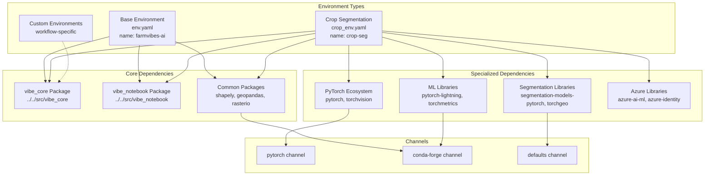
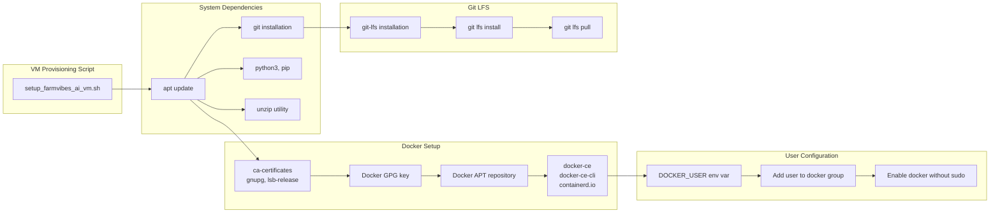
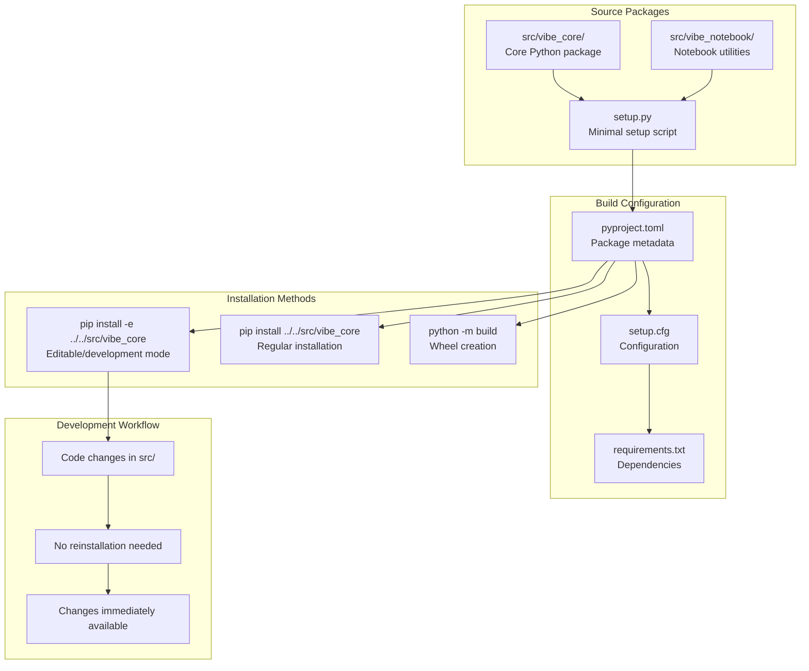
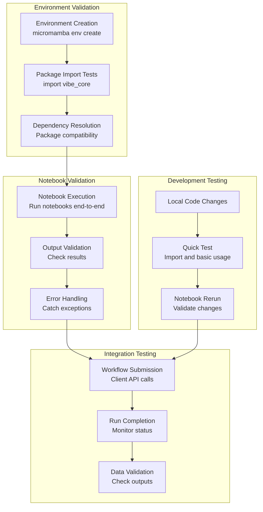

<!-- source: DeepWiki mcp.deepwiki.com · repo microsoft/farmvibes-ai · page 7.3 Testing and Environment Setup · fetched 2026-10-26 -->

# Testing and Environment Setup

<details>
<summary>Relevant source files</summary>

The following files were used as context for generating this wiki page:

- [notebooks/README.md](notebooks/README.md)
- [notebooks/crop_segmentation/crop_env.yaml](notebooks/crop_segmentation/crop_env.yaml)
- [resources/vm/setup_farmvibes_ai_vm.sh](resources/vm/setup_farmvibes_ai_vm.sh)
- [src/vibe_core/setup.py](src/vibe_core/setup.py)

</details>


## Purpose and Scope

This document covers the development environment setup, testing practices, and environment configuration for FarmVibes.AI development. It includes instructions for configuring Python environments using micromamba, managing dependencies, and setting up development virtual machines.

For user-facing notebook execution and environment setup, see [Working with Notebooks](#5.1). For initial installation and cluster setup, see [Getting Started](#2).

---

## Environment Management with micromamba

FarmVibes.AI uses **micromamba** as its primary environment manager for isolating Python dependencies across different workflows and notebooks. Micromamba is a lightweight, fast alternative to conda that provides the same functionality with improved performance.

### Why micromamba

The project uses micromamba because:
- **Isolation**: Each notebook or workflow category can have its own environment with specific dependency versions
- **Reproducibility**: Environment files (`*.yaml`) define exact dependency specifications
- **Speed**: Faster environment creation and package installation compared to conda
- **Compatibility**: Works with conda-forge packages and existing conda environments

### Installing micromamba

The installation instructions are referenced in [notebooks/README.md:8]():
- Follow the [micromamba website](https://mamba.readthedocs.io/en/latest) for installation
- Consult the [micromamba user guide](https://mamba.readthedocs.io/en/latest/user_guide/micromamba.html)
- Refer to the [troubleshooting page](https://mamba.readthedocs.io/en/latest/user_guide/troubleshooting.html) for common issues

### Creating Environments

The base environment is created using [notebooks/README.md:16]():

```bash
micromamba env create -f env.yaml
```

This creates an environment named `farmvibes-ai` with common packages for running multiple notebooks.

**Sources**: [notebooks/README.md:1-22]()

---

## Environment Configuration Architecture



**Diagram**: Environment dependency architecture showing how different environment types share core packages while adding specialized dependencies.

**Sources**: [notebooks/README.md:1-22](), [notebooks/crop_segmentation/crop_env.yaml:1-31]()

---

## Environment Configuration Files

### Base Environment File

The base environment ([notebooks/README.md:13]()) is defined in `env.yaml` and provides common packages for most notebooks. It includes:
- FarmVibes.AI core packages (`vibe_core`, `vibe_notebook`)
- Geospatial libraries (`shapely`, `geopandas`, `rasterio`)
- Data manipulation libraries (`xarray`, `rioxarray`)
- Jupyter notebook dependencies (`ipython`, `ipywidgets`)

### Specialized Environment: Crop Segmentation

The crop segmentation environment [notebooks/crop_segmentation/crop_env.yaml:1-31]() demonstrates a specialized configuration:

| Component | Purpose | Version Specification |
|-----------|---------|----------------------|
| **Environment Name** | `crop-seg` | [crop_env.yaml:1]() |
| **Python Version** | Base interpreter | `3.8.*` |
| **PyTorch** | Deep learning framework | `~=1.10.2` |
| **torchvision** | Computer vision utilities | `~=0.11.3` |
| **pytorch-lightning** | Training framework | `==1.7.3` (exact) |
| **segmentation-models-pytorch** | Segmentation models | `==0.2.1` (exact) |
| **torchgeo** | Geospatial ML library | `==0.3.0` (exact) |
| **torchmetrics** | Evaluation metrics | `==0.7.0` (exact) |
| **onnx** | Model export format | `~=1.12.0` |
| **azure-ai-ml** | Azure ML integration | Latest |
| **azure-identity** | Azure authentication | Latest |

### Channel Configuration

The crop environment uses multiple package channels [notebooks/crop_segmentation/crop_env.yaml:2-5]():
1. **pytorch**: For PyTorch and related packages
2. **conda-forge**: Community-maintained packages
3. **defaults**: Anaconda default channel

### Local Package Installation

Both environments install local packages via pip [notebooks/crop_segmentation/crop_env.yaml:30-31]():
```yaml
- pip:
    - ../../src/vibe_core
    - ../../src/vibe_notebook
```

This installs the packages in editable mode from the local repository, allowing development changes to be immediately reflected.

**Sources**: [notebooks/README.md:13-21](), [notebooks/crop_segmentation/crop_env.yaml:1-31]()

---

## Development VM Setup



**Diagram**: VM setup script workflow showing the sequence of installations and configurations.

**Sources**: [resources/vm/setup_farmvibes_ai_vm.sh:1-55]()

### VM Setup Script Components

The [resources/vm/setup_farmvibes_ai_vm.sh:1-55]() script automates development VM provisioning:

#### System Package Installation

1. **Git** [setup_farmvibes_ai_vm.sh:9-10](): Version control system
2. **Python 3** [setup_farmvibes_ai_vm.sh:13-14](): Python interpreter with pip
3. **Unzip** [setup_farmvibes_ai_vm.sh:35](): Archive extraction utility

#### Docker Installation

The script installs Docker Engine following official Docker documentation:

1. **Docker dependencies** [setup_farmvibes_ai_vm.sh:17-18]():
   ```bash
   sudo apt install ca-certificates gnupg lsb-release -y
   ```

2. **GPG key setup** [setup_farmvibes_ai_vm.sh:19-21]():
   ```bash
   sudo mkdir -p /etc/apt/keyrings
   curl -fsSL https://download.docker.com/linux/ubuntu/gpg | sudo gpg --dearmor -o /etc/apt/keyrings/docker.gpg
   ```

3. **Repository configuration** [setup_farmvibes_ai_vm.sh:24-31](): Adds Docker's APT repository for Ubuntu

4. **Docker Engine installation** [setup_farmvibes_ai_vm.sh:39-40]():
   ```bash
   sudo apt install docker-ce docker-ce-cli containerd.io -y
   ```

#### User Configuration

The script configures Docker user access [setup_farmvibes_ai_vm.sh:43-50]():

```bash
# Determine user (root or current user)
if [ "$EUID" -eq 0 ]; then
  export DOCKER_USER="${DOCKER_USER:-"azureuser"}"
else
  export DOCKER_USER="${DOCKER_USER:-$USER}"
fi

# Enable docker without sudo
sudo usermod -aG docker $DOCKER_USER
```

This allows the user to run Docker commands without `sudo`.

#### Git LFS Setup

For handling large files in the repository [setup_farmvibes_ai_vm.sh:52-55]():

```bash
sudo apt install git-lfs -y
git lfs install
git lfs pull
```

**Sources**: [resources/vm/setup_farmvibes_ai_vm.sh:1-55]()

---

## Package Development Setup



**Diagram**: Package development setup showing installation methods and development workflow.

**Sources**: [src/vibe_core/setup.py:1-8](), [notebooks/crop_segmentation/crop_env.yaml:30-31]()

### vibe_core Package Setup

The [src/vibe_core/setup.py:1-8]() file is minimal:

```python
from setuptools import setup

if __name__ == "__main__":
    setup()
```

This delegates all configuration to `pyproject.toml` and `setup.cfg` files (not provided in the file list but referenced by the setup mechanism).

### Editable Installation

Environments install packages in editable mode [notebooks/crop_segmentation/crop_env.yaml:30-31]():

```yaml
- pip:
    - ../../src/vibe_core
    - ../../src/vibe_notebook
```

**Benefits of editable installation**:
- Code changes are immediately reflected without reinstallation
- Supports active development and debugging
- Maintains connection to source repository

### Development Installation Workflow

1. **Create environment**: 
   ```bash
   micromamba env create -f crop_env.yaml
   ```

2. **Activate environment**: 
   ```bash
   micromamba activate crop-seg
   ```

3. **Verify installation**: 
   ```bash
   python -c "import vibe_core; print(vibe_core.__file__)"
   ```

4. **Make code changes**: Edit files in `src/vibe_core/`

5. **Test changes**: Changes are immediately available in the environment

**Sources**: [src/vibe_core/setup.py:1-8](), [notebooks/crop_segmentation/crop_env.yaml:30-31]()

---

## Testing and Validation Practices



**Diagram**: Testing workflow showing validation stages from environment setup through integration testing.

### Environment Validation

After creating an environment, validate it:

1. **Check environment creation**:
   ```bash
   micromamba env list
   ```

2. **Verify package installation**:
   ```bash
   micromamba activate farmvibes-ai
   python -c "import vibe_core; import vibe_notebook"
   ```

3. **Check dependency versions**:
   ```bash
   micromamba list
   ```

### Notebook Validation

As noted in [notebooks/README.md:20-21](), notebooks with specialized requirements have their own environment files:

- Test notebooks individually after environment setup
- Ensure all imports succeed
- Validate workflow execution completes
- Check output data formats

### Local Testing Workflow

For developers making changes:

1. **Make code changes** in `src/vibe_core/` or `src/vibe_notebook/`
2. **No reinstallation needed** (editable install)
3. **Run quick import test**:
   ```bash
   python -c "from vibe_core.client import FarmvibesAiClient"
   ```
4. **Execute relevant notebook** to validate changes
5. **Check workflow execution** if changes affect workflow logic

### Common Testing Scenarios

| Scenario | Validation Method | Files to Check |
|----------|------------------|----------------|
| New environment | Import test + notebook run | `env.yaml`, notebooks |
| Package changes | Quick import + workflow execution | `src/vibe_core/**/*.py` |
| Notebook changes | Execute notebook end-to-end | `notebooks/**/*.ipynb` |
| VM setup | Docker status + git lfs | `setup_farmvibes_ai_vm.sh` |
| Dependency changes | Environment recreation | `*.yaml` files |

**Sources**: [notebooks/README.md:1-22]()

---

## Environment Management Best Practices

### Version Pinning Strategy

The project uses different version specifications:

- **Exact versions** (`==`): For critical ML libraries where version matters [crop_env.yaml:23-27]()
  - `pytorch-lightning==1.7.3`
  - `segmentation-models-pytorch==0.2.1`
  - `torchgeo==0.3.0`
  
- **Compatible versions** (`~=`): For stable dependencies [crop_env.yaml:9-14]()
  - `pytorch~=1.10.2` (allows patch updates: 1.10.x)
  - `rasterio~=1.2` (allows minor updates: 1.2.x)
  
- **Minimum versions** (`>=`): For flexible dependencies [crop_env.yaml:10]()
  - `shapely>=1.7.1`

### Environment Naming Conventions

- **Base environment**: `farmvibes-ai` [notebooks/README.md:19]()
- **Specialized environments**: Use descriptive names like `crop-seg` [crop_env.yaml:1]()
- Avoid environment name conflicts
- Use consistent naming across documentation

### Dependency Isolation

Each workflow category should have its own environment file:
- Prevents dependency conflicts
- Allows independent version management
- Reduces environment size for specific use cases
- Speeds up environment creation

### Environment File Maintenance

When updating environment files:
1. Test environment creation in clean state
2. Verify all notebooks execute successfully
3. Document any new dependencies in README
4. Update version pins if security updates needed
5. Test on multiple platforms (Linux, macOS, Windows)

**Sources**: [notebooks/README.md:1-22](), [notebooks/crop_segmentation/crop_env.yaml:1-31]()

---

## Troubleshooting Environment Issues

### Common Issues and Solutions

| Issue | Symptom | Solution |
|-------|---------|----------|
| **Import failures** | `ModuleNotFoundError` | Verify environment activated; check package in `micromamba list` |
| **Version conflicts** | `conda.UnsatisfiableError` | Review version pins; use compatible version specs |
| **Docker permission** | `permission denied` error | Run `sudo usermod -aG docker $USER`; logout and login |
| **Git LFS files missing** | Binary files are pointers | Run `git lfs pull` [setup_farmvibes_ai_vm.sh:55]() |
| **Slow environment creation** | Long package resolution | Use `mamba` instead of `conda`; check channel order |
| **Path issues** | Package not found | Verify relative paths in pip install section |

### Environment Debugging Commands

```bash
# Check active environment
micromamba env list

# List installed packages
micromamba list

# Check package version
python -c "import pkg; print(pkg.__version__)"

# Verify editable installation
pip list | grep vibe

# Check Python path
python -c "import sys; print(sys.path)"
```

### Docker Troubleshooting

```bash
# Check Docker status
sudo systemctl status docker

# Test Docker installation
docker run hello-world

# Check user groups
groups $USER

# Verify Docker without sudo
docker ps
```

**Sources**: [notebooks/README.md:9](), [resources/vm/setup_farmvibes_ai_vm.sh:43-50]()

---

## Development Environment Setup Summary

### Quick Start for Development

1. **Install micromamba**: Follow [installation guide](https://mamba.readthedocs.io/en/latest)

2. **Clone repository**:
   ```bash
   git clone https://github.com/microsoft/farmvibes-ai
   cd farmvibes-ai
   ```

3. **Set up Git LFS** (if on VM):
   ```bash
   git lfs install
   git lfs pull
   ```

4. **Create base environment**:
   ```bash
   cd notebooks
   micromamba env create -f env.yaml
   ```

5. **Activate environment**:
   ```bash
   micromamba activate farmvibes-ai
   ```

6. **Verify installation**:
   ```bash
   python -c "import vibe_core, vibe_notebook"
   ```

### Environment File Locations

- **Base environment**: `notebooks/env.yaml`
- **Crop segmentation**: `notebooks/crop_segmentation/crop_env.yaml`
- **Other specialized environments**: Check respective notebook directories

### Related Resources

- [Working with Notebooks](#5.1): User-facing notebook execution guide
- [Getting Started](#2): Initial installation and cluster setup
- [Contributing and Issue Management](#7.1): Development contribution workflow
- [Documentation System](#7.2): Building and deploying documentation

**Sources**: [notebooks/README.md:1-22](), [notebooks/crop_segmentation/crop_env.yaml:1-31](), [resources/vm/setup_farmvibes_ai_vm.sh:1-55]()

---

