# Page: Overview

# Overview

<details>
<summary>Relevant source files</summary>

The following files were used as context for generating this wiki page:

- [README.md](README.md)
- [docs/requirements.txt](docs/requirements.txt)
- [src/vibe_core/pyproject.toml](src/vibe_core/pyproject.toml)

</details>


## Purpose and Scope

This document provides a high-level introduction to FarmVibes.AI, a multi-modal geospatial machine learning platform designed for agriculture and sustainability applications. It covers the platform's core purpose, key capabilities, system architecture, and technology stack.

For detailed installation and setup instructions, see [Getting Started](#2). For architectural deep-dives, see [Architecture](#3). For specific workflow documentation, see [Workflows](#4).

---

## What is FarmVibes.AI

FarmVibes.AI is a geospatial machine learning platform that enables data fusion across multiple remote sensing and environmental data sources to generate agricultural and sustainability insights. The platform addresses the challenge of combining heterogeneous geospatial datasets—including satellite imagery (optical, SAR, multispectral), weather data, elevation maps, and custom raster data—into unified inputs for machine learning models.

The platform operates on the principle that fusing data across modalities, spatial regions, and temporal windows produces more robust insights than analyzing datasets in isolation. For example, detecting agricultural practices or estimating carbon footprint becomes more accurate when combining Sentinel-1 radar, Sentinel-2 optical imagery, weather patterns, and historical data from similar locations.

**Sources:** [README.md:1-16](), [README.md:35-44]()

---

## Architecture Overview

FarmVibes.AI consists of three main layers: the user interface layer, the core platform layer (`vibe_core`), and the execution infrastructure layer.

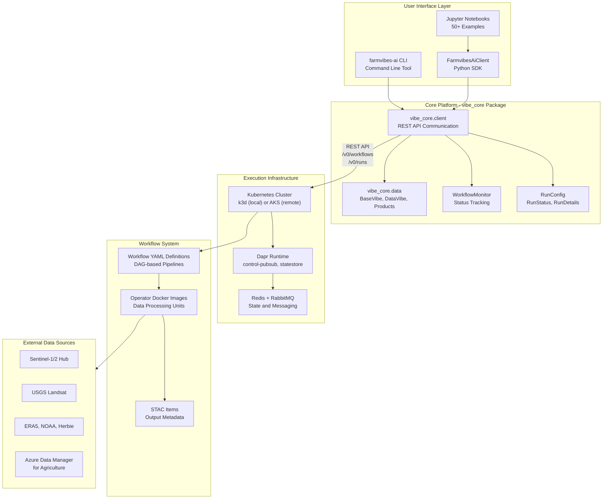

**Diagram: FarmVibes.AI System Architecture**

The platform uses a client-server model where users interact with the system through Python clients or CLI, which communicate with a Kubernetes-based execution backend. Workflows are defined as directed acyclic graphs (DAGs) and executed as containerized operators orchestrated by Dapr.

**Sources:** [README.md:74-83](), [src/vibe_core/pyproject.toml:19-60]()

---

## System Components

### Core Package: `vibe-core`

The `vibe-core` Python package ([src/vibe_core/pyproject.toml:20]()) provides the client-side SDK and data models for interacting with FarmVibes.AI. It includes:

| Module | Purpose |
|--------|---------|
| `vibe_core.client` | REST API client for workflow submission and monitoring |
| `vibe_core.data` | Data models including `BaseVibe`, `DataVibe`, product types, and rasters |
| `vibe_core.cli` | Command-line interface (`farmvibes-ai` command) |
| `vibe_core.terraform` | Infrastructure-as-code modules for cluster deployment |

The package has key dependencies on `pystac` for STAC metadata handling, `pydantic` for data validation, `shapely` for geometry operations, and `hydra-zen` for configuration management ([src/vibe_core/pyproject.toml:41-52]()).

**Sources:** [src/vibe_core/pyproject.toml:1-64]()

### Execution Infrastructure

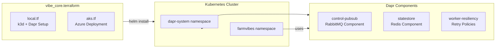

**Diagram: Infrastructure Deployment Architecture**

The platform deploys on Kubernetes using Terraform modules located in `vibe_core.terraform` ([src/vibe_core/pyproject.toml:17]()). These modules provision either:
- **Local deployment**: k3d cluster on developer machines
- **Remote deployment**: Azure Kubernetes Service (AKS)

Dapr provides distributed application runtime capabilities including pub/sub messaging via RabbitMQ (`control-pubsub` component) and state management via Redis (`statestore` component), with configurable resiliency policies (`worker-resiliency`).

**Sources:** [src/vibe_core/pyproject.toml:17]()

### Workflow System

Workflows are defined as YAML specifications describing directed acyclic graphs of operators. Each operator is a containerized unit of work that:
- Receives input data conforming to `BaseVibe` or derived types
- Performs data processing, downloading, or model inference
- Produces output as STAC items containing geospatial metadata

The workflow execution model supports:
- Parallel execution of independent operators
- Data dependency management between operators
- Retry and timeout policies for resilience
- Progress monitoring via `WorkflowMonitor`

For detailed workflow documentation, see [Workflows](#4).

**Sources:** [README.md:47-50](), [README.md:66-72]()

---

## Key Capabilities

### Data Ingestion

FarmVibes.AI provides pre-built workflows for downloading and preprocessing data from:

| Data Source | Data Type | Example Workflows |
|-------------|-----------|-------------------|
| Sentinel-1/2 | SAR and optical imagery | Cloud removal, temporal compositing |
| Landsat | Multispectral imagery | Index calculation, time series |
| ERA5, NOAA, Herbie | Weather and climate data | Precipitation, temperature |
| USGS | Elevation maps | Terrain analysis |
| NAIP | High-resolution imagery | Field-level analysis |
| Azure Data Manager for Agriculture | Field boundaries, management data | Integration workflows |

Custom rasterized datasets (e.g., drone imagery) can be ingested using bring-your-own-data workflows.

**Sources:** [README.md:29-33]()

### Data Fusion and Processing

The platform includes workflows for:
- **Index calculation**: NDVI, MSAVI, EVI, and other vegetation indices
- **Cloud removal**: SpaceEye algorithm for generating cloud-free composites
- **Temporal aggregation**: Time series analysis and statistics
- **Spatial operations**: Resampling, masking, alignment across data sources
- **Multi-modal fusion**: Combining optical, SAR, weather, and elevation data

These workflows prepare fusion-ready datasets where each sample contains aligned data from multiple modalities across spatial neighborhoods and temporal windows.

**Sources:** [README.md:35-50]()

### Machine Learning Applications

FarmVibes.AI includes example notebooks demonstrating:
- **Harvest detection**: Estimating emergence and harvest dates from NDVI time series ([README.md:97-98]())
- **Carbon sequestration**: Simulating soil carbon estimates using COMET-Farm API ([README.md:99-100]())
- **Crop segmentation**: Training crop identification models on SpaceEye imagery ([README.md:103-107]())
- **Micro-climate forecasting**: DeepMC model for weather prediction ([README.md:101-102]())

For a complete list, see [Example Notebooks](#6).

**Sources:** [README.md:90-110]()

---

## Technology Stack

### Core Dependencies

The `vibe-core` package relies on:

| Dependency | Version | Purpose |
|------------|---------|---------|
| `pystac` | ~1.6.0 | STAC metadata handling |
| `pydantic` | ~1.10.0 | Data validation and serialization |
| `shapely` | >=1.7.1 | Geometric operations |
| `requests` | ~2.32.0 | HTTP communication |
| `hydra-zen` | ~0.10 | Configuration management |
| `rich` | ~13.7.1 | Terminal UI formatting |

**Sources:** [src/vibe_core/pyproject.toml:41-52]()

### Documentation Toolchain

Documentation is built using Sphinx ([docs/requirements.txt:2]()) with:
- `sphinx_rtd_theme` for Read the Docs styling
- `sphinxcontrib.mermaid` for diagram rendering
- `myst_parser` for Markdown support
- `sphinx_autodoc_typehints` for API documentation

The documentation is automatically built and deployed to GitHub Pages. For details, see [Documentation System](#7.2).

**Sources:** [docs/requirements.txt:1-7]()

---

## Deployment Models

### Local Cluster

The local deployment model uses:
- **Docker Desktop** as the container runtime
- **k3d** for lightweight Kubernetes cluster
- **Terraform** to provision Dapr, Redis, and RabbitMQ
- **Local storage** for workflow outputs and cached data

This mode is suitable for development, testing, and running workflows on a single machine. Data is persisted locally in the developer's environment ([README.md:76-78]()).

### Remote Cluster

The remote deployment model supports:
- **Azure Kubernetes Service (AKS)** for production workloads
- **Azure Container Registry (ACR)** for custom operator images
- **Azure ML** for model training at scale
- **Cloud storage** for data persistence

Both deployment models use identical workflow definitions and operator images, enabling seamless transition from development to production.

**Sources:** [README.md:74-83]()

---

## Interaction Model

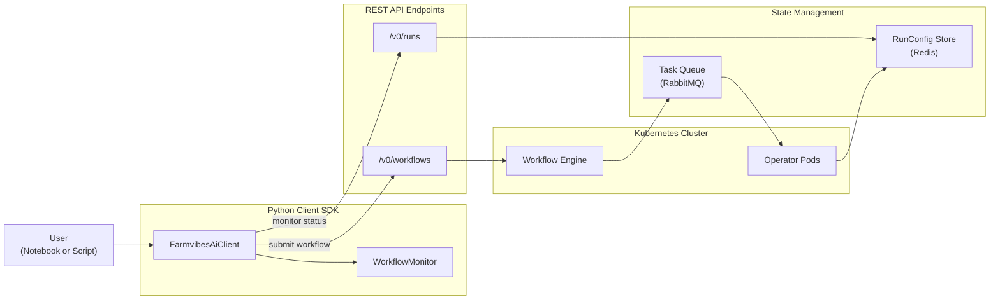

**Diagram: User Interaction and Execution Flow**

Users interact with FarmVibes.AI through the `FarmvibesAiClient` class, which:
1. Submits workflows to `/v0/workflows` endpoint
2. Monitors execution status via `/v0/runs` endpoint
3. Displays progress using `WorkflowMonitor` with rich terminal UI
4. Retrieves results as STAC items

The workflow engine schedules operators as Kubernetes pods, using RabbitMQ for task distribution and Redis for state persistence. For detailed client documentation, see [Client API](#3.4).

**Sources:** [README.md:81-82](), [src/vibe_core/pyproject.toml:58-59]()

---

## Package Distribution

The `vibe-core` package is distributed via PyPI ([src/vibe_core/pyproject.toml:20]()) and can be installed using:

```bash
pip install vibe-core
```

The package provides the `farmvibes-ai` command-line interface ([src/vibe_core/pyproject.toml:58-59]()), which serves as the primary tool for cluster management:

```bash
farmvibes-ai install    # Deploy local cluster
farmvibes-ai start      # Start cluster services
farmvibes-ai stop       # Stop cluster services
farmvibes-ai status     # Check cluster status
```

For installation instructions, see [Getting Started](#2).

**Sources:** [src/vibe_core/pyproject.toml:1-64]()

---

## Project Metadata

FarmVibes.AI is developed by the Microsoft FarmVibes.AI Team and distributed under the MIT License ([src/vibe_core/pyproject.toml:26]()). The project targets Python 3.8+ ([src/vibe_core/pyproject.toml:27]()) and is optimized for Linux operating systems ([src/vibe_core/pyproject.toml:31]()).

Project resources:
- **Repository**: https://github.com/microsoft/farmvibes-ai ([src/vibe_core/pyproject.toml:55]())
- **Issue Tracker**: https://github.com/microsoft/farmvibes-ai/issues ([src/vibe_core/pyproject.toml:56]())
- **Documentation**: https://microsoft.github.io/farmvibes-ai/ ([README.md:114]())
- **Contact**: terravibes@microsoft.com ([src/vibe_core/pyproject.toml:23]())

For contribution guidelines, see [Contributing and Issue Management](#7.1).

**Sources:** [src/vibe_core/pyproject.toml:22-56](), [README.md:114]()

---

## Next Steps

To get started with FarmVibes.AI:

1. **Install the platform**: Follow the [Getting Started](#2) guide to set up your local cluster
2. **Explore examples**: Review [Example Notebooks](#6) to understand common use cases
3. **Run your first workflow**: See [Running Workflows](#5.2) for step-by-step instructions
4. **Understand the architecture**: Read [Architecture](#3) for detailed component documentation
5. **Browse workflows**: Explore the [Workflow Catalog](#8.2) for available data processing pipelines

For troubleshooting, see [Monitoring and Debugging](#5.3).

**Sources:** [README.md:84-88](), [README.md:112-126]()

---

# Page: Getting Started

# Getting Started

<details>
<summary>Relevant source files</summary>

The following files were used as context for generating this wiki page:

- [README.md](README.md)
- [notebooks/README.md](notebooks/README.md)
- [notebooks/crop_segmentation/crop_env.yaml](notebooks/crop_segmentation/crop_env.yaml)
- [resources/vm/setup_farmvibes_ai_vm.sh](resources/vm/setup_farmvibes_ai_vm.sh)
- [src/vibe_core/setup.py](src/vibe_core/setup.py)

</details>


## Purpose and Scope

This guide walks you through installing FarmVibes.AI, setting up the development environment, and running your first workflow. By the end of this guide, you will have a local FarmVibes.AI cluster running and understand how to submit workflows using the Python client.

For comprehensive information about the system architecture and components, see [Architecture](#3). For detailed guides on working with notebooks and workflows, see [User Guides](#5). For troubleshooting installation issues, refer to the FarmVibes.AI documentation's TROUBLESHOOTING.md guide.

## Overview of Installation Process

FarmVibes.AI runs as a local Kubernetes cluster on your development machine. The installation process sets up all required infrastructure components and makes the system accessible via a Python client API.

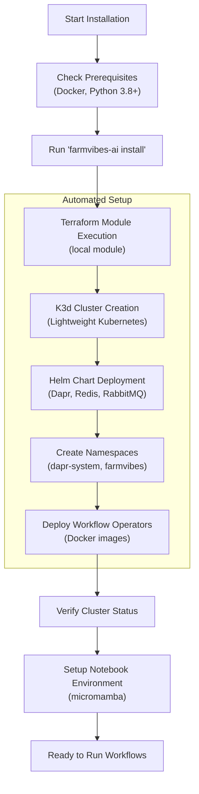

**Installation Flow Diagram**: Shows the automated steps executed during FarmVibes.AI installation, from prerequisites through infrastructure setup to ready state.

Sources: [README.md:84-88](), [resources/vm/setup_farmvibes_ai_vm.sh:1-55]()

## Prerequisites

Before installing FarmVibes.AI, ensure your system meets the following requirements:

### System Requirements

| Component | Requirement | Notes |
|-----------|-------------|-------|
| Operating System | Linux (Ubuntu 20.04+), macOS, Windows with WSL2 | Windows requires WSL2 for Docker |
| RAM | 8 GB minimum, 16 GB recommended | More RAM enables larger workflow executions |
| Disk Space | 50 GB minimum, 100 GB recommended | Space needed for Docker images and cached data |
| CPU | 4 cores minimum | Multi-core processors improve workflow performance |

### Required Software

The following software must be installed before running the FarmVibes.AI installation:

**Docker Engine** (v20.10 or later):
- Docker Desktop for Windows/macOS
- Docker CE for Linux

**Python** (v3.8 or later):
- Python 3.8, 3.9, or 3.10 supported
- `pip` package manager included

**Git** (v2.x or later):
- Required for cloning the repository
- Git LFS recommended for large file support

Sources: [resources/vm/setup_farmvibes_ai_vm.sh:6-55](), [README.md:84-88]()

## Installation Options

FarmVibes.AI supports two primary installation modes:

### Local Installation (Recommended)

Install directly on your development machine for the fastest iteration and development experience. This mode creates a local Kubernetes cluster using K3d and runs all workflows on your machine.

**Best for**: Development, experimentation, small-scale data processing

### Azure VM Installation

Deploy to a dedicated Azure Virtual Machine for more compute resources and isolation from your local environment. A setup script automates the VM configuration.

**Best for**: Production workflows, large-scale data processing, team environments

Sources: [README.md:84-88](), [resources/vm/setup_farmvibes_ai_vm.sh:1-55]()

## Installing FarmVibes.AI Locally

### Installation Command

After installing the prerequisites, install FarmVibes.AI using the CLI:

```bash
farmvibes-ai install
```

This command performs the following actions:

1. **Validates Prerequisites**: Checks for Docker, Python, and other dependencies
2. **Initializes Terraform**: Prepares the local infrastructure module
3. **Creates K3d Cluster**: Deploys a lightweight Kubernetes cluster
4. **Installs Dapr Runtime**: Sets up the distributed application runtime
5. **Deploys Supporting Services**: Installs Redis (state store) and RabbitMQ (message broker)
6. **Configures Namespaces**: Creates `dapr-system` and `farmvibes` namespaces
7. **Deploys Workflow Operators**: Pulls and deploys operator Docker images

### Infrastructure Components

The installation creates the following infrastructure stack:

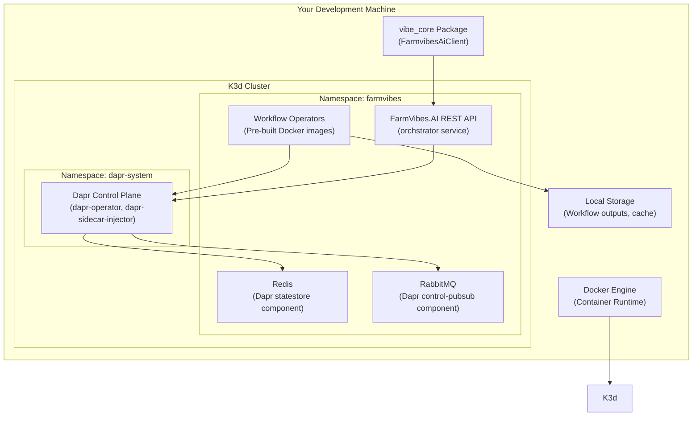

**Infrastructure Components Diagram**: Shows the deployed components after installation, including Kubernetes namespaces, Dapr runtime, supporting services, and storage.

Sources: [README.md:74-82]()

### Verifying Installation

After installation completes, verify the cluster is running:

```bash
farmvibes-ai status
```

This command checks:
- K3d cluster health
- Dapr runtime status
- Pod readiness in both namespaces
- Service endpoints availability

Expected output indicates all components are in "Running" state.

Sources: [README.md:74-88]()

## Azure VM Setup

For deploying FarmVibes.AI on an Azure VM, use the provided setup script:

### VM Preparation Script

The [resources/vm/setup_farmvibes_ai_vm.sh:1-55]() script automates VM configuration:

**Key Setup Steps**:
1. **System Updates**: Updates apt package index [resources/vm/setup_farmvibes_ai_vm.sh:6-7]()
2. **Git Installation**: Installs Git and Git LFS [resources/vm/setup_farmvibes_ai_vm.sh:9-10]()
3. **Python Setup**: Installs Python 3 and pip [resources/vm/setup_farmvibes_ai_vm.sh:12-14]()
4. **Docker Installation**: Installs Docker CE with official repository [resources/vm/setup_farmvibes_ai_vm.sh:16-40]()
5. **User Configuration**: Configures Docker group permissions [resources/vm/setup_farmvibes_ai_vm.sh:42-50]()
6. **Git LFS**: Initializes Git LFS for large files [resources/vm/setup_farmvibes_ai_vm.sh:52-55]()

### Running the Setup

1. Provision an Ubuntu 20.04 VM on Azure
2. Copy the setup script to the VM
3. Execute: `bash setup_farmvibes_ai_vm.sh`
4. Log out and back in (for Docker group changes)
5. Run `farmvibes-ai install` as in local installation

Sources: [README.md:86-88](), [resources/vm/setup_farmvibes_ai_vm.sh:1-55]()

## Setting Up the Notebook Environment

FarmVibes.AI provides Jupyter notebooks for interactive workflows. The recommended approach uses `micromamba` for environment management.

### Installing Micromamba

Micromamba is a lightweight, fast alternative to conda for package management.

**Installation** (Linux/macOS):
```bash
"${SHELL}" <(curl -L micro.mamba.pm/install.sh)
```

Refer to the [micromamba documentation](https://mamba.readthedocs.io/en/latest) for Windows installation and troubleshooting.

Sources: [notebooks/README.md:6-9]()

### Creating the Base Environment

The repository provides environment files for notebook execution:

**Base Environment** ([notebooks/env.yaml]()):
```bash
cd notebooks
micromamba env create -f env.yaml
```

This creates an environment named `farmvibes-ai` with common packages for running most notebooks.

**Activating the Environment**:
```bash
micromamba activate farmvibes-ai
```

Sources: [notebooks/README.md:11-19]()

### Specialized Environments

Some notebooks require additional dependencies and provide their own environment files:

| Notebook Category | Environment File | Environment Name | Key Packages |
|-------------------|------------------|------------------|--------------|
| Crop Segmentation | `crop_segmentation/crop_env.yaml` | `crop-seg` | PyTorch, torchvision, segmentation-models-pytorch |
| Machine Learning | Various `*_env.yaml` files | Workflow-specific | PyTorch Lightning, torchgeo, Azure ML |

**Example: Crop Segmentation Environment**:
```bash
cd notebooks/crop_segmentation
micromamba env create -f crop_env.yaml
micromamba activate crop-seg
```

The environment file at [notebooks/crop_segmentation/crop_env.yaml:1-31]() includes:
- PyTorch 1.10.2 with CUDA support [notebooks/crop_segmentation/crop_env.yaml:9]()
- Geospatial libraries (shapely, geopandas, rasterio) [notebooks/crop_segmentation/crop_env.yaml:10-12]()
- Deep learning tools (pytorch-lightning, segmentation-models-pytorch) [notebooks/crop_segmentation/crop_env.yaml:23-24]()
- FarmVibes.AI client packages [notebooks/crop_segmentation/crop_env.yaml:30-31]()

Sources: [notebooks/README.md:11-22](), [notebooks/crop_segmentation/crop_env.yaml:1-31]()

### Environment Structure

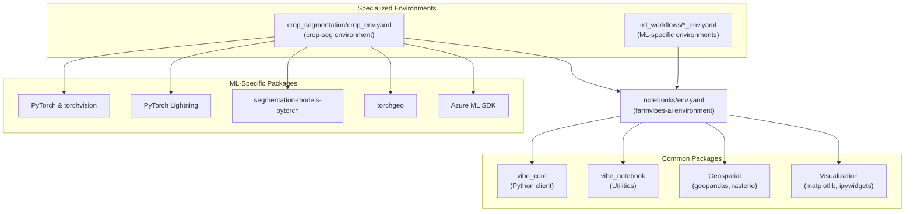

**Environment Hierarchy Diagram**: Shows the relationship between base and specialized environments, with the base environment providing common packages and specialized environments adding domain-specific dependencies.

Sources: [notebooks/README.md:11-22](), [notebooks/crop_segmentation/crop_env.yaml:1-31]()

## Running Your First Workflow

With FarmVibes.AI installed and environments configured, you can now execute workflows using the Python client.

### Starting a Jupyter Notebook Session

1. Activate the environment:
```bash
micromamba activate farmvibes-ai
```

2. Navigate to the notebooks directory:
```bash
cd notebooks
```

3. Launch JupyterLab:
```bash
jupyter lab
```

### Using the Python Client

The `FarmvibesAiClient` class in the `vibe_core` package provides the interface for workflow execution.

**Basic Client Setup**:
```python
from vibe_core.client import FarmvibesAiClient

# Connect to local cluster
client = FarmvibesAiClient()
```

The client automatically connects to the local REST API endpoint (typically `http://localhost:31108`).

### Workflow Execution Flow

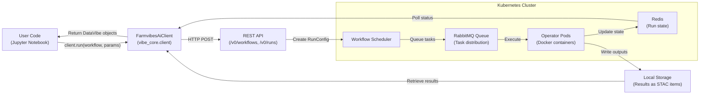

**Workflow Execution Flow Diagram**: Traces the complete path from user code submission through task execution to result retrieval, showing all components involved in workflow orchestration.

### Example: Simple Helloworld Workflow

**Workflow Submission**:
```python
from datetime import datetime
from shapely.geometry import Point, box

# Define area of interest (bounding box)
geom = box(-122.4, 37.7, -122.3, 37.8)  # San Francisco area

# Define time range
time_range = (
    datetime(2022, 1, 1),
    datetime(2022, 1, 31)
)

# Run workflow
run = client.run(
    workflow="helloworld",
    parameters={
        "geometry": geom,
        "time_range": time_range
    }
)

# Monitor execution
run.monitor()

# Get results
results = run.output
```

**Key Components**:
- **Workflow Name**: String identifier for the workflow (e.g., `"helloworld"`)
- **Parameters**: Dictionary with workflow-specific inputs (geometry, time_range, etc.)
- **Run Object**: Returned object for monitoring and retrieving results
- **Monitor Method**: Displays progress in real-time
- **Output Property**: Returns results as `DataVibe` objects

Sources: [README.md:95-96]()

### Monitoring Workflow Execution

The `monitor()` method provides real-time feedback:

**Progress Display**:
- Progress bars for each workflow operator
- Task status tables (pending, running, completed, failed)
- Execution time and resource usage

**Programmatic Status Checking**:
```python
# Check run status
status = run.status  # Returns RunStatus enum

# Check if complete
if run.is_done:
    print("Workflow completed")

# Get detailed status
details = run.details  # Returns RunDetails object
```

For more details on monitoring and debugging, see [Monitoring and Debugging](#5.3).

Sources: [README.md:95-96]()

### Accessing Workflow Results

Workflow outputs are returned as `DataVibe` objects, which represent geospatial data with metadata:

```python
# Access output items
for item in run.output:
    print(f"ID: {item.id}")
    print(f"Type: {type(item).__name__}")
    print(f"Assets: {item.assets}")
    
    # Access raster data
    if hasattr(item, 'raster_asset'):
        raster_path = item.raster_asset.path
        # Process raster with rasterio, xarray, etc.
```

**Output Storage**:
- Results are stored locally in the configured storage directory
- Outputs follow STAC (SpatioTemporal Asset Catalog) conventions
- Each workflow run creates a unique output directory

For more information on data models, see [Data Models](#3.3).

## Next Steps

Now that you have FarmVibes.AI running, explore the following resources:

### Learn by Example

**Example Notebooks**: Browse the [Example Notebooks](#6) section for domain-specific tutorials:
- [Agriculture Examples](#6.1): Crop analysis, carbon sequestration, harvest detection
- [Remote Sensing Examples](#6.2): Satellite imagery processing, SpaceEye, index calculation
- [ML and Segmentation Examples](#6.3): Crop segmentation, SAM model usage

**Recommended Starting Points**:
1. **HelloWorld** [notebooks/helloworld](): Basic workflow execution and visualization
2. **Harvest Period** [notebooks/harvest_period](): NDVI time-series analysis for field monitoring
3. **SpaceEye** [notebooks/spaceeye](): Cloud-free image generation from Sentinel-2

Sources: [README.md:90-110]()

### Explore Workflows

**Available Workflows**: Review the [Workflow Catalog](#8.2) for a complete list of pre-built workflows organized by category:
- Data Ingestion: Sentinel-1/2, Landsat, weather data downloaders
- Processing: Index calculation, time-series aggregation, segmentation
- FarmAI Applications: Crop classification, carbon estimation, change detection

**Workflow System**: Learn about the workflow architecture in [Workflows](#4), including:
- DAG-based workflow structure
- Custom workflow creation
- Operator composition

Sources: [README.md:77-79]()

### Understand the Platform

**Architecture Overview**: Read the [Architecture](#3) section to understand:
- System components and their interactions
- Infrastructure deployment patterns
- Data flow through the platform

**Client API**: Explore the [Client API](#3.4) documentation for advanced usage:
- Workflow parameterization
- Run management and cancellation
- Result filtering and querying

Sources: [README.md:112-125]()

### Troubleshooting

If you encounter issues:

1. **Check Cluster Status**: Run `farmvibes-ai status` to verify all components are running
2. **Review Logs**: Access operator logs for detailed error messages
3. **Consult Documentation**: Review the TROUBLESHOOTING.md guide in the documentation
4. **GitHub Issues**: Search or create issues at https://github.com/microsoft/farmvibes-ai

For detailed debugging guidance, see [Monitoring and Debugging](#5.3).

Sources: [README.md:125]()

## Summary

This guide covered:

1. **Prerequisites**: System requirements and required software
2. **Installation**: Both local and Azure VM setup procedures
3. **Environment Setup**: Using micromamba to create notebook environments
4. **First Workflow**: Executing and monitoring workflows with the Python client
5. **Next Steps**: Resources for continued learning

You now have a working FarmVibes.AI installation and can begin exploring the platform's capabilities for geospatial ML and agriculture insights.

Sources: [README.md:1-148](), [notebooks/README.md:1-22]()

---

# Page: Architecture

# Architecture

<details>
<summary>Relevant source files</summary>

The following files were used as context for generating this wiki page:

- [docs/requirements.txt](docs/requirements.txt)
- [src/vibe_core/pyproject.toml](src/vibe_core/pyproject.toml)
- [src/vibe_core/vibe_core/client.py](src/vibe_core/vibe_core/client.py)
- [src/vibe_core/vibe_core/data/core_types.py](src/vibe_core/vibe_core/data/core_types.py)
- [src/vibe_core/vibe_core/datamodel.py](src/vibe_core/vibe_core/datamodel.py)

</details>


## Purpose and Scope

This document describes the overall architecture of FarmVibes.AI, including the major system components, their interactions, and key architectural patterns. It provides a high-level view of how the platform is structured and how data flows through the system.

For detailed information about specific subsystems, refer to:
- Package structure and dependencies: [vibe_core Package](#3.1)
- Kubernetes and Dapr infrastructure: [Infrastructure and Deployment](#3.2)
- Data type system and BaseVibe hierarchy: [Data Models](#3.3)
- Client SDK and API interaction: [Client API](#3.4)
- Workflow system details: [Workflows](#4)

---

## System Overview

FarmVibes.AI follows a **microservices architecture** deployed on Kubernetes, with a Python client SDK communicating with a REST API service. The system uses **Dapr** (Distributed Application Runtime) for service-to-service communication, state management, and pub/sub messaging.

### Layered Architecture

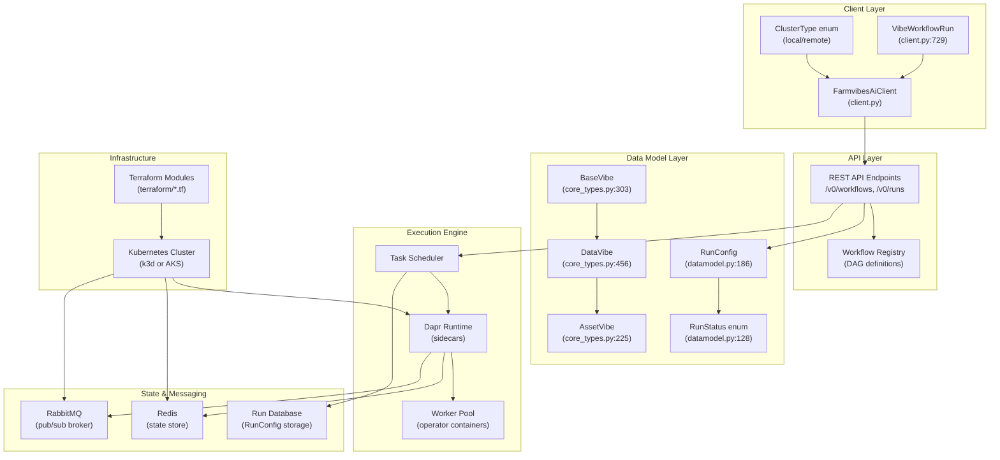

**Sources:** [src/vibe_core/vibe_core/client.py:1-1105](), [src/vibe_core/vibe_core/datamodel.py:1-353](), [src/vibe_core/vibe_core/data/core_types.py:1-870]()

---

## Core Components

### 1. vibe_core Package

The `vibe_core` package is the primary Python distribution that users install via pip. It contains the client SDK, data models, and utility functions.

**Key modules:**
- `vibe_core.client`: Contains `FarmvibesAiClient` class for API interaction
- `vibe_core.datamodel`: Defines `RunConfig`, `RunStatus`, `RunDetails`, and related types
- `vibe_core.data.core_types`: Defines `BaseVibe`, `DataVibe`, `AssetVibe` base classes
- `vibe_core.monitor`: Provides `VibeWorkflowRunMonitor` for tracking execution
- `vibe_core.cli`: Command-line interface via `farmvibes-ai` command

**Package configuration:**

| Property | Value |
|----------|-------|
| Package name | `vibe-core` |
| Python version | `>=3.8` |
| Build system | `setuptools>=42`, `wheel` |
| CLI entry point | `farmvibes-ai` command |

**Dependencies include:**
- `pydantic~=1.10.0` (data validation)
- `pystac~=1.6.0` (STAC format support)
- `requests~=2.32.0` (HTTP client)
- `shapely>=1.7.1` (geometry operations)
- `rich~=13.7.1` (terminal UI)

**Sources:** [src/vibe_core/pyproject.toml:1-64]()

### 2. Client SDK (FarmvibesAiClient)

The `FarmvibesAiClient` class provides the primary interface for users to interact with the platform.

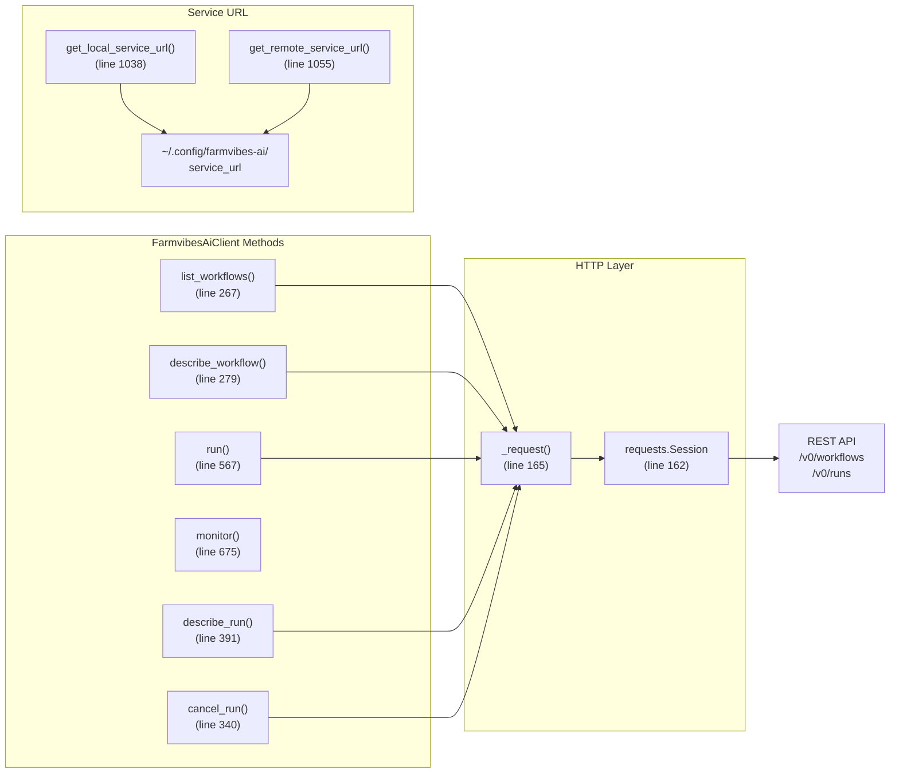

**Key responsibilities:**
- Workflow discovery and submission ([src/vibe_core/vibe_core/client.py:267-277](), [src/vibe_core/vibe_core/client.py:567-612]())
- Run lifecycle management ([src/vibe_core/vibe_core/client.py:340-389]())
- Real-time monitoring ([src/vibe_core/vibe_core/client.py:675-726]())
- Service URL resolution ([src/vibe_core/vibe_core/client.py:1038-1104]())

**Sources:** [src/vibe_core/vibe_core/client.py:145-1105]()

### 3. Data Model Layer

The data model is built on a hierarchical type system rooted in `BaseVibe`.

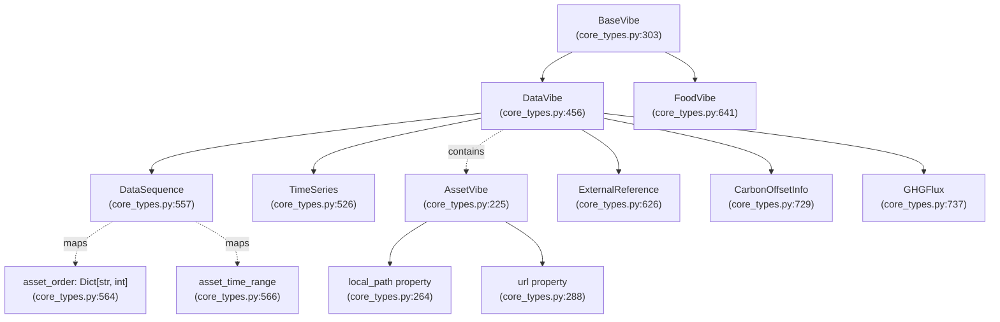

**Key type properties:**

| Type | Key Fields | Purpose |
|------|------------|---------|
| `BaseVibe` | `id`, `hash_id` | Base for all data types |
| `DataVibe` | `time_range`, `geometry`, `bbox`, `assets` | Spatiotemporal data with assets |
| `AssetVibe` | `path_or_url`, `type`, `id` | Reference to file or remote resource |
| `DataSequence` | `asset_order`, `asset_time_range` | Ordered collection of assets |

**Type registration:** All `BaseVibe` subclasses are automatically registered in `data_registry` during class definition ([src/vibe_core/vibe_core/data/core_types.py:407-410]()).

**Sources:** [src/vibe_core/vibe_core/data/core_types.py:303-870]()

### 4. Run Configuration and Status

Workflow execution state is managed through a set of dataclasses:

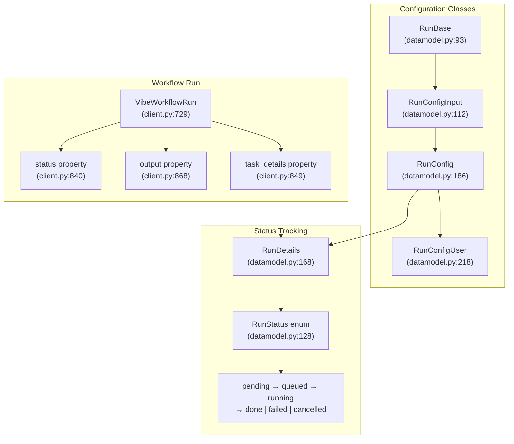

**RunStatus state machine:**
- `pending`: Run created but not yet scheduled
- `queued`: Run scheduled, waiting for execution
- `running`: Run is actively executing
- `done`: Run completed successfully
- `failed`: Run encountered an error
- `cancelled`: Run was cancelled by user
- `deleting/deleted`: Run is being/has been deleted

**Sources:** [src/vibe_core/vibe_core/datamodel.py:93-260](), [src/vibe_core/vibe_core/client.py:729-1036]()

---

## Communication Patterns

### Client-Server Interaction

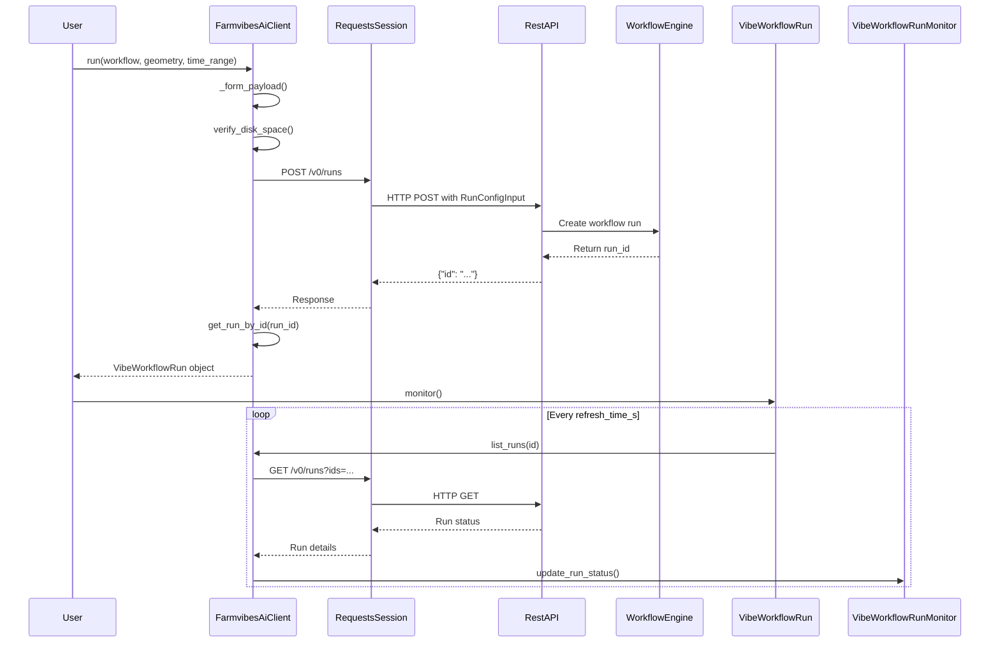

**REST API endpoints:**
- `GET /v0/workflows`: List available workflows
- `GET /v0/workflows/{name}`: Get workflow description
- `POST /v0/runs`: Submit new workflow run
- `GET /v0/runs`: List runs (with optional filters)
- `GET /v0/runs/{id}`: Get run details
- `POST /v0/runs/{id}/cancel`: Cancel a run
- `DELETE /v0/runs/{id}`: Delete a run
- `POST /v0/runs/{id}/resubmit`: Resubmit a run
- `GET /v0/system-metrics`: Get system metrics

**Sources:** [src/vibe_core/vibe_core/client.py:165-189](), [src/vibe_core/vibe_core/client.py:267-627]()

### Dapr-based Service Communication

Within the Kubernetes cluster, services communicate through Dapr sidecars:

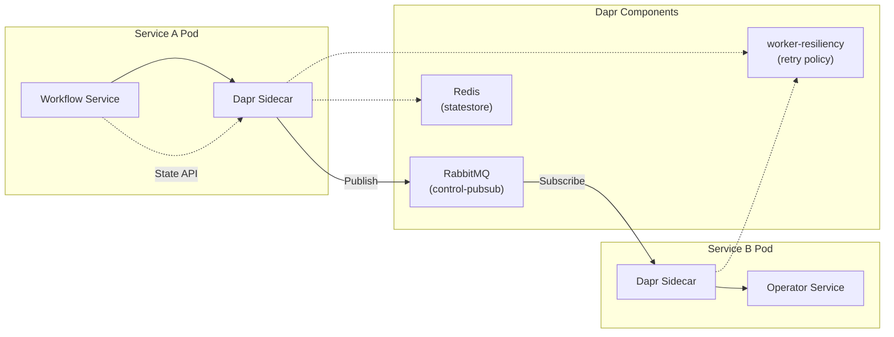

**Dapr features used:**
- **Pub/Sub**: Task distribution via RabbitMQ (`control-pubsub` component)
- **State Store**: Run state persistence via Redis (`statestore` component)
- **Resiliency**: Automatic retries and timeouts (`worker-resiliency` policy)

**Sources:** Inferred from system diagrams and typical Dapr patterns

---

## Data Flow

### Input Data Processing

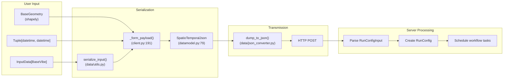

**Key transformations:**
1. **Geometry conversion**: Shapely `BaseGeometry` → GeoJSON ([src/vibe_core/vibe_core/client.py:233-238]())
2. **Serialization**: Python objects → JSON via `dump_to_json()` ([src/vibe_core/vibe_core/client.py:608-609]())
3. **Type handling**: `BaseVibe` objects serialized via STAC format

**Sources:** [src/vibe_core/vibe_core/client.py:191-239]()

### Output Data Processing

```mermaid
graph LR
    subgraph "Server Storage"
        CompressOutput["Compress with zlib<br/>encode() (datamodel.py:329)"]
        Base64["Base64 encode"]
        StoreRun["Store in RunConfig.output"]
    end
    
    subgraph "Client Retrieval"
        GetRun["describe_run(run_id)"]
        Decode["decode() (datamodel.py:343)"]
        ParseJson["json.loads()"]
    end
    
    subgraph "Conversion"
        DeserializeStac["deserialize_stac()"]
        StacConverter["StacConverter.from_stac_item()"]
        BaseVibeDict["BaseVibeDict<br/>(Dict[str, BaseVibe])"]
    end
    
    CompressOutput --> Base64
    Base64 --> StoreRun
    
    StoreRun --> GetRun
    GetRun --> Decode
    Decode --> ParseJson
    
    ParseJson --> DeserializeStac
    DeserializeStac --> StacConverter
    StacConverter --> BaseVibeDict
```

**Output encoding/decoding:**
- **Encoding**: `zlib.compress()` → `base64.encode()` ([src/vibe_core/vibe_core/datamodel.py:329-340]())
- **Decoding**: `base64.decode()` → `zlib.decompress()` ([src/vibe_core/vibe_core/datamodel.py:343-352]())
- **STAC conversion**: JSON → `BaseVibe` objects via `StacConverter` ([src/vibe_core/vibe_core/client.py:779-780]())

**Sources:** [src/vibe_core/vibe_core/datamodel.py:329-352](), [src/vibe_core/vibe_core/client.py:762-780]()

---

## Execution Model

### Workflow Run Lifecycle

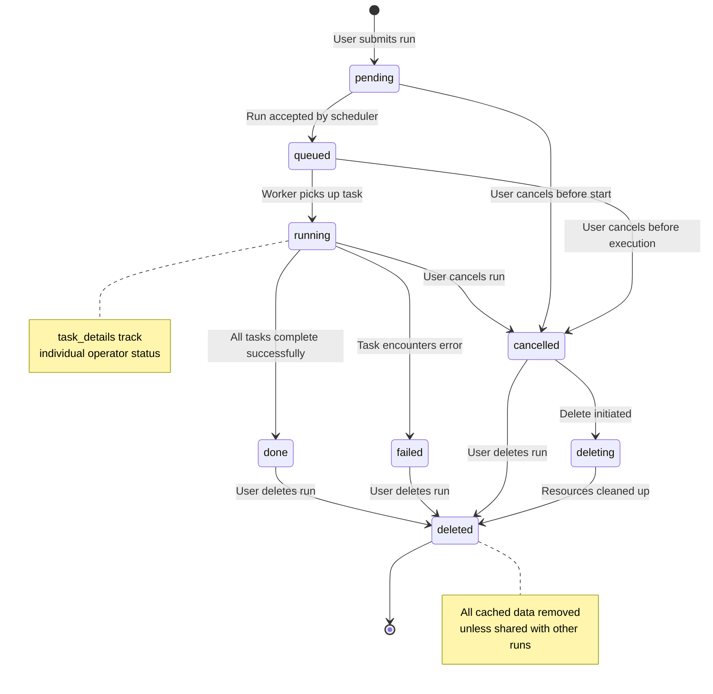

**State transitions:**
- `pending` → `queued`: Scheduler accepts run
- `queued` → `running`: First task begins execution
- `running` → `done`/`failed`: All tasks complete/error occurs
- Any state → `cancelled`: User calls `cancel_run()` ([src/vibe_core/vibe_core/client.py:340-362]())
- Terminal states → `deleted`: User calls `delete_run()` ([src/vibe_core/vibe_core/client.py:364-389]())

**Blocking methods:**
- `block_until_complete()`: Wait for `done` or `failed` ([src/vibe_core/vibe_core/client.py:953-973]())
- `block_until_cancelled()`: Wait for `cancelled` ([src/vibe_core/vibe_core/client.py:933-951]())
- `block_until_deleted()`: Wait for `deleted` ([src/vibe_core/vibe_core/client.py:975-993]())

**Sources:** [src/vibe_core/vibe_core/datamodel.py:128-164](), [src/vibe_core/vibe_core/client.py:807-993]()

### Task Execution Flow

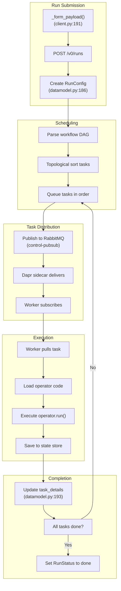

**Key execution concepts:**
- **DAG-based workflows**: Tasks organized as directed acyclic graphs
- **Topological execution**: Dependencies determine task order
- **Distributed workers**: Multiple operator pods execute tasks concurrently
- **State persistence**: Task outputs stored in Redis for downstream tasks
- **Task details tracking**: Each task has individual `RunDetails` ([src/vibe_core/vibe_core/datamodel.py:168-183]())

**Sources:** [src/vibe_core/vibe_core/client.py:191-612](), [src/vibe_core/vibe_core/datamodel.py:168-196]()

---

## Configuration and Service Discovery

### Service URL Resolution

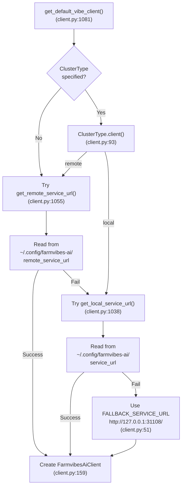

**Configuration paths:**
- Remote cluster: `~/.config/farmvibes-ai/remote_service_url` ([src/vibe_core/vibe_core/client.py:69-75]())
- Local cluster: `~/.config/farmvibes-ai/service_url` ([src/vibe_core/vibe_core/client.py:63-67]())
- Fallback URL: `http://127.0.0.1:31108/` ([src/vibe_core/vibe_core/client.py:51-55]())

**ClusterType enum:**
- `ClusterType.local`: Connect to local k3d cluster
- `ClusterType.remote`: Connect to remote AKS cluster

**Sources:** [src/vibe_core/vibe_core/client.py:51-104](), [src/vibe_core/vibe_core/client.py:1038-1104]()

---

## Summary

The FarmVibes.AI architecture is characterized by:

1. **Client-Server Model**: Python SDK (`FarmvibesAiClient`) communicates with REST API
2. **Microservices on Kubernetes**: Containerized operators with Dapr sidecars
3. **Type-Safe Data Model**: `BaseVibe` hierarchy with automatic registry
4. **Stateful Execution**: `RunConfig` and `RunStatus` track workflow lifecycle
5. **Distributed Messaging**: RabbitMQ pub/sub for task distribution
6. **Persistent State**: Redis for operator state and caching
7. **Modular Package**: `vibe_core` provides reusable client and data model components

This architecture enables scalable, distributed execution of geospatial ML workflows while providing a simple Python interface for users.

---

# Page: vibe_core Package

# vibe_core Package

<details>
<summary>Relevant source files</summary>

The following files were used as context for generating this wiki page:

- [docs/requirements.txt](docs/requirements.txt)
- [resources/vm/setup_farmvibes_ai_vm.sh](resources/vm/setup_farmvibes_ai_vm.sh)
- [src/vibe_core/pyproject.toml](src/vibe_core/pyproject.toml)
- [src/vibe_core/setup.py](src/vibe_core/setup.py)

</details>


## Purpose and Scope

The `vibe_core` package is the foundational Python package for the FarmVibes.AI platform. It provides the client SDK, data models, workflow management APIs, and command-line interface that enable users to interact with the distributed workflow execution system. This package is distributed as `vibe-core` on PyPI and serves as the primary interface for programmatic access to FarmVibes.AI capabilities.

This document covers the package structure, dependencies, build system, and key module organization. For detailed documentation on specific components:
- Data models and the BaseVibe hierarchy: see [Data Models](#3.3)
- Client API usage and workflow submission: see [Client API](#3.4)
- Workflow monitoring and debugging: see [Monitoring and Debugging](#5.3)
- Infrastructure deployment: see [Infrastructure and Deployment](#3.2)

**Sources:** [src/vibe_core/pyproject.toml:19-59]()

---

## Package Structure and Key Modules

The `vibe_core` package is organized into several core modules that provide distinct functionality layers. The following diagram maps the high-level architectural concepts to concrete code modules within the package:

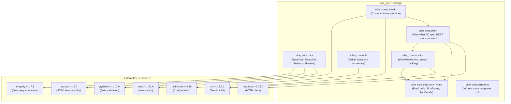

**Sources:** [src/vibe_core/pyproject.toml:41-52](), [src/vibe_core/pyproject.toml:58-59]()

---

## Package Metadata and Distribution

The `vibe_core` package is configured using modern Python packaging standards with a declarative `pyproject.toml` file. The following table summarizes the package metadata:

| Property | Value | Description |
|----------|-------|-------------|
| Package Name | `vibe-core` | PyPI distribution name |
| Version | `0.0.1` | Current package version |
| Python Requirement | `>=3.8` | Minimum Python version |
| License | MIT | Open source license |
| Build System | `setuptools>=42, wheel` | Build backend requirements |
| Entry Point | `farmvibes-ai` | CLI command name |
| Maintainer | Microsoft FarmVibes.AI Team | Contact: terravibes@microsoft.com |

The package includes Terraform infrastructure files as package data, allowing the client to deploy local and remote Kubernetes clusters programmatically.

**Sources:** [src/vibe_core/pyproject.toml:19-33](), [src/vibe_core/pyproject.toml:58-59]()

---

## Dependencies

The package declares runtime dependencies that support different aspects of its functionality:

### Core Dependencies

| Dependency | Version | Purpose |
|------------|---------|---------|
| `pydantic` | ~=1.10.0 | Data validation and serialization for all data models |
| `pystac` | ~=1.6.0 | STAC (SpatioTemporal Asset Catalog) item creation and parsing |
| `requests` | ~=2.32.0 | HTTP client for REST API communication with the workflow engine |
| `shapely` | >=1.7.1 | Geometric operations on spatial data (geometries, bounding boxes) |
| `jsonschema` | ~=4.6 | JSON schema validation for workflow definitions |
| `hydra-zen` | ~=0.10 | Configuration management and validation |
| `rich` | ~=13.7.1 | Terminal UI components (progress bars, tables) for monitoring |
| `msal` | ==1.22.0 | Microsoft Authentication Library for Azure integration |
| `certifi` | ~=2023.7.22 | SSL certificate bundle for secure connections |
| `strenum` | ~=0.4.7 | String-based enumerations for type-safe constants |

### Optional Dependencies

| Dependency Group | Dependencies | Purpose |
|------------------|--------------|---------|
| `test` | `orjson~=3.9.15` | Fast JSON serialization for testing |

**Sources:** [src/vibe_core/pyproject.toml:41-52](), [src/vibe_core/pyproject.toml:61-64]()

---

## Build and Packaging System

The `vibe_core` package uses a modern, declarative build system based on PEP 517/518 standards. The build process is configured entirely through `pyproject.toml`, with `setup.py` serving as a minimal entry point.

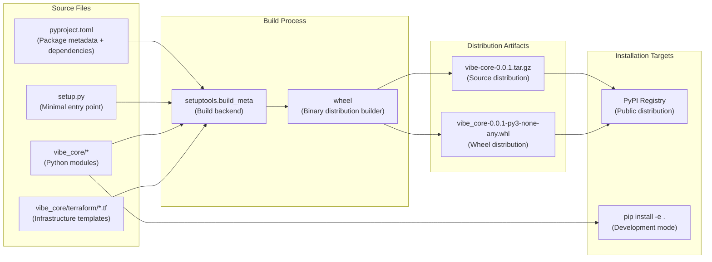

The build system configuration specifies:
- **Build backend**: `setuptools.build_meta` [src/vibe_core/pyproject.toml:1-6]()
- **Package discovery**: Automatic discovery with `tests*` exclusion [src/vibe_core/pyproject.toml:8-11]()
- **Package data**: Includes Terraform files (`vibe_core/terraform/*.tf`) [src/vibe_core/pyproject.toml:14-17]()
- **Entry point**: CLI command `farmvibes-ai` maps to `vibe_core.cli.main:main` [src/vibe_core/pyproject.toml:58-59]()

**Sources:** [src/vibe_core/pyproject.toml:1-17](), [src/vibe_core/setup.py:1-8]()

---

## Module Organization

The package's internal structure separates concerns across specialized modules. The following diagram shows the conceptual mapping from user-facing APIs to internal module responsibilities:

```mermaid
graph TB
    subgraph "User Entry Points"
        NotebookCode["Notebook / Script<br/>(User Python code)"]
        CLICommand["farmvibes-ai command<br/>(Terminal usage)"]
    end
    
    subgraph "Client Layer - vibe_core.client"
        FarmvibesAiClient["FarmvibesAiClient<br/>(Main SDK class)"]
        RESTClient["REST client methods<br/>(HTTP communication)"]
        MonitorFactory["Monitor factory<br/>(Creates WorkflowMonitor)"]
    end
    
    subgraph "Configuration - vibe_core.data.core_types"
        RunConfigClass["RunConfig<br/>(Workflow parameters)"]
        RunStatusEnum["RunStatus<br/>(queued, running, done, failed)"]
        RunDetailsClass["RunDetails<br/>(Execution metadata)"]
    end
    
    subgraph "Data Models - vibe_core.data"
        BaseVibeClass["BaseVibe<br/>(Root data model)"]
        DataVibeClass["DataVibe<br/>(Time-bound data)"]
        AssetVibeClass["AssetVibe<br/>(With file assets)"]
        ProductClasses["Product types<br/>(SentinelProduct, LandsatProduct, etc.)"]
        RasterClasses["Raster types<br/>(CategoricalRaster, CloudRaster, etc.)"]
    end
    
    subgraph "Monitoring - vibe_core.monitor"
        WorkflowMonitorClass["WorkflowMonitor<br/>(Progress tracking)"]
        StatusDisplay["Rich terminal UI<br/>(Tables, progress bars)"]
    end
    
    subgraph "CLI - vibe_core.cli"
        CLIMain["main()<br/>(Entry point)"]
        CLICommands["Subcommands<br/>(install, list, submit, etc.)"]
    end
    
    NotebookCode --> FarmvibesAiClient
    CLICommand --> CLIMain
    
    FarmvibesAiClient --> RESTClient
    FarmvibesAiClient --> MonitorFactory
    FarmvibesAiClient --> RunConfigClass
    
    RESTClient --> RunDetailsClass
    MonitorFactory --> WorkflowMonitorClass
    
    WorkflowMonitorClass --> StatusDisplay
    WorkflowMonitorClass --> RunStatusEnum
    
    CLIMain --> CLICommands
    CLICommands --> FarmvibesAiClient
    
    FarmvibesAiClient -.->|"Returns"| DataVibeClass
    DataVibeClass --> BaseVibeClass
    AssetVibeClass --> DataVibeClass
    ProductClasses --> AssetVibeClass
    RasterClasses --> AssetVibeClass
```

**Sources:** [src/vibe_core/pyproject.toml:41-52]()

---

## Command-Line Interface

The package provides a command-line interface through the `farmvibes-ai` entry point. This is configured as a console script in the package metadata:

```
[project.scripts]
farmvibes-ai = "vibe_core.cli.main:main"
```

When the package is installed via `pip install vibe-core`, the `farmvibes-ai` command becomes available in the user's shell. The CLI module at [vibe_core/cli/main.py]() implements subcommands for:
- Cluster installation and management
- Workflow listing and submission
- Run status monitoring
- Configuration management

The CLI uses the `rich` library for enhanced terminal output, providing formatted tables and progress indicators.

**Sources:** [src/vibe_core/pyproject.toml:58-59]()

---

## Installation Methods

The `vibe_core` package can be installed through multiple methods depending on the use case:

### Standard Installation

```bash
pip install vibe-core
```

This installs the package from PyPI along with all required dependencies.

### Development Installation

```bash
cd src/vibe_core
pip install -e .
```

The `-e` flag installs the package in editable mode, allowing code changes to take effect without reinstallation.

### With Test Dependencies

```bash
pip install vibe-core[test]
```

This installs additional dependencies required for testing, specifically `orjson` for fast JSON operations.

**Sources:** [src/vibe_core/pyproject.toml:61-64]()

---

## Infrastructure Files

The package includes Terraform infrastructure templates as package data. These `.tf` files are located in `vibe_core/terraform/` and are distributed with the package to enable programmatic cluster deployment:

```
[options.package_data]
vibe_core = ["terraform/*.tf"]
```

This allows the client SDK to access infrastructure-as-code templates directly from the installed package, supporting both local (k3d) and remote (AKS) Kubernetes cluster provisioning. The Terraform integration is detailed in [Infrastructure and Deployment](#3.2).

**Sources:** [src/vibe_core/pyproject.toml:14-17]()

---

## Package URLs and Resources

The package metadata defines several URLs for user reference:

| Resource | URL | Purpose |
|----------|-----|---------|
| Homepage | https://github.com/microsoft/farmvibes-ai | Main repository |
| Bug Tracker | https://github.com/microsoft/farmvibes-ai/issues | Issue reporting |

These are included in the PyPI distribution metadata and displayed on the package's PyPI page.

**Sources:** [src/vibe_core/pyproject.toml:54-56]()

---

## Relationship to Documentation System

The `vibe_core` package is documented using Sphinx, with documentation build dependencies specified in a separate requirements file. The documentation system uses:

- **Sphinx** (7.1.2): Core documentation generator
- **sphinx_rtd_theme** (2.0.0): ReadTheDocs theme for consistent styling
- **myst_parser** (2.0.0): Markdown support in documentation
- **sphinx_autodoc_typehints** (2.0.1): Automatic type hint documentation
- **sphinxcontrib.mermaid** (0.8.1): Mermaid diagram rendering
- **sphinxcontrib-openapi** (0.8.4): OpenAPI specification rendering

The documentation build process is covered in [Documentation System](#7.2).

**Sources:** [docs/requirements.txt:1-7]()

---

## Summary

The `vibe_core` package serves as the foundational layer for FarmVibes.AI, providing:

1. **Client SDK**: Programmatic access to workflow execution via `FarmvibesAiClient`
2. **Data Models**: Pydantic-based models for spatial-temporal data with STAC integration
3. **Monitoring**: Rich terminal UI for real-time workflow progress tracking
4. **CLI**: Command-line interface for cluster management and workflow operations
5. **Infrastructure**: Embedded Terraform templates for deployment automation

The package is built using modern Python packaging standards (PEP 517/518), distributed via PyPI, and integrates with the broader FarmVibes.AI ecosystem through REST API communication with the Kubernetes-based workflow execution engine.

---

# Page: Infrastructure and Deployment

# Infrastructure and Deployment

<details>
<summary>Relevant source files</summary>

The following files were used as context for generating this wiki page:

- [resources/vm/setup_farmvibes_ai_vm.sh](resources/vm/setup_farmvibes_ai_vm.sh)
- [src/vibe_core/setup.py](src/vibe_core/setup.py)
- [src/vibe_core/vibe_core/terraform/local/modules/kubernetes/dapr.tf](src/vibe_core/vibe_core/terraform/local/modules/kubernetes/dapr.tf)
- [src/vibe_core/vibe_core/terraform/local/modules/kubernetes/providers.tf](src/vibe_core/vibe_core/terraform/local/modules/kubernetes/providers.tf)
- [src/vibe_core/vibe_core/terraform/local/modules/kubernetes/rabbitmq.tf](src/vibe_core/vibe_core/terraform/local/modules/kubernetes/rabbitmq.tf)
- [src/vibe_core/vibe_core/terraform/local/modules/kubernetes/redis.tf](src/vibe_core/vibe_core/terraform/local/modules/kubernetes/redis.tf)

</details>


## Purpose and Scope

This document describes the infrastructure architecture and deployment mechanisms for FarmVibes.AI. It covers the Kubernetes-based deployment system, Dapr integration for distributed computing, Terraform infrastructure-as-code modules, and the setup process for both local and remote clusters.

For information about the higher-level system architecture, see [Architecture](#3). For details about the Python client and workflow execution, see [Client API](#3.4) and [Workflows](#4). For practical deployment instructions, see [Getting Started](#2).

## Deployment Architecture Overview

FarmVibes.AI uses a containerized, Kubernetes-based architecture with Dapr for service orchestration. The platform supports two primary deployment modes:

| Deployment Mode | Use Case | Kubernetes Distribution | Resource Requirements |
|----------------|----------|------------------------|----------------------|
| **Local** | Development, testing, small workloads | k3d (lightweight K8s) | Laptop/workstation with Docker |
| **Remote** | Production, large-scale processing | Azure Kubernetes Service (AKS) | Cloud infrastructure |

Both modes use identical Terraform modules and Helm charts, ensuring deployment consistency across environments.

```mermaid
graph TB
    subgraph "Deployment Targets"
        LocalDev["Local Development<br/>k3d Cluster"]
        RemoteProd["Remote Production<br/>Azure AKS"]
    end
    
    subgraph "Infrastructure as Code"
        TerraformModules["Terraform Modules<br/>terraform/local/modules"]
        KubernetesModule["kubernetes Module<br/>providers.tf, dapr.tf"]
    end
    
    subgraph "Kubernetes Resources"
        Namespaces["Namespaces<br/>dapr-system<br/>farmvibes"]
        HelmReleases["Helm Releases<br/>dapr, redis, rabbitmq"]
    end
    
    subgraph "Dapr Components"
        PubSub["control-pubsub<br/>RabbitMQ Component"]
        StateStore["statestore<br/>Redis Component"]
        Resiliency["worker-resiliency<br/>Resiliency Policy"]
        AppConfig["appconfig<br/>Configuration"]
    end
    
    subgraph "Supporting Services"
        Redis["redis-master<br/>State Storage"]
        RabbitMQ["rabbitmq<br/>Message Queue"]
    end
    
    TerraformModules --> KubernetesModule
    KubernetesModule --> LocalDev
    KubernetesModule --> RemoteProd
    
    LocalDev --> Namespaces
    RemoteProd --> Namespaces
    
    Namespaces --> HelmReleases
    HelmReleases --> Redis
    HelmReleases --> RabbitMQ
    HelmReleases --> PubSub
    HelmReleases --> StateStore
    HelmReleases --> Resiliency
    HelmReleases --> AppConfig
    
    PubSub --> RabbitMQ
    StateStore --> Redis
```

**Sources:** [src/vibe_core/vibe_core/terraform/local/modules/kubernetes/providers.tf](), [src/vibe_core/vibe_core/terraform/local/modules/kubernetes/dapr.tf]()

## Terraform Module Structure

The infrastructure is defined using Terraform modules located in `src/vibe_core/vibe_core/terraform/local/modules/kubernetes/`. The module system uses three primary providers to manage Kubernetes resources:

```mermaid
graph LR
    subgraph "Terraform Providers"
        KubernetesProvider["kubernetes provider<br/>hashicorp/kubernetes<br/>version >= 2.16.0"]
        HelmProvider["helm provider<br/>hashicorp/helm<br/>version >= 2.7.1"]
        KubectlProvider["kubectl provider<br/>gavinbunney/kubectl<br/>version >= 1.7.0"]
    end
    
    subgraph "Configuration"
        ConfigPath["kubernetes_config_path<br/>var"]
        ConfigContext["kubernetes_config_context<br/>var"]
        KubeLogin["kubelogin<br/>Authentication"]
    end
    
    subgraph "Resource Types"
        K8sResources["Kubernetes Resources<br/>Namespaces, Services"]
        HelmCharts["Helm Charts<br/>dapr, redis, rabbitmq"]
        CustomResources["Custom Resources<br/>Dapr Components"]
    end
    
    ConfigPath --> KubernetesProvider
    ConfigContext --> KubernetesProvider
    ConfigPath --> HelmProvider
    ConfigContext --> HelmProvider
    ConfigPath --> KubectlProvider
    ConfigContext --> KubectlProvider
    
    KubeLogin --> KubernetesProvider
    
    KubernetesProvider --> K8sResources
    HelmProvider --> HelmCharts
    KubectlProvider --> CustomResources
```

The `providers.tf` file [src/vibe_core/vibe_core/terraform/local/modules/kubernetes/providers.tf:4-21]() declares the required providers and versions. Each provider is configured to use the same kubeconfig path and context:

- **kubernetes provider**: Manages core Kubernetes resources (namespaces, services, config maps)
- **helm provider**: Deploys Helm charts for Dapr, Redis, and RabbitMQ
- **kubectl provider**: Applies Dapr custom resource definitions (CRDs)

The providers support Azure authentication via `kubelogin` [src/vibe_core/vibe_core/terraform/local/modules/kubernetes/providers.tf:27-37](), enabling seamless integration with Azure Kubernetes Service.

**Sources:** [src/vibe_core/vibe_core/terraform/local/modules/kubernetes/providers.tf]()

## Dapr Installation and Configuration

Dapr (Distributed Application Runtime) is installed in the `dapr-system` namespace using the official Helm chart. The `dapr.tf` module manages the complete Dapr lifecycle:

| Component | Type | Purpose |
|-----------|------|---------|
| `kubernetesdaprnamespace` | Kubernetes Namespace | Isolates Dapr system components |
| `dapr` | Helm Release | Installs Dapr runtime v1.13.3 |
| `control-pubsub` | Dapr Component | RabbitMQ pub/sub for workflow orchestration |
| `statestore` | Dapr Component | Redis state storage for actor state |
| `worker-resiliency` | Dapr Resiliency | Retry policies for worker operations |
| `appconfig` | Dapr Configuration | Enables resiliency features |

### Dapr Helm Release

The Dapr Helm chart [src/vibe_core/vibe_core/terraform/local/modules/kubernetes/dapr.tf:10-29]() is configured with:

- **watchInterval**: 30 seconds for operator polling
- **enable-ha**: High availability mode enabled

```mermaid
graph TB
    subgraph "Dapr Installation Flow"
        Namespace["kubernetes_namespace<br/>dapr-system"]
        HelmChart["helm_release.dapr<br/>chart: dapr<br/>version: 1.13.3"]
    end
    
    subgraph "Dapr Components Creation"
        PubSubManifest["kubectl_manifest<br/>control-pubsub"]
        StateStoreManifest["kubectl_manifest<br/>statestore"]
        ResiliencyManifest["kubectl_manifest<br/>worker-resiliency"]
        ConfigManifest["kubectl_manifest<br/>appconfig"]
    end
    
    subgraph "Dependencies"
        RabbitMQService["data.kubernetes_service<br/>rabbitmq"]
        RedisService["data.kubernetes_service<br/>redis-master"]
    end
    
    Namespace --> HelmChart
    HelmChart --> PubSubManifest
    HelmChart --> StateStoreManifest
    HelmChart --> ResiliencyManifest
    HelmChart --> ConfigManifest
    
    RabbitMQService --> PubSubManifest
    RedisService --> StateStoreManifest
    StateStoreManifest --> ResiliencyManifest
```

**Sources:** [src/vibe_core/vibe_core/terraform/local/modules/kubernetes/dapr.tf:1-139]()

## Dapr Component Configuration

### control-pubsub Component

The `control-pubsub` component [src/vibe_core/vibe_core/terraform/local/modules/kubernetes/dapr.tf:31-69]() configures RabbitMQ as the pub/sub message broker:

```yaml
apiVersion: dapr.io/v1alpha1
kind: Component
metadata:
  name: control-pubsub
  namespace: ${var.namespace}
spec:
  type: pubsub.rabbitmq
  version: v1
```

Key configuration parameters:

| Parameter | Value | Purpose |
|-----------|-------|---------|
| `protocol` | `amqp` | AMQP protocol for messaging |
| `hostname` | `rabbitmq.${var.namespace}.svc.cluster.local` | Service discovery within cluster |
| `port` | `5672` | Standard AMQP port |
| `backOffMaxRetries` | `-1` | Unlimited retries for reliability |
| `publisherConfirm` | `true` | Confirms message delivery |
| `requeueInFailure` | `true` | Re-queues failed messages |
| `deliveryMode` | `2` | Persistent message storage |
| `prefetchCount` | `0` | No prefetch limit |
| `deletedWhenUnused` | `false` | Queues persist when idle |

The password is sourced from a Kubernetes secret `rabbitmq` with key `rabbitmq-password` [src/vibe_core/vibe_core/terraform/local/modules/kubernetes/dapr.tf:48-51]().

### statestore Component

The `statestore` component [src/vibe_core/vibe_core/terraform/local/modules/kubernetes/dapr.tf:71-95]() configures Redis for Dapr actor state management:

```yaml
apiVersion: dapr.io/v1alpha1
kind: Component
metadata:
  name: statestore
  namespace: ${var.namespace}
spec:
  type: state.redis
  version: v1
```

Configuration:

| Parameter | Value | Purpose |
|-----------|-------|---------|
| `redisHost` | `redis-master:6379` | Redis master service endpoint |
| `actorStateStore` | `true` | Enables actor state storage |
| `keyPrefix` | `none` | No key prefix applied |

The password references the `redis` secret with key `redis-password` [src/vibe_core/vibe_core/terraform/local/modules/kubernetes/dapr.tf:84-87]().

### worker-resiliency Policy

The `worker-resiliency` policy [src/vibe_core/vibe_core/terraform/local/modules/kubernetes/dapr.tf:97-123]() defines retry and timeout behavior for workflow operators:

```yaml
apiVersion: dapr.io/v1alpha1
kind: Resiliency
metadata:
  name: worker-resiliency
scopes:
  - terravibes-worker
spec:
  policies:
    timeouts:
      opExecution: 3h
    retries:
      workerRetry:
        policy: exponential
        maxInterval: 60s
        maxRetries: -1
  targets:
    components:
      control-pubsub:
        inbound:
          retry: "workerRetry"
          timeout: "opExecution"
```

Key features:

- **Timeout**: 3-hour execution limit per operator (must exceed longest individual operation)
- **Retry Policy**: Exponential backoff with 60-second maximum interval
- **Max Retries**: Unlimited (`-1`) for fault tolerance
- **Scope**: Applied to `terravibes-worker` actors
- **Target**: Applied to inbound messages from `control-pubsub`

### appconfig Configuration

The `appconfig` resource [src/vibe_core/vibe_core/terraform/local/modules/kubernetes/dapr.tf:125-139]() enables the Resiliency feature flag:

```yaml
apiVersion: dapr.io/v1alpha1
kind: Configuration
metadata:
  name: appconfig
  namespace: ${var.namespace}
spec:
  features:
    - name: Resiliency
      enabled: true
```

**Sources:** [src/vibe_core/vibe_core/terraform/local/modules/kubernetes/dapr.tf:31-139]()

## Redis State Store

Redis is deployed via Helm from the Bitnami registry [src/vibe_core/vibe_core/terraform/local/modules/kubernetes/redis.tf:4-29](). The configuration optimizes for state storage rather than persistence:

```mermaid
graph LR
    subgraph "Redis Deployment"
        HelmRelease["helm_release.redis<br/>chart: redis<br/>registry: bitnami"]
        ConfigParams["Configuration<br/>appendonly: no<br/>port: 6379"]
    end
    
    subgraph "Redis Components"
        Master["redis-master<br/>Service<br/>Port 6379"]
        NoReplicas["replica.replicaCount: 0<br/>Single instance"]
    end
    
    subgraph "Data Sources"
        ServiceData["data.kubernetes_service.redis<br/>Service Discovery"]
    end
    
    HelmRelease --> ConfigParams
    ConfigParams --> Master
    ConfigParams --> NoReplicas
    Master --> ServiceData
```

Configuration highlights:

| Parameter | Value | Rationale |
|-----------|-------|-----------|
| `commonConfiguration` | `appendonly no` | Disables AOF persistence for performance |
| `master.containerPort` | `6379` | Standard Redis port |
| `replica.replicaCount` | `0` | No replication (single master) |
| `image.tag` | `var.redis_image_tag` | Configurable Redis version |

The `data.kubernetes_service.redis` resource [src/vibe_core/vibe_core/terraform/local/modules/kubernetes/redis.tf:31-38]() provides service discovery for other components to reference the `redis-master` service.

**Sources:** [src/vibe_core/vibe_core/terraform/local/modules/kubernetes/redis.tf]()

## RabbitMQ Message Broker

RabbitMQ is deployed via Helm from the Bitnami registry [src/vibe_core/vibe_core/terraform/local/modules/kubernetes/rabbitmq.tf:4-53](). The configuration optimizes for workflow message processing:

```mermaid
graph TB
    subgraph "RabbitMQ Deployment"
        HelmRelease["helm_release.rabbitmq<br/>chart: rabbitmq<br/>registry: bitnami"]
    end
    
    subgraph "Port Configuration"
        AMQP["containerPorts.amqp<br/>5672"]
        AMQPTls["containerPorts.amqpTls<br/>5671"]
        Dist["containerPorts.dist<br/>25672"]
        Manager["containerPorts.manager<br/>15672"]
        EPMD["containerPorts.epmd<br/>4369"]
        Metrics["containerPorts.metrics<br/>9419"]
    end
    
    subgraph "Erlang Configuration"
        ExtraEnv["RABBITMQ_SERVER_ADDITIONAL_ERL_ARGS<br/>consumer_timeout: 10800000 ms"]
    end
    
    subgraph "Deployment Config"
        SingleReplica["replica.replicaCount: 1<br/>Single instance"]
    end
    
    subgraph "Service Discovery"
        ServiceData["data.kubernetes_service.rabbitmq<br/>Service Lookup"]
    end
    
    HelmRelease --> AMQP
    HelmRelease --> AMQPTls
    HelmRelease --> Dist
    HelmRelease --> Manager
    HelmRelease --> EPMD
    HelmRelease --> Metrics
    HelmRelease --> ExtraEnv
    HelmRelease --> SingleReplica
    HelmRelease --> ServiceData
```

Port mappings:

| Port | Protocol | Purpose |
|------|----------|---------|
| 5672 | AMQP | Standard messaging protocol |
| 5671 | AMQP over TLS | Encrypted messaging |
| 25672 | Inter-node | Clustering distribution |
| 15672 | HTTP | Management UI |
| 4369 | EPMD | Erlang port mapper |
| 9419 | Prometheus | Metrics endpoint |

The critical configuration is the consumer timeout [src/vibe_core/vibe_core/terraform/local/modules/kubernetes/rabbitmq.tf:45-51]():

```hcl
extraEnvVars[0].name = "RABBITMQ_SERVER_ADDITIONAL_ERL_ARGS"
extraEnvVars[0].value = "-rabbit consumer_timeout 10800000"
```

This sets a 3-hour (10,800,000 milliseconds) consumer timeout, matching the Dapr resiliency timeout to prevent premature message cancellation during long-running workflow operations.

The `data.kubernetes_service.rabbitmq` resource [src/vibe_core/vibe_core/terraform/local/modules/kubernetes/rabbitmq.tf:55-62]() enables service discovery for the Dapr pub/sub component.

**Sources:** [src/vibe_core/vibe_core/terraform/local/modules/kubernetes/rabbitmq.tf]()

## VM Setup Prerequisites

For development environments, the `setup_farmvibes_ai_vm.sh` script [resources/vm/setup_farmvibes_ai_vm.sh]() automates prerequisite installation on Ubuntu systems:

```mermaid
graph TB
    subgraph "System Updates"
        AptUpdate["apt update<br/>Package Index"]
    end
    
    subgraph "Core Tools"
        Git["git<br/>Version Control"]
        Python["python3<br/>python-is-python3<br/>python3-pip"]
        Unzip["unzip<br/>Archive Extraction"]
    end
    
    subgraph "Docker Installation"
        DockerDeps["ca-certificates<br/>gnupg<br/>lsb-release"]
        DockerGPG["Docker GPG Key<br/>/etc/apt/keyrings/docker.gpg"]
        DockerRepo["Docker APT Repository<br/>sources.list.d/docker.list"]
        DockerEngine["docker-ce<br/>docker-ce-cli<br/>containerd.io"]
    end
    
    subgraph "Docker Configuration"
        UserGroup["usermod -aG docker<br/>$DOCKER_USER"]
        DockerUser["DOCKER_USER<br/>azureuser or $USER"]
    end
    
    subgraph "Git LFS"
        GitLFS["git-lfs<br/>Large File Storage"]
        LFSInstall["git lfs install<br/>git lfs pull"]
    end
    
    AptUpdate --> Git
    AptUpdate --> Python
    AptUpdate --> Unzip
    AptUpdate --> DockerDeps
    
    DockerDeps --> DockerGPG
    DockerGPG --> DockerRepo
    DockerRepo --> DockerEngine
    
    DockerEngine --> DockerUser
    DockerUser --> UserGroup
    
    Git --> GitLFS
    GitLFS --> LFSInstall
```

The script performs the following installation sequence:

1. **System Updates**: Updates package index [resources/vm/setup_farmvibes_ai_vm.sh:6-7]()
2. **Git Installation**: Installs version control [resources/vm/setup_farmvibes_ai_vm.sh:9-10]()
3. **Python Setup**: Installs Python 3 with pip, sets `python` alias [resources/vm/setup_farmvibes_ai_vm.sh:12-14]()
4. **Docker Dependencies**: Installs SSL certificates and GPG tools [resources/vm/setup_farmvibes_ai_vm.sh:16-17]()
5. **Docker Repository**: Adds official Docker APT repository [resources/vm/setup_farmvibes_ai_vm.sh:19-31]()
6. **Docker Engine**: Installs Docker CE, CLI, and containerd [resources/vm/setup_farmvibes_ai_vm.sh:38-40]()
7. **Docker Permissions**: Adds user to `docker` group for sudo-less access [resources/vm/setup_farmvibes_ai_vm.sh:42-50]()
8. **Git LFS**: Installs and initializes Large File Storage support [resources/vm/setup_farmvibes_ai_vm.sh:52-55]()

The script determines the Docker user automatically:
- If running as root: defaults to `azureuser` (Azure VM convention)
- Otherwise: uses current `$USER`
- Can be overridden via `$DOCKER_USER` environment variable

**Sources:** [resources/vm/setup_farmvibes_ai_vm.sh]()

## Deployment Execution Flow

The complete deployment process follows this sequence:

```mermaid
graph TB
    subgraph "Prerequisites"
        VMSetup["VM Setup Script<br/>Docker, Python, Git"]
        FarmVibesInstall["farmvibes-ai install<br/>CLI Command"]
    end
    
    subgraph "Terraform Initialization"
        TerraformInit["terraform init<br/>Download Providers"]
        TerraformPlan["terraform plan<br/>Preview Changes"]
    end
    
    subgraph "Infrastructure Creation"
        K8sCluster["Kubernetes Cluster<br/>k3d or AKS"]
        Namespaces["Create Namespaces<br/>dapr-system, farmvibes"]
    end
    
    subgraph "Component Deployment"
        DaprInstall["Install Dapr<br/>Helm Release"]
        RedisInstall["Install Redis<br/>Helm Release"]
        RabbitMQInstall["Install RabbitMQ<br/>Helm Release"]
    end
    
    subgraph "Dapr Configuration"
        PubSubComponent["Create control-pubsub<br/>kubectl manifest"]
        StateComponent["Create statestore<br/>kubectl manifest"]
        ResiliencyPolicy["Create worker-resiliency<br/>kubectl manifest"]
        DaprConfig["Create appconfig<br/>kubectl manifest"]
    end
    
    subgraph "Validation"
        HealthCheck["Health Checks<br/>Pod Status"]
        ServiceReady["Service Readiness<br/>Endpoint Tests"]
    end
    
    VMSetup --> FarmVibesInstall
    FarmVibesInstall --> TerraformInit
    TerraformInit --> TerraformPlan
    TerraformPlan --> K8sCluster
    
    K8sCluster --> Namespaces
    Namespaces --> DaprInstall
    Namespaces --> RedisInstall
    Namespaces --> RabbitMQInstall
    
    DaprInstall --> PubSubComponent
    RedisInstall --> StateComponent
    RabbitMQInstall --> PubSubComponent
    StateComponent --> ResiliencyPolicy
    DaprInstall --> DaprConfig
    
    PubSubComponent --> HealthCheck
    ResiliencyPolicy --> HealthCheck
    DaprConfig --> HealthCheck
    
    HealthCheck --> ServiceReady
```

Each step has explicit Terraform dependencies defined via `depends_on` clauses:

- `helm_release.dapr` depends on `kubernetes_namespace.kubernetesdaprnamespace` [src/vibe_core/vibe_core/terraform/local/modules/kubernetes/dapr.tf:28]()
- `kubectl_manifest.control-pubsub` depends on `helm_release.dapr` and `data.kubernetes_service.rabbitmq` [src/vibe_core/vibe_core/terraform/local/modules/kubernetes/dapr.tf:68]()
- `kubectl_manifest.statestore` depends on `helm_release.dapr` and `data.kubernetes_service.redis` [src/vibe_core/vibe_core/terraform/local/modules/kubernetes/dapr.tf:94]()
- `kubectl_manifest.resiliency-sidecar` depends on `helm_release.dapr` and `kubectl_manifest.statestore-sidecar` [src/vibe_core/vibe_core/terraform/local/modules/kubernetes/dapr.tf:122]()

These dependencies ensure components are created in the correct order and that required services are available before dependent resources are configured.

**Sources:** [src/vibe_core/vibe_core/terraform/local/modules/kubernetes/dapr.tf](), [src/vibe_core/vibe_core/terraform/local/modules/kubernetes/redis.tf](), [src/vibe_core/vibe_core/terraform/local/modules/kubernetes/rabbitmq.tf]()

## Local vs. Remote Deployment

Both deployment modes use the same Terraform modules but target different Kubernetes distributions:

### Local Deployment (k3d)

| Characteristic | Configuration |
|----------------|---------------|
| **Kubernetes Distribution** | k3d (K3s in Docker) |
| **Resource Allocation** | Shared with host system |
| **Networking** | Docker bridge network |
| **Storage** | Local filesystem mounts |
| **Use Cases** | Development, testing, small datasets |
| **Cost** | Free (local compute only) |

Local deployment connects to k3d via kubeconfig [src/vibe_core/vibe_core/terraform/local/modules/kubernetes/providers.tf:24-25]():

```hcl
provider "kubernetes" {
  config_path    = var.kubernetes_config_path
  config_context = var.kubernetes_config_context
}
```

The same configuration applies to `helm` [src/vibe_core/vibe_core/terraform/local/modules/kubernetes/providers.tf:40-44]() and `kubectl` [src/vibe_core/vibe_core/terraform/local/modules/kubernetes/providers.tf:47-51]() providers.

### Remote Deployment (Azure AKS)

| Characteristic | Configuration |
|----------------|---------------|
| **Kubernetes Distribution** | Azure Kubernetes Service (AKS) |
| **Resource Allocation** | Dedicated node pools |
| **Networking** | Azure Virtual Network |
| **Storage** | Azure Blob Storage |
| **Use Cases** | Production, large-scale processing |
| **Cost** | Pay-as-you-go (Azure pricing) |

Remote deployment adds Azure authentication via `kubelogin` [src/vibe_core/vibe_core/terraform/local/modules/kubernetes/providers.tf:27-37]():

```hcl
exec {
  api_version = "client.authentication.k8s.io/v1beta1"
  command     = "kubelogin"
  args = [
    "get-token",
    "--use-azurerm-env-vars",
    "|",
    "jq",
    ".status.token"
  ]
}
```

This enables integration with Azure Active Directory for cluster access control.

**Sources:** [src/vibe_core/vibe_core/terraform/local/modules/kubernetes/providers.tf]()

## Package Distribution

The `vibe_core` package is distributed as a Python wheel package. The `setup.py` file [src/vibe_core/setup.py]() uses a minimal configuration that delegates to `pyproject.toml`:

```python
from setuptools import setup

if __name__ == "__main__":
    setup()
```

This standard Python packaging approach allows:

1. **Installation via pip**: `pip install vibe-core`
2. **Editable installs**: `pip install -e .` for development
3. **Dependency management**: Declared in `pyproject.toml`
4. **Distribution**: Upload to PyPI for public access

The setup configuration includes the Terraform modules as package data, ensuring they are included in the distribution and accessible to the CLI installation commands.

**Sources:** [src/vibe_core/setup.py]()

## Summary

FarmVibes.AI's infrastructure uses a layered approach:

1. **Foundation**: Docker and Kubernetes provide container orchestration
2. **Messaging Layer**: Dapr abstracts RabbitMQ pub/sub and Redis state management
3. **Infrastructure as Code**: Terraform ensures reproducible deployments
4. **Flexibility**: Identical architecture for local development and cloud production

The key components interact through well-defined interfaces:

- **Workflow operators** publish messages to `control-pubsub`
- **Dapr actors** store state in `statestore`
- **Resiliency policies** ensure fault tolerance with exponential backoff
- **Kubernetes services** provide service discovery within the cluster

This architecture enables FarmVibes.AI to scale from laptop development to production workloads while maintaining consistent behavior across environments.

---

# Page: Data Models

# Data Models

<details>
<summary>Relevant source files</summary>

The following files were used as context for generating this wiki page:

- [src/vibe_core/vibe_core/data/__init__.py](src/vibe_core/vibe_core/data/__init__.py)
- [src/vibe_core/vibe_core/data/products.py](src/vibe_core/vibe_core/data/products.py)
- [src/vibe_core/vibe_core/datamodel.py](src/vibe_core/vibe_core/datamodel.py)

</details>


## Purpose and Scope

This document describes the data model architecture in FarmVibes.AI, including the type hierarchy, data representations, and serialization mechanisms used throughout the platform. The data models define how geospatial, temporal, and agricultural data is structured and passed between workflow operators.

For information about how these data models are used in client interactions, see [Client API](#3.4). For a complete reference of all available data types and their properties, see [Data Model Reference](#8.1). For information about how data models are used within workflow execution, see [Workflows](#4).

## Data Model Architecture

FarmVibes.AI uses a hierarchical type system centered around the `BaseVibe` class. All data types inherit from this base class, providing common functionality for identification, spatial/temporal metadata, and asset management. The architecture supports multiple levels of specialization for different data sources and processing stages.

```mermaid
graph TB
    BaseVibe["BaseVibe<br/>(vibe_core/data/core_types.py)"]
    
    DataVibe["DataVibe<br/>Adds geometry and time"]
    AssetVibe["AssetVibe<br/>File references"]
    
    Products["Product Types<br/>DemProduct, LandsatProduct, etc."]
    Rasters["Raster Types<br/>Raster, CategoricalRaster, etc."]
    SentinelTypes["Sentinel Types<br/>Sentinel1Product, Sentinel2Raster"]
    FarmTypes["Farm Data<br/>SeasonalFieldInformation, etc."]
    WeatherTypes["Weather Data<br/>Era5Product, Grib, etc."]
    
    Specialized["Specialized Types<br/>GHGFlux, CarbonOffsetInfo, etc."]
    
    BaseVibe --> DataVibe
    BaseVibe --> AssetVibe
    
    DataVibe --> Products
    DataVibe --> Rasters
    DataVibe --> SentinelTypes
    DataVibe --> FarmTypes
    DataVibe --> WeatherTypes
    DataVibe --> Specialized
    
    Products --> |"List/Download"| Rasters
    Rasters --> |"Processing"| Rasters
```

**Sources:** [src/vibe_core/vibe_core/data/__init__.py:1-93](), [src/vibe_core/vibe_core/data/core_types.py]()

## BaseVibe Hierarchy

### Core Base Classes

The type system has three fundamental base classes exported from [src/vibe_core/vibe_core/data/__init__.py:8-11]():

| Class | Purpose | Key Attributes |
|-------|---------|----------------|
| `BaseVibe` | Root of all data types | `id`, `assets`, `time_range`, `bbox` |
| `DataVibe` | Adds spatial/temporal context | `geometry`, inherits from `BaseVibe` |
| `AssetVibe` | Represents file references | `reference`, `type`, `id`, `path_or_url` |

```mermaid
classDiagram
    class BaseVibe {
        +str id
        +List~AssetVibe~ assets
        +TimeRange time_range
        +BBox bbox
        +gen_guid()
        +gen_hash_id()
    }
    
    class DataVibe {
        +GeometryCollection geometry
    }
    
    class AssetVibe {
        +str reference
        +str type
        +str id
        +str path_or_url
    }
    
    BaseVibe <|-- DataVibe
    BaseVibe <|-- AssetVibe
```

**Sources:** [src/vibe_core/vibe_core/data/__init__.py:7-32](), [src/vibe_core/vibe_core/data/core_types.py]()

### Supporting Data Structures

The data models use several supporting types for spatial and temporal representation:

| Type | Description | Defined In |
|------|-------------|------------|
| `BBox` | Bounding box with min/max coordinates | [core_types.py:11]() |
| `TimeRange` | Start and end datetime pair | [core_types.py:27]() |
| `GeometryCollection` | GeoJSON geometry wrapper | [core_types.py:20]() |
| `Point` | Spatial point coordinate | [core_types.py:24]() |

**Sources:** [src/vibe_core/vibe_core/data/__init__.py:11-32]()

## Product Types

Product types represent metadata about available data from external sources. They are the output of list-like operators and the input to download operators. Products contain information needed to retrieve data but do not contain the actual raster data itself.

```mermaid
graph LR
    DataVibe["DataVibe"]
    
    DemProduct["DemProduct<br/>tile_id, resolution, provider"]
    LandsatProduct["LandsatProduct<br/>tile_id, asset_map"]
    SentinelProduct["SentinelProduct<br/>tile_id, platform"]
    Era5Product["Era5Product<br/>item_id, var, cds_request"]
    ModisProduct["ModisProduct<br/>resolution"]
    NaipProduct["NaipProduct<br/>tile_id, year, resolution"]
    
    HerbieProduct["HerbieProduct<br/>model, product, lead_time_hours"]
    ChirpsProduct["ChirpsProduct<br/>url"]
    GEDIProduct["GEDIProduct<br/>product_name, orbits"]
    HansenProduct["HansenProduct<br/>asset_url, validation"]
    
    DataVibe --> DemProduct
    DataVibe --> LandsatProduct
    DataVibe --> SentinelProduct
    DataVibe --> Era5Product
    DataVibe --> ModisProduct
    DataVibe --> NaipProduct
    DataVibe --> HerbieProduct
    DataVibe --> ChirpsProduct
    DataVibe --> GEDIProduct
    DataVibe --> HansenProduct
```

**Sources:** [src/vibe_core/vibe_core/data/__init__.py:43-58](), [src/vibe_core/vibe_core/data/products.py:1-385]()

### Key Product Implementations

#### LandsatProduct

The `LandsatProduct` class includes an `asset_map` dictionary that tracks downloaded bands [src/vibe_core/vibe_core/data/products.py:59-98](). It provides methods:
- `add_downloaded_band()` - Associates a band name with an asset path
- `get_downloaded_band()` - Retrieves an asset by band name

#### HerbieProduct

The `HerbieProduct` represents weather forecast data with fields for model type, product type, forecast lead time, and GRIB2 index search patterns [src/vibe_core/vibe_core/data/products.py:347-365]().

#### HansenProduct

The `HansenProduct` includes URL validation and extraction methods for parsing tile names, versions, and layer names from Hansen Global Forest Change dataset URLs [src/vibe_core/vibe_core/data/products.py:204-337]().

**Sources:** [src/vibe_core/vibe_core/data/products.py:59-365]()

## Raster Types

Raster types represent actual geospatial imagery data. They extend `DataVibe` and contain asset references to the underlying GeoTIFF or other raster files.

```mermaid
graph TB
    Raster["Raster<br/>Base raster class"]
    
    CategoricalRaster["CategoricalRaster<br/>Discrete classification values"]
    CloudRaster["CloudRaster<br/>Cloud mask data"]
    DemRaster["DemRaster<br/>Elevation data"]
    
    LandsatRaster["LandsatRaster<br/>Landsat imagery"]
    ModisRaster["ModisRaster<br/>MODIS imagery"]
    NaipRaster["NaipRaster<br/>NAIP high-res imagery"]
    Sentinel1Raster["Sentinel1Raster<br/>SAR radar data"]
    Sentinel2Raster["Sentinel2Raster<br/>Multispectral optical"]
    
    GNATSGORaster["GNATSGORaster<br/>Soil data"]
    SamMaskRaster["SamMaskRaster<br/>Segmentation masks"]
    SpaceEyeRaster["SpaceEyeRaster<br/>Cloud-free composite"]
    
    RasterSequence["RasterSequence<br/>Time series collection"]
    RasterChunk["RasterChunk<br/>Spatial tile"]
    
    Raster --> CategoricalRaster
    Raster --> CloudRaster
    Raster --> DemRaster
    Raster --> LandsatRaster
    Raster --> ModisRaster
    Raster --> NaipRaster
    Raster --> Sentinel1Raster
    Raster --> Sentinel2Raster
    Raster --> GNATSGORaster
    Raster --> SamMaskRaster
    Raster --> SpaceEyeRaster
    
    Raster --> RasterSequence
    Raster --> RasterChunk
```

**Sources:** [src/vibe_core/vibe_core/data/__init__.py:59-73]()

### Specialized Raster Types

| Raster Type | Purpose | Use Case |
|-------------|---------|----------|
| `CategoricalRaster` | Discrete class values | Land cover classification, crop types |
| `CloudRaster` | Cloud mask information | Cloud detection and filtering |
| `RasterSequence` | Time series collection | Multi-temporal analysis |
| `RasterChunk` | Spatial tile | Distributed processing |
| `SpaceEyeRaster` | Cloud-free composite | Gap-filled imagery |
| `SamMaskRaster` | Segmentation output | Object detection masks |

**Sources:** [src/vibe_core/vibe_core/data/rasters.py](), [src/vibe_core/vibe_core/data/__init__.py:59-73]()

## Sentinel-Specific Types

Sentinel satellite data has dedicated type hierarchies due to its complexity and prevalence in the platform. These types handle both products and rasters for Sentinel-1 (radar) and Sentinel-2 (optical) data.

```mermaid
graph TB
    SentinelProduct["SentinelProduct<br/>Base for S1/S2 products"]
    
    S1Product["Sentinel1Product"]
    S2Product["Sentinel2Product<br/>processing_level"]
    
    DownloadedS1["DownloadedSentinel1Product"]
    DownloadedS2["DownloadedSentinel2Product"]
    TiledS1["TiledSentinel1Product"]
    
    S1Raster["Sentinel1Raster"]
    S2Raster["Sentinel2Raster"]
    S2CloudMask["Sentinel2CloudMask"]
    S2CloudProb["Sentinel2CloudProbability"]
    
    OrbitGroups["Orbit Group Types<br/>*RasterOrbitGroup, *CloudMaskOrbitGroup"]
    
    SentinelProduct --> S1Product
    SentinelProduct --> S2Product
    
    S1Product --> DownloadedS1
    S2Product --> DownloadedS2
    S1Product --> TiledS1
    
    S1Product -.-> S1Raster
    S2Product -.-> S2Raster
    S2Product -.-> S2CloudMask
    S2Product -.-> S2CloudProb
    
    S1Raster --> OrbitGroups
    S2Raster --> OrbitGroups
    S2CloudMask --> OrbitGroups
```

**Sources:** [src/vibe_core/vibe_core/data/__init__.py:74-90](), [src/vibe_core/vibe_core/data/sentinel.py]()

### Sentinel Processing Levels

The `S2ProcessingLevel` enum defines Sentinel-2 processing stages [src/vibe_core/vibe_core/data/sentinel.py]():
- L1C: Top-of-atmosphere reflectance
- L2A: Bottom-of-atmosphere (surface) reflectance

**Sources:** [src/vibe_core/vibe_core/data/__init__.py:74-90](), [src/vibe_core/vibe_core/data/sentinel.py]()

## Agricultural Data Types

Agricultural data types support farm management and carbon accounting workflows. These types are defined in [src/vibe_core/vibe_core/data/farm.py]().

```mermaid
graph LR
    SeasonalFieldInformation["SeasonalFieldInformation<br/>Crop and field info"]
    
    TillageInformation["TillageInformation<br/>Tillage practices"]
    FertilizerInformation["FertilizerInformation<br/>Fertilizer applications"]
    OrganicAmendmentInformation["OrganicAmendmentInformation<br/>Organic amendments"]
    HarvestInformation["HarvestInformation<br/>Harvest details"]
    
    ADMAgSeasonalFieldInput["ADMAgSeasonalFieldInput<br/>Azure Data Manager input"]
    ADMAgPrescriptionInput["ADMAgPrescriptionInput<br/>Prescription map input"]
    ADMAgPrescription["ADMAgPrescription<br/>Application prescription"]
    
    SeasonalFieldInformation --> TillageInformation
    SeasonalFieldInformation --> FertilizerInformation
    SeasonalFieldInformation --> OrganicAmendmentInformation
    SeasonalFieldInformation --> HarvestInformation
    
    ADMAgSeasonalFieldInput --> SeasonalFieldInformation
    ADMAgPrescriptionInput --> ADMAgPrescription
```

**Sources:** [src/vibe_core/vibe_core/data/__init__.py:33-42](), [src/vibe_core/vibe_core/data/farm.py]()

## Weather and Climate Data Types

Weather data types handle forecast and reanalysis products:

| Type | Data Source | Fields |
|------|-------------|--------|
| `Era5Product` | ERA5 Reanalysis | `item_id`, `var`, `cds_request` |
| `HerbieProduct` | Weather forecasts (HRRR, GFS) | `model`, `product`, `lead_time_hours`, `search_text` |
| `GfsForecast` | GFS model output | Forecast-specific metadata |
| `Grib` | GRIB file data | Weather variable data |
| `ChirpsProduct` | Precipitation data | `url` |

**Sources:** [src/vibe_core/vibe_core/data/__init__.py:92](), [src/vibe_core/vibe_core/data/products.py:101-365](), [src/vibe_core/vibe_core/data/weather.py]()

## Specialized Application Types

FarmVibes.AI includes specialized types for specific applications:

```mermaid
graph TB
    GHGProtocolVibe["GHGProtocolVibe<br/>GHG protocol accounting"]
    GHGFlux["GHGFlux<br/>Greenhouse gas flux"]
    CarbonOffsetInfo["CarbonOffsetInfo<br/>Carbon sequestration"]
    
    FoodVibe["FoodVibe<br/>Food product data"]
    FoodFeatures["FoodFeatures<br/>Nutritional features"]
    ProteinSequence["ProteinSequence<br/>Protein data"]
    
    DataSummaryStatistics["DataSummaryStatistics<br/>Statistical summaries"]
    TimeSeries["TimeSeries<br/>Time series data"]
    OrdinalTrendTest["OrdinalTrendTest<br/>Trend analysis"]
    RasterPixelCount["RasterPixelCount<br/>Pixel statistics"]
    
    ExternalReference["ExternalReference<br/>External data links"]
    ExternalReferenceList["ExternalReferenceList<br/>Reference collections"]
    
    ChipWindow["ChipWindow<br/>Image chips"]
    RasterIlluminance["RasterIlluminance<br/>Lighting conditions"]
```

**Sources:** [src/vibe_core/vibe_core/data/__init__.py:7-32](), [src/vibe_core/vibe_core/data/core_types.py]()

## Run Management Data Models

The run management models, defined in [src/vibe_core/vibe_core/datamodel.py](), handle workflow execution state and configuration.

```mermaid
graph TB
    RunBase["RunBase<br/>name, workflow, parameters"]
    
    RunConfigInput["RunConfigInput<br/>+ user_input"]
    RunConfig["RunConfig<br/>+ id, details, task_details"]
    RunConfigUser["RunConfigUser<br/>+ decoded output"]
    
    RunDetails["RunDetails<br/>start_time, end_time, status, reason"]
    RunStatus["RunStatus (Enum)<br/>pending, queued, running, done, failed"]
    
    SpatioTemporalJson["SpatioTemporalJson<br/>start_date, end_date, geojson"]
    
    MonitoredWorkflowRun["MonitoredWorkflowRun<br/>Monitor display data"]
    
    RunBase --> RunConfigInput
    RunConfigInput --> RunConfig
    RunConfig --> RunConfigUser
    
    RunConfig --> RunDetails
    RunDetails --> RunStatus
    
    RunConfigInput --> SpatioTemporalJson
```

**Sources:** [src/vibe_core/vibe_core/datamodel.py:1-353]()

### RunStatus Enum

The `RunStatus` enum defines workflow execution states [src/vibe_core/vibe_core/datamodel.py:128-165]():

| Status | Description |
|--------|-------------|
| `pending` | Run created but not started |
| `queued` | Run queued for execution |
| `running` | Run actively executing |
| `done` | Run completed successfully |
| `failed` | Run encountered an error |
| `cancelled` | Run was cancelled by user |
| `deleting` | Run is being deleted |
| `deleted` | Run has been deleted |

The `RunStatus.finished()` static method checks if a run has reached a terminal state (done, cancelled, or failed) [src/vibe_core/vibe_core/datamodel.py:148-165]().

**Sources:** [src/vibe_core/vibe_core/datamodel.py:128-165]()

### RunConfig and RunDetails

The `RunConfig` dataclass [src/vibe_core/vibe_core/datamodel.py:186-216]() contains:
- `id`: Unique run identifier (UUID)
- `details`: Overall run status and timing (RunDetails)
- `task_details`: Per-task status information (Dict[str, RunDetails])
- `spatio_temporal_json`: Spatial and temporal bounds
- `output`: Encoded workflow output

The `RunDetails` dataclass [src/vibe_core/vibe_core/datamodel.py:168-183]() tracks:
- Timing: `submission_time`, `start_time`, `end_time`
- Status: Current `status` from RunStatus enum
- Error information: `reason` string for failures
- Subtask information: Nested task status

**Sources:** [src/vibe_core/vibe_core/datamodel.py:168-216]()

### RunConfigUser

The `RunConfigUser` class extends `RunConfig` with a decoded output field for user consumption [src/vibe_core/vibe_core/datamodel.py:219-259](). The `from_runconfig()` class method converts a `RunConfig` to `RunConfigUser` by decoding the compressed output string.

**Sources:** [src/vibe_core/vibe_core/datamodel.py:219-259]()

## Data Type Utilities

### Type Identification

The data model system uses helper functions for generating identifiers [src/vibe_core/vibe_core/data/__init__.py:30-32]():

| Function | Purpose | Usage |
|----------|---------|-------|
| `gen_guid()` | Generate unique ID | New data instances |
| `gen_hash_id()` | Generate deterministic hash | Content-based identification |
| `gen_forecast_time_hash_id()` | Weather forecast hash | Forecast deduplication |

**Sources:** [src/vibe_core/vibe_core/data/__init__.py:30-32](), [src/vibe_core/vibe_core/data/core_types.py]()

### Serialization and Conversion

The `StacConverter` utility [src/vibe_core/vibe_core/data/__init__.py:91]() handles conversion between FarmVibes.AI data types and STAC (SpatioTemporal Asset Catalog) format for interoperability.

The run output encoding/decoding functions [src/vibe_core/vibe_core/datamodel.py:329-353]() compress workflow outputs:
- `encode()`: Compresses string data with zlib and base64 encodes it
- `decode()`: Reverses the compression and encoding

**Sources:** [src/vibe_core/vibe_core/data/__init__.py:91](), [src/vibe_core/vibe_core/datamodel.py:329-353]()

## Type Collections

### BaseVibeDict and OpIOType

The platform uses type aliases for collections of data objects:
- `BaseVibeDict`: Dictionary mapping strings to lists of BaseVibe objects
- `OpIOType`: Union type for operator inputs/outputs
- `TypeDictVibe`: Type information dictionary

These types enable operators to accept and return multiple data items organized by port names.

**Sources:** [src/vibe_core/vibe_core/data/__init__.py:10-29](), [src/vibe_core/vibe_core/data/core_types.py]()

### Additional Support Types

The data model system includes several specialized support types [src/vibe_core/vibe_core/data/__init__.py:12-29]():

| Type | Purpose |
|------|---------|
| `ChunkLimits` | Define spatial chunking boundaries |
| `RasterIlluminance` | Store illumination metadata |
| `AirbusPrice`, `AirbusProduct`, `AirbusRaster` | Airbus commercial imagery |
| `Region` | Named region with GeoJSON |
| `Message` | API message formatting |

**Sources:** [src/vibe_core/vibe_core/data/__init__.py:1-93](), [src/vibe_core/vibe_core/datamodel.py:54-76]()

---

# Page: Client API

# Client API

<details>
<summary>Relevant source files</summary>

The following files were used as context for generating this wiki page:

- [src/vibe_core/vibe_core/client.py](src/vibe_core/vibe_core/client.py)
- [src/vibe_core/vibe_core/data/core_types.py](src/vibe_core/vibe_core/data/core_types.py)
- [src/vibe_core/vibe_core/monitor.py](src/vibe_core/vibe_core/monitor.py)

</details>


## Purpose and Scope

This document describes the FarmVibes.AI Client API, which provides programmatic access to the FarmVibes.AI platform. The Client API enables users to list workflows, submit workflow runs, monitor execution, retrieve results, and manage workflow lifecycle from Python applications or Jupyter notebooks.

For information about the underlying data models used by the Client API, see [Data Models](#3.3). For practical guides on using the client in notebooks and workflows, see [Running Workflows](#5.2) and [Monitoring and Debugging](#5.3).

**Sources:** [src/vibe_core/vibe_core/client.py:1-10]()

---

## Overview

The Client API is implemented in the `vibe_core` package and consists of three primary components:

1. **FarmvibesAiClient** - The main client class that communicates with the FarmVibes.AI REST API
2. **VibeWorkflowRun** - Represents a workflow run and provides methods to interact with it
3. **VibeWorkflowRunMonitor** - Provides rich console output for monitoring workflow execution status

The client follows a REST-based architecture, making HTTP requests to the FarmVibes.AI service endpoints and deserializing responses into Python objects.

```mermaid
graph TB
    subgraph "User Space"
        UserCode["User Code<br/>(Notebook or Script)"]
    end
    
    subgraph "Client API - vibe_core.client"
        Client["FarmvibesAiClient<br/>REST Client"]
        WorkflowRun["VibeWorkflowRun<br/>Run Representation"]
        Monitor["VibeWorkflowRunMonitor<br/>Status Display"]
    end
    
    subgraph "REST API Endpoints"
        ListWF["GET /v0/workflows"]
        DescWF["GET /v0/workflows/{name}"]
        CreateRun["POST /v0/runs"]
        GetRun["GET /v0/runs/{id}"]
        ListRuns["GET /v0/runs"]
        CancelRun["POST /v0/runs/{id}/cancel"]
        DeleteRun["DELETE /v0/runs/{id}"]
        Metrics["GET /v0/system-metrics"]
    end
    
    subgraph "Data Models"
        RunConfig["RunConfigInput<br/>RunConfigUser"]
        RunDetails["RunDetails<br/>RunStatus"]
        BaseVibeDict["BaseVibeDict<br/>Output Data"]
    end
    
    UserCode --> Client
    UserCode --> WorkflowRun
    
    Client --> ListWF
    Client --> DescWF
    Client --> CreateRun
    Client --> GetRun
    Client --> ListRuns
    Client --> CancelRun
    Client --> DeleteRun
    Client --> Metrics
    
    Client --> WorkflowRun
    WorkflowRun --> Monitor
    
    CreateRun --> RunConfig
    GetRun --> RunDetails
    WorkflowRun --> BaseVibeDict
```

**Client API Architecture**

**Sources:** [src/vibe_core/vibe_core/client.py:145-190](), [src/vibe_core/vibe_core/client.py:729-806]()

---

## Client Initialization and Configuration

### Creating a Client Instance

The `FarmvibesAiClient` class requires a base URL to the FarmVibes.AI service. The service URL is typically stored in a configuration file or can be provided directly.

| Function | Purpose | Return Type |
|----------|---------|-------------|
| `get_local_service_url()` | Retrieves local service URL from config file | `str` |
| `get_remote_service_url()` | Retrieves remote service URL from config file | `str` |
| `get_vibe_client(url)` | Creates client with specified URL | `FarmvibesAiClient` |
| `get_default_vibe_client(type)` | Creates client for specified cluster type | `FarmvibesAiClient` |

**Configuration File Paths:**
- Local service URL: `~/.config/farmvibes-ai/service_url`
- Remote service URL: `~/.config/farmvibes-ai/remote_service_url`
- Fallback URL: `http://127.0.0.1:31108/`

**Sources:** [src/vibe_core/vibe_core/client.py:51-75](), [src/vibe_core/vibe_core/client.py:1038-1104]()

### ClusterType Enumeration

The `ClusterType` enum provides convenient access to local or remote clusters:

```mermaid
graph LR
    ClusterType["ClusterType Enum"]
    Local["ClusterType.local"]
    Remote["ClusterType.remote"]
    
    ClusterType --> Local
    ClusterType --> Remote
    
    Local --> LocalClient["client()<br/>→ FarmvibesAiClient<br/>(local URL)"]
    Remote --> RemoteClient["client()<br/>→ FarmvibesAiClient<br/>(remote URL)"]
```

**ClusterType Pattern**

**Sources:** [src/vibe_core/vibe_core/client.py:87-103]()

---

## Workflow Discovery and Documentation

### Listing Available Workflows

The `list_workflows()` method returns a list of all workflow names available on the service.

**Method Signature:**
```python
def list_workflows(self) -> List[str]
```

**REST Endpoint:** `GET /v0/workflows`

**Sources:** [src/vibe_core/vibe_core/client.py:267-277]()

### Describing Workflows

The `describe_workflow()` method retrieves detailed information about a workflow, including inputs, outputs, parameters, and task descriptions.

**Method Signature:**
```python
def describe_workflow(self, workflow_name: str) -> Dict[str, Any]
```

**REST Endpoint:** `GET /v0/workflows/{workflow_name}?return_format=description`

**Returned Dictionary Keys:**
- `name` - Workflow name
- `description` - `TaskDescription` object with workflow documentation
- `inputs` - Dictionary of input port names and types
- `outputs` - Dictionary of output port names and types
- `parameters` - Dictionary of parameter names and default values

**Sources:** [src/vibe_core/vibe_core/client.py:279-307]()

### Getting Workflow YAML

The `get_workflow_yaml()` method retrieves the YAML definition of a workflow.

**Method Signature:**
```python
def get_workflow_yaml(self, workflow_name: str) -> str
```

**REST Endpoint:** `GET /v0/workflows/{workflow_name}?return_format=yaml`

**Sources:** [src/vibe_core/vibe_core/client.py:322-338]()

### Printing Workflow Documentation

The `document_workflow()` method prints formatted documentation using `VibeWorkflowDocumenter`.

**Method Signature:**
```python
def document_workflow(self, workflow_name: str) -> None
```

**Sources:** [src/vibe_core/vibe_core/client.py:414-438](), [src/vibe_core/vibe_core/monitor.py:71-191]()

---

## Workflow Execution

### Submitting a Workflow Run

The `run()` method submits a new workflow run to the service. It supports two patterns for providing input data:

1. **Geometry and Time Range** - Simple spatiotemporal input
2. **Input Data** - Complex input using `BaseVibe` objects

```mermaid
graph TB
    RunMethod["client.run()"]
    
    subgraph "Input Pattern 1"
        Geom["geometry: BaseGeometry"]
        Time["time_range: Tuple[datetime, datetime]"]
    end
    
    subgraph "Input Pattern 2"
        InputData["input_data: InputData[T]<br/>(BaseVibe or Dict of BaseVibe)"]
    end
    
    subgraph "Processing"
        FormPayload["_form_payload()"]
        SerializeInput["serialize_input()"]
        CreateJSON["SpatioTemporalJson"]
    end
    
    subgraph "API Request"
        PostRun["POST /v0/runs"]
        RunConfigInput["RunConfigInput"]
    end
    
    subgraph "Response"
        RunID["response['id']"]
        GetRun["get_run_by_id()"]
        WorkflowRun["VibeWorkflowRun"]
    end
    
    RunMethod --> Geom
    RunMethod --> Time
    RunMethod --> InputData
    
    Geom --> FormPayload
    Time --> FormPayload
    InputData --> SerializeInput
    SerializeInput --> FormPayload
    
    FormPayload --> CreateJSON
    FormPayload --> RunConfigInput
    
    RunConfigInput --> PostRun
    PostRun --> RunID
    RunID --> GetRun
    GetRun --> WorkflowRun
```

**Workflow Run Submission Flow**

**Method Signature:**
```python
@overload
def run(
    self,
    workflow: Union[str, Dict[str, Any]],
    name: str,
    *,
    geometry: BaseGeometry,
    time_range: Tuple[datetime, datetime],
    parameters: Optional[Dict[str, Any]] = None,
) -> VibeWorkflowRun: ...

@overload
def run(
    self,
    workflow: Union[str, Dict[str, Any]],
    name: str,
    *,
    input_data: InputData[T],
    parameters: Optional[Dict[str, Any]] = None,
) -> VibeWorkflowRun: ...
```

**Parameters:**
| Parameter | Type | Required | Description |
|-----------|------|----------|-------------|
| `workflow` | `str` or `Dict[str, Any]` | Yes | Workflow name or definition |
| `name` | `str` | Yes | Name for this run |
| `geometry` | `BaseGeometry` | Pattern 1 | Shapely geometry (Point, Polygon, etc.) |
| `time_range` | `Tuple[datetime, datetime]` | Pattern 1 | Start and end timestamps |
| `input_data` | `InputData[T]` | Pattern 2 | BaseVibe objects or dict of BaseVibe |
| `parameters` | `Dict[str, Any]` | No | Workflow-specific parameters |

**REST Endpoint:** `POST /v0/runs`

**Sources:** [src/vibe_core/vibe_core/client.py:546-612](), [src/vibe_core/vibe_core/client.py:191-239]()

### Resubmitting a Workflow Run

The `resubmit_run()` method creates a new run with the same configuration as an existing run.

**Method Signature:**
```python
def resubmit_run(self, run_id: str) -> VibeWorkflowRun
```

**REST Endpoint:** `POST /v0/runs/{run_id}/resubmit`

**Sources:** [src/vibe_core/vibe_core/client.py:614-626]()

---

## Run Management

### Listing Runs

The `list_runs()` method retrieves workflow runs with optional filtering.

**Method Signature:**
```python
def list_runs(
    self,
    ids: Optional[Union[str, List[str]]] = None,
    fields: Optional[Union[str, List[str]]] = None,
) -> List[Dict[str, Any]]
```

**Parameters:**
- `ids` - Filter by run IDs
- `fields` - Select specific fields to return

**REST Endpoint:** `GET /v0/runs?ids={ids}&fields={fields}`

**Sources:** [src/vibe_core/vibe_core/client.py:440-463]()

### Getting Runs by ID

| Method | Purpose | Return Type |
|--------|---------|-------------|
| `get_run_by_id(id)` | Get single run by ID | `VibeWorkflowRun` |
| `get_last_runs(n)` | Get last n runs | `List[VibeWorkflowRun]` |

**Sources:** [src/vibe_core/vibe_core/client.py:465-506]()

### Describing a Run

The `describe_run()` method retrieves complete run configuration and details.

**Method Signature:**
```python
def describe_run(self, run_id: str) -> RunConfigUser
```

**REST Endpoint:** `GET /v0/runs/{run_id}`

**Returned Object (`RunConfigUser`):**
- `id` - Run ID
- `name` - Run name
- `workflow` - Workflow name or definition
- `parameters` - Parameters used
- `details` - `RunDetails` with status, start/end times
- `task_details` - Dictionary of task statuses
- `output` - Dictionary of output data (when done)

**Sources:** [src/vibe_core/vibe_core/client.py:391-412]()

### Cancelling and Deleting Runs

| Method | Purpose | Allowed States | REST Endpoint |
|--------|---------|----------------|---------------|
| `cancel_run(run_id)` | Cancel running/pending run | pending, running, queued | `POST /v0/runs/{id}/cancel` |
| `delete_run(run_id)` | Delete completed run and cached data | done, failed, cancelled | `DELETE /v0/runs/{id}` |

**Important:** Deleting a run removes cached data only if no other runs share operations with it.

**Sources:** [src/vibe_core/vibe_core/client.py:340-389]()

---

## VibeWorkflowRun Class

The `VibeWorkflowRun` class represents a workflow run and provides properties and methods to interact with it.

### Properties

| Property | Type | Description | Cached |
|----------|------|-------------|--------|
| `id` | `str` | Unique run identifier | Yes |
| `name` | `str` | User-assigned run name | Yes |
| `workflow` | `str` | Workflow name | Yes |
| `parameters` | `Dict[str, Any]` | Run parameters | Yes |
| `status` | `RunStatus` | Current status (pending, running, done, failed, etc.) | No |
| `task_details` | `Dict[str, RunDetails]` | Details for each task | Conditional |
| `task_status` | `Dict[str, str]` | Status of each task | No |
| `output` | `Optional[BaseVibeDict]` | Workflow output (when done) | Conditional |
| `reason` | `Optional[str]` | Status reason or failure message | No |

**Status Values (`RunStatus` enum):**
- `pending` - Waiting to start
- `queued` - Queued for execution
- `running` - Currently executing
- `done` - Completed successfully
- `failed` - Execution failed
- `cancelled` - Cancelled by user
- `deleting` - Being deleted
- `deleted` - Deleted

**Sources:** [src/vibe_core/vibe_core/client.py:729-900]()

### Methods

```mermaid
graph TB
    subgraph "Lifecycle Management"
        Cancel["cancel()<br/>Cancel the run"]
        Delete["delete()<br/>Delete the run"]
        Resubmit["resubmit()<br/>Resubmit the run"]
    end
    
    subgraph "Blocking Operations"
        BlockComplete["block_until_complete(timeout_s)<br/>Wait for done/failed"]
        BlockCancelled["block_until_cancelled(timeout_s)<br/>Wait for cancelled"]
        BlockDeleted["block_until_deleted(timeout_s)<br/>Wait for deleted"]
    end
    
    subgraph "Monitoring"
        Monitor["monitor(refresh_time_s, timeout_min)<br/>Live status display"]
    end
    
    subgraph "Internal Helpers"
        BlockStatus["_block_until_status(statuses, timeout_s)<br/>Generic blocking"]
        ConvertOutput["_convert_output(output)<br/>STAC to BaseVibe"]
        ConvertTasks["_convert_task_details(details)<br/>Dict to RunDetails"]
    end
    
    Cancel --> |Updates| Status["status property"]
    Delete --> |Updates| Status
    Resubmit --> |Creates new| NewRun["VibeWorkflowRun"]
    
    BlockComplete --> BlockStatus
    BlockCancelled --> BlockStatus
    BlockDeleted --> BlockStatus
    
    Monitor --> |Uses| MonitorClass["VibeWorkflowRunMonitor"]
    
    ConvertOutput --> |Populates| Output["output property"]
    ConvertTasks --> |Populates| TaskDetails["task_details property"]
```

**VibeWorkflowRun Methods**

**Sources:** [src/vibe_core/vibe_core/client.py:902-1023]()

### Blocking Until Status

The blocking methods poll the run status at regular intervals (default 10 seconds) until a target status is reached or timeout occurs.

**Method Signature:**
```python
def block_until_complete(self, timeout_s: Optional[int] = None) -> VibeWorkflowRun
```

**Raises:** `RuntimeError` if timeout is reached before target status.

**Sources:** [src/vibe_core/vibe_core/client.py:807-837](), [src/vibe_core/vibe_core/client.py:953-993]()

### Output Conversion

When a workflow completes successfully, the `output` property converts STAC items to `BaseVibe` objects using `StacConverter`.

```mermaid
graph LR
    STACOutput["STAC Items<br/>(JSON)"]
    Deserialize["deserialize_stac()"]
    STACItem["STAC Item Objects"]
    Converter["StacConverter.from_stac_item()"]
    BaseVibeDict["BaseVibeDict<br/>(Dict[str, BaseVibe])"]
    
    STACOutput --> Deserialize
    Deserialize --> STACItem
    STACItem --> Converter
    Converter --> BaseVibeDict
```

**Output Conversion Pipeline**

**Sources:** [src/vibe_core/vibe_core/client.py:762-780](), [src/vibe_core/vibe_core/client.py:868-877]()

---

## Workflow Monitoring

### Monitor Method

The `monitor()` method provides live status updates for one or more workflow runs.

**Method Signature (FarmvibesAiClient):**
```python
def monitor(
    self,
    runs: Union[List[VibeWorkflowRun], VibeWorkflowRun, int] = 1,
    refresh_time_s: int = 1,
    refresh_warnings_time_min: int = 5,
    timeout_min: Optional[int] = None,
    detailed_task_info: bool = False,
) -> None
```

**Method Signature (VibeWorkflowRun):**
```python
def monitor(
    self,
    refresh_time_s: int = 1,
    refresh_warnings_time_min: int = 5,
    timeout_min: Optional[int] = None,
    detailed_task_info: bool = False,
) -> None
```

**Parameters:**
| Parameter | Type | Default | Description |
|-----------|------|---------|-------------|
| `runs` | `Union[List, VibeWorkflowRun, int]` | 1 | Runs to monitor or count of last runs |
| `refresh_time_s` | `int` | 1 | Status refresh interval in seconds |
| `refresh_warnings_time_min` | `int` | 5 | Warning refresh interval in minutes |
| `timeout_min` | `Optional[int]` | None | Maximum monitoring time (None = indefinite) |
| `detailed_task_info` | `bool` | False | Show detailed task status counts |

**Sources:** [src/vibe_core/vibe_core/client.py:675-726](), [src/vibe_core/vibe_core/client.py:995-1023]()

### VibeWorkflowRunMonitor

The `VibeWorkflowRunMonitor` class implements the monitoring display using the `rich` library for formatted console output.

**Display Modes:**
1. **Single Run Mode** - Shows all tasks with individual progress
2. **Multi-Run Mode** - Shows run summary with active tasks

**Table Columns:**
| Column | Single Run | Multi-Run | Description |
|--------|-----------|-----------|-------------|
| Run Name | No | Yes | Name of the workflow run |
| Task Name | Yes | Yes | Name of the task |
| Status | Yes | Yes | Current status with color coding |
| Start Time | Yes | Yes | Task start timestamp |
| End Time | Yes | Yes | Task end timestamp |
| Duration | Yes | Yes | Elapsed time (HH:MM:SS) |
| Progress | Yes | Yes | Progress bar or subtask counts |

**Status Color Coding:**
- `pending` - Yellow
- `queued` - Yellow
- `running` - Cyan
- `done` - Green
- `failed` - Red
- `cancelled` - Yellow
- `deleting` - Dark orange
- `deleted` - Orange red

**Sources:** [src/vibe_core/vibe_core/monitor.py:193-558]()

### Progress Display Formats

**Simple Mode (`detailed_task_info=False`):**
- Shows progress bar with completed/total count
- Example: `[██████████░░░░░░░░░░] 5/10`

**Detailed Mode (`detailed_task_info=True`):**
- Shows counts for each status
- Example: `5/2/1/1/1` = Done/Running/Queued/Pending/Failed

**Sources:** [src/vibe_core/vibe_core/monitor.py:276-309]()

---

## System Metrics and Disk Space Management

### Getting System Metrics

The `get_system_metrics()` method retrieves system resource information.

**Method Signature:**
```python
def get_system_metrics(self) -> MetricsDict
```

**REST Endpoint:** `GET /v0/system-metrics`

**Returned Metrics:**
- `disk_free` - Available disk space in bytes
- Additional platform-specific metrics

**Sources:** [src/vibe_core/vibe_core/client.py:309-320]()

### Disk Space Verification

The `verify_disk_space()` method checks if sufficient cache space is available and issues warnings when low.

**Threshold:** 50 GiB (configurable via `DISK_FREE_THRESHOLD_BYTES`)

**Automatic Checks:**
- Before submitting new runs (`run()`, `resubmit_run()`)
- Periodically during monitoring (every 5 minutes by default)

**Warning Message:**
```
RuntimeWarning: The FarmVibes.AI cache is running low on disk space 
and only has X.X GiB left. Please consider clearing the cache to 
free up space and to avoid potential failures.
```

**Sources:** [src/vibe_core/vibe_core/client.py:241-265](), [src/vibe_core/vibe_core/client.py:77-78]()

---

## API Request Flow

```mermaid
sequenceDiagram
    participant User as "User Code"
    participant Client as "FarmvibesAiClient"
    participant Session as "requests.Session"
    participant API as "REST API"
    participant K8s as "Kubernetes Cluster"
    
    User->>Client: client.run(workflow, name, geometry, time_range)
    Client->>Client: verify_disk_space()
    Client->>Client: _form_payload()
    Client->>Session: POST /v0/runs
    Session->>API: HTTP POST with RunConfigInput
    API->>K8s: Schedule workflow tasks
    API-->>Session: 200 OK {id: "run-123"}
    Session-->>Client: response
    Client->>Client: get_run_by_id("run-123")
    Client->>Session: GET /v0/runs?ids=run-123&fields=...
    Session->>API: HTTP GET
    API-->>Session: 200 OK [run data]
    Session-->>Client: run data
    Client-->>User: VibeWorkflowRun(id="run-123", ...)
    
    User->>Client: run.monitor()
    loop Every refresh_time_s
        Client->>Session: GET /v0/runs?ids=run-123&fields=...
        Session->>API: HTTP GET
        API-->>Session: 200 OK [status update]
        Session-->>Client: status update
        Client->>Client: update_run_status()
        Client-->>User: Display status table
    end
    
    User->>Client: output = run.output
    Client->>Session: GET /v0/runs/run-123
    Session->>API: HTTP GET
    API-->>Session: 200 OK RunConfigUser
    Session-->>Client: response
    Client->>Client: _convert_output()
    Client-->>User: BaseVibeDict
```

**Complete API Interaction Flow**

**Sources:** [src/vibe_core/vibe_core/client.py:165-189](), [src/vibe_core/vibe_core/client.py:567-612](), [src/vibe_core/vibe_core/client.py:628-726]()

---

## Time Zone Handling

The client and API may operate in different time zones. The `get_api_time_zone()` method determines the API server's time zone from the `date` HTTP header.

**Time Zone Conversions:**
- API timestamps are received in API time zone
- Converted to client time zone for display
- All `datetime` objects in `DataVibe` are stored in UTC

**Sources:** [src/vibe_core/vibe_core/client.py:508-544](), [src/vibe_core/vibe_core/monitor.py:239-274]()

---

## Error Handling

### HTTP Errors

The `_request()` method raises `HTTPError` with detailed messages when API calls fail.

**Error Message Format:**
```
HTTPError: 400 Client Error: Bad Request for url: ... <error details from API>
```

**Sources:** [src/vibe_core/vibe_core/client.py:165-189]()

### Timeout Errors

Blocking methods raise `RuntimeError` when timeout is exceeded:

```
RuntimeError: Timeout of {timeout_s}s reached while waiting for the workflow to have 
a status of {status_options}. Workflow is currently in status {current_status}.
```

**Sources:** [src/vibe_core/vibe_core/client.py:829-836]()

### Validation Errors

Input validation errors are raised before API calls:
- Missing required parameters
- Invalid geometry/time range combinations
- Invalid run counts (e.g., n <= 0)

**Sources:** [src/vibe_core/vibe_core/client.py:230-231](), [src/vibe_core/vibe_core/client.py:495-506]()

---

## Usage Patterns

### Pattern 1: Simple Workflow Execution

```python
from vibe_core.client import get_default_vibe_client
from shapely.geometry import Point
from datetime import datetime, timedelta

# Create client
client = get_default_vibe_client()

# Define input
geometry = Point(-120.0, 35.0).buffer(0.01)
end_time = datetime.now()
start_time = end_time - timedelta(days=30)

# Submit run
run = client.run(
    workflow="data_ingestion/sentinel2/preprocess_s2",
    name="my_sentinel2_run",
    geometry=geometry,
    time_range=(start_time, end_time)
)

# Monitor until complete
run.block_until_complete()

# Get output
output = run.output
```

### Pattern 2: Monitoring Multiple Runs

```python
# Submit multiple runs
runs = []
for region in regions:
    run = client.run(workflow="...", name=f"run_{region}", geometry=region, ...)
    runs.append(run)

# Monitor all runs simultaneously
client.monitor(runs, detailed_task_info=True)
```

### Pattern 3: Run Management

```python
# List recent runs
recent_runs = client.get_last_runs(10)

# Cancel active run
if recent_runs[0].status == RunStatus.running:
    recent_runs[0].cancel()
    recent_runs[0].block_until_cancelled()

# Delete completed run
if recent_runs[1].status == RunStatus.done:
    recent_runs[1].delete()
```

**Sources:** [src/vibe_core/vibe_core/client.py:145-1104]()

---

# Page: Workflows

# Workflows

<details>
<summary>Relevant source files</summary>

The following files were used as context for generating this wiki page:

- [docs/source/docfiles/markdown/WORKFLOW_LIST.md](docs/source/docfiles/markdown/WORKFLOW_LIST.md)
- [src/vibe_core/vibe_core/cli/helper.py](src/vibe_core/vibe_core/cli/helper.py)
- [src/vibe_core/vibe_core/client.py](src/vibe_core/vibe_core/client.py)
- [src/vibe_core/vibe_core/data/core_types.py](src/vibe_core/vibe_core/data/core_types.py)

</details>


## Purpose and Scope

This document explains the workflow system in FarmVibes.AI, including the DAG-based architecture, workflow types, definition format, and execution model. Workflows are the primary abstraction for orchestrating data processing pipelines in the platform.

For information about submitting and managing workflow runs, see [Running Workflows](#5.2). For documentation of specific workflows organized by category, see [Data Ingestion Workflows](#4.1), [Data Processing Workflows](#4.2), and [FarmAI and ML Workflows](#4.3). For a comprehensive catalog of all workflows, see [Workflow Catalog](#8.2).

---

## Overview

Workflows in FarmVibes.AI are directed acyclic graphs (DAGs) that define data processing pipelines. Each workflow consists of a set of operators (tasks) connected by edges that specify data dependencies. Workflows transform input data through a series of operations to produce output data products.

The workflow system provides:

- **Composability**: Workflows can be composed from reusable operators and sub-workflows
- **Type Safety**: Strongly-typed inputs and outputs ensure data compatibility between operators
- **Distributed Execution**: Tasks execute in parallel across Kubernetes pods with Dapr coordination
- **Data Caching**: Intermediate results are cached and reused across workflow runs
- **Declarative Definition**: Workflows are defined in YAML format with clear separation of structure and logic

Sources: [docs/source/docfiles/markdown/WORKFLOW_LIST.md:1-12]()

---

## Workflow Architecture

### DAG Structure

Each workflow is a directed acyclic graph where:

- **Nodes** represent operators (atomic units of computation)
- **Edges** represent data flows between operators
- **Sources** are input ports that receive data from the workflow runner
- **Sinks** are output ports that provide results to the user

```mermaid
graph TB
    subgraph "Workflow DAG Structure"
        Sources["Sources<br/>(Workflow Inputs)"]
        Op1["Operator 1<br/>Data Downloader"]
        Op2["Operator 2<br/>Preprocessor"]
        Op3["Operator 3<br/>Index Calculator"]
        Op4["Operator 4<br/>Aggregator"]
        Sinks["Sinks<br/>(Workflow Outputs)"]
        
        Sources --> Op1
        Op1 --> Op2
        Op2 --> Op3
        Op2 --> Op4
        Op3 --> Sinks
        Op4 --> Sinks
    end
    
    subgraph "Data Flow Types"
        BV1["BaseVibe"]
        BV2["List[BaseVibe]"]
        BV3["Dict[str, BaseVibe]"]
    end
```

**Workflow DAG Components**

Sources: [docs/source/docfiles/markdown/WORKFLOW_LIST.md:3-11]()

### Operator Structure

Each operator in the workflow graph is an independent computational unit that:

- Declares typed input and output ports
- Implements a `run()` method that processes input data
- Executes in isolation within a Docker container
- Communicates via Dapr pub/sub messaging

```mermaid
graph LR
    subgraph "Operator Execution"
        Input["Input Ports<br/>TypeDictVibe"]
        OpLogic["Operator Logic<br/>run() method"]
        Output["Output Ports<br/>BaseVibeDict"]
        
        Input --> OpLogic
        OpLogic --> Output
    end
    
    subgraph "Data Types"
        DV1["DataVibe"]
        DV2["Raster"]
        DV3["Product"]
        DV4["TimeSeries"]
        DV5["ExternalReference"]
    end
```

**Operator Input/Output Flow**

Sources: [src/vibe_core/vibe_core/data/core_types.py:96-102](), [src/vibe_core/vibe_core/data/core_types.py:104-146]()

---

## Workflow Categories

FarmVibes.AI organizes workflows into five major categories based on their purpose and domain:

| Category | Description | Example Workflows |
|----------|-------------|-------------------|
| **data_ingestion** | Download and preprocess data from external sources | `sentinel2/preprocess_s2`, `landsat/preprocess_landsat`, `spaceeye/spaceeye`, `weather/download_era5` |
| **data_processing** | Transform and analyze data | `index/index`, `timeseries/timeseries_aggregation`, `clip/clip`, `linear_trend/chunked_linear_trend` |
| **farm_ai** | Agricultural application workflows | `agriculture/ndvi_summary`, `agriculture/canopy_cover`, `carbon_local/carbon_whatif`, `segmentation/segment_s2` |
| **forest_ai** | Forest monitoring workflows | `deforestation/alos_trend_detection`, `deforestation/ordinal_trend_detection` |
| **ml** | Machine learning workflows | `crop_segmentation`, `segment_anything/automatic_segmentation`, `dataset_generation/datagen_crop_segmentation` |

Sources: [docs/source/docfiles/markdown/WORKFLOW_LIST.md:3-11]()

### Category Relationships

```mermaid
graph TD
    subgraph "Workflow Categories"
        DI["data_ingestion<br/>Raw Data Acquisition"]
        DP["data_processing<br/>Data Transformation"]
        FA["farm_ai<br/>Agriculture Apps"]
        FO["forest_ai<br/>Forest Monitoring"]
        ML["ml<br/>ML Training/Inference"]
    end
    
    subgraph "Composition Patterns"
        DI --> DP
        DP --> FA
        DP --> FO
        DI --> ML
        DP --> ML
        ML --> FA
    end
    
    subgraph "Common Data Sources"
        S1["Sentinel-1/2"]
        S2["Landsat"]
        S3["Weather APIs"]
        S4["NAIP/ALOS"]
    end
    
    S1 --> DI
    S2 --> DI
    S3 --> DI
    S4 --> DI
```

**Workflow Category Dependencies**

Sources: [docs/source/docfiles/markdown/WORKFLOW_LIST.md:16-210]()

---

## Workflow Definition Format

Workflows are defined in YAML files with the following structure:

### Core Components

```mermaid
graph LR
    subgraph "Workflow YAML Structure"
        Name["name<br/>Unique identifier"]
        Sources["sources<br/>Input port definitions"]
        Sinks["sinks<br/>Output port definitions"]
        Params["parameters<br/>Configurable values"]
        Tasks["tasks<br/>Operator instances"]
        Edges["edges<br/>Data connections"]
        Desc["description<br/>Metadata"]
        
        Name --> Sources
        Sources --> Sinks
        Sinks --> Params
        Params --> Tasks
        Tasks --> Edges
        Edges --> Desc
    end
```

**Workflow Definition Structure**

### Type System

Workflows use a strongly-typed system based on the `BaseVibe` hierarchy:

- **Type Specifications**: Port types are defined using `TypeDictVibe` validation
- **Type Parsing**: The `TypeParser` class converts string type specifications to Python types
- **Inheritance**: Ports can inherit types using `@INHERIT(port_name)` syntax
- **Container Types**: Support for `List[T]` where T is a `BaseVibe` subclass

Sources: [src/vibe_core/vibe_core/data/core_types.py:104-146](), [src/vibe_core/vibe_core/data/core_types.py:148-222]()

### Parameter System

Workflows accept parameters that configure operator behavior:

```mermaid
graph TB
    subgraph "Parameter Flow"
        UserInput["User Parameters<br/>Dict[str, Any]"]
        WFParams["Workflow Parameters<br/>Default values + types"]
        OpParams["Operator Parameters<br/>Resolved values"]
        
        UserInput --> WFParams
        WFParams --> OpParams
    end
    
    subgraph "Parameter Sources"
        Default["Default Values<br/>in YAML"]
        Runtime["Runtime Values<br/>from client.run()"]
        
        Default --> WFParams
        Runtime --> UserInput
    end
```

**Workflow Parameter Resolution**

Sources: [src/vibe_core/vibe_core/client.py:191-239]()

---

## Workflow Execution Model

### Submission and Initialization

When a user submits a workflow run via the `FarmvibesAiClient`, the following sequence occurs:

```mermaid
sequenceDiagram
    participant User
    participant Client as "FarmvibesAiClient"
    participant API as "REST API<br/>/v0/runs"
    participant RunManager as "Run Manager"
    participant Registry as "Workflow Registry"
    
    User->>Client: run(workflow, geometry, time_range)
    Client->>Client: _form_payload()
    Client->>Client: verify_disk_space()
    Client->>API: POST /v0/runs
    API->>Registry: Lookup workflow definition
    Registry-->>API: Workflow DAG
    API->>RunManager: Create RunConfig
    RunManager->>RunManager: Generate run_id
    RunManager-->>API: run_id
    API-->>Client: {id: run_id}
    Client->>Client: get_run_by_id(run_id)
    Client-->>User: VibeWorkflowRun
```

**Workflow Submission Sequence**

Sources: [src/vibe_core/vibe_core/client.py:567-613](), [src/vibe_core/vibe_core/client.py:191-239]()

### Task Scheduling and Execution

```mermaid
graph TB
    subgraph "Execution Infrastructure"
        Scheduler["Task Scheduler"]
        Queue["RabbitMQ<br/>control-pubsub"]
        Workers["Dapr Worker Pool"]
        StateStore["Redis<br/>statestore"]
    end
    
    subgraph "Task Lifecycle"
        Pending["pending"]
        Queued["queued"]
        Running["running"]
        Done["done/failed"]
        
        Pending --> Queued
        Queued --> Running
        Running --> Done
    end
    
    Scheduler --> Queue
    Queue --> Workers
    Workers --> StateStore
    StateStore --> Scheduler
```

**Task Execution Architecture**

The execution model follows these principles:

1. **Parallel Execution**: Independent tasks execute concurrently across worker pods
2. **Data Dependencies**: Tasks wait for upstream dependencies before starting
3. **State Persistence**: Task status and outputs are stored in Redis via Dapr
4. **Fault Tolerance**: Failed tasks can be retried according to resiliency policies
5. **Result Caching**: Completed task outputs are cached and reused across runs

Sources: [src/vibe_core/vibe_core/client.py:628-727]()

### Run Status Tracking

Workflow runs progress through the following states defined in `RunStatus`:

| Status | Description |
|--------|-------------|
| `pending` | Run created, waiting to start |
| `queued` | Tasks queued for execution |
| `running` | Tasks actively executing |
| `done` | All tasks completed successfully |
| `failed` | One or more tasks failed |
| `cancelled` | Run cancelled by user |
| `deleted` | Run and cached data deleted |

Sources: [src/vibe_core/vibe_core/client.py:839-901]()

---

## Working with Workflows

### Listing Available Workflows

The `FarmvibesAiClient.list_workflows()` method returns all available workflow names:

```python
client.list_workflows() -> List[str]
```

This retrieves workflow names from the workflow registry at endpoint `/v0/workflows`.

Sources: [src/vibe_core/vibe_core/client.py:267-277]()

### Describing Workflow Structure

The `describe_workflow()` method returns the complete workflow definition:

```python
client.describe_workflow(workflow_name: str) -> Dict[str, Any]
```

Returns a dictionary with keys:
- `name`: Workflow identifier
- `description`: `TaskDescription` object with metadata
- `inputs`: Source port specifications
- `outputs`: Sink port specifications
- `parameters`: Parameter definitions with types and defaults

Sources: [src/vibe_core/vibe_core/client.py:279-307]()

### Running Workflows

Workflows are executed using the `run()` method with two input patterns:

**Pattern 1: Geometry and Time Range**
```python
run = client.run(
    workflow="sentinel2/preprocess_s2",
    name="my_run",
    geometry=shapely_geometry,
    time_range=(start_datetime, end_datetime),
    parameters={"resolution": 10}
)
```

**Pattern 2: Structured Input Data**
```python
run = client.run(
    workflow="index/index",
    name="ndvi_calculation",
    input_data=raster_list,
    parameters={"index": "ndvi"}
)
```

The method returns a `VibeWorkflowRun` object for monitoring and output retrieval.

Sources: [src/vibe_core/vibe_core/client.py:567-613]()

### Monitoring Execution

```mermaid
graph LR
    subgraph "Monitoring Methods"
        Status["run.status<br/>RunStatus enum"]
        TaskDetails["run.task_details<br/>Dict[str, RunDetails]"]
        Output["run.output<br/>BaseVibeDict"]
        Reason["run.reason<br/>Error messages"]
    end
    
    subgraph "Active Monitoring"
        Monitor["run.monitor()<br/>Live progress display"]
        Block["run.block_until_complete()<br/>Synchronous wait"]
    end
    
    Status --> Monitor
    TaskDetails --> Monitor
```

**Workflow Run Monitoring API**

The `VibeWorkflowRun` class provides several methods for tracking execution:

- `status` property: Current run status (cached after completion)
- `task_details` property: Per-task execution details
- `output` property: Final workflow outputs (only available when `status == done`)
- `monitor()` method: Display live progress with auto-refresh
- `block_until_complete()` method: Synchronous wait for completion

Sources: [src/vibe_core/vibe_core/client.py:729-1036](), [src/vibe_core/vibe_core/client.py:839-901]()

### Output Data Access

When a workflow run completes successfully, outputs are retrieved via the `output` property:

```python
run.output -> Optional[BaseVibeDict]
```

The returned `BaseVibeDict` is a dictionary where:
- Keys are sink port names from the workflow definition
- Values are `BaseVibe` objects or `List[BaseVibe]` depending on the sink type

The conversion from STAC items to `BaseVibe` objects is handled by `StacConverter`:

Sources: [src/vibe_core/vibe_core/client.py:867-878](), [src/vibe_core/vibe_core/client.py:762-780]()

### Run Lifecycle Management

```mermaid
stateDiagram-v2
    [*] --> Pending: client.run()
    Pending --> Running: Scheduler starts tasks
    Running --> Done: All tasks succeed
    Running --> Failed: Task fails
    Running --> Cancelled: client.cancel_run()
    Done --> Deleted: client.delete_run()
    Failed --> Deleted: client.delete_run()
    Cancelled --> Deleted: client.delete_run()
    Deleted --> [*]
    
    Done --> Running: client.resubmit_run()
    Failed --> Running: client.resubmit_run()
```

**Workflow Run State Machine**

Available lifecycle operations:

- `cancel()`: Stop execution of in-progress run
- `delete()`: Remove completed run and cached data
- `resubmit()`: Create new run with same configuration

Sources: [src/vibe_core/vibe_core/client.py:902-932](), [src/vibe_core/vibe_core/client.py:340-389]()

---

## Data Caching and Reuse

The workflow system implements intelligent caching to avoid redundant computation:

### Cache Key Generation

Each task output is cached with a key derived from:
- Operator name and version
- Input data hash IDs
- Parameter values

When a new workflow run requests the same computation, the cached result is reused instead of re-executing the task.

### Storage Model

Cached data is stored as:
- **Metadata**: STAC items in Redis state store
- **Assets**: Files in persistent storage (local or cloud)
- **References**: `AssetVibe` objects with URLs or local paths

Sources: [src/vibe_core/vibe_core/data/core_types.py:224-300](), [src/vibe_core/vibe_core/data/core_types.py:344-362]()

### Cache Cleanup

The `delete_run()` method removes cached data that is not shared with other runs:

- Checks reference counts for each cached item
- Deletes assets and metadata when reference count reaches zero
- Preserves shared intermediate results

Sources: [src/vibe_core/vibe_core/client.py:364-389]()

---

## Data Types in Workflows

Workflows operate on strongly-typed data objects derived from `BaseVibe`:

### Core Type Hierarchy

```mermaid
graph TB
    BaseVibe["BaseVibe<br/>Abstract base"]
    DataVibe["DataVibe<br/>Spatiotemporal data"]
    AssetVibe["AssetVibe<br/>File references"]
    
    BaseVibe --> DataVibe
    DataVibe --> AssetVibe
    
    subgraph "DataVibe Subclasses"
        Raster["Raster types"]
        Product["Product types"]
        TS["TimeSeries"]
        Seq["DataSequence"]
        ExtRef["ExternalReference"]
    end
    
    DataVibe --> Raster
    DataVibe --> Product
    DataVibe --> TS
    DataVibe --> Seq
    DataVibe --> ExtRef
    
    subgraph "Required Fields"
        ID["id: str"]
        Time["time_range: TimeRange"]
        Geom["geometry: Dict"]
        Assets["assets: List[AssetVibe]"]
        BBox["bbox: BBox"]
    end
    
    DataVibe -.-> ID
    DataVibe -.-> Time
    DataVibe -.-> Geom
    DataVibe -.-> Assets
    DataVibe -.-> BBox
```

**BaseVibe Type Hierarchy**

### Key Data Type Properties

All `DataVibe` objects include:

- `id`: Unique identifier (SHA-256 hash or user-provided)
- `time_range`: Start and end timestamps (UTC timezone)
- `geometry`: GeoJSON-compatible geometry dictionary
- `bbox`: Bounding box calculated from geometry
- `assets`: List of file references (rasters, vectors, etc.)

Sources: [src/vibe_core/vibe_core/data/core_types.py:455-511](), [src/vibe_core/vibe_core/data/core_types.py:302-411]()

### Data Sequences

The `DataSequence` type supports workflows that process ordered collections:

```python
@dataclass
class DataSequence(DataVibe):
    asset_order: Dict[str, int]
    asset_time_range: Dict[str, TimeRange]
    asset_geometry: Dict[str, BaseGeometry]
```

This enables time-series workflows to maintain temporal ordering while processing data in parallel.

Sources: [src/vibe_core/vibe_core/data/core_types.py:556-615]()

---

## Workflow Composition

Complex workflows can be built by composing simpler workflows:

### Sub-workflow Pattern

A workflow can include another workflow as an operator, creating nested DAGs:

```mermaid
graph TB
    subgraph "Parent Workflow"
        PS["parent_source"]
        Task1["Operator A"]
        SubWF["Sub-workflow"]
        Task2["Operator B"]
        PSink["parent_sink"]
        
        PS --> Task1
        Task1 --> SubWF
        SubWF --> Task2
        Task2 --> PSink
    end
    
    subgraph "Sub-workflow (Expanded)"
        SS["sub_source"]
        STask1["Operator X"]
        STask2["Operator Y"]
        SSink["sub_sink"]
        
        SS --> STask1
        STask1 --> STask2
        STask2 --> SSink
    end
```

**Nested Workflow Composition**

This pattern is used extensively in `farm_ai` workflows, which combine data ingestion and processing workflows to deliver end-to-end solutions.

Sources: [docs/source/docfiles/markdown/WORKFLOW_LIST.md:143-187]()

---

## Summary

The FarmVibes.AI workflow system provides a robust, scalable framework for geospatial data processing:

- **DAG-based architecture** enables parallel execution and clear data dependencies
- **Type-safe data model** ensures compatibility between workflow stages
- **Distributed execution** leverages Kubernetes and Dapr for scalability
- **Intelligent caching** avoids redundant computation across runs
- **Composable workflows** allow building complex pipelines from reusable components
- **Five workflow categories** organize operations by domain and purpose

For practical examples of using workflows, see [Running Workflows](#5.2). For detailed documentation of individual workflows, see [Data Ingestion Workflows](#4.1), [Data Processing Workflows](#4.2), and [FarmAI and ML Workflows](#4.3).

---

# Page: Data Ingestion Workflows

# Data Ingestion Workflows

<details>
<summary>Relevant source files</summary>

The following files were used as context for generating this wiki page:

- [docs/source/docfiles/markdown/WORKFLOW_LIST.md](docs/source/docfiles/markdown/WORKFLOW_LIST.md)
- [src/vibe_core/vibe_core/cli/helper.py](src/vibe_core/vibe_core/cli/helper.py)
- [src/vibe_core/vibe_core/data/products.py](src/vibe_core/vibe_core/data/products.py)

</details>


## Purpose and Scope

This page documents the data ingestion workflows in FarmVibes.AI, which are responsible for downloading and preprocessing raw data from external sources. These workflows fetch data from satellite imagery providers, weather APIs, soil databases, and other geospatial data sources, transforming them into standardized formats for downstream processing.

For information about workflows that process ingested data (e.g., computing indices, time series aggregation), see [Data Processing Workflows](#4.2). For agricultural application workflows that combine ingestion and processing, see [FarmAI and ML Workflows](#4.3). For details on how to submit and monitor these workflows, see [Running Workflows](#5.2).

## Overview

Data ingestion workflows serve as entry points to the FarmVibes.AI platform, bridging external data providers with the internal data model. Each ingestion workflow typically follows a multi-stage pattern:

1. **List/Query**: Identify available data products that match user-specified geometry and time range criteria
2. **Download**: Fetch the identified data products from remote sources
3. **Preprocess**: Convert raw data into standardized raster formats, apply cloud masking, or perform other quality enhancements
4. **Output**: Produce `DataVibe` objects (products, rasters) ready for downstream workflows

All ingested data conforms to the data model hierarchy defined in [Data Models](#3.3), ensuring interoperability across workflows.

Sources: [docs/source/docfiles/markdown/WORKFLOW_LIST.md:1-15]()

## Data Source Categories

FarmVibes.AI ingests data from six major categories of sources:

| Category | Data Sources | Primary Use Cases |
|----------|--------------|-------------------|
| **Satellite Imagery** | Sentinel-1, Sentinel-2, Landsat, NAIP, MODIS, AirBus | Crop monitoring, vegetation indices, change detection |
| **Weather Data** | ERA5, CHIRPS, GridMET, TerraClimate, Herbie, GFS, Ambient Weather | Climate analysis, precipitation tracking, forecasting |
| **Elevation & Terrain** | DEM (Digital Elevation Models) | Topography analysis, conservation practices detection |
| **Land Cover & Soil** | CDL, gNATSGO, SoilGrids, USDA Soil, Esri LULC | Crop classification, soil properties, land use mapping |
| **Forest Monitoring** | ALOS, GLAD, Hansen GFC, GEDI | Deforestation detection, forest extent, canopy height |
| **Agricultural Services** | Azure Data Manager for Agriculture (ADMAg), Prescriptions | Field management, prescription data integration |

Sources: [docs/source/docfiles/markdown/WORKFLOW_LIST.md:16-113]()

## Product Type Architecture

### Product Type Hierarchy

Each data source has a corresponding product type that encapsulates metadata about available data. These types inherit from `DataVibe` and serve as intermediate representations between list/query operations and download operations.

```mermaid
graph TB
    DataVibe["DataVibe<br/>(Base Class)"]
    
    subgraph "Satellite Products"
        LandsatProduct["LandsatProduct<br/>tile_id, asset_map"]
        NaipProduct["NaipProduct<br/>tile_id, year, resolution"]
        ModisProduct["ModisProduct<br/>resolution"]
        AirBusProduct["BingMapsProduct<br/>url, zoom_level"]
    end
    
    subgraph "Weather Products"
        Era5Product["Era5Product<br/>item_id, var, cds_request"]
        ChirpsProduct["ChirpsProduct<br/>url"]
        HerbieProduct["HerbieProduct<br/>model, product, lead_time_hours"]
        ClimatologyLabProduct["ClimatologyLabProduct<br/>url, variable"]
    end
    
    subgraph "Terrain Products"
        DemProduct["DemProduct<br/>tile_id, resolution, provider"]
    end
    
    subgraph "Land Cover Products"
        CDLProduct["CDLProduct<br/>(Crop Data Layer)"]
        GNATSGOProduct["GNATSGOProduct<br/>(Soil Data)"]
        EsriLandUseLandCoverProduct["EsriLandUseLandCoverProduct<br/>(9-class LULC)"]
    end
    
    subgraph "Forest Products"
        AlosProduct["AlosProduct<br/>(Forest/Non-Forest)"]
        GLADProduct["GLADProduct<br/>url, tile_name"]
        HansenProduct["HansenProduct<br/>asset_url, layer_name"]
        GEDIProduct["GEDIProduct<br/>product_name, start_orbit"]
    end
    
    DataVibe --> LandsatProduct
    DataVibe --> NaipProduct
    DataVibe --> ModisProduct
    DataVibe --> AirBusProduct
    DataVibe --> Era5Product
    DataVibe --> ChirpsProduct
    DataVibe --> HerbieProduct
    DataVibe --> ClimatologyLabProduct
    DataVibe --> DemProduct
    DataVibe --> CDLProduct
    DataVibe --> GNATSGOProduct
    DataVibe --> EsriLandUseLandCoverProduct
    DataVibe --> AlosProduct
    DataVibe --> GLADProduct
    DataVibe --> HansenProduct
    DataVibe --> GEDIProduct
```

Sources: [src/vibe_core/vibe_core/data/products.py:22-385]()

### Key Product Type Implementations

#### LandsatProduct

The `LandsatProduct` class [src/vibe_core/vibe_core/data/products.py:59-98]() represents Landsat imagery with band-specific asset tracking:

- **Attributes**: `tile_id` (str), `asset_map` (Dict[str, str])
- **Methods**: 
  - `add_downloaded_band()`: Associates a band name with a downloaded asset file
  - `get_downloaded_band()`: Retrieves the `AssetVibe` for a specific band
- **Usage**: List operators output `LandsatProduct` instances, download operators populate `asset_map`, and preprocessing operators access bands via `get_downloaded_band()`

#### Era5Product

The `Era5Product` class [src/vibe_core/vibe_core/data/products.py:120-129]() encapsulates ERA5 weather data requests:

- **Attributes**: `item_id` (str), `var` (str - variable name), `cds_request` (Dict - Climate Data Store API parameters)
- **Purpose**: Stores CDS API query parameters for hourly or monthly estimated weather variables
- **Related Workflows**: `weather/download_era5`, `weather/download_era5_monthly`

#### HansenProduct

The `HansenProduct` class [src/vibe_core/vibe_core/data/products.py:204-337]() provides structured access to Global Forest Change data:

- **Attributes**: `asset_url` (str), `asset_keys` (list of layers: treecover2000, gain, lossyear, datamask, first, last)
- **URL Validation**: Enforces expected URL format with regex validation [src/vibe_core/vibe_core/data/products.py:219-233]()
- **Helper Methods**: `extract_tile_name()`, `extract_last_year()`, `extract_version()`, `extract_layer_name()` parse structured information from URLs
- **Properties**: Computed properties for `tile_name`, `last_year`, `version`, `layer_name`

#### HerbieProduct

The `HerbieProduct` class [src/vibe_core/vibe_core/data/products.py:347-365]() represents weather forecast data:

- **Attributes**: `model` (e.g., 'hrrr', 'gfs'), `product` (e.g., 'sfc', 'prs'), `lead_time_hours` (int), `search_text` (regex for GRIB2 files)
- **Integration**: Uses the Herbie Python package for downloading forecast observations
- **Documentation**: https://herbie.readthedocs.io/

Sources: [src/vibe_core/vibe_core/data/products.py:59-365]()

## Workflow Pattern Architecture

### Standard Ingestion Pattern

Data ingestion workflows typically follow a three-stage pattern that can be composed or executed as individual steps:

```mermaid
graph LR
    subgraph "User Input"
        Geometry["Geometry<br/>(bbox, polygon)"]
        TimeRange["TimeRange<br/>(start_date, end_date)"]
    end
    
    subgraph "Stage 1: List/Query"
        ListOp["List Operator<br/>(e.g., list_sentinel2)"]
        ProductMetadata["Product Metadata<br/>(e.g., SentinelProduct)"]
    end
    
    subgraph "Stage 2: Download"
        DownloadOp["Download Operator<br/>(e.g., download_sentinel2)"]
        RawAssets["Raw Assets<br/>(GeoTIFF, NetCDF, etc.)"]
    end
    
    subgraph "Stage 3: Preprocess"
        PreprocessOp["Preprocess Operator<br/>(e.g., preprocess_sentinel2)"]
        ProcessedRaster["Processed Raster<br/>(aligned, masked, clipped)"]
    end
    
    Geometry --> ListOp
    TimeRange --> ListOp
    ListOp --> ProductMetadata
    ProductMetadata --> DownloadOp
    DownloadOp --> RawAssets
    RawAssets --> PreprocessOp
    PreprocessOp --> ProcessedRaster
```

### Workflow Variants

Different ingestion workflows offer various levels of preprocessing:

| Workflow Type | Example | Description |
|---------------|---------|-------------|
| **Basic Download** | `naip/download_naip` | Lists and downloads tiles without preprocessing |
| **Preprocessed** | `sentinel2/preprocess_s2` | Full pipeline: list → download → align → mask |
| **Enhanced Masks** | `sentinel2/preprocess_s2_improved_masks` | Adds ML-based cloud/shadow mask improvement |
| **Ensemble Masks** | `sentinel2/preprocess_s2_ensemble_masks` | Uses ensemble of 5 cloud segmentation models |
| **Download + Merge** | `bing/basemap_download_merge` | Downloads tiles and merges into single raster |
| **Cloud Removal** | `spaceeye/spaceeye` | Advanced preprocessing with cloud removal inference |

Sources: [docs/source/docfiles/markdown/WORKFLOW_LIST.md:60-88]()

## Satellite Imagery Workflows

### Sentinel-2 Ingestion

Sentinel-2 workflows provide optical imagery with multiple preprocessing options:

```mermaid
graph TB
    subgraph "Sentinel-2 Workflow Family"
        PreprocessS2["data_ingestion/sentinel2/preprocess_s2<br/>Basic preprocessing"]
        PreprocessS2Improved["data_ingestion/sentinel2/preprocess_s2_improved_masks<br/>ML cloud/shadow masks"]
        PreprocessS2Ensemble["data_ingestion/sentinel2/preprocess_s2_ensemble_masks<br/>Ensemble cloud masks"]
        
        CloudEnsemble["data_ingestion/sentinel2/cloud_ensemble<br/>5-model cloud probability"]
        ImproveMask["data_ingestion/sentinel2/improve_cloud_mask<br/>Single model mask improvement"]
        ImproveMaskEnsemble["data_ingestion/sentinel2/improve_cloud_mask_ensemble<br/>Ensemble mask improvement"]
    end
    
    subgraph "Outputs"
        S2Raster["Sentinel-2 Raster<br/>(10-20m resolution)"]
        CloudMask["CloudRaster<br/>(improved masks)"]
    end
    
    PreprocessS2 --> S2Raster
    PreprocessS2Improved --> S2Raster
    PreprocessS2Improved --> CloudMask
    PreprocessS2Ensemble --> S2Raster
    PreprocessS2Ensemble --> CloudMask
    
    CloudEnsemble -.-> ImproveMaskEnsemble
    ImproveMask -.-> PreprocessS2Improved
    ImproveMaskEnsemble -.-> PreprocessS2Ensemble
```

**Key Workflows**:

- `sentinel2/preprocess_s2` [docs/source/docfiles/markdown/WORKFLOW_LIST.md:68](): Downloads and preprocesses Sentinel-2 L2A imagery for input geometry and time range
- `sentinel2/preprocess_s2_improved_masks` [docs/source/docfiles/markdown/WORKFLOW_LIST.md:72](): Adds ML-based cloud and shadow mask improvements
- `sentinel2/preprocess_s2_ensemble_masks` [docs/source/docfiles/markdown/WORKFLOW_LIST.md:70](): Uses ensemble of 5 cloud segmentation models for robust masking
- `sentinel2/cloud_ensemble` [docs/source/docfiles/markdown/WORKFLOW_LIST.md:62](): Computes cloud probability using ensemble approach

Sources: [docs/source/docfiles/markdown/WORKFLOW_LIST.md:60-73]()

### Sentinel-1 Ingestion

```mermaid
graph LR
    S2Products["Sentinel-2 Products<br/>(spatial/temporal reference)"]
    PreprocessS1["data_ingestion/sentinel1/preprocess_s1"]
    S1Raster["Sentinel-1 Raster<br/>(SAR imagery)"]
    
    S2Products --> PreprocessS1
    PreprocessS1 --> S1Raster
```

**Workflow**: `sentinel1/preprocess_s1` [docs/source/docfiles/markdown/WORKFLOW_LIST.md:60]()

**Description**: Downloads and preprocesses Sentinel-1 SAR imagery that intersects with input Sentinel-2 products. Uses S2 products as spatial/temporal reference for alignment.

**Use Cases**: All-weather monitoring, crop moisture assessment, flood detection

Sources: [docs/source/docfiles/markdown/WORKFLOW_LIST.md:60]()

### Landsat Ingestion

```mermaid
graph TB
    Input["Geometry + TimeRange"]
    PreprocessLandsat["data_ingestion/landsat/preprocess_landsat"]
    LandsatProduct["LandsatProduct<br/>tile_id, asset_map"]
    
    Input --> PreprocessLandsat
    PreprocessLandsat --> LandsatProduct
    
    subgraph "LandsatProduct asset_map"
        BandB1["'B1' → asset_id"]
        BandB2["'B2' → asset_id"]
        BandB3["'B3' → asset_id"]
        BandRed["'red' → asset_id"]
        BandNIR["'nir' → asset_id"]
    end
    
    LandsatProduct --> BandB1
    LandsatProduct --> BandB2
    LandsatProduct --> BandB3
    LandsatProduct --> BandRed
    LandsatProduct --> BandNIR
```

**Workflow**: `landsat/preprocess_landsat` [docs/source/docfiles/markdown/WORKFLOW_LIST.md:50]()

**Description**: Downloads and preprocesses Landsat tiles (8/9 satellites) that intersect with input geometry and time range. Populates `asset_map` with band-specific assets.

**Key Features**:
- Multi-band asset management via `LandsatProduct.asset_map`
- Methods: `add_downloaded_band()`, `get_downloaded_band()` [src/vibe_core/vibe_core/data/products.py:68-97]()
- 30m resolution multispectral imagery
- Long temporal archive (1970s-present)

Sources: [docs/source/docfiles/markdown/WORKFLOW_LIST.md:50](), [src/vibe_core/vibe_core/data/products.py:59-98]()

### Other Satellite Workflows

| Workflow | Data Source | Resolution | Use Case |
|----------|-------------|------------|----------|
| `naip/download_naip` | National Agricultural Imagery Program | 0.6-1m | High-resolution crop analysis |
| `modis/download_modis_surface_reflectance` | MODIS Terra/Aqua | 250-500m | 8-day surface reflectance |
| `modis/download_modis_vegetation_index` | MODIS Terra/Aqua | 250m | 16-day NDVI/EVI products |
| `airbus/airbus_download` | AirBus commercial imagery | 0.5-1.5m | Premium high-resolution imagery |
| `airbus/airbus_price` | AirBus catalog | N/A | Pricing quotes for imagery |

Sources: [docs/source/docfiles/markdown/WORKFLOW_LIST.md:22-57]()

## Weather Data Workflows

### Weather Data Sources

FarmVibes.AI integrates multiple weather data providers, each optimized for different temporal/spatial scales:

```mermaid
graph TB
    subgraph "Historical & Reanalysis"
        ERA5Hourly["data_ingestion/weather/download_era5<br/>Hourly global reanalysis (1940-present)"]
        ERA5Monthly["data_ingestion/weather/download_era5_monthly<br/>Monthly aggregated reanalysis"]
        CHIRPS["data_ingestion/weather/download_chirps<br/>Precipitation with station data"]
        GridMET["data_ingestion/weather/download_gridmet<br/>Daily surface meteorology (1979-present)"]
        TerraClimate["data_ingestion/weather/download_terraclimate<br/>Monthly climate (1958-present)"]
    end
    
    subgraph "Forecast Data"
        GFS["data_ingestion/weather/get_forecast<br/>NOAA Global Forecast System"]
        Herbie["data_ingestion/weather/download_herbie<br/>Multi-model forecast (HRRR, RAP, GFS)"]
        HerbieForecast["data_ingestion/weather/herbie_forecast<br/>Forecast observations"]
    end
    
    subgraph "Station Data"
        AmbientWeather["data_ingestion/weather/get_ambient_weather<br/>Personal weather station network"]
    end
    
    subgraph "Product Types"
        Era5ProductType["Era5Product<br/>item_id, var, cds_request"]
        ChirpsProductType["ChirpsProduct<br/>url"]
        HerbieProductType["HerbieProduct<br/>model, product, lead_time_hours"]
        ClimatologyLabProductType["ClimatologyLabProduct<br/>url, variable"]
    end
    
    ERA5Hourly --> Era5ProductType
    ERA5Monthly --> Era5ProductType
    CHIRPS --> ChirpsProductType
    Herbie --> HerbieProductType
    HerbieForecast --> HerbieProductType
    GridMET --> ClimatologyLabProductType
    TerraClimate --> ClimatologyLabProductType
```

Sources: [docs/source/docfiles/markdown/WORKFLOW_LIST.md:96-113](), [src/vibe_core/vibe_core/data/products.py:120-186]()

### ERA5 Weather Data

**Product Type**: `Era5Product` [src/vibe_core/vibe_core/data/products.py:120-129]()

**Workflows**:
- `weather/download_era5`: Hourly estimated weather variables from ECMWF reanalysis
- `weather/download_era5_monthly`: Monthly aggregated weather variables

**Attributes**:
- `item_id`: Unique identifier for the ERA5 data item
- `var`: Variable name (e.g., '2m_temperature', 'total_precipitation')
- `cds_request`: Dictionary containing Climate Data Store (CDS) API request parameters

**Resolution**: 0.25° × 0.25° (approximately 30km)

**Variables**: Temperature, precipitation, wind, pressure, humidity, radiation, soil moisture

Sources: [docs/source/docfiles/markdown/WORKFLOW_LIST.md:98-100](), [src/vibe_core/vibe_core/data/products.py:120-129]()

### Herbie Weather Forecasts

**Product Type**: `HerbieProduct` [src/vibe_core/vibe_core/data/products.py:347-365]()

**Workflows**:
- `weather/download_herbie`: Downloads forecast data using Herbie package
- `weather/herbie_forecast`: Downloads forecast observations

**Attributes**:
- `model`: Model name ('hrrr', 'hrrrak', 'rap', 'gfs', 'gfs_wave', 'rrfs')
- `product`: File type ('sfc' for surface, 'prs' for pressure, 'nat' for native, 'subh' for subhourly)
- `lead_time_hours`: Forecast lead time in hours
- `search_text`: Regular expression for GRIB2 index file search

**Integration**: Uses the Herbie Python package (https://herbie.readthedocs.io)

**Use Cases**: Short-term weather forecasting, agricultural decision support

Sources: [docs/source/docfiles/markdown/WORKFLOW_LIST.md:104-112](), [src/vibe_core/vibe_core/data/products.py:347-365]()

### CHIRPS Precipitation Data

**Product Type**: `ChirpsProduct` [src/vibe_core/vibe_core/data/products.py:101-110]()

**Workflow**: `weather/download_chirps`

**Description**: Climate Hazards Group InfraRed Precipitation with Station data - accumulated precipitation

**Attributes**:
- `url`: Download URL for the CHIRPS product

**Resolution**: 0.05° (approximately 5km)

**Temporal Range**: 1981-present, daily/monthly aggregations

Sources: [docs/source/docfiles/markdown/WORKFLOW_LIST.md:96](), [src/vibe_core/vibe_core/data/products.py:101-110]()

## Geospatial Reference Data Workflows

### Elevation and Terrain Data

```mermaid
graph LR
    Input["Geometry + TimeRange"]
    DemWorkflow["data_ingestion/dem/download_dem"]
    DemProduct["DemProduct<br/>tile_id, resolution, provider"]
    DemRaster["DEM Raster<br/>(elevation values)"]
    
    Input --> DemWorkflow
    DemWorkflow --> DemProduct
    DemProduct --> DemRaster
```

**Workflow**: `dem/download_dem` [docs/source/docfiles/markdown/WORKFLOW_LIST.md:36]()

**Product Type**: `DemProduct` [src/vibe_core/vibe_core/data/products.py:23-38]()

**Attributes**:
- `tile_id`: Identifier for the DEM tile
- `resolution`: Spatial resolution in meters
- `provider`: Data provider name

**Use Cases**: Topography analysis, watershed delineation, conservation practices detection, slope/aspect calculation

Sources: [docs/source/docfiles/markdown/WORKFLOW_LIST.md:36](), [src/vibe_core/vibe_core/data/products.py:23-38]()

### Land Cover and Crop Data

```mermaid
graph TB
    subgraph "Crop Classification"
        CDL["data_ingestion/cdl/download_cdl<br/>USDA Crop Data Layer"]
        CDLProduct["CDLProduct"]
    end
    
    subgraph "Soil Data"
        GNATSGO["data_ingestion/gnatsgo/download_gnatsgo<br/>Gridded soil survey"]
        USDA["data_ingestion/soil/usda<br/>USDA soil classification"]
        SoilGrids["data_ingestion/soil/soilgrids<br/>Global soil properties"]
        GNATSGOProduct["GNATSGOProduct"]
    end
    
    subgraph "Land Use/Cover"
        EsriLULC["Esri 9-class LULC"]
        EsriLandUseLandCoverProduct["EsriLandUseLandCoverProduct"]
    end
    
    CDL --> CDLProduct
    GNATSGO --> GNATSGOProduct
```

**Crop Data Layer**:
- Workflow: `cdl/download_cdl` [docs/source/docfiles/markdown/WORKFLOW_LIST.md:34]()
- Product: `CDLProduct` [src/vibe_core/vibe_core/data/products.py:113-117]()
- Description: USDA crop classification maps for continental USA (30m resolution)
- CDL Download URL pattern: [src/vibe_core/vibe_core/data/products.py:13-19]()

**Soil Data**:
- `gnatsgo/download_gnatsgo`: Gridded National Soil Survey Geographic Database [docs/source/docfiles/markdown/WORKFLOW_LIST.md:46]()
- `soil/usda`: USDA soil classification raster [docs/source/docfiles/markdown/WORKFLOW_LIST.md:76]()
- `soil/soilgrids`: Global digital soil mapping from SoilGrids [docs/source/docfiles/markdown/WORKFLOW_LIST.md:74]()

**Land Use/Land Cover**:
- Product: `EsriLandUseLandCoverProduct` [src/vibe_core/vibe_core/data/products.py:340-344]()
- Description: Esri's 9-class global land use/land cover dataset

Sources: [docs/source/docfiles/markdown/WORKFLOW_LIST.md:34-76](), [src/vibe_core/vibe_core/data/products.py:113-344]()

## Forest Monitoring Workflows

Forest monitoring workflows ingest data from specialized forest change detection products:

```mermaid
graph TB
    subgraph "ALOS Forest Extent"
        ALOSDownload["data_ingestion/alos/alos_forest_extent_download<br/>Forest/non-forest tiles"]
        ALOSMerge["data_ingestion/alos/alos_forest_extent_download_merge<br/>Download + merge to single raster"]
        ALOSProduct["AlosProduct"]
    end
    
    subgraph "GLAD Forest Extent"
        GLADDownload["data_ingestion/glad/glad_forest_extent_download<br/>Global forest extent tiles"]
        GLADMerge["data_ingestion/glad/glad_forest_extent_download_merge<br/>Download + merge to single raster"]
        GLADProduct["GLADProduct<br/>url, tile_name"]
    end
    
    subgraph "Hansen Global Forest Change"
        HansenDownload["data_ingestion/hansen/hansen_forest_change_download<br/>Download + merge forest change layers"]
        HansenProduct["HansenProduct<br/>asset_url, layer_name, tile_name, last_year, version"]
    end
    
    subgraph "GEDI Canopy Height"
        GEDIDownload["data_ingestion/gedi/download_gedi<br/>Full GEDI products"]
        GEDIRH100["data_ingestion/gedi/download_gedi_rh100<br/>Extract RH100 variable"]
        GEDIProduct["GEDIProduct<br/>product_name, start_orbit, stop_orbit"]
    end
    
    ALOSDownload --> ALOSProduct
    ALOSMerge --> ALOSProduct
    GLADDownload --> GLADProduct
    GLADMerge --> GLADProduct
    HansenDownload --> HansenProduct
    GEDIDownload --> GEDIProduct
    GEDIRH100 --> GEDIProduct
```

### ALOS Forest Classification

**Workflows**:
- `alos/alos_forest_extent_download`: Downloads ALOS forest/non-forest tiles [docs/source/docfiles/markdown/WORKFLOW_LIST.md:26]()
- `alos/alos_forest_extent_download_merge`: Downloads and merges into single raster [docs/source/docfiles/markdown/WORKFLOW_LIST.md:28]()

**Product Type**: `AlosProduct` [src/vibe_core/vibe_core/data/products.py:132-136]()

**Description**: Advanced Land Observing Satellite forest/non-forest classification at 25m resolution

Sources: [docs/source/docfiles/markdown/WORKFLOW_LIST.md:26-28](), [src/vibe_core/vibe_core/data/products.py:132-136]()

### GLAD Forest Extent

**Workflows**:
- `glad/glad_forest_extent_download`: Downloads GLAD forest extent tiles [docs/source/docfiles/markdown/WORKFLOW_LIST.md:42]()
- `glad/glad_forest_extent_download_merge`: Downloads and merges tiles [docs/source/docfiles/markdown/WORKFLOW_LIST.md:44]()

**Product Type**: `GLADProduct` [src/vibe_core/vibe_core/data/products.py:189-201]()

**Attributes**:
- `url`: Download URL for the GLAD product
- `tile_name`: Extracted from URL (property method)

**Description**: Global Land Analysis and Discovery forest extent data

Sources: [docs/source/docfiles/markdown/WORKFLOW_LIST.md:42-44](), [src/vibe_core/vibe_core/data/products.py:189-201]()

### Hansen Global Forest Change

**Workflow**: `hansen/hansen_forest_change_download` [docs/source/docfiles/markdown/WORKFLOW_LIST.md:48]()

**Product Type**: `HansenProduct` [src/vibe_core/vibe_core/data/products.py:204-337]()

**Key Attributes**:
- `asset_url`: URL of the Hansen product
- `asset_keys`: ['treecover2000', 'gain', 'lossyear', 'datamask', 'first', 'last']

**Properties** (computed from URL):
- `tile_name`: Geographic tile identifier (e.g., '20N_090W')
- `last_year`: Latest year in dataset (e.g., 2022)
- `version`: Dataset version (e.g., 'v1.10')
- `layer_name`: Specific layer (e.g., 'treecover2000', 'lossyear')

**URL Pattern**: `https://storage.googleapis.com/earthenginepartners-hansen/GFC-{year}-v{version}/Hansen_GFC-{year}-v{version}_{layer}_{tile}.tif`

**URL Validation**: Regex-based validation [src/vibe_core/vibe_core/data/products.py:219-233]()

**Static Methods**:
- `extract_tile_name()` [src/vibe_core/vibe_core/data/products.py:258-271]()
- `extract_last_year()` [src/vibe_core/vibe_core/data/products.py:274-286]()
- `extract_version()` [src/vibe_core/vibe_core/data/products.py:289-301]()
- `extract_layer_name()` [src/vibe_core/vibe_core/data/products.py:304-316]()

**Use Cases**: Deforestation monitoring, forest gain/loss analysis, year-over-year change detection

Sources: [docs/source/docfiles/markdown/WORKFLOW_LIST.md:48](), [src/vibe_core/vibe_core/data/products.py:204-337]()

### GEDI Canopy Structure

**Workflows**:
- `gedi/download_gedi`: Downloads full GEDI products [docs/source/docfiles/markdown/WORKFLOW_LIST.md:38]()
- `gedi/download_gedi_rh100`: Downloads L2B products and extracts RH100 variable [docs/source/docfiles/markdown/WORKFLOW_LIST.md:40]()

**Product Type**: `GEDIProduct` [src/vibe_core/vibe_core/data/products.py:151-165]()

**Attributes**:
- `product_name`: GEDI product identifier
- `start_orbit`: Starting orbit number
- `stop_orbit`: Ending orbit number
- `processing_level`: Processing level (e.g., 'L2B')

**Description**: Global Ecosystem Dynamics Investigation - LiDAR-derived canopy height and structure

**Use Cases**: Forest height estimation, biomass calculation, canopy structure analysis

Sources: [docs/source/docfiles/markdown/WORKFLOW_LIST.md:38-40](), [src/vibe_core/vibe_core/data/products.py:151-165]()

## SpaceEye Cloud Removal Workflows

SpaceEye is a specialized data ingestion and preprocessing system that generates cloud-free daily imagery by combining multiple Sentinel-2 observations with ML-based interpolation:

```mermaid
graph TB
    subgraph "SpaceEye Preprocessing"
        SpaceEyePreprocess["data_ingestion/spaceeye/spaceeye_preprocess<br/>S2 download + improved masks"]
        SpaceEyePreprocessEnsemble["data_ingestion/spaceeye/spaceeye_preprocess_ensemble<br/>S2 download + ensemble masks"]
    end
    
    subgraph "SpaceEye Inference"
        SpaceEyeInference["data_ingestion/spaceeye/spaceeye_inference<br/>ML-based cloud removal"]
        SpaceEyeInterpolation["data_ingestion/spaceeye/spaceeye_interpolation_inference<br/>Temporal interpolation"]
    end
    
    subgraph "Complete Pipelines"
        SpaceEyeFull["data_ingestion/spaceeye/spaceeye<br/>Preprocess + ML inference"]
        SpaceEyeInterpolationFull["data_ingestion/spaceeye/spaceeye_interpolation<br/>Preprocess + interpolation"]
    end
    
    subgraph "Output"
        CloudFreeDaily["Daily Cloud-Free Imagery<br/>(gap-filled Sentinel-2)"]
    end
    
    SpaceEyePreprocess --> SpaceEyeInference
    SpaceEyePreprocessEnsemble --> SpaceEyeInference
    SpaceEyeInference --> CloudFreeDaily
    
    SpaceEyePreprocess --> SpaceEyeInterpolation
    SpaceEyeInterpolation --> CloudFreeDaily
    
    SpaceEyeFull --> CloudFreeDaily
    SpaceEyeInterpolationFull --> CloudFreeDaily
```

**SpaceEye Workflow Family**:

1. **Preprocessing Workflows**:
   - `spaceeye/spaceeye_preprocess` [docs/source/docfiles/markdown/WORKFLOW_LIST.md:86](): Downloads S2 + improved cloud masks
   - `spaceeye/spaceeye_preprocess_ensemble` [docs/source/docfiles/markdown/WORKFLOW_LIST.md:88](): Downloads S2 + ensemble cloud masks

2. **Inference Workflows**:
   - `spaceeye/spaceeye_inference` [docs/source/docfiles/markdown/WORKFLOW_LIST.md:80](): ML-based cloud removal given S2 data and masks
   - `spaceeye/spaceeye_interpolation_inference` [docs/source/docfiles/markdown/WORKFLOW_LIST.md:84](): Temporal damped interpolation

3. **Complete Pipelines**:
   - `spaceeye/spaceeye` [docs/source/docfiles/markdown/WORKFLOW_LIST.md:78](): Full ML-based pipeline
   - `spaceeye/spaceeye_interpolation` [docs/source/docfiles/markdown/WORKFLOW_LIST.md:82](): Full interpolation-based pipeline

**Key Features**:
- Daily temporal resolution from multi-day Sentinel-2 observations
- Cloud and shadow removal using ML models
- Gap-filling for occluded pixels
- Ensemble-based or interpolation-based approaches

**Use Cases**: Time series analysis requiring cloud-free imagery, daily vegetation monitoring, crop growth tracking

Sources: [docs/source/docfiles/markdown/WORKFLOW_LIST.md:78-88]()

## Azure Integration Workflows

### Azure Data Manager for Agriculture (ADMAg)

FarmVibes.AI integrates with Microsoft's Azure Data Manager for Agriculture for field-level data:

```mermaid
graph LR
    ADMAg["Azure Data Manager<br/>for Agriculture API"]
    
    ADMAGSeasonal["data_ingestion/admag/admag_seasonal_field"]
    ADMAGPrescriptions["data_ingestion/admag/prescriptions"]
    
    SeasonalField["SeasonalFieldInformation"]
    Prescriptions["Prescription Data"]
    
    ADMAg --> ADMAGSeasonal
    ADMAg --> ADMAGPrescriptions
    ADMAGSeasonal --> SeasonalField
    ADMAGPrescriptions --> Prescriptions
```

**Workflows**:
- `admag/admag_seasonal_field` [docs/source/docfiles/markdown/WORKFLOW_LIST.md:18](): Generates `SeasonalFieldInformation` using ADMAg
- `admag/prescriptions` [docs/source/docfiles/markdown/WORKFLOW_LIST.md:20](): Fetches prescriptions from ADMAg

**Integration Points**: These workflows serve as input to farm management workflows like `farm_ai/agriculture/heatmap_using_classification_admag`

**Use Cases**: Field boundary management, prescription data integration, multi-season field analysis

Sources: [docs/source/docfiles/markdown/WORKFLOW_LIST.md:18-20]()

## User Data Ingestion Workflows

User data workflows enable custom data integration into the FarmVibes.AI system:

```mermaid
graph TB
    subgraph "User Data Sources"
        LocalGeometry["Local Geometry Files<br/>(GeoJSON, Shapefile)"]
        LocalRaster["Local Raster Files<br/>(GeoTIFF, etc.)"]
        SMBShare["SMB Network Share<br/>(Remote rasters)"]
    end
    
    subgraph "Ingestion Workflows"
        IngestGeometry["data_ingestion/user_data/ingest_geometry"]
        IngestRaster["data_ingestion/user_data/ingest_raster"]
        IngestSMB["data_ingestion/user_data/ingest_smb"]
    end
    
    subgraph "Cluster Storage"
        StoredData["Cluster Storage<br/>(Available for workflows)"]
    end
    
    LocalGeometry --> IngestGeometry
    LocalRaster --> IngestRaster
    SMBShare --> IngestSMB
    
    IngestGeometry --> StoredData
    IngestRaster --> StoredData
    IngestSMB --> StoredData
```

**Workflows**:
- `user_data/ingest_geometry` [docs/source/docfiles/markdown/WORKFLOW_LIST.md:90](): Adds user geometries into cluster storage
- `user_data/ingest_raster` [docs/source/docfiles/markdown/WORKFLOW_LIST.md:92](): Adds user rasters into cluster storage
- `user_data/ingest_smb` [docs/source/docfiles/markdown/WORKFLOW_LIST.md:94](): Adds rasters from SMB share into cluster storage

**Purpose**: Enables custom datasets to be used alongside standard data sources in workflows

**Use Cases**: 
- Integrating proprietary field boundaries
- Using custom imagery or derived products
- Accessing organizational data repositories

Sources: [docs/source/docfiles/markdown/WORKFLOW_LIST.md:90-94]()

## Basemap and Reference Imagery

```mermaid
graph LR
    BingMapsAPI["Bing Maps API"]
    
    BasemapDownload["data_ingestion/bing/basemap_download<br/>Download tiles"]
    BasemapMerge["data_ingestion/bing/basemap_download_merge<br/>Download + merge"]
    
    BingMapsProduct["BingMapsProduct<br/>url, zoom_level, imagery_set, map_layer"]
    
    Basemap["Basemap Raster<br/>(aerial/road imagery)"]
    
    BingMapsAPI --> BasemapDownload
    BingMapsAPI --> BasemapMerge
    
    BasemapDownload --> BingMapsProduct
    BasemapMerge --> Basemap
```

**Product Type**: `BingMapsProduct` [src/vibe_core/vibe_core/data/products.py:368-385]()

**Attributes**:
- `url`: Download URL for the product
- `zoom_level`: Map zoom level (int)
- `imagery_set`: Type of imagery (e.g., 'Aerial', 'AerialWithLabels', 'Road')
- `map_layer`: Specific map layer
- `orientation`: Image orientation (float)

**Workflows**:
- `bing/basemap_download` [docs/source/docfiles/markdown/WORKFLOW_LIST.md:30](): Downloads individual basemap tiles
- `bing/basemap_download_merge` [docs/source/docfiles/markdown/WORKFLOW_LIST.md:32](): Downloads and merges into single raster

**Use Cases**: Visual reference, road network context, SAM segmentation input

Sources: [docs/source/docfiles/markdown/WORKFLOW_LIST.md:30-32](), [src/vibe_core/vibe_core/data/products.py:368-385]()

## OpenStreetMap Integration

**Workflow**: `osm_road_geometries` [docs/source/docfiles/markdown/WORKFLOW_LIST.md:58]()

**Description**: Downloads road geometry for input region from OpenStreetMap

**Output**: Vector geometries representing road networks

**Use Cases**: Transportation analysis, accessibility mapping, infrastructure planning

Sources: [docs/source/docfiles/markdown/WORKFLOW_LIST.md:58]()

## Complete Workflow Catalog

The following table provides a comprehensive reference of all data ingestion workflows:

| Category | Workflow Name | Primary Data Source | Output Type |
|----------|--------------|---------------------|-------------|
| **Satellite - Optical** | `sentinel2/preprocess_s2` | Sentinel-2 | Raster (10-20m) |
| | `sentinel2/preprocess_s2_improved_masks` | Sentinel-2 + ML masks | Raster + CloudRaster |
| | `sentinel2/preprocess_s2_ensemble_masks` | Sentinel-2 + Ensemble | Raster + CloudRaster |
| | `landsat/preprocess_landsat` | Landsat 8/9 | LandsatProduct (30m) |
| | `naip/download_naip` | NAIP | NaipProduct (0.6-1m) |
| | `modis/download_modis_surface_reflectance` | MODIS | ModisProduct (250-500m) |
| | `modis/download_modis_vegetation_index` | MODIS | ModisProduct (250m) |
| **Satellite - SAR** | `sentinel1/preprocess_s1` | Sentinel-1 | Raster (10m) |
| **Commercial** | `airbus/airbus_download` | AirBus | Raster (0.5-1.5m) |
| | `airbus/airbus_price` | AirBus Catalog | Pricing Info |
| **Weather - Historical** | `weather/download_era5` | ERA5 Reanalysis | Era5Product |
| | `weather/download_era5_monthly` | ERA5 Monthly | Era5Product |
| | `weather/download_chirps` | CHIRPS | ChirpsProduct |
| | `weather/download_gridmet` | GridMET | ClimatologyLabProduct |
| | `weather/download_terraclimate` | TerraClimate | ClimatologyLabProduct |
| **Weather - Forecast** | `weather/get_forecast` | NOAA GFS | Forecast Raster |
| | `weather/download_herbie` | Multi-model | HerbieProduct |
| | `weather/herbie_forecast` | Herbie | HerbieProduct |
| **Weather - Station** | `weather/get_ambient_weather` | Ambient Weather | Station Data |
| **Elevation** | `dem/download_dem` | DEM | DemProduct |
| **Crop/Soil** | `cdl/download_cdl` | USDA CDL | CDLProduct |
| | `gnatsgo/download_gnatsgo` | gNATSGO | GNATSGOProduct |
| | `soil/usda` | USDA Soil | Raster |
| | `soil/soilgrids` | SoilGrids | Raster |
| **Forest** | `alos/alos_forest_extent_download` | ALOS | AlosProduct |
| | `glad/glad_forest_extent_download` | GLAD | GLADProduct |
| | `hansen/hansen_forest_change_download` | Hansen GFC | HansenProduct |
| | `gedi/download_gedi` | GEDI | GEDIProduct |
| | `gedi/download_gedi_rh100` | GEDI L2B RH100 | GEDIProduct |
| **Cloud Removal** | `spaceeye/spaceeye` | Sentinel-2 + ML | Daily Cloud-Free Raster |
| | `spaceeye/spaceeye_interpolation` | Sentinel-2 + Interp | Daily Cloud-Free Raster |
| **ADMAg** | `admag/admag_seasonal_field` | ADMAg API | SeasonalFieldInformation |
| | `admag/prescriptions` | ADMAg API | Prescriptions |
| **Basemaps** | `bing/basemap_download` | Bing Maps | BingMapsProduct |
| | `bing/basemap_download_merge` | Bing Maps | Merged Raster |
| **User Data** | `user_data/ingest_geometry` | Local Files | Geometry |
| | `user_data/ingest_raster` | Local Files | Raster |
| | `user_data/ingest_smb` | SMB Share | Raster |
| **Roads** | `osm_road_geometries` | OpenStreetMap | Vector Geometries |

Sources: [docs/source/docfiles/markdown/WORKFLOW_LIST.md:16-113]()

## Workflow Execution Example

The following example demonstrates executing a data ingestion workflow using the Python client:

```python
from vibe_core.client import FarmvibesAiClient
from vibe_core.data import DataVibe
from shapely.geometry import Point
from datetime import datetime

# Initialize client
client = FarmvibesAiClient()

# Define area of interest and time range
geometry = Point(-93.5, 42.0).buffer(0.01)  # Small region in Iowa
time_range = (datetime(2023, 6, 1), datetime(2023, 6, 30))

# Submit Sentinel-2 ingestion workflow
run = client.run(
    workflow="data_ingestion/sentinel2/preprocess_s2",
    name="iowa_june_s2",
    geometry=geometry,
    time_range=time_range
)

# Monitor execution
run.monitor()

# Retrieve outputs
output = run.output
rasters = [item for item in output if isinstance(item, DataVibe)]
```

For detailed information on workflow submission and monitoring, see [Running Workflows](#5.2) and [Monitoring and Debugging](#5.3).

Sources: [src/vibe_core/vibe_core/cli/helper.py:1-119]() (for client execution patterns)

---

# Page: Data Processing Workflows

# Data Processing Workflows

<details>
<summary>Relevant source files</summary>

The following files were used as context for generating this wiki page:

- [docs/source/docfiles/markdown/WORKFLOW_LIST.md](docs/source/docfiles/markdown/WORKFLOW_LIST.md)
- [src/vibe_core/vibe_core/cli/helper.py](src/vibe_core/vibe_core/cli/helper.py)
- [src/vibe_core/vibe_core/data/__init__.py](src/vibe_core/vibe_core/data/__init__.py)

</details>


## Purpose and Scope

This document covers data processing workflows in FarmVibes.AI that transform ingested data into derived products and analytics. These workflows consume outputs from data ingestion workflows (see [Data Ingestion Workflows](#4.1)) and produce processed datasets for agricultural applications and machine learning workflows (see [FarmAI and ML Workflows](#4.3)).

Data processing workflows perform operations such as:
- Computing spectral indices (NDVI, MSAVI, EVI)
- Time series aggregation and statistical analysis
- Spatial operations (clipping, resampling, merging)
- Gradient and linear trend computation
- Outlier detection and thresholding
- ONNX model inference for transformation tasks

For information about the general workflow system architecture, see [Workflows](#4). For details on running and monitoring workflows, see [Running Workflows](#5.2) and [Monitoring and Debugging](#5.3).

**Sources:** [docs/source/docfiles/markdown/WORKFLOW_LIST.md:1-14]()

## Overview

Data processing workflows are DAG-based pipelines that transform raster data, products, and other data vibes into derived datasets. They bridge the gap between raw ingested data and application-specific insights, implementing standard geospatial operations, statistical computations, and machine learning inference.

These workflows operate on the `BaseVibe` data model hierarchy, consuming types like `Raster`, `RasterSequence`, `Sentinel2Raster`, and producing processed outputs such as indexed rasters, time series statistics, and aggregated products.

```mermaid
graph TB
    subgraph "Input Data Types"
        Raster["Raster<br/>(vibe_core.data.Raster)"]
        RasterSeq["RasterSequence<br/>(vibe_core.data.RasterSequence)"]
        S2Raster["Sentinel2Raster<br/>(vibe_core.data.Sentinel2Raster)"]
        LandsatRaster["LandsatRaster<br/>(vibe_core.data.LandsatRaster)"]
    end
    
    subgraph "Processing Operations"
        IndexCalc["Index Calculation<br/>data_processing/index/index"]
        TimeSeriesAgg["Time Series Aggregation<br/>data_processing/timeseries/"]
        SpatialOps["Spatial Operations<br/>clip, merge, resample"]
        StatOps["Statistical Operations<br/>linear_trend, outlier"]
        ModelInference["Model Inference<br/>chunk_onnx"]
    end
    
    subgraph "Output Data Types"
        IndexRaster["Indexed Raster<br/>(NDVI, MSAVI, EVI)"]
        TimeSeries["TimeSeries<br/>(vibe_core.data.TimeSeries)"]
        ProcessedRaster["Processed Raster<br/>(clipped, merged)"]
        StatsRaster["Statistics Raster<br/>(trend, outliers)"]
        InferenceRaster["Inference Output<br/>(model predictions)"]
    end
    
    Raster --> IndexCalc
    RasterSeq --> TimeSeriesAgg
    S2Raster --> IndexCalc
    LandsatRaster --> SpatialOps
    
    IndexCalc --> IndexRaster
    TimeSeriesAgg --> TimeSeries
    SpatialOps --> ProcessedRaster
    StatOps --> StatsRaster
    ModelInference --> InferenceRaster
    
    IndexRaster --> StatOps
    RasterSeq --> StatOps
    Raster --> ModelInference
```

**Sources:** [docs/source/docfiles/markdown/WORKFLOW_LIST.md:7-8](), [src/vibe_core/vibe_core/data/__init__.py:1-93]()

## Processing Workflow Categories

### Index Calculation Workflows

Index calculation workflows compute spectral indices from multi-band rasters. The primary workflow is `data_processing/index/index`, which applies mathematical expressions to raster bands to derive vegetation indices, moisture indices, and other spectral metrics.

**Workflow:** `data_processing/index/index`

**Common Indices:**
- **NDVI** (Normalized Difference Vegetation Index): `(NIR - Red) / (NIR + Red)`
- **MSAVI** (Modified Soil-Adjusted Vegetation Index): Complex soil-brightness correction
- **EVI** (Enhanced Vegetation Index): Improved sensitivity in high biomass regions
- **Methane Index**: For detecting methane emissions from ultra-emitters

```mermaid
graph LR
    subgraph "Input"
        InputRaster["Input Raster<br/>Sentinel2Raster or<br/>LandsatRaster"]
    end
    
    subgraph "Index Workflow"
        BandExtract["Extract Bands<br/>(NIR, Red, Blue, SWIR)"]
        Formula["Apply Formula<br/>(band math expressions)"]
        OutputGen["Generate Output<br/>(single-band raster)"]
    end
    
    subgraph "Output"
        IndexOutput["Index Raster<br/>(Raster with index values)"]
    end
    
    InputRaster --> BandExtract
    BandExtract --> Formula
    Formula --> OutputGen
    OutputGen --> IndexOutput
```

**Sources:** [docs/source/docfiles/markdown/WORKFLOW_LIST.md:128]()

### Time Series Processing Workflows

Time series workflows aggregate spatial raster data over time, computing statistical measures across pixel regions. Two primary workflows exist:

**Workflow:** `data_processing/timeseries/timeseries_aggregation`

Computes mean, standard deviation, maximum, and minimum values across all regions of input rasters and produces a `TimeSeries` object.

**Workflow:** `data_processing/timeseries/timeseries_masked_aggregation`

Similar to `timeseries_aggregation`, but applies a mask raster to exclude certain pixels from the computation (e.g., masking out clouds or non-field areas).

| Workflow | Input Types | Output Type | Key Parameters |
|----------|-------------|-------------|----------------|
| `timeseries_aggregation` | `RasterSequence` | `TimeSeries` | Region definitions |
| `timeseries_masked_aggregation` | `RasterSequence`, Mask | `TimeSeries` | Region definitions, mask raster |

```mermaid
graph TB
    subgraph "Time Series Processing"
        RasterSeq["RasterSequence<br/>(temporal stack)"]
        Mask["Mask Raster<br/>(optional)"]
        
        ApplyMask["Apply Mask<br/>(exclude pixels)"]
        RegionExtract["Extract Regions<br/>(spatial zones)"]
        ComputeStats["Compute Statistics<br/>(mean, std, min, max)"]
        
        TsOutput["TimeSeries<br/>(vibe_core.data.TimeSeries)"]
    end
    
    RasterSeq --> ApplyMask
    Mask --> ApplyMask
    ApplyMask --> RegionExtract
    RegionExtract --> ComputeStats
    ComputeStats --> TsOutput
```

**Sources:** [docs/source/docfiles/markdown/WORKFLOW_LIST.md:138-141](), [src/vibe_core/vibe_core/data/__init__.py:27-28]()

### Spatial Operation Workflows

Spatial operation workflows perform geometric transformations and raster manipulations.

#### Clipping: `data_processing/clip/clip`

Performs spatial clip on an input raster based on a reference geometry. Useful for extracting field boundaries or regions of interest.

#### Merging and Resampling: `data_processing/merge/match_merge_to_ref`

Resamples input rasters to match a reference raster's grid, enabling multi-source data fusion. This ensures consistent spatial resolution and alignment across datasets from different sensors.

#### Gradient Computation: `data_processing/gradient/raster_gradient`

Computes the spatial gradient of each band using a Sobel operator, useful for edge detection and terrain analysis.

```mermaid
graph LR
    subgraph "Spatial Operations"
        ClipOp["clip/clip<br/>Clip to geometry"]
        MergeOp["merge/match_merge_to_ref<br/>Resample and align"]
        GradientOp["gradient/raster_gradient<br/>Sobel gradient"]
    end
    
    subgraph "Use Cases"
        FieldExtract["Field Extraction"]
        DataFusion["Multi-Source Fusion"]
        EdgeDetect["Edge Detection"]
    end
    
    ClipOp --> FieldExtract
    MergeOp --> DataFusion
    GradientOp --> EdgeDetect
```

**Sources:** [docs/source/docfiles/markdown/WORKFLOW_LIST.md:121-133]()

### Statistical Analysis Workflows

Statistical workflows identify patterns, trends, and anomalies in raster data.

#### Linear Trend: `data_processing/linear_trend/chunked_linear_trend`

Computes pixel-wise linear trend over a sequence of rasters (e.g., NDVI time series), producing slope and significance maps for trend analysis.

#### Outlier Detection: `data_processing/outlier/detect_outlier`

Fits a single-component Gaussian Mixture Model (GMM) over input data to detect outliers according to a threshold parameter. Useful for identifying anomalous pixels or regions.

#### Thresholding: `data_processing/threshold/threshold_raster`

Applies threshold values to raster pixels, creating binary or multi-class masks based on pixel intensity.

```mermaid
graph TB
    subgraph "Statistical Workflows"
        LinearTrend["linear_trend/chunked_linear_trend"]
        OutlierDetect["outlier/detect_outlier"]
        Threshold["threshold/threshold_raster"]
    end
    
    subgraph "Analysis Types"
        TrendAnalysis["Trend Analysis<br/>(slope, p-value)"]
        AnomalyDetect["Anomaly Detection<br/>(GMM-based)"]
        Classification["Binary Classification<br/>(threshold-based)"]
    end
    
    LinearTrend --> TrendAnalysis
    OutlierDetect --> AnomalyDetect
    Threshold --> Classification
```

**Sources:** [docs/source/docfiles/markdown/WORKFLOW_LIST.md:130-137]()

### ONNX Model Inference Workflows

These workflows run ONNX (Open Neural Network Exchange) models over raster data to perform machine learning inference as a data processing step.

**Workflow:** `data_processing/chunk_onnx/chunk_onnx`

Runs an ONNX model over all input rasters to produce a single output raster. Processes rasters in chunks for memory efficiency.

**Workflow:** `data_processing/chunk_onnx/chunk_onnx_sequence`

Similar to `chunk_onnx`, but operates on raster sequences, applying temporal models that consume multiple time steps.

These workflows enable integration of pre-trained models (e.g., classification, segmentation) into processing pipelines without requiring model-specific operators.

```mermaid
graph LR
    subgraph "ONNX Inference"
        InputRasters["Input Rasters or<br/>RasterSequence"]
        OnnxModel["ONNX Model<br/>(pre-trained)"]
        
        ChunkProcessor["chunk_onnx or<br/>chunk_onnx_sequence"]
        
        OutputRaster["Output Raster<br/>(inference results)"]
    end
    
    InputRasters --> ChunkProcessor
    OnnxModel --> ChunkProcessor
    ChunkProcessor --> OutputRaster
```

**Sources:** [docs/source/docfiles/markdown/WORKFLOW_LIST.md:117-120]()

## Data Flow Through Processing Pipelines

Processing workflows typically consume outputs from data ingestion workflows and produce inputs for application workflows. The following diagram illustrates common data flow patterns:

```mermaid
graph TB
    subgraph "Ingestion Outputs"
        S2Product["Sentinel2Product<br/>(preprocessed)"]
        LandsatProduct["LandsatProduct<br/>(preprocessed)"]
        SpaceEye["SpaceEyeRaster<br/>(cloud-free)"]
    end
    
    subgraph "Processing Layer"
        IndexCalc["Index Calculation<br/>(NDVI, MSAVI)"]
        TimeAgg["Time Series<br/>Aggregation"]
        Clip["Spatial Clipping"]
        Trend["Linear Trend<br/>Analysis"]
    end
    
    subgraph "Processed Outputs"
        NDVIRaster["NDVI Raster"]
        NDVITimeSeries["NDVI Time Series<br/>(TimeSeries)"]
        FieldNDVI["Field-clipped NDVI"]
        TrendMap["Trend Map<br/>(slope raster)"]
    end
    
    subgraph "Application Layer"
        CropAnalysis["Crop Analysis<br/>(farm_ai workflows)"]
        CarbonEst["Carbon Estimation"]
        ChangeDetection["Change Detection"]
    end
    
    S2Product --> IndexCalc
    LandsatProduct --> IndexCalc
    SpaceEye --> IndexCalc
    
    IndexCalc --> NDVIRaster
    NDVIRaster --> Clip
    Clip --> FieldNDVI
    
    NDVIRaster --> TimeAgg
    TimeAgg --> NDVITimeSeries
    
    NDVIRaster --> Trend
    Trend --> TrendMap
    
    FieldNDVI --> CropAnalysis
    NDVITimeSeries --> CropAnalysis
    TrendMap --> ChangeDetection
    NDVITimeSeries --> CarbonEst
```

**Sources:** [docs/source/docfiles/markdown/WORKFLOW_LIST.md:1-14](), [src/vibe_core/vibe_core/data/__init__.py:59-90]()

## Heatmap Generation Workflow

A specialized processing workflow combines classification with spatial interpolation to generate nutrient heatmaps from sensor samples.

**Workflow:** `data_processing/heatmap/classification`

This workflow utilizes Sentinel-2 imagery and labeled sensor samples containing nutrient information (Nitrogen, Carbon, pH, Phosphorus) to train a Random Forest classifier. The inference operation predicts nutrient distribution in soil across the farm boundary, producing a nutrient heatmap.

**Input Data Types:**
- `Sentinel2Raster`: Multi-spectral satellite imagery
- Sensor samples: Labeled points with nutrient measurements

**Output:**
- `CategoricalRaster`: Nutrient classification map

**Processing Steps:**
1. Extract features from Sentinel-2 bands at sample locations
2. Train Random Forest classifier on labeled samples
3. Apply classifier to all pixels within farm boundary
4. Generate classified raster with nutrient categories

```mermaid
graph TB
    subgraph "Heatmap Workflow Components"
        S2Input["Sentinel2Raster<br/>(multi-spectral bands)"]
        Samples["Sensor Samples<br/>(nutrient labels)"]
        
        FeatureExtract["Feature Extraction<br/>(spectral features)"]
        ModelTrain["Train Classifier<br/>(Random Forest)"]
        Inference["Inference<br/>(predict nutrients)"]
        
        Heatmap["CategoricalRaster<br/>(nutrient heatmap)"]
    end
    
    S2Input --> FeatureExtract
    Samples --> FeatureExtract
    FeatureExtract --> ModelTrain
    Samples --> ModelTrain
    ModelTrain --> Inference
    S2Input --> Inference
    Inference --> Heatmap
```

**Sources:** [docs/source/docfiles/markdown/WORKFLOW_LIST.md:125-126]()

## Data Model Integration

Processing workflows operate on the `BaseVibe` data model hierarchy defined in [src/vibe_core/vibe_core/data/__init__.py](). Key types include:

| Type | Purpose | Module |
|------|---------|--------|
| `Raster` | Base raster data type | `vibe_core.data.rasters` |
| `RasterSequence` | Temporal stack of rasters | `vibe_core.data.rasters` |
| `Sentinel2Raster` | Sentinel-2 specific raster | `vibe_core.data.sentinel` |
| `LandsatRaster` | Landsat specific raster | `vibe_core.data.rasters` |
| `CategoricalRaster` | Classification output | `vibe_core.data.rasters` |
| `TimeSeries` | Time series statistics | `vibe_core.data.core_types` |
| `DataSummaryStatistics` | Statistical summaries | `vibe_core.data.core_types` |

These types inherit from `BaseVibe` and support STAC (SpatioTemporal Asset Catalog) serialization for workflow interoperability.

```mermaid
graph TB
    BaseVibe["BaseVibe<br/>(core_types)"]
    DataVibe["DataVibe<br/>(core_types)"]
    
    Raster["Raster<br/>(rasters)"]
    RasterSeq["RasterSequence<br/>(rasters)"]
    TimeSeries["TimeSeries<br/>(core_types)"]
    
    S2Raster["Sentinel2Raster<br/>(sentinel)"]
    LandsatRaster["LandsatRaster<br/>(rasters)"]
    CatRaster["CategoricalRaster<br/>(rasters)"]
    
    BaseVibe --> DataVibe
    DataVibe --> Raster
    DataVibe --> TimeSeries
    Raster --> RasterSeq
    Raster --> S2Raster
    Raster --> LandsatRaster
    Raster --> CatRaster
```

**Sources:** [src/vibe_core/vibe_core/data/__init__.py:1-93]()

## Common Processing Patterns

### Pattern 1: Index Calculation and Time Series Aggregation

A common pattern combines index calculation with time series aggregation to analyze vegetation dynamics over time:

1. Ingest Sentinel-2 data using `sentinel2/preprocess_s2`
2. Compute NDVI using `data_processing/index/index`
3. Aggregate NDVI time series using `data_processing/timeseries/timeseries_aggregation`
4. Analyze trends with `data_processing/linear_trend/chunked_linear_trend`

### Pattern 2: Multi-Source Data Fusion

Combining data from multiple sensors requires spatial alignment:

1. Ingest data from multiple sources (Sentinel-2, Landsat, DEM)
2. Use `data_processing/merge/match_merge_to_ref` to align grids
3. Apply multi-band processing or classification

### Pattern 3: Field-Level Analysis

Extracting field-specific metrics requires clipping and masking:

1. Ingest satellite imagery for region
2. Use `data_processing/clip/clip` to extract field boundary
3. Apply `data_processing/timeseries/timeseries_masked_aggregation` with field mask
4. Compute field-level statistics for agricultural decision-making

**Sources:** [docs/source/docfiles/markdown/WORKFLOW_LIST.md:115-141]()

## Workflow Configuration and Execution

Data processing workflows are configured and executed using the FarmVibesAiClient (see [Client API](#3.4)). Each workflow accepts parameters defining:

- **Input data references**: STAC items or workflow output IDs
- **Processing parameters**: Thresholds, formulas, statistical methods
- **Spatial constraints**: Geometries, bounding boxes
- **Temporal constraints**: Time ranges

Example workflow submission pattern:
```python
# Reference: Client API documentation
from vibe_core.client import FarmvibesAiClient

client = FarmvibesAiClient()

# Submit index calculation workflow
run = client.run(
    workflow="data_processing/index/index",
    parameters={
        "input_raster": sentinel2_output_id,
        "index_type": "ndvi"
    }
)
```

**Sources:** [src/vibe_core/vibe_core/data/__init__.py:1-93]()

## Integration with Application Workflows

Data processing workflows serve as building blocks for higher-level application workflows in the `farm_ai` and `ml` categories. For example:

- **NDVI Summary** (`farm_ai/agriculture/ndvi_summary`): Combines index calculation with time series aggregation
- **Land Degradation** (`farm_ai/land_degradation/ndvi_linear_trend`): Uses linear trend analysis on NDVI
- **Crop Segmentation** (`ml/crop_segmentation`): Uses index calculation followed by classification
- **Change Detection** (`farm_ai/agriculture/change_detection`): Combines outlier detection with NDVI processing

These application workflows internally invoke data processing workflows as sub-components, demonstrating the composability of the workflow system.

**Sources:** [docs/source/docfiles/markdown/WORKFLOW_LIST.md:143-209]()

---

# Page: FarmAI and ML Workflows

# FarmAI and ML Workflows

<details>
<summary>Relevant source files</summary>

The following files were used as context for generating this wiki page:

- [docs/source/docfiles/markdown/WORKFLOW_LIST.md](docs/source/docfiles/markdown/WORKFLOW_LIST.md)
- [notebooks/deepmc/mc_forecast.ipynb](notebooks/deepmc/mc_forecast.ipynb)
- [notebooks/helloworld.ipynb](notebooks/helloworld.ipynb)
- [src/vibe_core/vibe_core/cli/helper.py](src/vibe_core/vibe_core/cli/helper.py)

</details>


## Purpose and Scope

This page documents the agricultural application workflows (FarmAI) and machine learning workflows (ML) available in FarmVibes.AI. These represent the highest-level, domain-specific workflows that combine data ingestion and processing to solve real-world agricultural and environmental problems.

For information about lower-level workflows that download raw data, see [Data Ingestion Workflows](#4.1). For workflows that transform and process data, see [Data Processing Workflows](#4.2). For details on the workflow execution system and DAG architecture, see [Workflows](#4).

**Sources:** [docs/source/docfiles/markdown/WORKFLOW_LIST.md:1-210]()

---

## Overview

FarmAI and ML workflows are **composed workflows** that orchestrate multiple data ingestion and processing operations to deliver end-to-end solutions. Unlike the simpler ingestion or processing workflows, these workflows:

- Combine multiple data sources (satellite imagery, weather data, elevation maps, etc.)
- Apply domain-specific processing pipelines
- Generate actionable outputs (predictions, classifications, trends, recommendations)
- Often involve machine learning models for training or inference

These workflows fall into two main categories:

| Category | Purpose | Examples |
|----------|---------|----------|
| **farm_ai** | Agricultural and environmental applications | Crop analysis, carbon sequestration, conservation practices, irrigation mapping |
| **ml** | Machine learning model operations | Dataset generation, model training, segmentation, inference |

**Sources:** [docs/source/docfiles/markdown/WORKFLOW_LIST.md:5-11]()

---

## FarmAI Workflow Categories

FarmAI workflows are organized into domain-specific subcategories that address different agricultural and environmental use cases.

```mermaid
graph TB
    subgraph "FarmAI Workflows"
        Agriculture["agriculture/*<br/>Crop monitoring & analysis"]
        Carbon["carbon_local/*<br/>Carbon sequestration"]
        LandCover["land_cover_mapping/*<br/>Conservation practices"]
        LandDeg["land_degradation/*<br/>NDVI trends & degradation"]
        Segmentation["segmentation/*<br/>SAM-based segmentation"]
        Sensor["sensor/*<br/>Optimal sensor placement"]
        Water["water/*<br/>Irrigation classification"]
    end
    
    subgraph "Core Capabilities"
        DataIngest["Data Ingestion<br/>Sentinel, Landsat, Weather"]
        DataProc["Data Processing<br/>Index calculation, aggregation"]
        MLModels["ML Models<br/>Random Forest, SAM, Neural Nets"]
    end
    
    Agriculture --> DataIngest
    Agriculture --> DataProc
    Agriculture --> MLModels
    
    Carbon --> DataIngest
    Carbon --> DataProc
    
    LandCover --> DataIngest
    LandCover --> DataProc
    
    LandDeg --> DataIngest
    LandDeg --> DataProc
    
    Segmentation --> DataIngest
    Segmentation --> MLModels
    
    Sensor --> DataIngest
    Sensor --> DataProc
    Sensor --> MLModels
    
    Water --> DataIngest
    Water --> DataProc
    Water --> MLModels
```

**Diagram: FarmAI Workflow Organization**

**Sources:** [docs/source/docfiles/markdown/WORKFLOW_LIST.md:143-186]()

### Agriculture Workflows

Agriculture workflows provide crop monitoring, vegetation analysis, and field-level insights.

| Workflow | Purpose | Key Outputs |
|----------|---------|-------------|
| `agriculture/canopy_cover` | Estimates pixel-wise canopy cover | Canopy coverage maps |
| `agriculture/change_detection` | Identifies NDVI changes/outliers | Change detection maps |
| `agriculture/emergence_summary` | Crop emergence statistics via MSAVI | Mean, std, max, min emergence metrics |
| `agriculture/green_house_gas_fluxes` | Computes GHG fluxes | Gas flux estimates |
| `agriculture/heatmap_using_classification` | Nutrient prediction using Random Forest | Soil nutrient heatmaps (N, C, pH, P) |
| `agriculture/heatmap_using_classification_admag` | Nutrient prediction with ADMAg integration | Heatmaps from ADMAg prescriptions |
| `agriculture/heatmap_using_neighboring_data_points` | Spatial interpolation for nutrients | Interpolated nutrient maps |
| `agriculture/methane_index` | Methane index from ultra emitters | Methane detection maps |
| `agriculture/ndvi_summary` | NDVI statistics over time | Mean, std, max, min NDVI |
| `agriculture/weed_detection` | Color-based region segmentation | Weed region shapefiles |

**Example workflow composition** for `agriculture/heatmap_using_classification`:

```mermaid
graph LR
    Input["User Input<br/>geometry, time_range,<br/>sensor_samples"]
    
    S2Download["sentinel2/preprocess_s2<br/>Download Sentinel-2"]
    
    Heatmap["heatmap/classification<br/>Train Random Forest<br/>Predict nutrients"]
    
    Output["Output<br/>Nutrient heatmaps<br/>N, C, pH, P"]
    
    Input --> S2Download
    Input --> Heatmap
    S2Download --> Heatmap
    Heatmap --> Output
```

**Diagram: Heatmap Classification Workflow Composition**

The heatmap classification workflow demonstrates a common pattern: downloading satellite imagery and using labeled sensor samples to train a Random Forest classifier that predicts soil nutrients across the farm boundary.

**Sources:** [docs/source/docfiles/markdown/WORKFLOW_LIST.md:145-163](), [docs/source/docfiles/markdown/WORKFLOW_LIST.md:125-126]()

### Carbon Sequestration Workflows

Carbon workflows estimate carbon sequestration potential for different agricultural scenarios.

| Workflow | Purpose | Integration |
|----------|---------|-------------|
| `carbon_local/admag_carbon_integration` | Carbon sequestration using ADMAg seasonal field data | Azure Data Manager for Agriculture |
| `carbon_local/carbon_whatif` | Carbon offset comparison between baseline and scenario | COMET-Farm API |

These workflows use the **COMET-Farm API** to compute carbon sequestration based on historical (baseline) and proposed (scenario) agricultural practices.

**Sources:** [docs/source/docfiles/markdown/WORKFLOW_LIST.md:165-168]()

### Land Cover and Conservation Workflows

Land cover workflows identify conservation practices and land features.

| Workflow | Purpose | Data Sources |
|----------|---------|--------------|
| `land_cover_mapping/conservation_practices` | Identifies terraces and grassed waterways | Digital Elevation Models (DEM) |

**Sources:** [docs/source/docfiles/markdown/WORKFLOW_LIST.md:169-170]()

### Land Degradation Workflows

Land degradation workflows analyze vegetation trends over time to detect ecosystem changes.

| Workflow | Purpose | Approach |
|----------|---------|----------|
| `land_degradation/landsat_ndvi_trend` | Linear NDVI trend over Landsat imagery | Pixel-wise regression |
| `land_degradation/ndvi_linear_trend` | Pixel-wise NDVI linear trend | Statistical trend analysis |

**Sources:** [docs/source/docfiles/markdown/WORKFLOW_LIST.md:171-174]()

### Segmentation Workflows

Segmentation workflows use the **Segment Anything Model (SAM)** for image segmentation tasks.

| Workflow | Input | Segmentation Mode |
|----------|-------|-------------------|
| `segmentation/auto_segment_basemap` | Bing Maps basemap | Automatic (no prompts) |
| `segmentation/auto_segment_s2` | Sentinel-2 imagery | Automatic (no prompts) |
| `segmentation/segment_basemap` | Bing Maps basemap | Prompt-based (points, bboxes) |
| `segmentation/segment_s2` | Sentinel-2 imagery | Prompt-based (points, bboxes) |

**Sources:** [docs/source/docfiles/markdown/WORKFLOW_LIST.md:175-182]()

### Sensor Placement Workflows

Sensor workflows identify optimal locations for soil sampling or sensor deployment.

| Workflow | Purpose | Algorithm |
|----------|---------|-----------|
| `sensor/optimal_locations` | Optimal sampling locations | Gaussian Mixture Model clustering on raster indices |

**Sources:** [docs/source/docfiles/markdown/WORKFLOW_LIST.md:183-184]()

### Water Management Workflows

Water workflows analyze irrigation patterns.

| Workflow | Purpose | Output |
|----------|---------|--------|
| `water/irrigation_classification` | Irrigation probability mapping | 30m pixel-wise irrigation probability |

**Sources:** [docs/source/docfiles/markdown/WORKFLOW_LIST.md:185-186]()

---

## ML Workflow Categories

ML workflows handle machine learning operations including dataset generation, model training, and inference.

```mermaid
graph TB
    subgraph "ML Workflow Pipeline"
        DataGen["Dataset Generation<br/>datagen_crop_segmentation"]
        Training["Model Training<br/>External or custom"]
        Inference["Inference Workflows<br/>crop_segmentation<br/>driveway_detection<br/>spectral_extension"]
        SAM["SAM Workflows<br/>automatic_segmentation<br/>prompt_segmentation"]
    end
    
    subgraph "Inputs"
        Satellite["Satellite Imagery<br/>Sentinel-2, Landsat"]
        Labels["Ground Truth<br/>CDL, User Labels"]
        UAV["UAV Imagery<br/>High-resolution"]
    end
    
    subgraph "Outputs"
        Dataset["Training Dataset<br/>Rasters + Labels"]
        Model["Trained Model<br/>ONNX, PyTorch"]
        Predictions["Predictions<br/>Segmentation masks<br/>Classifications"]
    end
    
    Satellite --> DataGen
    Labels --> DataGen
    UAV --> Inference
    
    DataGen --> Dataset
    Dataset --> Training
    Training --> Model
    Model --> Inference
    Model --> SAM
    
    Inference --> Predictions
    SAM --> Predictions
```

**Diagram: ML Workflow Pipeline**

**Sources:** [docs/source/docfiles/markdown/WORKFLOW_LIST.md:195-209]()

### Dataset Generation Workflows

Dataset generation workflows prepare training data for machine learning models.

| Workflow | Purpose | Inputs | Outputs |
|----------|---------|--------|---------|
| `dataset_generation/datagen_crop_segmentation` | Crop segmentation training data | NDVI rasters, CDL maps | Paired image-label datasets |

The workflow aligns satellite-derived NDVI with ground truth crop classifications from the USDA Crop Data Layer (CDL) to create training datasets.

**Sources:** [docs/source/docfiles/markdown/WORKFLOW_LIST.md:199-200]()

### Model Inference Workflows

Inference workflows apply trained models to new data.

| Workflow | Model Type | Purpose |
|----------|------------|---------|
| `crop_segmentation` | Segmentation | Crop field boundaries from SpaceEye NDVI |
| `driveway_detection` | Detection | Identify driveways in front of houses |
| `spectral_extension` | Super-resolution | Generate high-res Sentinel-2 bands from UAV + Sentinel-2 |

**Sources:** [docs/source/docfiles/markdown/WORKFLOW_LIST.md:197-208]()

### Segment Anything Model (SAM) Workflows

SAM workflows provide foundation model-based segmentation capabilities.

| Workflow | Mode | Description |
|----------|------|-------------|
| `segment_anything/automatic_segmentation` | Automatic | Segments entire raster without prompts |
| `segment_anything/prompt_segmentation` | Prompted | Segments using point or bounding box prompts |

These workflows are used by the FarmAI segmentation workflows and can also be invoked directly for custom segmentation tasks.

**Sources:** [docs/source/docfiles/markdown/WORKFLOW_LIST.md:203-206]()

---

## Workflow Composition Patterns

FarmAI and ML workflows follow a **layered composition pattern** where higher-level workflows orchestrate lower-level operations.

```mermaid
graph TB
    subgraph "Layer 3: Application Workflows"
        FarmAI["farm_ai/agriculture/ndvi_summary"]
    end
    
    subgraph "Layer 2: Processing Workflows"
        Index["data_processing/index/index<br/>Compute NDVI"]
        TimeSeries["data_processing/timeseries/<br/>timeseries_aggregation"]
    end
    
    subgraph "Layer 1: Ingestion Workflows"
        S2["data_ingestion/sentinel2/<br/>preprocess_s2"]
        SpaceEye["data_ingestion/spaceeye/<br/>spaceeye"]
    end
    
    subgraph "Layer 0: Raw Data"
        Satellite["Sentinel-2 Products<br/>PC API"]
        Weather["Weather Data<br/>ERA5, CHIRPS"]
    end
    
    FarmAI --> Index
    FarmAI --> TimeSeries
    
    Index --> S2
    Index --> SpaceEye
    TimeSeries --> Index
    
    S2 --> Satellite
    SpaceEye --> S2
    SpaceEye --> Weather
```

**Diagram: Layered Workflow Composition**

This pattern allows:
- **Reusability**: Lower-level workflows are building blocks for multiple applications
- **Modularity**: Each layer has a well-defined interface and responsibility
- **Maintainability**: Changes to data sources or algorithms are isolated to specific layers

**Sources:** [docs/source/docfiles/markdown/WORKFLOW_LIST.md:1-210]()

---

## Machine Learning Training Example: Micro Climate Prediction

The micro climate prediction notebook demonstrates an end-to-end ML workflow for weather forecasting using historical observations and forecast data.

### Workflow Structure

The training pipeline consists of several modules organized in the `notebook_lib` directory:

| Module | Purpose | Key Functions |
|--------|---------|---------------|
| `notebook_lib/preprocess.py` | Data preprocessing and wavelet transforms | Data bundling, wavelet decomposition |
| `notebook_lib/models.py` | Neural network architecture | Model definition with sequential layers |
| `notebook_lib/modules.py` | Layer components | Custom PyTorch modules |
| `notebook_lib/train.py` | Training loop | Model instantiation, training steps, metrics |
| `notebook_lib/predict.py` | Inference | Model evaluation and prediction |
| `notebook_lib/utils.py` | Utilities | CSV reading, data scaling, train/test split |

**Sources:** [notebooks/deepmc/mc_forecast.ipynb:43-48]()

### Training Process

```mermaid
graph LR
    subgraph "Data Preparation"
        Historical["Historical Observations<br/>AGWeatherNet station<br/>15-min frequency"]
        Forecast["Forecast Observations<br/>herbie_forecast workflow<br/>HRRR model data"]
        Preprocess["Preprocessing<br/>Interpolation<br/>Scaling<br/>Wavelet transform"]
    end
    
    subgraph "Model Training"
        ModelDef["Model Definition<br/>notebook_lib/models.py<br/>Sequential layers"]
        TrainLoop["Training Loop<br/>notebook_lib/train.py<br/>PyTorch training"]
        Metrics["Metrics<br/>Loss computation<br/>Performance evaluation"]
    end
    
    subgraph "Inference"
        Predict["Prediction<br/>notebook_lib/predict.py<br/>552 historical points"]
        Output["Weather Forecast<br/>Temperature<br/>Wind Speed"]
    end
    
    Historical --> Preprocess
    Forecast --> Preprocess
    Preprocess --> ModelDef
    ModelDef --> TrainLoop
    TrainLoop --> Metrics
    Metrics --> Predict
    Predict --> Output
```

**Diagram: Micro Climate Prediction Training Pipeline**

**Sources:** [notebooks/deepmc/mc_forecast.ipynb:28-48]()

### Data Requirements

The workflow requires specific data characteristics:

| Data Type | Training Requirement | Inference Requirement |
|-----------|---------------------|----------------------|
| Historical observations | Minimum 2 years | 552 data points |
| Required features | datetime, humidity, windspeed, temperature | Same |
| Forecast data | Optional (for "relevant" scenario) | Optional |
| Frequency | 60-minute intervals | 60-minute intervals |

**Relevant vs. Not Relevant Scenarios:**

1. **Relevant**: Historical and forecast observations closely match → Use both datasets for training
2. **Not Relevant**: Significant discrepancies or forecast data unavailable → Use only historical observations

**Sources:** [notebooks/deepmc/mc_forecast.ipynb:29-32](), [notebooks/deepmc/mc_forecast.ipynb:204-214]()

### Integration with FarmVibes.AI Workflows

The notebook uses the `data_ingestion/weather/herbie_forecast` workflow to download forecast observations:

```mermaid
graph LR
    User["User Configuration<br/>time_range<br/>station_location<br/>parameters"]
    
    Workflow["herbie_forecast<br/>HERBIE_DOWNLOAD_WORKFLOW"]
    
    Download["Downloaded Data<br/>temperature<br/>humidity<br/>u-component<br/>v-component"]
    
    Transform["Data Transformation<br/>Kelvin to Fahrenheit<br/>u,v to wind_speed<br/>UTC to local timezone"]
    
    Training["Model Training<br/>Relevant or<br/>Not Relevant"]
    
    User --> Workflow
    Workflow --> Download
    Download --> Transform
    Transform --> Training
```

**Diagram: Forecast Data Integration**

**Sources:** [notebooks/deepmc/mc_forecast.ipynb:83-94](), [notebooks/deepmc/mc_forecast.ipynb:299-318]()

### Key Implementation Details

**Preprocessing steps:**
1. Convert index variable to datetime [notebooks/deepmc/mc_forecast.ipynb:260-266]()
2. Interpolate missing values using neighbors [notebooks/deepmc/mc_forecast.ipynb:260-266]()
3. Resample to 60-minute frequency [notebooks/deepmc/mc_forecast.ipynb:260-266]()
4. Scale using scikit-learn StandardScaler [notebooks/deepmc/mc_forecast.ipynb:260-266]()

**Model features:**
- For relevant scenarios: `["humidity", "humidity_forecast", "temperature", "temperature_forecast", "wind_speed", "wind_speed_forecast"]` [notebooks/deepmc/mc_forecast.ipynb:230-234]()
- For non-relevant scenarios: `["humidity", "temperature", "wind_speed"]` [notebooks/deepmc/mc_forecast.ipynb:250-253]()

**Output variables:**
- `wind_speed` and `temperature` predictions [notebooks/deepmc/mc_forecast.ipynb:195-198]()

**Sources:** [notebooks/deepmc/mc_forecast.ipynb:260-266](), [notebooks/deepmc/mc_forecast.ipynb:195-234](), [notebooks/deepmc/mc_forecast.ipynb:250-253]()

---

## Running FarmAI and ML Workflows

FarmAI and ML workflows are executed like any other workflow using the Python client. See [Running Workflows](#5.2) for general execution instructions and [Working with Notebooks](#5.1) for guidance on setting up notebook environments.

Many FarmAI workflows are demonstrated in example notebooks located in the `notebooks/` directory. See [Agriculture Examples](#6.1) for agricultural use cases and [ML and Segmentation Examples](#6.3) for machine learning workflows.

**Sources:** [docs/source/docfiles/markdown/WORKFLOW_LIST.md:1-210]()

---

# Page: User Guides

# User Guides

<details>
<summary>Relevant source files</summary>

The following files were used as context for generating this wiki page:

- [README.md](README.md)
- [notebooks/README.md](notebooks/README.md)
- [notebooks/crop_segmentation/crop_env.yaml](notebooks/crop_segmentation/crop_env.yaml)

</details>


This section provides practical guides for common user tasks in FarmVibes.AI. It covers environment setup, workflow execution, monitoring, and troubleshooting. These guides are designed for users who want to use FarmVibes.AI to build geospatial machine learning models and agricultural insights.

For detailed architecture and system design information, see [Architecture](#3). For reference documentation on specific workflows and data models, see [Reference](#8).

## Overview

FarmVibes.AI users typically follow this progression:

1. **Installation and Setup** - Install the platform and configure the local cluster
2. **Environment Configuration** - Set up Python environments for notebooks using micromamba
3. **Exploration** - Run example notebooks to understand capabilities
4. **Workflow Execution** - Submit and configure workflows for custom use cases
5. **Monitoring** - Track workflow progress and inspect results
6. **Debugging** - Troubleshoot issues and understand failure modes

This page provides an overview of these tasks. For in-depth coverage, see the subsections:
- [Working with Notebooks](#5.1) - Environment setup and notebook execution
- [Running Workflows](#5.2) - Workflow submission and configuration
- [Monitoring and Debugging](#5.3) - Status tracking and troubleshooting

## User Journey

The following diagram illustrates the typical user journey through FarmVibes.AI, mapping high-level tasks to specific commands and code entities.

```mermaid
graph TD
    subgraph "Installation"
        Install["farmvibes-ai install<br/>CLI Command"]
        Cluster["Local K3d Cluster<br/>localhost:30000"]
    end
    
    subgraph "Environment Setup"
        EnvFile["notebooks/env.yaml<br/>Environment Definition"]
        MicroCreate["micromamba env create -f env.yaml<br/>Create Environment"]
        EnvActivate["micromamba activate farmvibes-ai<br/>Activate Environment"]
    end
    
    subgraph "Notebook Exploration"
        NotebookDir["notebooks/ Directory<br/>50+ Examples"]
        JupyterLab["jupyter lab<br/>Launch Notebook Server"]
        HelloWorld["notebooks/helloworld/<br/>First Example"]
    end
    
    subgraph "Workflow Execution"
        ClientImport["from vibe_core.client import FarmvibesAiClient"]
        ClientInit["client = FarmvibesAiClient(url)"]
        WorkflowList["client.list_workflows()"]
        WorkflowRun["client.run(workflow, params)"]
    end
    
    subgraph "Monitoring"
        MonitorRun["client.monitor(run)"]
        RunStatus["run.status: RunStatus"]
        OutputFetch["run.output"]
    end
    
    subgraph "Debugging"
        Logs["Structured Logs<br/>Per-Operator Output"]
        Troubleshoot["docs/TROUBLESHOOTING.md<br/>Common Issues"]
        IssueReport["GitHub Issue<br/>Bug Template"]
    end
    
    Install --> Cluster
    Cluster --> EnvFile
    EnvFile --> MicroCreate
    MicroCreate --> EnvActivate
    
    EnvActivate --> NotebookDir
    NotebookDir --> JupyterLab
    JupyterLab --> HelloWorld
    
    HelloWorld --> ClientImport
    ClientImport --> ClientInit
    ClientInit --> WorkflowList
    WorkflowList --> WorkflowRun
    
    WorkflowRun --> MonitorRun
    MonitorRun --> RunStatus
    RunStatus --> OutputFetch
    
    OutputFetch --> Logs
    RunStatus --> Troubleshoot
    Troubleshoot --> IssueReport
```

**Sources:** [README.md:84-88](), [notebooks/README.md:1-22]()

## Environment Management

FarmVibes.AI uses micromamba for Python environment management. This approach isolates dependencies for different notebook categories and prevents version conflicts.

### Environment Structure

The following table shows the environment files available in the repository:

| Environment File | Environment Name | Purpose | Key Dependencies |
|-----------------|------------------|---------|------------------|
| `notebooks/env.yaml` | `farmvibes-ai` | General notebooks | vibe_core, vibe_notebook, matplotlib, geopandas |
| `notebooks/crop_segmentation/crop_env.yaml` | `crop-seg` | ML training notebooks | pytorch, segmentation-models-pytorch, torchgeo |
| `notebooks/segment_anything/segment_env.yaml` | `segment-anything` | SAM model notebooks | segment-anything, opencv, ultralytics |
| `notebooks/deepmc/deepmc_env.yaml` | `deepmc` | Weather forecasting | tensorflow, keras, scikit-learn |

### Environment Creation Workflow

```mermaid
graph LR
    subgraph "Identify Requirements"
        Notebook["Select Notebook<br/>e.g., crop_segmentation/"]
        EnvFile["Locate env.yaml<br/>crop_env.yaml"]
    end
    
    subgraph "Create Environment"
        MicroCreate["micromamba env create<br/>-f crop_env.yaml"]
        EnvCreated["Environment: crop-seg<br/>Python 3.8 + Dependencies"]
    end
    
    subgraph "Activate & Use"
        Activate["micromamba activate crop-seg"]
        InstallVibe["pip install vibe_core<br/>From src/vibe_core"]
        RunNotebook["jupyter lab<br/>Execute Notebook"]
    end
    
    Notebook --> EnvFile
    EnvFile --> MicroCreate
    MicroCreate --> EnvCreated
    EnvCreated --> Activate
    Activate --> InstallVibe
    InstallVibe --> RunNotebook
```

**Sources:** [notebooks/README.md:6-22](), [notebooks/crop_segmentation/crop_env.yaml:1-31]()

### Common Environment Commands

```bash
# List available environments
micromamba env list

# Create environment from file
micromamba env create -f notebooks/env.yaml

# Activate environment
micromamba activate farmvibes-ai

# Deactivate environment
micromamba deactivate

# Remove environment
micromamba env remove -n farmvibes-ai
```

The `vibe_core` and `vibe_notebook` packages are installed from local source directories rather than PyPI, ensuring compatibility with the running cluster version.

**Sources:** [notebooks/README.md:13-19](), [notebooks/crop_segmentation/crop_env.yaml:30-31]()

## Client Interaction Model

Users interact with FarmVibes.AI primarily through the `FarmvibesAiClient` Python class. The following diagram shows the client lifecycle and key operations.

```mermaid
graph TD
    subgraph "Client Initialization"
        Import["from vibe_core.client import FarmvibesAiClient"]
        CreateClient["client = FarmvibesAiClient(url='http://localhost:30000')"]
        TestConnection["client.list_workflows()<br/>Verify Connection"]
    end
    
    subgraph "Workflow Discovery"
        ListWorkflows["workflows = client.list_workflows()"]
        DescribeWorkflow["workflow = client.describe_workflow('name')"]
        InspectInputs["workflow.inputs<br/>Required Parameters"]
        InspectOutputs["workflow.outputs<br/>Expected Results"]
    end
    
    subgraph "Workflow Execution"
        PrepareParams["params = {...}<br/>user_input, geometry, time_range"]
        SubmitRun["run = client.run('workflow_name', **params)"]
        RunCreated["RunConfig Object<br/>run.id, run.name"]
    end
    
    subgraph "Result Management"
        MonitorProgress["client.monitor(run)<br/>Live Progress Display"]
        CheckStatus["run.status<br/>RunStatus.done/failed/running"]
        FetchOutput["output = run.output<br/>Dict[str, List[DataVibe]]"]
        BlockUntilDone["run.block_until_complete()<br/>Wait for Completion"]
    end
    
    Import --> CreateClient
    CreateClient --> TestConnection
    
    TestConnection --> ListWorkflows
    ListWorkflows --> DescribeWorkflow
    DescribeWorkflow --> InspectInputs
    InspectInputs --> InspectOutputs
    
    InspectOutputs --> PrepareParams
    PrepareParams --> SubmitRun
    SubmitRun --> RunCreated
    
    RunCreated --> MonitorProgress
    MonitorProgress --> CheckStatus
    CheckStatus --> FetchOutput
    CheckStatus --> BlockUntilDone
```

**Sources:** [README.md:81-82](), [README.md:121-122]()

## Common User Tasks

### Task 1: Running Your First Workflow

The helloworld notebook demonstrates the basic workflow execution pattern:

```python
from vibe_core.client import FarmvibesAiClient
from shapely.geometry import box

# Initialize client
client = FarmvibesAiClient("http://localhost:30000")

# Define area and time
geometry = box(-122.4, 37.7, -122.3, 37.8)  # San Francisco area
time_range = ("2022-01-01", "2022-01-31")

# Run workflow
run = client.run(
    workflow="data_ingestion/sentinel2/preprocess_s2",
    geometry=geometry,
    time_range=time_range
)

# Monitor execution
client.monitor(run)

# Get results
output = run.output
```

This pattern is consistent across all workflows: define parameters, submit run, monitor, retrieve results.

**Sources:** [README.md:95-96]()

### Task 2: Building Multi-Step Pipelines

FarmVibes.AI workflows can chain together. For example, computing NDVI time series requires:

1. Download Sentinel-2 imagery
2. Preprocess and mask clouds
3. Calculate NDVI index
4. Aggregate time series

These steps are encapsulated in workflows like `data_processing/index/index_time_series`:

```python
# Single workflow call handles entire pipeline
run = client.run(
    workflow="data_processing/index/index_time_series",
    geometry=field_geometry,
    time_range=("2022-03-01", "2022-10-31"),
    index="ndvi"  # Specify index type
)

# Results include time-stamped NDVI values
ndvi_series = run.output["index"]
```

The workflow internally orchestrates data download, preprocessing, and computation.

**Sources:** [README.md:97-98]()

### Task 3: Training and Inference

Machine learning workflows follow a two-phase pattern:

**Training Phase:**
```python
# Prepare labeled data
run_train = client.run(
    workflow="farm_ai/crop_segmentation/train",
    training_data=training_rasters,
    labels=ground_truth_labels,
    model_config={"epochs": 50, "batch_size": 8}
)

# Trained model is stored in output
trained_model = run_train.output["model"]
```

**Inference Phase:**
```python
# Apply model to new area
run_inference = client.run(
    workflow="farm_ai/crop_segmentation/inference",
    input_rasters=new_imagery,
    model=trained_model
)

# Get predictions
predictions = run_inference.output["predictions"]
```

**Sources:** [README.md:103-107]()

### Task 4: Working with External APIs

Some workflows integrate external services like COMET-Farm for carbon sequestration analysis:

```python
# Carbon estimation workflow
run = client.run(
    workflow="farm_ai/carbon_local/future",
    geometry=field_geometry,
    time_range=("2020-01-01", "2025-12-31"),
    practices={
        "tillage": "no-till",
        "cover_crops": True
    }
)

# Results include carbon estimates
carbon_data = run.output["carbon_estimates"]
```

API keys and secrets are managed separately through the secrets system (see SECRETS.md).

**Sources:** [README.md:99-100]()

## Workflow Parameter Patterns

Most workflows accept a common set of parameters. Understanding these patterns accelerates workflow usage:

| Parameter | Type | Purpose | Example |
|-----------|------|---------|---------|
| `geometry` | `shapely.geometry.Polygon` or `box` | Spatial extent | `box(-122.4, 37.7, -122.3, 37.8)` |
| `time_range` | `Tuple[str, str]` | Temporal extent (ISO 8601) | `("2022-01-01", "2022-12-31")` |
| `user_input` | `Dict` or `DataVibe` | Custom input data | Preprocessed rasters, labels |
| `index` | `str` | Index type for computation | `"ndvi"`, `"evi"`, `"msavi"` |
| `parameters` | `Dict` | Workflow-specific config | Model hyperparameters, thresholds |

### Geometry Specification

```python
from shapely.geometry import box, Polygon

# Bounding box (simpler)
bbox = box(min_lon, min_lat, max_lon, max_lat)

# Custom polygon (more precise)
polygon = Polygon([
    (-122.4, 37.7),
    (-122.3, 37.7),
    (-122.3, 37.8),
    (-122.4, 37.8),
    (-122.4, 37.7)
])
```

### Time Range Formats

```python
# Date strings (ISO 8601)
time_range = ("2022-01-01", "2022-12-31")

# With timestamps
time_range = ("2022-01-01T00:00:00", "2022-12-31T23:59:59")

# Single day
time_range = ("2022-06-15", "2022-06-15")
```

**Sources:** [README.md:28-44]()

## Data Persistence and Outputs

Workflow outputs are persisted locally on the machine running the cluster. Understanding the output structure is essential for result retrieval.

```mermaid
graph LR
    subgraph "Workflow Execution"
        WorkflowRun["client.run(workflow, params)<br/>Submit Workflow"]
        Operators["Operator Execution<br/>Docker Containers"]
        StateStore["Redis State Store<br/>Intermediate Results"]
    end
    
    subgraph "Output Storage"
        LocalFS["Local Filesystem<br/>$FARMVIBES_AI_STORAGE_PATH"]
        STACItems["STAC Items<br/>Metadata + Asset Links"]
        Assets["Raster Files<br/>GeoTIFF, NetCDF"]
    end
    
    subgraph "Result Retrieval"
        RunOutput["run.output<br/>Dict[str, List[DataVibe]]"]
        OutputPort["Output Port Name<br/>e.g., 'raster', 'index'"]
        DataVibes["DataVibe Objects<br/>BaseVibe with Assets"]
        LocalPaths["asset.local_path<br/>File System Path"]
    end
    
    WorkflowRun --> Operators
    Operators --> StateStore
    StateStore --> LocalFS
    
    LocalFS --> STACItems
    STACItems --> Assets
    
    RunOutput --> OutputPort
    OutputPort --> DataVibes
    DataVibes --> LocalPaths
    LocalPaths --> Assets
```

**Sources:** [README.md:76-78]()

### Accessing Output Files

```python
# Get workflow results
output = run.output

# Access specific output port
rasters = output["raster"]  # List of DataVibe objects

# Access individual files
for vibe in rasters:
    for asset in vibe.assets:
        file_path = asset.local_path
        # file_path points to local GeoTIFF
        print(f"Result stored at: {file_path}")
```

## Progress Monitoring

FarmVibes.AI provides multiple mechanisms for monitoring workflow execution:

### Monitor Display

The `client.monitor(run)` method provides a real-time progress display:

```python
client.monitor(run)
```

Output:
```
Workflow: data_ingestion/sentinel2/preprocess_s2
Status: running
Progress: 3/5 tasks complete

Task                          Status      Duration
download_sentinel2            done        00:02:34
cloud_masking                 done        00:00:45
preprocessing                 running     00:01:12
index_calculation             pending     --
aggregation                   pending     --
```

### Programmatic Status Checking

```python
from vibe_core.data import RunStatus

# Check status
if run.status == RunStatus.done:
    print("Workflow completed successfully")
    output = run.output
elif run.status == RunStatus.failed:
    print("Workflow failed")
    # Inspect error details
elif run.status == RunStatus.running:
    print("Workflow still executing")
```

For detailed monitoring patterns, see [Monitoring and Debugging](#5.3).

**Sources:** [README.md:121-122]()

## Error Handling and Common Issues

### Connection Errors

If the client cannot connect to the cluster:

```python
try:
    client = FarmvibesAiClient("http://localhost:30000")
    client.list_workflows()
except Exception as e:
    print("Cluster may not be running. Try:")
    print("  farmvibes-ai status")
    print("  farmvibes-ai start")
```

### Workflow Failures

Workflows may fail due to:
- Invalid parameters (geometry outside data coverage)
- Missing API keys (external data sources)
- Network timeouts (large data downloads)
- Insufficient resources (memory limits)

Check workflow logs for detailed error messages:

```python
# Get run details including errors
run_details = client.describe_run(run.id)
print(run_details.error_message)
```

### Troubleshooting Resources

For comprehensive troubleshooting guidance:
- See [Monitoring and Debugging](#5.3) for debugging techniques
- Consult `docs/TROUBLESHOOTING.md` for common issues
- Review GitHub issues for similar problems

**Sources:** [README.md:125]()

## Notebook Categories

The `notebooks/` directory contains over 50 examples organized by use case. This table provides an overview:

| Category | Example Notebooks | Key Workflows |
|----------|-------------------|---------------|
| Getting Started | `helloworld/` | Basic client usage, workflow execution |
| Data Ingestion | `sentinel/`, `landsat/`, `weather/` | Satellite and weather data download |
| Index Calculation | `ndvi/`, `indices/` | Vegetation index computation |
| Time Series | `timeseries/`, `harvest_period/` | Temporal aggregation, trend analysis |
| Machine Learning | `crop_segmentation/`, `segment_anything/` | Model training and inference |
| Agricultural Applications | `carbon/`, `heatmaps/`, `canopy_cover/` | Domain-specific insights |
| Advanced | `spaceeye/`, `deepmc/` | Cloud removal, weather forecasting |

Each notebook includes:
- Environment setup instructions
- Data preparation steps
- Workflow execution examples
- Visualization code
- Expected outputs

For a complete catalog with descriptions, see [Notebook Catalog](#8.3).

**Sources:** [README.md:90-110](), [notebooks/README.md:1-3]()

## Best Practices

### Environment Management

1. **Use Separate Environments**: Create dedicated environments for different notebook categories to avoid dependency conflicts
2. **Update Regularly**: Rebuild environments after FarmVibes.AI updates to sync with cluster versions
3. **Local Installation**: Always install `vibe_core` from source (`src/vibe_core`) to match cluster version

### Workflow Execution

1. **Start Small**: Test workflows on small areas and short time ranges before scaling up
2. **Check Coverage**: Verify data availability for your area/time using data preview workflows
3. **Monitor Resources**: Large workflows may require significant disk space and memory
4. **Cache Results**: Reuse workflow outputs as inputs to subsequent workflows to avoid redundant processing

### Development Workflow

1. **Explore Examples**: Start with notebooks similar to your use case
2. **Incremental Complexity**: Build custom workflows by composing existing ones
3. **Test Locally**: Validate workflows on local cluster before deploying to production
4. **Document Parameters**: Keep track of parameter combinations that work well for your scenarios

**Sources:** [README.md:28-78]()

## Next Steps

- **[Working with Notebooks](#5.1)** - Detailed environment setup, micromamba usage, and notebook execution patterns
- **[Running Workflows](#5.2)** - Comprehensive workflow submission guide, parameter configuration, and result handling
- **[Monitoring and Debugging](#5.3)** - Advanced monitoring techniques, log analysis, and troubleshooting workflows

For deeper technical details:
- **[Client API](#3.4)** - Complete API reference for FarmvibesAiClient
- **[Workflows](#4)** - Workflow architecture and composition
- **[Data Models](#3.3)** - Understanding DataVibe objects and the type system

---

**Sources:** [README.md:1-148](), [notebooks/README.md:1-22](), [notebooks/crop_segmentation/crop_env.yaml:1-31]()

---

# Page: Working with Notebooks

# Working with Notebooks

<details>
<summary>Relevant source files</summary>

The following files were used as context for generating this wiki page:

- [docs/source/docfiles/markdown/NOTEBOOK_LIST.md](docs/source/docfiles/markdown/NOTEBOOK_LIST.md)
- [notebooks/README.md](notebooks/README.md)
- [notebooks/crop_segmentation/crop_env.yaml](notebooks/crop_segmentation/crop_env.yaml)

</details>


This guide covers the setup, environment management, and execution patterns for working with FarmVibes.AI Jupyter notebooks. It explains how to use micromamba for environment isolation, understand the notebook directory structure, and follow common patterns for interacting with the FarmVibes.AI platform.

For detailed descriptions of individual example notebooks and their use cases, see [Example Notebooks](#6). For information about submitting and running workflows programmatically, see [Running Workflows](#5.2).

---

## Notebook Organization

FarmVibes.AI provides over 50 example notebooks organized by domain and use case. The notebooks are located in the `notebooks/` directory at the repository root, with subdirectories for different application areas.

### Directory Structure

```mermaid
graph TB
    subgraph "notebooks/"
        Root["notebooks/"]
        Readme["README.md<br/>(Setup Instructions)"]
        EnvFile["env.yaml<br/>(Base Environment)"]
        
        HelloWorld["helloworld.ipynb<br/>(Getting Started)"]
        
        Admag["admag/<br/>(Azure Data Manager)"]
        CropSeg["crop_segmentation/<br/>(ML Training)"]
        Forest["forest/<br/>(Deforestation)"]
        Heatmaps["heatmaps/<br/>(Nutrient Maps)"]
        Irrigation["irrigation/<br/>(Water Mgmt)"]
        SAM["segment_anything/<br/>(SAM Model)"]
        Sentinel["sentinel/<br/>(Satellite Data)"]
        
        CropEnv["crop_segmentation/crop_env.yaml"]
        TrainNB["crop_segmentation/03_local_training.ipynb"]
        
        Root --> Readme
        Root --> EnvFile
        Root --> HelloWorld
        Root --> Admag
        Root --> CropSeg
        Root --> Forest
        Root --> Heatmaps
        Root --> Irrigation
        Root --> SAM
        Root --> Sentinel
        
        CropSeg --> CropEnv
        CropSeg --> TrainNB
    end
    
    style EnvFile fill:#f9f9f9
    style CropEnv fill:#f9f9f9
```

**Notebook Directory Organization**

The directory structure groups notebooks by application domain. Most notebooks can run with the base `env.yaml` environment, while specialized notebooks (e.g., machine learning workflows) provide additional environment files in their subdirectories.

Sources: [notebooks/README.md:1-22](), [docs/source/docfiles/markdown/NOTEBOOK_LIST.md:1-447]()

### Notebook Categories

Notebooks are organized into the following categories:

| Category | Directory | Example Notebooks |
|----------|-----------|-------------------|
| Getting Started | `notebooks/` | `helloworld.ipynb`, `sentinel/spectral_indices.ipynb` |
| Azure Integration | `admag/` | ADMAg integration, COMET-Farm API |
| Crop Analysis | `harvest_period/`, `crop_cycles/` | Harvest detection, crop cycle analysis |
| Segmentation | `crop_segmentation/`, `segment_anything/` | ML training, SAM workflows |
| Remote Sensing | `sentinel/`, `forest/` | SpaceEye, deforestation detection |
| Water Management | `irrigation/` | Irrigation classification |
| Sustainability | `carbon/`, `ghg_fluxes/`, `heatmaps/` | Carbon sequestration, nutrient maps |
| ML Training | `crop_segmentation/`, `deepmc/`, `weed_detection/` | Model training and inference |

Sources: [docs/source/docfiles/markdown/NOTEBOOK_LIST.md:10-363]()

---

## Environment Setup with Micromamba

FarmVibes.AI notebooks use **micromamba** for environment management, providing isolated Python environments with all required dependencies. Micromamba is a lightweight, fast alternative to conda.

### Installation Flow

```mermaid
graph LR
    subgraph "Setup Process"
        Install["Install Micromamba<br/>(Download Binary)"]
        EnvCreate["micromamba env create<br/>-f env.yaml"]
        Activate["micromamba activate<br/>farmvibes-ai"]
        Jupyter["jupyter lab<br/>(Launch Notebooks)"]
    end
    
    subgraph "Environment Files"
        BaseEnv["notebooks/env.yaml<br/>(Base Dependencies)"]
        SpecEnv["crop_segmentation/crop_env.yaml<br/>(Specialized Deps)"]
    end
    
    subgraph "Created Environments"
        FVEnv["farmvibes-ai<br/>(Base Environment)"]
        CropEnv["crop-seg<br/>(ML Environment)"]
    end
    
    Install --> EnvCreate
    BaseEnv --> EnvCreate
    EnvCreate --> FVEnv
    FVEnv --> Activate
    Activate --> Jupyter
    
    SpecEnv -.-> CropEnv
    
    style BaseEnv fill:#f9f9f9
    style SpecEnv fill:#f9f9f9
```

**Micromamba Environment Setup Flow**

Sources: [notebooks/README.md:6-22]()

### Installing Micromamba

Install micromamba by following the instructions at the [micromamba website](https://mamba.readthedocs.io/en/latest). Micromamba provides faster dependency resolution and smaller disk footprint compared to traditional conda.

For troubleshooting, refer to the [micromamba troubleshooting page](https://mamba.readthedocs.io/en/latest/user_guide/troubleshooting.html).

Sources: [notebooks/README.md:6-9]()

### Creating the Base Environment

The base environment defined in `notebooks/env.yaml` includes common packages required by most notebooks:

```bash
micromamba env create -f env.yaml
```

This creates an environment named `farmvibes-ai` containing the FarmVibes.AI client libraries and common dependencies for geospatial processing and visualization.

Sources: [notebooks/README.md:11-19]()

### Activating the Environment

Before running notebooks, activate the environment:

```bash
micromamba activate farmvibes-ai
```

Then launch JupyterLab:

```bash
jupyter lab
```

### Specialized Environments

Some notebooks require additional dependencies (e.g., PyTorch, Azure ML SDK). These notebooks provide their own environment files in their subdirectories.

**Example: Crop Segmentation Environment**

The crop segmentation notebooks require PyTorch and machine learning libraries:

```bash
micromamba env create -f crop_segmentation/crop_env.yaml
micromamba activate crop-seg
```

Key dependencies in `crop_env.yaml`:

| Package | Version | Purpose |
|---------|---------|---------|
| `python` | 3.8.* | Runtime |
| `pytorch` | ~1.10.2 | Deep learning framework |
| `segmentation-models-pytorch` | 0.2.1 | Segmentation model architectures |
| `pytorch-lightning` | 1.7.3 | Training framework |
| `torchgeo` | 0.3.0 | Geospatial datasets |
| `azure-ai-ml` | Latest | Azure ML integration |

Sources: [notebooks/crop_segmentation/crop_env.yaml:1-31](), [notebooks/README.md:20-21]()

---

## Common Notebook Patterns

FarmVibes.AI notebooks follow consistent patterns for client initialization, workflow submission, and result handling.

### Client Initialization Pattern

```mermaid
graph LR
    subgraph "Notebook Code"
        Import["from vibe_core.client<br/>import FarmvibesAiClient"]
        Init["client = FarmvibesAiClient()"]
        Connect["(Auto-connects to<br/>localhost:31108)"]
    end
    
    subgraph "Local Cluster"
        K3d["k3d Cluster<br/>(Kubernetes)"]
        API["REST API<br/>(Port 31108)"]
        Dapr["Dapr Runtime"]
    end
    
    Import --> Init
    Init --> Connect
    Connect --> API
    API --> K3d
    K3d --> Dapr
    
    style Import fill:#f9f9f9
    style Init fill:#f9f9f9
```

**Client Initialization in Notebooks**

All notebooks begin by importing and initializing the `FarmvibesAiClient`, which connects to the local FarmVibes.AI cluster. The client handles authentication and communication with the workflow execution engine.

Sources: [notebooks/README.md:1-4]()

### Workflow Submission Pattern

Notebooks typically follow this workflow submission pattern:

1. **Define Input Parameters**: Geometry, time range, workflow-specific parameters
2. **Submit Workflow**: Call `client.run()` with workflow name and parameters
3. **Monitor Execution**: Display progress with built-in monitoring
4. **Retrieve Outputs**: Access results as DataVibe objects

The workflow execution and monitoring patterns are detailed in [Running Workflows](#5.2) and [Monitoring and Debugging](#5.3).

### Data Access Pattern

Notebooks access workflow outputs using the STAC (SpatioTemporal Asset Catalog) pattern:

```python
# Outputs are returned as lists of DataVibe objects
outputs = run.output["output_name"]

# Each DataVibe contains assets (files)
for item in outputs:
    # Access raster data
    raster_path = item.assets["raster"].path_or_url
    
    # Access metadata
    time_range = item.time_range
    geometry = item.geometry
```

This pattern is consistent across all FarmVibes.AI notebooks and workflows.

---

## Environment File Structure

Environment files specify dependencies using YAML format. Understanding the structure helps when creating custom environments or troubleshooting dependency issues.

### Base Environment Structure

The base `env.yaml` file [notebooks/env.yaml]() typically includes:

```yaml
name: farmvibes-ai
channels:
  - conda-forge
  - defaults
dependencies:
  - python=3.8.*
  - pip
  - geopandas
  - rasterio
  - shapely
  - jupyter
  - ipywidgets
  - pip:
      - ./src/vibe_core
      - ./src/vibe_notebook
```

Key components:

| Section | Purpose |
|---------|---------|
| `name` | Environment name (used with `micromamba activate`) |
| `channels` | Package sources (conda-forge, defaults) |
| `dependencies` | Conda packages and pip requirements |
| `pip` section | Python packages installed via pip |

### Local Package Installation

Both environment files install FarmVibes.AI packages from local sources:

```yaml
pip:
  - ../../src/vibe_core      # Core client library
  - ../../src/vibe_notebook  # Notebook utilities
```

This ensures notebooks use the version of the client corresponding to the repository version.

Sources: [notebooks/crop_segmentation/crop_env.yaml:28-31]()

---

## Notebook-Specific Dependencies

Some notebooks have additional dependency requirements documented in their README or at the top of the notebook file. Common additional requirements include:

### Machine Learning Notebooks

Notebooks in `crop_segmentation/`, `deepmc/`, and `weed_detection/` require:
- PyTorch or TensorFlow
- Training frameworks (pytorch-lightning)
- Model architectures (segmentation-models-pytorch)
- ONNX export capabilities

Sources: [notebooks/crop_segmentation/crop_env.yaml:1-31]()

### Azure Integration Notebooks

Notebooks using Azure services (ADMAg, Azure ML) require:
- `azure-ai-ml`
- `azure-identity`
- Azure credentials configured in the environment

Sources: [notebooks/crop_segmentation/crop_env.yaml:28-29]()

### Visualization Notebooks

Notebooks with advanced visualizations may require:
- `matplotlib`
- `plotly`
- `ipywidgets` (for interactive controls)

---

## Troubleshooting

### Environment Creation Fails

**Issue**: `micromamba env create` fails with dependency conflicts.

**Solutions**:
1. Check micromamba version: Update to latest version
2. Clear package cache: `micromamba clean --all`
3. Specify exact channels: Ensure `conda-forge` is prioritized
4. Check [micromamba troubleshooting guide](https://mamba.readthedocs.io/en/latest/user_guide/troubleshooting.html)

Sources: [notebooks/README.md:9]()

### Notebook Cannot Connect to Cluster

**Issue**: `FarmvibesAiClient()` initialization fails.

**Solutions**:
1. Verify cluster is running: `kubectl get pods -n farmvibes`
2. Check port forwarding: API should be accessible on `localhost:31108`
3. Restart cluster if needed: See [Infrastructure and Deployment](#3.2)

### Import Errors for vibe_core

**Issue**: `ImportError: No module named 'vibe_core'`

**Solutions**:
1. Ensure environment was created from correct location (repository root or notebook directory)
2. Verify pip installed local packages: `pip list | grep vibe`
3. Reinstall environment: `micromamba env remove -n farmvibes-ai` then recreate

Sources: [notebooks/crop_segmentation/crop_env.yaml:30-31]()

### Kernel Dies During Execution

**Issue**: Notebook kernel crashes during workflow execution.

**Solutions**:
1. Check memory usage: Large rasters may require more RAM
2. Reduce data extent or time range in workflow parameters
3. Use remote cluster with more resources: See [Infrastructure and Deployment](#3.2)
4. Check logs: See [Monitoring and Debugging](#5.3)

---

## Next Steps

After setting up notebook environments:

- **Explore Examples**: Start with `helloworld.ipynb` and progress to domain-specific notebooks. See [Example Notebooks](#6) for the complete catalog.
- **Run Workflows**: Learn workflow submission and configuration in [Running Workflows](#5.2).
- **Monitor Execution**: Understand status tracking and debugging in [Monitoring and Debugging](#5.3).
- **Browse Workflow Catalog**: Explore available workflows in [Workflow Catalog](#8.2).

Sources: [docs/source/docfiles/markdown/NOTEBOOK_LIST.md:1-447](), [notebooks/README.md:1-22]()

---

# Page: Running Workflows

# Running Workflows

<details>
<summary>Relevant source files</summary>

The following files were used as context for generating this wiki page:

- [notebooks/carbon/whatif.ipynb](notebooks/carbon/whatif.ipynb)
- [notebooks/harvest_period/ndvi_summary.ipynb](notebooks/harvest_period/ndvi_summary.ipynb)
- [src/vibe_core/vibe_core/client.py](src/vibe_core/vibe_core/client.py)
- [src/vibe_core/vibe_core/data/core_types.py](src/vibe_core/vibe_core/data/core_types.py)

</details>


This page explains how to submit and execute workflows using the FarmVibes.AI Python client. It covers workflow submission, monitoring execution progress, accessing outputs, and managing workflow runs.

For information about the available workflows and their descriptions, see the workflow catalog documentation. For details about the data models used as inputs and outputs, see [Data Models](#3.3).

## Prerequisites

Before running workflows, you need:
1. A running FarmVibes.AI service instance (local or remote)
2. The `vibe_core` Python package installed in your environment
3. Knowledge of which workflow you want to run and its required inputs

The client communicates with the FarmVibes.AI REST API to submit workflows, query their status, and retrieve results.

Sources: [src/vibe_core/vibe_core/client.py:1-163]()

## Creating a Client

The `FarmvibesAiClient` class provides the interface for interacting with the FarmVibes.AI service. You create a client by specifying the base URL of the service:

```python
from vibe_core.client import FarmvibesAiClient, get_default_vibe_client

# Option 1: Use the default client (reads URL from config)
client = get_default_vibe_client()

# Option 2: Specify URL explicitly
client = FarmvibesAiClient("http://127.0.0.1:31108/")
```

The `get_default_vibe_client()` helper function reads the service URL from configuration files stored at `~/.config/farmvibes-ai/service_url` for local clusters or `~/.config/farmvibes-ai/remote_service_url` for remote deployments.

The client maintains a session with default headers for JSON communication and provides methods for all workflow operations.

Sources: [src/vibe_core/vibe_core/client.py:51-163]()

## Workflow Submission Process

### Workflow Submission Flow

```mermaid
flowchart TD
    User["User Code"] --> PrepareInput["Prepare Input Data<br/>(geometry + time_range<br/>OR input_data)"]
    PrepareInput --> FormPayload["_form_payload()<br/>Creates RunConfigInput"]
    FormPayload --> Serialize["serialize_input()<br/>Convert to JSON"]
    Serialize --> PostRequest["POST /v0/runs<br/>Submit to API"]
    PostRequest --> CreateRun["API Creates Run<br/>Returns run ID"]
    CreateRun --> GetRun["get_run_by_id()<br/>Returns VibeWorkflowRun"]
    GetRun --> Return["Return VibeWorkflowRun<br/>to User"]
```

Sources: [src/vibe_core/vibe_core/client.py:567-612]()

### Submitting with Geometry and Time Range

The most common way to run a workflow is by specifying a geographic region and time range:

```python
from shapely.geometry import Point
from datetime import datetime

# Define the area of interest
geometry = Point(-93.5, 42.0).buffer(0.01)  # Small region in Iowa

# Define the time period
time_range = (datetime(2020, 4, 1), datetime(2020, 12, 30))

# Submit the workflow
run = client.run(
    workflow="farm_ai/agriculture/ndvi_summary",
    name="my_ndvi_run",
    geometry=geometry,
    time_range=time_range,
    parameters={"param_name": "value"}  # Optional
)
```

The geometry must be a valid Shapely geometry object (Point, Polygon, etc.) and is automatically converted to GeoJSON format internally. The time range is a tuple of two `datetime` objects representing the start and end of the period.

Sources: [src/vibe_core/vibe_core/client.py:577-605](), [notebooks/harvest_period/ndvi_summary.ipynb:73-111]()

### Submitting with Input Data

For more complex workflows, you can provide input data directly instead of geometry and time range:

```python
from vibe_core.data import SeasonalFieldInformation

# Prepare input data objects
input_data = {
    "baseline_seasonal_fields": baseline_seasonal_fields,
    "scenario_seasonal_fields": scenario_seasonal_fields,
}

# Submit with input_data instead of geometry/time_range
run = client.run(
    workflow="farm_ai/carbon_local/carbon_whatif",
    name="carbon_calculation",
    input_data=input_data,
    parameters={
        "ngrok_token": "your_token",
        "comet_support_email": "email@example.com"
    }
)
```

When using `input_data`, you cannot also specify `geometry` and `time_range` - you must use one approach or the other. The input data is serialized using `serialize_input()` which handles conversion of `BaseVibe` objects to the format expected by the API.

Sources: [src/vibe_core/vibe_core/client.py:567-605](), [notebooks/carbon/whatif.ipynb:209-246]()

### Parameters

Workflows can accept optional parameters that customize their behavior. The available parameters depend on the specific workflow definition. You pass parameters as a dictionary:

```python
parameters = {
    "buffer_size": 100,
    "threshold": 0.5,
    "output_format": "geotiff"
}

run = client.run(
    workflow="workflow_name",
    name="run_name",
    geometry=geometry,
    time_range=time_range,
    parameters=parameters
)
```

The `_form_payload()` method constructs a `RunConfigInput` dataclass containing all the submission details, which is then serialized to JSON for the API request.

Sources: [src/vibe_core/vibe_core/client.py:191-239]()

## The VibeWorkflowRun Object

### VibeWorkflowRun Structure

```mermaid
classDiagram
    class VibeWorkflowRun {
        +str id
        +str name
        +str workflow
        +Dict parameters
        +FarmvibesAiClient client
        -RunStatus _status
        -str _reason
        -BaseVibeDict _output
        -Dict _task_details
        +status property
        +output property
        +task_details property
        +reason property
        +monitor()
        +block_until_complete()
        +cancel()
        +delete()
        +resubmit()
    }
    
    class RunStatus {
        <<enumeration>>
        pending
        running
        done
        failed
        cancelling
        cancelled
        deleted
    }
    
    class FarmvibesAiClient {
        +run()
        +list_runs()
        +describe_run()
        +cancel_run()
        +delete_run()
    }
    
    VibeWorkflowRun --> RunStatus
    VibeWorkflowRun --> FarmvibesAiClient
```

The `run()` method returns a `VibeWorkflowRun` object, which represents a specific execution of a workflow. This object provides properties and methods for interacting with the running workflow:

| Property | Type | Description |
|----------|------|-------------|
| `id` | str | Unique identifier for this run |
| `name` | str | User-provided name for the run |
| `workflow` | str | Name of the workflow being executed |
| `parameters` | Dict | Parameters passed to the workflow |
| `status` | RunStatus | Current execution status (pending, running, done, etc.) |
| `output` | BaseVibeDict | Dictionary of output data (only available when done) |
| `task_details` | Dict[str, RunDetails] | Detailed information about each task in the workflow |
| `reason` | str | Explanation if the run failed |

Sources: [src/vibe_core/vibe_core/client.py:729-805]()

## Monitoring Workflow Progress

### The monitor() Method

The `monitor()` method provides real-time progress tracking for workflow runs:

```python
# Monitor a single run
run.monitor()

# Monitor multiple runs with a summary table
client.monitor([run1, run2, run3])

# Monitor the last 5 runs
client.monitor(5)

# Monitor with custom refresh interval and timeout
run.monitor(refresh_time_s=2, timeout_min=60)
```

The monitor displays a live updating table showing:
- Run ID and name
- Current status
- Task progress (number of tasks completed/total)
- Execution time
- Any warnings or errors

The method blocks until all workflows finish or the timeout is reached.

Sources: [src/vibe_core/vibe_core/client.py:675-726]()

### Workflow Run Lifecycle

```mermaid
stateDiagram-v2
    [*] --> pending: client.run()
    pending --> running: Scheduler picks up run
    running --> done: All tasks succeed
    running --> failed: Task fails
    running --> cancelling: client.cancel_run()
    cancelling --> cancelled: Cancellation complete
    
    done --> deleted: client.delete_run()
    failed --> deleted: client.delete_run()
    cancelled --> deleted: client.delete_run()
    
    deleted --> [*]
    
    note right of pending
        RunStatus.pending
        Waiting in queue
    end note
    
    note right of running
        RunStatus.running
        Tasks executing
    end note
    
    note right of done
        RunStatus.done
        Output available
    end note
```

A workflow run progresses through several states:

1. **pending**: Initial state after submission, waiting for scheduler
2. **running**: Actively executing tasks
3. **done**: Completed successfully, outputs available
4. **failed**: Encountered an error during execution
5. **cancelling**: Cancellation requested but not yet complete
6. **cancelled**: Successfully cancelled
7. **deleted**: Run deleted and cache cleared

You can check the status at any time using `run.status`. The `RunStatus` enum provides helper methods like `RunStatus.finished()` to check if a run has reached a terminal state.

Sources: [src/vibe_core/vibe_core/client.py:839-846](), [src/vibe_core/vibe_core/datamodel.py]()

### Blocking Until Completion

For automated workflows, you can block until a run completes:

```python
# Block until done or failed
run.block_until_complete(timeout_s=3600)  # 1 hour timeout

# Access outputs immediately after
if run.status == RunStatus.done:
    results = run.output
```

This is useful in scripts where you need to wait for results before proceeding.

Sources: [src/vibe_core/vibe_core/client.py:847-891]()

## Accessing Workflow Outputs

### Output Retrieval Process

```mermaid
flowchart LR
    User["User accesses<br/>run.output"] --> CheckCache["Check _output<br/>cache"]
    CheckCache --> Cached{Is cached?}
    Cached -->|Yes| ReturnCached["Return cached<br/>BaseVibeDict"]
    Cached -->|No| FetchFromAPI["GET /v0/runs/{id}<br/>Fetch from API"]
    FetchFromAPI --> Deserialize["_convert_output()<br/>STAC to BaseVibe"]
    Deserialize --> CacheResult["Cache in _output"]
    CacheResult --> ReturnNew["Return BaseVibeDict"]
```

Once a workflow completes successfully, you can access its outputs through the `output` property:

```python
# Wait for completion
run.monitor()

# Access outputs (dict of output port names to data)
outputs = run.output

# Access specific output port
timeseries_data = outputs["timeseries"]

# Output is a list of BaseVibe objects
for item in timeseries_data:
    print(f"Asset path: {item.assets[0].local_path}")
    print(f"Time range: {item.time_range}")
```

The output is a dictionary where:
- Keys are the output port names defined in the workflow
- Values are lists of `BaseVibe` objects (or single objects)

Each `BaseVibe` object contains:
- `assets`: List of `AssetVibe` objects with file paths/URLs
- `geometry`: GeoJSON geometry
- `time_range`: Tuple of start and end datetimes
- `bbox`: Bounding box
- Additional type-specific attributes

The `_convert_output()` method automatically deserializes STAC items returned by the API into typed `BaseVibe` objects using the `StacConverter`.

Sources: [src/vibe_core/vibe_core/client.py:857-897](), [notebooks/harvest_period/ndvi_summary.ipynb:216-254]()

### Accessing Asset Files

Each output item has one or more assets representing files:

```python
# Get the first output item
result = run.output["output_port"][0]

# Access the first asset
asset = result.assets[0]

# Get local file path (downloads if remote)
local_file = asset.local_path

# Get URL (useful for remote assets)
url = asset.url

# Check asset type
mime_type = asset.type
```

The `AssetVibe.local_path` property automatically downloads remote assets to a temporary directory if needed, so you can always work with local files.

Sources: [src/vibe_core/vibe_core/data/core_types.py:224-300]()

## Managing Workflow Runs

### Listing Runs

You can query existing runs:

```python
# List all runs
all_runs = client.list_runs()

# List specific runs by ID
runs = client.list_runs(ids=["run_id_1", "run_id_2"])

# List with specific fields only
runs = client.list_runs(fields=["id", "name", "status"])

# Get the last n runs
last_runs = client.get_last_runs(5)

# Get a specific run by ID
run = client.get_run_by_id("run_id")
```

Sources: [src/vibe_core/vibe_core/client.py:440-506]()

### Cancelling Runs

To cancel a running workflow:

```python
# Cancel via the run object
run.cancel()

# Or cancel via the client with run ID
message = client.cancel_run(run_id)
```

Cancellation may take some time depending on the current state of execution. The run status will change to `cancelling` and then `cancelled` when complete.

Sources: [src/vibe_core/vibe_core/client.py:340-362](), [src/vibe_core/vibe_core/client.py:923-928]()

### Deleting Runs

To delete a completed run and clear its cached data:

```python
# Delete via the run object
run.delete()

# Or delete via the client
message = client.delete_run(run_id)
```

Only runs with status `done`, `failed`, or `cancelled` can be deleted. If you need to delete a running workflow, cancel it first. Deletion removes the run record and any cached output data not shared with other runs.

Sources: [src/vibe_core/vibe_core/client.py:364-389](), [src/vibe_core/vibe_core/client.py:930-935]()

### Resubmitting Runs

To rerun a workflow with the same inputs and parameters:

```python
# Resubmit an existing run
new_run = run.resubmit()

# Or resubmit via the client
new_run = client.resubmit_run(run_id)
```

This creates a new run with the same configuration as the original, useful for retrying failed runs or re-executing with updated data.

Sources: [src/vibe_core/vibe_core/client.py:614-626](), [src/vibe_core/vibe_core/client.py:937-942]()

### Run Management Operations

| Operation | Method | Requirements | Result |
|-----------|--------|--------------|--------|
| List all runs | `client.list_runs()` | None | List of run dictionaries |
| Get run details | `client.describe_run(run_id)` | Valid run ID | `RunConfigUser` object |
| Cancel run | `client.cancel_run(run_id)` | Running run | Status changes to `cancelled` |
| Delete run | `client.delete_run(run_id)` | Completed/cancelled/failed | Status changes to `deleted`, cache cleared |
| Resubmit run | `client.resubmit_run(run_id)` | Any completed run | New run with same config |

Sources: [src/vibe_core/vibe_core/client.py:340-626]()

## Complete Example

Here's a complete example showing the full workflow execution cycle:

```python
from vibe_core.client import get_default_vibe_client
from shapely.geometry import Point
from datetime import datetime

# 1. Create client
client = get_default_vibe_client()

# 2. Define inputs
geometry = Point(-93.5, 42.0).buffer(0.01)
time_range = (datetime(2020, 4, 1), datetime(2020, 12, 30))

# 3. Submit workflow
run = client.run(
    workflow="farm_ai/agriculture/ndvi_summary",
    name="example_run",
    geometry=geometry,
    time_range=time_range
)

# 4. Monitor progress
run.monitor()

# 5. Check status
print(f"Run status: {run.status}")

# 6. Access outputs (if successful)
if run.status == RunStatus.done:
    timeseries = run.output["timeseries"]
    for item in timeseries:
        asset_path = item.assets[0].local_path
        print(f"Result file: {asset_path}")
else:
    print(f"Run failed: {run.reason}")
```

Sources: [notebooks/harvest_period/ndvi_summary.ipynb:36-172](), [src/vibe_core/vibe_core/client.py:145-942]()

---

# Page: Monitoring and Debugging

# Monitoring and Debugging

<details>
<summary>Relevant source files</summary>

The following files were used as context for generating this wiki page:

- [notebooks/heatmaps/notebook_lib/utils.py](notebooks/heatmaps/notebook_lib/utils.py)
- [notebooks/sentinel/timelapse_visualization.ipynb](notebooks/sentinel/timelapse_visualization.ipynb)
- [src/vibe_core/vibe_core/cli/osartifacts.py](src/vibe_core/vibe_core/cli/osartifacts.py)
- [src/vibe_core/vibe_core/logconfig.py](src/vibe_core/vibe_core/logconfig.py)
- [src/vibe_core/vibe_core/monitor.py](src/vibe_core/vibe_core/monitor.py)

</details>


This page explains how to monitor workflow execution, inspect logs, and debug issues in FarmVibes.AI. It covers the monitoring system that provides real-time status updates, the logging infrastructure for detailed inspection, and common troubleshooting approaches.

For information about running workflows and configuring execution parameters, see [Running Workflows](#5.2). For details on workflow status and run management via the client API, see [Client API](#3.4).

---

## Workflow Monitoring System

FarmVibes.AI provides a real-time monitoring system that displays workflow execution status, task progress, and timing information in an interactive table format using the Rich library.

### Monitor Architecture

The monitoring system consists of two main components that format and display workflow information:

```mermaid
graph TB
    subgraph "Client Layer"
        ClientCode["User Code<br/>(Notebook/Script)"]
        FarmvibesAiClient["FarmvibesAiClient"]
        RunObject["WorkflowRun Object"]
    end
    
    subgraph "Monitor Module - vibe_core/monitor.py"
        Monitor["VibeWorkflowRunMonitor<br/>Status Display"]
        Documenter["VibeWorkflowDocumenter<br/>Workflow Description"]
        LiveContext["rich.live.Live<br/>Auto-refresh Display"]
    end
    
    subgraph "Data Models - vibe_core/datamodel.py"
        MonitoredRun["MonitoredWorkflowRun<br/>workflow, name, status, task_details"]
        RunDetails["RunDetails<br/>status, start_time, end_time, subtasks"]
        RunStatus["RunStatus Enum<br/>pending/running/done/failed"]
    end
    
    subgraph "Display Components"
        Table["rich.table.Table<br/>Task Status Grid"]
        ProgressBar["rich.progress_bar.ProgressBar<br/>Subtask Progress"]
        StatusStr["STATUS_STR_MAP<br/>Colored Status Text"]
    end
    
    ClientCode --> FarmvibesAiClient
    FarmvibesAiClient --> RunObject
    RunObject -->|"monitor()"| Monitor
    
    Monitor --> MonitoredRun
    Monitor --> LiveContext
    MonitoredRun --> RunDetails
    MonitoredRun --> RunStatus
    
    Monitor --> Table
    Monitor --> ProgressBar
    Monitor --> StatusStr
    
    Documenter --> Table
    
    LiveContext -->|"refresh display"| Table
```

**Diagram: Monitoring System Component Interaction**

Sources: [src/vibe_core/vibe_core/monitor.py:1-559]()

### VibeWorkflowRunMonitor Class

The `VibeWorkflowRunMonitor` class manages the real-time display of workflow execution status. It renders a table showing task names, statuses, timestamps, durations, and subtask progress.

**Key Properties and Methods:**

| Method/Property | Purpose |
|----------------|---------|
| `__init__(api_time_zone, detailed_task_info, multi_run)` | Initialize monitor with timezone and display mode |
| `update_run_status(monitored_runs, monitored_warnings)` | Refresh the display with latest run information |
| `_populate_single_run_table(run, warnings)` | Build table for single workflow run |
| `_populate_multi_run_table(runs, warnings)` | Build table for multiple concurrent runs |
| `_render_progress(task_info)` | Generate progress bar or detailed subtask counts |

Sources: [src/vibe_core/vibe_core/monitor.py:193-559]()

### Monitor Usage Pattern

```mermaid
sequenceDiagram
    participant User as "User Code"
    participant Client as "FarmvibesAiClient"
    participant Run as "WorkflowRun"
    participant Monitor as "VibeWorkflowRunMonitor"
    participant API as "REST API"
    
    User->>Client: run(workflow, name, input_data)
    Client->>Run: create WorkflowRun object
    Run-->>User: return run
    
    User->>Run: monitor(refresh_time_s=5)
    Run->>Monitor: create VibeWorkflowRunMonitor
    
    loop Every refresh_time_s seconds
        Run->>API: describe_run(run_id)
        API-->>Run: MonitoredWorkflowRun data
        Run->>Monitor: update_run_status([run], warnings)
        Monitor->>Monitor: _populate_single_run_table()
        Monitor->>Monitor: format timestamps, durations
        Monitor->>Monitor: _render_progress()
        Monitor-->>User: display updated table
    end
    
    Note over Run,Monitor: Stop when status in<br/>(done, failed, cancelled)
```

**Diagram: Monitor Execution Flow**

Sources: [src/vibe_core/vibe_core/monitor.py:542-558](), [notebooks/heatmaps/notebook_lib/utils.py:109]()

### Status Display Format

The monitor displays workflow execution in a structured table with the following columns:

```mermaid
graph LR
    subgraph "Monitor Table Columns"
        Col1["Task Name<br/>(operator/task id)"]
        Col2["Status<br/>(color-coded)"]
        Col3["Start Time<br/>(client timezone)"]
        Col4["End Time<br/>(client timezone)"]
        Col5["Duration<br/>(HH:MM:SS)"]
        Col6["Progress<br/>(bar or counts)"]
    end
    
    subgraph "Status Colors - STATUS_STR_MAP"
        Pending["pending: yellow"]
        Running["running: cyan"]
        Done["done: green"]
        Failed["failed: red"]
        Queued["queued: yellow"]
        Cancelled["cancelled: yellow"]
    end
    
    Col2 --> Pending
    Col2 --> Running
    Col2 --> Done
    Col2 --> Failed
```

**Diagram: Monitor Display Structure**

The table header includes:
- **Run name** and **Run id** for single runs
- **Workflow name** (or "Custom: '{name}'" for custom workflows)
- **Run status** with color coding
- **Run duration** computed from task submission/completion times

Sources: [src/vibe_core/vibe_core/monitor.py:25-34](), [src/vibe_core/vibe_core/monitor.py:202-236]()

### Progress Rendering

Progress is displayed in two modes controlled by the `detailed_task_info` parameter:

**Simple Mode (default):**
- Shows a progress bar with completed/total subtasks
- Format: `[=====>    ] 5/10`

**Detailed Mode:**
- Shows subtask counts by status: `D/R/Q/P/F`
- Format: `5/2/1/1/1` (Done/Running/Queued/Pending/Failed)

The `_render_progress()` method generates these displays:

```python
# For simple mode - progress bar
ProgressBar(total=total, completed=counts[RunStatus.done], width=self.PBAR_WIDTH)

# For detailed mode - status counts string
f"[green]{counts[RunStatus.done]}[/]/[blue]{counts[RunStatus.running]}[/]/..."
```

Sources: [src/vibe_core/vibe_core/monitor.py:276-309](), [src/vibe_core/vibe_core/monitor.py:233-234]()

### Time Zone Handling

The monitor converts API server timestamps to the client's local timezone for display:

| Property | Purpose |
|----------|---------|
| `api_tz` | Time zone of the API server (passed to constructor) |
| `client_tz` | Client's local time zone (from `dateutil.tz.tzlocal()`) |
| `_get_time_str(time)` | Convert API time to client timezone string |
| `time_or_now(time)` | Convert time or use current time if None |

Sources: [src/vibe_core/vibe_core/monitor.py:239-246](), [src/vibe_core/vibe_core/monitor.py:267-274](), [src/vibe_core/vibe_core/monitor.py:387-402]()

---

## Logging System

FarmVibes.AI uses Python's standard logging framework with structured JSON formatting for production deployments and human-readable formatting for development.

### Logging Configuration

The `configure_logging()` function in [src/vibe_core/vibe_core/logconfig.py:121-172]() sets up logging with the following features:

```mermaid
graph TB
    subgraph "Log Configuration - logconfig.py"
        ConfigFunc["configure_logging()<br/>Setup Entry Point"]
        Handlers["Log Handlers"]
        Filters["Log Filters"]
        Formatters["Log Formatters"]
    end
    
    subgraph "Handlers"
        StreamH["StreamHandler<br/>(console output)"]
        FileH["RotatingFileHandler<br/>(file with rotation)"]
    end
    
    subgraph "Filters - Add Context"
        AppFilter["AppFilter<br/>Add app name"]
        HostFilter["HostnameFilter<br/>Add hostname"]
        JsonFilter["JsonMessageFilter<br/>Convert to JSON"]
    end
    
    subgraph "Format Modes"
        JsonFmt["JSON_FORMAT<br/>Structured logs"]
        TextFmt["LOG_FORMAT<br/>Human-readable"]
    end
    
    subgraph "Logger Levels - DEFAULT_LOGGER_LEVELS"
        GdalLevel["gdal: INFO"]
        RasterioLevel["rasterio: INFO"]
        AzureLevel["azure: WARNING"]
        Others["urllib3, fiona, etc."]
    end
    
    ConfigFunc --> Handlers
    ConfigFunc --> Filters
    ConfigFunc --> Formatters
    
    Handlers --> StreamH
    Handlers --> FileH
    
    Filters --> AppFilter
    Filters --> HostFilter
    Filters --> JsonFilter
    
    Formatters --> JsonFmt
    Formatters --> TextFmt
    
    ConfigFunc --> GdalLevel
    ConfigFunc --> RasterioLevel
    ConfigFunc --> AzureLevel
```

**Diagram: Logging Configuration Architecture**

Sources: [src/vibe_core/vibe_core/logconfig.py:1-172]()

### Log Format Specifications

**Human-Readable Format (`LOG_FORMAT`):**
```
[%(asctime)s] [%(hostname)s] %(levelname)s [%(name)s:%(lineno)s] %(message)s
```

Example output:
```
[2023-10-15 14:30:45] [worker-node-1] INFO [vibe_core.client:142] Submitting workflow run
```

**JSON Format (`JSON_FORMAT`):**
```json
{
  "app_id": "farmvibes-ai",
  "instance": "worker-node-1",
  "level": "INFO",
  "msg": "Submitting workflow run",
  "scope": "vibe_core.client",
  "time": "2023-10-15 14:30:45",
  "type": "log",
  "ver": "dev"
}
```

Sources: [src/vibe_core/vibe_core/logconfig.py:15-23]()

### Log Filters

Three filter classes add contextual information to log records:

| Filter Class | Field Added | Source |
|--------------|-------------|--------|
| `HostnameFilter` | `hostname` | `platform.node()` |
| `AppFilter` | `app` | Constructor parameter |
| `JsonMessageFilter` | `json_message` | Serialized message + traceback |

The `JsonMessageFilter` handles exception formatting by converting tracebacks to JSON-safe strings:

```python
if record.exc_info:
    record.msg = record.msg + "\n" + logging.Formatter().formatException(record.exc_info)
    record.exc_info = None
record.json_message = json.dumps(record.getMessage())
```

Sources: [src/vibe_core/vibe_core/logconfig.py:43-106]()

### Default Logger Levels

The system configures specific log levels for common libraries to reduce noise:

| Logger Name | Default Level | Reason |
|-------------|---------------|--------|
| `gdal`, `rasterio`, `fiona` | INFO | Suppress verbose geospatial processing details |
| `urllib3` | INFO | Reduce HTTP connection details |
| `azure` | WARNING | Minimize Azure SDK chattiness |
| `matplotlib` | INFO | Limit plotting library messages |
| `uvicorn` | WARNING | Reduce web server logs |

Sources: [src/vibe_core/vibe_core/logconfig.py:25-36]()

### File Rotation Configuration

When `logdir` is specified, logs are written to rotating files:

| Parameter | Default Value | Purpose |
|-----------|---------------|---------|
| `MAX_LOG_FILE_BYTES` | 100 MB | Maximum size before rotation |
| `LOG_BACKUP_COUNT` | 5 | Number of backup files to keep |
| `logfile` | `{hostname}.log` | Log file name pattern |

Sources: [src/vibe_core/vibe_core/logconfig.py:38-40]()

---

## Debugging Workflows

### Inspecting Run Details

When a workflow run completes or fails, you can inspect detailed information through the `WorkflowRun` object:

```mermaid
graph TB
    subgraph "WorkflowRun Object Properties"
        RunId["id: str<br/>Unique run identifier"]
        RunName["name: str<br/>User-provided name"]
        Status["status: RunStatus<br/>done/failed/running"]
        Output["output: Dict[str, List[DataVibe]]<br/>Results by sink name"]
        TaskDetails["task_details: Dict[str, RunDetails]<br/>Per-task information"]
    end
    
    subgraph "RunDetails for Each Task"
        TaskStatus["status: RunStatus"]
        StartTime["start_time: datetime"]
        EndTime["end_time: datetime"]
        SubmitTime["submission_time: datetime"]
        Subtasks["subtasks: List[Dict]<br/>Individual operation status"]
    end
    
    subgraph "Debugging Actions"
        CheckStatus["Check run.status"]
        InspectOutput["Inspect run.output"]
        ReviewTasks["Review run.task_details"]
        CheckLogs["Check worker logs"]
    end
    
    RunId --> CheckStatus
    Status --> CheckStatus
    Output --> InspectOutput
    TaskDetails --> ReviewTasks
    
    TaskDetails --> TaskStatus
    TaskDetails --> StartTime
    TaskDetails --> Subtasks
    
    ReviewTasks --> CheckLogs
```

**Diagram: Workflow Run Debugging Entry Points**

Sources: [src/vibe_core/vibe_core/monitor.py:20]()

### Common Failure Patterns

#### Failed Status Detection

A workflow run can fail at different levels:

1. **Run-level failure**: `run.status == RunStatus.failed`
2. **Task-level failure**: Individual tasks in `run.task_details` with `failed` status
3. **Subtask failure**: Individual operations within a task fail

Check the failure level:

```python
if run.status != "done":
    # Inspect which tasks failed
    for task_name, details in run.task_details.items():
        if details.status == RunStatus.failed:
            print(f"Task {task_name} failed")
            if details.subtasks:
                failed_subtasks = [s for s in details.subtasks if s['status'] == 'failed']
                print(f"  Failed subtasks: {failed_subtasks}")
```

Sources: [src/vibe_core/vibe_core/monitor.py:282](), [notebooks/heatmaps/notebook_lib/utils.py:111-115]()

### Workflow Documentation

Before debugging a workflow, inspect its expected inputs, outputs, and parameters using `VibeWorkflowDocumenter`:

```mermaid
graph LR
    subgraph "VibeWorkflowDocumenter Display"
        Header["Workflow Name<br/>Description"]
        Sources["Sources Section<br/>Input types"]
        Sinks["Sinks Section<br/>Output types"]
        Params["Parameters Section<br/>Defaults & descriptions"]
        Tasks["Tasks Section<br/>Operator descriptions"]
    end
    
    Header --> Sources
    Sources --> Sinks
    Sinks --> Params
    Params --> Tasks
    
    subgraph "Methods"
        PrintDoc["print_documentation()<br/>Display all sections"]
        PrintHeader["_print_header()<br/>Title & description"]
        PrintSources["_print_sources()<br/>Input specifications"]
        PrintSinks["_print_sinks()<br/>Output specifications"]
    end
    
    PrintDoc --> PrintHeader
    PrintDoc --> PrintSources
    PrintDoc --> PrintSinks
```

**Diagram: Workflow Documentation Display**

The documenter displays workflow information in colored, formatted output:

- **Title**: Workflow name in bold blue
- **Description**: Short and long descriptions with border padding
- **Sources/Sinks**: Name, type, and description for each I/O
- **Parameters**: Name, default value, and description
- **Tasks**: Component operator descriptions

Sources: [src/vibe_core/vibe_core/monitor.py:71-191]()

### Missing Data Detection

For satellite imagery workflows, check for missing or incomplete data:

```python
def get_missing_ratio(raster, geometry):
    ar = read_raster(raster, geometry, filled=False)[0]
    c = ar.count()
    total = np.prod(ar.shape)
    return 1.0 - (c / total)

# Filter rasters with too much missing data
missing_data_thr = 0.1
valid_rasters = [r for r in rasters if get_missing_ratio(r, geometry) < missing_data_thr]
```

Sources: [notebooks/sentinel/timelapse_visualization.ipynb:59-64](), [notebooks/sentinel/timelapse_visualization.ipynb:234-249]()

---

## Troubleshooting Tools

### Dependency Verification

The CLI includes dependency checking to verify all required tools are installed and meet minimum version requirements:

```mermaid
graph TB
    subgraph "OSArtifacts.check_dependencies()"
        CheckAll["InstallType.ALL<br/>Check all tools"]
        CheckLocal["InstallType.LOCAL<br/>Check k3d only"]
        CheckRemote["InstallType.REMOTE<br/>Check az, kubelogin"]
    end
    
    subgraph "REQUIRED_TOOLS Dictionary"
        Docker["docker >= 20.10.0"]
        Kubectl["kubectl >= 1.27.0"]
        Helm["helm >= 3.0.0"]
        K3d["k3d >= 5.5.0"]
        Terraform["terraform >= 1.0.2"]
        Dapr["dapr >= 1.9.0"]
        Az["az >= 2.46.0"]
        Kubelogin["kubelogin >= 0.0.30"]
    end
    
    subgraph "Verification Steps"
        FindBinary["Find binary<br/>(system or config_dir)"]
        GetVersion["get_version()<br/>Parse version string"]
        CheckMinVersion["verify_min_version()<br/>Compare versions"]
        TryInstall["Try auto-install<br/>if supported"]
    end
    
    CheckAll --> Docker
    CheckAll --> Kubectl
    CheckAll --> Helm
    CheckAll --> Terraform
    CheckAll --> Dapr
    
    CheckLocal --> K3d
    
    CheckRemote --> Az
    CheckRemote --> Kubelogin
    
    Docker --> FindBinary
    FindBinary --> GetVersion
    GetVersion --> CheckMinVersion
    CheckMinVersion -->|"Fails"| TryInstall
```

**Diagram: Dependency Checking System**

Sources: [src/vibe_core/vibe_core/cli/osartifacts.py:66-120](), [src/vibe_core/vibe_core/cli/osartifacts.py:126-236]()

### Dependency Class Structure

Each dependency is defined using a `Dependency` dataclass:

| Field | Purpose | Example |
|-------|---------|---------|
| `name` | Tool name | `"kubectl"` |
| `install_instructions` | URL for manual install | `"https://kubernetes.io/..."` |
| `type` | Where needed | `InstallType.ALL` |
| `version_argument` | Command to get version | `"version --client"` |
| `version_regex` | Pattern to extract version | `r"gitVersion:\s+\d+\.\d+\.\d+"` |
| `minimum_version` | Required minimum | `"1.27.0"` |
| `upgrade_command` | Native upgrade command | `"az upgrade"` (optional) |

Sources: [src/vibe_core/vibe_core/cli/osartifacts.py:47-57]()

### Version Comparison Algorithm

The `verify_min_version()` method compares semantic versions:

1. Strip leading 'v' and build metadata (`+suffix`)
2. Split into parts: `[major, minor, patch]`
3. Compare parts left-to-right:
   - If current < minimum: return `False`
   - If current > minimum: return `True`
   - If equal: continue to next part
4. If all equal and lengths match: return `True`

```python
current_versions = tool_version.split(".")
wanted_versions = expected_version.split(".")

for cv, wv in zip(current_versions, wanted_versions):
    if int(wv) > int(cv):
        return False
    elif int(cv) > int(wv):
        return True
```

Sources: [src/vibe_core/vibe_core/cli/osartifacts.py:335-365]()

### Auto-Installation Support

For tools that support automatic installation, the CLI provides installer classes:

| Tool | Installer Class | Installation Method |
|------|----------------|---------------------|
| Terraform | `TerraformInstaller` | Download from HashiCorp releases |
| kubectl | `KubectlInstaller` | Download from Kubernetes storage |
| Helm | `HelmInstaller` | Download from Helm releases |
| k3d | `K3dInstaller` | Download from GitHub releases |
| Dapr | `DaprInstaller` | Download from Dapr CLI releases |
| kubelogin | `KubeloginInstaller` | Download from Azure/kubelogin releases |
| Azure CLI | `AzCliInstaller` | Use platform package manager |
| Docker CLI | `DockerCliInstaller` | Download static binary |

All installers inherit from `PrivateCliToolInstaller` and implement platform-specific download/extraction logic:

```python
def install_helper(self, url: str, file_name: str) -> None:
    # Download to temp directory
    # Extract if zip or tar.gz
    # Find binary in extracted files
    # Copy to config_dir with executable permissions
```

Sources: [src/vibe_core/vibe_core/cli/osartifacts.py:401-432](), [src/vibe_core/vibe_core/cli/osartifacts.py:548-619]()

---

## Monitor Integration Example

Typical workflow execution with monitoring in notebook environments:

```python
from vibe_core.client import get_default_vibe_client

# Initialize client
client = get_default_vibe_client()

# Submit workflow
run = client.run(
    workflow="data_ingestion/sentinel2/preprocess_s2",
    name="my_run",
    geometry=geometry,
    time_range=time_range
)

# Monitor with 5-second refresh
run.monitor(refresh_time_s=5)

# After completion, check status
if run.status == "done":
    rasters = run.output["raster"]
else:
    # Inspect failures
    print(f"Run failed with status: {run.status}")
    for task_name, details in run.task_details.items():
        if details.status == "failed":
            print(f"Failed task: {task_name}")
```

Sources: [notebooks/sentinel/timelapse_visualization.ipynb:106-131](), [notebooks/heatmaps/notebook_lib/utils.py:99-115]()

---

# Page: Example Notebooks

# Example Notebooks

<details>
<summary>Relevant source files</summary>

The following files were used as context for generating this wiki page:

- [docs/source/docfiles/markdown/NOTEBOOK_LIST.md](docs/source/docfiles/markdown/NOTEBOOK_LIST.md)
- [notebooks/README.md](notebooks/README.md)
- [notebooks/crop_segmentation/crop_env.yaml](notebooks/crop_segmentation/crop_env.yaml)

</details>


This page provides an overview of the example Jupyter notebooks included with FarmVibes.AI, organized by use case and application domain. These notebooks demonstrate platform capabilities through practical examples ranging from basic spectral index computation to advanced machine learning workflows. For detailed guidance on executing notebooks, see [Working with Notebooks](#5.1). For detailed catalogs of agriculture, remote sensing, and ML examples, see [Agriculture Examples](#6.1), [Remote Sensing Examples](#6.2), and [ML and Segmentation Examples](#6.3).

**Sources:** [docs/source/docfiles/markdown/NOTEBOOK_LIST.md:1-11](), [notebooks/README.md:1-4]()

## Notebook Organization and Categories

FarmVibes.AI includes over 50 example notebooks organized into functional categories. Each notebook demonstrates one or more workflows, data models, and processing pipelines available in the platform.

```mermaid
graph TB
    subgraph "notebooks/"
        HelloWorld["helloworld.ipynb<br/>Getting Started"]
        
        subgraph "admag/"
            ADMAgCarbon["azure_data_manager_for_agriculture_and_comet_farm_api_example.ipynb"]
            ADMAgNDVI["azure_data_manager_for_agriculture_example.ipynb"]
        end
        
        subgraph "sentinel/"
            SpectralIndices["spectral_indices.ipynb"]
            FieldLevel["field_level_spectral_indices.ipynb"]
            SpaceEye["sentinel_spaceeye.ipynb"]
            Timelapse["timelapse_visualization.ipynb"]
        end
        
        subgraph "crop_segmentation/"
            DatasetGen["01_dataset_generation.ipynb"]
            DatasetViz["02_visualize_dataset.ipynb"]
            LocalTrain["03_local_training.ipynb"]
            AMLTrain["03_aml_training.ipynb"]
            Inference["04_inference.ipynb"]
            CropEnv["crop_env.yaml"]
        end
        
        subgraph "segment_anything/"
            SAMExplore["sam_exploration.ipynb"]
            BasemapSeg["basemap_segmentation.ipynb"]
            BasemapAuto["basemap_automatic_segmentation.ipynb"]
            Sentinel2Seg["sentinel2_segmentation.ipynb"]
            Sentinel2Auto["sentinel2_automatic_segmentation.ipynb"]
        end
        
        subgraph "forest/"
            ForestChange["forest_change_detection.ipynb"]
            ALOS["download_alos_forest_map.ipynb"]
            GLAD["download_glad_forest_map.ipynb"]
            Hansen["download_hansen_forest_map.ipynb"]
        end
        
        subgraph "irrigation/"
            IrrigClass["irrigation_classification.ipynb"]
            FieldIrrig["field_level_irrigation_classification.ipynb"]
        end
        
        subgraph "heatmaps/"
            NutrientClass["nutrients_using_classification.ipynb"]
            NutrientNeighbor["nutrients_using_neighbors.ipynb"]
            NutrientADMAg["nutrients_using_classification_admag.ipynb"]
        end
        
        subgraph "Other Categories"
            CarbonDir["carbon/"]
            CropCycles["crop_cycles/"]
            DeepMC["deepmc/"]
            GHG["ghg_fluxes/"]
            HarvestPeriod["harvest_period/"]
            LandDeg["land_degradation/"]
            Sensor["sensor/"]
            SpectralExt["spectral_extension/"]
            Weed["weed_detection/"]
        end
        
        EnvFile["env.yaml<br/>Base Environment"]
    end
    
    HelloWorld -.-> SpectralIndices
    SpectralIndices --> FieldLevel
    FieldLevel --> SAMExplore
    DatasetGen --> DatasetViz
    DatasetViz --> LocalTrain
    DatasetViz --> AMLTrain
    LocalTrain --> Inference
    AMLTrain --> Inference
    
    EnvFile -.-> HelloWorld
    EnvFile -.-> SpectralIndices
    CropEnv -.-> DatasetGen
    CropEnv -.-> LocalTrain
```

**Notebook Directory Structure**

The notebooks are organized into directories by domain:

| Directory | Focus Area | Example Notebooks |
|-----------|-----------|-------------------|
| `notebooks/` | Getting Started | `helloworld.ipynb` |
| `notebooks/admag/` | Azure Data Manager Integration | ADMAg + COMET-Farm, NDVI summaries |
| `notebooks/sentinel/` | Sentinel-2 Processing | Spectral indices, SpaceEye, timelapse |
| `notebooks/crop_segmentation/` | ML Model Training | Dataset generation, training, inference |
| `notebooks/segment_anything/` | SAM Segmentation | Field boundary detection, automatic segmentation |
| `notebooks/forest/` | Deforestation Monitoring | Forest change detection, map downloads |
| `notebooks/irrigation/` | Water Management | Irrigation classification, field-level analysis |
| `notebooks/heatmaps/` | Nutrient Mapping | Heatmap estimation with classification/neighbors |
| `notebooks/carbon/` | Carbon Sequestration | What-if analysis |
| `notebooks/crop_cycles/` | Temporal Analysis | Crop cycle detection |
| `notebooks/deepmc/` | Weather Prediction | Microclimate forecasting |
| `notebooks/ghg_fluxes/` | Sustainability | GHG emissions computation |
| `notebooks/harvest_period/` | Crop Timing | Harvest and germination detection |
| `notebooks/land_degradation/` | Environmental Monitoring | NDVI trends, precipitation analysis |
| `notebooks/sensor/` | Sensor Placement | Optimal location algorithms |
| `notebooks/spectral_extension/` | Data Fusion | High-resolution multispectral generation |
| `notebooks/weed_detection/` | Crop Health | Weed detection with GMM |

**Sources:** [docs/source/docfiles/markdown/NOTEBOOK_LIST.md:10-363](), [notebooks/README.md:1-4]()

## Environment Setup

Notebooks require dependency installation through micromamba environments. The repository provides multiple environment files for different notebook categories.

### Base Environment Setup

The base environment `farmvibes-ai` provides common dependencies for most notebooks:

**Installation Command:**
```bash
micromamba env create -f env.yaml
```

This creates the `farmvibes-ai` environment from [notebooks/env.yaml:1-22](). The environment includes core packages like `vibe_core` and `vibe_notebook`.

### Specialized Environment Files

Some notebooks require additional dependencies defined in specialized environment files:

**Crop Segmentation Environment:**
- **File:** [notebooks/crop_segmentation/crop_env.yaml:1-31]()
- **Environment Name:** `crop-seg` [notebooks/crop_segmentation/crop_env.yaml:1]()
- **Key Dependencies:** 
  - PyTorch ~1.10.2 [notebooks/crop_segmentation/crop_env.yaml:9]()
  - torchvision ~0.11.3 [notebooks/crop_segmentation/crop_env.yaml:13]()
  - pytorch-lightning 1.7.3 [notebooks/crop_segmentation/crop_env.yaml:23]()
  - segmentation-models-pytorch 0.2.1 [notebooks/crop_segmentation/crop_env.yaml:24]()
  - torchgeo 0.3.0 [notebooks/crop_segmentation/crop_env.yaml:25]()
  - azure-ai-ml and azure-identity for AML integration [notebooks/crop_segmentation/crop_env.yaml:28-29]()
- **Used By:** Crop segmentation notebooks (01-04)

**Environment Activation:**
```bash
micromamba activate farmvibes-ai  # Base environment
micromamba activate crop-seg      # Crop segmentation environment
```

```mermaid
graph LR
    subgraph "Environment Files"
        BaseEnv["env.yaml<br/>farmvibes-ai"]
        CropEnv["crop_env.yaml<br/>crop-seg"]
    end
    
    subgraph "Core Dependencies"
        VibeCore["vibe_core"]
        VibeNotebook["vibe_notebook"]
        Shapely["shapely>=1.7.1"]
        GeoPandas["geopandas~=0.9.0"]
        Rasterio["rasterio~=1.2"]
    end
    
    subgraph "ML Dependencies"
        PyTorch["pytorch~=1.10.2"]
        TorchVision["torchvision~=0.11.3"]
        Lightning["pytorch-lightning==1.7.3"]
        SegModels["segmentation-models-pytorch==0.2.1"]
        TorchGeo["torchgeo==0.3.0"]
        AzureML["azure-ai-ml"]
    end
    
    subgraph "Notebooks"
        BasicNBs["Most Notebooks"]
        CropNBs["Crop Segmentation<br/>Notebooks"]
    end
    
    BaseEnv --> VibeCore
    BaseEnv --> VibeNotebook
    BaseEnv --> Shapely
    BaseEnv --> GeoPandas
    BaseEnv --> Rasterio
    
    CropEnv --> PyTorch
    CropEnv --> TorchVision
    CropEnv --> Lightning
    CropEnv --> SegModels
    CropEnv --> TorchGeo
    CropEnv --> AzureML
    CropEnv --> VibeCore
    CropEnv --> VibeNotebook
    
    BaseEnv --> BasicNBs
    CropEnv --> CropNBs
```

**Sources:** [notebooks/README.md:6-21](), [notebooks/crop_segmentation/crop_env.yaml:1-31]()

## Notebook-Workflow Integration

Example notebooks demonstrate how to interact with FarmVibes.AI workflows through the Python client API. Each notebook instantiates a `FarmvibesAiClient` and submits workflow runs.

```mermaid
graph TB
    subgraph "Notebook Execution"
        NotebookCell["Jupyter Notebook Cell"]
        ClientInstantiate["client = FarmvibesAiClient(url)"]
        RunSubmit["run = client.run(workflow, params)"]
        Monitor["client.monitor(run)"]
        ResultsFetch["results = run.output"]
    end
    
    subgraph "Client API Layer"
        FarmvibesAiClient["FarmvibesAiClient<br/>vibe_core.client"]
        WorkflowRegistry["Workflow Registry<br/>Get workflow definition"]
        RunManager["Run Manager<br/>Create and track RunConfig"]
    end
    
    subgraph "Workflow System"
        DataIngestion["Data Ingestion Workflows<br/>Sentinel, Landsat, Weather"]
        DataProcessing["Data Processing Workflows<br/>Index calculation, aggregation"]
        MLWorkflows["ML Workflows<br/>Training, inference"]
        FarmAIApps["FarmAI Applications<br/>Carbon, crop analysis"]
    end
    
    subgraph "Example Workflows Used"
        SpaceEyeWF["data_ingestion/sentinel2/preprocess_s2"]
        SpectralIndicesWF["data_processing/index/index_computation"]
        CropSegWF["ml/segment_s2"]
        SAMWF["ml/segment_anything"]
        CarbonWF["farm_ai/carbon_local"]
    end
    
    NotebookCell --> ClientInstantiate
    ClientInstantiate --> RunSubmit
    RunSubmit --> Monitor
    Monitor --> ResultsFetch
    
    ClientInstantiate --> FarmvibesAiClient
    RunSubmit --> WorkflowRegistry
    RunSubmit --> RunManager
    
    WorkflowRegistry --> DataIngestion
    WorkflowRegistry --> DataProcessing
    WorkflowRegistry --> MLWorkflows
    WorkflowRegistry --> FarmAIApps
    
    DataIngestion --> SpaceEyeWF
    DataProcessing --> SpectralIndicesWF
    MLWorkflows --> CropSegWF
    MLWorkflows --> SAMWF
    FarmAIApps --> CarbonWF
```

**Common Notebook Pattern:**

Notebooks follow a standard execution pattern:

1. **Client Instantiation** - Connect to FarmVibes.AI cluster
2. **Workflow Submission** - Submit workflow with parameters (geometry, time range, etc.)
3. **Monitoring** - Track execution progress with progress bars
4. **Result Retrieval** - Fetch output data as DataVibe objects
5. **Visualization** - Display results using matplotlib, folium, or other libraries

**Workflow Parameter Patterns:**

Most notebooks require:
- Geographic extent (bounding box or geometry)
- Time range (start_date, end_date)
- Workflow-specific parameters (index names, model paths, thresholds)

**Sources:** [docs/source/docfiles/markdown/NOTEBOOK_LIST.md:1-11]()

## Notebook Categories and Use Cases

The following table organizes notebooks by primary use case, showing disk requirements and execution time where documented:

### Getting Started

| Notebook | Description | Key Workflows |
|----------|-------------|---------------|
| `helloworld.ipynb` | Basic client instantiation and workflow execution | Simple example workflow |
| `sentinel/spectral_indices.ipynb` | Compute spectral indices from Sentinel-2 | Index calculation workflows |

### Agriculture Applications

| Notebook | Description | Resources |
|----------|-------------|-----------|
| `harvest_period/ndvi_summary.ipynb` | Detect harvest and germination periods | Time series analysis |
| `crop_cycles/crop_cycles.ipynb` | Detect number of crop cycles per year | NDVI time series, ONNX models |
| `admag/azure_data_manager_for_agriculture_example.ipynb` | NDVI summary with ADMAg integration | ADMAg API, Sentinel-2 |
| `admag/azure_data_manager_for_agriculture_and_comet_farm_api_example.ipynb` | Carbon sequestration with ADMAg and COMET-Farm | COMET-Farm API, ADMAg |

### Remote Sensing

| Notebook | Description | Data Sources |
|----------|-------------|--------------|
| `sentinel/sentinel_spaceeye.ipynb` | Cloud-free imagery with SpaceEye | Sentinel-1, Sentinel-2 |
| `sentinel/timelapse_visualization.ipynb` | Generate timelapse animations | SpaceEye, NDVI rasters |
| `sentinel/field_level_spectral_indices.ipynb` | Field-level index computation | Sentinel-2, SAM segmentation |
| `spectral_extension/spectral_extension.ipynb` | High-res multispectral data fusion | Drone imagery, Sentinel-2 (~10 minutes) |

### Machine Learning and Segmentation

| Notebook | Description | ML Framework |
|----------|-------------|--------------|
| `crop_segmentation/01_dataset_generation.ipynb` | Generate training dataset | NDVI, CDL rasters |
| `crop_segmentation/02_visualize_dataset.ipynb` | Dataset exploration | Visualization tools |
| `crop_segmentation/03_local_training.ipynb` | Local model training | PyTorch, segmentation-models-pytorch |
| `crop_segmentation/03_aml_training.ipynb` | Azure ML model training | Azure ML SDK |
| `crop_segmentation/04_inference.ipynb` | Model inference | ONNX runtime |
| `segment_anything/sam_exploration.ipynb` | SAM model exploration | Segment Anything Model |
| `segment_anything/basemap_segmentation.ipynb` | SAM on BingMaps | SAM workflow |
| `segment_anything/sentinel2_segmentation.ipynb` | SAM on Sentinel-2 | SAM workflow |
| `segment_anything/basemap_automatic_segmentation.ipynb` | Automatic SAM segmentation (BingMaps) | SAM workflow |
| `segment_anything/sentinel2_automatic_segmentation.ipynb` | Automatic SAM segmentation (Sentinel-2) | SAM workflow |

### Sustainability and Environmental Monitoring

| Notebook | Description | Sustainability Focus |
|----------|-------------|---------------------|
| `carbon/whatif.ipynb` | Carbon sequestration what-if analysis | COMET-Farm API |
| `ghg_fluxes/ghg_fluxes.ipynb` | GHG emissions computation (~30s) | Emissions/sequestration |
| `forest/forest_change_detection.ipynb` | Detect forest changes | Deforestation |
| `forest/download_alos_forest_map.ipynb` | Download ALOS forest maps | Forest extent |
| `forest/download_glad_forest_map.ipynb` | Download GLAD forest maps | Forest extent |
| `forest/download_hansen_forest_map.ipynb` | Download Hansen forest maps | Global forest change |
| `land_degradation/land_degradation.ipynb` | NDVI trends and precipitation analysis | Land degradation |

### Water Management

| Notebook | Description | Data Sources |
|----------|-------------|--------------|
| `irrigation/irrigation_classification.ipynb` | Irrigation probability mapping | Landsat-8, DEM |
| `irrigation/field_level_irrigation_classification.ipynb` | Field-level irrigation classification | SAM segmentation, indices |

### Nutrient and Sensor Management

| Notebook | Description | Resources |
|----------|-------------|-----------|
| `heatmaps/nutrients_using_classification.ipynb` | Nutrient heatmap with Random Forest | Soil samples, Sentinel-2 |
| `heatmaps/nutrients_using_neighbors.ipynb` | Nutrient heatmap with neighbor interpolation | Optimal sensor locations |
| `heatmaps/nutrients_using_classification_admag.ipynb` | Nutrient heatmap with ADMAg integration (~1GB, <1 minute) | ADMAg soil samples |
| `sensor/optimal_locations.ipynb` | Optimal sensor placement | Satellite imagery |
| `sensor/optimal_locations_segmentation.ipynb` | Sensor placement over segmented fields | SAM, Sentinel-2 |

### Weather and Climate

| Notebook | Description | Models |
|----------|-------------|--------|
| `deepmc/mc_forecast.ipynb` | Microclimate prediction | DeepMC model |

### Specialized Applications

| Notebook | Description | Application |
|----------|-------------|-------------|
| `weed_detection/weed_detection.ipynb` | Weed detection with GMM | Gaussian Mixture Model |

**Sources:** [docs/source/docfiles/markdown/NOTEBOOK_LIST.md:10-446]()

## Running Notebooks

### Prerequisites

1. **FarmVibes.AI Cluster Running** - Ensure local or remote cluster is deployed (see [Infrastructure and Deployment](#3.2))
2. **Environment Activated** - Activate appropriate micromamba environment
3. **Cluster URL** - Note the cluster URL (default: `http://localhost:30000` for local)

### Execution Steps

1. **Activate Environment:**
   ```bash
   micromamba activate farmvibes-ai
   ```

2. **Launch Jupyter:**
   ```bash
   jupyter lab
   ```

3. **Open Notebook** - Navigate to desired notebook in the file browser

4. **Update Cluster URL** - Most notebooks define:
   ```python
   FARMVIBES_AI_URL = "http://localhost:30000"
   ```

5. **Run Cells** - Execute cells sequentially; workflows submit to cluster

### Monitoring Execution

Notebooks use the monitoring capabilities described in [Monitoring and Debugging](#5.3):
- Progress bars show workflow execution status
- Tables display task-level progress
- Logs available through cluster API

### Output Storage

Workflow outputs are stored in the cluster's data directory. Notebooks typically:
- Download outputs to local variables as DataVibe objects
- Visualize results inline
- Save processed outputs to local files

**Sources:** [notebooks/README.md:1-21]()

## Notebook Collections by Topic

```mermaid
graph TB
    subgraph "Topic-Based Organization"
        GettingStarted["Getting Started<br/>2 notebooks"]
        ADMAg["ADMAg Integration<br/>3 notebooks"]
        BingMaps["BingMaps<br/>2 notebooks"]
        CropAnalysis["Crop Analysis<br/>2 notebooks"]
        CropSeg["Crop Land Segmentation<br/>5 notebooks"]
        Deforestation["Deforestation<br/>4 notebooks"]
        IndexComp["Index Computation<br/>12 notebooks"]
        Landsat["Landsat<br/>2 notebooks"]
        ModelTraining["Model Training<br/>8 notebooks"]
        ONNX["ONNX Integration<br/>4 notebooks"]
        RemoteSensing["Remote Sensing<br/>27 notebooks"]
        SAM["Segment Anything Model<br/>8 notebooks"]
        Sentinel["Sentinel<br/>12 notebooks"]
        SpaceEye["SpaceEye<br/>4 notebooks"]
        Sustainability["Sustainability<br/>12 notebooks"]
        TimeSeries["Time Series<br/>1 notebook"]
        WaterMgmt["Water Management<br/>2 notebooks"]
        Weather["Weather<br/>2 notebooks"]
        WhatIf["What-if Analysis<br/>3 notebooks"]
        CustomWF["Working with Custom Workflows<br/>10 notebooks"]
    end
    
    subgraph "Cross-Cutting Themes"
        RemoteSensing --> Sentinel
        RemoteSensing --> SAM
        RemoteSensing --> SpaceEye
        
        ModelTraining --> ONNX
        ModelTraining --> CropSeg
        
        Sustainability --> Deforestation
        Sustainability --> ADMAg
        
        IndexComp --> SpaceEye
        IndexComp --> TimeSeries
        
        SAM --> BingMaps
        SAM --> Sentinel
    end
```

The documentation in [NOTEBOOK_LIST.md:10-363]() organizes notebooks into 21 topic-based categories, with significant overlap. For example:
- **Remote Sensing** category includes 27 notebooks spanning multiple domains
- **Model Training** includes notebooks from crop segmentation, nutrient heatmaps, and weed detection
- **Segment Anything Model** notebooks appear in multiple categories (Remote Sensing, BingMaps, Sentinel)

**Sources:** [docs/source/docfiles/markdown/NOTEBOOK_LIST.md:10-363]()

## Additional Resources

For comprehensive notebook listings with detailed descriptions, see:
- [Agriculture Examples](#6.1) - Crop analysis, carbon sequestration, harvest detection
- [Remote Sensing Examples](#6.2) - Satellite processing, SpaceEye, time series
- [ML and Segmentation Examples](#6.3) - Model training, SAM workflows, inference

For workflow execution and monitoring details:
- [Running Workflows](#5.2) - Workflow submission and configuration
- [Monitoring and Debugging](#5.3) - Execution tracking and troubleshooting
- [Workflow Catalog](#8.2) - Complete workflow reference

For development and customization:
- [Working with Notebooks](#5.1) - Notebook development guide
- [Client API](#3.4) - FarmvibesAiClient reference

**Sources:** [docs/source/docfiles/markdown/NOTEBOOK_LIST.md:1-448]()

---

# Page: Agriculture Examples

# Agriculture Examples

<details>
<summary>Relevant source files</summary>

The following files were used as context for generating this wiki page:

- [docs/source/docfiles/markdown/NOTEBOOK_LIST.md](docs/source/docfiles/markdown/NOTEBOOK_LIST.md)
- [notebooks/carbon/whatif.ipynb](notebooks/carbon/whatif.ipynb)
- [notebooks/harvest_period/ndvi_summary.ipynb](notebooks/harvest_period/ndvi_summary.ipynb)

</details>


## Purpose and Scope

This page documents the example notebooks that demonstrate agricultural applications using FarmVibes.AI. These notebooks showcase end-to-end workflows for crop management, carbon sequestration analysis, irrigation monitoring, soil nutrient assessment, and land health evaluation. Each example demonstrates how to combine satellite imagery, weather data, and farm management information to generate actionable agricultural insights.

For notebooks focused on satellite data processing and index calculation, see [Remote Sensing Examples](#6.2). For machine learning model training and segmentation workflows, see [ML and Segmentation Examples](#6.3). For general guidance on running notebooks, see [Working with Notebooks](#5.1).

## Agriculture Application Categories

FarmVibes.AI provides notebooks organized into five main agricultural application areas:

| Category | Use Cases | Primary Data Sources |
|----------|-----------|---------------------|
| **Carbon & Sustainability** | Carbon sequestration, GHG emissions, what-if analysis | COMET-Farm API, ADMAg, Sentinel-2 |
| **Crop Monitoring** | Crop cycles, harvest detection, germination periods | Sentinel-2, Landsat, NDVI time series |
| **Irrigation Management** | Irrigation classification, water use assessment | Landsat-8, DEM, Sentinel-2, SAM |
| **Soil & Nutrients** | Nutrient heatmaps, optimal sensor placement | Sentinel-2, soil samples, ADMAg |
| **Land Health** | Land degradation, weed detection | Landsat, precipitation data, high-res imagery |

Sources: [docs/source/docfiles/markdown/NOTEBOOK_LIST.md:10-363]()

### Agriculture Workflow Architecture

```mermaid
graph TB
    subgraph "Data Inputs"
        ADMAg["ADMAg<br/>Field & Farm Data"]
        Sentinel["Sentinel-2<br/>Multispectral"]
        Landsat["Landsat-8<br/>Multispectral"]
        Weather["Weather APIs<br/>Precipitation"]
        SoilSamples["Soil Samples<br/>Nutrient Data"]
        FarmPractices["SeasonalFieldInformation<br/>Farm Practices"]
    end
    
    subgraph "Processing Workflows"
        NDVI["NDVI Computation<br/>spectral_indices"]
        SpaceEye["SpaceEye<br/>Cloud Removal"]
        TimeSeries["Time Series<br/>Aggregation"]
        SAM["Segment Anything<br/>Field Segmentation"]
    end
    
    subgraph "Agriculture Applications"
        Carbon["Carbon Analysis<br/>carbon_whatif workflow"]
        CropCycle["Crop Monitoring<br/>crop_cycles workflow"]
        Irrigation["Irrigation<br/>irrigation_classification"]
        Nutrients["Nutrient Heatmaps<br/>nutrients_using_classification"]
        Sensors["Sensor Placement<br/>optimal_locations"]
        Degradation["Land Degradation<br/>land_degradation workflow"]
    end
    
    subgraph "External APIs"
        COMET["COMET-Farm API<br/>Carbon Modeling"]
    end
    
    ADMAg --> Carbon
    ADMAg --> Nutrients
    FarmPractices --> Carbon
    
    Sentinel --> SpaceEye
    Sentinel --> NDVI
    Sentinel --> SAM
    Landsat --> NDVI
    
    SpaceEye --> TimeSeries
    NDVI --> TimeSeries
    NDVI --> Sensors
    
    TimeSeries --> CropCycle
    TimeSeries --> Degradation
    NDVI --> Irrigation
    Landsat --> Irrigation
    SAM --> Irrigation
    
    NDVI --> Nutrients
    SoilSamples --> Nutrients
    NDVI --> Sensors
    
    Weather --> Degradation
    
    Carbon --> COMET
    
    style Carbon fill:#f9f9f9
    style CropCycle fill:#f9f9f9
    style Irrigation fill:#f9f9f9
    style Nutrients fill:#f9f9f9
    style Degradation fill:#f9f9f9
```

**Architecture Diagram: Agriculture Application Data Flow**

This diagram illustrates how agricultural applications integrate multiple data sources through processing workflows. Applications consume standardized outputs like NDVI rasters and time series aggregations, demonstrating the modular workflow design.

Sources: [docs/source/docfiles/markdown/NOTEBOOK_LIST.md:14-363]()

## Carbon Sequestration and Sustainability

FarmVibes.AI provides three notebooks for carbon analysis and greenhouse gas emissions evaluation, all leveraging the COMET-Farm API for carbon modeling.

### Available Notebooks

| Notebook | Workflow | Description | Setup Requirements |
|----------|----------|-------------|-------------------|
| [What-if analysis of carbon sequestration](https://github.com/microsoft/farmvibes-ai/blob/main/notebooks/carbon/whatif.ipynb) | `farm_ai/carbon_local/carbon_whatif` | Compare baseline vs scenario carbon sequestration | COMET-Farm account, ngrok token |
| [Carbon sequestration with ADMAg and COMET-Farm](https://github.com/microsoft/farmvibes-ai/blob/main/notebooks/admag/azure_data_manager_for_agriculture_and_comet_farm_api_example.ipynb) | ADMAg integration + carbon workflow | Retrieve farm data from ADMAg and estimate carbon | ADMAg credentials, COMET-Farm account |
| [Green House Gas fluxes](https://github.com/microsoft/farmvibes-ai/blob/main/notebooks/ghg_fluxes/ghg_fluxes.ipynb) | GHG computation workflow | Calculate emissions and sequestration by crop | COMET-Farm account |

Sources: [docs/source/docfiles/markdown/NOTEBOOK_LIST.md:26-28](), [docs/source/docfiles/markdown/NOTEBOOK_LIST.md:287-300](), [docs/source/docfiles/markdown/NOTEBOOK_LIST.md:329-337](), [docs/source/docfiles/markdown/NOTEBOOK_LIST.md:407-446]()

### Carbon Workflow Execution Pattern

```mermaid
graph LR
    subgraph "User Input"
        Baseline["baseline_seasonal_fields<br/>List[SeasonalFieldInformation]<br/>10 years historical"]
        Scenario["scenario_seasonal_fields<br/>List[SeasonalFieldInformation]<br/>2+ years future"]
    end
    
    subgraph "FarmVibes.AI Workflow"
        Client["FarmvibesAiClient<br/>client.run()"]
        Workflow["farm_ai/carbon_local/<br/>carbon_whatif"]
        NGrok["NGrok Tunnel<br/>Webhook Endpoint"]
    end
    
    subgraph "External Processing"
        COMETRequest["COMET-Farm API<br/>POST Request"]
        COMETModels["Carbon Models<br/>DayCent, Rice CH4, etc"]
        COMETCallback["Webhook Callback<br/>Results via HTTP"]
    end
    
    subgraph "Output"
        CarbonOffset["CarbonOffsetInfo<br/>carbon_output"]
        GHGResults["GHG Components<br/>CO2, N2O, CH4"]
    end
    
    Baseline --> Client
    Scenario --> Client
    
    Client --> Workflow
    Workflow --> NGrok
    NGrok --> COMETRequest
    
    COMETRequest --> COMETModels
    COMETModels --> COMETCallback
    COMETCallback --> NGrok
    
    NGrok --> Workflow
    Workflow --> CarbonOffset
    CarbonOffset --> GHGResults
    
    style Workflow fill:#f9f9f9
    style NGrok fill:#fff4e1
    style CarbonOffset fill:#e1f5ff
```

**Diagram: Carbon Sequestration Workflow Execution**

This diagram shows the end-to-end execution of the carbon whatif workflow, including the ngrok tunnel requirement for receiving COMET-Farm API webhook callbacks.

Sources: [notebooks/carbon/whatif.ipynb:1-312]()

### SeasonalFieldInformation Data Model

The carbon workflows require `SeasonalFieldInformation` objects that contain comprehensive farm management data. The structure includes:

```python
SeasonalFieldInformation(
    id=str,
    time_range=(datetime, datetime),  # Season start/end
    geometry=dict,                      # Field boundary
    crop_name=str,
    crop_type=str,
    fertilizers=[FertilizerInformation],
    harvests=[HarvestInformation],
    tillages=[TillageInformation],
    organic_amendments=[OrganicAmendmentInformation]
)
```

**Baseline Requirements**: 10 calendar years of historical data  
**Scenario Requirements**: 2+ calendar years of future practices

The whatif notebook demonstrates loading these objects from JSON files at [notebooks/carbon/whatif.ipynb:59-112](). The `seasonal_field_from_dict` helper function reconstructs the nested data structures including harvest information, tillage operations, organic amendments, and fertilizer applications.

Sources: [notebooks/carbon/whatif.ipynb:17-24](), [notebooks/carbon/whatif.ipynb:59-112]()

### COMET-Farm API Output Structure

The COMET-Farm API returns comprehensive greenhouse gas analysis broken down by component:

| Category | Metrics | Description |
|----------|---------|-------------|
| **Carbon** | `SoilCarbon`, `BiomassBurningCarbon`, `SoilCarbonStock2000`, `SoilCarbonStockBegin`, `SoilCarbonStockEnd` | Soil carbon changes and stock levels |
| **CO2** | `LimingCO2`, `UreaFertilizationCO2`, `DrainedOrganicSoilsCO2` | Direct CO2 emissions |
| **N2O** | `SoilN2O`, `SoilN2O_Direct`, `SoilN2O_Indirect_Volatilization`, `SoilN2O_Indirect_Leaching` | Nitrous oxide from soil and management |
| **CH4** | `SoilCH4`, `WetlandRiceCultivationCH4`, `BiomassBurningCH4` | Methane emissions |

The workflow aggregates results across all soil map units within the field boundary and returns a `CarbonOffsetInfo` object accessible via `run.output["carbon_output"][0]`.

Sources: [notebooks/carbon/whatif.ipynb:118-162](), [notebooks/carbon/whatif.ipynb:266-268]()

### Prerequisites and Configuration

Running carbon workflows requires external service registration:

1. **COMET-Farm Account**: Register at https://comet-farm.com/ for API access and support
2. **NGrok Token**: Sign up at https://dashboard.ngrok.com/ to obtain authentication token for webhook tunnel
3. **ADMAg Credentials** (optional): For notebooks integrating Azure Data Manager for Agriculture

The workflow parameters must include:

```python
parameters = {
    "ngrok_token": NGROK_AUTH_TOKEN,
    "comet_support_email": COMET_REGISTERED_EMAIL
}
```

**Important**: The ngrok tunnel exposes a public endpoint for the duration of workflow execution. The connection closes automatically when the workflow completes. Incorrect configuration will cause workflow failure.

Sources: [notebooks/carbon/whatif.ipynb:168-184](), [notebooks/carbon/whatif.ipynb:200-205](), [notebooks/carbon/whatif.ipynb:232-246]()

## Crop Monitoring and Analysis

Crop monitoring notebooks analyze vegetation indices time series to detect crop cycles, harvest periods, and germination events.

### Available Notebooks

| Notebook | Workflow | Description | Data Sources |
|----------|----------|-------------|--------------|
| [Crop cycle detection](https://github.com/microsoft/farmvibes-ai/blob/main/notebooks/crop_cycles/crop_cycles.ipynb) | Custom ONNX workflow | Detect number of crop cycles per year using time-series analysis | Sentinel-2, SpaceEye, NDVI |
| [Harvest and germination periods](https://github.com/microsoft/farmvibes-ai/blob/main/notebooks/harvest_period/ndvi_summary.ipynb) | NDVI time series analysis | Infer harvest/germination from NDVI temporal patterns | Sentinel-2, NDVI time series |
| [Integration with ADMAg](https://github.com/microsoft/farmvibes-ai/blob/main/notebooks/admag/azure_data_manager_for_agriculture_example.ipynb) | ADMAg + NDVI summary | Compute NDVI statistics for fields managed in ADMAg | ADMAg fields, Sentinel-2 |

Sources: [docs/source/docfiles/markdown/NOTEBOOK_LIST.md:44-50](), [docs/source/docfiles/markdown/NOTEBOOK_LIST.md:381-414]()

### Crop Cycle Detection Workflow

The crop cycle detection notebook demonstrates a custom workflow that:

1. Downloads Sentinel-2 imagery using SpaceEye for cloud-free composites
2. Computes NDVI time series over the growing season
3. Applies an ONNX model to identify crop cycle patterns
4. Returns the number of distinct crop cycles detected

This workflow is particularly useful for regions practicing multiple cropping seasons per year or intercropping systems.

Sources: [docs/source/docfiles/markdown/NOTEBOOK_LIST.md:83-88](), [docs/source/docfiles/markdown/NOTEBOOK_LIST.md:144-152](), [docs/source/docfiles/markdown/NOTEBOOK_LIST.md:161-172](), [docs/source/docfiles/markdown/NOTEBOOK_LIST.md:381]()

### Harvest Period Detection

The harvest and germination notebook analyzes NDVI temporal profiles to identify:

- **Germination Period**: Rapid increase in NDVI indicating crop emergence
- **Peak Vegetation**: Maximum NDVI corresponding to full canopy
- **Harvest Period**: Sharp NDVI decline indicating crop removal
- **Senescence Patterns**: Gradual NDVI decrease prior to harvest

The workflow produces time series visualizations and summary statistics that can be integrated with farm management systems.

Sources: [docs/source/docfiles/markdown/NOTEBOOK_LIST.md:46-48](), [docs/source/docfiles/markdown/NOTEBOOK_LIST.md:306-308](), [docs/source/docfiles/markdown/NOTEBOOK_LIST.md:409]()

## Irrigation Management

Irrigation classification notebooks estimate irrigation probability and water management practices using multi-source remote sensing data.

### Available Notebooks

| Notebook | Workflow | Data Inputs | Output |
|----------|----------|-------------|--------|
| [Irrigation classification](https://github.com/microsoft/farmvibes-ai/blob/main/notebooks/irrigation/irrigation_classification.ipynb) | `irrigation_classification` | Landsat-8, DEM | Irrigation probability map |
| [Field-level irrigation classification](https://github.com/microsoft/farmvibes-ai/blob/main/notebooks/irrigation/field_level_irrigation_classification.ipynb) | SAM + irrigation | Sentinel-2, SAM segmentation | Per-field irrigation probability |

Sources: [docs/source/docfiles/markdown/NOTEBOOK_LIST.md:89-90](), [docs/source/docfiles/markdown/NOTEBOOK_LIST.md:112-115](), [docs/source/docfiles/markdown/NOTEBOOK_LIST.md:311-316](), [docs/source/docfiles/markdown/NOTEBOOK_LIST.md:417]()

### Irrigation Classification Approach

```mermaid
graph TB
    subgraph "Input Data"
        Landsat8["Landsat-8<br/>Multispectral<br/>30m resolution"]
        DEM["Digital Elevation Model<br/>Terrain"]
        Sentinel2["Sentinel-2<br/>10m resolution"]
    end
    
    subgraph "Preprocessing"
        IndexCalc["Index Calculation<br/>NDVI, NDWI, etc"]
        SAMSeg["SAM Segmentation<br/>Field Boundaries"]
    end
    
    subgraph "Classification Models"
        PixelClassifier["Pixel-level<br/>Irrigation Classifier"]
        FieldAggregator["Field-level<br/>Aggregation"]
    end
    
    subgraph "Outputs"
        ProbMap["Irrigation Probability<br/>Raster Map"]
        FieldStats["Per-field<br/>Irrigation Stats"]
    end
    
    Landsat8 --> IndexCalc
    DEM --> PixelClassifier
    Sentinel2 --> SAMSeg
    
    IndexCalc --> PixelClassifier
    PixelClassifier --> ProbMap
    
    SAMSeg --> FieldAggregator
    IndexCalc --> FieldAggregator
    FieldAggregator --> FieldStats
    
    style PixelClassifier fill:#f9f9f9
    style FieldAggregator fill:#f9f9f9
```

**Diagram: Irrigation Classification Pipeline**

The irrigation classification workflow combines spectral indices with elevation data for pixel-level classification. The field-level variant adds SAM segmentation to compute per-field statistics.

Sources: [docs/source/docfiles/markdown/NOTEBOOK_LIST.md:183-184](), [docs/source/docfiles/markdown/NOTEBOOK_LIST.md:191-192](), [docs/source/docfiles/markdown/NOTEBOOK_LIST.md:403](), [docs/source/docfiles/markdown/NOTEBOOK_LIST.md:417]()

### Use Cases

**Regional Irrigation Mapping**: Generate continuous irrigation probability maps for large agricultural regions using the base `irrigation_classification` workflow.

**Farm-level Water Management**: Use the field-level classification to assess irrigation status for individual farm parcels, integrating with farm management systems for water use optimization.

Sources: [docs/source/docfiles/markdown/NOTEBOOK_LIST.md:313-316]()

## Soil and Nutrient Management

Soil nutrient management notebooks estimate spatial distribution of soil properties and identify optimal locations for soil sampling or sensor deployment.

### Available Notebooks

| Notebook | Approach | Workflow | Data Requirements |
|----------|----------|----------|-------------------|
| [Nutrient Heatmap - Classification](https://github.com/microsoft/farmvibes-ai/blob/main/notebooks/heatmaps/nutrients_using_classification.ipynb) | Random Forest | Custom workflow | Soil samples + Sentinel-2 |
| [Nutrient Heatmap - Neighbors](https://github.com/microsoft/farmvibes-ai/blob/main/notebooks/heatmaps/nutrients_using_neighbors.ipynb) | K-Nearest Neighbors | Custom workflow | Soil samples + optimal locations |
| [Nutrient Heatmap - ADMAg](https://github.com/microsoft/farmvibes-ai/blob/main/notebooks/heatmaps/nutrients_using_classification_admag.ipynb) | Random Forest | ADMAg + custom workflow | ADMAg soil samples + Sentinel-2 |
| [Optimal Sensor Placement](https://github.com/microsoft/farmvibes-ai/blob/main/notebooks/sensor/optimal_locations.ipynb) | K-means clustering | `optimal_locations` | Sentinel-2, NDVI |
| [Optimal Sensor Placement - Segmented](https://github.com/microsoft/farmvibes-ai/blob/main/notebooks/sensor/optimal_locations_segmentation.ipynb) | K-means + SAM | SAM + `optimal_locations` | Sentinel-2, SAM segmentation |

Sources: [docs/source/docfiles/markdown/NOTEBOOK_LIST.md:93-102](), [docs/source/docfiles/markdown/NOTEBOOK_LIST.md:129-138](), [docs/source/docfiles/markdown/NOTEBOOK_LIST.md:350-357](), [docs/source/docfiles/markdown/NOTEBOOK_LIST.md:423-432]()

### Nutrient Heatmap Generation

The nutrient heatmap workflows create spatial interpolations of soil properties (N, P, K, pH, organic matter) across fields:

**Classification Approach**: Train a Random Forest model on soil sample locations and corresponding spectral indices. Predict nutrient levels for all pixels based on their spectral signatures.

**Neighbors Approach**: Use K-Nearest Neighbors interpolation weighted by distance and spectral similarity. Particularly effective when combined with optimal sensor placement.

**ADMAg Integration**: Retrieve soil sample data directly from Azure Data Manager for Agriculture, eliminating manual data preparation.

All workflows output georeferenced raster files containing continuous nutrient estimates, suitable for variable rate application planning.

Sources: [docs/source/docfiles/markdown/NOTEBOOK_LIST.md:93-98](), [docs/source/docfiles/markdown/NOTEBOOK_LIST.md:423-427]()

### Optimal Sensor Placement

```mermaid
graph TB
    subgraph "Input Processing"
        NDVI["NDVI Time Series<br/>Multiple dates"]
        Stacking["Stack Bands<br/>Multi-temporal cube"]
    end
    
    subgraph "Clustering"
        KMeans["K-means Clustering<br/>Spatial + Spectral"]
        ClusterCenters["Cluster Centers<br/>Representative locations"]
    end
    
    subgraph "Optional Segmentation"
        SAM["SAM Field<br/>Segmentation"]
        PerField["Per-field<br/>Cluster Analysis"]
    end
    
    subgraph "Output"
        Locations["Optimal Locations<br/>Lat/Lon coordinates"]
        Coverage["Spatial Coverage<br/>Analysis"]
    end
    
    NDVI --> Stacking
    Stacking --> KMeans
    KMeans --> ClusterCenters
    ClusterCenters --> Locations
    
    Stacking --> SAM
    SAM --> PerField
    PerField --> Locations
    
    Locations --> Coverage
    
    style KMeans fill:#f9f9f9
    style PerField fill:#f9f9f9
```

**Diagram: Optimal Sensor Placement Algorithm**

The optimal locations workflow uses k-means clustering on multi-temporal NDVI data to identify spatially representative locations that maximize field variability coverage. The segmented variant ensures each field receives appropriate sensor coverage.

Sources: [docs/source/docfiles/markdown/NOTEBOOK_LIST.md:99-102](), [docs/source/docfiles/markdown/NOTEBOOK_LIST.md:135-136](), [docs/source/docfiles/markdown/NOTEBOOK_LIST.md:195-196](), [docs/source/docfiles/markdown/NOTEBOOK_LIST.md:224-225](), [docs/source/docfiles/markdown/NOTEBOOK_LIST.md:429-432]()

### Integration Patterns

**Sampling Strategy Optimization**: Run optimal sensor placement first to identify locations, then collect soil samples at those locations for maximum information gain.

**Sensor Network Design**: Use optimal locations to position permanent soil moisture or nutrient sensors for precision agriculture monitoring.

**Variable Rate Mapping**: Combine optimal locations with nutrient heatmaps to create prescription maps for variable rate fertilizer application.

Sources: [docs/source/docfiles/markdown/NOTEBOOK_LIST.md:350-357]()

## Land Health Monitoring

Land health notebooks assess degradation, detect weeds, and monitor long-term vegetation trends.

### Available Notebooks

| Notebook | Purpose | Data Sources | Analysis Method |
|----------|---------|--------------|-----------------|
| [Land degradation](https://github.com/microsoft/farmvibes-ai/blob/main/notebooks/land_degradation/land_degradation.ipynb) | Detect degradation via NDVI trends | Landsat, precipitation | Time series trend analysis |
| [Weed detection](https://github.com/microsoft/farmvibes-ai/blob/main/notebooks/weed_detection/weed_detection.ipynb) | Identify weed-affected areas | High-resolution imagery | Gaussian Mixture Model |

Sources: [docs/source/docfiles/markdown/NOTEBOOK_LIST.md:68-78](), [docs/source/docfiles/markdown/NOTEBOOK_LIST.md:91-92](), [docs/source/docfiles/markdown/NOTEBOOK_LIST.md:114-115](), [docs/source/docfiles/markdown/NOTEBOOK_LIST.md:119-138](), [docs/source/docfiles/markdown/NOTEBOOK_LIST.md:193-194](), [docs/source/docfiles/markdown/NOTEBOOK_LIST.md:207-208](), [docs/source/docfiles/markdown/NOTEBOOK_LIST.md:320-326](), [docs/source/docfiles/markdown/NOTEBOOK_LIST.md:419-420](), [docs/source/docfiles/markdown/NOTEBOOK_LIST.md:443-444]()

### Land Degradation Detection

The land degradation notebook combines vegetation index trends with precipitation analysis to distinguish between:

- **Climate-driven decline**: NDVI decrease correlated with reduced precipitation
- **Degradation**: NDVI decline despite normal or increased precipitation
- **Recovery**: NDVI improvement following restoration efforts

The workflow computes:
1. Long-term NDVI trends from Landsat time series (multi-year)
2. Precipitation anomalies from weather data
3. Correlation analysis between vegetation and climate
4. Degradation risk maps highlighting areas requiring intervention

Sources: [docs/source/docfiles/markdown/NOTEBOOK_LIST.md:91-92](), [docs/source/docfiles/markdown/NOTEBOOK_LIST.md:114-115](), [docs/source/docfiles/markdown/NOTEBOOK_LIST.md:193-194](), [docs/source/docfiles/markdown/NOTEBOOK_LIST.md:322-323](), [docs/source/docfiles/markdown/NOTEBOOK_LIST.md:419]()

### Weed Detection Workflow

The weed detection notebook applies unsupervised learning to identify anomalous vegetation patterns indicative of weed pressure:

1. Acquire high-resolution imagery (drone or very high-resolution satellite)
2. Compute spectral indices and texture features
3. Apply Gaussian Mixture Model to cluster similar regions
4. Identify clusters with spectral signatures characteristic of weeds
5. Generate weed probability maps for targeted herbicide application

This approach enables precision weed management, reducing herbicide use while maintaining crop health.

Sources: [docs/source/docfiles/markdown/NOTEBOOK_LIST.md:137-138](), [docs/source/docfiles/markdown/NOTEBOOK_LIST.md:207-208](), [docs/source/docfiles/markdown/NOTEBOOK_LIST.md:443]()

## Common Setup and Execution Patterns

### Micromamba Environment

All agriculture notebooks require the appropriate micromamba environment. Follow the setup instructions at the [notebooks documentation](https://github.com/microsoft/farmvibes-ai/tree/main/notebooks).

### Client Initialization

Standard pattern for connecting to FarmVibes.AI:

```python
from vibe_core.client import FarmvibesAiClient, get_default_vibe_client

client: FarmvibesAiClient = get_default_vibe_client()
```

This obtains a client configured to communicate with the local or remote FarmVibes.AI cluster.

Sources: [notebooks/carbon/whatif.ipynb:193-194]()

### Workflow Execution Pattern

All notebooks follow a consistent execution pattern:

1. **Document the workflow**: `client.document_workflow(WORKFLOW_NAME)` displays input/output specifications
2. **Prepare input data**: Load or create required data objects (geometries, time ranges, etc)
3. **Configure parameters**: Set workflow-specific parameters (e.g., ngrok token, email addresses)
4. **Submit workflow**: `client.run(workflow_name, input_data, parameters)`
5. **Monitor execution**: `run.monitor()` displays progress with live updates
6. **Access results**: `run.output[output_name]` retrieves output data objects

Sources: [notebooks/carbon/whatif.ipynb:213-247]()

### Time Range and Geometry Specification

Agriculture workflows typically require:

```python
time_range = (
    datetime(2022, 1, 1),  # Start date
    datetime(2022, 12, 31)  # End date
)

geometry = {
    "type": "Polygon",
    "coordinates": [[
        [lon1, lat1],
        [lon2, lat2],
        [lon3, lat3],
        [lon4, lat4],
        [lon1, lat1]  # Close polygon
    ]]
}
```

These define the spatiotemporal extent for data retrieval and analysis.

### Output Access and Visualization

Results are returned as FarmVibes.AI data objects. Common patterns include:

- **Raster outputs**: Access via `run.output["raster_output"]` returns list of raster objects
- **Vector outputs**: Access via `run.output["vector_output"]` returns list of geometries
- **Scalar outputs**: Access specific metrics like `carbon_offset_info.carbon`
- **Download outputs**: Use `run.download(output_name, local_path)` to retrieve files

Sources: [notebooks/carbon/whatif.ipynb:266-268]()

### ADMAg Integration

Notebooks with ADMAg integration require additional configuration:

1. Azure Data Manager for Agriculture credentials
2. Party ID and field IDs from ADMAg
3. Appropriate API permissions for data access

These notebooks demonstrate seamless integration between FarmVibes.AI workflows and Azure agricultural data management services.

Sources: [docs/source/docfiles/markdown/NOTEBOOK_LIST.md:24-32](), [docs/source/docfiles/markdown/NOTEBOOK_LIST.md:348-349]()

## Resource Requirements

Most agriculture notebooks have modest resource requirements:

- **Disk Space**: <1 GB for typical field-scale analysis
- **Execution Time**: <10 minutes for most workflows
- **Exceptions**: 
  - Carbon sequestration: Variable, depends on COMET-Farm API queue (potentially hours)
  - Land degradation: Longer execution due to multi-year Landsat time series
  - Large-scale regional analysis: Scale with area of interest

The NOTEBOOK_LIST.md file provides specific disk space and running time estimates where available.

Sources: [docs/source/docfiles/markdown/NOTEBOOK_LIST.md:3-4](), [docs/source/docfiles/markdown/NOTEBOOK_LIST.md:407](), [docs/source/docfiles/markdown/NOTEBOOK_LIST.md:427](), [docs/source/docfiles/markdown/NOTEBOOK_LIST.md:437]()

---

# Page: Remote Sensing Examples

# Remote Sensing Examples

<details>
<summary>Relevant source files</summary>

The following files were used as context for generating this wiki page:

- [docs/source/docfiles/markdown/NOTEBOOK_LIST.md](docs/source/docfiles/markdown/NOTEBOOK_LIST.md)
- [src/vibe_core/vibe_core/data/products.py](src/vibe_core/vibe_core/data/products.py)

</details>


## Purpose and Scope

This page documents example notebooks that demonstrate remote sensing capabilities in FarmVibes.AI, including satellite imagery processing, multi-spectral data analysis, cloud removal, and time series workflows. These examples focus on ingesting and processing geospatial data from various satellite platforms (Sentinel-1/2, Landsat, MODIS, NAIP, etc.) and applying analysis techniques to extract insights.

For agricultural applications built on top of remote sensing data, see [Agriculture Examples](#6.1). For machine learning and segmentation workflows that use remote sensing inputs, see [ML and Segmentation Examples](#6.3). For details on the underlying workflow system, see [Workflows](#4).

---

## Remote Sensing Data Flow

The following diagram illustrates how remote sensing data flows from external sources through FarmVibes.AI product types and workflows to generate processed outputs.

**Remote Sensing Pipeline Architecture**

```mermaid
graph TB
    subgraph "External Data Sources"
        Sentinel["Sentinel Hub<br/>Sentinel-1/2 Imagery"]
        Landsat["USGS EarthExplorer<br/>Landsat Products"]
        NAIP["USDA NAIP<br/>High-Resolution Imagery"]
        Weather["Weather APIs<br/>ERA5, Herbie, CHIRPS"]
        Forest["Forest Datasets<br/>ALOS, GLAD, Hansen"]
        DEM["DEM Sources<br/>Elevation Data"]
    end
    
    subgraph "Product Types - vibe_core/data/products.py"
        SP["SentinelProduct<br/>tile_id, asset_map"]
        LP["LandsatProduct<br/>tile_id, asset_map"]
        NP["NaipProduct<br/>tile_id, year, resolution"]
        EP["Era5Product<br/>item_id, var, cds_request"]
        HP["HansenProduct<br/>asset_url, tile_name"]
        GP["GLADProduct<br/>url, tile_name"]
        AP["AlosProduct"]
        DP["DemProduct<br/>tile_id, resolution, provider"]
        CP["ChirpsProduct<br/>url"]
    end
    
    subgraph "Processing Workflows"
        Download["Data Ingestion<br/>list/download operators"]
        SpaceEye["SpaceEye<br/>Cloud Removal"]
        Indices["Index Calculation<br/>NDVI, MSAVI, EVI"]
        TimeSeries["Time Series<br/>Aggregation"]
        Fusion["Data Fusion<br/>Multi-modal"]
    end
    
    subgraph "Output Products"
        Rasters["Raster<br/>GeoTIFF files"]
        CloudFree["CloudRaster<br/>SpaceEye outputs"]
        IndexRasters["CategoricalRaster<br/>Computed indices"]
        TSData["TimeSeriesData<br/>Temporal aggregates"]
    end
    
    Sentinel --> SP
    Landsat --> LP
    NAIP --> NP
    Weather --> EP
    Weather --> CP
    Forest --> HP
    Forest --> GP
    Forest --> AP
    DEM --> DP
    
    SP --> Download
    LP --> Download
    NP --> Download
    EP --> Download
    CP --> Download
    HP --> Download
    GP --> Download
    AP --> Download
    DP --> Download
    
    Download --> SpaceEye
    Download --> Indices
    Download --> TimeSeries
    Download --> Fusion
    
    SpaceEye --> CloudFree
    Indices --> IndexRasters
    TimeSeries --> TSData
    Fusion --> Rasters
    
    CloudFree --> Indices
```

**Sources:** [src/vibe_core/vibe_core/data/products.py:1-385]()

---

## Data Sources and Product Types

FarmVibes.AI supports ingestion from multiple remote sensing data sources, each represented by a specific product type that encapsulates metadata and asset references.

### Satellite Imagery Products

| Product Class | Data Source | Key Attributes | Resolution | Use Cases |
|--------------|-------------|----------------|------------|-----------|
| `SentinelProduct` | Sentinel-1/2 | `tile_id`, `asset_map` | 10-60m | Multi-spectral analysis, cloud removal |
| `LandsatProduct` | Landsat 8/9 | `tile_id`, `asset_map`, band methods | 30m | Long-term change detection, indices |
| `NaipProduct` | USDA NAIP | `tile_id`, `year`, `resolution` | 0.6-1m | High-resolution field mapping |
| `ModisProduct` | MODIS Terra/Aqua | `resolution` | 250m-1km | Large-scale vegetation monitoring |
| `BingMapsProduct` | Bing Maps | `url`, `zoom_level`, `imagery_set` | Variable | Basemap integration |

**Sources:** [src/vibe_core/vibe_core/data/products.py:22-385]()

### Weather and Climate Products

| Product Class | Data Source | Key Attributes | Temporal Resolution | Use Cases |
|--------------|-------------|----------------|---------------------|-----------|
| `Era5Product` | ECMWF ERA5 | `item_id`, `var`, `cds_request` | Hourly | Historical weather analysis |
| `HerbieProduct` | NOAA HRRR/RAP | `model`, `product`, `lead_time_hours` | Sub-hourly | Weather forecasting |
| `ChirpsProduct` | CHIRPS | `url` | Daily | Precipitation analysis |
| `ClimatologyLabProduct` | Climatology Lab | `url`, `variable` | Daily/Monthly | Climate data |

**Sources:** [src/vibe_core/vibe_core/data/products.py:100-186]()

### Forest Monitoring Products

| Product Class | Data Source | Key Attributes | Coverage | Use Cases |
|--------------|-------------|----------------|----------|-----------|
| `HansenProduct` | Global Forest Change | `asset_url`, `tile_name`, `last_year` | Global, 30m | Deforestation analysis |
| `GLADProduct` | GLAD Alerts | `url`, `tile_name` | Tropics, 30m | Forest change detection |
| `AlosProduct` | JAXA ALOS | - | Global, 25m | Forest extent mapping |

**Sources:** [src/vibe_core/vibe_core/data/products.py:132-202]()

### Terrain and Land Cover Products

| Product Class | Data Source | Key Attributes | Use Cases |
|--------------|-------------|----------------|-----------|
| `DemProduct` | Various DEM providers | `tile_id`, `resolution`, `provider` | Elevation analysis, watershed |
| `CDLProduct` | USDA Cropland Data Layer | - | Crop type classification |
| `GNATSGOProduct` | gNATSGO | - | Soil properties |
| `EsriLandUseLandCoverProduct` | Esri LULC | - | Land use classification |

**Sources:** [src/vibe_core/vibe_core/data/products.py:23-343]()

---

## Notebook Examples by Data Source

The following diagram maps notebook examples to the specific product types and workflows they demonstrate.

**Notebook-to-Workflow Mapping**

```mermaid
graph LR
    subgraph "Sentinel-2 Notebooks"
        N1["spectral_indices.ipynb"]
        N2["sentinel_spaceeye.ipynb"]
        N3["field_level_spectral_indices.ipynb"]
        N4["timelapse_visualization.ipynb"]
    end
    
    subgraph "Landsat Notebooks"
        N5["irrigation_classification.ipynb"]
        N6["land_degradation.ipynb"]
    end
    
    subgraph "Multi-Source Notebooks"
        N7["spectral_extension.ipynb"]
        N8["forest_change_detection.ipynb"]
    end
    
    subgraph "Forest Monitoring Notebooks"
        N9["download_hansen_forest_map.ipynb"]
        N10["download_glad_forest_map.ipynb"]
        N11["download_alos_forest_map.ipynb"]
    end
    
    subgraph "Core Workflows"
        WF1["data_ingestion/sentinel<br/>list/download"]
        WF2["data_processing/spaceeye<br/>cloud removal"]
        WF3["data_processing/index<br/>calculation"]
        WF4["data_processing/timeseries<br/>aggregation"]
        WF5["data_ingestion/landsat<br/>list/download"]
        WF6["data_ingestion/forest<br/>Hansen/GLAD/ALOS"]
    end
    
    N1 --> WF1
    N1 --> WF3
    
    N2 --> WF1
    N2 --> WF2
    
    N3 --> WF1
    N3 --> WF2
    N3 --> WF3
    
    N4 --> WF1
    N4 --> WF2
    N4 --> WF4
    
    N5 --> WF5
    
    N6 --> WF5
    N6 --> WF4
    
    N7 --> WF1
    
    N8 --> WF1
    N8 --> WF6
    
    N9 --> WF6
    N10 --> WF6
    N11 --> WF6
```

**Sources:** [docs/source/docfiles/markdown/NOTEBOOK_LIST.md:155-210]()

---

## Sentinel-2 Processing Examples

Sentinel-2 provides multi-spectral optical imagery at 10-60m resolution and is the primary data source for vegetation monitoring and crop analysis.

### Basic Spectral Index Computation

**Notebook:** [`notebooks/sentinel/spectral_indices.ipynb`](https://github.com/microsoft/farmvibes-ai/blob/main/notebooks/sentinel/spectral_indices.ipynb)

**Description:** Demonstrates downloading Sentinel-2 imagery for a region and computing common vegetation indices (NDVI, MSAVI, EVI).

**Key Workflow:** `data_ingestion/sentinel/preprocess`

**Product Types Used:**
- `SentinelProduct` - Input metadata from Sentinel Hub
- `Raster` - Downloaded bands and computed indices

**Typical Pattern:**
1. Define area of interest (geometry) and time range
2. Submit workflow to list and download Sentinel-2 products
3. Compute indices using band math operators
4. Visualize results as rasters or time series

**Sources:** [docs/source/docfiles/markdown/NOTEBOOK_LIST.md:203-204](), [docs/source/docfiles/markdown/NOTEBOOK_LIST.md:439-440]()

### SpaceEye Cloud Removal

**Notebook:** [`notebooks/sentinel/sentinel_spaceeye.ipynb`](https://github.com/microsoft/farmvibes-ai/blob/main/notebooks/sentinel/sentinel_spaceeye.ipynb)

**Description:** Demonstrates SpaceEye algorithm for removing clouds and generating cloud-free composite imagery over the Amazon Rainforest.

**Key Workflow:** `data_processing/spaceeye/spaceeye`

**Product Types Used:**
- `SentinelProduct` - Input Sentinel-2 tiles
- `CloudRaster` - Cloud-free output from SpaceEye

**SpaceEye Process:**
1. Collects multiple Sentinel-2 acquisitions over time
2. Identifies cloud and cloud shadow pixels
3. Uses temporal fusion to fill cloudy areas
4. Produces spatially complete, cloud-free imagery

**Key Feature:** Particularly effective in tropical regions with persistent cloud cover.

**Sources:** [docs/source/docfiles/markdown/NOTEBOOK_LIST.md:189-190](), [docs/source/docfiles/markdown/NOTEBOOK_LIST.md:415-416]()

### Field-Level Analysis with Segmentation

**Notebook:** [`notebooks/sentinel/field_level_spectral_indices.ipynb`](https://github.com/microsoft/farmvibes-ai/blob/main/notebooks/sentinel/field_level_spectral_indices.ipynb)

**Description:** Combines SpaceEye cloud removal with field boundary segmentation (SAM) to compute per-field spectral statistics.

**Key Workflows:**
- `data_processing/spaceeye/spaceeye` - Cloud removal
- `ml/segment_anything/auto_segment_s2` - Field segmentation
- `data_processing/index/index` - Index calculation

**Output:** Per-field average NDVI, MSAVI, EVI values over time.

**Sources:** [docs/source/docfiles/markdown/NOTEBOOK_LIST.md:185-186](), [docs/source/docfiles/markdown/NOTEBOOK_LIST.md:405-406]()

### Timelapse Visualization

**Notebook:** [`notebooks/sentinel/timelapse_visualization.ipynb`](https://github.com/microsoft/farmvibes-ai/blob/main/notebooks/sentinel/timelapse_visualization.ipynb)

**Description:** Creates animated timelapse visualizations of SpaceEye imagery and NDVI changes over growing seasons.

**Key Workflow:** `data_processing/timeseries/timeseries_aggregation`

**Output Products:**
- `CloudRaster` sequence - SpaceEye frames
- `CategoricalRaster` sequence - NDVI frames
- Animated GIF/video outputs

**Sources:** [docs/source/docfiles/markdown/NOTEBOOK_LIST.md:205-206](), [docs/source/docfiles/markdown/NOTEBOOK_LIST.md:441-442]()

---

## Landsat Processing Examples

Landsat provides 30m resolution multi-spectral imagery with a continuous archive dating back to 1972, enabling long-term change detection.

### Irrigation Classification

**Notebook:** [`notebooks/irrigation/irrigation_classification.ipynb`](https://github.com/microsoft/farmvibes-ai/blob/main/notebooks/irrigation/irrigation_classification.ipynb)

**Description:** Uses Landsat 8 imagery combined with DEM data to classify irrigated vs. non-irrigated cropland.

**Key Workflows:**
- `data_ingestion/landsat/preprocess_landsat` - Download Landsat products
- `data_ingestion/dem/download_dem` - Elevation data
- `ml/gradient_boosting/irrigation_classifier` - ML classification

**Product Types Used:**
- `LandsatProduct` - Multi-band Landsat scenes with `add_downloaded_band()` and `get_downloaded_band()` methods
- `DemProduct` - Digital elevation models
- `CategoricalRaster` - Irrigation probability maps

**Sources:** [docs/source/docfiles/markdown/NOTEBOOK_LIST.md:191-192](), [docs/source/docfiles/markdown/NOTEBOOK_LIST.md:417-418](), [src/vibe_core/vibe_core/data/products.py:59-98]()

### Land Degradation Analysis

**Notebook:** [`notebooks/land_degradation/land_degradation.ipynb`](https://github.com/microsoft/farmvibes-ai/blob/main/notebooks/land_degradation/land_degradation.ipynb)

**Description:** Computes NDVI trends on Landsat time series and correlates with precipitation data to detect land degradation.

**Key Workflows:**
- `data_ingestion/landsat/preprocess_landsat`
- `data_ingestion/weather/era5`
- `data_processing/timeseries/timeseries_aggregation`

**Product Types Used:**
- `LandsatProduct` - Historical Landsat archive
- `Era5Product` - Precipitation time series
- `TimeSeriesData` - Aggregated NDVI and rainfall

**Analysis Approach:** Linear regression on NDVI trends, residual analysis after precipitation normalization.

**Sources:** [docs/source/docfiles/markdown/NOTEBOOK_LIST.md:193-194](), [docs/source/docfiles/markdown/NOTEBOOK_LIST.md:419-420]()

---

## Multi-Source Data Fusion

### Spectral Extension

**Notebook:** [`notebooks/spectral_extension/spectral_extension.ipynb`](https://github.com/microsoft/farmvibes-ai/blob/main/notebooks/spectral_extension/spectral_extension.ipynb)

**Description:** Fuses high-resolution drone RGB imagery with lower-resolution Sentinel-2 multi-spectral data to generate high-resolution multi-spectral outputs.

**Key Workflow:** `data_processing/fusion/spectral_extension`

**Product Types Used:**
- `SentinelProduct` - Multi-spectral reference (10m)
- `Raster` - High-resolution RGB drone imagery (sub-meter)
- `Raster` - Fused high-resolution multi-spectral output

**Fusion Process:**
1. Spatially align high-resolution RGB with Sentinel-2 bands
2. Train regression model to predict spectral bands from RGB
3. Apply model to full high-resolution extent
4. Output high-resolution NIR, SWIR, and other spectral bands

**Use Case:** Enables precision agriculture analysis at sub-meter resolution using standard RGB drones.

**Sources:** [docs/source/docfiles/markdown/NOTEBOOK_LIST.md:201-202](), [docs/source/docfiles/markdown/NOTEBOOK_LIST.md:437-438]()

---

## Forest Monitoring and Change Detection

FarmVibes.AI provides workflows for downloading and analyzing global forest datasets.

### Global Forest Change (Hansen)

**Notebook:** [`notebooks/forest/download_hansen_forest_map.ipynb`](https://github.com/microsoft/farmvibes-ai/blob/main/notebooks/forest/download_hansen_forest_map.ipynb)

**Description:** Downloads Hansen Global Forest Change dataset tiles covering a region of interest.

**Key Workflow:** `data_ingestion/forest/download_hansen`

**Product Type:** `HansenProduct`

**Key Attributes:**
- `asset_url` - URL to specific layer tile
- `tile_name` - Grid tile identifier (e.g., "20N_090W")
- `last_year` - Most recent year in dataset
- `version` - Dataset version (e.g., "v1.10")
- `layer_name` - Dataset layer (treecover2000, gain, lossyear, datamask, first, last)

**Product Methods:**
- `extract_tile_name(asset_url)` - Parse tile identifier from URL
- `extract_last_year(asset_url)` - Extract dataset end year
- `extract_version(asset_url)` - Parse version string
- `validate_url()` - Verify URL format

**Output Layers:**
- `treecover2000` - Tree canopy cover percentage in year 2000
- `lossyear` - Year of forest loss (2001-2022)
- `gain` - Forest gain between 2000 and 2012
- `datamask` - Data quality mask

**Sources:** [docs/source/docfiles/markdown/NOTEBOOK_LIST.md:179-180](), [docs/source/docfiles/markdown/NOTEBOOK_LIST.md:399-400](), [src/vibe_core/vibe_core/data/products.py:203-337]()

### GLAD Forest Alerts

**Notebook:** [`notebooks/forest/download_glad_forest_map.ipynb`](https://github.com/microsoft/farmvibes-ai/blob/main/notebooks/forest/download_glad_forest_map.ipynb)

**Description:** Downloads Global Land Analysis (GLAD) forest extent maps for tropical regions.

**Key Workflow:** `data_ingestion/forest/download_glad`

**Product Type:** `GLADProduct`

**Key Attributes:**
- `url` - Download URL for tile
- `tile_name` - Extracted from URL via property

**Coverage:** Tropical forest regions at 30m resolution.

**Sources:** [docs/source/docfiles/markdown/NOTEBOOK_LIST.md:177-178](), [docs/source/docfiles/markdown/NOTEBOOK_LIST.md:397-398](), [src/vibe_core/vibe_core/data/products.py:188-201]()

### ALOS Forest Maps

**Notebook:** [`notebooks/forest/download_alos_forest_map.ipynb`](https://github.com/microsoft/farmvibes-ai/blob/main/notebooks/forest/download_alos_forest_map.ipynb)

**Description:** Downloads JAXA ALOS (Advanced Land Observing Satellite) forest extent maps.

**Key Workflow:** `data_ingestion/forest/download_alos`

**Product Type:** `AlosProduct`

**Coverage:** Global forest/non-forest maps at 25m resolution.

**Sources:** [docs/source/docfiles/markdown/NOTEBOOK_LIST.md:175-176](), [docs/source/docfiles/markdown/NOTEBOOK_LIST.md:395-396](), [src/vibe_core/vibe_core/data/products.py:132-136]()

### Forest Change Detection

**Notebook:** [`notebooks/forest/forest_change_detection.ipynb`](https://github.com/microsoft/farmvibes-ai/blob/main/notebooks/forest/forest_change_detection.ipynb)

**Description:** Integrates multiple forest datasets to detect and quantify forest changes over time.

**Key Workflows:**
- `data_ingestion/forest/download_hansen`
- `data_ingestion/sentinel/preprocess`
- `data_processing/change_detection`

**Analysis Approach:**
1. Download historical forest cover from Hansen dataset
2. Acquire recent Sentinel imagery
3. Compare forest extent changes
4. Quantify deforestation area and rates

**Sources:** [docs/source/docfiles/markdown/NOTEBOOK_LIST.md:173-174](), [docs/source/docfiles/markdown/NOTEBOOK_LIST.md:393-394]()

---

## Time Series Analysis

### Crop Cycle Detection

**Notebook:** [`notebooks/crop_cycles/crop_cycles.ipynb`](https://github.com/microsoft/farmvibes-ai/blob/main/notebooks/crop_cycles/crop_cycles.ipynb)

**Description:** Analyzes NDVI time series from SpaceEye imagery to automatically detect number of crop growing cycles per year.

**Key Workflows:**
- `data_processing/spaceeye/spaceeye` - Cloud-free imagery
- `data_processing/index/index` - NDVI calculation
- `data_processing/timeseries/timeseries_aggregation`
- `ml/crop_cycle_detection` - Cycle detection algorithm

**Product Flow:**
1. `SentinelProduct` → SpaceEye → `CloudRaster`
2. `CloudRaster` → Index calculation → `CategoricalRaster` (NDVI)
3. `CategoricalRaster` → Time series aggregation → `TimeSeriesData`
4. `TimeSeriesData` → ML model → Cycle count

**Output:** Number of distinct growing cycles and their approximate timing.

**Sources:** [docs/source/docfiles/markdown/NOTEBOOK_LIST.md:161-162](), [docs/source/docfiles/markdown/NOTEBOOK_LIST.md:381-382]()

### Harvest and Germination Period Detection

**Notebook:** [`notebooks/harvest_period/ndvi_summary.ipynb`](https://github.com/microsoft/farmvibes-ai/blob/main/notebooks/harvest_period/ndvi_summary.ipynb)

**Description:** Infers harvest and germination periods from NDVI time series patterns.

**Key Workflow:** `data_processing/timeseries/ndvi_summary`

**Analysis Method:**
1. Compute NDVI statistics over time (mean, std, min, max)
2. Identify local minima (harvest/post-harvest) and maxima (peak growth)
3. Estimate phenological stages based on NDVI trends

**Output:** Dates of planting, peak growth, and harvest events.

**Sources:** [docs/source/docfiles/markdown/NOTEBOOK_LIST.md:187-188](), [docs/source/docfiles/markdown/NOTEBOOK_LIST.md:409-410]()

---

## Weather and Climate Data Integration

### ERA5 Climate Reanalysis

**Product Type:** `Era5Product`

**Key Attributes:**
- `item_id` - Unique product identifier
- `var` - Climate variable name
- `cds_request` - Dictionary of CDS API request parameters

**Use Cases:**
- Historical weather reconstruction
- Precipitation analysis for land degradation studies
- Temperature and humidity for crop modeling

**Workflow:** `data_ingestion/weather/era5`

**Sources:** [src/vibe_core/vibe_core/data/products.py:119-129]()

### HRRR/RAP Weather Forecasts

**Product Type:** `HerbieProduct`

**Key Attributes:**
- `model` - Model name (hrrr, hrrrak, rap, gfs, rrfs)
- `product` - Product type (sfc, prs, nat, subh)
- `lead_time_hours` - Forecast lead time
- `search_text` - Regular expression for GRIB2 index file search

**Use Cases:**
- Short-term weather forecasting
- Sub-hourly meteorological data
- Micro-climate prediction

**Workflow:** `data_ingestion/weather/herbie`

**Note:** For more information on Herbie, see https://herbie.readthedocs.io/en/latest/index.html

**Sources:** [src/vibe_core/vibe_core/data/products.py:346-365]()

### CHIRPS Precipitation

**Product Type:** `ChirpsProduct`

**Key Attributes:**
- `url` - Download URL for CHIRPS data

**Use Cases:**
- Daily precipitation estimates
- Drought monitoring
- Agricultural water availability assessment

**Workflow:** `data_ingestion/weather/chirps`

**Sources:** [src/vibe_core/vibe_core/data/products.py:100-110]()

---

## High-Resolution Imagery

### NAIP Aerial Imagery

**Product Type:** `NaipProduct`

**Key Attributes:**
- `tile_id` - NAIP tile identifier
- `year` - Acquisition year
- `resolution` - Spatial resolution (typically 0.6-1m)

**Coverage:** United States agricultural areas, updated every 2-4 years

**Use Cases:**
- Sub-meter field mapping
- Fine-scale crop health monitoring
- Validation of satellite-based analyses

**Workflow:** `data_ingestion/naip/download_naip`

**Sources:** [src/vibe_core/vibe_core/data/products.py:40-56]()

### BingMaps Basemaps

**Product Type:** `BingMapsProduct`

**Key Attributes:**
- `url` - Download URL
- `zoom_level` - Map zoom level
- `imagery_set` - Imagery type (Aerial, Road, etc.)
- `map_layer` - Layer identifier
- `orientation` - Map orientation angle

**Use Cases:**
- High-resolution visual reference
- SAM segmentation inputs
- Field boundary identification

**Workflows:**
- `data_ingestion/bing/basemap_download`
- `ml/segment_anything/auto_segment_basemap`

**Sources:** [src/vibe_core/vibe_core/data/products.py:367-385]()

---

## Common Patterns and Best Practices

### LandsatProduct Band Management

The `LandsatProduct` class provides methods for managing downloaded bands through the `asset_map` dictionary:

**Adding Downloaded Bands:**
```python
# From LandsatProduct class
def add_downloaded_band(self, band_name: str, asset_path: str):
    """Creates a new AssetVibe and adds to asset_map"""
```

**Retrieving Downloaded Bands:**
```python
# From LandsatProduct class  
def get_downloaded_band(self, band_name: str) -> AssetVibe:
    """Returns AssetVibe for specified band name"""
```

**Typical Usage Pattern:**
1. List Landsat products for region and time range
2. Download specific bands (e.g., "B4" red, "B5" NIR)
3. Use `add_downloaded_band()` to register each downloaded asset
4. Access bands via `get_downloaded_band()` for further processing
5. Compute indices using band combinations

**Sources:** [src/vibe_core/vibe_core/data/products.py:68-97]()

### HansenProduct URL Validation

The `HansenProduct` class enforces strict URL format validation to ensure data integrity:

**URL Format:**
```
https://storage.googleapis.com/earthenginepartners-hansen/
GFC-{year}-v{version}/Hansen_GFC-{year}-v{version}_{layer}_{tile}.tif
```

**Example:**
```
https://storage.googleapis.com/earthenginepartners-hansen/
GFC-2022-v1.10/Hansen_GFC-2022-v1.10_treecover2000_20N_090W.tif
```

**Validation Pattern:**
- Regular expression matching in `validate_url()` method
- Extracts year, version, layer name, and tile identifier
- Raises `ValueError` if URL format invalid

**Properties:**
- `tile_name` - Grid tile (e.g., "20N_090W")
- `last_year` - Dataset end year (e.g., 2022)
- `version` - Version string (e.g., "v1.10")
- `layer_name` - Data layer (treecover2000, lossyear, gain, datamask, first, last)

**Sources:** [src/vibe_core/vibe_core/data/products.py:213-336]()

### Multi-Temporal Data Processing

**Recommended Workflow Pattern:**
1. **Define temporal extent** - Set date range covering growing season or analysis period
2. **List products** - Use list operators to identify available acquisitions
3. **Download data** - Retrieve raster products for all time points
4. **Preprocess** - Apply cloud removal (SpaceEye) or masking
5. **Compute indices** - Calculate NDVI, MSAVI, etc. for each time point
6. **Aggregate** - Use time series aggregation to compute statistics
7. **Analyze** - Apply change detection, trend analysis, or ML models

**Time Series Best Practices:**
- Use SpaceEye for optical imagery in cloudy regions
- Maintain consistent spatial resolution across time points
- Consider temporal frequency requirements (daily, weekly, monthly)
- Account for seasonal variations and phenological stages

---

## Notebook Categories Summary

The following table summarizes all remote sensing example notebooks by primary data source:

| Category | Notebook Count | Primary Products | Key Workflows |
|----------|---------------|------------------|---------------|
| Sentinel-2 | 10 | `SentinelProduct` | SpaceEye, index calculation, SAM |
| Landsat | 2 | `LandsatProduct` | Long-term analysis, irrigation |
| Forest Monitoring | 4 | `HansenProduct`, `GLADProduct`, `AlosProduct` | Forest download, change detection |
| Multi-Source Fusion | 2 | Multiple products | Spectral extension, data fusion |
| Time Series | 3 | `TimeSeriesData` | Temporal aggregation, trends |
| High-Resolution | 2 | `NaipProduct`, `BingMapsProduct` | SAM segmentation, validation |
| Weather Integration | 1 | `Era5Product`, `ChirpsProduct` | Climate analysis, degradation |

**Total Remote Sensing Notebooks:** 24

**Sources:** [docs/source/docfiles/markdown/NOTEBOOK_LIST.md:155-210]()

---

## Related Documentation

- **[Agriculture Examples](#6.1)** - Crop-specific applications using remote sensing data
- **[ML and Segmentation Examples](#6.3)** - Machine learning workflows for image analysis
- **[Data Ingestion Workflows](#4.1)** - Technical details on data download workflows
- **[Data Processing Workflows](#4.2)** - Index calculation and transformation workflows
- **[Data Models](#3.3)** - Complete reference for product types and data structures
- **[Working with Notebooks](#5.1)** - Setup and execution guide for Jupyter notebooks

---

# Page: ML and Segmentation Examples

# ML and Segmentation Examples

<details>
<summary>Relevant source files</summary>

The following files were used as context for generating this wiki page:

- [docs/source/docfiles/markdown/NOTEBOOK_LIST.md](docs/source/docfiles/markdown/NOTEBOOK_LIST.md)
- [notebooks/deepmc/mc_forecast.ipynb](notebooks/deepmc/mc_forecast.ipynb)
- [notebooks/helloworld.ipynb](notebooks/helloworld.ipynb)

</details>


This page documents example notebooks that demonstrate machine learning workflows, crop segmentation, and Segment Anything Model (SAM) integration in FarmVibes.AI. These examples cover the complete ML lifecycle from dataset generation through model training to inference deployment.

For remote sensing and imagery processing examples, see [Remote Sensing Examples](#6.2). For agricultural analysis applications, see [Agriculture Examples](#6.1).

## Overview

The ML and segmentation examples are organized into three main categories:

1. **Crop Land Segmentation** - A comprehensive 4-part workflow for training semantic segmentation models to classify crop fields
2. **Segment Anything Model (SAM)** - Integration of Meta's SAM for field boundary detection and automatic segmentation
3. **Other ML Workflows** - Additional examples including weed detection, micro climate prediction, and nutrient heatmap estimation

All notebooks follow the pattern of downloading/preparing data using FarmVibes.AI workflows, then performing ML tasks either locally or on Azure Machine Learning.

## Crop Land Segmentation Workflow

The crop land segmentation examples demonstrate end-to-end ML pipeline for training models to classify crop types from satellite imagery using NDVI (Normalized Difference Vegetation Index) and CDL (Cropland Data Layer) data.

### Workflow Overview

```mermaid
graph TB
    subgraph "Part 1: Dataset Generation"
        WF1["data_ingestion workflows"]
        WF2["data_processing/index/index workflows"]
        CDL["CDL Raster Data"]
        NDVI["NDVI Calculation"]
        DS["Dataset: NDVI + CDL labels"]
        
        WF1 --> NDVI
        CDL --> DS
        NDVI --> DS
    end
    
    subgraph "Part 2: Visualization"
        VIS["visualize_dataset.ipynb"]
        PLOT["matplotlib visualizations"]
        
        DS --> VIS
        VIS --> PLOT
    end
    
    subgraph "Part 3: Training"
        LOCAL["03_local_training.ipynb"]
        AML["03_aml_training.ipynb"]
        MODEL["Trained ONNX Model"]
        
        DS --> LOCAL
        DS --> AML
        LOCAL --> MODEL
        AML --> MODEL
    end
    
    subgraph "Part 4: Inference"
        INF["04_inference.ipynb"]
        PRED["Crop Classification Maps"]
        
        MODEL --> INF
        INF --> PRED
    end
```

Sources: [docs/source/docfiles/markdown/NOTEBOOK_LIST.md:383-392]()

### Part 1: Dataset Generation

**Notebook:** `notebooks/crop_segmentation/01_dataset_generation.ipynb`

This notebook generates training datasets by combining NDVI indices from Sentinel-2 imagery with ground truth labels from the Cropland Data Layer (CDL).

**Key Workflows Used:**
- `data_ingestion/sentinel2/preprocess_s2` - Downloads and preprocesses Sentinel-2 imagery
- `data_processing/index/index` - Computes NDVI from Sentinel-2 bands
- CDL data retrieval for ground truth labels

**Dataset Structure:**
- Input features: NDVI time series over a region of interest
- Labels: CDL crop classification codes
- Output format: Raster datasets ready for training

The notebook demonstrates spatial and temporal aggregation to create aligned feature-label pairs suitable for supervised learning.

Sources: [docs/source/docfiles/markdown/NOTEBOOK_LIST.md:383-384]()

### Part 2: Dataset Visualization

**Notebook:** `notebooks/crop_segmentation/02_visualize_dataset.ipynb`

Provides visual exploration of the generated dataset to verify data quality and understand feature distributions before training.

**Visualizations Include:**
- NDVI time series plots per crop type
- Spatial distribution of crop classes
- Feature statistics and histograms
- Sample verification across the dataset

Sources: [docs/source/docfiles/markdown/NOTEBOOK_LIST.md:385-386]()

### Part 3: Model Training

Two training approaches are demonstrated:

#### Local Training

**Notebook:** `notebooks/crop_segmentation/03_local_training.ipynb`

Trains a segmentation model locally using standard ML libraries. The workflow includes:

1. Data loading and preprocessing
2. Model architecture definition (typically U-Net or similar CNN)
3. Training loop with validation
4. Model export to ONNX format for deployment

**Key Components:**
- Uses PyTorch or TensorFlow for model definition
- Implements cross-validation
- Exports model as ONNX for cross-platform inference
- Saves model artifacts for later use

Sources: [docs/source/docfiles/markdown/NOTEBOOK_LIST.md:387-388]()

#### Azure Machine Learning Training

**Notebook:** `notebooks/crop_segmentation/03_aml_training.ipynb`

Demonstrates distributed training on Azure Machine Learning for larger-scale experiments:

```mermaid
graph LR
    LOCAL["Local Environment"]
    AML["Azure ML Workspace"]
    COMPUTE["AML Compute Cluster"]
    EXP["Training Experiment"]
    REG["Model Registry"]
    
    LOCAL -->|"Submit Job"| AML
    AML --> COMPUTE
    COMPUTE --> EXP
    EXP -->|"Register Model"| REG
    REG -->|"Download ONNX"| LOCAL
```

**Benefits:**
- Scalable compute resources
- Experiment tracking and versioning
- Hyperparameter tuning
- Model registry for versioning

Sources: [docs/source/docfiles/markdown/NOTEBOOK_LIST.md:389-390]()

### Part 4: Inference

**Notebook:** `notebooks/crop_segmentation/04_inference.ipynb`

Demonstrates inference on new regions using trained ONNX models:

1. Load trained ONNX model
2. Download NDVI data for target region
3. Run inference to generate crop classification maps
4. Visualize and export results

The ONNX format enables efficient inference across different platforms and frameworks.

Sources: [docs/source/docfiles/markdown/NOTEBOOK_LIST.md:391-392]()

## Segment Anything Model (SAM) Examples

These notebooks integrate Meta's Segment Anything Model for field boundary detection and automatic segmentation tasks.

### SAM Integration Architecture

```mermaid
graph TB
    subgraph "Data Sources"
        S2["Sentinel-2 Imagery"]
        BM["BingMaps Basemaps"]
    end
    
    subgraph "Preprocessing"
        DL["Data Download"]
        PREP["Image Preparation"]
        
        S2 --> DL
        BM --> DL
        DL --> PREP
    end
    
    subgraph "SAM Workflows"
        AUTO["Automatic Segmentation<br/>ml/segment_anything/automatic_segmentation"]
        PROMPT["Prompted Segmentation<br/>ml/segment_anything/segment_anything"]
        EMBED["SAM Embedding Generation"]
        
        PREP --> AUTO
        PREP --> PROMPT
        PREP --> EMBED
    end
    
    subgraph "Outputs"
        MASKS["Segmentation Masks"]
        BOUND["Field Boundaries"]
        VEC["Vector Polygons"]
        
        AUTO --> MASKS
        PROMPT --> MASKS
        MASKS --> BOUND
        BOUND --> VEC
    end
```

Sources: [docs/source/docfiles/markdown/NOTEBOOK_LIST.md:212-230]()

### SAM Exploration

**Notebook:** `notebooks/segment_anything/sam_exploration.ipynb`

Exploratory notebook demonstrating SAM's capabilities for field boundary segmentation:

**Features:**
- Interactive prompting (points, boxes, masks)
- Embedding generation and caching
- Multiple mask proposals per prompt
- Quality score evaluation

**Workflow Integration:**
The notebook uses FarmVibes.AI workflows to prepare input imagery, then applies SAM for segmentation tasks specific to agricultural field detection.

Sources: [docs/source/docfiles/markdown/NOTEBOOK_LIST.md:401-402]()

### Automatic Segmentation Notebooks

#### BingMaps Automatic Segmentation

**Notebook:** `notebooks/segment_anything/basemap_automatic_segmentation.ipynb`

Automatically segments high-resolution BingMaps basemaps without manual prompting:

**Workflow:** `ml/segment_anything/automatic_segmentation`

**Process:**
1. Downloads BingMaps imagery for region of interest
2. Divides imagery into tiles
3. Runs SAM automatic mask generation per tile
4. Aggregates and filters masks
5. Outputs segmentation polygons

Sources: [docs/source/docfiles/markdown/NOTEBOOK_LIST.md:375-376]()

#### Sentinel-2 Automatic Segmentation

**Notebook:** `notebooks/segment_anything/sentinel2_automatic_segmentation.ipynb`

Similar to BingMaps version but operates on multispectral Sentinel-2 imagery:

**Key Differences:**
- Handles multispectral bands
- Lower resolution requires different tiling strategy
- Can leverage spectral indices (NDVI) for filtering

Sources: [docs/source/docfiles/markdown/NOTEBOOK_LIST.md:377-378]()

### Prompted Segmentation Notebooks

#### BingMaps Prompted Segmentation

**Notebook:** `notebooks/segment_anything/basemap_segmentation.ipynb`

Demonstrates interactive field segmentation with user-provided prompts:

**Workflow:** `ml/segment_anything/segment_anything`

**Prompt Types:**
- Point prompts (positive/negative)
- Bounding box prompts
- Mask prompts for refinement

Sources: [docs/source/docfiles/markdown/NOTEBOOK_LIST.md:433-434]()

#### Sentinel-2 Prompted Segmentation

**Notebook:** `notebooks/segment_anything/sentinel2_segmentation.ipynb`

Applies prompted SAM segmentation to Sentinel-2 satellite imagery for field delineation.

Sources: [docs/source/docfiles/markdown/NOTEBOOK_LIST.md:435-436]()

## Other Machine Learning Examples

### Weed Detection

**Notebook:** `notebooks/weed_detection/weed_detection.ipynb`

Trains an unsupervised Gaussian Mixture Model (GMM) to identify weed-affected regions in agricultural fields:

**Approach:**
1. Downloads high-resolution imagery
2. Extracts spectral features
3. Trains GMM to cluster similar regions
4. Identifies anomalous clusters as potential weed presence

**Applications:**
- Precision agriculture
- Targeted herbicide application
- Crop health monitoring

Sources: [docs/source/docfiles/markdown/NOTEBOOK_LIST.md:443-444]()

### Micro Climate Prediction

**Notebook:** `notebooks/deepmc/mc_forecast.ipynb`

Trains a deep learning model to forecast micro-climate weather parameters using historical weather station data and global forecasts.

#### Model Architecture

```mermaid
graph TB
    subgraph "Input Data"
        HIST["Historical Station Data<br/>Temperature, Humidity, Wind"]
        FORE["HRRR Forecast Data<br/>herbie_forecast workflow"]
    end
    
    subgraph "Preprocessing"
        WAVE["Wavelet Transform<br/>notebook_lib/preprocess.py"]
        SCALE["Data Scaling<br/>notebook_lib/utils.py"]
    end
    
    subgraph "Model Training"
        MODEL["Neural Network<br/>notebook_lib/models.py"]
        TRAIN["Training Loop<br/>notebook_lib/train.py"]
    end
    
    subgraph "Inference"
        PRED["Prediction<br/>notebook_lib/predict.py"]
        OUT["Micro Climate Forecast"]
    end
    
    HIST --> WAVE
    FORE --> WAVE
    WAVE --> SCALE
    SCALE --> MODEL
    MODEL --> TRAIN
    TRAIN --> PRED
    PRED --> OUT
```

Sources: [notebooks/deepmc/mc_forecast.ipynb:1-50]()

**Key Features:**
- Uses PyTorch as deep learning framework
- Downloads forecast data via `data_ingestion/weather/herbie_forecast` workflow
- Implements wavelet-based feature engineering
- Trains separate models for temperature and wind speed
- Requires minimum 2 years of historical data for training
- Requires 552 data points for inference

**Code Organization:**
- `notebook_lib/preprocess.py` - Data preprocessing and wavelet transforms
- `notebook_lib/models.py` - Neural network architecture
- `notebook_lib/modules.py` - Model components
- `notebook_lib/train.py` - Training procedures
- `notebook_lib/predict.py` - Inference implementation
- `notebook_lib/utils.py` - Utility functions

Sources: [notebooks/deepmc/mc_forecast.ipynb:42-49]()

### Nutrient Heatmap Estimation

**Notebook:** `notebooks/heatmaps/nutrients_using_classification.ipynb`

Uses Random Forest classification to estimate soil nutrient distribution from soil samples and satellite imagery:

**Workflow:**
1. Combines soil sample locations with NDVI/spectral indices
2. Trains Random Forest classifier on sample data
3. Generates pixel-wise nutrient predictions
4. Creates heatmap visualizations

**Features:**
- Integrates ground truth soil samples
- Uses spectral indices as predictive features
- Produces continuous heatmaps of nutrient levels
- Can integrate with ADMAg for soil sample data

Sources: [docs/source/docfiles/markdown/NOTEBOOK_LIST.md:423-424]()

### Irrigation Classification

**Notebook:** `notebooks/irrigation/irrigation_classification.ipynb`

Generates irrigation probability maps using Landsat 8 imagery and DEM (Digital Elevation Model) data:

**Input Data:**
- Landsat 8 multispectral imagery
- DEM for terrain features
- NDVI time series

**Method:**
- Machine learning classification
- Uses temporal patterns in NDVI
- Terrain features improve accuracy

Sources: [docs/source/docfiles/markdown/NOTEBOOK_LIST.md:417-418]()

## Common ML Patterns and Tools

### ONNX Integration

Multiple notebooks demonstrate ONNX (Open Neural Network Exchange) integration for cross-platform model deployment:

| Notebook | ONNX Usage |
|----------|------------|
| Crop Segmentation Training | Exports trained models to ONNX format |
| Crop Segmentation Inference | Loads ONNX models for prediction |
| Crop Cycle Detection | Uses ONNX for time-series analysis |

**Benefits:**
- Platform-independent inference
- Integration with FarmVibes.AI workflows
- Efficient deployment at scale
- Model versioning and portability

Sources: [docs/source/docfiles/markdown/NOTEBOOK_LIST.md:142-152]()

### Environment Setup

All ML notebooks require specific Python environments configured via micromamba:

**Example Setup:**
```bash
micromamba env create -f ./env_file.yaml
micromamba activate environment-name
```

Common environments include:
- `deepmc-pytorch` - For PyTorch-based training (micro climate)
- Crop segmentation environments with ML dependencies
- SAM-specific environments with segment-anything package

Unix-based systems (Linux and MacOS) are currently supported for most ML notebooks.

Sources: [notebooks/deepmc/mc_forecast.ipynb:12-20]()

### Data Download Workflows

ML notebooks leverage FarmVibes.AI data ingestion workflows:

```mermaid
graph LR
    NB["Notebook"]
    CLIENT["FarmvibesAiClient"]
    WF["Data Ingestion Workflow"]
    DATA["Downloaded Data"]
    
    NB -->|"Submit Run"| CLIENT
    CLIENT --> WF
    WF -->|"STAC Items"| DATA
    DATA -->|"Load into Memory"| NB
```

**Common Workflows:**
- `data_ingestion/sentinel2/*` - Sentinel-2 imagery
- `data_ingestion/landsat/*` - Landsat imagery
- `data_ingestion/weather/herbie_forecast` - Weather forecasts
- `data_processing/index/*` - Spectral index calculation

All data is retrieved as STAC (SpatioTemporal Asset Catalog) items for standardized access.

Sources: [docs/source/docfiles/markdown/NOTEBOOK_LIST.md:1-50]()

### Training Patterns

#### Local Training Pattern

1. Initialize `FarmvibesAiClient`
2. Submit data download workflows
3. Monitor workflow completion
4. Load data into training framework
5. Train model locally
6. Export model (typically ONNX)
7. Save artifacts

#### Azure ML Training Pattern

1. Configure Azure ML workspace
2. Prepare training script
3. Define compute environment
4. Submit training job to Azure ML
5. Monitor via Azure ML dashboard
6. Download trained model from registry

Sources: [docs/source/docfiles/markdown/NOTEBOOK_LIST.md:119-140]()

### Visualization and Analysis

Most notebooks include visualization components:
- `matplotlib` for plotting time series and spatial data
- Interactive maps for geospatial results
- Statistical analysis of model performance
- Confusion matrices for classification tasks

## Best Practices

### Dataset Preparation

1. **Spatial Alignment:** Ensure all input rasters are aligned (same CRS, resolution, extent)
2. **Temporal Consistency:** Use consistent time ranges across data sources
3. **Quality Control:** Visualize datasets before training to catch issues
4. **Data Splitting:** Properly split data into train/validation/test sets

### Model Training

1. **Start Small:** Test workflows with small regions before scaling
2. **Monitor Resources:** Track memory and compute usage
3. **Version Control:** Save model versions with metadata
4. **Experiment Tracking:** Use Azure ML or local logging for reproducibility

### Inference and Deployment

1. **ONNX Export:** Export models to ONNX for production use
2. **Batch Processing:** Process large areas in tiles to manage memory
3. **Result Validation:** Always visualize and validate predictions
4. **Integration:** Leverage FarmVibes.AI workflows for scalable inference

Sources: [docs/source/docfiles/markdown/NOTEBOOK_LIST.md:383-446]()

---

# Page: Development

# Development

<details>
<summary>Relevant source files</summary>

The following files were used as context for generating this wiki page:

- [.github/ISSUE_TEMPLATE/bug.yml](.github/ISSUE_TEMPLATE/bug.yml)
- [.github/ISSUE_TEMPLATE/info.yml](.github/ISSUE_TEMPLATE/info.yml)
- [.github/advanced-issue-labeler.yml](.github/advanced-issue-labeler.yml)
- [.github/workflows/doc-build.yml](.github/workflows/doc-build.yml)
- [.github/workflows/issue-labeler.yml](.github/workflows/issue-labeler.yml)
- [.github/workflows/triage-issues.yml](.github/workflows/triage-issues.yml)

</details>


This page provides an overview of the development practices, tooling, and workflows for contributors to FarmVibes.AI. It covers the development lifecycle, issue management automation, documentation build system, and contribution guidelines.

For detailed information on specific topics:
- For issue templates, automated labeling, and contribution process, see [Contributing and Issue Management](#7.1)
- For documentation build system and Sphinx configuration, see [Documentation System](#7.2)
- For testing practices and environment configuration, see [Testing and Environment Setup](#7.3)

## Development Workflow Overview

FarmVibes.AI follows a standard GitHub-based development workflow with automated issue management and continuous documentation deployment. The system uses GitHub Actions for CI/CD, structured issue templates for bug reporting, and automated labeling to categorize and triage issues.

```mermaid
graph LR
    subgraph "Contribution Flow"
        Fork["Fork Repository"]
        Clone["Clone Locally"]
        Branch["Create Feature Branch"]
        Develop["Develop & Test"]
        Commit["Commit Changes"]
        Push["Push to Fork"]
        PR["Create Pull Request"]
    end
    
    subgraph "Review Process"
        CodeReview["Code Review"]
        CIChecks["CI Checks"]
        Approval["Approval"]
        Merge["Merge to main"]
    end
    
    subgraph "Automated Post-Merge"
        DocBuild["doc-build.yml Workflow"]
        SphinxBuild["Sphinx Build"]
        Deploy["Deploy to gh-pages"]
    end
    
    Fork --> Clone
    Clone --> Branch
    Branch --> Develop
    Develop --> Commit
    Commit --> Push
    Push --> PR
    
    PR --> CodeReview
    PR --> CIChecks
    CodeReview --> Approval
    CIChecks --> Approval
    Approval --> Merge
    
    Merge --> DocBuild
    DocBuild --> SphinxBuild
    SphinxBuild --> Deploy
```

**Sources:** [.github/workflows/doc-build.yml:1-51]()

## Issue Management System

FarmVibes.AI uses structured issue templates and automated labeling to efficiently manage bug reports and information requests. The system consists of three main components:

### Issue Templates

Two structured YAML templates define the issue creation workflow:

| Template | Purpose | Labels Applied |
|----------|---------|---------------|
| `bug.yml` | Bug reports with structured fields | `bug` |
| `info.yml` | Feature requests and general questions | `question` |

The templates collect specific information:

**Bug Report Fields** ([.github/ISSUE_TEMPLATE/bug.yml:10-22]()):
- `bug-location`: Where the bug occurred (setup, workflow, notebook, etc.)
- `cluster-type`: Local or remote AKS cluster
- `bug-description`: Detailed description with error messages and logs
- `steps-to-reproduce`: Reproduction steps with parameters

**Information Request Fields** ([.github/ISSUE_TEMPLATE/info.yml:10-26]()):
- `info-topic`: Topic area (feature request, documentation, workflow, etc.)
- `info-request`: Question or request details

### Automated Labeling Pipeline

The issue labeling system automatically categorizes issues based on template responses:

```mermaid
graph TB
    subgraph "Issue Creation"
        UserCreate["User Creates Issue"]
        BugTemplate["bug.yml Template"]
        InfoTemplate["info.yml Template"]
    end
    
    subgraph "GitHub Actions Workflow"
        IssueOpened["Issue Opened Event"]
        ParserBug["stefanbuck/github-issue-parser@v3<br/>Parse bug.yml"]
        ParserInfo["stefanbuck/github-issue-parser@v3<br/>Parse info.yml"]
        ExtractJSON["Extract JSON Output"]
    end
    
    subgraph "Label Application"
        AdvancedLabeler["redhat-plumbers-in-action/advanced-issue-labeler@v2"]
        PolicyFile["advanced-issue-labeler.yml<br/>Policy Configuration"]
        ApplyLabels["Apply Labels to Issue"]
    end
    
    subgraph "Triage Workflow"
        TriageEvent["Issue Opened/Reopened"]
        AddTriage["gh issue edit --add-label triage"]
    end
    
    UserCreate --> BugTemplate
    UserCreate --> InfoTemplate
    BugTemplate --> IssueOpened
    InfoTemplate --> IssueOpened
    
    IssueOpened --> ParserBug
    IssueOpened --> ParserInfo
    ParserBug --> ExtractJSON
    ParserInfo --> ExtractJSON
    
    ExtractJSON --> AdvancedLabeler
    PolicyFile --> AdvancedLabeler
    AdvancedLabeler --> ApplyLabels
    
    IssueOpened --> TriageEvent
    TriageEvent --> AddTriage
```

**Sources:** [.github/workflows/issue-labeler.yml:1-37](), [.github/workflows/triage-issues.yml:1-18]()

### Label Mapping Policy

The `advanced-issue-labeler.yml` configuration file defines label mapping rules based on template responses:

**Bug Location Labels** ([.github/advanced-issue-labeler.yml:3-16]()):
- `Documentation` → `documentation` label
- `FarmVibes.AI setup` → `FarmVibes.AI setup` label
- `Management script` → `management script` label
- `Notebook execution` → `notebooks` label
- `Workflow execution` → `workflows` label

**Cluster Type Labels** ([.github/advanced-issue-labeler.yml:17-22]()):
- `Local cluster` → `local cluster` label
- `Remote (AKS) cluster` → `remote cluster` label

**Info Topic Labels** ([.github/advanced-issue-labeler.yml:23-41]()):
- `Feature request` → `enhancement` label
- Additional mappings for documentation, notebooks, workflows, and cluster types

**Sources:** [.github/advanced-issue-labeler.yml:1-41]()

## Documentation Build System

FarmVibes.AI documentation is automatically built and deployed using GitHub Actions and Sphinx. The workflow triggers on pull request merges to the `main` branch or manual dispatch.

### Documentation Build Workflow

The `doc-build.yml` workflow performs the following steps:

```mermaid
graph TD
    subgraph "Trigger Conditions"
        PRMerge["PR Merged to main<br/>github.event.pull_request.merged == true"]
        ManualDispatch["Manual Workflow Dispatch<br/>workflow_dispatch"]
    end
    
    subgraph "Build Steps"
        Checkout["actions/checkout@v3<br/>Checkout Repository"]
        PipUpgrade["pip install --upgrade pip"]
        SphinxAction["ammaraskar/sphinx-action@master"]
        PreBuild["Pre-build Command:<br/>pip install --user ./src/vibe_core"]
        BuildHTML["Sphinx Build<br/>docs/ folder → HTML"]
    end
    
    subgraph "Deployment Steps"
        ClonePages["git clone --branch gh-pages"]
        CopyFiles["cp -r docs/build/html/* gh-pages/"]
        TouchNojekyll["touch .nojekyll"]
        GitConfig["git config user.email/user.name<br/>github-actions[bot]"]
        GitCommit["git commit -m 'Update documentation'"]
        GitPush["ad-m/github-push-action@master<br/>Push to gh-pages branch"]
    end
    
    PRMerge --> Checkout
    ManualDispatch --> Checkout
    
    Checkout --> PipUpgrade
    PipUpgrade --> SphinxAction
    SphinxAction --> PreBuild
    PreBuild --> BuildHTML
    
    BuildHTML --> ClonePages
    ClonePages --> CopyFiles
    CopyFiles --> TouchNojekyll
    TouchNojekyll --> GitConfig
    GitConfig --> GitCommit
    GitCommit --> GitPush
```

**Sources:** [.github/workflows/doc-build.yml:1-51]()

### Build Process Details

The documentation build process consists of three main phases:

**Phase 1: Environment Setup** ([.github/workflows/doc-build.yml:18-23]()):
- Checks out the repository using `actions/checkout@v3`
- Upgrades pip to the latest version

**Phase 2: Sphinx Build** ([.github/workflows/doc-build.yml:25-30]()):
- Uses `ammaraskar/sphinx-action@master` to build documentation
- Executes pre-build command: `pip install --user ./src/vibe_core` to install dependencies
- Builds documentation from `docs/` folder to HTML output

**Phase 3: GitHub Pages Deployment** ([.github/workflows/doc-build.yml:32-50]()):
- Clones the `gh-pages` branch
- Copies built HTML files to the `gh-pages` directory
- Creates `.nojekyll` file to bypass Jekyll processing
- Configures git with GitHub Actions bot credentials
- Commits changes with message "Update documentation"
- Pushes to `gh-pages` branch using `ad-m/github-push-action@master`

The workflow includes error handling: the commit command uses `|| true` to ignore failures when no changes are present.

**Sources:** [.github/workflows/doc-build.yml:25-50]()

## Development Tools and Practices

### GitHub Actions Workflows

The repository uses three main GitHub Actions workflows for automation:

| Workflow | File | Trigger | Purpose |
|----------|------|---------|---------|
| Documentation Build | `doc-build.yml` | PR merge to main, manual | Build and deploy Sphinx docs to GitHub Pages |
| Issue Labeler | `issue-labeler.yml` | Issue opened | Parse issue templates and apply labels |
| Triage Labeler | `triage-issues.yml` | Issue opened/reopened | Add `triage` label for team review |

**Sources:** [.github/workflows/doc-build.yml:1-3](), [.github/workflows/issue-labeler.yml:1-2](), [.github/workflows/triage-issues.yml:1-2]()

### Issue Template Structure

Issue templates use GitHub's YAML form syntax with specific field types:

**Field Types Used:**
- `markdown`: Static text for instructions
- `dropdown`: Single or multiple choice selection
- `textarea`: Free-form text input

**Validation:** Fields can be marked as `required: true` or `required: false` to enforce completion ([.github/ISSUE_TEMPLATE/bug.yml:21-22](), [.github/ISSUE_TEMPLATE/info.yml:25-26]()).

**Sources:** [.github/ISSUE_TEMPLATE/bug.yml:5-61](), [.github/ISSUE_TEMPLATE/info.yml:5-35]()

### Permissions Configuration

GitHub Actions workflows require specific permissions:

**Documentation Build Permissions** ([.github/workflows/doc-build.yml:14-16]()):
- `contents: write` - Required to push to gh-pages branch
- `pages: write` - Required for GitHub Pages deployment

**Issue Labeler Permissions** ([.github/workflows/issue-labeler.yml:10-15]()):
- `issues: write` - Required to modify issue labels
- `actions: read` - Required for private repositories
- `contents: read` - Required to access repository files

**Triage Labeler Permissions** ([.github/workflows/triage-issues.yml:10-11]()):
- `issues: write` - Required to add triage label

**Sources:** [.github/workflows/doc-build.yml:14-16](), [.github/workflows/issue-labeler.yml:10-15](), [.github/workflows/triage-issues.yml:10-11]()

## Contributing to FarmVibes.AI

Contributors should follow these general guidelines:

1. **Issue Reporting:** Use the structured bug or information request templates when creating issues. The system will automatically apply appropriate labels.

2. **Documentation Updates:** Documentation changes trigger automatic builds on merge to `main`. Ensure Sphinx builds succeed locally before submitting PRs.

3. **Code Contributions:** Follow the standard fork-and-pull-request workflow. Ensure code changes include appropriate tests and documentation updates.

4. **Environment Setup:** Development requires proper environment configuration with micromamba and necessary dependencies. See [Testing and Environment Setup](#7.3) for details.

For more detailed contribution guidelines, issue management processes, and documentation system specifics, refer to the child pages under this section.

---

# Page: Contributing and Issue Management

# Contributing and Issue Management

<details>
<summary>Relevant source files</summary>

The following files were used as context for generating this wiki page:

- [.github/ISSUE_TEMPLATE/bug.yml](.github/ISSUE_TEMPLATE/bug.yml)
- [.github/ISSUE_TEMPLATE/info.yml](.github/ISSUE_TEMPLATE/info.yml)
- [.github/advanced-issue-labeler.yml](.github/advanced-issue-labeler.yml)
- [.github/workflows/issue-labeler.yml](.github/workflows/issue-labeler.yml)
- [.github/workflows/triage-issues.yml](.github/workflows/triage-issues.yml)
- [README.md](README.md)

</details>


## Purpose and Scope

This document explains the contribution process for FarmVibes.AI and the automated issue management system. It covers contributor requirements, issue templates, automated labeling policies, and triage workflows. For information about the documentation build and deployment process, see [Documentation System](#7.2). For testing and development environment setup, see [Testing and Environment Setup](#7.3).

---

## Contribution Process

FarmVibes.AI welcomes contributions from the community through pull requests and issue reports. The contribution workflow follows standard Microsoft open source practices with automated quality checks and licensing agreements.

### Contributor License Agreement (CLA)

All contributors must agree to the Microsoft Contributor License Agreement before their pull requests can be merged. The CLA declares that contributors have the right to grant Microsoft the rights to use their contributions.

**Process:**
1. Submit a pull request to the repository
2. CLA bot automatically checks if you have signed the agreement
3. If not signed, the bot decorates the PR with instructions
4. Follow the bot's instructions to complete the CLA at https://cla.opensource.microsoft.com
5. The CLA is valid across all Microsoft repositories using this system

**Code of Conduct:**
The project follows the [Microsoft Open Source Code of Conduct](https://opensource.microsoft.com/codeofconduct). Contributors should review the Code of Conduct FAQ or contact opencode@microsoft.com with questions.

```mermaid
graph TB
    Contributor["Contributor<br/>External Developer"]
    PR["Pull Request<br/>GitHub PR"]
    CLABot["CLA Bot<br/>Automated Check"]
    CLAPortal["CLA Portal<br/>cla.opensource.microsoft.com"]
    Review["Code Review<br/>Maintainer Review"]
    Merge["Merge<br/>Integration to main"]
    
    Contributor -->|"Submit PR"| PR
    PR -->|"Triggers"| CLABot
    CLABot -->|"CLA Not Signed"| CLAPortal
    CLAPortal -->|"Complete Agreement"| CLABot
    CLABot -->|"CLA Verified"| Review
    Review -->|"Approved"| Merge
```

**Diagram: Contribution and CLA Workflow**

Sources: [README.md:128-139]()

---

## Issue Reporting System

FarmVibes.AI uses structured issue templates to collect detailed information from users. Two primary templates are available: bug reports and information requests. These templates are implemented as YAML form configurations that create structured GitHub issues with predefined fields.

### Issue Template Overview

| Template | File | Labels | Purpose |
|----------|------|--------|---------|
| Bug Report | `bug.yml` | `bug` | Report errors, crashes, or unexpected behavior |
| Additional Information | `info.yml` | `question` | Ask questions, request features, or seek clarification |

### Bug Report Template

The bug report template (`bug.yml`) collects specific information to help maintainers diagnose and resolve issues efficiently.

**Template Structure:**

| Field ID | Type | Label | Required | Options |
|----------|------|-------|----------|---------|
| `bug-location` | dropdown | In which step did you encounter the bug? | Yes | FarmVibes.AI setup, Management script, Workflow execution, Notebook execution, Documentation, Other |
| `cluster-type` | dropdown | Are you using a local or remote cluster? | No | Local cluster, Remote (AKS) cluster |
| `bug-description` | textarea | Bug description | No | Full error message, log file content, VibeWorkflowRun.reason field |
| `steps-to-reproduce` | textarea | Steps to reproduce the problem | No | Workflow/notebook name, parameters, input geometry, time range |

**Log File Guidance:**

The bug description field instructs users to include log files from the FarmVibes.AI storage path:
- **Linux/macOS:** `~/.cache/farmvibes-ai/logs`
- **Windows:** `C:\Users\<username>\.cache\farmvibes-ai\logs`

Users should also include the `VibeWorkflowRun.reason` field for workflow execution errors.

```mermaid
graph LR
    User["User<br/>Issue Reporter"]
    BugForm["bug.yml<br/>Structured Form"]
    LocationField["bug-location<br/>dropdown"]
    ClusterField["cluster-type<br/>dropdown"]
    DescField["bug-description<br/>textarea"]
    StepsField["steps-to-reproduce<br/>textarea"]
    Issue["GitHub Issue<br/>With Metadata"]
    
    User -->|"Select Template"| BugForm
    BugForm --> LocationField
    BugForm --> ClusterField
    BugForm --> DescField
    BugForm --> StepsField
    LocationField --> Issue
    ClusterField --> Issue
    DescField --> Issue
    StepsField --> Issue
```

**Diagram: Bug Report Template Data Flow**

Sources: [.github/ISSUE_TEMPLATE/bug.yml:1-62]()

### Information Request Template

The information request template (`info.yml`) handles questions, feature requests, and general inquiries about FarmVibes.AI.

**Template Structure:**

| Field ID | Type | Label | Required | Options |
|----------|------|-------|----------|---------|
| `info-topic` | dropdown | Topic | No | General question, Feature request, Documentation, FarmVibes.AI setup, Management script, Notebook, Workflow, Local cluster, Remote (AKS) cluster |
| `info-request` | textarea | Ask away! | Yes | User's question or request |

The template automatically applies the `question` label and allows users to select multiple topics if their inquiry spans multiple areas.

Sources: [.github/ISSUE_TEMPLATE/info.yml:1-36]()

---

## Automated Issue Labeling

FarmVibes.AI implements an automated labeling system that categorizes issues based on the structured data submitted through issue forms. The system uses GitHub Actions to parse issue content and apply appropriate labels according to a policy configuration file.

### Labeling Policy Configuration

The labeling policy is defined in `advanced-issue-labeler.yml` and specifies rules for mapping issue form fields to GitHub labels.

**Policy Structure:**

```yaml
policy:
  - template: ['bug.yml', 'info.yml']
  - section:
      - id: [field-id]
        block-list: ['excluded-values']
        label:
          - name: 'label-name'
            keys: ['field-value']
```

### Label Mapping Rules

The following tables show how field values map to GitHub labels:

**Bug Location Mapping (`bug-location` field):**

| Field Value | Applied Label | Notes |
|-------------|---------------|-------|
| Documentation | `documentation` | Issues with docs or guides |
| FarmVibes.AI setup | `FarmVibes.AI setup` | Installation or configuration problems |
| Management script | `management script` | Issues with `farmvibes-ai` CLI |
| Notebook execution | `notebooks` | Problems running example notebooks |
| Workflow execution | `workflows` | Workflow runtime errors |
| Other | None | Blocked by `block-list` |

**Cluster Type Mapping (`cluster-type` field):**

| Field Value | Applied Label |
|-------------|---------------|
| Local cluster | `local cluster` |
| Remote (AKS) cluster | `remote cluster` |

**Information Topic Mapping (`info-topic` field):**

| Field Value | Applied Label | Notes |
|-------------|---------------|-------|
| Feature request | `enhancement` | New feature proposals |
| Documentation | `documentation` | Documentation questions |
| FarmVibes.AI setup | `FarmVibes.AI setup` | Setup-related questions |
| Management script | `management script` | CLI-related questions |
| Notebook | `notebooks` | Notebook-related questions |
| Workflow | `workflows` | Workflow-related questions |
| Local cluster | `local cluster` | Local deployment questions |
| Remote (AKS) cluster | `remote cluster` | Remote deployment questions |
| General question | None | Blocked by `block-list` |

Sources: [.github/advanced-issue-labeler.yml:1-41]()

### Labeling Workflow Implementation

The automated labeling is implemented through the `issue-labeler.yml` GitHub Actions workflow, which triggers when new issues are opened.

```mermaid
graph TB
    IssueOpened["Issue Opened<br/>GitHub Event"]
    Checkout["Checkout<br/>actions/checkout@v3"]
    ParseBug["Parse Bug Form<br/>stefanbuck/github-issue-parser@v3"]
    ParseInfo["Parse Info Form<br/>stefanbuck/github-issue-parser@v3"]
    ApplyLabelsBug["Apply Labels Bug<br/>advanced-issue-labeler@v2"]
    ApplyLabelsInfo["Apply Labels Info<br/>advanced-issue-labeler@v2"]
    PolicyFile["advanced-issue-labeler.yml<br/>Policy Configuration"]
    LabeledIssue["Labeled Issue<br/>GitHub Issue with Labels"]
    
    IssueOpened -->|"Trigger Workflow"| Checkout
    Checkout --> ParseBug
    Checkout --> ParseInfo
    ParseBug -->|"JSON Output"| ApplyLabelsBug
    ParseInfo -->|"JSON Output"| ApplyLabelsInfo
    PolicyFile -->|"Read Rules"| ApplyLabelsBug
    PolicyFile -->|"Read Rules"| ApplyLabelsInfo
    ApplyLabelsBug --> LabeledIssue
    ApplyLabelsInfo --> LabeledIssue
```

**Diagram: Automated Labeling Workflow Architecture**

**Workflow Steps:**

1. **Trigger:** Workflow activates on `issues.opened` event
2. **Checkout:** Clone repository to access template files
3. **Parse Bug Template:** Use `stefanbuck/github-issue-parser@v3` to parse `bug.yml` template and extract structured data
4. **Parse Info Template:** Use `stefanbuck/github-issue-parser@v3` to parse `info.yml` template and extract structured data
5. **Apply Labels:** Use `redhat-plumbers-in-action/advanced-issue-labeler@v2` to apply labels based on policy configuration
6. **Result:** Issue is automatically labeled with relevant category labels

**Workflow Configuration:**

```yaml
name: Bug and Info issue labeler
on:
  issues:
    types: [ opened ]
permissions:
  contents: read
  issues: write
  actions: read
```

The workflow requires `issues: write` permission to add labels to issues and `contents: read` to access the repository files.

Sources: [.github/workflows/issue-labeler.yml:1-37]()

---

## Triage Workflow

All new and reopened issues are automatically assigned a `triage` label to indicate they need initial review by maintainers. This ensures no issue is overlooked and establishes a clear queue for maintainer attention.

### Triage Labeling Implementation

The triage workflow is implemented in `triage-issues.yml` and uses the GitHub CLI to add the triage label.

```mermaid
graph LR
    IssueEvent["Issue Event<br/>opened or reopened"]
    TriageWF["triage-issues.yml<br/>GitHub Actions Workflow"]
    GitHubCLI["gh issue edit<br/>GitHub CLI Command"]
    AddLabel["Add Label<br/>--add-label triage"]
    TriagedIssue["Triaged Issue<br/>Has triage Label"]
    
    IssueEvent -->|"Trigger"| TriageWF
    TriageWF -->|"Execute"| GitHubCLI
    GitHubCLI --> AddLabel
    AddLabel --> TriagedIssue
```

**Diagram: Triage Label Workflow**

**Workflow Configuration:**

| Property | Value |
|----------|-------|
| Name | `Triage issue labeler` |
| Trigger Events | `issues.reopened`, `issues.opened` |
| Permissions | `issues: write` |
| Command | `gh issue edit "$NUMBER" --add-label "triage"` |

**Environment Variables:**

- `GH_TOKEN`: GitHub Actions secret token for authentication
- `GH_REPO`: Repository identifier from context
- `NUMBER`: Issue number from event context
- `LABELS`: `triage` (hardcoded)

**Triage Process:**

1. User opens or reopens an issue
2. Workflow triggers immediately
3. GitHub CLI adds `triage` label to the issue
4. Maintainers see issues in triage queue
5. After review, maintainers remove `triage` label and take appropriate action

This two-stage labeling approach (automated categorization + triage flag) allows maintainers to quickly identify both the issue category and whether it has been reviewed.

Sources: [.github/workflows/triage-issues.yml:1-18]()

---

## Issue Lifecycle Summary

The complete issue lifecycle in FarmVibes.AI involves multiple automated steps and human review:

```mermaid
stateDiagram-v2
    [*] --> IssueCreated: User submits issue
    IssueCreated --> Parsed: Parse issue form
    Parsed --> AutoLabeled: Apply category labels
    AutoLabeled --> TriageLabeled: Add triage label
    TriageLabeled --> UnderReview: Maintainer reviews
    UnderReview --> InProgress: Assign to developer
    UnderReview --> NeedsInfo: Request more information
    UnderReview --> Closed: Duplicate/Invalid
    InProgress --> Resolved: Fix implemented
    NeedsInfo --> UnderReview: User responds
    Resolved --> [*]
    Closed --> [*]
```

**Diagram: Issue Lifecycle State Machine**

**Automated Steps:**
1. **IssueCreated:** User submits bug report or information request using structured template
2. **Parsed:** `issue-labeler.yml` workflow parses form fields using `stefanbuck/github-issue-parser`
3. **AutoLabeled:** `advanced-issue-labeler` applies category labels based on `advanced-issue-labeler.yml` policy
4. **TriageLabeled:** `triage-issues.yml` workflow adds `triage` label

**Manual Steps:**
5. **UnderReview:** Maintainer reviews issue and determines action
6. **InProgress:** Maintainer or contributor begins work on fix
7. **NeedsInfo:** Maintainer requests additional details from reporter
8. **Resolved:** Fix is merged and issue is closed
9. **Closed:** Issue is closed as duplicate, invalid, or completed

This automated system reduces maintainer workload by ensuring all issues are properly categorized from the moment they are created, allowing maintainers to focus on resolution rather than organization.

Sources: [.github/workflows/issue-labeler.yml:1-37](), [.github/workflows/triage-issues.yml:1-18](), [.github/advanced-issue-labeler.yml:1-41]()

---

# Page: Documentation System

# Documentation System

<details>
<summary>Relevant source files</summary>

The following files were used as context for generating this wiki page:

- [.github/workflows/doc-build.yml](.github/workflows/doc-build.yml)
- [docs/requirements.txt](docs/requirements.txt)
- [src/vibe_core/pyproject.toml](src/vibe_core/pyproject.toml)

</details>


## Purpose and Scope

The Documentation System automates the generation and deployment of FarmVibes.AI's technical documentation. It uses Sphinx to build HTML pages from source files located in the `docs/` directory and automatically publishes them to GitHub Pages whenever code changes are merged to the main branch. This system ensures that public-facing documentation at https://microsoft.github.io/farmvibes-ai/ stays synchronized with the codebase.

For information about contributing to documentation content, see [Contributing and Issue Management](#7.1). For general development setup, see [Testing and Environment Setup](#7.3).

## Documentation Technology Stack

FarmVibes.AI uses **Sphinx** as its documentation generator with several extensions to support modern documentation features. The complete dependency stack is defined in [docs/requirements.txt:1-7]().

### Core Dependencies

| Package | Version | Purpose |
|---------|---------|---------|
| `sphinx` | 7.1.2 | Core documentation generator |
| `sphinx_rtd_theme` | 2.0.0 | Read the Docs theme for consistent styling |
| `myst_parser` | 2.0.0 | Markdown support alongside reStructuredText |
| `sphinxcontrib.mermaid` | 0.8.1 | Mermaid diagram rendering |
| `sphinx_autodoc_typehints` | 2.0.1 | Automatic API documentation from type hints |
| `sphinxcontrib-openapi` | 0.8.4 | OpenAPI specification rendering |
| `docutils` | 0.20.1 | Document utilities foundation |

The `myst_parser` extension enables Sphinx to process Markdown files (`.md`) in addition to reStructuredText (`.rst`), providing flexibility in documentation authoring. The `sphinxcontrib.mermaid` extension allows embedding Mermaid diagrams directly in documentation source files.

**Sources:** [docs/requirements.txt:1-7]()

### Package Configuration

The `vibe_core` package includes documentation URLs in its package metadata, linking users to the documentation site and issue tracker:

```
"Homepage" = "https://github.com/microsoft/farmvibes-ai"
"Bug Tracker" = "https://github.com/microsoft/farmvibes-ai/issues"
```

These URLs appear in package listings on PyPI and in package metadata accessible via `pip show vibe-core`.

**Sources:** [src/vibe_core/pyproject.toml:54-56]()

## Documentation Build Workflow

The documentation build and deployment process runs automatically via GitHub Actions, triggered by pull request merges or manual workflow dispatch.

### Workflow Trigger Configuration

```mermaid
graph LR
    subgraph "Trigger Events"
        PR["Pull Request<br/>closed + merged<br/>to main branch"]
        Manual["workflow_dispatch<br/>Manual trigger"]
    end
    
    subgraph "Workflow Execution"
        Condition["Event Check<br/>PR merged == true<br/>OR manual trigger"]
        Job["if_merged job<br/>Build documentation"]
    end
    
    PR --> Condition
    Manual --> Condition
    Condition -->|"Condition passes"| Job
```

**Workflow Trigger Logic:**
- **Automatic:** Triggered when a pull request is merged to the `main` branch [.github/workflows/doc-build.yml:4-7]()
- **Manual:** Can be triggered via GitHub Actions UI using `workflow_dispatch` [.github/workflows/doc-build.yml:8]()
- **Conditional execution:** Job only runs if `github.event.pull_request.merged == true` or event is `workflow_dispatch` [.github/workflows/doc-build.yml:11]()

**Sources:** [.github/workflows/doc-build.yml:3-11]()

### Build Job Configuration

The documentation build job runs on `ubuntu-latest` with specific permissions required for deployment:

| Permission | Scope | Purpose |
|------------|-------|---------|
| `contents` | write | Push built documentation to `gh-pages` branch |
| `pages` | write | Deploy to GitHub Pages |

**Sources:** [.github/workflows/doc-build.yml:12-16]()

## Documentation Build Pipeline

The complete build and deployment pipeline consists of five sequential steps executed by GitHub Actions.

```mermaid
graph TD
    subgraph "Step 1: Source Checkout"
        Checkout["actions/checkout@v3<br/>Clone main branch"]
    end
    
    subgraph "Step 2: Environment Setup"
        PipUpgrade["pip install --upgrade pip<br/>Update pip to latest"]
    end
    
    subgraph "Step 3: Sphinx Build"
        PreBuild["Pre-build command:<br/>pip install --user ./src/vibe_core"]
        SphinxAction["ammaraskar/sphinx-action@master<br/>docs-folder: docs/"]
        HTMLOutput["docs/build/html/*<br/>Generated HTML pages"]
        
        PreBuild --> SphinxAction
        SphinxAction --> HTMLOutput
    end
    
    subgraph "Step 4: gh-pages Preparation"
        CloneGHPages["git clone --branch gh-pages<br/>--single-branch gh-pages/"]
        CopyHTML["cp -r docs/build/html/* gh-pages/"]
        NoJekyll["touch .nojekyll<br/>Disable Jekyll processing"]
        GitConfig["Configure git user:<br/>github-actions[bot]"]
        GitCommit["git commit -m 'Update documentation'"]
        
        CloneGHPages --> CopyHTML
        CopyHTML --> NoJekyll
        NoJekyll --> GitConfig
        GitConfig --> GitCommit
    end
    
    subgraph "Step 5: Deployment"
        PushAction["ad-m/github-push-action@master<br/>Push to gh-pages branch"]
        GitHubPages["GitHub Pages<br/>Public documentation site"]
        
        PushAction --> GitHubPages
    end
    
    Checkout --> PipUpgrade
    PipUpgrade --> PreBuild
    HTMLOutput --> CloneGHPages
    GitCommit --> PushAction
```

### Step-by-Step Process

**1. Source Checkout**
- Uses `actions/checkout@v3` to clone the repository [.github/workflows/doc-build.yml:18-19]()
- Checks out the `main` branch containing latest documentation source

**2. Environment Setup**
- Upgrades pip to latest version to ensure dependency compatibility [.github/workflows/doc-build.yml:21-23]()
- Command: `pip install --upgrade pip`

**3. Sphinx Build**
- Installs `vibe_core` package in user directory as pre-build step [.github/workflows/doc-build.yml:30]()
  - Required because Sphinx needs to import the package for API documentation generation
- Executes `ammaraskar/sphinx-action@master` GitHub Action [.github/workflows/doc-build.yml:27-30]()
- Processes documentation source files in `docs/` directory
- Generates HTML output in `docs/build/html/`

**4. gh-pages Branch Preparation**
- Clones the `gh-pages` branch into a separate directory [.github/workflows/doc-build.yml:35]()
- Copies all generated HTML files from `docs/build/html/*` to `gh-pages/` [.github/workflows/doc-build.yml:36]()
- Creates `.nojekyll` file to disable GitHub's Jekyll processing [.github/workflows/doc-build.yml:38]()
  - This is critical because Jekyll would ignore files/directories starting with underscore, which Sphinx uses
- Configures git with bot credentials [.github/workflows/doc-build.yml:39-40]()
- Stages and commits changes with message "Update documentation" [.github/workflows/doc-build.yml:41-42]()
- Uses `|| true` to ignore commit failures when no changes exist [.github/workflows/doc-build.yml:42-43]()

**5. Deployment**
- Uses `ad-m/github-push-action@master` to push commits [.github/workflows/doc-build.yml:45-50]()
- Pushes to `gh-pages` branch using `GITHUB_TOKEN` for authentication
- GitHub Pages automatically serves the updated content

**Sources:** [.github/workflows/doc-build.yml:17-50]()

## Documentation Directory Structure

While the specific directory structure is not detailed in the provided files, the build process assumes a standard Sphinx documentation layout:

```
docs/
├── source/              # Documentation source files (Markdown, RST)
├── conf.py              # Sphinx configuration
├── requirements.txt     # Documentation build dependencies
└── build/
    └── html/            # Generated HTML output (not committed)
```

The `vibe_core` package is installed during the build process [.github/workflows/doc-build.yml:30](), suggesting that documentation includes auto-generated API reference from Python docstrings using `sphinx.ext.autodoc`.

**Sources:** [.github/workflows/doc-build.yml:29-30]()

## GitHub Pages Deployment

The `gh-pages` branch serves as the publication source for GitHub Pages. This branch contains only the built HTML artifacts, not the source documentation files.

### Deployment Architecture

```mermaid
graph LR
    subgraph "main Branch"
        DocsSource["docs/ directory<br/>Markdown, RST source"]
        CorePackage["src/vibe_core/<br/>Python source with docstrings"]
    end
    
    subgraph "GitHub Actions Build"
        BuildWorkflow["doc-build.yml workflow<br/>Triggered on PR merge"]
        SphinxBuild["Sphinx build process<br/>HTML generation"]
        BuildOutput["docs/build/html/<br/>Generated HTML"]
    end
    
    subgraph "gh-pages Branch"
        HTMLFiles["HTML documentation files"]
        NoJekyll[".nojekyll file<br/>Disable Jekyll"]
        Assets["Static assets: CSS, JS, images"]
    end
    
    subgraph "GitHub Pages"
        PublicSite["https://microsoft.github.io/<br/>farmvibes-ai/"]
    end
    
    DocsSource --> BuildWorkflow
    CorePackage --> BuildWorkflow
    BuildWorkflow --> SphinxBuild
    SphinxBuild --> BuildOutput
    BuildOutput --> HTMLFiles
    HTMLFiles --> NoJekyll
    NoJekyll --> Assets
    Assets --> PublicSite
```

### Key Deployment Details

**Branch Isolation:**
- The `gh-pages` branch is completely separate from `main`, containing only built artifacts
- Cloned with `--single-branch` flag to avoid fetching unrelated history [.github/workflows/doc-build.yml:35]()

**Jekyll Bypass:**
- GitHub Pages defaults to processing content with Jekyll
- The `.nojekyll` file instructs GitHub Pages to serve files directly [.github/workflows/doc-build.yml:38]()
- Critical for Sphinx output which uses underscore-prefixed directories (e.g., `_static/`, `_sources/`)

**Incremental Updates:**
- Each build replaces all files in `gh-pages` branch [.github/workflows/doc-build.yml:36]()
- Old versions are not preserved; `gh-pages` branch history tracks deployments
- Failed commits (when no changes exist) are silently ignored [.github/workflows/doc-build.yml:42]()

**Sources:** [.github/workflows/doc-build.yml:34-50]()

## Development Workflow

### Building Documentation Locally

To build documentation locally before submitting changes:

1. Install documentation dependencies:
   ```bash
   pip install -r docs/requirements.txt
   ```

2. Install `vibe_core` package (required for API docs):
   ```bash
   pip install ./src/vibe_core
   ```

3. Build documentation:
   ```bash
   cd docs
   sphinx-build -b html source build/html
   ```

4. View built documentation:
   ```bash
   open build/html/index.html  # macOS
   xdg-open build/html/index.html  # Linux
   ```

### Documentation Update Process

```mermaid
graph TD
    Edit["Edit documentation source<br/>in docs/ directory"]
    LocalBuild["Optional: Build locally<br/>to preview changes"]
    Commit["Commit changes<br/>to feature branch"]
    PR["Open Pull Request<br/>to main branch"]
    Review["Code review process"]
    Merge["Merge PR to main"]
    AutoBuild["doc-build.yml workflow<br/>triggers automatically"]
    Deploy["Updated docs deployed<br/>to GitHub Pages"]
    
    Edit --> LocalBuild
    LocalBuild --> Commit
    Commit --> PR
    PR --> Review
    Review -->|"Approved"| Merge
    Merge --> AutoBuild
    AutoBuild --> Deploy
```

**Process Flow:**
1. Edit documentation source files (Markdown or RST)
2. Optionally build locally to verify rendering
3. Commit changes to a feature branch
4. Open pull request to `main` branch
5. After review and approval, merge PR
6. GitHub Actions automatically builds and deploys documentation
7. Changes appear on public site within minutes

**Important Notes:**
- Never commit directly to `gh-pages` branch; it is managed by automation
- Documentation builds only trigger on merged PRs, not on open PRs
- Build failures can be investigated in GitHub Actions logs
- The `vibe_core` package must build successfully for documentation to generate API references

**Sources:** [.github/workflows/doc-build.yml:3-11](), [docs/requirements.txt:1-7]()

## Sphinx Configuration and Extensions

The Sphinx configuration enables several key features through extensions defined in `docs/requirements.txt`:

### Markdown Support
- **Extension:** `myst_parser` [docs/requirements.txt:5]()
- Allows writing documentation in Markdown (`.md`) alongside reStructuredText (`.rst`)
- Supports CommonMark and extended syntax

### Mermaid Diagrams
- **Extension:** `sphinxcontrib.mermaid` [docs/requirements.txt:4]()
- Renders Mermaid diagrams directly in documentation
- Diagrams defined in code blocks with ` ```mermaid ` syntax

### API Documentation
- **Extension:** `sphinx_autodoc_typehints` [docs/requirements.txt:6]()
- Automatically generates API documentation from Python docstrings
- Includes type hints in documentation output
- Requires `vibe_core` package to be installed during build

### OpenAPI Specification
- **Extension:** `sphinxcontrib-openapi` [docs/requirements.txt:7]()
- Renders OpenAPI/Swagger specifications
- Useful for documenting REST API endpoints

### Theme
- **Theme:** `sphinx_rtd_theme` (Read the Docs theme) [docs/requirements.txt:3]()
- Provides responsive, professional styling
- Standard theme for Python project documentation

**Sources:** [docs/requirements.txt:1-7]()

## Error Handling and Resilience

The documentation build workflow includes several resilience mechanisms:

### Commit Failure Handling
```bash
git commit -m "Update documentation" -a || true
```
[.github/workflows/doc-build.yml:42]()

- Uses `|| true` to continue workflow even if commit fails
- Commit fails when no documentation changes occurred (no files modified)
- Prevents spurious workflow failures from blocking deployments

### Build Failure Visibility
- If Sphinx build fails, the workflow fails and stops
- GitHub Actions logs capture Sphinx warnings and errors
- Build failures prevent deployment of broken documentation
- Developers are notified via GitHub UI

### Authentication
- Uses built-in `GITHUB_TOKEN` for authentication [.github/workflows/doc-build.yml:50]()
- Token automatically scoped to repository with appropriate permissions
- No manual secret management required

**Sources:** [.github/workflows/doc-build.yml:42-50]()

## Integration with Package Distribution

The documentation system is referenced in the `vibe_core` package metadata, creating a connection between the PyPI package and documentation site:

```toml
[project.urls]
"Homepage" = "https://github.com/microsoft/farmvibes-ai"
"Bug Tracker" = "https://github.com/microsoft/farmvibes-ai/issues"
```
[src/vibe_core/pyproject.toml:54-56]()

These URLs appear when users run `pip show vibe-core` or view the package on PyPI, directing them to:
- The GitHub repository (which links to documentation)
- The issue tracker for bug reports and questions

While the direct documentation URL (`https://microsoft.github.io/farmvibes-ai/`) is not listed in package metadata, users can discover it through the GitHub repository homepage.

**Sources:** [src/vibe_core/pyproject.toml:54-56]()

## Summary

The FarmVibes.AI documentation system provides automated, continuous deployment of technical documentation using industry-standard tools:

- **Sphinx** generates professional HTML documentation from Markdown and reStructuredText sources
- **GitHub Actions** automates builds on every merge to `main` branch
- **GitHub Pages** serves documentation publicly without separate hosting infrastructure
- **Multiple extensions** support Markdown, Mermaid diagrams, API documentation, and OpenAPI specs
- **Automated deployment** ensures documentation stays synchronized with code changes
- **Resilient workflow** handles edge cases and provides clear error reporting

This zero-maintenance documentation pipeline allows developers to focus on content while automation handles building, versioning, and deployment.

**Sources:** [.github/workflows/doc-build.yml:1-51](), [docs/requirements.txt:1-7](), [src/vibe_core/pyproject.toml:54-56]()

---

# Page: Testing and Environment Setup

# Testing and Environment Setup

<details>
<summary>Relevant source files</summary>

The following files were used as context for generating this wiki page:

- [notebooks/README.md](notebooks/README.md)
- [notebooks/crop_segmentation/crop_env.yaml](notebooks/crop_segmentation/crop_env.yaml)
- [resources/vm/setup_farmvibes_ai_vm.sh](resources/vm/setup_farmvibes_ai_vm.sh)
- [src/vibe_core/setup.py](src/vibe_core/setup.py)

</details>


## Purpose and Scope

This document covers the development environment setup, testing practices, and environment configuration for FarmVibes.AI development. It includes instructions for configuring Python environments using micromamba, managing dependencies, and setting up development virtual machines.

For user-facing notebook execution and environment setup, see [Working with Notebooks](#5.1). For initial installation and cluster setup, see [Getting Started](#2).

---

## Environment Management with micromamba

FarmVibes.AI uses **micromamba** as its primary environment manager for isolating Python dependencies across different workflows and notebooks. Micromamba is a lightweight, fast alternative to conda that provides the same functionality with improved performance.

### Why micromamba

The project uses micromamba because:
- **Isolation**: Each notebook or workflow category can have its own environment with specific dependency versions
- **Reproducibility**: Environment files (`*.yaml`) define exact dependency specifications
- **Speed**: Faster environment creation and package installation compared to conda
- **Compatibility**: Works with conda-forge packages and existing conda environments

### Installing micromamba

The installation instructions are referenced in [notebooks/README.md:8]():
- Follow the [micromamba website](https://mamba.readthedocs.io/en/latest) for installation
- Consult the [micromamba user guide](https://mamba.readthedocs.io/en/latest/user_guide/micromamba.html)
- Refer to the [troubleshooting page](https://mamba.readthedocs.io/en/latest/user_guide/troubleshooting.html) for common issues

### Creating Environments

The base environment is created using [notebooks/README.md:16]():

```bash
micromamba env create -f env.yaml
```

This creates an environment named `farmvibes-ai` with common packages for running multiple notebooks.

**Sources**: [notebooks/README.md:1-22]()

---

## Environment Configuration Architecture

```mermaid
graph TB
    subgraph "Environment Types"
        BaseEnv["Base Environment<br/>env.yaml<br/>name: farmvibes-ai"]
        CropEnv["Crop Segmentation<br/>crop_env.yaml<br/>name: crop-seg"]
        CustomEnv["Custom Environments<br/>workflow-specific"]
    end
    
    subgraph "Core Dependencies"
        VibeCoreInstall["vibe_core Package<br/>../../src/vibe_core"]
        VibeNotebookInstall["vibe_notebook Package<br/>../../src/vibe_notebook"]
        CommonPackages["Common Packages<br/>shapely, geopandas, rasterio"]
    end
    
    subgraph "Specialized Dependencies"
        PyTorch["PyTorch Ecosystem<br/>pytorch, torchvision"]
        MLLibs["ML Libraries<br/>pytorch-lightning, torchmetrics"]
        SegLibs["Segmentation Libraries<br/>segmentation-models-pytorch, torchgeo"]
        AzureLibs["Azure Libraries<br/>azure-ai-ml, azure-identity"]
    end
    
    subgraph "Channels"
        PyTorchChannel["pytorch channel"]
        CondaForge["conda-forge channel"]
        Defaults["defaults channel"]
    end
    
    BaseEnv --> VibeCoreInstall
    BaseEnv --> VibeNotebookInstall
    BaseEnv --> CommonPackages
    
    CropEnv --> VibeCoreInstall
    CropEnv --> VibeNotebookInstall
    CropEnv --> CommonPackages
    CropEnv --> PyTorch
    CropEnv --> MLLibs
    CropEnv --> SegLibs
    CropEnv --> AzureLibs
    
    CustomEnv -.-> VibeCoreInstall
    
    PyTorch --> PyTorchChannel
    CommonPackages --> CondaForge
    MLLibs --> CondaForge
    SegLibs --> Defaults
```

**Diagram**: Environment dependency architecture showing how different environment types share core packages while adding specialized dependencies.

**Sources**: [notebooks/README.md:1-22](), [notebooks/crop_segmentation/crop_env.yaml:1-31]()

---

## Environment Configuration Files

### Base Environment File

The base environment ([notebooks/README.md:13]()) is defined in `env.yaml` and provides common packages for most notebooks. It includes:
- FarmVibes.AI core packages (`vibe_core`, `vibe_notebook`)
- Geospatial libraries (`shapely`, `geopandas`, `rasterio`)
- Data manipulation libraries (`xarray`, `rioxarray`)
- Jupyter notebook dependencies (`ipython`, `ipywidgets`)

### Specialized Environment: Crop Segmentation

The crop segmentation environment [notebooks/crop_segmentation/crop_env.yaml:1-31]() demonstrates a specialized configuration:

| Component | Purpose | Version Specification |
|-----------|---------|----------------------|
| **Environment Name** | `crop-seg` | [crop_env.yaml:1]() |
| **Python Version** | Base interpreter | `3.8.*` |
| **PyTorch** | Deep learning framework | `~=1.10.2` |
| **torchvision** | Computer vision utilities | `~=0.11.3` |
| **pytorch-lightning** | Training framework | `==1.7.3` (exact) |
| **segmentation-models-pytorch** | Segmentation models | `==0.2.1` (exact) |
| **torchgeo** | Geospatial ML library | `==0.3.0` (exact) |
| **torchmetrics** | Evaluation metrics | `==0.7.0` (exact) |
| **onnx** | Model export format | `~=1.12.0` |
| **azure-ai-ml** | Azure ML integration | Latest |
| **azure-identity** | Azure authentication | Latest |

### Channel Configuration

The crop environment uses multiple package channels [notebooks/crop_segmentation/crop_env.yaml:2-5]():
1. **pytorch**: For PyTorch and related packages
2. **conda-forge**: Community-maintained packages
3. **defaults**: Anaconda default channel

### Local Package Installation

Both environments install local packages via pip [notebooks/crop_segmentation/crop_env.yaml:30-31]():
```yaml
- pip:
    - ../../src/vibe_core
    - ../../src/vibe_notebook
```

This installs the packages in editable mode from the local repository, allowing development changes to be immediately reflected.

**Sources**: [notebooks/README.md:13-21](), [notebooks/crop_segmentation/crop_env.yaml:1-31]()

---

## Development VM Setup

```mermaid
graph LR
    subgraph "VM Provisioning Script"
        ScriptStart["setup_farmvibes_ai_vm.sh"]
    end
    
    subgraph "System Dependencies"
        AptUpdate["apt update"]
        Git["git installation"]
        Python["python3, pip"]
        Unzip["unzip utility"]
    end
    
    subgraph "Docker Setup"
        DockerDeps["ca-certificates<br/>gnupg, lsb-release"]
        DockerGPG["Docker GPG key"]
        DockerRepo["Docker APT repository"]
        DockerEngine["docker-ce<br/>docker-ce-cli<br/>containerd.io"]
    end
    
    subgraph "User Configuration"
        DockerUser["DOCKER_USER env var"]
        UserGroup["Add user to docker group"]
        NoSudo["Enable docker without sudo"]
    end
    
    subgraph "Git LFS"
        GitLFS["git-lfs installation"]
        LFSInit["git lfs install"]
        LFSPull["git lfs pull"]
    end
    
    ScriptStart --> AptUpdate
    AptUpdate --> Git
    AptUpdate --> Python
    AptUpdate --> Unzip
    
    AptUpdate --> DockerDeps
    DockerDeps --> DockerGPG
    DockerGPG --> DockerRepo
    DockerRepo --> DockerEngine
    
    DockerEngine --> DockerUser
    DockerUser --> UserGroup
    UserGroup --> NoSudo
    
    Git --> GitLFS
    GitLFS --> LFSInit
    LFSInit --> LFSPull
```

**Diagram**: VM setup script workflow showing the sequence of installations and configurations.

**Sources**: [resources/vm/setup_farmvibes_ai_vm.sh:1-55]()

### VM Setup Script Components

The [resources/vm/setup_farmvibes_ai_vm.sh:1-55]() script automates development VM provisioning:

#### System Package Installation

1. **Git** [setup_farmvibes_ai_vm.sh:9-10](): Version control system
2. **Python 3** [setup_farmvibes_ai_vm.sh:13-14](): Python interpreter with pip
3. **Unzip** [setup_farmvibes_ai_vm.sh:35](): Archive extraction utility

#### Docker Installation

The script installs Docker Engine following official Docker documentation:

1. **Docker dependencies** [setup_farmvibes_ai_vm.sh:17-18]():
   ```bash
   sudo apt install ca-certificates gnupg lsb-release -y
   ```

2. **GPG key setup** [setup_farmvibes_ai_vm.sh:19-21]():
   ```bash
   sudo mkdir -p /etc/apt/keyrings
   curl -fsSL https://download.docker.com/linux/ubuntu/gpg | sudo gpg --dearmor -o /etc/apt/keyrings/docker.gpg
   ```

3. **Repository configuration** [setup_farmvibes_ai_vm.sh:24-31](): Adds Docker's APT repository for Ubuntu

4. **Docker Engine installation** [setup_farmvibes_ai_vm.sh:39-40]():
   ```bash
   sudo apt install docker-ce docker-ce-cli containerd.io -y
   ```

#### User Configuration

The script configures Docker user access [setup_farmvibes_ai_vm.sh:43-50]():

```bash
# Determine user (root or current user)
if [ "$EUID" -eq 0 ]; then
  export DOCKER_USER="${DOCKER_USER:-"azureuser"}"
else
  export DOCKER_USER="${DOCKER_USER:-$USER}"
fi

# Enable docker without sudo
sudo usermod -aG docker $DOCKER_USER
```

This allows the user to run Docker commands without `sudo`.

#### Git LFS Setup

For handling large files in the repository [setup_farmvibes_ai_vm.sh:52-55]():

```bash
sudo apt install git-lfs -y
git lfs install
git lfs pull
```

**Sources**: [resources/vm/setup_farmvibes_ai_vm.sh:1-55]()

---

## Package Development Setup

```mermaid
graph TB
    subgraph "Source Packages"
        VibeCoreSrc["src/vibe_core/<br/>Core Python package"]
        VibeNotebookSrc["src/vibe_notebook/<br/>Notebook utilities"]
        SetupPy["setup.py<br/>Minimal setup script"]
    end
    
    subgraph "Build Configuration"
        PyProjectToml["pyproject.toml<br/>Package metadata"]
        SetupCfg["setup.cfg<br/>Configuration"]
        Requirements["requirements.txt<br/>Dependencies"]
    end
    
    subgraph "Installation Methods"
        EditableInstall["pip install -e ../../src/vibe_core<br/>Editable/development mode"]
        RegularInstall["pip install ../../src/vibe_core<br/>Regular installation"]
        WheelBuild["python -m build<br/>Wheel creation"]
    end
    
    subgraph "Development Workflow"
        CodeChange["Code changes in src/"]
        NoReinstall["No reinstallation needed"]
        ImmediateEffect["Changes immediately available"]
    end
    
    VibeCoreSrc --> SetupPy
    VibeNotebookSrc --> SetupPy
    SetupPy --> PyProjectToml
    PyProjectToml --> SetupCfg
    SetupCfg --> Requirements
    
    PyProjectToml --> EditableInstall
    PyProjectToml --> RegularInstall
    PyProjectToml --> WheelBuild
    
    EditableInstall --> CodeChange
    CodeChange --> NoReinstall
    NoReinstall --> ImmediateEffect
```

**Diagram**: Package development setup showing installation methods and development workflow.

**Sources**: [src/vibe_core/setup.py:1-8](), [notebooks/crop_segmentation/crop_env.yaml:30-31]()

### vibe_core Package Setup

The [src/vibe_core/setup.py:1-8]() file is minimal:

```python
from setuptools import setup

if __name__ == "__main__":
    setup()
```

This delegates all configuration to `pyproject.toml` and `setup.cfg` files (not provided in the file list but referenced by the setup mechanism).

### Editable Installation

Environments install packages in editable mode [notebooks/crop_segmentation/crop_env.yaml:30-31]():

```yaml
- pip:
    - ../../src/vibe_core
    - ../../src/vibe_notebook
```

**Benefits of editable installation**:
- Code changes are immediately reflected without reinstallation
- Supports active development and debugging
- Maintains connection to source repository

### Development Installation Workflow

1. **Create environment**: 
   ```bash
   micromamba env create -f crop_env.yaml
   ```

2. **Activate environment**: 
   ```bash
   micromamba activate crop-seg
   ```

3. **Verify installation**: 
   ```bash
   python -c "import vibe_core; print(vibe_core.__file__)"
   ```

4. **Make code changes**: Edit files in `src/vibe_core/`

5. **Test changes**: Changes are immediately available in the environment

**Sources**: [src/vibe_core/setup.py:1-8](), [notebooks/crop_segmentation/crop_env.yaml:30-31]()

---

## Testing and Validation Practices

```mermaid
graph TB
    subgraph "Environment Validation"
        EnvCreate["Environment Creation<br/>micromamba env create"]
        PackageImport["Package Import Tests<br/>import vibe_core"]
        DependencyCheck["Dependency Resolution<br/>Package compatibility"]
    end
    
    subgraph "Notebook Validation"
        NotebookExec["Notebook Execution<br/>Run notebooks end-to-end"]
        OutputValidation["Output Validation<br/>Check results"]
        ErrorHandling["Error Handling<br/>Catch exceptions"]
    end
    
    subgraph "Integration Testing"
        WorkflowSubmit["Workflow Submission<br/>Client API calls"]
        RunCompletion["Run Completion<br/>Monitor status"]
        DataValidation["Data Validation<br/>Check outputs"]
    end
    
    subgraph "Development Testing"
        LocalChanges["Local Code Changes"]
        QuickTest["Quick Test<br/>Import and basic usage"]
        NotebookRerun["Notebook Rerun<br/>Validate changes"]
    end
    
    EnvCreate --> PackageImport
    PackageImport --> DependencyCheck
    
    DependencyCheck --> NotebookExec
    NotebookExec --> OutputValidation
    OutputValidation --> ErrorHandling
    
    ErrorHandling --> WorkflowSubmit
    WorkflowSubmit --> RunCompletion
    RunCompletion --> DataValidation
    
    LocalChanges --> QuickTest
    QuickTest --> NotebookRerun
    NotebookRerun --> WorkflowSubmit
```

**Diagram**: Testing workflow showing validation stages from environment setup through integration testing.

### Environment Validation

After creating an environment, validate it:

1. **Check environment creation**:
   ```bash
   micromamba env list
   ```

2. **Verify package installation**:
   ```bash
   micromamba activate farmvibes-ai
   python -c "import vibe_core; import vibe_notebook"
   ```

3. **Check dependency versions**:
   ```bash
   micromamba list
   ```

### Notebook Validation

As noted in [notebooks/README.md:20-21](), notebooks with specialized requirements have their own environment files:

- Test notebooks individually after environment setup
- Ensure all imports succeed
- Validate workflow execution completes
- Check output data formats

### Local Testing Workflow

For developers making changes:

1. **Make code changes** in `src/vibe_core/` or `src/vibe_notebook/`
2. **No reinstallation needed** (editable install)
3. **Run quick import test**:
   ```bash
   python -c "from vibe_core.client import FarmvibesAiClient"
   ```
4. **Execute relevant notebook** to validate changes
5. **Check workflow execution** if changes affect workflow logic

### Common Testing Scenarios

| Scenario | Validation Method | Files to Check |
|----------|------------------|----------------|
| New environment | Import test + notebook run | `env.yaml`, notebooks |
| Package changes | Quick import + workflow execution | `src/vibe_core/**/*.py` |
| Notebook changes | Execute notebook end-to-end | `notebooks/**/*.ipynb` |
| VM setup | Docker status + git lfs | `setup_farmvibes_ai_vm.sh` |
| Dependency changes | Environment recreation | `*.yaml` files |

**Sources**: [notebooks/README.md:1-22]()

---

## Environment Management Best Practices

### Version Pinning Strategy

The project uses different version specifications:

- **Exact versions** (`==`): For critical ML libraries where version matters [crop_env.yaml:23-27]()
  - `pytorch-lightning==1.7.3`
  - `segmentation-models-pytorch==0.2.1`
  - `torchgeo==0.3.0`
  
- **Compatible versions** (`~=`): For stable dependencies [crop_env.yaml:9-14]()
  - `pytorch~=1.10.2` (allows patch updates: 1.10.x)
  - `rasterio~=1.2` (allows minor updates: 1.2.x)
  
- **Minimum versions** (`>=`): For flexible dependencies [crop_env.yaml:10]()
  - `shapely>=1.7.1`

### Environment Naming Conventions

- **Base environment**: `farmvibes-ai` [notebooks/README.md:19]()
- **Specialized environments**: Use descriptive names like `crop-seg` [crop_env.yaml:1]()
- Avoid environment name conflicts
- Use consistent naming across documentation

### Dependency Isolation

Each workflow category should have its own environment file:
- Prevents dependency conflicts
- Allows independent version management
- Reduces environment size for specific use cases
- Speeds up environment creation

### Environment File Maintenance

When updating environment files:
1. Test environment creation in clean state
2. Verify all notebooks execute successfully
3. Document any new dependencies in README
4. Update version pins if security updates needed
5. Test on multiple platforms (Linux, macOS, Windows)

**Sources**: [notebooks/README.md:1-22](), [notebooks/crop_segmentation/crop_env.yaml:1-31]()

---

## Troubleshooting Environment Issues

### Common Issues and Solutions

| Issue | Symptom | Solution |
|-------|---------|----------|
| **Import failures** | `ModuleNotFoundError` | Verify environment activated; check package in `micromamba list` |
| **Version conflicts** | `conda.UnsatisfiableError` | Review version pins; use compatible version specs |
| **Docker permission** | `permission denied` error | Run `sudo usermod -aG docker $USER`; logout and login |
| **Git LFS files missing** | Binary files are pointers | Run `git lfs pull` [setup_farmvibes_ai_vm.sh:55]() |
| **Slow environment creation** | Long package resolution | Use `mamba` instead of `conda`; check channel order |
| **Path issues** | Package not found | Verify relative paths in pip install section |

### Environment Debugging Commands

```bash
# Check active environment
micromamba env list

# List installed packages
micromamba list

# Check package version
python -c "import pkg; print(pkg.__version__)"

# Verify editable installation
pip list | grep vibe

# Check Python path
python -c "import sys; print(sys.path)"
```

### Docker Troubleshooting

```bash
# Check Docker status
sudo systemctl status docker

# Test Docker installation
docker run hello-world

# Check user groups
groups $USER

# Verify Docker without sudo
docker ps
```

**Sources**: [notebooks/README.md:9](), [resources/vm/setup_farmvibes_ai_vm.sh:43-50]()

---

## Development Environment Setup Summary

### Quick Start for Development

1. **Install micromamba**: Follow [installation guide](https://mamba.readthedocs.io/en/latest)

2. **Clone repository**:
   ```bash
   git clone https://github.com/microsoft/farmvibes-ai
   cd farmvibes-ai
   ```

3. **Set up Git LFS** (if on VM):
   ```bash
   git lfs install
   git lfs pull
   ```

4. **Create base environment**:
   ```bash
   cd notebooks
   micromamba env create -f env.yaml
   ```

5. **Activate environment**:
   ```bash
   micromamba activate farmvibes-ai
   ```

6. **Verify installation**:
   ```bash
   python -c "import vibe_core, vibe_notebook"
   ```

### Environment File Locations

- **Base environment**: `notebooks/env.yaml`
- **Crop segmentation**: `notebooks/crop_segmentation/crop_env.yaml`
- **Other specialized environments**: Check respective notebook directories

### Related Resources

- [Working with Notebooks](#5.1): User-facing notebook execution guide
- [Getting Started](#2): Initial installation and cluster setup
- [Contributing and Issue Management](#7.1): Development contribution workflow
- [Documentation System](#7.2): Building and deploying documentation

**Sources**: [notebooks/README.md:1-22](), [notebooks/crop_segmentation/crop_env.yaml:1-31](), [resources/vm/setup_farmvibes_ai_vm.sh:1-55]()

---

# Page: Reference

# Reference

<details>
<summary>Relevant source files</summary>

The following files were used as context for generating this wiki page:

- [docs/source/docfiles/markdown/WORKFLOW_LIST.md](docs/source/docfiles/markdown/WORKFLOW_LIST.md)
- [src/vibe_core/vibe_core/cli/helper.py](src/vibe_core/vibe_core/cli/helper.py)
- [src/vibe_core/vibe_core/data/__init__.py](src/vibe_core/vibe_core/data/__init__.py)

</details>


This section provides comprehensive reference documentation for FarmVibes.AI's core components. It serves as a lookup guide for developers and users who need detailed information about data models, available workflows, and example notebooks.

The reference documentation is organized into three main categories:
- **Data Model Reference** ([#8.1](#8.1)): Complete documentation of all data types, products, rasters, and the BaseVibe hierarchy
- **Workflow Catalog** ([#8.2](#8.2)): Detailed catalog of all available workflows with descriptions and parameters
- **Notebook Catalog** ([#8.3](#8.3)): Complete listing of example notebooks organized by use case

For architectural information about how these components work together, see [Architecture](#3). For practical guides on using these components, see [User Guides](#5).

## Reference Organization

The following diagram shows how reference materials are organized within FarmVibes.AI:

```mermaid
graph TB
    subgraph "Data Model Reference"
        CoreTypes["core_types module<br/>BaseVibe, DataVibe, etc."]
        Products["products module<br/>SentinelProduct, LandsatProduct, etc."]
        Rasters["rasters module<br/>Raster, CloudRaster, etc."]
        Sentinel["sentinel module<br/>Sentinel1/2 specific types"]
        Farm["farm module<br/>ADMAg types"]
        Weather["weather module<br/>GfsForecast, Grib, etc."]
    end
    
    subgraph "Workflow Catalog"
        DataIngestion["data_ingestion category<br/>40+ workflows"]
        DataProcessing["data_processing category<br/>15+ workflows"]
        FarmAI["farm_ai category<br/>20+ workflows"]
        ForestAI["forest_ai category<br/>2+ workflows"]
        ML["ml category<br/>5+ workflows"]
    end
    
    subgraph "Notebook Examples"
        AgricultureNB["Agriculture notebooks<br/>Crop analysis, carbon, etc."]
        RemoteSensingNB["Remote sensing notebooks<br/>SpaceEye, indices, etc."]
        MLNB["ML notebooks<br/>Segmentation, training, etc."]
    end
    
    subgraph "Code Locations"
        DataInit["vibe_core/data/__init__.py"]
        WorkflowYAML["workflows/*.yaml"]
        NotebookDir["notebooks/**/*.ipynb"]
    end
    
    CoreTypes --> DataInit
    Products --> DataInit
    Rasters --> DataInit
    Sentinel --> DataInit
    Farm --> DataInit
    Weather --> DataInit
    
    DataIngestion --> WorkflowYAML
    DataProcessing --> WorkflowYAML
    FarmAI --> WorkflowYAML
    ForestAI --> WorkflowYAML
    ML --> WorkflowYAML
    
    AgricultureNB --> NotebookDir
    RemoteSensingNB --> NotebookDir
    MLNB --> NotebookDir
```

**Sources:** [src/vibe_core/vibe_core/data/__init__.py:1-93](), [docs/source/docfiles/markdown/WORKFLOW_LIST.md:1-209]()

## Data Model Reference Structure

The FarmVibes.AI data model is organized hierarchically, with all types inheriting from `BaseVibe`. The following diagram shows the complete type hierarchy and module organization:

```mermaid
graph TD
    BaseVibe["BaseVibe<br/>(core_types)"]
    
    DataVibe["DataVibe<br/>(core_types)"]
    AssetVibe["AssetVibe<br/>(core_types)"]
    
    Products["Product Types"]
    Rasters["Raster Types"]
    Weather["Weather Types"]
    Farm["Farm Types"]
    
    SentinelProduct["SentinelProduct"]
    LandsatProduct["LandsatProduct"]
    ModisProduct["ModisProduct"]
    Era5Product["Era5Product"]
    
    Raster["Raster"]
    CloudRaster["CloudRaster"]
    CategoricalRaster["CategoricalRaster"]
    Sentinel1Raster["Sentinel1Raster"]
    Sentinel2Raster["Sentinel2Raster"]
    
    GfsForecast["GfsForecast"]
    Grib["Grib"]
    
    SeasonalFieldInformation["SeasonalFieldInformation"]
    ADMAgPrescription["ADMAgPrescription"]
    
    BaseVibe --> DataVibe
    BaseVibe --> AssetVibe
    
    DataVibe --> Products
    DataVibe --> Rasters
    DataVibe --> Weather
    DataVibe --> Farm
    
    Products --> SentinelProduct
    Products --> LandsatProduct
    Products --> ModisProduct
    Products --> Era5Product
    
    Rasters --> Raster
    Rasters --> CloudRaster
    Rasters --> CategoricalRaster
    Rasters --> Sentinel1Raster
    Rasters --> Sentinel2Raster
    
    Weather --> GfsForecast
    Weather --> Grib
    
    Farm --> SeasonalFieldInformation
    Farm --> ADMAgPrescription
```

All data model classes are exported from [src/vibe_core/vibe_core/data/__init__.py:1-93](). The module structure includes:

| Module | Primary Classes | Purpose |
|--------|----------------|---------|
| `core_types` | `BaseVibe`, `DataVibe`, `AssetVibe`, `BBox`, `TimeRange`, `Point` | Base types and geometric primitives |
| `products` | `SentinelProduct`, `LandsatProduct`, `ModisProduct`, `Era5Product` | Satellite and weather product metadata |
| `rasters` | `Raster`, `CloudRaster`, `CategoricalRaster`, `RasterSequence` | Raster data containers |
| `sentinel` | `Sentinel1Raster`, `Sentinel2Raster`, `SpaceEyeRaster` | Sentinel-specific types |
| `farm` | `SeasonalFieldInformation`, `ADMAgPrescription`, `FertilizerInformation` | Agricultural data types |
| `weather` | `GfsForecast`, `Grib`, `Era5Product` | Weather and forecast data |

**Sources:** [src/vibe_core/vibe_core/data/__init__.py:1-93]()

## Workflow Catalog Structure

FarmVibes.AI provides 80+ workflows organized into five main categories. The following diagram maps workflow categories to their locations in the codebase:

```mermaid
graph LR
    subgraph "Workflow Categories"
        DataIngestion["data_ingestion<br/>40+ workflows"]
        DataProcessing["data_processing<br/>15+ workflows"]
        FarmAI["farm_ai<br/>20+ workflows"]
        ForestAI["forest_ai<br/>2+ workflows"]
        ML["ml<br/>5+ workflows"]
    end
    
    subgraph "Subcategories"
        Sentinel["sentinel1/<br/>sentinel2/"]
        Weather["weather/"]
        SpaceEye["spaceeye/"]
        
        Index["index/"]
        TimeSeries["timeseries/"]
        Clip["clip/"]
        
        Agriculture["agriculture/"]
        Carbon["carbon_local/"]
        Segmentation["segmentation/"]
        
        SAM["segment_anything/"]
        DataGen["dataset_generation/"]
    end
    
    subgraph "Workflow Files"
        YAMLFiles["*.yaml files<br/>in workflows/ tree"]
        WorkflowDocs["WORKFLOW_LIST.md"]
    end
    
    DataIngestion --> Sentinel
    DataIngestion --> Weather
    DataIngestion --> SpaceEye
    
    DataProcessing --> Index
    DataProcessing --> TimeSeries
    DataProcessing --> Clip
    
    FarmAI --> Agriculture
    FarmAI --> Carbon
    FarmAI --> Segmentation
    
    ML --> SAM
    ML --> DataGen
    
    Sentinel --> YAMLFiles
    Weather --> YAMLFiles
    SpaceEye --> YAMLFiles
    Index --> YAMLFiles
    TimeSeries --> YAMLFiles
    Clip --> YAMLFiles
    Agriculture --> YAMLFiles
    Carbon --> YAMLFiles
    Segmentation --> YAMLFiles
    SAM --> YAMLFiles
    DataGen --> YAMLFiles
    
    YAMLFiles --> WorkflowDocs
```

### Workflow Category Breakdown

The following table summarizes the workflow categories and their purposes:

| Category | Workflow Count | Description | Example Workflows |
|----------|---------------|-------------|-------------------|
| `data_ingestion` | 40+ | Download and preprocess data from external sources | `sentinel2/preprocess_s2`, `weather/download_era5`, `spaceeye/spaceeye` |
| `data_processing` | 15+ | Transform and analyze raster data | `index/index`, `timeseries/timeseries_aggregation`, `clip/clip` |
| `farm_ai` | 20+ | Agricultural applications and analysis | `agriculture/canopy_cover`, `carbon_local/carbon_whatif`, `segmentation/segment_s2` |
| `forest_ai` | 2+ | Forest monitoring and change detection | `deforestation/ordinal_trend_detection`, `deforestation/alos_trend_detection` |
| `ml` | 5+ | Machine learning workflows | `segment_anything/automatic_segmentation`, `crop_segmentation`, `dataset_generation/datagen_crop_segmentation` |

**Sources:** [docs/source/docfiles/markdown/WORKFLOW_LIST.md:1-209]()

## API Reference Structure

The FarmVibes.AI client API provides programmatic access to workflows and data. The following diagram shows the client API structure and its relationship to core components:

```mermaid
graph TB
    subgraph "Client API"
        FarmvibesAiClient["FarmvibesAiClient<br/>(vibe_core.client)"]
        WorkflowMethods["Workflow Methods<br/>list_workflows()<br/>describe_workflow()<br/>run()"]
        RunMethods["Run Methods<br/>monitor()<br/>get_run_by_id()<br/>block_until_complete()"]
        DataMethods["Data Methods<br/>get_output()<br/>document_to_item()"]
    end
    
    subgraph "Core Types"
        RunConfig["RunConfig<br/>(vibe_core.data)"]
        RunStatus["RunStatus enum<br/>pending, running, done, failed"]
        BaseVibeTypes["BaseVibe hierarchy<br/>DataVibe, AssetVibe"]
    end
    
    subgraph "REST API Layer"
        APIEndpoints["API Endpoints<br/>/v0/workflows<br/>/v0/runs"]
        WorkflowRegistry["Workflow Registry"]
        RunManager["Run Manager"]
    end
    
    FarmvibesAiClient --> WorkflowMethods
    FarmvibesAiClient --> RunMethods
    FarmvibesAiClient --> DataMethods
    
    WorkflowMethods --> APIEndpoints
    RunMethods --> APIEndpoints
    DataMethods --> BaseVibeTypes
    
    WorkflowMethods --> RunConfig
    RunMethods --> RunStatus
    
    APIEndpoints --> WorkflowRegistry
    APIEndpoints --> RunManager
```

### Client API Key Classes

The client API is organized around the following key classes:

| Class | Module | Purpose |
|-------|--------|---------|
| `FarmvibesAiClient` | `vibe_core.client` | Main entry point for API interaction |
| `RunConfig` | `vibe_core.data` | Configuration for workflow execution |
| `RunStatus` | `vibe_core.data` | Enumeration of run states |
| `DataVibe` | `vibe_core.data` | Base class for data outputs |
| `Monitor` | `vibe_core.client.monitor` | Real-time workflow monitoring |

**Sources:** [src/vibe_core/vibe_core/data/__init__.py:1-93]()

## CLI Command Reference

The `farmvibes-ai` CLI provides command-line access to cluster management and workflow operations. The following diagram shows the CLI command structure:

```mermaid
graph TD
    CLI["farmvibes-ai CLI"]
    
    Install["install<br/>Setup local cluster"]
    Start["start<br/>Start cluster services"]
    Stop["stop<br/>Stop cluster services"]
    Status["status<br/>Check cluster status"]
    Destroy["destroy<br/>Remove cluster"]
    
    WorkflowCmds["Workflow Commands"]
    ListWF["list<br/>List workflows"]
    DescribeWF["describe<br/>Show workflow details"]
    RunWF["run<br/>Execute workflow"]
    
    RunCmds["Run Commands"]
    MonitorRun["monitor<br/>Watch run progress"]
    CancelRun["cancel<br/>Stop execution"]
    
    CLI --> Install
    CLI --> Start
    CLI --> Stop
    CLI --> Status
    CLI --> Destroy
    
    CLI --> WorkflowCmds
    WorkflowCmds --> ListWF
    WorkflowCmds --> DescribeWF
    WorkflowCmds --> RunWF
    
    CLI --> RunCmds
    RunCmds --> MonitorRun
    RunCmds --> CancelRun
```

**Sources:** [src/vibe_core/vibe_core/cli/helper.py:1-119]()

## Using the Reference Documentation

The reference section is designed for lookup rather than learning. For step-by-step guides and tutorials, see:

- **Getting Started** ([#2](#2)): Initial setup and first workflow execution
- **User Guides** ([#5](#5)): Practical guides for common tasks
- **Example Notebooks** ([#6](#6)): Hands-on examples with explanations

Each reference sub-section provides:

1. **Data Model Reference** ([#8.1](#8.1)):
   - Complete class definitions
   - Property descriptions
   - Type hierarchies
   - Usage examples

2. **Workflow Catalog** ([#8.2](#8.2)):
   - Workflow descriptions
   - Input/output specifications
   - Parameter documentation
   - Example invocations

3. **Notebook Catalog** ([#8.3](#8.3)):
   - Notebook descriptions
   - Required setup steps
   - Expected outputs
   - Related workflows

**Sources:** [docs/source/docfiles/markdown/WORKFLOW_LIST.md:1-209](), [src/vibe_core/vibe_core/data/__init__.py:1-93]()

---

# Page: Data Model Reference

# Data Model Reference

<details>
<summary>Relevant source files</summary>

The following files were used as context for generating this wiki page:

- [src/vibe_core/vibe_core/data/__init__.py](src/vibe_core/vibe_core/data/__init__.py)
- [src/vibe_core/vibe_core/data/products.py](src/vibe_core/vibe_core/data/products.py)
- [src/vibe_core/vibe_core/datamodel.py](src/vibe_core/vibe_core/datamodel.py)

</details>


This page provides a comprehensive reference for all data models used in FarmVibes.AI. These models represent geospatial data, satellite imagery products, rasters, agricultural information, and workflow execution metadata. All data models are implemented as Python dataclasses and support serialization to/from STAC (SpatioTemporal Asset Catalog) format.

For architectural overview and design patterns of the data model system, see [Data Models](#3.3). For information about using data models in workflows, see [Workflows](#4).

## Overview

FarmVibes.AI's data model hierarchy is built around a core base class called `BaseVibe`, which provides common functionality for all data types. The hierarchy extends through specialized types for different data sources, processing stages, and agricultural applications.

### Data Model Hierarchy

```mermaid
graph TB
    BaseVibe["BaseVibe<br/>(core_types.py)"]
    DataVibe["DataVibe<br/>(core_types.py)"]
    AssetVibe["AssetVibe<br/>(core_types.py)"]
    
    Products["Product Types<br/>(products.py)"]
    Rasters["Raster Types<br/>(rasters.py)"]
    Sentinel["Sentinel Types<br/>(sentinel.py)"]
    Farm["Farm Data<br/>(farm.py)"]
    Weather["Weather Types<br/>(weather.py)"]
    Airbus["Airbus Types<br/>(airbus.py)"]
    
    SentinelProduct["Sentinel1Product<br/>Sentinel2Product"]
    LandsatProduct["LandsatProduct"]
    OtherProducts["DemProduct<br/>NaipProduct<br/>ModisProduct<br/>Era5Product<br/>..."]
    
    RasterBase["Raster"]
    SpecializedRasters["CategoricalRaster<br/>CloudRaster<br/>DemRaster<br/>LandsatRaster<br/>..."]
    
    BaseVibe --> DataVibe
    BaseVibe --> AssetVibe
    
    DataVibe --> Products
    DataVibe --> Rasters
    DataVibe --> Sentinel
    DataVibe --> Farm
    DataVibe --> Weather
    DataVibe --> Airbus
    
    Products --> LandsatProduct
    Products --> OtherProducts
    
    Sentinel --> SentinelProduct
    
    Rasters --> RasterBase
    RasterBase --> SpecializedRasters
```

Sources: [src/vibe_core/vibe_core/data/__init__.py:1-93]()

## Core Base Classes

### BaseVibe

The `BaseVibe` class is the root of all data types in FarmVibes.AI. It provides common attributes for geometry, time range, assets, and unique identification.

| Property | Type | Description |
|----------|------|-------------|
| `geometry` | `Union[GeometryCollection, BBox, Point, None]` | Spatial geometry of the data |
| `time_range` | `TimeRange` | Temporal extent (start and end datetime) |
| `assets` | `List[AssetVibe]` | List of file assets associated with this data |
| `id` | `str` | Unique identifier |

Sources: [src/vibe_core/vibe_core/data/__init__.py:7-32]()

### DataVibe

The `DataVibe` class extends `BaseVibe` and represents data items that contain actual information (as opposed to just metadata). Most product and raster types inherit from this class.

Sources: [src/vibe_core/vibe_core/data/__init__.py:7-32]()

### AssetVibe

The `AssetVibe` class represents a single file asset (e.g., a GeoTIFF file, JSON file, or model artifact).

| Property | Type | Description |
|----------|------|-------------|
| `reference` | `str` | File path or URL to the asset |
| `type` | `str` | MIME type of the asset |
| `id` | `str` | Unique identifier for this asset |

Sources: [src/vibe_core/vibe_core/data/__init__.py:7-32]()

## Geometric and Temporal Types

These types represent spatial and temporal information used throughout the system.

### Spatial Types

```mermaid
graph LR
    BBox["BBox<br/>min_lon, min_lat<br/>max_lon, max_lat"]
    Point["Point<br/>lon, lat"]
    GeometryCollection["GeometryCollection<br/>geometries: List[Any]"]
    ChipWindow["ChipWindow<br/>spatial_overlap<br/>temporal_overlap<br/>window_size"]
```

| Type | Properties | Description |
|------|------------|-------------|
| `BBox` | `min_lon`, `min_lat`, `max_lon`, `max_lat` | Bounding box defined by corner coordinates |
| `Point` | `lon`, `lat` | Geographic point |
| `GeometryCollection` | `geometries: List[Any]` | Collection of multiple geometries |
| `ChipWindow` | `spatial_overlap`, `temporal_overlap`, `window_size` | Defines chip extraction parameters |

Sources: [src/vibe_core/vibe_core/data/__init__.py:7-32]()

### Temporal Types

| Type | Properties | Description |
|------|------------|-------------|
| `TimeRange` | `start: datetime`, `end: datetime` | Temporal range with start and end times |
| `TimeSeries` | `items: List[DataVibe]` | Collection of time-ordered data items |

Sources: [src/vibe_core/vibe_core/data/__init__.py:7-32]()

## Product Types

Product types represent metadata about available data before it is downloaded. They are typically the output of list operators and input to download operators.

### Product Type Mapping

```mermaid
graph TB
    subgraph "Satellite Products"
        Sentinel1["Sentinel1Product<br/>tile_id, orbit_number"]
        Sentinel2["Sentinel2Product<br/>tile_id, processing_level"]
        Landsat["LandsatProduct<br/>tile_id, asset_map"]
        NAIP["NaipProduct<br/>tile_id, year, resolution"]
        ALOS["AlosProduct"]
        MODIS["ModisProduct<br/>resolution"]
    end
    
    subgraph "Weather Products"
        ERA5["Era5Product<br/>item_id, var, cds_request"]
        Herbie["HerbieProduct<br/>model, product<br/>lead_time_hours"]
        CHIRPS["ChirpsProduct<br/>url"]
    end
    
    subgraph "Land Cover Products"
        Hansen["HansenProduct<br/>asset_url, tile_name"]
        GLAD["GLADProduct<br/>url, tile_name"]
        Esri["EsriLandUseLandCoverProduct"]
        CDL["CDLProduct"]
    end
    
    subgraph "Other Products"
        DEM["DemProduct<br/>tile_id, resolution"]
        GEDI["GEDIProduct<br/>product_name, orbits"]
        GNATSGO["GNATSGOProduct"]
        ClimatologyLab["ClimatologyLabProduct<br/>url, variable"]
        BingMaps["BingMapsProduct<br/>zoom_level, imagery_set"]
    end
```

Sources: [src/vibe_core/vibe_core/data/__init__.py:43-58](), [src/vibe_core/vibe_core/data/products.py:1-385]()

### Satellite Product Types

| Type | Key Properties | Description |
|------|----------------|-------------|
| `Sentinel1Product` | `tile_id`, `orbit_number` | Metadata for Sentinel-1 SAR imagery |
| `Sentinel2Product` | `tile_id`, `processing_level` | Metadata for Sentinel-2 optical imagery |
| `DownloadedSentinel1Product` | Inherits from `Sentinel1Product` | Downloaded Sentinel-1 product |
| `DownloadedSentinel2Product` | Inherits from `Sentinel2Product` | Downloaded Sentinel-2 product |
| `TiledSentinel1Product` | Inherits from `Sentinel1Product` | Tiled Sentinel-1 product for large areas |
| `LandsatProduct` | `tile_id`, `asset_map: Dict[str, str]` | Metadata for Landsat imagery with band mapping |
| `NaipProduct` | `tile_id`, `year`, `resolution` | Metadata for NAIP high-resolution imagery |
| `AlosProduct` | (inherits from DataVibe) | Metadata for ALOS satellite products |
| `ModisProduct` | `resolution` | Metadata for MODIS products |

Sources: [src/vibe_core/vibe_core/data/__init__.py:43-90](), [src/vibe_core/vibe_core/data/products.py:22-149]()

### Weather Product Types

| Type | Key Properties | Description |
|------|----------------|-------------|
| `Era5Product` | `item_id`, `var`, `cds_request` | Metadata for ERA5 reanalysis data |
| `HerbieProduct` | `model`, `product`, `lead_time_hours`, `search_text` | Metadata for weather forecast data (HRRR, GFS, RAP, etc.) |
| `ChirpsProduct` | `url` | Metadata for CHIRPS precipitation data |
| `GfsForecast` | (from weather.py) | GFS weather forecast data |
| `Grib` | (from weather.py) | Generic GRIB file data |

Sources: [src/vibe_core/vibe_core/data/__init__.py:43-92](), [src/vibe_core/vibe_core/data/products.py:101-366]()

### Land Cover and Terrain Product Types

| Type | Key Properties | Description |
|------|----------------|-------------|
| `DemProduct` | `tile_id`, `resolution`, `provider` | Metadata for Digital Elevation Model tiles |
| `HansenProduct` | `asset_url`, `tile_name`, `last_year`, `version`, `layer_name` | Metadata for Hansen Global Forest Change dataset |
| `GLADProduct` | `url`, `tile_name` | Metadata for Global Land Analysis products |
| `EsriLandUseLandCoverProduct` | (inherits from DataVibe) | Metadata for Esri 9-class land cover |
| `CDLProduct` | (inherits from DataVibe) | Metadata for USDA Crop Data Layer |
| `GNATSGOProduct` | (inherits from DataVibe) | Metadata for gNATSGO soil data |
| `GEDIProduct` | `product_name`, `start_orbit`, `stop_orbit`, `processing_level` | Metadata for GEDI lidar products |
| `ClimatologyLabProduct` | `url`, `variable` | Metadata for Climatology Lab datasets |

Sources: [src/vibe_core/vibe_core/data/products.py:22-344]()

### Commercial Product Types

| Type | Key Properties | Description |
|------|----------------|-------------|
| `AirbusProduct` | (from airbus.py) | Metadata for Airbus commercial imagery |
| `AirbusPrice` | (from airbus.py) | Pricing information for Airbus products |
| `BingMapsProduct` | `url`, `zoom_level`, `imagery_set`, `map_layer`, `orientation` | Metadata for Bing Maps imagery |

Sources: [src/vibe_core/vibe_core/data/__init__.py:6](), [src/vibe_core/vibe_core/data/products.py:367-385]()

## Raster Types

Raster types represent downloaded and processed imagery data. They extend product types with actual file assets.

### Raster Type Hierarchy

```mermaid
graph TB
    Raster["Raster<br/>bands, assets"]
    CategoricalRaster["CategoricalRaster<br/>categories, colormap"]
    CloudRaster["CloudRaster"]
    DemRaster["DemRaster"]
    
    SatelliteRasters["Satellite Rasters"]
    Sentinel1Raster["Sentinel1Raster<br/>orbit_number"]
    Sentinel2Raster["Sentinel2Raster<br/>processing_level"]
    LandsatRaster["LandsatRaster"]
    NaipRaster["NaipRaster"]
    ModisRaster["ModisRaster"]
    
    SpecializedRasters["Specialized Rasters"]
    SpaceEyeRaster["SpaceEyeRaster"]
    SamMaskRaster["SamMaskRaster"]
    GNATSGORaster["GNATSGORaster"]
    RasterIlluminance["RasterIlluminance"]
    
    Raster --> CategoricalRaster
    Raster --> CloudRaster
    Raster --> DemRaster
    Raster --> SatelliteRasters
    Raster --> SpecializedRasters
    
    SatelliteRasters --> Sentinel1Raster
    SatelliteRasters --> Sentinel2Raster
    SatelliteRasters --> LandsatRaster
    SatelliteRasters --> NaipRaster
    SatelliteRasters --> ModisRaster
    
    SpecializedRasters --> SpaceEyeRaster
    SpecializedRasters --> SamMaskRaster
    SpecializedRasters --> GNATSGORaster
    SpecializedRasters --> RasterIlluminance
```

Sources: [src/vibe_core/vibe_core/data/__init__.py:59-73]()

### Core Raster Types

| Type | Key Properties | Description |
|------|----------------|-------------|
| `Raster` | `bands: Dict[str, int]`, `assets: List[AssetVibe]` | Base class for all raster data |
| `RasterSequence` | `rasters: List[Raster]` | Ordered collection of rasters (e.g., time series) |
| `RasterChunk` | (inherits from Raster) | Spatial chunk of a larger raster |
| `ChunkLimits` | `x_min`, `x_max`, `y_min`, `y_max` | Defines boundaries of raster chunks |
| `CategoricalRaster` | `categories: Dict[int, str]`, `colormap` | Raster with discrete categories (e.g., land cover) |
| `CloudRaster` | (inherits from Raster) | Cloud mask raster |
| `DemRaster` | (inherits from Raster) | Digital elevation model raster |

Sources: [src/vibe_core/vibe_core/data/__init__.py:59-73]()

### Satellite Raster Types

| Type | Key Properties | Description |
|------|----------------|-------------|
| `Sentinel1Raster` | `orbit_number`, `orbit_direction` | Sentinel-1 SAR imagery raster |
| `Sentinel1RasterOrbitGroup` | `assets: List[Sentinel1Raster]` | Collection of Sentinel-1 rasters from same orbit |
| `Sentinel2Raster` | `processing_level`, `tile_id` | Sentinel-2 optical imagery raster |
| `Sentinel2RasterOrbitGroup` | `assets: List[Sentinel2Raster]` | Collection of Sentinel-2 rasters from same orbit |
| `Sentinel2CloudMask` | (inherits from CloudRaster) | Cloud mask for Sentinel-2 imagery |
| `Sentinel2CloudMaskOrbitGroup` | `assets: List[Sentinel2CloudMask]` | Collection of cloud masks |
| `Sentinel2CloudProbability` | (inherits from Raster) | Cloud probability scores for Sentinel-2 |
| `LandsatRaster` | `tile_id`, `bands` | Landsat imagery raster |
| `NaipRaster` | `tile_id`, `year` | NAIP high-resolution imagery raster |
| `ModisRaster` | `resolution` | MODIS imagery raster |
| `GNATSGORaster` | (inherits from Raster) | gNATSGO soil data raster |

Sources: [src/vibe_core/vibe_core/data/__init__.py:59-90]()

### Specialized Raster Types

| Type | Key Properties | Description |
|------|----------------|-------------|
| `SpaceEyeRaster` | (inherits from Raster) | Cloud-removed composite raster from SpaceEye workflow |
| `SamMaskRaster` | (inherits from CategoricalRaster) | Segmentation mask from Segment Anything Model |
| `RasterIlluminance` | `illuminance: float` | Raster with associated illuminance value |
| `AirbusRaster` | (from airbus.py) | Airbus commercial imagery raster |

Sources: [src/vibe_core/vibe_core/data/__init__.py:59-88]()

### Raster Processing Types

| Type | Properties | Description |
|------|------------|-------------|
| `RasterPixelCount` | `counts: Dict[int, int]` | Pixel value histogram/statistics |
| `DataSummaryStatistics` | Statistical summaries (from core_types.py) | Summary statistics for raster data |

Sources: [src/vibe_core/vibe_core/data/__init__.py:7-32]()

## Farm and Agriculture Data Types

These types represent agricultural data integrated from Azure Data Manager for Agriculture (ADMAg) and other sources.

### Farm Data Model

```mermaid
graph TB
    SeasonalField["SeasonalFieldInformation<br/>field_id, crop_type<br/>planting_date, harvesting_date"]
    Tillage["TillageInformation<br/>implement, date"]
    Fertilizer["FertilizerInformation<br/>product, rate, date"]
    Organic["OrganicAmendmentInformation<br/>type, rate, date"]
    Harvest["HarvestInformation<br/>crop_yield, date"]
    
    ADMAgInput["ADMAgSeasonalFieldInput<br/>party_id, field_id"]
    ADMAgPrescriptionInput["ADMAgPrescriptionInput<br/>party_id, prescription_map_id"]
    ADMAgPrescription["ADMAgPrescription<br/>prescription data"]
    
    SeasonalField --> Tillage
    SeasonalField --> Fertilizer
    SeasonalField --> Organic
    SeasonalField --> Harvest
```

Sources: [src/vibe_core/vibe_core/data/__init__.py:33-42]()

### Farm Data Types

| Type | Key Properties | Description |
|------|----------------|-------------|
| `SeasonalFieldInformation` | `field_id`, `crop_type`, `planting_date`, `harvesting_date` | Information about a field for a growing season |
| `TillageInformation` | `implement`, `date`, `field_id` | Tillage operation details |
| `FertilizerInformation` | `product`, `rate`, `date`, `field_id` | Fertilizer application details |
| `OrganicAmendmentInformation` | `type`, `rate`, `date`, `field_id` | Organic amendment application details |
| `HarvestInformation` | `crop_yield`, `date`, `field_id` | Harvest operation details |
| `ADMAgSeasonalFieldInput` | `party_id`, `field_id` | Input for fetching ADMAg seasonal field data |
| `ADMAgPrescriptionInput` | `party_id`, `prescription_map_id` | Input for fetching ADMAg prescription maps |
| `ADMAgPrescription` | Prescription data fields | Prescription map data from ADMAg |

Sources: [src/vibe_core/vibe_core/data/__init__.py:33-42]()

## Carbon and GHG Data Types

Types for greenhouse gas analysis and carbon sequestration modeling.

| Type | Key Properties | Description |
|------|-------------|-------------|
| `GHGFlux` | Flux values and metadata | Greenhouse gas flux measurements |
| `GHGProtocolVibe` | Protocol data | GHG Protocol standard data |
| `CarbonOffsetInfo` | Offset calculations | Carbon offset information |

Sources: [src/vibe_core/vibe_core/data/__init__.py:7-32]()

## Food and Nutrition Data Types

Types for food analysis and nutritional information.

| Type | Key Properties | Description |
|------|-------------|-------------|
| `FoodVibe` | Food data | Food item information |
| `FoodFeatures` | Nutritional features | Food characteristics and nutrition data |
| `ProteinSequence` | Sequence data | Protein sequence information |

Sources: [src/vibe_core/vibe_core/data/__init__.py:7-32]()

## Statistical and Analysis Types

Types for statistical analysis and time series operations.

| Type | Key Properties | Description |
|------|-------------|-------------|
| `OrdinalTrendTest` | Test statistics | Results from ordinal trend analysis |
| `DataSummaryStatistics` | Statistical measures | Summary statistics for datasets |

Sources: [src/vibe_core/vibe_core/data/__init__.py:7-32]()

## External Reference Types

Types for managing external data references and URLs.

| Type | Key Properties | Description |
|------|-------------|-------------|
| `ExternalReference` | `url`, `metadata` | Reference to external data source |
| `ExternalReferenceList` | `references: List[ExternalReference]` | Collection of external references |

Sources: [src/vibe_core/vibe_core/data/__init__.py:7-32]()

## Run Management Types

These types manage workflow execution, status tracking, and run configuration.

### Run Configuration Model

```mermaid
graph TB
    RunBase["RunBase<br/>name, workflow, parameters"]
    RunConfigInput["RunConfigInput<br/>+ user_input"]
    RunConfig["RunConfig<br/>+ id, details, task_details<br/>+ spatio_temporal_json, output"]
    RunConfigUser["RunConfigUser<br/>decoded output"]
    
    RunDetails["RunDetails<br/>start_time, end_time<br/>status, reason, subtasks"]
    RunStatus["RunStatus (Enum)<br/>pending, queued, running<br/>done, failed, cancelled<br/>deleting, deleted"]
    
    SpatioTemporalJson["SpatioTemporalJson<br/>start_date, end_date<br/>geojson"]
    
    MonitoredWorkflowRun["MonitoredWorkflowRun<br/>workflow, name, id<br/>status, task_details"]
    
    RunBase --> RunConfigInput
    RunConfigInput --> RunConfig
    RunConfig --> RunConfigUser
    
    RunConfig --> RunDetails
    RunDetails --> RunStatus
    RunConfigInput --> SpatioTemporalJson
```

Sources: [src/vibe_core/vibe_core/datamodel.py:1-353]()

### Run Configuration Types

| Type | Key Properties | Description |
|------|----------------|-------------|
| `RunBase` | `name`, `workflow`, `parameters` | Base class for run configuration |
| `RunConfigInput` | `user_input: Union[SpatioTemporalJson, Dict, List]` | Input for creating a workflow run |
| `RunConfig` | `id: UUID`, `details: RunDetails`, `task_details: Dict`, `output: str` | Complete run configuration with encoded output |
| `RunConfigUser` | `output: OpIOType` | User-facing run config with decoded output |
| `SpatioTemporalJson` | `start_date: datetime`, `end_date: datetime`, `geojson: Dict` | Spatial and temporal parameters for a run |

Sources: [src/vibe_core/vibe_core/datamodel.py:78-241]()

### Run Status and Details

| Type/Enum | Values/Properties | Description |
|-----------|-------------------|-------------|
| `RunStatus` | `pending`, `queued`, `running`, `done`, `failed`, `cancelled`, `deleting`, `deleted` | Enum representing run execution state |
| `RunDetails` | `start_time`, `submission_time`, `end_time`, `reason`, `status`, `subtasks` | Detailed information about run execution |
| `MonitoredWorkflowRun` | `workflow`, `name`, `id`, `status`, `task_details` | Monitored workflow execution information |

Sources: [src/vibe_core/vibe_core/datamodel.py:128-327]()

### Run Status States

```mermaid
stateDiagram-v2
    [*] --> pending
    pending --> queued
    queued --> running
    running --> done
    running --> failed
    running --> cancelled
    done --> [*]
    failed --> [*]
    cancelled --> [*]
    
    running --> deleting
    done --> deleting
    failed --> deleting
    cancelled --> deleting
    deleting --> deleted
    deleted --> [*]
```

Sources: [src/vibe_core/vibe_core/datamodel.py:128-165]()

## Additional Types

### Utility and Helper Types

| Type | Properties | Description |
|------|------------|-------------|
| `BaseVibeDict` | Dictionary type | Type alias for dictionaries of BaseVibe objects |
| `TypeDictVibe` | Type information | Type dictionary for Vibe objects |
| `Region` | `name`, `geojson` | Named geographic region |
| `Message` | `message`, `id`, `location` | API message structure |
| `TaskDescription` | `inputs`, `outputs`, `parameters`, `task_descriptions` | Description of workflow task |
| `MetricsDict` | `load_avg`, `cpu_usage`, `free_mem`, `used_mem`, `total_mem`, `disk_free` | System metrics |

Sources: [src/vibe_core/vibe_core/data/__init__.py:7-32](), [src/vibe_core/vibe_core/datamodel.py:27-277]()

### Identifier Generation

| Function | Purpose | Description |
|----------|---------|-------------|
| `gen_guid()` | Generate UUID | Creates a unique identifier string |
| `gen_hash_id()` | Generate hash ID | Creates a hash-based identifier |
| `gen_forecast_time_hash_id()` | Forecast time hash | Generates hash for weather forecast times |

Sources: [src/vibe_core/vibe_core/data/__init__.py:7-32](), [src/vibe_core/vibe_core/data/__init__.py:92]()

## Data Serialization

### STAC Converter

The `StacConverter` class provides methods for converting between FarmVibes.AI data models and STAC format.

| Component | Purpose |
|-----------|---------|
| `StacConverter` | Converts BaseVibe objects to/from STAC Items |

Sources: [src/vibe_core/vibe_core/data/__init__.py:91]()

### Encoding/Decoding

| Function | Purpose | Description |
|----------|---------|-------------|
| `encode(data: str)` | Compress and encode | Compresses data with zlib and encodes as base64 |
| `decode(data: str)` | Decode and decompress | Decodes base64 and decompresses with zlib |

Sources: [src/vibe_core/vibe_core/datamodel.py:329-353]()

## Data Model Usage

### Creating Data Objects

All data models are Python dataclasses that can be instantiated with keyword arguments:

```python
from vibe_core.data import TimeRange, BBox, Sentinel2Product
from datetime import datetime

# Create temporal range
time_range = TimeRange(
    start=datetime(2023, 1, 1),
    end=datetime(2023, 12, 31)
)

# Create spatial bounding box
bbox = BBox(min_lon=-120.0, min_lat=35.0, max_lon=-119.0, max_lat=36.0)

# Create product metadata
product = Sentinel2Product(
    geometry=bbox,
    time_range=time_range,
    tile_id="10TGK"
)
```

### Working with Assets

Asset management uses the `AssetVibe` class and asset lists:

```python
from vibe_core.data import LandsatProduct, AssetVibe

product = LandsatProduct()
product.add_downloaded_band("B4", "/path/to/red_band.tif")
product.add_downloaded_band("B5", "/path/to/nir_band.tif")

# Retrieve specific band
red_band = product.get_downloaded_band("B4")
print(red_band.reference)  # /path/to/red_band.tif
```

Sources: [src/vibe_core/vibe_core/data/products.py:59-98]()

## Type Organization by Module

The data model types are organized across several Python modules:

| Module | Types | Purpose |
|--------|-------|---------|
| `core_types.py` | `BaseVibe`, `DataVibe`, `AssetVibe`, geometric types, statistical types | Core base classes and fundamental types |
| `products.py` | `LandsatProduct`, `Era5Product`, `DemProduct`, etc. | Product metadata for various data sources |
| `rasters.py` | `Raster`, `CategoricalRaster`, `RasterSequence`, etc. | Raster imagery and derived types |
| `sentinel.py` | `Sentinel1Product`, `Sentinel2Product`, `SpaceEyeRaster`, etc. | Sentinel-specific products and rasters |
| `farm.py` | `SeasonalFieldInformation`, `FertilizerInformation`, etc. | Agricultural management data |
| `weather.py` | `GfsForecast`, `Grib` | Weather and forecast data |
| `airbus.py` | `AirbusProduct`, `AirbusRaster`, `AirbusPrice` | Commercial Airbus imagery |
| `datamodel.py` | `RunConfig`, `RunStatus`, `MonitoredWorkflowRun` | Workflow execution management |

Sources: [src/vibe_core/vibe_core/data/__init__.py:1-93]()

---

# Page: Workflow Catalog

# Workflow Catalog

<details>
<summary>Relevant source files</summary>

The following files were used as context for generating this wiki page:

- [docs/source/docfiles/markdown/WORKFLOW_LIST.md](docs/source/docfiles/markdown/WORKFLOW_LIST.md)
- [src/vibe_core/vibe_core/cli/helper.py](src/vibe_core/vibe_core/cli/helper.py)
- [src/vibe_core/vibe_core/client.py](src/vibe_core/vibe_core/client.py)
- [src/vibe_core/vibe_core/data/core_types.py](src/vibe_core/vibe_core/data/core_types.py)

</details>


This page provides a complete reference catalog of all workflows available in FarmVibes.AI. Each workflow is documented with its name, category, and purpose. For information about running workflows and configuring their parameters, see [Running Workflows](#5.2). For practical examples of using specific workflows, see the notebook catalogs in sections [6.1](#6.1), [6.2](#6.2), and [6.3](#6.3).

A workflow in FarmVibes.AI is a DAG-based pipeline that orchestrates multiple operators to accomplish a specific task. Workflows are organized into five main categories based on their purpose: data ingestion, data processing, FarmAI applications, ForestAI applications, and machine learning operations.

## Workflow Discovery and Inspection

The `FarmvibesAiClient` class provides methods to programmatically discover and inspect available workflows:

**Listing Available Workflows**

The `list_workflows()` method returns all workflow names registered in the system:

```python
from vibe_core.client import get_default_vibe_client

client = get_default_vibe_client()
workflows = client.list_workflows()  # Returns List[str]
```

**Describing Workflow Structure**

The `describe_workflow(workflow_name)` method returns detailed information about a workflow, including its inputs, outputs, parameters, and task structure:

```python
workflow_desc = client.describe_workflow("data_ingestion/sentinel2/preprocess_s2")
# Returns dict with keys: 'name', 'description', 'inputs', 'outputs', 'parameters'
# The 'description' value is a TaskDescription object
```

**Getting YAML Definition**

The `get_workflow_yaml(workflow_name)` method returns the workflow's YAML definition:

```python
yaml_def = client.get_workflow_yaml("data_ingestion/sentinel2/preprocess_s2")
# Returns formatted YAML string
```

**Interactive Documentation**

The `document_workflow(workflow_name)` method prints formatted documentation to stdout:

```python
client.document_workflow("data_ingestion/sentinel2/preprocess_s2")
# Prints formatted documentation including name, description, inputs, outputs, parameters
```

Sources: [src/vibe_core/vibe_core/client.py:267-338]()

## Workflow Discovery Architecture

```mermaid
graph TB
    subgraph "Client Layer"
        User["User Code"]
        Client["FarmvibesAiClient"]
    end
    
    subgraph "API Endpoints"
        ListAPI["GET /v0/workflows<br/>Returns: List[str]"]
        DescAPI["GET /v0/workflows/{name}<br/>?return_format=description"]
        YamlAPI["GET /v0/workflows/{name}<br/>?return_format=yaml"]
    end
    
    subgraph "Response Processing"
        TaskDesc["TaskDescription<br/>dataclass"]
        YamlFormat["YAML String<br/>Formatted Definition"]
        Documenter["VibeWorkflowDocumenter<br/>Formatted Output"]
    end
    
    User --> Client
    Client -->|"list_workflows()"| ListAPI
    Client -->|"describe_workflow(name)"| DescAPI
    Client -->|"get_workflow_yaml(name)"| YamlAPI
    Client -->|"document_workflow(name)"| DescAPI
    
    ListAPI --> User
    DescAPI --> TaskDesc
    YamlAPI --> YamlFormat
    TaskDesc --> Documenter
    TaskDesc --> User
    YamlFormat --> User
    Documenter --> User
```

Sources: [src/vibe_core/vibe_core/client.py:267-338](), [src/vibe_core/vibe_core/datamodel.py:45-46]()

## Workflow Categories

FarmVibes.AI workflows are organized into five main categories:

| Category | Purpose | Typical Use Case |
|----------|---------|------------------|
| **data_ingestion** | Download and preprocess data from external sources | Acquiring Sentinel-2 imagery, downloading weather data, fetching satellite products |
| **data_processing** | Transform and analyze data | Computing indices (NDVI, MSAVI), aggregating time series, performing spatial operations |
| **farm_ai** | Agricultural application workflows | Carbon sequestration estimation, crop analysis, nutrient mapping |
| **forest_ai** | Forest monitoring workflows | Deforestation detection, forest extent mapping, trend analysis |
| **ml** | Machine learning operations | Model training, inference, dataset generation, segmentation |

Sources: [docs/source/docfiles/markdown/WORKFLOW_LIST.md:3-11]()

## Workflow Naming Convention

Workflows follow a hierarchical naming pattern: `category/subcategory/workflow_name`. This structure allows for logical organization and easy discovery:

```mermaid
graph LR
    Root["Workflow Namespace"]
    
    DI["data_ingestion/"]
    DP["data_processing/"]
    FA["farm_ai/"]
    FO["forest_ai/"]
    ML["ml/"]
    
    S2["sentinel2/"]
    Weather["weather/"]
    Index["index/"]
    TS["timeseries/"]
    Agri["agriculture/"]
    Carbon["carbon_local/"]
    
    PS2["preprocess_s2"]
    PS2E["preprocess_s2_ensemble_masks"]
    ERA5["download_era5"]
    IndexCalc["index"]
    TSAgg["timeseries_aggregation"]
    NDVI["ndvi_summary"]
    CarbonWI["carbon_whatif"]
    
    Root --> DI
    Root --> DP
    Root --> FA
    Root --> FO
    Root --> ML
    
    DI --> S2
    DI --> Weather
    DP --> Index
    DP --> TS
    FA --> Agri
    FA --> Carbon
    
    S2 --> PS2
    S2 --> PS2E
    Weather --> ERA5
    Index --> IndexCalc
    TS --> TSAgg
    Agri --> NDVI
    Carbon --> CarbonWI
```

Sources: [docs/source/docfiles/markdown/WORKFLOW_LIST.md:16-210]()

## Complete Workflow Catalog

### data_ingestion

Workflows that download and preprocess data from external sources. These workflows prepare data for use in processing and analysis pipelines.

#### Azure Data Manager for Agriculture (ADMAg)

| Workflow | Description |
|----------|-------------|
| `admag/admag_seasonal_field` | Generates SeasonalFieldInformation using ADMAg (Microsoft Azure Data Manager for Agriculture) |
| `admag/prescriptions` | Fetches prescriptions using ADMAg (Microsoft Azure Data Manager for Agriculture) |

#### Commercial Satellite Imagery

| Workflow | Description |
|----------|-------------|
| `airbus/airbus_download` | Downloads available AirBus imagery for the input geometry and time range |
| `airbus/airbus_price` | Prices available AirBus imagery for the input geometry and time range |

#### ALOS Forest Products

| Workflow | Description |
|----------|-------------|
| `alos/alos_forest_extent_download` | Downloads Advanced Land Observing Satellite (ALOS) forest/non-forest classification map |
| `alos/alos_forest_extent_download_merge` | Downloads ALOS forest/non-forest classification map and merges it into a single raster |

#### Basemaps

| Workflow | Description |
|----------|-------------|
| `bing/basemap_download` | Downloads Bing Maps basemaps |
| `bing/basemap_download_merge` | Downloads Bing Maps basemap tiles and merges them into a single raster |

#### Crop Data Layer (CDL)

| Workflow | Description |
|----------|-------------|
| `cdl/download_cdl` | Downloads crop classes maps in the continental USA for the input time range |

#### Digital Elevation Model (DEM)

| Workflow | Description |
|----------|-------------|
| `dem/download_dem` | Downloads digital elevation map tiles that intersect with the input geometry and time range |

#### GEDI LiDAR Products

| Workflow | Description |
|----------|-------------|
| `gedi/download_gedi` | Downloads GEDI products for the input region and time range |
| `gedi/download_gedi_rh100` | Downloads L2B GEDI products and extracts RH100 variables |

#### GLAD Forest Products

| Workflow | Description |
|----------|-------------|
| `glad/glad_forest_extent_download` | Downloads Global Land Analysis (GLAD) forest extent data |
| `glad/glad_forest_extent_download_merge` | Downloads the tiles from GLAD forest data that intersect with the user input geometry and time range, and merges them into a single raster |

#### Soil Data

| Workflow | Description |
|----------|-------------|
| `gnatsgo/download_gnatsgo` | Downloads gNATSGO raster data that intersect with the input geometry and time range |
| `soil/soilgrids` | Downloads digital soil mapping information from SoilGrids for the input geometry |
| `soil/usda` | Downloads USDA soil classification raster |

#### Hansen Forest Change

| Workflow | Description |
|----------|-------------|
| `hansen/hansen_forest_change_download` | Downloads and merges Global Forest Change (Hansen) rasters that intersect the user-provided geometry/time range |

#### Landsat

| Workflow | Description |
|----------|-------------|
| `landsat/preprocess_landsat` | Downloads and preprocesses LANDSAT tiles that intersect with the input geometry and time range |

#### MODIS

| Workflow | Description |
|----------|-------------|
| `modis/download_modis_surface_reflectance` | Downloads MODIS 8-day surface reflectance rasters that intersect with the input geometry and time range |
| `modis/download_modis_vegetation_index` | Downloads MODIS 16-day vegetation index products that intersect with the input geometry and time range |

#### NAIP

| Workflow | Description |
|----------|-------------|
| `naip/download_naip` | Downloads NAIP tiles that intersect with the input geometry and time range |

#### OpenStreetMap

| Workflow | Description |
|----------|-------------|
| `osm_road_geometries` | Downloads road geometry for input region from Open Street Maps |

#### Sentinel-1

| Workflow | Description |
|----------|-------------|
| `sentinel1/preprocess_s1` | Downloads and preprocesses tiles of Sentinel-1 imagery that intersect with the input Sentinel-2 products in the input time range |

#### Sentinel-2

| Workflow | Description |
|----------|-------------|
| `sentinel2/cloud_ensemble` | Computes the cloud probability of a Sentinel-2 L2A raster using an ensemble of five cloud segmentation models |
| `sentinel2/improve_cloud_mask` | Improves cloud masks by merging the product cloud mask with cloud and shadow masks computed by machine learning segmentation models |
| `sentinel2/improve_cloud_mask_ensemble` | Improves cloud masks by merging the product cloud mask with cloud and shadow masks computed by an ensemble of machine learning segmentation models |
| `sentinel2/preprocess_s2` | Downloads and preprocesses Sentinel-2 imagery that covers the input geometry and time range |
| `sentinel2/preprocess_s2_ensemble_masks` | Downloads and preprocesses Sentinel-2 imagery that covers the input geometry and time range, and computes improved cloud masks using an ensemble of cloud and shadow segmentation models |
| `sentinel2/preprocess_s2_improved_masks` | Downloads and preprocesses Sentinel-2 imagery that covers the input geometry and time range, and computes improved cloud masks using cloud and shadow segmentation models |

#### SpaceEye Cloud Removal

| Workflow | Description |
|----------|-------------|
| `spaceeye/spaceeye` | Runs the SpaceEye cloud removal pipeline, yielding daily cloud-free images for the input geometry and time range |
| `spaceeye/spaceeye_inference` | Performs SpaceEye inference to generate daily cloud-free images given Sentinel data and cloud masks |
| `spaceeye/spaceeye_interpolation` | Runs the SpaceEye cloud removal pipeline using an interpolation-based algorithm, yielding daily cloud-free images for the input geometry and time range |
| `spaceeye/spaceeye_interpolation_inference` | Performs temporal damped interpolation to generate daily cloud-free images given Sentinel-2 data and cloud masks |
| `spaceeye/spaceeye_preprocess` | Runs the SpaceEye preprocessing pipeline |
| `spaceeye/spaceeye_preprocess_ensemble` | Runs the SpaceEye preprocessing pipeline with an ensemble of cloud segmentation models |

#### User Data Ingestion

| Workflow | Description |
|----------|-------------|
| `user_data/ingest_geometry` | Adds user geometries into the cluster storage, allowing for them to be used on workflows |
| `user_data/ingest_raster` | Adds user rasters into the cluster storage, allowing for them to be used on workflows |
| `user_data/ingest_smb` | Adds user rasters into the cluster storage from an SMB share, allowing for them to be used on workflows |

#### Weather Data

| Workflow | Description |
|----------|-------------|
| `weather/download_chirps` | Downloads accumulated precipitation data from the CHIRPS dataset |
| `weather/download_era5` | Hourly estimated weather variables |
| `weather/download_era5_monthly` | Monthly estimated weather variables |
| `weather/download_gridmet` | Daily surface meteorological properties from GridMET |
| `weather/download_herbie` | Downloads forecast data for provided location & time range using herbie python package |
| `weather/download_terraclimate` | Monthly climate and hydroclimate properties from TerraClimate |
| `weather/get_ambient_weather` | Downloads weather data from an Ambient Weather station |
| `weather/get_forecast` | Downloads weather forecast data from NOAA Global Forecast System (GFS) for the input time range |
| `weather/herbie_forecast` | Downloads forecast observations for provided location & time range using herbie python package |

Sources: [docs/source/docfiles/markdown/WORKFLOW_LIST.md:16-114]()

### data_processing

Workflows that transform data into different formats or compute derived products. These workflows typically take ingested data as input and produce processed outputs.

#### ONNX Model Execution

| Workflow | Description |
|----------|-------------|
| `chunk_onnx/chunk_onnx` | Runs an Onnx model over all rasters in the input to produce a single raster |
| `chunk_onnx/chunk_onnx_sequence` | Runs an Onnx model over all rasters in the input to produce a single raster |

#### Spatial Operations

| Workflow | Description |
|----------|-------------|
| `clip/clip` | Performs a clip on an input raster based on a provided reference geometry |
| `merge/match_merge_to_ref` | Resamples input rasters to the reference rasters' grid |

#### Raster Analysis

| Workflow | Description |
|----------|-------------|
| `gradient/raster_gradient` | Computes the gradient of each band of the input raster with a Sobel operator |
| `threshold/threshold_raster` | Thresholds values of the input raster if higher than the threshold parameter |

#### Vegetation Indices

| Workflow | Description |
|----------|-------------|
| `index/index` | Computes an index from the bands of an input raster |

#### Statistical Analysis

| Workflow | Description |
|----------|-------------|
| `heatmap/classification` | Utilizes input Sentinel-2 satellite imagery & the sensor samples as labeled data that contain nutrient information (Nitrogen, Carbon, pH, Phosphorus) to train a model using Random Forest classifier. The inference operation predicts nutrients in soil for the chosen farm boundary |
| `linear_trend/chunked_linear_trend` | Computes the pixel-wise linear trend of a list of rasters (e.g. NDVI) |
| `outlier/detect_outlier` | Fits a single-component Gaussian Mixture Model (GMM) over input data to detect outliers according to the threshold parameter |

#### Time Series Operations

| Workflow | Description |
|----------|-------------|
| `timeseries/timeseries_aggregation` | Computes the mean, standard deviation, maximum, and minimum values of all regions of the raster and aggregates them into a timeseries |
| `timeseries/timeseries_masked_aggregation` | Computes the mean, standard deviation, maximum, and minimum values of all regions of the raster considered by the mask and aggregates them into a timeseries |

Sources: [docs/source/docfiles/markdown/WORKFLOW_LIST.md:115-142]()

### farm_ai

Application workflows that combine data ingestion and processing to enable agricultural use cases. These workflows produce actionable insights for farming operations.

#### Agricultural Analysis

| Workflow | Description |
|----------|-------------|
| `agriculture/canopy_cover` | Estimates pixel-wise canopy cover for a region and date |
| `agriculture/change_detection` | Identifies changes/outliers over NDVI across dates |
| `agriculture/emergence_summary` | Calculates emergence statistics using thresholded MSAVI (mean, standard deviation, maximum and minimum) for the input geometry and time range |
| `agriculture/green_house_gas_fluxes` | Computes Green House Fluxes for a region and date range |
| `agriculture/methane_index` | Computes methane index from ultra emitters for a region and date range |
| `agriculture/ndvi_summary` | Calculates NDVI statistics (mean, standard deviation, maximum and minimum) for the input geometry and time range |
| `agriculture/weed_detection` | Generates shape files for similarly colored regions in the input raster |

#### Nutrient Mapping

| Workflow | Description |
|----------|-------------|
| `agriculture/heatmap_using_classification` | The workflow generates a nutrient heatmap for samples provided by user by downloading the samples from user input |
| `agriculture/heatmap_using_classification_admag` | This workflow integrate the ADMAG API to download prescriptions and generate heatmap |
| `agriculture/heatmap_using_neighboring_data_points` | Creates heatmap using the neighbors by performing spatial interpolation operations. It utilizes soil information collected at optimal sensor/sample locations and downloaded sentinel satellite imagery |

#### Carbon Sequestration

| Workflow | Description |
|----------|-------------|
| `carbon_local/admag_carbon_integration` | Computes the offset amount of carbon that would be sequestered in a seasonal field using Microsoft Azure Data Manager for Agriculture (ADMAg) data |
| `carbon_local/carbon_whatif` | Computes the offset amount of carbon that would be sequestered in a seasonal field using the baseline (historical) and scenario (time range interested in) information |

#### Land Cover and Conservation

| Workflow | Description |
|----------|-------------|
| `land_cover_mapping/conservation_practices` | Identifies conservation practices (terraces and grassed waterways) using elevation data |

#### Land Degradation

| Workflow | Description |
|----------|-------------|
| `land_degradation/landsat_ndvi_trend` | Estimates a linear trend over NDVI computer over LANDSAT tiles that intersect with the input geometry and time range |
| `land_degradation/ndvi_linear_trend` | Computes the pixel-wise NDVI linear trend over the input raster |

#### Segmentation

| Workflow | Description |
|----------|-------------|
| `segmentation/auto_segment_basemap` | Downloads basemap with BingMaps API and runs Segment Anything Model (SAM) automatic segmentation over them |
| `segmentation/auto_segment_s2` | Downloads Sentinel-2 imagery and runs Segment Anything Model (SAM) automatic segmentation over them |
| `segmentation/segment_basemap` | Downloads basemap with BingMaps API and runs Segment Anything Model (SAM) over them with points and/or bounding boxes as prompts |
| `segmentation/segment_s2` | Downloads Sentinel-2 imagery and runs Segment Anything Model (SAM) over them with points and/or bounding boxes as prompts |

#### Sensor Placement

| Workflow | Description |
|----------|-------------|
| `sensor/optimal_locations` | Identify optimal locations by performing clustering operation using Gaussian Mixture model on computed raster indices |

#### Water Management

| Workflow | Description |
|----------|-------------|
| `water/irrigation_classification` | Develops 30m pixel-wise irrigation probability map |

Sources: [docs/source/docfiles/markdown/WORKFLOW_LIST.md:143-187]()

### forest_ai

Workflows focused on forest monitoring and deforestation detection using satellite imagery and temporal analysis.

| Workflow | Description |
|----------|-------------|
| `deforestation/alos_trend_detection` | Detects increase/decrease trends in forest pixel levels over the user-input geometry and time range for the ALOS forest map |
| `deforestation/ordinal_trend_detection` | Detects increase/decrease trends in the pixel levels over the user-input geometry and time range |

Sources: [docs/source/docfiles/markdown/WORKFLOW_LIST.md:188-194]()

### ml

Machine learning workflows for training models, running inference, and generating datasets for supervised learning tasks.

#### Segmentation Models

| Workflow | Description |
|----------|-------------|
| `crop_segmentation` | Runs a crop segmentation model based on NDVI from SpaceEye imagery along the year |
| `driveway_detection` | Detects driveways in front of houses |
| `segment_anything/automatic_segmentation` | Runs a Segment Anything Model (SAM) automatic segmentation over input rasters |
| `segment_anything/prompt_segmentation` | Runs Segment Anything Model (SAM) over input rasters with points and/or bounding boxes as prompts |

#### Dataset Generation

| Workflow | Description |
|----------|-------------|
| `dataset_generation/datagen_crop_segmentation` | Generates a dataset for crop segmentation, based on NDVI raster and Crop Data Layer (CDL) maps |

#### Spectral Analysis

| Workflow | Description |
|----------|-------------|
| `spectral_extension` | Generates high-resolution Sentinel-2 bands by combining UAV and Sentinel-2 data |

Sources: [docs/source/docfiles/markdown/WORKFLOW_LIST.md:195-210]()

## Workflow Input and Output Types

Workflows operate on typed data objects that inherit from `BaseVibe`. The most common base type is `DataVibe`, which represents geospatial data with temporal and spatial properties:

```mermaid
graph TB
    subgraph "Core Type Hierarchy"
        BaseVibe["BaseVibe<br/>Base class for all types"]
        DataVibe["DataVibe<br/>Geospatial data with<br/>time_range, geometry, bbox, assets"]
        AssetVibe["AssetVibe<br/>Reference to file/URL<br/>with type and local_path"]
        
        BaseVibe --> DataVibe
        DataVibe --> AssetVibe
    end
    
    subgraph "Common Data Types"
        TimeSeries["TimeSeries<br/>Aggregated temporal data"]
        DataSequence["DataSequence<br/>Ordered collection of assets"]
        RasterPixelCount["RasterPixelCount<br/>Pixel statistics"]
        OrdinalTrendTest["OrdinalTrendTest<br/>Trend analysis results"]
        ExternalReference["ExternalReference<br/>URL reference"]
        GeometryCollection["GeometryCollection<br/>Multiple geometries"]
        
        DataVibe --> TimeSeries
        DataVibe --> DataSequence
        DataVibe --> RasterPixelCount
        DataVibe --> OrdinalTrendTest
        DataVibe --> ExternalReference
        DataVibe --> GeometryCollection
    end
    
    subgraph "Specialized Types"
        CarbonOffsetInfo["CarbonOffsetInfo<br/>Carbon offset calculations"]
        GHGFlux["GHGFlux<br/>Greenhouse gas flux"]
        GHGProtocolVibe["GHGProtocolVibe<br/>GHG protocol inputs"]
        
        DataVibe --> CarbonOffsetInfo
        DataVibe --> GHGFlux
        DataVibe --> GHGProtocolVibe
    end
```

Each `DataVibe` object contains:
- `id`: Unique identifier
- `time_range`: Tuple of (start_datetime, end_datetime)
- `geometry`: GeoJSON geometry dictionary
- `bbox`: Bounding box tuple (minx, miny, maxx, maxy)
- `assets`: List of `AssetVibe` objects representing files or URLs

Sources: [src/vibe_core/vibe_core/data/core_types.py:224-870]()

## Workflow Parameter Types

Workflows accept parameters through the `parameters` dictionary in the `run()` method. Parameter types are validated according to the workflow definition:

```mermaid
graph LR
    subgraph "Parameter Flow"
        User["User Code"]
        RunMethod["client.run()<br/>workflow, name, geometry,<br/>time_range, parameters"]
        Payload["_form_payload()<br/>Creates RunConfigInput"]
        API["POST /v0/runs<br/>Submits workflow"]
    end
    
    subgraph "Parameter Structure"
        ParamDict["parameters: Dict[str, Any]<br/>Workflow-specific params"]
        WorkflowDef["Workflow Definition<br/>Defines param schema"]
        TaskDesc["TaskDescription<br/>Parameter descriptions"]
    end
    
    User --> RunMethod
    RunMethod --> Payload
    Payload --> API
    ParamDict --> Payload
    WorkflowDef -.validates.-> ParamDict
    TaskDesc -.documents.-> ParamDict
```

Common parameter types include:
- String values (e.g., product types, model names)
- Numeric values (e.g., thresholds, window sizes)
- Boolean flags (e.g., enable/disable features)
- List values (e.g., band selections, multiple options)

Sources: [src/vibe_core/vibe_core/client.py:191-239](), [src/vibe_core/vibe_core/client.py:567-612]()

## Accessing Workflow Details

Each workflow in this catalog has a corresponding documentation page with detailed information about inputs, outputs, parameters, and task structure. The documentation pages follow the pattern `workflow_yaml/{category}/{workflow_name}.md`.

For example, the Sentinel-2 preprocessing workflow is documented at:
`workflow_yaml/data_ingestion/sentinel2/preprocess_s2.md`

To programmatically access this information:

```python
# Get structured description
desc = client.describe_workflow("data_ingestion/sentinel2/preprocess_s2")
print(desc['description'].inputs)   # Input port specifications
print(desc['description'].outputs)  # Output port specifications
print(desc['description'].parameters)  # Parameter definitions

# Get YAML definition
yaml_def = client.get_workflow_yaml("data_ingestion/sentinel2/preprocess_s2")
print(yaml_def)

# Print formatted documentation
client.document_workflow("data_ingestion/sentinel2/preprocess_s2")
```

Sources: [src/vibe_core/vibe_core/client.py:279-338](), [docs/source/docfiles/markdown/WORKFLOW_LIST.md:1-210]()

---

# Page: Notebook Catalog

# Notebook Catalog

<details>
<summary>Relevant source files</summary>

The following files were used as context for generating this wiki page:

- [docs/source/docfiles/markdown/NOTEBOOK_LIST.md](docs/source/docfiles/markdown/NOTEBOOK_LIST.md)
- [notebooks/README.md](notebooks/README.md)
- [notebooks/crop_segmentation/crop_env.yaml](notebooks/crop_segmentation/crop_env.yaml)

</details>


This reference page provides a complete catalog of all example notebooks available in FarmVibes.AI. Each notebook demonstrates specific workflows and capabilities of the platform. For guidance on running notebooks and setting up environments, see [Working with Notebooks](#5.1). For an overview of notebook categories and getting started, see [Example Notebooks](#6).

## Notebook Organization

FarmVibes.AI includes over 50 example notebooks organized in the [notebooks/]() directory. Each notebook demonstrates one or more workflows and may require specific environment configurations.

### Directory Structure

```mermaid
graph TB
    subgraph "notebooks/"
        Root[notebooks/]
        
        Admag[admag/]
        Carbon[carbon/]
        CropCycles[crop_cycles/]
        CropSeg[crop_segmentation/]
        DeepMC[deepmc/]
        Forest[forest/]
        GHG[ghg_fluxes/]
        HarvestPeriod[harvest_period/]
        Heatmaps[heatmaps/]
        Irrigation[irrigation/]
        LandDeg[land_degradation/]
        SAM[segment_anything/]
        Sensor[sensor/]
        Sentinel[sentinel/]
        SpectralExt[spectral_extension/]
        Weed[weed_detection/]
        
        Root --> Admag
        Root --> Carbon
        Root --> CropCycles
        Root --> CropSeg
        Root --> DeepMC
        Root --> Forest
        Root --> GHG
        Root --> HarvestPeriod
        Root --> Heatmaps
        Root --> Irrigation
        Root --> LandDeg
        Root --> SAM
        Root --> Sensor
        Root --> Sentinel
        Root --> SpectralExt
        Root --> Weed
    end
```

**Sources:** [notebooks/README.md:1-22](), [docs/source/docfiles/markdown/NOTEBOOK_LIST.md:1-447]()

### Environment Files

Notebooks use micromamba environments defined in YAML files. The base environment is `env.yaml` in the notebooks root, with specialized environments for specific use cases:

| Environment File | Purpose | Key Dependencies |
|-----------------|---------|------------------|
| `notebooks/env.yaml` | Base environment for most notebooks | `vibe_core`, `vibe_notebook`, raster processing |
| `notebooks/crop_segmentation/crop_env.yaml` | Crop segmentation workflows | PyTorch, torchvision, segmentation-models-pytorch, torchgeo |
| Additional environment files | Located in specific notebook directories | Varies by use case |

**Sources:** [notebooks/README.md:11-21](), [notebooks/crop_segmentation/crop_env.yaml:1-31]()

## Complete Notebook Catalog

### Getting Started

| Notebook | File Path | Description |
|----------|-----------|-------------|
| Hello World | [notebooks/helloworld.ipynb]() | Simple example of how to instantiate a client and run a workflow |
| Spectral indices | [notebooks/sentinel/spectral_indices.ipynb]() | Compute and visualize spectral indices from Sentinel-2 imagery |

**Sources:** [docs/source/docfiles/markdown/NOTEBOOK_LIST.md:14-22]()

### ADMAg - Microsoft Azure Data Manager for Agriculture

| Notebook | File Path | Description | Metadata |
|----------|-----------|-------------|----------|
| Carbon sequestration evaluation with ADMAg and COMET-Farm API | [notebooks/admag/azure_data_manager_for_agriculture_and_comet_farm_api_example.ipynb]() | Derive carbon sequestration information with COMET-Farm API using ADMAg to retrieve farming data | |
| Integration with ADMAg to compute NDVI summary | [notebooks/admag/azure_data_manager_for_agriculture_example.ipynb]() | Connecting FarmVibes.AI and Microsoft Azure Data Manager for Agriculture | |
| Nutrient Heatmap Estimation with ADMAg integration | [notebooks/heatmaps/nutrients_using_classification_admag.ipynb]() | Using soil samples retrieved with ADMAg, train a Random Forest model to estimate soil nutrient heatmap | ~1GB, <1 minute |

**Sources:** [docs/source/docfiles/markdown/NOTEBOOK_LIST.md:24-32]()

### BingMaps

| Notebook | File Path | Description |
|----------|-----------|-------------|
| Automatic Segmentation of BingMaps basemaps | [notebooks/segment_anything/basemap_automatic_segmentation.ipynb]() | Automatically segment BingMaps basemaps with SAM workflow |
| Segment Anything Model Workflow (BingMaps basemap) | [notebooks/segment_anything/basemap_segmentation.ipynb]() | Segment BingMaps basemaps with SAM workflow |

**Sources:** [docs/source/docfiles/markdown/NOTEBOOK_LIST.md:34-42]()

### Crop Analysis

| Notebook | File Path | Description |
|----------|-----------|-------------|
| Harvest and germination periods | [notebooks/harvest_period/ndvi_summary.ipynb]() | Infer harvest and germination periods from NDVI time series |
| Integration with ADMAg to compute NDVI summary | [notebooks/admag/azure_data_manager_for_agriculture_example.ipynb]() | Connecting FarmVibes.AI and ADMAg to compute crop NDVI summaries |

**Sources:** [docs/source/docfiles/markdown/NOTEBOOK_LIST.md:44-51]()

### Crop Land Segmentation

| Notebook | File Path | Description |
|----------|-----------|-------------|
| Crop land segmentation (1/4) - dataset generation | [notebooks/crop_segmentation/01_dataset_generation.ipynb]() | Generate a dataset based on NDVI and CDL rasters to train a crop land segmentation model |
| Crop land segmentation (2/4) - dataset visualization | [notebooks/crop_segmentation/02_visualize_dataset.ipynb]() | Visual exploration of the crop land segmentation dataset |
| Crop land segmentation (3/4) - local model training | [notebooks/crop_segmentation/03_local_training.ipynb]() | Train a crop land segmentation model locally |
| Crop land segmentation (3/4) - model training on Azure Machine Learning | [notebooks/crop_segmentation/03_aml_training.ipynb]() | Train a crop land segmentation model on Azure Machine Learning |
| Crop land segmentation (4/4) - inference | [notebooks/crop_segmentation/04_inference.ipynb]() | Infer crop land segmentation for new regions with a trained model |

**Sources:** [docs/source/docfiles/markdown/NOTEBOOK_LIST.md:53-66]()

### Deforestation

| Notebook | File Path | Description |
|----------|-----------|-------------|
| Detecting Forest Changes | [notebooks/forest/forest_change_detection.ipynb]() | Helps users to detect forest changes |
| Download ALOS forest extent maps | [notebooks/forest/download_alos_forest_map.ipynb]() | Download the ALOS (Advanced Land Observing Satellite) forest extent maps |
| Download Glad Forest Map | [notebooks/forest/download_glad_forest_map.ipynb]() | Download the Global Land Analysis (GLAD) forest extent maps |
| Download Global Forest Change (Hansen) maps | [notebooks/forest/download_hansen_forest_map.ipynb]() | Download and process the Global Forest Change (Hansen) maps |

**Sources:** [docs/source/docfiles/markdown/NOTEBOOK_LIST.md:68-79]()

### Index Computation

| Notebook | File Path | Description |
|----------|-----------|-------------|
| Crop cycle detection | [notebooks/crop_cycles/crop_cycles.ipynb]() | Run time-series analysis over NDVI data to detect the number of crop cycles in a year for a certain region |
| Field-level spectral indices | [notebooks/sentinel/field_level_spectral_indices.ipynb]() | Compute and visualize spectral indices over crop fields segmented from Sentinel-2 and SpaceEye imagery |
| Harvest and germination periods | [notebooks/harvest_period/ndvi_summary.ipynb]() | Infer harvest and germination periods from NDVI time series |
| Irrigation classification | [notebooks/irrigation/irrigation_classification.ipynb]() | Generate irrigation probability map using Landsat8 image and DEM data |
| Land degradation | [notebooks/land_degradation/land_degradation.ipynb]() | Compute NDVI trends on Landsat images and analyse precipitation data to detect land degradation |
| Nutrient Heatmap Estimation - Classification | [notebooks/heatmaps/nutrients_using_classification.ipynb]() | Using soil samples from a farm, train a Random Forest model to estimate a heatmap of soil nutrients |
| Nutrient Heatmap Estimation - Neighbors | [notebooks/heatmaps/nutrients_using_neighbors.ipynb]() | Estimate a heatmap of soil nutrients based on neighboring soil samples with location suggested by an optimal sensor placement workflow |
| Nutrient Heatmap Estimation with ADMAg integration | [notebooks/heatmaps/nutrients_using_classification_admag.ipynb]() | Using soil samples from a farm retrieved with ADMAg, train a Random Forest model to estimate a heatmap of soil nutrients |
| Optimal Sensor Placement | [notebooks/sensor/optimal_locations.ipynb]() | Find optimal sensor placement location using satellite imagery |
| Optimal Sensor Placement over Segmented Crop Field | [notebooks/sensor/optimal_locations_segmentation.ipynb]() | Segment a field with SAM over Sentinel-2 imagery and estimate optimal sensor placement |
| Spectral indices | [notebooks/sentinel/spectral_indices.ipynb]() | Compute and visualize spectral indices from Sentinel-2 imagery |
| Timelapse visualization | [notebooks/sentinel/timelapse_visualization.ipynb]() | Generate a timelapse of SpaceEye and NDVI rasters |

**Sources:** [docs/source/docfiles/markdown/NOTEBOOK_LIST.md:81-108]()

### Landsat

| Notebook | File Path | Description |
|----------|-----------|-------------|
| Irrigation classification | [notebooks/irrigation/irrigation_classification.ipynb]() | Generate irrigation probability map by running workflow that uses Landsat8 image and DEM data |
| Land degradation | [notebooks/land_degradation/land_degradation.ipynb]() | Compute NDVI trends on Landsat images and analyse precipitation data to detect land degradation |

**Sources:** [docs/source/docfiles/markdown/NOTEBOOK_LIST.md:110-117]()

### Model Training

| Notebook | File Path | Description |
|----------|-----------|-------------|
| Crop land segmentation (1/4) - dataset generation | [notebooks/crop_segmentation/01_dataset_generation.ipynb]() | Generate a dataset based on NDVI and CDL rasters to train a crop land segmentation model |
| Crop land segmentation (3/4) - local model training | [notebooks/crop_segmentation/03_local_training.ipynb]() | Train a crop land segmentation model locally |
| Crop land segmentation (3/4) - model training on Azure Machine Learning | [notebooks/crop_segmentation/03_aml_training.ipynb]() | Train a crop land segmentation model on Azure Machine Learning |
| Micro climate prediction | [notebooks/deepmc/mc_forecast.ipynb]() | Train a model to predict micro climate parameters given global weather information and local weather station data |
| Nutrient Heatmap Estimation - Classification | [notebooks/heatmaps/nutrients_using_classification.ipynb]() | Using soil samples, train a Random Forest model to estimate soil nutrient heatmap |
| Nutrient Heatmap Estimation - Neighbors | [notebooks/heatmaps/nutrients_using_neighbors.ipynb]() | Estimate soil nutrient heatmap based on neighboring soil samples |
| Nutrient Heatmap Estimation with ADMAg integration | [notebooks/heatmaps/nutrients_using_classification_admag.ipynb]() | Using ADMAg soil samples, train a Random Forest model to estimate soil nutrient heatmap |
| Optimal Sensor Placement | [notebooks/sensor/optimal_locations.ipynb]() | Find optimal sensor placement location using satellite imagery |
| Weed detection | [notebooks/weed_detection/weed_detection.ipynb]() | Train a Gaussian Mixture Model to group similar regions in a raster image affected by weed |

**Sources:** [docs/source/docfiles/markdown/NOTEBOOK_LIST.md:119-140]()

### ONNX Integration

| Notebook | File Path | Description |
|----------|-----------|-------------|
| Crop cycle detection | [notebooks/crop_cycles/crop_cycles.ipynb]() | Run time-series analysis over NDVI data to detect crop cycles |
| Crop land segmentation (3/4) - local model training | [notebooks/crop_segmentation/03_local_training.ipynb]() | Train a crop land segmentation model locally with ONNX export |
| Crop land segmentation (3/4) - model training on Azure Machine Learning | [notebooks/crop_segmentation/03_aml_training.ipynb]() | Train a crop land segmentation model on Azure ML with ONNX export |
| Crop land segmentation (4/4) - inference | [notebooks/crop_segmentation/04_inference.ipynb]() | Infer crop land segmentation using ONNX model |

**Sources:** [docs/source/docfiles/markdown/NOTEBOOK_LIST.md:142-153]()

### Remote Sensing

```mermaid
graph LR
    subgraph "Data Sources"
        Sentinel2["Sentinel-2"]
        BingMaps["BingMaps"]
        Landsat["Landsat"]
        NAIP["NAIP/ALOS"]
    end
    
    subgraph "notebooks/segment_anything/"
        BasemapAuto["basemap_automatic_segmentation.ipynb"]
        BasemapSeg["basemap_segmentation.ipynb"]
        S2Auto["sentinel2_automatic_segmentation.ipynb"]
        S2Seg["sentinel2_segmentation.ipynb"]
        SAMExplore["sam_exploration.ipynb"]
    end
    
    subgraph "notebooks/sentinel/"
        FieldLevel["field_level_spectral_indices.ipynb"]
        SpaceEye["sentinel_spaceeye.ipynb"]
        Spectral["spectral_indices.ipynb"]
        Timelapse["timelapse_visualization.ipynb"]
    end
    
    subgraph "notebooks/crop_segmentation/"
        Dataset["01_dataset_generation.ipynb"]
        Viz["02_visualize_dataset.ipynb"]
        Training["03_local_training.ipynb"]
        AML["03_aml_training.ipynb"]
        Inference["04_inference.ipynb"]
    end
    
    subgraph "notebooks/forest/"
        ForestChange["forest_change_detection.ipynb"]
        ALOS["download_alos_forest_map.ipynb"]
        GLAD["download_glad_forest_map.ipynb"]
        Hansen["download_hansen_forest_map.ipynb"]
    end
    
    Sentinel2 --> S2Auto
    Sentinel2 --> S2Seg
    Sentinel2 --> FieldLevel
    Sentinel2 --> SpaceEye
    Sentinel2 --> Spectral
    Sentinel2 --> Timelapse
    
    BingMaps --> BasemapAuto
    BingMaps --> BasemapSeg
    
    Sentinel2 --> Dataset
    Landsat --> Dataset
```

The Remote Sensing category includes 27 notebooks covering satellite imagery processing, segmentation, and analysis:

| Notebook | File Path | Primary Data Source |
|----------|-----------|---------------------|
| Automatic Segmentation of BingMaps basemaps | [notebooks/segment_anything/basemap_automatic_segmentation.ipynb]() | BingMaps |
| Automatic Segmentation of Sentinel-2 | [notebooks/segment_anything/sentinel2_automatic_segmentation.ipynb]() | Sentinel-2 |
| Crop cycle detection | [notebooks/crop_cycles/crop_cycles.ipynb]() | Sentinel-2 + SpaceEye |
| Crop land segmentation (1/4) - dataset generation | [notebooks/crop_segmentation/01_dataset_generation.ipynb]() | Sentinel-2, CDL |
| Crop land segmentation (2/4) - dataset visualization | [notebooks/crop_segmentation/02_visualize_dataset.ipynb]() | Generated dataset |
| Crop land segmentation (3/4) - local model training | [notebooks/crop_segmentation/03_local_training.ipynb]() | Generated dataset |
| Crop land segmentation (3/4) - model training on Azure Machine Learning | [notebooks/crop_segmentation/03_aml_training.ipynb]() | Generated dataset |
| Crop land segmentation (4/4) - inference | [notebooks/crop_segmentation/04_inference.ipynb]() | Sentinel-2 |
| Detecting Forest Changes | [notebooks/forest/forest_change_detection.ipynb]() | Multiple forest datasets |
| Download ALOS forest extent maps | [notebooks/forest/download_alos_forest_map.ipynb]() | ALOS |
| Download Glad Forest Map | [notebooks/forest/download_glad_forest_map.ipynb]() | GLAD |
| Download Global Forest Change (Hansen) maps | [notebooks/forest/download_hansen_forest_map.ipynb]() | Hansen GFC |
| Field boundary segmentation (SAM exploration) | [notebooks/segment_anything/sam_exploration.ipynb]() | Sentinel-2 |
| Field-level Irrigation Classification | [notebooks/irrigation/field_level_irrigation_classification.ipynb]() | Sentinel-2 + SAM |
| Field-level spectral indices | [notebooks/sentinel/field_level_spectral_indices.ipynb]() | Sentinel-2 + SpaceEye |
| Harvest and germination periods | [notebooks/harvest_period/ndvi_summary.ipynb]() | Sentinel-2 |
| Investigating Amazon Rainforest deforestation with SpaceEye | [notebooks/sentinel/sentinel_spaceeye.ipynb]() | Sentinel-2 + SpaceEye |
| Irrigation classification | [notebooks/irrigation/irrigation_classification.ipynb]() | Landsat-8, DEM |
| Land degradation | [notebooks/land_degradation/land_degradation.ipynb]() | Landsat, weather data |
| Optimal Sensor Placement over Segmented Crop Field | [notebooks/sensor/optimal_locations_segmentation.ipynb]() | Sentinel-2 + SAM |
| Segment Anything Model Workflow (BingMaps basemap) | [notebooks/segment_anything/basemap_segmentation.ipynb]() | BingMaps |
| Segment Anything Model Workflow (Sentinel-2) | [notebooks/segment_anything/sentinel2_segmentation.ipynb]() | Sentinel-2 |
| Spectral Extension | [notebooks/spectral_extension/spectral_extension.ipynb]() | Sentinel-2, drone imagery |
| Spectral indices | [notebooks/sentinel/spectral_indices.ipynb]() | Sentinel-2 |
| Timelapse visualization | [notebooks/sentinel/timelapse_visualization.ipynb]() | Sentinel-2 + SpaceEye |
| Weed detection | [notebooks/weed_detection/weed_detection.ipynb]() | Custom raster |

**Sources:** [docs/source/docfiles/markdown/NOTEBOOK_LIST.md:155-210]()

### Segment Anything Model

| Notebook | File Path | Description |
|----------|-----------|-------------|
| Automatic Segmentation of BingMaps basemaps | [notebooks/segment_anything/basemap_automatic_segmentation.ipynb]() | Automatically segment BingMaps basemaps with SAM workflow |
| Automatic Segmentation of Sentinel-2 | [notebooks/segment_anything/sentinel2_automatic_segmentation.ipynb]() | Automatically segment Sentinel-2 imagery with SAM workflow |
| Field boundary segmentation (SAM exploration) | [notebooks/segment_anything/sam_exploration.ipynb]() | Segment Anything Model exploration over FarmVibes.AI data to segment crop field boundaries |
| Field-level Irrigation Classification | [notebooks/irrigation/field_level_irrigation_classification.ipynb]() | Estimate an irrigation probability map over crop fields segmented with SAM |
| Field-level spectral indices | [notebooks/sentinel/field_level_spectral_indices.ipynb]() | Compute and visualize spectral indices over crop fields segmented from Sentinel-2 and SpaceEye imagery |
| Optimal Sensor Placement over Segmented Crop Field | [notebooks/sensor/optimal_locations_segmentation.ipynb]() | Segment a field with SAM over Sentinel-2 imagery and estimate optimal sensor placement for the segmented region |
| Segment Anything Model Workflow (BingMaps basemap) | [notebooks/segment_anything/basemap_segmentation.ipynb]() | Segment BingMaps basemaps with SAM workflow |
| Segment Anything Model Workflow (Sentinel-2) | [notebooks/segment_anything/sentinel2_segmentation.ipynb]() | Segment Sentinel-2 imagery with SAM workflow |

**Sources:** [docs/source/docfiles/markdown/NOTEBOOK_LIST.md:212-231]()

### Sentinel

| Notebook | File Path | Description |
|----------|-----------|-------------|
| Automatic Segmentation of Sentinel-2 | [notebooks/segment_anything/sentinel2_automatic_segmentation.ipynb]() | Automatically segment Sentinel-2 imagery with SAM workflow |
| Field boundary segmentation (SAM exploration) | [notebooks/segment_anything/sam_exploration.ipynb]() | Explore SAM over FarmVibes.AI data to segment crop field boundaries |
| Field-level spectral indices | [notebooks/sentinel/field_level_spectral_indices.ipynb]() | Compute and visualize spectral indices over crop fields segmented from Sentinel-2 and SpaceEye imagery |
| Investigating Amazon Rainforest deforestation with SpaceEye | [notebooks/sentinel/sentinel_spaceeye.ipynb]() | Download and preprocess Sentinel data to obtain cloud-free images using SpaceEye over the Amazon Rainforest |
| Nutrient Heatmap Estimation - Classification | [notebooks/heatmaps/nutrients_using_classification.ipynb]() | Using soil samples, train a Random Forest model to estimate soil nutrient heatmap |
| Nutrient Heatmap Estimation - Neighbors | [notebooks/heatmaps/nutrients_using_neighbors.ipynb]() | Estimate soil nutrient heatmap based on neighboring soil samples |
| Nutrient Heatmap Estimation with ADMAg integration | [notebooks/heatmaps/nutrients_using_classification_admag.ipynb]() | Using ADMAg soil samples, train a Random Forest model to estimate soil nutrient heatmap |
| Optimal Sensor Placement | [notebooks/sensor/optimal_locations.ipynb]() | Find optimal sensor placement location using satellite imagery |
| Optimal Sensor Placement over Segmented Crop Field | [notebooks/sensor/optimal_locations_segmentation.ipynb]() | Segment a field with SAM and estimate optimal sensor placement |
| Segment Anything Model Workflow (Sentinel-2) | [notebooks/segment_anything/sentinel2_segmentation.ipynb]() | Segment Sentinel-2 imagery with SAM workflow |
| Spectral Extension | [notebooks/spectral_extension/spectral_extension.ipynb]() | Generate high-resolution multispectral data by combining high-resolution drone imagery and multispectral Sentinel-2 data |
| Spectral indices | [notebooks/sentinel/spectral_indices.ipynb]() | Compute and visualize spectral indices from Sentinel-2 imagery |

**Sources:** [docs/source/docfiles/markdown/NOTEBOOK_LIST.md:233-260]()

### SpaceEye

| Notebook | File Path | Description |
|----------|-----------|-------------|
| Crop cycle detection | [notebooks/crop_cycles/crop_cycles.ipynb]() | Run time-series analysis over NDVI data to detect crop cycles |
| Field-level spectral indices | [notebooks/sentinel/field_level_spectral_indices.ipynb]() | Compute and visualize spectral indices over crop fields segmented from Sentinel-2 and SpaceEye imagery |
| Investigating Amazon Rainforest deforestation with SpaceEye | [notebooks/sentinel/sentinel_spaceeye.ipynb]() | Download and preprocess Sentinel data to obtain cloud-free images using SpaceEye over the Amazon Rainforest |
| Timelapse visualization | [notebooks/sentinel/timelapse_visualization.ipynb]() | Generate a timelapse of SpaceEye and NDVI rasters |

**Sources:** [docs/source/docfiles/markdown/NOTEBOOK_LIST.md:262-273]()

### Sustainability

| Notebook | File Path | Description | Metadata |
|----------|-----------|-------------|----------|
| Carbon sequestration evaluation with ADMAg and COMET-Farm API | [notebooks/admag/azure_data_manager_for_agriculture_and_comet_farm_api_example.ipynb]() | Derive carbon sequestration information with COMET-Farm API using ADMAg | |
| Detecting Forest Changes | [notebooks/forest/forest_change_detection.ipynb]() | Helps users to detect forest changes | |
| Download ALOS forest extent maps | [notebooks/forest/download_alos_forest_map.ipynb]() | Download the ALOS forest extent maps | |
| Download Glad Forest Map | [notebooks/forest/download_glad_forest_map.ipynb]() | Download the GLAD forest extent maps | |
| Download Global Forest Change (Hansen) maps | [notebooks/forest/download_hansen_forest_map.ipynb]() | Download and process the Hansen GFC maps | |
| Green House Gas fluxes | [notebooks/ghg_fluxes/ghg_fluxes.ipynb]() | Compute GHG emissions and sequestration for a given crop, location and time range | 30s |
| Nutrient Heatmap Estimation - Classification | [notebooks/heatmaps/nutrients_using_classification.ipynb]() | Using soil samples, train a Random Forest model to estimate soil nutrient heatmap | |
| Nutrient Heatmap Estimation - Neighbors | [notebooks/heatmaps/nutrients_using_neighbors.ipynb]() | Estimate soil nutrient heatmap based on neighboring soil samples | |
| Nutrient Heatmap Estimation with ADMAg integration | [notebooks/heatmaps/nutrients_using_classification_admag.ipynb]() | Using ADMAg soil samples, train a Random Forest model to estimate soil nutrient heatmap | |
| Optimal Sensor Placement | [notebooks/sensor/optimal_locations.ipynb]() | Find optimal sensor placement location using satellite imagery | |
| Optimal Sensor Placement over Segmented Crop Field | [notebooks/sensor/optimal_locations_segmentation.ipynb]() | Segment a field with SAM and estimate optimal sensor placement | |
| What-if analysis of carbon sequestration | [notebooks/carbon/whatif.ipynb]() | Derive carbon sequestration information with COMET-Farm API | |

**Sources:** [docs/source/docfiles/markdown/NOTEBOOK_LIST.md:275-302]()

### Time Series

| Notebook | File Path | Description |
|----------|-----------|-------------|
| Harvest and germination periods | [notebooks/harvest_period/ndvi_summary.ipynb]() | Infer harvest and germination periods from NDVI time series |

**Sources:** [docs/source/docfiles/markdown/NOTEBOOK_LIST.md:304-309]()

### Water Management

| Notebook | File Path | Description |
|----------|-----------|-------------|
| Field-level Irrigation Classification | [notebooks/irrigation/field_level_irrigation_classification.ipynb]() | Estimate an irrigation probability map over crop fields segmented with SAM |
| Irrigation classification | [notebooks/irrigation/irrigation_classification.ipynb]() | Generate irrigation probability map by running workflow that uses Landsat8 image and DEM data |

**Sources:** [docs/source/docfiles/markdown/NOTEBOOK_LIST.md:311-318]()

### Weather

| Notebook | File Path | Description |
|----------|-----------|-------------|
| Land degradation | [notebooks/land_degradation/land_degradation.ipynb]() | Compute NDVI trends on Landsat images and analyse precipitation data to detect land degradation |
| Micro climate prediction | [notebooks/deepmc/mc_forecast.ipynb]() | Train a model to predict micro climate parameters given global weather information and local weather station data |

**Sources:** [docs/source/docfiles/markdown/NOTEBOOK_LIST.md:320-327]()

### What-if Analysis

| Notebook | File Path | Description |
|----------|-----------|-------------|
| Carbon sequestration evaluation with ADMAg and COMET-Farm API | [notebooks/admag/azure_data_manager_for_agriculture_and_comet_farm_api_example.ipynb]() | Derive carbon sequestration information with COMET-Farm API using ADMAg |
| Green House Gas fluxes | [notebooks/ghg_fluxes/ghg_fluxes.ipynb]() | Compute GHG emissions and sequestration for a given crop, location and time range |
| What-if analysis of carbon sequestration | [notebooks/carbon/whatif.ipynb]() | Derive carbon sequestration information with COMET-Farm API |

**Sources:** [docs/source/docfiles/markdown/NOTEBOOK_LIST.md:329-338]()

### Working with Custom Workflows

| Notebook | File Path | Description |
|----------|-----------|-------------|
| Crop cycle detection | [notebooks/crop_cycles/crop_cycles.ipynb]() | Run time-series analysis over NDVI data to detect crop cycles |
| Crop land segmentation (1/4) - dataset generation | [notebooks/crop_segmentation/01_dataset_generation.ipynb]() | Generate a dataset based on NDVI and CDL rasters |
| Crop land segmentation (2/4) - dataset visualization | [notebooks/crop_segmentation/02_visualize_dataset.ipynb]() | Visual exploration of the crop land segmentation dataset |
| Integration with ADMAg to compute NDVI summary | [notebooks/admag/azure_data_manager_for_agriculture_example.ipynb]() | Connecting FarmVibes.AI and ADMAg |
| Nutrient Heatmap Estimation - Classification | [notebooks/heatmaps/nutrients_using_classification.ipynb]() | Using soil samples, train a Random Forest model to estimate soil nutrient heatmap |
| Nutrient Heatmap Estimation - Neighbors | [notebooks/heatmaps/nutrients_using_neighbors.ipynb]() | Estimate soil nutrient heatmap based on neighboring soil samples |
| Nutrient Heatmap Estimation with ADMAg integration | [notebooks/heatmaps/nutrients_using_classification_admag.ipynb]() | Using ADMAg soil samples, train a Random Forest model to estimate soil nutrient heatmap |
| Optimal Sensor Placement | [notebooks/sensor/optimal_locations.ipynb]() | Find optimal sensor placement location using satellite imagery |
| Spectral indices | [notebooks/sentinel/spectral_indices.ipynb]() | Compute and visualize spectral indices from Sentinel-2 imagery |
| Timelapse visualization | [notebooks/sentinel/timelapse_visualization.ipynb]() | Generate a timelapse of SpaceEye and NDVI rasters |

**Sources:** [docs/source/docfiles/markdown/NOTEBOOK_LIST.md:340-363]()

## Notebook Environment Setup

### Base Environment Installation

The base environment `env.yaml` enables running most notebooks. Create it using:

```bash
micromamba env create -f notebooks/env.yaml
```

This creates an environment named `farmvibes-ai` with core dependencies including `vibe_core` and `vibe_notebook`.

**Sources:** [notebooks/README.md:11-21]()

### Specialized Environments

Some notebooks require additional dependencies. For example, crop segmentation notebooks use `crop_env.yaml`:

```mermaid
graph TB
    subgraph "Environment: crop-seg"
        Python["python=3.8"]
        PyTorch["pytorch~=1.10.2"]
        TorchVision["torchvision~=0.11.3"]
        Lightning["pytorch-lightning==1.7.3"]
        SegModels["segmentation-models-pytorch==0.2.1"]
        TorchGeo["torchgeo==0.3.0"]
        Rasterio["rasterio~=1.2"]
        GeoPandas["geopandas~=0.9.0"]
        XArray["xarray~=0.19.0"]
        ONNX["onnx~=1.12.0"]
        VibeCore["vibe_core (local)"]
        VibeNotebook["vibe_notebook (local)"]
        AzureML["azure-ai-ml"]
    end
    
    Python --> PyTorch
    Python --> Lightning
    PyTorch --> TorchVision
    PyTorch --> SegModels
    PyTorch --> TorchGeo
    Lightning --> SegModels
    Rasterio --> TorchGeo
    GeoPandas --> TorchGeo
    XArray --> TorchGeo
```

Key dependencies in `crop_env.yaml`:
- **PyTorch ecosystem**: `pytorch`, `torchvision`, `pytorch-lightning` for deep learning
- **Geospatial libraries**: `rasterio`, `geopandas`, `xarray`, `rioxarray` for geospatial data handling
- **Segmentation models**: `segmentation-models-pytorch`, `torchgeo` for crop segmentation
- **Model export**: `onnx` for model portability
- **Azure integration**: `azure-ai-ml`, `azure-identity` for Azure ML training

**Sources:** [notebooks/crop_segmentation/crop_env.yaml:1-31]()

## Notebook Metadata

### Resource Requirements

Some notebooks include metadata about expected resource usage:

| Metadata Type | Example | Notebook |
|---------------|---------|----------|
| Disk space and time | ~1GB, <1 minute | [nutrients_using_classification_admag.ipynb]() |
| Execution time | 30s | [ghg_fluxes.ipynb]() |
| Execution time | ~10 minutes | [spectral_extension.ipynb]() |

These estimates are based on the recommended VM size for FarmVibes.AI deployment.

**Sources:** [docs/source/docfiles/markdown/NOTEBOOK_LIST.md:1-447]()

## Alphabetical Index

Complete alphabetical listing of all notebooks:

| Notebook Title | File Path |
|----------------|-----------|
| Automatic Segmentation of BingMaps basemaps | [notebooks/segment_anything/basemap_automatic_segmentation.ipynb]() |
| Automatic Segmentation of Sentinel-2 | [notebooks/segment_anything/sentinel2_automatic_segmentation.ipynb]() |
| Carbon sequestration evaluation with Microsoft Azure Data Manager for Agriculture (ADMAg) and COMET-Farm API | [notebooks/admag/azure_data_manager_for_agriculture_and_comet_farm_api_example.ipynb]() |
| Crop cycle detection | [notebooks/crop_cycles/crop_cycles.ipynb]() |
| Crop land segmentation (1/4) - dataset generation | [notebooks/crop_segmentation/01_dataset_generation.ipynb]() |
| Crop land segmentation (2/4) - dataset visualization | [notebooks/crop_segmentation/02_visualize_dataset.ipynb]() |
| Crop land segmentation (3/4) - local model training | [notebooks/crop_segmentation/03_local_training.ipynb]() |
| Crop land segmentation (3/4) - model training on Azure Machine Learning | [notebooks/crop_segmentation/03_aml_training.ipynb]() |
| Crop land segmentation (4/4) - inference | [notebooks/crop_segmentation/04_inference.ipynb]() |
| Detecting Forest Changes | [notebooks/forest/forest_change_detection.ipynb]() |
| Download ALOS forest extent maps | [notebooks/forest/download_alos_forest_map.ipynb]() |
| Download Glad Forest Map | [notebooks/forest/download_glad_forest_map.ipynb]() |
| Download Global Forest Change (Hansen) maps | [notebooks/forest/download_hansen_forest_map.ipynb]() |
| Field boundary segmentation (SAM exploration) | [notebooks/segment_anything/sam_exploration.ipynb]() |
| Field-level Irrigation Classification | [notebooks/irrigation/field_level_irrigation_classification.ipynb]() |
| Field-level spectral indices | [notebooks/sentinel/field_level_spectral_indices.ipynb]() |
| Green House Gas fluxes | [notebooks/ghg_fluxes/ghg_fluxes.ipynb]() |
| Harvest and germination periods | [notebooks/harvest_period/ndvi_summary.ipynb]() |
| Hello World | [notebooks/helloworld.ipynb]() |
| Integration with ADMAg to compute NDVI summary | [notebooks/admag/azure_data_manager_for_agriculture_example.ipynb]() |
| Investigating Amazon Rainforest deforestation with SpaceEye | [notebooks/sentinel/sentinel_spaceeye.ipynb]() |
| Irrigation classification | [notebooks/irrigation/irrigation_classification.ipynb]() |
| Land degradation | [notebooks/land_degradation/land_degradation.ipynb]() |
| Micro climate prediction | [notebooks/deepmc/mc_forecast.ipynb]() |
| Nutrient Heatmap Estimation - Classification | [notebooks/heatmaps/nutrients_using_classification.ipynb]() |
| Nutrient Heatmap Estimation - Neighbors | [notebooks/heatmaps/nutrients_using_neighbors.ipynb]() |
| Nutrient Heatmap Estimation with ADMAg integration | [notebooks/heatmaps/nutrients_using_classification_admag.ipynb]() |
| Optimal Sensor Placement | [notebooks/sensor/optimal_locations.ipynb]() |
| Optimal Sensor Placement over Segmented Crop Field | [notebooks/sensor/optimal_locations_segmentation.ipynb]() |
| Segment Anything Model Workflow (BingMaps basemap) | [notebooks/segment_anything/basemap_segmentation.ipynb]() |
| Segment Anything Model Workflow (Sentinel-2) | [notebooks/segment_anything/sentinel2_segmentation.ipynb]() |
| Spectral Extension | [notebooks/spectral_extension/spectral_extension.ipynb]() |
| Spectral indices | [notebooks/sentinel/spectral_indices.ipynb]() |
| Timelapse visualization | [notebooks/sentinel/timelapse_visualization.ipynb]() |
| Weed detection | [notebooks/weed_detection/weed_detection.ipynb]() |
| What-if analysis of carbon sequestration | [notebooks/carbon/whatif.ipynb]() |

**Sources:** [docs/source/docfiles/markdown/NOTEBOOK_LIST.md:373-446]()

## Using Notebooks

### Basic Workflow

```mermaid
graph LR
    Install["Install micromamba"]
    CreateEnv["Create environment<br/>micromamba env create"]
    Activate["Activate environment<br/>micromamba activate"]
    StartJupyter["Start Jupyter<br/>jupyter lab"]
    OpenNotebook["Open notebook"]
    RunCells["Execute cells"]
    
    Install --> CreateEnv
    CreateEnv --> Activate
    Activate --> StartJupyter
    StartJupyter --> OpenNotebook
    OpenNotebook --> RunCells
```

**Sources:** [notebooks/README.md:1-21]()

### Environment Selection

Different notebooks require different environments based on their dependencies:

- **Base notebooks**: Use `farmvibes-ai` environment from `notebooks/env.yaml`
- **Crop segmentation**: Use `crop-seg` environment from `notebooks/crop_segmentation/crop_env.yaml`
- **Custom notebooks**: Check for environment files in the notebook's directory

For detailed instructions on notebook execution and troubleshooting, see [Working with Notebooks](#5.1).

**Sources:** [notebooks/README.md:1-22](), [notebooks/crop_segmentation/crop_env.yaml:1-31]()