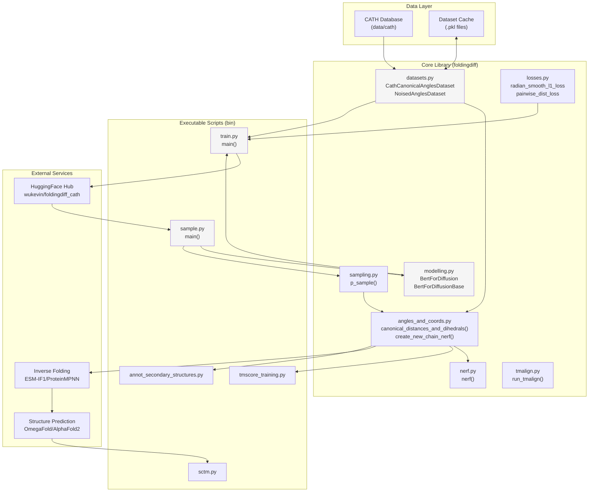
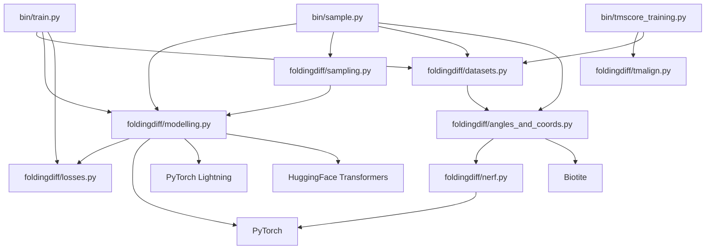
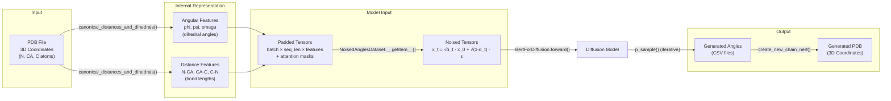
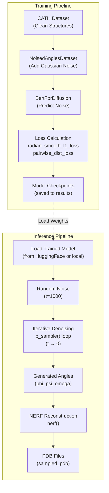
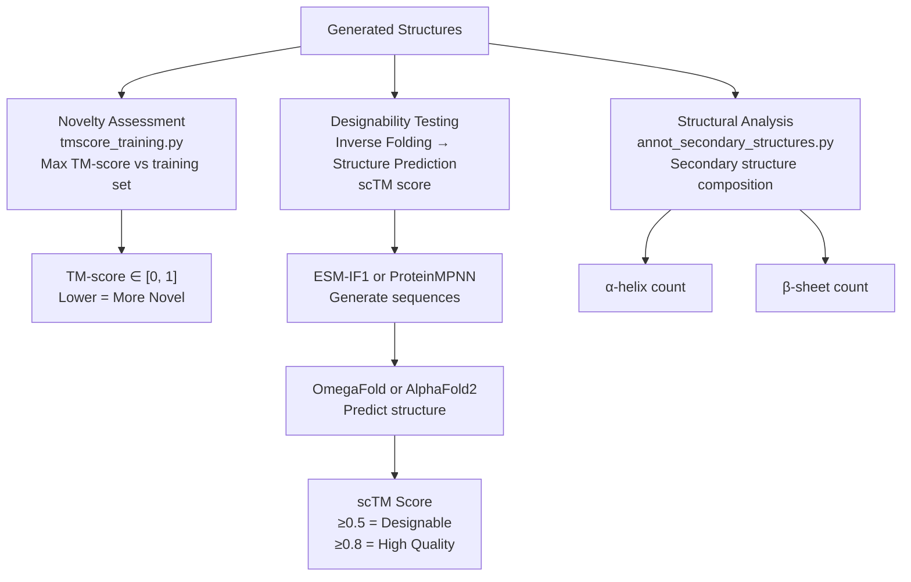

<!-- source: DeepWiki mcp.deepwiki.com · repo microsoft/foldingdiff · page 1 Overview · fetched 2026-10-26 -->

# Overview

<details>
<summary>Relevant source files</summary>

The following files were used as context for generating this wiki page:

- [CONTRIBUTING.md](CONTRIBUTING.md)
- [README.md](README.md)
- [TRADEMARKS.md](TRADEMARKS.md)
- [plots/generated_0.gif](plots/generated_0.gif)
- [requirements.txt](requirements.txt)
- [scripts/README.md](scripts/README.md)
- [setup.py](setup.py)

</details>


## Purpose and Scope

FoldingDiff is a diffusion model-based system for generating novel protein backbone structures. This page provides a high-level overview of the system's architecture, key components, and how they interact. It covers:

- The overall system design and purpose
- Core components and their relationships
- Data representations used throughout the system
- The distinction between training and inference pipelines
- Key dependencies and technologies

For specific implementation details, see:
- Training pipeline: [Training](#6)
- Generation pipeline: [Generation and Sampling](#7)
- Data processing: [Data Pipeline](#4)
- Model architecture: [Model Architecture](#5)

## What is FoldingDiff?

FoldingDiff is a research codebase that implements a **diffusion model for protein backbone generation**. Rather than operating directly on 3D Cartesian coordinates, the system works in **internal coordinate space** (dihedral angles and bond lengths), which provides translation/rotation invariance and reduces dimensionality.

The system can:
1. **Train** diffusion models on protein structures from the CATH database
2. **Generate** novel protein backbones through iterative denoising
3. **Evaluate** generated structures for novelty, designability, and structural quality

Sources: [README.md:1-6](), [setup.py:11]()

## System Architecture

The following diagram maps the system's conceptual components to their concrete implementations in the codebase:



**Key Insight**: The system is organized into three layers: (1) data storage and caching, (2) core library modules providing reusable functionality, and (3) executable scripts that orchestrate workflows.

Sources: [README.md:9-196](), [setup.py:1-36]()

## Core Components

### Package Structure

The codebase follows a standard Python package structure:

| Component | Location | Purpose |
|-----------|----------|---------|
| Core library | `foldingdiff/` | Reusable modules for data, models, and utilities |
| Executables | `bin/` | Command-line scripts for training, sampling, evaluation |
| Configuration | `config_jsons/` | JSON files defining model hyperparameters |
| Data | `data/` | CATH dataset and cached preprocessed data |
| Tests | `tests/` | Unit tests for core functionality |

Sources: [setup.py:9](), [README.md:34-49]()

### Module Dependency Graph



Sources: [setup.py:15-29](), [README.md:11]()

### Key Classes and Functions

The following table maps high-level concepts to their concrete implementations:

| Concept | Implementation | File |
|---------|---------------|------|
| Dataset loading | `CathCanonicalAnglesDataset` | [foldingdiff/datasets.py]() |
| Noising process | `NoisedAnglesDataset` | [foldingdiff/datasets.py]() |
| Model architecture | `BertForDiffusion` | [foldingdiff/modelling.py]() |
| Training loop | `BertForDiffusion.training_step()` | [foldingdiff/modelling.py]() |
| Reverse diffusion | `p_sample()` | [foldingdiff/sampling.py]() |
| Angle extraction | `canonical_distances_and_dihedrals()` | [foldingdiff/angles_and_coords.py]() |
| 3D reconstruction | `nerf()` | [foldingdiff/nerf.py]() |
| Loss functions | `radian_smooth_l1_loss()` | [foldingdiff/losses.py]() |

Sources: [README.md:53-77]()

## Data Representation Flow

The system operates through multiple representations of protein structures, transforming data between formats as needed:



**Key Design Decision**: Operating in angle space rather than Cartesian coordinates provides:
- Translation and rotation invariance
- Reduced dimensionality (6 features per residue vs 9 for xyz coordinates)
- Natural handling of protein chain topology

Sources: [README.md:53-77]()

## Training vs Inference Pipelines

The system has two distinct operational modes:



**Key Difference**: Training learns to predict noise from corrupted structures, while inference starts from pure noise and iteratively removes it.

**Entry Points**:
- Training: `bin/train.py` with configuration file
- Inference: `bin/sample.py` with model path

Sources: [README.md:32-116]()

## Key Technologies

### Core Dependencies

| Technology | Purpose | Version Requirement |
|-----------|---------|-------------------|
| PyTorch | Deep learning framework | 1.12 |
| PyTorch Lightning | Training orchestration | 1.6.4 |
| HuggingFace Transformers | BERT architecture | 4.11.3 |
| Biotite | Protein structure I/O | 0.34 |
| NumPy | Numerical operations | 1.22 |
| Pandas | Data manipulation | 1.1 |

Sources: [requirements.txt:1-14](), [setup.py:15-29]()

### Model Architecture

The diffusion model is based on **BERT transformers** adapted for continuous data:

- Base class: `BertForDiffusionBase` extends `transformers.BertPreTrainedModel`
- Training wrapper: `BertForDiffusion` extends `BertForDiffusionBase` and `pl.LightningModule`
- Key modifications:
  - Continuous value prediction instead of classification
  - Timestep conditioning through sinusoidal embeddings
  - Custom output head for angle regression

Sources: [README.md:53-77]()

## Pre-trained Models

FoldingDiff provides pre-trained weights via HuggingFace Hub:

- **Model ID**: `wukevin/foldingdiff_cath`
- **Training data**: CATH dataset (non-redundant S40)
- **Loading method**: `BertForDiffusion.from_dir(snapshot_download("wukevin/foldingdiff_cath"))`

The model can generate protein backbones ranging from 50-128 residues in length.

Sources: [README.md:51-77]()

## Evaluation Metrics

Generated structures are assessed through multiple metrics:



**Interpretation**:
- **Novelty**: Lower TM-scores indicate less similarity to training data
- **Designability**: Higher scTM scores indicate the backbone can be realized by real sequences
- **Structural quality**: Co-occurrence of α-helices and β-sheets indicates proper folding

Sources: [README.md:105-181]()

## Directory Structure

After running training and sampling, the system produces the following outputs:

```
project_root/
├── foldingdiff/              # Core library
│   ├── datasets.py
│   ├── modelling.py
│   ├── sampling.py
│   ├── angles_and_coords.py
│   ├── nerf.py
│   └── losses.py
├── bin/                      # Executable scripts
│   ├── train.py
│   ├── sample.py
│   ├── tmscore_training.py
│   └── sctm.py
├── data/                     # Dataset storage
│   └── cath/                 # CATH database
├── config_jsons/             # Training configurations
├── results/                  # Training outputs
│   ├── config.json
│   ├── models/               # Checkpoints
│   ├── logs/                 # Training logs
│   └── training_args.json
└── sampling_outputs/         # Generation outputs
    ├── sampled_angles/       # CSV files
    ├── sampled_pdb/          # PDB files
    └── plots/                # Visualizations
```

Sources: [README.md:42-96]()

## Use Cases

FoldingDiff supports three primary workflows:

1. **Training a new model**: Use `bin/train.py` with a config file to train on the CATH dataset
2. **Generating structures**: Use `bin/sample.py` with a trained model to generate novel backbones
3. **Evaluating quality**: Use `bin/tmscore_training.py`, `bin/sctm.py`, and `bin/annot_secondary_structures.py` to assess generated structures

Each workflow is orchestrated by a command-line script that coordinates the appropriate library modules.

Sources: [README.md:32-196]()

---

