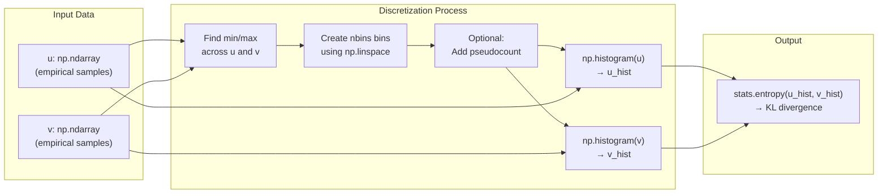
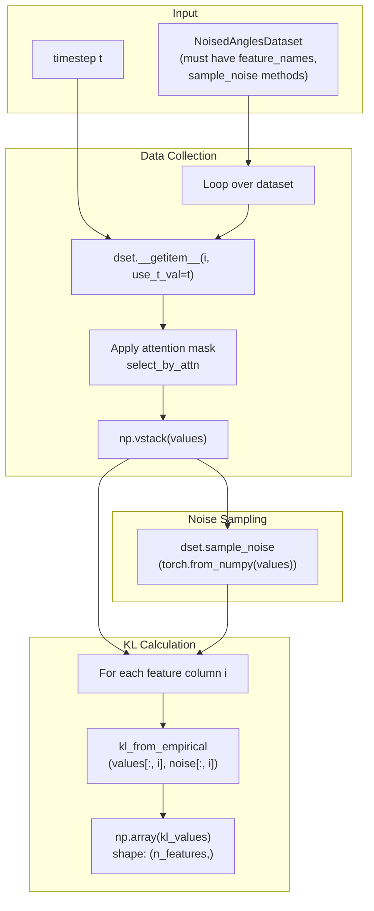
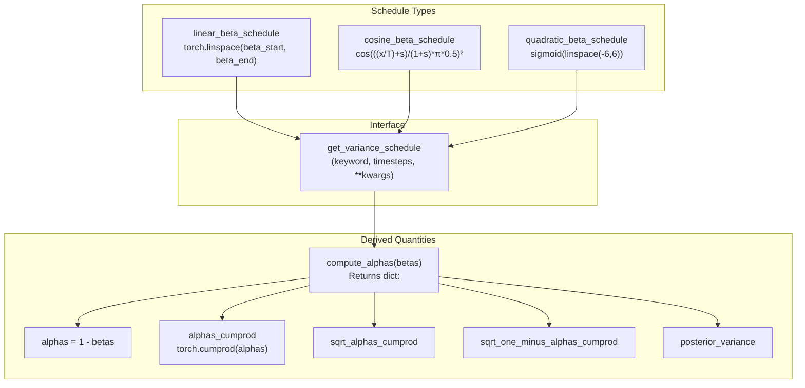
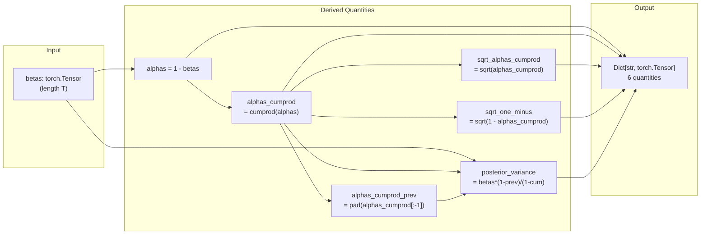
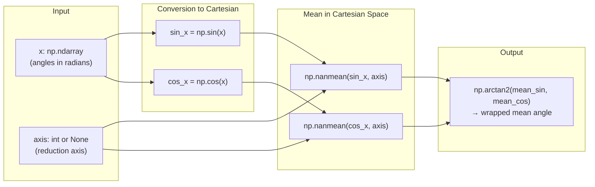
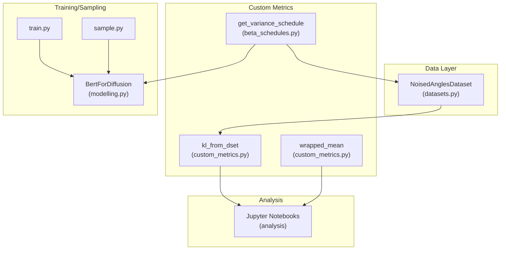

<!-- source: DeepWiki mcp.deepwiki.com · repo microsoft/foldingdiff · page 10.3 Custom Metrics · fetched 2026-10-26 -->

# Custom Metrics

<details>
<summary>Relevant source files</summary>

The following files were used as context for generating this wiki page:

- [foldingdiff/__init__.py](foldingdiff/__init__.py)
- [foldingdiff/beta_schedules.py](foldingdiff/beta_schedules.py)
- [foldingdiff/custom_metrics.py](foldingdiff/custom_metrics.py)
- [foldingdiff/losses.py](foldingdiff/losses.py)
- [foldingdiff/pymol_vis.py](foldingdiff/pymol_vis.py)

</details>


This page documents custom evaluation metrics and analytical utilities in the FoldingDiff codebase. These metrics are used to analyze the diffusion process, compare empirical distributions, and handle circular/angular data properly. For loss functions used during training, see [Loss Functions](#6.2). For evaluation of generated structures (TM-score, scTM, etc.), see [Evaluation and Analysis](#8).

The primary components covered here are:
- **KL divergence computation** for comparing empirical distributions
- **Beta schedules** that define the variance schedule for the diffusion process
- **Angular statistics** utilities for handling circular data

---

## KL Divergence Metrics

The codebase includes utilities for computing Kullback-Leibler (KL) divergence between empirical distributions, primarily used to analyze how well the noising process approximates the target noise distribution at each timestep.

### Core Functions

The KL divergence implementation consists of three main functions in [foldingdiff/custom_metrics.py]():

| Function | Purpose | Key Parameters |
|----------|---------|----------------|
| `kl_from_empirical` | Compute KL divergence between two empirical distributions | `u`, `v` (arrays), `nbins` (discretization bins), `pseudocount` |
| `_kl_helper` | Compute KL divergence for each feature at a specific timestep | `t` (timestep), `dset` (NoisedAnglesDataset) |
| `kl_from_dset` | Compute KL divergence across all timesteps and features | `dset`, `single_thread` flag |

#### KL from Empirical Distributions

The `kl_from_empirical` function [foldingdiff/custom_metrics.py:15-37]() discretizes continuous distributions into histograms and computes the KL divergence using `scipy.stats.entropy`:



**Sources:** [foldingdiff/custom_metrics.py:15-37]()

#### Timestep-wise KL Computation

The `_kl_helper` function [foldingdiff/custom_metrics.py:40-63]() computes KL divergence for each feature at a given timestep by:

1. Extracting corrupted values from the `NoisedAnglesDataset` at timestep `t`
2. Sampling pure noise using `dset.sample_noise()`
3. Computing KL divergence for each feature dimension



**Sources:** [foldingdiff/custom_metrics.py:40-63]()

#### Dataset-wide KL Analysis

The `kl_from_dset` function [foldingdiff/custom_metrics.py:66-82]() provides a high-level interface for computing KL divergence across all timesteps, using multiprocessing for efficiency:

```python
# Typical usage pattern (pseudocode):
from foldingdiff.datasets import NoisedAnglesDataset
from foldingdiff.custom_metrics import kl_from_dset

# Assuming dset is a NoisedAnglesDataset with timesteps attribute
kl_values = kl_from_dset(dset, single_thread=False)
# Returns: np.ndarray of shape (timesteps, n_features)
```

The function uses `multiprocessing.Pool` to parallelize computation across timesteps [foldingdiff/custom_metrics.py:78-81]().

**Sources:** [foldingdiff/custom_metrics.py:66-82]()

---

## Beta Schedules

Beta schedules define how noise variance changes across diffusion timesteps. The [foldingdiff/beta_schedules.py]() module provides three standard schedules and utilities for computing derived quantities.

### Available Schedules



**Sources:** [foldingdiff/beta_schedules.py:1-79]()

### Schedule Implementations

| Schedule | Function | Formula | Parameters |
|----------|----------|---------|------------|
| Linear | `linear_beta_schedule` | `linspace(β_start, β_end, T)` | `beta_start=1e-4`, `beta_end=0.02` |
| Cosine | `cosine_beta_schedule` | `1 - α̅_t / α̅_{t-1}` where `α̅_t = cos²((t/T+s)/(1+s)·π/2)` | `s=8e-3` |
| Quadratic | `quadratic_beta_schedule` | `sigmoid(linspace(-6,6))·(β_end-β_start)+β_start` | `beta_start=1e-4`, `beta_end=0.02` |

#### Cosine Schedule

The cosine schedule [foldingdiff/beta_schedules.py:20-29]() is based on the improved DDPM paper (Nichol & Dhariwal, 2021). It provides smoother transitions and clips betas to avoid extreme values:

```python
# From foldingdiff/beta_schedules.py:20-29
def cosine_beta_schedule(timesteps: int, s: float = 8e-3) -> torch.Tensor:
    """Cosine scheduling https://arxiv.org/pdf/2102.09672.pdf"""
    steps = timesteps + 1
    x = torch.linspace(0, timesteps, steps)
    alphas_cumprod = torch.cos(((x / timesteps) + s) / (1 + s) * torch.pi * 0.5) ** 2
    alphas_cumprod = alphas_cumprod / alphas_cumprod[0]
    betas = 1 - (alphas_cumprod[1:] / alphas_cumprod[:-1])
    return torch.clip(betas, 0.0001, 0.9999)
```

**Sources:** [foldingdiff/beta_schedules.py:20-29]()

### Alpha Computation

The `compute_alphas` function [foldingdiff/beta_schedules.py:45-62]() derives all necessary quantities from the beta schedule:



These derived quantities are used during both the forward noising process and reverse denoising process in the diffusion model.

**Sources:** [foldingdiff/beta_schedules.py:45-62]()

### Visualization Utility

The module includes `plot_variance_schedule` [foldingdiff/beta_schedules.py:81-103]() for visualizing how beta and alpha values change across timesteps. When run as a script [foldingdiff/beta_schedules.py:105-115](), it generates plots for all available schedules.

**Sources:** [foldingdiff/beta_schedules.py:81-115]()

---

## Angular Statistics

Proteins are represented using dihedral angles, which are circular quantities that require special statistical treatment. The `wrapped_mean` function handles this correctly.

### Wrapped Mean

The `wrapped_mean` function [foldingdiff/custom_metrics.py:85-94]() computes the mean of angular data by treating angles as unit vectors on the unit circle:



This approach is based on circular statistics (see [RosettaCode reference](https://rosettacode.org/wiki/Averages/Mean_angle)) and correctly handles the wraparound at ±π.

**Mathematical formulation:**
```
μ = arctan2(mean(sin(x)), mean(cos(x)))
```

This is equivalent to computing the mean of unit vectors and finding the angle of the resulting vector.

**Sources:** [foldingdiff/custom_metrics.py:85-94]()

---

## Integration with Other Systems

The custom metrics integrate with other parts of the codebase as follows:



- **KL divergence** is used in analysis notebooks to validate that the noising process creates the expected distribution
- **Beta schedules** are used by `NoisedAnglesDataset` to apply noise and by the model during training/sampling
- **Wrapped mean** is used in analysis notebooks when computing statistics on angular data

**Sources:** [foldingdiff/custom_metrics.py](), [foldingdiff/beta_schedules.py](), [foldingdiff/datasets.py](), [foldingdiff/modelling.py]()

---

## Usage Examples

### Computing KL Divergence on a Dataset

```python
from foldingdiff.datasets import NoisedAnglesDataset
from foldingdiff.custom_metrics import kl_from_dset

# Assume dataset is already created
# kl_values has shape (timesteps, n_features)
kl_values = kl_from_dset(dataset, single_thread=False)

# Analyze KL divergence for phi angle (feature 0) across timesteps
phi_kl = kl_values[:, 0]
```

### Getting a Beta Schedule

```python
from foldingdiff.beta_schedules import get_variance_schedule, compute_alphas

# Get cosine schedule for 1000 timesteps
betas = get_variance_schedule("cosine", timesteps=1000)

# Compute all derived quantities
alpha_dict = compute_alphas(betas)
sqrt_alphas_cumprod = alpha_dict["sqrt_alphas_cumprod"]
```

### Computing Wrapped Mean

```python
import numpy as np
from foldingdiff.custom_metrics import wrapped_mean

# Angles near the wraparound point
angles = np.array([3.0, -3.0, 3.1, -3.1])  # Near ±π

# Regular mean would be incorrect
regular_mean = np.mean(angles)  # ≈ 0.0 (wrong!)

# Wrapped mean correctly handles circular data
correct_mean = wrapped_mean(angles)  # ≈ ±π (correct!)
```

**Sources:** [foldingdiff/custom_metrics.py](), [foldingdiff/beta_schedules.py]()

---

## Key Considerations

### KL Divergence Computation

- **Discretization:** The `nbins` parameter controls histogram granularity. More bins provide finer resolution but require more samples [foldingdiff/custom_metrics.py:16-27]().
- **Pseudocount:** Setting `pseudocount=True` adds uniform pseudocounts to avoid division by zero in sparse bins [foldingdiff/custom_metrics.py:28-30]().
- **Multiprocessing:** By default, `kl_from_dset` uses all available CPU cores for parallelization [foldingdiff/custom_metrics.py:76-81]().

### Beta Schedules

- **Clipping:** The cosine schedule clips beta values to `[0.0001, 0.9999]` to avoid numerical instability [foldingdiff/beta_schedules.py:29]().
- **Type safety:** Schedule types are defined using `Literal` for type checking [foldingdiff/beta_schedules.py:14]().
- **Derived quantities:** The `compute_alphas` function returns a dictionary with all necessary quantities for both forward and reverse diffusion processes [foldingdiff/beta_schedules.py:45-62]().

### Angular Statistics

- **Circular mean:** Use `wrapped_mean` instead of `np.mean` for angular data to handle wraparound correctly [foldingdiff/custom_metrics.py:85-94]().
- **NaN handling:** The function uses `np.nanmean` to gracefully handle missing values [foldingdiff/custom_metrics.py:93]().

**Sources:** [foldingdiff/custom_metrics.py](), [foldingdiff/beta_schedules.py]()