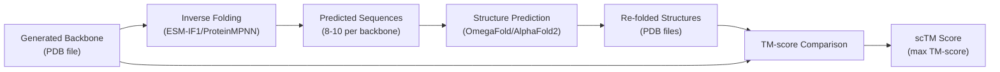
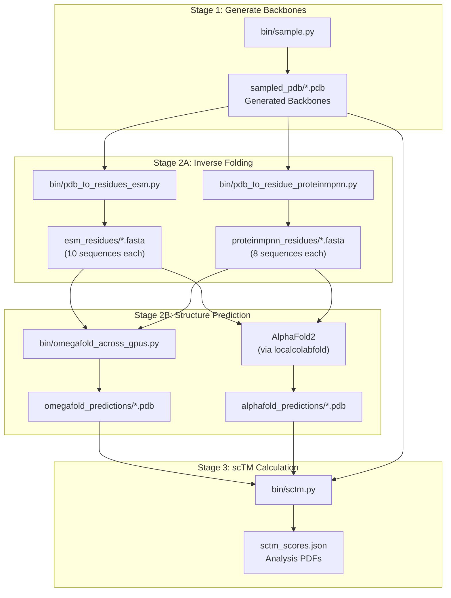
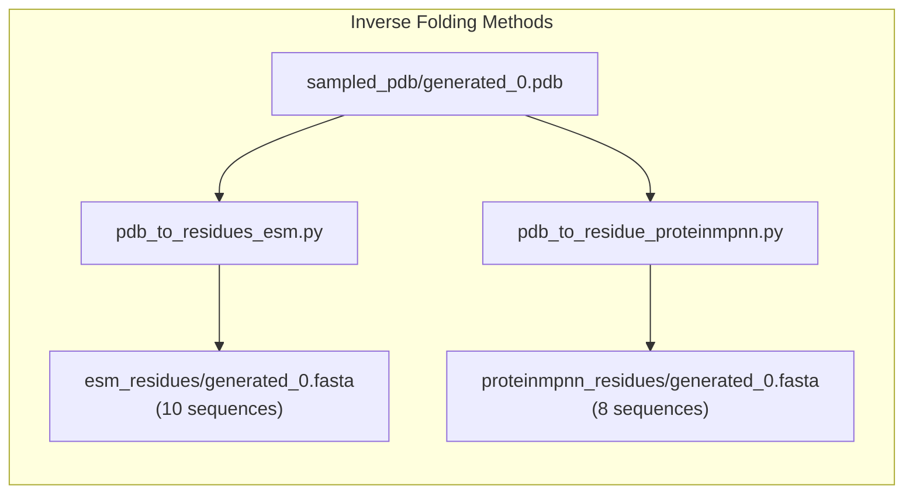
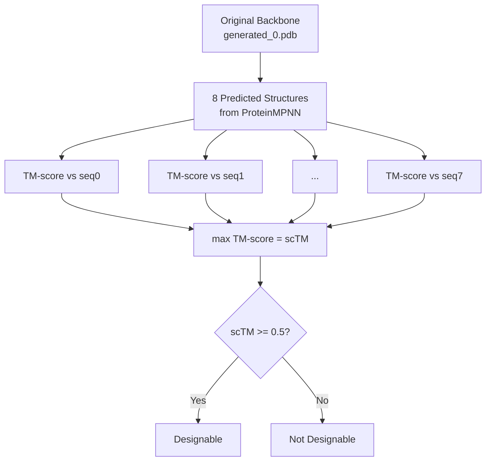
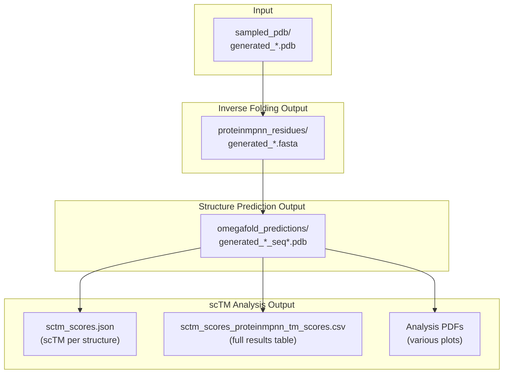
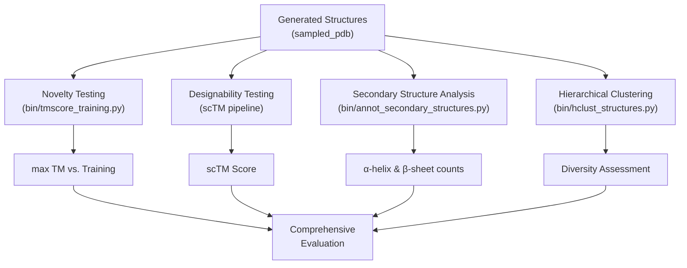

<!-- source: DeepWiki mcp.deepwiki.com · repo microsoft/foldingdiff · page 8.2 Designability Testing (scTM) · fetched 2026-10-26 -->

# Designability Testing (scTM)

<details>
<summary>Relevant source files</summary>

The following files were used as context for generating this wiki page:

- [CONTRIBUTING.md](CONTRIBUTING.md)
- [README.md](README.md)
- [TRADEMARKS.md](TRADEMARKS.md)
- [bin/annot_secondary_structures.py](bin/annot_secondary_structures.py)
- [bin/baseline_sctm_scores_setup.py](bin/baseline_sctm_scores_setup.py)
- [bin/hclust_structures.py](bin/hclust_structures.py)
- [bin/tmscore_training.py](bin/tmscore_training.py)
- [data/7ZYA.pdb](data/7ZYA.pdb)
- [jupyter/sctm_by_len.ipynb](jupyter/sctm_by_len.ipynb)
- [plots/generated_0.gif](plots/generated_0.gif)
- [plots/sctm_by_len.pdf](plots/sctm_by_len.pdf)
- [plots/sctm_by_secondary_structure.pdf](plots/sctm_by_secondary_structure.pdf)
- [plots/sctm_vs_plddt.pdf](plots/sctm_vs_plddt.pdf)
- [requirements.txt](requirements.txt)
- [scripts/README.md](scripts/README.md)
- [setup.py](setup.py)

</details>


## Purpose and Scope

This page documents the **designability testing pipeline** used to evaluate the quality of generated protein backbone structures. Designability refers to whether an amino acid sequence can be designed that will fold into a given backbone structure. The **scTM (self-consistency TM score)** metric quantifies this by measuring how well sequences predicted to fold into a backbone actually reproduce that structure when folded.

This evaluation pipeline is distinct from novelty assessment (see [TM-Score and Novelty Assessment](#8.1)) and secondary structure analysis (see [Secondary Structure Analysis](#8.3)). While novelty checks if structures are memorized from training data, designability tests if they are biophysically plausible.

**Sources**: [README.md:119-182](), [jupyter/sctm_by_len.ipynb:1-340]()

---

## Overview: The Designability Testing Concept

Designability testing validates generated backbones through a complete cycle:

1. **Inverse Folding**: Given a backbone structure, predict amino acid sequences that should fold into it
2. **Structure Prediction**: Fold the predicted sequences back into 3D structures  
3. **Comparison**: Measure structural similarity between the re-folded structures and the original backbone

If the re-folded structures closely match the original, the backbone is **designable** — meaning a sequence exists that will fold into it. If they differ significantly, the backbone may be biophysically implausible.



**Designability Pipeline Overview**

**Sources**: [README.md:119-165]()

---

## Complete Pipeline Architecture

The designability testing pipeline consists of three main stages, each with specific tools and scripts:



**Designability Pipeline with Script Names**

**Sources**: [README.md:119-182]()

---

## Stage 1: Inverse Folding

Inverse folding predicts amino acid sequences that should fold into a given backbone structure. FoldingDiff supports two state-of-the-art inverse folding methods:

### ESM-IF1

ESM-IF1 is a transformer-based inverse folding model from Meta AI. It generates **10 sequences** per input backbone structure.

**Setup Requirements**:
- Separate conda environment (instructions in README)
- Key packages: `pytorch`, `pyg`, `biotite`, `esm`

**Running ESM-IF1**:
```bash
# From directory containing sampled_pdb/
python ~/projects/foldingdiff/bin/pdb_to_residues_esm.py sampled_pdb -o esm_residues
```

**Output**: Creates `esm_residues/` directory with FASTA files containing 10 amino acid sequences for each input PDB.

**Sources**: [README.md:127-144]()

### ProteinMPNN

ProteinMPNN is a message-passing neural network designed specifically for inverse folding. It generates **8 sequences** per backbone and is found to be **significantly more performant** than ESM-IF1 in this codebase.

**Running ProteinMPNN**:
```bash
# From directory containing sampled_pdb/
python ~/projects/foldingdiff/bin/pdb_to_residue_proteinmpnn.py sampled_pdb
```

**Output**: Creates `proteinmpnn_residues/` directory with FASTA files containing 8 sequences per structure.



**Inverse Folding Script Comparison**

**Sources**: [README.md:125-156](), [bin/baseline_sctm_scores_setup.py:1-17]()

---

## Stage 2: Structure Prediction

After inverse folding generates candidate sequences, structure prediction folds them back into 3D structures to verify they reproduce the original backbone.

### OmegaFold (Primary Method)

OmegaFold is the **primary structure prediction method** used in this codebase due to its speed and suitability for protein design tasks (no MSA requirement).

**Running OmegaFold**:
```bash
# Distribute work across GPUs 0 and 1
python ~/projects/foldingdiff/bin/omegafold_across_gpus.py esm_residues/*.fasta -g 0 1
```

The script [bin/omegafold_across_gpus.py]() automatically:
- Splits FASTA files across specified GPUs
- Runs OmegaFold predictions in parallel
- Outputs predicted structures to `omegafold_predictions/`

**Output**: Each sequence becomes a PDB file. For example, if `generated_0.fasta` contains 8 sequences, this creates 8 PDB files named like `generated_0_seq0.pdb`, `generated_0_seq1.pdb`, etc.

**Sources**: [README.md:169-177]()

### AlphaFold2 (Alternative Method)

AlphaFold2 can be used as an alternative, though it requires more computational resources.

**Setup**: Uses `localcolabfold` installation method  
**Scaling**: Scripts in [scripts/slurm/alphafold.sbatch]() help split work across compute nodes

**Sources**: [README.md:179-181]()

---

## Stage 3: scTM Score Calculation

The final stage compares re-folded structures to original backbones using TM-score and computes the scTM metric.

### Running scTM Calculation

```bash
# Calculate scTM scores for ProteinMPNN + OmegaFold predictions
python ~/projects/foldingdiff/bin/sctm.py -f omegafold_predictions_proteinmpnn
```

The `sctm.py` script:
1. Loads original backbone structures from `sampled_pdb/`
2. Loads predicted structures from the specified folder
3. Calculates TM-scores between each original and its predictions
4. Computes scTM as the **maximum TM-score** across all predictions
5. Generates analysis plots and JSON output

**Sources**: [README.md:160-166]()

### scTM Metric Definition

The **scTM (self-consistency TM score)** is defined as:

```
scTM(backbone) = max_{i=1..N} TM-score(backbone, predicted_structure_i)
```

Where:
- N = number of sequences generated by inverse folding (8 for ProteinMPNN, 10 for ESM-IF1)
- TM-score measures structural similarity (range: 0-1)
- Taking the maximum gives the backbone "credit" for the best match



**scTM Calculation Logic**

**Sources**: [jupyter/sctm_by_len.ipynb:50-110]()

---

## Interpreting scTM Scores

### Designability Thresholds

The codebase uses two key thresholds:

| Threshold | Classification | Meaning |
|-----------|---------------|---------|
| scTM ≥ 0.5 | **Designable** | At least one sequence folds into a structure similar to the original backbone |
| scTM ≥ 0.8 | **High Quality** | Sequences fold very accurately into the target backbone |
| scTM < 0.5 | **Not Designable** | Predicted sequences fail to reproduce the backbone structure |

From the analysis notebook, the designability flag is computed as:

```python
sctm_table['designable'] = sctm_table['scTM'] >= 0.5
```

**Sources**: [jupyter/sctm_by_len.ipynb:49-159](), [README.md:160-166]()

### Associated Metrics

The analysis also tracks related metrics:

1. **Maximum Training TM**: Novelty score (see [TM-Score and Novelty Assessment](#8.1))
2. **Length**: Protein backbone length in amino acids
3. **Secondary Structure**: Number of α-helices and β-sheets
4. **B-factors**: Confidence scores from OmegaFold predictions

```python
# From jupyter notebook showing tracked metrics
columns = ['id', 'scTM', 'max training TM', 'length_int', 
           'alpha_counts', 'beta_counts', 'scTM best match',
           'max training TM structure', 'length', 'designable']
```

**Sources**: [jupyter/sctm_by_len.ipynb:45-160]()

---

## Output Files and Analysis

### Generated Files

After running the complete pipeline, the following files are produced:



**File Structure After Designability Testing**

### Analysis Outputs

The `bin/sctm.py` script produces:

1. **sctm_scores.json**: Dictionary mapping structure IDs to scTM scores
2. **CSV file**: Complete results table with all metrics
3. **PDF plots**: Various visualizations including:
   - scTM score distributions
   - scTM vs. length correlations  
   - scTM vs. secondary structure composition
   - scTM vs. confidence scores (pLDDT)

**Sources**: [README.md:160-166](), [jupyter/sctm_by_len.ipynb:167-340]()

### Visualization Examples

The analysis produces plots comparing scTM scores across different dimensions:

| Plot | File | Purpose |
|------|------|---------|
| scTM by Length | [plots/sctm_by_len.pdf]() | Shows if designability varies with protein size |
| scTM vs. pLDDT | [plots/sctm_vs_plddt.pdf]() | Correlates scTM with OmegaFold confidence |
| scTM by Secondary Structure | [plots/sctm_by_secondary_structure.pdf]() | Examines designability for different folds |

**Sources**: [plots/sctm_by_len.pdf:1-10](), [plots/sctm_vs_plddt.pdf:1-10](), [plots/sctm_by_secondary_structure.pdf:1-10]()

---

## Baseline Comparison with Natural Proteins

To validate that generated structures achieve realistic designability, the codebase includes tools to compute scTM scores for **natural proteins** from the test set.

### Baseline Setup

The script [bin/baseline_sctm_scores_setup.py]() creates a baseline by:
1. Selecting random structures from the CATH test set
2. Running them through the same inverse folding → structure prediction pipeline
3. Computing scTM scores to establish expected values for natural proteins

**Running Baseline Analysis**:
```bash
# Step 1: Setup baseline PDB files
python bin/baseline_sctm_scores_setup.py -n 512 -o sctm_baseline_real_pdbs

# Step 2: Inverse folding (ESM-IF1)
conda activate inverse
python bin/pdb_to_residues_esm.py sctm_baseline_real_pdbs -o sctm_baseline_esm_residues

# Step 3: Structure prediction (OmegaFold)
conda activate omegafold
python bin/omegafold_across_gpus.py sctm_baseline_esm_residues/*.fasta \
    -o sctm_baseline_omegafold_predictions

# Step 4: Calculate baseline scTM scores
conda activate protdiff
python bin/omegafold_self_tm.py \
    -p sctm_baseline_real_pdbs \
    -f sctm_baseline_omegafold_predictions \
    -o baseline_sctm_scores
```

This baseline allows comparison: do generated structures achieve similar scTM scores to natural proteins?

**Sources**: [bin/baseline_sctm_scores_setup.py:1-100]()

### Baseline Reconstruction Quality

The baseline setup script [bin/baseline_sctm_scores_setup.py]() includes an important step:

```python
# Convert to angles and write reconstructed coordinates
coords = ac.canonical_distances_and_dihedrals(fname, distances=[], 
                                               angles=ac.EXHAUSTIVE_ANGLES)
f = ac.create_new_chain_nerf(dest_fname, coords)
```

This reconstructs baseline structures using NERF (see [NERF Reconstruction](#3.3)) to ensure the baseline uses the same coordinate system as generated structures.

**Sources**: [bin/baseline_sctm_scores_setup.py:80-95]()

---

## Integration with Other Evaluation Metrics

Designability testing is one component of a multi-faceted evaluation strategy:



**Evaluation Metrics Integration**

The complete evaluation combines:
- **Novelty** ([#8.1](#8.1)): Are structures different from training data?
- **Designability** ([#8.2](#8.2)): Can sequences be designed to fold into them?
- **Secondary Structure** ([#8.3](#8.3)): Do they have realistic secondary structure composition?
- **Diversity** ([#8.4](#8.4)): Are the generated structures diverse?

**Sources**: [README.md:105-182](), [bin/tmscore_training.py:1-91](), [bin/hclust_structures.py:1-149]()

---

## Key Considerations

### Computational Requirements

The designability pipeline is computationally intensive:

- **Inverse Folding**: Relatively fast (minutes for hundreds of structures)
- **Structure Prediction**: 
  - OmegaFold: ~1-2 minutes per sequence on GPU
  - AlphaFold2: ~10-20 minutes per sequence on GPU
  - For 512 structures with 8 sequences each = 4,096 predictions

The [bin/omegafold_across_gpus.py]() script helps by distributing work across multiple GPUs.

**Sources**: [README.md:174-177]()

### Environment Management

The pipeline requires **three separate conda environments**:

1. **protdiff**: Main FoldingDiff environment for generation and analysis
2. **inverse**: Environment for ESM-IF1 inverse folding
3. **omegafold**: Environment for OmegaFold structure prediction

This separation is necessary due to incompatible dependencies between tools.

**Sources**: [README.md:127-134](), [bin/baseline_sctm_scores_setup.py:11-16]()

### Interpreting Results

When analyzing scTM scores:

- **High scTM (≥0.8)**: Strong evidence of designability
- **Moderate scTM (0.5-0.8)**: Likely designable but may require optimization
- **Low scTM (<0.5)**: Structure may be biophysically implausible
- **Compare to baseline**: Generated structures should achieve similar scTM distributions to natural proteins

**Sources**: [jupyter/sctm_by_len.ipynb:153-160]()

---

