# Page: Overview

# Overview

<details>
<summary>Relevant source files</summary>

The following files were used as context for generating this wiki page:

- [00-course-setup/README.md](00-course-setup/README.md)
- [01-introduction-to-genai/README.md](01-introduction-to-genai/README.md)
- [02-exploring-and-comparing-different-llms/README.md](02-exploring-and-comparing-different-llms/README.md)
- [03-using-generative-ai-responsibly/README.md](03-using-generative-ai-responsibly/README.md)
- [04-prompt-engineering-fundamentals/README.md](04-prompt-engineering-fundamentals/README.md)
- [05-advanced-prompts/README.md](05-advanced-prompts/README.md)
- [06-text-generation-apps/README.md](06-text-generation-apps/README.md)
- [07-building-chat-applications/README.md](07-building-chat-applications/README.md)
- [08-building-search-applications/README.md](08-building-search-applications/README.md)
- [09-building-image-applications/README.md](09-building-image-applications/README.md)
- [10-building-low-code-ai-applications/README.md](10-building-low-code-ai-applications/README.md)
- [11-integrating-with-function-calling/README.md](11-integrating-with-function-calling/README.md)
- [12-designing-ux-for-ai-applications/README.md](12-designing-ux-for-ai-applications/README.md)
- [README.md](README.md)
- [presentations/GenerativeAIBootcamp-Presentation.pdf](presentations/GenerativeAIBootcamp-Presentation.pdf)
- [presentations/GenerativeAIBootcamp-Presentation.pptx](presentations/GenerativeAIBootcamp-Presentation.pptx)
- [translations/en/.co-op-translator.json](translations/en/.co-op-translator.json)
- [translations/en/README.md](translations/en/README.md)
- [translations/en/docs/ENHANCED_FEATURES_ROADMAP.md](translations/en/docs/ENHANCED_FEATURES_ROADMAP.md)
- [translations/en/docs/SECURITY_GUIDELINES.md](translations/en/docs/SECURITY_GUIDELINES.md)
- [translations/es/.co-op-translator.json](translations/es/.co-op-translator.json)
- [translations/es/README.md](translations/es/README.md)
- [translations/es/docs/ENHANCED_FEATURES_ROADMAP.md](translations/es/docs/ENHANCED_FEATURES_ROADMAP.md)
- [translations/es/docs/SECURITY_GUIDELINES.md](translations/es/docs/SECURITY_GUIDELINES.md)
- [translations/fr/.co-op-translator.json](translations/fr/.co-op-translator.json)
- [translations/fr/README.md](translations/fr/README.md)

</details>


This document provides a comprehensive introduction to the "Generative AI for Beginners" course, a learning resource developed by Microsoft Cloud Advocates. The course consists of 21 lessons designed to teach the fundamentals of building Generative AI applications. This overview explains the course structure, target audience, core concepts, and technical requirements necessary to get started with Generative AI development.

For information about specific development environment setup, see [Course Structure and Setup](#2).

Sources: [README.md:3-13](), [README.md:45-48](), [00-course-setup/README.md:1-5]()

## Course Objectives and Target Audience

The "Generative AI for Beginners" course is designed for developers, students, and technology enthusiasts who want to start building applications leveraging generative AI capabilities. The course aims to:

- Teach fundamental concepts of generative AI and large language models (LLMs) [01-introduction-to-genai/README.md:20-26]()
- Provide hands-on experience with building various types of generative AI applications [README.md:51-54]()
- Guide learners in using generative AI responsibly and ethically [03-using-generative-ai-responsibly/README.md:1-10]()
- Demonstrate integration of generative AI capabilities into different application types [06-text-generation-apps/README.md:47-54]()

The course is suitable for both beginners in AI as well as experienced developers looking to expand their knowledge into generative AI. Basic knowledge of Python or TypeScript is helpful, as the course provides examples in both languages [README.md:65-65]().

Sources: [README.md:51-58](), [01-introduction-to-genai/README.md:11-26](), [04-prompt-engineering-fundamentals/README.md:49-57]()

## Course Structure and Content

The course is structured into 21 lessons, each covering a specific aspect of generative AI. Lessons are categorized as either "Learn" (explaining concepts) or "Build" (providing practical code examples) [README.md:51-54]().

### Course Structure Diagram

```mermaid
flowchart TD
    A["Generative AI for Beginners Course"] --> B["Setup & Prerequisites"]
    A --> C["Core Concepts"]
    A --> D["Application Development"]
    A --> E["Advanced Topics"]
    
    B --> B1["Course Setup (Lesson 00)"]
    
    C --> C1["Introduction to GenAI (Lesson 01)"]
    C --> C2["Exploring Different LLMs (Lesson 02)"]
    C --> C3["Using GenAI Responsibly (Lesson 03)"]
    C --> C4["Prompt Engineering Fundamentals (Lesson 04)"]
    C --> C5["Advanced Prompts (Lesson 05)"]
    
    D --> D1["Text Generation Apps (Lesson 06)"]
    D --> D2["Chat Applications (Lesson 07)"]
    D --> D3["Search Applications (Lesson 08)"]
    D --> D4["Image Applications (Lesson 09)"]
    D --> D5["Low-Code AI Applications (Lesson 10)"]
    D --> D6["Function Calling Integration (Lesson 11)"]
    D --> D7["UX Design for AI Apps (Lesson 12)"]
    
    E --> E1["Securing AI Applications (Lesson 13)"]
    E --> E2["AI Application Lifecycle (Lesson 14)"]
    E --> E3["RAG and Vector Databases (Lesson 15)"]
    E --> E4["Open Source Models (Lesson 16)"]
    E --> E5["AI Agents (Lesson 17)"]
    E --> E6["Fine-tuning LLMs (Lesson 18)"]
    E --> E7["Small Language Models (Lesson 19-21)"]
```

Sources: [README.md:3-13](), [README.md:51-54](), [00-course-setup/README.md:30-36]()

### Core Concepts

The first five lessons cover the foundational knowledge needed to understand generative AI:

1. **Introduction to Generative AI and LLMs** - Explains what generative AI is, how LLMs work, and their capabilities [01-introduction-to-genai/README.md:13-19]()
2. **Exploring and Comparing Different LLMs** - Guides in selecting the right model for specific use cases [02-exploring-and-comparing-different-llms/README.md:13-26]()
3. **Using Generative AI Responsibly** - Covers ethical considerations and best practices [03-using-generative-ai-responsibly/README.md:1-10]()
4. **Understanding Prompt Engineering Fundamentals** - Teaches the core principles of effective prompting [04-prompt-engineering-fundamentals/README.md:14-24]()
5. **Creating Advanced Prompts** - Explores advanced techniques to improve prompt outcomes [05-advanced-prompts/README.md:13-26]()

Sources: [01-introduction-to-genai/README.md:60-69](), [02-exploring-and-comparing-different-llms/README.md:27-43](), [04-prompt-engineering-fundamentals/README.md:69-81]()

### Building Applications

Lessons 6 through 12 focus on practical implementation of different types of generative AI applications:

6. **Building Text Generation Applications** - Creating applications that generate text using LLMs [06-text-generation-apps/README.md:11-17]()
7. **Building Chat Applications** - Implementing conversational interfaces [07-building-chat-applications/README.md:8-16]()
8. **Building Search Applications with Vector Databases** - Using embeddings for semantic search [08-building-search-applications/README.md:13-21]()
9. **Building Image Generation Applications** - Creating applications that generate images [09-building-image-applications/README.md:9-22]()
10. **Building Low Code AI Applications** - Using Power Platform for AI solutions [10-building-low-code-ai-applications/README.md:15-21]()
11. **Integrating with Function Calling** - Connecting external functions with LLMs [11-integrating-with-function-calling/README.md:9-24]()
12. **Designing UX for AI Applications** - Applying best UX practices to AI applications [12-designing-ux-for-ai-applications/README.md:9-25]()

Sources: [06-text-generation-apps/README.md:132-144](), [08-building-search-applications/README.md:46-60](), [09-building-image-applications/README.md:43-63](), [11-integrating-with-function-calling/README.md:37-45]()

### Application Types Diagram

```mermaid
graph TD
    A["GenAI Application Types"] --> B["Text Generation"]
    A --> C["Chat Applications"]
    A --> D["Search Applications"]
    A --> E["Image Generation"]
    A --> F["Low-Code Applications"]
    
    B --> B1["openai.Completion.create()"]
    B --> B2["Tokens & Temperature"]
    
    C --> C1["openai.ChatCompletion.create()"]
    C --> C2["System Messages"]
    C --> C3["Conversational Context"]
    
    D --> D1["Vector Embeddings"]
    D --> D2["openai.Embedding.create()"]
    D --> D3["Cosine Similarity Search"]
    
    E --> E1["client.images.generate()"]
    E --> E2["DALL-E Integration"]
    E --> E3["Prompt Boundaries"]
    
    F --> F1["Power Apps & Automate"]
    F --> F2["AI Builder"]
    F --> F3["Copilot Integration"]
    
    subgraph Integration Methods
        G["Function Calling"]
        H["RAG"]
        I["AI Agents"]
    end
    
    C --- G
    D --- H
    A --- I
```

Sources: [06-text-generation-apps/README.md:132-144](), [08-building-search-applications/README.md:46-60](), [09-building-image-applications/README.md:141-147](), [10-building-low-code-ai-applications/README.md:44-57](), [11-integrating-with-function-calling/README.md:117-131]()

### Advanced Topics

Lessons 13 through 21 cover advanced concepts and techniques including security, retrieval augmented generation (RAG), and open-source model integration.

Sources: [README.md:3-13]()

## Technical Architecture

The course incorporates different AI services and technologies that interact with each other to build complete applications. The diagram below illustrates the technical components used throughout the course:

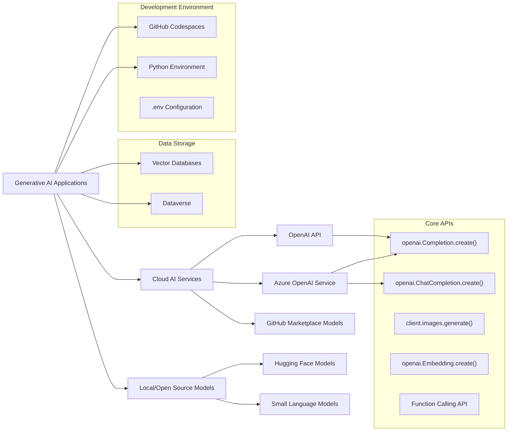

Sources: [README.md:60-64](), [00-course-setup/README.md:15-22](), [06-text-generation-apps/README.md:112-130](), [08-building-search-applications/README.md:74-77](), [10-building-low-code-ai-applications/README.md:34-43]()

## Technical Requirements and Setup

To work through the course, you'll need:

1. **Development Environment**:
   - Python (3.x) or knowledge of TypeScript [00-course-setup/README.md:91-94]()
   - GitHub account to fork the repository [00-course-setup/README.md:11-13]()
   - Recommended: GitHub Codespaces for zero-config setup [00-course-setup/README.md:15-22]()

2. **API Access**:
   - Access to one of the following providers:
     - Azure OpenAI Service [README.md:61-61]()
     - GitHub Marketplace Model Catalog [README.md:62-62]()
     - OpenAI API [README.md:63-63]()

3. **Environment Configuration**:
   - Setting up environment variables (e.g., `OPENAI_API_KEY`, `GITHUB_TOKEN`) in a `.env` file [00-course-setup/README.md:60-64]()
   - Creating a virtual environment using `venv` or `Miniconda` [00-course-setup/README.md:106-115]()
   - Installing dependencies via `pip install -r requirements.txt` [09-building-image-applications/README.md:107-113]()

Sources: [README.md:59-68](), [00-course-setup/README.md:7-36](), [06-text-generation-apps/README.md:77-84]()

## Multi-Language Support

The course features automated translation support for over 50 languages via a GitHub Action system. This allows global access to the curriculum.

- **Sparse Checkout**: Due to the large size of translations, learners can use `git sparse-checkout` to clone only the core content [README.md:24-42]().
- **Co-op Translator**: An automated system manages updates across language directories like `/translations/fr/` or `/translations/es/` [README.md:17-22]().

Sources: [README.md:17-43]()

## Conclusion

The "Generative AI for Beginners" course provides a comprehensive introduction to building applications with generative AI. Through 21 lessons, it covers everything from basic concepts to advanced techniques, with practical code examples in Python and TypeScript. Whether you're looking to understand how LLMs work, build specific types of AI applications, or explore cutting-edge techniques like RAG or function calling, this course offers structured guidance to help you achieve your goals.

Sources: [README.md:3-13](), [README.md:45-48]()

---

# Page: Course Structure and Setup

# Course Structure and Setup

<details>
<summary>Relevant source files</summary>

The following files were used as context for generating this wiki page:

- [.devcontainer/Setup.txt](.devcontainer/Setup.txt)
- [.devcontainer/devcontainer.json](.devcontainer/devcontainer.json)
- [.devcontainer/environment.yml](.devcontainer/environment.yml)
- [.devcontainer/icon.svg](.devcontainer/icon.svg)
- [.devcontainer/post-create.sh](.devcontainer/post-create.sh)
- [.env.copy](.env.copy)
- [00-course-setup/01-setup-cloud.md](00-course-setup/01-setup-cloud.md)
- [00-course-setup/02-setup-local.md](00-course-setup/02-setup-local.md)
- [00-course-setup/03-providers.md](00-course-setup/03-providers.md)
- [00-course-setup/README.md](00-course-setup/README.md)
- [06-text-generation-apps/python/githubmodels-assignment.ipynb](06-text-generation-apps/python/githubmodels-assignment.ipynb)
- [06-text-generation-apps/typescript/.gitignore](06-text-generation-apps/typescript/.gitignore)
- [06-text-generation-apps/typescript/recipe-app/.env-sample](06-text-generation-apps/typescript/recipe-app/.env-sample)
- [06-text-generation-apps/typescript/recipe-app/package-lock.json](06-text-generation-apps/typescript/recipe-app/package-lock.json)
- [06-text-generation-apps/typescript/recipe-app/package.json](06-text-generation-apps/typescript/recipe-app/package.json)
- [06-text-generation-apps/typescript/recipe-app/tsconfig.json](06-text-generation-apps/typescript/recipe-app/tsconfig.json)
- [07-building-chat-applications/python/aoai-assignment.ipynb](07-building-chat-applications/python/aoai-assignment.ipynb)
- [07-building-chat-applications/python/githubmodels-assignment.ipynb](07-building-chat-applications/python/githubmodels-assignment.ipynb)
- [07-building-chat-applications/python/oai-assignment.ipynb](07-building-chat-applications/python/oai-assignment.ipynb)
- [07-building-chat-applications/typescript/chat-completions-app/src/main.ts](07-building-chat-applications/typescript/chat-completions-app/src/main.ts)
- [07-building-chat-applications/typescript/chat-completions-app/tsconfig.json](07-building-chat-applications/typescript/chat-completions-app/tsconfig.json)
- [08-building-search-applications/python/aoai-solution.ipynb](08-building-search-applications/python/aoai-solution.ipynb)
- [08-building-search-applications/python/oai-solution.ipynb](08-building-search-applications/python/oai-solution.ipynb)
- [11-integrating-with-function-calling/python/aoai-assignment.ipynb](11-integrating-with-function-calling/python/aoai-assignment.ipynb)
- [11-integrating-with-function-calling/python/oai-assignment.ipynb](11-integrating-with-function-calling/python/oai-assignment.ipynb)
- [README.md](README.md)
- [docs/_sidebar.md](docs/_sidebar.md)
- [package-lock.json](package-lock.json)
- [package.json](package.json)
- [requirements.txt](requirements.txt)
- [translations/en/.co-op-translator.json](translations/en/.co-op-translator.json)
- [translations/en/README.md](translations/en/README.md)
- [translations/en/docs/ENHANCED_FEATURES_ROADMAP.md](translations/en/docs/ENHANCED_FEATURES_ROADMAP.md)
- [translations/en/docs/SECURITY_GUIDELINES.md](translations/en/docs/SECURITY_GUIDELINES.md)
- [translations/es/.co-op-translator.json](translations/es/.co-op-translator.json)
- [translations/es/README.md](translations/es/README.md)
- [translations/es/docs/ENHANCED_FEATURES_ROADMAP.md](translations/es/docs/ENHANCED_FEATURES_ROADMAP.md)
- [translations/es/docs/SECURITY_GUIDELINES.md](translations/es/docs/SECURITY_GUIDELINES.md)
- [translations/fr/.co-op-translator.json](translations/fr/.co-op-translator.json)
- [translations/fr/README.md](translations/fr/README.md)
- [vs.code-profile](vs.code-profile)

</details>


This document outlines the structure of the Generative AI for Beginners course and provides detailed instructions for setting up your development environment. It covers course organization, repository structure, and technical setup requirements to ensure you can successfully complete the lessons.

For information about the specific development environment configuration, see [Development Environment](#2.1).

## Course Organization

The Generative AI for Beginners course consists of 21 comprehensive lessons designed to teach fundamental concepts and practical applications of generative AI. The course is structured in a progressive manner, starting with core concepts and building toward more advanced topics.

### Curriculum Map

```mermaid
flowchart TD
    A["Generative AI for Beginners Course"] --> B["Prerequisites & Setup"]
    A --> C["Core Concepts"]
    A --> D["Building Applications"]
    A --> E["Advanced Topics"]
    
    B --> B1["00-course-setup"]
    
    C --> C1["01-introduction-to-genai"]
    C --> C2["02-exploring-and-comparing-different-llms"]
    C --> C3["03-using-generative-ai-responsibly"]
    C --> C4["04-prompt-engineering-fundamentals"]
    C --> C5["05-advanced-prompts"]
    
    D --> D1["06-text-generation-apps"]
    D --> D2["07-building-chat-applications"]
    D --> D3["08-building-search-applications"]
    D --> D4["09-building-image-applications"]
    D --> D5["10-building-low-code-ai-applications"]
    D --> D6["11-integrating-with-function-calling"]
    D --> D7["12-designing-ux-for-ai-applications"]
    
    E --> E1["13-securing-ai-applications"]
    E --> E2["14-the-generative-ai-application-lifecycle"]
    E --> E3["15-rag-and-vector-databases"]
    E --> E4["16-open-source-models"]
    E --> E5["17-ai-agents"]
    E --> E6["18-fine-tuning-llms"]
    E --> E7["19-slm"]
    E --> E8["20-mistral"]
    E --> E9["21-meta"]
```

Sources: [README.md:45-58](), [README.md:82-113]()

### Lesson Format

Each lesson in the course follows a consistent format that includes:

- A short video introduction to the topic [README.md:120-120]()
- A written lesson located in the `README.md` file of the lesson directory [README.md:51-53]()
- Code samples in **Python** and **TypeScript** supporting both Azure OpenAI, OpenAI API, and GitHub Models [README.md:53-55](), [README.md:60-63]()
- A "Keep Learning" section with additional tools and resources [README.md:57-57]()

Lessons are labeled as either:
- **Learn** lessons that explain Generative AI concepts [README.md:53-53]()
- **Build** lessons that include both explanations and practical code examples [README.md:53-54]()

Sources: [README.md:51-63]()

## Repository Structure

The repository is organized to provide a clear and consistent learning experience. Each lesson is contained in its own directory with a standardized structure.

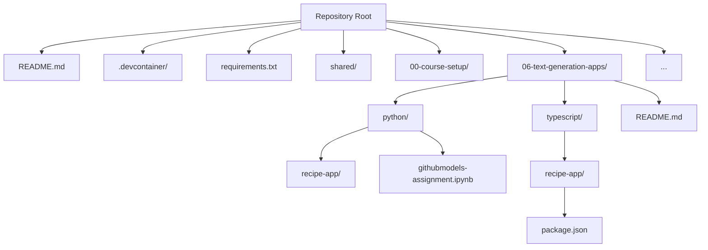

Sources: [README.md:1-113](), [06-text-generation-apps/python/githubmodels-assignment.ipynb:1-15](), [06-text-generation-apps/typescript/recipe-app/package.json:1-15]()

## Setup Requirements

Before starting the course, you will need:

1. **GitHub Account**: To [fork this entire repo](https://github.com/microsoft/generative-ai-for-beginners/fork) and access GitHub Codespaces [00-course-setup/README.md:11-13]().
2. **API Access**: Choose one of the following providers:
   - [Azure OpenAI Service](https://aka.ms/genai-beginners/azure-open-ai) [README.md:61-61]()
   - [GitHub Marketplace Model Catalog](https://aka.ms/genai-beginners/gh-models) [README.md:62-62]()
   - [OpenAI API](https://aka.ms/genai-beginners/open-ai) [README.md:63-63]()
3. **Basic Knowledge**: Familiarity with Python or TypeScript [README.md:65-65]().

Sources: [README.md:59-67](), [00-course-setup/README.md:11-17]()

## Setting Up Your Development Environment

### 1. Fork the Repository

To get started, you need to fork the repository to your own GitHub account:

1. Visit the [Generative AI for Beginners repository](https://github.com/microsoft/generative-ai-for-beginners).
2. Click the "Fork" button in the top-right corner [00-course-setup/README.md:13-13]().
3. Star (🌟) the repository to find it more easily later [README.md:70-70]().

### 2. Development Environment Options

You have several options for setting up your development environment:

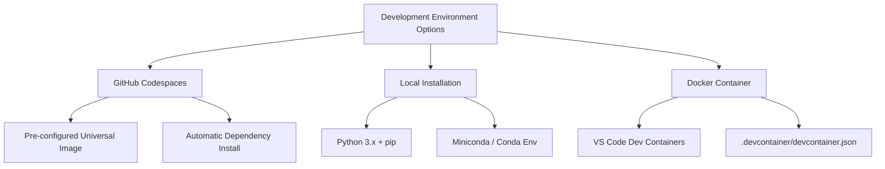

Sources: [00-course-setup/README.md:16-22](), [00-course-setup/README.md:91-148](), [.devcontainer/devcontainer.json:1-23]()

#### Option 1: GitHub Codespaces (Recommended)

GitHub Codespaces provides a cloud-based development environment with all dependencies pre-configured via the `.devcontainer/devcontainer.json` file [.devcontainer/devcontainer.json:1-23]().

1. From your forked repository, click **Code -> Codespaces -> New on main** [00-course-setup/README.md:19-19]().
2. The environment automatically runs `pip install -r requirements.txt` and a post-create script [.devcontainer/devcontainer.json:10-11]().

Sources: [00-course-setup/README.md:16-22](), [.devcontainer/devcontainer.json:10-11]()

#### Option 2: Local Python Installation

To run the code locally:

1. Clone your forked repository: `git clone https://github.com/microsoft/generative-ai-for-beginners` [00-course-setup/README.md:98-98]().
2. Install dependencies: `pip install -r requirements.txt` [requirements.txt:1-10]().
3. (Optional) Use Miniconda to manage a virtual environment using `.devcontainer/environment.yml` [00-course-setup/README.md:115-144]().

Sources: [00-course-setup/README.md:91-144](), [requirements.txt:1-11]()

### 3. API Setup and Configuration

Most coding lessons require access to an LLM provider. You must configure your credentials in a `.env` file.

#### Setting Up API Keys

1. Create a `.env` file in the root directory [00-course-setup/README.md:50-52]().
2. Populate it using the structure from `.env.copy` [.env.copy:1-12]():
   - `OPENAI_API_KEY`: For OpenAI API access [.env.copy:2-2]().
   - `AZURE_OPENAI_API_KEY` & `AZURE_OPENAI_ENDPOINT`: For Azure OpenAI Service [.env.copy:6-7]().
   - `GITHUB_TOKEN`: For GitHub Models access [00-course-setup/README.md:63-63]().

Sources: [.env.copy:1-12](), [00-course-setup/README.md:48-66]()

## Running the Lessons

Lessons include Jupyter Notebooks (e.g., `aoai-assignment.ipynb`) and standalone applications.

- **Notebooks**: Ensure the Python kernel is set to **Python 3** [00-course-setup/README.md:46-46]().
- **TypeScript**: Use `npm install` in the specific application directory (e.g., `06-text-generation-apps/typescript/recipe-app/`) to install dependencies like `@azure-rest/ai-inference` and `openai` [06-text-generation-apps/typescript/recipe-app/package.json:11-15]().

Sources: [07-building-chat-applications/python/aoai-assignment.ipynb:1-35](), [06-text-generation-apps/typescript/recipe-app/package.json:11-15]()

## Technical Requirements Table

| Component | Requirement |
|-----------|-------------|
| **Languages** | Python (using `openai`, `azure-ai-inference`, `python-dotenv`) [requirements.txt:6-9]() or TypeScript (using `@azure/openai`, `dotenv`) [06-text-generation-apps/typescript/recipe-app/package.json:11-18]() |
| **API Options** | Azure OpenAI, OpenAI, or GitHub Models [README.md:60-63]() |
| **Tools** | VS Code with Python and Jupyter extensions [.devcontainer/devcontainer.json:17-20]() |

Sources: [requirements.txt:1-11](), [README.md:60-63](), [.devcontainer/devcontainer.json:17-20]()

## Getting Help

If you encounter issues such as `401 Unauthorized` or missing kernels, refer to the **Troubleshooting** section in the course setup guide [00-course-setup/README.md:37-46](). You can also join the [Microsoft Foundry Discord](https://discord.gg/nTYy5BXMWG) [README.md:15-15]().

Sources: [00-course-setup/README.md:37-46](), [README.md:15-15]()

---

# Page: Development Environment

# Development Environment

<details>
<summary>Relevant source files</summary>

The following files were used as context for generating this wiki page:

- [.devcontainer/Setup.txt](.devcontainer/Setup.txt)
- [.devcontainer/devcontainer.json](.devcontainer/devcontainer.json)
- [.devcontainer/environment.yml](.devcontainer/environment.yml)
- [.devcontainer/icon.svg](.devcontainer/icon.svg)
- [.devcontainer/post-create.sh](.devcontainer/post-create.sh)
- [.env.copy](.env.copy)
- [00-course-setup/01-setup-cloud.md](00-course-setup/01-setup-cloud.md)
- [00-course-setup/02-setup-local.md](00-course-setup/02-setup-local.md)
- [00-course-setup/03-providers.md](00-course-setup/03-providers.md)
- [00-course-setup/README.md](00-course-setup/README.md)
- [06-text-generation-apps/python/githubmodels-assignment.ipynb](06-text-generation-apps/python/githubmodels-assignment.ipynb)
- [06-text-generation-apps/typescript/.gitignore](06-text-generation-apps/typescript/.gitignore)
- [06-text-generation-apps/typescript/recipe-app/.env-sample](06-text-generation-apps/typescript/recipe-app/.env-sample)
- [06-text-generation-apps/typescript/recipe-app/package-lock.json](06-text-generation-apps/typescript/recipe-app/package-lock.json)
- [06-text-generation-apps/typescript/recipe-app/package.json](06-text-generation-apps/typescript/recipe-app/package.json)
- [06-text-generation-apps/typescript/recipe-app/tsconfig.json](06-text-generation-apps/typescript/recipe-app/tsconfig.json)
- [07-building-chat-applications/python/aoai-assignment.ipynb](07-building-chat-applications/python/aoai-assignment.ipynb)
- [07-building-chat-applications/python/githubmodels-assignment.ipynb](07-building-chat-applications/python/githubmodels-assignment.ipynb)
- [07-building-chat-applications/python/oai-assignment.ipynb](07-building-chat-applications/python/oai-assignment.ipynb)
- [07-building-chat-applications/typescript/chat-completions-app/src/main.ts](07-building-chat-applications/typescript/chat-completions-app/src/main.ts)
- [07-building-chat-applications/typescript/chat-completions-app/tsconfig.json](07-building-chat-applications/typescript/chat-completions-app/tsconfig.json)
- [08-building-search-applications/python/aoai-solution.ipynb](08-building-search-applications/python/aoai-solution.ipynb)
- [08-building-search-applications/python/oai-solution.ipynb](08-building-search-applications/python/oai-solution.ipynb)
- [11-integrating-with-function-calling/python/aoai-assignment.ipynb](11-integrating-with-function-calling/python/aoai-assignment.ipynb)
- [11-integrating-with-function-calling/python/oai-assignment.ipynb](11-integrating-with-function-calling/python/oai-assignment.ipynb)
- [README.md](README.md)
- [docs/_sidebar.md](docs/_sidebar.md)
- [package-lock.json](package-lock.json)
- [package.json](package.json)
- [requirements.txt](requirements.txt)
- [translations/en/.co-op-translator.json](translations/en/.co-op-translator.json)
- [translations/en/README.md](translations/en/README.md)
- [translations/en/docs/ENHANCED_FEATURES_ROADMAP.md](translations/en/docs/ENHANCED_FEATURES_ROADMAP.md)
- [translations/en/docs/SECURITY_GUIDELINES.md](translations/en/docs/SECURITY_GUIDELINES.md)
- [translations/es/.co-op-translator.json](translations/es/.co-op-translator.json)
- [translations/es/README.md](translations/es/README.md)
- [translations/es/docs/ENHANCED_FEATURES_ROADMAP.md](translations/es/docs/ENHANCED_FEATURES_ROADMAP.md)
- [translations/es/docs/SECURITY_GUIDELINES.md](translations/es/docs/SECURITY_GUIDELINES.md)
- [translations/fr/.co-op-translator.json](translations/fr/.co-op-translator.json)
- [translations/fr/README.md](translations/fr/README.md)
- [translations/hi/00-course-setup/README.md](translations/hi/00-course-setup/README.md)
- [translations/ja/00-course-setup/02-setup-local.md](translations/ja/00-course-setup/02-setup-local.md)
- [translations/ja/00-course-setup/03-providers.md](translations/ja/00-course-setup/03-providers.md)
- [translations/ja/00-course-setup/README.md](translations/ja/00-course-setup/README.md)
- [translations/ko/00-course-setup/README.md](translations/ko/00-course-setup/README.md)
- [vs.code-profile](vs.code-profile)

</details>


This document provides detailed information about configuring the development environment for the Generative AI for Beginners course. It covers container configuration, required dependencies, and provider setup for Azure OpenAI, OpenAI API, and GitHub Models.

## Setup Options

There are multiple ways to set up your development environment. The recommended approach is to use **GitHub Codespaces** for a consistent experience, but local setup and dev container options are also available.

### Setup Options Overview

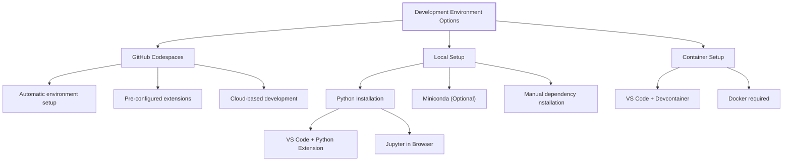

Sources: [.devcontainer/devcontainer.json:1-24](), [00-course-setup/README.md:15-19](), [00-course-setup/README.md:91-103]()

### GitHub Codespaces (Recommended)

GitHub Codespaces provides a pre-configured environment in the cloud. To create one, navigate to your fork of the repository and select **Code -> Codespaces -> New on main** [00-course-setup/README.md:15-19]().

- **Secrets**: Store your `OPENAI_API_KEY` or `GITHUB_TOKEN` using the **Manage user secret** option in the Codespaces command palette [00-course-setup/README.md:23-26]().
- **Persistence**: Codespaces uses the configuration in `.devcontainer/devcontainer.json` to build the environment [00-course-setup/README.md:15-17]().

### Local Setup

To run the code locally, you need [Python installed](https://www.python.org/downloads) [00-course-setup/README.md:91-93]().

1. **Clone the repository**:
   ```bash
   git clone https://github.com/microsoft/generative-ai-for-beginners
   cd generative-ai-for-beginners
   ```
   *Note: To skip 50+ language translations and reduce download size, use sparse checkout* [README.md:24-42]().
2. **Install Dependencies**:
   ```bash
   pip install -r requirements.txt
   ```

#### Using Miniconda

[Miniconda](https://conda.io/en/latest/miniconda.html) is recommended for managing isolated virtual environments [00-course-setup/README.md:106-111]().

1. **Create `environment.yml`**: Define dependencies like `openai`, `python-dotenv`, and `azure-ai-ml` [00-course-setup/README.md:115-131]().
2. **Initialize Environment**:
   ```bash
   conda env create --name ai4beg --file .devcontainer/environment.yml
   conda activate ai4beg
   ```

Sources: [README.md:24-42](), [00-course-setup/README.md:91-103](), [00-course-setup/README.md:106-148]()

## Dependencies and Requirements

The course uses a mix of Python for data science/notebook tasks and TypeScript for application building.

### Dependency Structure

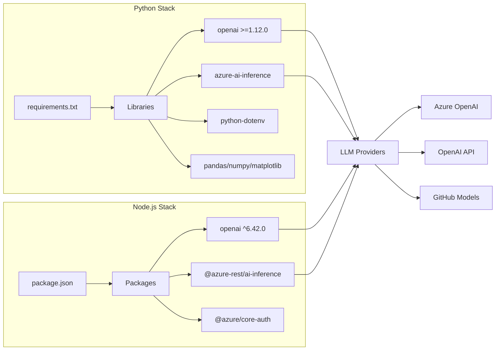

Sources: [requirements.txt:1-11](), [package.json:28-32](), [package-lock.json:11-15]()

### Python Dependencies
The `requirements.txt` file specifies the core libraries needed for the Jupyter notebooks and Python scripts:
- `openai>=1.12.0`: Main client for OpenAI and Azure OpenAI [requirements.txt:7]().
- `azure-ai-inference`: Used specifically for GitHub Models integration [requirements.txt:9]().
- `python-dotenv`: For loading configuration from `.env` files [requirements.txt:6]().
- Data Science tools: `numpy`, `pandas`, `matplotlib`, and `ipywidgets` for interactive notebook elements [requirements.txt:1-4]().

### Node.js Dependencies
The root `package.json` and lesson-specific packages (like `recipe-app`) include:
- `openai`: Client for OpenAI services [package.json:31]().
- `@azure-rest/ai-inference`: REST client for Azure AI Inference [package.json:29]().
- `@azure/core-auth`: Authentication for Azure services [package.json:30]().

Sources: [requirements.txt:1-11](), [package.json:28-32](), [06-text-generation-apps/typescript/recipe-app/package.json:11-18]()

## Provider Configuration

The course supports three primary providers. Configuration is typically handled via a `.env` file based on the provided template [00-course-setup/README.md:48-64]().

### Configuration Mapping

| Provider | Required Variables | Key Library |
| :--- | :--- | :--- |
| **Azure OpenAI** | `AZURE_OPENAI_API_KEY`, `AZURE_OPENAI_ENDPOINT`, `AZURE_OPENAI_DEPLOYMENT` | `openai` (AzureOpenAI class) |
| **OpenAI API** | `OPENAI_API_KEY` | `openai` (OpenAI class) |
| **GitHub Models** | `GITHUB_TOKEN` | `azure-ai-inference` |

Sources: [.env.copy:1-12](), [07-building-chat-applications/python/aoai-assignment.ipynb:182-194](), [07-building-chat-applications/python/githubmodels-assignment.ipynb:155-166]()

### Implementation Detail: GitHub Models
GitHub Models uses the `ChatCompletionsClient` from the Azure AI Inference SDK.

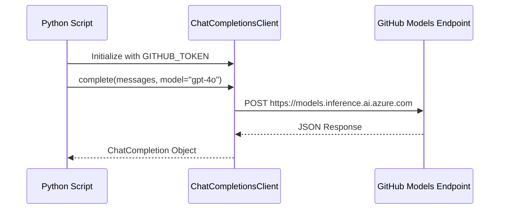

Sources: [07-building-chat-applications/python/githubmodels-assignment.ipynb:155-166](), [06-text-generation-apps/python/githubmodels-assignment.ipynb:79-110]()

## Container Configuration

The `.devcontainer` directory defines the automated setup for Codespaces and Docker-based local development.

### Dev Container Lifecycle
1. **Base Image**: Uses `mcr.microsoft.com/devcontainers/universal:2.13` [devcontainer.json:5]().
2. **Content Update**: Runs `python3 -m pip install -r requirements.txt` to ensure Python libraries are ready [devcontainer.json:10]().
3. **Post-Creation**: Executes `.devcontainer/post-create.sh` which manually ensures `python-dotenv` and `openai` are installed [devcontainer.json:11](), [.devcontainer/post-create.sh:3-6]().
4. **VS Code Extensions**: Automatically installs the Python (`ms-python.python`) and Jupyter (`ms-toolsai.jupyter`) extensions [devcontainer.json:16-21]().

Sources: [.devcontainer/devcontainer.json:1-24](), [.devcontainer/post-create.sh:1-12]()

## Troubleshooting

- **Container build stuck**: Use **Codespaces ➜ "Rebuild Container"** [00-course-setup/README.md:42]().
- **401 Unauthorized**: Verify your `OPENAI_API_KEY` or `GITHUB_TOKEN` in your `.env` or Codespace secrets [00-course-setup/README.md:44]().
- **Notebook kernel missing**: Select **Kernel ▸ Select Kernel ▸ Python 3** from the notebook menu [00-course-setup/README.md:46]().

Sources: [00-course-setup/README.md:37-47]()

---

# Page: Core Concepts

# Core Concepts

<details>
<summary>Relevant source files</summary>

The following files were used as context for generating this wiki page:

- [00-course-setup/README.md](00-course-setup/README.md)
- [01-introduction-to-genai/README.md](01-introduction-to-genai/README.md)
- [02-exploring-and-comparing-different-llms/README.md](02-exploring-and-comparing-different-llms/README.md)
- [03-using-generative-ai-responsibly/README.md](03-using-generative-ai-responsibly/README.md)
- [04-prompt-engineering-fundamentals/README.md](04-prompt-engineering-fundamentals/README.md)
- [05-advanced-prompts/README.md](05-advanced-prompts/README.md)
- [06-text-generation-apps/README.md](06-text-generation-apps/README.md)
- [07-building-chat-applications/README.md](07-building-chat-applications/README.md)
- [08-building-search-applications/README.md](08-building-search-applications/README.md)
- [09-building-image-applications/README.md](09-building-image-applications/README.md)
- [10-building-low-code-ai-applications/README.md](10-building-low-code-ai-applications/README.md)
- [11-integrating-with-function-calling/README.md](11-integrating-with-function-calling/README.md)
- [12-designing-ux-for-ai-applications/README.md](12-designing-ux-for-ai-applications/README.md)
- [README.md](README.md)
- [translations/en/.co-op-translator.json](translations/en/.co-op-translator.json)
- [translations/en/README.md](translations/en/README.md)
- [translations/en/docs/ENHANCED_FEATURES_ROADMAP.md](translations/en/docs/ENHANCED_FEATURES_ROADMAP.md)
- [translations/en/docs/SECURITY_GUIDELINES.md](translations/en/docs/SECURITY_GUIDELINES.md)
- [translations/es/.co-op-translator.json](translations/es/.co-op-translator.json)
- [translations/es/README.md](translations/es/README.md)
- [translations/es/docs/ENHANCED_FEATURES_ROADMAP.md](translations/es/docs/ENHANCED_FEATURES_ROADMAP.md)
- [translations/es/docs/SECURITY_GUIDELINES.md](translations/es/docs/SECURITY_GUIDELINES.md)
- [translations/fr/.co-op-translator.json](translations/fr/.co-op-translator.json)
- [translations/fr/README.md](translations/fr/README.md)

</details>


This document provides an overview of the fundamental principles and technologies underlying Generative AI systems. Here you'll learn what Generative AI is, how Large Language Models (LLMs) work, the different types of LLMs, prompt engineering basics, and responsible AI practices.

For information about setting up your development environment, see [Course Structure and Setup](#2). For specific implementation details about building applications, see [Building GenAI Applications](#4).

## What is Generative AI?

Generative AI refers to artificial intelligence systems capable of generating new content, including text, images, audio, and other types of media [01-introduction-to-genai/README.md:7-7](). What makes it revolutionary is that it democratizes AI - users can interact with it using natural language prompts rather than requiring specialized programming knowledge [01-introduction-to-genai/README.md:7-8]().

The key technology behind modern generative AI is Large Language Models (LLMs), which are trained on vast amounts of unlabeled data to understand and generate human-like text [01-introduction-to-genai/README.md:68-68]().

### Evolution of AI to Generative AI

The transition from traditional rule-based systems to Generative AI involved several major architectural shifts, notably the move from Recurrent Neural Networks (RNNs) to the Transformer architecture [01-introduction-to-genai/README.md:56-66]().

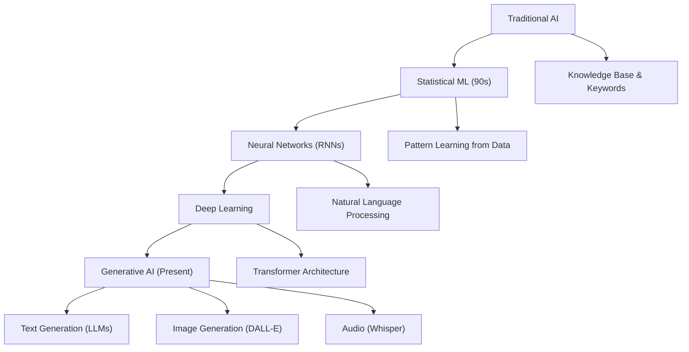
Sources: [01-introduction-to-genai/README.md:41-68]()

### How LLMs Work

LLMs receive text as input and generate text as output. Because they are statistical models, they process data through a tokenizer [01-introduction-to-genai/README.md:72-74]().

1.  **Tokenization**: Breaking input text into tokens (chunks of text converted to numeric indices) [01-introduction-to-genai/README.md:74-74]().
2.  **Neural Network Processing**: Processing tokens using the transformer architecture and attention mechanisms [01-introduction-to-genai/README.md:66-66]().
3.  **Output Token Prediction**: Predicting the next token based on probability distribution [01-introduction-to-genai/README.md:78-78]().
4.  **Text Generation**: Building complete responses token by token.

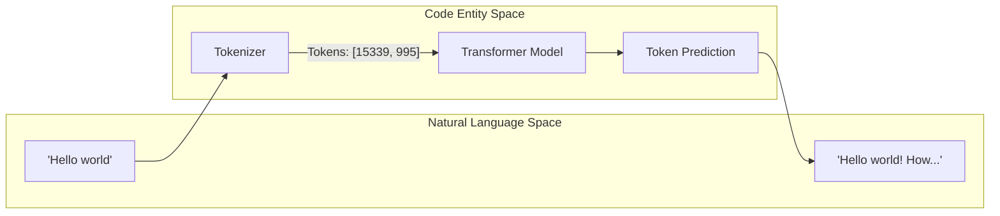
Sources: [01-introduction-to-genai/README.md:70-78](), [04-prompt-engineering-fundamentals/README.md:82-87]()

## Types of LLMs

Large Language Models are categorized by their architecture, access, and modality [02-exploring-and-comparing-different-llms/README.md:29-31]().

### Classification of LLMs

-   **Foundation Models**: Large models trained on unlabeled data intended to serve as a starting point for specialized tasks [02-exploring-and-comparing-different-llms/README.md:45-51]().
-   **Open Source vs. Proprietary**: Open models (e.g., Llama, Mistral) allow inspection and modification, while proprietary models (e.g., GPT-4, Claude) are managed by companies [02-exploring-and-comparing-different-llms/README.md:64-70]().
-   **Modality**: Models can be specialized for text, audio (Whisper), or images (DALL-E) [02-exploring-and-comparing-different-llms/README.md:33-41]().

### Model Integration (Python)

The course primarily uses the `openai` library to interact with these models [06-text-generation-apps/README.md:79-79]().

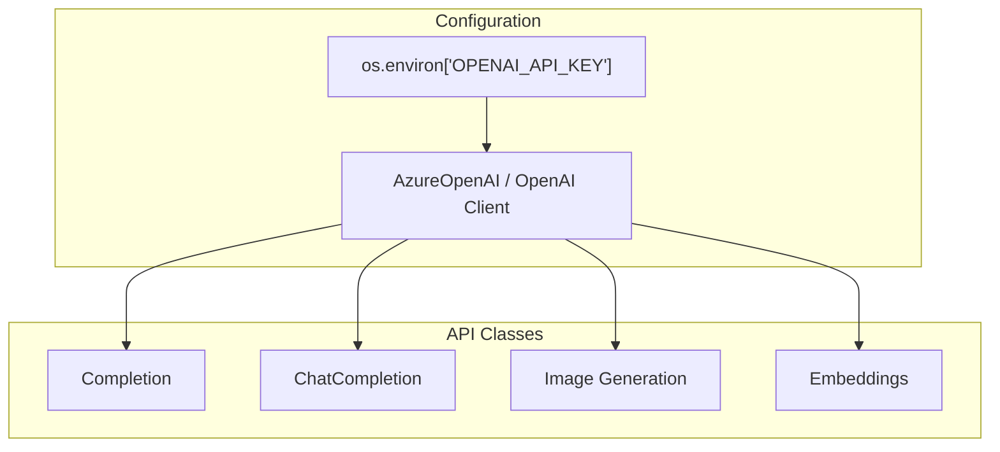
Sources: [06-text-generation-apps/README.md:113-146](), [09-building-image-applications/README.md:130-147](), [11-integrating-with-function-calling/README.md:63-69]()

For more details on model selection, see [Introduction to Generative AI](#3.1).

## Improving LLM Results

There are several approaches to optimize model output, ranging from prompt design to data-heavy customization [02-exploring-and-comparing-different-llms/README.md:43-43]().

| Approach | Description | Complexity |
| :--- | :--- | :--- |
| **Prompt Engineering** | Designing and refining inputs to guide the model [04-prompt-engineering-fundamentals/README.md:12-12](). | Low |
| **RAG** | Retrieving external data to provide context to the prompt [08-building-search-applications/README.md:7-9](). | Medium |
| **Fine-Tuning** | Training a model on a specialized dataset to adapt its behavior [02-exploring-and-comparing-different-llms/README.md:51-51](). | High |

Sources: [02-exploring-and-comparing-different-llms/README.md:43-51](), [04-prompt-engineering-fundamentals/README.md:12-12]()

## Prompt Engineering

Prompt engineering is the primary programming interface for Generative AI applications [04-prompt-engineering-fundamentals/README.md:12-12](). It involves constructing the prompt with context and constraints to achieve consistent quality [05-advanced-prompts/README.md:9-11]().

### Core Techniques
-   **Zero-shot**: Requesting a response with no examples [05-advanced-prompts/README.md:69-71]().
-   **Few-shot**: Providing examples to guide the model [05-advanced-prompts/README.md:76-78]().
-   **Chain-of-thought**: Instructing the model to break down problems into steps [05-advanced-prompts/README.md:89-91]().

### Configuration Parameters
Models accept parameters like `temperature` to control output randomness (0 for deterministic, 1 for creative) and `max_tokens` to limit output length [06-text-generation-apps/README.md:25-25]().

For details, see [Prompt Engineering Fundamentals](#3.2) and [Advanced Prompting Techniques](#3.3).

## Responsible AI and UX

Building AI applications requires addressing ethical implications and user trust [03-using-generative-ai-responsibly/README.md]() (inferred).

### Responsible AI Practices
Developers must mitigate risks such as **hallucinations** (false information), **bias**, and **privacy** concerns [12-designing-ux-for-ai-applications/README.md:42-42](). Implementation should follow the mitigation layer strategy.

### UX Principles
Effective AI UX focuses on:
-   **Explainability**: Helping users understand how AI arrived at an output [12-designing-ux-for-ai-applications/README.md:62-64]().
-   **Control**: Allowing users to modify results and opt-in/out of data usage [12-designing-ux-for-ai-applications/README.md:76-78]().
-   **Friction**: Intentionally reminding users they are interacting with an AI [12-designing-ux-for-ai-applications/README.md:86-86]().

For details, see [Responsible AI Practices](#3.4) and [UX Design for AI Applications](#5.4).

## Integration Patterns

Modern applications integrate LLMs using structured patterns:

### Function Calling
Allows models to generate structured JSON arguments for functions defined in your code, enabling integration with external APIs like weather services or databases [11-integrating-with-function-calling/README.md:41-44]().

### Retrieval Augmented Generation (RAG)
Uses **Embeddings** (numerical vectors) and **Cosine Similarity** to find relevant documents in a vector database to enrich the prompt context [08-building-search-applications/README.md:7-11](), [08-building-search-applications/README.md:78-82]().

For details on implementation, see [Function Calling Integration](#4.6) and [RAG and Vector Databases](#5.1).

Sources:
- [01-introduction-to-genai/README.md]()
- [02-exploring-and-comparing-different-llms/README.md]()
- [04-prompt-engineering-fundamentals/README.md]()
- [05-advanced-prompts/README.md]()
- [06-text-generation-apps/README.md]()
- [08-building-search-applications/README.md]()
- [11-integrating-with-function-calling/README.md]()
- [12-designing-ux-for-ai-applications/README.md]()

---

# Page: Introduction to Generative AI

# Introduction to Generative AI

<details>
<summary>Relevant source files</summary>

The following files were used as context for generating this wiki page:

- [01-introduction-to-genai/README.md](01-introduction-to-genai/README.md)
- [02-exploring-and-comparing-different-llms/README.md](02-exploring-and-comparing-different-llms/README.md)
- [02-exploring-and-comparing-different-llms/images/AzureAIStudioModelCatalog.png](02-exploring-and-comparing-different-llms/images/AzureAIStudioModelCatalog.png)
- [02-exploring-and-comparing-different-llms/images/FineTuning.png](02-exploring-and-comparing-different-llms/images/FineTuning.png)
- [02-exploring-and-comparing-different-llms/images/Llama1.png](02-exploring-and-comparing-different-llms/images/Llama1.png)
- [02-exploring-and-comparing-different-llms/images/Llama2.png](02-exploring-and-comparing-different-llms/images/Llama2.png)
- [02-exploring-and-comparing-different-llms/images/Llama3.png](02-exploring-and-comparing-different-llms/images/Llama3.png)
- [02-exploring-and-comparing-different-llms/images/Llama4.png](02-exploring-and-comparing-different-llms/images/Llama4.png)
- [02-exploring-and-comparing-different-llms/images/ModelBenchmarks.png](02-exploring-and-comparing-different-llms/images/ModelBenchmarks.png)
- [02-exploring-and-comparing-different-llms/images/ModelCard.png](02-exploring-and-comparing-different-llms/images/ModelCard.png)
- [02-exploring-and-comparing-different-llms/images/ModelDeploy.png](02-exploring-and-comparing-different-llms/images/ModelDeploy.png)
- [03-using-generative-ai-responsibly/README.md](03-using-generative-ai-responsibly/README.md)
- [04-prompt-engineering-fundamentals/README.md](04-prompt-engineering-fundamentals/README.md)
- [05-advanced-prompts/README.md](05-advanced-prompts/README.md)
- [06-text-generation-apps/README.md](06-text-generation-apps/README.md)
- [07-building-chat-applications/README.md](07-building-chat-applications/README.md)
- [08-building-search-applications/README.md](08-building-search-applications/README.md)
- [09-building-image-applications/README.md](09-building-image-applications/README.md)
- [10-building-low-code-ai-applications/README.md](10-building-low-code-ai-applications/README.md)
- [11-integrating-with-function-calling/README.md](11-integrating-with-function-calling/README.md)
- [12-designing-ux-for-ai-applications/README.md](12-designing-ux-for-ai-applications/README.md)
- [translations/ja/01-introduction-to-genai/README.md](translations/ja/01-introduction-to-genai/README.md)

</details>


## Purpose and Scope

This document provides a technical introduction to Generative AI, focusing on its fundamental mechanics, core capabilities, and implementation patterns within the codebase. It explains the transition from traditional AI to Large Language Models (LLMs) and provides a technical overview of how these models are integrated into software via APIs and SDKs.

## What is Generative AI?

Generative AI is a subset of deep learning based on the **Transformer** architecture [01-introduction-to-genai/README.md:62-68](). Unlike traditional discriminative AI that classifies data, Generative AI creates new content (text, images, code, etc.) in response to natural language inputs called "prompts" [04-prompt-engineering-fundamentals/README.md:8-12]().

### The Generative Pipeline
The following diagram bridges the gap between the natural language input provided by a user and the specific code entities used in the `openai` library to process that input.

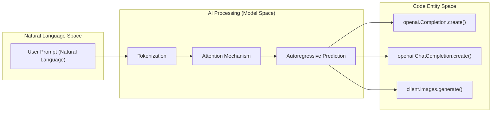
Title: Generative AI Pipeline from User Input to Code Implementation

Sources: [01-introduction-to-genai/README.md:66-74](), [04-prompt-engineering-fundamentals/README.md:12-13](), [06-text-generation-apps/README.md:134-141](), [09-building-image-applications/README.md:143-147]()

## How Large Language Models Work

### Tokenization
LLMs do not process raw text; they process sequences of numbers. Every input is processed by a **tokenizer** [01-introduction-to-genai/README.md:74-76]().

1.  **Text Splitting**: The input is broken into "tokens" (words, sub-words, or characters).
2.  **Mapping**: Each token is assigned a unique integer index based on the model's vocabulary.
3.  **Encoding**: These indices are fed into the neural network.

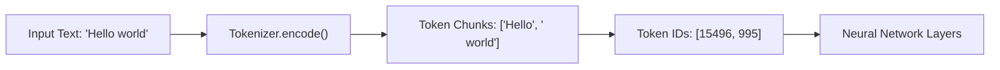
Title: Data Flow from Text to Model Input

Sources: [01-introduction-to-genai/README.md:74-76](), [04-prompt-engineering-fundamentals/README.md:82-87]()

### Prediction and Temperature
LLMs are statistical models that predict the next token in a sequence [01-introduction-to-genai/README.md:78-80](). The `temperature` parameter influences this selection:

*   **Temperature = 0**: The model is deterministic, always choosing the most likely token [06-text-generation-apps/README.md:589-599]().
*   **Temperature > 0**: The model introduces randomness, allowing for "creative" or varied responses.

Sources: [01-introduction-to-genai/README.md:80-81](), [06-text-generation-apps/README.md:589-599]()

## Comparing Model Families

The landscape of LLMs includes both proprietary and open-source models, each with distinct architectures and use cases.

| Model Family | Type | Primary Use Case | Access Method in Repo |
| :--- | :--- | :--- | :--- |
| **GPT (OpenAI)** | Proprietary | General purpose, Chat, Coding | `AzureOpenAI` client [06-text-generation-apps/README.md:116-121]() |
| **Llama (Meta)** | Open Source | Research, Local deployment | Azure AI Foundry / GitHub Models [02-exploring-and-comparing-different-llms/README.md:68]() |
| **Mistral** | Open Source | Efficiency, Reasoning | Azure AI Foundry / GitHub Models [02-exploring-and-comparing-different-llms/README.md:31-35]() |
| **Phi (Microsoft)** | SLM (Small) | Edge devices, low latency | GitHub Models [02-exploring-and-comparing-different-llms/README.md:31-35]() |
| **DALL-E** | Image Gen | Text-to-Image | `client.images.generate()` [09-building-image-applications/README.md:143]() |

Sources: [02-exploring-and-comparing-different-llms/README.md:64-70](), [09-building-image-applications/README.md:43-56]()

## Implementation Architecture

The repository demonstrates a standardized pattern for connecting to Generative AI services using environment variables and client classes.

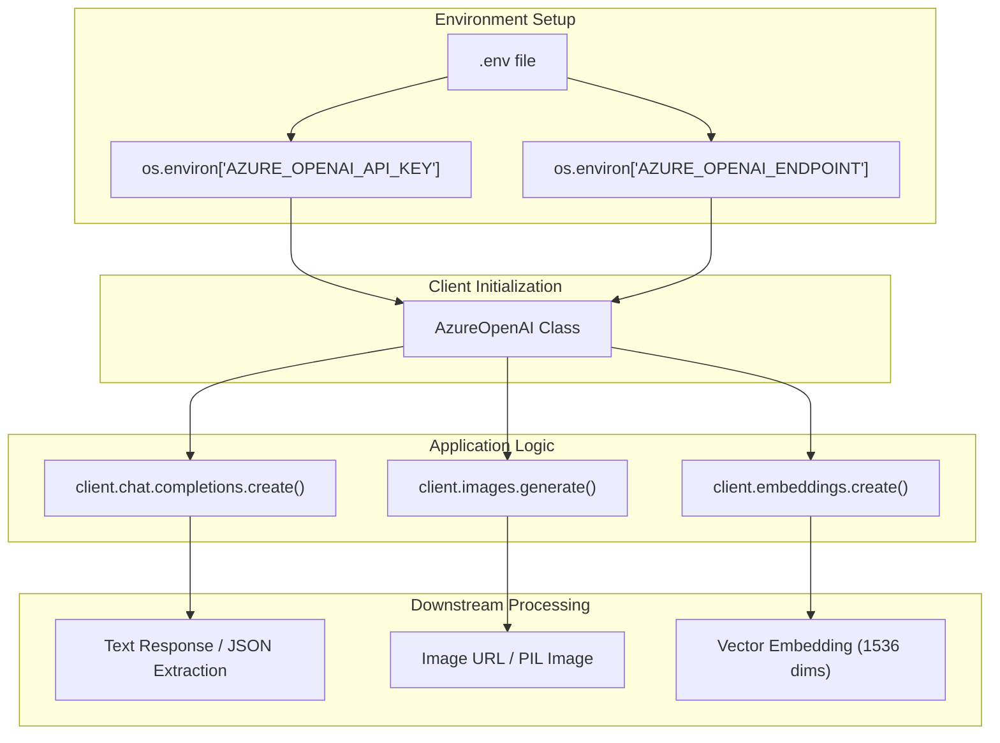
Title: Technical Implementation Architecture

Sources: [06-text-generation-apps/README.md:116-121](), [09-building-image-applications/README.md:136-140](), [11-integrating-with-function-calling/README.md:63-69]()

## Advanced Capabilities

### Function Calling
Function calling allows the LLM to output structured JSON instead of plain text, enabling integration with external APIs like the Microsoft Learn Catalog API [11-integrating-with-function-calling/README.md:25-34]().

```python
# Example structure from the codebase
response = client.chat.completions.create(
    model=deployment,
    messages=[{'role': 'user', 'content': prompt}],
    functions=functions_schema # Defined JSON schema
)
```
Sources: [11-integrating-with-function-calling/README.md:119-131]()

### Embeddings and Semantic Search
Embeddings convert text into high-dimensional vectors (e.g., 1536 numbers). These are used to calculate **Cosine Similarity** to find relevant data in a vector database [08-building-search-applications/README.md:46-60]().

Sources: [08-building-search-applications/README.md:78-83]()

## Responsible AI Considerations

Developing with Generative AI requires a multi-layered mitigation strategy [03-using-generative-ai-responsibly/README.md:87-91]():

1.  **Model Layer**: Choosing the right model (e.g., GPT-4 vs. Phi).
2.  **Safety System**: Implementing content filters (e.g., Azure OpenAI Content Filtering).
3.  **Metaprompt Layer**: Using system messages to define boundaries.
4.  **User Experience**: Designing UI to handle hallucinations and provide feedback loops.

Sources: [03-using-generative-ai-responsibly/README.md:93-101]()

---

# Page: Prompt Engineering Fundamentals

# Prompt Engineering Fundamentals

<details>
<summary>Relevant source files</summary>

The following files were used as context for generating this wiki page:

- [01-introduction-to-genai/README.md](01-introduction-to-genai/README.md)
- [02-exploring-and-comparing-different-llms/README.md](02-exploring-and-comparing-different-llms/README.md)
- [03-using-generative-ai-responsibly/README.md](03-using-generative-ai-responsibly/README.md)
- [04-prompt-engineering-fundamentals/README.md](04-prompt-engineering-fundamentals/README.md)
- [04-prompt-engineering-fundamentals/images/04-fabrication-aoai.png](04-prompt-engineering-fundamentals/images/04-fabrication-aoai.png)
- [04-prompt-engineering-fundamentals/images/04-fabrication-huggingchat.png](04-prompt-engineering-fundamentals/images/04-fabrication-huggingchat.png)
- [04-prompt-engineering-fundamentals/images/04-fabrication-oai.png](04-prompt-engineering-fundamentals/images/04-fabrication-oai.png)
- [04-prompt-engineering-fundamentals/python/githubmodels-assignment.ipynb](04-prompt-engineering-fundamentals/python/githubmodels-assignment.ipynb)
- [05-advanced-prompts/README.md](05-advanced-prompts/README.md)
- [06-text-generation-apps/README.md](06-text-generation-apps/README.md)
- [07-building-chat-applications/README.md](07-building-chat-applications/README.md)
- [08-building-search-applications/README.md](08-building-search-applications/README.md)
- [09-building-image-applications/README.md](09-building-image-applications/README.md)
- [10-building-low-code-ai-applications/README.md](10-building-low-code-ai-applications/README.md)
- [11-integrating-with-function-calling/README.md](11-integrating-with-function-calling/README.md)
- [12-designing-ux-for-ai-applications/README.md](12-designing-ux-for-ai-applications/README.md)
- [translations/bn/04-prompt-engineering-fundamentals/README.md](translations/bn/04-prompt-engineering-fundamentals/README.md)
- [translations/hi/04-prompt-engineering-fundamentals/README.md](translations/hi/04-prompt-engineering-fundamentals/README.md)
- [translations/it/04-prompt-engineering-fundamentals/README.md](translations/it/04-prompt-engineering-fundamentals/README.md)
- [translations/ja/04-prompt-engineering-fundamentals/README.md](translations/ja/04-prompt-engineering-fundamentals/README.md)
- [translations/ko/04-prompt-engineering-fundamentals/README.md](translations/ko/04-prompt-engineering-fundamentals/README.md)
- [translations/mr/04-prompt-engineering-fundamentals/README.md](translations/mr/04-prompt-engineering-fundamentals/README.md)
- [translations/ne/04-prompt-engineering-fundamentals/README.md](translations/ne/04-prompt-engineering-fundamentals/README.md)
- [translations/pa/04-prompt-engineering-fundamentals/README.md](translations/pa/04-prompt-engineering-fundamentals/README.md)
- [translations/pl/04-prompt-engineering-fundamentals/README.md](translations/pl/04-prompt-engineering-fundamentals/README.md)
- [translations/pt-BR/04-prompt-engineering-fundamentals/README.md](translations/pt-BR/04-prompt-engineering-fundamentals/README.md)
- [translations/pt-PT/04-prompt-engineering-fundamentals/README.md](translations/pt-PT/04-prompt-engineering-fundamentals/README.md)
- [translations/tr/04-prompt-engineering-fundamentals/README.md](translations/tr/04-prompt-engineering-fundamentals/README.md)

</details>


Prompt Engineering is the process of designing and refining text inputs (prompts) to effectively communicate with Large Language Models (LLMs). This document explains the core concepts, techniques, and best practices of prompt engineering to help you create more effective prompts that yield consistent and high-quality responses from LLMs.

## Purpose and Scope

This document covers:
- What prompt engineering is and why it's important.
- Core concepts including tokenization and model types.
- How to construct effective prompts using zero-shot, few-shot, and chain-of-thought techniques.
- Best practices and fundamental techniques for prompt engineering.
- Metaprompting and temperature control for application stability.

## What is Prompt Engineering?

Prompt Engineering is the process of designing and optimizing text inputs (prompts) to deliver consistent and quality responses (completions) for a given application objective and model. This involves both the initial design of prompts and their iterative refinement to improve response quality.

### Prompt Engineering Lifecycle
The following diagram maps the conceptual process of prompt engineering to the code-level configuration and logic required to implement it.

**Natural Language to Code Entity Space**
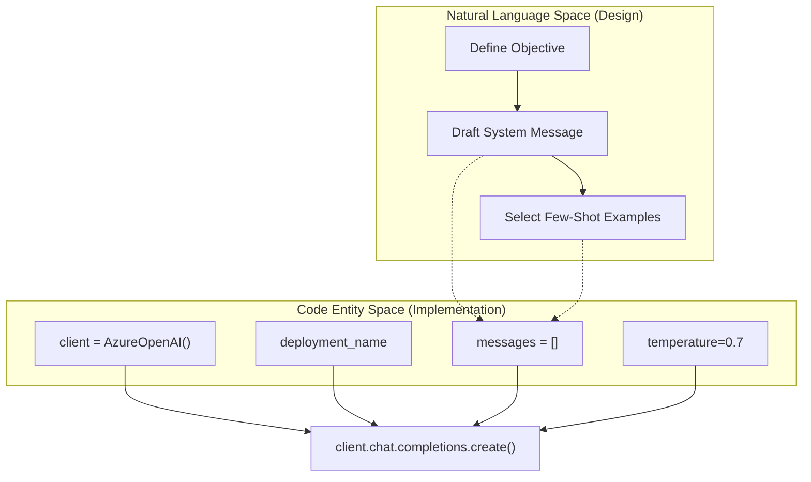
Sources: [04-prompt-engineering-fundamentals/README.md:69-76](), [06-text-generation-apps/README.md:134-143]()

## Core Concepts

### Tokenization
LLMs do not process raw text; they see prompts as a sequence of tokens. A token is a chunk of text consisting of a variable number of characters. The way a prompt is tokenized directly impacts the quality of the generated response and the cost (as APIs often charge per token).

Sources: [04-prompt-engineering-fundamentals/README.md:82-86](), [01-introduction-to-genai/README.md:74-76]()

### Model Types and Architectures
The codebase distinguishes between different types of models that require different prompting strategies:

1.  **Foundation Models (Base LLMs)**: Trained primarily to predict the next token in a sequence. They excel at pattern completion but may not follow instructions well.
2.  **Instruction-Tuned LLMs**: Fine-tuned with specific instructions and Reinforcement Learning from Human Feedback (RLHF) to follow tasks.
3.  **Multi-modal Models**: Capable of processing both text and other data types, such as `gpt-4o` or `gpt-4-vision`.

Sources: [04-prompt-engineering-fundamentals/README.md:94-112](), [02-exploring-and-comparing-different-llms/README.md:41-43]()

## Prompting Techniques

### Zero-Shot Prompting
The most basic form of prompting where a single request is made without any examples. The model relies entirely on its pre-trained knowledge.
- **Example**: "What is Algebra?"

Sources: [05-advanced-prompts/README.md:69-74]()

### Few-Shot Prompting
This technique provides one or more examples (shots) within the prompt to guide the model's response format, style, or logic.
- **Implementation**: Examples are typically passed as a series of `user` and `assistant` messages in the `messages` array of a `ChatCompletion` call.

Sources: [05-advanced-prompts/README.md:76-88](), [04-prompt-engineering-fundamentals/README.md:251-266]()

### Chain-of-Thought (CoT)
CoT instructs the LLM to break down a problem into intermediate steps. This significantly improves performance on reasoning and mathematical tasks.
- **Pattern**: Provide an example that shows the calculation or reasoning steps before asking the final question.

Sources: [05-advanced-prompts/README.md:89-117]()

### Metaprompting (System Messages)
Metaprompts (often implemented as the `system` role in the OpenAI API) define the persona, boundaries, and behavioral constraints of the AI.

**System Message Integration Diagram**
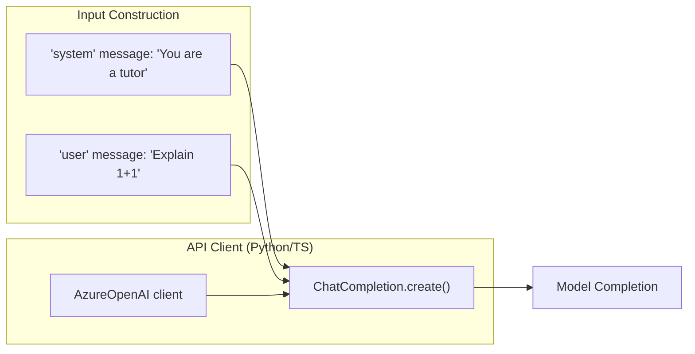
Sources: [04-prompt-engineering-fundamentals/README.md:198-217](), [03-using-generative-ai-responsibly/README.md:97-100]()

## Configuration Parameters

The behavior of a prompt is heavily influenced by the API parameters used during the call.

| Parameter | Range | Description |
| :--- | :--- | :--- |
| `temperature` | 0.0 - 1.0 | Controls randomness. 0.0 is deterministic; 1.0 is highly creative. |
| `max_tokens` | Variable | Limits the length of the completion to manage costs and prevent runaway generation. |
| `top_p` | 0.0 - 1.0 | Nucleus sampling; an alternative to temperature for controlling diversity. |

Sources: [06-text-generation-apps/README.md:15-17](), [05-advanced-prompts/README.md:18-25]()

## Best Practices for Effective Prompts

1.  **Be Specific**: Define the persona, audience, and desired format (e.g., "Return the output as a JSON object").
2.  **Use Delimiters**: Use symbols like `###`, `"""`, or `---` to separate instructions from the content being processed.
3.  **Provide Cues**: End the prompt with a leading phrase like "JSON output:" or "Step 1:" to nudge the model into the correct format.
4.  **Order Matters**: Information placed at the beginning or very end of a prompt often receives more "attention" from the model.
5.  **Fallback Instructions**: Instruct the model on what to do if it cannot find an answer (e.g., "If the answer is not in the text, say 'I do not know'").

Sources: [04-prompt-engineering-fundamentals/README.md:328-342](), [11-integrating-with-function-calling/README.md:86-113]()

## Technical Implementation (Python)

The following example demonstrates a structured prompt using `AzureOpenAI` in Python, incorporating a system persona and specific formatting instructions.

```python
# [06-text-generation-apps/README.md:116-121]
import os
from openai import AzureOpenAI

client = AzureOpenAI(
    api_key=os.environ["OPENAI_API_KEY"],
    api_version="2023-05-15",
    azure_endpoint=os.getenv("API_BASE")
)

# [11-integrating-with-function-calling/README.md:119-131]
response = client.chat.completions.create(
    model="gpt-35-turbo",
    messages=[
        {"role": "system", "content": "You are a helpful education assistant. Always return JSON."},
        {"role": "user", "content": "Extract name and major from: Emily Johnson is a sophomore majoring in computer science."}
    ],
    temperature=0.0 # Low temperature for consistent JSON extraction
)
```

Sources: [06-text-generation-apps/README.md:116-131](), [11-integrating-with-function-calling/README.md:119-131]()

## Challenges and Mitigations

| Challenge | Description | Mitigation Technique |
| :--- | :--- | :--- |
| **Hallucinations** | Factually incorrect but confident-sounding responses. | Use Grounding (RAG) or ask for citations. [03-using-generative-ai-responsibly/README.md:39-54]() |
| **Stochasticity** | Different outputs for the same input. | Set `temperature` to 0. [05-advanced-prompts/README.md:25]() |
| **Prompt Injection** | Users trying to bypass system instructions. | Use Metaprompts and input validation. [03-using-generative-ai-responsibly/README.md:97-100]() |

Sources: [03-using-generative-ai-responsibly/README.md:39-100](), [05-advanced-prompts/README.md:25]()

---

# Page: Advanced Prompting Techniques

# Advanced Prompting Techniques

<details>
<summary>Relevant source files</summary>

The following files were used as context for generating this wiki page:

- [01-introduction-to-genai/README.md](01-introduction-to-genai/README.md)
- [02-exploring-and-comparing-different-llms/README.md](02-exploring-and-comparing-different-llms/README.md)
- [03-using-generative-ai-responsibly/README.md](03-using-generative-ai-responsibly/README.md)
- [04-prompt-engineering-fundamentals/README.md](04-prompt-engineering-fundamentals/README.md)
- [05-advanced-prompts/README.md](05-advanced-prompts/README.md)
- [06-text-generation-apps/README.md](06-text-generation-apps/README.md)
- [06-text-generation-apps/python/aoai-app-recipe.py](06-text-generation-apps/python/aoai-app-recipe.py)
- [06-text-generation-apps/python/aoai-app.py](06-text-generation-apps/python/aoai-app.py)
- [06-text-generation-apps/python/aoai-assignment.ipynb](06-text-generation-apps/python/aoai-assignment.ipynb)
- [06-text-generation-apps/python/aoai-history-bot.py](06-text-generation-apps/python/aoai-history-bot.py)
- [06-text-generation-apps/python/aoai-study-buddy.py](06-text-generation-apps/python/aoai-study-buddy.py)
- [06-text-generation-apps/python/githubmodels-app.py](06-text-generation-apps/python/githubmodels-app.py)
- [06-text-generation-apps/python/oai-app-recipe.py](06-text-generation-apps/python/oai-app-recipe.py)
- [06-text-generation-apps/python/oai-app.py](06-text-generation-apps/python/oai-app.py)
- [06-text-generation-apps/python/oai-assigment.ipynb](06-text-generation-apps/python/oai-assigment.ipynb)
- [06-text-generation-apps/python/oai-history-bot.py](06-text-generation-apps/python/oai-history-bot.py)
- [06-text-generation-apps/python/oai-study-buddy.py](06-text-generation-apps/python/oai-study-buddy.py)
- [07-building-chat-applications/README.md](07-building-chat-applications/README.md)
- [08-building-search-applications/README.md](08-building-search-applications/README.md)
- [09-building-image-applications/README.md](09-building-image-applications/README.md)
- [10-building-low-code-ai-applications/README.md](10-building-low-code-ai-applications/README.md)
- [11-integrating-with-function-calling/README.md](11-integrating-with-function-calling/README.md)
- [12-designing-ux-for-ai-applications/README.md](12-designing-ux-for-ai-applications/README.md)
- [translations/ja/05-advanced-prompts/README.md](translations/ja/05-advanced-prompts/README.md)

</details>


This document explores advanced prompting techniques that can be applied to Large Language Models (LLMs) to improve and control their outputs. It covers methods beyond basic prompting that help achieve more accurate, useful, and consistent results, particularly for complex business and educational scenarios. For information about prompt engineering fundamentals, see [Prompt Engineering Fundamentals](#3.2).

## Overview of Advanced Prompting Techniques

Advanced prompting is the process of creating prompts that produce a desired outcome by leveraging emergent properties of LLMs. These properties are not built-in features but are discovered through iterative use [05-advanced-prompts/README.md:27-58]().

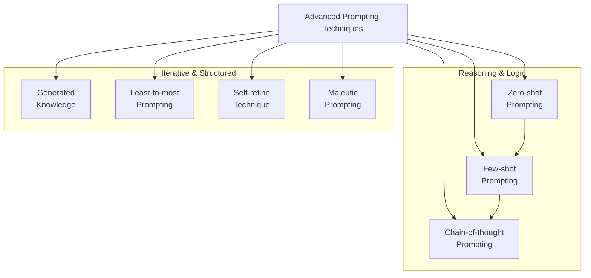
Sources: [05-advanced-prompts/README.md:56-67]()

## Core Reasoning Techniques

### Zero-shot Prompting
The most basic form where a single prompt requests a response based solely on the model's pre-existing training data [05-advanced-prompts/README.md:61-61]().
*   **Example:** "What is Algebra?" [05-advanced-prompts/README.md:73-73]().

### Few-shot Prompting
Guides the LLM by providing one or more examples (task-specific data) that it can rely on to generate its response, helping it understand context, format, or style [05-advanced-prompts/README.md:62-62](), [05-advanced-prompts/README.md:87-88]().

### Chain-of-thought (CoT)
Instructs the LLM to break down a problem into logical steps [05-advanced-prompts/README.md:63-63](). This is essential for preventing calculation errors in logic-heavy tasks [05-advanced-prompts/README.md:91-96]().

**Scenario: Logical Reasoning in Code Space**
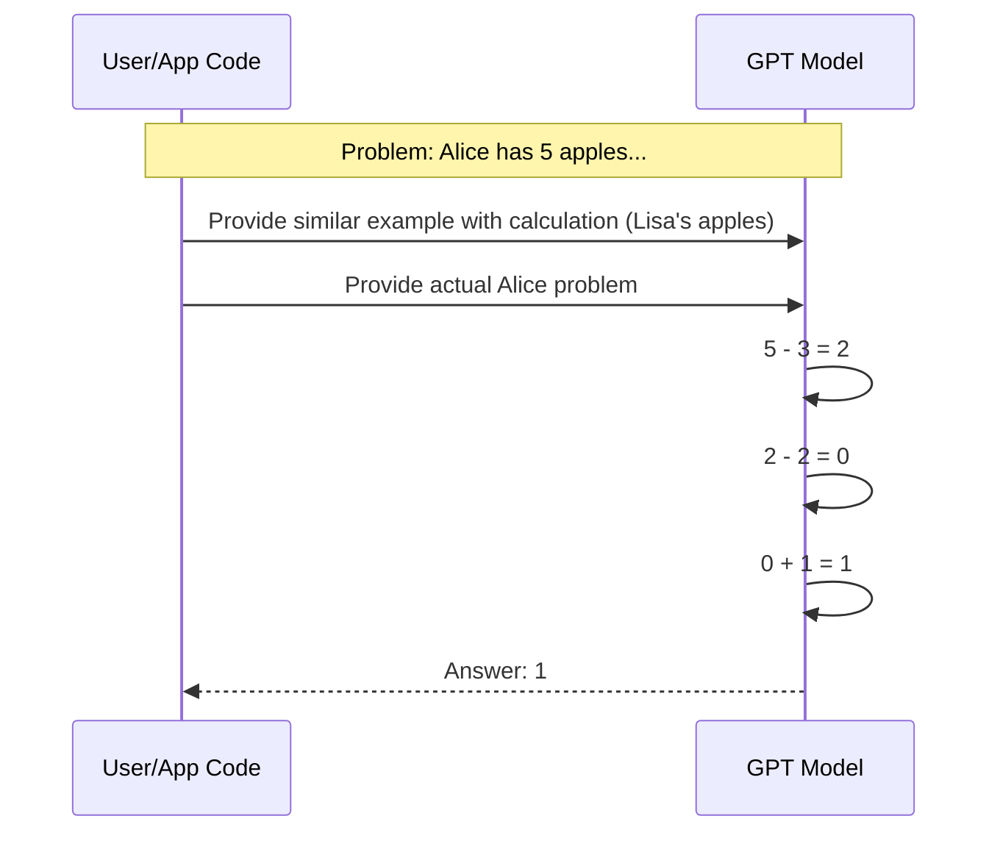
Sources: [05-advanced-prompts/README.md:100-117]()

## Structured Output and Knowledge Integration

### Generated Knowledge
To improve responses, you can provide specific facts or domain knowledge alongside the prompt. This is often implemented using templates with variables that are replaced by data from a company API [05-advanced-prompts/README.md:64-64](), [05-advanced-prompts/README.md:119-134]().

### Persona-Based Prompting
In educational contexts, the persona (e.g., "Student" vs "Teacher") determines how the AI responds. For a student, the AI might guide them through a problem rather than revealing the answer [12-designing-ux-for-ai-applications/README.md:68-70]().

### Structured Formatting (JSON)
For downstream application logic, prompts can be designed to return structured JSON. However, standard prompting can result in inconsistent formatting (e.g., "3.8" vs "3.8 GPA") [11-integrating-with-function-calling/README.md:83-113](), [11-integrating-with-function-calling/README.md:155-167]().

**Scenario: Data Extraction to Code Entities**
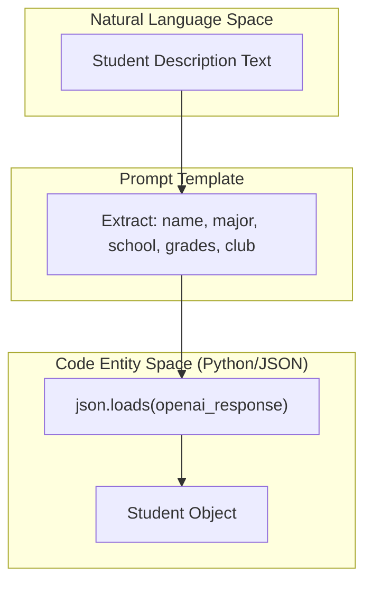
Sources: [11-integrating-with-function-calling/README.md:75-140]()

## Iterative Refinement Techniques

### Self-Refine
A technique where the model critiques its own output and improves it [05-advanced-prompts/README.md:66-66]().
1.  **Initial Prompt:** Create a Flask API [05-advanced-prompts/README.md:205-205]().
2.  **Critique:** Ask the LLM for 3 improvements to its own code [05-advanced-prompts/README.md:251-251]().
3.  **Refinement:** The LLM provides corrected code with better error handling [05-advanced-prompts/README.md:261-264]().

### Maieutic Prompting
A form of self-refinement where the user asks the LLM to explain various parts of its answer to ensure correctness and identify inconsistencies [05-advanced-prompts/README.md:67-67](), [05-advanced-prompts/README.md:267-272]().

## Configuration and Control

### Temperature and Variation
LLMs are non-deterministic. The `temperature` parameter controls the randomness of the output [05-advanced-prompts/README.md:319-325]().

| Temperature Value | Effect | Use Case |
| :--- | :--- | :--- |
| **0.0** | Deterministic | Coding, factual extraction, math [05-advanced-prompts/README.md:347-347]() |
| **0.7** | Balanced | General chat, standard assistants [05-advanced-prompts/README.md:348-348]() |
| **1.0** | Creative/Varied | Creative writing, brainstorming [05-advanced-prompts/README.md:349-349]() |

### Tokenization Impact
LLMs process text as sequences of tokens. The way a prompt is tokenized (including whitespace and punctuation) directly impacts the quality of the completion [04-prompt-engineering-fundamentals/README.md:82-86]().

## Best Practices for Advanced Prompts

*   **Contextualization:** Specify the domain (e.g., "geography") to avoid overly broad responses [05-advanced-prompts/README.md:41-48]().
*   **Output Limitation:** Explicitly state constraints like "Generate 10 questions" or "no more than 60 words" [05-advanced-prompts/README.md:42-42](), [08-building-search-applications/README.md:71-71]().
*   **Metaprompting:** Use system-level instructions to define boundaries, such as preventing the AI from answering non-educational questions [03-using-generative-ai-responsibly/README.md:97-98](), [09-building-image-applications/README.md:20-20]().
*   **Template Usage:** Use variables like `{{variable}}` to create reusable structures for business data integration [05-advanced-prompts/README.md:134-134]().

Sources:
- [05-advanced-prompts/README.md:27-317]()
- [04-prompt-engineering-fundamentals/README.md:82-86]()
- [11-integrating-with-function-calling/README.md:75-167]()
- [12-designing-ux-for-ai-applications/README.md:68-70]()
- [03-using-generative-ai-responsibly/README.md:97-98]()

---

# Page: Responsible AI Practices

# Responsible AI Practices

<details>
<summary>Relevant source files</summary>

The following files were used as context for generating this wiki page:

- [01-introduction-to-genai/README.md](01-introduction-to-genai/README.md)
- [02-exploring-and-comparing-different-llms/README.md](02-exploring-and-comparing-different-llms/README.md)
- [03-using-generative-ai-responsibly/README.md](03-using-generative-ai-responsibly/README.md)
- [04-prompt-engineering-fundamentals/README.md](04-prompt-engineering-fundamentals/README.md)
- [05-advanced-prompts/README.md](05-advanced-prompts/README.md)
- [06-text-generation-apps/README.md](06-text-generation-apps/README.md)
- [07-building-chat-applications/README.md](07-building-chat-applications/README.md)
- [08-building-search-applications/README.md](08-building-search-applications/README.md)
- [09-building-image-applications/README.md](09-building-image-applications/README.md)
- [10-building-low-code-ai-applications/README.md](10-building-low-code-ai-applications/README.md)
- [11-integrating-with-function-calling/README.md](11-integrating-with-function-calling/README.md)
- [12-designing-ux-for-ai-applications/README.md](12-designing-ux-for-ai-applications/README.md)
- [13-securing-ai-applications/README.md](13-securing-ai-applications/README.md)
- [translations/hi/.co-op-translator.json](translations/hi/.co-op-translator.json)
- [translations/hi/README.md](translations/hi/README.md)
- [translations/hi/docs/ENHANCED_FEATURES_ROADMAP.md](translations/hi/docs/ENHANCED_FEATURES_ROADMAP.md)
- [translations/hi/docs/SECURITY_GUIDELINES.md](translations/hi/docs/SECURITY_GUIDELINES.md)
- [translations/ja/.co-op-translator.json](translations/ja/.co-op-translator.json)
- [translations/ja/README.md](translations/ja/README.md)
- [translations/ja/docs/ENHANCED_FEATURES_ROADMAP.md](translations/ja/docs/ENHANCED_FEATURES_ROADMAP.md)
- [translations/ja/docs/SECURITY_GUIDELINES.md](translations/ja/docs/SECURITY_GUIDELINES.md)
- [translations/ko/.co-op-translator.json](translations/ko/.co-op-translator.json)
- [translations/ko/README.md](translations/ko/README.md)

</details>


This document outlines the ethical considerations and best practices for the responsible use of generative AI in applications. It covers potential harms associated with generative AI, mitigation strategies, evaluation methods, and implementation patterns to ensure AI systems are developed and used ethically.

## Understanding Responsible AI

Responsible AI refers to the development and deployment of AI systems in a manner that is ethical, transparent, fair, and accountable [07-building-chat-applications/README.md:14-14](). As generative AI models become more sophisticated and widely used, it is crucial to understand potential risks and implement practices to mitigate them.

```mermaid
flowchart TD
    A["Responsible AI"] --> B["Potential Harms"]
    A --> C["Mitigation Strategies"]
    A --> D["Evaluation Methods"]
    
    B --> B1["Hallucinations"]
    B --> B2["Harmful Content"]
    B --> B3["Fairness Issues"]
    
    C --> C1["Model Selection"]
    C --> C2["Safety Systems"]
    C --> C3["Meta-prompt/Grounding"]
    C --> C4["UX Design"]
    
    D --> D1["Accuracy"]
    D --> D2["Relevance"]
    D --> D3["Consistency"]
```

**Sources:**
- [01-introduction-to-genai/README.md:9-9]()
- [07-building-chat-applications/README.md:14-14]()

## Potential Harms of Generative AI

### Hallucinations
Generative AI models can produce content that appears factual but is actually incorrect or fabricated [03-using-generative-ai-responsibly/README.md](). These "hallucinations" can lead to the spread of misinformation or misguided decision-making when users trust the AI-generated content without verification.

### Harmful Content
AI models can inadvertently generate offensive, biased, or harmful content, especially if they've been trained on unfiltered internet data [01-introduction-to-genai/README.md:68-68](). This includes content that reinforces stereotypes or prejudices and inappropriate or unsafe recommendations.

### Fairness Issues
AI systems may exhibit biases present in their training data, leading to unfair treatment or representation of certain groups [02-exploring-and-comparing-different-llms/README.md:70-70](). This can manifest as under-representation of minority groups or biased language framing.

**Sources:**
- [01-introduction-to-genai/README.md:68-68]()
- [02-exploring-and-comparing-different-llms/README.md:70-70]()
- [03-using-generative-ai-responsibly/README.md]()

## Mitigation Strategies

### Model Selection
Choosing the right model for your use case is critical for responsible AI implementation. Developers must weigh capabilities against costs and limitations [02-exploring-and-comparing-different-llms/README.md:31-31]().

| Consideration | Description |
|---------------|-------------|
| Model capabilities | Select models (e.g., GPT-4o for multi-modality) appropriate for needs [02-exploring-and-comparing-different-llms/README.md:41-41]() |
| Model limitations | Understand what the model cannot do reliably, such as real-time weather without tools [11-integrating-with-function-calling/README.md:39-39]() |
| Open vs Proprietary | Open source allows inspection; proprietary models require trust in the provider's privacy [02-exploring-and-comparing-different-llms/README.md:68-70]() |

### Safety Systems
Implement safeguards to prevent, detect, and handle potential issues through a layered approach.

```mermaid
flowchart LR
    A["User Input"] --> B["Content Filter"]
    B --> C["LLM Processing"]
    C --> D["Output Filter"]
    D --> E["Final Response"]
    
    F["Safety Monitoring"] --> B
    F --> D
```

### Meta-prompting and Grounding
Using carefully designed system prompts and grounding techniques can significantly reduce hallucinations:
1. **System messages**: Define boundaries for the AI's responses [04-prompt-engineering-fundamentals/README.md:120-120]().
2. **Grounding in verified data**: Use techniques like RAG (Retrieval Augmented Generation) or generated knowledge to provide facts [05-advanced-prompts/README.md:64-64]().
3. **Contextual limitations**: Explicitly state the model's limitations in the prompt [05-advanced-prompts/README.md:42-42]().

### UX Design for Responsible AI
Designing user experiences that promote trust and transparency [12-designing-ux-for-ai-applications/README.md:56-56]().

| UX Principle | Implementation |
|--------------|----------------|
| Transparency | Clearly communicate when content is AI-generated (Explainability) [12-designing-ux-for-ai-applications/README.md:64-64]() |
| User control | Allow users to adjust AI parameters or override suggestions [12-designing-ux-for-ai-applications/README.md:76-76]() |
| Feedback mechanisms | Provide ways for users to report issues or correct AI mistakes [12-designing-ux-for-ai-applications/README.md:42-42]() |
| Friction Design | Intentional friction to remind users they are interacting with an AI [12-designing-ux-for-ai-applications/README.md:86-86]() |

**Sources:**
- [02-exploring-and-comparing-different-llms/README.md:31-70]()
- [05-advanced-prompts/README.md:42-64]()
- [11-integrating-with-function-calling/README.md:39-39]()
- [12-designing-ux-for-ai-applications/README.md:42-86]()

## Implementation Patterns

This section discusses how responsible AI principles are implemented in the code structure using the `openai` library.

### Code-to-Entity Mapping
The following diagram maps high-level safety concepts to specific code entities and parameters used in the repository.

```mermaid
flowchart TD
    subgraph "Natural Language Space"
        A["Safety Guidelines"]
        B["Deterministic Output"]
        C["Contextual Grounding"]
    end

    subgraph "Code Entity Space"
        D["messages: role: 'system'"]
        E["temperature: 0.0"]
        F["client.chat.completions.create"]
        G["max_tokens"]
    end

    A --- D
    B --- E
    C --- D
    D --> F
    E --> F
    G --> F
```

### Configuring Model Parameters for Safety
When making API calls via `client.chat.completions.create`, parameters are configured to enhance safety [06-text-generation-apps/README.md:145-155]().

| Parameter | Purpose | Recommendation |
|-----------|---------|----------------|
| `temperature` | Controls randomness | Lower values (0.0) for factual/deterministic responses [06-text-generation-apps/README.md:25-25]() |
| `max_tokens` | Limits response length | Prevents excessive output and token drain [06-text-generation-apps/README.md:25-25]() |
| `api_version` | Ensures consistency | Use specific versions like `2024-02-01` [09-building-image-applications/README.md:139-139]() |

### Structured Output with Function Calling
To mitigate inconsistent formatting and hallucinations, use `Function Calling` to force the model to respond with structured data [11-integrating-with-function-calling/README.md:41-43]().

```python
# [11-integrating-with-function-calling/README.md:119-122]
openai_response1 = client.chat.completions.create(
    model=deployment,
    messages = [{'role': 'user', 'content': prompt1}]
)
```

**Sources:**
- [06-text-generation-apps/README.md:25-155]()
- [09-building-image-applications/README.md:139-139]()
- [11-integrating-with-function-calling/README.md:41-122]()

## Case Study: Educational Applications

For the "Edu4All" startup scenario, implementing responsible AI is critical [01-introduction-to-genai/README.md:29-31]().

1. **Explainability**: Simplification of explanations for students and teachers who are not AI experts [12-designing-ux-for-ai-applications/README.md:72-74]().
2. **User Control**: Students can opt in or out of data sources (e.g., using their own notes vs. teacher resources) [12-designing-ux-for-ai-applications/README.md:82-84]().
3. **Persona-Based Safety**: An AI tutor persona may guide a student to a solution rather than revealing the answer directly [12-designing-ux-for-ai-applications/README.md:68-70]().
4. **Reliability**: Handling AI errors gracefully when automating grading or generating flashcards [12-designing-ux-for-ai-applications/README.md:38-42]().

**Sources:**
- [01-introduction-to-genai/README.md:29-31]()
- [12-designing-ux-for-ai-applications/README.md:38-84]()

## Best Practices Checklist

| Category | Practice | Implementation |
|----------|----------|----------------|
| **Design** | Clear AI identification | "Use AI tutor that adapts to your needs" [12-designing-ux-for-ai-applications/README.md:64-64]() |
| **Development** | Token Management | Configure app to use appropriate token limits [06-text-generation-apps/README.md:25-25]() |
| **Safety** | Content Filtering | Use Azure OpenAI built-in content filters [03-using-generative-ai-responsibly/README.md]() |
| **Integrity** | Deterministic Response | Use low `temperature` for educational facts [06-text-generation-apps/README.md:25-25]() |

**Sources:**
- [03-using-generative-ai-responsibly/README.md]()
- [06-text-generation-apps/README.md:25-25]()
- [12-designing-ux-for-ai-applications/README.md:64-64]()

---

# Page: Building GenAI Applications

# Building GenAI Applications

<details>
<summary>Relevant source files</summary>

The following files were used as context for generating this wiki page:

- [00-course-setup/README.md](00-course-setup/README.md)
- [01-introduction-to-genai/README.md](01-introduction-to-genai/README.md)
- [02-exploring-and-comparing-different-llms/README.md](02-exploring-and-comparing-different-llms/README.md)
- [03-using-generative-ai-responsibly/README.md](03-using-generative-ai-responsibly/README.md)
- [04-prompt-engineering-fundamentals/README.md](04-prompt-engineering-fundamentals/README.md)
- [05-advanced-prompts/README.md](05-advanced-prompts/README.md)
- [06-text-generation-apps/README.md](06-text-generation-apps/README.md)
- [07-building-chat-applications/README.md](07-building-chat-applications/README.md)
- [08-building-search-applications/README.md](08-building-search-applications/README.md)
- [09-building-image-applications/README.md](09-building-image-applications/README.md)
- [10-building-low-code-ai-applications/README.md](10-building-low-code-ai-applications/README.md)
- [11-integrating-with-function-calling/README.md](11-integrating-with-function-calling/README.md)
- [12-designing-ux-for-ai-applications/README.md](12-designing-ux-for-ai-applications/README.md)
- [README.md](README.md)
- [translations/en/.co-op-translator.json](translations/en/.co-op-translator.json)
- [translations/en/README.md](translations/en/README.md)
- [translations/en/docs/ENHANCED_FEATURES_ROADMAP.md](translations/en/docs/ENHANCED_FEATURES_ROADMAP.md)
- [translations/en/docs/SECURITY_GUIDELINES.md](translations/en/docs/SECURITY_GUIDELINES.md)
- [translations/es/.co-op-translator.json](translations/es/.co-op-translator.json)
- [translations/es/README.md](translations/es/README.md)
- [translations/es/docs/ENHANCED_FEATURES_ROADMAP.md](translations/es/docs/ENHANCED_FEATURES_ROADMAP.md)
- [translations/es/docs/SECURITY_GUIDELINES.md](translations/es/docs/SECURITY_GUIDELINES.md)
- [translations/fr/.co-op-translator.json](translations/fr/.co-op-translator.json)
- [translations/fr/README.md](translations/fr/README.md)

</details>


This page provides an overview of the different types of applications you can build with generative AI and the common patterns for implementing them. It serves as a foundational guide for developers who want to understand the landscape of GenAI application development before diving into specific implementation details.

For information about specific prompt engineering techniques, see [Prompt Engineering Fundamentals](#3.2). For information about responsible AI practices when building applications, see [Responsible AI Practices](#3.4).

## Overview of GenAI Application Types

Generative AI can be used to build various types of applications, each serving different purposes and user needs. The following diagram illustrates the main types of GenAI applications covered in this curriculum:

```mermaid
graph TD
    A["GenAI Applications"] --> B["Text Generation"]
    A --> C["Chat Applications"]
    A --> D["Search Applications"]
    A --> E["Image Generation"]
    A --> F["Low-Code Applications"]
    
    B --> B1["Content Creation"]
    B --> B2["Summarization"]
    B --> B3["Text Completion"]
    
    C --> C1["Conversational Interfaces"]
    C --> C2["Contextual Responses"]
    C --> C3["Multi-turn Dialogues"]
    
    D --> D1["Semantic Search"]
    D --> D2["Vector Embeddings"]
    D --> D3["Document Retrieval"]
    
    E --> E1["DALL-E Integration"]
    E --> E2["Image Generation from Text"]
    E --> E3["Creative Design"]
    
    F --> F1["Power Platform"]
    F --> F2["Visual Development"]
    F --> F3["AI-assisted Creation"]
```

Sources: [README.md:67-92](), [06-text-generation-apps/README.md:42-54](), [08-building-search-applications/README.md:7-13](), [09-building-image-applications/README.md:24-31](), [10-building-low-code-ai-applications/README.md:9-13]()

## Common Integration Methods for GenAI Applications

Regardless of the application type, there are several common methods for integrating generative AI models into your applications. Developers can choose between using high-level libraries or direct API calls.

```mermaid
flowchart LR
    A["Integration Methods"] --> B["API Integration"]
    A --> C["Function Calling"]
    A --> D["Retrieval Augmented Generation"]
    A --> E["Fine-tuning"]
    A --> F["Low-Code Integration"]
    
    B --> B1["openai.Completion.create()"]
    B --> B2["openai.ChatCompletion.create()"]
    B --> B3["openai.Image.create()"]
    
    C --> C1["Function Definitions"]
    C --> C2["External API Calls"]
    
    D --> D1["Vector Embeddings"]
    D --> D2["Cosine Similarity Search"]
    
    E --> E1["Domain-specific Training"]
    
    F --> F1["AI Builder"]
    F --> F2["Copilot Studio"]
```

Sources: [11-integrating-with-function-calling/README.md:28-37](), [06-text-generation-apps/README.md:56-72](), [08-building-search-applications/README.md:40-46](), [02-exploring-and-comparing-different-llms/README.md:142-153](), [10-building-low-code-ai-applications/README.md:44-57]()

## Text Generation Applications

Text generation applications are systems that produce new text content based on prompts. These applications leverage models like GPT-4 to create creative writing, summaries, or code assistance.

For details, see [Text Generation Applications](#4.1).

### Implementation Pattern
The standard implementation uses the `openai` library and typically includes configuring the `api_type`, `api_key`, and `api_base` [06-text-generation-apps/README.md:112-133]().

```python
# Create completion
prompt = "Your prompt text here"
completion = openai.Completion.create(
    model="davinci-002",
    prompt=prompt,
    max_tokens=100,
    temperature=0.7
)
```

Sources: [06-text-generation-apps/README.md:75-111](), [06-text-generation-apps/README.md:134-162]()

## Chat Applications

Chat applications create conversational experiences where users can have multi-turn dialogues. These applications maintain conversation context using the `ChatCompletion` class and role-based message arrays [06-text-generation-apps/README.md:145-147]().

For details, see [Chat Applications](#4.2).

### Implementation Pattern
Chat applications use the chat completion API which supports roles like `system`, `user`, and `assistant` [07-building-chat-applications/README.md:63-82]().

Sources: [07-building-chat-applications/README.md:36-54](), [07-building-chat-applications/README.md:84-117]()

## Search Applications

Search applications leverage vector embeddings to find semantically relevant information. This goes beyond keyword search by using numerical representations of text called vectors [08-building-search-applications/README.md:7-13]().

For details, see [Search Applications](#4.3).

### Implementation Pattern
The key steps involve generating embeddings using the `OpenAI Embedding API` and calculating `cosine similarity` to find the most relevant segments in a dataset, such as YouTube transcripts [08-building-search-applications/README.md:40-87]().

Sources: [08-building-search-applications/README.md:40-87](), [08-building-search-applications/README.md:78-87]()

## Image Generation Applications

Image generation applications use models like DALL-E to create visual content from text descriptions. These models, such as DALL-E 3, utilize an autoregressive transformer architecture to generate pixels based on text prompts [09-building-image-applications/README.md:64-72]().

For details, see [Image Generation Applications](#4.4).

### Implementation Pattern
Applications typically use the `client.images.generate()` method from the OpenAI SDK to retrieve a URL for the generated image [09-building-image-applications/README.md:141-160]().

Sources: [09-building-image-applications/README.md:62-72](), [09-building-image-applications/README.md:114-166]()

## Function Calling Integration

Function calling allows LLMs to interact with external APIs and services. This enables the model to provide consistent response formats (like JSON) and access external data sources [11-integrating-with-function-calling/README.md:37-45]().

For details, see [Function Calling Integration](#4.6).

### Implementation Pattern
Developers define function schemas in JSON and the LLM determines when to trigger a `function_call` based on user intent [11-integrating-with-function-calling/README.md:197-384]().

Sources: [11-integrating-with-function-calling/README.md:189-196](), [11-integrating-with-function-calling/README.md:197-384]()

## Low-Code AI Applications

Low-code AI applications leverage platforms like Microsoft Power Platform to enable building solutions with little to no code. This is achieved through tools like `AI Builder` and `Copilot` [10-building-low-code-ai-applications/README.md:9-13]().

For details, see [Low-Code AI Applications](#4.5).

### Components of Low-Code AI Solutions
- **Power Apps**: Visual environment for app development [10-building-low-code-ai-applications/README.md:58-63]().
- **Power Automate**: Workflow automation between services [10-building-low-code-ai-applications/README.md:64-69]().
- **AI Builder**: Prebuilt AI models for tasks like invoice processing [10-building-low-code-ai-applications/README.md:54-57]().

Sources: [10-building-low-code-ai-applications/README.md:44-57](), [10-building-low-code-ai-applications/README.md:76-113]()

## Best Practices for GenAI Applications

### Security and Privacy
- **Environment Variables**: Always store sensitive keys in `.env` files using `python-dotenv` [09-building-image-applications/README.md:76-77]().
- **Input Validation**: Sanitize user prompts to prevent injection attacks.

### Performance Optimization
- **Temperature**: Adjust the `temperature` parameter to control the randomness of output [06-text-generation-apps/README.md:583-597]().
- **Token Management**: Use `max_tokens` to limit response length and control costs [06-text-generation-apps/README.md:583-597]().

### User Experience Design
- **Explainability**: Ensure users know when they are interacting with an AI [12-designing-ux-for-ai-applications/README.md:62-65]().
- **Friction**: Intentionally design "friction" to remind users that the output is generated and may require verification [12-designing-ux-for-ai-applications/README.md:86-88]().

Sources: [06-text-generation-apps/README.md:553-582](), [06-text-generation-apps/README.md:583-597](), [12-designing-ux-for-ai-applications/README.md:52-101]()

---

# Page: Text Generation Applications

# Text Generation Applications

<details>
<summary>Relevant source files</summary>

The following files were used as context for generating this wiki page:

- [.devcontainer/Setup.txt](.devcontainer/Setup.txt)
- [.devcontainer/devcontainer.json](.devcontainer/devcontainer.json)
- [.devcontainer/environment.yml](.devcontainer/environment.yml)
- [.devcontainer/icon.svg](.devcontainer/icon.svg)
- [.devcontainer/post-create.sh](.devcontainer/post-create.sh)
- [.env.copy](.env.copy)
- [06-text-generation-apps/images/GithubModels-getstarted.png](06-text-generation-apps/images/GithubModels-getstarted.png)
- [06-text-generation-apps/images/GithubModels-modelcard.png](06-text-generation-apps/images/GithubModels-modelcard.png)
- [06-text-generation-apps/images/GithubModels-plagroundcode.png](06-text-generation-apps/images/GithubModels-plagroundcode.png)
- [06-text-generation-apps/images/GithubModelsMainScreen.png](06-text-generation-apps/images/GithubModelsMainScreen.png)
- [06-text-generation-apps/images/codespaces-basicpy.png](06-text-generation-apps/images/codespaces-basicpy.png)
- [06-text-generation-apps/images/vscode-envvariable.png](06-text-generation-apps/images/vscode-envvariable.png)
- [06-text-generation-apps/python/aoai-app-recipe.py](06-text-generation-apps/python/aoai-app-recipe.py)
- [06-text-generation-apps/python/aoai-app.py](06-text-generation-apps/python/aoai-app.py)
- [06-text-generation-apps/python/aoai-assignment.ipynb](06-text-generation-apps/python/aoai-assignment.ipynb)
- [06-text-generation-apps/python/aoai-history-bot.py](06-text-generation-apps/python/aoai-history-bot.py)
- [06-text-generation-apps/python/aoai-study-buddy.py](06-text-generation-apps/python/aoai-study-buddy.py)
- [06-text-generation-apps/python/githubmodels-app.py](06-text-generation-apps/python/githubmodels-app.py)
- [06-text-generation-apps/python/githubmodels-assignment.ipynb](06-text-generation-apps/python/githubmodels-assignment.ipynb)
- [06-text-generation-apps/python/oai-app-recipe.py](06-text-generation-apps/python/oai-app-recipe.py)
- [06-text-generation-apps/python/oai-app.py](06-text-generation-apps/python/oai-app.py)
- [06-text-generation-apps/python/oai-assigment.ipynb](06-text-generation-apps/python/oai-assigment.ipynb)
- [06-text-generation-apps/python/oai-history-bot.py](06-text-generation-apps/python/oai-history-bot.py)
- [06-text-generation-apps/python/oai-study-buddy.py](06-text-generation-apps/python/oai-study-buddy.py)
- [06-text-generation-apps/python/requirements.txt](06-text-generation-apps/python/requirements.txt)
- [06-text-generation-apps/typescript/.gitignore](06-text-generation-apps/typescript/.gitignore)
- [06-text-generation-apps/typescript/recipe-app/.env-sample](06-text-generation-apps/typescript/recipe-app/.env-sample)
- [06-text-generation-apps/typescript/recipe-app/package-lock.json](06-text-generation-apps/typescript/recipe-app/package-lock.json)
- [06-text-generation-apps/typescript/recipe-app/package.json](06-text-generation-apps/typescript/recipe-app/package.json)
- [06-text-generation-apps/typescript/recipe-app/tsconfig.json](06-text-generation-apps/typescript/recipe-app/tsconfig.json)
- [docs/_sidebar.md](docs/_sidebar.md)
- [package-lock.json](package-lock.json)
- [package.json](package.json)
- [requirements.txt](requirements.txt)
- [translations/ja/06-text-generation-apps/README.md](translations/ja/06-text-generation-apps/README.md)
- [vs.code-profile](vs.code-profile)

</details>


This document explains how to build applications that generate text using Large Language Models (LLMs). Text generation is one of the most fundamental capabilities of generative AI, allowing developers to create applications that can produce human-like text for various purposes.

## Overview

Text generation applications are software systems that leverage LLMs to generate new text content based on prompts or inputs. Unlike traditional applications with limited command sets or rigid interfaces, text generation applications provide more flexibility by accepting natural language inputs and generating contextually relevant outputs.

```mermaid
flowchart TD
    subgraph "Natural Language Space"
        A["User Input / Prompt"]
    end

    subgraph "Code Entity Space"
        B["openai.AzureOpenAI / ChatCompletionsClient"]
        C["client.chat.completions.create() / client.complete()"]
    end

    subgraph "Model Space"
        D["LLM (GPT-4o, Phi-3, etc.)"]
    end

    A --> B
    B --> C
    C --> D
    D -- "Completion" --> C
    C -- "completion.choices[0].message.content" --> B
```

Sources: [06-text-generation-apps/python/githubmodels-assignment.ipynb:29-56](), [06-text-generation-apps/python/aoai-app-recipe.py:40-67]()

## Architecture and Data Flow

The codebase supports two primary backends: **Azure OpenAI** and **GitHub Models**. While the underlying goal is the same, the SDKs and authentication methods differ slightly.

### Backend Implementation Comparison

| Feature | Azure OpenAI (Python/TS) | GitHub Models (Python) |
|---------|-------------------------|------------------------|
| **SDK** | `openai` (Python), `@azure/openai` (TS) | `azure-ai-inference` |
| **Client Class** | `AzureOpenAI` | `ChatCompletionsClient` |
| **Method** | `client.chat.completions.create` | `client.complete` |
| **Auth** | `api_key`, `azure_endpoint` | `GITHUB_TOKEN` |
| **Input Type** | List of dictionaries (`messages`) | List of message objects |

Sources: [06-text-generation-apps/python/aoai-app-recipe.py:40-47](), [06-text-generation-apps/python/githubmodels-app.py:11-34](), [package.json:29-31]()

### Data Flow Diagram

This diagram maps the flow from user input to the final processed response, highlighting specific code entities used in the Python implementations.

```mermaid
sequenceDiagram
    participant U as "User (input())"
    participant V as "validate_text_input()"
    participant C as "AzureOpenAI Client"
    participant M as "Model Deployment"

    U->>V: Raw string input
    V->>V: Sanitize (Regex: [^\\w\\s,.\'-]+)
    V->>C: messages = [{"role": "user", "content": prompt}]
    C->>M: POST /chat/completions (temperature, max_tokens)
    M->>C: JSON Response
    C->>U: completion.choices[0].message.content
```

Sources: [06-text-generation-apps/python/aoai-app-recipe.py:28-37](), [06-text-generation-apps/python/aoai-app-recipe.py:64-67](), [06-text-generation-apps/python/aoai-app-recipe.py:75-76]()

## Implementation Examples

The repository provides three primary patterns for text generation: Recipe Generation, Study Buddy, and History Bot.

### 1. Recipe Generator (Sequential Generation)
This application demonstrates a two-step generation process: first generating recipes, then using that output to generate a shopping list.

- **File (Python)**: [06-text-generation-apps/python/aoai-app-recipe.py]()
- **File (TypeScript)**: [06-text-generation-apps/typescript/recipe-app/index.ts]() (referenced via `package.json` dependencies)
- **Key Feature**: Sequential prompts where the second prompt `new_prompt` includes the result of the first `old_prompt_result` [06-text-generation-apps/python/aoai-app-recipe.py:75-79]().

### 2. Study Buddy (Structured Output)
Focuses on forcing the model to adhere to a specific format using a system-style prompt.

- **File**: [06-text-generation-apps/python/aoai-study-buddy.py]()
- **Prompt Structure**: Instructs the model to provide a response in a specific Markdown format: `- Concept`, `- Example code`, `- explanation` [06-text-generation-apps/python/aoai-study-buddy.py:22-26]().

### 3. History Bot (Persona-based Prompting)
Demonstrates setting a "persona" and adding constraints to prevent hallucinations.

- **File**: [06-text-generation-apps/python/aoai-history-bot.py]()
- **Constraints**: "Don't create content yourself. If you don't know something, tell that you don't remember" [06-text-generation-apps/python/aoai-history-bot.py:23-23]().
- **Configuration**: Uses `temperature=0` to ensure deterministic, factual answers [06-text-generation-apps/python/aoai-history-bot.py:29-29]().

## Configuration Parameters

The behavior of text generation is controlled by several key parameters passed to the `create` or `complete` methods.

| Parameter | Description | Typical Value |
|-----------|-------------|---------------|
| `temperature` | Controls randomness. 0 is deterministic; 1 is creative. | `0.1` (Recipes), `0` (History) |
| `max_tokens` | Limits the length of the generated output. | `600` (Recipes), `1000` (GitHub Models) |
| `model` / `deployment` | Specifies which LLM to use. | `gpt-4o`, `phi-3` |

Sources: [06-text-generation-apps/python/aoai-app-recipe.py:67-67](), [06-text-generation-apps/python/aoai-history-bot.py:29-29](), [06-text-generation-apps/python/githubmodels-app.py:31-33]()

## Security and Validation

The implementation includes critical security layers to protect against prompt injection and environment misconfiguration.

### Input Sanitization
The `validate_text_input` function in [06-text-generation-apps/python/aoai-app-recipe.py:28-37]() performs the following:
1. **Length Check**: Rejects input exceeding 500 characters.
2. **Character Filtering**: Removes potentially dangerous characters like `< > { } [ ] | \`.
3. **Regex Validation**: Ensures the string only contains alphanumeric characters and basic punctuation.

### Environment Management
The applications use `python-dotenv` to load credentials from a `.env` file [06-text-generation-apps/python/aoai-app-recipe.py:7-7](). A helper function `get_required_env` ensures the application fails fast with a helpful error if keys like `AZURE_OPENAI_API_KEY` are missing [06-text-generation-apps/python/aoai-app-recipe.py:10-15]().

Sources: [06-text-generation-apps/python/aoai-app-recipe.py:10-37](), [requirements.txt:6-7]()

---

# Page: Chat Applications

# Chat Applications

<details>
<summary>Relevant source files</summary>

The following files were used as context for generating this wiki page:

- [.eslintrc.json](.eslintrc.json)
- [.prettierrc](.prettierrc)
- [00-course-setup/01-setup-cloud.md](00-course-setup/01-setup-cloud.md)
- [00-course-setup/02-setup-local.md](00-course-setup/02-setup-local.md)
- [00-course-setup/03-providers.md](00-course-setup/03-providers.md)
- [05-advanced-prompts/javascript/solution.js](05-advanced-prompts/javascript/solution.js)
- [05-advanced-prompts/python/aoai-solution.py](05-advanced-prompts/python/aoai-solution.py)
- [06-text-generation-apps/js-githubmodels/app.js](06-text-generation-apps/js-githubmodels/app.js)
- [06-text-generation-apps/js-githubmodels/package-lock.json](06-text-generation-apps/js-githubmodels/package-lock.json)
- [06-text-generation-apps/js-githubmodels/package.json](06-text-generation-apps/js-githubmodels/package.json)
- [07-building-chat-applications/js-githubmodels/app.js](07-building-chat-applications/js-githubmodels/app.js)
- [07-building-chat-applications/js-githubmodels/package-lock.json](07-building-chat-applications/js-githubmodels/package-lock.json)
- [07-building-chat-applications/js-githubmodels/package.json](07-building-chat-applications/js-githubmodels/package.json)
- [07-building-chat-applications/python/aoai-assigment-simple.ipynb](07-building-chat-applications/python/aoai-assigment-simple.ipynb)
- [07-building-chat-applications/python/aoai-assignment.ipynb](07-building-chat-applications/python/aoai-assignment.ipynb)
- [07-building-chat-applications/python/githubmodels-assignment.ipynb](07-building-chat-applications/python/githubmodels-assignment.ipynb)
- [07-building-chat-applications/python/oai-assigment-simple.ipynb](07-building-chat-applications/python/oai-assigment-simple.ipynb)
- [07-building-chat-applications/python/oai-assignment.ipynb](07-building-chat-applications/python/oai-assignment.ipynb)
- [07-building-chat-applications/typescript/.gitignore](07-building-chat-applications/typescript/.gitignore)
- [07-building-chat-applications/typescript/chat-completions-app/package-lock.json](07-building-chat-applications/typescript/chat-completions-app/package-lock.json)
- [07-building-chat-applications/typescript/chat-completions-app/package.json](07-building-chat-applications/typescript/chat-completions-app/package.json)
- [07-building-chat-applications/typescript/chat-completions-app/src/main.ts](07-building-chat-applications/typescript/chat-completions-app/src/main.ts)
- [07-building-chat-applications/typescript/chat-completions-app/tsconfig.json](07-building-chat-applications/typescript/chat-completions-app/tsconfig.json)
- [08-building-search-applications/js-githubmodels/app.js](08-building-search-applications/js-githubmodels/app.js)
- [08-building-search-applications/js-githubmodels/package-lock.json](08-building-search-applications/js-githubmodels/package-lock.json)
- [08-building-search-applications/js-githubmodels/package.json](08-building-search-applications/js-githubmodels/package.json)
- [08-building-search-applications/python/aoai-solution.ipynb](08-building-search-applications/python/aoai-solution.ipynb)
- [08-building-search-applications/python/oai-solution.ipynb](08-building-search-applications/python/oai-solution.ipynb)
- [08-building-search-applications/scripts/transcript_download.py](08-building-search-applications/scripts/transcript_download.py)
- [11-integrating-with-function-calling/python/aoai-assignment.ipynb](11-integrating-with-function-calling/python/aoai-assignment.ipynb)
- [11-integrating-with-function-calling/python/oai-assignment.ipynb](11-integrating-with-function-calling/python/oai-assignment.ipynb)

</details>


This document explains how to build chat-based applications with Large Language Models (LLMs) in the Generative AI for Beginners course. Chat applications differ from text generation applications (covered in [Text Generation Applications](#4.1)) in that they maintain conversation context and enable interactive, ongoing dialogues rather than one-time responses.

## Key Concepts in Chat Applications

Chat applications have become integrated into our daily lives, offering more than just casual conversation. They're used in customer service, technical support, and sophisticated advisory systems. Generative AI enhances these applications by providing more natural, context-aware interactions.

Unlike traditional chatbots that follow predefined scripts, generative AI-powered chat applications can:
- Maintain conversation context over multiple turns
- Generate dynamic, natural-sounding responses
- Understand and adapt to user intentions
- Provide personalized interactions

```mermaid
flowchart TD
    A["User Input"] --> B["Chat Application"]
    B --> C["LLM Processing"]
    C --> D["Context Management"]
    D --> E["Response Generation"]
    E --> B
    B --> F["User Interface"]
    F --> A
```

Sources: [07-building-chat-applications/python/aoai-assignment.ipynb:14-35](), [07-building-chat-applications/python/githubmodels-assignment.ipynb:14-34]()

## Architecture of Chat Applications

A generative AI-powered chat application typically consists of the following components:

```mermaid
flowchart TD
    subgraph "User Interface Layer"
        A["User Interface"]
        B["Input Processing"]
        C["Response Display"]
    end
    
    subgraph "Application Layer"
        D["Conversation Manager"]
        E["Context Storage"]
        F["Message History"]
    end
    
    subgraph "Model Integration Layer"
        G["API Integration"]
        H["Prompt Construction"]
        I["Response Parsing"]
    end
    
    subgraph "External Services"
        J["LLM API Service"]
        K["External Data Sources"]
    end
    
    A --> B
    B --> D
    D --> E
    D --> F
    D --> H
    H --> G
    G --> J
    J --> I
    I --> D
    D --> C
    C --> A
    K --> D
```

Sources: [11-integrating-with-function-calling/python/aoai-assignment.ipynb:27-51](), [07-building-chat-applications/typescript/chat-completions-app/src/main.ts:9-31]()

## Building Chat Applications with OpenAI and Azure

The course provides implementations for multiple providers, including OpenAI, Azure OpenAI, and GitHub Models.

### Setting Up the Clients

**Python (OpenAI):**
[07-building-chat-applications/python/oai-assignment.ipynb:157-169]()
```python
from openai import OpenAI
client = OpenAI(api_key=os.getenv("OPENAI_API_KEY"))
```

**Python (Azure OpenAI):**
[07-building-chat-applications/python/aoai-assignment.ipynb:182-194]()
```python
from openai import AzureOpenAI
client = AzureOpenAI(
    api_key=os.environ['AZURE_OPENAI_API_KEY'],
    api_version="2023-05-15"
)
```

**TypeScript (Azure OpenAI):**
[07-building-chat-applications/typescript/chat-completions-app/src/main.ts:1-13]()
```typescript
import { OpenAIClient, AzureKeyCredential } from "@azure/openai";
const client = new OpenAIClient(endpoint, new AzureKeyCredential(azureApiKey));
```

### Chat Completion API

Chat applications use the Chat Completions API. The main difference from standard text completion is the use of a `messages` array that defines roles.

```mermaid
flowchart LR
    subgraph "Chat Completion Request"
        D["Messages Array"] --> E["chat.completions.create()"] --> F["Response Choice"]
        G["System Role"] --> D
        H["User Role"] --> D
        I["Assistant Role"] --> D
    end
```

Sources: [07-building-chat-applications/python/aoai-assigment-simple.ipynb:33-44](), [07-building-chat-applications/typescript/chat-completions-app/src/main.ts:17-27]()

## Message Structure and Roles

The chat completions API requires a structured array of messages. Each message must have a `role` and `content`.

| Role | Purpose | Code Reference |
| :--- | :--- | :--- |
| **system** | Sets the persona and behavioral guardrails for the assistant. | [07-building-chat-applications/typescript/chat-completions-app/src/main.ts:18-19]() |
| **user** | Represents the input from the human user. | [07-building-chat-applications/python/aoai-assigment-simple.ipynb:40]() |
| **assistant** | Represents previous responses from the LLM to maintain context. | [11-integrating-with-function-calling/python/aoai-assignment.ipynb:51]() |

Sources: [07-building-chat-applications/python/aoai-assigment-simple.ipynb:36-40](), [07-building-chat-applications/typescript/chat-completions-app/src/main.ts:17-21]()

## Maintaining State and Context

Unlike simple text generation, chat applications must manage state by appending new messages to the history array. This allows the model to "remember" previous parts of the conversation.

```mermaid
sequenceDiagram
    participant User
    participant App as "Main Application"
    participant Client as "OpenAIClient / AzureOpenAI"
    
    User->>App: Sends Message
    App->>App: Append to messages[]
    App->>Client: getChatCompletions(messages)
    Client-->>App: Return Choice
    App->>App: Append assistant response to messages[]
    App-->>User: Display Response
```

Sources: [07-building-chat-applications/typescript/chat-completions-app/src/main.ts:17-27](), [11-integrating-with-function-calling/python/aoai-assignment.ipynb:38-51]()

## Function Calling in Chat

Advanced chat applications use `Function Calling` to bridge the gap between natural language and external data sources (like the Microsoft Learn Catalog API).

1. **Definition**: The developer provides a JSON schema of available functions.
2. **Detection**: The LLM determines if a function should be called based on user intent.
3. **Execution**: The application executes the local code and returns the result to the LLM.

```mermaid
flowchart TD
    subgraph "Natural Language Space"
        UserQuery["'Find AI courses'"]
    end
    
    subgraph "Code Entity Space"
        Client["AzureOpenAI Client"]
        Func["functions list"]
        Call["client.chat.completions.create()"]
    end
    
    UserQuery --> Client
    Client --> Call
    Func -.-> Call
```

Sources: [11-integrating-with-function-calling/python/aoai-assignment.ipynb:27-51](), [11-integrating-with-function-calling/python/oai-assignment.ipynb:42-51]()

## Implementation Details

### TypeScript Implementation
The TypeScript example uses the `@azure/openai` package. It demonstrates a multi-system-message approach to define a persona.

- **File**: `07-building-chat-applications/typescript/chat-completions-app/src/main.ts`
- **Key Function**: `main()` [07-building-chat-applications/typescript/chat-completions-app/src/main.ts:9-31]()
- **Dependencies**: `@azure/openai`, `dotenv` [07-building-chat-applications/typescript/chat-completions-app/package.json:24-28]()

### Python Implementation
The Python examples show how to assert environment variables and handle the response object to extract the content string.

- **File**: `07-building-chat-applications/python/aoai-assigment-simple.ipynb`
- **Key Logic**: Extracting content via `response['choices'][0]['message']['content']` [07-building-chat-applications/python/aoai-assigment-simple.ipynb:43]()

## Best Practices

1. **Environment Security**: Use `.env` files to store `AZURE_OPENAI_API_KEY` and `GITHUB_TOKEN`. Never hardcode keys. [00-course-setup/02-setup-local.md:139-169]()
2. **Model Selection**: Use `gpt-35-turbo` or `gpt-4o` for chat tasks to balance speed and reasoning capability. [07-building-chat-applications/python/aoai-assignment.ipynb:207-212](), [07-building-chat-applications/python/githubmodels-assignment.ipynb:180-205]()
3. **Validation**: Always validate that endpoints and keys are loaded before instantiating clients. [07-building-chat-applications/python/aoai-assigment-simple.ipynb:15-24]()

Sources: [00-course-setup/02-setup-local.md:139-191](), [07-building-chat-applications/python/aoai-assigment-simple.ipynb:9-24]()

---

# Page: Search Applications

# Search Applications

<details>
<summary>Relevant source files</summary>

The following files were used as context for generating this wiki page:

- [.eslintrc.json](.eslintrc.json)
- [.prettierrc](.prettierrc)
- [05-advanced-prompts/javascript/solution.js](05-advanced-prompts/javascript/solution.js)
- [05-advanced-prompts/python/aoai-solution.py](05-advanced-prompts/python/aoai-solution.py)
- [06-text-generation-apps/js-githubmodels/app.js](06-text-generation-apps/js-githubmodels/app.js)
- [06-text-generation-apps/js-githubmodels/package-lock.json](06-text-generation-apps/js-githubmodels/package-lock.json)
- [06-text-generation-apps/js-githubmodels/package.json](06-text-generation-apps/js-githubmodels/package.json)
- [07-building-chat-applications/js-githubmodels/app.js](07-building-chat-applications/js-githubmodels/app.js)
- [07-building-chat-applications/js-githubmodels/package-lock.json](07-building-chat-applications/js-githubmodels/package-lock.json)
- [07-building-chat-applications/js-githubmodels/package.json](07-building-chat-applications/js-githubmodels/package.json)
- [08-building-search-applications/js-githubmodels/app.js](08-building-search-applications/js-githubmodels/app.js)
- [08-building-search-applications/js-githubmodels/package-lock.json](08-building-search-applications/js-githubmodels/package-lock.json)
- [08-building-search-applications/js-githubmodels/package.json](08-building-search-applications/js-githubmodels/package.json)
- [08-building-search-applications/python/aoai-assignment.ipynb](08-building-search-applications/python/aoai-assignment.ipynb)
- [08-building-search-applications/python/oai-assignment.ipynb](08-building-search-applications/python/oai-assignment.ipynb)
- [08-building-search-applications/python/requirements.txt](08-building-search-applications/python/requirements.txt)
- [08-building-search-applications/scripts/prepare_transcripts_ai_show.bat](08-building-search-applications/scripts/prepare_transcripts_ai_show.bat)
- [08-building-search-applications/scripts/prepare_transcripts_ai_show.ps1](08-building-search-applications/scripts/prepare_transcripts_ai_show.ps1)
- [08-building-search-applications/scripts/transcript_download.py](08-building-search-applications/scripts/transcript_download.py)
- [08-building-search-applications/scripts/transcript_enrich_embeddings.py](08-building-search-applications/scripts/transcript_enrich_embeddings.py)
- [08-building-search-applications/scripts/transcript_enrich_speaker.py](08-building-search-applications/scripts/transcript_enrich_speaker.py)
- [08-building-search-applications/scripts/transcript_enrich_summaries.py](08-building-search-applications/scripts/transcript_enrich_summaries.py)
- [08-building-search-applications/typescript/.gitignore](08-building-search-applications/typescript/.gitignore)
- [08-building-search-applications/typescript/search-app/.env-sample](08-building-search-applications/typescript/search-app/.env-sample)
- [08-building-search-applications/typescript/search-app/package-lock.json](08-building-search-applications/typescript/search-app/package-lock.json)
- [08-building-search-applications/typescript/search-app/package.json](08-building-search-applications/typescript/search-app/package.json)
- [08-building-search-applications/typescript/search-app/src/main.ts](08-building-search-applications/typescript/search-app/src/main.ts)
- [08-building-search-applications/typescript/search-app/tsconfig.json](08-building-search-applications/typescript/search-app/tsconfig.json)

</details>


This document explains how to build search applications using vector embeddings for semantic search. It covers the fundamental concepts of embeddings, the process of creating and searching embedding indexes, and practical implementation details for building applications that can find relevant information in unstructured data.

## Introduction to Search Applications

Search applications powered by generative AI go beyond traditional keyword matching by understanding the semantic meaning of text. In the context of this system, search applications use embeddings (numerical representations of text) to find relevant content based on meaning rather than exact word matches.

The primary use case demonstrated in the repository is building a search tool that allows users to search through video transcripts by asking questions in natural language. The system returns links to the specific points in videos where relevant answers can be found.

```mermaid
flowchart TD
    A["User Query"] -->|"Embedding Conversion"| B["Query Embedding"]
    B -->|"Semantic Search"| C["Embedding Index"]
    C -->|"Similarity Matching"| D["Relevant Results"]
    D --> E["Timestamped Video Links"]
```

Sources: [08-building-search-applications/typescript/search-app/src/main.ts:34-63](), [08-building-search-applications/scripts/prepare_transcripts_ai_show.ps1:1-35]()

## Understanding Text Embeddings

Embeddings represent text as points in a high-dimensional space. Texts with similar meanings are positioned closer together, regardless of the specific words used.

### Embedding Generation in Code
The codebase demonstrates embedding generation using the Azure OpenAI SDK and the Azure AI Inference SDK (for GitHub Models). In the TypeScript implementation, the `OpenAIClient` uses `getEmbeddings` to convert strings into numerical arrays [08-building-search-applications/typescript/search-app/src/main.ts:46-48](). In Python, the `client.embeddings.create` method is used [08-building-search-applications/python/aoai-assignment.ipynb:60-60]().

### Natural Language to Code Entity Space: Embeddings
This diagram maps the conceptual flow of embedding generation to the specific SDK classes and methods used in the implementation.

```mermaid
flowchart LR
    subgraph "Natural Language Space"
        Input["'Car' / 'Vehicle'"]
    end

    subgraph "Code Entity Space"
        Client["OpenAIClient (TS)\nor AzureOpenAI (Py)"]
        Method["getEmbeddings() (TS)\nor embeddings.create() (Py)"]
        Result["embedding: number[]"]
    end

    Input --> Client
    Client --> Method
    Method --> Result
```

Sources: [08-building-search-applications/typescript/search-app/src/main.ts:39-52](), [08-building-search-applications/python/aoai-assignment.ipynb:24-28](), [08-building-search-applications/python/aoai-assignment.ipynb:60-60]()

## Cosine Similarity: The Core Search Mechanism

Cosine similarity is the mathematical technique used to determine how closely related two embedding vectors are. It measures the cosine of the angle between two vectors.

### Implementation Details
The codebase provides manual implementations of cosine similarity to demonstrate the underlying math:
- **TypeScript**: Uses `reduce` to calculate the dot product and magnitudes [08-building-search-applications/typescript/search-app/src/main.ts:15-29]().
- **Python**: Uses `numpy.dot` and `numpy.linalg.norm` for efficient calculation [08-building-search-applications/python/aoai-assignment.ipynb:47-49]().
- **JavaScript (GitHub Models)**: Implements the same logic for the AI Inference SDK [08-building-search-applications/js-githubmodels/app.js:22-36]().

| Comparison | Result (Conceptual) | Explanation |
| :--- | :--- | :--- |
| "Car" vs "Vehicle" | High (~0.9+) | Semantically similar concepts |
| "Car" vs "Parrot" | Low | Unrelated concepts |
| "Car" vs "Car" | 1.0 | Identical vectors |

Sources: [08-building-search-applications/typescript/search-app/src/main.ts:15-29](), [08-building-search-applications/python/aoai-assignment.ipynb:47-49](), [08-building-search-applications/js-githubmodels/app.js:82-87]()

## The Transcript Enrichment Pipeline

To build a searchable index, raw data must be processed through an enrichment pipeline. The repository provides a PowerShell script `prepare_transcripts_ai_show.ps1` that orchestrates this flow using several Python scripts [08-building-search-applications/scripts/prepare_transcripts_ai_show.ps1:18-24]().

### Data Flow and Script Responsibilities
1.  **Download**: `transcript_download.py` fetches transcripts from YouTube [08-building-search-applications/scripts/prepare_transcripts_ai_show.ps1:18-18]().
2.  **Speaker Extraction**: `transcript_enrich_speaker.py` uses GPT-3.5 and function calling (`get_speaker_name`) to identify speakers from the text [08-building-search-applications/scripts/transcript_enrich_speaker.py:59-75]().
3.  **Chunking**: `transcript_enrich_bucket.py` groups transcript lines into 3-minute "buckets" to provide better context for search [08-building-search-applications/scripts/prepare_transcripts_ai_show.ps1:21-21]().
4.  **Summarization**: `transcript_enrich_summaries.py` generates concise summaries for each bucket [08-building-search-applications/scripts/prepare_transcripts_ai_show.ps1:22-22]().
5.  **Embedding**: `transcript_enrich_embeddings.py` generates the `ada_v2` vector for the segment text [08-building-search-applications/scripts/transcript_enrich_embeddings.py:87-91]().

### Natural Language to Code Entity Space: Enrichment Pipeline
This diagram maps the data processing stages to the specific scripts and models defined in the codebase.

```mermaid
flowchart TD
    subgraph "Data Pipeline"
        Raw["YouTube VTT"] --> S1["transcript_enrich_speaker.py"]
        S1 --> S2["transcript_enrich_bucket.py"]
        S2 --> S3["transcript_enrich_summaries.py"]
        S3 --> S4["transcript_enrich_embeddings.py"]
    end

    subgraph "Model Integration"
        S1 --"gpt-35-turbo"--> AI1["Entity Extraction"]
        S4 --"text-embedding-ada-002"--> AI2["Vector Generation"]
    end

    subgraph "Storage"
        S4 --> Index["master_enriched.json"]
    end
```

Sources: [08-building-search-applications/scripts/prepare_transcripts_ai_show.ps1:18-24](), [08-building-search-applications/scripts/transcript_enrich_speaker.py:37-39](), [08-building-search-applications/scripts/transcript_enrich_embeddings.py:90-90](), [08-building-search-applications/scripts/transcript_enrich_embeddings.py:163-165]()

## Search Implementation with GitHub Models

The codebase also demonstrates building search applications using the GitHub Models service via the `@azure-rest/ai-inference` SDK. This allows developers to use models like `text-embedding-3-small` or `Cohere-embed-v3-english` [08-building-search-applications/js-githubmodels/app.js:13-20]().

The implementation follows a similar pattern:
1.  Initialize `ModelClient` with a GitHub token [08-building-search-applications/js-githubmodels/app.js:43-43]().
2.  Call the `/embeddings` endpoint [08-building-search-applications/js-githubmodels/app.js:45-45]().
3.  Process the returned `body.data` to extract vectors [08-building-search-applications/js-githubmodels/app.js:56-78]().
4.  Calculate similarity scores [08-building-search-applications/js-githubmodels/app.js:82-87]().

Sources: [08-building-search-applications/js-githubmodels/app.js:1-94](), [08-building-search-applications/js-githubmodels/package.json:1-8]()

## Conclusion

Building search applications involves a multi-step pipeline of data acquisition, enrichment (chunking, metadata extraction), and vectorization. By using cosine similarity on these vectors, applications can perform semantic retrieval that understands user intent far better than keyword-based systems. The repository provides both the "indexing" infrastructure (PowerShell/Python scripts) and the "querying" logic (TypeScript/JavaScript/Notebooks) required to implement this end-to-end.

---

# Page: Image Generation Applications

# Image Generation Applications

<details>
<summary>Relevant source files</summary>

The following files were used as context for generating this wiki page:

- [09-building-image-applications/images/mask.png](09-building-image-applications/images/mask.png)
- [09-building-image-applications/images/sunlit_lounge.png](09-building-image-applications/images/sunlit_lounge.png)
- [09-building-image-applications/images/sunlit_lounge_result.png](09-building-image-applications/images/sunlit_lounge_result.png)
- [09-building-image-applications/python/aoai-app-variation.py](09-building-image-applications/python/aoai-app-variation.py)
- [09-building-image-applications/python/aoai-app.py](09-building-image-applications/python/aoai-app.py)
- [09-building-image-applications/python/aoai-assignment.ipynb](09-building-image-applications/python/aoai-assignment.ipynb)
- [09-building-image-applications/python/aoai-solution.py](09-building-image-applications/python/aoai-solution.py)
- [09-building-image-applications/python/oai-app-variation.py](09-building-image-applications/python/oai-app-variation.py)
- [09-building-image-applications/python/oai-app.py](09-building-image-applications/python/oai-app.py)
- [09-building-image-applications/typescript/image-generation-app/.env-sample](09-building-image-applications/typescript/image-generation-app/.env-sample)
- [09-building-image-applications/typescript/image-generation-app/package-lock.json](09-building-image-applications/typescript/image-generation-app/package-lock.json)
- [09-building-image-applications/typescript/image-generation-app/package.json](09-building-image-applications/typescript/image-generation-app/package.json)
- [09-building-image-applications/typescript/image-generation-app/src/main.ts](09-building-image-applications/typescript/image-generation-app/src/main.ts)
- [09-building-image-applications/typescript/image-generation-app/tsconfig.json](09-building-image-applications/typescript/image-generation-app/tsconfig.json)
- [translations/ja/09-building-image-applications/README.md](translations/ja/09-building-image-applications/README.md)
- [translations/ko/09-building-image-applications/README.md](translations/ko/09-building-image-applications/README.md)

</details>


This document provides a technical deep dive into building applications that generate images using Generative AI. It details the implementation of image generation, variations, and management using models like DALL-E 3 via both Python and TypeScript SDKs.

## Overview of Image Generation Models

Image generation applications utilize models that bridge the gap between natural language and visual data. The codebase primarily focuses on **DALL-E**, a model developed by OpenAI that uses a combination of CLIP and Diffusion mechanisms to interpret text and synthesize pixels [translations/ja/09-building-image-applications/README.md:47-56]().

### Core Components
*   **CLIP (Contrastive Language-Image Pre-training)**: Generates numerical embeddings from text and images [09-building-image-applications/python/aoai-assignment.ipynb:57-57]().
*   **Diffused Attention**: A model that reconstructs images from these embeddings [09-building-image-applications/python/aoai-assignment.ipynb:59-59]().
*   **Autoregressive Transformers**: The underlying architecture that generates images one pixel at a time by predicting the next pixel based on previous ones [09-building-image-applications/python/aoai-assignment.ipynb:73-75]().

## Technical Implementation: Python

The Python implementation utilizes the `openai` library (specifically the `AzureOpenAI` client) and `Pillow` for image manipulation [09-building-image-applications/python/aoai-app.py:1-5]().

### Image Generation Workflow
The data flow involves sending a prompt to the `images.generate` method and downloading the resulting binary content from a temporary URL.

```mermaid
sequenceDiagram
    participant App as "aoai-app.py"
    participant SDK as "AzureOpenAI Client"
    participant API as "DALL-E API"
    participant Storage as "Image URL (Azure/OpenAI)"

    App->>SDK: client.images.generate(prompt, model, size)
    SDK->>API: POST /images/generations
    API-->>SDK: JSON Response (URL)
    SDK-->>App: result (ImagesResponse)
    App->>Storage: requests.get(image_url)
    Storage-->>App: binary content
    App->>App: image_file.write(generated_image)
```

Sources: [09-building-image-applications/python/aoai-app.py:26-48](), [09-building-image-applications/python/aoai-assignment.ipynb:207-214]()

### Generating Variations
The codebase demonstrates how to take an existing image and generate a visually similar variation using `client.images.create_variation` [09-building-image-applications/python/aoai-app-variation.py:31-35]().

| Function | Purpose | Key Parameters |
| :--- | :--- | :--- |
| `images.generate` | Create image from text | `prompt`, `model`, `size`, `n` |
| `images.create_variation` | Create variation of existing image | `image` (binary), `n`, `size` |

Sources: [09-building-image-applications/python/aoai-app.py:26-31](), [09-building-image-applications/python/aoai-app-variation.py:31-35]()

## Technical Implementation: TypeScript

The TypeScript implementation uses the `@azure/openai` package and is structured to run within a Node.js environment [09-building-image-applications/typescript/image-generation-app/package.json:24-28]().

### Code Entity Mapping
The following diagram maps the high-level generation process to specific code entities in the TypeScript application.

```mermaid
flowchart LR
    subgraph "Natural Language Space"
        P["'captain with a parrot'"]
    end

    subgraph "Code Entity Space (src/main.ts)"
        C["OpenAIClient"]
        AC["AzureKeyCredential"]
        M["main() function"]
        G["client.getImages()"]
    end

    subgraph "Configuration"
        E[".env file"]
    end

    P --> M
    E -->|AZURE_OPENAI_ENDPOINT| C
    E -->|AZURE_OPENAI_API_KEY| AC
    M --> G
    G -->|deploymentName: 'dall-e-3'| R["Generated URL"]
```

Sources: [09-building-image-applications/typescript/image-generation-app/src/main.ts:1-24](), [09-building-image-applications/typescript/image-generation-app/.env-sample:5-7]()

### Implementation Details
In TypeScript, the `getImages` method is used to interface with the DALL-E deployment. The response format is typically a URL, but it can be configured for standard or vivid styles [09-building-image-applications/typescript/image-generation-app/src/main.ts:18-24]().

## Prompt Engineering for Images

Effective image generation relies on specific prompt structures and "Meta-prompts" to define application boundaries.

### Meta-Prompting Strategies
In the Edu4All scenario, meta-prompts are used to ensure that students generate images that are appropriate for their age group and educational context [translations/ja/09-building-image-applications/README.md:20-21]().

**Example Meta-Prompt Components:**
*   **Style**: Defining if the image should be a "fairytale illustration" or a "photorealistic monument" [09-building-image-applications/python/aoai-assignment.ipynb:37-41]().
*   **Boundaries**: Restricting content to specific subjects like "historical monuments" [09-building-image-applications/python/aoai-assignment.ipynb:39-39]().

## Configuration and Setup

### Environment Variables
Both implementations require a `.env` file to store sensitive credentials.
*   `AZURE_OPENAI_ENDPOINT`: The base URL for the Azure OpenAI resource [09-building-image-applications/python/aoai-app.py:17]().
*   `AZURE_OPENAI_API_KEY`: The authentication key [09-building-image-applications/python/aoai-app.py:15]().
*   `AZURE_OPENAI_DEPLOYMENT`: The specific name given to the DALL-E 3 model deployment [09-building-image-applications/python/aoai-app.py:20]().

### Dependencies
The Python environment requires `python-dotenv`, `openai`, `pillow`, and `requests` [09-building-image-applications/python/aoai-assignment.ipynb:112-116](). The TypeScript environment requires `@azure/openai` and `dotenv` [09-building-image-applications/typescript/image-generation-app/package.json:25-26]().

Sources: [09-building-image-applications/python/aoai-app.py:14-20](), [09-building-image-applications/typescript/image-generation-app/src/main.ts:1-7]()

## Application Scenarios

The repository uses the **Edu4All** startup scenario to demonstrate practical application [09-building-image-applications/python/aoai-assignment.ipynb:35-37]().

| Scenario | Prompt Example | Resulting Code Action |
| :--- | :--- | :--- |
| **Story Illustration** | "Bunny on horse, holding a lollipop" | `client.images.generate()` [09-building-image-applications/python/aoai-app.py:28]() |
| **Historical Visualization** | "Dog next to Eiffel Tower in early morning sunlight" | `client.images.generate()` [09-building-image-applications/python/aoai-assignment.ipynb:45]() |
| **Creative Iteration** | Existing image of a dog | `client.images.create_variation()` [09-building-image-applications/python/aoai-app-variation.py:31]() |

Sources: [09-building-image-applications/python/aoai-app.py:26-31](), [09-building-image-applications/python/aoai-app-variation.py:31-35](), [09-building-image-applications/python/aoai-assignment.ipynb:45-45]()

---

# Page: Low-Code AI Applications

# Low-Code AI Applications

<details>
<summary>Relevant source files</summary>

The following files were used as context for generating this wiki page:

- [01-introduction-to-genai/README.md](01-introduction-to-genai/README.md)
- [02-exploring-and-comparing-different-llms/README.md](02-exploring-and-comparing-different-llms/README.md)
- [03-using-generative-ai-responsibly/README.md](03-using-generative-ai-responsibly/README.md)
- [04-prompt-engineering-fundamentals/README.md](04-prompt-engineering-fundamentals/README.md)
- [05-advanced-prompts/README.md](05-advanced-prompts/README.md)
- [06-text-generation-apps/README.md](06-text-generation-apps/README.md)
- [07-building-chat-applications/README.md](07-building-chat-applications/README.md)
- [08-building-search-applications/README.md](08-building-search-applications/README.md)
- [09-building-image-applications/README.md](09-building-image-applications/README.md)
- [10-building-low-code-ai-applications/README.md](10-building-low-code-ai-applications/README.md)
- [11-integrating-with-function-calling/README.md](11-integrating-with-function-calling/README.md)
- [12-designing-ux-for-ai-applications/README.md](12-designing-ux-for-ai-applications/README.md)

</details>


This document provides a comprehensive overview of building AI applications using low-code development platforms, specifically focusing on Microsoft Power Platform. Low-code platforms enable developers and non-developers to create sophisticated AI-powered applications with minimal manual coding, using visual development environments and pre-built components.

## Introduction to Low-Code AI Development

Low-code development platforms have revolutionized application building by enabling both traditional developers and non-developers to create solutions with minimal coding. These platforms provide visual development environments where users can drag and drop components to build applications faster and with fewer resources than traditional coding approaches [10-building-low-code-ai-applications/README.md:9-11]().

When combined with AI capabilities, low-code platforms become powerful tools for democratizing AI application development, allowing users without data science expertise to build AI-powered solutions [10-building-low-code-ai-applications/README.md:46-47]().

```mermaid
flowchart TD
    A["Traditional Development"] --> |"Requires"| B["Extensive Coding"]
    A --> |"Requires"| C["Technical Expertise"]
    A --> |"Requires"| D["Long Development Cycles"]

    E["Low-Code Development"] --> |"Provides"| F["Visual Development Environment"]
    E --> |"Enables"| G["Faster Development Cycles"]
    E --> |"Supports"| H["Democratized Application Creation"]
    
    I["AI Integration"] --> |"Adds"| J["Advanced Intelligence"]
    I --> |"Allows"| K["Automation of Complex Tasks"]
    
    E --- I --> L["Low-Code AI Applications"]
    L --> |"Benefits"| M["Rapid AI Solution Development"]
    L --> |"Supports"| N["Business Users & Developers"]
    L --> |"Enables"| O["Complex Scenarios With Minimal Code"]
```

Sources: [10-building-low-code-ai-applications/README.md:9-16]()

## Microsoft Power Platform for Low-Code AI Development

The Microsoft Power Platform provides organizations with comprehensive low-code and no-code development capabilities, enabling teams to build their own solutions through an intuitive environment. This platform significantly accelerates development timeframes, allowing solutions to be built in days or weeks instead of months or years [10-building-low-code-ai-applications/README.md:13-14]().

### Core Components of Power Platform

The Power Platform consists of five key products [10-building-low-code-ai-applications/README.md:13-14]():

| Component | Description | AI Capabilities |
|-----------|-------------|-----------------|
| Power Apps | Low-code environment for building applications to track, manage and interact with data | Copilot for app generation, AI-enabled form processing [10-building-low-code-ai-applications/README.md:36-62]() |
| Power Automate | Tool for creating automated workflows between applications and services | Copilot for workflow creation, AI-based document processing [10-building-low-code-ai-applications/README.md:40-66]() |
| Power BI | Business analytics service for data visualization and sharing insights | AI-enhanced data analysis and reporting [10-building-low-code-ai-applications/README.md:13]() |
| Power Pages | Tool for creating external-facing websites | AI-assisted content creation [10-building-low-code-ai-applications/README.md:13]() |
| Copilot Studio | Platform for building and deploying intelligent virtual agents | Natural language processing, conversational AI [10-building-low-code-ai-applications/README.md:13]() |

```mermaid
flowchart TD
    A["Microsoft Power Platform"] --> B["Power Apps"]
    A --> C["Power Automate"]
    A --> D["Power BI"]
    A --> E["Power Pages"]
    A --> F["Copilot Studio"]
    
    B --> G["Canvas Apps"]
    B --> H["Model-driven Apps"]
    
    C --> I["Cloud Flows"]
    C --> J["Desktop Flows"]
    C --> K["Business Process Flows"]
    
    L["Dataverse"] --- B
    L --- C
    L --- D
    L --- E
    
    M["AI Builder"] --- B
    M --- C
    
    N["Copilot"] --- B
    N --- C
    N --- D
    N --- E
    N --- F
    
    O["External Data Sources"] --- B
    O --- C
    O --- D
```

Sources: [10-building-low-code-ai-applications/README.md:11-13](), [10-building-low-code-ai-applications/README.md:31-43]()

## Generative AI in Power Platform

Microsoft has integrated generative AI capabilities into the Power Platform through two main components: Copilot and AI Builder. These tools enable users to create AI-powered applications without requiring data science expertise [10-building-low-code-ai-applications/README.md:46-47]().

### Copilot: AI Assistant for Development

Copilot is an AI assistant that enables users to build Power Platform solutions through conversational interactions using natural language. It can understand requirements described in plain language and generate appropriate solutions [10-building-low-code-ai-applications/README.md:50-52]().

```mermaid
sequenceDiagram
    participant User
    participant Copilot
    participant PowerPlatform as "Power Platform"
    
    User->>Copilot: Describe application requirements in natural language
    Copilot->>Copilot: Process requirements and generate solution design
    Copilot->>PowerPlatform: Generate application components
    PowerPlatform->>Copilot: Return preview of generated solution
    Copilot->>User: Present generated application/solution
    User->>Copilot: Provide feedback or request modifications
    Copilot->>PowerPlatform: Update application based on feedback
    PowerPlatform->>User: Deliver final solution
```

### AI Builder: Low-Code AI Capability

AI Builder is a capability within Power Platform that allows users to incorporate AI models into apps and flows. Users can employ pre-built AI models or create custom ones to automate processes and predict outcomes [10-building-low-code-ai-applications/README.md:54-57]().

```mermaid
flowchart TD
    A["AI Builder"] --> B["Pre-built AI Models"]
    A --> C["Custom AI Models"]
    
    B --> D["Text Processing"]
    B --> E["Document Processing"]
    B --> F["Vision"]
    B --> G["Generative AI"]
    
    D --> D1["Key Phrase Extraction"]
    D --> D2["Language Detection"]
    D --> D3["Sentiment Analysis"]
    
    E --> E1["Invoice Processing"]
    E --> E2["Business Card Reader"]
    E --> E3["ID Reader"]
    E --> E4["Receipt Processing"]
    
    F --> F1["Object Detection"]
    F --> F2["Text Recognition"]
    
    G --> G1["Text Generation with GPT"]
    
    C --> H["Custom Training"]
    C --> I["Custom Deployment"]
    
    A --- J["Integration with Power Apps"]
    A --- K["Integration with Power Automate"]
```

Sources: [10-building-low-code-ai-applications/README.md:42-47](), [10-building-low-code-ai-applications/README.md:158-176]()

## Building AI Applications with Copilot

Copilot enhances the development experience in both Power Apps and Power Automate by enabling conversational creation of applications and workflows.

### Copilot in Power Apps

Copilot in Power Apps allows users to describe the app they want to build and the information they want to track. It then generates a responsive Canvas app based on the description and suggests an appropriate Dataverse table structure with necessary fields [10-building-low-code-ai-applications/README.md:62-63]().

```mermaid
sequenceDiagram
    participant User
    participant Copilot
    participant PowerApps as "Power Apps"
    participant Dataverse
    
    User->>Copilot: "I want to build an app to track student assignments"
    Copilot->>Dataverse: Generate table schema suggestion
    Dataverse->>Copilot: Return table structure
    Copilot->>User: Present suggested data model
    User->>Copilot: Approve or modify table structure
    User->>Copilot: "Add a column to store student email"
    Copilot->>Dataverse: Update table schema
    Copilot->>PowerApps: Generate app based on requirements
    PowerApps->>User: Present generated app
    User->>Copilot: "Add a screen to send emails to students"
    Copilot->>PowerApps: Create additional screen
    PowerApps->>User: Show updated app
```

Sources: [10-building-low-code-ai-applications/README.md:62-70](), [10-building-low-code-ai-applications/README.md:79-113]()

### Copilot in Power Automate

In Power Automate, Copilot allows users to describe workflows they need to create. It then generates the flow structure and suggests the necessary actions, making it easier to automate complex business processes [10-building-low-code-ai-applications/README.md:68-69]().

```mermaid
flowchart TD
    A["User Prompt"] --> B["Copilot"]
    B --> C["Flow Creation"]
    
    C --> D["Trigger Selection"]
    C --> E["Action Identification"]
    C --> F["Flow Logic Construction"]
    
    D --> G["Schedule-based Trigger"]
    D --> H["Event-based Trigger"]
    D --> I["Manual Trigger"]
    
    E --> J["Email Actions"]
    E --> K["Database Operations"]
    E --> L["AI Builder Operations"]
    E --> M["External API Calls"]
    
    F --> N["Conditional Logic"]
    F --> O["Looping Constructs"]
    F --> P["Data Transformation"]
    
    Q["Generated Power Automate Flow"] --- D
    Q --- E
    Q --- F
```

Sources: [10-building-low-code-ai-applications/README.md:71-77]()

## Bridge: From Natural Language to Code Entities

The following diagrams illustrate how natural language instructions translate into specific code-level entities and platform functions.

### Entity Mapping: Power Apps Creation

This diagram shows how natural language prompts map to specific system entities in the Power Platform environment.

```mermaid
graph LR
    subgraph NL_Space ["Natural Language Space"]
        Prompt["'Track student assignments'"]
    end

    subgraph Code_Space ["System Entity Space"]
        App["CanvasApp Entity"]
        Table["DataverseTable: StudentAssignments"]
        Col1["Column: StudentName (String)"]
        Col2["Column: DueDate (DateTime)"]
        Col3["Column: Status (Choice)"]
    end

    Prompt -->|Copilot_Engine| App
    App -->|Defines| Table
    Table -->|Contains| Col1
    Table -->|Contains| Col2
    Table -->|Contains| Col3
```

Sources: [10-building-low-code-ai-applications/README.md:60-63]()

### Flow Integration: Power Automate & AI Builder

This diagram maps the functional flow from a trigger to the AI Builder extraction service.

```mermaid
graph TD
    subgraph Trigger_Layer ["Trigger Layer"]
        T1["OnNewFile (SharePoint/OneDrive)"]
    end

    subgraph AI_Processing ["AI Processing Space"]
        Model["AIBuilder.InvoiceProcessing"]
        Extract["ExtractText_Function"]
    end

    subgraph Storage_Layer ["Storage Layer"]
        DB["Dataverse.InsertRecord"]
    end

    T1 -->|Flow_Sequence| Model
    Model -->|Invokes| Extract
    Extract -->|Returns_JSON| DB
```

Sources: [10-building-low-code-ai-applications/README.md:144-156]()

## Working with AI Models in Power Platform

AI Builder in Power Platform provides two types of AI models: Prebuilt AI Models and Custom AI Models. These models can be integrated into Power Apps and Power Automate to add intelligence to applications [10-building-low-code-ai-applications/README.md:158-160]().

### Prebuilt AI Models

Prebuilt AI Models are ready-to-use models trained by Microsoft that can be directly integrated into applications without requiring users to build or train models themselves. These include [10-building-low-code-ai-applications/README.md:162-188]():

- **Key Phrase Extraction**: Extracts key phrases from text.
- **Language Detection**: Detects the language of text.
- **Sentiment Analysis**: Detects positive, negative, neutral, or mixed sentiment in text.
- **Business Card Reader**: Extracts information from business cards.
- **Text Recognition**: Extracts text from images.
- **Object Detection**: Detects and extracts objects from images.
- **Document Processing**: Extracts information from forms.
- **Invoice Processing**: Extracts information from invoices.

Sources: [10-building-low-code-ai-applications/README.md:158-188]()

## Best Practices for Low-Code AI Development

When developing AI applications using low-code platforms, following these best practices can help ensure successful implementation [10-building-low-code-ai-applications/README.md:193-227]():

1. **Define clear requirements**: Understand what you want your AI application to achieve before beginning development.
2. **Start with prebuilt models**: Use prebuilt AI models when possible to save time and resources.
3. **Test thoroughly**: Validate AI model performance with different inputs and scenarios.
4. **Consider data privacy**: Be mindful of data handling practices, especially with sensitive information.
5. **Plan for monitoring**: Implement methods to track application performance and model accuracy.
6. **Include user feedback mechanisms**: Allow users to provide feedback on AI results to improve over time.
7. **Build in flexibility**: Design applications to accommodate model updates and improvements.
8. **Ensure accessibility**: Make applications usable by people with various abilities [12-designing-ux-for-ai-applications/README.md:44-48]().

```mermaid
flowchart TD
    A["Low-Code AI Application Development Lifecycle"] --> B["Requirements Gathering"]
    B --> C["Model Selection"]
    C --> D["Application Design"]
    D --> E["Development"]
    E --> F["Testing"]
    F --> G["Deployment"]
    G --> H["Monitoring & Feedback"]
    H --> I["Refinement"]
    I --> E
    
    J["Best Practices"] --- A
    
    J --> K["Clear Requirements Definition"]
    J --> L["Appropriate Model Selection"]
    J --> M["User-Centered Design"]
    J --> N["Thorough Testing"]
    J --> O["Performance Monitoring"]
    J --> P["Continuous Improvement"]
    J --> Q["Responsible AI Implementation"]
    J --> R["Security & Compliance"]
```

Sources: [10-building-low-code-ai-applications/README.md:193-227](), [12-designing-ux-for-ai-applications/README.md:30-100]()

## Integration with Other AI Services

Low-code applications can integrate with various AI services beyond those built into the Power Platform. This includes Azure AI services, OpenAI models, and other third-party AI providers [10-building-low-code-ai-applications/README.md:54-57]().

```mermaid
flowchart TD
    A["Low-Code AI Application"] --> B["Native Low-Code AI Features"]
    A --> C["External AI Services"]
    
    B --> D["Power Platform AI Builder"]
    B --> E["Copilot Assistance"]
    
    C --> F["Azure AI Services"]
    C --> G["OpenAI Integration"]
    C --> H["Third-Party AI Services"]
    
    F --> F1["Azure OpenAI Service"]
    F --> F2["Azure Cognitive Services"]
    F --> F3["Azure Machine Learning"]
    
    G --> G1["ChatGPT API"]
    G --> G2["DALL-E API"]
    
    I["Integration Methods"] --- C
    
    I --> J["HTTP Connector"]
    I --> K["Custom Connectors"]
    I --> L["Azure API Management"]
```

Sources: [10-building-low-code-ai-applications/README.md:46-57]()

---

# Page: Function Calling Integration

# Function Calling Integration

<details>
<summary>Relevant source files</summary>

The following files were used as context for generating this wiki page:

- [01-introduction-to-genai/README.md](01-introduction-to-genai/README.md)
- [02-exploring-and-comparing-different-llms/README.md](02-exploring-and-comparing-different-llms/README.md)
- [03-using-generative-ai-responsibly/README.md](03-using-generative-ai-responsibly/README.md)
- [04-prompt-engineering-fundamentals/README.md](04-prompt-engineering-fundamentals/README.md)
- [05-advanced-prompts/README.md](05-advanced-prompts/README.md)
- [06-text-generation-apps/README.md](06-text-generation-apps/README.md)
- [07-building-chat-applications/README.md](07-building-chat-applications/README.md)
- [08-building-search-applications/README.md](08-building-search-applications/README.md)
- [09-building-image-applications/README.md](09-building-image-applications/README.md)
- [10-building-low-code-ai-applications/README.md](10-building-low-code-ai-applications/README.md)
- [11-integrating-with-function-calling/README.md](11-integrating-with-function-calling/README.md)
- [11-integrating-with-function-calling/js-githubmodels/app.js](11-integrating-with-function-calling/js-githubmodels/app.js)
- [11-integrating-with-function-calling/js-githubmodels/package-lock.json](11-integrating-with-function-calling/js-githubmodels/package-lock.json)
- [11-integrating-with-function-calling/js-githubmodels/package.json](11-integrating-with-function-calling/js-githubmodels/package.json)
- [11-integrating-with-function-calling/typescript/function-app/.env-sample](11-integrating-with-function-calling/typescript/function-app/.env-sample)
- [11-integrating-with-function-calling/typescript/function-app/.gitignore](11-integrating-with-function-calling/typescript/function-app/.gitignore)
- [11-integrating-with-function-calling/typescript/function-app/package-lock.json](11-integrating-with-function-calling/typescript/function-app/package-lock.json)
- [11-integrating-with-function-calling/typescript/function-app/package.json](11-integrating-with-function-calling/typescript/function-app/package.json)
- [11-integrating-with-function-calling/typescript/function-app/src/main.ts](11-integrating-with-function-calling/typescript/function-app/src/main.ts)
- [11-integrating-with-function-calling/typescript/function-app/tsconfig.json](11-integrating-with-function-calling/typescript/function-app/tsconfig.json)
- [12-designing-ux-for-ai-applications/README.md](12-designing-ux-for-ai-applications/README.md)

</details>


Function calling is a powerful capability within Azure OpenAI and OpenAI services that enables developers to create more structured interactions between large language models (LLMs) and external systems. This document explains the concept of function calling, why it's beneficial, and how to implement it in your generative AI applications using both Python and TypeScript/JavaScript.

## Purpose and Scope

Function calling enables your application to:
1. Obtain consistent, structured outputs from LLMs [11-integrating-with-function-calling/README.md:43-44]().
2. Integrate external data sources seamlessly into AI interactions [11-integrating-with-function-calling/README.md:45-45]().
3. Convert natural language queries into specific actions or API calls [11-integrating-with-function-calling/README.md:189-196]().
4. Bridge the gap between conversational interfaces and programmatic operations.

This system allows LLMs to recognize when they need external data or tools to fulfill a user request, identify the appropriate function to call, and format the necessary arguments properly [11-integrating-with-function-calling/README.md:179-183]().

Sources: [11-integrating-with-function-calling/README.md:13-24](), [11-integrating-with-function-calling/README.md:41-45]()

## Why Use Function Calling?

Before function calling was introduced, responses from an LLM were unstructured and inconsistent. Developers were required to write complex validation code to handle variations in responses [11-integrating-with-function-calling/README.md:39-40]().

### Problem: Inconsistent Response Formats

When asking an LLM to extract information from text, the response format could vary between calls, even with identical prompts [11-integrating-with-function-calling/README.md:167-169](). For example, a `grades` field might return `3.7` in one call and `3.8 GPA` in another [11-integrating-with-function-calling/README.md:145-165](). Function calling forces the model to adhere to a JSON schema.

### Problem: Limited Access to External Data

LLMs are limited to the data they were trained on [11-integrating-with-function-calling/README.md:39-40](). Function calling allows them to fetch real-time data, such as weather or course catalogs, by requesting that the application execute a specific tool [11-integrating-with-function-calling/README.md:27-34]().

Sources: [11-integrating-with-function-calling/README.md:37-178]()

## How Function Calling Works

### Function Calling Flow

The following diagram illustrates the "Round-Trip" pattern where the LLM acts as the orchestrator but the application performs the execution.

```mermaid
flowchart LR
    User["User"] -->|"1. Natural language query"| LLM["Large Language Model"]
    LLM -->|"2. Determines function to call"| App["Application"]
    App -->|"3. Structured function arguments"| Function["External Function/API"]
    Function -->|"4. Data/Result"| App
    App -->|"5. Function result context"| LLM
    LLM -->|"6. Natural language response with external data"| User
```

**Important**: The LLM doesn't actually execute functions. It identifies which function should be called and provides structured arguments. Your application is responsible for the actual function execution [11-integrating-with-function-calling/README.md:181-183]().

### Code Entity Interaction

This diagram bridges the Natural Language space (User Query) to the Code Entity space (Specific functions and classes in the codebase).

```mermaid
sequenceDiagram
    participant U as User
    participant C as main.ts / app.js
    participant AI as AzureOpenAI / GitHubModels
    participant API as External API (Bing/Learn)

    U->>C: Sends query ("What's the weather?")
    C->>AI: chat.completions.create(messages, tools)
    AI-->>C: returns tool_calls (name: 'get_weather', args: '{...}')
    C->>API: calls local function mapped in available_functions
    API-->>C: returns raw data (JSON)
    C->>AI: chat.completions.create(previous_messages + tool_result)
    AI-->>C: returns final natural language string
    C->>U: Displays response
```

Sources: [11-integrating-with-function-calling/README.md:179-204](), [11-integrating-with-function-calling/typescript/function-app/src/main.ts:1-80](), [11-integrating-with-function-calling/js-githubmodels/app.js:1-50]()

## Implementation Details

### 1. Defining the JSON Schema
Functions are defined as "tools" using a JSON schema that describes the function name, purpose, and parameters.

```typescript
// Example from TypeScript implementation
const tools = [
  {
    type: "function",
    function: {
      name: "get_current_weather",
      description: "Get the current weather in a given location",
      parameters: {
        type: "object",
        properties: {
          location: { type: "string", description: "The city and state, e.g. San Francisco, CA" },
          unit: { type: "string", enum: ["celsius", "fahrenheit"] },
        },
        required: ["location"],
      },
    },
  },
];
```

### 2. Processing the Response
The application must check if the `message` returned by the LLM contains `tool_calls`.

| Step | Action | Description |
| :--- | :--- | :--- |
| **Check** | `message.tool_calls` | Verify if the model wants to call a function. |
| **Parse** | `JSON.parse(tool.function.arguments)` | Convert the stringified arguments from the LLM into a code object. |
| **Invoke** | `available_functions[name](args)` | Call the actual implementation in your code. |
| **Append** | `messages.push(...)` | Add both the assistant's tool request and the function result back to the message history. |

Sources: [11-integrating-with-function-calling/typescript/function-app/src/main.ts:40-75](), [11-integrating-with-function-calling/js-githubmodels/app.js:30-45]()

## Cross-Language Implementation

The repository provides examples in Python, TypeScript, and JavaScript (GitHub Models).

### TypeScript Implementation
The TypeScript example uses the `@azure/openai` SDK [11-integrating-with-function-calling/typescript/function-app/package.json:12-12](). It demonstrates the weather example where a mock function `get_current_weather` is called [11-integrating-with-function-calling/typescript/function-app/src/main.ts:10-20]().

### JavaScript (GitHub Models) Implementation
The JavaScript implementation uses the `@azure-rest/ai-inference` package to interact with GitHub Models [11-integrating-with-function-calling/js-githubmodels/package.json:12-12](). It follows the same pattern:
1. Define tools.
2. Call model.
3. Handle tool calls.
4. Call model again with results.

Sources: [11-integrating-with-function-calling/typescript/function-app/src/main.ts:1-80](), [11-integrating-with-function-calling/js-githubmodels/app.js:1-60]()

## Use Cases for Function Calling

Function calling enables a wide range of powerful application scenarios:

- **External Tool Invocation**: Sending emails or creating calendar invites [11-integrating-with-function-calling/README.md:189-192]().
- **API or Database Query Creation**: Transforming "Who are my top students?" into a SQL query or a call to `get_student_data()` [11-integrating-with-function-calling/README.md:193-194]().
- **Structured Data Creation**: Extracting facts from a text body to create JSON-based flashcards [11-integrating-with-function-calling/README.md:195-196]().

Sources: [11-integrating-with-function-calling/README.md:189-196]()

---

# Page: Advanced Topics

# Advanced Topics

<details>
<summary>Relevant source files</summary>

The following files were used as context for generating this wiki page:

- [00-course-setup/README.md](00-course-setup/README.md)
- [14-the-generative-ai-application-lifecycle/README.md](14-the-generative-ai-application-lifecycle/README.md)
- [15-rag-and-vector-databases/README.md](15-rag-and-vector-databases/README.md)
- [15-rag-and-vector-databases/images/cat.png](15-rag-and-vector-databases/images/cat.png)
- [15-rag-and-vector-databases/images/encoder-decode.png](15-rag-and-vector-databases/images/encoder-decode.png)
- [15-rag-and-vector-databases/images/how-rag-works.png](15-rag-and-vector-databases/images/how-rag-works.png)
- [15-rag-and-vector-databases/notebook-rag-vector-databases.ipynb](15-rag-and-vector-databases/notebook-rag-vector-databases.ipynb)
- [16-open-source-models/README.md](16-open-source-models/README.md)
- [17-ai-agents/README.md](17-ai-agents/README.md)
- [18-fine-tuning/README.md](18-fine-tuning/README.md)
- [18-fine-tuning/RESOURCES.md](18-fine-tuning/RESOURCES.md)
- [README.md](README.md)
- [translations/en/.co-op-translator.json](translations/en/.co-op-translator.json)
- [translations/en/README.md](translations/en/README.md)
- [translations/en/docs/ENHANCED_FEATURES_ROADMAP.md](translations/en/docs/ENHANCED_FEATURES_ROADMAP.md)
- [translations/en/docs/SECURITY_GUIDELINES.md](translations/en/docs/SECURITY_GUIDELINES.md)
- [translations/es/.co-op-translator.json](translations/es/.co-op-translator.json)
- [translations/es/README.md](translations/es/README.md)
- [translations/es/docs/ENHANCED_FEATURES_ROADMAP.md](translations/es/docs/ENHANCED_FEATURES_ROADMAP.md)
- [translations/es/docs/SECURITY_GUIDELINES.md](translations/es/docs/SECURITY_GUIDELINES.md)
- [translations/fr/.co-op-translator.json](translations/fr/.co-op-translator.json)
- [translations/fr/README.md](translations/fr/README.md)

</details>


This page provides an overview of advanced concepts and techniques for generative AI applications. While previous sections covered fundamentals like prompt engineering and basic application development, this section explores more sophisticated approaches that can enhance capabilities, improve performance, and address limitations of generative AI systems.

For details about specific foundational concepts, see [Core Concepts](#3) or [Building GenAI Applications](#4) pages.

## Advanced Topics Overview

Developing sophisticated generative AI applications often requires going beyond basic techniques. The advanced topics covered here represent key strategies for enhancing LLM capabilities and building more effective applications.

```mermaid
flowchart TD
    A["Advanced Generative AI Techniques"] --> B["RAG and Vector Databases"]
    A --> C["Open Source Models"]
    A --> D["Fine-tuning LLMs"]
    A --> E["UX Design for AI Applications"]
    A --> F["Securing AI Applications"]
    
    B --> B1["Semantic Search"]
    B --> B2["Knowledge Grounding"]
    
    C --> C1["Self-Hosting"]
    C --> C2["Model Customization"]
    
    D --> D1["Domain Adaptation"]
    D --> D2["Task Specialization"]
    
    E --> E1["Trust & Transparency"]
    E --> E2["Feedback Mechanisms"]
    
    F --> F1["Data Protection"]
    F --> F2["Model Security"]
    
    B1 -.-> D1
    B2 -.-> D2
    C1 -.-> D1
    C2 -.-> D2
    E1 -.-> F1
    E2 -.-> F2
```

Sources: 
- [README.md:84-92]()
- [14-the-generative-ai-application-lifecycle/README.md:1-55]()
- [15-rag-and-vector-databases/README.md:1-27]()

## RAG and Vector Databases

Retrieval Augmented Generation (RAG) is a powerful technique that enhances LLMs by integrating external knowledge sources. This addresses a fundamental limitation of LLMs—their knowledge cutoff (e.g., GPT-4's knowledge cutoff is September 2021) and their lack of access to private or confidential data [15-rag-and-vector-databases/README.md:41-44]().

### RAG Architecture and Implementation

The RAG framework combines the generative capabilities of LLMs with the retrieval capabilities of search systems. In this repository, the architecture is implemented using transformers consisting of an encoder and a decoder [15-rag-and-vector-databases/README.md:59-61]().

```mermaid
flowchart TD
    A["User Query"] --> B["openai.embeddings.create()"]
    B --> C["CosmosClient.get_container_client()"]
    C --> D["VectorSearch.query()"]
    D --> E["ContextAssembler.build()"]
    E --> F["PromptBuilder.augment()"]
    F --> G["openai.chat.completions.create()"]
    G --> H["Enhanced Response"]
    
    subgraph "Knowledge Base Pipeline"
    I["split_text()"] --> J["EmbeddingGenerator"]
    J --> K["rag-cosmos-db"]
    K --> L["SimilaritySearcher"]
    end
    
    C -.-> L
    D -.-> K
```

### Vector Embeddings and Similarity Search

Vector databases store numerical representations of documents (embeddings) rather than just text. This makes it easier for AI systems to process data semantically [15-rag-and-vector-databases/README.md:81-85]().

| Concept | Description | Implementation |
|---------|-------------|----------------|
| Chunking | Breaking large documents into smaller pieces | `split_text()` in [15-rag-and-vector-databases/README.md:100-117]() |
| Vector DB | Storage for embedded vectors | `rag-cosmos-db` in [15-rag-and-vector-databases/notebook-rag-vector-databases.ipynb:118-123]() |
| Client Init | Initializing the database connection | `CosmosClient(url, credential=key)` [15-rag-and-vector-databases/notebook-rag-vector-databases.ipynb:115-115]() |
| Grounding | Providing specific context to the LLM | Scenario: Neural Network lesson [15-rag-and-vector-databases/README.md:31-39]() |

For details, see [RAG and Vector Databases](#5.1).

Sources:
- [15-rag-and-vector-databases/README.md:41-85]()
- [15-rag-and-vector-databases/notebook-rag-vector-databases.ipynb:105-125]()

## Open Source Models

Open source models (or "open models") provide alternatives to proprietary models, offering higher customizability and lower cost per token [16-open-source-models/README.md:29-35]().

### Open Models Landscape

The repository highlights several key open models available through the Azure AI Foundry Model Catalog and GitHub Models:

*   **Llama (Meta):** Optimized for chat-based applications using dialogue fine-tuning [16-open-source-models/README.md:44-47]().
*   **Mistral:** Focused on efficiency using the "Mixture-of-Experts" approach [16-open-source-models/README.md:50-52]().
*   **Falcon (TII):** Uses FlashAttention to reduce memory requirements at inference time [16-open-source-models/README.md:56-58]().
*   **Phi (Microsoft):** Small language models optimized for high performance with fewer parameters.

### Choosing and Deploying Models

```mermaid
flowchart TD
    A["Model Strategy"] --> B["Model Selection"]
    B --> C["Evaluation"]
    C --> D["Deployment"]
    
    B --> B1["Azure AI Foundry Catalog"]
    B --> B2["GitHub Models Marketplace"]
    
    C --> C1["Artificial Analysis Benchmarks"]
    C --> C2["Hugging Face Leaderboard"]
    
    D --> D1["Model-as-a-Service (MaaS)"]
    D --> D2["Self-Hosted Endpoints"]
```

For details, see [Open Source Models](#5.2).

Sources:
- [16-open-source-models/README.md:13-71]()
- [14-the-generative-ai-application-lifecycle/README.md:65-68]()

## Fine-tuning LLMs

Fine-tuning is a technique that involves retraining a pre-trained model with additional curated data to improve accuracy and relevance for a specific task or domain [18-fine-tuning/README.md:37-38]().

### Fine-tuning vs. RAG

| Feature | RAG | Fine-tuning |
|---------|-----|-------------|
| **Approach** | Modifies the prompt input | Retrains the model itself |
| **Data Type** | Dynamic/New information | Static/Task-specific patterns |
| **Cost** | Higher token cost per request | Higher initial compute cost |
| **Complexity** | Moderate (Vector DB setup) | High (Data curation & training) |

### The Fine-tuning Lifecycle

The process involves creating a custom model that reduces the number of examples needed for few-shot learning, thereby reducing token costs [18-fine-tuning/README.md:37-38]().

```mermaid
flowchart TD
    A["Pre-trained Model"] --> B["Data Collection"]
    B --> C["Supervised Fine-tuning"]
    C --> D["Custom Model"]
    D --> E["Evaluation"]
    E -- "Fail" --> B
    E -- "Pass" --> F["Deployment"]
    
    subgraph "Azure AI Studio Workflow"
    G["FineTuningJob.execute()"]
    H["ModelDeployment.deploy()"]
    end
    
    C -.-> G
    F -.-> H
```

For details, see [Fine-tuning LLMs](#5.3).

Sources:
- [18-fine-tuning/README.md:3-61]()
- [18-fine-tuning/RESOURCES.md:9-19]()

## UX Design for AI Applications

Designing for AI requires a shift toward transparency and feedback loops. Users must understand model limitations to avoid "overtrust" [12-designing-ux-for-ai-applications/README.md:29-75]().

### Design Principles
*   **Transparency:** Clearly communicating AI capabilities and data usage.
*   **Feedback Loops:** Enabling users to correct or rate AI outputs.
*   **Friction Design:** Introducing intentional pauses to ensure users review critical AI-generated content.

For details, see [UX Design for AI Applications](#5.4).

Sources:
- [12-designing-ux-for-ai-applications/README.md:29-100]()

## Securing AI Applications

AI applications introduce new attack vectors, such as prompt injection and data poisoning. Security in this space is often categorized under "LLMOps" [14-the-generative-ai-application-lifecycle/README.md:18-24]().

### Security and Responsible AI
The repository aligns security practices with Microsoft's Responsible AI principles, focusing on fairness, reliability, safety, privacy, and accountability [12-designing-ux-for-ai-applications/README.md:165-174]().

| Metric | Goal |
|--------|------|
| **Harm** | Mitigating toxic or dangerous content |
| **Honesty** | Ensuring response groundedness (reducing hallucinations) |
| **Privacy** | Protecting user data and training datasets |

For details, see [Securing AI Applications](#5.5).

Sources:
- [14-the-generative-ai-application-lifecycle/README.md:28-32]()
- [12-designing-ux-for-ai-applications/README.md:165-174]()

---

# Page: RAG and Vector Databases

# RAG and Vector Databases

<details>
<summary>Relevant source files</summary>

The following files were used as context for generating this wiki page:

- [14-the-generative-ai-application-lifecycle/README.md](14-the-generative-ai-application-lifecycle/README.md)
- [15-rag-and-vector-databases/README.md](15-rag-and-vector-databases/README.md)
- [15-rag-and-vector-databases/data/frameworks.md](15-rag-and-vector-databases/data/frameworks.md)
- [15-rag-and-vector-databases/data/own_framework.md](15-rag-and-vector-databases/data/own_framework.md)
- [15-rag-and-vector-databases/data/perceptron.md](15-rag-and-vector-databases/data/perceptron.md)
- [15-rag-and-vector-databases/images/cat.png](15-rag-and-vector-databases/images/cat.png)
- [15-rag-and-vector-databases/images/encoder-decode.png](15-rag-and-vector-databases/images/encoder-decode.png)
- [15-rag-and-vector-databases/images/how-rag-works.png](15-rag-and-vector-databases/images/how-rag-works.png)
- [15-rag-and-vector-databases/notebook-rag-vector-databases.ipynb](15-rag-and-vector-databases/notebook-rag-vector-databases.ipynb)
- [16-open-source-models/README.md](16-open-source-models/README.md)
- [17-ai-agents/README.md](17-ai-agents/README.md)
- [18-fine-tuning/README.md](18-fine-tuning/README.md)
- [18-fine-tuning/RESOURCES.md](18-fine-tuning/RESOURCES.md)

</details>


This page provides a technical deep dive into Retrieval Augmented Generation (RAG) and Vector Databases. It explains how to enhance Large Language Models (LLMs) with external knowledge by implementing chunking, embedding generation, and nearest-neighbor search.

## Overview of Retrieval Augmented Generation (RAG)

Retrieval Augmented Generation (RAG) is an architectural pattern that grounds LLM responses in external, verifiable data. Standard LLMs are limited by their training data cutoff (e.g., September 2021 for GPT-4) and lack access to private or real-time information [15-rag-and-vector-databases/README.md:43-44](). RAG solves this by retrieving relevant document snippets from a knowledge base and injecting them into the model's prompt [15-rag-and-vector-databases/README.md:55-57]().

### The RAG Data Flow

The RAG process consists of four main stages:
1.  **Knowledge Base Creation**: Documents are ingested, chunked, and stored as embeddings [15-rag-and-vector-databases/README.md:51-52]().
2.  **User Query**: The user provides a natural language input [15-rag-and-vector-databases/README.md:53-53]().
3.  **Retrieval**: The system converts the query into an embedding and retrieves the most similar chunks from the database [15-rag-and-vector-databases/README.md:55-56]().
4.  **Augmented Generation**: The LLM generates a response using its internal training data plus the retrieved context [15-rag-and-vector-databases/README.md:57-58]().

### System Architecture: Natural Language to Code Entity Space

The following diagram maps the logical RAG flow to specific implementation entities found in the codebase.

**RAG System Implementation Map**
```mermaid
flowchart TD
    subgraph "Natural Language Space"
        UserQuery["User Query"]
        Response["Grounded Response"]
    end

    subgraph "Code Entity Space (Python/Notebook)"
        direction TB
        SplitFunc["split_text() function"]
        NearestNB["NearestNeighbors class (sklearn)"]
        ChatbotFunc["chatbot() function"]
        CosmosClient["CosmosClient (azure.cosmos)"]
    end

    subgraph "Data Persistence"
        VectorDB[("Azure Cosmos DB / AI Search")]
    end

    UserQuery --> ChatbotFunc
    SplitFunc --> VectorDB
    ChatbotFunc --> NearestNB
    NearestNB --> VectorDB
    VectorDB --> ChatbotFunc
    ChatbotFunc --> Response

    style SplitFunc stroke-dasharray: 5 5
    style CosmosClient stroke-dasharray: 5 5
```
Sources: [15-rag-and-vector-databases/README.md:101-117](), [15-rag-and-vector-databases/notebook-rag-vector-databases.ipynb:110-125](), [15-rag-and-vector-databases/README.md:144-150]()

## Vector Databases

Unlike traditional relational databases, vector databases are specialized to store and search numerical representations of data called "embeddings" [15-rag-and-vector-databases/README.md:83-84]().

### Key Roles of Vector Databases
*   **Overcoming Token Limits**: LLMs have a restricted context window. Storing data in a vector database allows the application to only send the most relevant chunks to the LLM [15-rag-and-vector-databases/README.md:85-86]().
*   **Semantic Search**: Finding data based on meaning rather than exact keyword matches [15-rag-and-vector-databases/README.md:83-84]().

### Supported Providers
The curriculum demonstrates integration with:
*   **Azure Cosmos DB**: Used as a vector store for numerical representations [15-rag-and-vector-databases/README.md:37-38]().
*   **Azure AI Search**: Used to create search indexes [15-rag-and-vector-databases/README.md:37-38]().
*   **Others**: Pinecone, Chromadb, Qdrant, and Milvus are mentioned as popular alternatives [15-rag-and-vector-databases/README.md:87-88]().

Sources: [15-rag-and-vector-databases/README.md:81-94]()

## Data Ingestion Pipeline

To prepare data for RAG, it must undergo a transformation pipeline.

### 1. Chunking
Large documents must be broken into smaller pieces. This preserves local context and reduces token costs [15-rag-and-vector-databases/README.md:85-86](). The codebase provides a `split_text` function to handle this:

```python
def split_text(text, max_length, min_length):
    words = text.split()
    chunks = []
    current_chunk = []
    # Logic to iterate and append chunks based on length constraints
    # ...
```
[15-rag-and-vector-databases/README.md:101-117]()

### 2. Embedding Generation
Each chunk is passed through an embedding model (like `text-embedding-ada-002`) to produce a vector. These vectors capture the semantic meaning of the text [15-rag-and-vector-databases/README.md:51-52]().

**Data Ingestion and Indexing Flow**
```mermaid
flowchart LR
    Doc["Raw Markdown (.md)"] --> Chunking["split_text()"]
    Chunking --> EmbedModel["Embedding Model (OpenAI)"]
    EmbedModel --> Vector["Numerical Vector"]
    Vector --> Storage["Cosmos DB / Search Index"]

    subgraph "Indexing Process"
        Chunking
        EmbedModel
        Vector
    end
```
Sources: [15-rag-and-vector-databases/README.md:97-123](), [15-rag-and-vector-databases/notebook-rag-vector-databases.ipynb:110-125]()

## Nearest-Neighbor Search and Retrieval

When a query is received, the system must find the most similar documents. This is typically done using **Cosine Similarity** or algorithms like **Ball Tree** [15-rag-and-vector-databases/README.md:144-150]().

### Implementation Example
The notebook implementation uses `sklearn.neighbors.NearestNeighbors` to create a search index from embeddings:

```python
from sklearn.neighbors import NearestNeighbors

# embeddings is a list of vectors from the knowledge base
nbrs = NearestNeighbors(n_neighbors=5, algorithm='ball_tree').fit(embeddings)

# Query the index with a new vector
distances, indices = nbrs.kneighbors([query_vector])
```
[15-rag-and-vector-databases/README.md:144-150]()

## RAG Implementation in the Chatbot

The final integration combines the retrieval results into a system message for the LLM.

```python
def chatbot(user_input):
    # 1. Convert user_input to vector
    query_vector = create_embeddings(user_input)

    # 2. Retrieve top-k indices
    distances, indices = nbrs.kneighbors([query_vector])

    # 3. Build context from retrieved chunks
    history = []
    for index in indices[0]:
        history.append(flattened_df['chunks'].iloc[index])

    # 4. Augment prompt and call LLM
    messages = [
        {"role": "system", "content": "You are an AI assistant..."},
        {"role": "user", "content": f"Context: {history} \n Question: {user_input}"}
    ]
    # ... call openai.chat.completions.create
```
[15-rag-and-vector-databases/README.md:188-216]()

## Comparison: RAG vs. Fine-Tuning

While RAG modifies the prompt input, **fine-tuning** retrains the model weights [18-fine-tuning/README.md:5-7]().

| Feature | RAG | Fine-Tuning |
| :--- | :--- | :--- |
| **Data Access** | Dynamic/Real-time [15-rag-and-vector-databases/README.md:71-71]() | Static (requires retraining) [18-fine-tuning/README.md:37-38]() |
| **Hallucination** | Reduced via verifiable grounding [15-rag-and-vector-databases/README.md:73-73]() | Can still hallucinate [18-fine-tuning/README.md:43-43]() |
| **Cost** | Generally lower (per retrieval) [15-rag-and-vector-databases/README.md:75-75]() | High (compute for training) [18-fine-tuning/README.md:54-54]() |
| **Use Case** | Knowledge intensive tasks [15-rag-and-vector-databases/README.md:63-63]() | Specialized tasks/domain style [18-fine-tuning/README.md:37-37]() |

Sources: [15-rag-and-vector-databases/README.md:69-76](), [18-fine-tuning/README.md:30-61]()

---

# Page: Open Source Models

# Open Source Models

<details>
<summary>Relevant source files</summary>

The following files were used as context for generating this wiki page:

- [14-the-generative-ai-application-lifecycle/README.md](14-the-generative-ai-application-lifecycle/README.md)
- [15-rag-and-vector-databases/README.md](15-rag-and-vector-databases/README.md)
- [15-rag-and-vector-databases/images/cat.png](15-rag-and-vector-databases/images/cat.png)
- [15-rag-and-vector-databases/images/encoder-decode.png](15-rag-and-vector-databases/images/encoder-decode.png)
- [15-rag-and-vector-databases/images/how-rag-works.png](15-rag-and-vector-databases/images/how-rag-works.png)
- [15-rag-and-vector-databases/notebook-rag-vector-databases.ipynb](15-rag-and-vector-databases/notebook-rag-vector-databases.ipynb)
- [16-open-source-models/README.md](16-open-source-models/README.md)
- [17-ai-agents/README.md](17-ai-agents/README.md)
- [18-fine-tuning/README.md](18-fine-tuning/README.md)
- [18-fine-tuning/RESOURCES.md](18-fine-tuning/RESOURCES.md)
- [19-slm/README.md](19-slm/README.md)
- [19-slm/img/gh1.png](19-slm/img/gh1.png)
- [19-slm/img/gh2.png](19-slm/img/gh2.png)
- [19-slm/img/phi3.png](19-slm/img/phi3.png)
- [19-slm/img/slm.png](19-slm/img/slm.png)
- [19-slm/python/Phi-3-Vision-Nividia-NIM.ipynb](19-slm/python/Phi-3-Vision-Nividia-NIM.ipynb)
- [19-slm/python/phi35-instruct-demo.ipynb](19-slm/python/phi35-instruct-demo.ipynb)
- [19-slm/python/phi35-vision-demo.ipynb](19-slm/python/phi35-vision-demo.ipynb)
- [20-mistral/README.md](20-mistral/README.md)
- [20-mistral/python/githubmodels-assignment.ipynb](20-mistral/python/githubmodels-assignment.ipynb)
- [21-meta/README.md](21-meta/README.md)
- [21-meta/python/githubmodels-assignment.ipynb](21-meta/python/githubmodels-assignment.ipynb)
- [21-meta/python/sample.jpg](21-meta/python/sample.jpg)
- [translations/hi/11-integrating-with-function-calling/python/oai-assignment.ipynb](translations/hi/11-integrating-with-function-calling/python/oai-assignment.ipynb)
- [translations/hi/16-open-source-models/README.md](translations/hi/16-open-source-models/README.md)
- [translations/hi/18-fine-tuning/python/openai/oai-assignment.ipynb](translations/hi/18-fine-tuning/python/openai/oai-assignment.ipynb)
- [translations/ja/08-building-search-applications/python/aoai-solution.ipynb](translations/ja/08-building-search-applications/python/aoai-solution.ipynb)
- [translations/ja/08-building-search-applications/python/oai-solution.ipynb](translations/ja/08-building-search-applications/python/oai-solution.ipynb)
- [translations/ja/11-integrating-with-function-calling/python/oai-assignment.ipynb](translations/ja/11-integrating-with-function-calling/python/oai-assignment.ipynb)
- [translations/ja/16-open-source-models/README.md](translations/ja/16-open-source-models/README.md)
- [translations/ja/18-fine-tuning/python/openai/oai-assignment.ipynb](translations/ja/18-fine-tuning/python/openai/oai-assignment.ipynb)
- [translations/ko/16-open-source-models/README.md](translations/ko/16-open-source-models/README.md)

</details>


This page provides a comprehensive overview of open source Large Language Models (LLMs) in the generative AI landscape. It details the specific families of models available—including Llama, Mistral, and Phi—and explains how to access them via Azure AI Foundry and GitHub Models.

## What are Open Source Models?

While open source software is defined by the Open Source Initiative (OSI) through 10 specific criteria, the definition for LLMs is more nuanced. For a model to be fully "open source," it should publicly share its datasets, model weights, evaluation code, fine-tuning code, and training metrics [16-open-source-models/README.md:13-24]().

Currently, most models are referred to as "open models" because they may share weights but not the full training data [16-open-source-models/README.md:27-28]().

```mermaid
flowchart TD
    subgraph "Open Source Model Components"
        A["Datasets"] --> F["Fully Open Source Model"]
        B["Model Weights"] --> F
        C["Evaluation Code"] --> F
        D["Fine-tuning Code"] --> F
        E["Training Metrics"] --> F
    end
    
    subgraph "Open Models (Common Practice)"
        G["Model Weights"] --> H["Open Model"]
        I["Limited Documentation"] --> H
    end
    
    F -.-> J["Example: OLMo (AllenAI)"]
    H -.-> K["Examples: Llama, Mistral, Phi"]
```
Sources: [16-open-source-models/README.md:13-28]()

## Benefits of Open Source Models

1.  **Highly Customizable**: Developers can modify internals and create specialized versions for tasks like code generation or medical analysis [16-open-source-models/README.md:30-31]().
2.  **Cost Efficiency**: The cost per token is often lower than proprietary models [16-open-source-models/README.md:33-35]().
3.  **Flexibility**: Users can combine different models or switch between them to avoid vendor lock-in [16-open-source-models/README.md:38-40]().

Sources: [16-open-source-models/README.md:30-41]()

## Major Model Families

### Llama (Meta)
Meta's Llama family includes state-of-the-art models like Llama 3.1 and 3.2. 
- **Llama 3.1**: Features a 128k context window and native function calling. It includes built-in tools like `brave_search` and `wolfram_alpha` [21-meta/README.md:26-46]().
- **Llama 3.2**: Introduces multimodality (vision support) and smaller variations (1B, 3B) for edge devices [21-meta/README.md:96-103]().

### Mistral (Mistral AI)
Mistral models emphasize efficiency and high performance.
- **Mistral Large 2**: Flagship model with 128k context window, optimized for RAG and code generation [20-mistral/README.md:18-30]().
- **Mistral Small**: A Small Language Model (SLM) offering 80% lower costs and lower latency compared to Large [20-mistral/README.md:133-138]().
- **Mistral NeMo**: An open source model released under the Apache 2.0 license [20-mistral/README.md:209-211]().

### Phi (Microsoft)
Phi models are **Small Language Models (SLMs)** designed for efficiency. They leverage a reduced computational footprint while maintaining high performance for NLP tasks like summarization and translation [19-slm/README.md:4-13]().

Sources: [21-meta/README.md:14-103](), [20-mistral/README.md:12-211](), [19-slm/README.md:4-13]()

## Accessing Models via Azure and GitHub

Models can be accessed through the **GitHub Model Marketplace** for prototyping or **Azure AI Foundry** (formerly Azure AI Studio) for enterprise deployment [20-mistral/README.md:15](), [16-open-source-models/README.md:75]().

### Implementation via Azure AI Inference SDK
The codebase uses the `azure.ai.inference` library to interact with these models uniformly.

```mermaid
sequenceDiagram
    participant App as "Python Application"
    participant Client as "ChatCompletionsClient"
    participant API as "GitHub Models / Azure AI"
    
    App->>Client: Initialize(endpoint, AzureKeyCredential)
    App->>App: Create SystemMessage & UserMessage
    App->>Client: complete(messages, model_name)
    Client->>API: POST /chat/completions
    API-->>Client: JSON Response
    Client-->>App: chat_response.choices[0].message.content
```
Sources: [20-mistral/README.md:49-61](), [21-meta/README.md:59-71]()

## When to Choose Open Source vs. Proprietary

| Feature | Proprietary (e.g., GPT-4) | Open Source (e.g., Llama, Mistral) |
| :--- | :--- | :--- |
| **Control** | Limited to API settings | Full control over weights and deployment |
| **Cost** | Pay-per-token (High) | Lower per-token or self-hosted (Low) |
| **Privacy** | Data processed by provider | Can be deployed on-premises/private VPC |
| **Tuning** | Limited (Managed Fine-tuning) | Deep fine-tuning and architecture changes |

Sources: [18-fine-tuning/README.md:51-61](), [16-open-source-models/README.md:30-35]()

## Advanced Patterns: RAG and Fine-Tuning

Open models are frequently used in Retrieval Augmented Generation (RAG) and Fine-tuning.

### RAG with Mistral Large
In a RAG implementation, an `EmbeddingsClient` is used to vectorize chunks, which are then stored in a vector store like `faiss` [20-mistral/README.md:72-93]().

```mermaid
graph TD
    subgraph "RAG Implementation Space"
        Doc["Document"] --> Chunks["text_chunks"]
        Chunks --> Embedder["EmbeddingsClient.embed()"]
        Embedder --> VectorStore["faiss.IndexFlatL2"]
        Query["User Query"] --> Embedder
        VectorStore --> Search["index.search()"]
        Search --> Context["retrieved_chunks"]
        Context --> LLM["ChatCompletionsClient.complete()"]
    end
```
Sources: [20-mistral/README.md:49-131](), [15-rag-and-vector-databases/README.md:45-59]()

### Fine-Tuning
Fine-tuning involves retraining a model on a curated dataset to improve performance in a specific domain [18-fine-tuning/README.md:37-38]().
- **When to fine-tune**: When prompt engineering and RAG do not meet accuracy requirements, or to reduce token costs by embedding instructions into the model itself [18-fine-tuning/README.md:45-61]().

Sources: [18-fine-tuning/README.md:5-61]()

---

# Page: Fine-tuning LLMs

# Fine-tuning LLMs

<details>
<summary>Relevant source files</summary>

The following files were used as context for generating this wiki page:

- [14-the-generative-ai-application-lifecycle/README.md](14-the-generative-ai-application-lifecycle/README.md)
- [15-rag-and-vector-databases/README.md](15-rag-and-vector-databases/README.md)
- [15-rag-and-vector-databases/images/cat.png](15-rag-and-vector-databases/images/cat.png)
- [15-rag-and-vector-databases/images/encoder-decode.png](15-rag-and-vector-databases/images/encoder-decode.png)
- [15-rag-and-vector-databases/images/how-rag-works.png](15-rag-and-vector-databases/images/how-rag-works.png)
- [15-rag-and-vector-databases/notebook-rag-vector-databases.ipynb](15-rag-and-vector-databases/notebook-rag-vector-databases.ipynb)
- [16-open-source-models/README.md](16-open-source-models/README.md)
- [17-ai-agents/README.md](17-ai-agents/README.md)
- [18-fine-tuning/README.md](18-fine-tuning/README.md)
- [18-fine-tuning/RESOURCES.md](18-fine-tuning/RESOURCES.md)
- [18-fine-tuning/python/openai/img/fine-tuned-messages-panel.png](18-fine-tuning/python/openai/img/fine-tuned-messages-panel.png)
- [18-fine-tuning/python/openai/img/fine-tuned-metrics-panel.png](18-fine-tuning/python/openai/img/fine-tuned-metrics-panel.png)
- [18-fine-tuning/python/openai/img/fine-tuned-model-status.png](18-fine-tuning/python/openai/img/fine-tuned-model-status.png)
- [18-fine-tuning/python/openai/img/fine-tuned-playground-compare.png](18-fine-tuning/python/openai/img/fine-tuned-playground-compare.png)
- [18-fine-tuning/python/openai/img/fine-tuned-playground-launch.png](18-fine-tuning/python/openai/img/fine-tuned-playground-launch.png)
- [18-fine-tuning/python/openai/oai-assignment.ipynb](18-fine-tuning/python/openai/oai-assignment.ipynb)
- [18-fine-tuning/python/openai/training-data.jsonl](18-fine-tuning/python/openai/training-data.jsonl)

</details>


Fine-tuning is an advanced technique for customizing pre-trained large language models (LLMs) to improve their performance for specific tasks or domains. Unlike prompt engineering or retrieval-augmented generation (RAG) which modify the prompts sent to a model, fine-tuning involves retraining the model itself with additional data to create a customized version that delivers more accurate and relevant responses for your specific use case [18-fine-tuning/README.md:5-7]().

## Understanding Fine-tuning for LLMs

Fine-tuning is a form of transfer learning where you take a pre-trained language model and retrain it on a curated dataset specific to your domain or task. This process allows the model to learn patterns and knowledge relevant to your use case, while still retaining the general language capabilities it acquired during its initial training [18-fine-tuning/README.md:37]().

### Fine-Tuning Architectural Flow
The following diagram illustrates how fine-tuning bridges the gap between general pre-trained models and specialized application needs, associating high-level concepts with specific SDK implementation steps.

```mermaid
graph TD
    subgraph "Natural Language Space"
        A["Pre-trained Model (e.g. gpt-35-turbo)"]
        B["Curated Dataset (jsonl)"]
        C["Domain Specific Task (e.g. Limericks)"]
    end

    subgraph "Code Entity Space"
        D["client.files.create()"]
        E["client.fine_tuning.jobs.create()"]
        F["client.chat.completions.create(model='ft:...')"]
    end

    A --> E
    B --> D
    D -->|"file_id"| E
    E -->|"model_id"| F
    C -.->|"defines"| B
```
Sources: [18-fine-tuning/README.md](), [18-fine-tuning/python/openai/oai-assignment.ipynb:77-101]()

### Key Benefits of Fine-tuning
Fine-tuning offers several advantages over using a general-purpose model with few-shot learning:

| Benefit | Description |
|---------|-------------|
| **Higher Quality** | Outperforms few-shot learning by training on more examples than can fit in a prompt [18-fine-tuning/README.md:37](). |
| **Lower Latency** | Smaller prompts lead to faster responses as fewer examples are needed in the context [18-fine-tuning/RESOURCES.md:9](). |
| **Cost Efficiency** | Reduces token usage per request by eliminating the need for extensive few-shot examples [18-fine-tuning/README.md:37](). |
| **Consistency** | Better adherence to complex formatting or specific personas (e.g., a chatbot that only speaks in limericks) [18-fine-tuning/python/openai/oai-assignment.ipynb:30-34](). |

Sources: [18-fine-tuning/README.md](), [18-fine-tuning/RESOURCES.md](), [18-fine-tuning/python/openai/oai-assignment.ipynb]()

## When to Consider Fine-tuning vs. RAG

Fine-tuning is an advanced technique that requires expertise. Before proceeding, it is essential to evaluate it against alternatives like Retrieval Augmented Generation (RAG) [18-fine-tuning/README.md:41-45]().

### Comparison Table

| Feature | RAG | Fine-Tuning |
|---------|-----|-------------|
| **Knowledge Source** | External Knowledge Base (Vector DB) [15-rag-and-vector-databases/README.md:51]() | Internalized Model Weights [18-fine-tuning/README.md:7]() |
| **Knowledge Cutoff** | None; can access real-time data [15-rag-and-vector-databases/README.md:71]() | Static; based on training data cutoff [18-fine-tuning/RESOURCES.md:15]() |
| **Cost** | Lower (pay per retrieval/token) [15-rag-and-vector-databases/README.md:75]() | Higher (compute for training + deployment) [18-fine-tuning/README.md:54]() |
| **Complexity** | Moderate (Vector DB management) [15-rag-and-vector-databases/README.md:83]() | High (Data curation & hyperparameter tuning) [18-fine-tuning/README.md:43]() |

### Decision Flow
```mermaid
flowchart TD
    Start["New Domain Requirement"] --> Prompt["Try Prompt Engineering"]
    Prompt --> Success{Sufficient?}
    Success -->|Yes| End["Use Base Model"]
    Success -->|No| RAG["Try RAG (External Data)"]
    RAG --> Success2{Sufficient?}
    Success2 -->|Yes| End
    Success2 -->|No| FT["Consider Fine-Tuning"]
    FT --> Data{Quality Data?}
    Data -->|No| Collect["Collect/Clean Data"]
    Data -->|Yes| Train["Execute Fine-Tuning Job"]
```
Sources: [18-fine-tuning/README.md:47-61](), [15-rag-and-vector-databases/README.md:49-58]()

## The OpenAI Fine-tuning Workflow

The process of fine-tuning an OpenAI model follows a four-step lifecycle [18-fine-tuning/python/openai/oai-assignment.ipynb:15-19]().

### 1. Data Preparation
Data must be formatted in `.jsonl` (JSON Lines). For chat models like `gpt-35-turbo`, each line represents a single-turn conversation with `system`, `user`, and `assistant` roles [18-fine-tuning/python/openai/oai-assignment.ipynb:34-41]().

**Example format:**
```json
{ "messages": [{"role": "system", "content": "Elle is a factual chatbot..."}, {"role": "user", "content": "Tell me about Iron"}, {"role": "assistant", "content": "Iron, a metal so strong..."}]}
```
Sources: [18-fine-tuning/python/openai/training-data.jsonl:1-10]()

### 2. Uploading and Training
The dataset is uploaded using the Files API before the fine-tuning job is initiated.

- **File Upload**: `client.files.create()` with `purpose="fine-tune"` [18-fine-tuning/python/openai/oai-assignment.ipynb:80-83]().
- **Job Creation**: `client.fine_tuning.jobs.create()` specifying the `model` and `training_file` [18-fine-tuning/python/openai/oai-assignment.ipynb:100-104]().

### 3. Monitoring and Evaluation
The job status is monitored until it transitions to `succeeded`. Key metrics like training loss are evaluated to ensure the model isn't overfitting [18-fine-tuning/python/openai/oai-assignment.ipynb:110-115]().

### 4. Deployment and Inference
Once completed, the job provides a `fine_tuned_model` ID. This ID is used in the `model` parameter of the Chat Completions API [18-fine-tuning/python/openai/oai-assignment.ipynb:120-125]().

Sources: [18-fine-tuning/python/openai/oai-assignment.ipynb]()

## Fine-tuning Open Source Models

Open models (e.g., Llama, Mistral, Falcon) offer high customizability as they allow modification of model internals and weights [16-open-source-models/README.md:31]().

- **Llama 2**: Often fine-tuned for chat using dialogue and human feedback [16-open-source-models/README.md:46]().
- **Mistral**: Uses Mixture-of-Experts (MoE), allowing specialized experts to be fine-tuned for specific domains like medicine (BioMistral) [16-open-source-models/README.md:52-54]().
- **Falcon**: Uses FlashAttention to reduce memory requirements, making it suitable for efficient fine-tuning on smaller compute budgets [16-open-source-models/README.md:58]().

Sources: [16-open-source-models/README.md]()

## Best Practices and Limitations

### Best Practices
- **Supervised Fine-tuning (SFT)**: Focus on adding new, high-quality data that was not in the original set [18-fine-tuning/README.md:41]().
- **Continuous Fine-tuning**: Iteratively select an already fine-tuned model as a base to refine it further with new data [18-fine-tuning/RESOURCES.md:13]().
- **Function Calling**: Fine-tune with function calling examples to improve the accuracy and consistency of structured tool outputs [18-fine-tuning/RESOURCES.md:14]().

### Limitations
- **Expertise Required**: Incorrect fine-tuning can degrade model performance [18-fine-tuning/README.md:43]().
- **Data Dependency**: Requires a significant quantity of high-quality examples to see impact [18-fine-tuning/README.md:55]().
- **Compute Costs**: Involves costs for running training jobs and hosting the custom model [18-fine-tuning/README.md:54]().

Sources: [18-fine-tuning/README.md](), [18-fine-tuning/RESOURCES.md]()

---

# Page: UX Design for AI Applications

# UX Design for AI Applications

<details>
<summary>Relevant source files</summary>

The following files were used as context for generating this wiki page:

- [01-introduction-to-genai/README.md](01-introduction-to-genai/README.md)
- [02-exploring-and-comparing-different-llms/README.md](02-exploring-and-comparing-different-llms/README.md)
- [03-using-generative-ai-responsibly/README.md](03-using-generative-ai-responsibly/README.md)
- [04-prompt-engineering-fundamentals/README.md](04-prompt-engineering-fundamentals/README.md)
- [05-advanced-prompts/README.md](05-advanced-prompts/README.md)
- [06-text-generation-apps/README.md](06-text-generation-apps/README.md)
- [07-building-chat-applications/README.md](07-building-chat-applications/README.md)
- [08-building-search-applications/README.md](08-building-search-applications/README.md)
- [09-building-image-applications/README.md](09-building-image-applications/README.md)
- [10-building-low-code-ai-applications/README.md](10-building-low-code-ai-applications/README.md)
- [11-integrating-with-function-calling/README.md](11-integrating-with-function-calling/README.md)
- [12-designing-ux-for-ai-applications/README.md](12-designing-ux-for-ai-applications/README.md)
- [14-the-generative-ai-application-lifecycle/README.md](14-the-generative-ai-application-lifecycle/README.md)
- [15-rag-and-vector-databases/README.md](15-rag-and-vector-databases/README.md)
- [15-rag-and-vector-databases/images/cat.png](15-rag-and-vector-databases/images/cat.png)
- [15-rag-and-vector-databases/images/encoder-decode.png](15-rag-and-vector-databases/images/encoder-decode.png)
- [15-rag-and-vector-databases/images/how-rag-works.png](15-rag-and-vector-databases/images/how-rag-works.png)
- [15-rag-and-vector-databases/notebook-rag-vector-databases.ipynb](15-rag-and-vector-databases/notebook-rag-vector-databases.ipynb)
- [16-open-source-models/README.md](16-open-source-models/README.md)
- [17-ai-agents/README.md](17-ai-agents/README.md)
- [18-fine-tuning/README.md](18-fine-tuning/README.md)
- [18-fine-tuning/RESOURCES.md](18-fine-tuning/RESOURCES.md)

</details>


This page documents the key principles, patterns, and implementation strategies for designing effective user experiences (UX) in generative AI applications. It focuses on the technical aspects of building AI interfaces that are usable, reliable, accessible, and pleasant while ensuring appropriate levels of trust and feedback.

For information about implementing specific AI application types, see [Text Generation Applications](#4.1), [Chat Applications](#4.2), [Search Applications](#4.3), and [Image Generation Applications](#4.4).

## Core UX Principles for AI Applications

When designing AI applications, developers must consider four fundamental UX principles that determine how users will interact with and perceive the system:

| Principle | Description | Implementation Considerations |
|-----------|-------------|-------------------------------|
| **Usability** | The application performs its intended purpose effectively | Functions match user needs; clear purpose-driven design [12-designing-ux-for-ai-applications/README.md:36-38]() |
| **Reliability** | The application performs tasks consistently with appropriate error handling | Error detection, recovery mechanisms, human oversight [12-designing-ux-for-ai-applications/README.md:40-43]() |
| **Accessibility** | The application is usable by people with various abilities | Keyboard navigation, screen reader support, text scaling [12-designing-ux-for-ai-applications/README.md:44-47]() |
| **Pleasantness** | The application is enjoyable to use | Clear feedback, appropriate response times, engaging interactions [12-designing-ux-for-ai-applications/README.md:48-51]() |

### UX Principles Relationship Diagram

```mermaid
flowchart TD
    A["UX for AI Applications"] --> B["Usability"]
    A --> C["Reliability"]
    A --> D["Accessibility"]
    A --> E["Pleasantness"]
    
    B --> B1["Match between system<br>and real world"]
    B --> B2["Consistency and<br>standards"]
    
    C --> C1["Error detection<br>and recovery"]
    C --> C2["Human oversight"]
    C --> C3["Appropriate<br>confidence indicators"]
    
    D --> D1["Keyboard navigation"]
    D --> D2["Screen reader support"]
    D --> D3["Visual adaptability"]
    
    E --> E1["Clear feedback loops"]
    E --> E2["Response speed"]
    E --> E3["Engaging interface"]
```

Sources: [12-designing-ux-for-ai-applications/README.md:31-51]()

## Building Trust through UX Design

Building appropriate trust is critical for AI applications. Users must neither underestimate (mistrust) nor overestimate (overtrust) the system's capabilities [12-designing-ux-for-ai-applications/README.md:57-59](). The primary mechanisms for establishing appropriate trust are explainability and control.

### Explainability

Explainability refers to making the AI's decisions and processes understandable to users [12-designing-ux-for-ai-applications/README.md:62-65](). This includes:

1. **Clear capability descriptions**: Instead of vague claims, provide specific examples of what the AI can do [12-designing-ux-for-ai-applications/README.md:64-66]().
2. **Persona-based limitations**: Communicate how different user types (e.g., students vs. teachers) might experience different constraints [12-designing-ux-for-ai-applications/README.md:68-71]().
3. **Simplified explanations**: Present technical concepts in accessible language for non-experts [12-designing-ux-for-ai-applications/README.md:72-74]().

### User Control

Control refers to giving users agency over the AI system, including:

1. **Prompt modification**: Allow users to refine their inputs (e.g., tone, format, length) when results aren't satisfactory [12-designing-ux-for-ai-applications/README.md:77-80]().
2. **Output customization**: Enable editing or adjustment of generated content [12-designing-ux-for-ai-applications/README.md:78-81]().
3. **Data usage transparency**: Provide clear opt-in/opt-out mechanisms for data usage [12-designing-ux-for-ai-applications/README.md:82-84]().

### Trust and Control Relationship

```mermaid
flowchart TD
    A["Trust in AI Applications"] --> B["Explainability"]
    A --> C["User Control"]
    
    B --> B1["Clear capability<br>descriptions"]
    B --> B2["Persona-based<br>limitations"]
    B --> B3["Simplified<br>explanations"]
    
    C --> C1["Prompt<br>modification"]
    C --> C2["Output<br>customization"]
    C --> C3["Data usage<br>transparency"]
    
    B1 -.-> D["Appropriate<br>User Trust"]
    B2 -.-> D
    B3 -.-> D
    C1 -.-> D
    C2 -.-> D
    C3 -.-> D
    
    D --> E["Effective<br>System Usage"]
```

Sources: [12-designing-ux-for-ai-applications/README.md:52-95]()

## Application-Specific UX Considerations

Different types of AI applications require specific UX considerations:

### Text Generation Applications

For text generation apps, key UX considerations include:

- **Prompt optimization**: Clearly communicate how to write effective prompts [06-text-generation-apps/README.md:7-9]().
- **Temperature controls**: Provide appropriate controls for output variability [06-text-generation-apps/README.md:25-26]().
- **Token management**: Offer transparency about token usage and limitations [06-text-generation-apps/README.md:17-18]().
- **Response formatting**: Ensure outputs are formatted in a usable way (e.g., JSON) [11-integrating-with-function-calling/README.md:87-97]().

The following table shows how temperature settings affect user experience:

| Temperature | UX Implication | Use Case |
|-------------|----------------|----------|
| Low (0-0.3) | Deterministic, consistent outputs | Facts, code generation [05-advanced-prompts/README.md:25-26]() |
| Medium (0.4-0.7) | Balanced creativity and consistency | Creative writing with constraints |
| High (0.8-1.0) | Maximum creativity, more variability | Brainstorming, idea generation [06-text-generation-apps/README.md:25-26]() |

Sources: [06-text-generation-apps/README.md:15-26](), [05-advanced-prompts/README.md:25-26]()

### Chat Applications

For chat applications, important UX considerations include:

- **Context retention**: Maintain conversation history while respecting privacy [07-building-chat-applications/README.md:40-42]().
- **Ambiguity handling**: Provide mechanisms for clarification when needed.
- **Personalization**: Allow users to create profiles that inform responses [01-introduction-to-genai/README.md:31-33]().
- **System messages**: Implement clear system messages that define AI capabilities and limitations [07-building-chat-applications/README.md:80-85]().

### AI Application Types and UX Flow

```mermaid
flowchart TD
    A["User Interface Layer"] --> B["Text Generation Interface"]
    A --> C["Chat Interface"]
    A --> D["Search Interface"]
    A --> E["Image Generation Interface"]
    
    B --> F["openai.Completion.create()"]
    C --> G["openai.ChatCompletion.create()"]
    D --> H["Embeddings + Cosine Similarity"]
    E --> I["client.images.generate()"]
    
    F --> J["Temperature<br>Adjustment"]
    F --> K["Token<br>Management"]
    
    G --> L["Context<br>Management"]
    G --> M["System<br>Message"]
    
    H --> N["Relevance<br>Indicators"]
    H --> O["Source<br>Attribution"]
    
    I --> P["Variation<br>Controls"]
    I --> Q["Content<br>Filters"]
    
    subgraph "Natural Language Space"
        A
    end
    
    subgraph "Code Entity Space"
        F["openai.Completion.create()"]
        G["client.chat.completions.create()"]
        H["cosine_similarity()"]
        I["AzureOpenAI.images.generate()"]
        J["temperature parameter"]
        K["max_tokens parameter"]
        L["messages list"]
        M["role: system"]
    end
```

Sources: 
- [06-text-generation-apps/README.md:134-141]()
- [07-building-chat-applications/README.md:80-113]()
- [08-building-search-applications/README.md:80-83]()
- [09-building-image-applications/README.md:143-147]()

## Designing for Collaboration and Feedback

AI applications should be designed to support collaboration between the AI and user, including proper feedback loops and error handling [12-designing-ux-for-ai-applications/README.md:88-90]().

### Feedback Mechanisms

There are several key feedback mechanisms to implement:

1. **User feedback collection**: Provide thumbs up/down or rating options for responses [12-designing-ux-for-ai-applications/README.md:95-97]().
2. **Error explanation**: When the AI cannot fulfill a request, clearly explain why [12-designing-ux-for-ai-applications/README.md:98-100]().
3. **Capability communication**: Transparently communicate what the AI can and cannot do [12-designing-ux-for-ai-applications/README.md:72-74]().
4. **Confidence indicators**: Show the AI's confidence level in its responses.

### Implementation of Feedback Loops

```mermaid
sequenceDiagram
    participant User
    participant AIInterface as "AI Interface"
    participant LLM as "Language Model"
    participant FeedbackSystem as "Feedback System"
    
    User->>AIInterface: Submit prompt/query
    AIInterface->>LLM: Forward request
    LLM->>AIInterface: Generate response
    AIInterface->>User: Display response
    
    alt User provides feedback
        User->>AIInterface: Submit feedback (rating/thumbs)
        AIInterface->>FeedbackSystem: Log feedback
        FeedbackSystem->>AIInterface: Acknowledge feedback
        AIInterface->>User: Confirm feedback received
    else Error occurs
        LLM->>AIInterface: Signal capability limit
        AIInterface->>User: Display error explanation
        AIInterface->>User: Suggest alternatives
    end
```

Sources: [12-designing-ux-for-ai-applications/README.md:88-100]()

## Function Calling and External Data Integration

Function calling provides a way to enhance UX by ensuring consistent response formats and integrating external data [11-integrating-with-function-calling/README.md:41-45]().

### Function Calling Flow

```mermaid
flowchart TD
    A["User Query"] --> B["Natural Language<br>Understanding"]
    B --> C["Function Selection"]
    C --> D["Parameter Extraction"]
    D --> E["Function Execution"]
    E --> F["External API Call"]
    F --> G["Structured Response"]
    G --> H["Natural Language<br>Generation"]
    H --> I["User-Friendly<br>Response"]
    
    subgraph "Natural Language Space"
        A
        I
    end
    
    subgraph "Code Entity Space"
        B["client.chat.completions.create()"]
        C["tools / function_call"]
        D["json.loads()"]
        E["Python Function Call"]
        F["requests.get()"]
        G["JSON Dictionary"]
        H["Second Completion Call"]
    end
```

Function calling improves UX by:

1. **Consistent formatting**: Ensuring responses follow a predictable structure [11-integrating-with-function-calling/README.md:43-44]().
2. **External data integration**: Bringing real-time information into conversations [11-integrating-with-function-calling/README.md:45-46]().
3. **Specialized operations**: Enabling domain-specific functionality like course search [11-integrating-with-function-calling/README.md:27-34]().

Sources: [11-integrating-with-function-calling/README.md:11-46]()

## Accessibility Considerations

AI applications must be accessible to users with various impairments, including visual, auditory, motor, and cognitive disabilities [12-designing-ux-for-ai-applications/README.md:44-47]().

### Key Accessibility Features

| Impairment Type | Feature | Implementation |
|-----------------|---------|----------------|
| Visual | High contrast themes | CSS contrast ratios meeting WCAG standards |
| Visual | Screen reader compatibility | ARIA labels and proper semantic HTML |
| Auditory | Text-to-speech | Integration with device accessibility APIs |
| Auditory | Visual cues for audio | Visual indicators for audio notifications |
| Motor | Keyboard navigation | Complete keyboard access to all functions |
| Motor | Voice commands | Speech recognition integration |
| Cognitive | Simplified language | Clear, concise text with adjustable complexity [12-designing-ux-for-ai-applications/README.md:72-74]() |

Sources: [12-designing-ux-for-ai-applications/README.md:44-47](), [12-designing-ux-for-ai-applications/README.md:106-112]()

## Best Practices for AI UX Implementation

When implementing UX for AI applications, follow these technical best practices:

1. **Set appropriate expectations**: Clearly communicate what the AI can and cannot do [12-designing-ux-for-ai-applications/README.md:57-59]().
2. **Manage conversation history**: Balance context retention with privacy concerns [07-building-chat-applications/README.md:40-42]().
3. **Implement feedback mechanisms**: Create clear paths for users to provide feedback [12-designing-ux-for-ai-applications/README.md:95-97]().
4. **Handle errors gracefully**: Convert errors into learning opportunities [12-designing-ux-for-ai-applications/README.md:98-100]().
5. **Provide control**: Allow users to modify inputs and outputs [12-designing-ux-for-ai-applications/README.md:76-81]().
6. **Design for accessibility**: Ensure the application works for all users [12-designing-ux-for-ai-applications/README.md:44-47]().
7. **Balance automation with human intervention**: Know when to involve human review [12-designing-ux-for-ai-applications/README.md:58-60]().

Sources: 
- [06-text-generation-apps/README.md:17-26]()
- [07-building-chat-applications/README.md:98-113]()
- [12-designing-ux-for-ai-applications/README.md:52-100]()

---

# Page: Securing AI Applications

# Securing AI Applications

<details>
<summary>Relevant source files</summary>

The following files were used as context for generating this wiki page:

- [00-course-setup/README.md](00-course-setup/README.md)
- [13-securing-ai-applications/README.md](13-securing-ai-applications/README.md)
- [README.md](README.md)
- [translations/en/.co-op-translator.json](translations/en/.co-op-translator.json)
- [translations/en/README.md](translations/en/README.md)
- [translations/en/docs/ENHANCED_FEATURES_ROADMAP.md](translations/en/docs/ENHANCED_FEATURES_ROADMAP.md)
- [translations/en/docs/SECURITY_GUIDELINES.md](translations/en/docs/SECURITY_GUIDELINES.md)
- [translations/es/.co-op-translator.json](translations/es/.co-op-translator.json)
- [translations/es/README.md](translations/es/README.md)
- [translations/es/docs/ENHANCED_FEATURES_ROADMAP.md](translations/es/docs/ENHANCED_FEATURES_ROADMAP.md)
- [translations/es/docs/SECURITY_GUIDELINES.md](translations/es/docs/SECURITY_GUIDELINES.md)
- [translations/fr/.co-op-translator.json](translations/fr/.co-op-translator.json)
- [translations/fr/README.md](translations/fr/README.md)
- [translations/hi/.co-op-translator.json](translations/hi/.co-op-translator.json)
- [translations/hi/README.md](translations/hi/README.md)
- [translations/hi/docs/ENHANCED_FEATURES_ROADMAP.md](translations/hi/docs/ENHANCED_FEATURES_ROADMAP.md)
- [translations/hi/docs/SECURITY_GUIDELINES.md](translations/hi/docs/SECURITY_GUIDELINES.md)
- [translations/ja/.co-op-translator.json](translations/ja/.co-op-translator.json)
- [translations/ja/README.md](translations/ja/README.md)
- [translations/ja/docs/ENHANCED_FEATURES_ROADMAP.md](translations/ja/docs/ENHANCED_FEATURES_ROADMAP.md)
- [translations/ja/docs/SECURITY_GUIDELINES.md](translations/ja/docs/SECURITY_GUIDELINES.md)
- [translations/ko/.co-op-translator.json](translations/ko/.co-op-translator.json)
- [translations/ko/README.md](translations/ko/README.md)

</details>


This document details security considerations and practices for AI applications in the context of generative AI systems. It covers the unique security challenges presented by AI applications, common threats and attack vectors, and best practices for implementing robust security measures. 

The focus is on practical approaches to secure AI applications that use Large Language Models (LLMs) like those covered throughout this course.

## Understanding Security in AI Context

Security for AI applications encompasses traditional application security plus AI-specific considerations. Unlike conventional software, AI systems have unique vulnerabilities due to their learning capabilities, reliance on external data, and the probabilistic nature of their outputs [13-securing-ai-applications/README.md:23-31]().

```mermaid
flowchart TD
    subgraph "Natural Language Space (User Input)"
        Input["User Input / Prompt"]
    end

    subgraph "Code Entity Space (Security Logic)"
        Sanitize["input_validation.py / sanitize_input()"]
        Env["env_utils.py / get_api_key()"]
        API["api_utils.py / call_llm()"]
    end

    Input --> Sanitize
    Sanitize --> API
    Env -.-> API
    API --> LLM["LLM Model (Azure/OpenAI)"]
    
    LLM --> OutSan["output_validation.py / filter_response()"]
    OutSan --> Final["Safe Output"]
```
Sources: [13-securing-ai-applications/README.md:21-34](), [00-course-setup/README.md:74-87]()

### Key Security Dimensions

When securing AI applications, several key dimensions must be considered to protect both customer data and the AI systems themselves [13-securing-ai-applications/README.md:23-29]():

1.  **Data Integrity**: Protecting the data stores models use to make decisions [13-securing-ai-applications/README.md:33-34]().
2.  **Model Protection**: Guarding against sophisticated attacks from trolls or organized groups [13-securing-ai-applications/README.md:28-29]().
3.  **Input/Output Security**: Managing the interface between untrusted user input and the model.

Sources: [13-securing-ai-applications/README.md:23-34]()

## Common Threats and Risks in AI Applications

AI systems face a range of threats beyond traditional cybersecurity concerns. 

### Data Poisoning
Data poisoning is currently the most significant security threat to AI systems [13-securing-ai-applications/README.md:37-38](). It occurs when an attacker intentionally manipulates training data to compromise model performance.

| Type | Description | Example |
| :--- | :--- | :--- |
| **Label Flipping** | Flipping labels of a small subset of training data [13-securing-ai-applications/README.md:41](). | Benign samples labeled as malicious to break spam filters [13-securing-ai-applications/README.md:42](). |
| **Feature Poisoning** | Subtly modifying features to introduce bias [13-securing-ai-applications/README.md:43](). | Adding irrelevant keywords to manipulate recommendation systems [13-securing-ai-applications/README.md:44](). |
| **Data Injection** | Injecting malicious data into the training set [13-securing-ai-applications/README.md:45](). | Fake user reviews to skew sentiment analysis [13-securing-ai-applications/README.md:46](). |
| **Backdoor Attacks** | Inserting a hidden pattern (backdoor) the model learns to recognize [13-securing-ai-applications/README.md:47](). | Face recognition system misidentifying a specific person when triggered [13-securing-ai-applications/README.md:48](). |

Sources: [13-securing-ai-applications/README.md:37-48]()

### Prompt Injection and Application Risks
Prompt injection involves manipulating an LLM through crafted inputs to behave outside its intended parameters [13-securing-ai-applications/README.md:58-59]().

Other risks include:
*   **Supply Chain Vulnerabilities**: Compromised Python modules or external datasets used by the LLM [13-securing-ai-applications/README.md:59-60]().
*   **Overreliance**: Taking LLM "hallucinations" or inaccurate results at face value [13-securing-ai-applications/README.md:60-61]().

Sources: [13-securing-ai-applications/README.md:58-61]()

## Security Frameworks and Testing

### ATLAS Framework
The MITRE Corporation developed **ATLAS (Adversarial Threat Landscape for Artificial-Intelligence Systems)**, a knowledge base of tactics and techniques used in real-world attacks on AI systems [13-securing-ai-applications/README.md:50-52](). It is modeled after the MITRE ATT&CK® framework [13-securing-ai-applications/README.md:54-55]().

### Security Testing Methods
Security testing identifies and exploits vulnerabilities in AI systems [13-securing-ai-applications/README.md:68-69]():

1.  **Data Sanitization**: Removing or anonymizing sensitive information from training data or inputs [13-securing-ai-applications/README.md:70-71]().
2.  **Adversarial Testing**: Applying adversarial examples to evaluate robustness [13-securing-ai-applications/README.md:72-73]().

Sources: [13-securing-ai-applications/README.md:50-73]()

## Implementation: Securing the Environment

The codebase emphasizes secure handling of secrets and environment variables to prevent credential leakage.

```mermaid
graph LR
    subgraph "Code Entity Space"
        DotEnv[".env file"]
        LoadEnv["load_dotenv()"]
        GetEnv["os.getenv('GITHUB_TOKEN')"]
    end

    subgraph "Natural Language Space"
        Secret["GitHub Token / API Key"]
    end

    Secret --> DotEnv
    DotEnv --> LoadEnv
    LoadEnv --> GetEnv
    GetEnv --> API_Call["Authenticated API Call"]
```
Sources: [00-course-setup/README.md:60-87]()

### Secure Configuration Practices
*   **Secret Management**: Using `.env` files to store sensitive keys like `GITHUB_TOKEN` or `OPENAI_API_KEY` rather than hardcoding them [00-course-setup/README.md:60-64]().
*   **Dependency Isolation**: Using Conda virtual environments (defined in `environment.yml`) to manage package versions and reduce supply chain risks [00-course-setup/README.md:115-146]().
*   **Provider Validation**: The course supports multiple backends (Azure OpenAI, GitHub Models, OpenAI API), requiring distinct configuration steps for each to ensure secure connectivity [README.md:60-63]().

Sources: [00-course-setup/README.md:60-146](), [README.md:60-63]()

## Summary of Best Practices

| Category | Action | Source |
| :--- | :--- | :--- |
| **Data** | Track origin and lineage to prevent "garbage in, garbage out". | [13-securing-ai-applications/README.md:37-38]() |
| **Input** | Sanitize user prompts to prevent injection attacks. | [13-securing-ai-applications/README.md:70-71]() |
| **Secrets** | Use `python-dotenv` to load environment variables from `.env`. | [00-course-setup/README.md:74-87]() |
| **Infrastructure** | Use GitHub Codespaces to avoid local dependency conflicts. | [00-course-setup/README.md:15-19]() |
| **Frameworks** | Refer to MITRE ATLAS and OWASP Top 10 for LLMs. | [13-securing-ai-applications/README.md:50-57]() |

Sources: [13-securing-ai-applications/README.md:37-71](), [00-course-setup/README.md:15-87]()

---

# Page: Repository Structure

# Repository Structure

<details>
<summary>Relevant source files</summary>

The following files were used as context for generating this wiki page:

- [.github/ISSUE_TEMPLATE/bug_report.md](.github/ISSUE_TEMPLATE/bug_report.md)
- [.github/ISSUE_TEMPLATE/feature_request.md](.github/ISSUE_TEMPLATE/feature_request.md)
- [.github/workflows/lock.yml](.github/workflows/lock.yml)
- [.github/workflows/stale.yml](.github/workflows/stale.yml)
- [.github/workflows/validate-markdown.yml](.github/workflows/validate-markdown.yml)
- [.github/workflows/welcome-issue.yml](.github/workflows/welcome-issue.yml)
- [.github/workflows/welcome-pr.yml](.github/workflows/welcome-pr.yml)
- [.gitignore](.gitignore)
- [CONTRIBUTING.md](CONTRIBUTING.md)
- [LICENSE](LICENSE)
- [docs/_navbar.md](docs/_navbar.md)
- [images/android-chrome-192x192.png](images/android-chrome-192x192.png)
- [images/android-chrome-512x512.png](images/android-chrome-512x512.png)
- [images/apple-touch-icon.png](images/apple-touch-icon.png)
- [images/favicon-16x16.png](images/favicon-16x16.png)
- [images/favicon-32x32.png](images/favicon-32x32.png)
- [images/favicon.ico](images/favicon.ico)
- [images/github-check-country-locale-comment.png](images/github-check-country-locale-comment.png)
- [images/github-check-paths-missing-tracking-comment.png](images/github-check-paths-missing-tracking-comment.png)
- [images/github-check-urls-missing-tracking-comment.png](images/github-check-urls-missing-tracking-comment.png)
- [index.html](index.html)

</details>


This document provides a technical overview of the Generative AI for Beginners GitHub repository structure, organization, and key components. It explains how the codebase is organized, the relationships between different components, and how the repository is designed to support both learners and contributors.

## Repository Overview

The Generative AI for Beginners repository is a comprehensive educational resource consisting of 21 lessons that teach the fundamentals of building Generative AI applications. The repository is structured to provide a progressive learning path from basic concepts to advanced implementations.

```mermaid
graph TD
    subgraph "Repository Structure"
        Root["Microsoft/generative-ai-for-beginners"] --> README["README.md (Course Overview)"]
        Root --> LessonDirs["Lesson Directories"]
        Root --> DevFiles["Development Files"]
        Root --> GithubFiles[".github (Workflows & Templates)"]
        
        LessonDirs --> L00["00-course-setup"]
        LessonDirs --> L01["01-introduction-to-genai"]
        LessonDirs --> L02["02-exploring-and-comparing-different-llms"]
        LessonDirs --> L03...L21["03...21 (Other Lessons)"]
        
        DevFiles --> DevContainer[".devcontainer"]
        DevFiles --> Requirements["requirements.txt"]
        DevFiles --> GitIgnore[".gitignore"]
        
        GithubFiles --> Workflows["workflows/"]
        GithubFiles --> IssueTemplates["ISSUE_TEMPLATE/"]
        
        L00 --> SetupREADME["README.md"]
        L01 --> L01README["README.md"]
        L01 --> L01Images["images/"]
        L01 --> L01Code["code examples"]
        L01 --> L01Trans["translations/"]
    end
```

Sources: [CONTRIBUTING.md:1-42](), [.gitignore:1-169]()

## Lesson Structure

Each lesson in the repository follows a consistent structure that includes the lesson content, code examples, and supporting files.

```mermaid
graph LR
    subgraph "Lesson Directory Structure"
        LessonDir["XX-lesson-name/"] --> README["README.md (Main Content)"]
        LessonDir --> Images["images/ (Diagrams & Screenshots)"]
        LessonDir --> CodeExamples["Code Examples"]
        LessonDir --> Translations["translations/ (Localized Content)"]
        
        CodeExamples --> Python["python/ (Python Examples)"]
        CodeExamples --> TypeScript["typescript/ (TypeScript Examples)"]
        
        Python --> Notebooks["*.ipynb (Jupyter Notebooks)"]
        Python --> PyScripts["*.py (Python Scripts)"]
        Python --> PyRequirements["requirements.txt"]
        
        TypeScript --> TSScripts["*.ts, *.js (TypeScript/JavaScript)"]
        TypeScript --> PackageJSON["package.json"]
        
        Translations --> JAJP["ja-jp/ (Japanese)"]
        Translations --> CN["cn/ (Chinese)"]
        Translations --> PTBR["pt-br/ (Portuguese)"]
        Translations --> ESMX["es-mx/ (Spanish)"]
        Translations --> KO["ko/ (Korean)"]
        Translations --> PL["pl/ (Polish)"]
        Translations --> TW["tw/ (Traditional Chinese)"]
    end
```

Sources: [CONTRIBUTING.md:40-41](), [.gitignore:78-80]()

### Lesson Components

Each lesson typically includes the following components:

| Component | Description | File Pattern |
|-----------|-------------|--------------|
| Lesson Content | The main educational material with explanations and theory | `README.md` |
| Images | Supporting visuals, diagrams, screenshots | `images/*.png`, `images/*.jpg` |
| Python Examples | Code examples in Python | `python/*.py`, `python/*.ipynb` |
| TypeScript Examples | Code examples in TypeScript | `typescript/*.ts`, `typescript/*.js` |
| Translations | Localized versions of the content | `translations/*/README.md` |

The lessons are designed to provide a consistent learning experience with both theoretical content and practical code examples.

Sources: [CONTRIBUTING.md:23-32](), [.gitignore:162-167]()

## Code Organization

The code examples in the repository are organized by language and follow a consistent pattern across lessons. Each lesson that includes code examples has separate directories for Python and TypeScript implementations.

```mermaid
graph TD
    subgraph "Code Organization"
        LessonDir["Lesson Directory"] --> Python["python/"]
        LessonDir --> TypeScript["typescript/"]
        
        Python --> AzureOAI["aoai-*.py/ipynb (Azure OpenAI Examples)"]
        Python --> OpenAI["oai-*.py/ipynb (OpenAI Examples)"]
        Python --> GHModels["githubmodels-*.py/ipynb (GitHub Models Examples)"]
        
        TypeScript --> TSAzureOAI["aoai-*.ts (Azure OpenAI Examples)"]
        TypeScript --> TSOpenAI["oai-*.ts (OpenAI Examples)"]
        TypeScript --> TSGHModels["githubmodels-*.ts (GitHub Models Examples)"]
    end
```

### Shared Utilities
For common patterns like environment loading and API initialization, the repository utilizes shared utility modules. For details, see [Shared Utilities and Code Patterns](#6.2).

Sources: [.gitignore:2-4](), [.gitignore:122-130]()

## GitHub Workflows

The repository uses GitHub Actions to automate various processes related to repository management, community engagement, and content validation.

```mermaid
graph LR
    subgraph "GitHub Workflows"
        GH[".github/"] --> Workflows["workflows/"]
        GH --> IssueTemplates["ISSUE_TEMPLATE/"]
        
        Workflows --> ValidateMD["validate-markdown.yml"]
        Workflows --> WelcomePR["welcome-pr.yml"]
        Workflows --> WelcomeIssue["welcome-issue.yml"]
        Workflows --> Stale["stale.yml"]
        Workflows --> Lock["lock.yml"]
        
        IssueTemplates --> BugReport["bug_report.md"]
        IssueTemplates --> FeatureRequest["feature_request.md"]
        
        ValidateMD --> |"Checks"| MDLinks["Markdown Links & Tracking"]
        WelcomePR --> |"Triggered by"| NewPR["New Pull Request"]
        WelcomeIssue --> |"Triggered by"| NewIssue["New Issue"]
        Stale --> |"Triggered by"| Scheduler["Scheduled Job"]
        Lock --> |"Triggered by"| IssueClosed["Issue Closed"]
        
        NewPR --> AddLabel["Add Label: needs-review"]
        NewPR --> AddComment["Add Thank You Comment"]
        
        NewIssue --> IssueLabel["Add Label: needs-review"]
        NewIssue --> IssueComment["Add Thank You Comment"]
        
        Scheduler --> MarkStale["Mark Stale Issues/PRs"]
    end
```

### Workflow Functions

| Workflow | Purpose | Trigger |
|----------|---------|---------|
| `validate-markdown.yml` | Validates markdown paths, URLs, and tracking IDs | Pull Request |
| `welcome-pr.yml` | Adds labels and comments to welcome new contributors | New Pull Request |
| `welcome-issue.yml` | Adds labels and comments to welcome new issue creators | New Issue |
| `stale.yml` | Marks and closes stale issues and PRs after 30 days | Scheduled (daily) |
| `lock.yml` | Locks closed issues to prevent further comments | Issue Closed |

For details, see [CI/CD and GitHub Workflows](#6.1).

Sources: [.github/workflows/validate-markdown.yml:1-96](), [.github/workflows/welcome-pr.yml:1-35](), [.github/workflows/welcome-issue.yml:1-35](), [.github/workflows/stale.yml:1-31](), [.github/workflows/lock.yml:1-18]()

## Translations System

The repository supports multiple languages through a translations system, with localized content available for each lesson. The navigation bar in `docs/_navbar.md` facilitates switching between languages.

```mermaid
graph TD
    subgraph "Translations System"
        Lesson["Lesson Directory"] --> README["README.md (English)"]
        Lesson --> TransDir["translations/"]
        
        TransDir --> JA["ja/ (Japanese)"]
        TransDir --> KO["ko/ (Korean)"]
        TransDir --> PT["pt/ (Portuguese)"]
        TransDir --> ZH["zh/ (Simplified Chinese)"]
        TransDir --> TW["tw/ (Traditional Chinese)"]
        
        JA --> JAREADME["README.md (Japanese Content)"]
        ZH --> ZHREADME["README.md (Chinese Content)"]
    end
```

The translations are maintained through community contributions, with the following process enforced:
*   Machine translations are strictly prohibited [CONTRIBUTING.md:8-9]().
*   Full translations are required for pull requests; partial translations are not accepted [CONTRIBUTING.md:30-30]().

Sources: [docs/_navbar.md:1-11](), [CONTRIBUTING.md:8-30](), [index.html:21-28]()

## File Structure Overview

The repository follows a consistent organization pattern with the following top-level directories:

| Directory/File | Purpose |
|----------------|---------|
| `00-course-setup/` | Instructions for setting up the development environment |
| `01-introduction-to-genai/` | Curriculum content directories |
| `.github/` | GitHub workflows and issue templates |
| `docs/` | Documentation site assets including `_navbar.md` |
| `images/` | Global images, favicons, and site assets |
| `README.md` | Main repository documentation |
| `LICENSE` | MIT License file |
| `.gitignore` | Git ignore configuration |
| `requirements.txt` | Python dependencies |

Sources: [.gitignore:1-169](), [LICENSE:1-22](), [index.html:11-14](), [docs/_navbar.md:1-11]()

---

# Page: CI/CD and GitHub Workflows

# CI/CD and GitHub Workflows

<details>
<summary>Relevant source files</summary>

The following files were used as context for generating this wiki page:

- [.github/ISSUE_TEMPLATE/bug_report.md](.github/ISSUE_TEMPLATE/bug_report.md)
- [.github/ISSUE_TEMPLATE/feature_request.md](.github/ISSUE_TEMPLATE/feature_request.md)
- [.github/workflows/lock.yml](.github/workflows/lock.yml)
- [.github/workflows/stale.yml](.github/workflows/stale.yml)
- [.github/workflows/validate-markdown.yml](.github/workflows/validate-markdown.yml)
- [.github/workflows/welcome-issue.yml](.github/workflows/welcome-issue.yml)
- [.github/workflows/welcome-pr.yml](.github/workflows/welcome-pr.yml)
- [.gitignore](.gitignore)
- [LICENSE](LICENSE)

</details>


This page details the automated workflows and continuous integration processes used in the Generative AI for Beginners repository. These workflows ensure content quality, manage community contributions, and maintain repository hygiene through GitHub Actions.

## Markdown and Content Validation

The repository utilizes a comprehensive validation pipeline to ensure that all educational content—including Markdown files and Jupyter Notebooks—meets specific quality standards before being merged into the `main` branch.

### Validation Pipeline Architecture

The `Validate Markdown` workflow is triggered on pull requests targeting `main` that modify `.md` or `.ipynb` files, excluding translation directories `[.github/workflows/validate-markdown.yml:3-12]()`. It executes a series of sequential checks using the `john0isaac/action-check-markdown` action.

| Job Name | Function | Implementation |
| :--- | :--- | :--- |
| `check-broken-paths` | Validates relative file links within the repo. | `command: check_broken_paths` `[.github/workflows/validate-markdown.yml:25-29]()` |
| `check-paths-tracking` | Ensures internal paths have required tracking parameters. | `command: check_paths_tracking` `[.github/workflows/validate-markdown.yml:41-45]()` |
| `check-urls-tracking` | Ensures external URLs include required tracking telemetry. | `command: check_urls_tracking` `[.github/workflows/validate-markdown.yml:57-61]()` |
| `check-urls-locale` | Prevents hardcoded country/locale codes in Microsoft URLs. | `command: check_urls_locale` `[.github/workflows/validate-markdown.yml:73-77]()` |
| `check-broken-urls` | Performs HTTP HEAD requests to verify external link integrity. | `command: check_broken_urls` `[.github/workflows/validate-markdown.yml:88-92]()` |

**Sources:**
- `[.github/workflows/validate-markdown.yml:1-96]()`

## Triage and Contribution Management

To handle the high volume of community contributions, the repository automates the initial triage of both Issues and Pull Requests.

### Automated Triage Flow

When a new Issue or Pull Request is opened, the `Welcome` workflows perform three primary actions:
1.  **Labeling**: Adds the `needs-review` label `[.github/workflows/welcome-issue.yml:22]()`, `[.github/workflows/welcome-pr.yml:22]()`.
2.  **Commenting**: Posts a "thanks" message to the contributor `[.github/workflows/welcome-issue.yml:24-29]()`, `[.github/workflows/welcome-pr.yml:24-29]()`.
3.  **Assignment**: Automatically assigns the item to the maintainer `koreyspace` using `pozil/auto-assign-issue` `[.github/workflows/welcome-issue.yml:30-34]()`, `[.github/workflows/welcome-pr.yml:30-34]()`.

### System Entity Mapping: Triage Automation

The following diagram maps the GitHub event space to the specific code entities responsible for triage.

**Triage Logic Mapping**
```mermaid
graph TD
    subgraph "GitHub Event Space"
        E1["issues: opened"]
        E2["pull_request_target: opened"]
    end

    subgraph "Code Entity Space (Workflows)"
        W1[".github/workflows/welcome-issue.yml"]
        W2[".github/workflows/welcome-pr.yml"]
        
        subgraph "Action Logic"
            A1["github.rest.issues.addLabels"]
            A2["github.rest.issues.createComment"]
            A3["pozil/auto-assign-issue"]
        end
    end

    E1 --> W1
    E2 --> W2
    W1 --> A1
    W1 --> A2
    W1 --> A3
    W2 --> A1
    W2 --> A2
    W2 --> A3
```

**Sources:**
- `[.github/workflows/welcome-issue.yml:1-35]()`
- `[.github/workflows/welcome-pr.yml:1-35]()`

## Repository Hygiene and Lifecycle

The repository maintains a clean state by automatically managing inactive items and locking resolved discussions.

### Stale Management
The `Mark stale issues and pull requests` workflow runs daily via a cron schedule `[.github/workflows/stale.yml:9-10]()`. It uses the `actions/stale` action to identify and eventually close inactive threads:
*   **Stale Threshold**: 30 days of inactivity `[.github/workflows/stale.yml:29]()`.
*   **Closure Threshold**: 7 days after being marked stale `[.github/workflows/stale.yml:30]()`.
*   **Labels**: Applies `no-issue-activity` or `no-pr-activity` `[.github/workflows/stale.yml:27-28]()`.

### Issue Locking
Once an issue is closed, the `Lock closed issue` workflow triggers `[.github/workflows/lock.yml:3-5]()`. It utilizes `OSDKDev/lock-issues` to prevent further comments on resolved issues, ensuring that new problems are tracked in fresh issue threads `[.github/workflows/lock.yml:15-18]()`.

### Data Flow: Maintenance Lifecycle

This diagram illustrates the lifecycle of a GitHub Issue within the repository's automated ecosystem.

**Issue Lifecycle Data Flow**
```mermaid
stateDiagram-v2
    [*] --> Opened: "User submits bug_report.md"
    Opened --> NeedsReview: "welcome-issue.yml adds 'needs-review' label"
    NeedsReview --> Active: "Maintainer (koreyspace) assigns/responds"
    
    state Active {
        [*] --> InProgress
        InProgress --> Inactive: "No activity for 30 days"
        Inactive --> Stale: "stale.yml applies 'no-issue-activity'"
        Stale --> Closed: "stale.yml closes after 7 days"
    }
    
    Active --> Closed: "Manual close or PR merge"
    Closed --> Locked: "lock.yml triggers on 'issues: closed'"
    Locked --> [*]
```

**Sources:**
- `[.github/workflows/stale.yml:1-31]()`
- `[.github/workflows/lock.yml:1-18]()`
- `[.github/ISSUE_TEMPLATE/bug_report.md:1-39]()`

## Environment and Ignore Configurations

To prevent CI/CD interference and local file leakage, the repository maintains a strict `.gitignore` policy. Key exclusions include:
*   **Python Artifacts**: `__pycache__`, `.venv`, and `build/` `[.gitignore:2-12]()`.
*   **Notebook Checkpoints**: `.ipynb_checkpoints` `[.gitignore:79]()`.
*   **Environment Secrets**: `.env` files to prevent credential leakage `[.gitignore:123]()`.
*   **Dependency Managers**: Local caches for `node_modules/`, `.pytest_cache/`, and `.mypy_cache/` `[.gitignore:162, 51, 142]()`.

**Sources:**
- `[.gitignore:1-169]()`

---

# Page: Shared Utilities and Code Patterns

# Shared Utilities and Code Patterns

<details>
<summary>Relevant source files</summary>

The following files were used as context for generating this wiki page:

- [00-course-setup/README.md](00-course-setup/README.md)
- [06-text-generation-apps/python/aoai-app-recipe.py](06-text-generation-apps/python/aoai-app-recipe.py)
- [06-text-generation-apps/python/aoai-app.py](06-text-generation-apps/python/aoai-app.py)
- [06-text-generation-apps/python/aoai-assignment.ipynb](06-text-generation-apps/python/aoai-assignment.ipynb)
- [06-text-generation-apps/python/aoai-history-bot.py](06-text-generation-apps/python/aoai-history-bot.py)
- [06-text-generation-apps/python/aoai-study-buddy.py](06-text-generation-apps/python/aoai-study-buddy.py)
- [06-text-generation-apps/python/githubmodels-app.py](06-text-generation-apps/python/githubmodels-app.py)
- [06-text-generation-apps/python/oai-app-recipe.py](06-text-generation-apps/python/oai-app-recipe.py)
- [06-text-generation-apps/python/oai-app.py](06-text-generation-apps/python/oai-app.py)
- [06-text-generation-apps/python/oai-assigment.ipynb](06-text-generation-apps/python/oai-assigment.ipynb)
- [06-text-generation-apps/python/oai-history-bot.py](06-text-generation-apps/python/oai-history-bot.py)
- [06-text-generation-apps/python/oai-study-buddy.py](06-text-generation-apps/python/oai-study-buddy.py)
- [CONTRIBUTING.md](CONTRIBUTING.md)
- [README.md](README.md)
- [images/android-chrome-192x192.png](images/android-chrome-192x192.png)
- [images/android-chrome-512x512.png](images/android-chrome-512x512.png)
- [images/apple-touch-icon.png](images/apple-touch-icon.png)
- [images/favicon-16x16.png](images/favicon-16x16.png)
- [images/favicon-32x32.png](images/favicon-32x32.png)
- [images/favicon.ico](images/favicon.ico)
- [images/github-check-country-locale-comment.png](images/github-check-country-locale-comment.png)
- [images/github-check-paths-missing-tracking-comment.png](images/github-check-paths-missing-tracking-comment.png)
- [images/github-check-urls-missing-tracking-comment.png](images/github-check-urls-missing-tracking-comment.png)
- [translations/en/.co-op-translator.json](translations/en/.co-op-translator.json)
- [translations/en/README.md](translations/en/README.md)
- [translations/en/docs/ENHANCED_FEATURES_ROADMAP.md](translations/en/docs/ENHANCED_FEATURES_ROADMAP.md)
- [translations/en/docs/SECURITY_GUIDELINES.md](translations/en/docs/SECURITY_GUIDELINES.md)
- [translations/es/.co-op-translator.json](translations/es/.co-op-translator.json)
- [translations/es/README.md](translations/es/README.md)
- [translations/es/docs/ENHANCED_FEATURES_ROADMAP.md](translations/es/docs/ENHANCED_FEATURES_ROADMAP.md)
- [translations/es/docs/SECURITY_GUIDELINES.md](translations/es/docs/SECURITY_GUIDELINES.md)
- [translations/fr/.co-op-translator.json](translations/fr/.co-op-translator.json)
- [translations/fr/README.md](translations/fr/README.md)

</details>


This page documents the shared Python utilities and recurring architectural patterns used across the Generative AI for Beginners course. To ensure consistency and security, the repository utilizes standardized methods for environment management, API communication, and input validation.

## Overview of Shared Utilities

The repository organizes its logic into reusable patterns to minimize boilerplate in lesson implementations. These utilities handle the bridge between the local execution environment and the remote AI services (Azure OpenAI, OpenAI, and GitHub Models).

### Environment Management
The primary mechanism for configuration is the `.env` file, which is loaded into the system environment using `python-dotenv` [00-course-setup/README.md:71-81](). This pattern ensures that sensitive credentials like `AZURE_OPENAI_API_KEY` or `GITHUB_TOKEN` are never hardcoded into the scripts.

### Core Utilities Table

| Utility Area | Key Functions/Logic | Purpose |
| :--- | :--- | :--- |
| **Env Utils** | `get_required_env` | Fetches environment variables with explicit error reporting for missing keys [06-text-generation-apps/python/aoai-app-recipe.py:10-15](). |
| **Input Validation** | `validate_number_input`, `validate_text_input` | Sanitizes user input to prevent prompt injection and ensure type safety [06-text-generation-apps/python/aoai-app-recipe.py:18-37](). |
| **API Client Setup** | `AzureOpenAI()`, `ChatCompletionsClient()` | Standardized initialization for various LLM providers [06-text-generation-apps/python/aoai-app.py:10-15](), [06-text-generation-apps/python/githubmodels-app.py:11-14](). |

**Sources:** [00-course-setup/README.md](), [06-text-generation-apps/python/aoai-app-recipe.py]()

---

## Code Patterns and Implementation

### 1. Secure Input and Environment Pattern
The "Build" lessons follow a specific sequence to ensure the application is robust against missing configurations and malicious user input.

**Implementation Flow:**
1.  **Environment Loading**: `load_dotenv()` is called at the entry point [06-text-generation-apps/python/aoai-app-recipe.py:7]().
2.  **Strict Variable Retrieval**: Using `get_required_env` to fail fast if the environment is not configured [06-text-generation-apps/python/aoai-app-recipe.py:41-46]().
3.  **Input Sanitization**: User-provided strings are passed through regex-based sanitizers to strip dangerous characters like `< > { } [ ] \` [06-text-generation-apps/python/aoai-app-recipe.py:33-35]().

**Natural Language to Code Entity Space: Security Pattern**
```mermaid
graph TD
    subgraph "Natural Language Space"
        A["'Ensure the API Key exists'"]
        B["'Prevent Prompt Injection'"]
        C["'Check user number range'"]
    end

    subgraph "Code Entity Space"
        A --> D["get_required_env(var_name)"]
        B --> E["validate_text_input(value, max_length)"]
        C --> F["validate_number_input(value, min, max)"]
    end

    D --> G["os.getenv()"]
    E --> H["re.sub(r'[<>{}[\]|\\`]', '', value)"]
    F --> I["int(value)"]
```
**Sources:** [06-text-generation-apps/python/aoai-app-recipe.py:10-37]()

### 2. Multi-Provider Client Pattern
The codebase supports multiple backends (Azure, OpenAI, and GitHub Models). While the specific SDKs differ, the pattern for generating completions remains consistent.

*   **Azure OpenAI**: Uses the `AzureOpenAI` client with `azure_endpoint` and `api_version` [06-text-generation-apps/python/aoai-app.py:10-15]().
*   **OpenAI**: Uses the standard `OpenAI` client [06-text-generation-apps/python/oai-app.py:9-10]().
*   **GitHub Models**: Uses `ChatCompletionsClient` from the `azure.ai.inference` package [06-text-generation-apps/python/githubmodels-app.py:11-14]().

**Data Flow: Completion Request**
```mermaid
sequenceDiagram
    participant User as "User Input"
    participant Script as "App Script (e.g., aoai-app-recipe.py)"
    participant Util as "Validation Utils"
    participant SDK as "Client (AzureOpenAI / ChatCompletionsClient)"
    participant API as "LLM Provider Endpoint"

    User->>Script: Enter Ingredients/Filter
    Script->>Util: validate_text_input()
    Util-->>Script: Sanitized String
    Script->>SDK: client.chat.completions.create(messages, model)
    SDK->>API: POST /chat/completions
    API-->>SDK: JSON Response
    SDK-->>Script: Completion Object
    Script->>User: Print content
```
**Sources:** [06-text-generation-apps/python/aoai-app-recipe.py:49-67](), [06-text-generation-apps/python/githubmodels-app.py:18-34]()

### 3. Prompt Chaining Pattern
Advanced lessons demonstrate "chaining" where the output of one LLM call becomes the input for the next. A common example is generating a recipe and then generating a shopping list based on that specific recipe [06-text-generation-apps/python/aoai-app-recipe.py:75-81]().

**Key Steps in Chaining:**
1.  **Initial Completion**: Capture the result in a variable (e.g., `old_prompt_result`) [06-text-generation-apps/python/aoai-app-recipe.py:75]().
2.  **Context Injection**: Create a `new_prompt` that interpolates the previous result and the original user context [06-text-generation-apps/python/aoai-app-recipe.py:79]().
3.  **Follow-up Request**: Call the client again with the updated message list [06-text-generation-apps/python/aoai-app-recipe.py:81]().

**Sources:** [06-text-generation-apps/python/aoai-app-recipe.py:75-81]()

---

## Technical Implementation Details

### Input Validation Logic
The `validate_text_input` function is a critical security utility. It limits input length and uses a regular expression `^[\w\s,.\'-]+$` to ensure only alphanumeric characters and basic punctuation are processed [06-text-generation-apps/python/aoai-app-recipe.py:28-37]().

### Configuration Requirements
Every implementation assumes the presence of specific environment variables. Missing variables trigger a `ValueError` via the `get_required_env` helper [06-text-generation-apps/python/aoai-app-recipe.py:14]().

| Variable Name | Required For |
| :--- | :--- |
| `AZURE_OPENAI_ENDPOINT` | Azure OpenAI Service connection [06-text-generation-apps/python/aoai-app.py:11]() |
| `AZURE_OPENAI_API_KEY` | Azure OpenAI Authentication [06-text-generation-apps/python/aoai-app.py:12]() |
| `AZURE_OPENAI_DEPLOYMENT`| Specifying the model deployment name [06-text-generation-apps/python/aoai-app.py:17]() |
| `GITHUB_TOKEN` | GitHub Models Marketplace access [06-text-generation-apps/python/githubmodels-app.py:6]() |

**Sources:** [06-text-generation-apps/python/aoai-app-recipe.py](), [06-text-generation-apps/python/githubmodels-app.py]()

---

# Page: Translations and Internationalization

# Translations and Internationalization

<details>
<summary>Relevant source files</summary>

The following files were used as context for generating this wiki page:

- [00-course-setup/README.md](00-course-setup/README.md)
- [13-securing-ai-applications/README.md](13-securing-ai-applications/README.md)
- [README.md](README.md)
- [translations/ar/.co-op-translator.json](translations/ar/.co-op-translator.json)
- [translations/ar/README.md](translations/ar/README.md)
- [translations/ar/docs/ENHANCED_FEATURES_ROADMAP.md](translations/ar/docs/ENHANCED_FEATURES_ROADMAP.md)
- [translations/ar/docs/SECURITY_GUIDELINES.md](translations/ar/docs/SECURITY_GUIDELINES.md)
- [translations/cs/.co-op-translator.json](translations/cs/.co-op-translator.json)
- [translations/cs/README.md](translations/cs/README.md)
- [translations/cs/docs/ENHANCED_FEATURES_ROADMAP.md](translations/cs/docs/ENHANCED_FEATURES_ROADMAP.md)
- [translations/cs/docs/SECURITY_GUIDELINES.md](translations/cs/docs/SECURITY_GUIDELINES.md)
- [translations/de/.co-op-translator.json](translations/de/.co-op-translator.json)
- [translations/de/README.md](translations/de/README.md)
- [translations/de/docs/ENHANCED_FEATURES_ROADMAP.md](translations/de/docs/ENHANCED_FEATURES_ROADMAP.md)
- [translations/de/docs/SECURITY_GUIDELINES.md](translations/de/docs/SECURITY_GUIDELINES.md)
- [translations/en/.co-op-translator.json](translations/en/.co-op-translator.json)
- [translations/en/README.md](translations/en/README.md)
- [translations/en/docs/ENHANCED_FEATURES_ROADMAP.md](translations/en/docs/ENHANCED_FEATURES_ROADMAP.md)
- [translations/en/docs/SECURITY_GUIDELINES.md](translations/en/docs/SECURITY_GUIDELINES.md)
- [translations/es/.co-op-translator.json](translations/es/.co-op-translator.json)
- [translations/es/README.md](translations/es/README.md)
- [translations/es/docs/ENHANCED_FEATURES_ROADMAP.md](translations/es/docs/ENHANCED_FEATURES_ROADMAP.md)
- [translations/es/docs/SECURITY_GUIDELINES.md](translations/es/docs/SECURITY_GUIDELINES.md)
- [translations/fa/.co-op-translator.json](translations/fa/.co-op-translator.json)
- [translations/fa/README.md](translations/fa/README.md)
- [translations/fa/docs/ENHANCED_FEATURES_ROADMAP.md](translations/fa/docs/ENHANCED_FEATURES_ROADMAP.md)
- [translations/fa/docs/SECURITY_GUIDELINES.md](translations/fa/docs/SECURITY_GUIDELINES.md)
- [translations/fr/.co-op-translator.json](translations/fr/.co-op-translator.json)
- [translations/fr/README.md](translations/fr/README.md)
- [translations/he/.co-op-translator.json](translations/he/.co-op-translator.json)
- [translations/he/README.md](translations/he/README.md)
- [translations/he/docs/ENHANCED_FEATURES_ROADMAP.md](translations/he/docs/ENHANCED_FEATURES_ROADMAP.md)
- [translations/he/docs/SECURITY_GUIDELINES.md](translations/he/docs/SECURITY_GUIDELINES.md)
- [translations/hi/.co-op-translator.json](translations/hi/.co-op-translator.json)
- [translations/hi/README.md](translations/hi/README.md)
- [translations/hi/docs/ENHANCED_FEATURES_ROADMAP.md](translations/hi/docs/ENHANCED_FEATURES_ROADMAP.md)
- [translations/hi/docs/SECURITY_GUIDELINES.md](translations/hi/docs/SECURITY_GUIDELINES.md)
- [translations/hu/.co-op-translator.json](translations/hu/.co-op-translator.json)
- [translations/hu/README.md](translations/hu/README.md)
- [translations/hu/docs/ENHANCED_FEATURES_ROADMAP.md](translations/hu/docs/ENHANCED_FEATURES_ROADMAP.md)
- [translations/hu/docs/SECURITY_GUIDELINES.md](translations/hu/docs/SECURITY_GUIDELINES.md)
- [translations/it/.co-op-translator.json](translations/it/.co-op-translator.json)
- [translations/it/README.md](translations/it/README.md)
- [translations/it/docs/ENHANCED_FEATURES_ROADMAP.md](translations/it/docs/ENHANCED_FEATURES_ROADMAP.md)
- [translations/it/docs/SECURITY_GUIDELINES.md](translations/it/docs/SECURITY_GUIDELINES.md)
- [translations/ja/.co-op-translator.json](translations/ja/.co-op-translator.json)
- [translations/ja/README.md](translations/ja/README.md)
- [translations/ja/docs/ENHANCED_FEATURES_ROADMAP.md](translations/ja/docs/ENHANCED_FEATURES_ROADMAP.md)
- [translations/ja/docs/SECURITY_GUIDELINES.md](translations/ja/docs/SECURITY_GUIDELINES.md)
- [translations/ko/.co-op-translator.json](translations/ko/.co-op-translator.json)
- [translations/ko/README.md](translations/ko/README.md)
- [translations/nl/.co-op-translator.json](translations/nl/.co-op-translator.json)
- [translations/nl/README.md](translations/nl/README.md)
- [translations/nl/docs/ENHANCED_FEATURES_ROADMAP.md](translations/nl/docs/ENHANCED_FEATURES_ROADMAP.md)
- [translations/nl/docs/SECURITY_GUIDELINES.md](translations/nl/docs/SECURITY_GUIDELINES.md)
- [translations/pl/.co-op-translator.json](translations/pl/.co-op-translator.json)
- [translations/pl/README.md](translations/pl/README.md)
- [translations/pl/docs/ENHANCED_FEATURES_ROADMAP.md](translations/pl/docs/ENHANCED_FEATURES_ROADMAP.md)
- [translations/pl/docs/SECURITY_GUIDELINES.md](translations/pl/docs/SECURITY_GUIDELINES.md)
- [translations/ru/.co-op-translator.json](translations/ru/.co-op-translator.json)
- [translations/ru/README.md](translations/ru/README.md)
- [translations/sw/.co-op-translator.json](translations/sw/.co-op-translator.json)
- [translations/sw/README.md](translations/sw/README.md)
- [translations/tr/.co-op-translator.json](translations/tr/.co-op-translator.json)
- [translations/tr/README.md](translations/tr/README.md)
- [translations/ur/.co-op-translator.json](translations/ur/.co-op-translator.json)
- [translations/ur/README.md](translations/ur/README.md)
- [translations/ur/docs/ENHANCED_FEATURES_ROADMAP.md](translations/ur/docs/ENHANCED_FEATURES_ROADMAP.md)
- [translations/ur/docs/SECURITY_GUIDELINES.md](translations/ur/docs/SECURITY_GUIDELINES.md)
- [translations/vi/.co-op-translator.json](translations/vi/.co-op-translator.json)
- [translations/vi/README.md](translations/vi/README.md)
- [translations/zh-CN/.co-op-translator.json](translations/zh-CN/.co-op-translator.json)
- [translations/zh-CN/README.md](translations/zh-CN/README.md)

</details>


This document details the multilingual aspects of the course, the Co-op Translator automation system, available translations across 50+ languages, and how to work with the translation infrastructure. The repository is designed with a global audience in mind and features content translated into multiple languages to make generative AI knowledge accessible worldwide.

For related topics on repository structure, please see [Repository Structure](#6).

## Overview of the Translation System

The `generative-ai-for-beginners` repository supports multiple languages through a structured translation system. The course materials, originally developed in English, are translated into over 50 languages to reach a global audience interested in learning about generative AI. This process is largely automated by the Co-op Translator system.

### Co-op Translator System
The Co-op Translator is an automation system that manages the translation of course content. It uses `.co-op-translator.json` configuration files to define translation rules and leverages hash-based change detection to ensure translations are kept up-to-date with the original English content. This system integrates with GitHub Actions to automate the translation workflow. For details, see [Co-op Translator System](#7.1).

### Available Language Translations
The course content is available in over 50 languages. These translations include not only the markdown lesson files but also translated images, which are stored in the `translated_images` directory. For a comprehensive list of supported languages and guidance on contributing, see [Available Language Translations](#7.2).

Sources: [README.md:17-22](), [README.md:24-42]()

## Supported Languages

The repository currently supports over 50 languages, with translations automatically managed. The `README.md` file at the root of the repository lists all supported languages and provides direct links to their translated versions.

For a complete list of all 50+ supported languages, see [Available Language Translations](#7.2).

Sources: [README.md:22]()

## Translation Directory Structure

The repository follows a consistent structure for organizing translations. Each lesson folder contains the original English content and a `translations` directory with subfolders for each language. Additionally, translated images are stored separately.

```mermaid
graph TD
    A["generative-ai-for-beginners/"] --> B["00-course-setup/"]
    A --> C["translations/"]
    A --> D["translated_images/"]

    B --> B1["README.md (English)"]
    B --> B2["translations/"]
    B2 --> B3["ar/"]
    B2 --> B4["bn/"]
    B2 --> B5["zh-CN/"]
    B2 --> B6["... (50+ language folders)"]
    B3 --> B3a["README.md (Arabic)"]
    B4 --> B4a["README.md (Bengali)"]
    B5 --> B5a["README.md (Simplified Chinese)"]

    C --> C1["ar/"]
    C --> C2["bn/"]
    C --> C3["zh-CN/"]
    C --> C4["... (50+ language folders)"]
    C1 --> C1a["README.md (Arabic root)"]
    C2 --> C2a["README.md (Bengali root)"]
    C3 --> C3a["README.md (Simplified Chinese root)"]

    D --> D1["ar/"]
    D --> D2["bn/"]
    D3 --> D3a["repo-thumbnailv4-fixed.11f1ce6a85d01461.webp"]
    D1 --> D1a["repo-thumbnailv4-fixed.11f1ce6a85d01461.webp"]
    D2 --> D2a["repo-thumbnailv4-fixed.11f1ce6a85d01461.webp"]
```
Sources: [README.md:22](), [translations/ko/README.md:1](), [translations/ja/README.md:1](), [translations/tr/README.md:1](), [translations/pl/README.md:1](), [translations/vi/README.md:1](), [translations/nl/README.md:1](), [translations/he/README.md:1](), [translations/sw/README.md:1](), [translations/hu/README.md:1]()

## Link Structure in Translations

Links within translated content are carefully managed to maintain the language context and ensure correct navigation. This involves using relative paths that account for the language-specific directory structure.

```mermaid
graph TD
    subgraph "Cross-File Reference System"
    A["Current translated file\n(e.g., 04-lesson/translations/ja/README.md)"] 
    B["Referenced translated file\n(e.g., 05-lesson/translations/ja/README.md)"]
    C["Shared image resource\n(e.g., 04-lesson/images/diagram.png)"]
    D["Translated image resource\n(e.g., translated_images/ja/image.webp)"]
    
    A --> |"../../../05-lesson/translations/ja/README.md"| B
    A --> |"../../images/diagram.png"| C
    A --> |"../../translated_images/ja/image.webp"| D
    end
```

Internal links follow these patterns:
- Links to other translated lessons: `../../../[lesson-number]/translations/[language-code]/README.md`
- Links to original images (shared across all languages): `../../images/[image-name]`
- Links to translated images: `../../translated_images/[language-code]/[image-name]`

Sources: [translations/ko/README.md:1](), [translations/ja/README.md:1](), [translations/tr/README.md:1](), [translations/pl/README.md:1](), [translations/vi/README.md:1](), [translations/nl/README.md:1](), [translations/he/README.md:1](), [translations/sw/README.md:1](), [translations/hu/README.md:1]()

## Translation Content Guidelines

The translation system supports various content types to provide a fully localized experience:

1.  **Text Content**: All descriptive text, headings, and explanations are translated.
2.  **Code Comments**: Comments within code examples are translated to aid understanding.
3.  **UI Elements**: Descriptions of UI elements and user interactions are localized.
4.  **Images**: Image references are updated to point to language-specific translated images where available, or to original images if no translation exists. Alt text for images is also translated.
5.  **Links**: Links are adapted to maintain proper relative paths and language context.

Code snippets themselves typically remain in English to maintain technical accuracy and consistency across programming languages.

Sources: [translations/ko/README.md:1](), [translations/ja/README.md:1](), [translations/tr/README.md:1](), [translations/pl/README.md:1](), [translations/vi/README.md:1](), [translations/nl/README.md:1](), [translations/he/README.md:1](), [translations/sw/README.md:1](), [translations/hu/README.md:1]()

## Tracking Parameters

Links in translations maintain tracking parameters for analytics. For example:

```
?WT.mc_id=academic-105485-koreyst
```

These tracking IDs are preserved in all translations to maintain consistent analytics across languages, allowing Microsoft to understand content consumption patterns globally.

Sources: [README.md:5-13](), [translations/ko/README.md:5-13](), [translations/ja/README.md:5-13](), [translations/tr/README.md:5-13](), [translations/pl/README.md:5-13](), [translations/vi/README.md:5-13](), [translations/nl/README.md:5-13](), [translations/he/README.md:5-13](), [translations/sw/README.md:5-13](), [translations/hu/README.md:5-13]()

## Translation Workflow

The process for creating and maintaining translations is largely automated by the Co-op Translator system.

```mermaid
flowchart TD
    subgraph "Co-op Translator Workflow"
        A["Original Content (English)"] --> B["Co-op Translator System"]
        B --> C["Generate/Update Translations"]
        C --> D["GitHub Actions Workflow"]
        D --> E["Translated Files in Repository"]
        E --> F["User Accesses Translated Content"]
    end
```

The Co-op Translator system monitors changes in the original English content. When changes are detected, it triggers a GitHub Actions workflow to update the corresponding translated files. This ensures that all translations are kept up-to-date with the latest English version.

For a detailed explanation of the Co-op Translator's mechanics, see [Co-op Translator System](#7.1).

Sources: [README.md:19](), [translations/ko/README.md:19](), [translations/ja/README.md:19](), [translations/tr/README.md:19](), [translations/pl/README.md:19](), [translations/vi/README.md:19](), [translations/nl/README.md:19](), [translations/he/README.md:19](), [translations/sw/README.md:19](), [translations/hu/README.md:19]()

## Internationalization Considerations

Beyond direct translation, the repository addresses broader internationalization issues to ensure the content is globally relevant and accessible:

1.  **Technical Terminology**: While code remains in English, technical terms in explanatory text are consistently translated or transliterated as appropriate for each language.
2.  **Cultural Context**: Examples and explanations are reviewed to ensure they are culturally appropriate and relevant to diverse audiences.
3.  **URL Structure**: The relative URL structure ensures that navigation works seamlessly across different language versions of the content.
4.  **Shared Resources**: Images and code examples are shared efficiently, with translated images provided where necessary.
5.  **Sparse Checkout**: Recommendations are provided for users to clone the repository using sparse checkout to avoid downloading all 50+ language translations, which significantly reduces the repository size and download time. This is particularly useful for users who only need the English content or a specific language.

Sources: [README.md:24-42](), [00-course-setup/README.md:93-100]()

## Main Lessons in Translation

Each of the 21 lessons in the course has corresponding translation files. The structure ensures that each lesson's content is available in all supported languages.

| Lesson Number | Topic | Translation Folder Structure |
|---------------|-------|------------------------------|
| 00 | Course Setup | `/00-course-setup/translations/[language-code]/` |
| 01 | Introduction to GenAI | `/01-introduction-to-genai/translations/[language-code]/` |
| 02 | Exploring LLMs | `/02-exploring-and-comparing-different-llms/translations/[language-code]/` |
| 03 | Responsible AI | `/03-using-generative-ai-responsibly/translations/[language-code]/` |
| 04 | Prompt Engineering Fundamentals | `/04-prompt-engineering-fundamentals/translations/[language-code]/` |
| 05 | Advanced Prompts | `/05-advanced-prompts/translations/[language-code]/` |
| 06 | Text Generation Apps | `/06-text-generation-apps/translations/[language-code]/` |
| 07 | Chat Applications | `/07-building-chat-applications/translations/[language-code]/` |
| 08 | Search Applications | `/08-building-search-applications/translations/[language-code]/` |
| 09 | Image Applications | `/09-building-image-applications/translations/[language-code]/` |
| 10 | Low Code AI Applications | `/10-building-low-code-ai-applications/translations/[language-code]/` |
| 11 | Function Calling Integration | `/11-integrating-with-function-calling/translations/[language-code]/` |
| 12 | UX Design for AI Applications | `/12-designing-ux-for-ai-applications/translations/[language-code]/` |
| 13 | Securing AI Applications | `/13-securing-ai-applications/translations/[language-code]/` |
| ... | ... | ... |

Sources: [13-securing-ai-applications/README.md:1-190]()

## Language-Specific Adaptations

In addition to direct translation, some content is adapted to be more relevant to specific language audiences. This includes:

```mermaid
graph TD
    subgraph "Language-Specific Adaptations"
    A["Original Content"] --> B["Basic Translation"]
    B --> C["Cultural Adaptation"]
    C --> D["Technical Term Consistency"]
    D --> E["Regional Example Adjustments"]
    E --> F["Final Localized Content"]
    end
```

Examples include:
- Explanatory notes added by translators to clarify concepts for a specific cultural context.
- Additional context for region-specific examples to make them more relatable.
- Consistent translation of technical terminology, sometimes preserving English terms if they are widely understood in the local technical community.
- Preservation of code examples in English while translating comments and surrounding explanatory text.

Sources: [translations/ko/README.md:59-66](), [translations/ja/README.md:59-66](), [translations/tr/README.md:59-66](), [translations/pl/README.md:59-66](), [translations/vi/README.md:59-66](), [translations/nl/README.md:59-66](), [translations/he/README.md:59-66](), [translations/sw/README.md:59-66](), [translations/hu/README.md:59-66]()

## Root Translation Files

The repository also maintains translated versions of the main `README.md` at the root level:

```
/translations/
├── ar/
│   └── README.md (Arabic translation of main README)
├── bn/
│   └── README.md (Bengali translation of main README)
├── zh-CN/
│   └── README.md (Simplified Chinese translation of main README)
└── ... (50+ language folders)
```

These files provide an entry point for non-English speakers and include translated versions of:
- Course overview
- Setup instructions
- Course structure
- Links to individual lessons

Sources: [README.md:22]()

## Technical Implementation Details

The translation system relies on relative paths and GitHub's Markdown rendering to create a seamless experience:

1.  Translated files use the same filename as the original (`README.md`).
2.  Links maintain language context by navigating through appropriate language directories.
3.  Shared resources (original images, code) are referenced using relative paths from the translated file.
4.  Translated images are stored in the `translated_images` directory, organized by language code, and referenced accordingly.
5.  Analytics tracking parameters are preserved across translations.

Sources: [translations/ko/README.md:1](), [translations/ja/README.md:1](), [translations/tr/README.md:1](), [translations/pl/README.md:1](), [translations/vi/README.md:1](), [translations/nl/README.md:1](), [translations/he/README.md:1](), [translations/sw/README.md:1](), [translations/hu/README.md:1]()

## Contributing to Translations

The repository welcomes translation contributions. The Co-op Translator system automates much of the process, but manual contributions and reviews are valuable.

To contribute:
1.  Fork the repository.
2.  Create or update translations following the established directory structure.
3.  Ensure proper linking and resource references, especially for translated images.
4.  Submit a pull request with the translations.

For detailed instructions on working with the Co-op Translator system and contributing translations, see [Co-op Translator System](#7.1) and [Available Language Translations](#7.2).

Sources: [README.md:86-88]()

---

# Page: Co-op Translator System

# Co-op Translator System

<details>
<summary>Relevant source files</summary>

The following files were used as context for generating this wiki page:

- [00-course-setup/README.md](00-course-setup/README.md)
- [13-securing-ai-applications/README.md](13-securing-ai-applications/README.md)
- [README.md](README.md)
- [translations/bn/04-prompt-engineering-fundamentals/README.md](translations/bn/04-prompt-engineering-fundamentals/README.md)
- [translations/en/.co-op-translator.json](translations/en/.co-op-translator.json)
- [translations/en/README.md](translations/en/README.md)
- [translations/en/docs/ENHANCED_FEATURES_ROADMAP.md](translations/en/docs/ENHANCED_FEATURES_ROADMAP.md)
- [translations/en/docs/SECURITY_GUIDELINES.md](translations/en/docs/SECURITY_GUIDELINES.md)
- [translations/es/.co-op-translator.json](translations/es/.co-op-translator.json)
- [translations/es/README.md](translations/es/README.md)
- [translations/es/docs/ENHANCED_FEATURES_ROADMAP.md](translations/es/docs/ENHANCED_FEATURES_ROADMAP.md)
- [translations/es/docs/SECURITY_GUIDELINES.md](translations/es/docs/SECURITY_GUIDELINES.md)
- [translations/fr/.co-op-translator.json](translations/fr/.co-op-translator.json)
- [translations/fr/README.md](translations/fr/README.md)
- [translations/hi/.co-op-translator.json](translations/hi/.co-op-translator.json)
- [translations/hi/04-prompt-engineering-fundamentals/README.md](translations/hi/04-prompt-engineering-fundamentals/README.md)
- [translations/hi/README.md](translations/hi/README.md)
- [translations/hi/docs/ENHANCED_FEATURES_ROADMAP.md](translations/hi/docs/ENHANCED_FEATURES_ROADMAP.md)
- [translations/hi/docs/SECURITY_GUIDELINES.md](translations/hi/docs/SECURITY_GUIDELINES.md)
- [translations/it/04-prompt-engineering-fundamentals/README.md](translations/it/04-prompt-engineering-fundamentals/README.md)
- [translations/ja/.co-op-translator.json](translations/ja/.co-op-translator.json)
- [translations/ja/04-prompt-engineering-fundamentals/README.md](translations/ja/04-prompt-engineering-fundamentals/README.md)
- [translations/ja/README.md](translations/ja/README.md)
- [translations/ja/docs/ENHANCED_FEATURES_ROADMAP.md](translations/ja/docs/ENHANCED_FEATURES_ROADMAP.md)
- [translations/ja/docs/SECURITY_GUIDELINES.md](translations/ja/docs/SECURITY_GUIDELINES.md)
- [translations/ko/.co-op-translator.json](translations/ko/.co-op-translator.json)
- [translations/ko/04-prompt-engineering-fundamentals/README.md](translations/ko/04-prompt-engineering-fundamentals/README.md)
- [translations/ko/README.md](translations/ko/README.md)
- [translations/mr/04-prompt-engineering-fundamentals/README.md](translations/mr/04-prompt-engineering-fundamentals/README.md)
- [translations/ne/04-prompt-engineering-fundamentals/README.md](translations/ne/04-prompt-engineering-fundamentals/README.md)
- [translations/pa/04-prompt-engineering-fundamentals/README.md](translations/pa/04-prompt-engineering-fundamentals/README.md)
- [translations/pl/04-prompt-engineering-fundamentals/README.md](translations/pl/04-prompt-engineering-fundamentals/README.md)
- [translations/pt-BR/04-prompt-engineering-fundamentals/README.md](translations/pt-BR/04-prompt-engineering-fundamentals/README.md)
- [translations/pt-PT/04-prompt-engineering-fundamentals/README.md](translations/pt-PT/04-prompt-engineering-fundamentals/README.md)
- [translations/tr/04-prompt-engineering-fundamentals/README.md](translations/tr/04-prompt-engineering-fundamentals/README.md)

</details>


The **Co-op Translator System** is an automated infrastructure designed to maintain the multilingual nature of the "Generative AI for Beginners" course. It ensures that content across 50+ supported languages remains synchronized with the primary English source material through a hash-based change detection mechanism and GitHub Actions integration.

## System Architecture

The translation system operates as a bridge between the core curriculum (English source files) and the localized versions stored in the `translations/` directory. It uses automated workflows to detect modifications in the source files and triggers updates to the corresponding translated files.

### Data Flow and Change Detection

The system relies on `.co-op-translator.json` configuration files located within each language-specific directory (e.g., `translations/ja/`). These files act as a registry for the translation state of every document in that language.

| Component | Description |
| :--- | :--- |
| **Source File** | The original markdown content (e.g., `04-prompt-engineering-fundamentals/README.md`). |
| **Target Translation** | The localized version (e.g., `translations/ja/04-prompt-engineering-fundamentals/README.md`). |
| **Hash Registry** | `.co-op-translator.json` stores the `original_hash` of the source file at the time of translation. |
| **Automation** | GitHub Actions compare the current source file hash against the registry to detect "stale" translations. |

### Translation Infrastructure Diagram

This diagram illustrates the relationship between source content and the tracking metadata.

**Translation Metadata Linkage**
```mermaid
graph TD
    subgraph "Source Space (English)"
        SOURCE["04-prompt-engineering-fundamentals/README.md"]
    end

    subgraph "Translation Space (e.g., Japanese)"
        TRANS_FILE["translations/ja/04-prompt-engineering-fundamentals/README.md"]
        CONFIG["translations/ja/.co-op-translator.json"]
    end

    SOURCE -- "MD5 Hash Calculation" --> HASH_GEN["Hash Generator"]
    HASH_GEN -- "stored as original_hash" --> CONFIG
    CONFIG -- "tracks" --> TRANS_FILE
    
    style CONFIG stroke-dasharray: 5 5
```
**Sources:** [translations/ja/.co-op-translator.json:1-49](), [README.md:17-22]()

---

## Configuration Registry (`.co-op-translator.json`)

Each supported language folder contains a `.co-op-translator.json` file. This JSON object maps the relative path of the source file to a metadata object containing the following keys:

*   `original_hash`: The MD5 hash of the English source file used for the last translation [translations/ja/.co-op-translator.json:3]().
*   `translation_date`: The timestamp of the last successful translation update [translations/ja/.co-op-translator.json:4]().
*   `source_file`: The relative path to the source document [translations/ja/.co-op-translator.json:5]().
*   `language_code`: The ISO 639-1 code for the target language [translations/ja/.co-op-translator.json:6]().

### Example Registry Entry
```json
"04-prompt-engineering-fundamentals/README.md": {
  "original_hash": "28e5f65560fd43a26a7fa45d558f8fac",
  "translation_date": "2026-02-16T15:18:44+00:00",
  "source_file": "04-prompt-engineering-fundamentals/README.md",
  "language_code": "ja"
}
```
**Sources:** [translations/ja/.co-op-translator.json:44-49](), [translations/hi/.co-op-translator.json:44-49]()

---

## Sparse Checkout Optimization

Because the repository hosts 50+ translations and a `translated_images` directory for each language, the total repository size is significant [README.md:24-26](). To optimize local development, the system recommends using Git's **Sparse Checkout** feature to exclude the translation infrastructure when it is not needed.

### Sparse Checkout Logic
The system uses the `--no-cone` mode to explicitly exclude the `translations` and `translated_images` directories while keeping all root files and lesson folders.

**Code Entity to File System Mapping**
```mermaid
graph LR
    subgraph "Git Repository Root"
        ROOT_FILES["/* (README, LICENSE, etc)"]
        LESSONS["/00-course-setup... /21-lessons"]
        
        subgraph "Excluded by Sparse Checkout"
            TRANS["/translations"]
            IMAGES["/translated_images"]
        end
    end

    CMD["git sparse-checkout set --no-cone"] --> ROOT_FILES
    CMD --> LESSONS
    CMD -- "NOT" --> TRANS
    CMD -- "NOT" --> IMAGES
```

**Implementation Commands:**
*   **Bash/Linux/macOS:** `git sparse-checkout set --no-cone '/*' '!translations' '!translated_images'` [README.md:32]()
*   **Windows CMD:** `git sparse-checkout set --no-cone "/*" "!translations" "!translated_images"` [README.md:39]()

**Sources:** [README.md:24-43](), [translations/ko/README.md:24-43]()

---

## GitHub Actions Integration

The translation system is fully automated via GitHub Actions [README.md:19](). The workflow performs the following sequence:

1.  **Trigger:** Detects a push to the `main` branch affecting any markdown files in the lesson directories.
2.  **Validation:** Checks the `original_hash` in all `.co-op-translator.json` files against the new file hashes.
3.  **Translation Update:** If a mismatch is found, the automation (leveraging the Co-op Translator tool) generates updated markdown content for the specific language.
4.  **Image Handling:** The system references localized images stored in `translated_images/{lang}/` to ensure that even diagrams and banners are language-appropriate [translations/ja/README.md:1]().
5.  **Table Synchronization:** Updates the "Supported Languages" table in the root `README.md` to ensure links to new translations are added automatically [README.md:21-23]().

**Sources:** [README.md:17-22](), [translations/ja/README.md:17-22](), [translations/ko/README.md:1-2]()

---

# Page: Available Language Translations

# 7.2. Available Language Translations

<details>
<summary>Relevant source files</summary>

The following files were used as context for generating this wiki page:

- [translations/ar/.co-op-translator.json](translations/ar/.co-op-translator.json)
- [translations/ar/README.md](translations/ar/README.md)
- [translations/ar/docs/ENHANCED_FEATURES_ROADMAP.md](translations/ar/docs/ENHANCED_FEATURES_ROADMAP.md)
- [translations/ar/docs/SECURITY_GUIDELINES.md](translations/ar/docs/SECURITY_GUIDELINES.md)
- [translations/bg/.co-op-translator.json](translations/bg/.co-op-translator.json)
- [translations/bg/README.md](translations/bg/README.md)
- [translations/bg/docs/ENHANCED_FEATURES_ROADMAP.md](translations/bg/docs/ENHANCED_FEATURES_ROADMAP.md)
- [translations/bg/docs/SECURITY_GUIDELINES.md](translations/bg/docs/SECURITY_GUIDELINES.md)
- [translations/bn/.co-op-translator.json](translations/bn/.co-op-translator.json)
- [translations/bn/README.md](translations/bn/README.md)
- [translations/bn/docs/ENHANCED_FEATURES_ROADMAP.md](translations/bn/docs/ENHANCED_FEATURES_ROADMAP.md)
- [translations/bn/docs/SECURITY_GUIDELINES.md](translations/bn/docs/SECURITY_GUIDELINES.md)
- [translations/cs/.co-op-translator.json](translations/cs/.co-op-translator.json)
- [translations/cs/README.md](translations/cs/README.md)
- [translations/cs/docs/ENHANCED_FEATURES_ROADMAP.md](translations/cs/docs/ENHANCED_FEATURES_ROADMAP.md)
- [translations/cs/docs/SECURITY_GUIDELINES.md](translations/cs/docs/SECURITY_GUIDELINES.md)
- [translations/da/.co-op-translator.json](translations/da/.co-op-translator.json)
- [translations/da/README.md](translations/da/README.md)
- [translations/da/docs/ENHANCED_FEATURES_ROADMAP.md](translations/da/docs/ENHANCED_FEATURES_ROADMAP.md)
- [translations/da/docs/SECURITY_GUIDELINES.md](translations/da/docs/SECURITY_GUIDELINES.md)
- [translations/de/.co-op-translator.json](translations/de/.co-op-translator.json)
- [translations/de/README.md](translations/de/README.md)
- [translations/de/docs/ENHANCED_FEATURES_ROADMAP.md](translations/de/docs/ENHANCED_FEATURES_ROADMAP.md)
- [translations/de/docs/SECURITY_GUIDELINES.md](translations/de/docs/SECURITY_GUIDELINES.md)
- [translations/el/.co-op-translator.json](translations/el/.co-op-translator.json)
- [translations/el/README.md](translations/el/README.md)
- [translations/el/docs/ENHANCED_FEATURES_ROADMAP.md](translations/el/docs/ENHANCED_FEATURES_ROADMAP.md)
- [translations/el/docs/SECURITY_GUIDELINES.md](translations/el/docs/SECURITY_GUIDELINES.md)
- [translations/fi/.co-op-translator.json](translations/fi/.co-op-translator.json)
- [translations/fi/README.md](translations/fi/README.md)
- [translations/fi/docs/ENHANCED_FEATURES_ROADMAP.md](translations/fi/docs/ENHANCED_FEATURES_ROADMAP.md)
- [translations/fi/docs/SECURITY_GUIDELINES.md](translations/fi/docs/SECURITY_GUIDELINES.md)
- [translations/he/.co-op-translator.json](translations/he/.co-op-translator.json)
- [translations/he/README.md](translations/he/README.md)
- [translations/he/docs/ENHANCED_FEATURES_ROADMAP.md](translations/he/docs/ENHANCED_FEATURES_ROADMAP.md)
- [translations/he/docs/SECURITY_GUIDELINES.md](translations/he/docs/SECURITY_GUIDELINES.md)
- [translations/hu/.co-op-translator.json](translations/hu/.co-op-translator.json)
- [translations/hu/README.md](translations/hu/README.md)
- [translations/hu/docs/ENHANCED_FEATURES_ROADMAP.md](translations/hu/docs/ENHANCED_FEATURES_ROADMAP.md)
- [translations/hu/docs/SECURITY_GUIDELINES.md](translations/hu/docs/SECURITY_GUIDELINES.md)
- [translations/id/.co-op-translator.json](translations/id/.co-op-translator.json)
- [translations/id/README.md](translations/id/README.md)
- [translations/id/docs/ENHANCED_FEATURES_ROADMAP.md](translations/id/docs/ENHANCED_FEATURES_ROADMAP.md)
- [translations/id/docs/SECURITY_GUIDELINES.md](translations/id/docs/SECURITY_GUIDELINES.md)
- [translations/it/.co-op-translator.json](translations/it/.co-op-translator.json)
- [translations/it/README.md](translations/it/README.md)
- [translations/it/docs/ENHANCED_FEATURES_ROADMAP.md](translations/it/docs/ENHANCED_FEATURES_ROADMAP.md)
- [translations/it/docs/SECURITY_GUIDELINES.md](translations/it/docs/SECURITY_GUIDELINES.md)
- [translations/mr/.co-op-translator.json](translations/mr/.co-op-translator.json)
- [translations/mr/README.md](translations/mr/README.md)
- [translations/mr/docs/ENHANCED_FEATURES_ROADMAP.md](translations/mr/docs/ENHANCED_FEATURES_ROADMAP.md)
- [translations/mr/docs/SECURITY_GUIDELINES.md](translations/mr/docs/SECURITY_GUIDELINES.md)
- [translations/ms/.co-op-translator.json](translations/ms/.co-op-translator.json)
- [translations/ms/README.md](translations/ms/README.md)
- [translations/ms/docs/ENHANCED_FEATURES_ROADMAP.md](translations/ms/docs/ENHANCED_FEATURES_ROADMAP.md)
- [translations/ms/docs/SECURITY_GUIDELINES.md](translations/ms/docs/SECURITY_GUIDELINES.md)
- [translations/ne/.co-op-translator.json](translations/ne/.co-op-translator.json)
- [translations/ne/README.md](translations/ne/README.md)
- [translations/nl/.co-op-translator.json](translations/nl/.co-op-translator.json)
- [translations/nl/README.md](translations/nl/README.md)
- [translations/nl/docs/ENHANCED_FEATURES_ROADMAP.md](translations/nl/docs/ENHANCED_FEATURES_ROADMAP.md)
- [translations/nl/docs/SECURITY_GUIDELINES.md](translations/nl/docs/SECURITY_GUIDELINES.md)
- [translations/no/.co-op-translator.json](translations/no/.co-op-translator.json)
- [translations/no/README.md](translations/no/README.md)
- [translations/pa/.co-op-translator.json](translations/pa/.co-op-translator.json)
- [translations/pa/README.md](translations/pa/README.md)
- [translations/pa/docs/ENHANCED_FEATURES_ROADMAP.md](translations/pa/docs/ENHANCED_FEATURES_ROADMAP.md)
- [translations/pa/docs/SECURITY_GUIDELINES.md](translations/pa/docs/SECURITY_GUIDELINES.md)
- [translations/pl/.co-op-translator.json](translations/pl/.co-op-translator.json)
- [translations/pl/README.md](translations/pl/README.md)
- [translations/pl/docs/ENHANCED_FEATURES_ROADMAP.md](translations/pl/docs/ENHANCED_FEATURES_ROADMAP.md)
- [translations/pl/docs/SECURITY_GUIDELINES.md](translations/pl/docs/SECURITY_GUIDELINES.md)
- [translations/pt-BR/.co-op-translator.json](translations/pt-BR/.co-op-translator.json)
- [translations/pt-BR/README.md](translations/pt-BR/README.md)
- [translations/pt-BR/docs/ENHANCED_FEATURES_ROADMAP.md](translations/pt-BR/docs/ENHANCED_FEATURES_ROADMAP.md)
- [translations/pt-BR/docs/SECURITY_GUIDELINES.md](translations/pt-BR/docs/SECURITY_GUIDELINES.md)
- [translations/pt-PT/.co-op-translator.json](translations/pt-PT/.co-op-translator.json)
- [translations/pt-PT/README.md](translations/pt-PT/README.md)
- [translations/ro/.co-op-translator.json](translations/ro/.co-op-translator.json)
- [translations/ro/README.md](translations/ro/README.md)
- [translations/ro/docs/ENHANCED_FEATURES_ROADMAP.md](translations/ro/docs/ENHANCED_FEATURES_ROADMAP.md)
- [translations/ro/docs/SECURITY_GUIDELINES.md](translations/ro/docs/SECURITY_GUIDELINES.md)
- [translations/ru/.co-op-translator.json](translations/ru/.co-op-translator.json)
- [translations/ru/README.md](translations/ru/README.md)
- [translations/sk/.co-op-translator.json](translations/sk/.co-op-translator.json)
- [translations/sk/README.md](translations/sk/README.md)
- [translations/sv/.co-op-translator.json](translations/sv/.co-op-translator.json)
- [translations/sv/README.md](translations/sv/README.md)
- [translations/sv/docs/ENHANCED_FEATURES_ROADMAP.md](translations/sv/docs/ENHANCED_FEATURES_ROADMAP.md)
- [translations/sv/docs/SECURITY_GUIDELINES.md](translations/sv/docs/SECURITY_GUIDELINES.md)
- [translations/sw/.co-op-translator.json](translations/sw/.co-op-translator.json)
- [translations/sw/README.md](translations/sw/README.md)
- [translations/th/.co-op-translator.json](translations/th/.co-op-translator.json)
- [translations/th/README.md](translations/th/README.md)
- [translations/tl/.co-op-translator.json](translations/tl/.co-op-translator.json)
- [translations/tl/README.md](translations/tl/README.md)
- [translations/tr/.co-op-translator.json](translations/tr/.co-op-translator.json)
- [translations/tr/README.md](translations/tr/README.md)
- [translations/vi/.co-op-translator.json](translations/vi/.co-op-translator.json)
- [translations/vi/README.md](translations/vi/README.md)

</details>


The Generative AI for Beginners course is designed for a global audience, offering comprehensive educational content across more than 50 languages. This internationalization is achieved through an automated pipeline that synchronizes content from the primary English source to language-specific directories [translations/tr/README.md:17-19]().

## Supported Languages

The repository currently maintains translations for the following languages. Each translation includes the full 21-lesson curriculum, localized `README.md` files, and specialized image assets [translations/tr/README.md:21-22]().

| Language Code | Language Name | Language Code | Language Name |
| :--- | :--- | :--- | :--- |
| `ar` | Arabic | `bn` | Bengali |
| `bg` | Bulgarian | `my` | Burmese (Myanmar) |
| `zh-CN` | Chinese (Simplified) | `zh-HK` | Chinese (Traditional, HK) |
| `zh-MO` | Chinese (Traditional, Macau) | `zh-TW` | Chinese (Traditional, Taiwan) |
| `hr` | Croatian | `cs` | Czech |
| `da` | Danish | `nl` | Dutch |
| `et` | Estonian | `fi` | Finnish |
| `fr` | French | `de` | German |
| `el` | Greek | `he` | Hebrew |
| `hi` | Hindi | `hu` | Hungarian |
| `id` | Indonesian | `it` | Italian |
| `ja` | Japanese | `kn` | Kannada |
| `km` | Khmer | `ko` | Korean |
| `lt` | Lithuanian | `ms` | Malay |
| `ml` | Malayalam | `mr` | Marathi |
| `ne` | Nepali | `pcm` | Nigerian Pidgin |
| `no` | Norwegian | `fa` | Persian (Farsi) |
| `pl` | Polish | `pt-BR` | Portuguese (Brazil) |
| `pt-PT` | Portuguese (Portugal) | `pa` | Punjabi (Gurmukhi) |
| `ro` | Romanian | `ru` | Russian |
| `sr` | Serbian (Cyrillic) | `sk` | Slovak |
| `sl` | Slovenian | `es` | Spanish |
| `sw` | Swahili | `sv` | Swedish |
| `tl` | Tagalog (Filipino) | `ta` | Tamil |
| `te` | Telugu | `th` | Thai |
| `tr` | Turkish | `uk` | Ukrainian |
| `ur` | Urdu | `vi` | Vietnamese |

**Sources:** [translations/tr/README.md:22](), [translations/pl/README.md:22](), [translations/vi/README.md:22]()

## Repository Structure and Data Flow

The translation system organizes data into two primary root-level directories: `translations/` for text and `translated_images/` for localized visual assets.

### Translation Directory Hierarchy
Each language is assigned a sub-directory under `translations/` using its ISO 639-1 or specialized locale code (e.g., `pt-BR`). Inside these directories, the file structure mirrors the root of the repository, allowing relative links to function consistently across languages [translations/tr/README.md:1-3]().

### Image Localization
Visual assets that contain text are localized to ensure clarity for non-English speakers. These are stored in the `translated_images/` directory, partitioned by language code [translations/tr/README.md:1]().

**Course Translation Asset Mapping**
The following diagram illustrates how the system maps English source entities to their translated counterparts.

```mermaid
graph TD
    subgraph "Natural Language Space (English Source)"
        ROOT_README["/README.md"]
        LESSON_DIR["/01-introduction-to-genai/README.md"]
        IMAGE_SRC["/images/repo-thumbnail.webp"]
    end

    subgraph "Code Entity Space (Translation Infrastructure)"
        TR_ROOT["/translations/"]
        IMG_ROOT["/translated_images/"]
        COOP_CONFIG[".co-op-translator.json"]
    end

    subgraph "Localized Output (Example: Turkish - 'tr')"
        TR_README["/translations/tr/README.md"]
        TR_LESSON["/translations/tr/01-introduction-to-genai/README.md"]
        TR_IMAGE["/translated_images/tr/repo-thumbnail.webp"]
    end

    ROOT_README -->|Automated Sync| TR_README
    LESSON_DIR -->|Automated Sync| TR_LESSON
    IMAGE_SRC -->|Manual/AI Localization| TR_IMAGE
    
    COOP_CONFIG -.->|Defines Scope| TR_ROOT
    COOP_CONFIG -.->|Defines Scope| IMG_ROOT
```
**Sources:** [translations/tr/README.md:1-22](), [translations/tr/.co-op-translator.json](), [translations/sw/.co-op-translator.json]()

## Developer Guidance: Sparse Checkout

Due to the volume of translations (50+ languages), the repository size is significant. For developers only interested in the core code and English content, the use of `sparse-checkout` is recommended to exclude the `translations/` and `translated_images/` directories [translations/tr/README.md:24-26]().

### Implementation via Git CLI
To configure a workspace without translations, execute the following commands:

```bash
git clone --filter=blob:none --sparse https://github.com/microsoft/generative-ai-for-beginners.git
cd generative-ai-for-beginners
git sparse-checkout set --no-cone '/*' '!translations' '!translated_images'
```
**Sources:** [translations/tr/README.md:28-33](), [translations/pl/README.md:28-33]()

## Translation Synchronization Logic

The translations are managed by the `Co-op Translator` system. Each translation folder contains a `.co-op-translator.json` file which acts as the configuration manifest for that specific locale.

**Translation Update Pipeline**
This diagram describes the data flow when a change is detected in the primary English documentation.

```mermaid
sequenceDiagram
    participant Dev as Contributor
    participant GH as GitHub Repository (Main)
    participant Action as GitHub Action (Co-op Translator)
    participant Locale as /translations/{lang}/

    Dev->>GH: Push update to English README.md
    GH->>Action: Trigger on push/PR
    Action->>Action: Check .co-op-translator.json hashes
    Note over Action: Detects delta between source and target
    Action->>Action: Execute LLM-based Translation
    Action->>Locale: Commit updated localized Markdown
    Locale-->>GH: Updated content available for global users
```
**Sources:** [translations/tr/README.md:19](), [translations/sw/.co-op-translator.json](), [translations/hu/.co-op-translator.json]()

## Contribution Guidelines for Translations

Contributors wishing to update or fix translations should follow these technical requirements:
1. **Bug Reports:** If a translation error is found, a GitHub issue should be created specifically mentioning the language code [translations/he/README.md:86-88]().
2. **Pull Requests:** PRs for translations should focus on the files within the `translations/{lang}/` directory.
3. **Consistency:** Ensure that technical terms (e.g., "LLM", "Generative AI", "Prompt Engineering") remain consistent with the glossary used in that specific language's version of the course [translations/tr/README.md:51-53]().
4. **Link Integrity:** Maintain relative pathing (e.g., `../../translated_images/...`) to ensure images render correctly across the GitHub UI and local clones [translations/tr/README.md:1]().

**Sources:** [translations/tr/README.md:1-53](), [translations/he/README.md:86-88]()

---

# Page: Glossary

# Glossary

<details>
<summary>Relevant source files</summary>

The following files were used as context for generating this wiki page:

- [.devcontainer/Setup.txt](.devcontainer/Setup.txt)
- [.devcontainer/devcontainer.json](.devcontainer/devcontainer.json)
- [.devcontainer/environment.yml](.devcontainer/environment.yml)
- [.devcontainer/icon.svg](.devcontainer/icon.svg)
- [.devcontainer/post-create.sh](.devcontainer/post-create.sh)
- [.env.copy](.env.copy)
- [00-course-setup/README.md](00-course-setup/README.md)
- [01-introduction-to-genai/README.md](01-introduction-to-genai/README.md)
- [02-exploring-and-comparing-different-llms/README.md](02-exploring-and-comparing-different-llms/README.md)
- [03-using-generative-ai-responsibly/README.md](03-using-generative-ai-responsibly/README.md)
- [04-prompt-engineering-fundamentals/README.md](04-prompt-engineering-fundamentals/README.md)
- [05-advanced-prompts/README.md](05-advanced-prompts/README.md)
- [06-text-generation-apps/README.md](06-text-generation-apps/README.md)
- [06-text-generation-apps/python/githubmodels-assignment.ipynb](06-text-generation-apps/python/githubmodels-assignment.ipynb)
- [06-text-generation-apps/typescript/.gitignore](06-text-generation-apps/typescript/.gitignore)
- [06-text-generation-apps/typescript/recipe-app/.env-sample](06-text-generation-apps/typescript/recipe-app/.env-sample)
- [06-text-generation-apps/typescript/recipe-app/package-lock.json](06-text-generation-apps/typescript/recipe-app/package-lock.json)
- [06-text-generation-apps/typescript/recipe-app/package.json](06-text-generation-apps/typescript/recipe-app/package.json)
- [06-text-generation-apps/typescript/recipe-app/tsconfig.json](06-text-generation-apps/typescript/recipe-app/tsconfig.json)
- [07-building-chat-applications/README.md](07-building-chat-applications/README.md)
- [08-building-search-applications/README.md](08-building-search-applications/README.md)
- [09-building-image-applications/README.md](09-building-image-applications/README.md)
- [10-building-low-code-ai-applications/README.md](10-building-low-code-ai-applications/README.md)
- [11-integrating-with-function-calling/README.md](11-integrating-with-function-calling/README.md)
- [11-integrating-with-function-calling/typescript/function-app/.env-sample](11-integrating-with-function-calling/typescript/function-app/.env-sample)
- [11-integrating-with-function-calling/typescript/function-app/.gitignore](11-integrating-with-function-calling/typescript/function-app/.gitignore)
- [11-integrating-with-function-calling/typescript/function-app/package-lock.json](11-integrating-with-function-calling/typescript/function-app/package-lock.json)
- [11-integrating-with-function-calling/typescript/function-app/package.json](11-integrating-with-function-calling/typescript/function-app/package.json)
- [11-integrating-with-function-calling/typescript/function-app/src/main.ts](11-integrating-with-function-calling/typescript/function-app/src/main.ts)
- [11-integrating-with-function-calling/typescript/function-app/tsconfig.json](11-integrating-with-function-calling/typescript/function-app/tsconfig.json)
- [12-designing-ux-for-ai-applications/README.md](12-designing-ux-for-ai-applications/README.md)
- [13-securing-ai-applications/README.md](13-securing-ai-applications/README.md)
- [14-the-generative-ai-application-lifecycle/README.md](14-the-generative-ai-application-lifecycle/README.md)
- [15-rag-and-vector-databases/README.md](15-rag-and-vector-databases/README.md)
- [15-rag-and-vector-databases/images/cat.png](15-rag-and-vector-databases/images/cat.png)
- [15-rag-and-vector-databases/images/encoder-decode.png](15-rag-and-vector-databases/images/encoder-decode.png)
- [15-rag-and-vector-databases/images/how-rag-works.png](15-rag-and-vector-databases/images/how-rag-works.png)
- [15-rag-and-vector-databases/notebook-rag-vector-databases.ipynb](15-rag-and-vector-databases/notebook-rag-vector-databases.ipynb)
- [16-open-source-models/README.md](16-open-source-models/README.md)
- [17-ai-agents/README.md](17-ai-agents/README.md)
- [18-fine-tuning/README.md](18-fine-tuning/README.md)
- [18-fine-tuning/RESOURCES.md](18-fine-tuning/RESOURCES.md)
- [README.md](README.md)
- [docs/_sidebar.md](docs/_sidebar.md)
- [package-lock.json](package-lock.json)
- [package.json](package.json)
- [requirements.txt](requirements.txt)
- [translations/en/.co-op-translator.json](translations/en/.co-op-translator.json)
- [translations/en/README.md](translations/en/README.md)
- [translations/en/docs/ENHANCED_FEATURES_ROADMAP.md](translations/en/docs/ENHANCED_FEATURES_ROADMAP.md)
- [translations/en/docs/SECURITY_GUIDELINES.md](translations/en/docs/SECURITY_GUIDELINES.md)
- [translations/es/.co-op-translator.json](translations/es/.co-op-translator.json)
- [translations/es/README.md](translations/es/README.md)
- [translations/es/docs/ENHANCED_FEATURES_ROADMAP.md](translations/es/docs/ENHANCED_FEATURES_ROADMAP.md)
- [translations/es/docs/SECURITY_GUIDELINES.md](translations/es/docs/SECURITY_GUIDELINES.md)
- [translations/fr/.co-op-translator.json](translations/fr/.co-op-translator.json)
- [translations/fr/README.md](translations/fr/README.md)
- [translations/hi/.co-op-translator.json](translations/hi/.co-op-translator.json)
- [translations/hi/README.md](translations/hi/README.md)
- [translations/hi/docs/ENHANCED_FEATURES_ROADMAP.md](translations/hi/docs/ENHANCED_FEATURES_ROADMAP.md)
- [translations/hi/docs/SECURITY_GUIDELINES.md](translations/hi/docs/SECURITY_GUIDELINES.md)
- [translations/ja/.co-op-translator.json](translations/ja/.co-op-translator.json)
- [translations/ja/README.md](translations/ja/README.md)
- [translations/ja/docs/ENHANCED_FEATURES_ROADMAP.md](translations/ja/docs/ENHANCED_FEATURES_ROADMAP.md)
- [translations/ja/docs/SECURITY_GUIDELINES.md](translations/ja/docs/SECURITY_GUIDELINES.md)
- [translations/ko/.co-op-translator.json](translations/ko/.co-op-translator.json)
- [translations/ko/README.md](translations/ko/README.md)
- [vs.code-profile](vs.code-profile)

</details>


This page provides definitions for technical terms, domain-specific jargon, and codebase entities used throughout the **Generative AI for Beginners** curriculum. It serves as a reference for onboarding engineers to understand the relationship between AI concepts and their implementation in this repository.

## AI and Machine Learning Concepts

| Term | Definition | Code Reference / Context |
| :--- | :--- | :--- |
| **LLM** | Large Language Model. A type of AI trained on vast datasets to understand and generate text [01-introduction-to-genai/README.md:68-70](). | `GPT-4`, `Phi-3`, `Llama` |
| **Tokenization** | The process of converting raw text into numerical chunks (tokens) that models can process [01-introduction-to-genai/README.md:74-76](). | `tiktoken` library [requirements.txt:8]() |
| **Prompt** | The text input sent to an LLM to elicit a response (completion) [04-prompt-engineering-fundamentals/README.md:10-12](). | `prompt` variable in [06-text-generation-apps/README.md:137-139]() |
| **Completion** | The output generated by an LLM in response to a prompt [04-prompt-engineering-fundamentals/README.md:10-12](). | `completion.choices[0].text` [06-text-generation-apps/README.md:140]() |
| **Temperature** | A hyperparameter that controls the randomness of the model's output [06-text-generation-apps/README.md:17-18](). | API parameter in `openai.Completion.create` |
| **Embedding** | A numerical representation of text used to understand semantic relationships [02-exploring-and-comparing-different-llms/README.md:75-77](). | Used in search apps [08-building-search-applications/README.md:1-5]() |

**Sources:** [01-introduction-to-genai/README.md:68-76](), [04-prompt-engineering-fundamentals/README.md:10-12](), [06-text-generation-apps/README.md:17-140](), [02-exploring-and-comparing-different-llms/README.md:75-77]()

---

## SDKs and Codebase Entities

The repository utilizes several core SDKs to interact with AI models.

### Natural Language to Code Entity Mapping

The following diagram bridges the gap between high-level concepts and the specific classes/packages used in the codebase.

**AI Service Integration Flow**
```mermaid
graph TD
    subgraph "Natural Language Space"
        A["User Input (Prompt)"]
        B["Image Description"]
    end

    subgraph "Code Entity Space"
        direction LR
        C["openai.AzureOpenAI"] -- "generates" --> D["client.chat.completions"]
        E["@azure-rest/ai-inference"] -- "handles" --> F["ChatCompletions"]
        G["client.images.generate"] -- "creates" --> H["DALL-E 3 Output"]
    end

    A --> C
    A --> E
    B --> G
```
**Sources:** [06-text-generation-apps/README.md:116-140](), [09-building-image-applications/README.md:136-147](), [package.json:28-32]()

### Key Libraries

*   **`openai` (Python/TS)**: The primary library for interacting with OpenAI and Azure OpenAI services [06-text-generation-apps/README.md:79-82]().
*   **`@azure-rest/ai-inference`**: A lightweight client for Azure AI model inference, used for GitHub Models and Azure AI Foundry [package.json:29]().
*   **`python-dotenv`**: Used to manage environment variables like `AZURE_OPENAI_API_KEY` without hardcoding them [09-building-image-applications/README.md:132-133]().
*   **`tiktoken`**: A fast BPE tokenizer for use with OpenAI's models [requirements.txt:8]().

**Sources:** [package.json:28-32](), [requirements.txt:6-9](), [09-building-image-applications/README.md:132-133]()

---

## Repository Specific Patterns

### Provider Configuration
The codebase supports three primary backends, configured via environment variables [00-course-setup/README.md:60-64]():
1.  **Azure OpenAI**: Requires `AZURE_OPENAI_ENDPOINT` and `AZURE_OPENAI_API_KEY` [09-building-image-applications/README.md:90-93]().
2.  **OpenAI API**: Standard API integration.
3.  **GitHub Models**: Accessible via the Azure AI Inference SDK.

### The "Build" Pattern
Lessons categorized as "Build" lessons contain parallel implementations in Python and TypeScript [README.md:53-54]().

**Cross-Language Implementation Pattern**
```mermaid
graph LR
    subgraph "Lesson Directory (e.g., 06-text-generation-apps)"
        direction TB
        subgraph "Python Path"
            P1["recipe-app/app.py"]
            P2["requirements.txt"]
        end
        subgraph "TypeScript Path"
            T1["recipe-app/src/main.ts"]
            T2["package.json"]
        end
    end
    
    P1 -.->|"Equivalent Logic"| T1
```
**Sources:** [README.md:53-54](), [06-text-generation-apps/typescript/recipe-app/package.json:1-10](), [09-building-image-applications/README.md:122-140]()

---

## Infrastructure and Setup Jargon

*   **Codespace**: A cloud-hosted development environment configured via `.devcontainer/` to ensure all dependencies (Python, Node.js) are pre-installed [00-course-setup/README.md:17-19]().
*   **Sparse Checkout**: A Git feature used to clone the repo without the 50+ language translations to save disk space [README.md:26-33]().
*   **Metaprompt**: A system-level prompt that defines the boundaries and persona of the AI application (e.g., "You are a helpful kitchen assistant") [09-building-image-applications/README.md:20-21]().
*   **Function Calling**: A technique where the LLM outputs a JSON object to invoke local code functions, such as fetching weather data [11-integrating-with-function-calling/README.md:1-5]().

**Sources:** [00-course-setup/README.md:17-19](), [README.md:26-33](), [09-building-image-applications/README.md:20-21](), [11-integrating-with-function-calling/typescript/function-app/src/main.ts:1-20]()