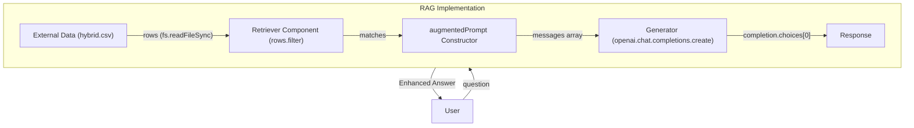
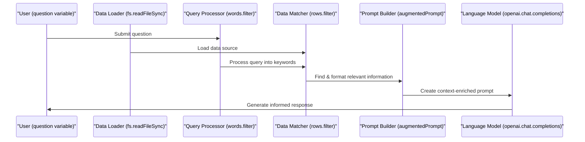
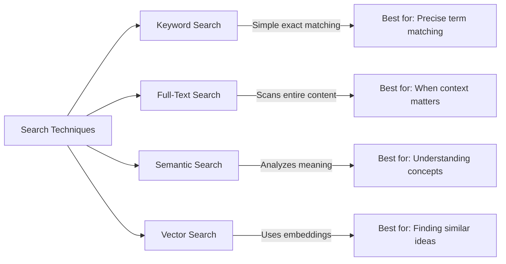
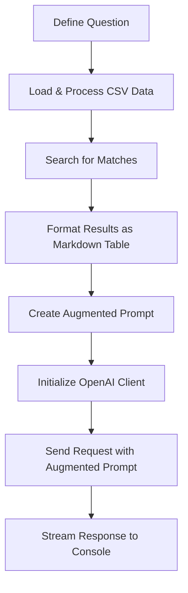

<!-- source: DeepWiki mcp.deepwiki.com · repo microsoft/generative-ai-with-javascript · page 4.5 Retrieval-Augmented Generation · fetched 2026-10-26 -->

# Retrieval-Augmented Generation

<details>
<summary>Relevant source files</summary>

The following files were used as context for generating this wiki page:

- [lessons/01-intro-to-genai/README.md](lessons/01-intro-to-genai/README.md)
- [lessons/02-first-ai-app/README.md](lessons/02-first-ai-app/README.md)
- [lessons/03-prompt-engineering/translations/README.bn.md](lessons/03-prompt-engineering/translations/README.bn.md)
- [lessons/04-structured-output/README.md](lessons/04-structured-output/README.md)
- [lessons/05-rag/README.md](lessons/05-rag/README.md)
- [lessons/05-rag/translations/README.bn.md](lessons/05-rag/translations/README.bn.md)

</details>


This document covers the Retrieval-Augmented Generation (RAG) system implemented in the repository. RAG is a technique that enhances language model outputs by retrieving relevant external data and incorporating it into the context before generating responses. This approach helps address limitations of standard language models by providing up-to-date and accurate information from external sources. For information about structuring AI outputs, see [Structured Output](#4.4).

## What is RAG?

Retrieval-Augmented Generation combines two key approaches in natural language processing:

1. **Retrieval-based methods** that find relevant information from external data sources
2. **Generative models** that create coherent, contextually appropriate responses

RAG addresses several key limitations of traditional Large Language Models (LLMs):

| Limitation | Description | How RAG Helps |
|------------|-------------|---------------|
| Outdated information | Model training data may be outdated | Retrieves current information from external sources |
| Inaccurate information | Training data may contain errors or biases | Uses verified external data sources |
| Limited knowledge | Models have knowledge cutoffs | Expands knowledge with domain-specific information |

Sources: [lessons/05-rag/README.md:104-113]()

## RAG Architecture

### Core RAG System Architecture



The RAG system has two primary components:

1. **Retriever**: Finds relevant information from data sources based on the user query
2. **Generator**: Uses the retrieved information to generate an accurate, informed response

Sources: [lessons/05-rag/README.md:126-135](), [lessons/05-rag/example/rag-cars.js:226-246]()

### RAG Data Flow



This sequence shows the step-by-step process of how a query flows through the RAG system:

1. User submits a question
2. System loads external data
3. Question is processed into searchable terms
4. Relevant information is retrieved
5. Retrieved data augments the prompt
6. Model generates a response using the enriched context

Sources: [lessons/05-rag/README.md:133-141](), [lessons/05-rag/example/rag-cars.js:224-284]()

## Retriever Component Implementation

The retriever component is responsible for finding relevant information from external data sources. In the example implementation, it:

1. Loads data from a CSV file
2. Processes the user's question into searchable terms
3. Filters the data to find relevant matches
4. Formats the results for use in prompt augmentation

```javascript
// Load CSV data as an array of objects
const rows = fs.readFileSync("./hybrid.csv", "utf8").split("\n");
const columns = rows[0].split(",");

// Search the data using a very naive search
const words = question
  .toLowerCase()
  .replaceAll(/[.?!()'":,]/g, "")
  .split(" ")
  .filter((word) => word.length > 2);
const matches = rows.slice(1).filter((row) => words.some((word) => row.toLowerCase().includes(word)));

// Format as a markdown table, since language models understand markdown
const table =
  `| ${columns.join(" | ")} |\n` +
  `|${columns.map(() => "---").join(" | ")}|\n` +
  matches.map((row) => `| ${row.replaceAll(",", " | ")} |\n`).join("");
```

Sources: [lessons/05-rag/example/rag-cars.js:229-246]()

## Prompt Augmentation

The key to effective RAG implementation is properly augmenting the prompt with retrieved information. The example demonstrates a structured approach:

```text
## Instructions
Answer questions about hybrid cars using only the sources below.
If there's not enough data in provided sources, say that you don't know.
Be brief and straight to the point.

## Sources
${table}  // Retrieved information formatted as a markdown table

## Question
${question}  // Original user question
```

This structure provides clear guidance to the language model by:
1. Setting explicit boundaries (only use provided sources)
2. Including an "escape hatch" (acknowledge when information is insufficient)
3. Specifying formatting expectations (brief, focused answers)

Sources: [lessons/05-rag/README.md:172-194](), [lessons/05-rag/example/rag-cars.js:253-263]()

## Generator Component Implementation

The generator component takes the augmented prompt and uses it to create a response:

```javascript
const openai = new OpenAI({
  baseURL: "https://models.inference.ai.azure.com",
  apiKey: process.env.GITHUB_TOKEN,
});

const chunks = await openai.chat.completions.create({
  model: "gpt-4o-mini",
  messages: [{ role: "user", content: augmentedPrompt }],
  stream: true,
});

console.log(`Answer for "${question}":`);

for await (const chunk of chunks) {
  process.stdout.write(chunk.choices[0].delta.content ?? "");
}
```

Sources: [lessons/05-rag/example/rag-cars.js:269-284]()

## Integrating External Data Sources

The repository demonstrates several approaches to integrating external data sources:

### Data Source Types

| Data Source | Description | Implementation Method |
|-------------|-------------|------------------------|
| API | External service data | HTTP requests (e.g., Wikipedia API) |
| CSV Files | Structured tabular data | File system operations |
| Databases | Structured query-based storage | Database clients |

Example of API integration with Wikipedia:

```javascript
const response = await fetch('https://en.wikipedia.org/w/api.php?format=json&action=query&prop=extracts&redirects=true&explaintext&titles=Tim%20Berners-Lee');
const data = await response.json();
const text = Object.values(data.query.pages)[0]?.extract;
```

Sources: [lessons/05-rag/README.md:153-167](), [lessons/05-rag/README.md:320-323]()

## Search Techniques

Different search techniques can be employed in the retriever component:



The example in the repository uses a simple keyword-based search, but more sophisticated methods can be implemented for better results.

Sources: [lessons/05-rag/README.md:165-167]()

## Complete RAG Implementation Example

The repository includes a working example of a RAG system in `rag-cars.js` that:



This implementation demonstrates the core RAG pattern:
1. Define a question/query
2. Retrieve relevant information from external data
3. Augment the prompt with retrieved information
4. Generate a response using a language model

Sources: [lessons/05-rag/example/rag-cars.js:210-285]()

## Best Practices for RAG Implementation

When implementing RAG in your applications:

1. **Data Processing**:
   - Clean and preprocess data before retrieval
   - Consider chunking large documents
   - Format data consistently (markdown is well-understood by LLMs)

2. **Prompt Design**:
   - Include clear instructions for the model
   - Add an "escape hatch" for unknown information
   - Structure the prompt with clear sections

3. **Security Considerations**:
   - Ensure proper permissions for data access
   - Be mindful of exposing sensitive information
   - Consider regulatory compliance requirements

Sources: [lessons/05-rag/README.md:160-167](), [lessons/05-rag/README.md:189-194]()

## Benefits of RAG

RAG provides several advantages for AI applications:

| Benefit | Description |
|---------|-------------|
| Improved Accuracy | Uses verified external data rather than just training data |
| Up-to-date Information | External data can be refreshed without model retraining |
| Source Attribution | Responses can be traced to specific sources |
| Reduced Hallucinations | LLMs are less likely to generate incorrect information |
| Domain Specialization | General models can be adapted for specific knowledge areas |

Sources: [lessons/05-rag/README.md:104-113]()

## Advanced RAG Techniques

While not fully implemented in the current codebase, several advanced RAG techniques are worth considering:

1. **Semantic Search**: Using embeddings to find conceptually similar content
2. **Hybrid Search**: Combining keyword and semantic search for better results
3. **Multi-hop Retrieval**: Retrieving information in stages to answer complex queries
4. **Adaptive Retrieval**: Adjusting retrieval strategy based on query type
5. **Query Reformulation**: Rewriting queries to improve retrieval results

Sources: [lessons/05-rag/README.md:165-167]()

## Challenges and Limitations

While RAG significantly enhances AI capabilities, several challenges remain:

- Retrieval quality directly impacts response quality
- Processing large datasets may increase latency
- Complex queries may require sophisticated search implementations
- Maintaining data freshness requires ongoing updates

Sources: [lessons/05-rag/README.md:104-113]()

## Additional Resources

For further exploration of RAG implementation:

- [Retrieval-Augmented Generation and Indexes](https://learn.microsoft.com/azure/ai-studio/concepts/retrieval-augmented-generation)
- Sample applications: [Serverless AI Chat with RAG](https://github.com/Azure-Samples/serverless-chat-langchainjs)
- [Create your own ChatGPT with RAG Workshop](https://moaw.dev/workshop/gh:azure-samples/azure-openai-rag-workshop/docs/workshop-qdrant.md)

Sources: [lessons/05-rag/README.md:346-351]()

---

