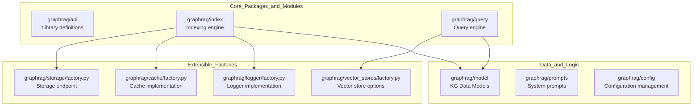
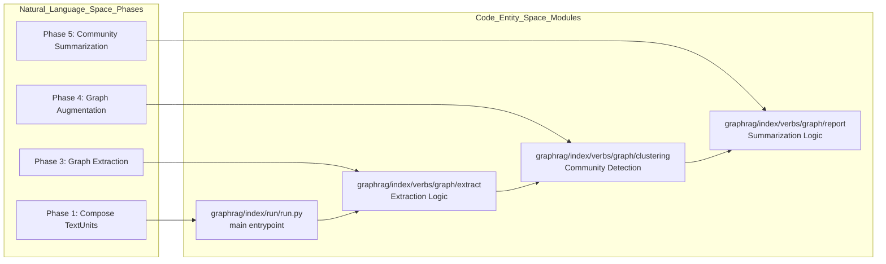

<!-- source: DeepWiki mcp.deepwiki.com · repo microsoft/graphrag · page 12.2 Development Environment Setup · fetched 2026-10-26 -->

# Development Environment Setup

<details>
<summary>Relevant source files</summary>

The following files were used as context for generating this wiki page:

- [.github/workflows/gh-pages.yml](.github/workflows/gh-pages.yml)
- [.github/workflows/python-integration-tests.yml](.github/workflows/python-integration-tests.yml)
- [.github/workflows/python-notebook-tests.yml](.github/workflows/python-notebook-tests.yml)
- [.github/workflows/python-smoke-tests.yml](.github/workflows/python-smoke-tests.yml)
- [.github/workflows/semver.yml](.github/workflows/semver.yml)
- [.github/workflows/spellcheck.yml](.github/workflows/spellcheck.yml)
- [.semversioner/3.0.4.json](.semversioner/3.0.4.json)
- [DEVELOPING.md](DEVELOPING.md)
- [RELEASE.md](RELEASE.md)
- [docs/developing.md](docs/developing.md)

</details>


This document provides a comprehensive guide to setting up a local development environment for contributing to GraphRAG. It covers installation of required tools, dependency management with `uv`, and configuration of development utilities. For information about the project directory structure, see [Project Structure](12.1). For details on running tests, see [Testing](12.3). For task automation commands, see [Task Automation with Poethepoet](12.8).

---

## Prerequisites

### Python Version Requirements

GraphRAG supports Python versions 3.10 through 3.13 [DEVELOPING.md:7](), [.github/workflows/python-smoke-tests.yml:35](). The CI environment specifically targets Python 3.13 for automated testing and documentation builds [.github/workflows/python-smoke-tests.yml:35](), [.github/workflows/gh-pages.yml:9]().

### Required Tools

| Tool | Purpose | Installation |
|------|---------|-------------|
| Python 3.10-3.13 | Core runtime environment | [python.org/downloads](https://www.python.org/downloads) |
| uv | Package and virtualenv management | [docs.astral.sh/uv](https://docs.astral.sh/uv) |
| Node.js | Required for Azurite emulator in testing | [nodejs.org](https://nodejs.org) |

**Sources:** [DEVELOPING.md:5-8](), [.github/workflows/python-smoke-tests.yml:35](), [docs/developing.md:7]()

---

## Installing uv Package Manager

`uv` is used for package management and virtualenv management in GraphRAG [DEVELOPING.md:8](). It replaces traditional `pip` workflows for developers to ensure consistent environments across the monorepo.

### Installation

Follow the official installation guide at [docs.astral.sh/uv/](https://docs.astral.sh/uv).

Verify installation:

```bash
uv --version
```

**Sources:** [DEVELOPING.md:8](), [docs/developing.md:8]()

---

## Workspace Initialization

### Installing Dependencies

From the repository root, run the following command to synchronize the environment:

```bash
uv sync --all-packages
```

This command performs several actions:
1. Creates a virtual environment.
2. Resolves and installs dependencies for all members of the workspace, including `graphrag`, `graphrag-llm`, `graphrag-storage`, and others [RELEASE.md:36-43]().
3. Sets up the environment for executing lifecycle scripts [DEVELOPING.md:83]().

**Sources:** [DEVELOPING.md:15](), [docs/developing.md:16](), [RELEASE.md:14](), [RELEASE.md:36-43]()

---

## Repository Structure and Factories

GraphRAG leverages a factory design pattern to enable custom implementations for core components [DEVELOPING.md:35]().



**Diagram: System Component Associations (Code Entity Space)**

**Sources:** [DEVELOPING.md:38-59]()

---

## Environment Configuration

### Initializing a Project

To set up a workspace for the first time, use the `init` command:

```bash
uv run poe index init
```

### Environment Variables

| Variable | Purpose |
|----------|---------|
| `GRAPHRAG_API_KEY` | API key for OpenAI or Azure OpenAI providers [.github/workflows/python-smoke-tests.yml:40](). |
| `GRAPHRAG_API_BASE` | Base URL for API requests [.github/workflows/python-smoke-tests.yml:41](). |
| `AZURE_AI_SEARCH_URL_ENDPOINT` | Endpoint for Azure AI Search integration [.github/workflows/python-smoke-tests.yml:43](). |
| `LLVM_CONFIG` | Path to `llvm-config` (Linux troubleshooting) [DEVELOPING.md:113](). |
| `UV_PUBLISH_TOKEN` | Token used for publishing packages to PyPI [RELEASE.md:69](). |

**Sources:** [DEVELOPING.md:113](), [RELEASE.md:69](), [.github/workflows/python-smoke-tests.yml:40-44]()

---

## Lifecycle Scripts with Poethepoet

GraphRAG uses `poethepoet` to manage custom build and execution scripts [DEVELOPING.md:83](). These are typically invoked via `uv run poe <command>`.

### Common Commands

| Command | Description |
|---------|-------------|
| `uv run poe index` | Execute the indexing engine [DEVELOPING.md:86](). |
| `uv run poe query` | Execute the query engine [DEVELOPING.md:87](). |
| `uv run poe prompt_tune` | Execute the prompt tuning module [DEVELOPING.md:25](). |
| `uv run poe check` | Run static checks (linting, types, security) [DEVELOPING.md:93](). |
| `uv run poe test` | Execute the full test suite [DEVELOPING.md:89](). |
| `uv run poe fix` | Apply auto-fixes for formatting and linting [DEVELOPING.md:99](). |
| `uv build` | Build wheel files and distributable artifacts [DEVELOPING.md:88](). |

**Sources:** [DEVELOPING.md:20-30](), [DEVELOPING.md:85-101](), [docs/developing.md:45-63]()

---

## Emulators for Local Testing

### Azurite (Azure Storage)
Some unit and smoke tests require `Azurite` to emulate Azure storage resources [DEVELOPING.md:73]().

```bash
./scripts/start-azurite.sh
```
Alternatively, if installed globally via npm, run `azurite` in your terminal [DEVELOPING.md:79]().

### Azure Cosmos DB Emulator
Integration tests on Windows runners may use the Cosmos DB Emulator [.github/workflows/python-integration-tests.yml:86]().

```powershell
Import-Module "$env:ProgramFiles\Azure Cosmos DB Emulator\PSModules\Microsoft.Azure.CosmosDB.Emulator"
Start-CosmosDbEmulator -Timeout 500
```

**Sources:** [DEVELOPING.md:73-79](), [.github/workflows/python-integration-tests.yml:86-91]()

---

## Platform-Specific Troubleshooting

### Linux (Ubuntu/Debian)

#### LLVM Configuration Issues
If `uv sync` fails with a `llvm-config` error, install the following:
```bash
sudo apt-get install llvm-9 llvm-9-dev
export LLVM_CONFIG=/usr/bin/llvm-config-9
```

#### Missing Python Headers
If errors mention `Python.h` is missing, install the development headers for your Python version:
```bash
sudo apt-get install python3.10-dev
```

**Sources:** [DEVELOPING.md:105-120](), [docs/developing.md:67-76]()

---

## Development Dataflow Mapping

The following diagram bridges conceptual indexing phases to the primary entry points and modules within the codebase.



**Diagram: Indexing Phase to Code Entity Mapping**

**Sources:** [DEVELOPING.md:46-47]()

---

