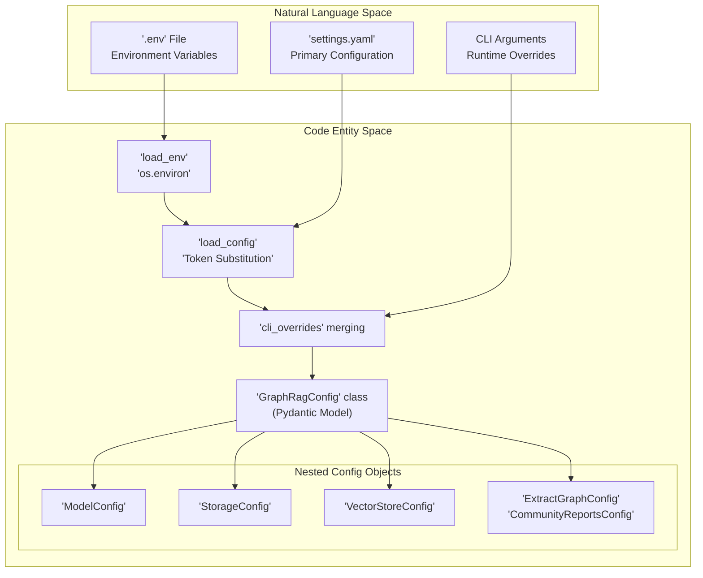
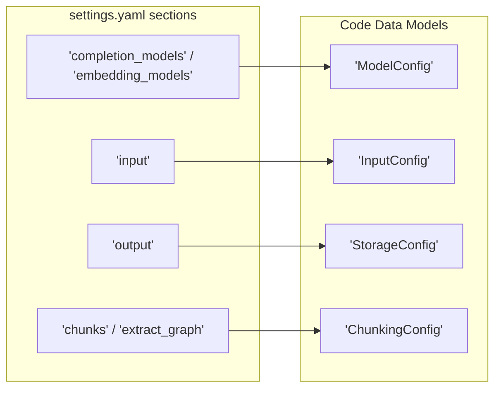

<!-- source: DeepWiki mcp.deepwiki.com · repo microsoft/graphrag · page 3 Configuration System · fetched 2026-10-26 -->

# Configuration System

<details>
<summary>Relevant source files</summary>

The following files were used as context for generating this wiki page:

- [docs/config/init.md](docs/config/init.md)
- [docs/config/overview.md](docs/config/overview.md)
- [docs/config/yaml.md](docs/config/yaml.md)
- [docs/index/architecture.md](docs/index/architecture.md)
- [docs/index/inputs.md](docs/index/inputs.md)
- [docs/query/overview.md](docs/query/overview.md)
- [tests/unit/config/fixtures/minimal_config/settings.yaml](tests/unit/config/fixtures/minimal_config/settings.yaml)
- [tests/unit/config/fixtures/minimal_config_missing_env_var/settings.yaml](tests/unit/config/fixtures/minimal_config_missing_env_var/settings.yaml)
- [tests/unit/config/test_config.py](tests/unit/config/test_config.py)
- [tests/unit/config/utils.py](tests/unit/config/utils.py)

</details>


The Configuration System is GraphRAG's centralized mechanism for managing all settings required for indexing and querying operations. It provides a flexible, hierarchical approach to configuration through YAML files, environment variables, and CLI overrides, with strong typing and validation.

For information about specific configuration options and their usage, see [Configuration Files](#3.1). For details on model selection, see [Language Model Configuration](#3.3).

---

## Configuration Sources and Loading

GraphRAG supports multiple configuration sources that are merged in priority order:

**Configuration Loading Logic**

Title: Configuration Loading and Entity Mapping


The `load_config` function handles the hierarchical merging of configuration sources:

1.  **Environment Variables**: Loaded from `.env` file into process environment to allow token replacement [docs/config/yaml.md:3-3]().
2.  **YAML Parsing**: Settings file parsed with `${VAR_NAME}` token substitution syntax [docs/config/yaml.md:3-16]().
3.  **CLI Overrides**: Runtime parameters override YAML values via the `cli_overrides` parameter in `load_config` [tests/unit/config/test_config.py:45-57]().
4.  **Validation**: Strong typing via Pydantic validates the final configuration against `GraphRagConfig` [tests/unit/config/test_config.py:22-26]().

**Sources:** [docs/config/yaml.md:1-16](), [tests/unit/config/test_config.py:8-61](), [tests/unit/config/utils.py:19-19]()

---

## Configuration File Structure

The `settings.yaml` file is the primary configuration source and follows a structured hierarchy corresponding to the internal data models.

Title: YAML Structure to Data Model Mapping


**Key Sections:**
- **Language Model Setup**: Defines `completion_models` and `embedding_models` using [LiteLLM](https://docs.litellm.ai) [docs/config/yaml.md:20-47]().
- **Input Files**: Configures the source `storage` and format (CSV, Text, JSON, etc.) [docs/config/yaml.md:73-95]().
- **Chunking**: Settings for `size`, `overlap`, and `prepend_metadata` [docs/config/yaml.md:96-107]().
- **Outputs and Storage**: Defines where the pipeline exports artifacts [docs/config/yaml.md:108-121]().

**Sources:** [docs/config/yaml.md:18-121](), [tests/unit/config/utils.py:7-32]()

---

## Environment Variable Substitution

The configuration system supports environment variable token replacement using `${VAR_NAME}` syntax [docs/config/yaml.md:3-3]().

**Example .env File:**
```bash
GRAPHRAG_API_KEY=sk-abc123...
```

**Example settings.yaml with Token Substitution:**
```yaml
completion_models:
  default_completion_model:
    api_key: ${GRAPHRAG_API_KEY}
```

**Sources:** [docs/config/yaml.md:7-16](), [tests/unit/config/fixtures/minimal_config/settings.yaml:1-12]()

---

## Configuration Model Classes

GraphRAG uses strongly-typed Pydantic models to represent configuration, primarily defined in the `graphrag.config.models` namespace.

| Class | Purpose | Key Fields |
|-------|---------|------------|
| `GraphRagConfig` | Root configuration container | `completion_models`, `embedding_models`, `input`, `output_storage` [tests/unit/config/utils.py:57-62]() |
| `ModelConfig` | LLM model configuration | `model_provider`, `model`, `api_key`, `rate_limit`, `retry` [tests/unit/config/utils.py:90-113]() |
| `StorageConfig` | Storage backend settings | `type`, `base_dir`, `connection_string`, `container_name` [tests/unit/config/utils.py:138-146]() |
| `VectorStoreConfig` | Vector store settings | `type`, `db_uri`, `url`, `api_key` [tests/unit/config/utils.py:115-126]() |
| `InputConfig` | Data ingestion settings | `type`, `file_pattern`, `text_column`, `title_column` [tests/unit/config/utils.py:154-160]() |

**Sources:** [tests/unit/config/utils.py:7-180]()

---

## Model Configuration

GraphRAG supports multiple language models referenced by ID. It uses [LiteLLM](https://docs.litellm.ai) under the hood to support over 100 model providers [docs/config/yaml.md:46-47]().

**Model Configuration Fields:**
- `model_provider`: e.g., `openai`, `azure`, `anthropic` [docs/config/yaml.md:47]().
- `retry`: Configures `exponential_backoff` or `immediate` strategies [docs/config/yaml.md:55-60]().
- `rate_limit`: Configures `sliding_window` limits for requests and tokens [docs/config/yaml.md:61-65]().

For details, see [Language Model Configuration](#3.3).

**Sources:** [docs/config/yaml.md:20-72](), [tests/unit/config/utils.py:36-54]()

---

## Storage Configuration

GraphRAG supports multiple storage backends through `StorageConfig`. These are used for input ingestion, output artifact export, and caching [docs/config/yaml.md:73-121]().

**Supported Storage Types:**
- `file`: Local filesystem [docs/config/yaml.md:82]().
- `memory`: In-memory storage [docs/config/yaml.md:82]().
- `blob`: Azure Blob Storage [docs/config/yaml.md:82]().
- `cosmosdb`: Azure Cosmos DB [docs/config/yaml.md:82]().

For details, see [Storage Configuration](#3.4).

**Sources:** [docs/config/yaml.md:73-121](), [tests/unit/config/utils.py:138-146]()

---

## Vector Store Configuration

Vector store configuration defines the backend for storing and searching embeddings.

**Supported Backends:**
- `lancedb`: Local vector database [tests/unit/config/utils.py:32]().
- `azure_ai_search`: Azure-hosted search service [tests/unit/config/utils.py:122-124]().
- `cosmosdb`: Cosmos DB with DiskANN support [tests/unit/config/utils.py:125]().

For details, see [Vector Store Configuration](#3.5).

**Sources:** [tests/unit/config/utils.py:115-127]()

---

## Workflow Configuration

Individual workflows within the indexing pipeline have specific parameter sets defined in specialized config classes:

| Workflow | Configuration Class | Key Parameters |
|----------|----------------------|----------------|
| Graph Extraction | `ExtractGraphConfig` | `prompt`, `entity_types`, `max_gleanings` [tests/unit/config/utils.py:13]() |
| Community Reports | `CommunityReportsConfig` | `max_length`, `max_input_length` [tests/unit/config/utils.py:9]() |
| Chunking | `ChunkingConfig` | `size`, `overlap`, `type`, `encoding_model` [tests/unit/config/utils.py:171-177]() |
| Text Embedding | `EmbedTextConfig` | `batch_size`, `embedding_model_id`, `names` [tests/unit/config/utils.py:162-169]() |

For details, see [Workflow Configuration](#3.6).

**Sources:** [tests/unit/config/utils.py:7-26]()

---

## Search Method Configuration

Search parameters are configured per method to tune retrieval performance:

- **Global Search**: Configures map-reduce summarization parameters via `GlobalSearchConfig` [tests/unit/config/utils.py:18]().
- **Local Search**: Configures entity-centric graph traversal via `LocalSearchConfig` [tests/unit/config/utils.py:20]().
- **DRIFT Search**: Configures iterative refinement via `DRIFTSearchConfig` [tests/unit/config/utils.py:10]().
- **Basic Search**: Baseline vector RAG configuration via `BasicSearchConfig` [tests/unit/config/utils.py:7]().

For details, see [Search Method Configuration](#3.7).

**Sources:** [tests/unit/config/utils.py:7-20]()

---

## Configuration Defaults and Validation

GraphRAG provides comprehensive defaults in `graphrag.config.defaults` [docs/config/yaml.md:5-5]().

**Default Config Creation:**
The system can generate a default configuration object using `get_default_graphrag_config()` which populates all nested models with system-standard values from `graphrag_config_defaults` [tests/unit/config/utils.py:57-62]().

For details, see [Configuration Defaults and Validation](#3.8).

**Sources:** [docs/config/yaml.md:5-5](), [tests/unit/config/utils.py:57-62]()

---

