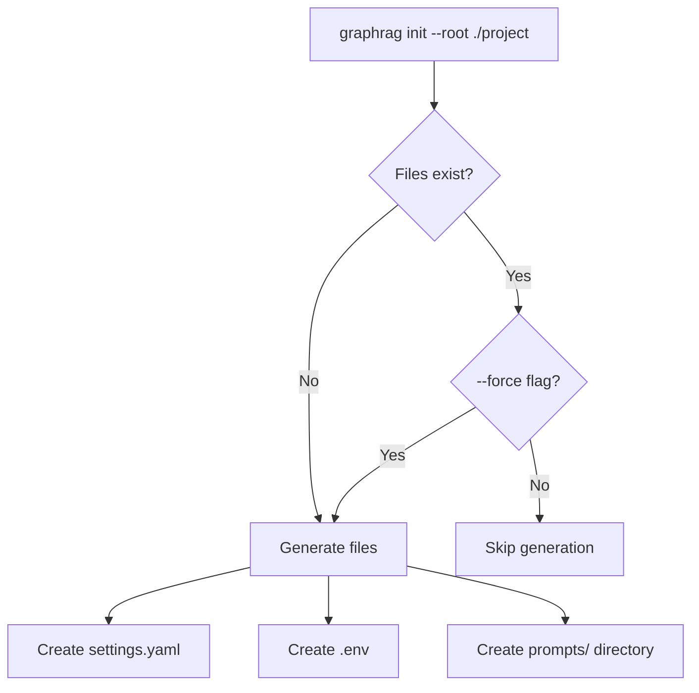
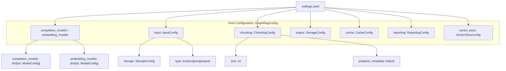
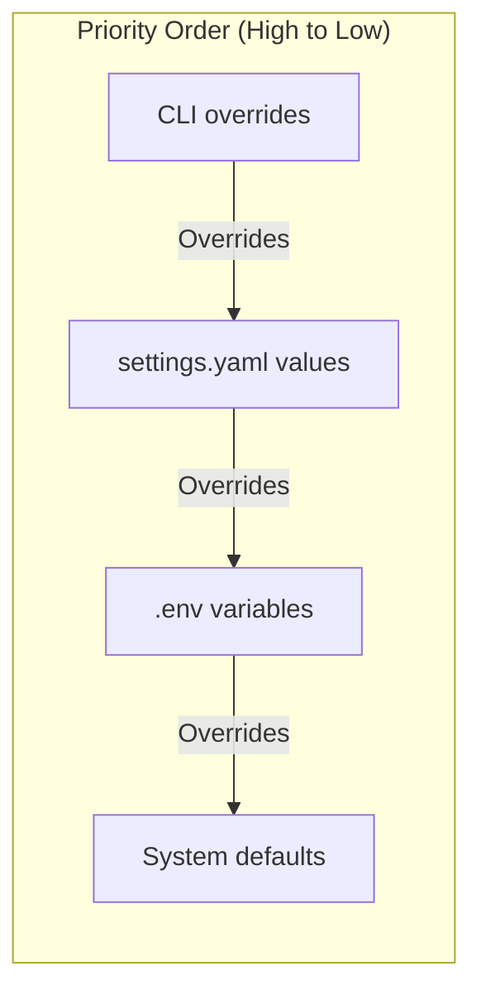
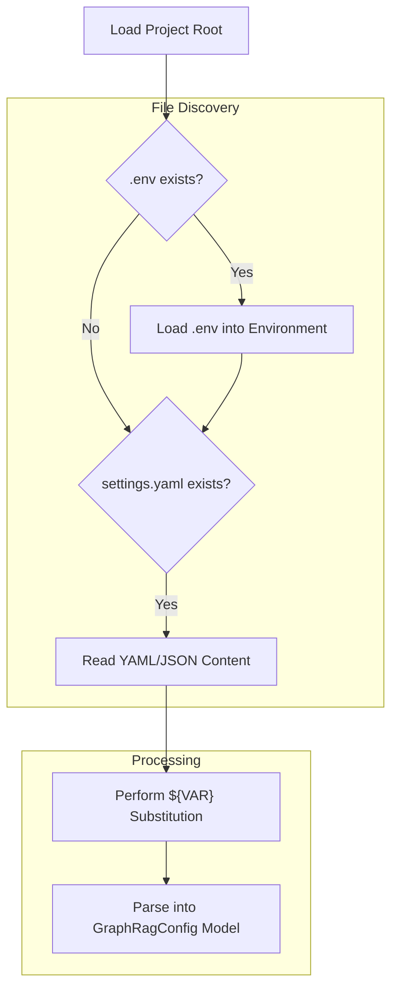

<!-- source: DeepWiki mcp.deepwiki.com · repo microsoft/graphrag · page 3.1 Configuration Files · fetched 2026-10-26 -->

# Configuration Files

<details>
<summary>Relevant source files</summary>

The following files were used as context for generating this wiki page:

- [docs/config/init.md](docs/config/init.md)
- [docs/config/overview.md](docs/config/overview.md)
- [docs/config/yaml.md](docs/config/yaml.md)
- [docs/index/architecture.md](docs/index/architecture.md)
- [docs/index/inputs.md](docs/index/inputs.md)
- [docs/query/overview.md](docs/query/overview.md)

</details>


This document describes the configuration file system used by GraphRAG, including the structure and content of `settings.yaml` and `.env` files, and how these files are discovered and loaded by the system.

## Overview

GraphRAG uses a two-file configuration approach to manage system behavior and sensitive credentials:

1.  **`settings.yaml`** (or `settings.json`) - Structured configuration defining all system behavior [docs/config/yaml.md:3-3]().
2.  **`.env`** - Environment variables for sensitive data and environment-specific values [docs/config/yaml.md:3-3]().

Both files are typically located in the project root directory and are generated by the `graphrag init` command [docs/config/init.md:3-3]().

## Configuration File Types

### settings.yaml

The `settings.yaml` file is the primary configuration file that defines all GraphRAG behavior. It uses YAML format by default, though JSON format is also supported via `settings.json` [docs/config/yaml.md:3-3]().

**Key characteristics:**
- Human-readable structured format.
- Supports token substitution syntax `${ENV_VAR}` to reference environment variables [docs/config/yaml.md:3-3]().
- Defines models, storage, workflows, and all operational parameters [docs/config/yaml.md:18-125]().
- Generated with sensible defaults by `graphrag init` [docs/config/init.md:23-26]().

**File Location:** Root directory of the GraphRAG project (specified by `--root` option) [docs/config/init.md:13-13]().

Sources: [docs/config/yaml.md:1-7](), [docs/config/init.md:1-26]()

### .env File

The `.env` file stores environment variables, typically containing sensitive information like API keys and connection strings. Variables defined here are available for token substitution in `settings.yaml` [docs/config/yaml.md:3-3]().

**Key characteristics:**
- Simple key-value format: `KEY=value` [docs/config/yaml.md:11-11]().
- Loaded before `settings.yaml` processing [docs/config/yaml.md:3-3]().
- Contains secrets and environment-specific configuration [docs/config/init.md:27-27]().

**Default content generated by init:**
```bash
GRAPHRAG_API_KEY=some_api_key
```

Sources: [docs/config/yaml.md:3-16](), [docs/config/init.md:27-27]()

## File Generation via Init Command

The `graphrag init` command generates both configuration files in the specified root directory to bootstrap a project [docs/config/init.md:23-28]().

### Configuration Initialization Flow



**Generated artifacts:**

| Artifact | Purpose |
|----------|---------|
| `settings.yaml` | Main configuration settings [docs/config/init.md:26-26](). |
| `.env` | Environment variables referenced in settings [docs/config/init.md:27-27](). |
| `prompts/` | Default LLM prompts used by GraphRAG (extraction, summarization, etc.) [docs/config/init.md:28-28](). |

Sources: [docs/config/init.md:1-29]()

## Configuration Structure

### settings.yaml Structure Map

The following diagram shows the top-level structure of `settings.yaml` and how sections map to internal configuration classes and data models.



Sources: [docs/config/yaml.md:18-125](), [docs/index/inputs.md:57-61]()

### Language Model Configuration

GraphRAG uses `completion_models` and `embedding_models` blocks to define LLM providers. It leverages [LiteLLM](https://docs.litellm.ai) under the hood [docs/config/yaml.md:46-47]().

```yaml
completion_models:
  default_completion_model:
    model_provider: openai
    model: gpt-4.1
    api_key: ${GRAPHRAG_API_KEY}

embedding_models:
  default_embedding_model:
    model_provider: openai
    model: text-embedding-3-large
    api_key: ${GRAPHRAG_API_KEY}
```

Sources: [docs/config/yaml.md:28-42]()

### Input and Chunking Configuration

The `input` block configures how data is read into the `documents` DataFrame [docs/index/inputs.md:7-16](). The `chunking` block defines how these documents are split into "text units" [docs/index/inputs.md:87-89]().

| Field | Description |
|-------|-------------|
| `input.type` | Supported: `text`, `csv`, `json`, `jsonl`, `parquet`, `markitdown` [docs/config/yaml.md:89-89](). |
| `chunking.size` | Max chunk size in tokens [docs/config/yaml.md:104-104](). |
| `chunking.prepend_metadata` | Document fields to copy into every text chunk to maintain context [docs/index/inputs.md:98-100](). |

Sources: [docs/config/yaml.md:75-107](), [docs/index/inputs.md:1-100]()

## Configuration Loading and Hierarchy

### Resolution Hierarchy

GraphRAG resolves configuration values using a specific priority order.



1.  **CLI overrides**: Parameters passed directly to the indexing or query commands.
2.  **settings.yaml**: Values explicitly defined in the configuration file [docs/config/yaml.md:3-3]().
3.  **Environment variables**: Values from `.env` or system environment used via `${VAR}` syntax [docs/config/yaml.md:3-3]().
4.  **System defaults**: Hardcoded values in the codebase (e.g., `graphrag.config.defaults`) [docs/config/yaml.md:5-5]().

Sources: [docs/config/yaml.md:1-16](), [docs/config/init.md:1-32]()

### Loading Process Flow

The system discovers and processes configuration through several stages:



Sources: [docs/config/yaml.md:3-3](), [docs/config/init.md:1-32]()

## Storage and Path Resolution

GraphRAG supports multiple storage backends for input, output, and caching. These are configured via `StorageConfig` blocks [docs/config/yaml.md:81-88]().

| Storage Type | Description | Key Configuration Fields |
|--------------|-------------|--------------------------|
| `file` | Local filesystem storage | `base_dir`, `encoding` [docs/config/yaml.md:82-84](). |
| `blob` | Azure Blob Storage | `connection_string`, `container_name`, `account_url` [docs/config/yaml.md:85-87](). |
| `cosmosdb` | Azure Cosmos DB | `connection_string`, `database_name`, `container_name` [docs/config/yaml.md:85-88](). |
| `memory` | In-memory storage | No specific path fields required [docs/config/yaml.md:82-82](). |

Sources: [docs/config/yaml.md:81-140](), [docs/index/architecture.md:45-48]()

---

