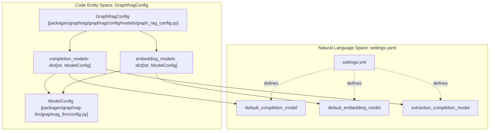
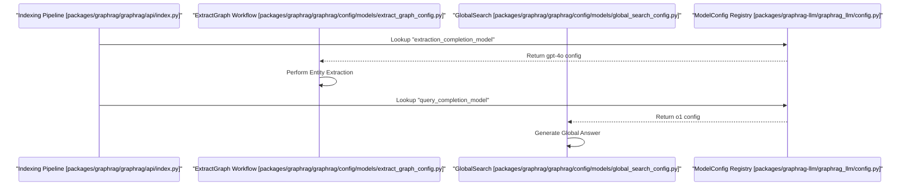

<!-- source: DeepWiki mcp.deepwiki.com · repo microsoft/graphrag · page 3.3 Language Model Configuration · fetched 2026-10-26 -->

# Language Model Configuration

<details>
<summary>Relevant source files</summary>

The following files were used as context for generating this wiki page:

- [dictionary.txt](dictionary.txt)
- [docs/config/models.md](docs/config/models.md)
- [docs/config/yaml.md](docs/config/yaml.md)
- [docs/get_started.md](docs/get_started.md)
- [docs/index/architecture.md](docs/index/architecture.md)
- [docs/index/inputs.md](docs/index/inputs.md)
- [docs/visualization_guide.md](docs/visualization_guide.md)
- [mkdocs.yaml](mkdocs.yaml)
- [tests/integration/storage/test_cosmosdb_storage.py](tests/integration/storage/test_cosmosdb_storage.py)

</details>


## Purpose and Scope

This document describes the configuration of language models in GraphRAG. Language models are central to GraphRAG's indexing and query operations, used for entity extraction, summarization, report generation, and query answering. This page covers model authentication, provider selection, rate limiting, retry strategies, and asymmetric model usage.

GraphRAG utilizes [LiteLLM](https://docs.litellm.ai) as its primary interface for calling language models, providing compatibility with over 100 model providers including OpenAI, Azure OpenAI, Anthropic, and Gemini.

Sources: [docs/config/yaml.md:20-47](), [docs/config/models.md:9-11]()

## Configuration Structure

GraphRAG uses a model registry pattern. Models are defined in the `completion_models` and `embedding_models` dictionaries within `settings.yaml`. Each entry is identified by a unique key (model ID) that can be referenced independently by different workflow steps.

### Configuration Model Mapping
The following diagram illustrates how YAML configuration entries map to the `GraphRagConfig` class and its nested `ModelConfig` objects.



Sources: [docs/config/yaml.md:22-42](), [docs/config/models.md:14-27]()

## Model Fields and Parameters

Each model configuration supports a variety of fields to control behavior, authentication, and performance.

### Core Fields

| Field | Type | Description |
|-------|------|-------------|
| `type` | `litellm\|mock` | The LLM provider type. Default is `litellm`. |
| `model_provider` | `str` | The provider (e.g., `openai`, `azure`, `anthropic`). |
| `model` | `str` | The specific model name (e.g., `gpt-4o`, `claude-3-opus`). |
| `auth_method` | `api_key\|azure_managed_identity` | Authentication strategy. |
| `api_key` | `str` | API key (can use `${ENV_VAR}` syntax). |
| `api_base` | `str` | Base URL for the API endpoint. |
| `api_version` | `str` | API version (primarily for Azure). |

Sources: [docs/config/yaml.md:44-53](), [docs/get_started.md:73-84]()

### Reliability and Performance

GraphRAG includes built-in support for retries and rate limiting to handle transient errors and provider quotas.

| Field | Sub-fields | Description |
|-------|------------|-------------|
| `retry` | `type`, `max_retries`, `base_delay` | Configures `exponential_backoff` (default) or `immediate` retries. |
| `rate_limit` | `requests_per_period`, `tokens_per_period` | Implements `sliding_window` rate limiting. |
| `call_args` | `temperature`, `max_completion_tokens`, etc. | Default arguments sent with every request. |

Sources: [docs/config/yaml.md:55-65]()

## Asymmetric Model Usage

GraphRAG allows for "asymmetric" configuration, where different models are used for different stages of the pipeline. This is useful for optimizing costs and performance (e.g., using a cheaper model for extraction and a more powerful model for final queries).

### Model Reference Data Flow
The diagram below shows how specific workflows reference models by ID from the global registry.



**Example Asymmetric Config:**
```yaml
completion_models:
  extraction_completion_model:
    model_provider: openai
    model: gpt-4o
    api_key: ${GRAPHRAG_API_KEY}
  query_completion_model:
    model_provider: openai
    model: o1
    api_key: ${GRAPHRAG_API_KEY}

extract_graph:
  completion_model_id: extraction_completion_model

global_search:
  completion_model_id: query_completion_model
```

Sources: [docs/config/models.md:42-68]()

## Provider Specifics

### Azure OpenAI
Azure configurations require `api_base` and `api_version`. If the `azure_deployment_name` differs from the `model` name, it must be specified. For Managed Identity, set `auth_method: azure_managed_identity` and remove the `api_key`.

Sources: [docs/get_started.md:73-94](), [docs/config/yaml.md:53-54]()

### LiteLLM Integration
The `model_provider` is the portion prior to the `/` in LiteLLM syntax, while the `model` is the portion following the `/`. Example: For `anthropic/claude-3`, `model_provider` is `anthropic` and `model` is `claude-3`.

Sources: [docs/config/yaml.md:47](), [docs/config/models.md:29]()

## Model Selection Considerations

*   **Structured Outputs:** Models must support returning structured outputs adhering to a JSON schema for many GraphRAG workflows.
*   **Reasoning Models (o-series):** These models handle tokens differently. GraphRAG supports `max_completion_tokens` for these models. Note that `logit_bias` is not supported for reasoning models; GraphRAG uses a prompted approach for these instead.
*   **Token Limits:** While `max_tokens` was previously used for response control, GraphRAG now primarily uses a prompted approach for length control, reserving `max_tokens` for budgetary limits.

Sources: [docs/config/models.md:9-10](), [docs/config/models.md:35-40]()

## Custom Model Implementation

Users can bypass LiteLLM by implementing the `LLMCompletion` protocol and registering a custom provider with the `completion_factory`.

```python
from graphrag_llm.completion import LLMCompletion, register_completion

class MyCustomCompletionModel(LLMCompletion):
    async def __call__(self, prompt, **kwargs):
        # Custom logic here
        pass

# Registering the provider for use in configuration
register_completion("my-custom-model", MyCustomCompletionModel)
```

Sources: [docs/config/models.md:84-98](), [docs/index/architecture.md:43]()

---

