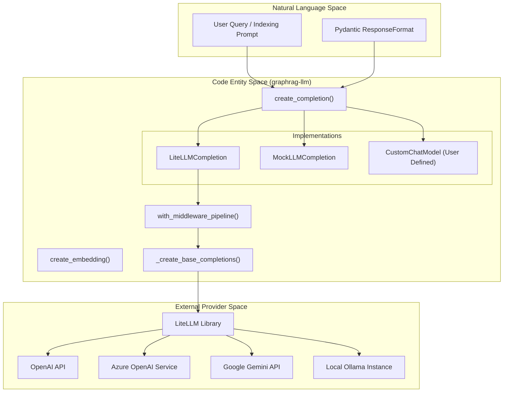
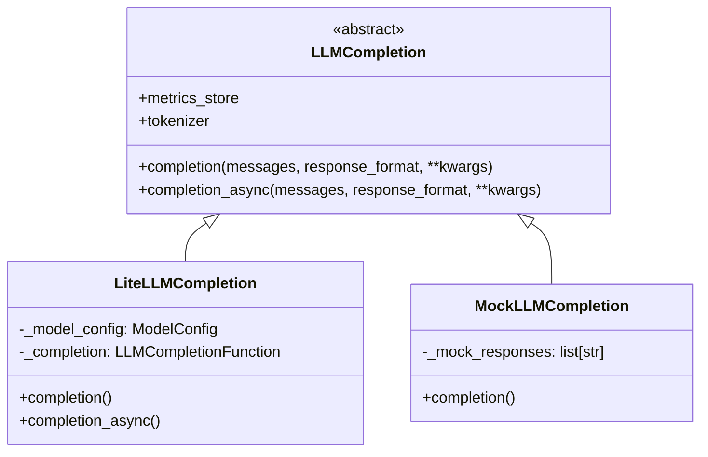

<!-- source: DeepWiki mcp.deepwiki.com · repo microsoft/graphrag · page 9.2 Supported Providers · fetched 2026-10-26 -->

# Supported Providers

<details>
<summary>Relevant source files</summary>

The following files were used as context for generating this wiki page:

- [dictionary.txt](dictionary.txt)
- [docs/config/models.md](docs/config/models.md)
- [docs/get_started.md](docs/get_started.md)
- [docs/visualization_guide.md](docs/visualization_guide.md)
- [mkdocs.yaml](mkdocs.yaml)
- [packages/graphrag-llm/graphrag_llm/completion/completion.py](packages/graphrag-llm/graphrag_llm/completion/completion.py)
- [packages/graphrag-llm/graphrag_llm/completion/lite_llm_completion.py](packages/graphrag-llm/graphrag_llm/completion/lite_llm_completion.py)
- [packages/graphrag-llm/graphrag_llm/completion/mock_llm_completion.py](packages/graphrag-llm/graphrag_llm/completion/mock_llm_completion.py)
- [packages/graphrag-llm/notebooks/03_structured_responses.ipynb](packages/graphrag-llm/notebooks/03_structured_responses.ipynb)
- [tests/integration/language_model/test_factory.py](tests/integration/language_model/test_factory.py)
- [tests/integration/storage/test_cosmosdb_storage.py](tests/integration/storage/test_cosmosdb_storage.py)

</details>


This page documents the language model providers supported by GraphRAG for both completion (chat) and embedding operations. GraphRAG utilizes [LiteLLM](https://docs.litellm.ai) as its primary model provider abstraction layer, enabling support for 100+ models across multiple providers while maintaining a consistent configuration interface.

## Provider Architecture

GraphRAG's provider system is built on a multi-layer abstraction that separates provider-specific logic from core workflows. The system uses a factory pattern to instantiate completion and embedding models based on the `model_provider` and `type` specified in the configuration.

### Data Flow and Entity Mapping

The following diagram illustrates how Natural Language requests move through the Code Entity Space to reach various LLM Providers.

**LLM Provider Data Flow**

**Sources:** [packages/graphrag-llm/graphrag_llm/completion/lite_llm_completion.py:45-130](), [tests/integration/language_model/test_factory.py:34-71](), [docs/config/models.md:9-11]()

## Supported Provider Categories

### Officially Tested Providers

GraphRAG is primarily developed and tested using **OpenAI** and **Azure OpenAI**. These providers are considered first-class citizens in the ecosystem.

| Provider | `model_provider` | Auth Methods | Key Features |
|----------|------------------|--------------|--------------|
| **OpenAI** | `openai` | `api_key` | Supports `gpt-4o`, `o1` series, and structured outputs. |
| **Azure OpenAI** | `azure` | `api_key`, `azure_managed_identity` | Enterprise-grade security, regional deployments. |

**Sources:** [docs/get_started.md:69-94](), [docs/config/models.md:33-40]()

### LiteLLM Supported Providers (Community)

Through the `LiteLLMCompletion` class, GraphRAG can interface with any provider supported by LiteLLM. This includes:
- **Google Gemini**: Configured using `model_provider: gemini`. [docs/config/models.md:14-27]()
- **Anthropic**: Support for Claude models via the `anthropic` provider prefix.
- **Mistral/Groq/Bedrock**: Accessible via their respective LiteLLM identifiers.

**Requirement:** When using these providers, the selected model **must** support returning structured outputs adhering to a JSON schema, as GraphRAG relies heavily on Pydantic-based parsing for graph extraction. [docs/config/models.md:9-10]()

### Local and Mock Providers

- **Ollama / Local Proxies**: Users can point GraphRAG to local instances by setting `api_base` to a local endpoint (e.g., `http://localhost:11434/v1`). [docs/config/models.md:76-79]()
- **Mock Provider**: The `MockLLMCompletion` class is used for testing, allowing the system to simulate LLM responses without network calls by consuming a list of `mock_responses` from the `ModelConfig`. [packages/graphrag-llm/graphrag_llm/completion/mock_llm_completion.py:33-48](), [packages/graphrag-llm/graphrag_llm/completion/mock_llm_completion.py:79-88]()

## Technical Implementation

### The Completion Protocol

All completion providers must implement the `LLMCompletion` abstract base class. This ensures consistency across synchronous and asynchronous execution.

**Class Hierarchy and Key Methods**

**Sources:** [packages/graphrag-llm/graphrag_llm/completion/completion.py:34-161](), [packages/graphrag-llm/graphrag_llm/completion/lite_llm_completion.py:45-58](), [packages/graphrag-llm/graphrag_llm/completion/mock_llm_completion.py:33-40]()

### Configuration Examples

#### Azure OpenAI with Managed Identity
Azure users can authenticate without static API keys by using `azure_managed_identity` as the `auth_method`.

```yaml
type: chat
model_provider: azure
model: gpt-4o
azure_deployment_name: <AZURE_DEPLOYMENT_NAME>
api_base: https://<instance>.openai.azure.com
api_version: 2024-02-15-preview
auth_method: azure_managed_identity
```
**Sources:** [docs/get_started.md:77-92]()

#### Asymmetric Model Usage
GraphRAG allows using different providers or models for different stages of the pipeline (e.g., expensive models for extraction, cheaper models for querying). This is achieved by defining multiple models in `completion_models` and referencing their IDs in specific workflow configurations.

```yaml
completion_models:
  extraction_completion_model:
    model_provider: openai
    model: gpt-4o
  query_completion_model:
    model_provider: openai
    model: o1
extract_graph:
  completion_model_id: extraction_completion_model
global_search:
  completion_model_id: query_completion_model
```
**Sources:** [docs/config/models.md:44-68]()

## Custom Provider Registration

Developers can extend GraphRAG by registering their own provider implementations. This is done using the `register_completion` and `register_embedding` functions.

**Implementation Steps:**
1. Define a class inheriting from `LLMCompletion` (for chat) or `LLMEmbedding` (for embeddings). [tests/integration/language_model/test_factory.py:35-60]()
2. Implement the required abstract methods (`completion`, `completion_async`). [packages/graphrag-llm/graphrag_llm/completion/completion.py:81-161]()
3. Call `register_completion("provider_name", MyClass)`. [tests/integration/language_model/test_factory.py:61]()

```python
from graphrag_llm.completion import LLMCompletion, register_completion

class CustomChatModel(LLMCompletion):
    # implementation details...
    pass

register_completion("custom_chat", CustomChatModel)
```
**Sources:** [tests/integration/language_model/test_factory.py:34-61](), [docs/config/models.md:89-98]()

## Provider Capabilities and Constraints

| Feature | OpenAI / Azure | Gemini / Anthropic | Local (Ollama) |
|---------|----------------|--------------------|----------------|
| **Structured JSON** | Native Support | Supported via LiteLLM | Model Dependent |
| **Streaming** | Supported | Supported | Supported |
| **Managed Auth** | Azure MI | N/A | N/A |
| **Reasoning (o1)** | Supported (v2.2+) | N/A | N/A |

**Note on o-series models:** Models like `o1` do not support `logit_bias` and handle token limits differently. GraphRAG 2.2.0+ adapts to this by switching to prompted length control and supporting `max_completion_tokens`. [docs/config/models.md:35-38]()

**Note on Streaming:** `response_format` (structured output) is not supported when `stream=True` is enabled. Attempting to use both will result in a `ValueError`. [packages/graphrag-llm/graphrag_llm/completion/lite_llm_completion.py:143-145](), [packages/graphrag-llm/notebooks/03_structured_responses.ipynb:92-94]()

**Sources:** [docs/config/models.md:9-10](), [packages/graphrag-llm/graphrag_llm/completion/lite_llm_completion.py:141-145]()

---

