# Page: GraphRAG Overview

# GraphRAG Overview

<details>
<summary>Relevant source files</summary>

The following files were used as context for generating this wiki page:

- [CHANGELOG.md](CHANGELOG.md)
- [README.md](README.md)
- [breaking-changes.md](breaking-changes.md)
- [dictionary.txt](dictionary.txt)
- [docs/config/models.md](docs/config/models.md)
- [docs/get_started.md](docs/get_started.md)
- [docs/index.md](docs/index.md)
- [docs/index/byog.md](docs/index/byog.md)
- [docs/index/methods.md](docs/index/methods.md)
- [docs/visualization_guide.md](docs/visualization_guide.md)
- [mkdocs.yaml](mkdocs.yaml)
- [packages/graphrag-cache/pyproject.toml](packages/graphrag-cache/pyproject.toml)
- [packages/graphrag-chunking/pyproject.toml](packages/graphrag-chunking/pyproject.toml)
- [pyproject.toml](pyproject.toml)
- [tests/integration/storage/test_cosmosdb_storage.py](tests/integration/storage/test_cosmosdb_storage.py)

</details>


## Purpose and Scope

This page provides a high-level introduction to GraphRAG, a structured, hierarchical approach to Retrieval Augmented Generation (RAG) that uses knowledge graphs to enhance language model reasoning over private datasets. This overview covers the system's purpose, core components, and basic workflow. For detailed information about specific subsystems, see:

- [Key Concepts](#1.1) — Fundamental concepts like knowledge graphs, entities, relationships, and communities.
- [System Architecture](#1.2) — Detailed architecture and component interactions.
- [Installation and Dependencies](#1.3) — Setup and requirements.
- [Getting Started](#1.4) — Quick start guide with examples.

## What is GraphRAG?

GraphRAG is a data pipeline and transformation suite designed to extract meaningful, structured data from unstructured text using Large Language Models (LLMs). Unlike traditional "baseline RAG" approaches that rely solely on vector similarity search over text chunks, GraphRAG builds a knowledge graph from your documents and uses this structured representation to provide more comprehensive and contextually aware responses.

The system consists of two primary phases:

1.  **Indexing Pipeline**: Processes documents to extract entities, relationships, and communities, then generates hierarchical summaries.
2.  **Query System**: Uses the indexed knowledge graph to answer questions through multiple search strategies.

**Sources:** [README.md:22-26](), [docs/index.md:13-14]()

## Why GraphRAG Exists

Traditional RAG systems struggle with two key limitations:

| Limitation | Description | GraphRAG Solution |
| :--- | :--- | :--- |
| **Connecting the Dots** | Baseline RAG cannot traverse disparate pieces of information through shared attributes to synthesize insights. | Uses graph structure to follow entity relationships and build connected context. |
| **Holistic Understanding** | Vector search performs poorly when questions require understanding summarized semantic concepts across large collections. | Employs hierarchical community detection and generates multi-level summaries. |

GraphRAG addresses these limitations by creating a structured knowledge graph with hierarchical community summaries, enabling both detailed entity-specific queries and broad dataset-level questions.

**Sources:** [docs/index.md:24-30](), [README.md:24-26]()

## Core System Components

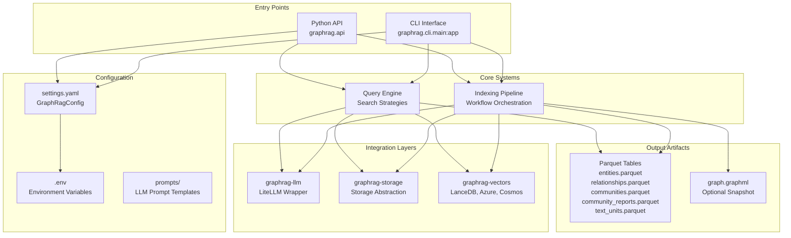

**GraphRAG System Component Overview**

GraphRAG is organized into several key layers:

### User Interface Layer
- **CLI**: Command-line interface defined in `graphrag.cli` for initialization, indexing, and querying [pyproject.toml:97-101]().
- **API**: Python library interface for programmatic integration.

### Configuration System
- **settings.yaml**: Main configuration file defining models, storage, workflows, and search parameters [docs/get_started.md:58-58]().
- **.env**: Environment variables for API keys and sensitive configuration [docs/get_started.md:56-57]().

### Core Pipeline System
- **Indexing Pipeline**: Orchestrates document processing, graph extraction, and community detection.
- **Query Engine**: Provides strategies like Global, Local, and DRIFT search [docs/index.md:44-51]().

### Integration Layers
- **LLM Provider**: Abstraction over models via `graphrag-llm` [packages/graphrag-llm/pyproject.toml:2-2](), utilizing LiteLLM [docs/config/models.md:9-11]().
- **Storage**: Pluggable backends via `graphrag-storage` [packages/graphrag-storage/pyproject.toml:2-2]().
- **Vector Stores**: Integration via `graphrag-vectors` [packages/graphrag-vectors/pyproject.toml:2-2]().

**Sources:** [README.md:22-36](), [docs/get_started.md:51-59](), [pyproject.toml:97-101](), [docs/config/models.md:9-11]()

## How GraphRAG Works

### Indexing Methods

GraphRAG supports multiple indexing strategies to balance cost and detail:

| Method | Description | Characteristics |
| :--- | :--- | :--- |
| **Standard** | Uses LLM for entity/relationship extraction and summarization. | High fidelity, rich descriptions, higher cost. |
| **Fast** | Uses NLP for portions of the indexing phase in lieu of LLM APIs. | Faster, cheaper, utilizes `extract_graph_nlp` [CHANGELOG.md:37-37](). |

**Sources:** [docs/index.md:36-42](), [docs/config/models.md:70-70](), [CHANGELOG.md:37-37]()

### Indexing Workflow

```mermaid
graph LR
    Input["Raw Documents<br/>txt/csv/json"]
    Load["load_input_documents<br/>InputReader"]
    Chunk["create_base_text_units<br/>Text Chunking"]
    Extract["extract_graph<br/>LLM or NLP Extraction"]
    Summarize["summarize_descriptions<br/>LLM Summarization"]
    Cluster["cluster_graph<br/>Leiden Algorithm"]
    Reports["create_community_reports<br/>LLM Summaries"]
    Embed["generate_text_embeddings<br/>Vector Embeddings"]
    Output["Parquet Tables<br/>TableProvider"]
    
    Input --> Load
    Load --> Chunk
    Chunk --> Extract
    Extract --> Summarize
    Summarize --> Cluster
    Cluster --> Reports
    Reports --> Embed
    Embed --> Output
```

**GraphRAG Indexing Pipeline Flow**

The indexing pipeline transforms unstructured documents into a queryable knowledge graph. Key workflows include:
- **Document Loading**: `load_input_documents` handles text, CSV, or JSON [CHANGELOG.md:58-61]().
- **Community Detection**: Uses the Leiden technique for hierarchical clustering [docs/index.md:40-40]().
- **Table Management**: Uses `TableProvider` and `DataReader` for handling Parquet/CSV artifacts [CHANGELOG.md:66-70]().

**Sources:** [docs/index.md:36-42](), [CHANGELOG.md:58-70]()

### Query Workflow

The query system provides four search strategies:

| Search Method | Use Case | Data Sources |
| :--- | :--- | :--- |
| **Global Search** | Holistic questions about the corpus. | Community summaries [docs/index.md:47-47](). |
| **Local Search** | Reasoning about specific entities and neighbors. | Entities and associated concepts [docs/index.md:48-48](). |
| **DRIFT Search** | Combines global/local with iterative refinement. | Community and neighbor context [docs/index.md:49-49](). |
| **Basic Search** | Standard top-k vector RAG. | Text chunks [docs/index.md:50-50](). |

**Sources:** [docs/index.md:44-51]()

## Package Architecture

GraphRAG is organized as a monorepo using `uv` workspaces [pyproject.toml:53-54]():

- **graphrag**: Main package containing CLI and orchestration [packages/graphrag/pyproject.toml:2-2]().
- **graphrag-llm**: LiteLLM integration and model providers [packages/graphrag-llm/pyproject.toml:2-2]().
- **graphrag-storage**: Storage abstraction (File, Blob, Cosmos) [packages/graphrag-storage/pyproject.toml:2-2]().
- **graphrag-vectors**: Vector store implementations [packages/graphrag-vectors/pyproject.toml:2-2]().
- **graphrag-common**: Shared types and utilities [pyproject.toml:58-58]().
- **graphrag-chunking**, **graphrag-input**, **graphrag-cache**: Specialized processing packages [pyproject.toml:57-61]().

**Sources:** [pyproject.toml:53-63]()

## Getting Started

1.  **Install**: Use `pip install graphrag` [docs/get_started.md:40-41]().
2.  **Initialize**: Run `graphrag init` to generate `settings.yaml` [pyproject.toml:99-99]().
3.  **Index**: Run `graphrag index` to build the graph [pyproject.toml:97-97]().
4.  **Query**: Run `graphrag query --method [global|local|drift]` [pyproject.toml:100-100]().

**Sources:** [README.md:28-30](), [pyproject.toml:97-101](), [docs/get_started.md:48-49]()

## Versioning and Migration

GraphRAG uses `semversioner` for release management [pyproject.toml:45-45](). Breaking changes are documented, and users are encouraged to run `graphrag init --force` between minor version bumps to ensure configuration compatibility [README.md:53-53](). Native support for `CosmosTableProvider` with namespace partitioning was introduced in version 3.1.0 [CHANGELOG.md:15-17]().

**Sources:** [pyproject.toml:112-127](), [README.md:49-55](), [CHANGELOG.md:15-17]()

---

# Page: Key Concepts

# Key Concepts

<details>
<summary>Relevant source files</summary>

The following files were used as context for generating this wiki page:

- [README.md](README.md)
- [breaking-changes.md](breaking-changes.md)
- [dictionary.txt](dictionary.txt)
- [docs/config/models.md](docs/config/models.md)
- [docs/get_started.md](docs/get_started.md)
- [docs/index.md](docs/index.md)
- [docs/index/byog.md](docs/index/byog.md)
- [docs/index/methods.md](docs/index/methods.md)
- [docs/visualization_guide.md](docs/visualization_guide.md)
- [mkdocs.yaml](mkdocs.yaml)
- [tests/integration/storage/test_cosmosdb_storage.py](tests/integration/storage/test_cosmosdb_storage.py)

</details>


## Purpose and Scope

This document explains the fundamental concepts that underpin GraphRAG's approach to retrieval-augmented generation. It covers the core data structures (entities, relationships, communities, text units), the distinction between indexing and querying phases, and how GraphRAG differs from traditional RAG systems.

---

## GraphRAG vs Traditional RAG

Traditional RAG systems use vector similarity search to retrieve relevant text chunks, then feed those chunks directly to an LLM for answer generation. This approach works well for answering questions about specific facts contained in single documents, but struggles with queries that require synthesis across multiple sources or global understanding of a dataset [docs/index.md:23-31]().

GraphRAG introduces an intermediate knowledge representation layer: a **knowledge graph** extracted from source documents. Instead of retrieving raw text chunks, GraphRAG retrieves structured entities, relationships, and community summaries, enabling more sophisticated reasoning patterns [docs/index.md:13-17]().

### Key Differences

| Aspect | Traditional RAG | GraphRAG |
|--------|----------------|----------|
| **Intermediate Representation** | Vector embeddings of text chunks | Knowledge graph + embeddings |
| **Retrieval Unit** | Text chunks | Entities, relationships, communities, text units |
| **Query Types** | Specific factual questions | Both specific and global synthesis questions |
| **Preprocessing** | Chunking + embedding | LLM-based extraction + graph analysis + embedding |
| **Global Understanding** | Limited to aggregating similar chunks | Hierarchical community summaries |

Sources: [docs/index.md:13-31](), [docs/index/methods.md:5-45](), [README.md:22-26]()

---

## Knowledge Graph Components

GraphRAG constructs a knowledge graph from input documents during the indexing phase. This graph consists of three primary components: entities, relationships, and communities [docs/index.md:36-42]().

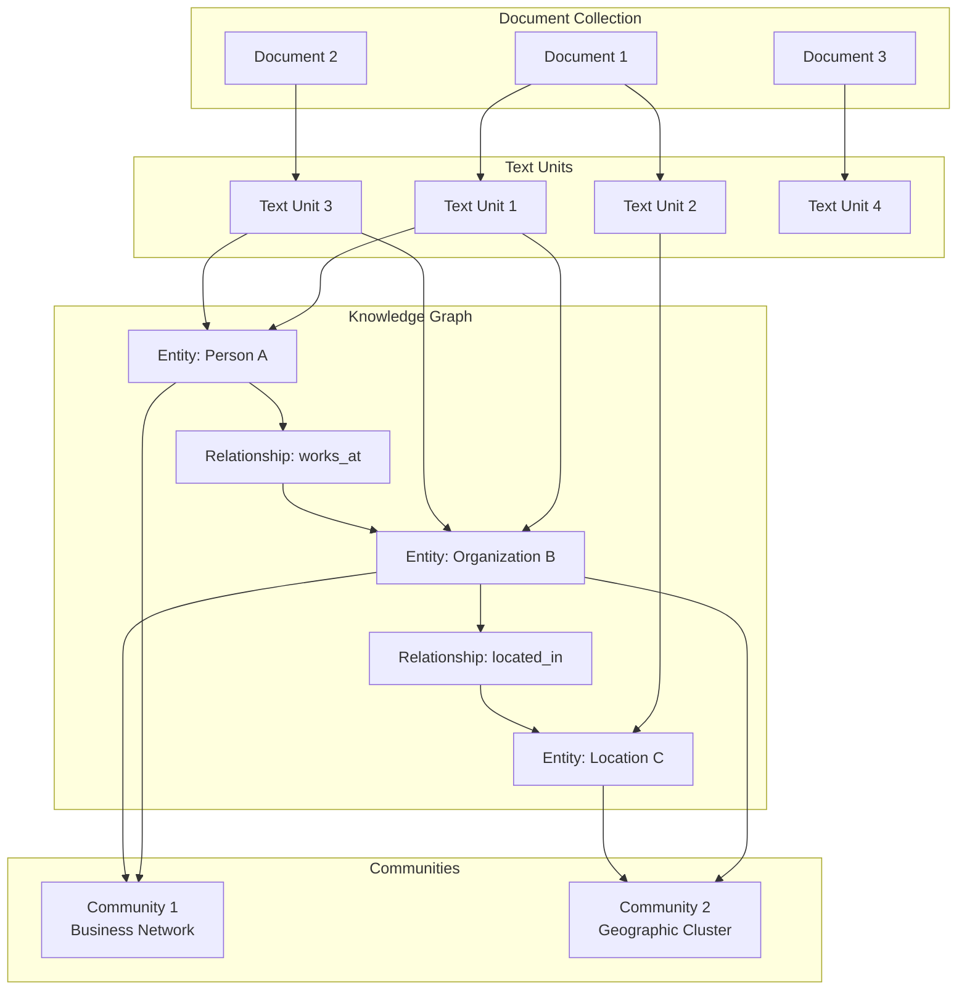

**Diagram: From Documents to Knowledge Graph Structure**

Sources: [docs/index/byog.md:5-15](), [docs/index.md:36-42]()

### Entities

**Entities** are the nodes of the knowledge graph, representing real-world objects, people, organizations, locations, concepts, or events extracted from the text [docs/index.md:40](). Each entity has:

- **id**: Unique identifier [docs/index/byog.md:17]()
- **title**: The entity name [docs/index/byog.md:17]()
- **type**: Classification (e.g., PERSON, ORGANIZATION, LOCATION) [docs/index/methods.md:9]()
- **description**: LLM-generated summary combining all mentions across documents [docs/index/methods.md:11]()
- **text_unit_ids**: List of text units where the entity appears [docs/index/byog.md:17]()

In **Standard GraphRAG**, entities are extracted by prompting an LLM to identify named entities from each text unit. The LLM also generates descriptions. When the same entity appears in multiple text units, their descriptions are summarized into a single consolidated description [docs/index/methods.md:7-12]().

In **FastGraphRAG**, entities are noun phrases extracted using NLP libraries (NLTK or spaCy), without LLM-generated descriptions. The source text units serve as the entity context [docs/index/methods.md:18-24]().

**Schema Reference**: [docs/index/byog.md:15-17]()

Sources: [docs/index/methods.md:5-30](), [docs/index/byog.md:15-17]()

### Relationships

**Relationships** are the edges of the knowledge graph, representing connections between entities. Each relationship has:

- **id**: Unique identifier [docs/index/byog.md:21]()
- **source**: Source entity id [docs/index/byog.md:21]()
- **target**: Target entity id [docs/index/byog.md:21]()
- **description**: LLM-generated description of the relationship [docs/index/byog.md:21]()
- **weight**: Importance score (crucial for community detection) [docs/index/byog.md:23]()
- **text_unit_ids**: List of text units containing evidence for the relationship [docs/index/byog.md:21]()

In **Standard GraphRAG**, the LLM is prompted to describe relationships between entity pairs in each text unit. Multiple descriptions of the same relationship are summarized into a consolidated description [docs/index/methods.md:10-12]().

In **FastGraphRAG**, relationships are defined by co-occurrence: if two entities appear in the same text unit, a relationship exists between them. No explicit description is generated [docs/index/methods.md:23]().

**Schema Reference**: [docs/index/byog.md:19-23]()

Sources: [docs/index/methods.md:5-30](), [docs/index/byog.md:19-23]()

### Communities

**Communities** are groups of entities that are densely connected in the graph, detected using the **Leiden algorithm** [docs/index.md:40](). Communities represent thematic clusters in the dataset and form a hierarchical structure [docs/index.md:14]().

The hierarchical structure allows GraphRAG to answer questions at multiple levels of abstraction:
- **Leaf communities**: Specific, detailed topics.
- **Parent communities**: Broader themes aggregating multiple sub-communities.

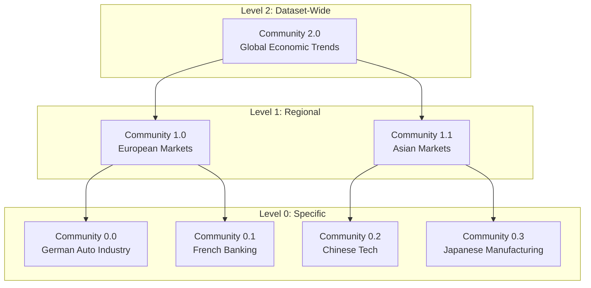

**Diagram: Hierarchical Community Structure**

Sources: [docs/index.md:36-42](), [docs/index/byog.md:27-33]()

---

## Text Units and Documents

### Text Units

**Text units** are the fundamental chunks of source text from which the knowledge graph is extracted. They are created during the indexing phase by splitting documents into manageable pieces [docs/index.md:38]().

**Chunking Strategy**:
- Standard GraphRAG typically uses larger chunks for extraction [docs/index/methods.md:9-14]().
- FastGraphRAG uses smaller chunks (50-100 tokens) to improve co-occurrence graphs [docs/index/methods.md:33]().

Sources: [docs/index.md:38](), [docs/index/methods.md:33]()

### Documents

**Documents** represent the original input files. Each document record contains the raw text and references to the text units created from it [docs/index/byog.md:5-9](). In version 3, the `text_units` table was updated to reference a single `document_id` instead of a list [breaking-changes.md:19]().

Sources: [docs/index/byog.md:5-9](), [breaking-changes.md:19]()

---

## Indexing vs Querying Phases

GraphRAG operates in two distinct phases:

### Indexing Phase

The **indexing phase** is a batch processing pipeline that transforms raw documents into knowledge graph artifacts.

**Key workflows**:
1. `load_input_documents` - Load and parse input files.
2. `create_base_text_units` - Chunk documents into text units [docs/index.md:38]().
3. `extract_graph` / `extract_graph_nlp` - Extract entities and relationships [docs/index/methods.md:9-23]().
4. `summarize_descriptions` - Consolidate entity/relationship descriptions [docs/index/methods.md:11-12]().
5. `cluster_graph` - Detect communities using Leiden algorithm [docs/index.md:40]().
6. `create_community_reports` - Generate LLM summaries for each community [docs/index.md:41]().
7. `generate_text_embeddings` - Create vector embeddings for text units and reports [docs/index/byog.md:45-48]().

```mermaid
graph LR
    Input["Input Documents"] --> Load["load_input_documents"]
    Load --> Chunk["create_base_text_units"]
    Chunk --> Extract["extract_graph<br/>extract_graph_nlp"]
    Extract --> Cluster["cluster_graph"]
    Cluster --> Reports["create_community_reports"]
    Reports --> Embed["generate_text_embeddings"]
    Embed --> Output["Parquet Tables<br/>+ Vector Store"]
    
    style Extract fill:#f9f9f9
    style Cluster fill:#f9f9f9
    style Reports fill:#f9f9f9
```

**Diagram: Simplified Indexing Pipeline Flow**

Sources: [docs/index.md:36-42](), [docs/index/methods.md:1-29](), [docs/index/byog.md:27-33]()

### Querying Phase

The **querying phase** is a runtime operation that retrieves relevant information from the indexed knowledge graph [docs/index.md:43-51]().

**Query methods**:
- **Global Search**: Uses community reports for dataset-wide synthesis [docs/index.md:47]().
- **Local Search**: Uses entity-centric graph traversal for specific questions [docs/index.md:48]().
- **DRIFT Search**: Hybrid approach combining global and local strategies [docs/index.md:49]().
- **Basic Search**: Traditional vector RAG baseline [docs/index.md:50]().

Sources: [docs/index.md:43-51]()

---

## Search Methods Overview

### Global Search
**Mechanism**: Uses community reports and a map-reduce pattern to answer questions about the entire corpus [docs/index.md:47](). It is ideal for holistic questions like "What are the main themes?" [docs/get_started.md:113-117]().

### Local Search
**Mechanism**: Focuses on specific entities and their immediate graph neighborhood [docs/index.md:48](). It retrieves related entities, relationships, and text units to provide detailed answers for entity-centric queries [docs/get_started.md:119-125]().

### DRIFT Search
**Mechanism**: An iterative search method that combines global community information with local graph traversal to refine answers [docs/index.md:49]().

### Basic Search
**Mechanism**: A standard vector similarity search over text units, serving as a baseline for performance comparison [docs/index.md:50]().

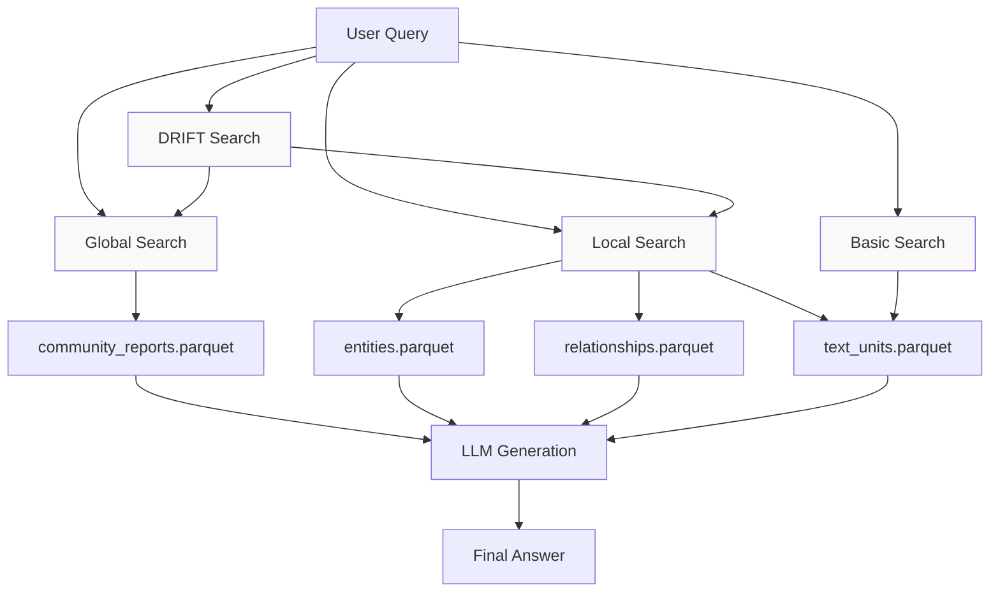

**Diagram: Search Method Data Flow**

Sources: [docs/index.md:43-51](), [docs/index/methods.md:42-45](), [docs/get_started.md:113-125]()

---

## Storage and Model Integration

GraphRAG abstracts data persistence and model calls to support various backends.

### Storage and Vector Stores
The system supports multiple storage backends for artifacts and vector embeddings:
- **LanceDB**: Default local vector store [breaking-changes.md:54]().
- **Azure Cosmos DB**: Supports storage and DiskANN-based vector indexing [tests/integration/storage/test_cosmosdb_storage.py:11-14]().
- **Azure AI Search**: Alternative vector store provider [breaking-changes.md:54]().

### Language Model Integration
GraphRAG uses `LiteLLM` for calling language models, supporting providers like OpenAI, Azure, and Gemini [docs/config/models.md:9-27](). Users can also register custom models using the `LLMCompletion` protocol [docs/config/models.md:84-98]().

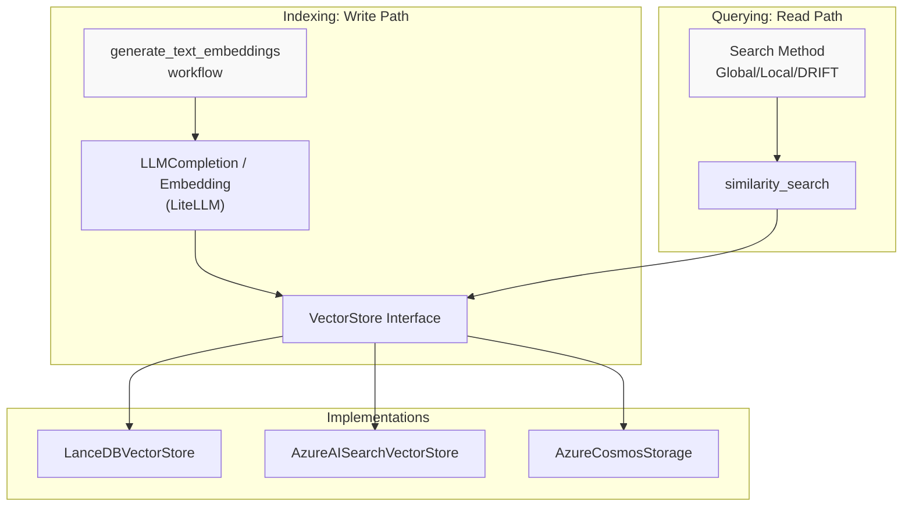

**Diagram: Vector Store and Model Integration**

Sources: [docs/config/models.md:9-98](), [breaking-changes.md:54](), [tests/integration/storage/test_cosmosdb_storage.py:11-14]()

---

# Page: System Architecture

# System Architecture

<details>
<summary>Relevant source files</summary>

The following files were used as context for generating this wiki page:

- [README.md](README.md)
- [breaking-changes.md](breaking-changes.md)
- [docs/config/yaml.md](docs/config/yaml.md)
- [docs/examples_notebooks/drift_search.ipynb](docs/examples_notebooks/drift_search.ipynb)
- [docs/examples_notebooks/global_search.ipynb](docs/examples_notebooks/global_search.ipynb)
- [docs/examples_notebooks/global_search_with_dynamic_community_selection.ipynb](docs/examples_notebooks/global_search_with_dynamic_community_selection.ipynb)
- [docs/examples_notebooks/local_search.ipynb](docs/examples_notebooks/local_search.ipynb)
- [docs/index.md](docs/index.md)
- [docs/index/architecture.md](docs/index/architecture.md)
- [docs/index/byog.md](docs/index/byog.md)
- [docs/index/default_dataflow.md](docs/index/default_dataflow.md)
- [docs/index/inputs.md](docs/index/inputs.md)
- [docs/index/methods.md](docs/index/methods.md)
- [docs/index/outputs.md](docs/index/outputs.md)

</details>


## Purpose and Scope

This document describes the overall architecture of the GraphRAG system, including its monorepo structure, major components, and how they interact. It provides a technical overview of the system's organization and the relationships between packages and subsystems.

GraphRAG is designed as a modular, layered system that enables users to build knowledge graphs from unstructured documents and query them using multiple retrieval strategies. The architecture emphasizes extensibility through a provider-factory pattern, allowing for custom implementations of storage, language models, and vector databases.

**Sources:** [README.md:22-26](), [docs/index/architecture.md:37-53]()

---

## High-Level System Organization

GraphRAG is organized as a modular, layered system built on a monorepo architecture. The system transitions from unstructured "Natural Language Space" (documents, text chunks) to "Code Entity Space" (DataFrames, Graph Primitives, Vector Stores).

### System Layers

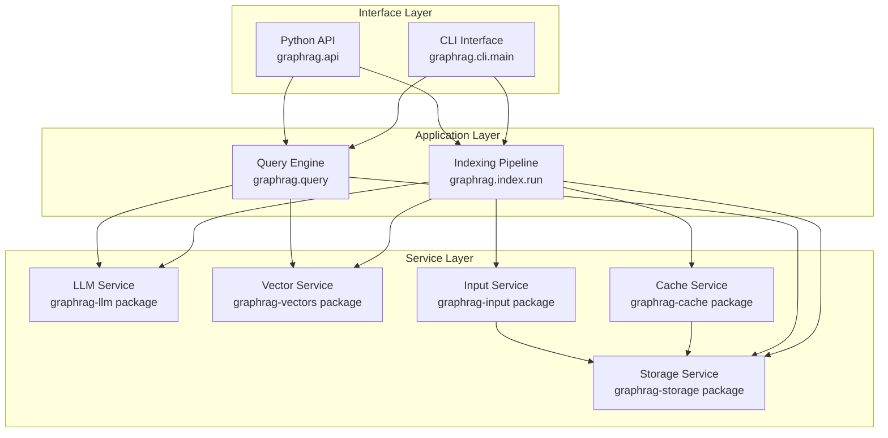

**Sources:** [docs/index/architecture.md:37-53](), [docs/index/default_dataflow.md:15-52]()

---

## Monorepo Package Structure

The repository manages distinct packages that handle infrastructure concerns. The main `graphrag` package orchestrates high-level workflows.

### Package Dependency Graph

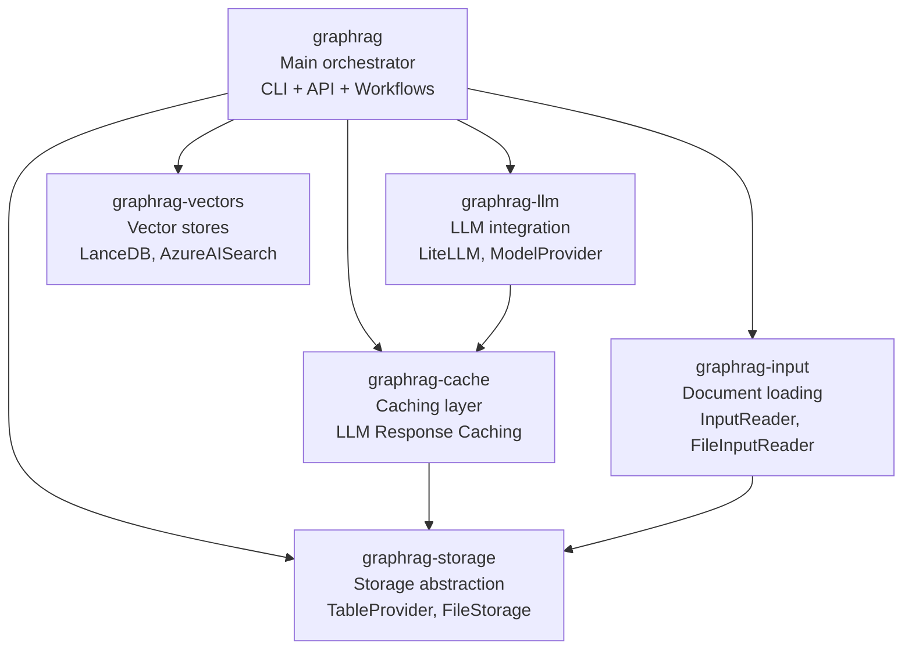

### Package Responsibilities

| Package | Purpose | Key Code Entities |
|---------|---------|-------------|
| `graphrag` | Main entry point and workflow runner | `PipelineRunContext`, `GraphRagConfig` |
| `graphrag-storage` | Data persistence abstraction | `TableProvider`, `Storage`, `TableProviderFactory` |
| `graphrag-cache` | LLM interaction persistence | `CacheFactory`, `MemoryCache` |
| `graphrag-input` | Source data ingestion | `InputReader`, `InputReaderFactory` |
| `graphrag-llm` | Language model communication | `ModelConfig`, `CompletionFactory`, `EmbeddingFactory` |
| `graphrag-vectors` | Vector search and storage | `VectorStore`, `VectorStoreFactory`, `LanceDBVectorStore` |

**Sources:** [docs/index/architecture.md:37-53](), [docs/config/yaml.md:46-71](), [docs/examples_notebooks/local_search.ipynb:31-35]()

---

## Core Architectural Patterns

### Provider-Factory Pattern
GraphRAG uses a registration-based factory pattern to enable deep customization. Core components are instantiated via factories that look up registered types based on configuration.

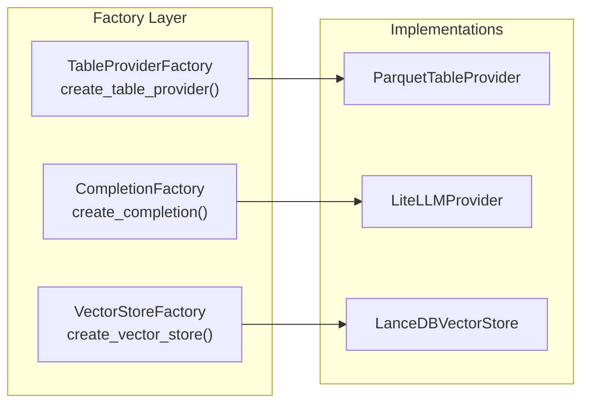

**Sources:** [docs/index/architecture.md:37-53](), [docs/config/yaml.md:46-48]()

### Knowledge Model Abstraction
The system operates on a standardized Knowledge Model, represented as DataFrames managed by `TableProvider`.

| Entity Type | Storage Table | Description |
|-------------|---------------------|-------------|
| `Document` | `documents` | Original input source. [docs/index/default_dataflow.md:7-7]() |
| `TextUnit` | `text_units` | Chunks of text used for analysis. [docs/index/default_dataflow.md:8-8]() |
| `Entity` | `entities` | Extracted graph nodes. [docs/index/default_dataflow.md:9-9]() |
| `Relationship` | `relationships` | Edges connecting entities. [docs/index/default_dataflow.md:10-10]() |
| `Covariate` | `covariates` | Extracted claim information. [docs/index/default_dataflow.md:11-11]() |
| `Community` | `communities` | Clusters of entities. [docs/index/default_dataflow.md:12-12]() |
| `Community Report` | `community_reports` | LLM-generated summaries. [docs/index/default_dataflow.md:13-13]() |

**Sources:** [docs/index/default_dataflow.md:3-14](), [docs/index/outputs.md:13-109]()

---

## Indexing Pipeline Architecture

The indexing pipeline transforms raw text into the knowledge model through a series of phases.

### Pipeline Execution Flow

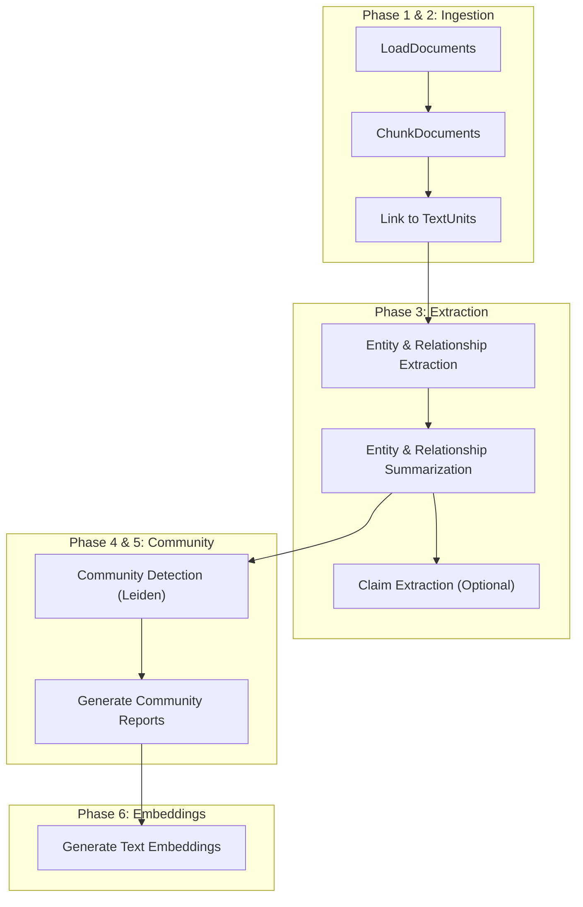

**Sources:** [docs/index/architecture.md:14-28](), [docs/index/default_dataflow.md:19-52]()

---

## Query System Architecture

The query system utilizes the indexed artifacts (Parquet tables and Vector indices) to provide multiple search strategies.

### Search Strategies

| Strategy | Implementation | Logic |
|----------|----------------|-------|
| **Global Search** | `GlobalSearch` | Map-Reduce over community reports. [docs/examples_notebooks/global_search.ipynb:40-42]() |
| **Local Search** | `LocalSearch` | Combines knowledge graph data with text chunks for entity-centric queries. [docs/examples_notebooks/local_search.ipynb:42-44]() |
| **DRIFT Search** | `DRIFTSearch` | Iterative fanning-out to neighbors with community context. [docs/index.md:49-49]() |
| **Basic Search** | Standard RAG | Similarity search over text units. [docs/index.md:50-50]() |

**Sources:** [docs/index.md:45-51](), [docs/examples_notebooks/local_search.ipynb:31-35](), [docs/examples_notebooks/global_search.ipynb:27-30]()

---

## Configuration and Environment

The system is configured via `settings.yaml` and environment variables.

### Configuration Components
* **LLM Setup**: Configured via `completion_models` and `embedding_models` using `LiteLLM`. [docs/config/yaml.md:20-42]()
* **Input/Output**: Configured via `input` and `output` blocks defining `storage` types (file, memory, blob, cosmosdb). [docs/config/yaml.md:73-116]()
* **Chunking**: Defines `size`, `overlap`, and `prepend_metadata`. [docs/config/yaml.md:96-107]()

**Sources:** [docs/config/yaml.md:1-116](), [docs/index/inputs.md:71-76]()

---

# Page: Installation and Dependencies

# Installation and Dependencies

<details>
<summary>Relevant source files</summary>

The following files were used as context for generating this wiki page:

- [CHANGELOG.md](CHANGELOG.md)
- [packages/graphrag-cache/pyproject.toml](packages/graphrag-cache/pyproject.toml)
- [packages/graphrag-chunking/pyproject.toml](packages/graphrag-chunking/pyproject.toml)
- [packages/graphrag-llm/pyproject.toml](packages/graphrag-llm/pyproject.toml)
- [packages/graphrag-storage/pyproject.toml](packages/graphrag-storage/pyproject.toml)
- [packages/graphrag-vectors/pyproject.toml](packages/graphrag-vectors/pyproject.toml)
- [packages/graphrag/pyproject.toml](packages/graphrag/pyproject.toml)
- [pyproject.toml](pyproject.toml)
- [uv.lock](uv.lock)

</details>


This page documents the prerequisites, installation procedures, and dependency structure for GraphRAG. It covers both end-user installation via PyPI and development setup using the `uv` package manager.

---

## Prerequisites

### Python Version Requirements

GraphRAG requires Python 3.11, 3.12, or 3.13. This requirement is enforced across all packages in the monorepo via `pyproject.toml` configurations. While some sub-packages like `graphrag-llm` support Python 3.10, the main application requires at least 3.11.

| Package | Python Requirement | Location |
|---------|-------------------|----------|
| `graphrag-monorepo` | `>=3.11, <3.14` | [pyproject.toml:24-24]() |
| `graphrag` | `>=3.11, <3.14` | [packages/graphrag/pyproject.toml:26-26]() |
| `graphrag-llm` | `>=3.10, <3.14` | [packages/graphrag-llm/pyproject.toml:26-26]() |
| `graphrag-common` | `>=3.11, <3.14` | [packages/graphrag-common/pyproject.toml:25-25]() |
| `graphrag-storage` | `>=3.11, <3.14` | [packages/graphrag-storage/pyproject.toml:25-25]() |
| `graphrag-vectors` | `>=3.11, <3.14` | [packages/graphrag-vectors/pyproject.toml:25-25]() |

**Sources:** [pyproject.toml:24-24](), [uv.lock:3-3](), [packages/graphrag/pyproject.toml:26-26](), [packages/graphrag-llm/pyproject.toml:26-26](), [packages/graphrag-vectors/pyproject.toml:25-25]()

### UV Package Manager

For development and monorepo management, GraphRAG uses [uv](https://docs.astral.sh/uv). It handles workspace synchronization, dependency resolution, and virtual environment management for the monorepo members.

**Installation:**
```bash
# Follow instructions at https://docs.astral.sh/uv/
curl -LsSf https://astral.sh/uv/install.sh | sh
```

**Sources:** [pyproject.toml:50-54](), [uv.lock:1-11]()

---

## Installation Methods

### End-User Installation (PyPI)

Standard users should install the main `graphrag` package from PyPI. This pulls in all necessary sub-packages (llm, storage, vectors, etc.) at compatible versions.

```bash
# Create and activate a virtual environment
python -m venv .venv
source .venv/bin/activate # Unix/MacOS

# Install via pip
pip install graphrag
```

**Sources:** [packages/graphrag/pyproject.toml:34-63]()

### Development Installation

For contributors working within the monorepo, the following workflow sets up the entire workspace using the members defined in the root manifest [pyproject.toml:53-54]().

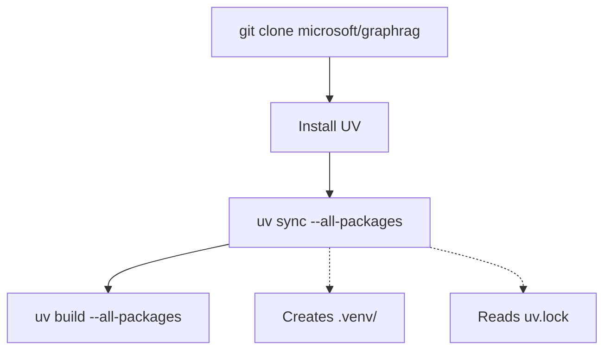

**Figure 1: Development Setup Workflow**

**Commands:**
```bash
git clone https://github.com/microsoft/graphrag.git
cd graphrag
uv sync --all-packages
```

**Sources:** [pyproject.toml:50-54](), [pyproject.toml:106-107](), [uv.lock:13-24]()

---

## Workspace Package Dependencies

GraphRAG is structured as a monorepo. The main `graphrag` package acts as the primary entry point and CLI provider, depending on specialized internal packages.

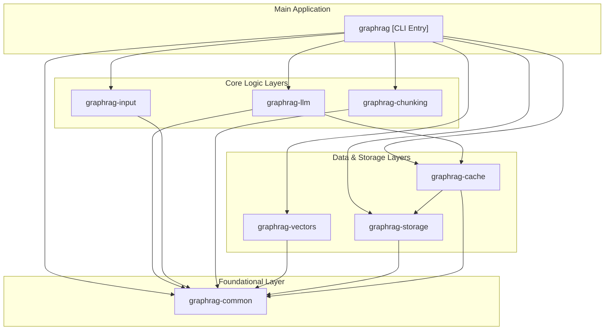

**Figure 2: Monorepo Package Dependency Hierarchy**

### Internal Package Versioning
All workspace packages are synchronized to the same version (currently `3.1.1`) to ensure strict compatibility across the monorepo.

**Sources:** [packages/graphrag/pyproject.toml:39-45](), [packages/graphrag-llm/pyproject.toml:38-41](), [packages/graphrag-cache/pyproject.toml:34-35](), [packages/graphrag-vectors/pyproject.toml:37-37]()

---

## Core External Dependencies

### Language Model Integration (`graphrag-llm`)

The LLM package abstracts interactions with various providers, primarily through **LiteLLM**.

| Dependency | Version | Role |
|------------|---------|------|
| `litellm` | `1.92.0` | Multi-provider LLM abstraction |
| `azure-identity` | `~=1.25` | Managed identity support for Azure OpenAI |
| `jinja2` | `~=3.1` | Prompt templating engine |
| `pydantic` | `~=2.10` | Data validation and settings models |
| `fastapi` | `>=0.136.3` | Required for LiteLLM tool calling |

**Sources:** [packages/graphrag-llm/pyproject.toml:34-47]()

### Data Processing and NLP (`graphrag`)

The main package handles graph construction, community detection, and complex NLP tasks.

| Dependency | Version | Purpose |
|------------|---------|---------|
| `networkx` | `~=3.4` | Graph data structures and algorithms |
| `graspologic-native` | `1.2.x` | Hierarchical clustering (Leiden) |
| `spacy` | `~=3.8` | NLP pipeline for entity extraction |
| `nltk` | `~=3.9` | Text tokenization and preprocessing |
| `pandas` | `~=3.0` | Dataframe manipulation for pipeline steps |
| `pyarrow` | `~=25.0` | Parquet file support for indexing outputs |
| `typer` | `~=0.16` | CLI implementation |

**Sources:** [packages/graphrag/pyproject.toml:46-63](), [CHANGELOG.md:28-28]()

### Storage and Vector Backends

GraphRAG supports multiple storage backends for both raw data and vector embeddings through specialized provider implementations in `graphrag-storage` and `graphrag-vectors`.

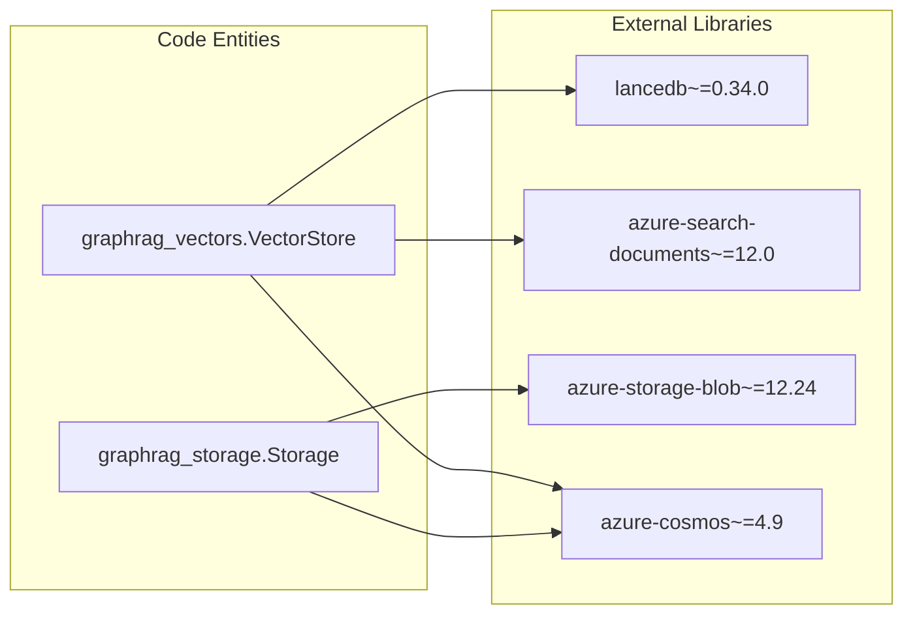

**Figure 3: Mapping Storage Code Entities to External Dependencies**

**Sources:** [packages/graphrag-vectors/pyproject.toml:32-42](), [packages/graphrag-storage/pyproject.toml:32-40](), [CHANGELOG.md:17-17]()

---

## Initialization and Workspace Setup

When a user runs `graphrag init`, the system prepares the local environment with necessary configuration files.

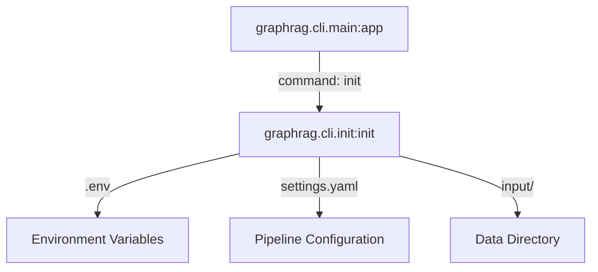

**Figure 4: Initialization Data Flow**

**Key Artifacts Created:**
- `.env`: Stores sensitive keys like `GRAPHRAG_API_KEY`.
- `settings.yaml`: Defines model providers, chunking sizes, and storage paths.
- `input/`: Default directory for source text files.

**Sources:** [packages/graphrag/pyproject.toml:65-66](), [pyproject.toml:99-99]()

---

## Troubleshooting Installation

### Python Version Mismatch
If using a version outside the `3.11-3.13` range, installation may fail or lead to runtime errors in packages like `numpy` or `pandas` which have strict version constraints. Note that `graphrag-llm` allows `3.10`, but the top-level `graphrag` package requires `3.11`.

### Dependency Conflicts
GraphRAG pins `graspologic-native` to the `1.2.x` line [packages/graphrag/pyproject.toml:49-49]() because `1.3.x` changes Leiden clustering outputs, which would break pinned regression tests.

**Sources:** [pyproject.toml:24-24](), [packages/graphrag/pyproject.toml:49-49](), [CHANGELOG.md:71-71]()

---

# Page: Getting Started

# Getting Started

<details>
<summary>Relevant source files</summary>

The following files were used as context for generating this wiki page:

- [dictionary.txt](dictionary.txt)
- [docs/config/init.md](docs/config/init.md)
- [docs/config/models.md](docs/config/models.md)
- [docs/config/overview.md](docs/config/overview.md)
- [docs/get_started.md](docs/get_started.md)
- [docs/query/overview.md](docs/query/overview.md)
- [docs/visualization_guide.md](docs/visualization_guide.md)
- [mkdocs.yaml](mkdocs.yaml)
- [tests/integration/storage/test_cosmosdb_storage.py](tests/integration/storage/test_cosmosdb_storage.py)

</details>


This page provides a quick start guide for installing and running GraphRAG for the first time. It covers the essential steps from installation through indexing your first dataset and querying the resulting knowledge graph. This guide uses command-line interface (CLI) commands and assumes basic familiarity with terminal operations.

For detailed configuration options, see **3. Configuration System**. For in-depth explanation of the indexing process, see **4. Indexing Pipeline**. For comprehensive query documentation, see **5. Query System**.

---

## Prerequisites

GraphRAG requires Python 3.10, 3.11, or 3.12 `[docs/get_started.md:7]()`. Verify your Python version before proceeding:

```bash
python --version
```

You will also need an API key for a supported language model provider. GraphRAG uses [LiteLLM](https://docs.litellm.ai) and supports 100+ model providers including OpenAI, Azure OpenAI, Anthropic, and Google Gemini `[docs/config/models.md:9-10]()`.

**Sources:** `[docs/get_started.md:5-9]()`, `[docs/config/models.md:9-10]()`

---

## Quick Start Workflow

The following diagram shows the complete workflow from installation to query:

**Workflow: Installation to Insights**
```mermaid
graph TB
    ["Install GraphRAG<br/>python -m pip install graphrag"] --> ["Initialize Project<br/>graphrag init"]
    ["Initialize Project<br/>graphrag init"] --> ["Configuration Files Created<br/>settings.yaml<br/>.env"]
    ["Configuration Files Created<br/>settings.yaml<br/>.env"] --> ["Add Input Documents<br/>to input/ directory"]
    ["Add Input Documents<br/>to input/ directory"] --> ["Run Indexing Pipeline<br/>graphrag index"]
    ["Run Indexing Pipeline<br/>graphrag index"] --> ["Knowledge Graph Artifacts<br/>output/*.parquet"]
    ["Knowledge Graph Artifacts<br/>output/*.parquet"] --> ["Query Knowledge Graph<br/>graphrag query"]
    ["Query Knowledge Graph<br/>graphrag query"] --> ["Natural Language Answers"]
```

**Sources:** `[docs/get_started.md:13-125]()`

---

## Installation

### Create Project Directory

Create a dedicated directory for your GraphRAG project and a Python virtual environment `[docs/get_started.md:15-23]`:

```bash
mkdir graphrag_quickstart
cd graphrag_quickstart
python -m venv .venv
```

### Activate Virtual Environment

**Unix/MacOS:**
```bash
source .venv/bin/activate
```

**Windows:**
```bash
.venv\Scripts\activate
```

### Install GraphRAG Package

```bash
python -m pip install graphrag
```

This installs the `graphrag` package from PyPI, which includes all necessary dependencies and the CLI interface `[docs/get_started.md:36-40]()`.

**Sources:** `[docs/get_started.md:13-40]()`

---

## Project Initialization

### Initialize Command

Run the initialization command to create the project structure `[docs/get_started.md:42-48]`:

```bash
graphrag init
```

The CLI will prompt you to specify default completion and embedding models. The command creates the following files and directories `[docs/get_started.md:52-57]`:

| File/Directory | Purpose |
|---------------|---------|
| `settings.yaml` | Main configuration file for pipeline settings `[docs/get_started.md:58]()` |
| `.env` | Environment variables (API keys, etc.) `[docs/get_started.md:56]()` |
| `input/` | Directory for source documents to be indexed `[docs/get_started.md:55]()` |

**Sources:** `[docs/get_started.md:42-57]()`

### Configuration Files Structure

The following diagram maps configuration concepts to the code entities and files that manage them:

**Mapping: Config to Code Entities**
```mermaid
graph LR
    subgraph "Configuration Files"
        [".env<br/>Environment Variables"]
        ["settings.yaml<br/>GraphRagConfig"]
    end
    
    subgraph "Code Entity Space"
        ["GraphRagConfig class"]
        ["CompletionModelConfig"]
        ["EmbeddingModelConfig"]
        ["SearchConfig"]
    end
    
    subgraph "Natural Language Space"
        ["GRAPHRAG_API_KEY"]
        ["GPT-4o / Gemini"]
        ["Global / Local / DRIFT"]
    end
    
    [".env<br/>Environment Variables"] --> ["GRAPHRAG_API_KEY"]
    ["settings.yaml<br/>GraphRagConfig"] --> ["GraphRagConfig class"]
    ["GraphRagConfig class"] --> ["CompletionModelConfig"]
    ["GraphRagConfig class"] --> ["EmbeddingModelConfig"]
    ["GraphRagConfig class"] --> ["SearchConfig"]
    
    ["GRAPHRAG_API_KEY"] -. "injects" .-> ["CompletionModelConfig"]
    ["GPT-4o / Gemini"] -. "defines" .-> ["CompletionModelConfig"]
    ["Global / Local / DRIFT"] -. "configures" .-> ["SearchConfig"]
```

**Sources:** `[docs/get_started.md:52-57]()`, `[docs/config/models.md:14-27]()`, `[docs/config/init.md:23-28]()`

### Configure API Key

Edit the `.env` file and replace `<API_KEY>` with your actual API key `[docs/get_started.md:55-56]`:

**For OpenAI:**
```bash
GRAPHRAG_API_KEY=sk-...
```

**For Azure OpenAI:**

Azure OpenAI users should update `settings.yaml` with deployment details `[docs/get_started.md:73-84]`:

```yaml
type: chat
model_provider: azure
model: gpt-4o
azure_deployment_name: <AZURE_DEPLOYMENT_NAME>
api_base: https://<instance>.openai.azure.com
api_version: 2024-02-15-preview
```

**Sources:** `[docs/get_started.md:55-84]()`

---

## Adding Input Documents

Place your source documents in the `input/` directory `[docs/get_started.md:54]()`. 

### Example: Download Sample Data

```bash
curl https://www.gutenberg.org/cache/epub/24022/pg24022.txt -o ./input/book.txt
```

This downloads "A Christmas Carol" as a sample dataset for testing `[docs/get_started.md:63-64]()`.

**Sources:** `[docs/get_started.md:54-65]()`

---

## Running the Indexing Pipeline

### Execute Index Command

```bash
graphrag index
```

This command executes the complete indexing pipeline `[docs/get_started.md:100-101]()`. The pipeline transforms raw text into a structured knowledge graph through several internal workflows.

### Indexing Dataflow

The diagram below bridges the indexing stages to the internal workflow names used in the codebase:

**Mapping: Natural Language Space to Workflow Entities**
```mermaid
graph LR
    subgraph "Natural Language Space"
        ["Raw Documents"]
        ["Entities & Relationships"]
        ["Hierarchical Clusters"]
        ["Community Summaries"]
    end

    subgraph "Code Entity Space"
        ["create_base_text_units"]
        ["extract_graph"]
        ["create_communities"]
        ["create_community_reports"]
        ["generate_text_embeddings"]
    end

    ["Raw Documents"] --> ["create_base_text_units"]
    ["create_base_text_units"] --> ["extract_graph"]
    ["extract_graph"] --> ["create_communities"]
    ["create_communities"] --> ["create_community_reports"]
    ["create_community_reports"] --> ["generate_text_embeddings"]
    
    ["extract_graph"] -. "outputs" .-> ["Entities & Relationships"]
    ["create_communities"] -. "outputs" .-> ["Hierarchical Clusters"]
    ["create_community_reports"] -. "outputs" .-> ["Community Summaries"]
```

**Sources:** `[docs/get_started.md:100-103]()`, `[docs/config/models.md:57-68]()`, `[docs/visualization_guide.md:5-16]()`

### Output Artifacts

Once complete, the `./output` folder contains a series of Parquet files `[docs/get_started.md:106]()`. These tables serve as the foundation for the query engine.

| Artifact | Description |
|----------|-------------|
| `entities.parquet` | Nodes of the graph with descriptions and metadata |
| `relationships.parquet` | Edges of the graph with descriptions and weights |
| `community_reports.parquet` | Summaries of detected communities used for Global Search |

**Sources:** `[docs/get_started.md:106-108]()`, `[docs/visualization_guide.md:11-20]()`

---

## Querying the Knowledge Graph

After indexing, use the `graphrag query` command to extract insights.

### Query Methods

GraphRAG provides different search strategies via the `--method` flag `[docs/get_started.md:112-123]`:

| Method | CLI Flag | Best For |
|--------|----------|----------|
| **Global Search** | (default) | Holistic, high-level themes across the entire dataset `[docs/query/overview.md:18-22]()` |
| **Local Search** | `--method local` | Specific questions about particular characters or entities `[docs/query/overview.md:12-16]()` |
| **DRIFT Search** | `--method drift` | Complex queries using community insights to refine follow-up questions `[docs/query/overview.md:24-28]()` |
| **Basic Search** | `--method basic` | Standard vector RAG baseline `[docs/query/overview.md:30-32]()` |

### Example Queries

**Global Search (holistic theme extraction):**
```bash
graphrag query "What are the top themes in this story?"
```

**Local Search (entity-centric reasoning):**
```bash
graphrag query \
"Who is Scrooge and what are his main relationships?" \
--method local
```

**Sources:** `[docs/get_started.md:112-123]()`, `[docs/query/overview.md:1-39]()`

---

## Next Steps

- **Prompt Tuning:** Standard prompts may not fit every dataset. Use `graphrag prompt-tune` to adapt prompts to your data `[docs/config/init.md:28-32]()`.
- **Language Model Selection:** GraphRAG supports asymmetric model usage (e.g., GPT-4o for indexing, O1 for query) `[docs/config/models.md:42-56]()`.
- **Visualization:** Export snapshots to `graph.graphml` by enabling `snapshots: graphml: true` in `settings.yaml` and use Gephi to visualize your knowledge graph `[docs/visualization_guide.md:5-16]()`.

**Sources:** `[docs/config/models.md:11-56]()`, `[docs/config/init.md:28-32]()`, `[docs/visualization_guide.md:1-16]()`

---

# Page: Monorepo Structure and Packages

# Monorepo Structure and Packages

<details>
<summary>Relevant source files</summary>

The following files were used as context for generating this wiki page:

- [CHANGELOG.md](CHANGELOG.md)
- [packages/graphrag-cache/pyproject.toml](packages/graphrag-cache/pyproject.toml)
- [packages/graphrag-chunking/pyproject.toml](packages/graphrag-chunking/pyproject.toml)
- [packages/graphrag-common/pyproject.toml](packages/graphrag-common/pyproject.toml)
- [packages/graphrag-input/pyproject.toml](packages/graphrag-input/pyproject.toml)
- [packages/graphrag-llm/pyproject.toml](packages/graphrag-llm/pyproject.toml)
- [packages/graphrag-storage/pyproject.toml](packages/graphrag-storage/pyproject.toml)
- [packages/graphrag-vectors/pyproject.toml](packages/graphrag-vectors/pyproject.toml)
- [packages/graphrag/pyproject.toml](packages/graphrag/pyproject.toml)
- [pyproject.toml](pyproject.toml)
- [uv.lock](uv.lock)

</details>


This document describes the GraphRAG monorepo organization, including workspace configuration, the eight specialized packages, their dependency hierarchy, and version management. It covers the technical structure managed by the [uv](https://github.com/astral-sh/uv) package manager and the build system.

For information about development workflows and CI/CD, see [Development Guide](#12). For configuration management, see [Configuration System](#3).

---

## Workspace Organization

GraphRAG uses a monorepo structure managed by UV, with a root workspace that coordinates eight specialized packages. The workspace is defined in [pyproject.toml:53-54]() using UV's workspace members feature.

### Root Workspace Configuration

```
graphrag-monorepo/
├── pyproject.toml              # Root workspace definition
├── packages/
│   ├── graphrag/               # Main package (CLI, Indexing, Query)
│   ├── graphrag-llm/           # LLM integration (LiteLLM)
│   ├── graphrag-vectors/       # Vector stores (LanceDB, Azure AI Search)
│   ├── graphrag-storage/       # Storage backends (Blob, Cosmos, File)
│   ├── graphrag-cache/         # Caching layer
│   ├── graphrag-input/         # Document loading (MarkItDown)
│   ├── graphrag-chunking/      # Text segmentation
│   └── graphrag-common/        # Shared utilities
├── tests/                      # Unit, integration, and smoke tests
├── examples_notebooks/         # Usage examples
└── uv.lock                     # Unified lockfile
```

The root workspace is marked as non-publishable with `package = false` at [pyproject.toml:51]() and declares workspace members at [pyproject.toml:54]() with `members = ["packages/*"]`. All packages use workspace references defined at [pyproject.toml:56-63]() using `{ workspace = true }` syntax.

**Sources**: [pyproject.toml:1-107](), [uv.lock:14-24]()

---

## Package Dependency Architecture

The monorepo follows a strict layered architecture where dependencies flow upward only, preventing circular dependencies.

### Dependency Layering Diagram

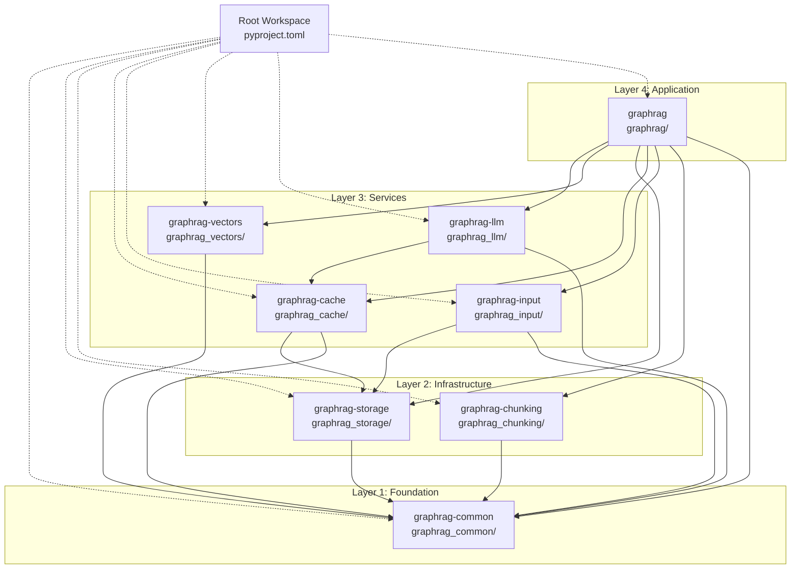

**Package Dependency Layers**

| Layer | Packages | Dependencies | Purpose |
|-------|----------|--------------|---------|
| Layer 1 | `graphrag-common` | None | Foundation utilities, types, YAML handling |
| Layer 2 | `graphrag-storage`, `graphrag-chunking` | `graphrag-common` | Storage backends, text segmentation |
| Layer 3 | `graphrag-cache`, `graphrag-input`, `graphrag-vectors`, `graphrag-llm` | Layers 1-2 | Specialized services and provider integrations |
| Layer 4 | `graphrag` | All packages | Main application, CLI, workflows, and NLP |

For details, see [Package Dependencies and Layering](#2.2).

**Sources**: [pyproject.toml:50-64](), [CHANGELOG.md:83-93]()

---

## Package Overview

This section provides a high-level summary of the packages. For a comprehensive list and detailed descriptions, see [Package Overview](#2.1).

### Foundation and Infrastructure
*   **graphrag-common**: Shared utilities for environment management (`python-dotenv`) and configuration parsing (`pyyaml`). [packages/graphrag-common/pyproject.toml:32-36]()
*   **graphrag-storage**: Abstractions for data persistence. Supports local file systems (`aiofiles`), Azure Blob Storage (`azure-storage-blob`), and Azure Cosmos DB (`azure-cosmos`). [packages/graphrag-storage/pyproject.toml:32-40]()
*   **graphrag-chunking**: Logic for splitting text into manageable units for indexing. [packages/graphrag-chunking/pyproject.toml:32-35]()

### Specialized Services
*   **graphrag-cache**: Implements response caching using the storage layer to reduce LLM costs and latency. [packages/graphrag-cache/pyproject.toml:33-36]()
*   **graphrag-input**: Document ingestion layer using `markitdown` to handle various file formats (PDF, JSON, etc.). [packages/graphrag-input/pyproject.toml:32-39]()
*   **graphrag-vectors**: Vector database integrations including `lancedb`, `azure-search-documents`, and `azure-cosmos` for vector similarity search. [packages/graphrag-vectors/pyproject.toml:32-42]()
*   **graphrag-llm**: The LLM interface layer built on `litellm`. Handles chat completions, embeddings, and provider-specific authentication. [packages/graphrag-llm/pyproject.toml:34-47]()

### Main Application
*   **graphrag**: The primary package containing the CLI (`graphrag.cli.main:app`), indexing workflows, and query engines (Global, Local, DRIFT). It integrates NLP libraries like `nltk`, `spacy`, and `textblob`, alongside graph processing via `networkx` and `graspologic-native`. [packages/graphrag/pyproject.toml:34-66]()

---

## External Dependencies

GraphRAG relies on several industry-standard libraries for its core functionality. For a detailed list and documentation of major external dependencies, see [External Dependencies](#2.3).

### Natural Language to Code Entity Mapping

The following diagram bridges system concepts to specific code-level dependencies.

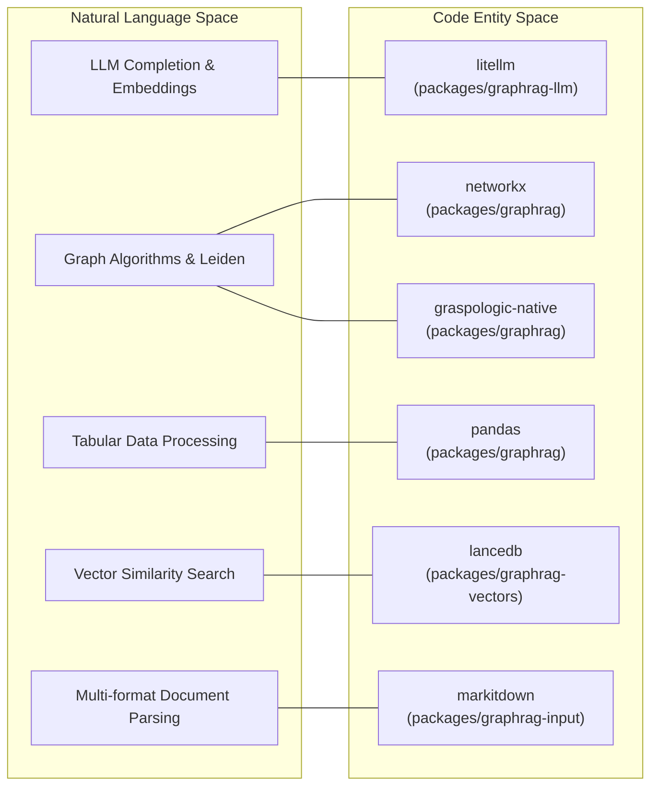

**Sources**: [packages/graphrag/pyproject.toml:34-63](), [packages/graphrag-llm/pyproject.toml:41](), [packages/graphrag-vectors/pyproject.toml:38](), [packages/graphrag-input/pyproject.toml:36]()

---

## Version Management and Synchronization

All packages share a unified version number, currently `3.1.1`. This ensures compatibility across the monorepo.

### Version Synchronization Mechanism

The root workspace defines a `release` task at [pyproject.toml:112-127]() that synchronizes versions using `semversioner` and `update-toml`. Each package's `pyproject.toml` is updated via individual tasks such as `_semversioner_update_graphrag_toml_version` [pyproject.toml:77]().

### Workspace Dependency References

Packages reference each other using exact version pins. For example, the `graphrag` package depends on the other workspace members with strict equality:

```toml
dependencies = [
    "graphrag-cache==3.1.1",
    "graphrag-chunking==3.1.1",
    "graphrag-common==3.1.1",
    "graphrag-input==3.1.1",
    "graphrag-llm==3.1.1",
    "graphrag-storage==3.1.1",
    "graphrag-vectors==3.1.1",
]
```

**Sources**: [pyproject.toml:77-127](), [packages/graphrag/pyproject.toml:4-45](), [packages/graphrag-llm/pyproject.toml:3-39]()

---

## Build System Configuration

### Build Backend
All packages use **Hatchling** as the build backend, specified in the `[build-system]` section of their respective `pyproject.toml` files [packages/graphrag/pyproject.toml:72-73](), [packages/graphrag-llm/pyproject.toml:53-54]().

### Build Task
The root workspace defines a `build` task that executes `uv build --all-packages` [pyproject.toml:106-110]().

### Python Version Requirements
The monorepo requires Python `>=3.11,<3.14` [pyproject.toml:24](). Individual packages maintain similar constraints, though `graphrag-llm` supports `>=3.10` [packages/graphrag-llm/pyproject.toml:26]().

**Sources**: [pyproject.toml:24-110](), [packages/graphrag/pyproject.toml:72-73](), [packages/graphrag-llm/pyproject.toml:26]()

---

# Page: Package Overview

# Package Overview

<details>
<summary>Relevant source files</summary>

The following files were used as context for generating this wiki page:

- [CHANGELOG.md](CHANGELOG.md)
- [packages/graphrag-cache/pyproject.toml](packages/graphrag-cache/pyproject.toml)
- [packages/graphrag-chunking/pyproject.toml](packages/graphrag-chunking/pyproject.toml)
- [packages/graphrag-common/pyproject.toml](packages/graphrag-common/pyproject.toml)
- [packages/graphrag-input/pyproject.toml](packages/graphrag-input/pyproject.toml)
- [packages/graphrag-llm/pyproject.toml](packages/graphrag-llm/pyproject.toml)
- [packages/graphrag-storage/pyproject.toml](packages/graphrag-storage/pyproject.toml)
- [packages/graphrag-vectors/pyproject.toml](packages/graphrag-vectors/pyproject.toml)
- [packages/graphrag/pyproject.toml](packages/graphrag/pyproject.toml)
- [pyproject.toml](pyproject.toml)
- [uv.lock](uv.lock)

</details>


This page documents the eight packages that comprise the GraphRAG monorepo. Each package has a specific responsibility and is designed to be independently testable while working together to provide the complete GraphRAG system functionality.

For information about how these packages depend on each other and their architectural layering, see [Package Dependencies and Layering](). For details on external libraries used by these packages, see [External Dependencies]().

---

## Monorepo Structure

The GraphRAG codebase is organized as a monorepo with a root workspace and eight distinct packages located in the `packages/` directory. The workspace is managed using `uv` and defined in `[pyproject.toml:53-54]()`.

**Sources:** `[pyproject.toml:1-54]()`

---

## Package Summary

The following table provides an overview of all packages in the monorepo. All packages share a synchronized version, currently `3.1.1` following the latest release `[CHANGELOG.md:4-13]()`.

| Package Name | Directory | Version | Purpose | Python Version |
|-------------|-----------|---------|---------|----------------|
| `graphrag` | `packages/graphrag/` | 3.1.1 | Main orchestration package with CLI, API, and workflows | >=3.11,<3.14 |
| `graphrag-common` | `packages/graphrag-common/` | 3.1.1 | Shared utilities, types, and configuration loading | >=3.11,<3.14 |
| `graphrag-storage` | `packages/graphrag-storage/` | 3.1.1 | Storage abstraction for file, blob, and Cosmos DB backends | >=3.11,<3.14 |
| `graphrag-cache` | `packages/graphrag-cache/` | 3.1.1 | Caching layer for LLM responses and extraction results | >=3.11,<3.14 |
| `graphrag-llm` | `packages/graphrag-llm/` | 3.1.1 | LLM integration via LiteLLM with prompt management | >=3.10,<3.14 |
| `graphrag-vectors` | `packages/graphrag-vectors/` | 3.1.1 | Vector store abstractions for LanceDB, Azure AI, Cosmos | >=3.11,<3.14 |
| `graphrag-input` | `packages/graphrag-input/` | 3.1.1 | Document loading from various formats (CSV, JSON, text, PDF) | >=3.11,<3.14 |
| `graphrag-chunking` | `packages/graphrag-chunking/` | 3.1.1 | Text chunking utilities for document segmentation | >=3.11,<3.14 |

**Sources:** `[packages/graphrag/pyproject.toml:4-32]()`, `[packages/graphrag-common/pyproject.toml:3-31]()`, `[packages/graphrag-storage/pyproject.toml:3-31]()`, `[packages/graphrag-cache/pyproject.toml:3-32]()`, `[packages/graphrag-llm/pyproject.toml:3-33]()`, `[packages/graphrag-vectors/pyproject.toml:3-31]()`, `[packages/graphrag-input/pyproject.toml:3-31]()`, `[packages/graphrag-chunking/pyproject.toml:3-31]()`, `[CHANGELOG.md:4-13]()`

---

## Package Dependency Graph

```mermaid
graph TB
    graphrag["graphrag<br/>(Main Package)"]
    graphrag-common["graphrag-common<br/>(Foundation)"]
    graphrag-storage["graphrag-storage<br/>(Storage Layer)"]
    graphrag-cache["graphrag-cache<br/>(Caching)"]
    graphrag-llm["graphrag-llm<br/>(LLM Integration)"]
    graphrag-vectors["graphrag-vectors<br/>(Vector Stores)"]
    graphrag-input["graphrag-input<br/>(Document Loading)"]
    graphrag-chunking["graphrag-chunking<br/>(Text Chunking)"]
    
    graphrag --> graphrag-common
    graphrag --> graphrag-storage
    graphrag --> graphrag-cache
    graphrag --> graphrag-llm
    graphrag --> graphrag-vectors
    graphrag --> graphrag-input
    graphrag --> graphrag-chunking
    
    graphrag-storage --> graphrag-common
    graphrag-cache --> graphrag-common
    graphrag-cache --> graphrag-storage
    graphrag-llm --> graphrag-common
    graphrag-llm --> graphrag-cache
    graphrag-vectors --> graphrag-common
    graphrag-input --> graphrag-common
    graphrag-input --> graphrag-storage
    graphrag-chunking --> graphrag-common
```

This diagram illustrates the dependency relationships between packages. The `graphrag-common` package is the foundation with no internal dependencies. The `graphrag` package depends on all others and serves as the orchestration layer.

**Sources:** `[pyproject.toml:56-63]()`, `[packages/graphrag/pyproject.toml:34-63]()`

---

## Core Packages

### graphrag

**Location:** `packages/graphrag/`

The main `graphrag` package serves as the orchestration layer that brings together all other packages to provide the complete GraphRAG functionality. It contains:

- **CLI Interface**: Command-line interface exposed via the `graphrag` command, entry point defined at `[packages/graphrag/pyproject.toml:66]()`.
- **Python API**: Programmatic API for indexing and querying.
- **Workflow Orchestration**: Indexing pipeline workflows and search implementations.
- **Query Engine**: Multiple search strategies including Global, Local, DRIFT, and Basic.

**Key Dependencies:**
- All other graphrag packages (common, storage, cache, llm, vectors, input, chunking) `[packages/graphrag/pyproject.toml:39-45]()`.
- External libraries: `azure-identity`, `azure-search-documents`, `azure-storage-blob`, `networkx`, `pandas`, `pyarrow`, `spacy`, `nltk`, and `graspologic-native` `[packages/graphrag/pyproject.toml:35-63]()`.

**Primary Capabilities:**
- Document indexing pipeline execution.
- Knowledge graph construction and community detection using Leiden via `graspologic-native` `[packages/graphrag/pyproject.toml:49]()`.
- Multi-modal search operations.
- Incremental index updates.

**Sources:** `[packages/graphrag/pyproject.toml:1-73]()`

---

### graphrag-common

**Location:** `packages/graphrag-common/`

The `graphrag-common` package provides the foundational layer of shared utilities and types used across all other packages. It has minimal external dependencies and serves as the base layer in the package hierarchy.

**Key Dependencies:**
- `python-dotenv~=1.0` - Environment variable loading `[packages/graphrag-common/pyproject.toml:33]()`.
- `pyyaml~=6.0` - YAML configuration parsing `[packages/graphrag-common/pyproject.toml:34]()`.
- `toml~=0.10` - TOML file handling `[packages/graphrag-common/pyproject.toml:35]()`.

**Primary Capabilities:**
- Configuration file loading (YAML, TOML, environment variables).
- Shared type definitions and data structures.
- Common utility functions and logging infrastructure.

**Sources:** `[packages/graphrag-common/pyproject.toml:1-45]()`

---

## Infrastructure Packages

### graphrag-storage

**Location:** `packages/graphrag-storage/`

The `graphrag-storage` package provides an abstraction layer for storage operations. Recent updates introduced a native `CosmosTableProvider` with namespace partitioning and transactional batch writes `[CHANGELOG.md:17]()`.

**Key Dependencies:**
- `graphrag-common==3.1.1` `[packages/graphrag-storage/pyproject.toml:37]()`.
- `aiofiles~=25.1` - Async file I/O `[packages/graphrag-storage/pyproject.toml:33]()`.
- `azure-cosmos~=4.9`, `azure-storage-blob~=12.24` `[packages/graphrag-storage/pyproject.toml:34-36]()`.
- `pandas~=3.0` - DataFrame operations `[packages/graphrag-storage/pyproject.toml:38]()`.

**Primary Capabilities:**
- Storage interface abstraction.
- File system and Azure Blob Storage implementation.
- Azure Cosmos DB storage integration, including `CosmosTableProvider` `[CHANGELOG.md:17]()`.
- Table provider abstraction for structured data (CSV, Parquet).

**Sources:** `[packages/graphrag-storage/pyproject.toml:1-49]()`, `[CHANGELOG.md:17-68]()`

---

### graphrag-cache

**Location:** `packages/graphrag-cache/`

The `graphrag-cache` package implements caching strategies for expensive operations, particularly LLM API calls and extraction results.

**Key Dependencies:**
- `graphrag-common==3.1.1` `[packages/graphrag-cache/pyproject.toml:34]()`.
- `graphrag-storage==3.1.1` `[packages/graphrag-cache/pyproject.toml:35]()`.

**Primary Capabilities:**
- LLM response caching.
- Extraction result caching.
- JSON-based and in-memory cache implementations.

**Sources:** `[packages/graphrag-cache/pyproject.toml:1-44]()`

---

### graphrag-llm

**Location:** `packages/graphrag-llm/`

The `graphrag-llm` package provides the language model integration layer, supporting 100+ models through LiteLLM.

**Key Dependencies:**
- `graphrag-common==3.1.1`, `graphrag-cache==3.1.1` `[packages/graphrag-llm/pyproject.toml:38-39]()`.
- `litellm==1.92.0` - Unified LLM interface `[packages/graphrag-llm/pyproject.toml:41]()`.
- `jinja2~=3.1` - Prompt templating `[packages/graphrag-llm/pyproject.toml:40]()`.
- `pydantic~=2.10` - Request/response validation `[packages/graphrag-llm/pyproject.toml:45]()`.
- `fastapi` and `orjson` - Required for LiteLLM tool calling `[packages/graphrag-llm/pyproject.toml:37,44]()`.

**Primary Capabilities:**
- LiteLLM provider integration (OpenAI, Azure, Gemini, etc.).
- Prompt template management via Jinja2.
- Rate limiting, retry logic, and streaming support.
- Embedding model support.

**Sources:** `[packages/graphrag-llm/pyproject.toml:1-55]()`

---

### graphrag-vectors

**Location:** `packages/graphrag-vectors/`

The `graphrag-vectors` package provides vector store abstractions and implementations for similarity search operations.

**Key Dependencies:**
- `graphrag-common==3.1.1` `[packages/graphrag-vectors/pyproject.toml:37]()`.
- `azure-search-documents~=12.0`, `azure-cosmos~=4.9` `[packages/graphrag-vectors/pyproject.toml:34,36]()`.
- `lancedb~=0.34.0` - Local vector database `[packages/graphrag-vectors/pyproject.toml:38]()`.
- `numpy~=2.1`, `pyarrow~=25.0` `[packages/graphrag-vectors/pyproject.toml:39-40]()`.

**Primary Capabilities:**
- Vector store interface abstraction.
- LanceDB, Azure AI Search, and Cosmos DB implementations.
- Similarity search with filtering and metadata support.
- Dynamic vector size configuration and mismatch protection `[CHANGELOG.md:7,33]()`.

**Sources:** `[packages/graphrag-vectors/pyproject.toml:1-50]()`, `[CHANGELOG.md:7,33]()`

---

## Data Processing Packages

### graphrag-input

**Location:** `packages/graphrag-input/`

The `graphrag-input` package handles loading and parsing of input documents from various formats.

**Key Dependencies:**
- `graphrag-common==3.1.1`, `graphrag-storage==3.1.1` `[packages/graphrag-input/pyproject.toml:33-34]()`.
- `markitdown[pdf]~=0.1.0` - Multi-format document conversion `[packages/graphrag-input/pyproject.toml:36]()`.
- `pyarrow>=14.0.0` `[packages/graphrag-input/pyproject.toml:37]()`.

**Primary Capabilities:**
- Loading CSV, JSON, Parquet, and Plain Text documents.
- PDF document loading via `markitdown`.
- Async document iteration for pipeline workflows `[CHANGELOG.md:69]()`.
- Robust JSONL input loader that skips blank lines and invalid rows `[CHANGELOG.md:12]()`.

**Sources:** `[packages/graphrag-input/pyproject.toml:1-46]()`, `[CHANGELOG.md:12,69]()`

---

### graphrag-chunking

**Location:** `packages/graphrag-chunking/`

The `graphrag-chunking` package provides text segmentation utilities for breaking documents into processable units.

**Key Dependencies:**
- `graphrag-common==3.1.1` `[packages/graphrag-chunking/pyproject.toml:33]()`.
- `pydantic~=2.10` `[packages/graphrag-chunking/pyproject.toml:34]()`.

**Primary Capabilities:**
- Token-based text chunking with configurable size and overlap.
- Character-level and token-level splitting strategies.
- Type-annotated generators for `chunk_text` `[CHANGELOG.md:8]()`.

**Sources:** `[packages/graphrag-chunking/pyproject.toml:1-44]()`, `[CHANGELOG.md:8]()`

---

## Workspace Configuration and Automation

The monorepo uses `poethepoet` for task automation and `uv` for workspace management.

### CLI to Code Mapping

```mermaid
graph TD
    subgraph "CLI Commands (poethepoet)"
        T1["poe init"] -->|"calls"| M1["python -m graphrag init"]
        T2["poe index"] -->|"calls"| M2["python -m graphrag index"]
        T3["poe query"] -->|"calls"| M3["python -m graphrag query"]
        T4["poe prompt_tune"] -->|"calls"| M4["python -m graphrag prompt-tune"]
    end
    
    subgraph "Main Entry Points (graphrag package)"
        M1 -->|"routes to"| E1["graphrag.cli.main:app"]
        M2 -->|"routes to"| E1
        M3 -->|"routes to"| E1
        M4 -->|"routes to"| E1
    end

    subgraph "Build and Release"
        T5["poe build"] -->|"executes"| B1["uv build --all-packages"]
        T6["poe release"] -->|"executes"| S1["semversioner release"]
    end
```

**Build Command:** `poe build` (executes `_copy_build_assets` and `_build_packages` tasks) `[pyproject.toml:109-111]()`.

**Release Command:** `poe release` (synchronizes versions across all packages using `semversioner` and `update-toml` for each specific `pyproject.toml` file) `[pyproject.toml:112-127]()`.

**Sources:** `[pyproject.toml:62-127]()`, `[uv.lock:13-24]()`

---

# Page: Package Dependencies and Layering

# Package Dependencies and Layering

<details>
<summary>Relevant source files</summary>

The following files were used as context for generating this wiki page:

- [packages/graphrag-common/pyproject.toml](packages/graphrag-common/pyproject.toml)
- [packages/graphrag-input/pyproject.toml](packages/graphrag-input/pyproject.toml)
- [packages/graphrag-llm/pyproject.toml](packages/graphrag-llm/pyproject.toml)
- [packages/graphrag-storage/pyproject.toml](packages/graphrag-storage/pyproject.toml)
- [packages/graphrag-vectors/pyproject.toml](packages/graphrag-vectors/pyproject.toml)
- [packages/graphrag/pyproject.toml](packages/graphrag/pyproject.toml)
- [uv.lock](uv.lock)

</details>


This page documents the dependency architecture and layering strategy of the GraphRAG monorepo. It explains how the 8 packages are organized into distinct layers, the rationale for this structure, and how dependencies flow bottom-up to prevent circular references.

For information about individual package contents and APIs, see [Package Overview](#2.1). For details on external library integrations, see [External Dependencies](#2.3).

## Overview

The GraphRAG monorepo employs a **strict layered architecture** where dependencies flow unidirectionally from higher layers to lower layers. This design prevents circular dependencies, enables independent testing of foundational components, and allows selective package installation based on use case.

The repository consists of 8 packages organized into 4 layers:

| Layer | Packages | Role |
|-------|----------|------|
| **Layer 1: Foundation** | `graphrag-common` | Shared utilities, types, configuration helpers |
| **Layer 2: Infrastructure** | `graphrag-storage`, `graphrag-chunking` | Storage abstraction and text segmentation |
| **Layer 3: Services** | `graphrag-cache`, `graphrag-input`, `graphrag-vectors`, `graphrag-llm` | Specialized domain services |
| **Layer 4: Application** | `graphrag` | CLI, workflows, indexing, querying |

All packages share the same version number (`3.1.1`) and are released together as part of the monorepo structure. The workspace is managed by the **uv package manager**, which provides fast dependency resolution and workspace management.

**Sources:** [uv.lock:14-24](), [packages/graphrag/pyproject.toml:4-4]()

## Monorepo Structure

### Workspace Configuration

The root workspace is configured using uv's workspace feature, as seen in the manifest members:

```toml
[manifest]
members = [
    "graphrag",
    "graphrag-cache",
    "graphrag-chunking",
    "graphrag-common",
    "graphrag-input",
    "graphrag-llm",
    "graphrag-monorepo",
    "graphrag-storage",
    "graphrag-vectors",
]
```

The unified lockfile `uv.lock` ensures that all packages in the workspace share compatible versions of external dependencies, such as `pydantic` or `pandas`.

**Sources:** [uv.lock:1-24]()

### Directory Layout

```
graphrag/
├── uv.lock                     # Unified lockfile for all packages
└── packages/
    ├── graphrag/               # Layer 4: Main application [packages/graphrag/pyproject.toml:2-2]()
    ├── graphrag-llm/           # Layer 3: LLM integration [packages/graphrag-llm/pyproject.toml:2-2]()
    ├── graphrag-vectors/       # Layer 3: Vector stores [packages/graphrag-vectors/pyproject.toml:2-2]()
    ├── graphrag-input/         # Layer 3: Document loading [packages/graphrag-input/pyproject.toml:2-2]()
    ├── graphrag-cache/         # Layer 3: Caching [packages/graphrag-cache/pyproject.toml:2-2]()
    ├── graphrag-storage/       # Layer 2: Storage abstraction [packages/graphrag-storage/pyproject.toml:2-2]()
    ├── graphrag-chunking/      # Layer 2: Text chunking [packages/graphrag-chunking/pyproject.toml:2-2]()
    └── graphrag-common/        # Layer 1: Foundation [packages/graphrag-common/pyproject.toml:2-2]()
```

**Sources:** [uv.lock:14-24]()

## Layer 1: Foundation

### graphrag-common

The `graphrag-common` package serves as the foundation for all other packages. It has **zero internal dependencies** on other GraphRAG packages and only depends on standard Python utilities.

```mermaid
graph TB
    Common["graphrag-common"]
    
    subgraph "External Foundation"
        DotEnv["python-dotenv<br/>Env Loading"]
        PyYAML["pyyaml<br/>Config Parsing"]
        TOML["toml<br/>Metadata Parsing"]
    end
    
    Common --> DotEnv
    Common --> PyYAML
    Common --> TOML
```

**External Dependencies:**
- `python-dotenv~=1.0` - Environment variable loading.
- `pyyaml~=6.0` - YAML configuration parsing.
- `toml~=0.10` - TOML file handling.

**Sources:** [packages/graphrag-common/pyproject.toml:32-36]()

## Layer 2: Infrastructure

### graphrag-storage

The `graphrag-storage` package provides storage abstractions for file systems, Azure Blob Storage, and Azure Cosmos DB.

```mermaid
graph TB
    Storage["graphrag-storage"]
    Common["graphrag-common"]
    
    subgraph "External Storage Drivers"
        Aiofiles["aiofiles<br/>Async I/O"]
        AzureBlob["azure-storage-blob<br/>Blob Storage"]
        Cosmos["azure-cosmos<br/>NoSQL Storage"]
        Pandas["pandas<br/>DataFrames"]
    end
    
    Storage --> Common
    Storage --> Aiofiles
    Storage --> AzureBlob
    Storage --> Cosmos
    Storage --> Pandas
```

**Dependencies:**
- `graphrag-common==3.1.1` (Layer 1)
- `aiofiles~=25.1` - Asynchronous file operations.
- `azure-cosmos~=4.9` - Cosmos DB integration.
- `azure-storage-blob~=12.24` - Azure Blob Storage.
- `pandas~=3.0` - DataFrame serialization.

**Sources:** [packages/graphrag-storage/pyproject.toml:32-40]()

### graphrag-chunking

The `graphrag-chunking` package handles text segmentation logic.

**Dependencies:**
- `graphrag-common==3.1.1` (Layer 1)
- `pydantic~=2.10` - Data validation.

**Sources:** [packages/graphrag-chunking/pyproject.toml:32-35]()

## Layer 3: Services

Layer 3 packages build on Layers 1 and 2 to provide specialized domain services.

### graphrag-cache

Provides LLM response caching with pluggable storage backends.

**Dependencies:**
- `graphrag-common==3.1.1` (Layer 1)
- `graphrag-storage==3.1.1` (Layer 2)

**Sources:** [packages/graphrag-cache/pyproject.toml:33-36]()

### graphrag-input

Handles document loading and format conversion using MarkItDown.

**Dependencies:**
- `graphrag-common==3.1.1` (Layer 1)
- `graphrag-storage==3.1.1` (Layer 2)
- `markitdown[pdf]~=0.1.0` - Document format conversion.
- `pyarrow>=14.0.0` - Table data processing.

**Sources:** [packages/graphrag-input/pyproject.toml:32-38]()

### graphrag-vectors

Manages vector storage with support for LanceDB, Azure AI Search, and Cosmos DB.

```mermaid
graph TB
    Vectors["graphrag-vectors"]
    Common["graphrag-common"]
    
    subgraph "Vector Providers"
        Lance["lancedb<br/>Local Vector DB"]
        AISearch["azure-search-documents<br/>AI Search"]
        CosmosVec["azure-cosmos<br/>Vector Search"]
    end
    
    Vectors --> Common
    Vectors --> Lance
    Vectors --> AISearch
    Vectors --> CosmosVec
```

**Dependencies:**
- `graphrag-common==3.1.1` (Layer 1)
- `azure-search-documents~=12.0` - Azure AI Search.
- `lancedb~=0.34.0` - Local vector database.
- `numpy~=2.1` and `pyarrow~=25.0` - Vector and table processing.

**Sources:** [packages/graphrag-vectors/pyproject.toml:32-42]()

### graphrag-llm

Integrates LLM providers via LiteLLM with caching support.

**Dependencies:**
- `graphrag-common==3.1.1` (Layer 1)
- `graphrag-cache==3.1.1` (Layer 3)
- `litellm==1.92.0` - Multi-provider LLM integration.
- `jinja2~=3.1` - Prompt templating.
- `fastapi>=0.136.3` and `orjson>=3.11.6` - Required for LiteLLM tool calling.

**Sources:** [packages/graphrag-llm/pyproject.toml:34-47]()

## Layer 4: Application

### graphrag

The main `graphrag` package orchestrates all lower layers to provide the complete indexing and querying system. It depends on all other specialized packages in the workspace.

```mermaid
graph TB
    Main["graphrag<br/>(Main Package)"]
    
    subgraph "Internal Packages"
        LLM["graphrag-llm"]
        Vectors["graphrag-vectors"]
        Input["graphrag-input"]
        Storage["graphrag-storage"]
        Chunking["graphrag-chunking"]
        Cache["graphrag-cache"]
        Common["graphrag-common"]
    end
    
    subgraph "External Core"
        NetworkX["networkx<br/>Graph Data"]
        Graspologic["graspologic-native<br/>Leiden Algo"]
        Spacy["spacy<br/>NLP Extraction"]
        Typer["typer<br/>CLI Entry"]
    end
    
    Main --> LLM
    Main --> Vectors
    Main --> Input
    Main --> Storage
    Main --> Chunking
    Main --> Cache
    Main --> Common
    
    Main --> NetworkX
    Main --> Graspologic
    Main --> Spacy
    Main --> Typer
```

**Internal Workspace Dependencies (v3.1.1):**
All 7 specialized packages are included as direct dependencies.

**Key External Dependencies:**
- `networkx~=3.4` - Graph data structures.
- `graspologic-native>=1.2,<1.3` - Community detection (pinned to avoid Leiden output changes).
- `spacy~=3.8` - NLP for entity extraction.
- `typer~=0.16` - CLI framework for `graphrag.cli.main:app`.
- `json-repair~=0.30` - Handling malformed LLM JSON.
- `pandas~=3.0` and `pyarrow~=25.0` - Data processing and storage formats.

**Sources:** [packages/graphrag/pyproject.toml:34-66]()

## Summary of Dependency Flow

```mermaid
graph TB
    subgraph "Layer 4: Application"
        App["graphrag"]
    end
    
    subgraph "Layer 3: Services"
        LLM["graphrag-llm"]
        Input["graphrag-input"]
        Cache["graphrag-cache"]
        Vectors["graphrag-vectors"]
    end
    
    subgraph "Layer 2: Infrastructure"
        Storage["graphrag-storage"]
        Chunking["graphrag-chunking"]
    end
    
    subgraph "Layer 1: Foundation"
        Common["graphrag-common"]
    end
    
    App --> LLM
    App --> Input
    App --> Cache
    App --> Vectors
    App --> Storage
    App --> Chunking
    App --> Common
    
    LLM --> Cache
    LLM --> Common
    
    Input --> Storage
    Input --> Common
    
    Cache --> Storage
    Cache --> Common
    
    Vectors --> Common
    
    Storage --> Common
    Chunking --> Common
```

**Key Observations:**
1. **Unidirectional Flow:** Dependencies always point toward lower layers or within the same layer (e.g., `LLM` -> `Cache`).
2. **Universal Foundation:** `graphrag-common` is the base for every package in the system.
3. **Storage Abstraction:** Both `graphrag-cache` and `graphrag-input` rely on `graphrag-storage` for data persistence and retrieval.

**Sources:** [packages/graphrag-llm/pyproject.toml:38-39](), [packages/graphrag-input/pyproject.toml:33-34](), [packages/graphrag-cache/pyproject.toml:35-36](), [packages/graphrag/pyproject.toml:39-45]()

---

# Page: External Dependencies

# External Dependencies

<details>
<summary>Relevant source files</summary>

The following files were used as context for generating this wiki page:

- [CHANGELOG.md](CHANGELOG.md)
- [packages/graphrag-cache/pyproject.toml](packages/graphrag-cache/pyproject.toml)
- [packages/graphrag-chunking/pyproject.toml](packages/graphrag-chunking/pyproject.toml)
- [packages/graphrag-llm/pyproject.toml](packages/graphrag-llm/pyproject.toml)
- [packages/graphrag-storage/pyproject.toml](packages/graphrag-storage/pyproject.toml)
- [packages/graphrag-vectors/pyproject.toml](packages/graphrag-vectors/pyproject.toml)
- [packages/graphrag/pyproject.toml](packages/graphrag/pyproject.toml)
- [pyproject.toml](pyproject.toml)
- [uv.lock](uv.lock)

</details>


This page documents the external third-party libraries and services that GraphRAG depends on across all packages in the monorepo. These dependencies provide core functionality for language model integration, vector storage, cloud services, natural language processing, graph algorithms, and data manipulation.

For information about the internal package dependencies within the GraphRAG monorepo, see [2.2 Package Dependencies and Layering](). For configuration of external services like LLM providers and vector stores, see [3.3 Language Model Configuration](), [3.5 Vector Store Configuration](), and [3.4 Storage Configuration]().

## Overview of Dependency Categories

GraphRAG's external dependencies fall into several functional categories:

| Category | Purpose | Key Libraries |
|----------|---------|---------------|
| **LLM Integration** | Language model API access and management | LiteLLM, Azure Identity, Jinja2 |
| **Vector Storage** | Embeddings storage and similarity search | LanceDB, Azure AI Search, Azure Cosmos DB |
| **Cloud Storage** | Persistent storage backends | Azure Blob Storage, Azure Cosmos DB |
| **NLP Processing** | Text analysis and entity extraction | NLTK, spaCy, TextBlob |
| **Graph Processing** | Community detection and graph algorithms | NetworkX, graspologic-native |
| **Data Processing** | DataFrames and data manipulation | pandas, numpy, pyarrow |
| **Configuration** | Settings and environment management | pydantic, python-dotenv, PyYAML |

Sources: [packages/graphrag/pyproject.toml:34-63](), [packages/graphrag-llm/pyproject.toml:34-47](), [packages/graphrag-vectors/pyproject.toml:32-42]()

## Dependency Distribution Across Packages

The following diagram shows how external dependencies are distributed across the GraphRAG monorepo packages based on their respective `pyproject.toml` definitions.

```mermaid
graph TB
    subgraph "graphrag-common"
        CommonDeps["python-dotenv~=1.0<br/>pyyaml~=6.0<br/>toml"]
    end
    
    subgraph "graphrag-storage"
        StorageDeps["aiofiles~=25.1<br/>azure-cosmos~=4.9<br/>azure-identity~=1.25<br/>azure-storage-blob~=12.24<br/>pandas~=3.0<br/>pydantic~=2.10"]
    end
    
    subgraph "graphrag-cache"
        CacheDeps["(inherits storage/common deps)"]
    end
    
    subgraph "graphrag-chunking"
        ChunkingDeps["pydantic~=2.10"]
    end
    
    subgraph "graphrag-input"
        InputDeps["markitdown~=0.1.0<br/>pydantic~=2.10<br/>pyarrow>=25.0"]
    end
    
    subgraph "graphrag-llm"
        LLMDeps["azure-identity~=1.25<br/>jinja2~=3.1<br/>litellm==1.92.0<br/>nest-asyncio2~=1.7<br/>pydantic~=2.10<br/>fastapi>=0.136.3<br/>orjson>=3.11.6"]
    end
    
    subgraph "graphrag-vectors"
        VectorDeps["azure-core~=1.32<br/>azure-cosmos~=4.9<br/>azure-identity~=1.25<br/>azure-search-documents~=12.0<br/>lancedb~=0.34.0<br/>numpy~=2.1<br/>pyarrow~=25.0<br/>pydantic~=2.10"]
    end
    
    subgraph "graphrag (main)"
        MainDeps["azure-identity~=1.25<br/>azure-search-documents~=12.0<br/>azure-storage-blob~=12.24<br/>devtools~=0.12<br/>graspologic-native>=1.2,<1.3<br/>json-repair~=0.30<br/>networkx~=3.4<br/>nltk~=3.9<br/>numpy~=2.1<br/>pandas~=3.0<br/>pyarrow~=25.0<br/>pydantic~=2.10<br/>spacy~=3.8<br/>blis~=1.0<br/>textblob~=0.18<br/>tqdm~=4.67<br/>typer~=0.16"]
    end
    
    CommonDeps --> StorageDeps
    CommonDeps --> ChunkingDeps
    CommonDeps --> InputDeps
    CommonDeps --> LLMDeps
    CommonDeps --> VectorDeps
    StorageDeps --> CacheDeps
    StorageDeps --> InputDeps
    
    CommonDeps --> MainDeps
    StorageDeps --> MainDeps
    CacheDeps --> MainDeps
    ChunkingDeps --> MainDeps
    InputDeps --> MainDeps
    LLMDeps --> MainDeps
    VectorDeps --> MainDeps
```

Sources: [packages/graphrag/pyproject.toml:34-63](), [packages/graphrag-llm/pyproject.toml:34-47](), [packages/graphrag-storage/pyproject.toml:32-40](), [packages/graphrag-vectors/pyproject.toml:32-42](), [uv.lock:14-24]()

## LLM Integration Dependencies

### LiteLLM (`litellm==1.92.0`)

LiteLLM is the primary abstraction layer for language model API access, enabling GraphRAG to support multiple LLM providers through a unified interface.

**Package:** `graphrag-llm`  
**Purpose:** Provides a consistent API for calling OpenAI, Azure OpenAI, Google Gemini, Anthropic, and other LLM providers.  
**Key Features:**
- Unified completion and embedding interfaces.
- Automatic retry logic and rate limiting.
- Token counting and cost tracking.
- Tool calling support (requires `fastapi` and `orjson`) [packages/graphrag-llm/pyproject.toml:36-44]().

**Integration Points:**
- Used by the `graphrag-llm` package for all LLM calls [packages/graphrag-llm/pyproject.toml:41]().
- Configured through model settings in the main `graphrag` package.

Sources: [packages/graphrag-llm/pyproject.toml:41](), [CHANGELOG.md:18](), [CHANGELOG.md:32]()

### Jinja2 (`jinja2~=3.1`)

Jinja2 is used for prompt template rendering and token replacement.

**Package:** `graphrag-llm`  
**Purpose:** Template engine for constructing LLM prompts with dynamic content.  
**Integration Points:**
- Used to inject entities, relationships, and context into prompts before sending them to the LLM.

Sources: [packages/graphrag-llm/pyproject.toml:40]()

### Azure Identity (`azure-identity~=1.25`)

Azure Identity provides authentication for Azure services across multiple packages.

**Packages:** `graphrag`, `graphrag-llm`, `graphrag-storage`, `graphrag-vectors`  
**Purpose:** Handles authentication to Azure services using managed identities, service principals, or Azure CLI credentials.  

Sources: [packages/graphrag/pyproject.toml:35](), [packages/graphrag-llm/pyproject.toml:35](), [packages/graphrag-storage/pyproject.toml:35](), [packages/graphrag-vectors/pyproject.toml:35]()

## Vector Storage Dependencies

### LanceDB (`lancedb~=0.34.0`)

LanceDB is a local-first vector database built on Apache Arrow and Lance format.

**Package:** `graphrag-vectors`  
**Purpose:** Local vector storage and similarity search for embeddings.  

**Data Flow from Code to Storage:**

```mermaid
graph LR
    subgraph "Natural Language Space"
        Text["Text Chunk"]
    end

    subgraph "Code Entity Space"
        VectorStore["VectorStore Interface"]
        LanceDBStore["LanceDBVectorStore Class"]
        PyArrow["pyarrow.Table"]
    end

    subgraph "Storage Space"
        LanceDB["LanceDB / Apache Arrow"]
    end

    Text --> VectorStore
    VectorStore --> LanceDBStore
    LanceDBStore --> PyArrow
    PyArrow --> LanceDB
```

Sources: [packages/graphrag-vectors/pyproject.toml:38](), [packages/graphrag-vectors/pyproject.toml:40]()

### Azure AI Search (`azure-search-documents~=12.0`)

**Packages:** `graphrag`, `graphrag-vectors`  
**Purpose:** Cloud-native vector storage and hybrid search.  

Sources: [packages/graphrag/pyproject.toml:36](), [packages/graphrag-vectors/pyproject.toml:36]()

### Azure Cosmos DB (`azure-cosmos~=4.9`)

**Packages:** `graphrag-storage`, `graphrag-vectors`  
**Purpose:** 
- In `graphrag-storage`: NoSQL document storage for cache and pipeline artifacts.
- In `graphrag-vectors`: Vector search using Cosmos DB's native vector indexing.
- Supports native `CosmosTableProvider` with namespace partitioning [CHANGELOG.md:17]().

Sources: [packages/graphrag-storage/pyproject.toml:34](), [packages/graphrag-vectors/pyproject.toml:34](), [CHANGELOG.md:17]()

## Natural Language Processing Dependencies

The following diagram maps NLP dependencies to their usage in the extraction and resolution logic:

```mermaid
graph LR
    subgraph "NLP Libraries"
        NLTK["nltk~=3.9"]
        spaCy["spacy~=3.8"]
        blis["blis~=1.0"]
        TextBlob["textblob~=0.18"]
    end
    
    subgraph "Entity Space"
        Tokenize["NLTK Sentence Tokenization"]
        NER["spaCy NER / POS"]
        Dedupe["TextBlob Similarity"]
    end
    
    NLTK --> Tokenize
    spaCy --> NER
    blis --> spaCy
    TextBlob --> Dedupe
    
    Tokenize --> Pipeline["Indexing Pipeline"]
    NER --> Pipeline
    Dedupe --> Pipeline
```

Sources: [packages/graphrag/pyproject.toml:52-59]()

### NLTK (`nltk~=3.9`)
Used for sentence tokenization and basic text processing [packages/graphrag/pyproject.toml:52](). Version bumped to resolve security vulnerabilities [CHANGELOG.md:28]().

### spaCy (`spacy~=3.8`)
Used for named entity recognition (NER), dependency parsing, and linguistic analysis [packages/graphrag/pyproject.toml:57](). Requires `blis` for optimized linear algebra [packages/graphrag/pyproject.toml:58]().

### TextBlob (`textblob~=0.18`)
Used for sentiment analysis and entity similarity calculations during deduplication [packages/graphrag/pyproject.toml:59]().

## Data Processing Dependencies

### pandas (`pandas~=3.0`)
The primary data structure for pipeline artifacts and in-memory data processing. GraphRAG maintains compatibility with the 3.0.x line [packages/graphrag/pyproject.toml:54]().

### numpy (`numpy~=2.1`)
Numerical computing library for array operations and vector computations, specifically for embedding management and vector store operations [packages/graphrag/pyproject.toml:53]().

### pyarrow (`pyarrow~=25.0`)
Apache Arrow Python bindings for columnar data processing, used for Parquet file support and high-performance data serialization across the indexing pipeline [packages/graphrag/pyproject.toml:55]().

## Graph Processing Dependencies

### NetworkX (`networkx~=3.4`)
Python library for creation, manipulation, and analysis of complex networks. While many graph utilities have been moved to DataFrame-based implementations [CHANGELOG.md:73](), NetworkX remains a core dependency for overall graph management [packages/graphrag/pyproject.toml:51]().

### graspologic-native (`graspologic-native>=1.2,<1.3`)
Used for hierarchical community detection using the Leiden algorithm. The version is pinned to avoid breaking changes in community counts and levels [packages/graphrag/pyproject.toml:46-49]().

**Implementation Flow:**

```mermaid
graph TD
    subgraph "Data Input"
        EdgesDF["pandas.DataFrame (Edges)"]
    end

    subgraph "Logic: graphrag.graphs"
        EdgeList["_df_to_edge_list()"]
        HLeiden["hierarchical_leiden()"]
    end

    subgraph "External: graspologic_native"
        GNLeiden["gn.hierarchical_leiden()"]
    end

    EdgesDF --> EdgeList
    EdgeList --> HLeiden
    HLeiden --> GNLeiden
```

Sources: [packages/graphrag/pyproject.toml:49](), [CHANGELOG.md:73]()

## Python Version Requirements

All GraphRAG packages require Python 3.11 or higher, with support up to Python 3.13:

| Package | Python Requirement |
|---------|-------------------|
| graphrag | `>=3.11,<3.14` |
| graphrag-common | `>=3.11,<3.14` |
| graphrag-storage | `>=3.11,<3.14` |
| graphrag-cache | `>=3.11,<3.14` |
| graphrag-chunking | `>=3.11,<3.14` |
| graphrag-input | `>=3.11,<3.14` |
| graphrag-vectors | `>=3.11,<3.14` |
| graphrag-llm | `>=3.10,<3.14` |

Sources: [packages/graphrag/pyproject.toml:26](), [packages/graphrag-llm/pyproject.toml:26](), [packages/graphrag-storage/pyproject.toml:25](), [packages/graphrag-vectors/pyproject.toml:25](), [uv.lock:3]()

---

# Page: Configuration System

# Configuration System

<details>
<summary>Relevant source files</summary>

The following files were used as context for generating this wiki page:

- [docs/config/init.md](docs/config/init.md)
- [docs/config/overview.md](docs/config/overview.md)
- [docs/config/yaml.md](docs/config/yaml.md)
- [docs/index/architecture.md](docs/index/architecture.md)
- [docs/index/inputs.md](docs/index/inputs.md)
- [docs/query/overview.md](docs/query/overview.md)
- [tests/unit/config/fixtures/minimal_config/settings.yaml](tests/unit/config/fixtures/minimal_config/settings.yaml)
- [tests/unit/config/fixtures/minimal_config_missing_env_var/settings.yaml](tests/unit/config/fixtures/minimal_config_missing_env_var/settings.yaml)
- [tests/unit/config/test_config.py](tests/unit/config/test_config.py)
- [tests/unit/config/utils.py](tests/unit/config/utils.py)

</details>


The Configuration System is GraphRAG's centralized mechanism for managing all settings required for indexing and querying operations. It provides a flexible, hierarchical approach to configuration through YAML files, environment variables, and CLI overrides, with strong typing and validation.

For information about specific configuration options and their usage, see [Configuration Files](#3.1). For details on model selection, see [Language Model Configuration](#3.3).

---

## Configuration Sources and Loading

GraphRAG supports multiple configuration sources that are merged in priority order:

**Configuration Loading Logic**

Title: Configuration Loading and Entity Mapping
```mermaid
graph TB
    subgraph "Natural Language Space"
        EnvFile["'.env' File<br/>Environment Variables"]
        SettingsYAML["'settings.yaml'<br/>Primary Configuration"]
        CLIArgs["CLI Arguments<br/>Runtime Overrides"]
    end
    
    subgraph "Code Entity Space"
        LoadEnv["'load_env'<br/>'os.environ'"]
        ParseYAML["'load_config'<br/>'Token Substitution'"]
        ApplyOverrides["'cli_overrides' merging"]
        
        GraphRagConfig["'GraphRagConfig' class<br/>(Pydantic Model)"]
        
        subgraph "Nested Config Objects"
            ModelConfigs["'ModelConfig'"]
            StorageConfigs["'StorageConfig'"]
            VectorConfig["'VectorStoreConfig'"]
            WorkflowConfigs["'ExtractGraphConfig'<br/>'CommunityReportsConfig'"]
        end
    end
    
    EnvFile --> LoadEnv
    LoadEnv --> ParseYAML
    SettingsYAML --> ParseYAML
    ParseYAML --> ApplyOverrides
    CLIArgs --> ApplyOverrides
    ApplyOverrides --> GraphRagConfig
    
    GraphRagConfig --> ModelConfigs
    GraphRagConfig --> StorageConfigs
    GraphRagConfig --> VectorConfig
    GraphRagConfig --> WorkflowConfigs
```

The `load_config` function handles the hierarchical merging of configuration sources:

1.  **Environment Variables**: Loaded from `.env` file into process environment to allow token replacement [docs/config/yaml.md:3-3]().
2.  **YAML Parsing**: Settings file parsed with `${VAR_NAME}` token substitution syntax [docs/config/yaml.md:3-16]().
3.  **CLI Overrides**: Runtime parameters override YAML values via the `cli_overrides` parameter in `load_config` [tests/unit/config/test_config.py:45-57]().
4.  **Validation**: Strong typing via Pydantic validates the final configuration against `GraphRagConfig` [tests/unit/config/test_config.py:22-26]().

**Sources:** [docs/config/yaml.md:1-16](), [tests/unit/config/test_config.py:8-61](), [tests/unit/config/utils.py:19-19]()

---

## Configuration File Structure

The `settings.yaml` file is the primary configuration source and follows a structured hierarchy corresponding to the internal data models.

Title: YAML Structure to Data Model Mapping
```mermaid
graph LR
    subgraph "settings.yaml sections"
        YAML_Models["'completion_models' / 'embedding_models'"]
        YAML_Input["'input'"]
        YAML_Output["'output'"]
        YAML_Workflow["'chunks' / 'extract_graph'"]
    end

    subgraph "Code Data Models"
        M_ModelConfig["'ModelConfig'"]
        M_InputConfig["'InputConfig'"]
        M_StorageConfig["'StorageConfig'"]
        M_ChunkingConfig["'ChunkingConfig'"]
    end

    YAML_Models --> M_ModelConfig
    YAML_Input --> M_InputConfig
    YAML_Output --> M_StorageConfig
    YAML_Workflow --> M_ChunkingConfig
```

**Key Sections:**
- **Language Model Setup**: Defines `completion_models` and `embedding_models` using [LiteLLM](https://docs.litellm.ai) [docs/config/yaml.md:20-47]().
- **Input Files**: Configures the source `storage` and format (CSV, Text, JSON, etc.) [docs/config/yaml.md:73-95]().
- **Chunking**: Settings for `size`, `overlap`, and `prepend_metadata` [docs/config/yaml.md:96-107]().
- **Outputs and Storage**: Defines where the pipeline exports artifacts [docs/config/yaml.md:108-121]().

**Sources:** [docs/config/yaml.md:18-121](), [tests/unit/config/utils.py:7-32]()

---

## Environment Variable Substitution

The configuration system supports environment variable token replacement using `${VAR_NAME}` syntax [docs/config/yaml.md:3-3]().

**Example .env File:**
```bash
GRAPHRAG_API_KEY=sk-abc123...
```

**Example settings.yaml with Token Substitution:**
```yaml
completion_models:
  default_completion_model:
    api_key: ${GRAPHRAG_API_KEY}
```

**Sources:** [docs/config/yaml.md:7-16](), [tests/unit/config/fixtures/minimal_config/settings.yaml:1-12]()

---

## Configuration Model Classes

GraphRAG uses strongly-typed Pydantic models to represent configuration, primarily defined in the `graphrag.config.models` namespace.

| Class | Purpose | Key Fields |
|-------|---------|------------|
| `GraphRagConfig` | Root configuration container | `completion_models`, `embedding_models`, `input`, `output_storage` [tests/unit/config/utils.py:57-62]() |
| `ModelConfig` | LLM model configuration | `model_provider`, `model`, `api_key`, `rate_limit`, `retry` [tests/unit/config/utils.py:90-113]() |
| `StorageConfig` | Storage backend settings | `type`, `base_dir`, `connection_string`, `container_name` [tests/unit/config/utils.py:138-146]() |
| `VectorStoreConfig` | Vector store settings | `type`, `db_uri`, `url`, `api_key` [tests/unit/config/utils.py:115-126]() |
| `InputConfig` | Data ingestion settings | `type`, `file_pattern`, `text_column`, `title_column` [tests/unit/config/utils.py:154-160]() |

**Sources:** [tests/unit/config/utils.py:7-180]()

---

## Model Configuration

GraphRAG supports multiple language models referenced by ID. It uses [LiteLLM](https://docs.litellm.ai) under the hood to support over 100 model providers [docs/config/yaml.md:46-47]().

**Model Configuration Fields:**
- `model_provider`: e.g., `openai`, `azure`, `anthropic` [docs/config/yaml.md:47]().
- `retry`: Configures `exponential_backoff` or `immediate` strategies [docs/config/yaml.md:55-60]().
- `rate_limit`: Configures `sliding_window` limits for requests and tokens [docs/config/yaml.md:61-65]().

For details, see [Language Model Configuration](#3.3).

**Sources:** [docs/config/yaml.md:20-72](), [tests/unit/config/utils.py:36-54]()

---

## Storage Configuration

GraphRAG supports multiple storage backends through `StorageConfig`. These are used for input ingestion, output artifact export, and caching [docs/config/yaml.md:73-121]().

**Supported Storage Types:**
- `file`: Local filesystem [docs/config/yaml.md:82]().
- `memory`: In-memory storage [docs/config/yaml.md:82]().
- `blob`: Azure Blob Storage [docs/config/yaml.md:82]().
- `cosmosdb`: Azure Cosmos DB [docs/config/yaml.md:82]().

For details, see [Storage Configuration](#3.4).

**Sources:** [docs/config/yaml.md:73-121](), [tests/unit/config/utils.py:138-146]()

---

## Vector Store Configuration

Vector store configuration defines the backend for storing and searching embeddings.

**Supported Backends:**
- `lancedb`: Local vector database [tests/unit/config/utils.py:32]().
- `azure_ai_search`: Azure-hosted search service [tests/unit/config/utils.py:122-124]().
- `cosmosdb`: Cosmos DB with DiskANN support [tests/unit/config/utils.py:125]().

For details, see [Vector Store Configuration](#3.5).

**Sources:** [tests/unit/config/utils.py:115-127]()

---

## Workflow Configuration

Individual workflows within the indexing pipeline have specific parameter sets defined in specialized config classes:

| Workflow | Configuration Class | Key Parameters |
|----------|----------------------|----------------|
| Graph Extraction | `ExtractGraphConfig` | `prompt`, `entity_types`, `max_gleanings` [tests/unit/config/utils.py:13]() |
| Community Reports | `CommunityReportsConfig` | `max_length`, `max_input_length` [tests/unit/config/utils.py:9]() |
| Chunking | `ChunkingConfig` | `size`, `overlap`, `type`, `encoding_model` [tests/unit/config/utils.py:171-177]() |
| Text Embedding | `EmbedTextConfig` | `batch_size`, `embedding_model_id`, `names` [tests/unit/config/utils.py:162-169]() |

For details, see [Workflow Configuration](#3.6).

**Sources:** [tests/unit/config/utils.py:7-26]()

---

## Search Method Configuration

Search parameters are configured per method to tune retrieval performance:

- **Global Search**: Configures map-reduce summarization parameters via `GlobalSearchConfig` [tests/unit/config/utils.py:18]().
- **Local Search**: Configures entity-centric graph traversal via `LocalSearchConfig` [tests/unit/config/utils.py:20]().
- **DRIFT Search**: Configures iterative refinement via `DRIFTSearchConfig` [tests/unit/config/utils.py:10]().
- **Basic Search**: Baseline vector RAG configuration via `BasicSearchConfig` [tests/unit/config/utils.py:7]().

For details, see [Search Method Configuration](#3.7).

**Sources:** [tests/unit/config/utils.py:7-20]()

---

## Configuration Defaults and Validation

GraphRAG provides comprehensive defaults in `graphrag.config.defaults` [docs/config/yaml.md:5-5]().

**Default Config Creation:**
The system can generate a default configuration object using `get_default_graphrag_config()` which populates all nested models with system-standard values from `graphrag_config_defaults` [tests/unit/config/utils.py:57-62]().

For details, see [Configuration Defaults and Validation](#3.8).

**Sources:** [docs/config/yaml.md:5-5](), [tests/unit/config/utils.py:57-62]()

---

# Page: Configuration Files

# Configuration Files

<details>
<summary>Relevant source files</summary>

The following files were used as context for generating this wiki page:

- [docs/config/init.md](docs/config/init.md)
- [docs/config/overview.md](docs/config/overview.md)
- [docs/config/yaml.md](docs/config/yaml.md)
- [docs/index/architecture.md](docs/index/architecture.md)
- [docs/index/inputs.md](docs/index/inputs.md)
- [docs/query/overview.md](docs/query/overview.md)

</details>


This document describes the configuration file system used by GraphRAG, including the structure and content of `settings.yaml` and `.env` files, and how these files are discovered and loaded by the system.

## Overview

GraphRAG uses a two-file configuration approach to manage system behavior and sensitive credentials:

1.  **`settings.yaml`** (or `settings.json`) - Structured configuration defining all system behavior [docs/config/yaml.md:3-3]().
2.  **`.env`** - Environment variables for sensitive data and environment-specific values [docs/config/yaml.md:3-3]().

Both files are typically located in the project root directory and are generated by the `graphrag init` command [docs/config/init.md:3-3]().

## Configuration File Types

### settings.yaml

The `settings.yaml` file is the primary configuration file that defines all GraphRAG behavior. It uses YAML format by default, though JSON format is also supported via `settings.json` [docs/config/yaml.md:3-3]().

**Key characteristics:**
- Human-readable structured format.
- Supports token substitution syntax `${ENV_VAR}` to reference environment variables [docs/config/yaml.md:3-3]().
- Defines models, storage, workflows, and all operational parameters [docs/config/yaml.md:18-125]().
- Generated with sensible defaults by `graphrag init` [docs/config/init.md:23-26]().

**File Location:** Root directory of the GraphRAG project (specified by `--root` option) [docs/config/init.md:13-13]().

Sources: [docs/config/yaml.md:1-7](), [docs/config/init.md:1-26]()

### .env File

The `.env` file stores environment variables, typically containing sensitive information like API keys and connection strings. Variables defined here are available for token substitution in `settings.yaml` [docs/config/yaml.md:3-3]().

**Key characteristics:**
- Simple key-value format: `KEY=value` [docs/config/yaml.md:11-11]().
- Loaded before `settings.yaml` processing [docs/config/yaml.md:3-3]().
- Contains secrets and environment-specific configuration [docs/config/init.md:27-27]().

**Default content generated by init:**
```bash
GRAPHRAG_API_KEY=some_api_key
```

Sources: [docs/config/yaml.md:3-16](), [docs/config/init.md:27-27]()

## File Generation via Init Command

The `graphrag init` command generates both configuration files in the specified root directory to bootstrap a project [docs/config/init.md:23-28]().

### Configuration Initialization Flow

```mermaid
flowchart TD
    CMD["graphrag init --root ./project"]
    CHECK{"Files exist?"}
    FORCE{"--force flag?"}
    GEN["Generate files"]
    SKIP["Skip generation"]
    
    CMD --> CHECK
    CHECK -->|No| GEN
    CHECK -->|Yes| FORCE
    FORCE -->|Yes| GEN
    FORCE -->|No| SKIP
    
    GEN --> YAML["Create settings.yaml"]
    GEN --> ENV["Create .env"]
    GEN --> PROMPTS["Create prompts/ directory"]
```

**Generated artifacts:**

| Artifact | Purpose |
|----------|---------|
| `settings.yaml` | Main configuration settings [docs/config/init.md:26-26](). |
| `.env` | Environment variables referenced in settings [docs/config/init.md:27-27](). |
| `prompts/` | Default LLM prompts used by GraphRAG (extraction, summarization, etc.) [docs/config/init.md:28-28](). |

Sources: [docs/config/init.md:1-29]()

## Configuration Structure

### settings.yaml Structure Map

The following diagram shows the top-level structure of `settings.yaml` and how sections map to internal configuration classes and data models.

```mermaid
graph TB
    YAML["settings.yaml"]
    
    subgraph "Root Configuration: GraphRagConfig"
        MODELS["completion_models / embedding_models"]
        INPUT["input: InputConfig"]
        CHUNKS["chunking: ChunkingConfig"]
        OUTPUT["output: StorageConfig"]
        CACHE["cache: CacheConfig"]
        REPORTING["reporting: ReportingConfig"]
        VECTOR["vector_store: VectorStoreConfig"]
    end
    
    YAML --> MODELS
    YAML --> INPUT
    YAML --> CHUNKS
    YAML --> OUTPUT
    YAML --> CACHE
    YAML --> REPORTING
    YAML --> VECTOR
    
    MODELS --> MODEL1["completion_models: dict[str, ModelConfig]"]
    MODELS --> MODEL2["embedding_models: dict[str, ModelConfig]"]
    
    INPUT --> IN_STORAGE["storage: StorageConfig"]
    INPUT --> IN_TYPE["type: text|csv|json|parquet"]
    
    CHUNKS --> CH_SIZE["size: int"]
    CHUNKS --> CH_META["prepend_metadata: list[str]"]
```

Sources: [docs/config/yaml.md:18-125](), [docs/index/inputs.md:57-61]()

### Language Model Configuration

GraphRAG uses `completion_models` and `embedding_models` blocks to define LLM providers. It leverages [LiteLLM](https://docs.litellm.ai) under the hood [docs/config/yaml.md:46-47]().

```yaml
completion_models:
  default_completion_model:
    model_provider: openai
    model: gpt-4.1
    api_key: ${GRAPHRAG_API_KEY}

embedding_models:
  default_embedding_model:
    model_provider: openai
    model: text-embedding-3-large
    api_key: ${GRAPHRAG_API_KEY}
```

Sources: [docs/config/yaml.md:28-42]()

### Input and Chunking Configuration

The `input` block configures how data is read into the `documents` DataFrame [docs/index/inputs.md:7-16](). The `chunking` block defines how these documents are split into "text units" [docs/index/inputs.md:87-89]().

| Field | Description |
|-------|-------------|
| `input.type` | Supported: `text`, `csv`, `json`, `jsonl`, `parquet`, `markitdown` [docs/config/yaml.md:89-89](). |
| `chunking.size` | Max chunk size in tokens [docs/config/yaml.md:104-104](). |
| `chunking.prepend_metadata` | Document fields to copy into every text chunk to maintain context [docs/index/inputs.md:98-100](). |

Sources: [docs/config/yaml.md:75-107](), [docs/index/inputs.md:1-100]()

## Configuration Loading and Hierarchy

### Resolution Hierarchy

GraphRAG resolves configuration values using a specific priority order.

```mermaid
flowchart LR
    subgraph "Priority Order (High to Low)"
        CLI["CLI overrides"]
        YAML["settings.yaml values"]
        ENV[".env variables"]
        DEFAULTS["System defaults"]
    end
    
    CLI -->|"Overrides"| YAML
    YAML -->|"Overrides"| ENV
    ENV -->|"Overrides"| DEFAULTS
```

1.  **CLI overrides**: Parameters passed directly to the indexing or query commands.
2.  **settings.yaml**: Values explicitly defined in the configuration file [docs/config/yaml.md:3-3]().
3.  **Environment variables**: Values from `.env` or system environment used via `${VAR}` syntax [docs/config/yaml.md:3-3]().
4.  **System defaults**: Hardcoded values in the codebase (e.g., `graphrag.config.defaults`) [docs/config/yaml.md:5-5]().

Sources: [docs/config/yaml.md:1-16](), [docs/config/init.md:1-32]()

### Loading Process Flow

The system discovers and processes configuration through several stages:

```mermaid
flowchart TD
    START["Load Project Root"]
    
    subgraph "File Discovery"
        FIND_ENV{".env exists?"}
        LOAD_ENV["Load .env into Environment"]
        FIND_YAML{"settings.yaml exists?"}
        LOAD_YAML["Read YAML/JSON Content"]
    end
    
    subgraph "Processing"
        SUBSTITUTE["Perform ${VAR} Substitution"]
        PARSE["Parse into GraphRagConfig Model"]
    end
    
    START --> FIND_ENV
    FIND_ENV -->|Yes| LOAD_ENV
    FIND_ENV -->|No| FIND_YAML
    LOAD_ENV --> FIND_YAML
    
    FIND_YAML -->|Yes| LOAD_YAML
    LOAD_YAML --> SUBSTITUTE
    SUBSTITUTE --> PARSE
```

Sources: [docs/config/yaml.md:3-3](), [docs/config/init.md:1-32]()

## Storage and Path Resolution

GraphRAG supports multiple storage backends for input, output, and caching. These are configured via `StorageConfig` blocks [docs/config/yaml.md:81-88]().

| Storage Type | Description | Key Configuration Fields |
|--------------|-------------|--------------------------|
| `file` | Local filesystem storage | `base_dir`, `encoding` [docs/config/yaml.md:82-84](). |
| `blob` | Azure Blob Storage | `connection_string`, `container_name`, `account_url` [docs/config/yaml.md:85-87](). |
| `cosmosdb` | Azure Cosmos DB | `connection_string`, `database_name`, `container_name` [docs/config/yaml.md:85-88](). |
| `memory` | In-memory storage | No specific path fields required [docs/config/yaml.md:82-82](). |

Sources: [docs/config/yaml.md:81-140](), [docs/index/architecture.md:45-48]()

---

# Page: Environment Variables

# Environment Variables

<details>
<summary>Relevant source files</summary>

The following files were used as context for generating this wiki page:

- [docs/config/yaml.md](docs/config/yaml.md)
- [docs/index/architecture.md](docs/index/architecture.md)
- [docs/index/inputs.md](docs/index/inputs.md)
- [tests/unit/config/fixtures/minimal_config/settings.yaml](tests/unit/config/fixtures/minimal_config/settings.yaml)
- [tests/unit/config/fixtures/minimal_config_missing_env_var/settings.yaml](tests/unit/config/fixtures/minimal_config_missing_env_var/settings.yaml)
- [tests/unit/config/test_config.py](tests/unit/config/test_config.py)
- [tests/unit/config/utils.py](tests/unit/config/utils.py)

</details>


This document describes the environment variable system in GraphRAG, including how environment variables are defined, loaded, and used for configuration. Environment variables provide a secure and flexible way to manage sensitive information like API keys and to externalize configuration values.

For detailed information about the complete configuration system, see [Configuration Files](3.1). For specifics about configuring language models, see [Language Model Configuration](3.3).

## Overview

GraphRAG uses environment variables to:

1.  **Store sensitive credentials** - API keys, connection strings, and authentication tokens are kept out of version control [docs/config/yaml.md:10-11]().
2.  **Enable token replacement** - Environment variables can be referenced in `settings.yaml` using `${ENV_VAR}` syntax [docs/config/yaml.md:3-3]().
3.  **Support multiple environments** - A `.env` file can be loaded alongside the YAML configuration to provide context-specific values [docs/config/yaml.md:3-3]().
4.  **Simplify configuration** - Reuse the same variable across multiple configuration sections, such as sharing a key between completion and embedding models [docs/config/yaml.md:28-42]().

The environment variable system is initialized by the `graphrag init` command, which sets up a default project structure including a `.env` file template [docs/config/yaml.md:3-3]().

Sources: [docs/config/yaml.md:1-16](), [tests/unit/config/test_config.py:29-30]()

## Environment Variable Loading Flow

The following diagram shows how environment variables flow from the `.env` file through the configuration system to runtime components.

### Data Flow: From .env to Code Entities

```mermaid
flowchart TB
    EnvFile[".env File<br/>(Key-Value Pairs)"]
    SettingsFile["settings.yaml<br/>(Token References)"]
    
    subgraph "Config System"
        ConfigLoader["load_config() function"]
        GraphRagConfig["class GraphRagConfig"]
    end

    subgraph "Runtime Providers"
        LLMProvider["CompletionFactory / LiteLLM"]
        StorageProvider["TableProviderFactory / StorageConfig"]
        VectorStore["VectorStoreFactory / VectorStoreConfig"]
    end
    
    EnvFile -->|"os.environ"| ConfigLoader
    SettingsFile -->|"yaml.safe_load"| ConfigLoader
    ConfigLoader -->|"Token Substitution"| GraphRagConfig
    
    GraphRagConfig -->|"ModelConfig"| LLMProvider
    GraphRagConfig -->|"StorageConfig"| StorageProvider
    GraphRagConfig -->|"VectorStoreConfig"| VectorStore
    
    Note1["GRAPHRAG_API_KEY=sk-..."]
    Note2["api_key: \${GRAPHRAG_API_KEY}"]
    
    Note1 -.-> EnvFile
    Note2 -.-> SettingsFile
```

Sources: [docs/config/yaml.md:3-16](), [tests/unit/config/load_config.py:8-10](), [graphrag/config/models/graph_rag_config.py:19-19]()

## The `.env` File

### File Creation

The `.env` file is typically created in your project root. While `graphrag init` sets up the initial structure, users must manually populate it with secrets [docs/config/yaml.md:3-3]().

```bash
# Example .env content
GRAPHRAG_API_KEY=some_api_key
```

**Location**: Data project root directory [docs/config/yaml.md:3-3]().

**Format**: Plain text, one variable per line, using `KEY=value` syntax. If a `.env` file is present along with a `settings.yml`, it is loaded, and variables are available for replacement [docs/config/yaml.md:3-3]().

Sources: [docs/config/yaml.md:3-11](), [tests/unit/config/fixtures/minimal_config/settings.yaml:1-5]()

## Token Replacement Syntax

Environment variables are referenced in `settings.yaml` using the `${ENV_VAR}` syntax. This allows the configuration to remain generic while the environment provides the specifics [docs/config/yaml.md:3-3]().

```yaml
completion_models:
  default_completion_model:
    model_provider: openai
    api_key: ${GRAPHRAG_API_KEY}
```

When the `load_config` function is called, the system performs token replacement on the configuration document before instantiating the Pydantic models [docs/config/yaml.md:3-3](), [tests/unit/config/test_config.py:8-8]().

Sources: [docs/config/yaml.md:3-16](), [tests/unit/config/fixtures/minimal_config/settings.yaml:1-12]()

## Common Environment Variables

The following variables are frequently used across the configuration sections:

| Variable Name | Purpose | Implementation Reference |
|--------------|---------|---------------|
| `GRAPHRAG_API_KEY` | Primary API key for LLM providers | [docs/config/yaml.md:11-11]() |
| `API_BASE` | Base URL for the LLM API endpoint | [docs/config/yaml.md:51-51]() |
| `API_VERSION` | API version for providers like Azure | [docs/config/yaml.md:52-52]() |
| `CONNECTION_STRING` | Azure Storage connection string | [docs/config/yaml.md:85-85]() |
| `CONTAINER_NAME` | Azure Storage container name | [docs/config/yaml.md:86-86]() |
| `DATABASE_NAME` | Database name for CosmosDB or Vector Stores | [docs/config/yaml.md:88-88]() |

Sources: [docs/config/yaml.md:46-95](), [tests/unit/config/utils.py:121-126]()

## Environment Variables in Component Configuration

### LLM Configuration
The `completion_models` and `embedding_models` sections rely on environment variables for authentication. GraphRAG uses LiteLLM for calling language models [docs/config/yaml.md:46-47]().

```yaml
completion_models:
  default_completion_model:
    model_provider: openai
    model: gpt-4.1
    api_key: ${GRAPHRAG_API_KEY}
```

Sources: [docs/config/yaml.md:28-42](), [tests/unit/config/utils.py:36-46]()

### Storage and Vector Stores
Storage backends for `input`, `output`, and `cache` use environment variables for connection strings and account details when using Azure-based providers [docs/config/yaml.md:81-88]().

```mermaid
graph LR
    subgraph "Environment Variables"
        CS["AZURE_STORAGE_CONNECTION_STRING"]
        VAK["VECTOR_STORE_API_KEY"]
    end

    subgraph "Config Models"
        Store["class VectorStoreConfig"]
        Inp["class StorageConfig"]
    end

    subgraph "Factories"
        TableFact["TableProviderFactory"]
        VectorFact["VectorStoreFactory"]
    end

    CS --> Inp
    VAK --> Store

    Inp --> TableFact
    Store --> VectorFact
```

Sources: [docs/config/yaml.md:81-88](), [tests/unit/config/utils.py:115-146](), [docs/index/architecture.md:47-48]()

## Implementation Detail: Configuration Loading

The `load_config` function handles the resolution of environment variables. If a variable referenced in the YAML via `${VAR}` is missing from the environment, the configuration may fail validation if the field is required [tests/unit/config/fixtures/minimal_config_missing_env_var/settings.yaml:1-12]().

In testing environments, `os.environ` is often mocked to simulate different environment variable states:
```python
@mock.patch.dict(os.environ, {"CUSTOM_API_KEY": FAKE_API_KEY}, clear=True)
def test_load_minimal_config() -> None:
    # ... logic to test config loading with environment variables
```
Sources: [tests/unit/config/test_config.py:29-39](), [docs/config/yaml.md:3-3]()

## Best Practices

1.  **Security**: Never commit your `.env` file to version control. It is designed to hold secrets that should not be in `settings.yaml` [docs/config/yaml.md:3-3]().
2.  **Managed Identity**: For Azure deployments, use `auth_method: azure_managed_identity` to avoid storing keys in environment variables where possible [docs/config/yaml.md:53-53]().
3.  **Defaults**: Rely on the built-in defaults in `graphrag.config.defaults` for non-sensitive values and only use environment variables for secrets or environment-specific overrides [docs/config/yaml.md:5-5]().

Sources: [docs/config/yaml.md:3-53](), [tests/unit/config/utils.py:5-32]()

---

# Page: Language Model Configuration

# Language Model Configuration

<details>
<summary>Relevant source files</summary>

The following files were used as context for generating this wiki page:

- [dictionary.txt](dictionary.txt)
- [docs/config/models.md](docs/config/models.md)
- [docs/config/yaml.md](docs/config/yaml.md)
- [docs/get_started.md](docs/get_started.md)
- [docs/index/architecture.md](docs/index/architecture.md)
- [docs/index/inputs.md](docs/index/inputs.md)
- [docs/visualization_guide.md](docs/visualization_guide.md)
- [mkdocs.yaml](mkdocs.yaml)
- [tests/integration/storage/test_cosmosdb_storage.py](tests/integration/storage/test_cosmosdb_storage.py)

</details>


## Purpose and Scope

This document describes the configuration of language models in GraphRAG. Language models are central to GraphRAG's indexing and query operations, used for entity extraction, summarization, report generation, and query answering. This page covers model authentication, provider selection, rate limiting, retry strategies, and asymmetric model usage.

GraphRAG utilizes [LiteLLM](https://docs.litellm.ai) as its primary interface for calling language models, providing compatibility with over 100 model providers including OpenAI, Azure OpenAI, Anthropic, and Gemini.

Sources: [docs/config/yaml.md:20-47](), [docs/config/models.md:9-11]()

## Configuration Structure

GraphRAG uses a model registry pattern. Models are defined in the `completion_models` and `embedding_models` dictionaries within `settings.yaml`. Each entry is identified by a unique key (model ID) that can be referenced independently by different workflow steps.

### Configuration Model Mapping
The following diagram illustrates how YAML configuration entries map to the `GraphRagConfig` class and its nested `ModelConfig` objects.

```mermaid
graph TB
    subgraph "Code Entity Space: GraphRagConfig"
        Config["GraphRagConfig [packages/graphrag/graphrag/config/models/graph_rag_config.py]"]
        CompModels["completion_models: dict[str, ModelConfig]"]
        EmbedModels["embedding_models: dict[str, ModelConfig]"]
        ModelConfig["ModelConfig [packages/graphrag-llm/graphrag_llm/config.py]"]
    end

    subgraph "Natural Language Space: settings.yaml"
        YAML["settings.yml"]
        DefaultComp["default_completion_model"]
        DefaultEmbed["default_embedding_model"]
        CustomModel["extraction_completion_model"]
    end

    Config --> CompModels
    Config --> EmbedModels
    CompModels --> ModelConfig
    EmbedModels --> ModelConfig
    
    YAML -.defines.-> DefaultComp
    YAML -.defines.-> DefaultEmbed
    YAML -.defines.-> CustomModel

    CompModels --> DefaultComp
    CompModels --> CustomModel
    EmbedModels --> DefaultEmbed
```

Sources: [docs/config/yaml.md:22-42](), [docs/config/models.md:14-27]()

## Model Fields and Parameters

Each model configuration supports a variety of fields to control behavior, authentication, and performance.

### Core Fields

| Field | Type | Description |
|-------|------|-------------|
| `type` | `litellm\|mock` | The LLM provider type. Default is `litellm`. |
| `model_provider` | `str` | The provider (e.g., `openai`, `azure`, `anthropic`). |
| `model` | `str` | The specific model name (e.g., `gpt-4o`, `claude-3-opus`). |
| `auth_method` | `api_key\|azure_managed_identity` | Authentication strategy. |
| `api_key` | `str` | API key (can use `${ENV_VAR}` syntax). |
| `api_base` | `str` | Base URL for the API endpoint. |
| `api_version` | `str` | API version (primarily for Azure). |

Sources: [docs/config/yaml.md:44-53](), [docs/get_started.md:73-84]()

### Reliability and Performance

GraphRAG includes built-in support for retries and rate limiting to handle transient errors and provider quotas.

| Field | Sub-fields | Description |
|-------|------------|-------------|
| `retry` | `type`, `max_retries`, `base_delay` | Configures `exponential_backoff` (default) or `immediate` retries. |
| `rate_limit` | `requests_per_period`, `tokens_per_period` | Implements `sliding_window` rate limiting. |
| `call_args` | `temperature`, `max_completion_tokens`, etc. | Default arguments sent with every request. |

Sources: [docs/config/yaml.md:55-65]()

## Asymmetric Model Usage

GraphRAG allows for "asymmetric" configuration, where different models are used for different stages of the pipeline. This is useful for optimizing costs and performance (e.g., using a cheaper model for extraction and a more powerful model for final queries).

### Model Reference Data Flow
The diagram below shows how specific workflows reference models by ID from the global registry.

```mermaid
sequenceDiagram
    participant Indexer as "Indexing Pipeline [packages/graphrag/graphrag/api/index.py]"
    participant Extractor as "ExtractGraph Workflow [packages/graphrag/graphrag/config/models/extract_graph_config.py]"
    participant Query as "GlobalSearch [packages/graphrag/graphrag/config/models/global_search_config.py]"
    participant ModelRegistry as "ModelConfig Registry [packages/graphrag-llm/graphrag_llm/config.py]"

    Indexer->>ModelRegistry: Lookup "extraction_completion_model"
    ModelRegistry-->>Extractor: Return gpt-4o config
    Extractor->>Extractor: Perform Entity Extraction

    Indexer->>ModelRegistry: Lookup "query_completion_model"
    ModelRegistry-->>Query: Return o1 config
    Query->>Query: Generate Global Answer
```

**Example Asymmetric Config:**
```yaml
completion_models:
  extraction_completion_model:
    model_provider: openai
    model: gpt-4o
    api_key: ${GRAPHRAG_API_KEY}
  query_completion_model:
    model_provider: openai
    model: o1
    api_key: ${GRAPHRAG_API_KEY}

extract_graph:
  completion_model_id: extraction_completion_model

global_search:
  completion_model_id: query_completion_model
```

Sources: [docs/config/models.md:42-68]()

## Provider Specifics

### Azure OpenAI
Azure configurations require `api_base` and `api_version`. If the `azure_deployment_name` differs from the `model` name, it must be specified. For Managed Identity, set `auth_method: azure_managed_identity` and remove the `api_key`.

Sources: [docs/get_started.md:73-94](), [docs/config/yaml.md:53-54]()

### LiteLLM Integration
The `model_provider` is the portion prior to the `/` in LiteLLM syntax, while the `model` is the portion following the `/`. Example: For `anthropic/claude-3`, `model_provider` is `anthropic` and `model` is `claude-3`.

Sources: [docs/config/yaml.md:47](), [docs/config/models.md:29]()

## Model Selection Considerations

*   **Structured Outputs:** Models must support returning structured outputs adhering to a JSON schema for many GraphRAG workflows.
*   **Reasoning Models (o-series):** These models handle tokens differently. GraphRAG supports `max_completion_tokens` for these models. Note that `logit_bias` is not supported for reasoning models; GraphRAG uses a prompted approach for these instead.
*   **Token Limits:** While `max_tokens` was previously used for response control, GraphRAG now primarily uses a prompted approach for length control, reserving `max_tokens` for budgetary limits.

Sources: [docs/config/models.md:9-10](), [docs/config/models.md:35-40]()

## Custom Model Implementation

Users can bypass LiteLLM by implementing the `LLMCompletion` protocol and registering a custom provider with the `completion_factory`.

```python
from graphrag_llm.completion import LLMCompletion, register_completion

class MyCustomCompletionModel(LLMCompletion):
    async def __call__(self, prompt, **kwargs):
        # Custom logic here
        pass

# Registering the provider for use in configuration
register_completion("my-custom-model", MyCustomCompletionModel)
```

Sources: [docs/config/models.md:84-98](), [docs/index/architecture.md:43]()

---

# Page: Storage Configuration

# Storage Configuration

<details>
<summary>Relevant source files</summary>

The following files were used as context for generating this wiki page:

- [docs/config/yaml.md](docs/config/yaml.md)
- [docs/index/architecture.md](docs/index/architecture.md)
- [docs/index/inputs.md](docs/index/inputs.md)
- [packages/graphrag-cache/graphrag_cache/cache_factory.py](packages/graphrag-cache/graphrag_cache/cache_factory.py)
- [packages/graphrag/graphrag/config/models/graph_rag_config.py](packages/graphrag/graphrag/config/models/graph_rag_config.py)
- [packages/graphrag/graphrag/index/typing/context.py](packages/graphrag/graphrag/index/typing/context.py)

</details>


This page documents how to configure GraphRAG's storage backends for input documents, pipeline outputs, and LLM response caching. Storage configuration controls where source documents are read from, where indexing artifacts are written, and where cached data is stored.

## Overview

GraphRAG uses three distinct storage configurations in the indexing pipeline:

**Storage Configuration in the Indexing Pipeline**

```mermaid
graph TB
    subgraph "Configuration_Sections"
        InputCfg["input.storage<br/>StorageConfig"]
        OutputCfg["output<br/>StorageConfig"]
        UpdateCfg["update_output_storage<br/>StorageConfig"]
        CacheCfg["cache.storage<br/>StorageConfig"]
    end
    
    subgraph "create_storage_Factory"
        Factory["create_storage(config)"]
        FileImpl["FileStorage"]
        BlobImpl["BlobStorage"]
        CosmosImpl["AzureCosmosStorage"]
        MemImpl["MemoryStorage"]
    end
    
    subgraph "Pipeline_Usage"
        LoadDocs["load_input_documents<br/>workflow"]
        WriteTables["write_dataframe()<br/>to TableProvider"]
        UpdateMerge["get_update_table_providers()<br/>merge old + delta"]
        LLMCache["LLM completion cache<br/>create_cache()"]
    end
    
    InputCfg --> Factory
    OutputCfg --> Factory
    UpdateCfg --> Factory
    CacheCfg --> Factory
    
    Factory --> FileImpl
    Factory --> BlobImpl
    Factory --> CosmosImpl
    Factory --> MemImpl
    
    FileImpl --> LoadDocs
    CosmosImpl --> WriteTables
    FileImpl --> UpdateMerge
    BlobImpl --> LLMCache
```

**Sources:** [packages/graphrag/graphrag/index/typing/context.py:17-35](), [docs/config/yaml.md:108-125](), [packages/graphrag/graphrag/config/models/graph_rag_config.py:76-130]()

### Storage Roles

| Storage Type | Purpose | Data Stored | Access Pattern |
|--------------|---------|-------------|----------------|
| **input.storage** | Document ingestion | Raw text files, CSV, JSON, Parquet | Read-only during document loading |
| **output** | Pipeline artifacts | Parquet tables or Cosmos DB documents | Write during indexing, read during query |
| **update_output_storage** | Incremental indexing | Timestamped delta + previous copies | Write during update workflows |
| **cache.storage** | LLM response caching | JSON-serialized LLM responses | Read/write during LLM calls |

**Sources:** [docs/config/yaml.md:75-169](), [packages/graphrag/graphrag/index/typing/context.py:21-30](), [docs/index/inputs.md:31-55]()

## Storage Configuration Structure

Storage configuration uses the `StorageConfig` data model and appears in multiple sections of `settings.yaml`. The `create_storage()` factory function instantiates concrete implementations based on the `type` field.

**GraphRagConfig Storage Fields and Factory Flow**

```mermaid
graph TB
    subgraph "GraphRagConfig_Fields"
        InputStorage["input_storage: StorageConfig"]
        OutputStorage["output_storage: StorageConfig"]
        UpdateStorage["update_output_storage: StorageConfig"]
    end
    
    subgraph "StorageConfig_Model"
        TypeField["type: StorageType"]
        BaseDir["base_dir: str"]
        ConnString["connection_string: str"]
        Container["container_name: str"]
        AccountUrl["account_url: str"]
    end
    
    subgraph "create_storage_Function"
        Factory["create_storage(config)"]
        TypeSwitch{"config.type"}
        FileCreate["FileStorage"]
        BlobCreate["BlobStorage"]
        CosmosCreate["AzureCosmosStorage"]
        MemCreate["MemoryStorage"]
    end
    
    InputStorage --> TypeField
    OutputStorage --> TypeField
    UpdateStorage --> TypeField
    
    TypeField --> Factory
    BaseDir --> Factory
    ConnString --> Factory
    
    Factory --> TypeSwitch
    TypeSwitch -->|"StorageType.File"| FileCreate
    TypeSwitch -->|"StorageType.Blob"| BlobCreate
    TypeSwitch -->|"StorageType.Cosmosdb"| CosmosCreate
    TypeSwitch -->|"StorageType.Memory"| MemCreate
```

**Sources:** [packages/graphrag/graphrag/config/models/graph_rag_config.py:76-130](), [docs/config/yaml.md:81-88](), [packages/graphrag/graphrag/index/typing/context.py:17-25]()

### Storage Types

GraphRAG supports four storage backend types:

| Type | Enum Value | Implementation Class | Use Case | Required Fields |
|------|------------|---------------------|----------|-----------------|
| **File** | `file` | `FileStorage` | Local filesystem | `base_dir` |
| **Blob** | `blob` | `BlobStorage` | Azure Blob Storage | `connection_string`, `container_name` |
| **CosmosDB** | `cosmosdb` | `AzureCosmosStorage` | Azure CosmosDB (KV) | `connection_string` or `account_url`, `database_name` |
| **Memory** | `memory` | `MemoryStorage` | Testing, volatile data | None |

**Sources:** [docs/config/yaml.md:82-88](), [packages/graphrag/graphrag/config/models/graph_rag_config.py:86-92]()

## Table Provider Configuration

The `TableProvider` is an abstraction for handling tabular data (DataFrames). While `Storage` handles raw keys/values (like `context.json`), the `TableProvider` handles structured tables like `entities.parquet` or Cosmos DB items.

### Table Provider Factory

The `create_table_provider` function uses a factory to return specific implementations. If a `Storage` instance is provided, it is injected into the provider (primarily for file-based types like Parquet and CSV).

**TableProvider and Cosmos Mapping**

```mermaid
graph TB
    subgraph "TableProviderFactory"
        Factory["create_table_provider(config, storage)"]
        TypeSwitch{"config.type"}
        ParquetImpl["ParquetTableProvider"]
        CSVImpl["CSVTableProvider"]
        CosmosImpl["CosmosTableProvider"]
    end

    subgraph "CosmosDB_Specific_Logic"
        CosmosLogic["Extract credentials from Storage"]
        StorageInst["AzureCosmosStorage"]
    end

    Factory --> TypeSwitch
    TypeSwitch -->|"parquet"| ParquetImpl
    TypeSwitch -->|"csv"| CSVImpl
    TypeSwitch -->|"cosmosdb"| CosmosImpl
    
    CosmosImpl -.-> CosmosLogic
    CosmosLogic -.-> StorageInst
```

**Sources:** [packages/graphrag/graphrag/config/models/graph_rag_config.py:142-146](), [docs/index/architecture.md:47](), [packages/graphrag/graphrag/index/typing/context.py:25-28]()

## Cache Configuration

GraphRAG uses a cache to store LLM responses, ensuring idempotency and resilience to network errors. The `create_cache` factory instantiates the cache based on the `cache` configuration section.

**Cache Provider Association**

```mermaid
graph TD
    subgraph "Cache_System_Components"
        CF["CacheFactory"]
        CC["CacheConfig"]
        CI["Cache Implementation"]
    end

    subgraph "Concrete_Classes"
        JC["JsonCache"]
        MC["MemoryCache"]
        NC["NoopCache"]
    end

    CC --> CF
    CF --> CI
    CI -->|"type: json"| JC
    CI -->|"type: memory"| MC
    CI -->|"type: noop"| NC
```

| Cache Type | Description | Implementation |
|------------|-------------|----------------|
| `memory` | Volatile in-memory cache | `MemoryCache` |
| `json` | Persistent cache backed by a `Storage` implementation | `JsonCache` |
| `noop` | Disables caching | `NoopCache` |

**Sources:** [packages/graphrag-cache/graphrag_cache/cache_factory.py:17-90](), [docs/index/architecture.md:30-36](), [packages/graphrag/graphrag/config/models/graph_rag_config.py:147-151]()

## Input Reader and Formats

Input configuration specifies how raw documents are loaded into the pipeline. This is handled by the `InputReader` which supports multiple formats.

| Format | Description |
|--------|-------------|
| **Plain Text** | Imports `.txt` files; filename becomes the title. |
| **CSV** | Each row is a document; supports custom `text_column` and `title_column`. |
| **JSON / JSONL** | Structured objects; supports arrays of objects or line-delimited objects. |
| **Parquet** | Structured rows similar to CSV. |
| **MarkItDown** | Document conversion via MarkItDown reader. |

**Sources:** [docs/index/inputs.md:31-55](), [docs/config/yaml.md:75-95](), [docs/index/architecture.md:44]()

---

# Page: Vector Store Configuration

# Vector Store Configuration

<details>
<summary>Relevant source files</summary>

The following files were used as context for generating this wiki page:

- [docs/config/yaml.md](docs/config/yaml.md)
- [docs/index/architecture.md](docs/index/architecture.md)
- [docs/index/inputs.md](docs/index/inputs.md)
- [tests/integration/vector_stores/test_azure_ai_search.py](tests/integration/vector_stores/test_azure_ai_search.py)
- [tests/integration/vector_stores/test_cosmosdb.py](tests/integration/vector_stores/test_cosmosdb.py)
- [tests/integration/vector_stores/test_factory.py](tests/integration/vector_stores/test_factory.py)
- [tests/integration/vector_stores/test_lancedb.py](tests/integration/vector_stores/test_lancedb.py)
- [tests/unit/query/context_builder/test_entity_extraction.py](tests/unit/query/context_builder/test_entity_extraction.py)

</details>


This page documents how to configure vector store backends and index schemas for GraphRAG. Vector stores are used to store and retrieve embeddings generated during indexing, enabling similarity search during query operations. For implementation details of vector store backends, see [Vector Store Architecture](#7.4). For storage configuration (input/output/cache), see [Storage Configuration](#3.4).

## Overview

GraphRAG generates embeddings for various text elements during indexing (text units, entity descriptions, community summaries) and stores them in a vector store. During query operations, these embeddings are retrieved via similarity search to build context for LLM responses. The vector store configuration defines which backend to use and how to organize the embedding indexes.

**Configuration Location:** The `vector_store` section in `settings.yaml` [docs/config/yaml.md:170-176]().

**Supported Backends:**
- **LanceDB** - Local or remote vector database (default) [packages/graphrag-vectors/graphrag_vectors/lancedb.py:27-32]().
- **Azure AI Search** - Cloud-based search service with vector capabilities [packages/graphrag-vectors/graphrag_vectors/azure_ai_search.py:48-53]().
- **Cosmos DB** - Azure Cosmos DB with vector indexing support and diskANN indexing [packages/graphrag-vectors/graphrag_vectors/cosmosdb.py:28-34]().

**Sources:** [docs/config/yaml.md:170-211](), [packages/graphrag-vectors/graphrag_vectors/vector_store.py:56-79](), [docs/index/architecture.md:48]()

## Vector Store Configuration Flow

The following diagram illustrates the relationship between the configuration and the code entities responsible for managing vector storage.

### Configuration to Code Entity Mapping
```mermaid
graph TB
    subgraph "Natural Language Space"
        Config["vector_store:<br/>settings.yaml"]
        Type["type:<br/>lancedb|azure_ai_search|cosmosdb"]
        Backend["Backend-Specific<br/>Connection Settings"]
        Schema["index_schema:<br/>Per-embedding customization"]
    end
    
    subgraph "Code Entity Space"
        GRC["GraphRagConfig"]
        VSC["VectorStoreConfig"]
        VSF["VectorStoreFactory"]
        LS["LanceDBVectorStore"]
        AS["AzureAISearchVectorStore"]
        CS["CosmosDBVectorStore"]
    end
    
    Config -.-> GRC
    GRC --> VSC
    VSC --> VSF
    
    Type -.-> VSF
    VSF -- "creates" --> LS
    VSF -- "creates" --> AS
    VSF -- "creates" --> CS
    
    LS -- "implements" --> VS["VectorStore (ABC)"]
    AS -- "implements" --> VS
    CS -- "implements" --> VS
```

**Sources:** [packages/graphrag/graphrag/config/models/graph_rag_config.py:16-116](), [packages/graphrag-vectors/graphrag_vectors/vector_store.py:56-79](), [docs/config/yaml.md:170-211](), [tests/integration/vector_stores/test_factory.py:18-21]()

## Configuration Fields

### Common Fields

All vector store types support these base fields defined in the `VectorStore` base class constructor:

| Field | Type | Description | Default |
|-------|------|-------------|---------|
| `type` | str | Vector store backend type | `lancedb` |
| `index_schema` | dict | Per-embedding index customization | `{}` |
| `id_field` | str | Default field name for IDs | `"id"` |
| `vector_field` | str | Default field name for vectors | `"vector"` |
| `vector_size` | int | Embedding dimension size | `3072` |

**Sources:** [docs/config/yaml.md:176](), [packages/graphrag-vectors/graphrag_vectors/vector_store.py:59-79]()

### Type-Specific Fields

#### LanceDB
The `LanceDBVectorStore` uses a URI to locate the database.

| Field | Type | Description | Default |
|-------|------|-------------|---------|
| `db_uri` | str | Database URI (local path or remote) | `output/lancedb` |

**Sources:** [packages/graphrag-vectors/graphrag_vectors/lancedb.py:30-32](), [tests/integration/vector_stores/test_lancedb.py:79-81]()

#### Azure AI Search
The `AzureAISearchVectorStore` requires service-specific connection details.

| Field | Type | Description | Required |
|-------|------|-------------|----------|
| `url` | str | Azure AI Search service URL | Yes |
| `api_key` | str | API key for authentication | No* |
| `audience` | str | Audience for managed identity token | No |

*If `api_key` is omitted, the system attempts to use `DefaultAzureCredential` [packages/graphrag-vectors/graphrag_vectors/azure_ai_search.py:78-82]().

**Sources:** [packages/graphrag-vectors/graphrag_vectors/azure_ai_search.py:53-68](), [tests/integration/vector_stores/test_azure_ai_search.py:39-44]()

#### Cosmos DB
The `CosmosDBVectorStore` supports both connection strings and direct URLs.

| Field | Type | Description | Required |
|-------|------|-------------|----------|
| `url` | str | Cosmos DB account URL | No** |
| `connection_string` | str | Cosmos DB connection string | No** |
| `database_name` | str | Database name | Yes |

**Either `url` or `connection_string` must be provided [packages/graphrag-vectors/graphrag_vectors/cosmosdb.py:46-48]().

**Sources:** [packages/graphrag-vectors/graphrag_vectors/cosmosdb.py:35-52](), [tests/integration/vector_stores/test_cosmosdb.py:27-31]()

## Embedding Types and Index Schema

GraphRAG generates embeddings for distinct content types. Each can be configured independently within the `index_schema` section of the config.

### Embedding Data Flow
```mermaid
graph LR
    subgraph "Natural Language Concepts"
        Chunks["Text Units"]
        Entities["Entities"]
        Reports["Community Reports"]
    end
    
    subgraph "Code Entities (VectorStoreDocument)"
        VSD_TU["VectorStoreDocument<br/>(text_unit_text)"]
        VSD_EN["VectorStoreDocument<br/>(entity_description)"]
        VSD_CR["VectorStoreDocument<br/>(community_full_content)"]
    end
    
    subgraph "Vector Store Implementation"
        VS_Load["VectorStore.load_documents()"]
        VS_Search["VectorStore.similarity_search_by_vector()"]
    end
    
    Chunks --> VSD_TU
    Entities --> VSD_EN
    Reports --> VSD_CR
    
    VSD_TU --> VS_Load
    VSD_EN --> VS_Load
    VSD_CR --> VS_Load
    
    VS_Load --> VS_Search
```

| Embedding Type | Source | Default Index Name |
|----------------|--------|--------------------|
| `text_unit_text` | Raw text chunks | `"text-unit-embeddings"` |
| `entity_description` | Entity descriptions | `"entity-description-embeddings"` |
| `community_full_content` | Community summaries | `"community-reports"` |

**Sources:** [docs/config/yaml.md:191-196](), [packages/graphrag-vectors/graphrag_vectors/vector_store.py:26-54](), [tests/unit/query/context_builder/test_entity_extraction.py:127-132]()

## Vector Store Behavior During Indexing

The indexing pipeline interacts with the vector store through the `VectorStore` abstract interface.

### Indexing Sequence
```mermaid
sequenceDiagram
    participant IP as "Indexing Pipeline"
    participant VS as "VectorStore Implementation"
    participant DB as "Backend Database"
    
    IP->>VS: connect()
    VS->>DB: Establish Connection
    
    IP->>VS: create_index()
    Note over VS,DB: For LanceDB: Overwrite and IVF_FLAT<br/>For Cosmos: DiskANN policy
    VS->>DB: Initialize Collection/Table
    
    loop For each document batch
        IP->>VS: load_documents(list[VectorStoreDocument])
        VS->>VS: _prepare_document()
        Note right of VS: Explodes timestamps and metadata
        VS->>DB: Batch Insert/Upsert
    end
```

### Metadata and Timestamps
The `VectorStore` class automatically manages document metadata and timestamps via `_prepare_document` [packages/graphrag-vectors/graphrag_vectors/vector_store.py:97-121](). 
- It sets `create_date` to current UTC time if missing [packages/graphrag-vectors/graphrag_vectors/vector_store.py:106-107]().
- It uses a `TimestampExploder` to break ISO 8601 strings into filterable component fields (year, month, etc.) [packages/graphrag-vectors/graphrag_vectors/vector_store.py:108-114]().

**Sources:** [packages/graphrag-vectors/graphrag_vectors/vector_store.py:97-121](), [packages/graphrag-vectors/graphrag_vectors/lancedb.py:41-80](), [packages/graphrag-vectors/graphrag_vectors/azure_ai_search.py:95-167](), [packages/graphrag-vectors/graphrag_vectors/cosmosdb.py:87-143]()

## Filtering and Search

Each backend implements its own filtering logic by compiling a `FilterExpr` into a backend-specific query language.

| Backend | Compilation Method | Target Syntax |
|---------|-------------------|---------------|
| **LanceDB** | `_compile_filter` | SQL WHERE clause [packages/graphrag-vectors/graphrag_vectors/lancedb.py:130-146]() |
| **Azure AI Search** | `_compile_filter` | OData filter string [packages/graphrag-vectors/graphrag_vectors/azure_ai_search.py:190-206]() |
| **Cosmos DB** | `_compile_filter` | Cosmos SQL (prefixed with `c.`) [packages/graphrag-vectors/graphrag_vectors/cosmosdb.py:188-198]() |

### Supported Operators
All implementations support standard comparison operators (`eq`, `ne`, `gt`, `lt`, `gte`, `lte`) and collection operators (`in_`, `not_in`). Backend-specific support exists for `contains`, `startswith`, and `endswith` [packages/graphrag-vectors/graphrag_vectors/lancedb.py:156-185]().

**Sources:** [packages/graphrag-vectors/graphrag_vectors/lancedb.py:130-186](), [packages/graphrag-vectors/graphrag_vectors/azure_ai_search.py:190-210](), [packages/graphrag-vectors/graphrag_vectors/cosmosdb.py:188-210](), [tests/integration/vector_stores/test_lancedb.py:14-15]()

## Configuration Examples

### Basic LanceDB (Default)
```yaml
vector_store:
  type: lancedb
  db_uri: output/lancedb
```
**Sources:** [docs/config/yaml.md:199-202](), [tests/integration/vector_stores/test_factory.py:25-30]()

### Azure AI Search with Managed Identity
```yaml
vector_store:
  type: azure_ai_search
  url: https://my-search-service.search.windows.net
  audience: https://search.azure.com
```
**Sources:** [packages/graphrag-vectors/graphrag_vectors/azure_ai_search.py:70-93](), [tests/integration/vector_stores/test_factory.py:34-45]()

### Cosmos DB with Custom Vector Size
```yaml
vector_store:
  type: cosmosdb
  connection_string: ${COSMOS_CONNECTION_STRING}
  database_name: graphrag_vectors
  index_schema:
    text_unit_text:
      vector_size: 1536
```
**Sources:** [packages/graphrag-vectors/graphrag_vectors/cosmosdb.py:35-52](), [packages/graphrag-vectors/graphrag_vectors/vector_store.py:66](), [tests/integration/vector_stores/test_cosmosdb.py:98-105]()

## Troubleshooting

- **CosmosDB ID Field**: Cosmos DB requires the `id_field` to be exactly `"id"`. Providing any other value will result in a `ValueError` [packages/graphrag-vectors/graphrag_vectors/cosmosdb.py:43-45]().
- **Azure AI Search Connectivity**: If neither `api_key` nor `url` is provided, the store will fail to initialize [packages/graphrag-vectors/graphrag_vectors/azure_ai_search.py:62-64]().
- **LanceDB Dummy Documents**: During `create_index`, LanceDB creates and immediately deletes a dummy document to establish the schema [packages/graphrag-vectors/graphrag_vectors/lancedb.py:78-79]().
- **Vector Size Mismatch**: LanceDB will raise a `ValueError` if documents are loaded with vector dimensions that do not match the configured `vector_size` [tests/integration/vector_stores/test_lancedb.py:166-188]().
- **Cosmos DB DiskANN**: The Cosmos DB implementation attempts to use `diskANN` indexing but will fallback to standard indexing if the environment does not support it [packages/graphrag-vectors/graphrag_vectors/cosmosdb.py:115-138]().

**Sources:** [packages/graphrag-vectors/graphrag_vectors/cosmosdb.py:43-45](), [packages/graphrag-vectors/graphrag_vectors/azure_ai_search.py:62-64](), [packages/graphrag-vectors/graphrag_vectors/lancedb.py:78-79](), [packages/graphrag-vectors/graphrag_vectors/cosmosdb.py:115-138](), [tests/integration/vector_stores/test_lancedb.py:166-188]()

---

# Page: Workflow Configuration

# Workflow Configuration

<details>
<summary>Relevant source files</summary>

The following files were used as context for generating this wiki page:

- [docs/config/yaml.md](docs/config/yaml.md)
- [docs/index/architecture.md](docs/index/architecture.md)
- [docs/index/inputs.md](docs/index/inputs.md)
- [packages/graphrag-cache/graphrag_cache/cache_factory.py](packages/graphrag-cache/graphrag_cache/cache_factory.py)
- [packages/graphrag/graphrag/config/models/graph_rag_config.py](packages/graphrag/graphrag/config/models/graph_rag_config.py)
- [packages/graphrag/graphrag/index/typing/context.py](packages/graphrag/graphrag/index/typing/context.py)

</details>


## Purpose and Scope

This document describes the workflow configuration system in GraphRAG, which controls the sequence of operations executed during indexing. A workflow is a discrete processing step in the indexing pipeline (e.g., document loading, entity extraction, community detection). This page covers:

- Built-in indexing methods and their associated workflow lists.
- The workflow registration system via factories.
- Custom workflow configuration and registration.
- The relationship between workflow selection and workflow parameters.
- Context and state management during workflow execution.

**Sources:** [packages/graphrag/graphrag/config/models/graph_rag_config.py:142-156](), [docs/index/architecture.md:10-28]()

---

## Configuration Structure

Workflow configuration in GraphRAG operates at two levels:

### 1. Workflow Selection (settings.yaml)

The `workflows` field in `GraphRagConfig` controls which workflows execute. While often omitted to use default methods, it can be explicitly defined.

| Field | Type | Default | Description |
|-------|------|---------|-------------|
| `workflows` | `list[str] | None` | `None` | Explicit list of workflow names to execute in order. When set, this overrides all built-in indexing methods. |

When `workflows` is `None` (the default), the system selects a workflow list based on the indexing method (e.g., "standard" or "fast") specified in the API or CLI call.

### 2. Workflow-Level Parameters

Individual workflow behavior is controlled by specific configuration sections within the `GraphRagConfig` class. Each section maps to a specific `BaseModel` that defines the parameters for that step.

| Workflow Step | Config Class | Code Pointer |
|---------------|--------------|--------------|
| Entity Extraction | `ExtractGraphConfig` | [packages/graphrag/graphrag/config/models/extract_graph_config.py:11-35]() |
| NLP Extraction | `ExtractGraphNLPConfig` | [packages/graphrag/graphrag/config/models/extract_graph_nlp_config.py:11-19]() |
| Community Detection | `ClusterGraphConfig` | [packages/graphrag/graphrag/config/models/cluster_graph_config.py:11-20]() |
| Community Reports | `CommunityReportsConfig` | [packages/graphrag/graphrag/config/models/community_reports_config.py:11-37]() |
| Text Embedding | `EmbedTextConfig` | [packages/graphrag/graphrag/config/models/embed_text_config.py:11-21]() |

**Sources:** [packages/graphrag/graphrag/config/models/graph_rag_config.py:19-37](), [docs/config/yaml.md:18-121]()

---

## Built-in Indexing Methods

GraphRAG provides built-in indexing methods, each consisting of a predefined workflow sequence. These are managed by the workflow factory.

### Indexing Method Workflow Sequences

The following diagram illustrates the typical sequence of workflows for the "Standard" indexing method:

```mermaid
graph TB
    subgraph "Standard Method Workflow Sequence"
        S1["load_input_documents"]
        S2["create_base_text_units"]
        S3["create_final_documents"]
        S4["extract_graph"]
        S5["finalize_graph"]
        S6["extract_covariates"]
        S7["create_communities"]
        S8["create_final_text_units"]
        S9["create_community_reports"]
        S10["generate_text_embeddings"]
        S1 --> S2 --> S3 --> S4 --> S5 --> S6 --> S7 --> S8 --> S9 --> S10
    end
```

**Sources:** [docs/index/architecture.md:14-28](), [packages/graphrag/graphrag/config/models/graph_rag_config.py:22-37]()

---

## Workflow Registration System

### Workflow Factory and Provider Pattern

GraphRAG uses a factory pattern to register and retrieve workflow implementations. This allows developers to implement custom workflow steps and register them with a unique string name.

```mermaid
graph TB
    subgraph "Code Entity Space: Workflow Management"
        Factory["WorkflowFactory (graphrag.index.workflows.factory)"]
        Registry["Workflow Registry (dict)"]
        RunContext["PipelineRunContext (graphrag.index.typing.context)"]
        
        Factory -->|"register()"| Registry
        Factory -->|"create_pipeline()"| Registry
    end

    subgraph "Natural Language Space: Workflow Concepts"
        Step["Individual Workflow Step"]
        Seq["Workflow Sequence"]
        Method["Indexing Method (Standard/Fast)"]
    end

    Factory -- "Manages" --> Step
    Registry -- "Stores" --> Seq
    Method -- "Maps to" --> Seq
    RunContext -- "Provides State to" --> Step
```

**Sources:** [docs/index/architecture.md:37-53](), [packages/graphrag/graphrag/index/typing/context.py:17-35]()

### Workflow Function Signature

Each registered workflow function typically follows a standard signature, accepting the configuration and a run context.

```python
async def run_workflow(
    config: GraphRagConfig, 
    context: PipelineRunContext
) -> None:
    # Workflow logic here
    pass
```

**Sources:** [packages/graphrag/graphrag/index/typing/context.py:17-35]()

---

## Workflow Execution Flow

### PipelineRunContext and State

The `PipelineRunContext` is the primary object passed between workflows. It maintains the state, storage providers, and caches required for execution.

| Component | Code Entity | Purpose |
|-----------|-------------|---------|
| **Input Storage** | `input_storage` | `Storage` instance for reading raw input documents. |
| **Output Storage** | `output_storage` | `Storage` instance for pipeline artifacts. |
| **Table Provider** | `output_table_provider` | `TableProvider` for reading/writing DataFrames. |
| **Cache** | `cache` | `Cache` instance for reading previous LLM responses. |
| **Stats** | `stats` | `PipelineRunStats` tracks execution metrics. |
| **State** | `state` | `PipelineState` for arbitrary runtime property storage. |

**Sources:** [packages/graphrag/graphrag/index/typing/context.py:17-35](), [packages/graphrag-cache/graphrag_cache/cache_factory.py:41-57]()

### Data Flow Between Workflows

Workflows interact primarily through the `TableProvider`. One workflow writes a table (e.g., `entities`), and a subsequent workflow reads it.

```mermaid
graph LR
    subgraph "Workflow Execution Flow"
        W1["Workflow A (e.g. extract_graph)"]
        W2["Workflow B (e.g. finalize_graph)"]
        TP["TableProvider (Parquet/CSV)"]
        Context["PipelineRunContext"]

        W1 -->|"write_table('entities')"| TP
        TP -->|"read_table('entities')"| W2
        Context -->|"Provides TP to"| W1
        Context -->|"Provides TP to"| W2
    end
```

**Sources:** [packages/graphrag/graphrag/index/typing/context.py:25-28](), [docs/index/inputs.md:5-25]()

---

## Workflow Parameters and Configuration Mapping

### Input and Chunking Configuration

The `input` and `chunking` sections are critical for the initial workflows. The `input` section defines how files are discovered and read, while `chunking` defines how those documents are split into `text_units`.

The `input` section supports `text`, `csv`, `json`, `jsonl`, `parquet`, and `markitdown` formats [docs/config/yaml.md:89-91](). It also allows configuring `metadata` columns which can be prepended to chunks via the `prepend_metadata` setting in the `chunking` block [docs/config/yaml.md:106]().

**Sources:** [docs/config/yaml.md:73-107](), [packages/graphrag/graphrag/config/models/graph_rag_config.py:71-104]()

### Storage and Table Providers

Workflows use `StorageConfig` and `TableProviderConfig` to determine where and how to persist intermediate data. By default, GraphRAG uses `ParquetTableProvider` for efficient disk storage of DataFrames. Supported storage types include `file`, `memory`, `blob`, and `cosmosdb` [docs/config/yaml.md:116]().

**Sources:** [packages/graphrag/graphrag/config/models/graph_rag_config.py:106-146](), [docs/config/yaml.md:110-121]()

---

# Page: Search Method Configuration

# Search Method Configuration

<details>
<summary>Relevant source files</summary>

The following files were used as context for generating this wiki page:

- [docs/blog_posts.md](docs/blog_posts.md)
- [docs/config/yaml.md](docs/config/yaml.md)
- [docs/index/architecture.md](docs/index/architecture.md)
- [docs/index/inputs.md](docs/index/inputs.md)
- [docs/index/overview.md](docs/index/overview.md)
- [docs/prompt_tuning/manual_prompt_tuning.md](docs/prompt_tuning/manual_prompt_tuning.md)
- [docs/query/drift_search.md](docs/query/drift_search.md)
- [docs/query/global_search.md](docs/query/global_search.md)
- [docs/query/local_search.md](docs/query/local_search.md)
- [docs/query/question_generation.md](docs/query/question_generation.md)

</details>


## Purpose and Scope

This page documents the configuration options for GraphRAG's query and search methods: **Local Search**, **Global Search**, **DRIFT Search**, and **Basic Search**. These configurations are defined in the `settings.yaml` file and control how queries are executed against indexed data, including token budgets, retrieval depth, and model selection.

For detailed information about how each search method works algorithmically, see the respective methodology sections for [Local Search](local_search.md), [Global Search](global_search.md), and [DRIFT Search](drift_search.md).

## Configuration Location

Search method configurations are defined as top-level sections in `settings.yaml`, alongside other configuration blocks such as `completion_models` and `embedding_models` [docs/config/yaml.md:14-42]().

```yaml
# settings.yaml structure
completion_models:
  default_completion_model: {...}
  
embedding_models:
  default_embedding_model: {...}

# Search method configurations
local_search: {...}
global_search: {...}
drift_search: {...}
basic_search: {...}
```

**Sources:** [docs/config/yaml.md:14-42](), [docs/config/yaml.md:336-406]()

## Configuration Schema Overview

The following diagram shows how search configurations fit into the overall `GraphRagConfig` structure and reference model definitions.

### Configuration Hierarchy and Code Association
```mermaid
graph TB
    subgraph "GraphRagConfig [graphrag/config/models/graph_rag_config.py]"
        CompletionModels["completion_models<br/>{model_id: ModelConfig}"]
        EmbeddingModels["embedding_models<br/>{model_id: ModelConfig}"]
        
        LocalSearch["local_search<br/>LocalSearchConfig"]
        GlobalSearch["global_search<br/>GlobalSearchConfig"]
        DRIFTSearch["drift_search<br/>DRIFTSearchConfig"]
        BasicSearch["basic_search<br/>BasicSearchConfig"]
    end
    
    subgraph "Model References"
        LocalSearch -->|completion_model_id| CompletionModels
        LocalSearch -->|embedding_model_id| EmbeddingModels
        GlobalSearch -->|completion_model_id| CompletionModels
        DRIFTSearch -->|completion_model_id| CompletionModels
        DRIFTSearch -->|embedding_model_id| EmbeddingModels
        BasicSearch -->|completion_model_id| CompletionModels
        BasicSearch -->|embedding_model_id| EmbeddingModels
    end
    
    subgraph "Implementation Classes [Code Entity Space]"
        LocalSearchImpl["LocalSearch<br/>graphrag.query.structured_search.local_search.search.LocalSearch"]
        GlobalSearchImpl["GlobalSearch<br/>graphrag.query.structured_search.global_search.search.GlobalSearch"]
        DRIFTSearchImpl["DRIFTSearch<br/>graphrag.query.structured_search.drift_search.search.DRIFTSearch"]
        BasicSearchImpl["BasicSearch<br/>graphrag.query.structured_search.basic_search.search.BasicSearch"]
    end
    
    LocalSearch -.->|configures| LocalSearchImpl
    GlobalSearch -.->|configures| GlobalSearchImpl
    DRIFTSearch -.->|configures| DRIFTSearchImpl
    BasicSearch -.->|configures| BasicSearchImpl
```

**Sources:** [docs/query/local_search.md:49-57](), [docs/query/global_search.md:55-69](), [docs/query/drift_search.md:22-28]()

## Local Search Configuration

Local Search combines structured data from the knowledge graph with unstructured text chunks. It identifies entities semantically related to the query and extracts connected relationships, covariates, and community reports [docs/query/local_search.md:5-45]().

### Configuration Fields

| Field | Type | Description | Default |
|-------|------|-------------|---------|
| `prompt` | str | Path to the system prompt file | [docs/prompt_tuning/manual_prompt_tuning.md:59]() |
| `completion_model_id` | str | Key referencing a model in `completion_models` | `default_completion_model` |
| `embedding_model_id` | str | Key referencing a model in `embedding_models` | `default_embedding_model` |
| `text_unit_prop` | float | Proportion of context dedicated to text units | 0.5 |
| `community_prop` | float | Proportion of context dedicated to community info | 0.1 |
| `conversation_history_max_turns` | int | Max turns to include in context | 5 |
| `top_k_entities` | int | Number of entities to retrieve via vector search | 10 |
| `top_k_relationships` | int | Number of relationships to include | 10 |
| `max_context_tokens` | int | Total token budget for context | 4000 |

### Context Building Strategy
The `LocalSearch` implementation uses a `MixedContextBuilder` [docs/query/local_search.md:52]() to prioritize data. This builder filters and ranks candidate entities, text units, community reports, and relationships to fit within the `max_context_tokens` budget based on configured proportions [docs/query/local_search.md:43-46]().

**Sources:** [docs/query/local_search.md:47-57](), [docs/prompt_tuning/manual_prompt_tuning.md:57-65]()

## Global Search Configuration

Global Search uses a map-reduce approach over community reports to answer aggregation queries that require whole-dataset reasoning [docs/query/global_search.md:5-48]().

### Configuration Fields

| Field | Type | Description | Default |
|-------|------|-------------|---------|
| `map_prompt` | str | Path to the map phase prompt | [docs/query/global_search.md:59]() |
| `reduce_prompt` | str | Path to the reduce phase prompt | [docs/query/global_search.md:60]() |
| `knowledge_prompt` | str | Path to the general knowledge prompt | [docs/query/global_search.md:63]() |
| `completion_model_id` | str | Model ID for LLM calls | `default_completion_model` |
| `data_max_tokens` | int | Token budget for the context data | 8000 |
| `map_max_length` | int | Max length for map responses (words) | 300 |
| `reduce_max_length` | int | Max length for reduce responses (words) | 1000 |
| `max_context_tokens` | int | Max tokens for map stage context window | 4000 |
| `allow_general_knowledge` | bool | Include real-world knowledge in reduction | `false` |
| `concurrent_coroutines` | int | Degree of parallelism in map stage | 32 |

### Global Search Dataflow (Code association)
```mermaid
graph LR
    uq["User Query"]
    
    subgraph "Map Phase [GlobalSearch.search()]"
        CR["Community Reports"]
        M_LLM["LLM Call<br/>(map_system_prompt)"]
    end
    
    subgraph "Reduce Phase [GlobalSearch.search()]"
        R_LLM["LLM Call<br/>(reduce_system_prompt)"]
    end
    
    uq --> CR
    CR --> M_LLM
    M_LLM -- "Intermediate Responses" --> R_LLM
    R_LLM -- "Aggregated Result" --> Response["Final Response"]
```

**Sources:** [docs/query/global_search.md:11-69](), [docs/prompt_tuning/manual_prompt_tuning.md:67-80]()

## DRIFT Search Configuration

DRIFT Search (Dynamic Reasoning and Inference with Flexible Traversal) combines global priming with iterative local search refinements to balance computational cost and response quality [docs/query/drift_search.md:7-18]().

### Configuration Fields

| Field | Type | Description | Default |
|-------|------|-------------|---------|
| `prompt` | str | Path to DRIFT system prompt | [docs/prompt_tuning/manual_prompt_tuning.md:83]() |
| `reduce_prompt` | str | Path to reducer prompt | Default path |
| `completion_model_id` | str | Model ID for LLM calls | `default_completion_model` |
| `embedding_model_id` | str | Model ID for vector searches | `default_embedding_model` |
| `n_depth` | int | Number of search steps/iterations | 3 |
| `drift_k_followups` | int | Number of follow-up questions to generate | 5 |
| `primer_folds` | int | Number of folds for search priming | 5 |
| `concurrency` | int | Max concurrent LLM requests | 32 |

### Implementation Components
The `DRIFTSearch` class relies on a `DRIFTContextBuilder` [docs/query/drift_search.md:25]() for preparing context from community reports and a `QueryState` object [docs/query/drift_search.md:28]() to track follow-up actions and execution history.

**Sources:** [docs/query/drift_search.md:20-28](), [docs/prompt_tuning/manual_prompt_tuning.md:81-90]()

## Basic Search Configuration

Basic Search provides a baseline vector RAG implementation that bypasses the knowledge graph, retrieving text units directly via embedding similarity. This is often used for benchmarking GraphRAG against traditional RAG methods.

### Configuration Fields

| Field | Type | Description | Default |
|-------|------|-------------|---------|
| `prompt` | str | Path to the system prompt | Default path |
| `completion_model_id` | str | Model ID for LLM calls | `default_completion_model` |
| `embedding_model_id` | str | Model ID for vector search | `default_embedding_model` |
| `k` | int | Number of text units to retrieve | 10 |
| `max_context_tokens` | int | Total context token budget | 4000 |

**Sources:** [docs/config/yaml.md:397-406]()

## Model Reference and Authentication

Search methods do not define API keys or base URLs directly. Instead, they reference model configurations defined in the `completion_models` and `embedding_models` sections. This separation allows multiple search methods to share the same model instances and authentication settings [docs/config/yaml.md:22-42]().

```yaml
completion_models:
  default_completion_model:
    model_provider: openai
    model: gpt-4o
    api_key: ${GRAPHRAG_API_KEY} # Loaded from .env

local_search:
  completion_model_id: default_completion_model
```

**Sources:** [docs/config/yaml.md:1-16](), [docs/config/yaml.md:22-42]()

---

# Page: Configuration Defaults and Validation

# Configuration Defaults and Validation

<details>
<summary>Relevant source files</summary>

The following files were used as context for generating this wiki page:

- [packages/graphrag/graphrag/index/validate_config.py](packages/graphrag/graphrag/index/validate_config.py)
- [tests/unit/config/fixtures/minimal_config/settings.yaml](tests/unit/config/fixtures/minimal_config/settings.yaml)
- [tests/unit/config/fixtures/minimal_config_missing_env_var/settings.yaml](tests/unit/config/fixtures/minimal_config_missing_env_var/settings.yaml)
- [tests/unit/config/test_config.py](tests/unit/config/test_config.py)
- [tests/unit/config/utils.py](tests/unit/config/utils.py)

</details>


This document covers GraphRAG's configuration defaults system and validation mechanism. The defaults system provides sensible initial values for all configuration parameters using Python dataclasses, while the validation system uses Pydantic models to ensure type safety and semantic correctness.

## Overview

GraphRAG's configuration system operates in two complementary layers:

1.  **Defaults Layer**: Centralized constants and dataclasses in `graphrag.config.defaults` define default values for every configuration parameter [packages/graphrag/graphrag/config/models/graph_rag_config.py:19-19]().
2.  **Validation Layer**: Pydantic models in the `graphrag.config.models` package validate configuration values, enforce required fields, and resolve file paths [packages/graphrag/graphrag/config/models/graph_rag_config.py:40-41]().

This architecture enables users to specify only the settings they need to override, while the system fills in sensible defaults for everything else. The validation layer ensures that the final configuration is type-safe and semantically correct before any pipeline operations begin.

**Sources:** [packages/graphrag/graphrag/config/models/graph_rag_config.py:19-41](), [packages/graphrag/graphrag/config/defaults.py]()

## Defaults System

### Default Value Architecture

GraphRAG defines default values for all configuration sections. Each subsystem has its own default settings referenced in the `GraphRagConfig` fields:

| Configuration Area | Key Defaults Source | Code Entity |
| :--- | :--- | :--- |
| **LLM Models** | `graphrag_config_defaults.completion_models` | [packages/graphrag/graphrag/config/models/graph_rag_config.py:51-54]() |
| **Text Chunking** | `graphrag_config_defaults.chunking` | [packages/graphrag/graphrag/config/models/graph_rag_config.py:94-103]() |
| **Cache** | `graphrag_config_defaults.cache` | [packages/graphrag/graphrag/config/models/graph_rag_config.py:147-150]() |
| **Input Storage** | `graphrag_config_defaults.input_storage` | [packages/graphrag/graphrag/config/models/graph_rag_config.py:76-81]() |
| **Output Storage** | `graphrag_config_defaults.output_storage` | [packages/graphrag/graphrag/config/models/graph_rag_config.py:106-111]() |

**Sources:** [packages/graphrag/graphrag/config/models/graph_rag_config.py:51-150]()

### Default Model Configurations

GraphRAG defines default model identifiers that are referenced throughout the system to ensure consistency between completion and embedding tasks. In test environments, these are mapped to configurations using a `FAKE_API_KEY` [tests/unit/config/utils.py:34-46]().

```python
# Constants used for identifying default models in the config dictionaries
DEFAULT_COMPLETION_MODEL_ID = "default_completion_model"
DEFAULT_EMBEDDING_MODEL_ID = "default_embedding_model"
```

**Sources:** [tests/unit/config/utils.py:34-54]()

## Pydantic Validation System

### Configuration Creation Flow

The `GraphRagConfig` Pydantic model automatically validates all configuration values upon instantiation. It includes internal validation methods for directories and required fields.

**Configuration Validation Flow**
```mermaid
graph TD
    "InputDict[dict]" --> "GraphRagConfig[graphrag.config.models.graph_rag_config.GraphRagConfig]"
    
    subgraph "GraphRagConfig Internal Validation"
        "GraphRagConfig[GraphRagConfig]" --> "ValidateInput[_validate_input_base_dir]"
        "GraphRagConfig[GraphRagConfig]" --> "ValidateOutput[_validate_output_base_dir]"
        "GraphRagConfig[GraphRagConfig]" --> "ValidateUpdate[_validate_update_output_storage_base_dir]"
        "GraphRagConfig[GraphRagConfig]" --> "ValidateReporting[_validate_reporting_base_dir]"
    end
    
    "ValidateInput" --> "PathResolve[pathlib.Path.resolve]"
    "ValidateOutput" --> "PathResolve"
    "ValidateUpdate" --> "PathResolve"
    
    "PathResolve" --> "FinalConfig[Validated GraphRagConfig]"
```

**Sources:** [packages/graphrag/graphrag/config/models/graph_rag_config.py:84-141](), [packages/graphrag/graphrag/config/models/graph_rag_config.py:158-168]()

### Custom Validation Methods

The `GraphRagConfig` class implements several private validation methods to ensure file paths are resolved correctly relative to the environment:

*   `_validate_input_base_dir`: Ensures input storage exists for file-based types and resolves the path [packages/graphrag/graphrag/config/models/graph_rag_config.py:84-93]().
*   `_validate_output_base_dir`: Ensures output storage path is provided for file-based output and resolved [packages/graphrag/graphrag/config/models/graph_rag_config.py:114-123]().
*   `_validate_update_output_storage_base_dir`: Validates the path for incremental indexing updates [packages/graphrag/graphrag/config/models/graph_rag_config.py:132-141]().

**Sources:** [packages/graphrag/graphrag/config/models/graph_rag_config.py:84-141]()

## Required Fields

### Mandatory Model Configurations

The validation logic expects valid model configurations to be present in the `completion_models` and `embedding_models` dictionaries. In tests, these are typically initialized with fake API keys to bypass external dependencies while satisfying Pydantic's requirements [tests/unit/config/utils.py:34-54]().

### Directory Path Requirements

For file-based storage (`StorageType.File`), base directories are mandatory. If the storage type is set to file and the `base_dir` is missing, a `ValueError` is raised, prompting the user to run `graphrag init` [packages/graphrag/graphrag/config/models/graph_rag_config.py:88-89]().

**Sources:** [packages/graphrag/graphrag/config/models/graph_rag_config.py:86-92](), [packages/graphrag/graphrag/config/models/graph_rag_config.py:116-122]()

## Runtime Validation

### Language Model Connectivity Testing

After Pydantic validation, the `validate_config_names` function in `graphrag.index.validate_config` performs runtime connectivity tests. It attempts a small request for every configured model to ensure the `model` name and `api_key` are correct. If a connection fails, the system logs the error and exits with code 1 [packages/graphrag/graphrag/index/validate_config.py:22-49]().

**Runtime Connectivity Validation**
```mermaid
graph TD
    "Config[GraphRagConfig]" --> "ValidateFn[graphrag.index.validate_config.validate_config_names]"
    
    subgraph "LLM Validation Logic"
        "ValidateFn" --> "CreateComp[graphrag_llm.completion.create_completion]"
        "CreateComp" --> "TestComp[llm.completion]"
        "ValidateFn" --> "CreateEmbed[graphrag_llm.embedding.create_embedding]"
        "CreateEmbed" --> "TestEmbed[embed_llm.embedding_async]"
    end
    
    "TestEmbed" --> "SyncDim[_sync_vector_store_dimensions]"
    "SyncDim" --> "UpdateConfig[Update vector_size to match model output]"
```

**Sources:** [packages/graphrag/graphrag/index/validate_config.py:22-50]()

### Vector Dimension Synchronization

A critical part of runtime validation is the `_sync_vector_store_dimensions` function. It executes a test embedding, measures the length of the resulting vector via `response.first_embedding`, and overrides the configured `vector_size` in the `vector_store` configuration to match the actual output of the embedding model [packages/graphrag/graphrag/index/validate_config.py:52-75]().

**Sources:** [packages/graphrag/graphrag/index/validate_config.py:52-75]()

## Test Utilities for Configuration Validation

The test suite provides assertion helpers in `tests/unit/config/utils.py` to ensure configuration objects match expected states after loading or overriding.

| Assertion Function | Configuration Type | Source |
| :--- | :--- | :--- |
| `assert_model_configs` | `ModelConfig` | [tests/unit/config/utils.py:90-113]() |
| `assert_storage_config` | `StorageConfig` | [tests/unit/config/utils.py:138-146]() |
| `assert_vector_store_configs` | `VectorStoreConfig` | [tests/unit/config/utils.py:115-126]() |
| `assert_cache_configs` | `CacheConfig` | [tests/unit/config/utils.py:148-152]() |

### Default Configuration Factory for Testing

For unit testing, `get_default_graphrag_config()` provides a pre-populated configuration object using system defaults and `FAKE_API_KEY` [tests/unit/config/utils.py:57-62]().

**Sources:** [tests/unit/config/utils.py:57-62]()

## Integration with Pipeline Operations

Configuration is utilized to create the `PipelineRunContext`, which carries storage, cache, and table providers throughout the indexing run [packages/graphrag/graphrag/index/typing/context.py:17-35]().

**Pipeline Context Initialization**
```mermaid
graph TD
    "Config[GraphRagConfig]" --> "CreateStorage[graphrag_storage.create_storage]"
    "Config" --> "CreateCache[graphrag_cache.cache_factory.create_cache]"
    
    "CreateStorage" --> "StorageObj[graphrag_storage.Storage]"
    "CreateCache" --> "CacheObj[graphrag_cache.Cache]"
    
    "StorageObj" --> "PipelineRunContext[graphrag.index.typing.context.PipelineRunContext]"
    "CacheObj" --> "PipelineRunContext"
```

**Sources:** [packages/graphrag/graphrag/index/typing/context.py:17-35](), [packages/graphrag-cache/graphrag_cache/cache_factory.py:41-89]()

---

# Page: Indexing Pipeline

# Indexing Pipeline

<details>
<summary>Relevant source files</summary>

The following files were used as context for generating this wiki page:

- [docs/config/yaml.md](docs/config/yaml.md)
- [docs/examples_notebooks/drift_search.ipynb](docs/examples_notebooks/drift_search.ipynb)
- [docs/examples_notebooks/global_search.ipynb](docs/examples_notebooks/global_search.ipynb)
- [docs/examples_notebooks/global_search_with_dynamic_community_selection.ipynb](docs/examples_notebooks/global_search_with_dynamic_community_selection.ipynb)
- [docs/examples_notebooks/local_search.ipynb](docs/examples_notebooks/local_search.ipynb)
- [docs/index/architecture.md](docs/index/architecture.md)
- [docs/index/default_dataflow.md](docs/index/default_dataflow.md)
- [docs/index/inputs.md](docs/index/inputs.md)
- [docs/index/outputs.md](docs/index/outputs.md)
- [packages/graphrag-storage/graphrag_storage/tables/table_provider_config.py](packages/graphrag-storage/graphrag_storage/tables/table_provider_config.py)
- [packages/graphrag-storage/graphrag_storage/tables/table_provider_factory.py](packages/graphrag-storage/graphrag_storage/tables/table_provider_factory.py)
- [packages/graphrag-storage/graphrag_storage/tables/table_type.py](packages/graphrag-storage/graphrag_storage/tables/table_type.py)
- [packages/graphrag/graphrag/index/run/run_pipeline.py](packages/graphrag/graphrag/index/run/run_pipeline.py)
- [packages/graphrag/graphrag/index/run/utils.py](packages/graphrag/graphrag/index/run/utils.py)

</details>


The Indexing Pipeline is the core data processing system in GraphRAG that transforms raw documents into a queryable knowledge graph with hierarchical community structure. This page documents the complete indexing process, from document loading through embedding generation, covering both Standard (LLM-based) and Fast (NLP-based) extraction methods.

For information about configuring the indexing pipeline, see [Configuration System](#3). For details about querying indexed data, see [Query System](#5). For prompt customization, see [Prompt Management](#6).

## Overview

The indexing pipeline processes documents through a series of configurable workflows to produce a knowledge graph with entities, relationships, hierarchical communities, and embeddings. The system is designed to be extensible, idempotent through LLM caching, and resilient to failures.

**Key Outputs:**
- Entities and relationships extracted from text
- Hierarchical community structure using Leiden clustering
- LLM-generated community summaries
- Text embeddings for retrieval

**Indexing Methods:**
- **Standard GraphRAG**: LLM-based extraction with high quality.
- **FastGraphRAG**: NLP-based extraction using NLTK/spaCy with lower cost and quality.

Sources: [docs/index/default_dataflow.md:1-52](), [packages/graphrag/graphrag/index/run/run_pipeline.py:30-106]()

## Pipeline Architecture

```mermaid
graph TB
    subgraph "Input Stage"
        RawDocs["Raw Documents<br/>.txt, .csv, .json"]
        InputReader["load_input_documents<br/>workflow"]
        Documents["documents<br/>DataFrame"]
    end
    
    subgraph "Text Processing"
        ChunkWF["create_base_text_units<br/>workflow"]
        TextUnits["text_units<br/>(chunks)"]
    end
    
    subgraph "Extraction Fork"
        MethodChoice{"index_method?"}
        ExtractStd["extract_graph<br/>workflow<br/>(LLM-based)"]
        ExtractFast["extract_graph_nlp<br/>workflow<br/>(NLP-based)"]
    end
    
    subgraph "Graph Processing"
        Summarize["summarize_descriptions<br/>workflow"]
        Prune["prune_graph<br/>workflow"]
        Finalize["finalize_graph<br/>workflow"]
        Entities["entities.parquet"]
        Relationships["relationships.parquet"]
    end
    
    subgraph "Community Analysis"
        ClusterWF["create_communities<br/>workflow<br/>(Leiden Algorithm)"]
        Communities["communities.parquet"]
        ReportWF["create_community_reports<br/>workflow"]
        Reports["community_reports.parquet"]
    end
    
    subgraph "Embedding Generation"
        EmbedWF["generate_text_embeddings<br/>workflow"]
        TextEmbed["embeddings.text_unit_text.parquet"]
        EntityEmbed["embeddings.entity_description.parquet"]
        ReportEmbed["embeddings.community_full_content.parquet"]
    end
    
    subgraph "Finalization"
        FinalUnits["create_final_text_units<br/>workflow"]
        FinalDocs["create_final_documents<br/>workflow"]
        FinalTextUnits["text_units.parquet"]
        FinalDocuments["documents.parquet"]
    end
    
    RawDocs --> InputReader
    InputReader --> Documents
    Documents --> ChunkWF
    ChunkWF --> TextUnits
    TextUnits --> MethodChoice
    
    MethodChoice -->|"standard"| ExtractStd
    MethodChoice -->|"fast"| ExtractFast
    
    ExtractStd --> Summarize
    Summarize --> Prune
    ExtractFast --> Prune
    Prune --> Finalize
    Finalize --> Entities
    Finalize --> Relationships
    
    Entities --> ClusterWF
    Relationships --> ClusterWF
    ClusterWF --> Communities
    Communities --> ReportWF
    ReportWF --> Reports
    
    TextUnits --> EmbedWF
    Entities --> EmbedWF
    Reports --> EmbedWF
    EmbedWF --> TextEmbed
    EmbedWF --> EntityEmbed
    EmbedWF --> ReportEmbed
    
    TextUnits --> FinalUnits
    Entities --> FinalUnits
    Relationships --> FinalUnits
    FinalUnits --> FinalTextUnits
    
    Documents --> FinalDocs
    FinalTextUnits --> FinalDocs
    FinalDocs --> FinalDocuments
```

**Pipeline Workflow System**

The indexing pipeline is implemented as a series of named workflows that execute sequentially. The orchestration is handled by `run_pipeline` [packages/graphrag/graphrag/index/run/run_pipeline.py:30-37]() which initializes a `PipelineRunContext` to manage storage, caching, and state across steps.

Sources: [docs/index/default_dataflow.md:19-52](), [packages/graphrag/graphrag/index/run/run_pipeline.py:116-151](), [packages/graphrag/graphrag/index/run/utils.py:23-46]()

## Pipeline Execution Model

### PipelineRunContext

The `PipelineRunContext` [packages/graphrag/graphrag/index/typing/context.py:1-50]() is the central object passed between workflows. It encapsulates the operational environment:

| Component | Code Entity | Description |
|-----------|-------------|-------------|
| **Input Storage** | `input_storage` | Source for raw data (file, blob, etc.) |
| **Output Storage** | `output_storage` | Destination for parquet artifacts |
| **Table Provider** | `output_table_provider` | Handles dataframe serialization (Parquet/CSV/Cosmos) |
| **Cache** | `cache` | LLM response caching layer |
| **Callbacks** | `callbacks` | Progress and event reporting |
| **Stats** | `stats` | Runtime metrics and profiling |

Sources: [packages/graphrag/graphrag/index/run/run_pipeline.py:82-107](), [packages/graphrag/graphrag/index/run/utils.py:23-46]()

### Workflow Orchestration

The pipeline executes by iterating through workflows defined in the configuration. The `_run_pipeline` [packages/graphrag/graphrag/index/run/run_pipeline.py:117-121]() function manages the execution loop, calling each workflow function and capturing results in `PipelineRunResult` [packages/graphrag/graphrag/index/typing/pipeline_run_result.py:1-15]().

```mermaid
sequenceDiagram
    participant CLI as CLI/API
    participant RP as run_pipeline
    participant W as Workflow Function
    participant S as Storage/TableProvider
    
    CLI->>RP: start(config, input)
    RP->>S: create_storage()
    RP->>S: create_table_provider()
    loop For each workflow in pipeline
        RP->>W: workflow_function(config, context)
        W->>S: read/write_dataframe()
        W-->>RP: WorkflowResult
        RP->>CLI: yield PipelineRunResult
    end
    RP-->>CLI: Done
```

Sources: [packages/graphrag/graphrag/index/run/run_pipeline.py:117-158]()

## Document Loading and Input Processing

### Input Formats and Loading

The `load_input_documents` workflow reads documents from configured storage and produces a standardized `documents` DataFrame [docs/index/inputs.md:7-16](). GraphRAG supports `.txt`, `.csv`, `.json`, `.jsonl`, `.parquet`, and MarkItDown formats [docs/config/yaml.md:75-94]().

**Input Schema:**

| Column | Type | Description |
|--------|------|-------------|
| `id` | str | Document ID (hash of text content) |
| `text` | str | Full text content |
| `title` | str | Document title |
| `creation_date` | str | ISO8601 creation timestamp |
| `raw_data` | dict | Optional source object data |

Sources: [docs/index/inputs.md:7-16](), [docs/index/outputs.md:64-73]()

### Table Providers and Data Serialization

The pipeline uses `TableProvider` [packages/graphrag-storage/graphrag_storage/tables/table_provider.py:1-20]() abstractions to handle data persistence. Supported types include Parquet, CSV, and CosmosDB [packages/graphrag-storage/graphrag_storage/tables/table_type.py:10-15]().

```mermaid
graph LR
    TPF["TableProviderFactory"]
    PT["ParquetTableProvider"]
    CT["CSVTableProvider"]
    CO["CosmosTableProvider"]
    
    TPF -->|"create"| PT
    TPF -->|"create"| CT
    TPF -->|"create"| CO
    
    PT -->|"writes to"| Storage["Storage (File/Blob)"]
    CT -->|"writes to"| Storage
    CO -->|"writes to"| Cosmos["Azure Cosmos DB"]
```

Sources: [packages/graphrag-storage/graphrag_storage/tables/table_provider_factory.py:41-109](), [packages/graphrag-storage/graphrag_storage/tables/table_type.py:10-15]()

## Text Chunking

### Chunking Workflow

The `create_base_text_units` workflow segments documents into smaller chunks (TextUnits) to fit within LLM context windows. The default chunk size is typically 1200 tokens [docs/index/default_dataflow.md:58-58](). Metadata from the source document can be prepended to each chunk using the `prepend_metadata` setting [docs/index/inputs.md:57-61]().

Sources: [docs/index/default_dataflow.md:54-71](), [docs/index/outputs.md:98-108](), [docs/index/inputs.md:85-100]()

## Extraction and Graph Construction

### Extraction Methods

The pipeline supports two primary extraction paths [docs/index/default_dataflow.md:106-106]():

1.  **Standard (LLM-based)**: Uses `extract_graph` to identify entities and relationships using LLM prompts. This is followed by `summarize_descriptions` to consolidate multiple descriptions [docs/index/default_dataflow.md:108-117]().
2.  **Fast (NLP-based)**: Performs extraction using traditional NLP techniques to conserve LLM resources.

Sources: [docs/index/default_dataflow.md:92-123]()

## Community Detection and Reporting

### Hierarchical Clustering

GraphRAG uses the **Leiden Algorithm** via the `create_communities` workflow to cluster the entity-relationship graph into a hierarchical structure [docs/index/default_dataflow.md:136-140]().

### Community Reports

The `create_community_reports` workflow generates comprehensive summaries for each detected community [docs/index/default_dataflow.md:141-145](). These reports are the primary source for **Global Search** [docs/examples_notebooks/global_search.ipynb:40-43]().

Sources: [docs/index/default_dataflow.md:124-150](), [docs/index/outputs.md:13-47]()

## Embeddings and Vector Storage

### Embedding Generation

The `generate_text_embeddings` workflow creates vector representations for Text Units, Entity descriptions, and Community reports [docs/index/default_dataflow.md:47-52](). These embeddings enable similarity-based retrieval in **Local Search** [docs/examples_notebooks/local_search.ipynb:42-44]().

Sources: [docs/index/default_dataflow.md:47-52](), [docs/examples_notebooks/local_search.ipynb:100-108]()

## Incremental Indexing

GraphRAG supports updating existing indexes through the `is_update_run` flag in `run_pipeline` [packages/graphrag/graphrag/index/run/run_pipeline.py:34-34](). This mode:
1.  Detects new/changed documents.
2.  Copies previous output to a "previous" storage location for backup [packages/graphrag/graphrag/index/run/run_pipeline.py:73-73]().
3.  Processes deltas and merges them with the previous index [packages/graphrag/graphrag/index/run/run_pipeline.py:54-90]().

Sources: [packages/graphrag/graphrag/index/run/run_pipeline.py:54-90](), [packages/graphrag/graphrag/index/run/utils.py:59-75]()

## Detailed Child Pages

For deep dives into specific pipeline stages, refer to the following child pages:

- **[Pipeline Architecture and Workflow System](#4.1)**: Orchestration, context management, and the execution model.
- **[Document Loading and Chunking](#4.2)**: Input handling, file formats, and text unit creation.
- **[Entity and Relationship Extraction](#4.3)**: LLM and NLP extraction workflows.
- **[Community Detection and Clustering](#4.4)**: Leiden algorithm and hierarchy generation.
- **[Community Reports Generation](#4.5)**: LLM summarization of graph clusters.
- **[Text Embeddings Generation](#4.6)**: Vectorization of knowledge model entities.
- **[Incremental Indexing and Updates](#4.7)**: Managing index deltas and merging state.
- **[Indexing Methods Comparison](#4.8)**: Choosing between Standard and Fast indexing.
- **[Graph Pruning and Finalization](#4.9)**: Cleaning and validating the knowledge graph.
- **[Pipeline Artifacts and Output Format](#4.10)**: Parquet schemas and GraphML exports.
- **[Table Providers and Data Serialization](#4.11)**: Dataframe handling and storage abstractions.

---

# Page: Pipeline Architecture and Workflow System

# Pipeline Architecture and Workflow System

<details>
<summary>Relevant source files</summary>

The following files were used as context for generating this wiki page:

- [packages/graphrag-storage/graphrag_storage/tables/table_provider_config.py](packages/graphrag-storage/graphrag_storage/tables/table_provider_config.py)
- [packages/graphrag-storage/graphrag_storage/tables/table_provider_factory.py](packages/graphrag-storage/graphrag_storage/tables/table_provider_factory.py)
- [packages/graphrag-storage/graphrag_storage/tables/table_type.py](packages/graphrag-storage/graphrag_storage/tables/table_type.py)
- [packages/graphrag/graphrag/index/run/profiling.py](packages/graphrag/graphrag/index/run/profiling.py)
- [packages/graphrag/graphrag/index/run/run_pipeline.py](packages/graphrag/graphrag/index/run/run_pipeline.py)
- [packages/graphrag/graphrag/index/run/utils.py](packages/graphrag/graphrag/index/run/utils.py)
- [packages/graphrag/graphrag/index/typing/stats.py](packages/graphrag/graphrag/index/typing/stats.py)
- [tests/unit/indexing/test_profiling.py](tests/unit/indexing/test_profiling.py)

</details>


This document describes the architecture of GraphRAG's indexing pipeline orchestration system, including the workflow execution model, pipeline context management, and the mechanisms for running both standard and incremental indexing operations.

For details about individual workflow implementations and their operations, see pages [4.2]() through [4.6](). For information about incremental indexing workflows, see [4.7](). For table storage abstractions used by workflows, see [4.11]().

## Core Architecture Components

The pipeline architecture is built around three primary abstractions that enable modular, stateful workflow execution:

### Pipeline Class

The `Pipeline` class represents an ordered sequence of named workflow functions. Each workflow is registered with a unique name and executes in the order it was added to the pipeline [packages/graphrag/graphrag/index/run/run_pipeline.py:131-132]().

**Key Operations:**
- `run()`: Returns an iterator of `(name, workflow_function)` tuples for sequential execution [packages/graphrag/graphrag/index/run/run_pipeline.py:131]().
- `remove(name)`: Removes a workflow by name, typically used to skip loading steps if dataframes are provided directly [packages/graphrag/graphrag/index/run/run_pipeline.py:80-98]().

### PipelineRunContext

The `PipelineRunContext` is the central execution context passed to every workflow function [packages/graphrag/graphrag/index/typing/context.py:17-35](). It provides access to:

| Context Property | Type | Purpose |
|-----------------|------|---------|
| `input_storage` | `Storage` | Read-only access to input documents [packages/graphrag/graphrag/index/typing/context.py:21-22]() |
| `output_storage` | `Storage` | Long-term storage for pipeline verbs to persist results [packages/graphrag/graphrag/index/typing/context.py:23-24]() |
| `output_table_provider` | `TableProvider` | Interface for reading and writing Parquet/CSV/Cosmos tables [packages/graphrag/graphrag/index/typing/context.py:25-26]() |
| `previous_table_provider` | `TableProvider` | Access to previous index state for incremental updates [packages/graphrag/graphrag/index/typing/context.py:27-28]() |
| `cache` | `Cache` | Caching layer for LLM responses [packages/graphrag/graphrag/index/typing/context.py:29-30]() |
| `callbacks` | `WorkflowCallbacks` | Event handlers for progress and lifecycle reporting [packages/graphrag/graphrag/index/typing/context.py:31-32]() |
| `state` | `PipelineState` | Mutable dictionary for runtime state and persistent pre-computes [packages/graphrag/graphrag/index/typing/context.py:33-34]() |
| `stats` | `PipelineRunStats` | Profiling metrics and document counts for the run [packages/graphrag/graphrag/index/typing/context.py:20]() |

### Workflow Execution Result

Each workflow function is expected to return a result that includes a `stop` flag. The execution loop processes this to determine if the pipeline should continue or halt [packages/graphrag/graphrag/index/run/run_pipeline.py:144-146]().

Title: Pipeline Execution Entities
```mermaid
graph TB
    Pipeline["Pipeline<br/>(graphrag.index.typing.pipeline.Pipeline)"]
    Context["PipelineRunContext<br/>(graphrag.index.typing.context.PipelineRunContext)"]
    WorkflowFunc["Workflow Function<br/>async def workflow(config, context)"]
    Result["PipelineRunResult<br/>(graphrag.index.typing.pipeline_run_result.PipelineRunResult)"]
    
    Pipeline -->|"run() yields"| WorkflowFunc
    Context -->|"passed to"| WorkflowFunc
    WorkflowFunc -->|"yields"| Result
    
    subgraph "Context Infrastructure"
        Storage["Storage<br/>(graphrag_storage.storage.Storage)"]
        TableProvider["TableProvider<br/>(graphrag_storage.tables.table_provider.TableProvider)"]
        Cache["Cache<br/>(graphrag_cache.cache.Cache)"]
        State["PipelineState<br/>(dict)"]
        Stats["PipelineRunStats<br/>(graphrag.index.typing.stats.PipelineRunStats)"]
    end
    
    Context --> Storage
    Context --> TableProvider
    Context --> Cache
    Context --> State
    Context --> Stats
```
Sources: [packages/graphrag/graphrag/index/run/run_pipeline.py:131-147](), [packages/graphrag/graphrag/index/typing/context.py:17-35](), [packages/graphrag/graphrag/index/typing/stats.py:27-43]()

## Pipeline Execution Model

The pipeline executes workflows sequentially in a single async loop. The execution model is synchronous at the workflow level—each workflow completes before the next begins [packages/graphrag/graphrag/index/run/run_pipeline.py:131-146]().

Title: Workflow Orchestration Sequence
```mermaid
sequenceDiagram
    participant Runner as "run_pipeline()"
    participant Pipeline as "Pipeline.run()"
    participant Context as "PipelineRunContext"
    participant Profiler as "WorkflowProfiler"
    participant Workflow as "Workflow Function"
    participant Storage as "output_storage"
    
    Runner->>Context: "Initialize via create_run_context()"
    Runner->>Storage: "Load state from context.json"
    
    loop "For each workflow in Pipeline"
        Runner->>Pipeline: "Get next (name, workflow_function)"
        Runner->>Context: "callbacks.workflow_start(name)"
        
        Runner->>Profiler: "enter WorkflowProfiler()"
        Runner->>Workflow: "await workflow_function(config, context)"
        Workflow->>Context: "Read/Write via output_table_provider"
        Workflow-->>Runner: "Return result"
        Runner->>Profiler: "exit WorkflowProfiler()"
        
        Runner->>Context: "Update stats.workflows[name] with metrics"
        Runner->>Storage: "Persist stats.json"
        Runner->>Context: "callbacks.workflow_end(name, result)"
        
        alt "result.stop == True"
            Runner->>Runner: "break"
        end
    end
    
    Runner->>Storage: "Persist final context.json"
```
Sources: [packages/graphrag/graphrag/index/run/run_pipeline.py:117-152](), [packages/graphrag/graphrag/index/run/run_pipeline.py:160-179](), [packages/graphrag/graphrag/index/run/profiling.py:14-50]()

## Run Context Creation

The pipeline context is initialized differently depending on whether it is a standard indexing run or an incremental update run. The `run_pipeline` function implements this branching logic [packages/graphrag/graphrag/index/run/run_pipeline.py:30-107]().

### Standard vs. Update Runs

| Component | Standard Run [packages/graphrag/graphrag/index/run/run_pipeline.py:93-107]() | Update Run [packages/graphrag/graphrag/index/run/run_pipeline.py:54-90]() |
|-----------|-----------------------------------------------------------------------------|---------------------------------------------------------------------------|
| **Output Storage** | `config.output_storage` | `config.update_output_storage` (timestamped) |
| **Delta Storage** | N/A | Sub-child "delta" of timestamped storage |
| **Previous Provider** | `None` | `previous_table_provider` pointing to backup of old index |
| **Initial Step** | Standard loading | `_copy_previous_output` to backup old tables |

The `_copy_previous_output` function ensures that before an update run modifies data, the existing state is safely backed up to a "previous" directory [packages/graphrag/graphrag/index/run/run_pipeline.py:182-190]().

Sources: [packages/graphrag/graphrag/index/run/run_pipeline.py:30-115](), [packages/graphrag/graphrag/index/run/utils.py:23-46]()

## Persistence and State Management

The system persists two primary JSON files to the `output_storage` to ensure observability and resume-capability:

1.  **`stats.json`**: Stores timing and performance metrics for every workflow executed [packages/graphrag/graphrag/index/run/run_pipeline.py:160-164]().
2.  **`context.json`**: Stores the `PipelineState` dictionary. This includes the `update_timestamp` for incremental runs and any persistent pre-computes [packages/graphrag/graphrag/index/run/run_pipeline.py:167-179]().

### Workflow Profiling
Execution time and memory usage for each workflow is captured using the `WorkflowProfiler` context manager [packages/graphrag/graphrag/index/run/profiling.py:14-50](). It uses `tracemalloc` to track peak memory and memory deltas [packages/graphrag/graphrag/index/run/profiling.py:48-49](). These metrics are mapped to the workflow name in the `context.stats` object [packages/graphrag/graphrag/index/run/run_pipeline.py:142]().

Sources: [packages/graphrag/graphrag/index/run/run_pipeline.py:127-151](), [packages/graphrag/graphrag/index/run/run_pipeline.py:160-179](), [packages/graphrag/graphrag/index/typing/stats.py:10-24]()

## Storage and Table Provider Factories

The pipeline uses a factory pattern to decouple the execution logic from specific storage implementations (e.g., local file system vs. Azure Blob Storage vs. Cosmos DB).

Title: Pipeline Storage Initialization
```mermaid
graph LR
    Config["GraphRagConfig<br/>(graphrag.config.models.graph_rag_config.GraphRagConfig)"]
    StorageFactory["create_storage()<br/>(graphrag_storage.storage_factory.create_storage)"]
    TableFactory["create_table_provider()<br/>(graphrag_storage.tables.table_provider_factory.create_table_provider)"]
    CacheFactory["create_cache()<br/>(graphrag_cache.cache_factory.create_cache)"]
    
    Config -->|"config.input_storage"| StorageFactory
    Config -->|"config.output_storage"| StorageFactory
    StorageFactory -->|"Storage Instance"| TableFactory
    StorageFactory -->|"Storage Instance"| CacheFactory
    Config -->|"config.table_provider"| TableFactory
    Config -->|"config.cache"| CacheFactory
    
    TableFactory -->|"TableProvider Instance"| Context["PipelineRunContext"]
    CacheFactory -->|"Cache Instance"| Context
```
Sources: [packages/graphrag/graphrag/index/run/run_pipeline.py:39-45](), [packages/graphrag-storage/graphrag_storage/tables/table_provider_factory.py:41-109](), [packages/graphrag-cache/graphrag_cache/cache_factory.py:41-89]()

The `TableProvider` (typically `ParquetTableProvider`, `CSVTableProvider`, or `CosmosTableProvider`) is responsible for the actual serialization of DataFrames to the underlying `Storage` [packages/graphrag-storage/graphrag_storage/tables/table_provider_factory.py:62-80](). For `CosmosDB`, the provider extracts connection details from the affiliated `Storage` instance to simplify configuration [packages/graphrag-storage/graphrag_storage/tables/table_provider_factory.py:92-107]().

## Summary of Execution Flow

1.  **Initialization**: `run_pipeline` creates storage, table providers, and cache based on `GraphRagConfig` [packages/graphrag/graphrag/index/run/run_pipeline.py:39-45]().
2.  **State Loading**: Existing state is read from `context.json` in the output storage [packages/graphrag/graphrag/index/run/run_pipeline.py:48-49]().
3.  **Context Setup**: A `PipelineRunContext` is instantiated with all required providers and initial state [packages/graphrag/graphrag/index/run/utils.py:23-46]().
4.  **Workflow Loop**: The pipeline iterates through registered workflows, profiling each one with `WorkflowProfiler` and yielding results [packages/graphrag/graphrag/index/run/run_pipeline.py:131-147]().
5.  **Finalization**: Final stats and context state are dumped to storage [packages/graphrag/graphrag/index/run/run_pipeline.py:150-151]().

Sources: [packages/graphrag/graphrag/index/run/run_pipeline.py:30-157]()

---

# Page: Document Loading and Chunking

# Document Loading and Chunking

<details>
<summary>Relevant source files</summary>

The following files were used as context for generating this wiki page:

- [packages/graphrag-input/graphrag_input/csv.py](packages/graphrag-input/graphrag_input/csv.py)
- [packages/graphrag-input/graphrag_input/input_reader.py](packages/graphrag-input/graphrag_input/input_reader.py)
- [packages/graphrag-input/graphrag_input/input_reader_factory.py](packages/graphrag-input/graphrag_input/input_reader_factory.py)
- [packages/graphrag-input/graphrag_input/input_type.py](packages/graphrag-input/graphrag_input/input_type.py)
- [packages/graphrag-input/graphrag_input/jsonl.py](packages/graphrag-input/graphrag_input/jsonl.py)
- [packages/graphrag-input/graphrag_input/parquet.py](packages/graphrag-input/graphrag_input/parquet.py)
- [packages/graphrag-storage/graphrag_storage/file_storage.py](packages/graphrag-storage/graphrag_storage/file_storage.py)
- [packages/graphrag-storage/graphrag_storage/tables/parquet_table.py](packages/graphrag-storage/graphrag_storage/tables/parquet_table.py)
- [packages/graphrag-storage/graphrag_storage/tables/table.py](packages/graphrag-storage/graphrag_storage/tables/table.py)
- [packages/graphrag/graphrag/index/workflows/load_input_documents.py](packages/graphrag/graphrag/index/workflows/load_input_documents.py)
- [packages/graphrag/graphrag/index/workflows/load_update_documents.py](packages/graphrag/graphrag/index/workflows/load_update_documents.py)
- [tests/unit/indexing/input/data/jsonl-with-invalid-and-blank-lines/input.jsonl](tests/unit/indexing/input/data/jsonl-with-invalid-and-blank-lines/input.jsonl)
- [tests/unit/indexing/input/data/one-parquet/input.parquet](tests/unit/indexing/input/data/one-parquet/input.parquet)
- [tests/unit/indexing/input/test_csv_loader.py](tests/unit/indexing/input/test_csv_loader.py)
- [tests/unit/indexing/input/test_jsonl_loader.py](tests/unit/indexing/input/test_jsonl_loader.py)
- [tests/unit/indexing/input/test_parquet_loader.py](tests/unit/indexing/input/test_parquet_loader.py)

</details>


This page describes the first stage of the GraphRAG indexing pipeline: loading raw documents from various input formats and splitting them into processable text units (chunks). These text units serve as the foundational units for all downstream graph extraction and embedding operations.

---

## Overview

Document loading and chunking are implemented through sequential workflows in the GraphRAG pipeline, utilizing specialized packages from the monorepo structure:

1.  **`load_input_documents`**: Parses raw files into a standardized `documents` table. It uses the `graphrag-input` package to handle various file formats.
2.  **`load_update_documents`**: A specialized version for incremental indexing that identifies new or changed documents by comparing against previous runs.
3.  **`create_base_text_units`**: Splits documents into smaller "text units" (chunks) using the `graphrag-chunking` package.

**Monorepo Package Architecture for Input & Chunking**

```mermaid
graph TB
    subgraph "Layer 1: Foundation"
        Common["graphrag-common<br/>(Factory, Types)"]
    end
    
    subgraph "Layer 2: Infrastructure"
        Storage["graphrag-storage<br/>(Blob, File, Table)"]
        Chunking["graphrag-chunking<br/>(Text Segmentation)"]
    end
    
    subgraph "Layer 3: Core Services"
        Input["graphrag-input<br/>(Document Loading)"]
    end
    
    subgraph "Layer 4: Main Application"
        GraphRAG["graphrag<br/>(Workflows, Orchestration)"]
    end
    
    Storage --> Common
    Chunking --> Common
    Input --> Storage
    Input --> Common
    GraphRAG --> Input
    GraphRAG --> Chunking
    GraphRAG --> Storage
```

Sources: [packages/graphrag-input/graphrag_input/input_reader.py:1-20](), [packages/graphrag-common/graphrag_common/factory/factory.py:1-15]()

---

## Document Loading

### Input Reader System

The `graphrag-input` package provides an extensible system for reading documents from storage. The core abstraction is the `InputReader` abstract base class [packages/graphrag-input/graphrag_input/input_reader.py:23-24](). It provides an asynchronous iterator interface `__aiter__` to yield documents one by one as they are loaded from the underlying storage [packages/graphrag-input/graphrag_input/input_reader.py:41-43]().

**Input Loading Logic Flow**

```mermaid
graph TD
    subgraph "Code Entity Space"
        Factory["create_input_reader()<br/>graphrag_input.input_reader_factory"]
        Reader["InputReader<br/>__aiter__ / _iterate_files()"]
        Storage["Storage (FileStorage/BlobStorage)<br/>find() / get()"]
        CSVReader["CSVFileReader"]
        TextReader["TextFileReader"]
        ParquetReader["ParquetFileReader"]
        JSONLReader["JSONLinesFileReader"]
    end

    Factory -- "instantiates" --> Reader
    Reader -- "scans" --> Storage
    Reader <|-- CSVReader
    Reader <|-- TextReader
    Reader <|-- ParquetReader
    Reader <|-- JSONLReader
    
    CSVReader -- "yields" --> Doc["TextDocument"]
    Storage -- "find(re.Pattern)" --> Files["File List"]
```

The `create_input_reader` function [packages/graphrag-input/graphrag_input/input_reader_factory.py:44-58]() initializes the appropriate reader based on the `InputType` [packages/graphrag-input/graphrag_input/input_type.py:9-24](). It uses a factory pattern to register and instantiate specific implementations like `CSVFileReader` or `ParquetFileReader` [packages/graphrag-input/graphrag_input/input_reader_factory.py:62-88]().

### Supported Formats

GraphRAG supports several input types out-of-the-box:

| Input Type | Enum Value | Reader Class | Description |
| :--- | :--- | :--- | :--- |
| **CSV** | `csv` | `CSVFileReader` | Reads rows as individual documents. Supports `title_column` and `text_column` mapping [packages/graphrag-input/graphrag_input/csv.py:22-45](). |
| **Text** | `text` | `TextFileReader` | Reads each `.txt` file as a single document. |
| **JSON** | `json` | `JSONFileReader` | Parses JSON structures into `TextDocument` objects. |
| **JSONL** | `jsonl` | `JSONLinesFileReader` | Parses line-delimited JSON. Skips malformed lines or non-object rows [packages/graphrag-input/graphrag_input/jsonl.py:38-60](). |
| **Parquet** | `parquet` | `ParquetFileReader` | Reads Apache Parquet files using `pyarrow` [packages/graphrag-input/graphrag_input/parquet.py:17-39](). |
| **MarkItDown** | `markitdown` | `MarkItDownFileReader` | Converts complex formats (PDF, DOCX) to markdown. |

Sources: [packages/graphrag-input/graphrag_input/input_reader_factory.py:60-88](), [packages/graphrag-input/graphrag_input/input_type.py:9-24](), [packages/graphrag-input/graphrag_input/csv.py:31-45](), [packages/graphrag-input/graphrag_input/jsonl.py:15-61]()

### The `load_input_documents` Workflow

The primary entry point for loading is the `run_workflow` function in `load_input_documents.py` [packages/graphrag/graphrag/index/workflows/load_input_documents.py:20-40]().

1.  **Reader Creation**: Calls `create_input_reader` with the provided `config.input` and `context.input_storage` [packages/graphrag/graphrag/index/workflows/load_input_documents.py:25]().
2.  **Iteration**: Iterates asynchronously over the reader using `async for doc in input_reader` [packages/graphrag/graphrag/index/workflows/load_input_documents.py:50]().
3.  **Table Writing**: Writes each document to the `documents` table via the `output_table_provider` [packages/graphrag/graphrag/index/workflows/load_input_documents.py:55](). If the provider is `ParquetTable`, rows are accumulated and written to the underlying storage [packages/graphrag-storage/graphrag_storage/tables/parquet_table.py:122-150]().
4.  **Stats**: Updates `context.stats.num_documents` with the total count of loaded files [packages/graphrag/graphrag/index/workflows/load_input_documents.py:38]().

### Incremental Document Loading

For update runs, the `load_update_documents` workflow [packages/graphrag/graphrag/index/workflows/load_update_documents.py:22-46]() is used. It identifies "delta" documents—new or modified files—by comparing current inputs against the `previous_table_provider` using the `get_delta_docs` utility [packages/graphrag/graphrag/index/workflows/load_update_documents.py:61]().

Sources: [packages/graphrag/graphrag/index/workflows/load_input_documents.py:20-60](), [packages/graphrag/graphrag/index/workflows/load_update_documents.py:49-63](), [packages/graphrag-storage/graphrag_storage/tables/parquet_table.py:38-48]()

---

## Document Chunking

Once documents are loaded into the `documents` table, they are processed into "Text Units" (chunks). This ensures that the text segments are small enough for LLM context windows and provides a granular basis for graph extraction.

### The `create_base_text_units` Workflow

This workflow orchestrates the transformation from `documents` to `text_units`.

**Chunking Process Data Flow**

```mermaid
graph LR
    subgraph "Natural Language Space"
        RawDoc["Raw Document Text"]
        SemanticUnits["Semantic Segments / Chunks"]
    end

    subgraph "Code Entity Space"
        DocTable["Table (documents)"]
        ChunkerFactory["ChunkingFactory"]
        Chunker["TextChunker"]
        TextUnitTable["Table (text_units)"]
    end

    RawDoc --> DocTable
    DocTable -- "__aiter__" --> ChunkerFactory
    ChunkerFactory -- "creates" --> Chunker
    Chunker -- "process()" --> SemanticUnits
    SemanticUnits -- "write()" --> TextUnitTable
```

### Chunking Strategies

The `graphrag-chunking` package supports different strategies for splitting text, configured via the pipeline settings:

*   **Tokens**: Splits text based on token counts using `tiktoken`. This is the default strategy for LLM-based pipelines to ensure chunks fit within model context limits.
*   **Sentences**: Splits text at sentence boundaries using NLP libraries like NLTK or spaCy to preserve semantic integrity.

The `Table` abstraction facilitates this by providing a simulated streaming interface [packages/graphrag-storage/graphrag_storage/tables/table.py:15-30](), allowing the chunker to process rows one by one.

Sources: [packages/graphrag-storage/graphrag_storage/tables/parquet_table.py:89-100](), [packages/graphrag/graphrag/index/workflows/load_input_documents.py:1-60]()

---

## Data Schema

### Documents Table
The result of the loading workflow is a standardized table (usually Parquet) with the following key fields:

| Field | Description |
| :--- | :--- |
| `id` | Unique identifier for the document. |
| `text` | The raw content of the document. |
| `title` | The title or filename (derived from file path or specific column). |
| `metadata` | A dictionary of additional attributes. |
| `human_readable_id` | An integer index for easy reference [packages/graphrag/graphrag/index/workflows/load_input_documents.py:52](). |
| `raw_data` | The original raw dictionary from the input reader [packages/graphrag/graphrag/index/workflows/load_input_documents.py:53-54](). |

### Text Units Table
The chunking process generates the `text_units` table, which serves as the primary input for Entity Extraction:

| Field | Description |
| :--- | :--- |
| `id` | Unique identifier for the chunk. |
| `text` | The chunked text segment. |
| `n_tokens` | The number of tokens in the chunk. |
| `document_ids` | A list of source document IDs contributing to this chunk (enabling multi-document chunks). |

Sources: [packages/graphrag/graphrag/index/workflows/load_input_documents.py:50-60](), [packages/graphrag/graphrag/index/workflows/load_update_documents.py:54-58](), [packages/graphrag-storage/graphrag_storage/tables/parquet_table.py:122-132]()

---

# Page: Entity and Relationship Extraction

# Entity and Relationship Extraction

<details>
<summary>Relevant source files</summary>

The following files were used as context for generating this wiki page:

- [packages/graphrag/graphrag/index/operations/build_noun_graph/build_noun_graph.py](packages/graphrag/graphrag/index/operations/build_noun_graph/build_noun_graph.py)
- [packages/graphrag/graphrag/index/operations/embed_text/embed_text.py](packages/graphrag/graphrag/index/operations/embed_text/embed_text.py)
- [packages/graphrag/graphrag/index/operations/extract_graph/extract_graph.py](packages/graphrag/graphrag/index/operations/extract_graph/extract_graph.py)
- [packages/graphrag/graphrag/index/operations/extract_graph/utils.py](packages/graphrag/graphrag/index/operations/extract_graph/utils.py)
- [packages/graphrag/graphrag/index/workflows/create_community_reports_text.py](packages/graphrag/graphrag/index/workflows/create_community_reports_text.py)
- [packages/graphrag/graphrag/index/workflows/extract_covariates.py](packages/graphrag/graphrag/index/workflows/extract_covariates.py)
- [packages/graphrag/graphrag/index/workflows/extract_graph.py](packages/graphrag/graphrag/index/workflows/extract_graph.py)
- [packages/graphrag/graphrag/index/workflows/extract_graph_nlp.py](packages/graphrag/graphrag/index/workflows/extract_graph_nlp.py)
- [packages/graphrag/graphrag/index/workflows/update_entities_relationships.py](packages/graphrag/graphrag/index/workflows/update_entities_relationships.py)
- [tests/unit/indexing/operations/embed_text/test_embed_text.py](tests/unit/indexing/operations/embed_text/test_embed_text.py)
- [tests/unit/indexing/operations/test_extract_graph.py](tests/unit/indexing/operations/test_extract_graph.py)
- [tests/unit/indexing/update/__init__.py](tests/unit/indexing/update/__init__.py)
- [tests/unit/indexing/update/test_update_relationships.py](tests/unit/indexing/update/test_update_relationships.py)

</details>


This page describes the graph extraction phase of the GraphRAG indexing pipeline, which transforms chunked text into structured entity and relationship data. This phase processes text units (chunks) to identify entities, their relationships, and associated descriptions.

## Purpose and Scope

Entity and relationship extraction is the core graph construction step in GraphRAG indexing. This phase identifies:
- **Entities**: Named entities such as people, organizations, locations, and events.
- **Relationships**: Semantic connections between entity pairs.
- **Descriptions**: Textual summaries for each entity and relationship instance.

GraphRAG supports two primary extraction workflows:
- **Standard GraphRAG**: LLM-based extraction using `extract_graph` [packages/graphrag/graphrag/index/operations/extract_graph/extract_graph.py:23-34]().
- **FastGraphRAG**: NLP-based extraction using `extract_graph_nlp` [packages/graphrag/graphrag/index/workflows/extract_graph_nlp.py:29-58]().

**Sources**: [packages/graphrag/graphrag/index/operations/extract_graph/extract_graph.py:23-34](), [packages/graphrag/graphrag/index/workflows/extract_graph_nlp.py:29-58]()

## Extraction Method Selection

The indexing pipeline selects the extraction method based on the configuration provided in `GraphRagConfig`.

### Workflow Selection Logic
The pipeline orchestrates the flow from raw text units to structured tables. The diagram below associates the logical extraction steps with specific code entities.

**Diagram: Natural Language Space to Code Entity Space (Extraction)**
```mermaid
graph TB
    TextUnits["text_units table (Dataframe/Table)"]
    MethodChoice{"Workflow Selection<br/>(GraphRagConfig)"}
    
    subgraph "Standard GraphRAG (LLM Space)"
        Standard["Workflow: extract_graph<br/>(extract_graph.py)"]
        Extractor["GraphExtractor class<br/>(graph_extractor.py)"]
        Gleaning["Iterative LLM Calls<br/>(max_gleanings)"]
    end
    
    subgraph "FastGraphRAG (NLP Space)"
        Fast["Workflow: extract_graph_nlp<br/>(extract_graph_nlp.py)"]
        BNG["build_noun_graph function<br/>(build_noun_graph.py)"]
        NP["BaseNounPhraseExtractor<br/>(np_extractors/base.py)"]
    end
    
    Merge["_merge_entities & _merge_relationships<br/>(extract_graph.py)"]
    OrphanFilter["filter_orphan_relationships<br/>(utils.py)"]
    
    EntitiesTable["entities table (Parquet)"]
    RelationshipsTable["relationships table (Parquet)"]
    
    TextUnits --> MethodChoice
    MethodChoice --> Standard
    MethodChoice --> Fast
    
    Standard --> Extractor
    Extractor --> Gleaning
    Gleaning --> Merge
    
    Fast --> BNG
    BNG --> NP
    NP --> Merge
    
    Merge --> OrphanFilter
    OrphanFilter --> EntitiesTable
    OrphanFilter --> RelationshipsTable
```

**Sources**: [packages/graphrag/graphrag/index/workflows/extract_graph_nlp.py:29-58](), [packages/graphrag/graphrag/index/operations/extract_graph/extract_graph.py:23-73](), [packages/graphrag/graphrag/index/operations/extract_graph/utils.py:13-53]()

## Standard GraphRAG Extraction (LLM)

The standard extraction method uses an `LLMCompletion` model to identify entities and relationships within each text unit.

### Extraction Logic
The `extract_graph` operation [packages/graphrag/graphrag/index/operations/extract_graph/extract_graph.py:23-73]() iterates over text units and calls `GraphExtractor` [packages/graphrag/graphrag/index/operations/extract_graph/extract_graph.py:13](). 

1.  **Per-Unit Extraction**: Each text unit is sent to the LLM with a prompt via `_run_extract_graph` [packages/graphrag/graphrag/index/operations/extract_graph/extract_graph.py:42-49]().
2.  **Gleaning**: The system supports `max_gleanings` [packages/graphrag/graphrag/index/operations/extract_graph/extract_graph.py:31](), where the LLM is prompted iteratively to find entities it might have missed.
3.  **Merging**: Once all units are processed, results are aggregated:
    *   `_merge_entities`: Groups entities by `title` and `type`, aggregating descriptions into a list and counting frequency [packages/graphrag/graphrag/index/operations/extract_graph/extract_graph.py:104-115]().
    *   `_merge_relationships`: Groups relationships by `source` and `target`, summing weights and aggregating descriptions [packages/graphrag/graphrag/index/operations/extract_graph/extract_graph.py:118-129]().
4.  **Orphan Filtering**: Dangling relationships referencing non-existent entities are removed via `filter_orphan_relationships` [packages/graphrag/graphrag/index/operations/extract_graph/utils.py:13-53]().

### Description Summarization
After merging, entities and relationships have lists of descriptions. In the `update_entities_relationships` workflow, the system uses `get_summarized_entities_relationships` to synthesize these into a single coherent summary [packages/graphrag/graphrag/index/workflows/update_entities_relationships.py:102-111]().

**Sources**: [packages/graphrag/graphrag/index/operations/extract_graph/extract_graph.py:23-129](), [packages/graphrag/graphrag/index/operations/extract_graph/utils.py:13-53](), [packages/graphrag/graphrag/index/workflows/update_entities_relationships.py:89-111]()

## FastGraphRAG Extraction (NLP)

FastGraphRAG uses local NLP libraries (spaCy or TextBlob) to build a noun-phrase co-occurrence graph.

### NLP Extraction Workflow
The `extract_graph_nlp` workflow [packages/graphrag/graphrag/index/workflows/extract_graph_nlp.py:29-58]() orchestrates the process:

1.  **Noun Phrase Extraction**: Uses a `BaseNounPhraseExtractor` [packages/graphrag/graphrag/index/operations/build_noun_graph/np_extractors/base.py:17-19]() created via a factory [packages/graphrag/graphrag/index/workflows/extract_graph_nlp.py:37]().
2.  **Node Creation**: `_extract_nodes` [packages/graphrag/graphrag/index/operations/build_noun_graph/build_noun_graph.py:56-96]() maps phrases to the text unit IDs where they appear, utilizing a `Cache` to skip repeated work [packages/graphrag/graphrag/index/operations/build_noun_graph/build_noun_graph.py:80-84]().
3.  **Edge Creation**: `_extract_edges` [packages/graphrag/graphrag/index/operations/build_noun_graph/build_noun_graph.py:99-143]() creates edges between phrases that co-occur in the same text unit using `combinations` [packages/graphrag/graphrag/index/operations/build_noun_graph/build_noun_graph.py:123]().
4.  **Weighting**: If `normalize_edge_weights` is enabled, weights are calculated using Pointwise Mutual Information (PMI) via `calculate_pmi_edge_weights` [packages/graphrag/graphrag/index/operations/build_noun_graph/build_noun_graph.py:141]().

**Sources**: [packages/graphrag/graphrag/index/workflows/extract_graph_nlp.py:29-58](), [packages/graphrag/graphrag/index/operations/build_noun_graph/build_noun_graph.py:23-143]()

## Incremental Updates

When performing incremental indexing, the `update_entities_relationships` workflow [packages/graphrag/graphrag/index/workflows/update_entities_relationships.py:30-58]() handles merging new extractions with existing data.

1.  **Data Reading**: Reads previous entities/relationships and new delta entities/relationships using `DataReader` [packages/graphrag/graphrag/index/workflows/update_entities_relationships.py:70-79]().
2.  **Entity Resolution**: `_group_and_resolve_entities` [packages/graphrag/graphrag/index/workflows/update_entities_relationships.py:73]() merges old and new entities.
3.  **Relationship Merging**: `_update_and_merge_relationships` [packages/graphrag/graphrag/index/workflows/update_entities_relationships.py:80]() combines relationship records, averaging weights for overlapping pairs [tests/unit/indexing/update/test_update_relationships.py:93-94]().
4.  **Re-Summarization**: The merged descriptions are sent back through the summarization model to ensure the updated entities reflect the new context [packages/graphrag/graphrag/index/workflows/update_entities_relationships.py:102-111]().

**Sources**: [packages/graphrag/graphrag/index/workflows/update_entities_relationships.py:30-120](), [tests/unit/indexing/update/test_update_relationships.py:67-94]()

## Covariate (Claim) Extraction

In addition to entities and relationships, GraphRAG can extract "covariates" (claims). This is handled by the `extract_covariates` workflow [packages/graphrag/graphrag/index/workflows/extract_covariates.py:39-71](). It identifies specific claims or events associated with entities using an LLM [packages/graphrag/graphrag/index/workflows/extract_covariates.py:91-103]().

**Sources**: [packages/graphrag/graphrag/index/workflows/extract_covariates.py:39-108]()

## Text Embedding for Entities

Extracted text (descriptions) can be embedded to support vector-based retrieval.

### Embedding Data Flow
The `embed_text` operation [packages/graphrag/graphrag/index/operations/embed_text/embed_text.py:23-35]() manages the flow from an input `Table` to a `VectorStore`.

**Diagram: Natural Language Space to Code Entity Space (Embedding)**
```mermaid
graph LR
    InputTable["Input Table<br/>(text_units/entities)"]
    Buffer["Buffer List<br/>(dict[str, Any])"]
    
    subgraph "Processing Logic"
        EmbedText["embed_text function<br/>(embed_text.py)"]
        RunEmbed["run_embed_text function<br/>(run_embed_text.py)"]
        Flush["_flush_embedding_buffer<br/>(embed_text.py)"]
    end
    
    Model["LLMEmbedding Model<br/>(graphrag_llm)"]
    VStore["VectorStore<br/>(graphrag_vectors)"]
    OutputTable["Output Table<br/>(Table)"]

    InputTable --> EmbedText
    EmbedText --> Buffer
    Buffer -- "if len >= flush_size" --> Flush
    Flush --> RunEmbed
    RunEmbed --> Model
    Model --> RunEmbed
    RunEmbed --> Flush
    Flush --> VStore
    Flush --> OutputTable
```

1.  **Buffering**: Rows are buffered to reach a `flush_size` (calculated as `batch_size * num_threads`) [packages/graphrag/graphrag/index/operations/embed_text/embed_text.py:47-59]().
2.  **Concurrency**: `run_embed_text` [packages/graphrag/graphrag/index/operations/embed_text/embed_text.py:110]() dispatches batches to the embedding model.
3.  **Vector Storage**: Results are loaded into a `VectorStore` [packages/graphrag/graphrag/index/operations/embed_text/embed_text.py:136]() and optionally written to an output `Table` [packages/graphrag/graphrag/index/operations/embed_text/embed_text.py:151]().

**Sources**: [packages/graphrag/graphrag/index/operations/embed_text/embed_text.py:23-153](), [tests/unit/indexing/operations/embed_text/test_embed_text.py:106-150]()

---

# Page: Community Detection and Clustering

# Community Detection and Clustering

<details>
<summary>Relevant source files</summary>

The following files were used as context for generating this wiki page:

- [cspell.config.yaml](cspell.config.yaml)
- [packages/graphrag/graphrag/graphs/__init__.py](packages/graphrag/graphrag/graphs/__init__.py)
- [packages/graphrag/graphrag/graphs/compute_degree.py](packages/graphrag/graphrag/graphs/compute_degree.py)
- [packages/graphrag/graphrag/graphs/connected_components.py](packages/graphrag/graphrag/graphs/connected_components.py)
- [packages/graphrag/graphrag/graphs/edge_weights.py](packages/graphrag/graphrag/graphs/edge_weights.py)
- [packages/graphrag/graphrag/graphs/hierarchical_leiden.py](packages/graphrag/graphrag/graphs/hierarchical_leiden.py)
- [packages/graphrag/graphrag/graphs/stable_lcc.py](packages/graphrag/graphrag/graphs/stable_lcc.py)
- [packages/graphrag/graphrag/index/operations/cluster_graph.py](packages/graphrag/graphrag/index/operations/cluster_graph.py)
- [packages/graphrag/graphrag/index/workflows/create_communities.py](packages/graphrag/graphrag/index/workflows/create_communities.py)
- [tests/unit/indexing/test_cluster_graph.py](tests/unit/indexing/test_cluster_graph.py)
- [tests/unit/indexing/test_create_communities.py](tests/unit/indexing/test_create_communities.py)

</details>


## Purpose and Scope

This page explains the graph clustering workflow in GraphRAG's indexing pipeline, specifically focusing on the hierarchical Leiden algorithm implementation. Community detection transforms the extracted entity-relationship graph into hierarchical clusters that enable efficient holistic reasoning over large datasets by creating summarizable units for the query system.

---

## Overview

Community detection is a critical workflow in the GraphRAG indexing pipeline that partitions the entity-relationship graph into hierarchical groups of closely related entities. These communities represent thematic clusters within the data—groups of entities that are densely interconnected and share semantic relationships.

**Why Communities Matter:**
- **Holistic Reasoning**: They enable summarization of large datasets into manageable units.
- **Map-Reduce Patterns**: They support global search by providing discrete contexts for parallel LLM processing. [packages/graphrag/graphrag/index/workflows/create_communities.py:113-116]()
- **Multi-level Abstraction**: The hierarchical nature allows querying at different levels of granularity. [packages/graphrag/graphrag/index/operations/cluster_graph.py:34-47]()

GraphRAG uses the **Leiden algorithm** via the `graspologic-native` library to produce high-quality, hierarchical partitions. [packages/graphrag/graphrag/graphs/hierarchical_leiden.py:11-26]()

Sources: [packages/graphrag/graphrag/index/workflows/create_communities.py:25-52](), [packages/graphrag/graphrag/graphs/hierarchical_leiden.py:11-26]()

---

## Workflow Position and Data Flow

Community detection occurs after entities and relationships have been extracted and finalized. It consumes the relationship data to identify clusters and outputs a hierarchy of communities.

### Natural Language to Code Entity Space: Clustering Flow

This diagram bridges the conceptual "Community" with the specific code entities and data structures used during the `create_communities` workflow.

```mermaid
graph TD
    subgraph "Natural Language Space"
        Entities["Entities (People, Places, Concepts)"]
        Relations["Relationships (Interactions, Links)"]
    end

    subgraph "Code Entity Space: create_communities workflow"
        R_DF["pd.DataFrame (relationships)"]
        E_Table["Table (entities)"]
        
        Op_Cluster["cluster_graph() function"]
        Graph_Leiden["hierarchical_leiden()"]
        
        C_Table["Table (communities)"]
    end

    Entities --> E_Table
    Relations --> R_DF
    
    R_DF --> Op_Cluster
    E_Table --> Op_Cluster
    
    Op_Cluster --> Graph_Leiden
    Graph_Leiden --> C_Table
    
    style Op_Cluster fill:none
    style Graph_Leiden fill:none
```
Sources: [packages/graphrag/graphrag/index/workflows/create_communities.py:25-52](), [packages/graphrag/graphrag/index/operations/cluster_graph.py:20-47]()

---

## Leiden Algorithm Implementation

The core clustering logic resides in `cluster_graph.py`, which wraps the `hierarchical_leiden` implementation from the `graspologic-native` package. [packages/graphrag/graphrag/index/operations/cluster_graph.py:86-91]()

### Algorithm Characteristics

| Property | Description |
|----------|-------------|
| **Algorithm** | Hierarchical Leiden [packages/graphrag/graphrag/graphs/hierarchical_leiden.py:11-26]() |
| **Input** | Edge list (source, target, weight) [packages/graphrag/graphrag/index/operations/cluster_graph.py:77-84]() |
| **Output** | List of `(level, community_id, parent, nodes)` tuples [packages/graphrag/graphrag/index/operations/cluster_graph.py:14-14]() |
| **Determinism** | Seed-controlled via `random_seed` [packages/graphrag/graphrag/index/operations/cluster_graph.py:24-24]() |
| **LCC Filtering** | Optional restriction to the Largest Connected Component [packages/graphrag/graphrag/index/operations/cluster_graph.py:69-70]() |

### Implementation Flow

The clustering process follows a strict pipeline of normalization, filtering, and hierarchical partitioning:

```mermaid
graph TB
    subgraph "cluster_graph Operation"
        Start["cluster_graph(edges, max_size, use_lcc, seed)"]
        Norm["_compute_leiden_communities: Normalize & Dedup Edges"]
        LCC["stable_lcc(): Filter Largest Component"]
        Leiden["hierarchical_leiden(): Graspologic Native call"]
        Map["Map Node IDs to Community Levels"]
        End["Return Communities List"]
    end

    Start --> Norm
    Norm --> LCC
    LCC --> Leiden
    Leiden --> Map
    Map --> End

    style Start stroke-dasharray: 5 5
    style End stroke-dasharray: 5 5
```
Sources: [packages/graphrag/graphrag/index/operations/cluster_graph.py:20-47](), [packages/graphrag/graphrag/index/operations/cluster_graph.py:51-99]()

---

## Graph Utilities and Modularity

GraphRAG includes specialized utilities for graph analysis and modularity calculation to evaluate clustering quality.

### Connectivity Utilities
The system provides robust utilities for analyzing graph structure directly from DataFrames:
*   **Connected Components**: Identifies all isolated subgraphs using union-find. [packages/graphrag/graphrag/graphs/connected_components.py:9-32]()
*   **Largest Connected Component (LCC)**: Extracts the single largest subgraph to reduce noise. [packages/graphrag/graphrag/graphs/connected_components.py:65-93]()
*   **Degree Computation**: Calculates the degree of each node (number of connected edges) while treating the graph as undirected. [packages/graphrag/graphrag/graphs/compute_degree.py:9-43]()

### Edge Weight Strategies
The system supports advanced edge weighting beyond simple counts:
*   **Pointwise Mutual Information (PMI)**: Accounts for bias towards low-frequency events by calculating `p(x,y) * log2(p(x,y) / (p(x)*p(y)))`. [packages/graphrag/graphrag/graphs/edge_weights.py:10-25]()
*   **Reciprocal Rank Fusion (RRF)**: Combines PMI weights and raw frequencies to produce a fused edge weight. [packages/graphrag/graphrag/graphs/edge_weights.py:65-78]()

### Graph Stability
To ensure deterministic results, `stable_lcc` performs normalization:
1.  **Node Normalization**: HTML unescape, uppercase, and strip whitespace. [packages/graphrag/graphrag/graphs/stable_lcc.py:73-75]()
2.  **Edge Stabilization**: Sorts edges so the alphabetically lesser node is always the source. [packages/graphrag/graphrag/graphs/stable_lcc.py:60-64]()
3.  **Deterministic Sorting**: Final alphabetical sort of the edge list. [packages/graphrag/graphrag/graphs/stable_lcc.py:69-70]()

Sources: [packages/graphrag/graphrag/graphs/connected_components.py:9-93](), [packages/graphrag/graphrag/graphs/edge_weights.py:10-102](), [packages/graphrag/graphrag/graphs/stable_lcc.py:22-70](), [packages/graphrag/graphrag/graphs/compute_degree.py:9-43]()

---

## Configuration

Clustering behavior is tuned via the `cluster_graph` settings in `GraphRagConfig`. [packages/graphrag/graphrag/index/workflows/create_communities.py:34-36]()

| Field | Type | Default | Description |
|-------|------|---------|-------------|
| `max_cluster_size` | `int` | 10 | Maximum number of entities per community at each hierarchical level. [packages/graphrag/graphrag/index/workflows/create_communities.py:34-34]() |
| `use_lcc` | `bool` | `True` | If true, clusters only the largest connected component of the graph. [packages/graphrag/graphrag/index/workflows/create_communities.py:35-35]() |
| `seed` | `int` | `0xDEADBEEF` | Random seed for deterministic Leiden results. [packages/graphrag/graphrag/index/operations/cluster_graph.py:24-24]() |

Sources: [packages/graphrag/graphrag/index/workflows/create_communities.py:34-36](), [packages/graphrag/graphrag/index/operations/cluster_graph.py:20-25]()

---

## The `create_communities` Workflow

The workflow `run_workflow` in `create_communities.py` manages the data transformation from raw relationships to the final `communities` table. [packages/graphrag/graphrag/index/workflows/create_communities.py:25-52]()

### Execution Logic

1.  **Read Data**: Loads relationships and entities from the `PipelineRunContext`. [packages/graphrag/graphrag/index/workflows/create_communities.py:31-41]()
2.  **Cluster**: Invokes `cluster_graph` to generate the raw hierarchy. [packages/graphrag/graphrag/index/workflows/create_communities.py:86-91]()
3.  **Map Entities**: Iterates through the `entities` table to map entity titles to their internal IDs. [packages/graphrag/graphrag/index/workflows/create_communities.py:93-95]()
4.  **Aggregate Relationships**: For each community level, it identifies intra-community edges where both source and target belong to the same community. [packages/graphrag/graphrag/index/workflows/create_communities.py:117-140]()
5.  **Calculate Metadata**:
    *   **Size**: Calculated based on the number of `entity_ids` in the community. [packages/graphrag/graphrag/index/workflows/create_communities.py:182-182]()
    *   **Children**: Aggregates community IDs that list the current community as their `parent`. [packages/graphrag/graphrag/index/workflows/create_communities.py:166-175]()
6.  **Sanitize and Write**: Converts numpy types to native Python types via `_sanitize_row` and writes to the output table. [packages/graphrag/graphrag/index/workflows/create_communities.py:187-192](), [packages/graphrag/graphrag/index/workflows/create_communities.py:195-200]()

### Relationship Aggregation Detail

To keep memory usage low, the workflow processes relationship IDs and text unit IDs level-by-level:
1.  Filter communities for the current level. [packages/graphrag/graphrag/index/workflows/create_communities.py:119-119]()
2.  Merge relationships with community assignments for both source and target. [packages/graphrag/graphrag/index/workflows/create_communities.py:120-125]()
3.  Filter for `community_x == community_y` (intra-community). [packages/graphrag/graphrag/index/workflows/create_communities.py:126-126]()
4.  Group and aggregate `relationship_ids` and `text_unit_ids`. [packages/graphrag/graphrag/index/workflows/create_communities.py:129-138]()

Sources: [packages/graphrag/graphrag/index/workflows/create_communities.py:55-200]()

---

## Output Schema

The workflow produces a `communities` table with the following final columns defined in `COMMUNITIES_FINAL_COLUMNS`. [packages/graphrag/graphrag/index/workflows/create_communities.py:184-184]()

| Column | Description |
|--------|-------------|
| `id` | Unique UUID string for the community. [packages/graphrag/graphrag/index/workflows/create_communities.py:159-159]() |
| `human_readable_id` | Integer ID based on the community index. [packages/graphrag/graphrag/index/workflows/create_communities.py:160-160]() |
| `title` | Defaulted to "Community {id}". [packages/graphrag/graphrag/index/workflows/create_communities.py:161-163]() |
| `level` | Hierarchy level (0 is most granular). [packages/graphrag/graphrag/index/workflows/create_communities.py:139-139]() |
| `parent` | The community ID of the parent cluster. [packages/graphrag/graphrag/index/workflows/create_communities.py:164-164]() |
| `children` | List of child community IDs. [packages/graphrag/graphrag/index/workflows/create_communities.py:177-179]() |
| `entity_ids` | List of entity IDs belonging to this community. [packages/graphrag/graphrag/index/workflows/create_communities.py:109-109]() |
| `relationship_ids` | List of unique relationship IDs within the community. [packages/graphrag/graphrag/index/workflows/create_communities.py:150-152]() |
| `text_unit_ids` | List of unique text unit IDs associated with the community's edges. [packages/graphrag/graphrag/index/workflows/create_communities.py:153-155]() |
| `size` | Count of entities in the community. [packages/graphrag/graphrag/index/workflows/create_communities.py:182-182]() |
| `period` | ISO format date of community creation. [packages/graphrag/graphrag/index/workflows/create_communities.py:181-181]() |

Sources: [packages/graphrag/graphrag/index/workflows/create_communities.py:158-185]()

---

# Page: Community Reports Generation

# Community Reports Generation

<details>
<summary>Relevant source files</summary>

The following files were used as context for generating this wiki page:

- [docs/examples_notebooks/api_overview.ipynb](docs/examples_notebooks/api_overview.ipynb)
- [docs/examples_notebooks/input_documents.ipynb](docs/examples_notebooks/input_documents.ipynb)
- [packages/graphrag/graphrag/index/operations/finalize_community_reports.py](packages/graphrag/graphrag/index/operations/finalize_community_reports.py)
- [packages/graphrag/graphrag/index/workflows/create_final_documents.py](packages/graphrag/graphrag/index/workflows/create_final_documents.py)
- [tests/verbs/test_create_community_reports.py](tests/verbs/test_create_community_reports.py)
- [unified-search-app/app/app_logic.py](unified-search-app/app/app_logic.py)

</details>


Community Reports are LLM-generated hierarchical summaries of graph communities. The `create_community_reports` workflow invokes the `summarize_communities()` operation to produce natural language descriptions of each community by analyzing entities, relationships, and text units. These reports serve as the primary data source for Global Search and DRIFT Search.

## Overview

After Leiden clustering partitions the graph into hierarchical communities (page 4.4), this workflow generates structured summaries at each hierarchy level using an LLM-based strategy.

### Code Architecture

```mermaid
graph TB
    subgraph "Workflow Layer [graphrag/index/workflows/create_community_reports.py]"
        Workflow["run_workflow()"]
        CreateReports["create_community_reports()"]
    end
    
    subgraph "Context Preparation [graphrag/index/operations/summarize_communities/]"
        Explode["explode_communities()"]
        PrepNodes["_prep_nodes()"]
        PrepEdges["_prep_edges()"]
        SortCtx["sort_context()<br/>[graph_context/sort_context.py]"]
        BuildLocal["build_local_context()"]
    end
    
    subgraph "LLM Operation"
        SummarizeOp["summarize_communities()"]
        Extractor["CommunityReportExtractor<br/>[community_reports_extractor.py]"]
        Completion["create_completion()"]
    end
    
    subgraph "Data Entities [graphrag/data_model/schemas.py]"
        EntitiesTable["entities.parquet"]
        RelTable["relationships.parquet"]
        CommTable["communities.parquet"]
        CovTable["covariates.parquet"]
    end
    
    subgraph "Output"
        Reports["community_reports.parquet"]
        Finalize["finalize_community_reports()<br/>[finalize_community_reports.py]"]
    end
    
    Workflow --> CreateReports
    CreateReports --> Explode
    CreateReports --> PrepNodes
    CreateReports --> PrepEdges
    CreateReports --> SortCtx
    CreateReports --> BuildLocal
    CreateReports --> SummarizeOp
    SummarizeOp --> Extractor
    Extractor --> Completion
    SummarizeOp --> Finalize
    
    EntitiesTable --> Workflow
    RelTable --> Workflow
    CommTable --> Workflow
    CovTable --> Workflow
    
    Finalize --> Reports
```

**Workflow Registration**: The `create_community_reports` workflow is a standard part of the indexing pipeline.

**Data Flow**: The workflow uses a `DataReader` to pull entities, relationships, and communities from the `output_table_provider`. If enabled, it also incorporates claims/covariates.

Sources: `[packages/graphrag/graphrag/index/workflows/create_community_reports.py:41-89]()`, `[packages/graphrag/graphrag/index/workflows/create_community_reports.py:92-140]()`

## Core Operation: `create_community_reports()`

The entry point for generating reports is the `create_community_reports` function. It orchestrates the preparation of graph data and the execution of the LLM summarization.

### Data Preparation
Before calling the LLM, the graph data is transformed into structured dictionaries for the prompt:
- **Nodes**: Prepared via `_prep_nodes` to include a `NODE_DETAILS` dictionary containing `short_id`, `title`, `description`, and `degree` `[packages/graphrag/graphrag/index/workflows/create_community_reports.py:143-161]()`.
- **Edges**: Prepared via `_prep_edges` to include `EDGE_DETAILS` with source, target, and description `[packages/graphrag/graphrag/index/workflows/create_community_reports.py:164-180]()`.
- **Claims**: Prepared via `_prep_claims` if covariates are enabled `[packages/graphrag/graphrag/index/workflows/create_community_reports.py:183-199]()`.

### Context Building and Sorting
The system uses `build_local_context` to group these prepared details by community and ensure they fit within the `max_input_length`. A critical component is `sort_context`, which prioritizes graph elements based on node degree and edge combined degree to ensure the most relevant information is included in the LLM prompt when context windows are limited `[tests/unit/indexing/graph/extractors/community_reports/test_sort_context.py:6-8]()`.

Sources: `[packages/graphrag/graphrag/index/workflows/create_community_reports.py:107-123]()`, `[packages/graphrag/graphrag/index/workflows/create_community_reports.py:143-199]()`, `[tests/unit/indexing/graph/extractors/community_reports/test_sort_context.py:13-34]()`

## LLM Summarization: `summarize_communities()`

The LLM interaction is managed by `summarize_communities`. It processes communities level-by-level, allowing higher-level communities to potentially leverage context from lower levels via `build_level_context` `[packages/graphrag/graphrag/index/workflows/create_community_reports.py:125-138]()`.

### LLM Completion Setup
The workflow initializes an `LLMCompletion` instance using the configured `completion_model_id`. This instance handles:
- **Caching**: Results are stored in a child cache named after the model instance `[packages/graphrag/graphrag/index/workflows/create_community_reports.py:65]()`.
- **Tokenization**: Uses the model's native tokenizer (e.g., via `get_tokenizer`) to respect context limits `[tests/unit/indexing/graph/extractors/community_reports/test_sort_context.py:9]()`.

### Execution Flow

```mermaid
graph TD
    Start["summarize_communities()"]
    
    Sub1["build_level_context()"]
    
    Sub2["CommunityReportExtractor<br/>(LLM Call)"]
    
    Sub3["finalize_community_reports()"]
    
    Start --> Sub1
    Sub1 --> Sub2
    Sub2 --> Sub3
```

Sources: `[packages/graphrag/graphrag/index/workflows/create_community_reports.py:58-84]()`, `[packages/graphrag/graphrag/index/workflows/create_community_reports.py:125-140]()`

## Report Structure

Community reports follow a strict schema defined by `COMMUNITY_REPORTS_FINAL_COLUMNS` `[packages/graphrag/graphrag/data_model/schemas.py:8]()`.

### Data Model

| Column | Type | Description |
|--------|------|-------------|
| `community` | int | Community ID from Leiden algorithm |
| `level` | int | Hierarchical level (0 = leaf) |
| `title` | string | LLM-generated descriptive title |
| `summary` | string | Executive summary of the community |
| `rank` | float | Importance rating (typically 1-10) |
| `rating_explanation`| string | Justification for the importance rating |
| `findings` | list | Structured list of key insights (summary + explanation) |
| `id` | string | Unique SHA-512 hash generated from content |

### Mock Implementation for Testing
Tests utilize a `CommunityReportResponse` and `FindingModel` to validate the schema and data flow `[tests/verbs/test_create_community_reports.py:6-9]()`.

```python
# Example Mock Response Structure from tests/verbs/test_create_community_reports.py:23-36
CommunityReportResponse(
    title="<report_title>",
    summary="<executive_summary>",
    rating=2,
    rating_explanation="<rating_explanation>",
    findings=[
        FindingModel(
            summary="<insight_1_summary>", 
            explanation="<insight_1_explanation"
        )
    ],
)
```

Sources: `[tests/verbs/test_create_community_reports.py:5-37]()`, `[tests/verbs/test_create_community_reports.py:66-70]()`

## Finalization and Output

After the LLM generates the raw reports, the `finalize_community_reports` operation is called to clean and format the data into the final output table `[packages/graphrag/graphrag/index/workflows/create_community_reports.py:140]()`.

This function performs a merge with the `communities` table to add metadata like `parent`, `children`, `size`, and `period` `[packages/graphrag/graphrag/index/operations/finalize_community_reports.py:18-22]()`. It also generates a unique `id` using a SHA-512 hash of the `full_content` `[packages/graphrag/graphrag/index/operations/finalize_community_reports.py:26-28]()`.

The resulting DataFrame is written to storage using the `write_dataframe` method of the `output_table_provider` `[packages/graphrag/graphrag/index/workflows/create_community_reports.py:86]()`.

### Downstream Usage
These reports are critical for:
1. **Global Search**: Loaded into memory to answer high-level thematic queries `[docs/examples_notebooks/api_overview.ipynb:123-125]()`, `[unified-search-app/app/app_logic.py:132]()`.
2. **Local Search**: Used to provide context for specific entities `[unified-search-app/app/app_logic.py:167]()`.

Sources: `[packages/graphrag/graphrag/index/operations/finalize_community_reports.py:12-33]()`, `[packages/graphrag/graphrag/index/workflows/create_community_reports.py:86-140]()`, `[unified-search-app/app/app_logic.py:121-137]()`, `[docs/examples_notebooks/api_overview.ipynb:120-136]()`

---

# Page: Text Embeddings Generation

# Text Embeddings Generation

<details>
<summary>Relevant source files</summary>

The following files were used as context for generating this wiki page:

- [packages/graphrag-storage/graphrag_storage/tables/__init__.py](packages/graphrag-storage/graphrag_storage/tables/__init__.py)
- [packages/graphrag/graphrag/index/operations/embed_text/embed_text.py](packages/graphrag/graphrag/index/operations/embed_text/embed_text.py)
- [packages/graphrag/graphrag/index/operations/extract_graph/extract_graph.py](packages/graphrag/graphrag/index/operations/extract_graph/extract_graph.py)
- [packages/graphrag/graphrag/index/operations/extract_graph/utils.py](packages/graphrag/graphrag/index/operations/extract_graph/utils.py)
- [packages/graphrag/graphrag/index/workflows/create_base_text_units.py](packages/graphrag/graphrag/index/workflows/create_base_text_units.py)
- [packages/graphrag/graphrag/index/workflows/generate_text_embeddings.py](packages/graphrag/graphrag/index/workflows/generate_text_embeddings.py)
- [packages/graphrag/graphrag/index/workflows/update_entities_relationships.py](packages/graphrag/graphrag/index/workflows/update_entities_relationships.py)
- [tests/unit/indexing/operations/embed_text/test_embed_text.py](tests/unit/indexing/operations/embed_text/test_embed_text.py)
- [tests/unit/indexing/operations/test_extract_graph.py](tests/unit/indexing/operations/test_extract_graph.py)
- [tests/unit/indexing/update/__init__.py](tests/unit/indexing/update/__init__.py)
- [tests/unit/indexing/update/test_update_relationships.py](tests/unit/indexing/update/test_update_relationships.py)

</details>


This document describes the text embeddings generation workflow in the GraphRAG indexing pipeline. This workflow creates vector embeddings for various text artifacts produced by earlier pipeline stages, enabling semantic search during query execution.

For configuration of embedding models, see **9.4 Embedding Models**. For configuration of vector stores, see **3.5 Vector Store Configuration**.

## Purpose and Scope

The text embeddings generation workflow (`generate_text_embeddings`) converts textual content from multiple artifact types into dense vector representations. This workflow:

- Generates embeddings for core text fields across 3 primary artifact types (Text Units, Entities, Community Reports).
- Supports both in-memory embedding storage and vector store persistence.
- Processes embeddings in configurable batches for efficiency.
- Produces parquet files containing ID-to-embedding mappings.
- Optionally uploads embeddings to vector stores for semantic search.

Sources: [packages/graphrag/graphrag/index/workflows/generate_text_embeddings.py:72-163](), [packages/graphrag/graphrag/index/operations/embed_text/embed_text.py:23-90]()

## Workflow Architecture

The embedding generation is orchestrated as a pipeline workflow that interacts with the `TableProvider` for source data and the `VectorStore` for persistence.

### System Flow: Natural Language to Code Entity Space

```mermaid
graph TB
    subgraph "Data Sources (Natural Language Space)"
        TU_Table["text_units table<br/>(Chunks of text)"]
        E_Table["entities table<br/>(Extracted graph nodes)"]
        CR_Table["community_reports table<br/>(LLM summaries)"]
    end
    
    subgraph "GraphRAG Indexing (Code Entity Space)"
        WF["Workflow: graphrag.index.workflows.generate_text_embeddings.run_workflow"]
        OP["Operation: graphrag.index.operations.embed_text.embed_text.embed_text"]
        RUN["Operation: graphrag.index.operations.embed_text.run_embed_text.run_embed_text"]
        MODEL["graphrag_llm.embedding.base.LLMEmbedding"]
        VStore["graphrag_vectors.vector_store.VectorStore"]
    end

    TU_Table --> WF
    E_Table --> WF
    CR_Table --> WF
    
    WF --> OP
    OP --> RUN
    RUN --> MODEL
    OP --> VStore
    
    subgraph "Outputs"
        Parquet["embeddings.*.parquet"]
        Index["Vector Database Index"]
    end
    
    OP --> Parquet
    VStore --> Index
```

Sources: [packages/graphrag/graphrag/index/workflows/generate_text_embeddings.py:72-108](), [packages/graphrag/graphrag/index/operations/embed_text/embed_text.py:23-43]()

## Embedding Types

The workflow supports 3 core embedding types defined in the `EMBEDDING_FIELDS` dictionary. Each configuration specifies the source table and the column to be embedded.

| Embedding Name | Source Table | Embed Column | Row Transform | Use Case |
|----------------|--------------|--------------|---------------|----------|
| `text_unit_text` | `text_units` | `text` | None | Text chunk semantic search (Basic Search) |
| `entity_description` | `entities` | `title_description` | `transform_entity_row_for_embedding` | Entity search using title and description |
| `community_full_content` | `community_reports` | `full_content` | None | Community report search (Local/DRIFT Search) |

Sources: [packages/graphrag/graphrag/index/workflows/generate_text_embeddings.py:52-69]()

### Row Transformers
For entities, a specific transformer `transform_entity_row_for_embedding` is used to prepare the source data. This transformer is applied via the `TableProvider.open` method to ensure the data is correctly formatted before the embedding operation begins.

Sources: [packages/graphrag/graphrag/index/workflows/generate_text_embeddings.py:58-63](), [packages/graphrag/graphrag/index/workflows/generate_text_embeddings.py:131-137]()

## Embedding Generation Process

### Batching Strategy
The embedding workflow uses a two-level batching approach to saturate the concurrency limit of the LLM provider:

1.  **Flush Buffer Size**: Calculated as `batch_size * num_threads`. Rows are accumulated in a `buffer` list until this size is reached.
2.  **API Batch Size**: Controlled by `batch_size` and `batch_max_tokens`. The `run_embed_text` function dispatches these batches concurrently up to `num_threads`.

Sources: [packages/graphrag/graphrag/index/operations/embed_text/embed_text.py:45-47](), [packages/graphrag/graphrag/index/operations/embed_text/embed_text.py:110-118](), [tests/unit/indexing/operations/embed_text/test_embed_text.py:152-160]()

### Execution Logic

```mermaid
sequenceDiagram
    participant WF as graphrag.index.workflows.generate_text_embeddings
    participant TP as graphrag_storage.tables.table_provider.TableProvider
    participant OP as graphrag.index.operations.embed_text.embed_text
    participant RUN as graphrag.index.operations.embed_text.run_embed_text
    participant VS as graphrag_vectors.vector_store.VectorStore

    WF->>TP: open(table_name, transformer)
    WF->>VS: connect()
    WF->>OP: embed_text(input_table, vector_store, ...)
    OP->>VS: create_index()
    loop For each Row in Table
        OP->>OP: buffer.append(row)
        Note over OP: If buffer >= batch_size * num_threads
        OP->>RUN: run_embed_text(texts, batch_size, ...)
        RUN-->>OP: TextEmbeddingResult
        OP->>VS: load_documents(VectorStoreDocument)
        OP->>TP: write(embeddings.field)
    end
```

Sources: [packages/graphrag/graphrag/index/operations/embed_text/embed_text.py:43-90](), [packages/graphrag/graphrag/index/workflows/generate_text_embeddings.py:124-156]()

## Vector Store Integration

The `embed_text` operation converts results into `VectorStoreDocument` objects before loading them into the configured `VectorStore`.

### Data Normalization
The system ensures that embedding vectors are compatible with various backends by converting `numpy.ndarray` types to standard Python lists before storage.

```python
if type(doc_vector) is np.ndarray:
    doc_vector = doc_vector.tolist()
documents.append(
    VectorStoreDocument(
        id=doc_id,
        vector=doc_vector,
    )
)
```

Sources: [packages/graphrag/graphrag/index/operations/embed_text/embed_text.py:127-134]()

## Incremental Updates and Graph Integrity

During an incremental index run, the `update_entities_relationships` workflow handles merging new extractions with previous data. 

### Relationship Filtering
A critical step in maintaining graph integrity during updates is `filter_orphan_relationships`. This function ensures that any relationships (including those newly extracted) that reference non-existent entities are removed. This prevents the embedding workflow or search systems from attempting to process broken graph edges.

```python
def filter_orphan_relationships(
    relationships: pd.DataFrame,
    entities: pd.DataFrame,
) -> pd.DataFrame:
    # ... logic to drop relationships where source or target is missing from entities
```

Sources: [packages/graphrag/graphrag/index/operations/extract_graph/utils.py:13-53](), [packages/graphrag/graphrag/index/workflows/update_entities_relationships.py:85-87]()

### Entity Resolution
The `_update_entities_and_relationships` function merges `old_entities` and `delta_entities` using `_group_and_resolve_entities`, then summarizes descriptions using an LLM via `get_summarized_entities_relationships` before the final tables are saved and subsequently embedded.

Sources: [packages/graphrag/graphrag/index/workflows/update_entities_relationships.py:61-119](), [packages/graphrag/graphrag/index/update/entities.py:23-23]()

## Output Artifacts

If `config.snapshots.embeddings` is enabled, the pipeline writes Parquet files for each embedding field using the `TableProvider`.

**Parquet Schema:**
- `id`: The unique identifier of the source record (e.g., `text_unit_id` or `entity_id`).
- `embedding`: The generated vector as a list of floats.

Sources: [packages/graphrag/graphrag/index/workflows/generate_text_embeddings.py:140-143](), [packages/graphrag/graphrag/index/operations/embed_text/embed_text.py:145-151]()

---

# Page: Incremental Indexing and Updates

# Incremental Indexing and Updates

<details>
<summary>Relevant source files</summary>

The following files were used as context for generating this wiki page:

- [packages/graphrag/graphrag/index/update/communities.py](packages/graphrag/graphrag/index/update/communities.py)
- [packages/graphrag/graphrag/index/update/entities.py](packages/graphrag/graphrag/index/update/entities.py)
- [packages/graphrag/graphrag/index/update/incremental_index.py](packages/graphrag/graphrag/index/update/incremental_index.py)
- [packages/graphrag/graphrag/index/update/relationships.py](packages/graphrag/graphrag/index/update/relationships.py)
- [packages/graphrag/graphrag/index/workflows/update_text_units.py](packages/graphrag/graphrag/index/workflows/update_text_units.py)

</details>


## Purpose and Scope

This page documents GraphRAG's incremental indexing system, which enables updating an existing knowledge graph index with new or modified documents without reprocessing the entire corpus. Incremental updates detect changes in the input data, merge new entities and relationships with existing ones, and update community structures while preserving existing work.

The system uses a delta-based approach, comparing current input states against previously indexed artifacts to minimize LLM calls and computation.

Sources: [packages/graphrag/graphrag/index/workflows/update_text_units.py:21-42](), [packages/graphrag/graphrag/index/update/incremental_index.py:29-58]()

## Overview

Incremental indexing addresses the need to maintain up-to-date knowledge graphs as source documents evolve. Instead of rebuilding the entire index, the update workflow:

- **Delta Detection**: Identifies new or modified documents by comparing titles between the current input dataset and the previously indexed "documents" table.
- **Entity Resolution**: Groups and resolves entities by comparing existing finalized data with new extractions, merging descriptions and text unit references.
- **Relationship Merging**: Combines existing edges with new ones, aggregating weights and recalculating node degrees.
- **Community Mapping**: Increments community IDs and maps parents to maintain hierarchical consistency between old and new clusters.
- **Text Unit Updates**: Merges text units while updating entity ID references to point to the resolved global entities.

The process utilizes `TableProvider` abstractions to read from previous index states and write to new output locations.

Sources: [packages/graphrag/graphrag/index/update/incremental_index.py:29-58](), [packages/graphrag/graphrag/index/update/entities.py:14-32](), [packages/graphrag/graphrag/index/update/communities.py:14-17](), [packages/graphrag/graphrag/index/workflows/update_text_units.py:27-30]()

## Update Workflow Architecture

The following diagram bridges the logical update process with the specific code entities responsible for execution.

### Code Entity Space: Update Workflow Data Flow

```mermaid
graph TB
    subgraph "Context & Providers"
        PRC["PipelineRunContext"]
        GUTP["get_update_table_providers()"]
        PTP["previous_table_provider"]
        DTP["delta_table_provider"]
        OTP["output_table_provider"]
    end

    subgraph "Delta Detection"
        GDD["get_delta_docs()"]
        ID["InputDelta"]
    end

    subgraph "Merging Operations"
        UTU["update_text_units.run_workflow()"]
        GRE["_group_and_resolve_entities()"]
        UMR["_update_and_merge_relationships()"]
        UMC["_update_and_merge_communities()"]
    end

    PRC --> GUTP
    GUTP --> PTP
    GUTP --> DTP
    GUTP --> OTP

    PTP --> GDD
    GDD --> ID
    
    PTP & DTP --> UTU
    PTP & DTP --> GRE
    PTP & DTP --> UMR
    PTP & DTP --> UMC

    UTU & GRE & UMR & UMC --> OTP
```

Sources: [packages/graphrag/graphrag/index/workflows/update_text_units.py:21-42](), [packages/graphrag/graphrag/index/update/incremental_index.py:29-58](), [packages/graphrag/graphrag/index/update/entities.py:14-74](), [packages/graphrag/graphrag/index/update/communities.py:14-86]()

## Delta Detection

The `get_delta_docs` function identifies changes in the document set. It uses the `title` column as the primary key for comparison.

- **New Documents**: Documents present in the current input but missing from the `previous_table_provider`'s "documents" table.
- **Deleted Documents**: Documents present in the previous index but missing from the current input dataset.

Sources: [packages/graphrag/graphrag/index/update/incremental_index.py:29-58]()

## Entity and Relationship Merging

### Entity Merging Strategy

The function `_group_and_resolve_entities` reconciles entities across indexing runs. It compares entities from the `old_entities_df` with those in the `delta_entities_df`.

**Merge Behavior:**
- **Matching**: Entities are matched based on `title`. If a title exists in both dataframes, an ID mapping `{delta_id: old_id}` is created.
- **Resolution**: Attributes like `description` are converted to lists of strings. `text_unit_ids` are concatenated using `itertools.chain`.
- **Frequency**: The `frequency` attribute is recomputed based on the length of the merged `text_unit_ids` list.
- **ID Consistency**: `human_readable_id` for new entities is incremented starting from the previous maximum.

Sources: [packages/graphrag/graphrag/index/update/entities.py:33-45](), [packages/graphrag/graphrag/index/update/entities.py:50-66]()

### Relationship Merging

Relationships are merged via `_update_and_merge_relationships`, combining existing edges with new extractions.

| Operation | Logic |
|-----------|-------|
| **Weight Aggregation** | Overlapping pairs (same source/target) have their `weight` averaged (`mean`). |
| **ID Incrementing** | `human_readable_id` values for delta relationships are offset by the previous maximum. |
| **Degree Recalculation** | `source_degree` and `target_degree` are recalculated for the entire merged set. `combined_degree` is recomputed as the sum of source and target degrees. |
| **Conflict Resolution** | Descriptions are aggregated into lists of strings. |

Sources: [packages/graphrag/graphrag/index/update/relationships.py:14-65](), [packages/graphrag/graphrag/index/update/relationships.py:70-82]()

## Community and Text Unit Updates

### Community Merging

The `_update_and_merge_communities` and `_update_and_merge_community_reports` functions ensure community hierarchies remain valid.

1. **ID Shifting**: All non-NaN community IDs in the delta set are incremented by the maximum ID of the old set plus one.
2. **Mapping**: A `community_id_mapping` is created to update both `community` and `parent` columns.
3. **Naming**: Community titles are regenerated as "Community " + ID.
4. **Consistency**: The `human_readable_id` is re-assigned to match the new `community` ID.

Sources: [packages/graphrag/graphrag/index/update/communities.py:46-66](), [packages/graphrag/graphrag/index/update/communities.py:75-81](), [packages/graphrag/graphrag/index/update/communities.py:123-149]()

### Text Unit Updates

The `update_text_units` workflow merges text units while ensuring they point to the correct resolved entities.

```mermaid
graph LR
    subgraph "_update_and_merge_text_units()"
        DTU["Delta Text Units"]
        MAP["entity_id_mapping"]
        Update["Apply ID Mapping to entity_ids"]
        Inc["Increment human_readable_id"]
        Concat["pd.concat with old_text_units"]
    end

    DTU --> Update
    MAP --> Update
    Update --> Inc
    Inc --> Concat
```

Sources: [packages/graphrag/graphrag/index/workflows/update_text_units.py:63-95]()

## Implementation Summary

### Key Classes and Functions

| Component | File Path | Role |
|-----------|-----------|------|
| `get_delta_docs` | [packages/graphrag/graphrag/index/update/incremental_index.py:29-58]() | Detects new and deleted documents based on title comparison. |
| `_group_and_resolve_entities` | [packages/graphrag/graphrag/index/update/entities.py:14-74]() | Merges entity attributes and creates ID mappings for deduplication. |
| `_update_and_merge_relationships` | [packages/graphrag/graphrag/index/update/relationships.py:14-86]() | Merges relationships, averages weights, and recalculates graph degrees. |
| `_update_and_merge_communities` | [packages/graphrag/graphrag/index/update/communities.py:14-86]() | Shifts community IDs and updates parent references to avoid collisions. |
| `run_workflow` (Text Units) | [packages/graphrag/graphrag/index/workflows/update_text_units.py:21-42]() | Orchestrates the merging of text units and updates their entity references. |

Sources: [packages/graphrag/graphrag/index/update/incremental_index.py:29-58](), [packages/graphrag/graphrag/index/update/entities.py:14-74](), [packages/graphrag/graphrag/index/update/relationships.py:14-86](), [packages/graphrag/graphrag/index/update/communities.py:14-86](), [packages/graphrag/graphrag/index/workflows/update_text_units.py:21-42]()

---

# Page: Indexing Methods Comparison

# Indexing Methods Comparison

<details>
<summary>Relevant source files</summary>

The following files were used as context for generating this wiki page:

- [README.md](README.md)
- [breaking-changes.md](breaking-changes.md)
- [docs/examples_notebooks/drift_search.ipynb](docs/examples_notebooks/drift_search.ipynb)
- [docs/examples_notebooks/global_search.ipynb](docs/examples_notebooks/global_search.ipynb)
- [docs/examples_notebooks/global_search_with_dynamic_community_selection.ipynb](docs/examples_notebooks/global_search_with_dynamic_community_selection.ipynb)
- [docs/examples_notebooks/local_search.ipynb](docs/examples_notebooks/local_search.ipynb)
- [docs/index.md](docs/index.md)
- [docs/index/byog.md](docs/index/byog.md)
- [docs/index/default_dataflow.md](docs/index/default_dataflow.md)
- [docs/index/methods.md](docs/index/methods.md)
- [docs/index/outputs.md](docs/index/outputs.md)

</details>


This document provides a comprehensive comparison between the two primary indexing methods available in GraphRAG: **Standard GraphRAG** and **FastGraphRAG**. It analyzes their architectural differences, workflow sequences, and technical trade-offs to help users select the optimal method for their knowledge graph construction.

For information about the overall indexing pipeline architecture, see [4.1](). For specific output table schemas, see [4.10]().

## Overview of Indexing Methods

GraphRAG supports two distinct approaches to knowledge graph construction. Both methods produce the same core artifacts (entities, relationships, communities, and community reports) but differ in their extraction mechanisms and computational requirements.

**Standard GraphRAG** uses large language models (LLMs) for all reasoning and extraction tasks, providing high-fidelity graph structures with rich semantic descriptions. This is the default method described in the original research.

**FastGraphRAG** substitutes traditional natural language processing (NLP) techniques for LLM-based graph extraction, dramatically reducing cost and indexing time while maintaining high quality for holistic summarization tasks.

Sources: [docs/index/methods.md:5-30](), [docs/index.md:36-42]()

## Method Workflow Comparison

### Standard GraphRAG Workflow

Standard GraphRAG relies on LLM-based extraction logic. It typically uses larger chunk sizes (default 1200 tokens) and generates detailed semantic descriptions for every node and edge.

Title: Standard GraphRAG Dataflow
```mermaid
graph TB
    TextUnits["TextUnits<br/>(1200 tokens)"]
    
    subgraph "LLM-Based Extraction"
        ExtractEntities["Entity Extraction<br/>LLM prompted for<br/>named entities + descriptions"]
        ExtractRels["Relationship Extraction<br/>LLM prompted for<br/>entity pairs + descriptions"]
    end
    
    subgraph "LLM-Based Summarization"
        SummarizeEntities["Entity Summarization<br/>LLM combines descriptions<br/>into single summary"]
        SummarizeRels["Relationship Summarization<br/>LLM combines descriptions<br/>into single summary"]
        ExtractClaims["Claim Extraction (optional)<br/>LLM extracts factual claims"]
    end
    
    subgraph "Graph Processing"
        BuildGraph["Build Knowledge Graph<br/>nodes = entities<br/>edges = relationships"]
        Leiden["Leiden Community Detection<br/>Hierarchical clustering"]
    end
    
    subgraph "LLM-Based Reports"
        GenReports["Community Report Generation<br/>LLM summarizes from<br/>entity/relationship descriptions"]
    end
    
    Outputs["Output Artifacts<br/>entities.parquet<br/>relationships.parquet<br/>community_reports.parquet"]
    
    TextUnits --> ExtractEntities
    TextUnits --> ExtractRels
    ExtractEntities --> SummarizeEntities
    ExtractRels --> SummarizeRels
    TextUnits --> ExtractClaims
    
    SummarizeEntities --> BuildGraph
    SummarizeRels --> BuildGraph
    
    BuildGraph --> Leiden
    Leiden --> GenReports
    ExtractClaims -.-> GenReports
    
    GenReports --> Outputs
```

**Execution Path:**
- Command: `graphrag index --method standard` (or omit as it is the default) [docs/index/methods.md:16-16]().
- Extraction: Performed by `extract_graph` workflow using LLM prompts [docs/index/methods.md:9-12]().
- Reporting: Uses `create_community_reports` which leverages LLM-summarized entity/relationship descriptions [docs/index/methods.md:14-14]().

Sources: [docs/index/methods.md:5-17](), [docs/index/default_dataflow.md:54-123]()

---

### FastGraphRAG Workflow

FastGraphRAG replaces LLM extraction with NLP-based noun phrase extraction and co-occurrence analysis. This method is significantly faster and cheaper but produces a noisier graph structure.

Title: FastGraphRAG Dataflow
```mermaid
graph TB
    TextUnits["TextUnits<br/>(50-100 tokens)"]
    
    subgraph "NLP-Based Extraction"
        ExtractNP["Noun Phrase Extraction<br/>spaCy / NLTK analyzer"]
        BuildCooccur["Co-occurrence Analysis<br/>entities in same text unit<br/>= relationship"]
    end
    
    subgraph "Graph Processing"
        BuildGraph["Build Knowledge Graph<br/>nodes = noun phrases<br/>edges = co-occurrence"]
        Leiden["Leiden Community Detection<br/>Hierarchical clustering"]
    end
    
    subgraph "LLM-Only for Reports"
        GenReports["Community Report Generation<br/>LLM summarizes from<br/>raw text unit content"]
    end
    
    Outputs["Output Artifacts<br/>entities.parquet<br/>relationships.parquet<br/>community_reports.parquet"]
    
    TextUnits --> ExtractNP
    TextUnits --> BuildCooccur
    ExtractNP --> BuildGraph
    BuildCooccur --> BuildGraph
    
    BuildGraph --> Leiden
    Leiden --> GenReports
    TextUnits -.-> GenReports
    
    GenReports --> Outputs
```

**Execution Path:**
- Command: `graphrag index --method fast` [docs/index/methods.md:29-29]().
- Extraction: Entity extraction uses NLP libraries like NLTK or spaCy to identify noun phrases [docs/index/methods.md:22-22]().
- Reporting: Uses `create_community_reports_text` which generates reports directly from the text unit content containing the entities, bypassing the need for entity/relationship descriptions [docs/index/methods.md:27-27](), [docs/index/byog.md:53-57]().

Sources: [docs/index/methods.md:18-34](), [docs/index/byog.md:51-59]()

## Detailed Feature Comparison

| Feature | Standard GraphRAG | FastGraphRAG |
|---------|------------------|--------------|
| **Entity Extraction** | LLM extracts named entities + descriptions [docs/index/methods.md:9-9]() | NLP extracts noun phrases (no description) [docs/index/methods.md:22-22]() |
| **Relationship Extraction** | LLM describes pairs in each text unit [docs/index/methods.md:10-10]() | Defined by text unit co-occurrence [docs/index/methods.md:23-23]() |
| **Summarization Phase** | LLM combines descriptions per entity/relationship [docs/index/methods.md:11-12]() | Not necessary [docs/index/methods.md:24-25]() |
| **Community Reports** | Summarized from entity/relationship descriptions [docs/index/methods.md:14-14]() | Summarized from direct text unit content [docs/index/methods.md:27-27]() |
| **Claim Extraction** | Optional [docs/index/methods.md:13-13]() | Unused [docs/index/methods.md:26-26]() |
| **Typical Chunk Size** | ~1200 tokens [docs/index/default_dataflow.md:58-58]() | 50-100 tokens [docs/index/methods.md:33-33]() |
| **Workflow Entrypoint** | `extract_graph` | `extract_graph_nlp` |

Sources: [docs/index/methods.md:5-44](), [docs/index/default_dataflow.md:105-107]()

## Code Entity Association

The following diagram bridges high-level indexing methods to the specific system concepts and configuration points used within the pipeline.

Title: Indexing Method Code Associations
```mermaid
graph LR
    subgraph "Configuration"
        Config["GraphRagConfig"]
        WFlows["workflows: []"]
    end

    subgraph "Standard Workflows"
        SWorkflow["create_base_entity_graph"]
        SReports["create_community_reports"]
        ECov["extract_claims"]
    end

    subgraph "Fast Workflows"
        FWorkflow["extract_graph_nlp"]
        FReports["create_community_reports_text"]
    end

    Config -- "method: standard" --> SWorkflow
    Config -- "method: fast" --> FWorkflow
    
    WFlows -- "Custom List" --> SReports
    WFlows -- "Custom List" --> FReports
    
    SWorkflow --> SReports
    FWorkflow --> FReports
    
    SWorkflow -.-> ECov
```

Sources: [docs/index/methods.md:16-29](), [docs/index/byog.md:25-57](), [docs/index/default_dataflow.md:92-95]()

## Trade-offs and Recommendations

### Cost and Performance
- **Standard**: Extraction constitutes roughly 75% of indexing cost due to heavy LLM usage for entity/relationship descriptions [docs/index/methods.md:44-44]().
- **Fast**: Significantly cheaper and faster as it substitutes LLM reasoning for NLP methods in the extraction phase [docs/index/methods.md:20-20]().

### Quality and Use Cases
- **High Fidelity**: Standard GraphRAG is recommended if high-fidelity entities and direct graph exploration (e.g., Local Search) are important to your use case [docs/index/methods.md:44-44]().
- **Holistic Summarization**: FastGraphRAG is ideal for summary questions using Global Search, as it provides high-quality summarization with much lower LLM costs [docs/index/methods.md:44-44]().
- **Noisy Graphs**: FastGraphRAG produces a noisier graph that is less directly relevant for use outside of the RAG context [docs/index/methods.md:44-44]().

### NLP Options for FastGraphRAG
FastGraphRAG supports multiple noun phrase extraction strategies:
- **NLTK + Regex**: Default, very fast, optimized for English [docs/index/methods.md:31-31]().
- **spaCy Semantic Parsing**: Uses models like `en_core_web_md` [docs/index/methods.md:31-31]().
- **spaCy CFG**: Context-Free Grammar based extraction [docs/index/methods.md:31-31]().

Sources: [docs/index/methods.md:31-45]()

---

# Page: Graph Pruning and Finalization

# Graph Pruning and Finalization

<details>
<summary>Relevant source files</summary>

The following files were used as context for generating this wiki page:

- [packages/graphrag/graphrag/index/operations/finalize_entities.py](packages/graphrag/graphrag/index/operations/finalize_entities.py)
- [packages/graphrag/graphrag/index/operations/finalize_relationships.py](packages/graphrag/graphrag/index/operations/finalize_relationships.py)
- [packages/graphrag/graphrag/index/workflows/finalize_graph.py](packages/graphrag/graphrag/index/workflows/finalize_graph.py)
- [packages/graphrag/graphrag/index/workflows/prune_graph.py](packages/graphrag/graphrag/index/workflows/prune_graph.py)
- [tests/unit/indexing/test_finalize_graph.py](tests/unit/indexing/test_finalize_graph.py)
- [tests/verbs/test_finalize_graph.py](tests/verbs/test_finalize_graph.py)
- [tests/verbs/test_prune_graph.py](tests/verbs/test_prune_graph.py)

</details>


## Purpose and Scope

This document describes the graph pruning and finalization workflows that occur near the end of the indexing pipeline. These workflows filter low-quality graph elements and compute final graph statistics, ensuring the knowledge graph is clean and properly structured for downstream querying and community detection.

**Graph Pruning** removes entities and relationships that do not meet quality thresholds based on frequency and connectivity metrics [packages/graphrag/graphrag/index/workflows/prune_graph.py:50-54]().

**Graph Finalization** computes final graph-theoretic properties such as node degrees and combined degrees, enforces the final schema for output artifacts, and optionally exports the graph to GraphML format [packages/graphrag/graphrag/index/workflows/finalize_graph.py:62-95]().

---

## Pipeline Position

The pruning and finalization workflows are executed sequentially in the indexing pipeline:

```mermaid
graph LR
    ExtractGraph["extract_graph or<br/>extract_graph_nlp"]
    PruneGraph["graphrag.index.workflows.prune_graph.run_workflow"]
    FinalizeGraph["graphrag.index.workflows.finalize_graph.run_workflow"]
    CreateCommunities["create_communities"]
    
    ExtractGraph -->|"entities table<br/>relationships table"| PruneGraph
    PruneGraph -->|"filtered entities<br/>filtered relationships"| FinalizeGraph
    FinalizeGraph -->|"entities (final schema)<br/>relationships (final schema)"| CreateCommunities
```

**Diagram: Graph Pruning and Finalization in the Indexing Pipeline**

**Sources:** [packages/graphrag/graphrag/index/workflows/prune_graph.py:20-47](), [packages/graphrag/graphrag/index/workflows/finalize_graph.py:28-59]()

---

## Graph Pruning Workflow

The `prune_graph` workflow filters entities and relationships based on configurable quality thresholds. This step removes noise from the extracted graph by eliminating low-frequency entities and weakly connected edges.

### Configuration

Pruning behavior is controlled by the `PruneGraphConfig` class [packages/graphrag/graphrag/index/workflows/prune_graph.py:11-11]().

| Parameter | Type | Purpose |
|-----------|------|---------|
| `min_node_freq` | `int` | Minimum entity frequency threshold |
| `min_node_degree` | `int` | Minimum node degree (number of edges) |
| `min_edge_weight_pct` | `float` | Minimum edge weight percentile (0-100) |
| `lcc_only` | `bool` | If true, keep only the Largest Connected Component |
| `remove_ego_nodes` | `bool` | If true, remove high-degree "ego" nodes |

**Sources:** [packages/graphrag/graphrag/index/workflows/prune_graph.py:50-66](), [tests/verbs/test_prune_graph.py:20-22]()

### Pruning Logic

The workflow uses `prune_graph_operation` to perform the actual filtering [packages/graphrag/graphrag/index/workflows/prune_graph.py:56-66](). If the pruning process results in zero entities or relationships, a `ValueError` is raised to prevent downstream failures [packages/graphrag/graphrag/index/workflows/prune_graph.py:68-76]().

---

## Graph Finalization Workflow

The `finalize_graph` workflow computes final graph-theoretic properties and enforces the complete schema for entities and relationships.

### Implementation Detail: Streaming vs. DataFrames

Unlike pruning, which operates on DataFrames [packages/graphrag/graphrag/index/workflows/prune_graph.py:26-39](), the finalization workflow is designed to be memory-efficient by using streaming operations [packages/graphrag/graphrag/index/workflows/finalize_graph.py:66-71](). It processes rows one by one to avoid materializing large tables in memory.

### Workflow Steps

1.  **Build Degree Map**: Streams through the `relationships` table to count the number of unique undirected edges for each entity [packages/graphrag/graphrag/index/workflows/finalize_graph.py:98-125]().
2.  **Finalize Entities**: Streams the `entities` table, deduplicates by title, assigns the computed `degree`, and generates a `human_readable_id` and a unique `id` (UUID) [packages/graphrag/graphrag/index/operations/finalize_entities.py:14-56]().
3.  **Finalize Relationships**: Streams the `relationships` table, deduplicates by (source, target) pairs, computes `combined_degree` (sum of source and target degrees), and assigns IDs [packages/graphrag/graphrag/index/operations/finalize_relationships.py:14-55]().
4.  **GraphML Snapshot**: If `config.snapshots.graphml` is enabled, the workflow exports the finalized graph to a GraphML file using `snapshot_graphml` [packages/graphrag/graphrag/index/workflows/finalize_graph.py:50-56]().

### Degree Calculation Logic

The `_build_degree_map` function ensures undirected consistency by sorting source and target titles before counting [packages/graphrag/graphrag/index/workflows/finalize_graph.py:117-124]().

```mermaid
graph TD
    RelTable["relationships_table (Stream)"]
    SortPair["Sort (source, target)<br/>to (lo, hi)"]
    SeenSet["Check (lo, hi) in seen set"]
    Counter["Increment Counter[lo]<br/>Increment Counter[hi]"]
    DegreeMap["Final degree_map: dict[str, int]"]

    RelTable --> SortPair
    SortPair --> SeenSet
    SeenSet -- "New Edge" --> Counter
    Counter --> DegreeMap
```

**Diagram: Streaming Degree Map Construction**

**Sources:** [packages/graphrag/graphrag/index/workflows/finalize_graph.py:117-125](), [tests/unit/indexing/test_finalize_graph.py:103-167]()

### Schema Enforcement

The workflow enforces the final schema defined by `ENTITIES_FINAL_COLUMNS` and `RELATIONSHIPS_FINAL_COLUMNS` [packages/graphrag/graphrag/index/operations/finalize_entities.py:51-52](), [packages/graphrag/graphrag/index/operations/finalize_relationships.py:50-51]().

**`ENTITIES_FINAL_COLUMNS`** includes:
- `id`, `human_readable_id`, `title`, `type`, `description`, `degree`, `text_unit_ids` [tests/verbs/test_finalize_graph.py:4-7](), [packages/graphrag/graphrag/index/operations/finalize_entities.py:47-52]().

**`RELATIONSHIPS_FINAL_COLUMNS`** includes:
- `id`, `human_readable_id`, `source`, `target`, `description`, `weight`, `combined_degree`, `text_unit_ids` [tests/verbs/test_finalize_graph.py:4-7](), [packages/graphrag/graphrag/index/operations/finalize_relationships.py:46-51]().

---

## Code Entity Bridge

### Workflow Execution Flow

The following diagram maps the high-level workflow to the specific code entities and data structures used during execution.

```mermaid
graph TB
    subgraph "Code Entity Space"
        RunWF["finalize_graph.run_workflow"]
        BuildMap["_build_degree_map"]
        FinalEntities["finalize_entities"]
        FinalRels["finalize_relationships"]
        TableProvider["context.output_table_provider"]
        RowTrans["transform_entity_row / transform_relationship_row"]
    end

    subgraph "Data Space"
        EntTable["'entities' Table Object"]
        RelTable["'relationships' Table Object"]
        DegreeDict["degree_map: dict[str, int]"]
    end

    RunWF --> TableProvider
    TableProvider -- "open()" --> EntTable
    TableProvider -- "open()" --> RelTable
    EntTable -- "uses" --> RowTrans
    
    RunWF --> BuildMap
    BuildMap -- "streams" --> RelTable
    BuildMap -- "returns" --> DegreeDict
    
    RunWF --> FinalEntities
    FinalEntities -- "reads/writes" --> EntTable
    DegreeDict --> FinalEntities

    RunWF --> FinalRels
    FinalRels -- "reads/writes" --> RelTable
    DegreeDict --> FinalRels
```

**Diagram: Finalization Code Execution Bridge**

**Sources:** [packages/graphrag/graphrag/index/workflows/finalize_graph.py:28-95](), [packages/graphrag/graphrag/index/operations/finalize_entities.py:14-17](), [packages/graphrag/graphrag/index/operations/finalize_relationships.py:14-17]()

### Key Classes and Operations

| Code Entity | File Path | Role |
|-------------|-----------|------|
| `run_workflow` (Pruning) | [packages/graphrag/graphrag/index/workflows/prune_graph.py:20]() | Orchestrates graph pruning using DataFrames. |
| `run_workflow` (Finalize) | [packages/graphrag/graphrag/index/workflows/finalize_graph.py:28]() | Orchestrates streaming finalization. |
| `finalize_graph` | [packages/graphrag/graphrag/index/workflows/finalize_graph.py:62]() | Logic for building degree maps and delegating to sub-operations. |
| `finalize_entities` | [packages/graphrag/graphrag/index/operations/finalize_entities.py:14]() | Streams entity rows, enriches with degree and IDs. |
| `finalize_relationships` | [packages/graphrag/graphrag/index/operations/finalize_relationships.py:14]() | Streams relationship rows, enriches with combined degree and IDs. |
| `_build_degree_map` | [packages/graphrag/graphrag/index/workflows/finalize_graph.py:98]() | Computes undirected node degrees from a relationship stream. |
| `FakeTable` | [tests/unit/indexing/test_finalize_graph.py:28]() | Mock implementation of `Table` for unit testing streaming logic. |

**Sources:** [packages/graphrag/graphrag/index/workflows/finalize_graph.py:28-125](), [packages/graphrag/graphrag/index/workflows/prune_graph.py:20-47](), [tests/unit/indexing/test_finalize_graph.py:28-70]()

---

# Page: Pipeline Artifacts and Output Format

# Pipeline Artifacts and Output Format

<details>
<summary>Relevant source files</summary>

The following files were used as context for generating this wiki page:

- [docs/examples_notebooks/drift_search.ipynb](docs/examples_notebooks/drift_search.ipynb)
- [docs/examples_notebooks/global_search.ipynb](docs/examples_notebooks/global_search.ipynb)
- [docs/examples_notebooks/global_search_with_dynamic_community_selection.ipynb](docs/examples_notebooks/global_search_with_dynamic_community_selection.ipynb)
- [docs/examples_notebooks/local_search.ipynb](docs/examples_notebooks/local_search.ipynb)
- [docs/index/default_dataflow.md](docs/index/default_dataflow.md)
- [docs/index/outputs.md](docs/index/outputs.md)
- [tests/verbs/data/communities.parquet](tests/verbs/data/communities.parquet)
- [tests/verbs/data/community_reports.parquet](tests/verbs/data/community_reports.parquet)
- [tests/verbs/data/covariates.parquet](tests/verbs/data/covariates.parquet)
- [tests/verbs/data/documents.parquet](tests/verbs/data/documents.parquet)
- [tests/verbs/data/entities.parquet](tests/verbs/data/entities.parquet)
- [tests/verbs/data/relationships.parquet](tests/verbs/data/relationships.parquet)
- [tests/verbs/data/text_units.parquet](tests/verbs/data/text_units.parquet)

</details>


This page documents the data artifacts produced by the GraphRAG indexing pipeline, their schemas, file formats, and serialization details. These artifacts conform to the GraphRAG Knowledge Model, which serves as the foundation for all downstream query operations.

## Purpose and Scope

The indexing pipeline processes input documents and produces a structured knowledge graph represented as a collection of interconnected tables. This page covers:

- **Output artifacts**: The complete set of Parquet files produced by indexing.
- **Schemas**: Column definitions and data types for each artifact.
- **File formats**: Parquet (default) and GraphML export options.
- **Serialization**: How complex types (lists, nested objects) are stored.
- **Relationships**: Foreign key relationships between artifacts.

## Overview of Pipeline Artifacts

The indexing pipeline produces several primary artifacts representing the knowledge graph. The following diagram maps the logical dataflow to the specific output tables and the code entities responsible for their creation.

### Dataflow to Code Entity Mapping

```mermaid
graph TB
    subgraph "Natural Language Space"
        InputDocs["Input Documents (.txt, .csv)"]
    end

    subgraph "Phase 1 & 2: Document Processing"
        InputDocs -- "chunk" --> TextUnits["Text Units"]
        TextUnits -- "Link to TextUnits" --> DocTable[("documents.parquet")]
    end
    
    subgraph "Phase 3: Graph Extraction"
        TextUnits -- "extract_graph" --> Entities["Entities"]
        TextUnits -- "extract_graph" --> Relationships["Relationships"]
        TextUnits -- "extract_claims" --> Covariates["Covariates (Claims)"]
    end
    
    subgraph "Phase 4 & 5: Augmentation"
        Entities -- "Leiden Algorithm" --> Communities["Communities"]
        Communities -- "summarize_communities" --> Reports["Community Reports"]
    end
    
    subgraph "Output Artifacts (Code Space)"
        direction TB
        EntitiesTable[("entities.parquet")]
        RelsTable[("relationships.parquet")]
        CommTable[("communities.parquet")]
        RepoTable[("community_reports.parquet")]
        TUTable[("text_units.parquet")]
        CovTable[("covariates.parquet")]
    end

    Entities --> EntitiesTable
    Relationships --> RelsTable
    Communities --> CommTable
    Reports --> RepoTable
    TextUnits --> TUTable
    Covariates --> CovTable
```
**Sources:**
- [docs/index/default_dataflow.md:19-52]()
- [docs/index/default_dataflow.md:5-13]()
- [docs/index/outputs.md:3-4]()

## Artifact Relationships

The artifacts form a connected graph through ID references. These references allow query engines (Local, Global, and DRIFT) to traverse the knowledge graph.

```mermaid
graph LR
    Documents["documents.parquet<br/>• id<br/>• text_unit_ids"]
    TextUnits["text_units.parquet<br/>• id<br/>• document_id<br/>• entity_ids<br/>• relationship_ids"]
    Entities["entities.parquet<br/>• id<br/>• text_unit_ids"]
    Relationships["relationships.parquet<br/>• source<br/>• target<br/>• text_unit_ids"]
    Communities["communities.parquet<br/>• community<br/>• entity_ids<br/>• relationship_ids"]
    Reports["community_reports.parquet<br/>• community"]
    Covariates["covariates.parquet<br/>• id<br/>• text_unit_id"]
    
    Documents -->|"text_unit_ids"| TextUnits
    TextUnits -->|"document_id"| Documents
    TextUnits -->|"entity_ids"| Entities
    TextUnits -->|"relationship_ids"| Relationships
    Entities -->|"text_unit_ids"| TextUnits
    Relationships -->|"text_unit_ids"| TextUnits
    Relationships -->|"source, target"| Entities
    Communities -->|"entity_ids"| Entities
    Communities -->|"relationship_ids"| Relationships
    Reports -->|"community"| Communities
    Covariates -->|"text_unit_id"| TextUnits
```
**Sources:**
- [docs/index/outputs.md:13-109]()
- [docs/index/default_dataflow.md:72-74]()
- [docs/examples_notebooks/local_search.ipynb:72-78]()

## Artifact Schemas

All tables share two identifier fields: `id` (a generated UUID) and `human_readable_id` (an incremented short ID used for citations).

### entities.parquet
List of all entities found in the data by the LLM.

| Column | Type | Description |
|--------|------|-------------|
| `title` | str | Name of the entity |
| `type` | str | Entity type (e.g., "organization", "person") |
| `description` | str | LLM-derived summary of all descriptions |
| `text_unit_ids` | str[] | List of the text units containing the entity |
| `frequency` | int | Count of text units the entity was found within |
| `degree` | int | Node degree (connectedness) in the graph |

**Sources:**
- [docs/index/outputs.md:75-86]()
- [docs/index/default_dataflow.md:110-113]()

### relationships.parquet
List of all entity-to-entity relationships. This serves as the edge list for the graph.

| Column | Type | Description |
|--------|------|-------------|
| `source` | str | Name of the source entity |
| `target` | str | Name of the target entity |
| `description` | str | LLM-derived description of the relationship |
| `weight` | float | Summed LLM-derived "strength" measure |
| `text_unit_ids` | str[] | List of text units where the relationship was found |

**Sources:**
- [docs/index/outputs.md:87-98]()
- [docs/index/default_dataflow.md:110-113]()

### communities.parquet
List of final communities generated by the Leiden algorithm.

| Column | Type | Description |
|--------|------|-------------|
| `community` | int | Leiden-generated cluster ID |
| `parent` | int | Parent community ID |
| `children` | int[] | List of child community IDs |
| `level` | int | Depth of the community in the hierarchy |
| `title` | str | Friendly name of the community |
| `entity_ids` | str[] | List of member entities |
| `relationship_ids` | str[] | List of relationships wholly within the community |

**Sources:**
- [docs/index/outputs.md:13-28]()
- [docs/index/default_dataflow.md:136-138]()

### community_reports.parquet
Summarized reports for each community, used primarily by Global Search.

| Column | Type | Description |
|--------|------|-------------|
| `community` | int | Short ID of the associated community |
| `title` | str | LLM-generated title for the report |
| `summary` | str | LLM-generated summary |
| `full_content` | str | Complete report text |
| `rank` | float | Relevance ranking based on entity salience |
| `findings` | dict[] | List of top insights (summary and explanation) |
| `full_content_json` | json | Raw JSON output from the LLM |

**Sources:**
- [docs/index/outputs.md:29-47]()
- [docs/examples_notebooks/global_search.ipynb:133-148]()

### text_units.parquet
Chunks of text used for graph extraction and as source references.

| Column | Type | Description |
|--------|------|-------------|
| `text` | str | Raw full text of the chunk |
| `n_tokens` | int | Number of tokens in the chunk |
| `document_id` | str | ID of the source document |
| `entity_ids` | str[] | List of entities found in the unit |
| `relationship_ids` | str[] | List of relationships found in the unit |

**Sources:**
- [docs/index/outputs.md:99-109]()
- [docs/index/default_dataflow.md:54-59]()

### covariates.parquet
Optional list of extracted claims (factual statements with status and time-bounds).

| Column | Type | Description |
|--------|------|-------------|
| `type` | str | Nature of the claim type |
| `description` | str | LLM-generated description of the behavior |
| `subject_id` | str | Name of the source entity |
| `object_id` | str | Name of the target entity |
| `status` | str | Assessment [TRUE, FALSE, SUSPECTED] |
| `source_text` | str | Original text snippet for the claim |

**Sources:**
- [docs/index/outputs.md:48-63]()
- [docs/index/default_dataflow.md:118-123]()

## Serialization and Consumption

Downstream search methods consume these artifacts by reading the Parquet files into DataFrames and then into structured objects.

### Data Loading Flow

```mermaid
sequenceDiagram
    participant P as Parquet Storage
    participant A as indexer_adapters
    participant C as Context Builder
    participant S as Search Method (Local/Global)

    A->>P: read_parquet("entities.parquet")
    A->>P: read_parquet("communities.parquet")
    A-->>A: read_indexer_entities(entity_df, community_df)
    A-->>C: List[Entity]
    
    A->>P: read_parquet("community_reports.parquet")
    A-->>A: read_indexer_reports(report_df)
    A-->>C: List[CommunityReport]

    C-->>S: Build Context Data
    S->>S: Execute Search
```
**Sources:**
- [docs/examples_notebooks/local_search.ipynb:22-35]()
- [docs/examples_notebooks/global_search.ipynb:22-30]()
- [docs/examples_notebooks/drift_search.ipynb:23-32]()

### Implementation Details
The `graphrag.query.indexer_adapters` module provides the standard functions for converting Parquet DataFrames into the internal knowledge model:
- `read_indexer_entities`: Merges entity and community data [docs/examples_notebooks/local_search.ipynb:98-98]().
- `read_indexer_reports`: Filters reports by community level [docs/examples_notebooks/global_search.ipynb:90-90]().
- `read_indexer_relationships`: Loads edge lists [docs/examples_notebooks/local_search.ipynb:125-125]().
- `read_indexer_text_units`: Loads text chunks [docs/examples_notebooks/local_search.ipynb:181-181]().

**Sources:**
- [docs/examples_notebooks/local_search.ipynb:22-29]()
- [docs/examples_notebooks/global_search.ipynb:22-26]()

---

# Page: Table Providers and Data Serialization

# Table Providers and Data Serialization

<details>
<summary>Relevant source files</summary>

The following files were used as context for generating this wiki page:

- [docs/examples_notebooks/index_migration_to_v1.ipynb](docs/examples_notebooks/index_migration_to_v1.ipynb)
- [packages/graphrag-storage/COSMOS_TABLE_PROVIDER_DESIGN.md](packages/graphrag-storage/COSMOS_TABLE_PROVIDER_DESIGN.md)
- [packages/graphrag-storage/graphrag_storage/azure_cosmos_storage.py](packages/graphrag-storage/graphrag_storage/azure_cosmos_storage.py)
- [packages/graphrag-storage/graphrag_storage/tables/cosmos_table.py](packages/graphrag-storage/graphrag_storage/tables/cosmos_table.py)
- [packages/graphrag-storage/graphrag_storage/tables/cosmos_table_provider.py](packages/graphrag-storage/graphrag_storage/tables/cosmos_table_provider.py)
- [packages/graphrag-storage/graphrag_storage/tables/csv_table.py](packages/graphrag-storage/graphrag_storage/tables/csv_table.py)
- [packages/graphrag-storage/graphrag_storage/tables/csv_table_provider.py](packages/graphrag-storage/graphrag_storage/tables/csv_table_provider.py)
- [packages/graphrag-storage/graphrag_storage/tables/parquet_table_provider.py](packages/graphrag-storage/graphrag_storage/tables/parquet_table_provider.py)
- [packages/graphrag-storage/graphrag_storage/tables/table_provider.py](packages/graphrag-storage/graphrag_storage/tables/table_provider.py)
- [packages/graphrag/graphrag/data_model/dfs.py](packages/graphrag/graphrag/data_model/dfs.py)
- [packages/graphrag/graphrag/data_model/row_transformers.py](packages/graphrag/graphrag/data_model/row_transformers.py)
- [packages/graphrag/graphrag/index/workflows/update_text_embeddings.py](packages/graphrag/graphrag/index/workflows/update_text_embeddings.py)
- [tests/unit/indexing/operations/__init__.py](tests/unit/indexing/operations/__init__.py)
- [tests/unit/indexing/operations/embed_text/__init__.py](tests/unit/indexing/operations/embed_text/__init__.py)
- [tests/unit/storage/test_csv_table.py](tests/unit/storage/test_csv_table.py)
- [tests/verbs/data/covariates.csv](tests/verbs/data/covariates.csv)
- [tests/verbs/data/entities.csv](tests/verbs/data/entities.csv)
- [tests/verbs/data/relationships.csv](tests/verbs/data/relationships.csv)
- [tests/verbs/data/text_units.csv](tests/verbs/data/text_units.csv)
- [tests/verbs/test_update_text_embeddings.py](tests/verbs/test_update_text_embeddings.py)

</details>


This page documents the table provider abstraction layer that handles data serialization and deserialization for GraphRAG's pipeline artifacts. Table providers offer both bulk DataFrame operations and memory-efficient row-by-row streaming access to tabular data stored as CSV, Parquet, or in Cosmos DB. For information about the underlying storage backends (file, blob, cosmos), see [7.1 Storage Architecture and Factory Pattern](). For details on the pipeline artifacts themselves (entities, relationships, etc.), see [4.10 Pipeline Artifacts and Output Format]().

## Overview

The table provider system consists of two abstraction layers that work together to provide flexible data access patterns:

1.  **TableProvider Layer**: Handles bulk read/write operations with pandas DataFrames, suitable for loading entire tables into memory.
2.  **Table Layer**: Provides streaming row-by-row access for memory-efficient processing of large datasets.

Both CSV and Parquet formats are supported through concrete implementations, along with a specialized provider for Azure Cosmos DB. The system integrates with the `Storage` abstraction layer to work across different storage backends.

**Sources:** [packages/graphrag-storage/graphrag_storage/tables/table_provider.py:14-103](), [packages/graphrag-storage/graphrag_storage/tables/table_provider.py:104-122]()

## Architecture Overview

```mermaid
graph TB
    subgraph "Application Layer"
        RunWorkflow["run_workflow()<br/>(update_text_embeddings.py)"]
        Workflows["Indexing Workflows<br/>(generate_text_embeddings.py)"]
    end
    
    subgraph "TableProvider Abstraction"
        TPInterface["TableProvider<br/>Abstract Base Class"]
        TPMethods["read_dataframe()<br/>write_dataframe()<br/>has()<br/>list()<br/>open()<br/>child()"]
        TPInterface --> TPMethods
    end
    
    subgraph "Implementations"
        CSVTableProvider["CSVTableProvider"]
        ParquetTableProvider["ParquetTableProvider"]
        CosmosTableProvider["CosmosTableProvider"]
    end
    
    subgraph "Storage Layer"
        Storage["Storage Interface<br/>(FileStorage, AzureCosmosStorage)"]
    end
    
    RunWorkflow --> TPInterface
    Workflows --> TPInterface
    
    TPInterface -.implements.-> CSVTableProvider
    TPInterface -.implements.-> ParquetTableProvider
    TPInterface -.implements.-> CosmosTableProvider
    
    CSVTableProvider --> Storage
    ParquetTableProvider --> Storage
```

**Diagram: Table Provider Architecture**

This architecture separates concerns between bulk DataFrame operations and streaming row access, allowing workflows to choose the appropriate access pattern based on their memory and performance requirements.

**Sources:** [packages/graphrag-storage/graphrag_storage/tables/table_provider.py:14-122](), [packages/graphrag-storage/graphrag_storage/tables/csv_table_provider.py:21-41](), [packages/graphrag-storage/graphrag_storage/tables/parquet_table_provider.py:20-37](), [packages/graphrag-storage/graphrag_storage/tables/cosmos_table_provider.py:48-75]()

## TableProvider Interface

The `TableProvider` abstract base class defines the contract for bulk DataFrame operations. It provides methods for reading and writing entire tables as pandas DataFrames, as well as checking for table existence and listing available tables.

### Core Methods

| Method | Description | Return Type |
| :--- | :--- | :--- |
| `read_dataframe(table_name)` | Load entire table as pandas DataFrame | `pd.DataFrame` |
| `write_dataframe(table_name, df)` | Write entire DataFrame to storage | `None` |
| `has(table_name)` | Check if table exists | `bool` |
| `list()` | List all table names (without extensions) | `list[str]` |
| `open(table_name, transformer, truncate)` | Open table for row-by-row streaming operations | `Table` |
| `child(name)` | Create a namespaced child provider for isolation | `TableProvider` |

The `child()` method is critical for incremental indexing, allowing the pipeline to isolate "delta", "previous", and timestamped table sets [packages/graphrag-storage/graphrag_storage/tables/table_provider.py:104-121]().

**Sources:** [packages/graphrag-storage/graphrag_storage/tables/table_provider.py:14-122]()

## CosmosTableProvider and Namespace Partitioning

The `CosmosTableProvider` allows GraphRAG to store tabular data in Azure Cosmos DB natively as documents, eliminating Parquet serialization overhead [packages/graphrag-storage/graphrag_storage/tables/cosmos_table_provider.py:4-19]().

### Document Schema and Partitioning
Each row is stored as a Cosmos document with the following routing fields:
*   **Partition Key (`/namespace`)**: Used for isolation (e.g., `output`, `delta`, `previous`) [packages/graphrag-storage/graphrag_storage/tables/cosmos_table_provider.py:11-15]().
*   **Document ID**: Formatted as `{table_name}:{row_key}` [packages/graphrag-storage/graphrag_storage/tables/cosmos_table_provider.py:12]().
*   **Table Name**: A discriminator for per-table queries within a single partition [packages/graphrag-storage/graphrag_storage/tables/cosmos_table_provider.py:16]().

### Namespace Isolation
When `child(name)` is called, `CosmosTableProvider` returns a new instance sharing the same `CosmosClient` but with an extended namespace string [packages/graphrag-storage/graphrag_storage/tables/cosmos_table_provider.py:110-111](). This ensures all queries target a single namespace partition, avoiding expensive cross-partition fan-outs [packages/graphrag-storage/graphrag_storage/tables/cosmos_table_provider.py:18]().

**Sources:** [packages/graphrag-storage/graphrag_storage/tables/cosmos_table_provider.py:1-19](), [packages/graphrag-storage/graphrag_storage/tables/cosmos_table_provider.py:48-111](), [packages/graphrag-storage/COSMOS_TABLE_PROVIDER_DESIGN.md:44-60]()

## CSV and Parquet Implementations

### CSVTableProvider
*   **Requirement**: Currently only works with `FileStorage` backends [packages/graphrag-storage/graphrag_storage/tables/csv_table_provider.py:38-40]().
*   **Behavior**: Converts between pandas DataFrames and CSV format. It handles empty CSV data by returning an empty DataFrame [packages/graphrag-storage/graphrag_storage/tables/csv_table_provider.py:71-73]().
*   **Streaming**: The `CSVTable` implementation uses `csv.DictReader` for row-by-row iteration and supports `truncate=True` by writing to a temporary file before moving it to the final destination [packages/graphrag-storage/graphrag_storage/tables/csv_table.py:155-169]().

### ParquetTableProvider
*   **Requirement**: Works with any `Storage` instance [packages/graphrag-storage/graphrag_storage/tables/parquet_table_provider.py:37]().
*   **Behavior**: Uses `BytesIO` to read and write Parquet files via pandas `read_parquet` and `to_parquet` [packages/graphrag-storage/graphrag_storage/tables/parquet_table_provider.py:65-67](), [packages/graphrag-storage/graphrag_storage/tables/parquet_table_provider.py:82]().

**Sources:** [packages/graphrag-storage/graphrag_storage/tables/csv_table_provider.py:21-150](), [packages/graphrag-storage/graphrag_storage/tables/parquet_table_provider.py:20-144](), [packages/graphrag-storage/graphrag_storage/tables/csv_table.py:50-191]()

## Row Transformers and Type Conversion

Row transformers enable type-safe processing of table data by converting raw dictionary rows (where values may be strings from CSV) into properly typed fields.

### Specialized Row Transformers
The `graphrag.data_model.row_transformers` module provides functions that mirror the DataFrame-level typing helpers in `dfs.py`, but operate on single rows for streaming reads [packages/graphrag/graphrag/data_model/row_transformers.py:3-11]().

```mermaid
graph LR
    subgraph "Natural Language Space"
        Entity["Entity: 'Ebenezer Scrooge'"]
        Rel["Relationship: 'Scrooge' -> 'Marley'"]
    end

    subgraph "Code Entity Space"
        CSVRow["dict[str, Any]<br/>(Raw CSV Strings)"]
        Transform["transform_entity_row()"]
        TypedRow["dict[str, Any]<br/>(Typed Fields)"]
        
        CSVRow --> Transform
        Transform --> TypedRow
    end
    
    Entity -.-> CSVRow
    TypedRow -.-> EntityCode["Entity Class / Data Model"]
```

**Diagram: Bridging Raw Data to Typed Code Entities**

| Transformer Function | Key Conversions |
| :--- | :--- |
| `transform_entity_row` | `human_readable_id` → int, `text_unit_ids` → list, `frequency` → int, `degree` → int [packages/graphrag/graphrag/data_model/row_transformers.py:73-89]() |
| `transform_relationship_row` | `weight` → float, `combined_degree` → int, `text_unit_ids` → list [packages/graphrag/graphrag/data_model/row_transformers.py:105-127]() |
| `transform_community_row` | `community` → int, `level` → int, `children` → list, `size` → int [packages/graphrag/graphrag/data_model/row_transformers.py:133-160]() |
| `transform_text_unit_row` | `n_tokens` → int, `entity_ids` → list, `relationship_ids` → list [packages/graphrag/graphrag/data_model/row_transformers.py:208-228]() |

**Sources:** [packages/graphrag/graphrag/data_model/row_transformers.py:1-228](), [packages/graphrag/graphrag/data_model/dfs.py:31-153]()

## Integration with Workflows

Workflows like `update_text_embeddings` use table providers to load data for processing and write back updated artifacts.

```mermaid
graph TB
    subgraph "Workflow Context"
        Context["PipelineRunContext"]
        TableProv["output_table_provider"]
    end

    subgraph "Workflow Execution"
        Run["run_workflow()<br/>(update_text_embeddings.py)"]
        Gen["generate_text_embeddings()"]
    end

    Context --> Run
    Run -->|"retrieves via"| GetProv["get_update_table_providers()"]
    GetProv --> TableProv
    Run --> Gen
    Gen -->|"reads/writes via"| TableProv
```

**Diagram: Table Provider Integration in update_text_embeddings**

In the `update_text_embeddings` workflow, the `output_table_provider` is retrieved using `get_update_table_providers` to facilitate the generation and storage of text embeddings [packages/graphrag/graphrag/index/workflows/update_text_embeddings.py:29-49]().

**Sources:** [packages/graphrag/graphrag/index/workflows/update_text_embeddings.py:22-52](), [packages/graphrag/graphrag/index/run/utils.py:12]()

---

# Page: Query System

# Query System

<details>
<summary>Relevant source files</summary>

The following files were used as context for generating this wiki page:

- [docs/blog_posts.md](docs/blog_posts.md)
- [docs/examples_notebooks/drift_search.ipynb](docs/examples_notebooks/drift_search.ipynb)
- [docs/examples_notebooks/global_search.ipynb](docs/examples_notebooks/global_search.ipynb)
- [docs/examples_notebooks/global_search_with_dynamic_community_selection.ipynb](docs/examples_notebooks/global_search_with_dynamic_community_selection.ipynb)
- [docs/examples_notebooks/local_search.ipynb](docs/examples_notebooks/local_search.ipynb)
- [docs/index/default_dataflow.md](docs/index/default_dataflow.md)
- [docs/index/outputs.md](docs/index/outputs.md)
- [docs/index/overview.md](docs/index/overview.md)
- [docs/prompt_tuning/manual_prompt_tuning.md](docs/prompt_tuning/manual_prompt_tuning.md)
- [docs/query/drift_search.md](docs/query/drift_search.md)
- [docs/query/global_search.md](docs/query/global_search.md)
- [docs/query/local_search.md](docs/query/local_search.md)
- [docs/query/question_generation.md](docs/query/question_generation.md)

</details>


The Query System is the retrieval and response generation module of GraphRAG. It operates over completed indexes to answer user questions by leveraging the knowledge graph, community reports, text units, and embeddings created during the indexing phase [docs/query/local_search.md:1-5](). This document covers the query architecture, search methods, context builders, and configuration.

For information about creating the indexes that the query system operates on, see [Indexing Pipeline](#4). For details on prompt customization for query operations, see [Query Prompts](#6.3).

## Query System Architecture

The Query System provides four distinct search strategies, each optimized for different question types and retrieval patterns. All search methods follow a common pattern: context building → LLM-based synthesis → response formatting [docs/query/local_search.md:43-46]().

### Query Flow Overview

```mermaid
flowchart TB
    subgraph "Input"
        UserQuery["User Query"]
        Config["GraphRagConfig"]
    end
    
    subgraph "Indexed Artifacts (Parquet)"
        Entities["entities.parquet"]
        Relationships["relationships.parquet"]
        TextUnits["text_units.parquet"]
        Communities["communities.parquet"]
        Reports["community_reports.parquet"]
        VectorStore["Vector Store<br/>(LanceDB/Azure)"]
    end
    
    subgraph "Search Methods (Structured Search)"
        LocalSearch["LocalSearch.search()<br/>Entity-focused"]
        GlobalSearch["GlobalSearch.search()<br/>Map-reduce over reports"]
        DRIFTSearch["DRIFTSearch.search()<br/>Global priming + local iteration"]
        BasicSearch["BasicSearch.search()<br/>Vector similarity"]
    end
    
    subgraph "Context Building"
        LocalContext["LocalSearchMixedContext<br/>Entities + relationships<br/>+ text units"]
        GlobalContext["GlobalCommunityContext<br/>Community reports"]
        DRIFTContext["DRIFTSearchContextBuilder<br/>Global + local context"]
        BasicContext["BasicSearchContextBuilder<br/>Text units only"]
    end
    
    subgraph "LLM Generation"
        Completion["ChatCompletion<br/>Generate response"]
        MapReduce["Map-Reduce Pattern<br/>Parallel + aggregation"]
    end
    
    subgraph "Output"
        Response["SearchResult<br/>response + context_data"]
    end
    
    UserQuery --> LocalSearch
    UserQuery --> GlobalSearch
    UserQuery --> DRIFTSearch
    UserQuery --> BasicSearch
    
    Config --> LocalSearch
    Config --> GlobalSearch
    Config --> DRIFTSearch
    Config --> BasicSearch
    
    LocalSearch --> LocalContext
    GlobalSearch --> GlobalContext
    DRIFTSearch --> DRIFTContext
    BasicSearch --> BasicContext
    
    Entities --> LocalContext
    Relationships --> LocalContext
    TextUnits --> LocalContext
    TextUnits --> BasicContext
    Communities --> GlobalContext
    Reports --> GlobalContext
    Reports --> DRIFTContext
    TextUnits --> DRIFTContext
    
    VectorStore --> LocalContext
    VectorStore --> DRIFTContext
    VectorStore --> BasicContext
    
    LocalContext --> Completion
    BasicContext --> Completion
    DRIFTContext --> Completion
    GlobalContext --> MapReduce
    
    MapReduce --> Completion
    Completion --> Response
```

**Sources:** [docs/query/local_search.md:9-43](), [docs/query/global_search.md:11-46](), [docs/query/drift_search.md:11-15](), [docs/examples_notebooks/local_search.ipynb:31-34](), [docs/examples_notebooks/drift_search.ipynb:29-32](), [docs/examples_notebooks/global_search.ipynb:27-30]()

### Search Method Comparison

| Search Method | Question Type | Artifacts Used | LLM Pattern | Cost | Best For |
|---------------|--------------|----------------|-------------|------|----------|
| **Global Search** | Dataset-wide, holistic questions | `community_reports`, `communities` | Map-reduce over community hierarchy | High (multiple LLM calls) | "What are the main themes?" "What are the top entities?" |
| **Local Search** | Specific entity questions | `entities`, `relationships`, `text_units`, embeddings | Single LLM call with vector retrieval | Medium | "Who is Scrooge?" "What are the properties of X?" |
| **DRIFT Search** | Exploratory, iterative questions | All artifacts (reports + entities + text units) | Global priming + iterative local refinement | Very High (multiple rounds) | Complex multi-hop questions requiring broad context |
| **Basic Search** | Simple fact retrieval | `text_units`, embeddings | Single LLM call with vector retrieval | Low | Standard RAG baseline comparison |

**Sources:** [docs/query/global_search.md:3-8](), [docs/query/local_search.md:3-5](), [docs/query/drift_search.md:6-8]()

## Query API

The primary entry point for querying is through the API functions in `graphrag.api`. Each search method has a corresponding function that accepts configuration and dataframes.

### Core Search Classes

```mermaid
classDiagram
    class GlobalSearch {
        +search(query)
        +asearch(query)
        -context_builder: GlobalCommunityContext
    }
    
    class LocalSearch {
        +search(query)
        +asearch(query)
        -context_builder: LocalSearchMixedContext
    }
    
    class DRIFTSearch {
        +search(query)
        +asearch(query)
        -context_builder: DRIFTSearchContextBuilder
    }
    
    class SearchResult {
        +response: str | AsyncIterable[str]
        +context_data: dict | pd.DataFrame
    }
    
    GlobalSearch ..> SearchResult
    LocalSearch ..> SearchResult
    DRIFTSearch ..> SearchResult
```

**Sources:** [docs/query/global_search.md:55-58](), [docs/query/local_search.md:49-52](), [docs/query/drift_search.md:22-25](), [docs/examples_notebooks/drift_search.ipynb:130-132]()

## Global Search

Global Search uses a **map-reduce pattern** over community reports to answer holistic questions about the entire dataset [docs/query/global_search.md:48-50](). It segments community reports into text chunks and generates intermediate responses (map) before aggregating them into a final answer (reduce) [docs/query/global_search.md:48-50]().

### Key Features
- **Dynamic Community Selection**: An optional mode where an agent dynamically traverses the community hierarchy to filter relevant reports before the map-reduce operation [docs/examples_notebooks/global_search_with_dynamic_community_selection.ipynb:133-141]().
- **Community Hierarchy**: Quality is influenced by the `COMMUNITY_LEVEL` chosen for reports [docs/query/global_search.md:50]().

For details, see [Global Search](#5.2).

## Local Search

Local Search performs entity-focused retrieval by identifying entities semantically related to the query and extracting their neighbors (relationships, other entities, and community reports) [docs/query/local_search.md:45-46]().

### Key Features
- **Hybrid Context**: Combines structured graph data (entities, relationships) with unstructured raw text chunks (`text_units`) [docs/query/local_search.md:45]().
- **Prioritization**: Filters and ranks candidate text units, reports, and relationships to fit within a single context window [docs/query/local_search.md:45]().

For details, see [Local Search](#5.3).

## DRIFT Search

DRIFT (Dynamic Reasoning and Inference with Flexible Traversal) Search is a hybrid approach that combines global community context with iterative local refinement [docs/query/drift_search.md:6-8]().

### Methodology Phases
1. **Primer**: Compares the query with top-K community reports for a broad initial answer [docs/query/drift_search.md:15]().
2. **Follow-Up**: Uses local search to refine queries and generate intermediate answers [docs/query/drift_search.md:15]().
3. **Output Hierarchy**: Produces a final structure of ranked questions and answers [docs/query/drift_search.md:15]().

For details, see [DRIFT Search](#5.4).

## Basic Search

Basic Search provides a simple vector similarity baseline. It performs vector search over text unit embeddings and passes the top-k chunks to the LLM without graph-based traversal.

For details, see [Basic Search](#5.5).

## Context Builders and Entity Extraction

Context builders are the core abstraction for assembling relevant data into LLM prompts. Each search method uses a specialized context builder (e.g., `LocalSearchMixedContext`, `GlobalCommunityContext`) that understands which artifacts to load and how to format them [docs/query/drift_search.md:25]().

### Question Generation
The system supports generating candidate follow-up questions using `LocalQuestionGen`, which leverages the knowledge graph to suggest relevant areas for further exploration [docs/examples_notebooks/local_search.ipynb:30]().

For details, see [Context Builders and Entity Extraction](#5.6).

## Multi-Index Search

GraphRAG supports querying across multiple independent indexes. This is facilitated by loading dataframes from multiple output directories and merging them into the search context.

For details, see [Multi-Index Search](#5.7).

**Sources:** [docs/query/global_search.md:48-73](), [docs/query/local_search.md:45-61](), [docs/query/drift_search.md:11-28](), [docs/examples_notebooks/global_search_with_dynamic_community_selection.ipynb:148-158](), [docs/examples_notebooks/local_search.ipynb:30-34]()

---

# Page: Query API

# Query API

<details>
<summary>Relevant source files</summary>

The following files were used as context for generating this wiki page:

- [docs/config/init.md](docs/config/init.md)
- [docs/config/overview.md](docs/config/overview.md)
- [docs/query/overview.md](docs/query/overview.md)
- [packages/graphrag-storage/graphrag_storage/memory_storage.py](packages/graphrag-storage/graphrag_storage/memory_storage.py)
- [packages/graphrag/graphrag/cli/query.py](packages/graphrag/graphrag/cli/query.py)
- [packages/graphrag/graphrag/index/workflows/create_community_reports.py](packages/graphrag/graphrag/index/workflows/create_community_reports.py)
- [packages/graphrag/graphrag/index/workflows/create_final_text_units.py](packages/graphrag/graphrag/index/workflows/create_final_text_units.py)
- [packages/graphrag/graphrag/index/workflows/update_covariates.py](packages/graphrag/graphrag/index/workflows/update_covariates.py)
- [tests/unit/storage/test_parquet_table_provider.py](tests/unit/storage/test_parquet_table_provider.py)

</details>


This page documents the Query API entrypoints for executing searches against indexed GraphRAG data. The Query API provides both command-line and programmatic interfaces to access the search strategies supported by GraphRAG.

For detailed information about how each search strategy works internally, see [Global Search](5.2), [Local Search](5.3), [DRIFT Search](5.4), and [Basic Search](5.5). For information about building context and extracting entities from queries, see [Context Builders and Entity Extraction](5.6).

## Query API Architecture

The Query API consists of two primary interfaces that provide access to the search functionality:

Title: Query API Data Flow and Entrypoints
```mermaid
graph TB
    subgraph "User_Interfaces"
        CLI["CLI: graphrag query<br/>[graphrag/cli/query.py]"]
        PythonAPI["Python API<br/>[graphrag/api/__init__.py]"]
    end
    
    subgraph "Search_Method_Selection"
        GlobalMethod["global_search()<br/>global_search_streaming()"]
        LocalMethod["local_search()<br/>local_search_streaming()"]
        DriftMethod["drift_search()<br/>drift_search_streaming()"]
        BasicMethod["basic_search()<br/>basic_search_streaming()"]
    end
    
    subgraph "Configuration_and_Data_Loading"
        ConfigLoader["load_config()<br/>[graphrag/config/load_config.py]"]
        DataLoader["_resolve_output_files()<br/>DataReader"]
        TableProvider["TableProvider<br/>[graphrag_storage/tables]"]
    end
    
    subgraph "Required_Data_Tables"
        Entities["entities.parquet"]
        Communities["communities.parquet"]
        Reports["community_reports.parquet"]
        TextUnits["text_units.parquet"]
        Relationships["relationships.parquet"]
        Covariates["covariates.parquet"]
    end
    
    CLI --> ConfigLoader
    PythonAPI --> ConfigLoader
    
    CLI --> GlobalMethod
    CLI --> LocalMethod
    CLI --> DriftMethod
    CLI --> BasicMethod
    
    PythonAPI --> GlobalMethod
    PythonAPI --> LocalMethod
    PythonAPI --> DriftMethod
    PythonAPI --> BasicMethod
    
    ConfigLoader --> DataLoader
    DataLoader --> TableProvider
    
    TableProvider --> Entities
    TableProvider --> Communities
    TableProvider --> Reports
    TableProvider --> TextUnits
    TableProvider --> Relationships
    TableProvider --> Covariates
    
    GlobalMethod --> Entities
    GlobalMethod --> Communities
    GlobalMethod --> Reports
    
    LocalMethod --> Entities
    LocalMethod --> Communities
    LocalMethod --> Reports
    LocalMethod --> TextUnits
    LocalMethod --> Relationships
    LocalMethod --> Covariates
    
    DriftMethod --> Entities
    DriftMethod --> Communities
    DriftMethod --> Reports
    DriftMethod --> TextUnits
    DriftMethod --> Relationships
    
    BasicMethod --> TextUnits
```

Sources: [packages/graphrag/graphrag/cli/query.py:26-218](), [packages/graphrag/graphrag/data_model/data_reader.py:13-50]()

## Query Methods

GraphRAG supports four distinct query strategies, each optimized for different types of questions:

| Method | Best For | Required Data Tables | Documentation |
|--------|----------|---------------------|---------------|
| **Global Search** | Holistic questions about the entire dataset | `entities`, `communities`, `community_reports` | [Global Search](5.2) |
| **Local Search** | Specific entity-focused questions | `entities`, `communities`, `community_reports`, `text_units`, `relationships`, `covariates` (optional) | [Local Search](5.3) |
| **DRIFT Search** | Entity-focused questions with community context | `entities`, `communities`, `community_reports`, `text_units`, `relationships` | [DRIFT Search](5.4) |
| **Basic Search** | Simple vector similarity baseline | `text_units` | [Basic Search](5.5) |

Sources: [packages/graphrag/graphrag/cli/query.py:26-218](), [docs/query/overview.md:12-34]()

## CLI Interface

The CLI provides a simple command-line interface for executing queries via the `graphrag query` subcommand.

### CLI Options
- `--method`: Search method: `global`, `local`, `drift`, or `basic`. [packages/graphrag/graphrag/cli/query.py:26-218]()
- `--data`: Path to indexed data directory (defaults to `./output`). [packages/graphrag/graphrag/cli/query.py:41-42]()
- `--root`: Project root directory. [packages/graphrag/graphrag/cli/query.py:28-28]()
- `--community-level`: Community hierarchy level to use. [packages/graphrag/graphrag/cli/query.py:29-29]()
- `--response-type`: Response format (e.g., "Multiple Paragraphs"). [packages/graphrag/graphrag/cli/query.py:31-31]()
- `--streaming`: Enable streaming response output. [packages/graphrag/graphrag/cli/query.py:32-32]()

### CLI Implementation Routing

Title: CLI Query Method Routing
```mermaid
graph LR
    CLICommand["graphrag query<br/>command"]
    MethodRouter["Method Router<br/>[graphrag/cli/query.py]"]
    
    GlobalFunc["run_global_search()<br/>[line 26]"]
    LocalFunc["run_local_search()<br/>[line 113]"]
    DriftFunc["run_drift_search()<br/>[line 210]"]
    
    ResolveFiles["_resolve_output_files()<br/>[line 374]"]
    
    CLICommand --> MethodRouter
    MethodRouter --> GlobalFunc
    MethodRouter --> LocalFunc
    MethodRouter --> DriftFunc
    
    GlobalFunc --> ResolveFiles
    LocalFunc --> ResolveFiles
    DriftFunc --> ResolveFiles
```

Each CLI function follows a standard pattern:
1. Apply CLI overrides to `GraphRagConfig`. [packages/graphrag/graphrag/cli/query.py:40-46]()
2. Load required parquet tables using `_resolve_output_files()`. [packages/graphrag/graphrag/cli/query.py:48-56]()
3. Execute streaming or non-streaming search via the `api` module. [packages/graphrag/graphrag/cli/query.py:75-107]()

Sources: [packages/graphrag/graphrag/cli/query.py:1-218]()

## Python API Interface

The Python API provides programmatic access to all query methods through the `graphrag.api` module.

### API Functions
The API provides both standard (blocking) and streaming (async iterator) versions of each search:
- `api.global_search` / `api.global_search_streaming` [packages/graphrag/graphrag/cli/query.py:75-107]()
- `api.local_search` / `api.local_search_streaming` [packages/graphrag/graphrag/cli/query.py:168-204]()
- `api.drift_search` / `api.drift_search_streaming` [packages/graphrag/graphrag/cli/query.py:210-218]()

### API Parameters
Common parameters across API methods include:
- `config`: `GraphRagConfig` object loaded via `load_config()`. [packages/graphrag/graphrag/cli/query.py:43-46]()
- `query`: The user's query string. [packages/graphrag/graphrag/cli/query.py:33-33]()
- `response_type`: Desired response format. [packages/graphrag/graphrag/cli/query.py:31-31]()
- `callbacks`: List of `QueryCallbacks` (e.g., `NoopQueryCallbacks`) to handle context events. [packages/graphrag/graphrag/cli/query.py:72-73]()

Sources: [packages/graphrag/graphrag/cli/query.py:14-15]()

## Data Loading Process

The Query API requires loading indexed data from storage (typically Parquet files) before executing searches. This is managed by the `TableProvider` and `DataReader` abstractions.

Title: Query Data Loading Architecture
```mermaid
graph TB
    Config["GraphRagConfig<br/>[graphrag/config]"]
    Storage["create_storage()<br/>[graphrag_storage]"]
    TableProvider["create_table_provider()<br/>[graphrag_storage/tables]"]
    DataReader["DataReader<br/>[graphrag/data_model/data_reader.py]"]
    
    OutputStorage["output_storage<br/>config setting"]
    ParquetFiles["Parquet Files<br/>(e.g., entities.parquet)"]
    
    DataFrames["Loaded DataFrames<br/>pd.DataFrame"]
    
    Config --> OutputStorage
    Config --> Storage
    OutputStorage --> Storage
    Storage --> TableProvider
    TableProvider --> DataReader
    
    ParquetFiles --> TableProvider
    DataReader --> DataFrames
    
    DataReader -.->|"reader.entities()"| DataFrames
    DataReader -.->|"reader.communities()"| DataFrames
    DataReader -.->|"reader.community_reports()"| DataFrames
    DataReader -.->|"reader.text_units()"| DataFrames
    DataReader -.->|"reader.relationships()"| DataFrames
    DataReader -.->|"reader.covariates()"| DataFrames
```

### Table Resolution
The `_resolve_output_files()` helper function handles the initialization of storage and loading of DataFrames:
1. It creates a storage instance using `create_storage()`. [packages/graphrag/graphrag/cli/query.py:11-11]()
2. It creates a `TableProvider` (e.g., `ParquetTableProvider`) via `create_table_provider()`. [packages/graphrag/graphrag/cli/query.py:12-12]()
3. It uses `DataReader` to fetch specific tables like `entities`, `communities`, and `community_reports`. [packages/graphrag/graphrag/data_model/data_reader.py:13-50]()

Sources: [packages/graphrag/graphrag/cli/query.py:48-60](), [packages/graphrag/graphrag/data_model/data_reader.py:13-50](), [tests/unit/storage/test_parquet_table_provider.py:14-24]()

## Streaming and Callbacks

GraphRAG supports streaming responses for real-time interaction, allowing users to consume the LLM output as it is generated.

### Streaming Implementation
Streaming is handled via async generators. For example, `api.global_search_streaming` yields chunks of strings as they are generated by the LLM. [packages/graphrag/graphrag/cli/query.py:75-86]().

### Context Callbacks
To capture the context data used during a streaming search, users can provide a callback object. The `NoopQueryCallbacks` class is the default, which can be extended to capture context via the `on_context` method. [packages/graphrag/graphrag/cli/query.py:68-73]().

Sources: [packages/graphrag/graphrag/cli/query.py:62-93](), [packages/graphrag/graphrag/callbacks/noop_query_callbacks.py:15-15]()

---

# Page: Global Search

# Global Search

<details>
<summary>Relevant source files</summary>

The following files were used as context for generating this wiki page:

- [docs/blog_posts.md](docs/blog_posts.md)
- [docs/examples_notebooks/drift_search.ipynb](docs/examples_notebooks/drift_search.ipynb)
- [docs/examples_notebooks/global_search.ipynb](docs/examples_notebooks/global_search.ipynb)
- [docs/examples_notebooks/global_search_with_dynamic_community_selection.ipynb](docs/examples_notebooks/global_search_with_dynamic_community_selection.ipynb)
- [docs/examples_notebooks/local_search.ipynb](docs/examples_notebooks/local_search.ipynb)
- [docs/index/default_dataflow.md](docs/index/default_dataflow.md)
- [docs/index/outputs.md](docs/index/outputs.md)
- [docs/index/overview.md](docs/index/overview.md)
- [docs/prompt_tuning/manual_prompt_tuning.md](docs/prompt_tuning/manual_prompt_tuning.md)
- [docs/query/drift_search.md](docs/query/drift_search.md)
- [docs/query/global_search.md](docs/query/global_search.md)
- [docs/query/local_search.md](docs/query/local_search.md)
- [docs/query/question_generation.md](docs/query/question_generation.md)
- [packages/graphrag/graphrag/query/structured_search/global_search/community_context.py](packages/graphrag/graphrag/query/structured_search/global_search/community_context.py)

</details>


## Purpose and Scope

Global Search is a query strategy in GraphRAG designed for "whole-dataset" reasoning. While traditional RAG (and GraphRAG's Local Search) excels at retrieving specific facts about entities, it often struggles with aggregate queries like "What are the major themes in this data?". Global Search solves this by using a map-reduce approach over the hierarchical community reports generated during the indexing pipeline. This method allows the system to summarize information across the entire dataset by leveraging pre-summarized semantic clusters.

**Sources:** [docs/query/global_search.md:1-8](), [docs/query/local_search.md:1-5]()

## Methodology: Map-Reduce over Communities

The Global Search algorithm processes the dataset by leveraging the semantic clusters (communities) created during indexing. It operates in two primary phases: **Map** and **Reduce**.

### Data Flow Overview

```mermaid
---
title: Global Search Technical Dataflow
---
graph TD
    subgraph "Input Space"
        UQ["User Query"]
        CH["Conversation History (Optional)"]
    end

    subgraph "Context Building Phase"
        CR["Community Reports Table<br/>(community_reports.parquet)"]
        CB["GlobalCommunityContext<br/>(context_builder)"]
        DS["Dynamic Community Selection<br/>(Optional Agent)"]
    end

    subgraph "Map Phase (Parallel)"
        MS["Map System Prompt<br/>(global_search_map_system_prompt.py)"]
        LLM_M["LLM Map Calls<br/>(concurrent_coroutines)"]
        IR["Rated Intermediate Responses<br/>(Points + Importance Ratings)"]
    end

    subgraph "Reduce Phase (Aggregation)"
        RS["Reduce System Prompt<br/>(global_search_reduce_system_prompt.py)"]
        KS["Knowledge Prompt<br/>(global_search_knowledge_system_prompt.py)"]
        LLM_R["LLM Reduce Call"]
        FA["Final Response"]
    end

    UQ --> CB
    CH --> CB
    CR --> CB
    CB --> DS
    DS --> MS
    MS --> LLM_M
    LLM_M --> IR
    IR --> RS
    RS --> LLM_R
    LLM_R --> KS
    KS --> FA
```

### 1. Context Building
The `GlobalCommunityContext` class prepares the data [packages/graphrag/graphrag/query/structured_search/global_search/community_context.py](). It loads community reports from a specified `COMMUNITY_LEVEL` [docs/examples_notebooks/global_search.ipynb:94-96](). Higher levels provide broad overviews, while lower levels (e.g., Level 2) provide more granular detail but increase computational cost due to the volume of reports [docs/query/global_search.md:50-51]().
*   **Dynamic Community Selection**: Instead of a fixed level, the system can use an LLM to dynamically search through community reports [docs/examples_notebooks/global_search_with_dynamic_community_selection.ipynb:135-139](). It first asks the LLM to rate the relevance of level 0 communities and traverses down to child nodes only if the parent is deemed relevant [docs/examples_notebooks/global_search_with_dynamic_community_selection.ipynb:135-139]().

### 2. Map Phase
The `GlobalSearch` engine segments community reports into text chunks of a pre-defined size [docs/query/global_search.md:48-49](). Each text chunk is processed by the LLM using the `map_system_prompt` [docs/query/global_search.md:59-60]().
*   **Output**: The LLM produces an intermediate response containing a list of points, each accompanied by a numerical rating indicating the point's importance [docs/query/global_search.md:48-49]().
*   **Parallelism**: The degree of parallelism is controlled by the `concurrent_coroutines` parameter to manage rate limits and execution speed [docs/query/global_search.md:68]().

### 3. Reduce Phase
The engine filters and ranks the most important points from the aggregated intermediate responses [docs/query/global_search.md:48-49]().
*   **Aggregation**: A filtered set of the most important points is used as context in the `reduce_system_prompt` [docs/query/global_search.md:60-61]().
*   **General Knowledge**: If `allow_general_knowledge` is enabled, the `general_knowledge_inclusion_prompt` is used to instruct the LLM to incorporate relevant real-world knowledge outside of the dataset [docs/query/global_search.md:62-63]().

**Sources:** [docs/query/global_search.md:48-52](), [docs/query/global_search.md:55-70](), [docs/examples_notebooks/global_search.ipynb:100-103](), [docs/examples_notebooks/global_search_with_dynamic_community_selection.ipynb:139-146]()

## Implementation Details

The implementation relies on several key classes and prompt templates to manage the lifecycle of a global query.

### Key Classes and Functions

| Component | Code Entity | Role |
| :--- | :--- | :--- |
| **Search Engine** | `GlobalSearch` | Orchestrates the map-reduce workflow and LLM interactions [packages/graphrag/graphrag/query/structured_search/global_search/search.py](). |
| **Context Builder** | `GlobalCommunityContext` | Filters and formats community reports into LLM-readable tables [packages/graphrag/graphrag/query/structured_search/global_search/community_context.py](). |
| **Data Adapters** | `read_indexer_reports` | Converts Parquet data into internal Knowledge Model objects [docs/examples_notebooks/global_search.ipynb:25-26](). |
| **Community Loader** | `read_indexer_communities` | Reconstructs the community graph hierarchy for dynamic selection [docs/examples_notebooks/global_search_with_dynamic_community_selection.ipynb:23-24](). |
| **Tokenization** | `get_tokenizer` | Tracks token budgets for both Map and Reduce stages [docs/examples_notebooks/global_search.ipynb:31-32](). |

**Sources:** [docs/query/global_search.md:55-60](), [docs/examples_notebooks/global_search.ipynb:25-34](), [docs/examples_notebooks/global_search_with_dynamic_community_selection.ipynb:115-122]()

### Bridge: Natural Language to Code Entity Space

The following diagram maps the logical steps of a Global Search to the specific code structures and files that handle them.

```mermaid
---
title: Global Search Code Entity Mapping
---
graph LR
    subgraph "Query Entry"
        API["graphrag.api.query.global_search()"]
    end

    subgraph "Logic & State"
        GS["GlobalSearch Class<br/>(packages/graphrag/graphrag/query/structured_search/global_search/search.py)"]
        GCC["GlobalCommunityContext<br/>(packages/graphrag/graphrag/query/structured_search/global_search/community_context.py)"]
    end

    subgraph "Prompts (Entity Space)"
        MP["global_search_map_system_prompt.py"]
        RP["global_search_reduce_system_prompt.py"]
        KP["global_search_knowledge_system_prompt.py"]
    end

    subgraph "Data Structures"
        CR["CommunityReport Object"]
        COMM["Community Object"]
    end

    API --> GS
    GS --> GCC
    GCC --> CR
    GCC --> COMM
    GS --> MP
    GS --> RP
    GS --> KP
```

**Sources:** [docs/query/global_search.md:55-60](), [docs/examples_notebooks/global_search.ipynb:25-34](), [docs/prompt_tuning/manual_prompt_tuning.md:68-72]()

## Configuration Parameters

Global Search behavior is highly configurable through the `GlobalSearch` class and its associated context builder.

| Parameter | Description | Source |
| :--- | :--- | :--- |
| `max_data_tokens` | The total token budget for the context data across all map/reduce steps. | [docs/query/global_search.md:64]() |
| `map_llm_params` | Dictionary (e.g., `temperature`, `max_tokens`) for the Map phase LLM calls. | [docs/query/global_search.md:65]() |
| `reduce_llm_params` | Dictionary for the final Reduce phase LLM call. | [docs/query/global_search.md:66]() |
| `allow_general_knowledge` | Boolean to toggle inclusion of the LLM's internal knowledge. | [docs/query/global_search.md:62]() |
| `dynamic_community_selection` | Enables an agentic approach to find relevant communities across levels. | [docs/examples_notebooks/global_search_with_dynamic_community_selection.ipynb:153-158]() |
| `use_community_summary` | If `True`, uses community short summaries instead of full reports to save tokens. | [docs/examples_notebooks/global_search_with_dynamic_community_selection.ipynb:175]() |
| `concurrent_coroutines` | Controls the degree of parallelism in the `map` stage. | [docs/query/global_search.md:68]() |

**Sources:** [docs/query/global_search.md:55-70](), [docs/examples_notebooks/global_search_with_dynamic_community_selection.ipynb:174-185]()

## Comparison: Global vs. Local Search

| Feature | Global Search | Local Search |
| :--- | :--- | :--- |
| **Retrieval Unit** | Community Reports | Entities, Relationships, Text Units |
| **Architecture** | Map-Reduce over Clusters | Semantic Search + Graph Traversal |
| **Best For** | "What are the top 5 themes?" | "What are the healing properties of chamomile?" |
| **Cost** | High (Many parallel LLM calls) | Low to Medium |

**Sources:** [docs/query/global_search.md:5-7](), [docs/query/local_search.md:3-5](), [docs/examples_notebooks/global_search.ipynb:41-43]()

## Prompt Templates
Global search uses three specific system prompts defined in the `graphrag.prompts.query` module:
1.  **Map Phase**: `global_search_map_system_prompt.py` — Used to generate intermediate rated points from community reports [docs/prompt_tuning/manual_prompt_tuning.md:68]().
2.  **Reduce Phase**: `global_search_reduce_system_prompt.py` — Used to synthesize the aggregated points into a final formatted response [docs/prompt_tuning/manual_prompt_tuning.md:70]().
3.  **Knowledge Phase**: `global_search_knowledge_system_prompt.py` — Optional instructions for incorporating general world knowledge when `allow_general_knowledge` is True [docs/prompt_tuning/manual_prompt_tuning.md:72]().

**Sources:** [docs/prompt_tuning/manual_prompt_tuning.md:68-74](), [docs/query/global_search.md:59-63]()

---

# Page: Local Search

# Local Search

<details>
<summary>Relevant source files</summary>

The following files were used as context for generating this wiki page:

- [docs/blog_posts.md](docs/blog_posts.md)
- [docs/index/overview.md](docs/index/overview.md)
- [docs/prompt_tuning/manual_prompt_tuning.md](docs/prompt_tuning/manual_prompt_tuning.md)
- [docs/query/drift_search.md](docs/query/drift_search.md)
- [docs/query/global_search.md](docs/query/global_search.md)
- [docs/query/local_search.md](docs/query/local_search.md)
- [docs/query/question_generation.md](docs/query/question_generation.md)
- [packages/graphrag/graphrag/query/structured_search/local_search/mixed_context.py](packages/graphrag/graphrag/query/structured_search/local_search/mixed_context.py)

</details>


Local Search is an entity-centric query method that retrieves information by identifying relevant entities in a user's query, then traversing the knowledge graph to gather related entities, relationships, text units, and community information to construct a comprehensive context for answer generation. It is specifically optimized for "bottom-up" reasoning where the query focuses on specific nodes and their immediate neighborhood in the graph [docs/query/local_search.md:1-5]().

## Purpose and Use Cases

Local Search is designed for questions that require detailed understanding of specific entities and their direct relationships. It excels at:

- Questions about particular people, organizations, or locations mentioned in the documents [docs/query/local_search.md:1-5]().
- Queries requiring detailed attribute information about specific entities [docs/query/local_search.md:43-45]().
- Questions that need context from immediate relationships and connected concepts [docs/query/local_search.md:43-45]().
- Scenarios where the answer involves a small subgraph of the overall knowledge graph [docs/query/local_search.md:43-45]().

Unlike Global Search, which operates on community summaries to answer dataset-wide thematic questions [docs/query/global_search.md:3-7](), Local Search performs graph traversal starting from query-relevant entities to build localized context windows [docs/query/local_search.md:43-45]().

Sources: [docs/query/local_search.md:1-5](), [docs/query/global_search.md:3-7](), [docs/query/local_search.md:43-45]()

## Architecture and Data Flow

The Local Search method combines structured data (entities, relationships, covariates) with unstructured data (text chunks) to augment the LLM context.

```mermaid
---
title: Local Search Logic Flow (Code Entities)
---
graph TD
    subgraph "Input Space"
        UQ["User Query"]
        CH["ConversationHistory"]
    end

    subgraph "Retrieval Engine"
        MQE["map_query_to_entities()"]
        VS["VectorStore (Entity Embeddings)"]
    end

    subgraph "Context Assembly"
        LSMC["LocalSearchMixedContext"]
        BC["build_community_context()"]
        BE["build_entity_context()"]
        BR["build_relationship_context()"]
        BTU["build_text_unit_context()"]
        BCV["build_covariates_context()"]
    end

    subgraph "Generation"
        LS["LocalSearch.search()"]
        LLM["Language Model Chat Completion"]
    end

    UQ --> MQE
    VS --> MQE
    MQE --> LSMC
    CH --> LSMC

    LSMC --> BC & BE & BR & BTU & BCV
    
    BC & BE & BR & BTU & BCV --> LS
    LS --> LLM
    LLM --> Answer["Final Response"]
```

**Figure 1: Local Search Code Entity Dataflow**

Sources: [docs/query/local_search.md:9-43](), [packages/graphrag/graphrag/query/structured_search/local_search/mixed_context.py:54-115](), [packages/graphrag/graphrag/query/structured_search/local_search/mixed_context.py:28-45](), [docs/query/local_search.md:49-57]()

## Implementation Details

### Entity Extraction and Mapping
The system identifies entities semantically related to the user input. This is performed by `map_query_to_entities`, which uses a `text_embedder` to embed the query and searches the `entity_text_embeddings` vector store [packages/graphrag/graphrag/query/structured_search/local_search/mixed_context.py:139-149](). These extracted entities serve as "anchors" for the rest of the retrieval process [docs/query/local_search.md:43-45]().

### Context Building
The `LocalSearchMixedContext` class (the default `context_builder`) is responsible for preparing the context data [packages/graphrag/graphrag/query/structured_search/local_search/mixed_context.py:54-55](). It performs the following operations:
- **Conversation History**: If provided, previous user turns are appended to the query to maintain context [packages/graphrag/graphrag/query/structured_search/local_search/mixed_context.py:133-137]().
- **Entity-to-Text Unit Mapping**: Retrieves raw text chunks associated with identified entities via `get_candidate_text_units` [packages/graphrag/graphrag/query/structured_search/local_search/mixed_context.py:45]().
- **Entity-to-Report Mapping**: Retrieves community reports for the communities the entities belong to via `get_candidate_communities` [packages/graphrag/graphrag/query/structured_search/local_search/mixed_context.py:42-44]().
- **Entity-to-Entity Relationships**: Extracts direct connections using `build_relationship_context` [packages/graphrag/graphrag/query/structured_search/local_search/mixed_context.py:35]().
- **Entity-to-Covariate Mapping**: Retrieves associated claims or facts using `build_covariates_context` [packages/graphrag/graphrag/query/structured_search/local_search/mixed_context.py:33]().

### Ranking and Filtering
Since retrieved context might exceed the LLM's token limit, `LocalSearchMixedContext` uses proportional parameters like `text_unit_prop` (default 0.5) and `community_prop` (default 0.25) to allocate the `max_context_tokens` budget across different data types [packages/graphrag/graphrag/query/structured_search/local_search/mixed_context.py:99-101]().

Sources: [docs/query/local_search.md:43-45](), [packages/graphrag/graphrag/query/structured_search/local_search/mixed_context.py:54-173]()

## Configuration

Local search behavior is governed by the `LocalSearch` class parameters and the underlying context builder configuration.

| Parameter | Description | Source |
|-----------|-------------|--------|
| `model` | Language model chat completion object for response generation. | [docs/query/local_search.md:51]() |
| `context_builder` | `LocalSearchMixedContext` object for preparing data from graph objects. | [docs/query/local_search.md:52]() |
| `system_prompt` | Prompt template used to generate the final search response. | [docs/query/local_search.md:53]() |
| `response_type` | Free-form text describing desired format (e.g., "Multiple Paragraphs"). | [docs/query/local_search.md:54]() |
| `llm_params` | Dictionary of parameters like `temperature` or `max_tokens` for the LLM. | [docs/query/local_search.md:55]() |
| `context_builder_params` | Parameters passed to the `context_builder` during context assembly. | [docs/query/local_search.md:56]() |

### Prompt Tokens
The local search system prompt uses specific tokens for dynamic replacement during the query phase:
- **`{response_type}`**: Describes the expected structure of the output [docs/prompt_tuning/manual_prompt_tuning.md:63]().
- **`{context_data}`**: The container for the data tables (entities, relationships, etc.) from the index [docs/prompt_tuning/manual_prompt_tuning.md:64]().

Sources: [docs/query/local_search.md:49-57](), [docs/prompt_tuning/manual_prompt_tuning.md:57-65]()

## Comparison: Local vs. Global vs. DRIFT

```mermaid
---
title: Search Strategy Comparison (System Components)
---
graph LR
    subgraph "LocalSearch"
        LS_E["Entity Extraction"] --> LS_G["Graph Traversal"]
        LS_G --> LS_C["LocalSearchMixedContext"]
    end
    subgraph "GlobalSearch"
        GS_C["Community Reports"] --> GS_M["Map Stage"]
        GS_M --> GS_R["Reduce Stage"]
    end
    subgraph "DRIFTSearch"
        DS_P["Primer (Community Reports)"] --> DS_F["Follow-up (Local Search)"]
        DS_F --> DS_H["Hierarchical Output"]
    end
```

| Feature | Local Search | Global Search | DRIFT Search |
|-----------|-------------|---------------|--------------|
| **Focus** | Specific entities/relationships [docs/query/local_search.md:1-5]() | Dataset-wide themes [docs/query/global_search.md:3-7]() | Hybrid/Iterative traversal [docs/query/drift_search.md:7-8]() |
| **Context** | Text units + Graph nodes [docs/query/local_search.md:43-45]() | Community Reports only [docs/query/global_search.md:48-51]() | Reports + Local Graph [docs/query/drift_search.md:18-19]() |
| **Method** | Single-shot retrieval [docs/query/local_search.md:43-45]() | Map-Reduce aggregation [docs/query/global_search.md:48-51]() | Dynamic Reasoning/Inference [docs/query/drift_search.md:7-8]() |

Sources: [docs/query/local_search.md:1-7](), [docs/query/global_search.md:1-7](), [docs/query/drift_search.md:1-19]()

## Technical Workflow in Code

To instantiate a local search in Python, the following components are typically initialized:

1. **Data Loading**: Entities, Relationships, Community Reports, Covariates, and Text Units are loaded from Parquet artifacts [packages/graphrag/graphrag/query/structured_search/local_search/mixed_context.py:59-65]().
2. **Vector Store**: A `VectorStore` is connected to the entity description embeddings to facilitate the initial entity lookup via `map_query_to_entities` [packages/graphrag/graphrag/query/structured_search/local_search/mixed_context.py:60,139]().
3. **Context Builder**: `LocalSearchMixedContext` is initialized with the loaded graph data and the vector store [packages/graphrag/graphrag/query/structured_search/local_search/mixed_context.py:57-68]().
4. **Search Execution**: The `LocalSearch` object is called with the user query, which triggers the retrieval, context assembly, and LLM generation steps [docs/query/local_search.md:49-57]().

Sources: [packages/graphrag/graphrag/query/structured_search/local_search/mixed_context.py:54-150](), [docs/query/local_search.md:49-57]()

---

# Page: DRIFT Search

# DRIFT Search

<details>
<summary>Relevant source files</summary>

The following files were used as context for generating this wiki page:

- [docs/blog_posts.md](docs/blog_posts.md)
- [docs/index/overview.md](docs/index/overview.md)
- [docs/prompt_tuning/manual_prompt_tuning.md](docs/prompt_tuning/manual_prompt_tuning.md)
- [docs/query/drift_search.md](docs/query/drift_search.md)
- [docs/query/global_search.md](docs/query/global_search.md)
- [docs/query/local_search.md](docs/query/local_search.md)
- [docs/query/question_generation.md](docs/query/question_generation.md)
- [packages/graphrag/graphrag/query/structured_search/drift_search/drift_context.py](packages/graphrag/graphrag/query/structured_search/drift_search/drift_context.py)
- [packages/graphrag/graphrag/query/structured_search/drift_search/primer.py](packages/graphrag/graphrag/query/structured_search/drift_search/primer.py)

</details>


DRIFT Search (Dynamic Reasoning and Inference with Flexible Traversal) is an advanced query strategy in GraphRAG that combines the strengths of global and local search. It uses an iterative refinement process to navigate the knowledge graph, starting from broad community insights and drilling down into specific entity neighborhoods to generate comprehensive, detail-rich responses.

For information about other search strategies, see [Global Search](5.2), [Local Search](5.3), and [Basic Search](5.5).

## Overview

DRIFT Search implements a multi-phase algorithm designed to balance computational cost with high-quality outcomes [docs/query/drift_search.md:7-15](). It expands upon the GraphRAG query engine by using community information to provide a broad starting point for local search queries, which are then refined into detailed follow-up questions [docs/query/drift_search.md:18-19]().

The process is divided into three core phases:
1.  **Primer (Phase A)**: Compares the user's query with the top $K$ semantically relevant community reports to generate a broad initial answer and steering questions [docs/query/drift_search.md:15-15]().
2.  **Follow-Up (Phase B)**: Uses local search to refine queries, producing intermediate answers and new follow-up questions that guide the engine toward context-rich information [docs/query/drift_search.md:15-15]().
3.  **Output Hierarchy (Phase C)**: Synthesizes a final hierarchical structure of questions and answers ranked by relevance [docs/query/drift_search.md:15-15]().

### DRIFT Search Data Flow

The following diagram associates the natural language phases with the internal code entities and data structures used during execution.

```mermaid
graph TD
    subgraph "Natural Language Space"
        UQ["User Query"]
        PI["Initial Insights (Primer)"]
        FUQ["Follow-up Questions"]
        FR["Final Response Hierarchy"]
    end

    subgraph "Code Entity Space (graphrag.query.structured_search.drift_search)"
        DS["DRIFTSearch Class"]
        DCB["DRIFTSearchContextBuilder"]
        PQP["PrimerQueryProcessor"]
        DP["DRIFTPrimer"]
        QS["QueryState Object"]
        DA["DriftAction (Follow-up)"]
    end

    UQ --> DS
    DS --> DCB
    DCB --> PQP
    PQP --> DP
    DP --> PI
    PI --> DA
    DA --> QS
    QS --> FUQ
    FUQ --> DA
    DA --> FR
```

Sources: [docs/query/drift_search.md:7-15](), [docs/query/drift_search.md:22-28](), [packages/graphrag/graphrag/query/structured_search/drift_search/drift_context.py:195-202](), [packages/graphrag/graphrag/query/structured_search/drift_search/primer.py:123-124]()

## Implementation Details

### Core Classes and Functions

| Class/Function | File Path | Role |
| :--- | :--- | :--- |
| `DRIFTSearch` | [docs/query/drift_search.md:22-22]() | Main orchestrator for the DRIFT algorithm. |
| `DRIFTSearchContextBuilder` | [packages/graphrag/graphrag/query/structured_search/drift_search/drift_context.py:39-40]() | Prepares context data from community reports and query information. |
| `PrimerQueryProcessor` | [packages/graphrag/graphrag/query/structured_search/drift_search/primer.py:46-47]() | Expands query using community report templates (HyDE-like) and generates embeddings. |
| `DRIFTPrimer` | [packages/graphrag/graphrag/query/structured_search/drift_search/primer.py:123-124]() | Performs initial query decomposition using global guidance from community reports. |
| `QueryState` | [docs/query/drift_search.md:28-28]() | Tracks execution of a DRIFT Search instance, alongside follow ups and actions. |

### Primer and Traversal Logic

The `DRIFTSearchContextBuilder` initializes a `PrimerQueryProcessor` to handle the initial query expansion [packages/graphrag/graphrag/query/structured_search/drift_search/drift_context.py:195-200](). The expansion logic uses a random community report as a template to create a hypothetical answer, which is then embedded to find relevant context [packages/graphrag/graphrag/query/structured_search/drift_search/primer.py:81-103]().

```mermaid
sequenceDiagram
    participant App as Application
    participant DS as DRIFTSearch
    participant DCB as DRIFTSearchContextBuilder
    participant PQP as PrimerQueryProcessor
    participant DP as DRIFTPrimer
    participant QS as QueryState

    App->>DS: search(query)
    DS->>DCB: build_context(query)
    DCB->>PQP: __call__(query)
    PQP->>PQP: expand_query(query)
    Note over PQP: Uses random report template
    PQP-->>DCB: query_embedding
    DCB->>DP: search(query, top_k_reports)
    DP-->>DS: SearchResult (Primer Answer + Follow-ups)
    
    loop for depth in n_depth
        DS->>QS: get_pending_actions()
        Note over DS: Executes Local Search for each action
        DS->>QS: update_state(action, answer, follow_ups)
    end

    DS-->>App: Hierarchical Result
```

Sources: [packages/graphrag/graphrag/query/structured_search/drift_search/drift_context.py:168-202](), [packages/graphrag/graphrag/query/structured_search/drift_search/primer.py:70-120](), [docs/query/drift_search.md:15-15]()

## Configuration Parameters

DRIFT Search is configured via the `DRIFTSearchConfig` model [docs/query/drift_search.md:26-26]().

*   **`model`**: Language model chat completion object used for response generation [docs/query/drift_search.md:24-24]().
*   **`tokenizer`**: Token encoder for tracking the algorithm's budget [docs/query/drift_search.md:27-27]().
*   **`context_builder`**: Object responsible for preparing context from reports and query info [docs/query/drift_search.md:25-25]().
*   **`query_state`**: State object for tracking follow-ups and actions [docs/query/drift_search.md:28-28]().

Sources: [docs/query/drift_search.md:22-28]()

## Context Building

The `DRIFTSearchContextBuilder` combines multiple data sources and internal components:
1.  **Local Context Integration**: It internally initializes a `LocalSearchMixedContext` to handle the local refinement steps [packages/graphrag/graphrag/query/structured_search/drift_search/drift_context.py:78-82]().
2.  **Community Reports**: Converts community reports to a DataFrame for processing, ensuring they contain the required `full_content` and `full_content_embedding` [packages/graphrag/graphrag/query/structured_search/drift_search/drift_context.py:103-142]().
3.  **Prompts**: Utilizes specific system prompts for the local and reduce phases: `DRIFT_LOCAL_SYSTEM_PROMPT` and `DRIFT_REDUCE_PROMPT` [packages/graphrag/graphrag/query/structured_search/drift_search/drift_context.py:21-24]().

Sources: [packages/graphrag/graphrag/query/structured_search/drift_search/drift_context.py:42-80](), [docs/prompt_tuning/manual_prompt_tuning.md:81-90]()

## Comparison with Other Search Methods

| Feature | Global Search | Local Search | DRIFT Search |
| :--- | :--- | :--- | :--- |
| **Primary Data** | Community Reports [docs/query/global_search.md:48-48]() | Entity Neighborhoods [docs/query/local_search.md:45-45]() | Both + Iterative Refinement [docs/query/drift_search.md:7-7]() |
| **Strategy** | Map-Reduce [docs/query/global_search.md:48-48]() | Single-pass Retrieval [docs/query/local_search.md:45-45]() | Dynamic Traversal [docs/query/drift_search.md:7-7]() |
| **Use Case** | Whole dataset themes [docs/query/global_search.md:5-7]() | Specific entity facts [docs/query/local_search.md:5-5]() | Complex discovery balancing quality/cost [docs/query/drift_search.md:7-7]() |
| **Context Builder** | `CommunityContextBuilder` [docs/query/global_search.md:58-58]() | `LocalSearchMixedContext` [docs/query/local_search.md:52-52]() | `DRIFTSearchContextBuilder` [packages/graphrag/graphrag/query/structured_search/drift_search/drift_context.py:39-40]() |

Sources: [docs/query/drift_search.md:7-18](), [docs/query/global_search.md:48-50](), [docs/query/local_search.md:45-47]()

---

# Page: Basic Search

# Basic Search

<details>
<summary>Relevant source files</summary>

The following files were used as context for generating this wiki page:

- [docs/blog_posts.md](docs/blog_posts.md)
- [docs/index/overview.md](docs/index/overview.md)
- [docs/prompt_tuning/manual_prompt_tuning.md](docs/prompt_tuning/manual_prompt_tuning.md)
- [docs/query/drift_search.md](docs/query/drift_search.md)
- [docs/query/global_search.md](docs/query/global_search.md)
- [docs/query/local_search.md](docs/query/local_search.md)
- [docs/query/question_generation.md](docs/query/question_generation.md)
- [tests/integration/vector_stores/test_azure_ai_search.py](tests/integration/vector_stores/test_azure_ai_search.py)
- [tests/integration/vector_stores/test_cosmosdb.py](tests/integration/vector_stores/test_cosmosdb.py)
- [tests/integration/vector_stores/test_factory.py](tests/integration/vector_stores/test_factory.py)
- [tests/integration/vector_stores/test_lancedb.py](tests/integration/vector_stores/test_lancedb.py)
- [tests/unit/query/context_builder/test_entity_extraction.py](tests/unit/query/context_builder/test_entity_extraction.py)

</details>


## Purpose and Scope

This document describes the Basic Search method in GraphRAG, which provides a baseline vector-based Retrieval-Augmented Generation (RAG) implementation. Basic Search serves as a comparison point for evaluating the more sophisticated search methods and is useful for queries that are best answered through traditional semantic similarity matching.

For information about other search methods, see:
- **Global Search (5.2)**: for holistic questions about the corpus using community reports. [docs/query/global_search.md:1-7]()
- **Local Search (5.3)**: for entity-centric retrieval with graph traversal. [docs/query/local_search.md:1-5]()
- **DRIFT Search (5.4)**: for hybrid approach with iterative refinement. [docs/query/drift_search.md:1-7]()

## Overview

Basic Search implements a standard vector RAG approach that retrieves the top-k most semantically similar text units to a user's query and uses them as context for LLM-based answer generation. Unlike GraphRAG's other search methods, Basic Search does not leverage the knowledge graph structure, community reports, or entity relationships. Instead, it performs direct vector similarity search over text chunks.

**When to Use Basic Search:**
- Questions that can be answered from a small number of relevant passages.
- Queries where semantic similarity is sufficient for retrieval.
- As a baseline for comparing results with graph-based search methods.
- When you want fast responses without graph traversal overhead.

Sources: [docs/query/global_search.md:5-7](), [docs/query/local_search.md:1-5]()

## Architecture

### Search Flow

The basic search process follows a linear data flow from natural language query to vector space and back to a natural language response. It utilizes the `VectorStore` abstraction to perform similarity lookups.

Title: "Basic Search Dataflow"
```mermaid
graph TB
    uq["User Query (Natural Language)"]
    emb["TextEmbedder (graphrag-vectors)"]
    vsearch["VectorStore.similarity_search_by_text"]
    vstore["VectorStore Implementation (LanceDB/Azure/Cosmos)"]
    tunits["text_units.parquet (graphrag-storage)"]
    ctx["Context Assembly"]
    llm["LLM Chat Completion (graphrag-llm)"]
    ans["Natural Language Answer"]
    
    uq --> emb
    emb -- "Query Vector" --> vsearch
    vstore -- "Vector Retrieval" --> vsearch
    vsearch -- "Top-K VectorStoreSearchResult" --> tunits
    tunits -- "Raw Text Content" --> ctx
    ctx -- "Prompt + Context" --> llm
    llm --> ans
```

Sources: [docs/query/local_search.md:9-43](), [tests/unit/query/context_builder/test_entity_extraction.py:60-68](), [docs/index/overview.md:5-12]()

### Component Interaction (Code Entity Space)

Basic Search bridges the high-level query requirements with specific storage and model entities. It relies on the `VectorStoreFactory` to instantiate the correct backend.

Title: "Basic Search Component Architecture"
```mermaid
graph LR
    subgraph "Query Engine"
        SearchMethod["BasicSearch Implementation"]
    end
    
    subgraph "Vector Infrastructure"
        VSFactory["VectorStoreFactory"]
        LanceDB["LanceDBVectorStore"]
        AzureSearch["AzureAISearchVectorStore"]
        CosmosDB["CosmosDBVectorStore"]
    end
    
    subgraph "LLM Integration"
        EmbedModel["TextEmbedder"]
        ChatModel["LLM Completion"]
    end
    
    SearchMethod --> EmbedModel
    SearchMethod --> VSFactory
    VSFactory --> LanceDB
    VSFactory --> AzureSearch
    VSFactory --> CosmosDB
    SearchMethod --> ChatModel
```

Sources: [tests/integration/vector_stores/test_factory.py:9-21](), [tests/unit/query/context_builder/test_entity_extraction.py:13-18](), [docs/index/overview.md:3-12]()

### Text Units and Vector Storage

Basic Search operates exclusively on text units. During indexing, the pipeline embeds text into a vector space [docs/index/overview.md:10](). These embeddings are stored in a configured `VectorStore`.

| Component | Role | Code Reference |
|----------|--------------|------------------|
| `VectorStoreDocument` | Data envelope for vector storage | [tests/unit/query/context_builder/test_entity_extraction.py:16]() |
| `VectorStoreSearchResult` | Container for search results and scores | [tests/unit/query/context_builder/test_entity_extraction.py:17]() |
| `LanceDBVectorStore` | Local file-based vector storage | [tests/integration/vector_stores/test_lancedb.py:15]() |
| `AzureAISearchVectorStore` | Cloud-based vector search | [tests/integration/vector_stores/test_azure_ai_search.py:13]() |
| `CosmosDBVectorStore` | NoSQL-based vector search | [tests/integration/vector_stores/test_cosmosdb.py:13]() |

Sources: [tests/unit/query/context_builder/test_entity_extraction.py:11-18](), [docs/index/overview.md:5-12]()

## Usage

### CLI Usage

Basic Search can be invoked through the `graphrag query` command. You can specify basic search using the `--method` parameter:

```bash
graphrag query "Who is Jordan Hayes?" --method basic
```

Sources: [docs/index/overview.md:25-29]()

### API Usage

Basic Search is typically executed using a search class that mirrors the pattern of `LocalSearch` or `GlobalSearch`, requiring a `model` (LLM) and a `context_builder`.

Sources: [docs/query/local_search.md:49-57](), [docs/query/global_search.md:55-70]()

## Configuration

Basic Search uses configuration from several sections of the indexing and query settings.

### Vector Store Configuration

The vector store must be initialized and documents loaded before Basic Search can function.

```python
# Example initialization from integration tests
vector_store = LanceDBVectorStore(
    db_uri=temp_dir, 
    index_name="test_collection", 
    vector_size=1536
)
vector_store.connect()
vector_store.create_index()
```

Sources: [tests/integration/vector_stores/test_lancedb.py:79-83](), [tests/integration/vector_stores/test_factory.py:24-31]()

### Prompting

Basic Search uses a system prompt to instruct the LLM on how to process the retrieved context. This follows the pattern of `local_search_system_prompt.py` but without graph-specific tokens like `{context_data}` (tables).

Sources: [docs/prompt_tuning/manual_prompt_tuning.md:57-65]()

## Comparison with Other Search Methods

| Feature | Basic Search | Local Search | Global Search | DRIFT Search |
|---------|--------------|--------------|---------------|--------------|
| **Primary Data Source** | Text units only | Entities + Relationships | Community reports | Hybrid (Reports + Local) |
| **Retrieval Mechanism** | Vector Search | Graph Traversal | Map-Reduce | Iterative Traversal |
| **Best For** | Fact retrieval | Specific entity details | High-level themes | Complex exploration |
| **Method Name** | `basic` | `local` | `global` | `drift` |

Sources: [docs/query/drift_search.md:1-18](), [docs/query/local_search.md:1-7](), [docs/query/global_search.md:1-9]()

## Implementation Details

### Similarity Search

The core of Basic Search is the `similarity_search_by_text` method provided by the `VectorStore` interface. This method:
1. Takes the user query string.
2. Uses a `TextEmbedder` to generate a vector.
3. Performs a nearest-neighbor search in the vector database.

Sources: [tests/unit/query/context_builder/test_entity_extraction.py:60-68](), [tests/integration/vector_stores/test_lancedb.py:112-116]()

### Limitations

Basic Search is a baseline and lacks several advanced features of the GraphRAG system:
- **No Community Awareness**: Unlike Global Search, it does not use `community_reports`. [docs/query/global_search.md:48-50]()
- **No Relationship Traversal**: It does not follow graph edges like Local Search. [docs/query/local_search.md:45]()
- **No Dynamic Reasoning**: It lacks the iterative refinement found in DRIFT Search. [docs/query/drift_search.md:18]()

Sources: [docs/query/global_search.md:7-9](), [docs/query/local_search.md:5-7](), [docs/query/drift_search.md:7-8]()

---

# Page: Context Builders and Entity Extraction

# Context Builders and Entity Extraction

<details>
<summary>Relevant source files</summary>

The following files were used as context for generating this wiki page:

- [packages/graphrag/graphrag/query/structured_search/local_search/mixed_context.py](packages/graphrag/graphrag/query/structured_search/local_search/mixed_context.py)
- [tests/integration/vector_stores/test_azure_ai_search.py](tests/integration/vector_stores/test_azure_ai_search.py)
- [tests/integration/vector_stores/test_cosmosdb.py](tests/integration/vector_stores/test_cosmosdb.py)
- [tests/integration/vector_stores/test_factory.py](tests/integration/vector_stores/test_factory.py)
- [tests/integration/vector_stores/test_lancedb.py](tests/integration/vector_stores/test_lancedb.py)
- [tests/unit/query/context_builder/test_entity_extraction.py](tests/unit/query/context_builder/test_entity_extraction.py)

</details>


This page documents the context building mechanisms used during query time and the entity extraction process that maps user queries to relevant entities in the knowledge graph. Context builders are responsible for assembling relevant data from the knowledge graph—including entities, relationships, community reports, and text units—before passing it to the LLM for answer generation.

## Overview of Context Building

Context builders serve as the bridge between a user's natural language query and the structured knowledge graph data. They perform two primary functions:

1.  **Entity Extraction**: Identify which entities in the knowledge graph are most relevant to the query using vector similarity.
2.  **Context Assembly**: Gather and format the relevant graph data into a structured context window for the LLM, respecting token limits.

Different search methods (Local, Global, DRIFT) utilize specialized context builders optimized for their specific retrieval strategies.

### Context Building Dataflow

The following diagram illustrates how the system bridges "Natural Language Space" (User Query) to "Code Entity Space" (Parquet tables and Vector Stores).

```mermaid
graph TB
    subgraph Natural_Language_Space ["Natural Language Space"]
        uq["User Query"]
        ch["ConversationHistory"]
    end

    subgraph Code_Logic ["Code Entity Space: Logic"]
        mqe["map_query_to_entities()"]
        te["TextEmbedder"]
        cb["LocalSearchMixedContext"]
        tkn["Tokenizer"]
    end

    subgraph Data_Storage ["Code Entity Space: Data"]
        vs["VectorStore (LanceDB/CosmosDB/AzureAISearch)"]
        ent["Entity (List/Dict)"]
        rel["Relationship (List/Dict)"]
        rep["CommunityReport (List/Dict)"]
        tu["TextUnit (List/Dict)"]
        cov["Covariate (Dict)"]
    end

    uq --> mqe
    ch --> cb
    mqe --> te
    te --> vs
    vs --> mqe
    mqe -- "selected_entities" --> cb
    
    ent --> cb
    rel --> cb
    rep --> cb
    tu --> cb
    cov --> cb
    tkn --> cb
    
    cb -- "ContextBuilderResult" --> LLM["LLM Completion"]
```

**Sources**: [packages/graphrag/graphrag/query/structured_search/local_search/mixed_context.py:54-90](), [tests/unit/query/context_builder/test_entity_extraction.py:97-166]()

## Entity Extraction Architecture

The entity extraction process maps a natural language query to a ranked list of relevant entities using vector similarity search. This is primarily implemented in the `map_query_to_entities()` function.

### map_query_to_entities Implementation

The `map_query_to_entities()` function identifies entry points into the graph. It performs a similarity search against the vector store and then maps the resulting document IDs back to `Entity` objects.

**Function Signature**:
[packages/graphrag/graphrag/query/context_builder/entity_extraction.py:7-9]()
```python
def map_query_to_entities(
    query: str,
    text_embedding_vectorstore: VectorStore,
    text_embedder: TextEmbedder,
    all_entities_dict: dict[str, Entity],
    embedding_vectorstore_key: str = EntityVectorStoreKey.ID,
    include_entity_names: list[str] | None = None,
    exclude_entity_names: list[str] | None = None,
    k: int = 10,
    oversample_scaler: int = 2,
) -> list[Entity]:
```

### Entity Extraction Logic Flow

```mermaid
graph LR
    Start["Query String"] --> Embed["TextEmbedder.embed()"]
    Embed --> Search["VectorStore.similarity_search_by_text()"]
    Search --> Results["VectorStoreSearchResult[]"]
    Results --> Lookup["all_entities_dict.get(id)"]
    Lookup --> Filter["Apply include/exclude filters"]
    Filter --> ReRank["Sort by Entity.rank (Descending)"]
    ReRank --> Final["Top-K Entities"]
```

**Key Components**:
*   **`EntityVectorStoreKey`**: An enum determining if the search matches against entity `TITLE` or `ID`. [packages/graphrag/graphrag/query/context_builder/entity_extraction.py:8-9](), [packages/graphrag/graphrag/query/structured_search/local_search/mixed_context.py:67-67]()
*   **`oversample_scaler`**: A multiplier used to retrieve more candidates from the vector store than requested (`k * oversample_scaler`). These candidates are then re-ranked by their graph-based `rank` attribute (calculated during indexing) to ensure globally important entities are prioritized. [packages/graphrag/graphrag/query/structured_search/local_search/mixed_context.py:148-148]()
*   **`Entity` Data Model**: Represents a node in the graph with attributes like `id`, `short_id`, `title`, and `rank`. [tests/unit/query/context_builder/test_entity_extraction.py:99-123]()
*   **Conversation Integration**: If a `ConversationHistory` is provided, previous user questions are appended to the query to improve context-aware entity retrieval. [packages/graphrag/graphrag/query/structured_search/local_search/mixed_context.py:133-138]()

**Sources**: [packages/graphrag/graphrag/query/structured_search/local_search/mixed_context.py:131-150](), [tests/unit/query/context_builder/test_entity_extraction.py:7-166]()

## Vector Store Integration

Context builders and entity extraction rely on the `VectorStore` abstraction to perform similarity searches. The `VectorStoreFactory` is used to instantiate specific providers.

| Implementation | Description | Source |
| :--- | :--- | :--- |
| `LanceDBVectorStore` | File-based vector store using LanceDB. Supports metadata filtering and vector size validation. | [tests/integration/vector_stores/test_lancedb.py:15-18](), [tests/integration/vector_stores/test_lancedb.py:166-190]() |
| `AzureAISearchVectorStore` | Integration with Azure AI Search, supporting custom ID and vector fields via `SearchClient` and `SearchIndexClient`. | [tests/integration/vector_stores/test_azure_ai_search.py:13-14](), [tests/integration/vector_stores/test_azure_ai_search.py:39-44]() |
| `CosmosDBVectorStore` | Integration with Azure Cosmos DB (vCore-based Vector Search) with DiskANN indexing and custom field mapping. | [tests/integration/vector_stores/test_cosmosdb.py:13-14](), [tests/integration/vector_stores/test_cosmosdb.py:98-105]() |

### Vector Store Operations
Vector stores implement a standard interface for retrieval:
*   **`similarity_search_by_text`**: High-level method that uses a `TextEmbedder` to convert a string to a vector before searching. [tests/unit/query/context_builder/test_entity_extraction.py:60-68](), [tests/integration/vector_stores/test_lancedb.py:112-116]()
*   **`similarity_search_by_vector`**: Low-level method for searching with pre-computed embeddings. [tests/unit/query/context_builder/test_entity_extraction.py:47-58](), [tests/integration/vector_stores/test_lancedb.py:96-98]()
*   **`search_by_id`**: Retrieves a specific `VectorStoreDocument` by its unique identifier. [tests/unit/query/context_builder/test_entity_extraction.py:80-85](), [tests/integration/vector_stores/test_lancedb.py:91-94]()

### Vector Store Factory Registration
The `VectorStoreFactory` allows for lazy registration of built-in and custom vector store types.

```python
VectorStoreFactory().register(VectorStoreType.LanceDB, LanceDBVectorStore)
VectorStoreFactory().register(VectorStoreType.AzureAISearch, AzureAISearchVectorStore)
VectorStoreFactory().register(VectorStoreType.CosmosDB, CosmosDBVectorStore)
```
**Sources**: [tests/integration/vector_stores/test_factory.py:19-21](), [tests/unit/query/context_builder/test_entity_extraction.py:30-95](), [tests/integration/vector_stores/test_lancedb.py:75-121]()

## Search Context Building Logic

GraphRAG provides different context builders depending on the search method. The `LocalSearchMixedContext` is a primary implementation for local search.

### 1. Local Search Context (`LocalSearchMixedContext`)
The local search strategy identifies entities semantically related to the query, then traverses the graph to find connected neighbors, associated relationships, and relevant text segments.

*   **Proportional Allocation**: It allocates the context window based on configurable proportions for community reports (`community_prop`) and text units (`text_unit_prop`). [packages/graphrag/graphrag/query/structured_search/local_search/mixed_context.py:100-101](), [packages/graphrag/graphrag/query/structured_search/local_search/mixed_context.py:125-130]()
*   **Conversation History**: It prioritizes conversation history, subtracting those tokens from the available budget before building other contexts. [packages/graphrag/graphrag/query/structured_search/local_search/mixed_context.py:155-173]()
*   **Multi-Faceted Context**: Combines community context, entity context, relationship context, covariate context, and text unit context into a single `ContextBuilderResult`. [packages/graphrag/graphrag/query/structured_search/local_search/mixed_context.py:175-220]()

### 2. Global Search Context
The global search strategy prepares context from community reports. It segments community reports into text chunks to facilitate map-reduce operations, focusing on high-level themes rather than specific entity neighbors.

### 3. DRIFT Search Context
The DRIFT search utilizes a specialized context builder that prepares data from community reports and query information to generate follow-up questions and refined answers, combining global insights with local refinements iteratively.

**Sources**: [packages/graphrag/graphrag/query/structured_search/local_search/mixed_context.py:54-220](), [tests/unit/query/context_builder/test_entity_extraction.py:7-166]()

---

# Page: Multi-Index Search

# Multi-Index Search

<details>
<summary>Relevant source files</summary>

The following files were used as context for generating this wiki page:

- [docs/blog_posts.md](docs/blog_posts.md)
- [docs/index/overview.md](docs/index/overview.md)
- [docs/prompt_tuning/manual_prompt_tuning.md](docs/prompt_tuning/manual_prompt_tuning.md)
- [docs/query/drift_search.md](docs/query/drift_search.md)
- [docs/query/global_search.md](docs/query/global_search.md)
- [docs/query/local_search.md](docs/query/local_search.md)
- [docs/query/question_generation.md](docs/query/question_generation.md)
- [packages/graphrag-storage/graphrag_storage/memory_storage.py](packages/graphrag-storage/graphrag_storage/memory_storage.py)
- [packages/graphrag/graphrag/cli/query.py](packages/graphrag/graphrag/cli/query.py)
- [packages/graphrag/graphrag/index/workflows/create_community_reports.py](packages/graphrag/graphrag/index/workflows/create_community_reports.py)
- [packages/graphrag/graphrag/index/workflows/create_final_text_units.py](packages/graphrag/graphrag/index/workflows/create_final_text_units.py)
- [packages/graphrag/graphrag/index/workflows/update_covariates.py](packages/graphrag/graphrag/index/workflows/update_covariates.py)
- [tests/unit/storage/test_parquet_table_provider.py](tests/unit/storage/test_parquet_table_provider.py)

</details>


## Purpose and Scope

This page documents the multi-index search capability in GraphRAG, which enables querying across multiple independent GraphRAG indexes simultaneously. This feature allows users to maintain separate indexes for different data sources, time periods, or domains, and search across all of them in a single query operation. The system leverages the `TableProvider` abstraction and `Storage` interfaces to load artifacts from various locations, including incremental update directories.

For information about individual search methods (Global, Local, DRIFT, Basic), see pages [5.2](), [5.3](), [5.4](), and [5.5](). For the overall query API, see [5.1]().

**Sources**: [packages/graphrag/graphrag/cli/query.py:40-46](), [docs/query/drift_search.md:3-8]()

---

## Concept and Use Cases

Multi-index search allows query operations to span multiple GraphRAG indexes that were created independently. Each index maintains its own complete set of artifacts (entities, relationships, communities, text units, embeddings) but shares a common schema. A common scenario for multi-index interaction is during **Incremental Indexing**, where a "previous" index is merged or queried alongside a "delta" index.

### Common Use Cases

| Use Case | Description | Implementation Detail |
|----------|-------------|---------|
| **Incremental Updates** | New data in separate index before merge | Uses `previous_table_provider` and `delta_table_provider` in `update_covariates` [packages/graphrag/graphrag/index/workflows/update_covariates.py:27-29]() |
| **Temporal Segmentation** | Separate indexes for different time periods | Loading multiple parquet sets via `TableProvider` [packages/graphrag-storage/graphrag_storage/tables/parquet_table_provider.py:14-24]() |
| **Domain Separation** | Different indexes per topic or domain | Independent `root_dir` configurations in CLI [packages/graphrag/graphrag/cli/query.py:43-46]() |
| **Source Separation** | One index per data source | Distinct `output_storage` base directories [packages/graphrag/graphrag/cli/query.py:41-42]() |

**Sources**: [packages/graphrag/graphrag/index/workflows/update_covariates.py:21-37](), [packages/graphrag/graphrag/cli/query.py:40-56]()

---

## Architecture Overview

Multi-index search operates by loading artifacts from multiple storage locations and executing queries against the combined data structures. The system uses the `DataReader` to abstract the loading of tables like `entities`, `relationships`, and `covariates` from different providers.

### Multi-Index Data Flow (Code Entity Space)

This diagram shows how the system manages different table providers to support multi-index operations, specifically during incremental runs where covariates are merged.

```mermaid
graph TD
    subgraph "packages/graphrag/graphrag/index/workflows/update_covariates.py"
        RW["run_workflow()"]
        UC["_update_covariates()"]
        MC["_merge_covariates()"]
    end

    subgraph "packages/graphrag/graphrag/data_model"
        DR["DataReader"]
    end

    subgraph "Table Providers"
        PTP["previous_table_provider"]
        DTP["delta_table_provider"]
        OTP["output_table_provider"]
    end

    RW --> UC
    UC --> DR
    DR -- "reads" --> PTP
    DR -- "reads" --> DTP
    UC --> MC
    MC -- "writes merged" --> OTP
```

**Sources**: [packages/graphrag/graphrag/index/workflows/update_covariates.py:21-53](), [packages/graphrag/graphrag/data_model/data_reader.py:13-18]()

---

## Index Loading and Data Merging

The system handles multiple indexes through coordinated loading of parquet artifacts from multiple storage backends using the `TableProvider` and `DataReader` classes.

### Loading Sequence (Natural Language to Code Entity)

```mermaid
flowchart TB
    subgraph "Configuration Space"
        GC["GraphRagConfig"]
        SC["StorageConfig"]
    end
    
    subgraph "Storage Layer"
        CS["create_storage()"]
        MS["MemoryStorage"]
        PTP["ParquetTableProvider"]
    end
    
    subgraph "Data Access"
        DR["DataReader"]
    end
    
    subgraph "Artifacts"
        ENT["entities.parquet"]
        COMM["communities.parquet"]
        REP["community_reports.parquet"]
    end
    
    GC --> SC
    SC --> CS
    CS -- "instantiates" --> MS
    MS -- "wrapped by" --> PTP
    PTP -- "reads" --> ENT
    PTP -- "reads" --> COMM
    PTP -- "reads" --> REP
    PTP -- "accessed via" --> DR
```

**Sources**: [tests/unit/storage/test_parquet_table_provider.py:18-24](), [packages/graphrag-storage/graphrag_storage/memory_storage.py:16-29](), [packages/graphrag/graphrag/cli/query.py:48-60]()

### Data Structure Handling
When querying across indexes, the CLI resolves specific files required for each search method:
- **Global Search**: Requires `entities`, `communities`, and `community_reports` [packages/graphrag/graphrag/cli/query.py:58-60]().
- **Local Search**: Requires `communities`, `community_reports`, `text_units`, `relationships`, and `entities` [packages/graphrag/graphrag/cli/query.py:148-152]().
- **DRIFT Search**: Combines community information with local search mechanics [docs/query/drift_search.md:18-19]().

---

## Query Execution Across Indexes

### Global Search Across Indexes
Global search uses a map-reduce approach. When multiple indexes are involved, community reports from all indexes are pooled. The `map` stage produces intermediate responses from these reports, and the `reduce` stage aggregates them into a final response [docs/query/global_search.md:48-50]().

### Local Search Across Indexes
Local search identifies entities semantically related to the query across the provided indexes. It extracts connected relationships and text units from the combined knowledge graph to fit into the LLM context window [docs/query/local_search.md:45-46]().

### DRIFT Search Across Indexes
DRIFT (Dynamic Reasoning and Inference with Flexible Traversal) specifically leverages community information to expand the breadth of local search [docs/query/drift_search.md:18-19](). It uses a `QueryState` to track execution across follow-up actions and multiple context sources [docs/query/drift_search.md:28]().

---

## Configuration and API

### Incremental Merging Example
The `update_covariates` workflow demonstrates the programmatic merging of data from two different index locations (previous and delta).

```python
# From packages/graphrag/graphrag/index/workflows/update_covariates.py
async def _update_covariates(
    previous_table_provider: TableProvider,
    delta_table_provider: TableProvider,
    output_table_provider: TableProvider,
) -> None:
    old_covariates = await DataReader(previous_table_provider).covariates()
    delta_covariates = await DataReader(delta_table_provider).covariates()
    merged_covariates = _merge_covariates(old_covariates, delta_covariates)
    await output_table_provider.write_dataframe("covariates", merged_covariates)
```
**Sources**: [packages/graphrag/graphrag/index/workflows/update_covariates.py:43-53]()

### CLI Usage
The CLI allows specifying a `data_dir` which overrides the default output storage, facilitating the targeting of specific indexes for a query operation.

```bash
# Querying a specific index directory
graphrag query --root <root_dir> --data <data_dir> --method global "What are the themes?"
```
**Sources**: [packages/graphrag/graphrag/cli/query.py:40-42]()

---

## Storage and Table Providers

Multi-index search relies on the ability to combine data from different `TableProvider` implementations.

| Component | Role | File Reference |
|-----------|------|----------------|
| `TableProvider` | Interface for reading/writing tables | [packages/graphrag-storage/graphrag_storage/tables/table_provider.py]() |
| `ParquetTableProvider` | Implementation for Parquet files | [packages/graphrag-storage/graphrag_storage/tables/parquet_table_provider.py:14]() |
| `MemoryStorage` | In-memory key-value store for artifacts | [packages/graphrag-storage/graphrag_storage/memory_storage.py:16-29]() |
| `DataReader` | Helper to read specific data models (entities, etc) | [packages/graphrag/graphrag/data_model/data_reader.py:13]() |

**Sources**: [packages/graphrag-storage/graphrag_storage/memory_storage.py:1-10](), [packages/graphrag/graphrag/data_model/data_reader.py:13-18]()

---

## Performance and Optimization

1. **Parallelism**: Global search map stages can be parallelized via `concurrent_coroutines` [docs/query/global_search.md:68]().
2. **Context Budgeting**: Search methods use tokenizers to track and limit the budget for query expansion and context building [docs/query/drift_search.md:27](), [docs/query/global_search.md:64]().
3. **Table Streaming**: Final text unit creation streams data to avoid memory overhead when enriching large indexes [packages/graphrag/graphrag/index/workflows/create_final_text_units.py:82-86]().

**Sources**: [docs/query/global_search.md:64-68](), [packages/graphrag/graphrag/index/workflows/create_final_text_units.py:97-112]()

---

# Page: Prompt Management

# Prompt Management

<details>
<summary>Relevant source files</summary>

The following files were used as context for generating this wiki page:

- [docs/blog_posts.md](docs/blog_posts.md)
- [docs/index/overview.md](docs/index/overview.md)
- [docs/prompt_tuning/auto_prompt_tuning.md](docs/prompt_tuning/auto_prompt_tuning.md)
- [docs/prompt_tuning/manual_prompt_tuning.md](docs/prompt_tuning/manual_prompt_tuning.md)
- [docs/query/drift_search.md](docs/query/drift_search.md)
- [docs/query/global_search.md](docs/query/global_search.md)
- [docs/query/local_search.md](docs/query/local_search.md)
- [docs/query/question_generation.md](docs/query/question_generation.md)

</details>


**Purpose**: This page documents the prompt management system in GraphRAG, including how prompts are configured, stored, and customized for both indexing and query operations. Prompts are text templates that instruct language models to perform specific extraction and summarization tasks.

**Scope**: This page covers prompt configuration, file organization, and customization mechanisms. For detailed information about automatic prompt optimization, see [Auto Prompt Tuning](#6.4). For configuration of language models themselves, see [Language Model Configuration](#3.3).

---

## Overview

GraphRAG uses **prompt templates** to guide language models through knowledge extraction, summarization, and query answering tasks. These prompts are critical to the quality of results and should be tuned for your specific domain and data characteristics.

Prompts are:
- **Text files** or Python-defined templates stored in specific directories [docs/prompt_tuning/manual_prompt_tuning.md:5-7]().
- **Referenced by path** in the `settings.yaml` configuration for indexing tasks [docs/prompt_tuning/auto_prompt_tuning.md:82-91]().
- **Template-based** with support for variable substitution using `{token_name}` syntax [docs/prompt_tuning/manual_prompt_tuning.md:7-8]().
- **Workflow-specific** with different prompts for extraction, community reporting, and various search modes [docs/prompt_tuning/manual_prompt_tuning.md:9-90]().

The system provides default prompts that work well for general use cases, but the GraphRAG team strongly recommends customizing prompts for your specific data domain to achieve optimal results [docs/prompt_tuning/auto_prompt_tuning.md:3-5]().

**Sources**: [docs/prompt_tuning/manual_prompt_tuning.md:1-8](), [docs/prompt_tuning/auto_prompt_tuning.md:1-6](), [docs/index/overview.md:1-13]()

---

## Prompt Architecture

### System Integration

The following diagram illustrates how prompts integrate with the GraphRAG indexing workflows and query classes.

**Prompt Flow and Integration**
```mermaid
graph TB
    subgraph "Configuration"
        SettingsYAML["settings.yaml"]
        PromptsDir["prompts/ Directory"]
    end
    
    subgraph "Indexing Workflows"
        ExtractGraph["extract_graph Workflow"]
        Summarize["summarize_descriptions Workflow"]
        ExtractClaims["extract_claims Workflow"]
        CommunityReports["community_reports Workflow"]
    end
    
    subgraph "Query Operations"
        LocalSearch["LocalSearch class"]
        GlobalSearch["GlobalSearch class"]
        DRIFTSearch["DRIFTSearch class"]
        QuestionGen["QuestionGeneration class"]
    end
    
    subgraph "Prompt Files/Templates"
        ExtractGraphPrompt["extract_graph.txt / .py"]
        SummarizePrompt["summarize_descriptions.txt / .py"]
        ClaimsPrompt["extract_claims.py"]
        GraphReportPrompt["community_report.txt / .py"]
        
        LocalPrompt["local_search_system_prompt.py"]
        MapPrompt["global_search_map_system_prompt.py"]
        ReducePrompt["global_search_reduce_system_prompt.py"]
        DRIFTPrompt["drift_search_system_prompt.py"]
    end
    
    SettingsYAML --> ExtractGraph
    SettingsYAML --> LocalSearch
    
    PromptsDir --> ExtractGraphPrompt
    PromptsDir --> LocalPrompt
    
    ExtractGraphPrompt --> ExtractGraph
    SummarizePrompt --> Summarize
    ClaimsPrompt --> ExtractClaims
    GraphReportPrompt --> CommunityReports
    
    LocalPrompt --> LocalSearch
    MapPrompt --> GlobalSearch
    ReducePrompt --> GlobalSearch
    DRIFTPrompt --> DRIFTSearch
```

**Sources**: [docs/prompt_tuning/manual_prompt_tuning.md:9-90](), [docs/query/local_search.md:49-57](), [docs/query/global_search.md:55-63](), [docs/query/drift_search.md:22-28](), [docs/prompt_tuning/auto_prompt_tuning.md:82-91]()

### Natural Language to Code Entity Mapping

This diagram maps the conceptual prompt types to their specific implementation classes and source files within the codebase.

**Prompt Entity Mapping**
```mermaid
graph LR
    subgraph "Natural Language Space"
        Extraction["Entity Extraction"]
        Summarization["Description Summarization"]
        Community["Community Reporting"]
        Global["Global Search (Map/Reduce)"]
        Drift["DRIFT Search"]
        QGen["Question Generation"]
    end

    subgraph "Code Entity Space"
        ExtractGraph["extract_graph.py"]
        SummarizeDesc["summarize_descriptions.py"]
        CommReport["community_report.py"]
        GlobalMap["global_search_map_system_prompt.py"]
        GlobalReduce["global_search_reduce_system_prompt.py"]
        DriftSys["drift_search_system_prompt.py"]
        QGenSys["question_gen_system_prompt.py"]
    end

    Extraction -.-> ExtractGraph
    Summarization -.-> SummarizeDesc
    Community -.-> CommReport
    Global -.-> GlobalMap
    Global -.-> GlobalReduce
    Drift -.-> DriftSys
    QGen -.-> QGenSys
```

**Sources**: [docs/prompt_tuning/manual_prompt_tuning.md:13-83](), [docs/query/global_search.md:59-60](), [docs/query/question_generation.md:16-16]()

---

## Prompt Types and Configuration

### Indexing Prompts

Indexing prompts guide the LLM through knowledge extraction and summarization during the indexing pipeline [docs/index/overview.md:5-10]().

*   **Entity and Relationship Extraction**: Extracts entities and relationships from text chunks using tokens like `{input_text}` and `{entity_types}` [docs/prompt_tuning/manual_prompt_tuning.md:11-21]().
    *   **Source**: `packages/graphrag/graphrag/prompts/index/extract_graph.py` [docs/prompt_tuning/manual_prompt_tuning.md:13]()
*   **Summarize Descriptions**: Summarizes entity and relationship descriptions extracted from multiple chunks using `{entity_name}` and `{description_list}` [docs/prompt_tuning/manual_prompt_tuning.md:23-30]().
    *   **Source**: `packages/graphrag/graphrag/prompts/index/summarize_descriptions.py` [docs/prompt_tuning/manual_prompt_tuning.md:25]()
*   **Community Reports**: Generates summaries for detected communities using `{input_text}` containing tables of entities and relationships [docs/prompt_tuning/manual_prompt_tuning.md:47-54]().
    *   **Source**: `packages/graphrag/graphrag/prompts/index/community_report.py` [docs/prompt_tuning/manual_prompt_tuning.md:49]()

### Query Prompts

Query prompts guide the LLM in answering user questions using the indexed knowledge graph [docs/query/local_search.md:5-7]().

*   **Local Search**: Performs entity-focused search. The prompt uses `{context_data}` and `{response_type}` [docs/prompt_tuning/manual_prompt_tuning.md:57-65]().
    *   **Class**: `LocalSearch` [docs/query/local_search.md:49]()
    *   **Source**: `packages/graphrag/graphrag/prompts/query/local_search_system_prompt.py` [docs/prompt_tuning/manual_prompt_tuning.md:59]()
*   **Global Search**: Uses a map-reduce approach. It involves a `map_system_prompt` and a `reduce_system_prompt` [docs/query/global_search.md:48-60]().
    *   **Class**: `GlobalSearch` [docs/query/global_search.md:55]()
    *   **Sources**: `global_search_map_system_prompt.py` and `global_search_reduce_system_prompt.py` [docs/prompt_tuning/manual_prompt_tuning.md:68-70]()
*   **DRIFT Search**: Combines global insights with local refinements. Uses `{community_reports}`, `{context_data}`, and `{query}` [docs/prompt_tuning/manual_prompt_tuning.md:81-90]().
    *   **Class**: `DRIFTSearch` [docs/query/drift_search.md:22]()
    *   **Source**: `packages/graphrag/graphrag/prompts/query/drift_search_system_prompt.py` [docs/prompt_tuning/manual_prompt_tuning.md:83]()
*   **Question Generation**: Generates candidate follow-up questions using structured and unstructured data [docs/query/question_generation.md:5-9]().
    *   **Source**: `packages/graphrag/graphrag/prompts/query/question_gen_system_prompt.py` [docs/query/question_generation.md:16]()

---

## Prompt Customization

### Manual Tuning
Users can override any default prompt by writing a custom plaintext file using supported tokens like `{tuple_delimiter}` or `{record_delimiter}` [docs/prompt_tuning/manual_prompt_tuning.md:5-42](). These paths are then updated in the `settings.yaml` configuration [docs/prompt_tuning/auto_prompt_tuning.md:82-91]().

### Auto Prompt Tuning
GraphRAG provides a CLI tool to create domain-adapted prompts automatically by sampling input data and using LLM-based template substitution [docs/prompt_tuning/auto_prompt_tuning.md:1-5]().

**Command**:
```bash
graphrag prompt-tune --root <project_root> --domain <domain_name>
```
[docs/prompt_tuning/auto_prompt_tuning.md:22-25]()

**Selection Methods**:
*   `random`: (Default) Selects text units randomly [docs/prompt_tuning/auto_prompt_tuning.md:73]().
*   `auto`: Embeds text units and selects nearest neighbors to the centroid for a representative sample [docs/prompt_tuning/auto_prompt_tuning.md:76]().

**Sources**: [docs/prompt_tuning/auto_prompt_tuning.md:20-77](), [docs/prompt_tuning/manual_prompt_tuning.md:1-8]()

---

## Child Pages

- **[Prompt Files and Customization](#6.1)**: Detailed structure of prompt files and token replacement rules.
- **[Indexing Prompts](#6.2)**: Specifics for extraction, summarization, and claim prompts used in the pipeline.
- **[Query Prompts](#6.3)**: Detailed documentation for Local, Global, and DRIFT search prompts.

**Sources**: [docs/prompt_tuning/auto_prompt_tuning.md:1-80](), [docs/prompt_tuning/manual_prompt_tuning.md:1-90]()

---

# Page: Prompt Files and Customization

# Prompt Files and Customization

<details>
<summary>Relevant source files</summary>

The following files were used as context for generating this wiki page:

- [docs/blog_posts.md](docs/blog_posts.md)
- [docs/index/overview.md](docs/index/overview.md)
- [docs/prompt_tuning/auto_prompt_tuning.md](docs/prompt_tuning/auto_prompt_tuning.md)
- [docs/prompt_tuning/manual_prompt_tuning.md](docs/prompt_tuning/manual_prompt_tuning.md)
- [docs/query/drift_search.md](docs/query/drift_search.md)
- [docs/query/global_search.md](docs/query/global_search.md)
- [docs/query/local_search.md](docs/query/local_search.md)
- [docs/query/question_generation.md](docs/query/question_generation.md)

</details>


This document explains the prompt file system in GraphRAG, including where prompt files are stored, how they are referenced in configuration, and how to customize them for your specific use case. It details the structure of prompt templates and the automated tuning mechanism used to adapt prompts to specific domains.

---

## Prompt Directory Structure

GraphRAG stores all LLM prompt templates in a dedicated `prompts/` directory within your project root. This directory is created automatically when you run the `graphrag init` command [docs/prompt_tuning/auto_prompt_tuning.md:14-16]().

```
project_root/
├── .env
├── settings.yaml
├── input/
└── prompts/              # Prompt template directory
    ├── extract_graph.txt
    ├── summarize_descriptions.txt
    ├── extract_claims.txt
    ├── community_report.txt
    ├── global_search_map_system_prompt.txt
    ├── global_search_reduce_system_prompt.txt
    ├── global_search_knowledge_system_prompt.txt
    ├── local_search_system_prompt.txt
    ├── drift_search_system_prompt.txt
    └── question_gen_system_prompt.txt
```

### Initialization Behavior

When you run `graphrag init`, the system:
1. Creates a `prompts/` directory.
2. Populates it with default prompt templates designed for broad knowledge discovery [docs/prompt_tuning/manual_prompt_tuning.md:1-4]().
3. References these prompts in the generated `settings.yaml` file [docs/prompt_tuning/auto_prompt_tuning.md:78-91]().

**Sources:** [docs/prompt_tuning/auto_prompt_tuning.md:14-16](), [docs/prompt_tuning/manual_prompt_tuning.md:1-4](), [docs/prompt_tuning/auto_prompt_tuning.md:78-91]()

---

## Prompt Configuration Architecture

Prompts are referenced in the configuration through specific workflow blocks. Each search method or indexing step that requires LLM interaction specifies which prompt file to use.

### Natural Language to Code Entity Mapping (Indexing)

The following table maps logical indexing tasks to the specific prompt source files and the tokens they consume.

| Task | Code Prompt Source Reference | Key Tokens |
|------|------------------------------|------------|
| Entity Extraction | [packages/graphrag/graphrag/prompts/index/extract_graph.py]() | `{input_text}`, `{entity_types}`, `{tuple_delimiter}` |
| Description Summarization | [packages/graphrag/graphrag/prompts/index/summarize_descriptions.py]() | `{entity_name}`, `{description_list}` |
| Claim Extraction | [packages/graphrag/graphrag/prompts/index/extract_claims.py]() | `{input_text}`, `{entity_specs}`, `{claim_description}` |
| Community Reporting | [packages/graphrag/graphrag/prompts/index/community_report.py]() | `{input_text}` (tables of entities/relationships) |

**Sources:** [docs/prompt_tuning/manual_prompt_tuning.md:11-54]()

### Search Method Prompt Mapping

Search methods utilize distinct system prompts to guide the LLM's reasoning over the graph data.

| Search Method | Code Class | System Prompt Source |
|---------------|------------|----------------------|
| **Local Search** | `LocalSearch` [docs/query/local_search.md:49]() | [packages/graphrag/graphrag/prompts/query/local_search_system_prompt.py]() |
| **Global Search (Map)** | `GlobalSearch` [docs/query/global_search.md:55]() | [packages/graphrag/graphrag/prompts/query/global_search_map_system_prompt.py]() |
| **Global Search (Reduce)** | `GlobalSearch` [docs/query/global_search.md:55]() | [packages/graphrag/graphrag/prompts/query/global_search_reduce_system_prompt.py]() |
| **DRIFT Search** | `DRIFTSearch` [docs/query/drift_search.md:22]() | [packages/graphrag/graphrag/prompts/query/drift_search_system_prompt.py]() |
| **Question Gen** | `Question Generation` [docs/query/question_generation.md:12]() | [packages/graphrag/graphrag/prompts/query/question_gen_system_prompt.py]() |

**Sources:** [docs/query/local_search.md:49-53](), [docs/query/global_search.md:55-60](), [docs/query/drift_search.md:22-28](), [docs/query/question_generation.md:12-16](), [docs/prompt_tuning/manual_prompt_tuning.md:56-90]()

---

## Variable Substitution (Tokens)

GraphRAG uses a token-replacement system in the form of `{token_name}` within plaintext `.txt` files [docs/prompt_tuning/manual_prompt_tuning.md:5-7]().

### Common Tokens

*   **`{input_text}`**: The raw text or data tables to be processed [docs/prompt_tuning/manual_prompt_tuning.md:17-53]().
*   **`{context_data}`**: Structured data tables (entities, relationships, reports) extracted from the index [docs/prompt_tuning/manual_prompt_tuning.md:64-88]().
*   **`{response_type}`**: Describes the desired output format (e.g., "multiple paragraphs") [docs/prompt_tuning/manual_prompt_tuning.md:63-87]().
*   **`{tuple_delimiter}` / `{record_delimiter}`**: Used to structure LLM outputs for reliable parsing into the knowledge graph [docs/prompt_tuning/manual_prompt_tuning.md:19-20]().
*   **`{community_reports}`**: Specifically used in DRIFT search to provide relevant community summaries [docs/prompt_tuning/manual_prompt_tuning.md:89]().

**Sources:** [docs/prompt_tuning/manual_prompt_tuning.md:5-90]()

---

## Customizing Prompts

### Manual Customization
Users can override any default prompt by creating a custom plaintext file and updating the `settings.yaml` configuration [docs/prompt_tuning/manual_prompt_tuning.md:5-7]().

```yaml
# Example settings.yaml update
extract_graph:
  prompt: "prompts/custom_extract_graph.txt"

summarize_descriptions:
  prompt: "prompts/custom_summarize_descriptions.txt"

community_reports:
  prompt: "prompts/community_report.txt"
```

**Sources:** [docs/prompt_tuning/auto_prompt_tuning.md:82-91]()

### Auto Prompt Tuning
GraphRAG provides an automated mechanism to generate domain-adapted prompts by running a series of LLM invocations and template substitutions [docs/prompt_tuning/auto_prompt_tuning.md:3-5](). This adapts the extraction and summarization logic to the specific vocabulary and entity types of your dataset.

#### Document Selection Methods
The auto-tuning process divides input data into text units and selects a representative sample using one of several methods [docs/prompt_tuning/auto_prompt_tuning.md:70-72]():

*   **`random`**: Selects text units randomly. This is the default [docs/prompt_tuning/auto_prompt_tuning.md:73]().
*   **`top`**: Selects the first *n* text units [docs/prompt_tuning/auto_prompt_tuning.md:74]().
*   **`all`**: Uses all text units (recommended only for small datasets) [docs/prompt_tuning/auto_prompt_tuning.md:75]().
*   **`auto`**: Embeds text units and selects the *k* nearest neighbors to the centroid [docs/prompt_tuning/auto_prompt_tuning.md:76]().

**Auto-Tuning Logic Flow:**

```mermaid
graph TD
    subgraph "Natural Language Space"
        raw_docs["Input Documents"]
        domain["Domain (e.g. 'Environmental News')"]
    end

    subgraph "Code Entity Space (graphrag prompt-tune)"
        cli["prompt_tune CLI"]
        selection["Selection Method (random/auto/top)"]
        llm_gen["LLM Prompt Generator"]
    end

    subgraph "Artifact Space"
        tuned_prompts["prompts/extract_graph.txt<br/>prompts/summarize_descriptions.txt<br/>prompts/community_report.txt"]
    end

    raw_docs --> cli
    domain --> cli
    cli --> selection
    selection --> llm_gen
    llm_gen --> tuned_prompts
```

**Sources:** [docs/prompt_tuning/auto_prompt_tuning.md:20-77]()

---

## Search Execution Dataflow

Prompts are injected into the search context at runtime based on the selected search strategy.

### Local Search Dataflow
Local search uses the `local_search_system_prompt.py` to combine prioritized entities, relationships, and text units into a single context window [docs/query/local_search.md:45-53]().

```mermaid
graph LR
    subgraph "Natural Language Space"
        query["User Query"]
    end

    subgraph "Code Entity Space"
        builder["LocalContextBuilder<br/>(mixed_context.py)"]
        searcher["LocalSearch<br/>(search.py)"]
        prompt_file["local_search_system_prompt.py"]
    end

    subgraph "Data Space"
        entities["Prioritized Entities"]
        reports["Prioritized Community Reports"]
        chunks["Prioritized Text Units"]
    end

    query --> builder
    entities --> builder
    reports --> builder
    chunks --> builder
    builder --> searcher
    prompt_file --> searcher
    searcher --> response["LLM Response"]
```

**Sources:** [docs/query/local_search.md:9-45](), [docs/query/local_search.md:49-56](), [docs/prompt_tuning/manual_prompt_tuning.md:57-65]()

### Global Search Dataflow (Map-Reduce)
Global search utilizes a two-stage prompt system to handle whole-dataset reasoning [docs/query/global_search.md:48-50]():
1.  **Map Stage**: Uses `global_search_map_system_prompt.txt` to generate intermediate rated responses from shuffled community report batches.
2.  **Reduce Stage**: Uses `global_search_reduce_system_prompt.txt` to aggregate the most important points into a final answer.

**Sources:** [docs/query/global_search.md:11-50](), [docs/prompt_tuning/manual_prompt_tuning.md:67-80]()

---

## Summary of Prompt Parameters

| Parameter | Type | Description | Source |
|-----------|------|-------------|--------|
| `max_tokens` | CLI Option | Max token count for prompt generation during tuning | [docs/prompt_tuning/auto_prompt_tuning.md:40-41]() |
| `domain` | CLI Option | Domain context for tuning (inferred if empty) | [docs/prompt_tuning/auto_prompt_tuning.md:32-33]() |
| `chunk_size` | CLI Option | Size in tokens for text units used in tuning | [docs/prompt_tuning/auto_prompt_tuning.md:42-43]() |
| `selection_method` | CLI Option | Method to select documents (random, top, auto, all) | [docs/prompt_tuning/auto_prompt_tuning.md:34-34]() |
| `allow_general_knowledge` | Config | Whether to include real-world knowledge in Global Search | [docs/query/global_search.md:62-63]() |
| `response_type` | Config | Desired format (e.g., 'Multiple Paragraphs') | [docs/query/global_search.md:61-61]() |

**Sources:** [docs/prompt_tuning/auto_prompt_tuning.md:28-53](), [docs/query/global_search.md:55-70]()

---

# Page: Indexing Prompts

# Indexing Prompts

<details>
<summary>Relevant source files</summary>

The following files were used as context for generating this wiki page:

- [docs/prompt_tuning/auto_prompt_tuning.md](docs/prompt_tuning/auto_prompt_tuning.md)
- [packages/graphrag/graphrag/prompt_tune/loader/input.py](packages/graphrag/graphrag/prompt_tune/loader/input.py)

</details>


This page documents the prompts used during the GraphRAG indexing pipeline. These prompts instruct the language model on how to extract entities, relationships, claims, and generate community reports from input text. For information about prompts used during query operations, see [Query Prompts](#6.3). For general information about customizing prompts, see [Prompt Files and Customization](#6.1).

## Overview

The indexing pipeline uses several primary prompt types to transform raw text into structured knowledge graph artifacts. Each prompt is defined as a text template with token placeholders replaced at runtime with workflow-specific data.

### Prompt-Driven Indexing Flow

The following diagram bridges the natural language prompts to the code entities and workflows that consume them.

```mermaid
graph TD
    subgraph "Indexing Workflows (Code Space)"
        TextUnits["Text Units (Parquet)"]
        ExtractGraph["extract_graph.py"]
        SummarizeDesc["summarize_descriptions.py"]
        ExtractClaims["extract_covariates.py"]
        CommunityReports["create_community_reports_text.py"]
    end
    
    subgraph "Prompt Templates (Config Space)"
        ExtractPrompt["extract_graph.txt"]
        SummarizePrompt["summarize_descriptions.txt"]
        ClaimsPrompt["extract_claims.txt"]
        ReportPrompt["community_report.txt"]
    end
    
    subgraph "Output Artifacts (TableProvider)"
        Entities["entities (Parquet)"]
        Relationships["relationships (Parquet)"]
        Claims["covariates (Parquet)"]
        Reports["community_reports (Parquet)"]
    end
    
    TextUnits --> ExtractGraph
    TextUnits --> ExtractClaims
    
    ExtractGraph --> SummarizeDesc
    
    ExtractPrompt -.->|Loaded via GraphRagConfig| ExtractGraph
    SummarizePrompt -.->|Loaded via GraphRagConfig| SummarizeDesc
    ClaimsPrompt -.->|Loaded via GraphRagConfig| ExtractClaims
    ReportPrompt -.->|Loaded via GraphRagConfig| CommunityReports
    
    ExtractGraph --> Entities
    ExtractGraph --> Relationships
    SummarizeDesc --> Entities
    SummarizeDesc --> Relationships
    ExtractClaims --> Claims
    CommunityReports --> Reports
```

**Indexing Workflow Prompt Usage**

Sources: [packages/graphrag/graphrag/index/workflows/extract_graph.py:32-94](), [packages/graphrag/graphrag/index/workflows/extract_covariates.py:32-71](), [packages/graphrag/graphrag/index/workflows/create_community_reports_text.py:40-81]()

## Entity and Relationship Extraction Prompt

The extraction prompt instructs the LLM to identify entities and their relationships from text units. This is invoked during the `extract_graph` workflow [packages/graphrag/graphrag/index/workflows/extract_graph.py:114-125]().

### Token Replacements

| Token | Description |
|-------|-------------|
| `{input_text}` | The text unit to process. |
| `{entity_types}` | List of entity types to extract (e.g., person, organization). |
| `{tuple_delimiter}` | Separator for values within an extracted tuple. |
| `{record_delimiter}` | Separator between different tuple instances. |
| `{completion_delimiter}` | Indicator for generation completion. |

### Configuration

The extraction prompt is configured in the `extract_graph` section of the `GraphRagConfig` [packages/graphrag/graphrag/config/models/graph_rag_config.py:13]().

```yaml
extract_graph:
  prompt: "prompts/extract_graph.txt"
  entity_types: [organization, person, geo, event]
  max_gleanings: 1
```

Sources: [packages/graphrag/graphrag/index/workflows/extract_graph.py:44-49](), [docs/prompt_tuning/auto_prompt_tuning.md:83-84]()

## Entity and Relationship Description Summarization Prompt

After extraction, multiple descriptions for the same entity or relationship may exist. The summarization prompt merges these into a single comprehensive description within the `summarize_descriptions` operation [packages/graphrag/graphrag/index/workflows/extract_graph.py:168-177]().

### Token Replacements

| Token | Description |
|-------|-------------|
| `{entity_name}` | Name of the entity or relationship being summarized. |
| `{description_list}` | List of all raw descriptions extracted from various text units. |

### Configuration

```yaml
summarize_descriptions:
  prompt: "prompts/summarize_descriptions.txt"
  max_length: 500
```

Sources: [packages/graphrag/graphrag/index/workflows/extract_graph.py:51-59](), [docs/prompt_tuning/auto_prompt_tuning.md:86-87]()

## Claim Extraction Prompt

Claim extraction (covariates) identifies factual claims within text units. This workflow is optional and controlled by `config.extract_claims.enabled` [packages/graphrag/graphrag/index/workflows/extract_covariates.py:39]().

### Token Replacements

| Token | Description |
|-------|-------------|
| `{input_text}` | The text unit to process. |
| `{claim_description}` | Semantic guidance on what constitutes a relevant claim. |
| `{entity_specs}` | List of entity types relevant to the claims. |

### Configuration

```yaml
extract_claims:
  enabled: true
  prompt: "prompts/extract_claims.txt"
  description: "Any claims or facts that could be relevant to information discovery."
```

Sources: [packages/graphrag/graphrag/index/workflows/extract_covariates.py:53-66]()

## Community Report Generation Prompt

Community reports synthesize entity and relationship information into a comprehensive summary for a detected community. This occurs in the `create_community_reports_text` workflow [packages/graphrag/graphrag/index/workflows/create_community_reports_text.py:40-45]().

### Standard vs. FastGraphRAG Variants

GraphRAG supports two methods for community report generation:
1. **Standard**: Uses entity and relationship descriptions as context.
2. **FastGraphRAG**: Uses raw text units associated with the community as context.

### Configuration

```yaml
community_reports:
  prompt: "prompts/community_report.txt"
  max_length: 500
  max_input_length: 65536
```

Sources: [packages/graphrag/graphrag/index/workflows/create_community_reports_text.py:62-76](), [docs/prompt_tuning/auto_prompt_tuning.md:89-91]()

## Auto Prompt Tuning

GraphRAG provides a `prompt-tune` command to generate domain-adapted prompts automatically [docs/prompt_tuning/auto_prompt_tuning.md:1-5](). This tool uses input documents to tailor the extraction and summarization templates to specific data domains.

### Auto-Tuning Architecture

This diagram maps the CLI and logical selection methods to the underlying code functions used for data preparation.

```mermaid
graph LR
    subgraph "Input Processing (packages/graphrag/graphrag/prompt_tune/loader/input.py)"
        Input["Input Data"]
        Loader["load_docs_in_chunks"]
        Chunker["create_chunker"]
        InputReader["create_input_reader"]
    end

    subgraph "Selection Logic (DocSelectionType)"
        Random["RANDOM"]
        Top["TOP"]
        Auto["AUTO (Centroid-based)"]
    end

    subgraph "Prompt Generation"
        LLMTune["LLM Invocations"]
        OutputPrompts["Generated Prompts (prompts/*.txt)"]
    end

    Input --> InputReader
    InputReader --> Loader
    Loader --> Chunker
    Chunker --> Random
    Chunker --> Top
    Chunker --> Auto
    Random --> LLMTune
    Top --> LLMTune
    Auto --> LLMTune
    LLMTune --> OutputPrompts
```

**Auto-Tuning Logic Flow**

The tuning process involves:
1. **Document Selection**: Choosing representative samples using methods like `random`, `top`, or `auto` [docs/prompt_tuning/auto_prompt_tuning.md:71-77](). The `auto` method embeds text units and uses `_sample_chunks_from_embeddings` to select the $k$ nearest neighbors to the centroid [packages/graphrag/graphrag/prompt_tune/loader/input.py:31-41]().
2. **Chunk Loading**: The `load_docs_in_chunks` function handles reading files via `create_input_reader` and splitting them into text units using `chunk_document` [packages/graphrag/graphrag/prompt_tune/loader/input.py:44-68](). It ensures special characters like curly braces are escaped (`{{` and `}}`) to prevent `str.format()` errors during template substitution [packages/graphrag/graphrag/prompt_tune/loader/input.py:103-107]().
3. **Entity Discovery**: Optionally allowing the LLM to discover entity types automatically with `--discover-entity-types` [docs/prompt_tuning/auto_prompt_tuning.md:50-51]().
4. **Template Substitution**: Generating final prompt files based on the sampled data [docs/prompt_tuning/auto_prompt_tuning.md:5]().

Sources: [docs/prompt_tuning/auto_prompt_tuning.md:20-53](), [docs/prompt_tuning/auto_prompt_tuning.md:68-77](), [packages/graphrag/graphrag/prompt_tune/loader/input.py:31-108]()

## NLP-Based Extraction (Non-LLM)

For high-performance or cost-sensitive scenarios, GraphRAG supports an NLP-based extraction workflow (`extract_graph_nlp`) that does not use LLM prompts. Instead, it uses a `BaseNounPhraseExtractor` [packages/graphrag/graphrag/index/workflows/extract_graph_nlp.py:17-22]().

```mermaid
graph LR
    TU["text_units table"]
    Extractor["create_noun_phrase_extractor"]
    BuildGraph["build_noun_graph.py"]
    Cache["graphrag_cache"]
    
    TU --> BuildGraph
    Extractor --> BuildGraph
    BuildGraph <--> Cache
    BuildGraph --> Entities["entities table"]
    BuildGraph --> Relationships["relationships table"]
```

**NLP Extraction Architecture**

In this mode:
- Entities are identified as **NOUN PHRASES** [packages/graphrag/graphrag/index/workflows/extract_graph_nlp.py:116]().
- Relationships are built based on **co-occurrence** within the same text unit [packages/graphrag/graphrag/index/operations/build_noun_graph/build_noun_graph.py:104-108]().
- Edge weights can be normalized using Pointwise Mutual Information (PMI) [packages/graphrag/graphrag/index/operations/build_noun_graph/build_noun_graph.py:141]().

Sources: [packages/graphrag/graphrag/index/workflows/extract_graph_nlp.py:48-55](), [packages/graphrag/graphrag/index/operations/build_noun_graph/build_noun_graph.py:23-53](), [packages/graphrag/graphrag/index/operations/build_noun_graph/build_noun_graph.py:104-143]()

---

# Page: Query Prompts

# Query Prompts

<details>
<summary>Relevant source files</summary>

The following files were used as context for generating this wiki page:

- [docs/blog_posts.md](docs/blog_posts.md)
- [docs/index/overview.md](docs/index/overview.md)
- [docs/prompt_tuning/manual_prompt_tuning.md](docs/prompt_tuning/manual_prompt_tuning.md)
- [docs/query/drift_search.md](docs/query/drift_search.md)
- [docs/query/global_search.md](docs/query/global_search.md)
- [docs/query/local_search.md](docs/query/local_search.md)
- [docs/query/question_generation.md](docs/query/question_generation.md)
- [packages/graphrag/graphrag/query/llm/text_utils.py](packages/graphrag/graphrag/query/llm/text_utils.py)

</details>


This page documents the prompt templates used during the query phase of GraphRAG. Query prompts control how the system generates natural language answers from the indexed knowledge graph and text units. For information about prompts used during indexing, see [6.2 Indexing Prompts](). For general information about prompt customization and file structure, see [6.1 Prompt Files and Customization]().

## Overview

Query prompts are template files that define how the LLM should process retrieved context and generate answers for user queries. Each search method (Local, Global, DRIFT, and Basic) uses different prompt strategies tailored to its retrieval approach. Prompts use a token-replacement system where placeholders like `{context_data}` and `{response_type}` are dynamically filled with relevant information at query time [docs/prompt_tuning/manual_prompt_tuning.md:5-8]().

The query system supports several distinct search and utility modes, each with its own prompt configuration:

| Search Method | Prompt Files | Purpose |
|---------------|-------------|---------|
| **Local Search** | 1 system prompt | Entity-centric retrieval with graph traversal [docs/query/local_search.md:5-6]() |
| **Global Search** | 3 prompts (map, reduce, knowledge) | Community-level summarization with map-reduce [docs/query/global_search.md:48]() |
| **DRIFT Search** | 1 system prompt | Hybrid approach combining global insights and local refinements [docs/query/drift_search.md:15]() |
| **Question Gen** | 1 system prompt | Generates candidate follow-up questions from entities [docs/query/question_generation.md:5]() |

Sources: [docs/prompt_tuning/manual_prompt_tuning.md:55-90](), [docs/query/question_generation.md:12-16]()

## Query Prompt Architecture

```mermaid
graph TB
    UserQuery["User Query"]
    
    subgraph "Search Method Selection"
        LocalSearch["LocalSearch class"]
        GlobalSearch["GlobalSearch class"]
        DRIFTSearch["DRIFTSearch class"]
        QuestionGen["QuestionGeneration class"]
    end
    
    subgraph "Prompt Sources"
        LocalPrompt["local_search_system_prompt.py"]
        MapPrompt["global_search_map_system_prompt.py"]
        ReducePrompt["global_search_reduce_system_prompt.py"]
        KnowledgePrompt["global_search_knowledge_system_prompt.py"]
        DRIFTPrompt["drift_search_system_prompt.py"]
        QGenPrompt["question_gen_system_prompt.py"]
    end
    
    subgraph "Token Replacement"
        Tokens["{response_type}<br/>{context_data}<br/>{community_reports}<br/>{query}"]
    end
    
    subgraph "Context Builders"
        LocalCB["MixedContextBuilder"]
        GlobalCB["GlobalContextBuilder"]
        DriftCB["DriftContextBuilder"]
    end
    
    UserQuery --> LocalSearch
    UserQuery --> GlobalSearch
    UserQuery --> DRIFTSearch
    UserQuery --> QuestionGen
    
    LocalSearch --> LocalPrompt
    GlobalSearch --> MapPrompt
    GlobalSearch --> ReducePrompt
    GlobalSearch --> KnowledgePrompt
    DRIFTSearch --> DRIFTPrompt
    QuestionGen --> QGenPrompt
    
    LocalPrompt --> Tokens
    MapPrompt --> Tokens
    ReducePrompt --> Tokens
    KnowledgePrompt --> Tokens
    DRIFTPrompt --> Tokens
    QGenPrompt --> Tokens
    
    Tokens --> LocalCB
    Tokens --> GlobalCB
    Tokens --> DriftCB
    
    LocalCB --> LLM["LLM Completion"]
    GlobalCB --> LLM
    DriftCB --> LLM
    LLM --> Answer["Natural Language Answer"]
```

**Query Prompt Flow Diagram** - This diagram shows how user queries route through different search method classes, each loading specific prompt templates. Prompts use token replacement to inject context assembled from indexed data before calling the LLM.

Sources: [docs/query/local_search.md:49-57](), [docs/query/global_search.md:55-63](), [docs/query/drift_search.md:22-28](), [docs/query/question_generation.md:12-19]()

## Token Replacement System

Query prompts use a template system with placeholder tokens enclosed in curly braces. These tokens are replaced with dynamic content at runtime [docs/prompt_tuning/manual_prompt_tuning.md:7]().

### Common Tokens

| Token | Description | Used In |
|-------|-------------|---------|
| `{response_type}` | Describes expected response format (default: "multiple paragraphs") | Local, Global (reduce), DRIFT |
| `{context_data}` | Data tables from GraphRAG index formatted as context | Local, Global, DRIFT |
| `{query}` | The user's query text | DRIFT |
| `{community_reports}` | Most relevant community reports for the query | DRIFT |

Sources: [docs/prompt_tuning/manual_prompt_tuning.md:61-90]()

## Local Search Prompts

Local search uses a single system prompt that instructs the LLM to answer queries based on entity-centric context retrieved through graph traversal [docs/query/local_search.md:5]().

### Configuration

The `LocalSearch` class uses a `system_prompt` parameter to define the template [docs/query/local_search.md:53]().

### Prompt Source Location

The default local search prompt template is defined at [packages/graphrag/graphrag/prompts/query/local_search_system_prompt.py:59-65]().

### Context Assembly Process

```mermaid
graph LR
    Query["User Query"]
    
    subgraph "Entity Extraction"
        ExtractEntities["Extracted Entities"]
    end
    
    subgraph "Graph Traversal"
        Relationships["Candidate Relationships"]
        Neighbors["Candidate Entities"]
        Covariates["Candidate Covariates"]
    end
    
    subgraph "Text Retrieval"
        TextUnits["Candidate Text Units"]
    end
    
    subgraph "Context Formatting"
        MixedContext["MixedContextBuilder"]
        RankFilter["Ranking + Filtering"]
    end
    
    Query --> ExtractEntities
    ExtractEntities --> Relationships
    ExtractEntities --> Neighbors
    ExtractEntities --> Covariates
    ExtractEntities --> TextUnits
    
    Relationships --> RankFilter
    Neighbors --> RankFilter
    Covariates --> RankFilter
    TextUnits --> RankFilter
    
    RankFilter --> MixedContext
    MixedContext --> ContextData["{context_data}"]
```

**Local Search Context Assembly** - Shows how `LocalSearch` builds context by extracting entities from the query, traversing the knowledge graph, and formatting everything into the `{context_data}` token using `MixedContextBuilder` [docs/query/local_search.md:9-45]().

Sources: [docs/query/local_search.md:49-57](), [docs/prompt_tuning/manual_prompt_tuning.md:57-65]()

## Global Search Prompts

Global search employs a map-reduce architecture with three distinct prompts. This approach allows the system to process community reports in parallel (map phase) and then synthesize a final answer (reduce phase) [docs/query/global_search.md:48]().

### Prompt Configuration

The `GlobalSearch` class takes `map_system_prompt`, `reduce_system_prompt`, and `general_knowledge_inclusion_prompt` as parameters [docs/query/global_search.md:59-63]().

### Map-Reduce Flow

```mermaid
graph TB
    Query["User Query"]
    
    subgraph "Map Phase"
        MapPrompt["global_search_map_system_prompt.py"]
        MapCall["LLM Call (Map)"]
        Intermediate["Rated Intermediate Response"]
    end
    
    subgraph "Reduce Phase"
        ReducePrompt["global_search_reduce_system_prompt.py"]
        Aggregate["Aggregated Intermediate Responses"]
        ReduceCall["LLM Call (Reduce)"]
    end
    
    subgraph "Knowledge Context"
        KnowledgePrompt["global_search_knowledge_system_prompt.py"]
        AllowKnowledge["allow_general_knowledge = True"]
    end
    
    Query --> MapPrompt
    MapPrompt --> MapCall
    MapCall --> Intermediate
    Intermediate --> Aggregate
    
    Aggregate --> ReducePrompt
    AllowKnowledge --> KnowledgePrompt
    KnowledgePrompt --> ReduceCall
    ReducePrompt --> ReduceCall
    
    ReduceCall --> FinalAnswer["Final Response"]
```

**Global Search Map-Reduce Architecture** - Illustrates how global search processes community reports using the map prompt, then combines intermediate answers with the reduce prompt [docs/query/global_search.md:11-48]().

### Prompt Source Locations

- **Map Prompt**: [packages/graphrag/graphrag/prompts/query/global_search_map_system_prompt.py:68-70]()
- **Reduce Prompt**: [packages/graphrag/graphrag/prompts/query/global_search_reduce_system_prompt.py:70-72]()
- **Knowledge Prompt**: [packages/graphrag/graphrag/prompts/query/global_search_knowledge_system_prompt.py:72-74]()

Sources: [docs/query/global_search.md:55-70](), [docs/prompt_tuning/manual_prompt_tuning.md:67-80]()

## DRIFT Search Prompts

DRIFT Search (Dynamic Reasoning and Inference with Flexible Traversal) builds upon the standard GraphRAG technique by combining global and local search characteristics [docs/query/drift_search.md:7](). It compares the user's query with relevant community reports to generate an initial answer and follow-up questions for further exploration [docs/query/drift_search.md:15]().

### Configuration

The `DRIFTSearch` class utilizes a `DriftContextBuilder` to prepare context data from community reports and query information [docs/query/drift_search.md:25](). It also uses a `query_state` object to track the execution of actions and follow-ups [docs/query/drift_search.md:28]().

### Prompt Source Location

- **System Prompt**: [packages/graphrag/graphrag/prompts/query/drift_search_system_prompt.py:83-85]()

Sources: [docs/prompt_tuning/manual_prompt_tuning.md:82-90](), [docs/query/drift_search.md:22-28]()

## Question Generation Prompts

The question generation method uses a context-building approach similar to local search to generate candidate follow-up questions based on specific entities [docs/query/question_generation.md:5-8]().

### Configuration

The `QuestionGeneration` class uses a `system_prompt` parameter for its template [docs/query/question_generation.md:16](). It leverages the same `MixedContextBuilder` used in local search to prepare context data [docs/query/question_generation.md:15]().

### Prompt Source Location

- **System Prompt**: [packages/graphrag/graphrag/prompts/query/question_gen_system_prompt.py:16-18]()

Sources: [docs/query/question_generation.md:12-19]()

## Prompt Customization

All query prompts can be customized. While the indexing package provides auto-tuning for graph extraction prompts, query prompts are typically tuned manually to adjust the style and depth of the generated answers [docs/prompt_tuning/manual_prompt_tuning.md:3-5]().

### Customization Process

```mermaid
graph LR
    DefaultPrompt["Default Prompt Source"]
    
    subgraph "Manual Customization"
        CopyFile["Copy source to .txt file"]
        ModifyText["Modify instructions/tone"]
        MaintainTokens["Maintain {tokens}"]
    end
    
    subgraph "Application"
        ConfigSettings["Update settings.yaml"]
        RuntimeExecution["Search Class loads custom file"]
    end
    
    DefaultPrompt --> CopyFile
    CopyFile --> ModifyText
    ModifyText --> MaintainTokens
    MaintainTokens --> ConfigSettings
    ConfigSettings --> RuntimeExecution
```

**Prompt Customization Workflow** - Demonstrates the process of overriding default query prompts by providing custom text files in the configuration [docs/prompt_tuning/manual_prompt_tuning.md:1-8]().

### Best Practices

- **Maintain Tokens**: Ensure all required tokens like `{context_data}` are present in custom templates [docs/prompt_tuning/manual_prompt_tuning.md:7]().
- **Response Type**: Use the `{response_type}` token to allow dynamic control of output format (e.g., "Multiple Paragraphs", "Multi-Page Report") [docs/query/local_search.md:54]().
- **Token Budget**: Be aware of the `max_data_tokens` or `max_context_tokens` settings, as the context builder will truncate data to fit the LLM's window [docs/query/global_search.md:64]().
- **JSON Handling**: When prompts require JSON output, the system uses `try_parse_json_object` to clean and repair potentially malformed LLM responses [packages/graphrag/graphrag/query/llm/text_utils.py:49-53]().

Sources: [docs/prompt_tuning/manual_prompt_tuning.md:1-8](), [docs/query/global_search.md:55-70](), [packages/graphrag/graphrag/query/llm/text_utils.py:49-109]()

---

# Page: Storage System

# Storage System

<details>
<summary>Relevant source files</summary>

The following files were used as context for generating this wiki page:

- [packages/graphrag-storage/COSMOS_TABLE_PROVIDER_DESIGN.md](packages/graphrag-storage/COSMOS_TABLE_PROVIDER_DESIGN.md)
- [packages/graphrag-storage/graphrag_storage/azure_cosmos_storage.py](packages/graphrag-storage/graphrag_storage/azure_cosmos_storage.py)
- [packages/graphrag-storage/graphrag_storage/tables/cosmos_table.py](packages/graphrag-storage/graphrag_storage/tables/cosmos_table.py)
- [packages/graphrag-storage/graphrag_storage/tables/cosmos_table_provider.py](packages/graphrag-storage/graphrag_storage/tables/cosmos_table_provider.py)
- [packages/graphrag-vectors/graphrag_vectors/azure_ai_search.py](packages/graphrag-vectors/graphrag_vectors/azure_ai_search.py)
- [packages/graphrag-vectors/graphrag_vectors/cosmosdb.py](packages/graphrag-vectors/graphrag_vectors/cosmosdb.py)
- [packages/graphrag-vectors/graphrag_vectors/lancedb.py](packages/graphrag-vectors/graphrag_vectors/lancedb.py)
- [packages/graphrag-vectors/graphrag_vectors/vector_store.py](packages/graphrag-vectors/graphrag_vectors/vector_store.py)

</details>


The Storage System provides a unified data persistence and retrieval layer for GraphRAG. It handles diverse data types, including pipeline artifacts (Parquet/CSV tables), vector embeddings, and intermediate processing results (caching). The system is built on an abstraction layer that allows switching between local file systems, memory, and Azure cloud services without changing application logic.

For detailed implementation specifics, see the child pages listed below.

## Storage Abstraction and Tables

At the core of the storage system is the `Storage` interface, which provides basic blob-like operations (`get`, `set`, `has`, `find`) [packages/graphrag-storage/graphrag_storage/storage.py:16-118](). Building on this, the `TableProvider` abstraction handles structured data serialization, primarily for Pandas DataFrames.

*   **`TableProvider`**: An abstract base class defining methods for reading and writing structured data [packages/graphrag-storage/graphrag_storage/tables/table_provider.py:14-103]().
*   **`ParquetTableProvider`**: The primary provider for production indexing, storing DataFrames as Parquet files for efficiency [packages/graphrag-storage/graphrag_storage/tables/parquet_table_provider.py:20-138]().
*   **`CSVTableProvider`**: A provider for human-readable exports and simpler integrations [packages/graphrag-storage/graphrag_storage/tables/csv_table_provider.py:21-140]().
*   **`CosmosTableProvider`**: A specialized implementation that stores DataFrames as native documents in Azure Cosmos DB. It eliminates Parquet serialization overhead and optimizes for single-partition performance via a `/namespace` partition key [packages/graphrag-storage/graphrag_storage/tables/cosmos_table_provider.py:48-212]().

For details on the interface and factory patterns, see **[Storage Architecture and Factory Pattern](#7.1)**.

### Table Storage Hierarchy

```mermaid
graph TD
    subgraph "DataStructures"
        DF["pd.DataFrame"]
        Row["Row Dictionary"]
    end

    subgraph "TableProviders"
        PTP["ParquetTableProvider"]
        CTP["CSVTableProvider"]
        CosTP["CosmosTableProvider"]
    end

    subgraph "StorageBackends"
        FS["FileStorage"]
        BS["BlobStorage"]
        MS["MemoryStorage"]
        CosDB["Azure Cosmos DB"]
    end

    DF --> PTP
    DF --> CTP
    DF --> CosTP
    PTP --> FS
    PTP --> BS
    CTP --> FS
    CosTP --> CosDB
    
    Sources: [packages/graphrag-storage/graphrag_storage/tables/parquet_table_provider.py:21-37](), [packages/graphrag-storage/graphrag_storage/tables/csv_table_provider.py:28-42](), [packages/graphrag-storage/graphrag_storage/tables/cosmos_table_provider.py:48-55]()
```

## Vector Store System

The Vector Store system provides specialized storage for high-dimensional embeddings generated during the indexing process. It supports similarity searches, metadata filtering, and document management.

*   **`VectorStore`**: The base abstract class defining the contract for all vector databases, including `similarity_search_by_vector` and `load_documents` [packages/graphrag-vectors/graphrag_vectors/vector_store.py:56-213]().
*   **Filtering**: A robust expression system (`FilterExpr`, `Condition`, `AndExpr`) allows for complex metadata filtering during retrieval [packages/graphrag-vectors/graphrag_vectors/vector_store.py:152-157]().

For the base architecture and search operations, see **[Vector Store Architecture](#7.4)**.

### Vector Store Implementations

GraphRAG supports multiple vector database backends:

| Implementation | Description | Use Case |
|----------------|-------------|----------|
| **LanceDB** | Serverless, disk-based vector store using Ivory/Lance format [packages/graphrag-vectors/graphrag_vectors/lancedb.py:27-117](). | Local development and high-performance local indexing. |
| **Azure AI Search** | Managed cloud search service with integrated vector capabilities [packages/graphrag-vectors/graphrag_vectors/azure_ai_search.py:48-188](). | Enterprise-grade cloud deployments. |
| **Cosmos DB** | Azure NoSQL database using DiskANN for vector indexing [packages/graphrag-vectors/graphrag_vectors/cosmosdb.py:28-186](). | Integrated data and vector storage in Azure. |

For implementation details, see **[LanceDB Vector Store](#7.5)**, **[Azure AI Search Vector Store](#7.6)**, and **[Cosmos DB Vector Store](#7.7)**.

## Mapping Code Entities to Storage Concepts

The following diagram bridges the gap between the storage abstractions used in the code and the physical storage types.

```mermaid
graph LR
    subgraph "NaturalLanguageSpace"
        Input["'input' storage"]
        Output["'output' storage"]
        VIndex["'vector_index'"]
        KVCache["'cache' storage"]
    end

    subgraph "CodeEntitySpace"
        StorageClass["Storage (ABC)"]
        TableProviderClass["TableProvider (ABC)"]
        VectorStoreClass["VectorStore (ABC)"]
        
        FileImpl["FileStorage"]
        ParquetImpl["ParquetTableProvider"]
        LanceImpl["LanceDBVectorStore"]
        CosmosKV["AzureCosmosStorage"]
    end

    Input -- "uses" --> FileImpl
    Output -- "managed by" --> ParquetImpl
    VIndex -- "implemented via" --> LanceImpl
    KVCache -- "stored in" --> CosmosKV
    
    FileImpl -- "implements" --> StorageClass
    ParquetImpl -- "implements" --> TableProviderClass
    LanceImpl -- "implements" --> VectorStoreClass
    CosmosKV -- "implements" --> StorageClass

    Sources: [packages/graphrag-storage/graphrag_storage/tables/parquet_table_provider.py:20-25](), [packages/graphrag-vectors/graphrag_vectors/lancedb.py:27-32](), [packages/graphrag-storage/graphrag_storage/tables/table_provider.py:14-16](), [packages/graphrag-storage/graphrag_storage/azure_cosmos_storage.py:34-43]()
```

## Cache and Resilience

To minimize LLM costs and improve pipeline resilience, GraphRAG includes a caching system. This system stores the results of expensive operations (like LLM completions and embedding generations) using the same underlying `Storage` abstractions. For example, `AzureCosmosStorage` provides a key-value store specifically for non-tabular data like LLM cache entries and pipeline state [packages/graphrag-storage/graphrag_storage/azure_cosmos_storage.py:4-11]().

For more information on the caching mechanisms, see **[Cache System](#7.8)**.

## Summary of Child Pages

*   **[Storage Architecture and Factory Pattern](#7.1)**: Deep dive into the `Storage` interface and how the system dynamically instantiates providers.
*   **[File and Memory Storage](#7.2)**: Details on local filesystem and transient in-memory storage.
*   **[Azure Storage Integration](#7.3)**: Documentation for Azure Blob Storage and the `CosmosTableProvider` for high-performance tabular storage in Cosmos DB.
*   **[Vector Store Architecture](#7.4)**: Explanation of the vector search API and the filtering engine.
*   **[LanceDB Vector Store](#7.5)**: Configuration and usage of the LanceDB backend.
*   **[Azure AI Search Vector Store](#7.6)**: Integration with Azure's managed search service.
*   **[Cosmos DB Vector Store](#7.7)**: Utilizing Cosmos DB's vector search features with DiskANN.
*   **[Cache System](#7.8)**: How GraphRAG caches LLM responses to optimize performance and cost.

---

# Page: Storage Architecture and Factory Pattern

# Storage Architecture and Factory Pattern

<details>
<summary>Relevant source files</summary>

The following files were used as context for generating this wiki page:

- [packages/graphrag-storage/graphrag_storage/tables/csv_table_provider.py](packages/graphrag-storage/graphrag_storage/tables/csv_table_provider.py)
- [packages/graphrag-storage/graphrag_storage/tables/parquet_table_provider.py](packages/graphrag-storage/graphrag_storage/tables/parquet_table_provider.py)
- [packages/graphrag-storage/graphrag_storage/tables/table_provider.py](packages/graphrag-storage/graphrag_storage/tables/table_provider.py)
- [tests/integration/storage/test_factory.py](tests/integration/storage/test_factory.py)

</details>


## Purpose and Scope

This page documents the storage abstraction layer and factory patterns used in GraphRAG to manage data persistence. The system utilizes a decoupled architecture where high-level workflows interact with abstract interfaces (`Storage`, `TableProvider`), while concrete implementations (File, Azure Blob, Cosmos DB) are instantiated at runtime via specialized factories. This allows GraphRAG to switch between local development and cloud-scale production environments through configuration changes alone.

## Storage Abstraction Layer

The core of GraphRAG's persistence logic resides in the `graphrag-storage` package. It provides two primary levels of abstraction:
1.  **Blob/File Storage**: Low-level byte or string persistence (e.g., `get`, `set`, `has`) defined by the `Storage` interface. [packages/graphrag-storage/graphrag_storage/storage.py:1-50]()
2.  **Table Storage**: High-level structured data operations using `pandas.DataFrame` or row-based streaming via the `TableProvider` interface. [packages/graphrag-storage/graphrag_storage/tables/table_provider.py:14-103]()

### Natural Language to Code Entity Mapping: Storage Flow

The following diagram maps high-level storage concepts to the specific code entities that implement them.

```mermaid
graph TD
    subgraph "Natural Language Space"
        InputData["Input Documents"]
        Artifacts["Indexing Artifacts (Parquet/CSV)"]
        Metadata["System State (JSON)"]
    end

    subgraph "Code Entity Space"
        direction TB
        TP["TableProvider (ABC)"]
        S["Storage (ABC)"]
        
        CSV_TP["CSVTableProvider"]
        PQ_TP["ParquetTableProvider"]
        COS_TP["CosmosTableProvider"]
        
        FS["FileStorage"]
        BS["AzureBlobStorage"]
        MS["MemoryStorage"]
        CS["AzureCosmosStorage"]
        
        PQ_TP -- "uses" --> S
        CSV_TP -- "uses" --> S
        COS_TP -- "uses" --> S
        
        FS -- "implements" --> S
        BS -- "implements" --> S
        MS -- "implements" --> S
        CS -- "implements" --> S
    end

    InputData -.-> FS
    Artifacts -.-> PQ_TP
    Metadata -.-> S
```
Sources: [packages/graphrag-storage/graphrag_storage/storage.py:1-50](), [packages/graphrag-storage/graphrag_storage/tables/table_provider.py:14-103](), [packages/graphrag-storage/graphrag_storage/tables/parquet_table_provider.py:20-139](), [packages/graphrag-storage/graphrag_storage/tables/csv_table_provider.py:21-140](), [tests/integration/storage/test_factory.py:18-21]()

## Table Provider Factory Pattern

GraphRAG uses a `TableProviderFactory` to manage different table formats and backends. This factory allows the system to remain agnostic of the underlying storage implementation during indexing and querying.

### Table Provider Architecture

The `create_table_provider` function serves as the entry point, resolving the requested `TableType` and injecting the required `Storage` backend. For Cosmos DB, it automatically extracts connection details from the provided `Storage` instance to simplify configuration. [packages/graphrag-storage/graphrag_storage/tables/table_provider_factory.py:41-109]()

```mermaid
sequenceDiagram
    participant App as "Pipeline/run_pipeline"
    participant Factory as "TableProviderFactory"
    participant TP as "ParquetTableProvider"
    participant S as "Storage Implementation"

    App->>Factory: create_table_provider(config, storage)
    Note over Factory: Resolve TableType (parquet/csv/cosmosdb)
    Factory->>TP: __init__(storage)
    TP-->>App: TableProvider Instance
    
    App->>TP: read_dataframe("entities")
    TP->>S: get("entities.parquet")
    S-->>TP: bytes
    TP-->>App: pandas.DataFrame
```
Sources: [packages/graphrag-storage/graphrag_storage/tables/table_provider_factory.py:41-109](), [packages/graphrag-storage/graphrag_storage/tables/parquet_table_provider.py:39-67](), [packages/graphrag-storage/graphrag_storage/tables/csv_table_provider.py:43-77]()

### Supported Table Providers

| Provider Type | Class | Extension/Backend | Requirements |
| :--- | :--- | :--- | :--- |
| **Parquet** | `ParquetTableProvider` | `.parquet` | Supports any `Storage` backend. [packages/graphrag-storage/graphrag_storage/tables/parquet_table_provider.py:20-26]() |
| **CSV** | `CSVTableProvider` | `.csv` | Restricted to `FileStorage` backends. [packages/graphrag-storage/graphrag_storage/tables/csv_table_provider.py:38-40]() |
| **CosmosDB** | `CosmosTableProvider` | Azure Cosmos DB | Requires `AzureCosmosStorage` for credential sharing. [packages/graphrag-storage/graphrag_storage/tables/table_provider_factory.py:92-108]() |

## Storage in the Indexing Pipeline

During a pipeline run, multiple storage and provider instances are created to handle input, output, and incremental updates.

### Storage Initialization in `run_pipeline`

The `run_pipeline` function initializes the environment by creating storage instances for different purposes based on the `GraphRagConfig`.

1.  **Input Storage**: Where raw source documents reside. [packages/graphrag/graphrag/index/run/run_pipeline.py:39-39]()
2.  **Output Storage**: Where final artifacts (entities, relationships) are stored. [packages/graphrag/graphrag/index/run/run_pipeline.py:41-41]()
3.  **Table Provider**: Wraps the output storage to provide DataFrame access. [packages/graphrag/graphrag/index/run/run_pipeline.py:43-43]()
4.  **State Management**: The pipeline persists `context.json` and `stats.json` directly to the output storage. [packages/graphrag/graphrag/index/run/run_pipeline.py:160-179]()

### Incremental Indexing Storage Flow

When `is_update_run` is True, the pipeline creates a namespaced storage hierarchy using the `child()` method to isolate delta results and backups of previous runs. [packages/graphrag/graphrag/index/run/run_pipeline.py:57-73]()

```mermaid
graph TD
    Root["Update Output Storage"]
    TS["Timestamped Child (YYYYMMDD-HHMMSS)"]
    Delta["Delta Child (New Results)"]
    Prev["Previous Child (Backup)"]
    
    Root -- "child(timestamp)" --> TS
    TS -- "child('delta')" --> Delta
    TS -- "child('previous')" --> Prev
    
    DTP["Delta TableProvider"]
    PTP["Previous TableProvider"]
    
    Delta -.-> DTP
    Prev -.-> PTP
```
Sources: [packages/graphrag/graphrag/index/run/run_pipeline.py:57-73](), [packages/graphrag-storage/graphrag_storage/storage.py:35-37](), [packages/graphrag-storage/graphrag_storage/tables/table_provider.py:104-121]()

## Registration and Customization

The factory pattern allows for easy extension of the storage system. Custom implementations can be registered at runtime.

- **Storage Registration**: Use `register_storage(type_name, initializer)` to add new backends to the `StorageFactory`. [tests/integration/storage/test_factory.py:11-17](), [tests/integration/storage/test_factory.py:74-94]()
- **Table Provider Registration**: Use `register_table_provider(table_type, table_initializer)` to add new table formats or database integrations. [packages/graphrag-storage/graphrag_storage/tables/table_provider_factory.py:24-38]()

The `TableProviderConfig` uses Pydantic's `extra="allow"` to permit passing custom parameters through the configuration system to these registered initializers. [packages/graphrag-storage/graphrag_storage/tables/table_provider_config.py:11-15]()

Sources: [packages/graphrag-storage/graphrag_storage/storage.py:1-50](), [packages/graphrag-storage/graphrag_storage/tables/table_provider.py:1-122](), [packages/graphrag-storage/graphrag_storage/tables/table_provider_factory.py:1-110](), [packages/graphrag-storage/graphrag_storage/tables/parquet_table_provider.py:1-145](), [packages/graphrag-storage/graphrag_storage/tables/csv_table_provider.py:1-151](), [packages/graphrag/graphrag/index/run/run_pipeline.py:1-189](), [packages/graphrag-storage/graphrag_storage/tables/table_provider_config.py:1-36](), [tests/integration/storage/test_factory.py:1-151]()

---

# Page: File and Memory Storage

# File and Memory Storage

<details>
<summary>Relevant source files</summary>

The following files were used as context for generating this wiki page:

- [packages/graphrag-input/graphrag_input/csv.py](packages/graphrag-input/graphrag_input/csv.py)
- [packages/graphrag-storage/graphrag_storage/file_storage.py](packages/graphrag-storage/graphrag_storage/file_storage.py)
- [packages/graphrag-storage/graphrag_storage/memory_storage.py](packages/graphrag-storage/graphrag_storage/memory_storage.py)
- [packages/graphrag-storage/graphrag_storage/tables/parquet_table.py](packages/graphrag-storage/graphrag_storage/tables/parquet_table.py)
- [packages/graphrag-storage/graphrag_storage/tables/table.py](packages/graphrag-storage/graphrag_storage/tables/table.py)
- [packages/graphrag/graphrag/cli/query.py](packages/graphrag/graphrag/cli/query.py)
- [packages/graphrag/graphrag/index/workflows/create_community_reports.py](packages/graphrag/graphrag/index/workflows/create_community_reports.py)
- [packages/graphrag/graphrag/index/workflows/create_final_text_units.py](packages/graphrag/graphrag/index/workflows/create_final_text_units.py)
- [packages/graphrag/graphrag/index/workflows/update_covariates.py](packages/graphrag/graphrag/index/workflows/update_covariates.py)
- [tests/unit/indexing/input/test_csv_loader.py](tests/unit/indexing/input/test_csv_loader.py)
- [tests/unit/storage/test_parquet_table_provider.py](tests/unit/storage/test_parquet_table_provider.py)

</details>


## Purpose and Scope

This document covers the local filesystem storage (`FileStorage`) and in-memory storage (`MemoryStorage`) implementations provided by the `graphrag-storage` package. These are the two non-cloud storage backends that GraphRAG supports for storing indexing artifacts, intermediate data, and query results.

For the overall storage architecture and factory pattern, see [7.1 Storage Architecture and Factory Pattern](). For cloud-based storage options, see [7.3 Azure Storage Integration]().

---

## Storage Backend Overview

GraphRAG provides two local storage backends that implement the `Storage` interface:

| Storage Type | Implementation Class | Primary Use Case | Persistence |
|-------------|---------------------|------------------|-------------|
| `file` | `FileStorage` | Production indexing and query operations | Persistent on disk |
| `memory` | `MemoryStorage` | Testing and development | Transient in RAM |

Both storage backends support the same operations defined by the `Storage` interface, making them interchangeable in the GraphRAG pipeline.

Title: "Storage Implementation Hierarchy and Usage"
```mermaid
graph TB
    subgraph "Storage Interface Space"
        Storage["Storage (Abstract Interface)<br/>graphrag_storage.storage.Storage"]
    end

    subgraph "Implementation Space"
        FileStorage["FileStorage<br/>graphrag_storage.file_storage.FileStorage"]
        MemoryStorage["MemoryStorage<br/>graphrag_storage.memory_storage.MemoryStorage"]
    end
    
    subgraph "Data Persistence Space"
        LocalFS["Local File System<br/>self._base_dir"]
        DictStorage["dict[str, Any]<br/>self._storage"]
    end

    Storage -->|"implemented by"| FileStorage
    FileStorage -->|"inherited by"| MemoryStorage
    
    FileStorage -->|"writes to"| LocalFS
    MemoryStorage -->|"stores in"| DictStorage
    
    PipelineContext["PipelineRunContext<br/>graphrag.index.typing.context.PipelineRunContext"]
    
    PipelineContext -->|"references"| Storage
```

**Sources:** [packages/graphrag-storage/graphrag_storage/file_storage.py:27-28](), [packages/graphrag-storage/graphrag_storage/memory_storage.py:16-16](), [packages/graphrag/graphrag/index/typing/context.py:1-50]()

---

## FileStorage Implementation

### Overview

`FileStorage` is the default storage backend for GraphRAG operations. It stores all artifacts as files in a local directory structure, organizing outputs by workflow and data type.

**Class Location:** [packages/graphrag-storage/graphrag_storage/file_storage.py:27-155]()

### Initialization and Operations

The `FileStorage` class is initialized with a base directory path and optional encoding [packages/graphrag-storage/graphrag_storage/file_storage.py:33-38](). It uses `aiofiles` for asynchronous file I/O to prevent blocking the event loop during indexing or query operations.

Key methods include:
- `get()`: Reads file contents as either text or bytes [packages/graphrag-storage/graphrag_storage/file_storage.py:70-79]().
- `set()`: Writes data to a file, automatically handling directory creation [packages/graphrag-storage/graphrag_storage/file_storage.py:98-108]().
- `find()`: Recursively searches for files matching a regex pattern [packages/graphrag-storage/graphrag_storage/file_storage.py:40-69]().
- `child()`: Creates a new `FileStorage` instance pointing to a subdirectory [packages/graphrag-storage/graphrag_storage/file_storage.py:127-132]().
- `get_path()`: Returns the full `Path` for a given key, facilitating streaming access [packages/graphrag-storage/graphrag_storage/file_storage.py:147-150]().

### Use in Workflows

During indexing workflows, `FileStorage` is utilized via the `PipelineRunContext`. For example, in the `create_final_text_units` workflow, the `output_table_provider` (which wraps a `Storage` instance) is used to open multiple tables for reading and writing [packages/graphrag/graphrag/index/workflows/create_final_text_units.py:47-62]().

---

## MemoryStorage Implementation

### Overview

`MemoryStorage` is an in-memory storage backend designed for testing and development. It extends `FileStorage` but overrides the persistence logic to use a Python dictionary [packages/graphrag-storage/graphrag_storage/memory_storage.py:16-29]().

**Class Location:** [packages/graphrag-storage/graphrag_storage/memory_storage.py:16-103]()

### Implementation Details

- **Storage Dictionary**: Data is stored in `self._storage = {}` [packages/graphrag-storage/graphrag_storage/memory_storage.py:29-29]().
- **Non-persistent Operations**: `get`, `set`, `has`, and `delete` are implemented as standard dictionary lookups and assignments [packages/graphrag-storage/graphrag_storage/memory_storage.py:31-73]().
- **Pattern Matching**: The `find()` method iterates over dictionary keys to match regex patterns [packages/graphrag-storage/graphrag_storage/memory_storage.py:87-103]().
- **Clear**: The `clear()` method resets the internal dictionary [packages/graphrag-storage/graphrag_storage/memory_storage.py:75-77]().

---

## Table and Provider Integration

The storage layer is accessed via the `Table` abstraction, which provides row-by-row streaming access to structured data [packages/graphrag-storage/graphrag_storage/tables/table.py:16-47]().

### Parquet Streaming Implementation

The `ParquetTable` class simulates streaming for Parquet files, which are inherently block-based.

| Feature | Implementation Detail | Source |
|---------|-----------------------|--------|
| **Read Strategy** | Loads entire DataFrame into memory, yields rows via `iterrows()` | [packages/graphrag-storage/graphrag_storage/tables/parquet_table.py:89-100]() |
| **Write Strategy** | Accumulates rows in a list, writes as a single Parquet file on `close()` | [packages/graphrag-storage/graphrag_storage/tables/parquet_table.py:122-149]() |
| **Transformation** | Supports a `RowTransformer` to convert dicts to Pydantic models or other types | [packages/graphrag-storage/graphrag_storage/tables/parquet_table.py:27-35]() |
| **Truncation** | Supports overwriting (`truncate=True`) or appending (`truncate=False`) to existing files | [packages/graphrag-storage/graphrag_storage/tables/parquet_table.py:134-147]() |

### Table Provider Factory

The `create_table_provider` function initializes the appropriate provider (Parquet or CSV) and injects the configured `Storage` instance into it.

Title: "Storage and Table Provider Association"
```mermaid
graph LR
    subgraph "Factory Logic"
        TPF["create_table_provider()<br/>table_provider_factory.py"]
        CSF["create_storage()<br/>graphrag_storage"]
    end

    subgraph "Code Entity Space"
        ST["FileStorage / MemoryStorage"]
        TP["ParquetTableProvider / CSVTableProvider"]
        TBL["ParquetTable / Table"]
    end

    CSF -->|"creates"| ST
    TPF -->|"takes"| ST
    TPF -->|"returns"| TP
    TP -->|"opens"| TBL
    TBL -->|"uses"| ST
```

**Sources:** [packages/graphrag-storage/graphrag_storage/tables/parquet_table.py:68-74](), [packages/graphrag-storage/graphrag_storage/tables/table_provider_factory.py:12-12]()

---

## Use in Indexing and Querying

### Query Execution
The query CLI resolves output files by creating a storage instance from the configuration and reading the required DataFrames [packages/graphrag/graphrag/cli/query.py:11-12](). For instance, `run_global_search` and `run_local_search` load tables like `entities`, `communities`, and `community_reports` from the storage backend [packages/graphrag/graphrag/cli/query.py:50-60](), [packages/graphrag/graphrag/cli/query.py:134-153]().

### Structured Input Reading
The `CSVFileReader` uses the `Storage` instance to retrieve raw CSV data before parsing it into `TextDocument` objects [packages/graphrag-input/graphrag_input/csv.py:41-45]().

### Incremental Updates
During incremental updates, the `update_covariates` workflow utilizes multiple table providers (previous, delta, and output) to merge data and write the result back to storage [packages/graphrag/graphrag/index/workflows/update_covariates.py:27-53]().

**Sources:** [packages/graphrag/graphrag/cli/query.py:40-60](), [packages/graphrag-input/graphrag_input/csv.py:31-45](), [packages/graphrag/graphrag/index/workflows/update_covariates.py:21-53]()

---

# Page: Azure Storage Integration

# Azure Storage Integration

<details>
<summary>Relevant source files</summary>

The following files were used as context for generating this wiki page:

- [dictionary.txt](dictionary.txt)
- [docs/config/models.md](docs/config/models.md)
- [docs/get_started.md](docs/get_started.md)
- [docs/visualization_guide.md](docs/visualization_guide.md)
- [mkdocs.yaml](mkdocs.yaml)
- [packages/graphrag-storage/COSMOS_TABLE_PROVIDER_DESIGN.md](packages/graphrag-storage/COSMOS_TABLE_PROVIDER_DESIGN.md)
- [packages/graphrag-storage/graphrag_storage/azure_cosmos_storage.py](packages/graphrag-storage/graphrag_storage/azure_cosmos_storage.py)
- [packages/graphrag-storage/graphrag_storage/tables/cosmos_table.py](packages/graphrag-storage/graphrag_storage/tables/cosmos_table.py)
- [packages/graphrag-storage/graphrag_storage/tables/cosmos_table_provider.py](packages/graphrag-storage/graphrag_storage/tables/cosmos_table_provider.py)
- [tests/integration/storage/test_cosmosdb_storage.py](tests/integration/storage/test_cosmosdb_storage.py)

</details>


## Purpose and Scope

This document describes GraphRAG's integration with Microsoft Azure storage services for persisting indexing artifacts, caching LLM responses, and storing vector embeddings. GraphRAG supports three primary Azure storage backends: Azure Blob Storage, Azure Cosmos DB, and Azure AI Search. 

The system provides two distinct layers for Azure interaction: a general-purpose key-value `Storage` interface and a specialized `TableProvider` interface for high-performance tabular data handling.

---

## Azure Storage Services Overview

GraphRAG integrates with Azure services to handle different data types in the indexing and query pipeline:

```mermaid
graph TB
    subgraph "GraphRAG Storage Layer"
        InputStorage["Input Storage<br/>(Raw Documents)"]
        OutputStorage["Output Storage<br/>(Parquet/Native Tables)"]
        CacheStorage["Cache Storage<br/>(LLM Responses)"]
        VectorStorage["Vector Storage<br/>(Embeddings)"]
    end
    
    subgraph "Azure Storage Services"
        BlobStorage["Azure Blob Storage<br/>Container-based<br/>File-like interface"]
        CosmosDB["Azure Cosmos DB<br/>NoSQL Database<br/>Document storage"]
        AISearch["Azure AI Search<br/>Vector database<br/>Semantic search"]
    end
    
    subgraph "Authentication"
        ConnString["Connection String<br/>Account Key Auth"]
        ManagedID["Managed Identity<br/>Azure Identity SDK"]
    end
    
    InputStorage --> BlobStorage
    InputStorage --> CosmosDB
    
    OutputStorage --> BlobStorage
    OutputStorage --> CosmosDB
    
    CacheStorage --> BlobStorage
    CacheStorage --> CosmosDB
    
    VectorStorage --> AISearch
    VectorStorage --> CosmosDB
    
    BlobStorage --> ConnString
    BlobStorage --> ManagedID
    
    CosmosDB --> ConnString
    CosmosDB --> ManagedID
    
    AISearch --> ConnString
    AISearch --> ManagedID
```

**Storage Backend Mapping:**
| GraphRAG Storage Type | Azure Service | Primary Use Cases |
|----------------------|---------------|-------------------|
| `StorageType.Blob` | Azure Blob Storage | Parquet artifacts, cache files, input documents |
| `StorageType.Cosmos` | Azure Cosmos DB | Key-value metadata, pipeline state, LLM cache |
| `TableType.CosmosDB` | Azure Cosmos DB | Native tabular data storage (NoSQL documents) |
| `VectorStoreType.AzureAISearch` | Azure AI Search | Vector embeddings for entities and text units |

**Sources:** [packages/graphrag-storage/graphrag_storage/azure_cosmos_storage.py:4-11](), [packages/graphrag-storage/graphrag_storage/tables/cosmos_table_provider.py:1-19](), [packages/graphrag-storage/COSMOS_TABLE_PROVIDER_DESIGN.md:30-42]()

---

## Azure Blob Storage Integration

Azure Blob Storage integration provides a cloud-based file storage backend through the `AzureBlobStorage` class. This implementation uses the `azure-storage-blob` SDK to store parquet files, cache data, and input documents in blob containers.

### Local Development with Azurite

For local development and smoke testing, GraphRAG supports the Azurite storage emulator. A well-known connection string is often used for local testing environments [tests/integration/storage/test_cosmosdb_storage.py:14]().

---

## Azure Cosmos DB Integration

GraphRAG provides two distinct ways to interact with Cosmos DB: a Key-Value storage implementation and a Native Table implementation.

### 1. Key-Value Storage (`AzureCosmosStorage`)

The `AzureCosmosStorage` class provides a simple key-value store for non-tabular data such as pipeline state (`context.json`), GraphML snapshots, and LLM cache entries [packages/graphrag-storage/graphrag_storage/azure_cosmos_storage.py:4-10]().

*   **Partitioning**: Uses a partition key of `/id` [packages/graphrag-storage/graphrag_storage/azure_cosmos_storage.py:106]().
*   **Data Model**: Each item is stored as `{"id": key, "body": <parsed JSON or string>}` [packages/graphrag-storage/graphrag_storage/azure_cosmos_storage.py:37]().
*   **Search**: Supports `RegexMatch` for finding documents by pattern within the container [packages/graphrag-storage/graphrag_storage/azure_cosmos_storage.py:132]().
*   **Namespace Isolation**: The `child()` method creates a new instance that prefixes all keys with `{namespace}:` to avoid collision in shared containers [packages/graphrag-storage/graphrag_storage/azure_cosmos_storage.py:41-43](), [packages/graphrag-storage/graphrag_storage/azure_cosmos_storage.py:115-121]().

### 2. Native Table Provider (`CosmosTableProvider`)

The `CosmosTableProvider` implements the `TableProvider` interface directly, bypassing the `Storage` layer to avoid Parquet serialization overhead [packages/graphrag-storage/COSMOS_TABLE_PROVIDER_DESIGN.md:24-26]().

```mermaid
graph LR
    subgraph "Code Entity Space"
        CTP["CosmosTableProvider"]
        CT["CosmosTable"]
        BU["_batch_upsert()"]
    end

    subgraph "Cosmos DB Space"
        PK["Partition Key: /namespace"]
        DOC["Document ID: {table_name}:{row_key}"]
        CONT["Container Proxy"]
    end

    CTP -- "creates" --> CT
    CT -- "calls" --> BU
    BU -- "writes to" --> CONT
    PK -- "isolates" --> DOC
```

**Key Features:**
*   **Namespace Isolation**: Uses the `/namespace` partition key to isolate different pipeline runs (e.g., `delta` vs `previous`) [packages/graphrag-storage/graphrag_storage/tables/cosmos_table_provider.py:11-19]().
*   **Single-Partition Queries**: All queries (read, count, clear) target a single namespace partition to minimize Request Units (RU) [packages/graphrag-storage/COSMOS_TABLE_PROVIDER_DESIGN.md:79-89]().
*   **Batching**: Uses `_batch_upsert` to flush accumulated rows to Cosmos DB efficiently using the async SDK [packages/graphrag-storage/graphrag_storage/tables/cosmos_table.py:167-173]().
*   **Metadata Stripping**: Automatically removes Cosmos-specific fields like `_rid`, `_self`, and `_etag` when reading data back into DataFrames [packages/graphrag-storage/graphrag_storage/tables/cosmos_table.py:40-58]().

**Sources:** [packages/graphrag-storage/graphrag_storage/azure_cosmos_storage.py:34-43](), [packages/graphrag-storage/graphrag_storage/tables/cosmos_table_provider.py:48-55](), [packages/graphrag-storage/graphrag_storage/tables/cosmos_table.py:60-66](), [packages/graphrag-storage/COSMOS_TABLE_PROVIDER_DESIGN.md:44-60]()

---

## Azure AI Search Integration

Azure AI Search is used primarily as a vector store. It is configured in the `vector_store` section of the settings. Users can provide the service URL and API key to enable semantic retrieval during query workflows.

**Configuration Example:**
```yaml
vector_store:
  type: "azure_ai_search"
  url: https://<instance>.search.windows.net
  api_key: <API_KEY>
  container_name: "graphrag-index"
```
**Sources:** [docs/get_started.md:74-85](), [docs/config/models.md:42-68]()

---

## Authentication and Security

GraphRAG supports two primary authentication modes for Azure services:

1.  **Connection String**: Explicit credentials passed via environment variables or settings [packages/graphrag-storage/graphrag_storage/azure_cosmos_storage.py:73-74]().
2.  **Managed Identity**: Uses `DefaultAzureCredential` for passwordless authentication in Azure environments. This is enabled when an `account_url` is provided without a connection string [packages/graphrag-storage/graphrag_storage/azure_cosmos_storage.py:75-79](), [packages/graphrag-storage/graphrag_storage/tables/cosmos_table_provider.py:104-108]().

**Managed Identity Configuration:**
```yaml
# Example for Azure OpenAI, similar logic applies to Storage
auth_method: azure_managed_identity 
```
**Sources:** [docs/get_started.md:87-95](), [packages/graphrag-storage/graphrag_storage/tables/cosmos_table_provider.py:107-108]()

---

## Summary of Key Classes

| Class | Package | Responsibility |
|-------|---------|----------------|
| `AzureCosmosStorage` | `graphrag-storage` | Implements `Storage` (Key-Value) for Cosmos DB [packages/graphrag-storage/graphrag_storage/azure_cosmos_storage.py:34](). |
| `CosmosTableProvider` | `graphrag-storage` | Implements `TableProvider` for high-perf tabular Cosmos DB access [packages/graphrag-storage/graphrag_storage/tables/cosmos_table_provider.py:48](). |
| `CosmosTable` | `graphrag-storage` | Handles streaming row-level operations for a specific Cosmos table [packages/graphrag-storage/graphrag_storage/tables/cosmos_table.py:60](). |

**Sources:** [packages/graphrag-storage/graphrag_storage/azure_cosmos_storage.py:34](), [packages/graphrag-storage/graphrag_storage/tables/cosmos_table_provider.py:48](), [packages/graphrag-storage/graphrag_storage/tables/cosmos_table.py:60]()

---

# Page: Vector Store Architecture

# Vector Store Architecture

<details>
<summary>Relevant source files</summary>

The following files were used as context for generating this wiki page:

- [packages/graphrag-vectors/graphrag_vectors/azure_ai_search.py](packages/graphrag-vectors/graphrag_vectors/azure_ai_search.py)
- [packages/graphrag-vectors/graphrag_vectors/cosmosdb.py](packages/graphrag-vectors/graphrag_vectors/cosmosdb.py)
- [packages/graphrag-vectors/graphrag_vectors/lancedb.py](packages/graphrag-vectors/graphrag_vectors/lancedb.py)
- [packages/graphrag-vectors/graphrag_vectors/vector_store.py](packages/graphrag-vectors/graphrag_vectors/vector_store.py)
- [tests/integration/vector_stores/test_azure_ai_search.py](tests/integration/vector_stores/test_azure_ai_search.py)
- [tests/integration/vector_stores/test_cosmosdb.py](tests/integration/vector_stores/test_cosmosdb.py)
- [tests/integration/vector_stores/test_factory.py](tests/integration/vector_stores/test_factory.py)
- [tests/integration/vector_stores/test_lancedb.py](tests/integration/vector_stores/test_lancedb.py)
- [tests/unit/query/context_builder/test_entity_extraction.py](tests/unit/query/context_builder/test_entity_extraction.py)

</details>


## Purpose and Scope

This document describes the vector store architecture in GraphRAG, which provides persistent storage and retrieval of vector embeddings used for semantic search operations. The vector store subsystem enables efficient similarity search across entities, text units, and community content during both indexing and querying. It features a unified filtering system and automatic timestamp handling to support complex retrieval patterns.

**Sources:** [packages/graphrag-vectors/graphrag_vectors/vector_store.py:4-10]()

---

## Architecture Overview

The vector store subsystem implements an abstract base class (`VectorStore`) that supports multiple backend implementations. Each implementation provides specialized logic for connecting to storage, creating indices, and compiling generic filter expressions into native query languages.

### Code Entity Space to Natural Language Space

The following diagram associates code entities with their roles in the retrieval process.

**Vector Store Component Relationships**

```mermaid
graph TB
    subgraph "Core Interface [packages/graphrag-vectors/graphrag_vectors/vector_store.py]"
        VectorStore["VectorStore<br/>(Abstract Base Class)"]
        VectorStoreDocument["VectorStoreDocument<br/>id, vector, data, timestamps"]
        VectorStoreSearchResult["VectorStoreSearchResult<br/>document, score"]
    end
    
    subgraph "Implementations"
        LanceDB["LanceDBVectorStore<br/>[graphrag_vectors/lancedb.py]"]
        AzureAISearch["AzureAISearchVectorStore<br/>[graphrag_vectors/azure_ai_search.py]"]
        CosmosDB["CosmosDBVectorStore<br/>[graphrag_vectors/cosmosdb.py]"]
    end
    
    subgraph "Filtering System [packages/graphrag-vectors/graphrag_vectors/filtering.py]"
        F["F (Filter Builder)"]
        FilterExpr["FilterExpr (Base Expression)"]
        Compiler["_compile_filter() / _compile_condition()"]
    end
    
    VectorStore --> VectorStoreDocument
    VectorStore --> VectorStoreSearchResult
    
    LanceDB --"inherits"--> VectorStore
    AzureAISearch --"inherits"--> VectorStore
    CosmosDB --"inherits"--> VectorStore
    
    F --"creates"--> FilterExpr
    FilterExpr --"passed to"--> VectorStore
    VectorStore --"uses"--> Compiler
```

**Data Flow: Search Request to Result**

```mermaid
sequenceDiagram
    participant App as "Search Application"
    participant VS as "VectorStore Implementation"
    participant Filter as "Filtering System"
    participant DB as "Physical Vector DB"

    App->>VS: similarity_search_by_text(text, k, filters=F.category == 'bug')
    VS->>Filter: _compile_filter(filters)
    Filter-->>VS: Native Query String (SQL/OData)
    VS->>DB: ANN Search + Native Filter
    DB-->>VS: Raw Rows/Documents
    VS->>VS: _extract_data() & VectorStoreDocument creation
    VS-->>App: list[VectorStoreSearchResult]
```

**Sources:** [packages/graphrag-vectors/graphrag_vectors/vector_store.py:56-78](), [packages/graphrag-vectors/graphrag_vectors/filtering.py:6-14](), [packages/graphrag-vectors/graphrag_vectors/lancedb.py:27-33]()

---

## Vector Store Interface

The `VectorStore` abstract class defines the protocol for all implementations. It manages metadata fields, index names, and automatic timestamp "explosion" for filtering.

### Core Data Models

#### VectorStoreDocument
Represents the unit of storage. It uses a `data` dictionary for arbitrary metadata and includes optional timestamp fields.

| Field | Type | Description |
|-------|------|-------------|
| `id` | `str \| int` | Unique identifier. [packages/graphrag-vectors/graphrag_vectors/vector_store.py:29]() |
| `vector` | `list[float] \| None` | Embedding vector. [packages/graphrag-vectors/graphrag_vectors/vector_store.py:32]() |
| `data` | `dict[str, Any]` | Metadata dictionary for associated document data. [packages/graphrag-vectors/graphrag_vectors/vector_store.py:35]() |
| `create_date` | `str \| None` | ISO 8601 creation timestamp. [packages/graphrag-vectors/graphrag_vectors/vector_store.py:38]() |
| `update_date` | `str \| None` | ISO 8601 last update timestamp. [packages/graphrag-vectors/graphrag_vectors/vector_store.py:41]() |

### Timestamp Handling
The base class automatically "explodes" ISO 8601 timestamps into filterable components (year, month, day, etc.) using a `TimestampExploder`. This allows users to filter by specific date parts even if the underlying database doesn't support complex date logic.

- `_prepare_document`: Enriches the document data with exploded fields before insertion. [packages/graphrag-vectors/graphrag_vectors/vector_store.py:97-121]()
- `_prepare_update`: Updates the `update_date` and its exploded components. [packages/graphrag-vectors/graphrag_vectors/vector_store.py:122-133]()

**Sources:** [packages/graphrag-vectors/graphrag_vectors/vector_store.py:97-133](), [packages/graphrag-vectors/graphrag_vectors/timestamp.py:13-17]()

---

## Filtering System

GraphRAG uses an expression language for filtering that can be built programmatically using the `F` builder.

### Filter Expressions
The system supports `Condition`, `AndExpr`, `OrExpr`, and `NotExpr`. The `F` builder provides a pythonic syntax for creating these:

```python
# Programmatic usage example from notebooks
filters = (F.os == "windows") & (F.category == "bug")
```

### Supported Operators
The `Operator` enum defines standard comparisons used in `Condition` objects: `eq`, `ne`, `gt`, `gte`, `lt`, `lte`, `contains`, `startswith`, `endswith`, `in_`, `not_in`, and `exists`.

**Sources:** [packages/graphrag-vectors/graphrag_vectors/filtering.py:15-32](), [packages/graphrag-vectors/graphrag_vectors/lancedb.py:156-182]()

---

## Implementations

### LanceDB Vector Store
`LanceDBVectorStore` provides local, disk-based storage using the Lance format.

- **Index Type:** Uses `IVF_FLAT` for vector indexing. [packages/graphrag-vectors/graphrag_vectors/lancedb.py:74-76]()
- **Filter Compilation:** Converts `FilterExpr` into LanceDB SQL-compatible `WHERE` clauses. [packages/graphrag-vectors/graphrag_vectors/lancedb.py:139-185]()
- **Batch Loading:** Implements efficient batch writes using PyArrow tables. [packages/graphrag-vectors/graphrag_vectors/lancedb.py:81-126]()

### Azure AI Search Vector Store
`AzureAISearchVectorStore` integrates with cloud-based Azure AI Search.

- **Index Type:** Configures `HnswAlgorithmConfiguration` with `COSINE` metric. [packages/graphrag-vectors/graphrag_vectors/azure_ai_search.py:104-112]()
- **Filter Compilation:** Compiles filters into OData filter strings. [packages/graphrag-vectors/graphrag_vectors/azure_ai_search.py:190-206]()
- **Field Mapping:** Maps internal types (`str`, `int`, `float`, `bool`) to `SearchFieldDataType`. [packages/graphrag-vectors/graphrag_vectors/azure_ai_search.py:40-45]()

### CosmosDB Vector Store
`CosmosDBVectorStore` uses Azure Cosmos DB for NoSQL with vector search capabilities.

- **Constraint:** Requires the `id_field` to be exactly `"id"`. [packages/graphrag-vectors/graphrag_vectors/cosmosdb.py:43-45]()
- **Index Type:** Attempts to use `diskANN` vector indexing, falling back to standard indexing if unavailable (e.g., in the emulator). [packages/graphrag-vectors/graphrag_vectors/cosmosdb.py:114-138]()
- **Filter Compilation:** Compiles filters into Cosmos DB SQL WHERE clauses, prefixing fields with `c.`. [packages/graphrag-vectors/graphrag_vectors/cosmosdb.py:188-198]()

---

## Factory and Configuration

Vector stores are instantiated via the `VectorStoreFactory`.

### Factory Pattern
The `VectorStoreFactory` allows registration and creation of different vector store implementations.

- **Registration:** Natively supports `LanceDB`, `AzureAISearch`, and `CosmosDB`. [tests/integration/vector_stores/test_factory.py:18-21]()
- **Customization:** Users can register custom implementations by providing a class or factory function. [tests/integration/vector_stores/test_factory.py:63-88]()

**Vector Store Factory Registration**

```mermaid
graph LR
    subgraph "Factory Pattern [packages/graphrag-vectors/graphrag_vectors/vector_store_factory.py]"
        VSFactory["VectorStoreFactory"]
        VSType["VectorStoreType<br/>(Enum)"]
    end
    
    subgraph "Registered Types"
        LanceDB["LanceDB"]
        AzureAI["AzureAISearch"]
        Cosmos["CosmosDB"]
    end
    
    VSFactory --"registers"--> LanceDB
    VSFactory --"registers"--> AzureAI
    VSFactory --"registers"--> Cosmos
    VSFactory --"creates"--> Instance["VectorStore Instance"]
```

**Sources:** [tests/integration/vector_stores/test_factory.py:18-21](), [tests/integration/vector_stores/test_factory.py:63-88](), [packages/graphrag-vectors/graphrag_vectors/vector_store.py:56-78]()

---

# Page: LanceDB Vector Store

# LanceDB Vector Store

<details>
<summary>Relevant source files</summary>

The following files were used as context for generating this wiki page:

- [packages/graphrag-vectors/graphrag_vectors/azure_ai_search.py](packages/graphrag-vectors/graphrag_vectors/azure_ai_search.py)
- [packages/graphrag-vectors/graphrag_vectors/cosmosdb.py](packages/graphrag-vectors/graphrag_vectors/cosmosdb.py)
- [packages/graphrag-vectors/graphrag_vectors/lancedb.py](packages/graphrag-vectors/graphrag_vectors/lancedb.py)
- [packages/graphrag-vectors/graphrag_vectors/vector_store.py](packages/graphrag-vectors/graphrag_vectors/vector_store.py)
- [tests/integration/vector_stores/test_azure_ai_search.py](tests/integration/vector_stores/test_azure_ai_search.py)
- [tests/integration/vector_stores/test_cosmosdb.py](tests/integration/vector_stores/test_cosmosdb.py)
- [tests/integration/vector_stores/test_factory.py](tests/integration/vector_stores/test_factory.py)
- [tests/integration/vector_stores/test_lancedb.py](tests/integration/vector_stores/test_lancedb.py)
- [tests/unit/query/context_builder/test_entity_extraction.py](tests/unit/query/context_builder/test_entity_extraction.py)

</details>


## Purpose and Scope

This page documents the `LanceDBVectorStore` implementation in GraphRAG, which provides local, file-based vector storage for embeddings using [LanceDB](https://lancedb.com). LanceDB is the default vector store backend in GraphRAG, offering high-performance similarity search and persistence using the Apache Arrow format without requiring external database infrastructure.

For information about the general vector store architecture and factory pattern, see [Vector Store Architecture](7.4). For cloud-based alternatives, see [Azure AI Search Vector Store](7.6) and [Cosmos DB Vector Store](7.7).

**Sources:** [packages/graphrag-vectors/graphrag_vectors/lancedb.py:1-28](), [tests/integration/vector_stores/test_lancedb.py:1-18]()

---

## Overview

`LanceDBVectorStore` is an implementation of the `VectorStore` abstract base class [packages/graphrag-vectors/graphrag_vectors/vector_store.py:56-57](). It leverages an embedded database that stores data in `.lance` format (based on Apache Arrow/Parquet) on the local filesystem.

Key characteristics include:
- **Embedded Operation**: Runs in-process via the `lancedb` Python library [packages/graphrag-vectors/graphrag_vectors/lancedb.py:8]().
- **Schema Management**: Automatically handles schema creation using dummy records and `pyarrow.table` to initialize Arrow tables with correct types [packages/graphrag-vectors/graphrag_vectors/lancedb.py:41-80]().
- **Batch Processing**: Supports efficient batch loading of `VectorStoreDocument` objects using Arrow tables [packages/graphrag-vectors/graphrag_vectors/lancedb.py:81-117]().
- **SQL Filtering**: Compiles GraphRAG `FilterExpr` objects into LanceDB-compatible SQL WHERE clauses [packages/graphrag-vectors/graphrag_vectors/lancedb.py:139-155]().

**Sources:** [packages/graphrag-vectors/graphrag_vectors/lancedb.py:27-30](), [packages/graphrag-vectors/graphrag_vectors/vector_store.py:56-57]()

---

## Class Architecture and Data Flow

The following diagrams illustrate how the `LanceDBVectorStore` bridges the "Natural Language Space" (Queries and Documents) to the "Code Entity Space" (Classes and Methods).

### System Entity Mapping

```mermaid
graph TD
    subgraph "Natural Language Space"
        Query["User Text Query"]
        Docs["Source Documents / Chunks"]
    end

    subgraph "Code Entity Space: graphrag-vectors"
        VS["LanceDBVectorStore"]
        VSD["VectorStoreDocument"]
        VSR["VectorStoreSearchResult"]
        FE["FilterExpr / Condition"]
    end

    subgraph "Storage Layer: LanceDB"
        LConn["lancedb.connect()"]
        LTable["lancedb.Table"]
        LIndex["IVF_FLAT Index"]
    end

    Query -->|"similarity_search_by_text()"| VS
    Docs -->|"load_documents([VSD])"| VS
    VS -->|"_compile_filter()"| FE
    VS -->|"db_connection"| LConn
    VS -->|"document_collection"| LTable
    LTable -->|"search()"| LIndex
    VS -->|"returns"| VSR
```

**Sources:** [packages/graphrag-vectors/graphrag_vectors/lancedb.py:27-40](), [packages/graphrag-vectors/graphrag_vectors/vector_store.py:26-55]()

---

## Core Implementation Details

### 1. Connection and Index Creation
The `connect()` method establishes a session with the local database URI via `lancedb.connect(self.db_uri)` [packages/graphrag-vectors/graphrag_vectors/lancedb.py:36](). If the `index_name` exists, it opens the corresponding table using `open_table` [packages/graphrag-vectors/graphrag_vectors/lancedb.py:39]().

The `create_index()` method defines the table schema. It creates a `pyarrow.table` with dummy records to force LanceDB to infer types (string, int64, float32, bool) [packages/graphrag-vectors/graphrag_vectors/lancedb.py:47-64](). It explicitly creates an `IVF_FLAT` index for the vector column [packages/graphrag-vectors/graphrag_vectors/lancedb.py:74-76]().

**Sources:** [packages/graphrag-vectors/graphrag_vectors/lancedb.py:34-40](), [packages/graphrag-vectors/graphrag_vectors/lancedb.py:41-80]()

### 2. Data Loading and Preparation
When documents are loaded via `load_documents()`, the store calls `_prepare_document()` [packages/graphrag-vectors/graphrag_vectors/lancedb.py:90](). This base class method enriches the document's metadata with "exploded" timestamp fields (e.g., year, month, day) via the `timestamp_exploder` [packages/graphrag-vectors/graphrag_vectors/vector_store.py:108-114]().

```mermaid
sequenceDiagram
    participant VS as LanceDBVectorStore
    participant Base as VectorStore (Base)
    participant LDB as LanceDB Table

    VS->>Base: _prepare_document(doc)
    Base->>Base: explode_timestamp(create_date)
    Base-->>VS: enriched doc.data
    VS->>VS: Convert to pyarrow.Table
    VS->>LDB: add(data)
```

**Sources:** [packages/graphrag-vectors/graphrag_vectors/lancedb.py:81-117](), [packages/graphrag-vectors/graphrag_vectors/vector_store.py:97-121]()

### 3. Filtering and Query Compilation
LanceDB uses a SQL-like syntax for metadata filtering. `LanceDBVectorStore` implements `_compile_filter` to transform `FilterExpr` into SQL strings [packages/graphrag-vectors/graphrag_vectors/lancedb.py:139-155]().

| Operator | SQL Mapping | Code Reference |
|----------|-------------|----------------|
| `eq` | `=` | [packages/graphrag-vectors/graphrag_vectors/lancedb.py:167]() |
| `ne` | `!=` | [packages/graphrag-vectors/graphrag_vectors/lancedb.py:169]() |
| `in_` | `IN (...)` | [packages/graphrag-vectors/graphrag_vectors/lancedb.py:178-180]() |
| `contains` | `LIKE '%val%'` | [packages/graphrag-vectors/graphrag_vectors/lancedb.py:184-185]() |

**Sources:** [packages/graphrag-vectors/graphrag_vectors/lancedb.py:139-188]()

---

## Search Operations

### Similarity Search by Vector
This method uses the LanceDB `search()` API. It applies pre-filters by calling `where()` with the compiled SQL string [packages/graphrag-vectors/graphrag_vectors/lancedb.py:207-210]().

```python
def similarity_search_by_vector(
    self,
    query_embedding: list[float] | np.ndarray,
    k: int = 10,
    select: list[str] | None = None,
    filters: FilterExpr | None = None,
    include_vectors: bool = True,
) -> list[VectorStoreSearchResult]:
    query = self.document_collection.search(query_embedding, vector_column_name=self.vector_field)
    if filters:
        query.where(self._compile_filter(filters))
    # ... mapping to VectorStoreSearchResult
```

**Sources:** [packages/graphrag-vectors/graphrag_vectors/lancedb.py:195-218]()

### Similarity Search by Text
A base class method that uses a `TextEmbedder` to generate a vector before delegating to `similarity_search_by_vector` [packages/graphrag-vectors/graphrag_vectors/vector_store.py:176-195]().

---

## Configuration

LanceDB is initialized via the `VectorStoreFactory` [tests/integration/vector_stores/test_factory.py:19]().

### Configuration Parameters

| Parameter | Type | Default | Description |
|-----------|------|---------|-------------|
| `db_uri` | `str` | `"lancedb"` | Local directory path for storage [packages/graphrag-vectors/graphrag_vectors/lancedb.py:30](). |
| `index_name` | `str` | `"vector_index"` | The name of the table [packages/graphrag-vectors/graphrag_vectors/vector_store.py:61](). |
| `vector_size` | `int` | `3072` | Embedding dimensions [packages/graphrag-vectors/graphrag_vectors/vector_store.py:66](). |
| `fields` | `dict` | `{}` | Metadata field mapping [packages/graphrag-vectors/graphrag_vectors/vector_store.py:67](). |

**Sources:** [packages/graphrag-vectors/graphrag_vectors/vector_store.py:59-91](), [packages/graphrag-vectors/graphrag_vectors/lancedb.py:30-33]()

---

## Integration in GraphRAG

LanceDB is integrated into query workflows such as `map_query_to_entities`, where it retrieves entity candidates based on query embeddings [tests/unit/query/context_builder/test_entity_extraction.py:7-10]().

```mermaid
graph LR
    subgraph "Indexing"
        Step1["Entity Extraction"]
        Step2["Embedding Generation"]
        Step3["LanceDB.load_documents()"]
    end

    subgraph "Query"
        Q1["User Query"]
        Q2["LanceDB.similarity_search_by_text()"]
        Q3["Context Construction"]
    end

    Step2 --> Step3
    Q1 --> Q2
    Q2 --> Q3
    Step3 -.->|"persists to disk"| Q2
```

**Sources:** [tests/unit/query/context_builder/test_entity_extraction.py:125-135](), [packages/graphrag-vectors/graphrag_vectors/lancedb.py:81-82]()

---

# Page: Azure AI Search Vector Store

# Azure AI Search Vector Store

<details>
<summary>Relevant source files</summary>

The following files were used as context for generating this wiki page:

- [packages/graphrag-vectors/graphrag_vectors/azure_ai_search.py](packages/graphrag-vectors/graphrag_vectors/azure_ai_search.py)
- [packages/graphrag-vectors/graphrag_vectors/cosmosdb.py](packages/graphrag-vectors/graphrag_vectors/cosmosdb.py)
- [packages/graphrag-vectors/graphrag_vectors/lancedb.py](packages/graphrag-vectors/graphrag_vectors/lancedb.py)
- [packages/graphrag-vectors/graphrag_vectors/vector_store.py](packages/graphrag-vectors/graphrag_vectors/vector_store.py)
- [tests/integration/vector_stores/test_azure_ai_search.py](tests/integration/vector_stores/test_azure_ai_search.py)
- [tests/integration/vector_stores/test_cosmosdb.py](tests/integration/vector_stores/test_cosmosdb.py)
- [tests/integration/vector_stores/test_factory.py](tests/integration/vector_stores/test_factory.py)
- [tests/integration/vector_stores/test_lancedb.py](tests/integration/vector_stores/test_lancedb.py)
- [tests/unit/query/context_builder/test_entity_extraction.py](tests/unit/query/context_builder/test_entity_extraction.py)

</details>


This document describes the Azure AI Search vector store implementation in GraphRAG, which provides cloud-based vector storage and similarity search capabilities using Microsoft Azure's AI Search service. This implementation allows GraphRAG to scale to large datasets while leveraging managed infrastructure.

For general vector store architecture and the factory pattern, see [Vector Store Architecture](7.4). For local vector storage, see [LanceDB Vector Store](7.5). For alternative cloud storage using Cosmos DB, see [Cosmos DB Vector Store](7.7).

---

## Overview

The Azure AI Search vector store (`AzureAISearchVectorStore`) enables GraphRAG to store and query vector embeddings using Azure's managed search service. It implements the base `VectorStore` interface, providing a consistent API for indexing and retrieval.

**Key Characteristics:**
- **Cloud-native**: Fully managed service requiring no local infrastructure [packages/graphrag-vectors/graphrag_vectors/azure_ai_search.py:49-69]().
- **Scalable**: Handles large-scale vector search workloads using HNSW indexing [packages/graphrag-vectors/graphrag_vectors/azure_ai_search.py:104-119]().
- **Secure**: Supports both API key and Azure AD (`DefaultAzureCredential`) authentication [packages/graphrag-vectors/graphrag_vectors/azure_ai_search.py:70-93]().
- **Flexible Schema**: Supports mapping internal document fields to custom Azure Search index fields [packages/graphrag-vectors/graphrag_vectors/azure_ai_search.py:122-157]().

Sources: [packages/graphrag-vectors/graphrag_vectors/azure_ai_search.py:48-69](), [packages/graphrag-vectors/graphrag_vectors/vector_store.py:56-79]()

---

## Architecture and Class Hierarchy

The `AzureAISearchVectorStore` extends the abstract `VectorStore` class. It utilizes the `azure-search-documents` SDK to interact with the service.

### Code Entity Relationship

```mermaid
classDiagram
    class VectorStore {
        <<abstract>>
        +index_name: str
        +id_field: str
        +vector_field: str
        +connect()*
        +create_index()*
        +load_documents(documents)*
        +similarity_search_by_vector(vector)*
    }
    class AzureAISearchVectorStore {
        +url: str
        +api_key: str
        +index_client: SearchIndexClient
        +db_connection: SearchClient
        +connect()
        +create_index()
        +load_documents(documents)
        +similarity_search_by_vector(vector)
    }
    class VectorStoreDocument {
        +id: str|int
        +vector: list[float]
        +data: dict
    }
    class VectorStoreSearchResult {
        +document: VectorStoreDocument
        +score: float
    }

    VectorStore <|-- AzureAISearchVectorStore
    AzureAISearchVectorStore ..> VectorStoreDocument : "uses"
    AzureAISearchVectorStore ..> VectorStoreSearchResult : "returns"
```

Sources: [packages/graphrag-vectors/graphrag_vectors/vector_store.py:26-55](), [packages/graphrag-vectors/graphrag_vectors/azure_ai_search.py:48-51]()

---

## Implementation Details

### Data Flow: Natural Language to Azure AI Search

This diagram illustrates how a natural language query is transformed into code entities and eventually executed against the Azure service.

```mermaid
graph TD
    subgraph "NaturalLanguageSpace"
        Query["User Query Text"]
    end

    subgraph "CodeEntitySpace_graphrag_vectors"
        Embedder["TextEmbedder"]
        VS["AzureAISearchVectorStore"]
        VSDoc["VectorStoreDocument"]
        VSR["VectorStoreSearchResult"]
    end

    subgraph "AzureSDK_ServiceSpace"
        SC["azure.search.documents.SearchClient"]
        VQ["VectorizedQuery"]
        Index["Azure AI Search Index"]
    end

    Query --> Embedder
    Embedder -->|returns_list_float| VS
    VS -->|"similarity_search_by_text(text, text_embedder)"| VS
    VS -->|"similarity_search_by_vector(query_embedding)"| SC
    SC -->|wraps_vector_in| VQ
    VQ --> Index
    Index -->|returns_JSON| SC
    SC -->|parsed_into| VSDoc
    VSDoc -->|wrapped_in| VSR
```

Sources: [packages/graphrag-vectors/graphrag_vectors/vector_store.py:176-195](), [packages/graphrag-vectors/graphrag_vectors/azure_ai_search.py:220-255]()

### Index Schema and Configuration

When `create_index()` is called, the store configures a `SearchIndex` with a vector search profile using the HNSW algorithm and Cosine metric [packages/graphrag-vectors/graphrag_vectors/azure_ai_search.py:104-119]().

The field mapping is determined by:
1. **Core Fields**: `id`, `vector`, `create_date`, and `update_date` [packages/graphrag-vectors/graphrag_vectors/azure_ai_search.py:122-146]().
2. **Additional Fields**: Custom fields provided in the `fields` dictionary during initialization [packages/graphrag-vectors/graphrag_vectors/azure_ai_search.py:149-157]().

| Internal Field | Azure Search Type | Configuration |
|----------------|-------------------|---------------|
| `id_field` | `String` | `key=True` [packages/graphrag-vectors/graphrag_vectors/azure_ai_search.py:123-127]() |
| `vector_field` | `Collection(Single)` | `searchable=True`, `hidden=False`, `vector_search_dimensions=vector_size` [packages/graphrag-vectors/graphrag_vectors/azure_ai_search.py:128-135]() |
| `str` | `String` | `filterable=True` [packages/graphrag-vectors/graphrag_vectors/azure_ai_search.py:41](), [packages/graphrag-vectors/graphrag_vectors/azure_ai_search.py:154]() |
| `int` | `Int64` | `filterable=True` [packages/graphrag-vectors/graphrag_vectors/azure_ai_search.py:42](), [packages/graphrag-vectors/graphrag_vectors/azure_ai_search.py:154]() |
| `float` | `Double` | `filterable=True` [packages/graphrag-vectors/graphrag_vectors/azure_ai_search.py:43](), [packages/graphrag-vectors/graphrag_vectors/azure_ai_search.py:154]() |
| `bool` | `Boolean` | `filterable=True` [packages/graphrag-vectors/graphrag_vectors/azure_ai_search.py:44](), [packages/graphrag-vectors/graphrag_vectors/azure_ai_search.py:154]() |

Sources: [packages/graphrag-vectors/graphrag_vectors/azure_ai_search.py:40-45](), [packages/graphrag-vectors/graphrag_vectors/azure_ai_search.py:122-166]()

---

## Key Functions

### `connect()`
Initializes the `SearchClient` (as `self.db_connection`) and `SearchIndexClient` (as `self.index_client`). It checks for an `api_key`; if missing, it falls back to `DefaultAzureCredential` [packages/graphrag-vectors/graphrag_vectors/azure_ai_search.py:70-93]().

### `load_documents()`
Batch uploads documents to the search index using `self.db_connection.upload_documents`. It first calls `_prepare_document()` to handle timestamp explosion and metadata preparation [packages/graphrag-vectors/graphrag_vectors/azure_ai_search.py:168-188]().
- **Timestamp Explosion**: Automatically expands ISO 8601 timestamps into filterable component fields (e.g., year, month, day) to support granular OData filtering [packages/graphrag-vectors/graphrag_vectors/vector_store.py:97-121]().

### `similarity_search_by_vector()`
Executes a `VectorizedQuery` against the Azure endpoint [packages/graphrag-vectors/graphrag_vectors/azure_ai_search.py:241-247]().
- **Filtering**: Compiles GraphRAG `FilterExpr` objects into OData filter strings [packages/graphrag-vectors/graphrag_vectors/azure_ai_search.py:190-218]().
- **Score Mapping**: Maps the Azure `@search.score` to the `score` field in `VectorStoreSearchResult` [packages/graphrag-vectors/graphrag_vectors/azure_ai_search.py:265]().

Sources: [packages/graphrag-vectors/graphrag_vectors/azure_ai_search.py:220-277](), [packages/graphrag-vectors/graphrag_vectors/vector_store.py:97-121]()

---

## OData Filter Compilation

The `AzureAISearchVectorStore` includes a private `_compile_filter` method that translates complex nested logical expressions (`AndExpr`, `OrExpr`, `NotExpr`) and conditions into OData syntax [packages/graphrag-vectors/graphrag_vectors/azure_ai_search.py:190-218]().

Supported operators include:
- `eq`, `ne`, `gt`, `ge`, `lt`, `le` [packages/graphrag-vectors/graphrag_vectors/azure_ai_search.py:284-295]().
- `in` (translated to `search.in`) [packages/graphrag-vectors/graphrag_vectors/azure_ai_search.py:297-300]().
- `contains`, `startswith` [packages/graphrag-vectors/graphrag_vectors/azure_ai_search.py:304-307]().

Sources: [packages/graphrag-vectors/graphrag_vectors/azure_ai_search.py:279-315]()

---

## Integration with Factory Pattern

The `AzureAISearchVectorStore` is typically instantiated via the `VectorStoreFactory`. In the query system, this allows the context builders to remain agnostic of the underlying storage implementation.

```python
# Example of registration in the factory
from graphrag_vectors import VectorStoreFactory, VectorStoreType
from graphrag_vectors.azure_ai_search import AzureAISearchVectorStore

VectorStoreFactory().register(VectorStoreType.AzureAISearch, AzureAISearchVectorStore)
```

Sources: [tests/integration/vector_stores/test_factory.py:19-21](), [tests/integration/vector_stores/test_azure_ai_search.py:37-51]()

---

# Page: Cosmos DB Vector Store

# Cosmos DB Vector Store

<details>
<summary>Relevant source files</summary>

The following files were used as context for generating this wiki page:

- [packages/graphrag-storage/COSMOS_TABLE_PROVIDER_DESIGN.md](packages/graphrag-storage/COSMOS_TABLE_PROVIDER_DESIGN.md)
- [packages/graphrag-storage/graphrag_storage/azure_cosmos_storage.py](packages/graphrag-storage/graphrag_storage/azure_cosmos_storage.py)
- [packages/graphrag-storage/graphrag_storage/tables/cosmos_table.py](packages/graphrag-storage/graphrag_storage/tables/cosmos_table.py)
- [packages/graphrag-storage/graphrag_storage/tables/cosmos_table_provider.py](packages/graphrag-storage/graphrag_storage/tables/cosmos_table_provider.py)
- [packages/graphrag-vectors/graphrag_vectors/azure_ai_search.py](packages/graphrag-vectors/graphrag_vectors/azure_ai_search.py)
- [packages/graphrag-vectors/graphrag_vectors/cosmosdb.py](packages/graphrag-vectors/graphrag_vectors/cosmosdb.py)
- [packages/graphrag-vectors/graphrag_vectors/lancedb.py](packages/graphrag-vectors/graphrag_vectors/lancedb.py)
- [packages/graphrag-vectors/graphrag_vectors/vector_store.py](packages/graphrag-vectors/graphrag_vectors/vector_store.py)

</details>


This page documents the Cosmos DB vector store implementation in GraphRAG, which provides cloud-based vector storage capabilities using Azure Cosmos DB. This implementation is part of the `graphrag-vectors` package and enables persistent, scalable vector storage for embeddings generated during the indexing pipeline.

For information about Cosmos DB as a general storage backend (for parquet files and other artifacts), see [Azure Storage Integration](7.3). For the vector store architecture and interface, see [Vector Store Architecture](7.4). For alternative vector storage options, see [LanceDB Vector Store](7.5) and [Azure AI Search Vector Store](7.6).

## CosmosDBVectorStore Class

The `CosmosDBVectorStore` class implements the `VectorStore` interface for Azure Cosmos DB. It provides vector similarity search capabilities using Cosmos DB's native vector search features, allowing GraphRAG to store and query embeddings in a fully managed, globally distributed database.

```mermaid
graph TB
    subgraph "graphrag-vectors Package"
        VectorStoreInterface["VectorStore"]
        CosmosDBVectorStore["CosmosDBVectorStore"]
        VectorStoreDocument["VectorStoreDocument"]
        VectorStoreSearchResult["VectorStoreSearchResult"]
    end
    
    subgraph "Azure Cosmos DB SDK"
        CosmosClient["azure.cosmos.CosmosClient"]
        DatabaseProxy["azure.cosmos.DatabaseProxy"]
        ContainerProxy["azure.cosmos.ContainerProxy"]
    end
    
    VectorStoreInterface <|-- CosmosDBVectorStore
    CosmosDBVectorStore o-- CosmosClient
    CosmosDBVectorStore o-- DatabaseProxy
    CosmosDBVectorStore o-- ContainerProxy
    
    CosmosDBVectorStore -->|"uses"| VectorStoreDocument
    CosmosDBVectorStore -->|"returns"| VectorStoreSearchResult
```

**Sources:** [packages/graphrag-vectors/graphrag_vectors/cosmosdb.py:28-33](), [packages/graphrag-vectors/graphrag_vectors/vector_store.py:56-58]()

## Configuration and Connection

The `CosmosDBVectorStore` supports two authentication methods: connection string with account key, or account URL with Azure identity-based authentication using `DefaultAzureCredential`.

### Authentication Methods

**Connection String (with account key):**
```
AccountEndpoint=https://<account-name>.documents.azure.com:443/;AccountKey=<account-key>
```

**Account URL (with managed identity):**
```
https://<account-name>.documents.azure.com:443/
```

### Initialization Parameters

| Parameter | Type | Required | Default | Description |
|-----------|------|----------|---------|-------------|
| `database_name` | `str` | Yes | - | Name of the Cosmos database |
| `connection_string` | `str` | No* | `None` | Azure Cosmos DB connection string with account key |
| `url` | `str` | No* | `None` | Azure Cosmos DB account URL for identity-based auth |
| `index_name` | `str` | No | `"vector_index"` | Name of the container (collection) for vectors |
| `id_field` | `str` | No | `"id"` | Field name for document identifier (must be `"id"`) |
| `vector_field` | `str` | No | `"vector"` | Field name for vector embeddings |
| `vector_size` | `int` | No | `3072` | Dimensionality of vectors |
| `fields` | `dict[str, str]` | No | `{}` | Additional fields with type specifications |

\* Either `connection_string` or `url` must be provided [packages/graphrag-vectors/graphrag_vectors/cosmosdb.py:46-48]().

**Important Constraint:** The `id_field` must be `"id"` for Cosmos DB. This is enforced by the implementation and will raise a `ValueError` if a different value is provided [packages/graphrag-vectors/graphrag_vectors/cosmosdb.py:43-45]().

**Sources:** [packages/graphrag-vectors/graphrag_vectors/cosmosdb.py:35-52](), [packages/graphrag-vectors/graphrag_vectors/vector_store.py:59-78]()

## Index Management

The Cosmos DB vector store manages database and container creation with vector indexing support. The `create_index()` method sets up the container with a `diskANN` vector index for efficient similarity search.

### Index Lifecycle

```mermaid
graph TB
    subgraph "Natural Language Space"
        UserAction["User calls create_index()"]
    end

    subgraph "Code Entity Space"
        CreateMethod["CosmosDBVectorStore.create_index()"]
        DeleteCont["_delete_container()"]
        CreateCont["_create_container()"]
        VectorPolicy["vector_embedding_policy"]
        IndexPolicy["indexing_policy"]
    end

    UserAction --> CreateMethod
    CreateMethod --> DeleteCont
    CreateMethod --> CreateCont
    CreateCont --> VectorPolicy
    CreateCont --> IndexPolicy
```

**Index Configuration with diskANN**

The container is configured with:

1. **Vector Embedding Policy:** Defines the vector field path, data type (`float32`), distance function (`cosine`), and dimensionality [packages/graphrag-vectors/graphrag_vectors/cosmosdb.py:92-101]().
2. **Indexing Policy:** Specifies `diskANN` indexing for efficient approximate nearest neighbor search [packages/graphrag-vectors/graphrag_vectors/cosmosdb.py:117-119]().
3. **Partition Key:** Set to the `id_field` (hash partitioning) [packages/graphrag-vectors/graphrag_vectors/cosmosdb.py:89-89]().

The implementation includes a fallback mechanism for environments that don't support diskANN (e.g., Cosmos DB Emulator) [packages/graphrag-vectors/graphrag_vectors/cosmosdb.py:115-138]().

**Sources:** [packages/graphrag-vectors/graphrag_vectors/cosmosdb.py:87-142](), [packages/graphrag-vectors/graphrag_vectors/cosmosdb.py:156-165]()

## Document Operations

Documents in the Cosmos DB vector store are represented by the `VectorStoreDocument` class, which contains an ID, vector embedding, additional data fields, and timestamps.

### Loading Documents

The `load_documents()` method inserts documents individually. Since Cosmos DB does not support native batch upsert in the standard SDK client used here, each document is upserted individually after preparation [packages/graphrag-vectors/graphrag_vectors/cosmosdb.py:172-186]().

**Document Preparation:**
The `_prepare_document()` method (inherited from `VectorStore`) enriches documents before insertion [packages/graphrag-vectors/graphrag_vectors/vector_store.py:97-121]():
- Sets `create_date` to current UTC time if not provided.
- Explodes timestamps into component fields for filtering (year, month, day, etc.) via `timestamp_exploder`.
- Merges additional fields from the `data` dictionary.

**Sources:** [packages/graphrag-vectors/graphrag_vectors/cosmosdb.py:166-186](), [packages/graphrag-vectors/graphrag_vectors/vector_store.py:26-43](), [packages/graphrag-vectors/graphrag_vectors/vector_store.py:97-121]()

## Search Operations

The Cosmos DB vector store provides multiple search operations with filtering support and automatic fallback for environments without native vector search.

### Search Flow

```mermaid
graph TB
    subgraph "Natural Language Space"
        SearchReq["Search for similar items"]
    end

    subgraph "Code Entity Space"
        VectorSearch["similarity_search_by_vector()"]
        CompileFilter["_compile_filter()"]
        NativeQuery["SELECT TOP k ... VectorDistance()"]
        FallbackQuery["Local Similarity Calculation"]
        Result["VectorStoreSearchResult"]
    end

    SearchReq --> VectorSearch
    VectorSearch --> CompileFilter
    VectorSearch --> NativeQuery
    NativeQuery -- "If Error" --> FallbackQuery
    NativeQuery --> Result
    FallbackQuery --> Result
```

### Similarity Search by Vector

The `similarity_search_by_vector()` method performs vector similarity search with optional filtering. It uses Cosmos DB's `VectorDistance()` function with automatic fallback.

**Native Vector Search (production):**
It constructs a SQL query using `VectorDistance(c.{vector_field}, @embedding)` [packages/graphrag-vectors/graphrag_vectors/cosmosdb.py:280-292]().

**Fallback (emulator/error):**
If the native query fails (e.g., `CosmosHttpResponseError`), it retrieves all documents matching the filters and calculates cosine similarity locally using `numpy` [packages/graphrag-vectors/graphrag_vectors/cosmosdb.py:318-341]().

### Similarity Search by Text

The `similarity_search_by_text()` method embeds the query text using the provided `TextEmbedder` and delegates to vector search [packages/graphrag-vectors/graphrag_vectors/vector_store.py:176-195]().

**Sources:** [packages/graphrag-vectors/graphrag_vectors/cosmosdb.py:259-355](), [packages/graphrag-vectors/graphrag_vectors/vector_store.py:176-195]()

## Namespace Partitioning and Table Provider

For tabular data (DataFrames), GraphRAG uses the `CosmosTableProvider` which implements the `TableProvider` interface. This provides efficient namespace isolation and eliminates Parquet serialization overhead.

### Architecture

```mermaid
graph TB
    subgraph "graphrag-storage"
        TableProvider["TableProvider"]
        CosmosTableProvider["CosmosTableProvider"]
        CosmosTable["CosmosTable"]
    end

    subgraph "Cosmos DB Document"
        Doc["Document"]
        Namespace["namespace (Partition Key)"]
        TableName["table_name"]
        RowID["row_id"]
    end

    CosmosTableProvider --> CosmosTable
    CosmosTable --> Doc
    Doc --> Namespace
    Doc --> TableName
    Doc --> RowID
```

**Key Features:**
- **Partition Key:** Uses `/namespace` as the partition key to isolate data between different pipeline runs or delta/previous states [packages/graphrag-storage/graphrag_storage/tables/cosmos_table_provider.py:11-16]().
- **Composite ID:** Document IDs are formatted as `{table_name}:{row_key}` [packages/graphrag-storage/graphrag_storage/tables/cosmos_table_provider.py:12-12]().
- **Single-Partition Queries:** All queries target a single namespace partition to avoid expensive cross-partition fan-outs [packages/graphrag-storage/graphrag_storage/tables/cosmos_table_provider.py:18-18]().
- **Streaming Access:** `CosmosTable` implements asynchronous iteration with server-side pagination via `by_page()` [packages/graphrag-storage/graphrag_storage/tables/cosmos_table.py:102-107]().

**Sources:** [packages/graphrag-storage/graphrag_storage/tables/cosmos_table_provider.py:48-55](), [packages/graphrag-storage/graphrag_storage/tables/cosmos_table.py:60-66](), [packages/graphrag-storage/COSMOS_TABLE_PROVIDER_DESIGN.md:44-60]()

## Filtering Support

The Cosmos DB vector store supports complex filtering using the `FilterExpr` system, which compiles to Cosmos DB SQL `WHERE` clauses [packages/graphrag-vectors/graphrag_vectors/cosmosdb.py:188-208]().

### Supported Operators

| Operator | Cosmos DB SQL |
|----------|---------------|
| `Operator.eq` | `c.field = value` |
| `Operator.ne` | `c.field != value` |
| `Operator.gt` | `c.field > value` |
| `Operator.gte` | `c.field >= value` |
| `Operator.lt` | `c.field < value` |
| `Operator.lte` | `c.field <= value` |
| `Operator.in_` | `c.field IN (...)` |
| `Operator.contains` | `CONTAINS(c.field, 'value')` |
| `Operator.startswith` | `STARTSWITH(c.field, 'value')` |
| `Operator.exists` | `IS_DEFINED(c.field)` |

**Note:** All field references are prefixed with `c.` for Cosmos SQL syntax [packages/graphrag-vectors/graphrag_vectors/cosmosdb.py:191-191]().

**Sources:** [packages/graphrag-vectors/graphrag_vectors/cosmosdb.py:188-246](), [packages/graphrag-vectors/graphrag_vectors/filtering.py:1-40]()

## Additional Operations

### Update Operation
The `update()` method modifies an existing document. It first prepares the update by setting the `update_date`, then retrieves the existing document, merges the data, and performs an `upsert_item` [packages/graphrag-vectors/graphrag_vectors/cosmosdb.py:377-402]().

### Remove Operation
The `remove()` method deletes documents by their IDs using `delete_item` [packages/graphrag-vectors/graphrag_vectors/cosmosdb.py:411-416]().

### Count Operation
The `count()` method returns the total number of documents in the container using a `SELECT VALUE COUNT(1)` query [packages/graphrag-vectors/graphrag_vectors/cosmosdb.py:404-409]().

**Sources:** [packages/graphrag-vectors/graphrag_vectors/cosmosdb.py:377-416](), [packages/graphrag-vectors/graphrag_vectors/vector_store.py:122-134]()

---

# Page: Cache System

# Cache System

<details>
<summary>Relevant source files</summary>

The following files were used as context for generating this wiki page:

- [packages/graphrag-cache/graphrag_cache/cache_factory.py](packages/graphrag-cache/graphrag_cache/cache_factory.py)
- [packages/graphrag-llm/notebooks/05_caching.ipynb](packages/graphrag-llm/notebooks/05_caching.ipynb)
- [packages/graphrag/graphrag/config/models/graph_rag_config.py](packages/graphrag/graphrag/config/models/graph_rag_config.py)
- [packages/graphrag/graphrag/index/typing/context.py](packages/graphrag/graphrag/index/typing/context.py)

</details>


## Purpose and Scope

The Cache System provides LLM response caching functionality for GraphRAG, enabling idempotent operations and reducing costs by storing and reusing LLM API responses and embedding results. This system ensures that expensive LLM calls are not repeated for identical inputs across different pipeline runs or query sessions.

The system is implemented primarily in the `graphrag-cache` package and is integrated into the core indexing pipeline and query systems via the `graphrag-llm` and `graphrag` packages.

**Sources:** [packages/graphrag/graphrag/config/models/graph_rag_config.py:147-151](), [packages/graphrag-llm/notebooks/05_caching.ipynb:8-10]()

## System Architecture

The cache system abstracts persistence by utilizing the `graphrag-storage` layer. This allows LLM results to be stored in various backends (local files, memory, or cloud storage) without modifying the LLM interaction logic.

### Natural Language to Code Entity Mapping

The following diagram bridges the high-level system concepts to the specific code entities implemented in the monorepo.

```mermaid
graph TB
    subgraph "Layer 1: Foundation"
        Common["graphrag-common<br/>Factory, ServiceScope"]
    end
    
    subgraph "Layer 2: Infrastructure"
        Storage["graphrag-storage<br/>Storage Interface<br/>File, Memory, Azure"]
    end
    
    subgraph "Layer 3: Core Services"
        CachePkg["graphrag-cache package"]
    end
    
    subgraph "Layer 4: Main Application"
        MainPkg["graphrag package"]
    end
    
    Storage --> Common
    CachePkg --> Storage
    CachePkg --> Common
    MainPkg --> CachePkg
    
    subgraph "Code Entities (Natural Language to Code)"
        ICache["Cache (Interface)"]
        CCacheFactory["CacheFactory"]
        PContext["PipelineRunContext"]
        CConfig["CacheConfig"]
    end
    
    CachePkg -.contains.-> ICache
    CachePkg -.contains.-> CCacheFactory
    CachePkg -.contains.-> CConfig
    MainPkg -.contains.-> PContext
```

**Key Components:**

| Entity | Location | Purpose |
|--------|----------|---------|
| `Cache` | `graphrag_cache.cache` | The interface defining methods for getting, setting, and checking cache entries [packages/graphrag-cache/graphrag_cache/cache_factory.py:12-12](). |
| `CacheFactory` | `graphrag_cache.cache_factory` | A factory class for instantiating cache implementations based on `CacheType` [packages/graphrag-cache/graphrag_cache/cache_factory.py:17-21](). |
| `PipelineRunContext` | `graphrag.index.typing.context` | Orchestrates the indexing execution state, including the shared `cache` instance [packages/graphrag/graphrag/index/typing/context.py:17-35](). |
| `CacheConfig` | `graphrag_cache.cache_config` | Pydantic model defining cache settings like type and storage backend [packages/graphrag-cache/graphrag_cache/cache_config.py:13-13](). |

**Sources:** [packages/graphrag-cache/graphrag_cache/cache_factory.py:12-21](), [packages/graphrag/graphrag/index/typing/context.py:17-35]()

## Cache Factory Pattern

The cache system uses a registration-based factory pattern. The `create_cache` function is the primary entry point for creating cache instances.

```mermaid
graph TD
    subgraph "Input Space"
        Config["CacheConfig"]
        StorageObj["Storage Instance"]
    end

    subgraph "Factory Logic (cache_factory.py)"
        Create["create_cache()"]
        Factory["CacheFactory.create()"]
    end

    subgraph "Concrete Implementations"
        Json["JsonCache"]
        Mem["MemoryCache"]
        Noop["NoopCache"]
    end

    Config --> Create
    StorageObj --> Create
    Create --> Factory
    Factory --> Json
    Factory --> Mem
    Factory --> Noop
```

### Cache Providers

The system includes built-in cache types defined in `CacheType` [packages/graphrag-cache/graphrag_cache/cache_type.py:14-14]().

| Cache Type | Class Name | Description |
|------------|------------|-------------|
| `json` | `JsonCache` | Persists cache entries as JSON files using a `Storage` backend [packages/graphrag-cache/graphrag_cache/cache_factory.py:67-70]() |
| `memory` | `MemoryCache` | Volatile in-memory storage, useful for testing or single-run sessions [packages/graphrag-cache/graphrag_cache/cache_factory.py:72-75]() |
| `none` | `noop` | Disables caching entirely by providing a no-op implementation [packages/graphrag-cache/graphrag_cache/cache_factory.py:77-80]() |

### Custom Cache Registration
Users can extend the system by calling `register_cache(cache_type, cache_initializer)`, which adds a new provider to the `cache_factory` [packages/graphrag-cache/graphrag_cache/cache_factory.py:24-38]().

**Sources:** [packages/graphrag-cache/graphrag_cache/cache_factory.py:24-90]()

## Integration with LLM and Indexing

### LLM Completion Caching
To enable caching for LLM requests, a `Cache` instance is passed to `create_completion` or `create_embedding`. When a request is made, the system checks the cache before hitting the LLM provider [packages/graphrag-llm/notebooks/05_caching.ipynb:10-10]().

Even when a cache hit occurs, GraphRAG's `metrics_store` tracks "simulated" tokens and costs. This provides an estimate of what the job would have cost without the cache [packages/graphrag-llm/notebooks/05_caching.ipynb:108-109]().

### Pipeline Context
During indexing, the cache instance is stored in the `PipelineRunContext`. This shared instance is used by various indexing verbs (e.g., entity extraction, summarization) to persist intermediate LLM results [packages/graphrag/graphrag/index/typing/context.py:29-30]().

```mermaid
sequenceDiagram
    participant LLM as "LLMCompletion"
    participant Cache as "Cache Instance"
    participant Provider as "LLM Provider (OpenAI/Azure)"

    LLM->>Cache: has(request_hash)
    alt Cache Hit
        Cache-->>LLM: return cached_response
    else Cache Miss
        LLM->>Provider: request(messages)
        Provider-->>LLM: return response
        LLM->>Cache: set(request_hash, response)
    end
```

**Sources:** [packages/graphrag/graphrag/index/typing/context.py:29-30](), [packages/graphrag-llm/notebooks/05_caching.ipynb:84-96](), [packages/graphrag-llm/notebooks/05_caching.ipynb:108-109]()

## Configuration

The cache is configured within the `GraphRagConfig` via the `cache` field [packages/graphrag/graphrag/config/models/graph_rag_config.py:147-151]().

| Field | Type | Default | Description |
|-------|------|---------|-------------|
| `type` | `CacheType` | `CacheType.Json` | The strategy for caching (json, memory, none) |
| `storage` | `StorageConfig` | `StorageType.File` | The storage backend configuration for the cache [packages/graphrag-llm/notebooks/05_caching.ipynb:68-72](). |

### Default Configuration
By default, GraphRAG initializes a `JsonCache` pointing to a local directory named `cache` [packages/graphrag-llm/notebooks/05_caching.ipynb:67-72]().

**Sources:** [packages/graphrag/graphrag/config/models/graph_rag_config.py:147-151](), [packages/graphrag-llm/notebooks/05_caching.ipynb:67-72]()

---

# Page: CLI Interface

# CLI Interface

<details>
<summary>Relevant source files</summary>

The following files were used as context for generating this wiki page:

- [CHANGELOG.md](CHANGELOG.md)
- [dictionary.txt](dictionary.txt)
- [docs/config/models.md](docs/config/models.md)
- [docs/get_started.md](docs/get_started.md)
- [docs/visualization_guide.md](docs/visualization_guide.md)
- [mkdocs.yaml](mkdocs.yaml)
- [packages/graphrag-cache/pyproject.toml](packages/graphrag-cache/pyproject.toml)
- [packages/graphrag-chunking/pyproject.toml](packages/graphrag-chunking/pyproject.toml)
- [pyproject.toml](pyproject.toml)
- [tests/integration/storage/test_cosmosdb_storage.py](tests/integration/storage/test_cosmosdb_storage.py)

</details>


The GraphRAG command-line interface (CLI) provides the primary entry point for users to interact with the knowledge graph construction and query systems. Built using the [Typer](https://typer.tiangolo.com) framework, it orchestrates configuration loading, environment variable substitution, and calls to core pipeline functions.

## Overview

The CLI is registered as a console script entry point in the package configuration and can be invoked via the `graphrag` command. It supports five primary operations: project initialization, indexing, incremental updates, querying, and prompt tuning.

**Available Commands:**
- `graphrag init` — Initialize project structure with default configuration.
- `graphrag index` — Build a knowledge graph from input documents.
- `graphrag update` — Incrementally update an existing knowledge graph with new data.
- `graphrag query` — Execute searches (Global, Local, DRIFT, Basic) against indexed data.
- `graphrag prompt-tune` — Generate domain-adapted prompts from sample data.

**Sources:** [packages/graphrag/pyproject.toml:97-101](), [docs/cli.md:5-9](), [docs/get_started.md:45-49]()

## CLI Architecture and Entry Points

### Console Script Registration
The `graphrag` command is mapped to the `app` instance in `graphrag.cli.main`. This instance routes subcommands to implementation modules within the `graphrag.cli` package.

**Title:** CLI Command Routing from Entry Point to Implementation

```mermaid
graph TB
    subgraph "CLI Entry"
        Entry["graphrag<br/>(console_script)"]
    end

    subgraph "Command Routing (graphrag.cli.main)"
        App["app: typer.Typer"]
        Entry --> App
        
        App --> InitCmd["@app.command('init')"]
        App --> IndexCmd["@app.command('index')"]
        App --> UpdateCmd["@app.command('update')"]
        App --> QueryCmd["@app.command('query')"]
        App --> PromptCmd["@app.command('prompt-tune')"]
    end

    subgraph "Implementation Modules"
        InitCmd --> InitMod["graphrag.cli.initialize"]
        IndexCmd --> IndexMod["graphrag.cli.index"]
        UpdateCmd --> IndexMod
        QueryCmd --> QueryMod["graphrag.cli.query"]
        PromptCmd --> PromptMod["graphrag.cli.prompt_tune"]
    end

    subgraph "Core API Logic"
        IndexMod --> BuildIndex["PipelineFactory.create_pipeline()"]
        QueryMod --> SearchAPI["LocalSearch<br/>GlobalSearch<br/>DriftSearch"]
        PromptMod --> TuneAPI["PromptTuner"]
    end
```

**Sources:** [packages/graphrag/pyproject.toml:97-101](), [docs/cli.md:1-10](), [CHANGELOG.md:159-165]()

### Poethepoet Task Aliases
For development and monorepo management, several `poe` tasks are defined in the root `pyproject.toml` to wrap CLI calls:

| Task | Command | File Reference |
|------|---------|----------------|
| `poe init` | `python -m graphrag init` | [pyproject.toml:99]() |
| `poe index` | `python -m graphrag index` | [pyproject.toml:97]() |
| `poe update` | `python -m graphrag update` | [pyproject.toml:98]() |
| `poe query` | `python -m graphrag query` | [pyproject.toml:100]() |
| `poe prompt_tune` | `python -m graphrag prompt-tune` | [pyproject.toml:101]() |

**Sources:** [pyproject.toml:97-101]()

## Configuration and Environment

The CLI utilizes a hierarchical configuration resolution process. It looks for a `settings.yaml` (or `.yml`/`.json`) file in the project root.

**Title: Configuration Loading and Validation Pipeline**

```mermaid
graph TD
    subgraph "Input Space"
        CLI_Args["CLI Arguments<br/>(--root, --config)"]
        YAML["settings.yaml"]
        EnvFile[".env File"]
    end

    subgraph "Processing Logic"
        Load[".env Loader"]
        Sub["Template.substitute()<br/>${VAR} substitution"]
        Merge["Merge CLI Overrides"]
    end

    subgraph "Code Entity Space"
        ConfigModel["GraphRagConfig<br/>(Pydantic Model)"]
        Defaults["graphrag.config.defaults"]
    end

    CLI_Args --> Load
    EnvFile --> Load
    YAML --> Sub
    Load --> Sub
    Sub --> Merge
    Defaults --> Merge
    Merge --> ConfigModel
```

The configuration supports environment variable substitution using `${VARIABLE_NAME}` syntax. This is particularly useful for sensitive keys like `GRAPHRAG_API_KEY`.

**Sources:** [docs/get_started.md:55-58](), [CHANGELOG.md:184-184](), [docs/config/models.md:13-27]()

## Command Summaries

Detailed documentation for each command can be found on their respective child pages.

### [Initialization Command](#8.1)
The `init` command sets up the required project structure. It creates a default `settings.yaml`, an `.env` file template, and an `input/` directory for raw text files. For details, see [Initialization Command](#8.1).
**Sources:** [docs/get_started.md:45-55]()

### [Indexing Commands](#8.2)
The `index` command executes the full pipeline to transform raw text into a knowledge graph. It supports multiple methods, including the LLM-heavy "standard" approach and the NLP-based "fast" approach. For details, see [Indexing Commands](#8.2).
**Sources:** [docs/get_started.md:101-103](), [docs/config/models.md:70-71]()

### [Update Command](#8.5)
The `update` command performs incremental indexing. It identifies new or changed documents and merges them into the existing graph structure, avoiding a full re-index of unchanged data. For details, see [Update Command](#8.5).
**Sources:** [CHANGELOG.md:182-182](), [CHANGELOG.md:191-192]()

### [Query Commands](#8.3)
The `query` command provides access to the retrieval system. It supports multiple search modes including `global` (community-report based), `local` (entity-centric), and `drift` (iterative expansion). For details, see [Query Commands](#8.3).
**Sources:** [docs/get_started.md:113-127](), [CHANGELOG.md:186-186]()

### [Prompt Tuning Command](#8.4)
The `prompt-tune` command automates the creation of domain-specific prompts. It samples the input corpus to discover relevant entity types and generates tailored extraction templates. For details, see [Prompt Tuning Command](#8.4).
**Sources:** [CHANGELOG.md:152-152](), [CHANGELOG.md:168-169]()

## Standard CLI Options

Most commands support a set of common global flags:

| Option | Short | Description |
|--------|-------|-------------|
| `--root` | `-r` | The project root directory (default: current directory). |
| `--config` | `-c` | Path to the configuration file relative to the root. |
| `--verbose` | `-v` | Enable detailed logging output for debugging. |

**Sources:** [docs/config/init.md:11-15](), [docs/cli.md:1-10](), [CHANGELOG.md:190-190]()

---

# Page: Initialization Command

# Initialization Command

<details>
<summary>Relevant source files</summary>

The following files were used as context for generating this wiki page:

- [dictionary.txt](dictionary.txt)
- [docs/config/init.md](docs/config/init.md)
- [docs/config/models.md](docs/config/models.md)
- [docs/config/overview.md](docs/config/overview.md)
- [docs/get_started.md](docs/get_started.md)
- [docs/query/overview.md](docs/query/overview.md)
- [docs/visualization_guide.md](docs/visualization_guide.md)
- [mkdocs.yaml](mkdocs.yaml)
- [tests/integration/storage/test_cosmosdb_storage.py](tests/integration/storage/test_cosmosdb_storage.py)

</details>


The `graphrag init` command generates the default configuration files and directory structure required to run GraphRAG. It creates a `settings.yaml` configuration file, a `.env` file for sensitive credentials, an `input/` directory for source documents, and a `prompts/` directory containing default LLM prompt templates. This command is the recommended first step when setting up a new GraphRAG project.

**Sources:** [docs/config/init.md:1-3](), [docs/get_started.md:43-53](), [docs/config/overview.md:5-11]()

## Command Syntax

```bash
graphrag init [--root PATH] [--force | --no-force]
```

### Options

| Option | Type | Default | Description |
|--------|------|---------|-------------|
| `--root` | Path | Current directory | The project root directory where GraphRAG will be initialized |
| `--force` | Flag | `false` | Overwrite existing configuration and prompt files if they exist |
| `--no-force` | Flag | `true` | Do not overwrite existing files (default behavior) |

**Sources:** [docs/config/init.md:7-14]()

## Initialization Workflow

```mermaid
flowchart TD
    Start["User runs 'graphrag init'"] --> CheckRoot["Check --root directory<br/>(default: current dir)"]
    CheckRoot --> CheckForce{"Files exist?"}
    
    CheckForce -->|"No"| Prompt["Interactive prompts for<br/>model selection"]
    CheckForce -->|"Yes, --force"| Prompt
    CheckForce -->|"Yes, --no-force"| Error["Error: Files exist<br/>Use --force to overwrite"]
    
    Prompt --> SelectChat["Prompt: Select default<br/>chat/completion model"]
    SelectChat --> SelectEmbed["Prompt: Select default<br/>embedding model"]
    
    SelectEmbed --> CreateEnv["Create .env file<br/>with GRAPHRAG_API_KEY placeholder"]
    CreateEnv --> CreateSettings["Create settings.yaml<br/>with model configurations"]
    CreateSettings --> CreateInput["Create input/ directory"]
    CreatePromptsDir["Create prompts/ directory"]
    CreateSettings --> CreatePromptsDir
    CreateInput --> CreatePromptsDir
    CreatePromptsDir --> CreatePrompts["Write default templates<br/>to prompts/"]
    
    CreatePrompts --> Complete["Initialization complete"]
    Error --> End["Process exits"]
    Complete --> End
```

**Diagram: Initialization Command Execution Flow**

The initialization command performs file existence checks, prompts for model selection, and generates the required project structure.

**Sources:** [docs/config/init.md:5-29](), [docs/get_started.md:43-58]()

## Interactive Model Selection

When `graphrag init` runs, it prompts users to specify their preferred language models. These selections are written into the generated `settings.yaml` file under the `completion_models` and `embedding_models` sections. 

GraphRAG supports asymmetric model usage, allowing different models for different workflow steps. While `init` sets defaults, users can manually define multiple models in the `models` block of `settings.yaml` to optimize for cost or quality (e.g., using `gpt-4o` for indexing and `o1` for query).

The prompts request:
1. **Default chat/completion model** - Used for entity extraction, summarization, and query operations.
2. **Default embedding model** - Used for generating vector embeddings of text units and entities.

**Sources:** [docs/get_started.md:50-51](), [docs/config/models.md:39-43](), [docs/config/models.md:13-27]()

## Generated Directory Structure

```mermaid
graph TB
    Root["Project Root Directory<br/>(specified by --root)"]
    
    Root --> EnvFile[".env<br/>Environment variables<br/>GRAPHRAG_API_KEY=&lt;API_KEY&gt;"]
    Root --> SettingsFile["settings.yaml<br/>Configuration settings"]
    Root --> InputDir["input/<br/>Source documents directory"]
    Root --> PromptsDir["prompts/<br/>Default LLM prompt templates"]
    
    PromptsDir --> ExtractGraph["extract_graph.txt"]
    PromptsDir --> CommunityReport["community_report.txt"]
    PromptsDir --> GlobalMap["global_search_map_system_prompt.txt"]
    PromptsDir --> GlobalReduce["global_search_reduce_system_prompt.txt"]
    PromptsDir --> GlobalKnowledge["global_search_knowledge_system_prompt.txt"]
    
    style Root stroke-dasharray: 5 5
```

**Diagram: File Structure Created by graphrag init**

The initialization command creates a standardized project structure with configuration files, an input directory for documents, and a prompts directory containing default templates for all indexing and query operations.

**Sources:** [docs/config/init.md:22-29](), [docs/get_started.md:52-57](), [docs/config/models.md:57-68]()

### File Descriptions

| File/Directory | Purpose |
|----------------|---------|
| `.env` | Contains environment variables, primarily API keys. The default placeholder is `GRAPHRAG_API_KEY=<API_KEY>`. |
| `settings.yaml` | Master configuration file containing all pipeline settings including model configurations, storage settings, and workflow parameters. |
| `input/` | Directory where users place source documents (e.g., `.txt`, `.csv`, `.json`) to be processed by the indexing pipeline. |
| `prompts/` | Directory containing default LLM prompt templates. These can be modified or updated via the `prompt-tune` command. |

**Sources:** [docs/config/init.md:24-29](), [docs/get_started.md:52-57](), [docs/get_started.md:64-65]()

## Environment Variable Token Replacement

GraphRAG supports token replacement in `settings.yaml` using environment variables defined in `.env`. This allows sensitive credentials to be separated from configuration files.

```mermaid
flowchart LR
    EnvFile[".env file<br/>GRAPHRAG_API_KEY=some_api_key"]
    SettingsFile["settings.yaml<br/>api_key: ${GRAPHRAG_API_KEY}"]
    Parser["Configuration Parser<br/>(GraphRagConfig)"]
    Runtime["Resolved Configuration<br/>api_key: 'some_api_key'"]
    
    EnvFile --> Parser
    SettingsFile --> Parser
    Parser --> Runtime
```

**Diagram: Environment Variable Token Replacement Mechanism**

When GraphRAG loads `settings.yaml`, it first loads the `.env` file and makes all defined variables available for substitution using `${ENV_VAR}` syntax.

**Sources:** [docs/get_started.md:55-57]()

## Model Configuration Examples

### OpenAI Configuration (Default)
After `init`, users typically only need to update the `GRAPHRAG_API_KEY` in the `.env` file.

**Sources:** [docs/get_started.md:69-71]()

### Azure OpenAI Configuration
Azure users should update the `settings.yaml` file generated by `init` to include specific Azure parameters like deployment names and API versions.

```yaml
completion_models:
  default_completion_model:
    type: chat
    model_provider: azure
    model: gpt-4.1
    azure_deployment_name: <AZURE_DEPLOYMENT_NAME>
    api_base: https://<instance>.openai.azure.com
    api_version: 2024-02-15-preview
    auth_method: azure_managed_identity # Optional for managed auth
```

**Sources:** [docs/get_started.md:73-92]()

### LiteLLM and Custom Models
GraphRAG uses LiteLLM as the default provider manager, supporting 100+ models. Users can configure non-OpenAI providers (e.g., Gemini) by updating the `model_provider` and `model` fields in the generated `settings.yaml`.

```yaml
completion_models:
  default_completion_model:
    model_provider: gemini
    model: gemini-2.5-flash-lite
    api_key: ${GEMINI_API_KEY}
```

**Sources:** [docs/config/models.md:9-27]()

## When to Re-Initialize

Re-running `graphrag init` is recommended in the following scenarios:

1.  **Project Setup**: When starting a new indexing project in a fresh directory.
2.  **Resetting Defaults**: To restore default prompts and settings if local modifications lead to errors.
3.  **Schema Updates**: When upgrading GraphRAG versions that introduce new configuration requirements. Use `--force` to overwrite existing files.

⚠️ **Warning:** The `--force` flag overwrites existing `settings.yaml` and `prompts/` files. Backup any custom configurations or prompts before re-initializing.

**Sources:** [docs/config/init.md:11-15](), [docs/config/init.md:3-5]()

## Next Steps

After successful initialization:

1.  **Set API Key**: Replace the placeholder in `.env` with a valid key.
2.  **Add Data**: Place text files in the `./input` directory.
3.  **Optional - Tune Prompts**: Run `graphrag prompt-tune` to adapt templates to your specific dataset.
4.  **Index**: Run `graphrag index` to build the knowledge graph.
5.  **Query**: Use `graphrag query` to perform Global, Local, or DRIFT searches.

**Sources:** [docs/config/init.md:30-33](), [docs/get_started.md:97-127]()

---

# Page: Indexing Commands

# Indexing Commands

<details>
<summary>Relevant source files</summary>

The following files were used as context for generating this wiki page:

- [CHANGELOG.md](CHANGELOG.md)
- [packages/graphrag-cache/pyproject.toml](packages/graphrag-cache/pyproject.toml)
- [packages/graphrag-chunking/pyproject.toml](packages/graphrag-chunking/pyproject.toml)
- [packages/graphrag/graphrag/cli/index.py](packages/graphrag/graphrag/cli/index.py)
- [pyproject.toml](pyproject.toml)

</details>


## Purpose and Scope

This page documents the command-line interface (CLI) for running the GraphRAG indexing process. The indexing commands transform raw input documents into a structured knowledge graph consisting of communities, entities, relationships, and embeddings.

The primary entry point for these operations is the `graphrag index` command, which orchestrates a series of workflows to process data from input storage to final parquet tables.

## Overview

The GraphRAG CLI is accessible via `python -m graphrag`. The indexing functionality is primarily handled by two commands defined in the project tasks:

| Command | Task Alias | Purpose |
|---------|------------|---------|
| `graphrag index` | `poe index` | Perform a full indexing run from raw documents |
| `graphrag update` | `poe update` | Perform incremental indexing on new or modified documents |

**Sources:** [pyproject.toml:97-98](), [packages/graphrag/graphrag/cli/index.py:44-86]()

## The `graphrag index` Command

### Basic Usage

```bash
graphrag index [OPTIONS]
```

The `graphrag index` command executes the complete indexing pipeline. It reads configuration from a `settings.yaml` file and environment variables from a `.env` file located in the project root.

**Sources:** [pyproject.toml:97](), [packages/graphrag/graphrag/cli/index.py:44-53]()

### Command Options

The CLI implementation in `index_cli` supports several parameters to control the execution environment:

| Option | Description |
|--------|-------------|
| `root_dir` | Project root directory containing configuration and inputs |
| `method` | Indexing method to use: `Standard` or `Fast` |
| `verbose` | Enable detailed logging for debugging |
| `cache` | Enable or disable the caching system |
| `dry_run` | Validate configuration and exit without executing workflows |
| `skip_validation` | Skip validation of configuration names |

**Sources:** [packages/graphrag/graphrag/cli/index.py:44-51](), [packages/graphrag/graphrag/cli/index.py:106-110]()

### Indexing Command Execution Flow

The following diagram bridges the CLI command to the underlying code entities and execution logic.

**CLI to Code Entity Mapping**
```mermaid
graph TB
    CLI["graphrag index<br/>(graphrag.cli.index:index_cli)"]
    
    subgraph "Initialization Logic"
        LoadConfig["load_config<br/>(graphrag.config.load_config)"]
        Validate["validate_config_names<br/>(graphrag.index.validate_config)"]
        InitLog["init_loggers<br/>(graphrag.logger.standard_logging)"]
    end

    subgraph "Core API Entry"
        BuildIndex["api.build_index<br/>(graphrag.api)"]
        ConsoleCB["ConsoleWorkflowCallbacks<br/>(graphrag.callbacks)"]
    end

    subgraph "Package Integration"
        LLM["graphrag-llm"]
        Storage["graphrag-storage"]
        CachePkg["graphrag-cache"]
        Vectors["graphrag-vectors"]
    end

    CLI --> LoadConfig
    LoadConfig --> InitLog
    InitLog --> Validate
    Validate --> BuildIndex
    BuildIndex --> ConsoleCB
    BuildIndex -.-> LLM
    BuildIndex -.-> Storage
    BuildIndex -.-> CachePkg
    BuildIndex -.-> Vectors
```

**Execution Steps:**
1. **Entry Point:** The CLI is invoked via `index_cli` which calls `_run_index`. [packages/graphrag/graphrag/cli/index.py:44-62]()
2. **Configuration:** The system loads `GraphRagConfig` via `load_config`. [packages/graphrag/graphrag/cli/index.py:53]()
3. **Logging & Validation:** `init_loggers` sets up the reporting environment, and `validate_config_names` ensures configuration integrity. [packages/graphrag/graphrag/cli/index.py:101-110]()
4. **Caching:** If `cache` is disabled, the system overrides the config to use `CacheType.Noop`. [packages/graphrag/graphrag/cli/index.py:106-107]()
5. **API Call:** The actual indexing is orchestrated by `asyncio.run(api.build_index(...))`, passing in `ConsoleWorkflowCallbacks` for real-time progress. [packages/graphrag/graphrag/cli/index.py:124-132]()

**Sources:** [packages/graphrag/graphrag/cli/index.py:44-136](), [CHANGELOG.md:84-93]()

## Pipeline Workflows

The indexing process is divided into discrete workflows. Recent updates introduced streaming support for several core workflows to improve performance and memory usage.

### Default Workflow Sequence

| Workflow | Purpose |
|----------|---------|
| `load_input_documents` | Loads raw data from storage (CSV, Text, JSON, JSONL, Parquet) |
| `create_base_text_units` | Chunks documents into manageable pieces |
| `extract_graph` | Extracts entities/relationships using LLM or NLP methods |
| `create_communities` | Runs community detection using the Leiden algorithm |
| `create_community_reports` | Generates LLM summaries for each community |
| `generate_text_embeddings` | Creates vectors for entities, text units, and reports |
| `create_final_documents` | Finalizes the document table with graph links |

**Sources:** [CHANGELOG.md:37-38](), [CHANGELOG.md:55-62](), [CHANGELOG.md:174-175]()

### Natural Language to Code Entity Space

This diagram shows how natural language concepts in the indexing process map to specific data structures and packages.

**Concept Mapping Diagram**
```mermaid
graph LR
    subgraph "Natural Language Space"
        Doc["Raw Document"]
        Chunk["Text Chunk"]
        Entity["Entity (Person/Org)"]
        Rel["Relationship"]
        Comm["Community Group"]
    end

    subgraph "Code Entity Space"
        InputReader["InputReader / DataReader<br/>(graphrag-input)"]
        TextUnit["create_final_text_units<br/>(graphrag-chunking)"]
        GraphTable["extract_graph_nlp / extract_graph<br/>(graphrag)"]
        CommTable["create_communities<br/>(graphrag)"]
        ReportTable["create_community_reports<br/>(graphrag)"]
    end

    Doc --> InputReader
    Chunk --> TextUnit
    Entity --> GraphTable
    Rel --> GraphTable
    Comm --> CommTable
    CommTable --> ReportTable
```

**Sources:** [CHANGELOG.md:55-62](), [CHANGELOG.md:84-93](), [packages/graphrag-chunking/pyproject.toml:2-4](), [packages/graphrag-input/pyproject.toml:2-4]()

## Output Artifacts

The indexing command produces several parquet files in the output directory. Version 3.0.3 added the feature of writing a `stats.json` file per workflow to track execution metrics.

### Final Tables and Metadata
- **Parquet Tables**: The primary outputs including `entities`, `relationships`, `communities`, and `community_reports`.
- **`stats.json`**: Contains execution metrics and performance data for each workflow step. [CHANGELOG.md:62]()
- **Vector Store**: Embeddings are stored in the configured vector store (e.g., LanceDB). [CHANGELOG.md:52]()

**Sources:** [CHANGELOG.md:52](), [CHANGELOG.md:62](), [CHANGELOG.md:155-156]()

## Caching System

GraphRAG implements a robust caching system to prevent redundant LLM calls. The `graphrag-cache` package provides the underlying logic, which is integrated into the CLI via the `--cache` flag.

- **Cache Providers**: Supports file-based and blob-based caching. [CHANGELOG.md:11-12](), [CHANGELOG.md:87]()
- **CLI Control**: The `index_cli` function explicitly handles cache enabling/disabling by modifying the `config.cache.type`. [packages/graphrag/graphrag/cli/index.py:106-107]()

**Sources:** [packages/graphrag/graphrag/cli/index.py:106-107](), [packages/graphrag-cache/pyproject.toml:2-4]()

## Advanced Usage: Incremental Indexing

The `graphrag update` command is used for incremental indexing via the `update_cli` function.

**Key Features:**
- **Update Workflow**: It sets `is_update_run=True` when calling the internal index runner. [packages/graphrag/graphrag/cli/index.py:80]()
- **Input Loading**: Uses `load_update_documents` to identify and load only new or changed data. [CHANGELOG.md:69-72]()
- **ID Persistence**: Ensures `human_readable_id` and `document_id` are maintained consistently across runs. [CHANGELOG.md:72-73](), [CHANGELOG.md:116-117]()

**Sources:** [packages/graphrag/graphrag/cli/index.py:65-86](), [CHANGELOG.md:69-73]()

---

# Page: Query Commands

# Query Commands

<details>
<summary>Relevant source files</summary>

The following files were used as context for generating this wiki page:

- [dictionary.txt](dictionary.txt)
- [docs/config/models.md](docs/config/models.md)
- [docs/get_started.md](docs/get_started.md)
- [docs/visualization_guide.md](docs/visualization_guide.md)
- [mkdocs.yaml](mkdocs.yaml)
- [packages/graphrag-storage/graphrag_storage/memory_storage.py](packages/graphrag-storage/graphrag_storage/memory_storage.py)
- [packages/graphrag/graphrag/cli/query.py](packages/graphrag/graphrag/cli/query.py)
- [packages/graphrag/graphrag/index/workflows/create_community_reports.py](packages/graphrag/graphrag/index/workflows/create_community_reports.py)
- [packages/graphrag/graphrag/index/workflows/create_final_text_units.py](packages/graphrag/graphrag/index/workflows/create_final_text_units.py)
- [packages/graphrag/graphrag/index/workflows/update_covariates.py](packages/graphrag/graphrag/index/workflows/update_covariates.py)
- [tests/integration/storage/test_cosmosdb_storage.py](tests/integration/storage/test_cosmosdb_storage.py)
- [tests/unit/storage/test_parquet_table_provider.py](tests/unit/storage/test_parquet_table_provider.py)

</details>


This page documents the `graphrag query` command, which provides a CLI interface to execute search queries against indexed GraphRAG data. The query command supports four distinct search strategies (global, local, DRIFT, and basic), streaming responses, and multi-index querying capabilities.

For information about the query API methods called by these commands, see [Query API](). For details on the underlying search algorithms, see [Global Search](), [Local Search](), [DRIFT Search](), and [Basic Search]().

## Command Syntax

The `graphrag query` command follows this basic syntax:

```bash
graphrag query --root PATH --method METHOD --query "QUERY_TEXT" [OPTIONS]
```

### Required Arguments

| Argument | Description |
|----------|-------------|
| `--root PATH` | Root directory of the GraphRAG project containing configuration and output data [docs/get_started.md:115-125]() |
| `--method METHOD` | Search method to use: `global`, `local`, `drift`, or `basic` [docs/get_started.md:124]() |
| `--query "TEXT"` | Query string to search for [docs/get_started.md:116]() |

### Optional Arguments

| Argument | Type | Default | Description |
|----------|------|---------|-------------|
| `--config PATH` | Path | None | Path to custom configuration file (defaults to `settings.yaml` in root) |
| `--data PATH` | Path | None | Custom data directory (overrides `output_storage.base_dir` in config) [packages/graphrag/graphrag/cli/query.py:42]() |
| `--community-level INT` | Integer | Varies by method | Community hierarchy level to query [packages/graphrag/graphrag/cli/query.py:29]() |
| `--dynamic-community-selection` | Flag | False | Enable dynamic community selection (global search only) [packages/graphrag/graphrag/cli/query.py:30]() |
| `--response-type STR` | String | Method default | Response format (e.g., `Multiple Paragraphs`) [packages/graphrag/graphrag/cli/query.py:31]() |
| `--streaming` | Flag | False | Enable streaming output mode [packages/graphrag/graphrag/cli/query.py:32]() |
| `--verbose` | Flag | False | Enable verbose logging [packages/graphrag/graphrag/cli/query.py:34]() |

**Sources:** [docs/get_started.md:109-128](), [packages/graphrag/graphrag/cli/query.py:26-35]()

## Query Command Architecture

The CLI query command acts as a bridge between user input and the underlying search implementations. It is responsible for loading the configuration using `load_config`, resolving output files into DataFrames, and calling the appropriate API functions.

### CLI to API Data Flow
```mermaid
graph TB
    subgraph "Natural Language Space (CLI)"
        CLI["CLI Entry Point<br/>'graphrag query'"]
        Args["Command Line Arguments<br/>'--method', '--query', '--root'"]
    end

    subgraph "Code Entity Space (Implementation)"
        ConfigLoad["load_config()<br/>[packages/graphrag/graphrag/config/load_config.py]"]
        ResolveFiles["_resolve_output_files()<br/>[packages/graphrag/graphrag/cli/query.py]"]
        
        subgraph "Search Dispatchers"
            GlobalFunc["run_global_search()<br/>[packages/graphrag/graphrag/cli/query.py:26]"]
            LocalFunc["run_local_search()<br/>[packages/graphrag/graphrag/cli/query.py:113]"]
            DriftFunc["run_drift_search()<br/>[packages/graphrag/graphrag/cli/query.py:210]"]
        end
        
        API["graphrag.api<br/>[packages/graphrag/graphrag/api/__init__.py]"]
        
        subgraph "Search API Endpoints"
            GlobalAPI["global_search()<br/>[packages/graphrag/graphrag/api/query.py]"]
            LocalAPI["local_search()<br/>[packages/graphrag/graphrag/api/query.py]"]
        end
    end

    CLI --> Args
    Args --> ConfigLoad
    ConfigLoad --> GlobalFunc & LocalFunc & DriftFunc
    GlobalFunc & LocalFunc & DriftFunc --> ResolveFiles
    
    GlobalFunc --> GlobalAPI
    LocalFunc --> LocalAPI
    
    ResolveFiles --> GlobalAPI
    ResolveFiles --> LocalAPI
```

**Sources:** [packages/graphrag/graphrag/cli/query.py:26-207](), [packages/graphrag/graphrag/config/load_config.py:1-46]()

## Search Methods

Each search method requires different indexed data files. The CLI implementation loads these files into pandas DataFrames before passing them to the search API.

### Method Comparison

| Method | Use Case | Required Data Files |
|--------|----------|---------------------|
| `global` | Dataset-wide understanding, holistic questions [docs/get_started.md:113-117]() | `entities`, `communities`, `community_reports` [packages/graphrag/graphrag/cli/query.py:50-55]() |
| `local` | Entity-specific queries, neighborhood exploration [docs/get_started.md:119-125]() | `entities`, `relationships`, `communities`, `community_reports`, `text_units`, `covariates` [packages/graphrag/graphrag/cli/query.py:136-146]() |
| `drift` | Iterative refinement with community context | `entities`, `relationships`, `communities`, `community_reports`, `text_units` [packages/graphrag/graphrag/cli/query.py:232-240]() |
| `basic` | Simple vector similarity baseline | `text_units` |

### Implementation Detail: Global Search
The `run_global_search` function loads `entities`, `communities`, and `community_reports` [packages/graphrag/graphrag/cli/query.py:50-55](). It supports a `streaming` flag which uses `api.global_search_streaming` to yield chunks as they are generated [packages/graphrag/graphrag/cli/query.py:75-91]().

### Implementation Detail: Local Search
The `run_local_search` function requires a more extensive set of data, including `text_units` and `relationships` [packages/graphrag/graphrag/cli/query.py:136-142](). It optionally loads `covariates` if they exist in the output directory [packages/graphrag/graphrag/cli/query.py:144-145]().

## Data Loading and Storage

The CLI accesses indexed data stored as Parquet tables in the `output` folder [docs/get_started.md:107-108](). These tables are managed via a `TableProvider` abstraction.

### Table Provider System
The query system uses `create_table_provider` to instantiate a provider (typically `ParquetTableProvider`) that interacts with the underlying `Storage` [packages/graphrag/graphrag/cli/query.py:11-12]().

```mermaid
graph LR
    subgraph "Storage Layer"
        TPF["create_table_provider()<br/>[graphrag_storage/tables/table_provider_factory.py]"]
        CS["create_storage()<br/>[graphrag_storage/__init__.py]"]
    end

    subgraph "Implementations"
        PTP["ParquetTableProvider<br/>[graphrag_storage/tables/parquet_table_provider.py]"]
        MS["MemoryStorage<br/>[graphrag_storage/memory_storage.py]"]
        AS["AzureCosmosStorage<br/>[graphrag_storage/azure_cosmos_storage.py]"]
    end

    TPF --> PTP
    CS --> MS & AS
    PTP --> MS & AS
```

**Sources:** [packages/graphrag/graphrag/cli/query.py:11-12](), [packages/graphrag-storage/graphrag_storage/memory_storage.py:16](), [tests/unit/storage/test_parquet_table_provider.py:14]()

## Streaming and Callbacks

The query system supports streaming responses through callback functions. In the CLI, if `--streaming` is enabled, a `NoopQueryCallbacks` object is instantiated and its `on_context` method is overridden to capture context data [packages/graphrag/graphrag/cli/query.py:68-73]().

**Callback Execution Flow:**
1. The CLI starts an async loop [packages/graphrag/graphrag/cli/query.py:93]().
2. It calls `api.global_search_streaming` or `api.local_search_streaming` [packages/graphrag/graphrag/cli/query.py:75, 168]().
3. As chunks arrive, they are printed to `stdout` and flushed immediately [packages/graphrag/graphrag/cli/query.py:88-89]().

## Multi-Model Support

Query commands can be configured to use different models than the indexing pipeline (asymmetric model usage). Users can define multiple models in `settings.yaml` and reference them by ID in the search configuration [docs/config/models.md:39-42]().

```yaml
# Example settings.yaml for asymmetric query
global_search:
  completion_model_id: query_completion_model
  map_prompt: "prompts/global_search_map_system_prompt.txt"
  reduce_prompt: "prompts/global_search_reduce_system_prompt.txt"
```

**Sources:** [docs/config/models.md:42-68](), [packages/graphrag/graphrag/index/workflows/create_community_reports.py:58-61]()

---

# Page: Prompt Tuning Command

# Prompt Tuning Command

<details>
<summary>Relevant source files</summary>

The following files were used as context for generating this wiki page:

- [docs/prompt_tuning/auto_prompt_tuning.md](docs/prompt_tuning/auto_prompt_tuning.md)
- [packages/graphrag/graphrag/prompt_tune/loader/input.py](packages/graphrag/graphrag/prompt_tune/loader/input.py)

</details>


This page documents the `graphrag prompt-tune` CLI command used to automatically optimize LLM prompts for domain-specific data. This command analyzes a sample of your input data and generates customized prompt templates tailored to the entities, relationships, and concepts present in your corpus.

For information about the underlying auto-tuning algorithms, see [Auto Prompt Tuning](docs/prompt_tuning/auto_prompt_tuning.md:1-92)(). For broader prompt customization strategies, see [Prompt Management](#6).

## Purpose and Scope

The `graphrag prompt-tune` command addresses a common challenge: default LLM prompts are generic and may not effectively extract domain-specific knowledge from specialized corpora (e.g., medical research, legal documents, technical specifications). The command performs the following:

1.  **Document Sampling**: Loads inputs and splits them into text units [docs/prompt_tuning/auto_prompt_tuning.md:3-5]().
2.  **Domain Analysis**: Runs a series of LLM invocations to infer the domain and identify relevant entity types [docs/prompt_tuning/auto_prompt_tuning.md:32-50]().
3.  **Prompt Generation**: Uses template substitutions to generate final prompts for extraction, summarization, and community reporting [docs/prompt_tuning/auto_prompt_tuning.md:5-12]().
4.  **Persistence**: Saves tuned prompts to a specified output folder (default is `prompts/`) [docs/prompt_tuning/auto_prompt_tuning.md:52-53]().

This command is highly encouraged as it yields better results when executing an Index Run [docs/prompt_tuning/auto_prompt_tuning.md:3-4]().

Sources: [docs/prompt_tuning/auto_prompt_tuning.md:1-53]()

## Command Syntax

The command is registered as a task in the monorepo and can be executed via `python -m graphrag prompt-tune` [docs/prompt_tuning/auto_prompt_tuning.md:20-27]().

```bash
graphrag prompt-tune [--root ROOT] [--domain DOMAIN] [--selection-method METHOD] [--limit LIMIT] [--language LANGUAGE] \
[--max-tokens MAX_TOKENS] [--chunk-size CHUNK_SIZE] [--n-subset-max N_SUBSET_MAX] [--k K] \
[--min-examples-required MIN_EXAMPLES_REQUIRED] [--discover-entity-types] [--output OUTPUT]
```

### Command-Line Options

| Option | Description | Default |
|--------|-------------|---------|
| `--root` | Path to the project directory containing `settings.yaml`. | Current directory |
| `--domain` | The domain of your data (e.g., 'microbiology'). Inferred if empty. | `""` |
| `--selection-method` | Method to select documents: `all`, `random`, `auto`, or `top`. | `random` |
| `--limit` | Number of text units to load for `random` or `top` selection. | `15` |
| `--language` | Language for input processing. Auto-detected if empty. | `""` |
| `--max-tokens` | Maximum token count for prompt generation. | `2000` |
| `--chunk-size` | Token size for generating text units from input documents. | `200` |
| `--n-subset-max` | Number of text chunks to embed when using `auto` selection. | `300` |
| `--k` | Number of documents to select when using `auto` selection. | `15` |
| `--min-examples-required` | Minimum examples for entity extraction prompts. | `2` |
| `--discover-entity-types` | Allow the LLM to discover and extract entities automatically. | Recommended for diverse data |
| `--output` | The folder to save the generated prompts. | `prompts` |

Sources: [docs/prompt_tuning/auto_prompt_tuning.md:20-53]()

## Workflow Architecture

The prompt tuning process bridges the gap between raw input data and the specialized prompts required by the indexing pipeline.

### Document Selection Methods

The command ingests data and divides it into text units based on `--chunk-size`. The `load_docs_in_chunks` function handles the selection logic [packages/graphrag/graphrag/prompt_tune/loader/input.py:44-51]():

*   **`random`**: Selects text units randomly using `pandas.sample` [packages/graphrag/graphrag/prompt_tune/loader/input.py:78-79](). Recommended for most cases [docs/prompt_tuning/auto_prompt_tuning.md:73-73]().
*   **`top`**: Selects the first *n* text units [packages/graphrag/graphrag/prompt_tune/loader/input.py:76-77]().
*   **`all`**: Uses all text units. Recommended only for small datasets [docs/prompt_tuning/auto_prompt_tuning.md:75-75]().
*   **`auto`**: Performs semantic selection. It embeds a subset of chunks, calculates the centroid, and selects the `k` nearest neighbors to that centroid [packages/graphrag/graphrag/prompt_tune/loader/input.py:80-101]().

### Prompt Tuning Data Flow

The following diagram illustrates how the CLI interacts with the internal loader and LLM components to produce prompt artifacts.

```mermaid
graph TD
    subgraph "Input_Space"
        InputFiles["Input Files (txt, csv, json)"]
        Config["GraphRagConfig"]
    end

    subgraph "Code_Entity_Space"
        PromptTuneCLI["graphrag prompt-tune"]
        InputReader["create_input_reader"]
        Chunker["create_chunker"]
        Embedder["run_embed_text"]
        Loader["load_docs_in_chunks"]
        Sampler["_sample_chunks_from_embeddings"]
    end

    subgraph "Output_Space"
        ExtractPrompt["extract_graph.txt"]
        SummarizePrompt["summarize_descriptions.txt"]
        ReportPrompt["community_report.txt"]
    end

    InputFiles --> InputReader
    InputReader --> Loader
    Config --> Loader
    Loader --> Chunker
    Chunker --> Embedder
    Embedder --> Sampler
    Sampler --> PromptTuneCLI
    PromptTuneCLI --> ExtractPrompt
    PromptTuneCLI --> SummarizePrompt
    PromptTuneCLI --> ReportPrompt
```

Sources: [packages/graphrag/graphrag/prompt_tune/loader/input.py:44-108](), [docs/prompt_tuning/auto_prompt_tuning.md:70-77]()

## Implementation Details

The prompt tuning command utilizes the LLM infrastructure provided by the `graphrag-llm` and `graphrag-chunking` packages. 

### Semantic Sampling (`auto` method)
When using the `auto` selection method, the system uses `run_embed_text` to generate embeddings for a subset of the data [packages/graphrag/graphrag/prompt_tune/loader/input.py:90-98](). It then uses `np.linalg.norm` to find chunks closest to the mean embedding (the centroid) [packages/graphrag/graphrag/prompt_tune/loader/input.py:31-41]().

### Generated Prompt Files

| File | Workflow Association | Purpose |
|------|----------------------|---------|
| `extract_graph.txt` | `extract_graph` | Defines how entities and relationships are extracted [docs/prompt_tuning/auto_prompt_tuning.md:83-84](). |
| `summarize_descriptions.txt` | `summarize_descriptions` | Defines how entity/relationship descriptions are summarized [docs/prompt_tuning/auto_prompt_tuning.md:86-87](). |
| `community_report.txt` | `community_reports` | Defines the structure and content of community summaries [docs/prompt_tuning/auto_prompt_tuning.md:89-90](). |

### Configuration Integration

After running the command, the `settings.yaml` file must be updated to point to the new prompt files [docs/prompt_tuning/auto_prompt_tuning.md:78-81]():

```yaml
extract_graph:
  prompt: "prompts/extract_graph.txt"

summarize_descriptions:
  prompt: "prompts/summarize_descriptions.txt"

community_reports:
  prompt: "prompts/community_report.txt"
```

Sources: [docs/prompt_tuning/auto_prompt_tuning.md:78-92](), [packages/graphrag/graphrag/prompt_tune/loader/input.py:31-108]()

## CLI Execution Logic

The command is orchestrated by the `graphrag` CLI. It interacts with storage abstractions via `create_storage` and `create_input_reader` to read inputs [packages/graphrag/graphrag/prompt_tune/loader/input.py:59-61]().

```mermaid
sequenceDiagram
    participant CLI as "CLI (graphrag prompt-tune)"
    participant Loader as "load_docs_in_chunks"
    participant LLM as "LLM Provider (graphrag-llm)"
    participant FS as "File System"

    CLI->>Loader: load_docs_in_chunks(config, method, limit)
    Loader->>LLM: create_embedding (if method=auto)
    Loader-->>CLI: Return sampled text chunks
    CLI->>LLM: Infer domain and discover entities
    LLM-->>CLI: Domain metadata & Entity types
    CLI->>LLM: Generate prompt templates via few-shot
    LLM-->>CLI: Tuned prompt text
    CLI->>FS: Write prompts to output directory
```

Sources: [docs/prompt_tuning/auto_prompt_tuning.md:3-12](), [packages/graphrag/graphrag/prompt_tune/loader/input.py:44-108]()

## Usage Examples

### Minimal Configuration (Recommended)
This uses the current directory as root and automatically discovers entity types based on the input data [docs/prompt_tuning/auto_prompt_tuning.md:64-66]().
```bash
python -m graphrag prompt-tune --no-discover-entity-types
```

### Full Domain Customization
Specifying a domain and selection limits for a specialized corpus [docs/prompt_tuning/auto_prompt_tuning.md:56-60]().
```bash
python -m graphrag prompt-tune --root /path/to/project --domain "environmental news" \
--selection-method random --limit 10 --language English --max-tokens 2048 --chunk-size 256 \
--min-examples-required 3 --no-discover-entity-types --output /path/to/output
```

Sources: [docs/prompt_tuning/auto_prompt_tuning.md:54-67]()

---

# Page: Update Command

# Update Command

<details>
<summary>Relevant source files</summary>

The following files were used as context for generating this wiki page:

- [CHANGELOG.md](CHANGELOG.md)
- [packages/graphrag-cache/pyproject.toml](packages/graphrag-cache/pyproject.toml)
- [packages/graphrag-chunking/pyproject.toml](packages/graphrag-chunking/pyproject.toml)
- [packages/graphrag/graphrag/index/update/incremental_index.py](packages/graphrag/graphrag/index/update/incremental_index.py)
- [packages/graphrag/graphrag/index/workflows/update_text_units.py](packages/graphrag/graphrag/index/workflows/update_text_units.py)
- [pyproject.toml](pyproject.toml)

</details>


The `graphrag update` command performs incremental indexing by processing new documents and merging them into an existing GraphRAG index. This command allows you to add documents to a previously indexed dataset without re-processing all existing content, saving significant time and LLM API costs [pyproject.toml:98]().

For information about the full indexing process, see [Indexing Commands](#8.2). For detailed information about the incremental indexing architecture and merge strategies, see [Incremental Indexing and Updates](#4.7).

## Purpose and Scope

The update command:
- Identifies and processes only new documents from the input directory by comparing titles against the existing index [packages/graphrag/graphrag/index/update/incremental_index.py:29-58]().
- Merges extracted entities, relationships, and text units with existing data while maintaining sequential `human_readable_id` values [packages/graphrag/graphrag/index/update/incremental_index.py:61-78]().
- Preserves the original index by performing operations in a timestamped delta directory and then merging [packages/graphrag/graphrag/index/workflows/update_text_units.py:27-29]().
- Re-runs community detection and report generation to incorporate new data into the global graph structure [CHANGELOG.md:57-58]().

This command does **not** support:
- Removing documents from an index (deleted documents are identified but currently the pipeline focuses on additions) [packages/graphrag/graphrag/index/update/incremental_index.py:56-58]().
- Modifying existing documents (requires a full re-index).
- Updating individual artifacts in isolation.

Sources: [packages/graphrag/graphrag/index/update/incremental_index.py:29-78](), [packages/graphrag/graphrag/index/workflows/update_text_units.py:21-42](), [CHANGELOG.md:190-192]()

---

## Command Syntax

The update command is invoked via the `graphrag` module [pyproject.toml:98]().

```bash
python -m graphrag update [--root PATH] [--config PATH] [--resume TIMESTAMP] 
                          [--reporter {rich,print,none}] [--emit {parquet,csv}]
```

### Options

| Option | Description | Default |
|--------|-------------|---------|
| `--root PATH` | The project root directory containing `settings.yaml` | Current directory |
| `--config PATH` | Path to a custom configuration file | `{root}/settings.yaml` |
| `--resume TIMESTAMP` | Resume from a specific timestamp of a previous run | None |
| `--reporter` | Output format for progress reporting: `rich`, `print`, or `none` | `rich` |
| `--emit` | Output file format: `parquet` or `csv` | `parquet` |

Sources: [pyproject.toml:98](), [CHANGELOG.md:96-97]()

---

## Configuration Requirements

The update command utilizes the `update_output_storage` configuration. The system uses a `TableProvider` abstraction to manage data across different backends like Parquet, CSV, or Cosmos DB [packages/graphrag/graphrag/index/workflows/update_text_units.py:10-13]().

### Update Storage Layout
When an update run starts, the system creates a timestamped folder structure within the configured update storage via `get_update_table_providers` [packages/graphrag/graphrag/index/workflows/update_text_units.py:27-29]():
1. **Previous**: A backup copy or reference to the existing index tables.
2. **Delta**: The working directory for new data extracted from the update documents.
3. **Output**: The destination for the merged dataframes.

Sources: [packages/graphrag/graphrag/index/workflows/update_text_units.py:21-42](), [packages/graphrag/graphrag/index/run/utils.py:14-14]()

---

## Internal Data Flow and Implementation

The update process bridges the gap between raw input and the merged knowledge graph through specialized workflows and the `PipelineRunContext` [packages/graphrag/graphrag/index/typing/context.py:15-15]().

### Incremental Indexing Architecture

This diagram illustrates how the `run_workflow` for text units interacts with `TableProvider` instances and the `DataReader` to merge incremental data.

```mermaid
graph TD
    subgraph "Code Entity Space"
        UW["update_text_units.py:run_workflow"]
        DR["DataReader"]
        TP["TableProvider"]
        UM["_update_and_merge_text_units"]
        CTX["PipelineRunContext.state"]
    end

    subgraph "Natural Language Space"
        PREV["Previous Text Units (Table)"]
        DELTA["Delta Text Units (New)"]
        MERGED["Merged Text Units"]
    end

    UW -->|"get_update_table_providers"| TP
    TP --> DR
    DR -->|"read"| PREV
    DR -->|"read"| DELTA
    PREV & DELTA --> UM
    UM -->|"pd.concat"| MERGED
    MERGED -->|"write_dataframe"| TP
    MERGED -->|"save to context"| CTX
```

Sources: [packages/graphrag/graphrag/index/workflows/update_text_units.py:21-60](), [packages/graphrag/graphrag/index/update/incremental_index.py:61-78](), [packages/graphrag/graphrag/data_model/data_reader.py:13-13]()

---

## Table Provider System

The `update` command relies heavily on the `TableProvider` abstraction to handle incremental data merging across different storage types [packages/graphrag/graphrag/index/workflows/update_text_units.py:10-10]().

| Provider Type | Code Entity | Description |
|---------------|-------------|-------------|
| **Parquet** | `ParquetTableProvider` | Default provider for local file-based Parquet tables [CHANGELOG.md:24](). |
| **CSV** | `CSVTableProvider` | Handles table operations using CSV files [CHANGELOG.md:66](). |
| **Cosmos DB** | `CosmosTableProvider` | Supports transactional batch writes and namespace partitioning for cloud-native indexing [CHANGELOG.md:17](). |

The system uses `DataReader` as a high-level wrapper around these providers to ensure typed dataframe loading across indexing workflows [CHANGELOG.md:67-70]().

Sources: [packages/graphrag/graphrag/data_model/data_reader.py:13-13](), [CHANGELOG.md:17-70]()

---

## Merge Logic and Artifact Handling

The `incremental_index.py` module provides the core logic for merging dataframes while maintaining metadata integrity [packages/graphrag/graphrag/index/update/incremental_index.py:4-9]().

### Merge Workflow Execution

```mermaid
sequenceDiagram
    participant UW as update_text_units
    participant DR as DataReader
    participant II as incremental_index.py
    participant TP as TableProvider

    UW->>DR: text_units()
    DR->>TP: read_dataframe("text_units")
    TP-->>DR: df_old
    UW->>DR: text_units() (delta)
    DR->>TP: read_dataframe("text_units")
    TP-->>DR: df_delta
    UW->>II: _update_and_merge_text_units(df_old, df_delta)
    Note over II: Calculate initial_id (max + 1)
    Note over II: Apply entity_id_mapping
    II-->>UW: df_merged
    UW->>TP: write_dataframe("text_units", df_merged)
```

| Artifact | Update Strategy |
|----------|-----------------|
| **Documents** | `get_delta_docs` identifies new vs deleted documents by title [packages/graphrag/graphrag/index/update/incremental_index.py:29-58](). |
| **Text Units** | Merged via `_update_and_merge_text_units`; `human_readable_id` is incremented based on the previous max [packages/graphrag/graphrag/index/workflows/update_text_units.py:63-95](). |
| **Entities/Relationships** | Merged using similar concatenation logic; entity ID mappings are applied to ensure consistency with new text units [packages/graphrag/graphrag/index/workflows/update_text_units.py:85-88](). |
| **Community Reports** | Regenerated to incorporate the new topology of the graph [CHANGELOG.md:57-58](). |
| **Embeddings** | Generated for new text units and updated entities [CHANGELOG.md:61](). |

Sources: [packages/graphrag/graphrag/index/update/incremental_index.py:29-78](), [packages/graphrag/graphrag/index/workflows/update_text_units.py:63-95](), [CHANGELOG.md:57-61]()

---

# Page: Language Model Integration

# Language Model Integration

<details>
<summary>Relevant source files</summary>

The following files were used as context for generating this wiki page:

- [.github/dependabot.yml](.github/dependabot.yml)
- [packages/graphrag-llm/graphrag_llm/completion/completion.py](packages/graphrag-llm/graphrag_llm/completion/completion.py)
- [packages/graphrag-llm/graphrag_llm/completion/lite_llm_completion.py](packages/graphrag-llm/graphrag_llm/completion/lite_llm_completion.py)
- [packages/graphrag-llm/graphrag_llm/completion/mock_llm_completion.py](packages/graphrag-llm/graphrag_llm/completion/mock_llm_completion.py)
- [packages/graphrag-llm/graphrag_llm/embedding/lite_llm_embedding.py](packages/graphrag-llm/graphrag_llm/embedding/lite_llm_embedding.py)
- [packages/graphrag-llm/graphrag_llm/embedding/mock_llm_embedding.py](packages/graphrag-llm/graphrag_llm/embedding/mock_llm_embedding.py)
- [packages/graphrag-llm/graphrag_llm/metrics/memory_metrics_store.py](packages/graphrag-llm/graphrag_llm/metrics/memory_metrics_store.py)
- [packages/graphrag-llm/graphrag_llm/metrics/metrics_store.py](packages/graphrag-llm/graphrag_llm/metrics/metrics_store.py)
- [packages/graphrag-llm/graphrag_llm/metrics/noop_metrics_store.py](packages/graphrag-llm/graphrag_llm/metrics/noop_metrics_store.py)
- [packages/graphrag-llm/notebooks/03_structured_responses.ipynb](packages/graphrag-llm/notebooks/03_structured_responses.ipynb)
- [tests/integration/language_model/test_factory.py](tests/integration/language_model/test_factory.py)

</details>


This document covers GraphRAG's language model integration system, including model provider architecture, configuration, and runtime behavior. It describes how GraphRAG interfaces with large language models (LLMs) for both completion (text generation) and embedding tasks.

For information about selecting specific models and providers, see [Supported Providers](#9.2). For configuration details, see [Language Model Configuration](#3.3). For prompt management, see [Prompt Management](#6).

## Overview

GraphRAG's LLM integration is primarily implemented in the `graphrag-llm` package and provides a unified interface for:

- **Completion models**: Text generation for entity extraction, summarization, and query answering.
- **Embedding models**: Vector generation for similarity search and retrieval.
- **Provider abstraction**: Support for multiple LLM providers through LiteLLM.
- **Operational features**: Rate limiting, retry logic, caching, and metrics collection.

The system uses a factory pattern to instantiate models based on configuration, allowing users to define multiple models and reference them throughout the indexing and query pipelines.

Sources: [packages/graphrag-llm/graphrag_llm/completion/completion.py:34-161](), [packages/graphrag-llm/graphrag_llm/embedding/embedding.py:17-88]()

## Architecture

### Component Structure

The following diagram illustrates how the `graphrag-llm` package bridges the gap between high-level configuration and concrete model execution.

```mermaid
graph TB
    subgraph "Configuration Layer"
        Config["ModelConfig"]
        Auth["AuthMethod"]
    end
    
    subgraph "Factory Layer"
        CompletionFactory["create_completion()"]
        EmbeddingFactory["create_embedding()"]
        Register["register_completion()<br/>register_embedding()"]
    end
    
    subgraph "Provider Layer (Code Entities)"
        LiteLLMCompletion["LiteLLMCompletion"]
        LiteLLMEmbedding["LiteLLMEmbedding"]
        MockCompletion["MockLLMCompletion"]
        MockEmbedding["MockLLMEmbedding"]
    end
    
    subgraph "Middleware & Services"
        Cache["graphrag-cache"]
        RateLimit["RateLimiter"]
        Retry["Retry"]
        Metrics["MetricsStore"]
        Tokenizer["Tokenizer"]
    end
    
    subgraph "Execution Pipelines"
        Indexing["Indexing Engine"]
        Query["Query Engine"]
    end
    
    Config --> CompletionFactory
    Config --> EmbeddingFactory
    
    CompletionFactory --> LiteLLMCompletion
    CompletionFactory --> MockCompletion
    EmbeddingFactory --> LiteLLMEmbedding
    EmbeddingFactory --> MockEmbedding
    
    Register -.-> CompletionFactory
    Register -.-> EmbeddingFactory
    
    LiteLLMCompletion --> Cache
    LiteLLMCompletion --> RateLimit
    LiteLLMCompletion --> Retry
    LiteLLMCompletion --> Metrics
    LiteLLMCompletion --> Tokenizer
    
    Indexing --> CompletionFactory
    Query --> CompletionFactory
```

The architecture separates concerns into distinct layers:

1.  **Configuration Layer**: Uses `ModelConfig` to define provider, auth, and tuning parameters [packages/graphrag-llm/graphrag_llm/config/types.py:1-40]().
2.  **Factory Layer**: Provides `create_completion` and `create_embedding` functions to instantiate implementations based on the `type` field in the configuration [tests/integration/language_model/test_factory.py:11-17]().
3.  **Provider Layer**: Implements abstract base classes `LLMCompletion` and `LLMEmbedding`. `LiteLLMCompletion` is the primary implementation using the `litellm` library [packages/graphrag-llm/graphrag_llm/completion/lite_llm_completion.py:45-131]().
4.  **Middleware & Services**: Injects cross-cutting concerns like caching, rate limiting, and retries into the model function via `with_middleware_pipeline` [packages/graphrag-llm/graphrag_llm/completion/lite_llm_completion.py:119-130]().

Sources: [packages/graphrag-llm/graphrag_llm/completion/completion.py:34-51](), [packages/graphrag-llm/graphrag_llm/completion/lite_llm_completion.py:45-131](), [tests/integration/language_model/test_factory.py:11-102]()

## LiteLLM Integration

### Provider Support

GraphRAG uses [LiteLLM](https://docs.litellm.ai) as its primary model provider abstraction. LiteLLM supports 100+ model providers through a unified interface. The `model_provider` field in `ModelConfig` is passed to LiteLLM to resolve the appropriate API.

```mermaid
graph TB
    subgraph "GraphRAG ModelConfig"
        MP["model_provider: 'azure'"]
        MN["model: 'gpt-4o'"]
    end
    
    subgraph "LiteLLM Integration"
        LLC["LiteLLMCompletion"]
        LLE["LiteLLMEmbedding"]
    end
    
    subgraph "External APIs"
        OpenAI["OpenAI API"]
        Azure["Azure OpenAI API"]
        Anthropic["Anthropic API"]
        Gemini["Gemini API"]
    end
    
    MP --> LLC
    MN --> LLC
    LLC --> Azure
    LLE --> Azure
```

The `LiteLLMCompletion` class handles the mapping of parameters and manages the underlying LiteLLM calls, including support for streaming and structured JSON responses [packages/graphrag-llm/graphrag_llm/completion/lite_llm_completion.py:132-170]().

Sources: [packages/graphrag-llm/graphrag_llm/completion/lite_llm_completion.py:1-131](), [packages/graphrag-llm/graphrag_llm/embedding/lite_llm_embedding.py:34-119]()

### Authentication Methods

GraphRAG supports multiple authentication methods defined in `AuthMethod`:

-   **API Key**: Standard authentication using a secret key [packages/graphrag-llm/graphrag_llm/completion/lite_llm_completion.py:63-70]().
-   **Azure Managed Identity**: Uses `DefaultAzureCredential` and `get_bearer_token_provider` from `azure-identity` for secure, keyless authentication in Azure environments [packages/graphrag-llm/graphrag_llm/completion/lite_llm_completion.py:10-11]().

Sources: [packages/graphrag-llm/graphrag_llm/completion/lite_llm_completion.py:10-11](), [packages/graphrag-llm/graphrag_llm/config/types.py:14]()

## Rate Limiting and Retry Logic

GraphRAG implements robust error handling to manage the high-volume requests generated during indexing.

-   **Rate Limiting**: Controlled by `RateLimiter`. It tracks token and request usage to stay within provider limits [packages/graphrag-llm/graphrag_llm/completion/lite_llm_completion.py:56]().
-   **Retry Strategy**: Controlled by `Retry`. It implements strategies like exponential backoff to handle transient errors (e.g., HTTP 429 or 503) [packages/graphrag-llm/graphrag_llm/completion/lite_llm_completion.py:57]().

These are applied as middleware to the base completion and embedding functions [packages/graphrag-llm/graphrag_llm/completion/lite_llm_completion.py:119-130]().

For details, see [Rate Limiting and Retry Strategies](#9.3).

Sources: [packages/graphrag-llm/graphrag_llm/completion/lite_llm_completion.py:119-130]()

## Metrics and Observability

The LLM system tracks operational metrics through `MetricsStore` implementations.

- **MemoryMetricsStore**: Aggregates metrics like `total_tokens`, `total_cost`, and `failure_rate` in memory [packages/graphrag-llm/graphrag_llm/metrics/memory_metrics_store.py:44-51]().
- **NoopMetricsStore**: A null implementation used when metrics tracking is disabled [packages/graphrag-llm/graphrag_llm/metrics/noop_metrics_store.py:12-28]().

Metrics are updated automatically after each completion or embedding call [packages/graphrag-llm/graphrag_llm/completion/lite_llm_completion.py:168-169]().

Sources: [packages/graphrag-llm/graphrag_llm/metrics/metrics_store.py:14-38](), [packages/graphrag-llm/graphrag_llm/metrics/memory_metrics_store.py:17-41]()

## Structured Responses

The `LLMCompletion` interface supports structured outputs using [Pydantic](https://docs.pydantic.dev) models. This is used extensively during entity extraction to ensure the LLM returns valid data schemas.

-   **`response_format`**: A Pydantic `BaseModel` passed to the `completion` method [packages/graphrag-llm/graphrag_llm/completion/completion.py:93-95]().
-   **Validation**: The `structure_completion_response` utility parses the raw string response into the requested Pydantic model [packages/graphrag-llm/graphrag_llm/completion/lite_llm_completion.py:161-165]().

Note: Streaming is not supported when a `response_format` is specified [packages/graphrag-llm/notebooks/03_structured_responses.ipynb:92-94]().

Sources: [packages/graphrag-llm/graphrag_llm/completion/completion.py:93-95](), [packages/graphrag-llm/notebooks/03_structured_responses.ipynb:10-11]()

## Child Pages

For more detailed information on specific components of the LLM integration, please refer to the following child pages:

-   **[LLM Provider System](#9.1)**: Deep dive into the `LiteLLM` integration, middleware pipeline, and the factory registration pattern (`register_completion`, `register_embedding`).
-   **[Supported Providers](#9.2)**: Specific configuration examples and requirements for OpenAI, Azure OpenAI, Anthropic, Gemini, and local models (Ollama).
-   **[Rate Limiting and Retry Strategies](#9.3)**: Details on the `RateLimiter` and `Retry` implementations, including exponential backoff and jitter.
-   **[Embedding Models](#9.4)**: Documentation on `LLMEmbedding`, vectorization workflows, and configuration for specific embedding providers.

---

# Page: LLM Provider System

# LLM Provider System

<details>
<summary>Relevant source files</summary>

The following files were used as context for generating this wiki page:

- [packages/graphrag-llm/graphrag_llm/completion/completion.py](packages/graphrag-llm/graphrag_llm/completion/completion.py)
- [packages/graphrag-llm/graphrag_llm/completion/lite_llm_completion.py](packages/graphrag-llm/graphrag_llm/completion/lite_llm_completion.py)
- [packages/graphrag-llm/graphrag_llm/completion/mock_llm_completion.py](packages/graphrag-llm/graphrag_llm/completion/mock_llm_completion.py)
- [packages/graphrag-llm/graphrag_llm/types/types.py](packages/graphrag-llm/graphrag_llm/types/types.py)
- [packages/graphrag-llm/notebooks/03_structured_responses.ipynb](packages/graphrag-llm/notebooks/03_structured_responses.ipynb)
- [tests/integration/language_model/test_factory.py](tests/integration/language_model/test_factory.py)

</details>


## Purpose and Scope

The LLM Provider System manages all interactions with language models in GraphRAG. It provides a unified abstraction layer for both completion (text generation) and embedding models, supporting 100+ model providers through LiteLLM integration [packages/graphrag-llm/graphrag_llm/completion/lite_llm_completion.py:9-11](). This system handles model instantiation, configuration, caching, rate limiting, retry logic, and authentication.

This page documents the provider architecture, factory pattern, and integration with the middleware and caching layers.

**Sources:** [packages/graphrag-llm/graphrag_llm/completion/lite_llm_completion.py:1-45](), [packages/graphrag-llm/graphrag_llm/types/types.py:1-114]()

---

## Architecture Overview

The LLM provider system is implemented in the `graphrag-llm` package and provides a clean separation between the application layer and various LLM service providers. The architecture uses a factory pattern with provider registration, enabling both built-in providers and custom implementations [tests/integration/language_model/test_factory.py:34-102]().

### Natural Language to Code Entity Mapping

The following diagram bridges high-level concepts to specific code entities within the `graphrag-llm` package.

```mermaid
graph TB
    subgraph "NaturalLanguageSpace"
        UserIntent["'Generate a summary'"]
        SystemConfig["'Use Azure OpenAI'"]
    end
    
    subgraph "CodeEntitySpace_graphrag_llm"
        ModelConfig["ModelConfig<br/>(graphrag_llm/config/models.py)"]
        LLMCompletion["LLMCompletion (ABC)<br/>(graphrag_llm/completion/completion.py)"]
        LiteLLMCompletion["LiteLLMCompletion<br/>(graphrag_llm/completion/lite_llm_completion.py)"]
        LLMEmbedding["LLMEmbedding (ABC)<br/>(graphrag_llm/embedding/embedding.py)"]
        LLMCompletionResponse["LLMCompletionResponse<br/>(graphrag_llm/types/types.py)"]
    end
    
    subgraph "ExternalIntegration"
        LiteLLMLib["litellm library"]
        AzureId["azure-identity"]
    end
    
    UserIntent --> LLMCompletion
    SystemConfig --> ModelConfig
    ModelConfig --> LiteLLMCompletion
    LiteLLMCompletion -- "inherits" --> LLMCompletion
    LiteLLMCompletion -- "calls" --> LiteLLMLib
    LiteLLMCompletion -- "auth" --> AzureId
    LiteLLMCompletion -- "returns" --> LLMCompletionResponse
```

**Sources:** [packages/graphrag-llm/graphrag_llm/completion/completion.py:34-161](), [packages/graphrag-llm/graphrag_llm/completion/lite_llm_completion.py:45-131](), [packages/graphrag-llm/graphrag_llm/types/types.py:86-106](), [tests/integration/language_model/test_factory.py:63-70]()

---

## Provider Factory Pattern

The system uses a registration-based factory pattern to instantiate LLM providers. Developers can register custom completion or embedding classes which the factory then uses based on the `type` field in the `ModelConfig` [tests/integration/language_model/test_factory.py:61-102]().

### Factory Data Flow

```mermaid
sequenceDiagram
    participant App as "Application Code"
    participant Factory as "create_completion / create_embedding"
    participant Registry as "Provider Registry"
    participant Instance as "LLM Instance (e.g. LiteLLMCompletion)"

    App->>Factory: call with ModelConfig(type="litellm", ...)
    Factory->>Registry: lookup class for type "litellm"
    Registry-->>Factory: return LiteLLMCompletion class
    Factory->>Instance: __init__(model_config, tokenizer, etc.)
    Instance-->>Factory: return initialized object
    Factory-->>App: return LLMCompletion/LLMEmbedding object
```

**Key Factory Functions:**
- `register_completion(type, class)`: Registers a new completion provider [tests/integration/language_model/test_factory.py:61]().
- `create_completion(config)`: Instantiates a completion provider based on `ModelConfig.type` [tests/integration/language_model/test_factory.py:63-70]().
- `register_embedding(type, class)`: Registers a new embedding provider [tests/integration/language_model/test_factory.py:91]().
- `create_embedding(config)`: Instantiates an embedding provider [tests/integration/language_model/test_factory.py:93-99]().

**Sources:** [tests/integration/language_model/test_factory.py:1-102]()

---

## LiteLLM Provider

`LiteLLMCompletion` is the primary implementation for text generation. It wraps the `litellm` library to provide a unified interface across different backends (OpenAI, Azure, Anthropic, etc.) [packages/graphrag-llm/graphrag_llm/completion/lite_llm_completion.py:45-131]().

### Implementation Details
- **Middleware Pipeline**: The provider wraps the base LLM call in a middleware pipeline using `with_middleware_pipeline` that handles caching, rate limiting, and retries [packages/graphrag-llm/graphrag_llm/completion/lite_llm_completion.py:119-130]().
- **Structured Responses**: It supports `response_format` using Pydantic models to ensure structured output via `structure_completion_response` [packages/graphrag-llm/graphrag_llm/completion/lite_llm_completion.py:161-166]().
- **Streaming Constraints**: Structured responses are explicitly incompatible with streaming; attempting both raises a `ValueError` [packages/graphrag-llm/graphrag_llm/completion/lite_llm_completion.py:143-145](), [packages/graphrag-llm/notebooks/03_structured_responses.ipynb:92-121]().
- **Tokenization**: Requires a `Tokenizer` instance to track usage and manage context window limits [packages/graphrag-llm/graphrag_llm/completion/lite_llm_completion.py:64]().

**Sources:** [packages/graphrag-llm/graphrag_llm/completion/lite_llm_completion.py:59-131](), [packages/graphrag-llm/notebooks/03_structured_responses.ipynb:75-84](), [packages/graphrag-llm/graphrag_llm/types/types.py:107-150]()

---

## Completion Interface

The `LLMCompletion` abstract base class defines the contract for all completion providers [packages/graphrag-llm/graphrag_llm/completion/completion.py:34-161]().

| Method | Description | Implementation Detail |
|-----------|-------------|----------|
| `completion` | Synchronous text generation | Returns `LLMCompletionResponse` or `Iterator[LLMCompletionChunk]` [packages/graphrag-llm/graphrag_llm/completion/completion.py:81-121](). |
| `completion_async` | Asynchronous text generation | Returns `LLMCompletionResponse` or `AsyncIterator[LLMCompletionChunk]` [packages/graphrag-llm/graphrag_llm/completion/completion.py:123-161](). |
| `completion_thread_pool` | Context manager for parallel execution | Uses `completion_thread_runner` to manage concurrency [packages/graphrag-llm/graphrag_llm/completion/completion.py:164-180](). |

**Sources:** [packages/graphrag-llm/graphrag_llm/completion/completion.py:34-180](), [packages/graphrag-llm/graphrag_llm/types/types.py:86-106]()

---

## Middleware and Supporting Systems

The provider system utilizes a middleware pattern via `with_middleware_pipeline` to inject cross-cutting concerns into the LLM request lifecycle [packages/graphrag-llm/graphrag_llm/completion/lite_llm_completion.py:119-130]().

### Middleware Pipeline Flow

```mermaid
graph LR
    subgraph "MiddlewareStack"
        CacheMW["Cache Middleware<br/>(graphrag_cache)"]
        RetryMW["Retry Middleware<br/>(Retry Strategy)"]
        RateLimitMW["Rate Limiter<br/>(RateLimiter)"]
        MetricsMW["Metrics Processor"]
    end
    
    subgraph "Execution"
        BaseCall["Base LiteLLM Call"]
    end
    
    Request["LLMCompletionArgs"] --> CacheMW
    CacheMW -->|Miss| RetryMW
    RetryMW --> RateLimitMW
    RateLimitMW --> MetricsMW
    MetricsMW --> BaseCall
    BaseCall --> Response["LLMCompletionResponse"]
```

**Supporting Components:**
- **Cache**: Integrates with `graphrag-cache` to store responses based on a hash generated by `CacheKeyCreator` [packages/graphrag-llm/graphrag_llm/completion/lite_llm_completion.py:69-70]().
- **Rate Limiter**: Implements limits on Requests Per Minute (RPM) and Tokens Per Minute (TPM) via the `RateLimiter` interface [packages/graphrag-llm/graphrag_llm/completion/lite_llm_completion.py:67]().
- **Retrier**: Handles transient errors with configurable retry strategies via the `Retry` class [packages/graphrag-llm/graphrag_llm/completion/lite_llm_completion.py:68]().
- **Metrics Store**: Collects token usage and latency data via `MetricsStore` and `MetricsProcessor` [packages/graphrag-llm/graphrag_llm/completion/lite_llm_completion.py:65-66]().

**Sources:** [packages/graphrag-llm/graphrag_llm/completion/lite_llm_completion.py:119-130](), [packages/graphrag-llm/graphrag_llm/types/types.py:66-78]()

---

## Mock Provider

For testing purposes, the system includes a `MockLLMCompletion` provider. It returns pre-defined strings from a list in the `ModelConfig` instead of making network calls [packages/graphrag-llm/graphrag_llm/completion/mock_llm_completion.py:33-112]().

- **Input**: `model_config.mock_responses` (list of strings) [packages/graphrag-llm/graphrag_llm/completion/mock_llm_completion.py:79-88]().
- **Behavior**: Cycles through the provided responses for each call using an internal `_mock_index` [packages/graphrag-llm/graphrag_llm/completion/mock_llm_completion.py:103-106]().
- **Streaming**: Unlike `LiteLLMCompletion`, the mock provider does not support streaming and will raise a `ValueError` if `stream=True` [packages/graphrag-llm/graphrag_llm/completion/mock_llm_completion.py:99-101]().

**Sources:** [packages/graphrag-llm/graphrag_llm/completion/mock_llm_completion.py:33-121]()

---

# Page: Supported Providers

# Supported Providers

<details>
<summary>Relevant source files</summary>

The following files were used as context for generating this wiki page:

- [dictionary.txt](dictionary.txt)
- [docs/config/models.md](docs/config/models.md)
- [docs/get_started.md](docs/get_started.md)
- [docs/visualization_guide.md](docs/visualization_guide.md)
- [mkdocs.yaml](mkdocs.yaml)
- [packages/graphrag-llm/graphrag_llm/completion/completion.py](packages/graphrag-llm/graphrag_llm/completion/completion.py)
- [packages/graphrag-llm/graphrag_llm/completion/lite_llm_completion.py](packages/graphrag-llm/graphrag_llm/completion/lite_llm_completion.py)
- [packages/graphrag-llm/graphrag_llm/completion/mock_llm_completion.py](packages/graphrag-llm/graphrag_llm/completion/mock_llm_completion.py)
- [packages/graphrag-llm/notebooks/03_structured_responses.ipynb](packages/graphrag-llm/notebooks/03_structured_responses.ipynb)
- [tests/integration/language_model/test_factory.py](tests/integration/language_model/test_factory.py)
- [tests/integration/storage/test_cosmosdb_storage.py](tests/integration/storage/test_cosmosdb_storage.py)

</details>


This page documents the language model providers supported by GraphRAG for both completion (chat) and embedding operations. GraphRAG utilizes [LiteLLM](https://docs.litellm.ai) as its primary model provider abstraction layer, enabling support for 100+ models across multiple providers while maintaining a consistent configuration interface.

## Provider Architecture

GraphRAG's provider system is built on a multi-layer abstraction that separates provider-specific logic from core workflows. The system uses a factory pattern to instantiate completion and embedding models based on the `model_provider` and `type` specified in the configuration.

### Data Flow and Entity Mapping

The following diagram illustrates how Natural Language requests move through the Code Entity Space to reach various LLM Providers.

**LLM Provider Data Flow**
```mermaid
graph TD
    subgraph "Natural Language Space"
        UserQuery["User Query / Indexing Prompt"]
        StructuredSchema["Pydantic ResponseFormat"]
    end

    subgraph "Code Entity Space (graphrag-llm)"
        CompletionFactory["create_completion()"]
        EmbeddingFactory["create_embedding()"]
        
        subgraph "Implementations"
            LiteLLMImpl["LiteLLMCompletion"]
            MockImpl["MockLLMCompletion"]
            CustomImpl["CustomChatModel (User Defined)"]
        end
        
        Middleware["with_middleware_pipeline()"]
        BaseCompletions["_create_base_completions()"]
    end

    subgraph "External Provider Space"
        LiteLLM["LiteLLM Library"]
        OpenAI["OpenAI API"]
        AzureOpenAI["Azure OpenAI Service"]
        Gemini["Google Gemini API"]
        Ollama["Local Ollama Instance"]
    end

    UserQuery --> CompletionFactory
    StructuredSchema --> CompletionFactory
    
    CompletionFactory --> LiteLLMImpl
    CompletionFactory --> MockImpl
    CompletionFactory --> CustomImpl
    
    LiteLLMImpl --> Middleware
    Middleware --> BaseCompletions
    BaseCompletions --> LiteLLM
    
    LiteLLM --> OpenAI
    LiteLLM --> AzureOpenAI
    LiteLLM --> Gemini
    LiteLLM --> Ollama
```
**Sources:** [packages/graphrag-llm/graphrag_llm/completion/lite_llm_completion.py:45-130](), [tests/integration/language_model/test_factory.py:34-71](), [docs/config/models.md:9-11]()

## Supported Provider Categories

### Officially Tested Providers

GraphRAG is primarily developed and tested using **OpenAI** and **Azure OpenAI**. These providers are considered first-class citizens in the ecosystem.

| Provider | `model_provider` | Auth Methods | Key Features |
|----------|------------------|--------------|--------------|
| **OpenAI** | `openai` | `api_key` | Supports `gpt-4o`, `o1` series, and structured outputs. |
| **Azure OpenAI** | `azure` | `api_key`, `azure_managed_identity` | Enterprise-grade security, regional deployments. |

**Sources:** [docs/get_started.md:69-94](), [docs/config/models.md:33-40]()

### LiteLLM Supported Providers (Community)

Through the `LiteLLMCompletion` class, GraphRAG can interface with any provider supported by LiteLLM. This includes:
- **Google Gemini**: Configured using `model_provider: gemini`. [docs/config/models.md:14-27]()
- **Anthropic**: Support for Claude models via the `anthropic` provider prefix.
- **Mistral/Groq/Bedrock**: Accessible via their respective LiteLLM identifiers.

**Requirement:** When using these providers, the selected model **must** support returning structured outputs adhering to a JSON schema, as GraphRAG relies heavily on Pydantic-based parsing for graph extraction. [docs/config/models.md:9-10]()

### Local and Mock Providers

- **Ollama / Local Proxies**: Users can point GraphRAG to local instances by setting `api_base` to a local endpoint (e.g., `http://localhost:11434/v1`). [docs/config/models.md:76-79]()
- **Mock Provider**: The `MockLLMCompletion` class is used for testing, allowing the system to simulate LLM responses without network calls by consuming a list of `mock_responses` from the `ModelConfig`. [packages/graphrag-llm/graphrag_llm/completion/mock_llm_completion.py:33-48](), [packages/graphrag-llm/graphrag_llm/completion/mock_llm_completion.py:79-88]()

## Technical Implementation

### The Completion Protocol

All completion providers must implement the `LLMCompletion` abstract base class. This ensures consistency across synchronous and asynchronous execution.

**Class Hierarchy and Key Methods**
```mermaid
classDiagram
    class LLMCompletion {
        <<abstract>>
        +completion(messages, response_format, **kwargs)
        +completion_async(messages, response_format, **kwargs)
        +metrics_store
        +tokenizer
    }
    class LiteLLMCompletion {
        -_model_config: ModelConfig
        -_completion: LLMCompletionFunction
        +completion()
        +completion_async()
    }
    class MockLLMCompletion {
        -_mock_responses: list[str]
        +completion()
    }
    LLMCompletion <|-- LiteLLMCompletion
    LLMCompletion <|-- MockLLMCompletion
```
**Sources:** [packages/graphrag-llm/graphrag_llm/completion/completion.py:34-161](), [packages/graphrag-llm/graphrag_llm/completion/lite_llm_completion.py:45-58](), [packages/graphrag-llm/graphrag_llm/completion/mock_llm_completion.py:33-40]()

### Configuration Examples

#### Azure OpenAI with Managed Identity
Azure users can authenticate without static API keys by using `azure_managed_identity` as the `auth_method`.

```yaml
type: chat
model_provider: azure
model: gpt-4o
azure_deployment_name: <AZURE_DEPLOYMENT_NAME>
api_base: https://<instance>.openai.azure.com
api_version: 2024-02-15-preview
auth_method: azure_managed_identity
```
**Sources:** [docs/get_started.md:77-92]()

#### Asymmetric Model Usage
GraphRAG allows using different providers or models for different stages of the pipeline (e.g., expensive models for extraction, cheaper models for querying). This is achieved by defining multiple models in `completion_models` and referencing their IDs in specific workflow configurations.

```yaml
completion_models:
  extraction_completion_model:
    model_provider: openai
    model: gpt-4o
  query_completion_model:
    model_provider: openai
    model: o1
extract_graph:
  completion_model_id: extraction_completion_model
global_search:
  completion_model_id: query_completion_model
```
**Sources:** [docs/config/models.md:44-68]()

## Custom Provider Registration

Developers can extend GraphRAG by registering their own provider implementations. This is done using the `register_completion` and `register_embedding` functions.

**Implementation Steps:**
1. Define a class inheriting from `LLMCompletion` (for chat) or `LLMEmbedding` (for embeddings). [tests/integration/language_model/test_factory.py:35-60]()
2. Implement the required abstract methods (`completion`, `completion_async`). [packages/graphrag-llm/graphrag_llm/completion/completion.py:81-161]()
3. Call `register_completion("provider_name", MyClass)`. [tests/integration/language_model/test_factory.py:61]()

```python
from graphrag_llm.completion import LLMCompletion, register_completion

class CustomChatModel(LLMCompletion):
    # implementation details...
    pass

register_completion("custom_chat", CustomChatModel)
```
**Sources:** [tests/integration/language_model/test_factory.py:34-61](), [docs/config/models.md:89-98]()

## Provider Capabilities and Constraints

| Feature | OpenAI / Azure | Gemini / Anthropic | Local (Ollama) |
|---------|----------------|--------------------|----------------|
| **Structured JSON** | Native Support | Supported via LiteLLM | Model Dependent |
| **Streaming** | Supported | Supported | Supported |
| **Managed Auth** | Azure MI | N/A | N/A |
| **Reasoning (o1)** | Supported (v2.2+) | N/A | N/A |

**Note on o-series models:** Models like `o1` do not support `logit_bias` and handle token limits differently. GraphRAG 2.2.0+ adapts to this by switching to prompted length control and supporting `max_completion_tokens`. [docs/config/models.md:35-38]()

**Note on Streaming:** `response_format` (structured output) is not supported when `stream=True` is enabled. Attempting to use both will result in a `ValueError`. [packages/graphrag-llm/graphrag_llm/completion/lite_llm_completion.py:143-145](), [packages/graphrag-llm/notebooks/03_structured_responses.ipynb:92-94]()

**Sources:** [docs/config/models.md:9-10](), [packages/graphrag-llm/graphrag_llm/completion/lite_llm_completion.py:141-145]()

---

# Page: Rate Limiting and Retry Strategies

# Rate Limiting and Retry Strategies

<details>
<summary>Relevant source files</summary>

The following files were used as context for generating this wiki page:

- [.github/dependabot.yml](.github/dependabot.yml)
- [packages/graphrag-llm/graphrag_llm/completion/completion.py](packages/graphrag-llm/graphrag_llm/completion/completion.py)
- [packages/graphrag-llm/graphrag_llm/completion/lite_llm_completion.py](packages/graphrag-llm/graphrag_llm/completion/lite_llm_completion.py)
- [packages/graphrag-llm/graphrag_llm/completion/mock_llm_completion.py](packages/graphrag-llm/graphrag_llm/completion/mock_llm_completion.py)
- [packages/graphrag-llm/graphrag_llm/embedding/lite_llm_embedding.py](packages/graphrag-llm/graphrag_llm/embedding/lite_llm_embedding.py)
- [packages/graphrag-llm/graphrag_llm/embedding/mock_llm_embedding.py](packages/graphrag-llm/graphrag_llm/embedding/mock_llm_embedding.py)
- [packages/graphrag-llm/graphrag_llm/metrics/memory_metrics_store.py](packages/graphrag-llm/graphrag_llm/metrics/memory_metrics_store.py)
- [packages/graphrag-llm/graphrag_llm/metrics/metrics_store.py](packages/graphrag-llm/graphrag_llm/metrics/metrics_store.py)
- [packages/graphrag-llm/graphrag_llm/metrics/noop_metrics_store.py](packages/graphrag-llm/graphrag_llm/metrics/noop_metrics_store.py)
- [packages/graphrag-llm/notebooks/03_structured_responses.ipynb](packages/graphrag-llm/notebooks/03_structured_responses.ipynb)
- [tests/integration/language_model/test_factory.py](tests/integration/language_model/test_factory.py)

</details>


This page documents GraphRAG's rate limiting and retry mechanisms for Language Model API calls. These features control how the system manages API request throughput and handles transient failures when communicating with external LLM providers like OpenAI, Azure OpenAI, or others via LiteLLM.

## Overview

GraphRAG performs high-volume LLM operations during indexing (e.g., entity extraction, community reporting) and querying. To ensure reliability and stay within provider quotas, the system implements:

- **Rate Limiting**: Throttles requests based on Tokens Per Period and Requests Per Period.
- **Retry Logic**: Automatically retries failed requests (e.g., 429 Too Many Requests) using backoff strategies.
- **Middleware Pipeline**: Injects these behaviors into the LLM call chain dynamically.

The implementation is primarily housed within the `graphrag-llm` package, utilizing a middleware-based approach to wrap base completion and embedding functions.

**Sources:** [packages/graphrag-llm/graphrag_llm/completion/lite_llm_completion.py:119-130](), [packages/graphrag-llm/graphrag_llm/completion/completion.py:34-78]()

## Rate Limiting Architecture

GraphRAG uses a `RateLimiter` interface to manage capacity. The system typically tracks consumption to prevent hitting hard provider limits, which is critical for large-scale indexing workflows.

### Natural Language to Code Entity Space: Rate Limiting

The following diagram maps the logical flow of a request through the rate limiting middleware to the specific code entities in the `graphrag-llm` package.

```mermaid
graph TD
    subgraph "Natural Language Space"
        UserRequest["User initiates LLM Call"]
        Throttle["Throttle if over quota"]
        Execute["Execute Provider Call"]
        Update["Update usage stats"]
    end

    subgraph "Code Entity Space"
        LLMComp["LiteLLMCompletion.completion_async()"]
        Middleware["middleware.with_middleware_pipeline()"]
        RLInterface["RateLimiter (Interface)"]
        LiteLLM["litellm.acompletion()"]
        Metrics["MetricsStore.update_metrics()"]
    end

    UserRequest --> LLMComp
    LLMComp --> Middleware
    Middleware --> RLInterface
    RLInterface -->|"Wait if needed"| LiteLLM
    LiteLLM -->|"Return Response"| RLInterface
    RLInterface -->|"Update Metrics"| Metrics
    Update -.-> Metrics
```

**Sources:** [packages/graphrag-llm/graphrag_llm/completion/lite_llm_completion.py:119-130](), [packages/graphrag-llm/graphrag_llm/completion/lite_llm_completion.py:168-169](), [packages/graphrag-llm/graphrag_llm/completion/completion.py:123-161]()

### Rate Limiter Configuration
Rate limits are defined in the configuration models. The `RateLimiter` is initialized during the creation of `LiteLLMCompletion` or `LiteLLMEmbedding` objects.

| Setting | Description |
|---------|-------------|
| `rate_limiter` | The `RateLimiter` instance injected into the completion class. |
| `tokens_per_period` | Max tokens allowed in a defined window. |
| `requests_per_period` | Max requests allowed in a defined window. |

**Sources:** [packages/graphrag-llm/graphrag_llm/completion/lite_llm_completion.py:67-67](), [packages/graphrag-llm/graphrag_llm/embedding/lite_llm_embedding.py:56-56]()

## Retry Strategies

When an LLM call fails due to transient issues, GraphRAG applies a `Retry` strategy. The system supports multiple strategies to handle network errors or provider-side throttling.

### Retry Execution Flow

The `LiteLLMCompletion` and `LiteLLMEmbedding` classes wrap the base LiteLLM call with a retry middleware via `with_middleware_pipeline`. If the underlying `litellm` call raises an exception, the retrier determines the wait time before the next attempt.

```mermaid
graph TB
    subgraph "Retry Logic (Code Entities)"
        Handler["retrier.Retry (Interface)"]
        LLMComp["LiteLLMCompletion"]
        LLMEmb["LiteLLMEmbedding"]
    end

    subgraph "Execution Flow"
        Call["LLM Function Call"]
        Error{"Exception?"}
        Limit{"Max Retries?"}
        Wait["Calculate Wait (Base Delay + Jitter)"]
        Sleep["asyncio.sleep()"]
        Fail["Raise Final Error"]
    end

    Call --> Error
    Error -- "Yes" --> Limit
    Error -- "No" --> Success["Return Result"]
    Limit -- "Below Max" --> Wait
    Limit -- "Exceeded" --> Fail
    Wait -.-> Handler
    Wait --> Sleep
    Sleep --> Call
    LLMComp -.-> Handler
    LLMEmb -.-> Handler
```

**Sources:** [packages/graphrag-llm/graphrag_llm/completion/lite_llm_completion.py:119-130](), [packages/graphrag-llm/graphrag_llm/embedding/lite_llm_embedding.py:108-119]()

### Retry Configuration Parameters
The `Retry` strategy is typically configured during the initialization of the LLM provider. Key parameters include:
* `max_retries`: Total number of attempts.
* `base_delay`: The initial delay before retrying.
* `max_delay`: The maximum cap for delay between retries.

**Sources:** [packages/graphrag-llm/graphrag_llm/completion/completion.py:68-69](), [packages/graphrag-llm/graphrag_llm/embedding/embedding.py:53-54]()

## Concurrency and Threading

GraphRAG manages high-concurrency workloads using a dedicated `completion_thread_runner`. This allows the system to process many documents or queries in parallel while still respecting the overall rate limits and retry logic.

### Thread Pool Management
The `LLMCompletion.completion_thread_pool` context manager is used to spin up a pool of workers that execute completions.

```python
# packages/graphrag-llm/graphrag_llm/completion/completion.py:164-180
def completion_thread_pool(
    self,
    *,
    response_handler: "ThreadedLLMCompletionResponseHandler",
    concurrency: int,
    queue_limit: int = 0,
) -> "Iterator[ThreadedLLMCompletionFunction]":
    # Context manager for threaded execution
```

**Sources:** [packages/graphrag-llm/graphrag_llm/completion/completion.py:164-180](), [packages/graphrag-llm/graphrag_llm/threading/completion_thread_runner.py:10-10]()

## Implementation Details

### LiteLLM Integration
The `LiteLLMCompletion` and `LiteLLMEmbedding` classes are the primary implementations for LLM calls. They use `with_middleware_pipeline` to inject rate limiting and retry logic into the execution path.

```python
# packages/graphrag-llm/graphrag_llm/completion/lite_llm_completion.py:119-130
self._completion, self._completion_async = with_middleware_pipeline(
    model_config=self._model_config,
    model_fn=self._completion,
    async_model_fn=self._completion_async,
    request_type="chat",
    cache=self._cache,
    cache_key_creator=self._cache_key_creator,
    tokenizer=self._tokenizer,
    metrics_processor=self._metrics_processor,
    rate_limiter=self._rate_limiter,
    retrier=self._retrier,
)
```

**Sources:** [packages/graphrag-llm/graphrag_llm/completion/lite_llm_completion.py:119-130](), [packages/graphrag-llm/graphrag_llm/embedding/lite_llm_embedding.py:108-119]()

### Error Handling in Streaming
Streaming completions (where `stream=True`) have specific constraints. For example, `response_format` (structured output) is not supported during streaming because the full content is required for parsing.

```python
# packages/graphrag-llm/graphrag_llm/completion/lite_llm_completion.py:143-145
if response_format is not None and is_streaming:
    msg = "response_format is not supported for streaming completions."
    raise ValueError(msg)
```

**Sources:** [packages/graphrag-llm/graphrag_llm/completion/lite_llm_completion.py:143-145](), [packages/graphrag-llm/notebooks/03_structured_responses.ipynb:112-119]()

### Metrics and Monitoring
The rate limiting and retry systems interact with the `MetricsStore`. Every request updates the metrics to track performance, failures, and retries. The `MemoryMetricsStore` aggregates these values and can write them out via a `MetricsWriter` upon system exit.

**Sources:** [packages/graphrag-llm/graphrag_llm/metrics/memory_metrics_store.py:17-41](), [packages/graphrag-llm/graphrag_llm/metrics/memory_metrics_store.py:71-73](), [packages/graphrag-llm/graphrag_llm/completion/lite_llm_completion.py:168-169]()

---

# Page: Embedding Models

# Embedding Models

<details>
<summary>Relevant source files</summary>

The following files were used as context for generating this wiki page:

- [.github/dependabot.yml](.github/dependabot.yml)
- [packages/graphrag-llm/graphrag_llm/embedding/lite_llm_embedding.py](packages/graphrag-llm/graphrag_llm/embedding/lite_llm_embedding.py)
- [packages/graphrag-llm/graphrag_llm/embedding/mock_llm_embedding.py](packages/graphrag-llm/graphrag_llm/embedding/mock_llm_embedding.py)
- [packages/graphrag-llm/graphrag_llm/metrics/memory_metrics_store.py](packages/graphrag-llm/graphrag_llm/metrics/memory_metrics_store.py)
- [packages/graphrag-llm/graphrag_llm/metrics/metrics_store.py](packages/graphrag-llm/graphrag_llm/metrics/metrics_store.py)
- [packages/graphrag-llm/graphrag_llm/metrics/noop_metrics_store.py](packages/graphrag-llm/graphrag_llm/metrics/noop_metrics_store.py)
- [packages/graphrag-storage/graphrag_storage/tables/__init__.py](packages/graphrag-storage/graphrag_storage/tables/__init__.py)
- [packages/graphrag/graphrag/index/workflows/create_base_text_units.py](packages/graphrag/graphrag/index/workflows/create_base_text_units.py)
- [packages/graphrag/graphrag/index/workflows/generate_text_embeddings.py](packages/graphrag/graphrag/index/workflows/generate_text_embeddings.py)

</details>


## Purpose and Scope

Embedding models convert text into dense vector representations that enable semantic search and similarity-based retrieval in GraphRAG. This document covers:
- Configuration of embedding models and their integration with LLM providers.
- Types of embeddings generated during the indexing pipeline.
- The embedding generation workflow, data flow, and storage format.
- Integration with vector stores for efficient retrieval.

For information about LLM providers and general model configuration, see [LLM Provider System](#9.1). For rate limiting and API management, see [Rate Limiting and Retry Strategies](#9.3).

## Embedding Types in GraphRAG

### Available Embedding Fields

GraphRAG generates embeddings for multiple artifact types produced during indexing. Each embedding type serves a specific retrieval purpose. The system defines these via `EmbeddingFieldConfig` objects [packages/graphrag/graphrag/index/workflows/generate_text_embeddings.py:39-50]().

| Embedding Type | Source Table | Source Column | Usage |
|----------------|--------------|---------------|-------|
| `text_unit_text_embedding` | `text_units` | `text` | Content-based retrieval in Local and Basic search [packages/graphrag/graphrag/index/workflows/generate_text_embeddings.py:53-57]() |
| `entity_description_embedding` | `entities` | `title_description` | Entity-centric semantic search [packages/graphrag/graphrag/index/workflows/generate_text_embeddings.py:58-63]() |
| `community_full_content_embedding` | `community_reports` | `full_content` | Community-level search in Global modes [packages/graphrag/graphrag/index/workflows/generate_text_embeddings.py:64-68]() |

Sources: [packages/graphrag/graphrag/index/workflows/generate_text_embeddings.py:52-69]()

### Selective Embedding Generation

The `embed_text.names` configuration field in `GraphRagConfig` controls which embedding types are generated. This allows optimization by generating only the embeddings required for your specific search strategy [packages/graphrag/graphrag/index/workflows/generate_text_embeddings.py:109-112]().

## Embedding Model Configuration

### Model Definition and Instantiation

Embedding models are instantiated using the `create_embedding` factory function [packages/graphrag/graphrag/index/workflows/generate_text_embeddings.py:82](). This function takes a `model_config` and returns an instance of `LLMEmbedding` [packages/graphrag/graphrag/index/workflows/generate_text_embeddings.py:82-86]().

### LiteLLM Integration

GraphRAG utilizes `LiteLLMEmbedding` to provide a unified interface to numerous providers. The `LiteLLMEmbedding` class handles the mapping of parameters and execution of requests using the `litellm` library [packages/graphrag-llm/graphrag_llm/embedding/lite_llm_embedding.py:34-158]().

Key components of `LiteLLMEmbedding` include:
- **Middleware Pipeline**: Requests are wrapped with middleware for caching, metrics, rate limiting, and retries [packages/graphrag-llm/graphrag_llm/embedding/lite_llm_embedding.py:108-119]().
- **Auth Support**: Supports Azure Managed Identity via `get_bearer_token_provider` [packages/graphrag-llm/graphrag_llm/embedding/lite_llm_embedding.py:179-182]().
- **Metrics Tracking**: Integrates with a `MetricsStore` to aggregate usage data such as token counts and costs [packages/graphrag-llm/graphrag_llm/embedding/lite_llm_embedding.py:121-148]().

Sources: [packages/graphrag-llm/graphrag_llm/embedding/lite_llm_embedding.py:34-190]()

### Mocking for Testing
For testing and development without API costs, `MockLLMEmbedding` provides a way to return pre-defined float vectors [packages/graphrag-llm/graphrag_llm/embedding/mock_llm_embedding.py:25-82]().

## Embedding Generation Workflow

### Workflow Architecture

The `generate_text_embeddings` workflow manages the end-to-end process of reading tables, generating vectors, and updating vector stores.

```mermaid
graph TD
    subgraph "Indexing_Pipeline"
        RunWF["run_workflow()"]
        GenEmbeds["generate_text_embeddings()"]
    end

    subgraph "Code_Entity_Space"
        PRC["PipelineRunContext"]
        LLME["LLMEmbedding"]
        VS["VectorStore"]
        TP["TableProvider"]
        ET["embed_text()_operation"]
    end

    subgraph "Natural_Language_Space"
        TU["Text_Units"]
        ED["Entity_Descriptions"]
        CR["Community_Reports"]
    end

    RunWF -->|"gets_model_config"| GenEmbeds
    GenEmbeds -->|"connects"| VS
    GenEmbeds -->|"opens_tables"| TP
    TP -->|"streams"| TU
    TP -->|"streams"| ED
    TP -->|"streams"| CR
    GenEmbeds -->|"calls"| ET
    ET -->|"requests_vectors"| LLME
    LLME -->|"returns"| Vectors["Dense_Vectors"]
    ET -->|"writes"| VS
```

**Diagram: Embedding Generation Workflow Architecture**

Sources: [packages/graphrag/graphrag/index/workflows/generate_text_embeddings.py:72-163]()

### Execution Flow

The `run_workflow` function performs the following sequence:

1.  **Initialization**: It retrieves the embedding model configuration from `GraphRagConfig` and creates the `LLMEmbedding` instance [packages/graphrag/graphrag/index/workflows/generate_text_embeddings.py:79-86]().
2.  **Table Iteration**: It loops through each field name defined in `config.embed_text.names` [packages/graphrag/graphrag/index/workflows/generate_text_embeddings.py:112]().
3.  **Vector Store Connection**: For each field, it creates and connects to a `VectorStore` based on the configured index schema [packages/graphrag/graphrag/index/workflows/generate_text_embeddings.py:124-128]().
4.  **Streaming Read**: It opens the source table (e.g., `entities`) using the `TableProvider`. If a `row_transform` is defined (like `transform_entity_row_for_embedding`), it is applied during the read [packages/graphrag/graphrag/index/workflows/generate_text_embeddings.py:131-137]().
5.  **Operation Execution**: The `embed_text` operation is called to perform batching, token counting, and API calls [packages/graphrag/graphrag/index/workflows/generate_text_embeddings.py:145-156]().

Sources: [packages/graphrag/graphrag/index/workflows/generate_text_embeddings.py:101-163]()

## Embedding Storage and Retrieval

### Parquet Snapshots

If `config.snapshots.embeddings` is enabled, the workflow writes the generated embeddings back to the storage layer as parquet tables named `embeddings.{field_name}` [packages/graphrag/graphrag/index/workflows/generate_text_embeddings.py:140-143]().

### Vector Store Integration

Embeddings are pushed to vector stores (like LanceDB or Azure AI Search) during the indexing process. The `VectorStore` interface provides a standardized way to `connect` and `write` these vectors alongside their IDs [packages/graphrag/graphrag/index/workflows/generate_text_embeddings.py:124-128]().

```mermaid
graph LR
    subgraph "Storage_Layer"
        Table["TableProvider"]
        VS["VectorStore"]
    end

    subgraph "Processing_Entities"
        OP["embed_text"]
        LLM["LLMEmbedding"]
    end

    Table -->|"Row_Stream"| OP
    OP -->|"Text_Batch"| LLM
    LLM -->|"Vectors"| OP
    OP -->|"ID_plus_Vector"| VS
    OP -->|"Optional_Snapshot"| Table
```

**Diagram: Data Flow from Tables to Vector Stores**

Sources: [packages/graphrag/graphrag/index/workflows/generate_text_embeddings.py:145-156](), [packages/graphrag-storage/graphrag_storage/tables/table_provider.py:7]()

## Performance and Metrics

### Batching
The `embed_text` operation handles batching based on `config.embed_text.batch_size` and `config.embed_text.batch_max_tokens` [packages/graphrag/graphrag/index/workflows/generate_text_embeddings.py:151-152]().

### Metrics Collection
Embeddings usage is tracked via the `MetricsStore` interface [packages/graphrag-llm/graphrag_llm/metrics/metrics_store.py:14](). The `MemoryMetricsStore` aggregates metrics such as `total_tokens`, `total_cost`, and `cache_hit_rate` in-memory [packages/graphrag-llm/graphrag_llm/metrics/memory_metrics_store.py:17-41]().

Sources: [packages/graphrag-llm/graphrag_llm/metrics/memory_metrics_store.py:44-112](), [packages/graphrag-llm/graphrag_llm/embedding/lite_llm_embedding.py:121-148]()

---

# Page: Data Models and Schemas

# Data Models and Schemas

<details>
<summary>Relevant source files</summary>

The following files were used as context for generating this wiki page:

- [docs/examples_notebooks/index_migration_to_v1.ipynb](docs/examples_notebooks/index_migration_to_v1.ipynb)
- [packages/graphrag-storage/graphrag_storage/tables/csv_table.py](packages/graphrag-storage/graphrag_storage/tables/csv_table.py)
- [packages/graphrag/graphrag/data_model/dfs.py](packages/graphrag/graphrag/data_model/dfs.py)
- [packages/graphrag/graphrag/data_model/row_transformers.py](packages/graphrag/graphrag/data_model/row_transformers.py)
- [packages/graphrag/graphrag/index/workflows/update_text_embeddings.py](packages/graphrag/graphrag/index/workflows/update_text_embeddings.py)
- [tests/unit/indexing/operations/__init__.py](tests/unit/indexing/operations/__init__.py)
- [tests/unit/indexing/operations/embed_text/__init__.py](tests/unit/indexing/operations/embed_text/__init__.py)
- [tests/unit/storage/test_csv_table.py](tests/unit/storage/test_csv_table.py)
- [tests/verbs/data/covariates.csv](tests/verbs/data/covariates.csv)
- [tests/verbs/data/entities.csv](tests/verbs/data/entities.csv)
- [tests/verbs/data/relationships.csv](tests/verbs/data/relationships.csv)
- [tests/verbs/data/text_units.csv](tests/verbs/data/text_units.csv)
- [tests/verbs/test_update_text_embeddings.py](tests/verbs/test_update_text_embeddings.py)

</details>


## Purpose and Scope

This page documents the data models and schemas used throughout the GraphRAG system to represent knowledge graphs, configuration, and intermediate processing artifacts. It covers the type system, serialization formats, and schema validation mechanisms that ensure data consistency across the indexing pipeline and query system.

For specific schema details, see:
- Knowledge graph entity, relationship, and community schemas: [Knowledge Graph Schema](#10.1)
- Configuration data models: [Configuration Schema](#10.2)
- Vector store document structures: [Vector Store Documents](#10.3)
- Pipeline artifact schemas: [Pipeline Artifacts](#10.4)
- Text unit structures and metadata: [Text Units Schema](#10.5)
- Covariate/claims schema: [Covariate Schema](#10.6)

For data serialization and table access patterns, see [Table Providers and Data Serialization](#4.11).

---

## Overview of Data Model Architecture

GraphRAG employs a layered data model architecture where strongly-typed schemas enforce consistency across storage backends, serialization formats, and processing workflows.

### Natural Language to Code Entity Space Mapping
The following diagram illustrates how natural language concepts extracted from documents map to specific code entities and storage structures within the GraphRAG system.

```mermaid
graph TD
    subgraph "Natural Language Space"
        Doc["Source Document"]
        Snippet["Text Chunk"]
        Concept["Entity (e.g. 'Charles Dickens')"]
        Fact["Relationship (e.g. 'Author Of')"]
        Claim["Covariate/Claim"]
    end

    subgraph "Code Entity Space (graphrag package)"
        TU["TextUnit"]
        E["Entity"]
        R["Relationship"]
        C["Covariate"]
        CR["CommunityReport"]
    end

    subgraph "Storage & Schema (graphrag.data_model)"
        TUTyped["text_units_typed()"]
        ETyped["entities_typed()"]
        RTyped["relationships_typed()"]
        CTyped["covariates_typed()"]
        Schema["graphrag.data_model.schemas"]
    end

    Doc --> TU
    Snippet --> TU
    Concept --> E
    Fact --> R
    Claim --> C
    
    TU --> TUTyped
    E --> ETyped
    R --> RTyped
    C --> CTyped
    
    TUTyped -.-> Schema
    ETyped -.-> Schema
    RTyped -.-> Schema
    CTyped -.-> Schema

    style TU stroke-dasharray: 5 5
    style E stroke-dasharray: 5 5
```
**Sources:** [packages/graphrag/graphrag/data_model/dfs.py:10-28](), [packages/graphrag/graphrag/data_model/row_transformers.py:73-225]()

---

## Schema Categories

GraphRAG organizes schemas into primary categories, each serving distinct purposes in the system:

| Category | Purpose | Key Tables | Reference |
|----------|---------|------------|-----------|
| **Knowledge Graph Schema** | Core graph entities and relationships | `entities`, `relationships`, `communities`, `community_reports` | [Knowledge Graph Schema](#10.1) |
| **Configuration Schema** | System configuration and settings | `GraphRagConfig`, model configs, workflow configs | [Configuration Schema](#10.2) |
| **Vector Store Schema** | Embedding storage and retrieval | `VectorStoreDocument`, `VectorStoreSearchResult` | [Vector Store Documents](#10.3) |
| **Pipeline Artifacts** | Intermediate and final outputs | `documents`, `text_units`, `covariates` | [Pipeline Artifacts](#10.4) |

**Sources:** [packages/graphrag/graphrag/data_model/dfs.py:10-28](), [packages/graphrag/graphrag/config/models/graph_rag_config.py:11-13]()

---

## Data Serialization Formats

### Parquet Format
Parquet is the primary storage format for final pipeline outputs. It provides columnar storage for efficient analytics and strong typing. Tables like `create_final_entities` and `create_final_relationships` are typically persisted as Parquet files. For details on migrating older Parquet formats to current versions, see [Data Model Migration](#11.2).

**Sources:** [docs/examples_notebooks/index_migration_to_v1.ipynb:114-122]()

### CSV Format
CSV format is used for test fixtures and human-readable inspection. The `CSVTable` implementation in `graphrag_storage` supports both truncate and append modes. Truncate mode allows safe concurrent reads by writing to a temporary file before replacing the original on `close()`.

**Sources:** [packages/graphrag-storage/graphrag_storage/tables/csv_table.py:50-87](), [packages/graphrag-storage/graphrag_storage/tables/csv_table.py:152-166]()

### Table Provider Abstraction
The `Table` interface provides a unified API for row-by-row streaming access, utilizing `RowTransformer` functions to ensure type safety during ingestion.

```mermaid
graph LR
    subgraph "Table Provider Implementation"
        CSV["CSVTable"]
        Parquet["ParquetTableProvider"]
    end

    subgraph "Row Processing (graphrag.data_model.row_transformers)"
        TE["transform_entity_row"]
        TR["transform_relationship_row"]
        TC["transform_community_row"]
        TTU["transform_text_unit_row"]
    end

    CSV --> TE
    Parquet --> TE
    TE --> App["Indexing Pipeline / Query Engine"]
```
**Sources:** [packages/graphrag-storage/graphrag_storage/tables/csv_table.py:50-109](), [packages/graphrag/graphrag/data_model/row_transformers.py:1-11]()

---

## Type System and Conversions

### Schema Constants
Schema constants define the canonical column names used across all tables to prevent "magic string" errors.

```python
# [packages/graphrag/graphrag/data_model/dfs.py:10-28]()
COMMUNITY_ID = "community_id"
ENTITY_IDS = "entity_ids"
SHORT_ID = "human_readable_id"
TEXT_UNIT_IDS = "text_unit_ids"
```

### Typed DataFrame Functions
The `dfs.py` module provides functions to enforce correct types when reading from weakly-typed formats like CSV. It handles specialized serialization like newline-separated lists in CSV strings via `split_list_column`.

```python
# [packages/graphrag/graphrag/data_model/dfs.py:61-72]()
def entities_typed(df: pd.DataFrame) -> pd.DataFrame:
    """Return the entities dataframe with correct types."""
    if SHORT_ID in df.columns:
        df[SHORT_ID] = _safe_int(df[SHORT_ID])
    if TEXT_UNIT_IDS in df.columns:
        df[TEXT_UNIT_IDS] = df[TEXT_UNIT_IDS].apply(_split_list_column)
    # ...
    return df
```
**Sources:** [packages/graphrag/graphrag/data_model/dfs.py:36-54](), [packages/graphrag/graphrag/data_model/dfs.py:61-153]()

### Row Transformers
For streaming access, `row_transformers.py` provides per-row coercion logic. This is essential for `TableProvider.open()` calls. Transformers also support preparing rows for specific tasks, such as `transform_entity_row_for_embedding` which concatenates titles and descriptions.

```python
# [packages/graphrag/graphrag/data_model/row_transformers.py:73-89]()
def transform_entity_row(row: dict[str, Any]) -> dict[str, Any]:
    """Coerce types for an entity row."""
    if "human_readable_id" in row:
        row["human_readable_id"] = _safe_int(row["human_readable_id"])
    if "text_unit_ids" in row:
        row["text_unit_ids"] = _coerce_list(row["text_unit_ids"])
    # ...
    return row
```

**Sources:** [packages/graphrag/graphrag/data_model/row_transformers.py:12-216](), [packages/graphrag/graphrag/data_model/row_transformers.py:92-99]()

---

## Schema Examples from Production Data

### Entities Schema
| Column | Type | Description |
|--------|------|-------------|
| `id` | string | UUID identifier |
| `human_readable_id` | int | Sequential ID for display |
| `title` | string | Entity name |
| `type` | string | Entity category (e.g., PERSON) |
| `description` | string | Detailed summary |
| `text_unit_ids` | list[str] | Source text unit references |
| `degree` | int | Number of connections in the graph |

**Sources:** [tests/verbs/data/entities.csv:1-11](), [packages/graphrag/graphrag/data_model/dfs.py:69-70]()

### Text Units Schema
| Column | Type | Description |
|--------|------|-------------|
| `id` | string | UUID identifier |
| `text` | string | Raw chunk content |
| `n_tokens` | int | Token count |
| `document_ids` | list[str] | Parent document IDs |

**Sources:** [tests/verbs/data/text_units.csv:1-2](), [packages/graphrag/graphrag/data_model/dfs.py:134-134]()

### Relationships Schema
| Column | Type | Description |
|--------|------|-------------|
| `source` | string | Source entity title |
| `target` | string | Target entity title |
| `weight` | float | Strength of the relationship |
| `combined_degree` | int | Total degree count for the edge |

**Sources:** [tests/verbs/data/relationships.csv:1-2](), [packages/graphrag/graphrag/data_model/row_transformers.py:119-124]()

---

## Summary
The GraphRAG data model provides a robust bridge between unstructured text and structured knowledge. By using centralized schema constants in `graphrag.data_model.schemas` and strict type coercion in `dfs.py` and `row_transformers.py`, the system ensures that data remains consistent whether it is being processed in-memory as a Pandas DataFrame or streamed from a `CSVTable`.

For detailed implementation of these schemas, refer to the specific child pages:
- [Knowledge Graph Schema](#10.1)
- [Configuration Schema](#10.2)
- [Vector Store Documents](#10.3)
- [Pipeline Artifacts](#10.4)
- [Text Units Schema](#10.5)
- [Covariate Schema](#10.6)

---

# Page: Knowledge Graph Schema

# Knowledge Graph Schema

<details>
<summary>Relevant source files</summary>

The following files were used as context for generating this wiki page:

- [packages/graphrag-storage/graphrag_storage/tables/csv_table.py](packages/graphrag-storage/graphrag_storage/tables/csv_table.py)
- [packages/graphrag/graphrag/data_model/dfs.py](packages/graphrag/graphrag/data_model/dfs.py)
- [tests/unit/storage/test_csv_table.py](tests/unit/storage/test_csv_table.py)
- [tests/verbs/data/communities.parquet](tests/verbs/data/communities.parquet)
- [tests/verbs/data/community_reports.parquet](tests/verbs/data/community_reports.parquet)
- [tests/verbs/data/covariates.csv](tests/verbs/data/covariates.csv)
- [tests/verbs/data/covariates.parquet](tests/verbs/data/covariates.parquet)
- [tests/verbs/data/documents.parquet](tests/verbs/data/documents.parquet)
- [tests/verbs/data/entities.csv](tests/verbs/data/entities.csv)
- [tests/verbs/data/entities.parquet](tests/verbs/data/entities.parquet)
- [tests/verbs/data/relationships.csv](tests/verbs/data/relationships.csv)
- [tests/verbs/data/relationships.parquet](tests/verbs/data/relationships.parquet)
- [tests/verbs/data/text_units.csv](tests/verbs/data/text_units.csv)
- [tests/verbs/data/text_units.parquet](tests/verbs/data/text_units.parquet)

</details>


This page documents the schema definitions for the core knowledge graph data structures in GraphRAG: entities, relationships, and communities. These schemas define the structured tables produced by the indexing pipeline and consumed by the query engine.

For information about text units and their schema, see [Text Units Schema](). For covariates (claims), see [Covariate Schema](). For a complete reference of all pipeline artifacts, see [Pipeline Artifacts]().

## Overview

The GraphRAG knowledge graph consists of primary data structures extracted during indexing. These are typically stored as Parquet files, though the system supports CSV streaming via the `CSVTable` implementation [packages/graphrag-storage/graphrag_storage/tables/csv_table.py:50-51](). The system uses a centralized set of schema constants to ensure consistency across the data model [packages/graphrag/graphrag/data_model/dfs.py:10-28]().

### Core Schema Architecture
The following diagram illustrates how the different knowledge graph components relate to one another and the code entities responsible for managing their types.

```mermaid
graph TB
    subgraph "Knowledge Graph Core Schema"
        Entities["entities.parquet<br/>Nodes in the graph"]
        Relationships["relationships.parquet<br/>Edges connecting entities"]
        Communities["communities.parquet<br/>Hierarchical clusters"]
    end
    
    subgraph "Supporting Schema"
        TextUnits["text_units.parquet<br/>Source text chunks"]
        Reports["community_reports.parquet<br/>LLM-generated summaries"]
    end
    
    subgraph "Data Transformation Layer"
        E_Typed["entities_typed()"]
        R_Typed["relationships_typed()"]
        C_Typed["communities_typed()"]
    end
    
    Entities -->|"references"| TextUnits
    Relationships -->|"source/target"| Entities
    Relationships -->|"references"| TextUnits
    Communities -->|"contains"| Entities
    Communities -->|"hierarchical"| Communities
    Reports -->|"describes"| Communities
    
    E_Typed -.->|"validates types"| Entities
    R_Typed -.->|"validates types"| Relationships
    C_Typed -.->|"validates types"| Communities
```

**Sources:** [packages/graphrag/graphrag/data_model/dfs.py:10-28](), [packages/graphrag/graphrag/data_model/dfs.py:61-105](), [packages/graphrag-storage/graphrag_storage/tables/csv_table.py:50-87]()

## Entity Schema

Entities represent nodes in the knowledge graph—people, places, organizations, events, and other named concepts. The `entities_typed` function ensures these dataframes maintain correct types during processing, specifically handling ID conversions and list splitting [packages/graphrag/graphrag/data_model/dfs.py:61-72]().

### Entity Fields

| Field | Type | Description | Source |
|-------|------|-------------|--------|
| `id` | string | Unique identifier (UUID format) | [tests/verbs/data/entities.parquet:1]() |
| `short_id` | int | Integer-based identifier for efficient lookup | [packages/graphrag/graphrag/data_model/dfs.py:63-64]() |
| `title` | string | Canonical entity name | [tests/verbs/data/entities.parquet:1]() |
| `type` | string | Entity category (e.g., PERSON, ORGANIZATION) | [tests/verbs/data/entities.parquet:1]() |
| `description` | string | Detailed description of the entity | [tests/verbs/data/entities.parquet:1]() |
| `text_unit_ids` | list[string] | References to source text units | [packages/graphrag/graphrag/data_model/dfs.py:65-66]() |
| `frequency` | int | Number of appearances in the text | [packages/graphrag/graphrag/data_model/dfs.py:67-68]() |
| `degree` | int | Number of connected relationships | [packages/graphrag/graphrag/data_model/dfs.py:69-70]() |

### Entity Code Mapping

```mermaid
classDiagram
    class EntityDataFrame {
        <<pandas.DataFrame>>
        +SHORT_ID short_id
        +TEXT_UNIT_IDS text_unit_ids
        +NODE_FREQUENCY frequency
        +NODE_DEGREE degree
    }
    class EntityProcessor {
        <<graphrag.data_model.dfs>>
        +entities_typed(df)
        +split_list_column(value)
    }
    EntityProcessor ..> EntityDataFrame : transforms
```

**Sources:** [packages/graphrag/graphrag/data_model/dfs.py:36-72](), [packages/graphrag/graphrag/data_model/schemas.py:10-28](), [tests/verbs/data/entities.parquet:1]()

## Relationship Schema

Relationships represent edges in the graph, connecting source entities to target entities. The `relationships_typed` function enforces schema integrity, particularly for edge weights and connectivity metrics [packages/graphrag/graphrag/data_model/dfs.py:75-86]().

### Relationship Fields

| Field | Type | Description | Source |
|-------|------|-------------|--------|
| `id` | string | Unique identifier | [tests/verbs/data/relationships.parquet:1]() |
| `short_id` | int | Efficient integer identifier | [packages/graphrag/graphrag/data_model/dfs.py:77-78]() |
| `source` | string | Source entity title | [tests/verbs/data/relationships.parquet:1]() |
| `target` | string | Target entity title | [tests/verbs/data/relationships.parquet:1]() |
| `weight` | float | Relationship strength | [packages/graphrag/graphrag/data_model/dfs.py:79-80]() |
| `edge_degree` | int | Connectivity metric for the edge | [packages/graphrag/graphrag/data_model/dfs.py:81-82]() |
| `text_unit_ids` | list[string] | Supporting text unit IDs | [packages/graphrag/graphrag/data_model/dfs.py:83-84]() |

**Sources:** [packages/graphrag/graphrag/data_model/dfs.py:75-86](), [tests/verbs/data/relationships.parquet:1]()

## Community Schema

Communities are hierarchical clusters of entities detected via algorithms like Leiden. The `communities_typed` and `community_reports_typed` functions define the structure for cluster-based analysis [packages/graphrag/graphrag/data_model/dfs.py:89-119]().

### Community Fields

| Field | Type | Description | Source |
|-------|------|-------------|--------|
| `community_id` | int | Unique community identifier | [packages/graphrag/graphrag/data_model/dfs.py:93]() |
| `level` | int | Hierarchy level (0 = leaf) | [packages/graphrag/graphrag/data_model/dfs.py:94]() |
| `title` | string | Community name | [tests/verbs/data/communities.parquet:1]() |
| `entity_ids` | list[string] | Member entities | [packages/graphrag/graphrag/data_model/dfs.py:96-97]() |
| `relationship_ids` | list[string] | Internal relationships | [packages/graphrag/graphrag/data_model/dfs.py:98-99]() |
| `children` | list[string] | Sub-community identifiers | [packages/graphrag/graphrag/data_model/dfs.py:95]() |
| `size` | int | Number of entities in the community | [packages/graphrag/graphrag/data_model/dfs.py:103]() |

### Community Code Mapping

```mermaid
graph LR
    subgraph "Data Model Logic"
        C_TYPED["communities_typed()"]
        CR_TYPED["community_reports_typed()"]
        SLC["split_list_column()"]
    end
    
    subgraph "Schema Constants"
        CID["COMMUNITY_ID"]
        CL["COMMUNITY_LEVEL"]
        CC["COMMUNITY_CHILDREN"]
    end
    
    C_TYPED --> SLC
    C_TYPED --> CID
    C_TYPED --> CL
    C_TYPED --> CC
    CR_TYPED --> CID
```

**Sources:** [packages/graphrag/graphrag/data_model/dfs.py:89-119](), [packages/graphrag/graphrag/data_model/schemas.py:11-13]()

## Data Serialization and Types

GraphRAG handles complex types (like lists of IDs) during CSV and Parquet serialization using specific utility functions to maintain backward compatibility with various serialization formats.

### List Column Handling
Because CSV formats may store lists as strings (e.g., standard `str(list)` like `"['a', 'b']"` or pandas `to_csv` newline-separated strings like `"['a'\\n 'b']"`), the `split_list_column` function is used to normalize these into Python lists by stripping brackets, quotes, and whitespace [packages/graphrag/graphrag/data_model/dfs.py:36-54]().

### Table Abstraction
The `CSVTable` implementation provides a row-by-row streaming interface for these schemas. It utilizes a `_apply_transformer` helper to convert raw dictionary rows into typed objects or Pydantic models during iteration [packages/graphrag-storage/graphrag_storage/tables/csv_table.py:39-47](). For `FileStorage` backends, it manages temporary files during writes to ensure concurrent read safety by using `tempfile.mkstemp` and moving the file upon `close()` [packages/graphrag-storage/graphrag_storage/tables/csv_table.py:152-168, 197-201]().

**Sources:** [packages/graphrag/graphrag/data_model/dfs.py:31-54](), [packages/graphrag-storage/graphrag_storage/tables/csv_table.py:39-101](), [packages/graphrag-storage/graphrag_storage/tables/csv_table.py:152-201]()

---

# Page: Configuration Schema

# Configuration Schema

<details>
<summary>Relevant source files</summary>

The following files were used as context for generating this wiki page:

- [packages/graphrag-cache/graphrag_cache/cache_factory.py](packages/graphrag-cache/graphrag_cache/cache_factory.py)
- [packages/graphrag/graphrag/config/models/graph_rag_config.py](packages/graphrag/graphrag/config/models/graph_rag_config.py)
- [packages/graphrag/graphrag/index/typing/context.py](packages/graphrag/graphrag/index/typing/context.py)
- [tests/unit/config/fixtures/minimal_config/settings.yaml](tests/unit/config/fixtures/minimal_config/settings.yaml)
- [tests/unit/config/fixtures/minimal_config_missing_env_var/settings.yaml](tests/unit/config/fixtures/minimal_config_missing_env_var/settings.yaml)
- [tests/unit/config/test_config.py](tests/unit/config/test_config.py)
- [tests/unit/config/utils.py](tests/unit/config/utils.py)

</details>


This document provides a comprehensive reference for the GraphRAG configuration schema. The schema is implemented using Pydantic models that provide type safety, validation, and serialization. The root configuration is managed by the `GraphRagConfig` class, which aggregates specialized data models for indexing, storage, and querying.

For practical configuration file usage, see page 3.1. For environment variable substitution, see page 3.2.

## Schema Overview

The configuration system is centered around `GraphRagConfig`. It utilizes Pydantic's `BaseModel` to enforce types and provide default values sourced from `graphrag.config.defaults` [packages/graphrag/graphrag/config/models/graph_rag_config.py:17-40]().

### Root Configuration Model

**Title: GraphRagConfig Structure and Nested Models**

```mermaid
graph TB
    ["GraphRagConfig"] -- "completion_models" --> ["ModelConfig"]
    ["GraphRagConfig"] -- "embedding_models" --> ["ModelConfig"]
    ["GraphRagConfig"] -- "input" --> ["InputConfig"]
    ["GraphRagConfig"] -- "input_storage" --> ["StorageConfig"]
    ["GraphRagConfig"] -- "output_storage" --> ["StorageConfig"]
    ["GraphRagConfig"] -- "cache" --> ["CacheConfig"]
    ["GraphRagConfig"] -- "table_provider" --> ["TableProviderConfig"]
    ["GraphRagConfig"] -- "reporting" --> ["ReportingConfig"]
    ["GraphRagConfig"] -- "chunking" --> ["ChunkingConfig"]
    ["GraphRagConfig"] -- "extract_graph" --> ["ExtractGraphConfig"]
    ["GraphRagConfig"] -- "summarize_descriptions" --> ["SummarizeDescriptionsConfig"]
    ["GraphRagConfig"] -- "community_reports" --> ["CommunityReportsConfig"]
    ["GraphRagConfig"] -- "local_search" --> ["LocalSearchConfig"]
    ["GraphRagConfig"] -- "global_search" --> ["GlobalSearchConfig"]
    ["GraphRagConfig"] -- "drift_search" --> ["DRIFTSearchConfig"]
```

Sources: [packages/graphrag/graphrag/config/models/graph_rag_config.py:40-230](), [tests/unit/config/utils.py:7-32]()

## Top-Level Configuration Fields

The `GraphRagConfig` class defines the root configuration structure. Key fields include:

| Field | Type | Description |
|-------|------|-------------|
| `completion_models` | `dict[str, ModelConfig]` | Available LLM completion configurations. [packages/graphrag/graphrag/config/models/graph_rag_config.py:51-54]() |
| `embedding_models` | `dict[str, ModelConfig]` | Available embedding model configurations. [packages/graphrag/graphrag/config/models/graph_rag_config.py:56-59]() |
| `input_storage` | `StorageConfig` | Configuration for reading input documents. [packages/graphrag/graphrag/config/models/graph_rag_config.py:76-81]() |
| `output_storage` | `StorageConfig` | Configuration for pipeline artifacts. [packages/graphrag/graphrag/config/models/graph_rag_config.py:106-111]() |
| `update_output_storage` | `StorageConfig` | Configuration for incremental indexing outputs. [packages/graphrag/graphrag/config/models/graph_rag_config.py:124-129]() |
| `table_provider` | `TableProviderConfig` | Defines how tables (Parquet/CSV) are stored. [packages/graphrag/graphrag/config/models/graph_rag_config.py:142-144]() |
| `cache` | `CacheConfig` | LLM response caching settings. [packages/graphrag/graphrag/config/models/graph_rag_config.py:147-150]() |
| `reporting` | `ReportingConfig` | Workflow status reporting configuration. [packages/graphrag/graphrag/config/models/graph_rag_config.py:153-155]() |
| `chunking` | `ChunkingConfig` | Text chunking strategy and size. [packages/graphrag/graphrag/config/models/graph_rag_config.py:94-103]() |

Sources: [packages/graphrag/graphrag/config/models/graph_rag_config.py:40-230]()

## Infrastructure and Storage Models

GraphRAG abstracts data persistence through several configuration models.

### StorageConfig
Used by `input_storage`, `output_storage`, and `update_output_storage`. It supports multiple backends via the `type` field (e.g., `file`, `blob`, `cosmosdb`).

| Field | Default | Description |
|-------|---------|-------------|
| `type` | `"file"` | The storage provider type. |
| `base_dir` | `"output"` | Root directory for file-based storage. |
| `connection_string`| `None` | For cloud storage providers. |

Sources: [tests/unit/config/utils.py:138-145](), [packages/graphrag/graphrag/config/models/graph_rag_config.py:76-81]()

### TableProviderConfig
This model allows users to customize how the pipeline reads and writes data tables. By default, it uses `TableType.Parquet` [packages/graphrag/graphrag/config/models/graph_rag_config.py:142-145]().

## LLM Configuration Schema

The `ModelConfig` class defines the parameters for both completion and embedding models.

### ModelConfig Fields

| Field | Required | Description |
|-------|----------|-------------|
| `model_provider` | No | Provider name (e.g., "openai", "azure"). |
| `model` | Yes | Model identifier (e.g., "gpt-4o"). |
| `api_key` | Yes | API key (supports `${ENV_VAR}` substitution). |
| `retry` | No | `RetryConfig` for handling transient failures. |
| `rate_limit` | No | `RateLimitConfig` for controlling throughput. |

Sources: [tests/unit/config/utils.py:90-112]()

### Retry and Rate Limiting
- **RetryConfig**: Configures exponential backoff. Fields include `max_retries`, `base_delay`, and `max_delay` [tests/unit/config/utils.py:65-70]().
- **RateLimitConfig**: Configures request/token limits per period [tests/unit/config/utils.py:73-79]().

## Data Flow: Config to Runtime

When a pipeline starts, the `GraphRagConfig` is used to initialize the `PipelineRunContext`. The `create_cache` function in the cache factory uses `CacheConfig` to instantiate a concrete `Cache` implementation [packages/graphrag-cache/graphrag_cache/cache_factory.py:41-89]().

**Title: Configuration to PipelineRunContext Mapping**

```mermaid
graph LR
    subgraph "Configuration Space"
        ["GraphRagConfig"]
        ["StorageConfig"]
        ["TableProviderConfig"]
        ["CacheConfig"]
    end

    subgraph "Runtime Code Space"
        ["PipelineRunContext"]
        ["Storage"]
        ["TableProvider"]
        ["Cache"]
        ["create_cache()"]
    end

    ["StorageConfig"] -- "create_storage()" --> ["Storage"]
    ["CacheConfig"] -- "calls" --> ["create_cache()"]
    ["create_cache()"] -- "returns" --> ["Cache"]

    ["Storage"] --> ["PipelineRunContext"]
    ["TableProvider"] --> ["PipelineRunContext"]
    ["Cache"] --> ["PipelineRunContext"]
```

Sources: [packages/graphrag/graphrag/index/typing/context.py:17-35](), [packages/graphrag-cache/graphrag_cache/cache_factory.py:41-89](), [packages/graphrag/graphrag/config/models/graph_rag_config.py:76-150]()

## Workflow Specific Configurations

Each major step in the indexing pipeline has a dedicated configuration model.

### Extraction and Summarization
- **ExtractGraphConfig**: Controls entity and relationship extraction. Includes `entity_types` and `max_gleanings` [tests/unit/config/utils.py:186-192]().
- **SummarizeDescriptionsConfig**: Parameters for condensing entity descriptions [tests/unit/config/utils.py:230-235]().
- **CommunityReportsConfig**: Configuration for summarizing community clusters [tests/unit/config/utils.py:238-245]().

### Search and Query
- **LocalSearchConfig**: Context proportions for local search [tests/unit/config/utils.py:266-277]().
- **GlobalSearchConfig**: Map-reduce parameters for global search [tests/unit/config/utils.py:280-294]().
- **DRIFTSearchConfig**: Advanced iterative search parameters [tests/unit/config/utils.py:297-327]().

## Validation and Loading

GraphRAG uses a multi-stage loading process:
1. **File Parsing**: `load_config` reads `settings.yaml` [tests/unit/config/test_config.py:8-8](), [tests/unit/config/test_config.py:36-38]().
2. **Environment Substitution**: Variables like `${CUSTOM_API_KEY}` are resolved during parsing [tests/unit/config/fixtures/minimal_config/settings.yaml:3-3]().
3. **Pydantic Validation**: `GraphRagConfig` performs model validation via `@model_validator` and helper methods like `_validate_input_base_dir`, ensuring required fields are present and directories are resolved [packages/graphrag/graphrag/config/models/graph_rag_config.py:17-141]().

Sources: [packages/graphrag/graphrag/config/models/graph_rag_config.py:17-141](), [tests/unit/config/test_config.py:20-61](), [tests/unit/config/fixtures/minimal_config/settings.yaml:1-12]()

---

# Page: Vector Store Documents

# Vector Store Documents

<details>
<summary>Relevant source files</summary>

The following files were used as context for generating this wiki page:

- [packages/graphrag-vectors/graphrag_vectors/azure_ai_search.py](packages/graphrag-vectors/graphrag_vectors/azure_ai_search.py)
- [packages/graphrag-vectors/graphrag_vectors/cosmosdb.py](packages/graphrag-vectors/graphrag_vectors/cosmosdb.py)
- [packages/graphrag-vectors/graphrag_vectors/lancedb.py](packages/graphrag-vectors/graphrag_vectors/lancedb.py)
- [packages/graphrag-vectors/graphrag_vectors/vector_store.py](packages/graphrag-vectors/graphrag_vectors/vector_store.py)
- [tests/integration/vector_stores/test_azure_ai_search.py](tests/integration/vector_stores/test_azure_ai_search.py)
- [tests/integration/vector_stores/test_cosmosdb.py](tests/integration/vector_stores/test_cosmosdb.py)
- [tests/integration/vector_stores/test_factory.py](tests/integration/vector_stores/test_factory.py)
- [tests/integration/vector_stores/test_lancedb.py](tests/integration/vector_stores/test_lancedb.py)
- [tests/unit/query/context_builder/test_entity_extraction.py](tests/unit/query/context_builder/test_entity_extraction.py)

</details>


This document describes the core data structures used to represent documents and search results in GraphRAG's vector store abstraction layer. The `VectorStoreDocument` and `VectorStoreSearchResult` classes provide a unified interface for storing and retrieving vector-embedded documents across different vector database backends.

For information about the vector store interface and implementations, see [Vector Store Architecture](#7.4). For details on vector store configuration, see [Vector Store Configuration](#3.5).

## Overview

Vector store documents serve as the fundamental data structure for all vector database operations in GraphRAG. These documents encapsulate both the vector embedding and associated metadata, providing a consistent interface regardless of whether the underlying storage is LanceDB, Azure AI Search, or Cosmos DB.

**Sources:** [packages/graphrag-vectors/graphrag_vectors/vector_store.py:1-217]()

## VectorStoreDocument Structure

The `VectorStoreDocument` dataclass represents a single document in vector storage with the following fields:

| Field | Type | Description |
|-------|------|-------------|
| `id` | `str \| int` | Unique identifier for the document [packages/graphrag-vectors/graphrag_vectors/vector_store.py:29-30]() |
| `vector` | `list[float] \| None` | Vector embedding representation of the document [packages/graphrag-vectors/graphrag_vectors/vector_store.py:32-33]() |
| `data` | `dict[str, Any]` | Additional metadata fields (default: empty dict) [packages/graphrag-vectors/graphrag_vectors/vector_store.py:35-36]() |
| `create_date` | `str \| None` | ISO 8601 timestamp when document was created [packages/graphrag-vectors/graphrag_vectors/vector_store.py:38-39]() |
| `update_date` | `str \| None` | ISO 8601 timestamp when document was last updated [packages/graphrag-vectors/graphrag_vectors/vector_store.py:41-42]() |

### Code Entity Space Mapping

The following diagram shows how the generic `VectorStoreDocument` is handled by specific database implementations like `LanceDBVectorStore`, `CosmosDBVectorStore`, and `AzureAISearchVectorStore`.

```mermaid
graph TD
    subgraph "Code Entity Space"
        VSD["VectorStoreDocument"]
        LDB["LanceDBVectorStore.load_documents()"]
        CDB["CosmosDBVectorStore.load_documents()"]
        AIS["AzureAISearchVectorStore.load_documents()"]
        
        VSD -->|"passed to"| LDB
        VSD -->|"passed to"| CDB
        VSD -->|"passed to"| AIS
        
        LDB -->|"converts to"| PAT["pyarrow.Table"]
        CDB -->|"converts to"| CJ["dict (doc_json)"]
        AIS -->|"converts to"| AD["dict (doc_dict)"]
    end
    
    subgraph "Natural Language Space"
        Input["Raw Text Units / Embeddings"]
        Storage["Vector Database"]
        Input -->|"indexed as"| VSD
        PAT --> Storage
        CJ --> Storage
        AD --> Storage
    end
```

**Sources:** [packages/graphrag-vectors/graphrag_vectors/vector_store.py:26-43](), [packages/graphrag-vectors/graphrag_vectors/lancedb.py:81-118](), [packages/graphrag-vectors/graphrag_vectors/cosmosdb.py:166-187](), [packages/graphrag-vectors/graphrag_vectors/azure_ai_search.py:168-188]()

## VectorStoreSearchResult Structure

The `VectorStoreSearchResult` dataclass wraps search results with similarity scores:

| Field | Type | Description |
|-------|------|-------------|
| `document` | `VectorStoreDocument` | The matched document [packages/graphrag-vectors/graphrag_vectors/vector_store.py:49-50]() |
| `score` | `float` | Similarity score between -1 and 1 (higher is more similar) [packages/graphrag-vectors/graphrag_vectors/vector_store.py:52-53]() |

The `score` field represents the similarity between the query vector and the document's vector. For example, in `LanceDBVectorStore`, search results are returned as `VectorStoreSearchResult` objects where the score is extracted from the database's distance metric [packages/graphrag-vectors/graphrag_vectors/lancedb.py:20-24]().

**Sources:** [packages/graphrag-vectors/graphrag_vectors/vector_store.py:46-54](), [packages/graphrag-vectors/graphrag_vectors/lancedb.py:27-28]()

## Document Lifecycle and Timestamp Management

### Document Preparation Flow

When documents are inserted into a vector store, they undergo automatic enrichment with timestamp metadata through the `_prepare_document()` method in the base `VectorStore` class [packages/graphrag-vectors/graphrag_vectors/vector_store.py:97-121]().

```mermaid
flowchart TD
    Doc["VectorStoreDocument"]
    CheckCreate{"create_date set?"}
    SetCreate["Set create_date to _now_iso()"]
    ExplodeCreate["Explode create_date via timestamp_exploder"]
    CheckUpdate{"update_date set?"}
    ExplodeUpdate["Explode update_date"]
    CheckDateFields{"User date fields?"}
    ExplodeDates["Explode user date fields"]
    Ready["Enriched Document"]
    
    Doc --> CheckCreate
    CheckCreate -->|No| SetCreate
    CheckCreate -->|Yes| ExplodeCreate
    SetCreate --> ExplodeCreate
    ExplodeCreate --> CheckUpdate
    CheckUpdate -->|Yes| ExplodeUpdate
    CheckUpdate -->|No| CheckDateFields
    ExplodeUpdate --> CheckDateFields
    CheckDateFields -->|Yes| ExplodeDates
    CheckDateFields -->|No| Ready
    ExplodeDates --> Ready
```

**Sources:** [packages/graphrag-vectors/graphrag_vectors/vector_store.py:97-121]()

### Timestamp Explosion

GraphRAG automatically decomposes ISO 8601 timestamps into filterable component fields using a `timestamp_exploder` function (defaulting to `explode_timestamp`) [packages/graphrag-vectors/graphrag_vectors/vector_store.py:68-69](). This allows metadata filtering on specific date parts. The `VectorStore` class auto-registers these component fields in its `fields` dictionary during initialization [packages/graphrag-vectors/graphrag_vectors/vector_store.py:82-90]().

**Sources:** [packages/graphrag-vectors/graphrag_vectors/vector_store.py:68-90](), [packages/graphrag-vectors/graphrag_vectors/timestamp.py:13-17]()

## Usage Across Vector Store Implementations

### LanceDB Implementation

`LanceDBVectorStore` uses `pyarrow` to batch load documents. It maps the `VectorStoreDocument` fields to Arrow schema types: `str`, `int`, `float`, and `bool` [packages/graphrag-vectors/graphrag_vectors/lancedb.py:47-52](). It specifically checks that document vector dimensions match the configured `vector_size` [packages/graphrag-vectors/graphrag_vectors/lancedb.py:95-101]().

```mermaid
sequenceDiagram
    participant VS as VectorStore
    participant LDB as LanceDBVectorStore
    participant PA as PyArrow
    
    VS->>LDB: load_documents(list[VectorStoreDocument])
    loop For each Document
        LDB->>VS: _prepare_document(document)
        Note over LDB: Check vector_size match
    end
    LDB->>PA: pa.table({id_field, vector_field, ...})
    LDB->>LDB: document_collection.add(data)
```

**Sources:** [packages/graphrag-vectors/graphrag_vectors/lancedb.py:81-126]()

### Azure AI Search Implementation

`AzureAISearchVectorStore` maps field types to `SearchFieldDataType` using `FIELD_TYPE_MAPPING` [packages/graphrag-vectors/graphrag_vectors/azure_ai_search.py:40-45](). It constructs a list of dictionaries (`doc_dict`) from `VectorStoreDocument` objects, ensuring `id`, `vector`, and timestamp fields are correctly named according to the store's configuration [packages/graphrag-vectors/graphrag_vectors/azure_ai_search.py:171-188]().

**Sources:** [packages/graphrag-vectors/graphrag_vectors/azure_ai_search.py:40-45](), [packages/graphrag-vectors/graphrag_vectors/azure_ai_search.py:168-188]()

### Cosmos DB Implementation

`CosmosDBVectorStore` requires the `id_field` to be exactly `"id"` [packages/graphrag-vectors/graphrag_vectors/cosmosdb.py:43-45](). It iterates through documents and uses `upsert_item` for each, as Cosmos DB does not support native batch upsert in the current implementation [packages/graphrag-vectors/graphrag_vectors/cosmosdb.py:166-186]().

**Sources:** [packages/graphrag-vectors/graphrag_vectors/cosmosdb.py:43-45](), [packages/graphrag-vectors/graphrag_vectors/cosmosdb.py:166-186]()

## Field Type Handling

The system supports the following type mappings for metadata fields in the `data` dictionary:

| Type String | LanceDB Type | Azure AI Search Type |
|-------------|--------------|----------------------|
| `"str"` | `pa.string` [packages/graphrag-vectors/graphrag_vectors/lancedb.py:48]() | `SearchFieldDataType.String` [packages/graphrag-vectors/graphrag_vectors/azure_ai_search.py:41]() |
| `"int"` | `pa.int64` [packages/graphrag-vectors/graphrag_vectors/lancedb.py:49]() | `SearchFieldDataType.Int64` [packages/graphrag-vectors/graphrag_vectors/azure_ai_search.py:42]() |
| `"float"` | `pa.float32` [packages/graphrag-vectors/graphrag_vectors/lancedb.py:50]() | `SearchFieldDataType.Double` [packages/graphrag-vectors/graphrag_vectors/azure_ai_search.py:43]() |
| `"bool"` | `pa.bool_` [packages/graphrag-vectors/graphrag_vectors/lancedb.py:51]() | `SearchFieldDataType.Boolean` [packages/graphrag-vectors/graphrag_vectors/azure_ai_search.py:44]() |
| `"date"` | Converted to `"str"` [packages/graphrag-vectors/graphrag_vectors/vector_store.py:86]() | N/A (Handled as exploded strings) |

**Sources:** [packages/graphrag-vectors/graphrag_vectors/lancedb.py:47-52](), [packages/graphrag-vectors/graphrag_vectors/azure_ai_search.py:40-45](), [packages/graphrag-vectors/graphrag_vectors/vector_store.py:82-87]()

## Document Operations

### Searching by Text vs. Vector

The `VectorStore` provides a convenience method `similarity_search_by_text` which uses a `TextEmbedder` to convert a string into a vector before calling the abstract `similarity_search_by_vector` [packages/graphrag-vectors/graphrag_vectors/vector_store.py:176-195]().

```python
# From packages/graphrag-vectors/graphrag_vectors/vector_store.py
def similarity_search_by_text(
    self,
    text: str,
    text_embedder: TextEmbedder,
    k: int = 10,
    ...
) -> list[VectorStoreSearchResult]:
    query_embedding = text_embedder(text)
    if query_embedding:
        return self.similarity_search_by_vector(query_embedding=query_embedding, k=k, ...)
    return []
```

**Sources:** [packages/graphrag-vectors/graphrag_vectors/vector_store.py:176-195]()

---

# Page: Pipeline Artifacts

# Pipeline Artifacts

<details>
<summary>Relevant source files</summary>

The following files were used as context for generating this wiki page:

- [docs/examples_notebooks/drift_search.ipynb](docs/examples_notebooks/drift_search.ipynb)
- [docs/examples_notebooks/global_search.ipynb](docs/examples_notebooks/global_search.ipynb)
- [docs/examples_notebooks/global_search_with_dynamic_community_selection.ipynb](docs/examples_notebooks/global_search_with_dynamic_community_selection.ipynb)
- [docs/examples_notebooks/local_search.ipynb](docs/examples_notebooks/local_search.ipynb)
- [docs/index/default_dataflow.md](docs/index/default_dataflow.md)
- [docs/index/outputs.md](docs/index/outputs.md)
- [tests/verbs/data/communities.parquet](tests/verbs/data/communities.parquet)
- [tests/verbs/data/community_reports.parquet](tests/verbs/data/community_reports.parquet)
- [tests/verbs/data/covariates.parquet](tests/verbs/data/covariates.parquet)
- [tests/verbs/data/documents.parquet](tests/verbs/data/documents.parquet)
- [tests/verbs/data/entities.parquet](tests/verbs/data/entities.parquet)
- [tests/verbs/data/relationships.parquet](tests/verbs/data/relationships.parquet)
- [tests/verbs/data/text_units.parquet](tests/verbs/data/text_units.parquet)

</details>


Pipeline artifacts are the intermediate and final output files produced by the GraphRAG indexing pipeline. These artifacts encode the knowledge graph structure (entities, relationships, communities), text segmentation (text units, documents), optional claims (covariates), and vector embeddings required for query operations. The pipeline primarily uses the Apache Parquet columnar format for efficient storage and scanning, ensuring that large-scale graph data remains performant for downstream RAG operations.

This page documents artifact file naming, column schemas, production workflows, and the data model structures used to represent these outputs.

Sources: [docs/index/default_dataflow.md:3-13](), [docs/index/outputs.md:1-4]()

## Artifact Overview

The indexing pipeline produces five primary artifact categories that align with the conceptual knowledge model:

1.  **Graph Artifacts**: `entities.parquet`, `relationships.parquet` - The extracted nodes and edges of the knowledge graph.
2.  **Community Artifacts**: `communities.parquet`, `community_reports.parquet` - Hierarchical clustering results and LLM-generated summaries.
3.  **Text Artifacts**: `text_units.parquet`, `documents.parquet` - Chunked text segments and source document metadata.
4.  **Claim Artifacts**: `covariates.parquet` - Extracted factual statements (optional).
5.  **Embedding Artifacts**: Parquet files containing vector representations for entities, text units, and reports.

All tables share two identifier fields: `id` (a generated UUID) and `human_readable_id` (an incremented short ID used for citations).

Sources: [docs/index/outputs.md:5-12](), [docs/index/default_dataflow.md:5-13]()

## Artifact Production Workflows

The production of artifacts follows a multi-phase dataflow, transforming raw text into a structured knowledge model.

### Workflow to Artifact Mapping

The following diagram associates the system workflow phases with the resulting file artifacts and the code entities responsible for loading them.

**Natural Language to Code Entity Mapping: Workflows and Adapters**
```mermaid
graph TD
    subgraph "Indexing Phases"
        P1["Phase 1 & 2:<br/>Document Processing"]
        P3["Phase 3:<br/>Graph Extraction"]
        P4["Phase 4:<br/>Graph Augmentation"]
        P5["Phase 5:<br/>Community Summarization"]
    end
    
    subgraph "Artifact Files (Parquet)"
        A1["documents.parquet"]
        A2["text_units.parquet"]
        A3["entities.parquet"]
        A4["relationships.parquet"]
        A5["communities.parquet"]
        A6["community_reports.parquet"]
        A7["covariates.parquet"]
    end
    
    subgraph "Indexer Adapters<br/>(graphrag.query.indexer_adapters)"
        R1["read_indexer_text_units"]
        R2["read_indexer_entities"]
        R3["read_indexer_relationships"]
        R4["read_indexer_reports"]
        R5["read_indexer_covariates"]
    end
    
    P1 --> A1
    P1 --> A2
    P3 --> A3
    P3 --> A4
    P3 --> A7
    P4 --> A5
    P5 --> A6

    A2 --> R1
    A3 --> R2
    A4 --> R3
    A6 --> R4
    A7 --> R5
```
Sources: [docs/index/default_dataflow.md:23-52](), [docs/examples_notebooks/local_search.ipynb:22-29](), [docs/examples_notebooks/global_search.ipynb:22-26]()

### Core Artifact Schemas

#### entities
Contains the list of all entities found by the LLM. Entities are merged by `title` and `type` during extraction.

| Name | Type | Description |
| :--- | :--- | :--- |
| `title` | str | Name of the entity. |
| `type` | str | Entity category (e.g., person, geo). |
| `description` | str | LLM-derived summary of all extracted descriptions. |
| `degree` | int | Connectedness in the graph. |

Sources: [docs/index/outputs.md:75-86](), [docs/index/default_dataflow.md:108-117]()

#### relationships
The edge list for the graph, representing entity-to-entity connections.

| Name | Type | Description |
| :--- | :--- | :--- |
| `source` | str | Name of the source entity. |
| `target` | str | Name of the target entity. |
| `weight` | float | Summed "strength" measure from LLM instances. |
| `description` | str | LLM-derived summary of the relationship. |

Sources: [docs/index/outputs.md:87-97](), [docs/index/default_dataflow.md:112-116]()

#### community_reports
Summarized insights for each detected community. These are critical for Global Search.

| Name | Type | Description |
| :--- | :--- | :--- |
| `community` | int | Short ID of the community. |
| `summary` | str | LLM-generated summary. |
| `full_content` | str | Full report content. |
| `findings` | dict[] | List of top insights (summary + explanation). |
| `rank` | float | Relevance ranking based on member salience. |

Sources: [docs/index/outputs.md:29-47](), [docs/examples_notebooks/global_search.ipynb:131-148]()

## Embedding Artifacts

Embedding artifacts store vector representations used for semantic retrieval. In standard deployments, these are often managed by a vector store like `LanceDBVectorStore`, but they originate from pipeline embeddings of specific artifact columns.

**Natural Language to Code Entity Mapping: Embedding Storage**
```mermaid
graph TD
    subgraph "Pipeline Output"
        E1["Description Embedding"]
        E2["Text Unit Embedding"]
        E3["Report Content Embedding"]
    end

    subgraph "Vector Store Identifiers"
        V1["default-entity-description"]
        V2["default-text-unit-text"]
    end

    subgraph "Code Entities"
        LDB["LanceDBVectorStore"]
        IS["IndexSchema"]
    end

    E1 --> V1
    E2 --> V2
    V1 --> IS
    V2 --> IS
    IS --> LDB
```
Sources: [docs/examples_notebooks/local_search.ipynb:102-105](), [docs/index/default_dataflow.md:47-51]()

## Claim Artifacts (Covariates)

If claim extraction is enabled, the pipeline produces `covariates.parquet`. This artifact contains statements about entities that are often time-bound or status-dependent.

| Name | Type | Description |
| :--- | :--- | :--- |
| `subject_id` | str | Source entity performing the behavior. |
| `object_id` | str | Target entity of the behavior. |
| `status` | str | Assessment: [TRUE, FALSE, SUSPECTED]. |
| `start_date` | str | ISO8601 start of activity. |

Sources: [docs/index/outputs.md:48-63](), [docs/index/default_dataflow.md:118-123]()

## Programmatic Access

Downstream systems (like the Query API) access these artifacts using indexer adapters. These functions, found in `graphrag.query.indexer_adapters`, convert Parquet/Dataframe rows into structured Python objects for search context builders.

Example usage for loading context:
```python
# Read entities and communities
entity_df = pd.read_parquet(f"{INPUT_DIR}/entities.parquet")
community_df = pd.read_parquet(f"{INPUT_DIR}/communities.parquet")

# Adapter converts dataframes to knowledge model objects
entities = read_indexer_entities(entity_df, community_df, COMMUNITY_LEVEL)
```
Sources: [docs/examples_notebooks/local_search.ipynb:94-98](), [docs/examples_notebooks/global_search.ipynb:22-26]()

---

# Page: Text Units Schema

# Text Units Schema

<details>
<summary>Relevant source files</summary>

The following files were used as context for generating this wiki page:

- [packages/graphrag-storage/graphrag_storage/memory_storage.py](packages/graphrag-storage/graphrag_storage/memory_storage.py)
- [packages/graphrag-storage/graphrag_storage/tables/csv_table.py](packages/graphrag-storage/graphrag_storage/tables/csv_table.py)
- [packages/graphrag/graphrag/cli/query.py](packages/graphrag/graphrag/cli/query.py)
- [packages/graphrag/graphrag/data_model/dfs.py](packages/graphrag/graphrag/data_model/dfs.py)
- [packages/graphrag/graphrag/index/workflows/create_community_reports.py](packages/graphrag/graphrag/index/workflows/create_community_reports.py)
- [packages/graphrag/graphrag/index/workflows/create_final_text_units.py](packages/graphrag/graphrag/index/workflows/create_final_text_units.py)
- [packages/graphrag/graphrag/index/workflows/update_covariates.py](packages/graphrag/graphrag/index/workflows/update_covariates.py)
- [tests/unit/storage/test_csv_table.py](tests/unit/storage/test_csv_table.py)
- [tests/unit/storage/test_parquet_table_provider.py](tests/unit/storage/test_parquet_table_provider.py)
- [tests/verbs/data/covariates.csv](tests/verbs/data/covariates.csv)
- [tests/verbs/data/entities.csv](tests/verbs/data/entities.csv)
- [tests/verbs/data/relationships.csv](tests/verbs/data/relationships.csv)
- [tests/verbs/data/text_units.csv](tests/verbs/data/text_units.csv)

</details>


## Purpose and Scope

This document defines the schema and structure of text units in GraphRAG. Text units represent chunked segments of source documents and serve as the fundamental indexing granularity for text content in the knowledge graph. 

Text units are the primary "atomic" data structure used during retrieval. While the knowledge graph provides structure, the text units provide the raw evidence and context required by LLMs to answer queries.

---

## Overview

Text units are the atomic text segments produced by chunking source documents. Each text unit:

- Contains a contiguous segment of text from a source document.
- Has a unique identifier for reference and retrieval (typically a SHA256 hash of the content).
- Links back to its parent document via `document_id`.
- Optionally references extracted entities, relationships, and covariates (claims) found within its specific text span.
- Serves as the basis for text embeddings used in vector similarity search.

Text units bridge raw documents and the knowledge graph, enabling both semantic search (via embeddings) and structured retrieval (via entity/relationship links).

**Sources:** [packages/graphrag/graphrag/index/workflows/create_final_text_units.py:97-107](), [packages/graphrag/graphrag/data_model/dfs.py:130-142](), [tests/verbs/data/text_units.csv:1-211]()

---

## Text Unit Lifecycle

The text unit lifecycle involves initial chunking followed by an enrichment phase where extracted graph elements are mapped back to the source chunks.

### Data Flow and System Entities

The following diagram illustrates how the `create_final_text_units` workflow interacts with storage abstractions and data models to produce the final enriched text units.

```mermaid
graph TD
    subgraph "PipelineRunContext"
        OTP["output_table_provider: TableProvider"]
    end

    subgraph "Workflow: create_final_text_units"
        Run["run_workflow()"]
        CreateFinal["create_final_text_units()"]
        BuildMap["_build_multi_ref_map()"]
    end

    subgraph "Storage Entities (Tables)"
        T_Base["'text_units' (Base Chunks)"]
        T_Ent["'entities'"]
        T_Rel["'relationships'"]
        T_Cov["'covariates'"]
        T_Final["'text_units' (Final)"]
    end

    subgraph "Data Models"
        M_TU["transform_text_unit_row"]
        M_Ent["transform_entity_row"]
        M_Rel["transform_relationship_row"]
    end

    OTP -- "open('text_units')" --> T_Base
    OTP -- "open('entities')" --> T_Ent
    OTP -- "open('relationships')" --> T_Rel
    OTP -- "open('covariates')" --> T_Cov

    T_Base -- "Stream rows" --> Run
    T_Ent -- "Stream rows" --> BuildMap
    T_Rel -- "Stream rows" --> BuildMap
    
    BuildMap -- "Return ID Maps" --> CreateFinal
    CreateFinal -- "Write enriched row" --> T_Final

    T_Base -.-> M_TU
    T_Ent -.-> M_Ent
    T_Rel -.-> M_Rel

    style T_Final fill:#fff4e1
```

**Sources:** [packages/graphrag/graphrag/index/workflows/create_final_text_units.py:25-72](), [packages/graphrag/graphrag/index/workflows/create_final_text_units.py:75-114](), [packages/graphrag/graphrag/index/workflows/create_final_text_units.py:117-127]()

---

## Schema Definition

The final text unit schema is defined by the `TEXT_UNITS_FINAL_COLUMNS` constant and enforced during the finalization workflow.

### Core Columns

| Column Name | Data Type | Required | Description |
|------------|-----------|----------|-------------|
| `id` | string (UUID) | Yes | Unique identifier for the text unit. |
| `human_readable_id` | integer | Yes | A sequential integer ID assigned during finalization for easier reference. |
| `text` | string | Yes | The actual text content of the chunk. |
| `n_tokens` | integer | Yes | Token count of the text content. |
| `document_id` | string | Yes | ID of the parent document. |

### Graph Reference Columns

These columns are populated by performing reverse lookups against the extracted graph elements.

| Column Name | Data Type | Required | Description |
|------------|-----------|----------|-------------|
| `entity_ids` | list[string] | No | IDs of entities extracted from this text unit. |
| `relationship_ids` | list[string] | No | IDs of relationships extracted from this text unit. |
| `covariate_ids` | list[string] | No | IDs of covariates (claims) extracted from this text unit. |

**Sources:** [packages/graphrag/graphrag/index/workflows/create_final_text_units.py:97-108](), [packages/graphrag/graphrag/data_model/dfs.py:130-142](), [packages/graphrag/graphrag/data_model/schemas.py:18-18]()

---

## Implementation Detail: Finalization Workflow

The `create_final_text_units` workflow (defined in `packages/graphrag/graphrag/index/workflows/create_final_text_units.py`) is responsible for the "join" operation between chunks and graph elements.

### Reverse Lookup Mapping
Because entities and relationships store a list of `text_unit_ids` they belong to, the workflow must build a reverse map (`text_unit_id -> [entity_id]`) to populate the text unit's own reference columns. This is handled by `_build_multi_ref_map` [packages/graphrag/graphrag/index/workflows/create_final_text_units.py:117-127]().

### Concurrent Read/Write Safety
The workflow utilizes the `CSVTable` (or `ParquetTable`) abstraction which supports a "truncate-on-close" strategy. This allows the workflow to read from the original `text_units` table while simultaneously writing enriched rows to a temporary version of the same table name, which is finalized upon closing the handle [packages/graphrag_storage/graphrag_storage/tables/csv_table.py:152-166]().

**Sources:** [packages/graphrag/graphrag/index/workflows/create_final_text_units.py:44-62](), [packages/graphrag/graphrag/index/workflows/create_final_text_units.py:117-127](), [packages/graphrag_storage/graphrag_storage/tables/csv_table.py:152-166]()

---

## Relationships to Other Artifacts

The text unit is the central node in the indexing artifact graph, linking source documents to the extracted knowledge graph.

```mermaid
graph LR
    subgraph "Source Space"
        DOC["documents.parquet"]
    end

    subgraph "Text Unit Space"
        TU["text_units.parquet"]
        EMB["embeddings.text_unit_text.parquet"]
    end

    subgraph "Graph Space"
        ENT["entities.parquet"]
        REL["relationships.parquet"]
        COV["covariates.parquet"]
    end

    DOC -- "1:N" --> TU
    TU -- "1:1" --> EMB
    TU -- "N:M" --> ENT
    TU -- "N:M" --> REL
    TU -- "N:M" --> COV

    ENT -- "text_unit_ids" --> TU
    REL -- "text_unit_ids" --> TU
    COV -- "text_unit_id" --> TU
```

**Sources:** [packages/graphrag/graphrag/index/workflows/create_final_text_units.py:97-107](), [packages/graphrag/graphrag/data_model/dfs.py:61-152](), [tests/verbs/data/text_units.csv:1-211]()

---

## Data Typing and Serialization

When loading text units from storage (especially weakly-typed formats like CSV), the `text_units_typed` utility ensures correct Python types and handles the deserialization of list columns [packages/graphrag/graphrag/data_model/dfs.py:130-142]().

- **List Columns**: `entity_ids`, `relationship_ids`, and `covariate_ids` are stored as strings (e.g., `"['id1', 'id2']"`) and converted back to Python lists using `split_list_column` [packages/graphrag/graphrag/data_model/dfs.py:36-54]().
- **Numeric Columns**: `n_tokens` and `human_readable_id` are cast to `int` [packages/graphrag/graphrag/data_model/dfs.py:134-142]().

**Sources:** [packages/graphrag/graphrag/data_model/dfs.py:36-54](), [packages/graphrag/graphrag/data_model/dfs.py:130-142]()

---

## Example Record Structure

Based on the final output table, a typical text unit record is structured as follows:

| Column | Example Value |
| :--- | :--- |
| **id** | `f5b3fc5174b1a578f353e3c6341d6059b8c1b0fb837762000649f144be2692dc` |
| **human_readable_id** | `0` |
| **text** | `"The Project Gutenberg eBook of A Christmas Carol..."` |
| **n_tokens** | `1210` |
| **document_id** | `77fd5668fcbeb8d240a7816bf00854bd31af91a84d0318eebeed15bc91bf28c2` |
| **entity_ids** | `['a0d9230a...', 'b00b188a...']` |
| **relationship_ids** | `['522224ee...', '94a21326...']` |
| **covariate_ids** | `['b1ab4c97...', 'f1b7d035...']` |

**Sources:** [tests/verbs/data/text_units.csv:1-211](), [packages/graphrag/graphrag/index/workflows/create_final_text_units.py:97-107]()

---

# Page: Covariate Schema

# Covariate Schema

<details>
<summary>Relevant source files</summary>

The following files were used as context for generating this wiki page:

- [tests/verbs/data/communities.parquet](tests/verbs/data/communities.parquet)
- [tests/verbs/data/community_reports.parquet](tests/verbs/data/community_reports.parquet)
- [tests/verbs/data/covariates.parquet](tests/verbs/data/covariates.parquet)
- [tests/verbs/data/documents.parquet](tests/verbs/data/documents.parquet)
- [tests/verbs/data/entities.parquet](tests/verbs/data/entities.parquet)
- [tests/verbs/data/relationships.parquet](tests/verbs/data/relationships.parquet)
- [tests/verbs/data/text_units.parquet](tests/verbs/data/text_units.parquet)
- [tests/verbs/test_create_communities.py](tests/verbs/test_create_communities.py)
- [tests/verbs/test_create_final_documents.py](tests/verbs/test_create_final_documents.py)
- [tests/verbs/test_extract_covariates.py](tests/verbs/test_extract_covariates.py)
- [tests/verbs/test_extract_graph_nlp.py](tests/verbs/test_extract_graph_nlp.py)

</details>


This document defines the covariate (claims) data structure in GraphRAG, including schema fields, extraction formats, and storage specifications. Covariates represent temporal claims or assertions extracted from text that relate two entities with additional context like dates, status, and supporting evidence.

## Overview

Covariates are optional structured claims extracted from text units using LLM-based extraction. Unlike entities and relationships which form the core knowledge graph, covariates capture time-bounded assertions about relationships between entities.

Covariates are disabled by default and must be explicitly enabled in the configuration via `config.extract_claims.enabled = True` [tests/verbs/test_extract_covariates.py:33-33](). When enabled, they are stored in the `covariates` output table and are associated with the source text units [tests/verbs/test_extract_covariates.py:43-43](), [tests/verbs/test_extract_covariates.py:52-52]().

**Sources**: [tests/verbs/test_extract_covariates.py:25-74]()

## Data Model Integration

The extraction process bridges raw text content into structured tabular data used for downstream analysis and querying.

### Natural Language to Code Entity Mapping
```mermaid
graph TB
    subgraph "Natural Language Space (Input)"
        TU_Text["Text Unit Content<br/>'Company A was found to engage in anti-competitive practices...'"]
    end
    
    subgraph "Code Entity Space (Processing & Storage)"
        Workflow["graphrag.index.workflows.extract_covariates.run_workflow"]
        LLM["LLMProviderType.MockLLM / CompletionModel"]
        DF_Cov["pd.DataFrame (covariates table)"]
        Storage["context.output_table_provider"]
        Parquet["covariates.parquet"]
    end
    
    TU_Text --> Workflow
    Workflow --> LLM
    LLM -->|"Parsed Tuple String"| DF_Cov
    DF_Cov --> Storage
    Storage --> Parquet
```

**Sources**: [tests/verbs/test_extract_covariates.py:5-7](), [tests/verbs/test_extract_covariates.py:18-22](), [tests/verbs/test_extract_covariates.py:41-43]()

## Schema Definition

### Covariate Columns

The `COVARIATES_FINAL_COLUMNS` constant defines the complete covariate schema used in the final output tables [tests/verbs/test_extract_covariates.py:4-4]().

| Column Name | Description |
|-------------|-------------|
| `id` | Unique identifier (UUID) for the covariate [tests/verbs/data/covariates.parquet:1-1]() |
| `human_readable_id` | Sequential integer ID starting from 0 [tests/verbs/test_extract_covariates.py:55-56]() |
| `covariate_type` | Type of covariate (typically "claim") [tests/verbs/test_extract_covariates.py:59-59]() |
| `type` | Classification of the claim (e.g., "ANTI-COMPETITIVE PRACTICES") [tests/verbs/test_extract_covariates.py:62-62]() |
| `description` | Detailed explanation of the claim [tests/verbs/test_extract_covariates.py:66-69]() |
| `subject_id` | Entity acting as the subject of the claim [tests/verbs/test_extract_covariates.py:60-60]() |
| `object_id` | Entity acting as the object of the claim [tests/verbs/test_extract_covariates.py:61-61]() |
| `status` | Verification status (e.g., "TRUE", "FALSE") [tests/verbs/test_extract_covariates.py:63-63]() |
| `start_date` | ISO 8601 timestamp for validity start [tests/verbs/test_extract_covariates.py:64-64]() |
| `end_date` | ISO 8601 timestamp for validity end [tests/verbs/test_extract_covariates.py:65-65]() |
| `source_text` | Original text passage supporting the claim [tests/verbs/test_extract_covariates.py:70-73]() |
| `text_unit_id` | Reference to source text unit ID [tests/verbs/test_extract_covariates.py:52-52]() |

**Sources**: [tests/verbs/test_extract_covariates.py:45-74](), [tests/verbs/data/covariates.parquet:1-1]()

## LLM Extraction Format

### Pipe-Delimited Response Format

The extraction workflow parses LLM responses that follow a specific pipe-delimited tuple format within parentheses [tests/verbs/test_extract_covariates.py:18-22]():

```text
(SUBJECT<|>OBJECT<|>TYPE<|>STATUS<|>START_DATE<|>END_DATE<|>DESCRIPTION<|>SOURCE_TEXT)
```

### Example Extraction
A mock response for a claim as processed by the pipeline [tests/verbs/test_extract_covariates.py:18-22]():
```text
(COMPANY A<|>GOVERNMENT AGENCY B<|>ANTI-COMPETITIVE PRACTICES<|>TRUE<|>2022-01-10T00:00:00<|>2022-01-10T00:00:00<|>Company A was found to engage in anti-competitive practices...<|>According to an article published on 2022/01/10...)
```

**Sources**: [tests/verbs/test_extract_covariates.py:18-22]()

## Extraction Workflow Execution

The `extract_covariates` workflow processes text units to generate the covariate table.

### Workflow Data Flow
```mermaid
graph TD
    subgraph "Input Tables"
        T_Units["text_units.parquet<br/>(id, text)"]
    end

    subgraph "Workflow Logic"
        WF["graphrag.index.workflows.extract_covariates.run_workflow"]
        Config["extract_claims config"]
        Parse["Tuple Parsing Logic"]
    end

    subgraph "Storage Layer"
        OTP["context.output_table_provider"]
        Out_Cov["covariates.parquet"]
    end

    T_Units --> WF
    Config --> WF
    WF --> Parse
    Parse --> OTP
    OTP --> Out_Cov
```

**Sources**: [tests/verbs/test_extract_covariates.py:5-7](), [tests/verbs/test_extract_covariates.py:41-43]()

### Key Implementation Details
1. **Configuration Dependency**: The workflow requires `config.extract_claims.enabled` to be `True` to execute [tests/verbs/test_extract_covariates.py:33-33]().
2. **Context Provider**: The workflow utilizes the `PipelineRunContext` to access input tables (like `text_units`) and write the resulting `covariates` table [tests/verbs/test_extract_covariates.py:28-43]().
3. **ID Mapping**: The workflow ensures a strict mapping between the extracted covariate and its source text unit via `text_unit_id` [tests/verbs/test_extract_covariates.py:52-52]().

**Sources**: [tests/verbs/test_extract_covariates.py:25-50](), [tests/verbs/test_extract_covariates.py:52-52]()

## Storage and Output Format

Covariates are stored as tabular data, typically in Parquet format for optimized storage and retrieval.

- **Table Name**: "covariates" [tests/verbs/test_extract_covariates.py:43-43]().
- **Final Columns**: The schema is validated against `COVARIATES_FINAL_COLUMNS` during the final document creation and indexing steps [tests/verbs/test_extract_covariates.py:4-4](), [tests/verbs/test_extract_covariates.py:45-46]().

**Sources**: [tests/verbs/test_extract_covariates.py:43-46](), [tests/verbs/data/covariates.parquet:1-1]()

---

# Page: Migration and Version Management

# Migration and Version Management

<details>
<summary>Relevant source files</summary>

The following files were used as context for generating this wiki page:

- [.semversioner/3.0.4.json](.semversioner/3.0.4.json)
- [.semversioner/3.1.1.json](.semversioner/3.1.1.json)
- [DEVELOPING.md](DEVELOPING.md)
- [RELEASE.md](RELEASE.md)

</details>


This document describes GraphRAG's versioning policy, release management procedures, and data model migration processes. It covers how semantic versioning is enforced across the monorepo using `semversioner`, how to migrate indexes between major versions, and how breaking changes are tracked and communicated.

For information about developer environment setup, see [Development Environment Setup](#12.2). For details on the release process, see [Release Management](#12.5).

## Overview

GraphRAG uses semantic versioning to manage releases and track breaking changes. The project employs `semversioner` to automate and enforce version policies [DEVELOPING.md:64](). All packages in the monorepo are versioned synchronously, ensuring compatibility across the ecosystem [RELEASE.md:36-43](). When data model changes occur between major versions, migration procedures are documented to update existing indexes or configurations without requiring full re-indexing when possible.

**Sources:** [DEVELOPING.md:62-69](), [RELEASE.md:36-47]()

## Semantic Versioning Policy

### Version Format and Meaning

GraphRAG follows [Semantic Versioning 2.0.0](https://semver.org) with version numbers in the format `MAJOR.MINOR.PATCH`. 

| Component | When Incremented | Example Impact |
|-----------|-----------------|----------------|
| **MAJOR** | Incompatible API changes or breaking data model changes | Monorepo restructure, package renames |
| **MINOR** | Backward-compatible functionality additions | New storage providers, new search methods |
| **PATCH** | Backward-compatible bug fixes | Dependency bumps, logging fixes [.semversioner/3.1.1.json:4-34]() |

For details, see [Semantic Versioning Policy](#11.3).

### Semversioner Integration

The project uses `semversioner` to manage version changes. Change metadata is stored in JSON files under the `.semversioner/` directory [.semversioner/3.1.1.json:1-38](). CI/CD pipelines enforce that every Pull Request includes a change file generated by the tool [DEVELOPING.md:64]().

**Release Automation Workflow**

The release process involves generating a new version, updating all package manifests, and synchronizing workspace dependencies.

```mermaid
graph TB
    subgraph "Developer_Workflow"
        Dev["Developer Change"]
        Add["uv run semversioner add-change"]
        JSON[".semversioner/X.Y.Z.json"]
    end
    
    subgraph "Release_Process_Entity_Space"
        S_Rel["semversioner release"]
        S_CL["semversioner changelog"]
        U_Toml["update-toml (CLI tool)"]
        U_WS["scripts.update_workspace_dependency_versions"]
        UV_Sync["uv sync --all-packages"]
    end
    
    subgraph "Package_Manifests"
        P_GR["packages/graphrag/pyproject.toml"]
        P_CM["packages/graphrag-common/pyproject.toml"]
        P_LLM["packages/graphrag-llm/pyproject.toml"]
        CL["CHANGELOG.md"]
    end
    
    Dev --> Add
    Add --> JSON
    JSON --> S_Rel
    S_Rel --> S_CL
    S_CL --> U_Toml
    U_Toml --> U_WS
    U_WS --> UV_Sync
    
    U_Toml -.-> P_GR
    U_Toml -.-> P_CM
    U_Toml -.-> P_LLM
    S_CL -.-> CL
```

**Sources:** [DEVELOPING.md:62-69](), [RELEASE.md:27-47]()

### Adding Changes

Developers record changes using the `semversioner add-change` command [DEVELOPING.md:66](). This creates a JSON entry describing the change type and description.

```bash
uv run semversioner add-change -t patch -d "Fix logging bug."
```

**Sources:** [DEVELOPING.md:66](), [.semversioner/3.1.1.json:32-34]()

### Monorepo Version Synchronization

All packages in the monorepo share the same version number to ensure compatibility. The `graphrag` meta-package depends on all specialized sub-packages [RELEASE.md:163-174]().

**Package Dependency Hierarchy**

```mermaid
graph TD
    subgraph "Meta_Package"
        GR["graphrag"]
    end

    subgraph "Core_Logic"
        LLM["graphrag-llm"]
        INPUT["graphrag-input"]
        CACHE["graphrag-cache"]
    end

    subgraph "Infrastructure"
        STORAGE["graphrag-storage"]
        VECTORS["graphrag-vectors"]
        CHUNKING["graphrag-chunking"]
    end

    subgraph "Foundation"
        COMMON["graphrag-common"]
    end

    GR --> LLM
    GR --> INPUT
    GR --> CACHE
    GR --> STORAGE
    GR --> VECTORS
    GR --> CHUNKING
    
    LLM --> CACHE
    LLM --> COMMON
    
    INPUT --> STORAGE
    INPUT --> COMMON
    
    CACHE --> STORAGE
    CACHE --> COMMON
    
    STORAGE --> COMMON
    VECTORS --> COMMON
    CHUNKING --> COMMON
```

**Sources:** [RELEASE.md:163-174]()

## Data Model Migration

### Migration Requirements

Data model migrations are typically required during **MAJOR** version increments. These may involve changes to the Parquet table schemas, configuration layouts, or storage structures. 

For detailed instructions on migrating indexes between major versions, see [Data Model Migration](#11.2).

### Migration Procedures

When schemas change, GraphRAG provides guidance on updating artifacts. Common patterns include:
- **Configuration Refresh**: Using `graphrag init` to generate updated `settings.yaml` structures.
- **Incremental Updates**: Utilizing the `graphrag update` command to reconcile existing graph structures with new data or schemas.

**Sources:** [DEVELOPING.md:86-87](), [RELEASE.md:36-43]()

## Version History and Breaking Changes

The `CHANGELOG.md` (generated by `semversioner`) serves as the source of truth for all version history [RELEASE.md:29]().

### Identifying Versions

To check the current version of the monorepo, developers can use:
```bash
uv run semversioner current-version
```
Individual package versions are located in their respective `pyproject.toml` files under the `[project]` section [RELEASE.md:32-43]().

For a full list of historical changes, see [Version History and Breaking Changes](#11.1).

**Sources:** [RELEASE.md:28-32](), [DEVELOPING.md:64-69]()

---

# Page: Version History and Breaking Changes

# Version History and Breaking Changes

<details>
<summary>Relevant source files</summary>

The following files were used as context for generating this wiki page:

- [.semversioner/3.0.4.json](.semversioner/3.0.4.json)
- [CHANGELOG.md](CHANGELOG.md)
- [DEVELOPING.md](DEVELOPING.md)
- [RELEASE.md](RELEASE.md)
- [packages/graphrag-cache/pyproject.toml](packages/graphrag-cache/pyproject.toml)
- [packages/graphrag-chunking/pyproject.toml](packages/graphrag-chunking/pyproject.toml)
- [pyproject.toml](pyproject.toml)

</details>


## Purpose and Scope

This document provides a comprehensive history of GraphRAG releases and documents breaking changes across versions. It serves as a reference for understanding architectural shifts, data model evolutions, and the impact of upgrading. For specific guidance on migrating indexes between major versions, see [Data Model Migration](11.2). For information about the semantic versioning policy, see [Semantic Versioning Policy](11.3).

**Important Note**: As stated in [CHANGELOG.md:2](), version releases in the 0.x.y range may introduce breaking changes without advancing the major version number.

## Current Version

As of this documentation, the current version is **3.1.1** across all packages in the monorepo. All package versions are synchronized following the 3.0.0 monorepo restructure.

Current package versions (from `pyproject.toml` tasks and package metadata):
- `graphrag`: 3.1.1
- `graphrag-cache`: 3.1.1
- `graphrag-chunking`: 3.1.1
- `graphrag-common`: 3.1.1
- `graphrag-input`: 3.1.1
- `graphrag-llm`: 3.1.1
- `graphrag-storage`: 3.1.1
- `graphrag-vectors`: 3.1.1

Sources: [CHANGELOG.md:4](), [pyproject.toml:77-84](), [packages/graphrag-chunking/pyproject.toml:3](), [packages/graphrag-cache/pyproject.toml:3]()

## Version Timeline

```mermaid
graph LR
    v0["0.1.0<br/>Initial Release"]
    v2["2.0.0<br/>API Rework<br/>Workflow Rename"]
    v27["2.7.0<br/>LiteLLM Default"]
    v30["3.0.0<br/>Monorepo Restructure"]
    v31["3.1.0<br/>CosmosTableProvider"]
    v311["3.1.1<br/>Stability & Patch"]
    
    v0 --> v2
    v2 --> v27
    v27 --> v30
    v30 --> v31
    v31 --> v311
```

Sources: [CHANGELOG.md:4-172]()

## Major Version History

### Version 3.x Series (Monorepo Architecture)

Version 3.0.0 introduced the most significant architectural change in GraphRAG's history: a complete monorepo restructure separating functionality into distinct packages.

#### 3.1.1 - Stability and Patch (Patch)

**Key Fixes:**
- **Vector Length Validation**: Fail fast when document vector length mismatches the configured `vector_size` [CHANGELOG.md:7]().
- **Type Annotations**: Explicit return types for `batched()` and `chunk_text()` generators [CHANGELOG.md:8]().
- **JSONL Loading**: Fixed loader to skip blank lines and ignore invalid JSON rows [CHANGELOG.md:12]().
- **Dependency Bumps**: Updated `litellm` and `nltk` to address security advisories (CVE-2025-14009) [CHANGELOG.md:18, 28]().

#### 3.1.0 - Native Cosmos Support (Minor)

**Key Features:**
- **CosmosTableProvider**: Implementation of a native provider for Azure Cosmos DB featuring namespace partitioning, transactional batch writes, and simplified `AzureCosmosStorage` [CHANGELOG.md:17]().

#### 3.0.0 - Monorepo Restructure (Breaking)

**Package Dependency Graph:**

```mermaid
graph TD
    subgraph "Packages (Natural Language to Code Space)"
        ["graphrag (Entrypoint)"] -- "orchestrates" --> ["graphrag-llm (Model Management)"]
        ["graphrag (Entrypoint)"] -- "orchestrates" --> ["graphrag-vectors (Embeddings/Search)"]
        ["graphrag (Entrypoint)"] -- "orchestrates" --> ["graphrag-input (Data Loading)"]
        ["graphrag (Entrypoint)"] -- "orchestrates" --> ["graphrag-chunking (Text Splitting)"]
        ["graphrag (Entrypoint)"] -- "orchestrates" --> ["graphrag-storage (IO Abstraction)"]
        ["graphrag (Entrypoint)"] -- "orchestrates" --> ["graphrag-cache (Result Persistence)"]
        ["graphrag (Entrypoint)"] -- "orchestrates" --> ["graphrag-common (Shared Utils)"]
    end

    ["graphrag-llm"] -- "uses" --> ["graphrag-cache"]
    ["graphrag-llm"] -- "uses" --> ["graphrag-common"]
    ["graphrag-cache"] -- "uses" --> ["graphrag-storage"]
    ["graphrag-input"] -- "uses" --> ["graphrag-storage"]
    ["graphrag-vectors"] -- "uses" --> ["graphrag-common"]
    ["graphrag-storage"] -- "uses" --> ["graphrag-common"]
```

**Breaking Changes:**
- **Monorepo Split**: Functionality moved from a single `graphrag` package into 8 specialized packages [CHANGELOG.md:86-93]().
- **Config Layout**: New configuration schema requires running `graphrag init --force` to reinitialize settings with the new layout [CHANGELOG.md:96]().
- **LiteLLM Adoption**: LiteLLM became the default for chat and embedding providers [CHANGELOG.md:104, 110]().

Sources: [CHANGELOG.md:82-97](), [RELEASE.md:163-174](), [pyproject.toml:53-63]()

#### 3.0.1 - 3.0.9 (Patch Releases)

| Version | Key Changes |
|---------|-------------|
| 3.0.9 | Implement Parquet reader and client-side JSON validation [CHANGELOG.md:22-24]() |
| 3.0.3 | Vector store API extensions (insert/count/remove/update) and streaming support for workflows [CHANGELOG.md:52-62]() |
| 3.0.2 | Added `CSVTableProvider`, `DataReader` class, and removed `NetworkX` from graph utilities in favor of `graphrag.graphs` DataFrame implementations [CHANGELOG.md:66-73]() |

Sources: [CHANGELOG.md:20-80]()

### Version 2.x Series (API & Workflow Stabilization)

#### 2.0.0 - Major API Rework (Breaking)

**Breaking Changes:**
- **Community Hierarchy**: Added `children` to communities to avoid re-computation [CHANGELOG.md:173]().
- **Workflow Renaming**: Significant reorganization of workflow names and their corresponding outputs [CHANGELOG.md:174]().
- **Callback API**: Reworked the library API to accept progress and lifecycle callbacks [CHANGELOG.md:175]().
- **Config Inheritance**: Removed configuration inheritance, hydration, and automatic environment variable overlays [CHANGELOG.md:181]().

Sources: [CHANGELOG.md:172-182]()

## Release Automation System

The project uses `semversioner` and `poethepoet` to manage the release lifecycle across the monorepo.

**Release Pipeline Logic:**

```mermaid
sequenceDiagram
    participant Dev as Developer
    participant Semv as semversioner
    participant Poe as poethepoet (tasks)
    participant PyPI as PyPI Registry

    Dev->>Semv: semversioner add-change
    Dev->>Poe: poe release
    Note over Poe: _semversioner_release
    Note over Poe: _semversioner_update_..._toml_version
    Poe->>Poe: _semversioner_update_workspace_dependency_versions
    Poe->>Poe: uv sync --all-packages
    Dev->>Poe: poe build
    Note over Poe: uv build --all-packages
    Dev->>PyPI: uv publish (in dependency order)
```

**Key Release Commands:**
- `semversioner_add`: Adds a change description for the next release [pyproject.toml:86]().
- `release`: Orchestrates version bumping, changelog generation, and dependency syncing [pyproject.toml:112-127]().
- `build`: Invokes `uv build` for all packages in the workspace [pyproject.toml:109-110]().

Sources: [pyproject.toml:66-127](), [DEVELOPING.md:62-69](), [RELEASE.md:18-47]()

## Breaking Changes Surface Areas

The project categorizes breaking changes based on the following surface areas:

1.  **CLI Interface**: Commands like `index`, `query`, and `init` [pyproject.toml:97-100]().
2.  **Library API**: The public functions and classes within the `graphrag` packages.
3.  **Settings Schema**: The structure of `settings.yaml` [CHANGELOG.md:96]().
4.  **Data Model**: The Parquet/GraphML schemas of the indexing artifacts [CHANGELOG.md:174]().

Sources: [CHANGELOG.md:2, 96, 174](), [pyproject.toml:97-101]()

---

# Page: Data Model Migration

# Data Model Migration

<details>
<summary>Relevant source files</summary>

The following files were used as context for generating this wiki page:

- [docs/examples_notebooks/index_migration_to_v1.ipynb](docs/examples_notebooks/index_migration_to_v1.ipynb)
- [docs/examples_notebooks/index_migration_to_v2.ipynb](docs/examples_notebooks/index_migration_to_v2.ipynb)
- [packages/graphrag/graphrag/data_model/row_transformers.py](packages/graphrag/graphrag/data_model/row_transformers.py)
- [packages/graphrag/graphrag/index/workflows/update_text_embeddings.py](packages/graphrag/graphrag/index/workflows/update_text_embeddings.py)
- [tests/unit/indexing/operations/__init__.py](tests/unit/indexing/operations/__init__.py)
- [tests/unit/indexing/operations/embed_text/__init__.py](tests/unit/indexing/operations/embed_text/__init__.py)
- [tests/verbs/test_update_text_embeddings.py](tests/verbs/test_update_text_embeddings.py)

</details>


This document explains how to migrate GraphRAG index data between major versions without requiring expensive re-indexing. It covers the schema transformations, migration notebooks, and step-by-step procedures for upgrading existing indexes.

For information about version history and breaking changes in other areas (CLI, API, configuration), see [Version History and Breaking Changes](#11.1). For semantic versioning policy details, see [Semantic Versioning Policy](#11.3).

---

## Purpose and Scope

GraphRAG's data model has evolved across major versions to improve consistency, reduce redundancy, and align with best practices. Each major version includes schema changes to the parquet output files that store the knowledge graph artifacts. Rather than requiring users to re-run the expensive indexing pipeline, GraphRAG provides **migration notebooks** that transform existing data to the new schema format.

This document covers:
- Overview of data model changes across v1 and v2.
- Migration notebook usage and location.
- Detailed schema transformations for each version.
- Step-by-step migration procedures.
- Data type coercion and row-level transformations.

---

## Version Evolution Overview

### Migration Path Diagram
Title: Data Model Version Transitions
```mermaid
graph LR
    V0["Pre-V1<br/>DataShaper-based<br/>create_final_* tables"]
    V1["V1.x<br/>Standardized IDs<br/>Consistent Naming"]
    V2["V2.x<br/>Simplified names<br/>Merged nodes into entities<br/>Bidirectional hierarchy"]
    
    V0 -->|"Migration Notebook<br/>index_migration_to_v1.ipynb"| V1
    V1 -->|"Migration Notebook<br/>index_migration_to_v2.ipynb"| V2
    
    V0Note["• create_final_documents<br/>• raw_content field<br/>• rank field in rels"]
    V1Note["• Standardized human_readable_id<br/>• name -> title<br/>• rank -> combined_degree"]
    V2Note["• documents.parquet<br/>• entities.parquet<br/>• Added frequency column<br/>• Added children links"]
    
    V0 -.-> V0Note
    V1 -.-> V1Note
    V2 -.-> V2Note
```

**Sources:** [docs/examples_notebooks/index_migration_to_v1.ipynb:17-23](), [docs/examples_notebooks/index_migration_to_v2.ipynb:17-24]()

---

## Migration Approach

### Migration Notebooks vs. Re-indexing

GraphRAG provides Jupyter notebooks that perform in-place data transformations to upgrade existing indexes. This approach is significantly cheaper than re-indexing because:

1. **No LLM calls required**: Migration only restructures existing data without calling language models.
2. **Preserves expensive artifacts**: Entity extraction, relationship extraction, and summarization results are retained.
3. **Fast execution**: Migration typically completes in minutes rather than hours.
4. **Cache preservation**: Existing LLM response caches remain valid for future updates.

### Migration Notebook Locations

The repository includes migration notebooks for major version transitions:

- **Pre-v1 to v1 Migration:** `docs/examples_notebooks/index_migration_to_v1.ipynb`
- **v1 to v2 Migration:** `docs/examples_notebooks/index_migration_to_v2.ipynb`

**Sources:** [docs/examples_notebooks/index_migration_to_v1.ipynb:1-12](), [docs/examples_notebooks/index_migration_to_v2.ipynb:1-12]()

---

## Data Type Coercion and Row Transformers

A critical part of migration (and general data loading) is ensuring that raw data (often strings from CSV or promoted floats from Parquet) is coerced into the correct types expected by the GraphRAG query engine. The `graphrag.data_model.row_transformers` module provides these utilities.

### Core Coercion Functions

| Function | Logic | Code Reference |
|----------|-------|----------------|
| `_safe_int` | Converts to int; returns -1 (or fill) on NaN/Empty | [packages/graphrag/graphrag/data_model/row_transformers.py:18-30]() |
| `_safe_float` | Converts to float; returns 0.0 (or fill) on NaN/Empty | [packages/graphrag/graphrag/data_model/row_transformers.py:33-49]() |
| `_coerce_list` | Parses CSV-encoded strings or numpy arrays into Python lists | [packages/graphrag/graphrag/data_model/row_transformers.py:52-67]() |

### Entity Row Transformation
Title: Row Coercion Logic in transform_entity_row
```mermaid
graph TD
    RawRow["dict[str, Any]"]
    subgraph "transform_entity_row"
        HRID["human_readable_id -> _safe_int"]
        TU["text_unit_ids -> _coerce_list"]
        Freq["frequency -> _safe_int(0)"]
        Deg["degree -> _safe_int(0)"]
    end
    
    RawRow --> HRID
    RawRow --> TU
    RawRow --> Freq
    RawRow --> Deg
    
    HRID --> Out["Typed Row"]
    TU --> Out
    Freq --> Out
    Deg --> Out
```

**Sources:** [packages/graphrag/graphrag/data_model/row_transformers.py:73-89]()

---

## V1 to V2 Migration Details

### Schema Changes Overview

Version 2 introduced major table renaming and structural improvements to eliminate DataShaper naming constraints and improve data model consistency.

Title: V1 to V2 Schema Mapping
```mermaid
graph TB
    subgraph "V1 Tables (Input)"
        V1Docs["create_final_documents"]
        V1Nodes["create_final_nodes"]
        V1Entities["create_final_entities"]
        V1Comms["create_final_communities"]
    end
    
    subgraph "V2 Tables (Output)"
        V2Docs["documents.parquet"]
        V2Entities["entities.parquet"]
        V2Comms["communities.parquet"]
    end
    
    V1Docs -->|"Rename<br/>attributes -> metadata"| V2Docs
    V1Nodes -->|"Merge graph props<br/>(degree, x, y)"| V2Entities
    V1Entities -->|"Merge semantic data"| V2Entities
    V1Comms -->|"Add children links"| V2Comms
```

### Key Transformations

#### 1. Table Renaming
All `create_final_*` prefixes were removed to simplify naming. For example, `create_final_documents` becomes `documents.parquet`. [docs/examples_notebooks/index_migration_to_v2.ipynb:126-132]()

#### 2. Node-Entity Merge
The separate `create_final_nodes` table was eliminated. Graph-specific properties (`degree`, `x`, `y`) were merged into the `entities` table using the `id` field as a join key.

From [docs/examples_notebooks/index_migration_to_v2.ipynb:93-100]():
```python
graph_props = (
    final_nodes.loc[:, ["id", "degree", "x", "y"]].groupby("id").first().reset_index()
)
final_entities = final_entities.merge(graph_props, on="id", how="left")
final_entities["frequency"] = final_entities["text_unit_ids"].count()
```

#### 3. Bidirectional Community Hierarchy
Communities and community reports gained a `children` column to enable efficient traversal. This is computed by grouping the `parent` column.

From [docs/examples_notebooks/index_migration_to_v2.ipynb:102-115]():
```python
parent_grouped = final_communities.groupby("parent").agg(
    children=("community", "unique")
)
final_communities = final_communities.merge(
    parent_grouped,
    left_on="community",
    right_on="parent",
    how="left",
)
```

**Sources:** [docs/examples_notebooks/index_migration_to_v2.ipynb:78-132]()

---

## Pre-V1 to V1 Migration Details

### Key Transformations

#### 1. Field Alignment
- **Documents**: `raw_content` is renamed to `text`. [docs/examples_notebooks/index_migration_to_v1.ipynb:126-127]()
- **Entities**: `name` is renamed to `title`. [docs/examples_notebooks/index_migration_to_v1.ipynb:134-135]()
- **Relationships**: `rank` is renamed to `combined_degree`. [docs/examples_notebooks/index_migration_to_v1.ipynb:157-158]()

#### 2. Community Parent Calculation
V1 introduced a structured parent-child relationship for communities based on levels and node membership.

From [docs/examples_notebooks/index_migration_to_v1.ipynb:74-95]():
```python
def get_community_parent(nodes):
    parent_mapping = nodes.loc[:, ["level", "community", "title"]]
    parent_mapping["level"] += 1  # Shift levels for parent relationship
    parent_mapping.rename(columns={"community": "parent"}, inplace=True)
    nodes = nodes.merge(parent_mapping, on=["level", "title"], how="left")
    nodes["parent"] = nodes["parent"].fillna(-1).astype(int)
    # ... aggregation logic
```

**Sources:** [docs/examples_notebooks/index_migration_to_v1.ipynb:74-158]()

---

## Incremental Indexing and Embeddings

When migrating data, users may need to update embeddings for new or changed entities. The `update_text_embeddings` workflow handles this during incremental runs.

### Embedding Update Flow
Title: Workflow update_text_embeddings execution
```mermaid
graph TD
    Start["run_workflow (update_text_embeddings)"]
    Prov["get_update_table_providers"]
    Model["create_embedding"]
    Gen["generate_text_embeddings"]
    
    Start --> Prov
    Start --> Model
    Model --> Gen
    Prov --> Gen
    Gen --> Finish["Updated Parquet Tables"]
```

The workflow `run_workflow` in `graphrag.index.workflows.update_text_embeddings` uses `get_update_table_providers` to identify merged tables from upstream incremental steps and then calls `generate_text_embeddings` to refresh vectors [packages/graphrag/graphrag/index/workflows/update_text_embeddings.py:22-52]().

**Sources:** [packages/graphrag/graphrag/index/workflows/update_text_embeddings.py:22-52](), [tests/verbs/test_update_text_embeddings.py:18-54]()

---

## Migration Step-by-Step Procedure

1. **Backup**: Always copy your `output` directory before running migration notebooks. [docs/examples_notebooks/index_migration_to_v2.ipynb:23]()
2. **Re-initialize Config**: Run `graphrag init` to get the latest `settings.yaml` format. [docs/examples_notebooks/index_migration_to_v2.ipynb:21]()
3. **Setup Table Provider**: Use `ParquetTableProvider` with the configured storage.
   - [docs/examples_notebooks/index_migration_to_v2.ipynb:42-52]()
   - [docs/examples_notebooks/index_migration_to_v2.ipynb:73-76]()
4. **Run Notebook**: Execute cells to perform the DataFrame merges and renames.
5. **Finalize Storage**: The notebooks include commands to write the new Parquet files and delete the legacy ones. [docs/examples_notebooks/index_migration_to_v2.ipynb:126-142]()

**Sources:** [docs/examples_notebooks/index_migration_to_v2.ipynb:17-142]()

---

# Page: Semantic Versioning Policy

# Semantic Versioning Policy

<details>
<summary>Relevant source files</summary>

The following files were used as context for generating this wiki page:

- [.semversioner/3.0.4.json](.semversioner/3.0.4.json)
- [.semversioner/3.1.1.json](.semversioner/3.1.1.json)
- [DEVELOPING.md](DEVELOPING.md)
- [RELEASE.md](RELEASE.md)

</details>


## Purpose and Scope

This document describes GraphRAG's semantic versioning policy, the tooling used to manage versions, and the workflow for tracking changes and creating releases. GraphRAG uses `semversioner` to automate version management across all packages in the monorepo. [DEVELOPING.md:64-64]()

For information about the monorepo package structure, see [Package Overview](2.1). For release management procedures, see [Release Management](12.5). For version history and breaking changes, see [Version History and Breaking Changes](11.1).

---

## Semantic Versioning Overview

GraphRAG follows [Semantic Versioning 2.0.0](https://semver.org) with version numbers in the format `MAJOR.MINOR.PATCH`. [DEVELOPING.md:64-64]()

| Version Component | When to Increment | Example Change Types |
|------------------|-------------------|----------------------|
| **MAJOR** | Breaking changes that require user action | API removals, configuration schema changes, data format incompatibilities |
| **MINOR** | New features that are backward compatible | New search modes, additional storage backends, new configuration options |
| **PATCH** | Bug fixes and internal improvements | Bug fixes, performance improvements, dependency updates |

All packages in the monorepo share the same version number, ensuring consistency across `graphrag`, `graphrag-common`, `graphrag-storage`, `graphrag-cache`, `graphrag-llm`, `graphrag-vectors`, `graphrag-input`, and `graphrag-chunking`. [RELEASE.md:36-43]()

**Sources:** [DEVELOPING.md:64-69](), [RELEASE.md:36-43](), [RELEASE.md:166-173]()

---

## Semversioner Tool

GraphRAG uses `semversioner` to automate and enforce semantic versioning in the release process. [DEVELOPING.md:64-64]() Semversioner manages versions through a change file system stored in the `.semversioner/` directory.

### Key Benefits

- **Change Tracking**: Each change is recorded as a separate JSON file with type classification. [DEVELOPING.md:64-67]()
- **Automated Version Bumping**: Determines the next version based on accumulated change types. [RELEASE.md:28-28]()
- **Changelog Generation**: Automatically generates `CHANGELOG.md` from change files. [RELEASE.md:29-29]()
- **Monorepo Support**: Synchronizes versions across multiple packages. [RELEASE.md:36-43]()

**Sources:** [DEVELOPING.md:64-69](), [RELEASE.md:28-30](), [RELEASE.md:36-43]()

---

## Change File Structure

Changes are tracked as JSON files in the `.semversioner/` directory. Each change file has the structure:

```json
{
  "changes": [
    {
      "description": "Fix #2265 - Fail fast when document vector length mismatches the configured vector_size.",
      "type": "patch"
    },
    {
      "description": "Fix JSONL input loader to skip blank lines and ignore invalid JSON rows",
      "type": "patch"
    }
  ],
  "created_at": "2026-07-18T00:49:43+00:00",
  "version": "3.1.1"
}
```

### Change Types

| Type | Semantic Version Impact | Usage |
|------|------------------------|-------|
| `major` | Increments MAJOR version | Breaking changes requiring user migration |
| `minor` | Increments MINOR version | New features, backward-compatible additions |
| `patch` | Increments PATCH version | Bug fixes, internal improvements |

**Sources:** [.semversioner/3.1.1.json:1-38](), [.semversioner/3.0.4.json:1-10](), [DEVELOPING.md:66-66]()

---

## Change Tracking Workflow

### Adding a Change

Developers add changes using the `semversioner` tool. When submitting a Pull Request, developers must run:
`uv run semversioner add-change -t patch -d "<a small sentence describing changes made>."` [DEVELOPING.md:66-66]()

### Change File Lifecycle

**Change Tracking Data Flow**
```mermaid
graph LR
    "Developer" -- "uv run semversioner add-change" --> "semversioner"
    "semversioner" -- "writes to" --> ".semversioner/pending"
    ".semversioner/pending" -- "GitHub PR" --> "Main_Branch"
    "Main_Branch" -- "uv run semversioner release" --> "Version_Archive"
    "Version_Archive" -- "Archived in" --> ".semversioner/3.1.1.json"
    "Version_Archive" -- "update-toml" --> "pyproject.toml"
    "Version_Archive" -- "uv run semversioner changelog" --> "CHANGELOG.md"
```

**Sources:** [DEVELOPING.md:64-67](), [RELEASE.md:28-30](), [RELEASE.md:36-43](), [.semversioner/3.1.1.json:1-38]()

---

## Release Workflow

The release process is a manual sequence of steps executed by a maintainer to ensure all packages are synchronized. [RELEASE.md:5-6]()

### Release Task Sequence

**Code Entity Release Execution**
```mermaid
graph TB
    "Maintainer" -- "git pull" --> "Local_Repo"
    "Local_Repo" -- "uv run semversioner release" --> "semversioner_CLI"
    "semversioner_CLI" -- "uv run semversioner changelog" --> "CHANGELOG.md"
    "semversioner_CLI" -- "uv run semversioner current-version" --> "version_string"
    "version_string" -- "update-toml" --> "packages/graphrag/pyproject.toml"
    "version_string" -- "update-toml" --> "packages/graphrag-common/pyproject.toml"
    "version_string" -- "scripts.update_workspace_dependency_versions" --> "Workspace_Deps"
    "Workspace_Deps" -- "uv sync --all-packages" --> "uv.lock"
    "uv.lock" -- "uv run poe build" --> "dist_artifacts"
    "dist_artifacts" -- "uv publish" --> "PyPI"
```

### Release Steps Explained

| Step | Action | Description |
|------|--------|-------------|
| 1 | `semversioner release` | Consumes pending changes and determines the next version number. [RELEASE.md:28-28]() |
| 2 | `semversioner changelog` | Aggregates change descriptions into `CHANGELOG.md`. [RELEASE.md:29-29]() |
| 3 | `update-toml` | Updates the `project.version` field in each package's `pyproject.toml`. [RELEASE.md:36-43]() |
| 4 | `scripts.update_workspace_dependency_versions` | Updates inter-package dependency versions to match the new release. [RELEASE.md:45-45]() |
| 5 | `uv sync` | Updates the `uv.lock` file with the new synchronized versions. [RELEASE.md:46-46]() |

**Sources:** [RELEASE.md:28-47](), [RELEASE.md:90-91](), [DEVELOPING.md:83-85]()

---

## Version Synchronization Across Packages

GraphRAG maintains strict version synchronization across all packages in the monorepo. The release workflow ensures that:

1. All package `pyproject.toml` files receive the same version number. [RELEASE.md:36-43]()
2. Inter-package dependencies reference the correct workspace versions via `scripts.update_workspace_dependency_versions`. [RELEASE.md:45-45]()
3. The lockfile is updated with synchronized versions via `uv sync --all-packages`. [RELEASE.md:46-46]()

### Package Version Update Commands

Each package's version is updated programmatically using `update-toml`:

```powershell
# Example: Update graphrag package version
uv run update-toml update --file packages/graphrag/pyproject.toml --path project.version --value $version
```

**Sources:** [RELEASE.md:36-43]()

---

## Version Determination Logic

Semversioner determines the next version by examining the `type` field in all pending change files:

```mermaid
graph TD
    "Current_Version" -- "Scan .semversioner/" --> "Pending_Changes"
    "Pending_Changes" -- "Check Types" --> "Type_Logic"
    "Type_Logic" -- "major found" --> "Bump_Major"
    "Type_Logic" -- "minor found" --> "Bump_Minor"
    "Type_Logic" -- "only patch" --> "Bump_Patch"
    "Bump_Major" --> "Archive_JSON"
    "Bump_Minor" --> "Archive_JSON"
    "Bump_Patch" --> "Archive_JSON"
    "Archive_JSON" -- "e.g." --> ".semversioner/3.1.1.json"
```

The highest priority change type determines the version bump:
- `major` changes override `minor` and `patch`.
- `minor` changes override `patch`.
- If only `patch` changes exist, increment PATCH.

**Sources:** [.semversioner/3.1.1.json:1-38](), [.semversioner/3.0.4.json:1-10](), [DEVELOPING.md:66-66]()

---

## Integration with CI/CD

The semversioner workflow integrates with GraphRAG's development lifecycle:

1. **Semver Enforcement**: CI/CD pipeline checks that all PRs include a JSON file generated by semversioner. [DEVELOPING.md:64-64]()
2. **Release Branching**: Releases are moved to a release branch `release/v<VERSION>` and tagged before merging to `main`. [RELEASE.md:55-59]()
3. **Build Integration**: The `poe build` task (via `poethepoet`) is used to generate the final wheels and source distributions. [DEVELOPING.md:88-88](), [RELEASE.md:90-90]()

**Sources:** [DEVELOPING.md:64-69](), [RELEASE.md:55-60](), [DEVELOPING.md:83-88]()

---

## Tooling Dependencies

GraphRAG's semantic versioning system relies on the following tools:

| Tool | Purpose |
|------|---------|
| `semversioner` | Version management and changelog generation. [RELEASE.md:28-29](), [DEVELOPING.md:64-64]() |
| `update-toml` | Programmatic update of `pyproject.toml` files. [RELEASE.md:36-43]() |
| `uv` | Package and virtualenv management, building, and publishing. [DEVELOPING.md:8-8](), [RELEASE.md:13-14](), [RELEASE.md:101-101]() |
| `scripts.update_workspace_dependency_versions` | Internal script for synchronizing inter-package dependencies. [RELEASE.md:45-45]() |
| `poethepoet` | Manages custom build scripts like `poe build`. [DEVELOPING.md:83-83]() |

**Sources:** [DEVELOPING.md:8-8](), [RELEASE.md:13-46](), [RELEASE.md:90-90](), [DEVELOPING.md:83-85]()

---

# Page: Development Guide

# Development Guide

<details>
<summary>Relevant source files</summary>

The following files were used as context for generating this wiki page:

- [.github/workflows/gh-pages.yml](.github/workflows/gh-pages.yml)
- [.github/workflows/python-integration-tests.yml](.github/workflows/python-integration-tests.yml)
- [.github/workflows/python-notebook-tests.yml](.github/workflows/python-notebook-tests.yml)
- [.github/workflows/python-smoke-tests.yml](.github/workflows/python-smoke-tests.yml)
- [.github/workflows/semver.yml](.github/workflows/semver.yml)
- [.github/workflows/spellcheck.yml](.github/workflows/spellcheck.yml)
- [.semversioner/3.0.4.json](.semversioner/3.0.4.json)
- [DEVELOPING.md](DEVELOPING.md)
- [RELEASE.md](RELEASE.md)
- [docs/developing.md](docs/developing.md)

</details>


This guide provides comprehensive documentation for developers who want to contribute to the GraphRAG codebase or extend its functionality. It covers development environment setup, testing procedures, CI/CD infrastructure, code quality standards, and extensibility patterns.

For information about configuring GraphRAG for end-users, see [Configuration System](#3). For details on the monorepo package structure from an architectural perspective, see [Monorepo Structure and Packages](#2).

---

## Requirements and Prerequisites

GraphRAG development requires the following tools:

| Tool | Version | Purpose | Installation |
|------|---------|---------|--------------|
| Python | 3.10-3.13 | Core language runtime | [python.org](https://www.python.org/downloads) |
| uv | Latest | Package and workspace management | [astral.sh/uv](https://docs.astral.sh/uv) |
| Node.js/npm | Latest | For Azurite test emulator | [nodejs.org](https://nodejs.org) |
| Git | Latest | Version control | [git-scm.com](https://git-scm.com) |

**Sources:** [DEVELOPING.md:3-8](), [RELEASE.md:13](), [docs/developing.md:5-8]()

---

## Development Environment Setup

### Initial Setup

Clone the repository and install all dependencies using UV's workspace synchronization:

```bash
# Clone the repository
git clone https://github.com/microsoft/graphrag.git
cd graphrag

# Install dependencies for all packages in the workspace
uv sync --all-packages

# Verify installation
uv run poe check
```

The `uv sync --all-packages` command installs dependencies for all packages in the monorepo workspace as defined in the release and development documentation [RELEASE.md:14](). For more details, see [Development Environment Setup](#12.2).

### Virtual Environment Management

UV automatically manages virtual environments. The `.venv` directory is created in the project root and should be excluded from version control.

### Development Dependencies

Development dependencies are managed via `uv`. The project utilizes `poethepoet` to manage custom build and check scripts [DEVELOPING.md:83-84]().

**Sources:** [DEVELOPING.md:10-16](), [RELEASE.md:13-14](), [docs/developing.md:12-17]()

---

## Project Structure and Code Organization

GraphRAG is organized as a monorepo with multiple specialized packages. For a detailed breakdown of the module structure, see [Project Structure](#12.1).

### Code Entry Points and Key Classes

The following table maps high-level functionality to specific code entry points:

| Functionality | Entry Point | Key Classes/Functions |
|---------------|-------------|----------------------|
| CLI Indexing | `graphrag/cli/main.py` | `index` command [DEVELOPING.md:43-47]() |
| CLI Query | `graphrag/cli/main.py` | `query` command [DEVELOPING.md:53]() |
| Storage Factory | `graphrag/storage/factory.py` | `create_storage()` [DEVELOPING.md:54-55]() |
| Cache Factory | `graphrag/cache/factory.py` | `create_cache()` [DEVELOPING.md:40-41]() |
| Vector Store Factory | `graphrag/vector_stores/factory.py` | `create_vector_store()` [DEVELOPING.md:57-58]() |
| Logger Factory | `graphrag/logger/factory.py` | `create_logger()` [DEVELOPING.md:48-49]() |

### Code Organization Mapping: Configuration to Runtime

This diagram maps the configuration and factory system to the actual code entities that implement the functionality:

```mermaid
graph TB
    subgraph "CLI_&_Config_Entry"
        CLI["graphrag/cli/main.py"]
        Config["graphrag/config/"]
    end
    
    subgraph "Factory_Layer"
        StorageFactory["graphrag/storage/factory.py<br/>create_storage()"]
        CacheFactory["graphrag/cache/factory.py<br/>create_cache()"]
        VectorFactory["graphrag/vector_stores/factory.py<br/>create_vector_store()"]
        LoggerFactory["graphrag/logger/factory.py<br/>create_logger()"]
    end
    
    subgraph "Core_Engines"
        IndexEngine["graphrag/index/run/run.py<br/>run.py"]
        QueryEngine["graphrag/query/"]
    end
    
    CLI --> Config
    CLI --> IndexEngine
    CLI --> QueryEngine
    
    IndexEngine --> StorageFactory
    IndexEngine --> CacheFactory
    IndexEngine --> VectorFactory
    IndexEngine --> LoggerFactory
```

**Figure 1: Configuration to Code Entity Mapping**

**Sources:** [DEVELOPING.md:38-59]()

---

## Testing Infrastructure

GraphRAG maintains distinct test categories, including unit, integration, smoke, and notebook tests. For detailed strategies and fixtures, see [Testing](#12.3).

### Running Tests

```bash
uv run poe test           # Run all tests
uv run poe test_unit      # Unit tests only
uv run poe test_integration # Integration tests (requires Azurite/Cosmos)
uv run poe test_smoke     # Smoke tests (requires Azurite)
uv run poe test_notebook  # Notebook execution tests
uv run poe test_verbs     # Basic workflow tests
```

Tests often require Azurite for emulating Azure Storage [DEVELOPING.md:71-79](). Integration tests on Windows runners may also launch the Azure Cosmos DB Emulator using `Start-CosmosDbEmulator` [.github/workflows/python-integration-tests.yml:86-91]().

**Sources:** [DEVELOPING.md:89-92](), [.github/workflows/python-notebook-tests.yml:73-75](), [.github/workflows/python-smoke-tests.yml:87-90](), [docs/developing.md:50-54]()

---

## CI/CD and Release Management

### CI/CD Pipeline
The CI/CD infrastructure uses GitHub Actions to run automated tests across Ubuntu and Windows [.github/workflows/python-smoke-tests.yml:36](). Workflows include:
- **Smoke Tests**: Validates core flows with emulated storage [.github/workflows/python-smoke-tests.yml:1]().
- **Integration Tests**: Validates cloud provider integrations, including Cosmos DB and Azure AI Search [.github/workflows/python-integration-tests.yml:1-44]().
- **Notebook Tests**: Ensures documentation examples remain functional [.github/workflows/python-notebook-tests.yml:1]().
- **Spellcheck**: Automated verification of documentation and code comments [.github/workflows/spellcheck.yml:1]().

### Release Process
GraphRAG uses `semversioner` to automate semantic versioning. Developers must add change records using `uv run semversioner add-change` [DEVELOPING.md:64-67](). The release process involves bumping versions across all monorepo packages (e.g., `graphrag-common`, `graphrag-storage`, `graphrag-llm`) in dependency order before publishing to PyPI [RELEASE.md:36-43](), [RELEASE.md:111-141](). For the full process, see [Release Management](#12.5).

**Sources:** [DEVELOPING.md:62-69](), [RELEASE.md:27-47](), [RELEASE.md:111-141](), [.github/workflows/semver.yml:1-21]()

---

## Code Quality and Standards

Code quality is enforced via a suite of static checks. Developers should run `uv run poe check` to validate:
- Formatting and Linting
- Documentation formatting
- Security patterns
- Type-checking

Auto-fixes can be applied using `uv run poe fix` [DEVELOPING.md:93-101](). For the full list of standards, see [Code Quality and Standards](#12.6).

**Sources:** [DEVELOPING.md:93-101](), [docs/developing.md:55-63]()

---

## Extending GraphRAG

GraphRAG uses factory patterns to enable custom implementations of storage, vector stores, and LLM providers [DEVELOPING.md:35](). For a guide on creating custom providers, see [Extending GraphRAG](#12.7).

### Factory Extension Pattern

```mermaid
graph TB
    subgraph "Factory_Registry"
        Registry["Factory Registration Method"]
    end
    
    subgraph "Custom_Implementation"
        UserCode["User Defined Class"]
    end
    
    subgraph "Internal_Factories"
        Storage["graphrag/storage/factory.py"]
        Vector["graphrag/vector_stores/factory.py"]
        Cache["graphrag/cache/factory.py"]
        Logger["graphrag/logger/factory.py"]
    end
    
    UserCode -- "Registers via" --> Registry
    Registry -- "Extends" --> Storage
    Registry -- "Extends" --> Vector
    Registry -- "Extends" --> Cache
    Registry -- "Extends" --> Logger
```

**Figure 2: Factory Extension Pattern**

**Sources:** [DEVELOPING.md:35-60]()

---

## Automation and Demo Apps

- **Task Automation**: Development tasks (indexing, querying, testing) are managed via `poethepoet` [DEVELOPING.md:83-101](). See [Task Automation with Poethepoet](#12.8).
- **Unified Search App**: A demo application for comparing search methods side-by-side. See [Unified Search App](#12.9).

---

# Page: Project Structure

# Project Structure

<details>
<summary>Relevant source files</summary>

The following files were used as context for generating this wiki page:

- [CHANGELOG.md](CHANGELOG.md)
- [packages/graphrag-cache/pyproject.toml](packages/graphrag-cache/pyproject.toml)
- [packages/graphrag-chunking/pyproject.toml](packages/graphrag-chunking/pyproject.toml)
- [packages/graphrag-llm/pyproject.toml](packages/graphrag-llm/pyproject.toml)
- [packages/graphrag-storage/pyproject.toml](packages/graphrag-storage/pyproject.toml)
- [packages/graphrag-vectors/pyproject.toml](packages/graphrag-vectors/pyproject.toml)
- [packages/graphrag/pyproject.toml](packages/graphrag/pyproject.toml)
- [pyproject.toml](pyproject.toml)
- [uv.lock](uv.lock)

</details>


This page documents the directory layout, package organization, and code organization conventions within the GraphRAG repository. It is intended for developers who need to navigate the codebase, understand where different components live, and maintain consistency when adding new code.

---

## Repository Root Layout

The GraphRAG repository follows a monorepo structure managed by the [uv](https://docs.astral.sh/uv) package manager [uv.lock:1-24](). The root directory contains workspace configuration, documentation, and the `packages/` directory housing all Python packages [uv.lock:13-24]().

```mermaid
graph TB
    Root["/"]
    
    Packages["packages/<br/>(8 Python packages)"]
    Tests["tests/<br/>(test suites)"]
    Docs["docsite/<br/>(Technical documentation)"]
    Scripts["scripts/<br/>(Utility scripts)"]
    
    UVLock["uv.lock<br/>(dependency lockfile)"]
    PyProject["pyproject.toml<br/>(workspace config)"]
    
    Root --> Packages
    Root --> Tests
    Root --> Docs
    Root --> Scripts
    Root --> UVLock
    Root --> PyProject
```

**Sources:** [uv.lock:1-24](), [pyproject.toml:50-54]()

### Key Root Files and Directories

| File/Directory | Purpose | Reference |
|----------------|---------|-----------|
| `uv.lock` | Locked dependency versions across the workspace members | [uv.lock:1-24]() |
| `packages/` | Contains the individual library components (llm, storage, etc.) | [uv.lock:14-24]() |
| `pyproject.toml` | Root workspace configuration and developer task definitions (poethepoet) | [pyproject.toml:1-145]() |
| `scripts/` | Python scripts for build automation and version management | [pyproject.toml:73-85]() |
| `tests/` | Centralized test directory for unit, integration, and smoke tests | [pyproject.toml:91-96]() |

**Sources:** [uv.lock:1-24](), [pyproject.toml:1-145]()

---

## Monorepo Package Structure

The repository is organized into specialized packages that separate concerns like storage, LLM interaction, and vector operations. This modularity allows for the factory design pattern used throughout the system.

```mermaid
graph TD
    subgraph "Layer 1: Foundation"
        Common["graphrag-common<br/>Shared utilities"]
    end
    
    subgraph "Layer 2: Infrastructure"
        Storage["graphrag-storage<br/>File, Blob, Cosmos"]
        Chunking["graphrag-chunking<br/>Text segmentation"]
    end
    
    subgraph "Layer 3: Core Services"
        Cache["graphrag-cache<br/>LLM response caching"]
        Input["graphrag-input<br/>Document loading"]
        Vectors["graphrag-vectors<br/>LanceDB, Azure Search"]
        LLM["graphrag-llm<br/>LiteLLM integration"]
    end
    
    subgraph "Layer 4: Main Application"
        Main["graphrag<br/>CLI, Workflows, Query"]
    end
    
    Storage --> Common
    Chunking --> Common
    Cache --> Storage
    Input --> Storage
    LLM --> Cache
    LLM --> Common
    Vectors --> Common
    Main --> LLM
    Main --> Vectors
    Main --> Storage
    Main --> Input
    Main --> Chunking
```

**Sources:** [packages/graphrag/pyproject.toml:34-45](), [packages/graphrag-llm/pyproject.toml:34-47](), [packages/graphrag-storage/pyproject.toml:32-40](), [packages/graphrag-vectors/pyproject.toml:32-42](), [packages/graphrag-cache/pyproject.toml:33-36]()

### Package Mapping Table

| Package Name | Directory | Primary Purpose | Key Dependencies |
|--------------|-----------|-----------------|------------------|
| `graphrag-common` | `packages/graphrag-common/` | Base utilities and shared types | `pydantic` |
| `graphrag-storage` | `packages/graphrag-storage/` | Storage abstraction (File, Blob, Cosmos) | `azure-storage-blob`, `azure-cosmos` |
| `graphrag-llm` | `packages/graphrag-llm/` | LLM and Embedding provider integration | `litellm`, `azure-identity` |
| `graphrag-vectors` | `packages/graphrag-vectors/` | Vector store implementations | `lancedb`, `azure-search-documents` |
| `graphrag-cache` | `packages/graphrag-cache/` | Persistent caching for LLM calls | `graphrag-storage` |
| `graphrag-input` | `packages/graphrag-input/` | Data loading and input handling | `graphrag-storage`, `graphrag-common` |
| `graphrag-chunking` | `packages/graphrag-chunking/` | Text chunking strategies | `graphrag-common` |
| `graphrag` | `packages/graphrag/` | Orchestration, CLI, and Query Engine | `networkx`, `pandas`, `graspologic-native` |

**Sources:** [packages/graphrag/pyproject.toml:34-63](), [packages/graphrag-llm/pyproject.toml:34-47](), [packages/graphrag-storage/pyproject.toml:32-40](), [packages/graphrag-vectors/pyproject.toml:32-42](), [CHANGELOG.md:82-93]()

---

## Main Application Package Structure

The `graphrag` package houses the primary logic for the indexing engine and query system. It utilizes a directory-based organization for major functional areas.

```mermaid
graph TB
    subgraph "graphrag package [packages/graphrag/graphrag/]"
        CLI["cli/<br/>Main CLI Entrypoint"]
        Index["index/<br/>Indexing Engine"]
        Query["query/<br/>Query Engine"]
        Config["config/<br/>Config Management"]
        Model["model/<br/>KG Data Models"]
        Graph["graphs/<br/>Graph Implementation"]
    end
    
    CLI_App["cli/main:app"] -- "invokes" --> Index_Cmd["index command"]
    CLI_App -- "invokes" --> Query_Cmd["query command"]
    Index_Cmd -- "executes" --> Index_Workflows["index/workflows/"]
    Query_Cmd -- "executes" --> Query_Algorithms["query/structured_search/"]
```

**Sources:** [packages/graphrag/pyproject.toml:66](), [CHANGELOG.md:175-182]()

### Key Components and Functionality

| Directory/Component | Purpose | Reference |
|-----------|---------|-----------|
| `cli/main.py` | Typer-based CLI entrypoint for `index`, `query`, `init`, and `prompt-tune` | [packages/graphrag/pyproject.toml:66]() |
| `index/` | Core indexing engine logic, including workflow orchestration and state management | [CHANGELOG.md:175-182]() |
| `query/` | Search algorithms including Global Search, Local Search, and DRIFT | [CHANGELOG.md:142-143](), [CHANGELOG.md:186]() |
| `graphs/` | DataFrame-based graph implementations replacing older NetworkX logic | [CHANGELOG.md:73]() |
| `model/` | Data model definitions for Knowledge Graph entities (Entities, Relationships, Communities) | [CHANGELOG.md:174]() |

**Sources:** [CHANGELOG.md:73-186]()

---

## Knowledge Model and Dataflow

The indexing pipeline transforms raw documents into a structured Knowledge Model. This model is represented by code entities that map to the system's output tables (Parquet/CSV).

```mermaid
graph LR
    subgraph "Natural Language Space"
        DOCS["Input Documents (.txt, .csv, .json)"]
        CHUNKS["TextUnits (Chunks)"]
    end

    subgraph "Code Entity Space [graphrag/model/]"
        Entity["Entity Class"]
        Relationship["Relationship Class"]
        Community["Community Class"]
        Report["CommunityReport Class"]
    end

    DOCS -- "load_input_documents" --> CHUNKS
    CHUNKS -- "LLM Extraction" --> Entity
    CHUNKS -- "LLM Extraction" --> Relationship
    Entity -- "Leiden Algorithm" --> Community
    Community -- "LLM Summarization" --> Report
```

**Sources:** [CHANGELOG.md:57-61](), [CHANGELOG.md:174-175]()

### Data Handling Abstractions
The system uses a provider-based abstraction layer to handle data operations across different storage backends.

| Class/Component | Purpose | Reference |
|----------|-------------|------------|
| `TableProvider` | Abstraction for table-based storage operations (Parquet/CSV/Cosmos) | [CHANGELOG.md:68]() |
| `CosmosTableProvider` | Native Cosmos DB provider with namespace partitioning and transactional writes | [CHANGELOG.md:17]() |
| `DataReader` | Class for typed dataframe loading from `TableProvider` across workflows | [CHANGELOG.md:67]() |
| `InputReader` | Async iterator for loading documents from configured storage | [CHANGELOG.md:69]() |

**Sources:** [CHANGELOG.md:17-70]()

---

## Code Organization Conventions

### Factory Design Pattern
GraphRAG heavily leverages the factory pattern to allow for registration-based extension of core components.

*   **Storage Factory:** Supports registration of custom storage providers (File, Blob, Cosmos) [CHANGELOG.md:131]().
*   **LLM Factory:** Manages model providers, supporting OpenAI, Azure OpenAI, and LiteLLM [CHANGELOG.md:177]().
*   **Vector Store Factory:** Consistent registration support for vector backends [CHANGELOG.md:119]().
*   **Table Provider Factory:** Orchestrates table-based data access [CHANGELOG.md:70]().

### Lifecycle Tasks (Poethepoet)
Development tasks are managed via `poethepoet` defined in the root `pyproject.toml` [pyproject.toml:66-105]().

| Task | Command | Description |
|------|---------|-------------|
| `index` | `python -m graphrag index` | Executes the indexing pipeline | [pyproject.toml:97]() |
| `query` | `python -m graphrag query` | Executes the query engine (Global/Local/Drift) | [pyproject.toml:100]() |
| `init` | `python -m graphrag init` | Initializes project configuration and directory structure | [pyproject.toml:99]() |
| `test_unit` | `pytest ./tests/unit` | Runs the unit test suite | [pyproject.toml:92]() |
| `check` | `ruff check .` | Runs linting and static analysis | [pyproject.toml:138-140]() |
| `release` | `semversioner release` | Manages monorepo versioning and changelog generation | [pyproject.toml:112-127]() |

**Sources:** [pyproject.toml:66-145]()

---

# Page: Development Environment Setup

# Development Environment Setup

<details>
<summary>Relevant source files</summary>

The following files were used as context for generating this wiki page:

- [.github/workflows/gh-pages.yml](.github/workflows/gh-pages.yml)
- [.github/workflows/python-integration-tests.yml](.github/workflows/python-integration-tests.yml)
- [.github/workflows/python-notebook-tests.yml](.github/workflows/python-notebook-tests.yml)
- [.github/workflows/python-smoke-tests.yml](.github/workflows/python-smoke-tests.yml)
- [.github/workflows/semver.yml](.github/workflows/semver.yml)
- [.github/workflows/spellcheck.yml](.github/workflows/spellcheck.yml)
- [.semversioner/3.0.4.json](.semversioner/3.0.4.json)
- [DEVELOPING.md](DEVELOPING.md)
- [RELEASE.md](RELEASE.md)
- [docs/developing.md](docs/developing.md)

</details>


This document provides a comprehensive guide to setting up a local development environment for contributing to GraphRAG. It covers installation of required tools, dependency management with `uv`, and configuration of development utilities. For information about the project directory structure, see [Project Structure](12.1). For details on running tests, see [Testing](12.3). For task automation commands, see [Task Automation with Poethepoet](12.8).

---

## Prerequisites

### Python Version Requirements

GraphRAG supports Python versions 3.10 through 3.13 [DEVELOPING.md:7](), [.github/workflows/python-smoke-tests.yml:35](). The CI environment specifically targets Python 3.13 for automated testing and documentation builds [.github/workflows/python-smoke-tests.yml:35](), [.github/workflows/gh-pages.yml:9]().

### Required Tools

| Tool | Purpose | Installation |
|------|---------|-------------|
| Python 3.10-3.13 | Core runtime environment | [python.org/downloads](https://www.python.org/downloads) |
| uv | Package and virtualenv management | [docs.astral.sh/uv](https://docs.astral.sh/uv) |
| Node.js | Required for Azurite emulator in testing | [nodejs.org](https://nodejs.org) |

**Sources:** [DEVELOPING.md:5-8](), [.github/workflows/python-smoke-tests.yml:35](), [docs/developing.md:7]()

---

## Installing uv Package Manager

`uv` is used for package management and virtualenv management in GraphRAG [DEVELOPING.md:8](). It replaces traditional `pip` workflows for developers to ensure consistent environments across the monorepo.

### Installation

Follow the official installation guide at [docs.astral.sh/uv/](https://docs.astral.sh/uv).

Verify installation:

```bash
uv --version
```

**Sources:** [DEVELOPING.md:8](), [docs/developing.md:8]()

---

## Workspace Initialization

### Installing Dependencies

From the repository root, run the following command to synchronize the environment:

```bash
uv sync --all-packages
```

This command performs several actions:
1. Creates a virtual environment.
2. Resolves and installs dependencies for all members of the workspace, including `graphrag`, `graphrag-llm`, `graphrag-storage`, and others [RELEASE.md:36-43]().
3. Sets up the environment for executing lifecycle scripts [DEVELOPING.md:83]().

**Sources:** [DEVELOPING.md:15](), [docs/developing.md:16](), [RELEASE.md:14](), [RELEASE.md:36-43]()

---

## Repository Structure and Factories

GraphRAG leverages a factory design pattern to enable custom implementations for core components [DEVELOPING.md:35]().

```mermaid
graph TD
    subgraph "Core_Packages_and_Modules"
        API["graphrag/api<br/>Library definitions"]
        Index["graphrag/index<br/>Indexing engine"]
        Query["graphrag/query<br/>Query engine"]
    end

    subgraph "Extensible_Factories"
        CacheF["graphrag/cache/factory.py<br/>Cache implementation"]
        StorageF["graphrag/storage/factory.py<br/>Storage endpoint"]
        VectorF["graphrag/vector_stores/factory.py<br/>Vector store options"]
        LoggerF["graphrag/logger/factory.py<br/>Logger implementation"]
    end

    subgraph "Data_and_Logic"
        Model["graphrag/model<br/>KG Data Models"]
        Prompts["graphrag/prompts<br/>System prompts"]
        Config["graphrag/config<br/>Configuration management"]
    end

    Index --> StorageF
    Index --> CacheF
    Query --> VectorF
    Index --> LoggerF
    Index --> Model
    Query --> Model
```

**Diagram: System Component Associations (Code Entity Space)**

**Sources:** [DEVELOPING.md:38-59]()

---

## Environment Configuration

### Initializing a Project

To set up a workspace for the first time, use the `init` command:

```bash
uv run poe index init
```

### Environment Variables

| Variable | Purpose |
|----------|---------|
| `GRAPHRAG_API_KEY` | API key for OpenAI or Azure OpenAI providers [.github/workflows/python-smoke-tests.yml:40](). |
| `GRAPHRAG_API_BASE` | Base URL for API requests [.github/workflows/python-smoke-tests.yml:41](). |
| `AZURE_AI_SEARCH_URL_ENDPOINT` | Endpoint for Azure AI Search integration [.github/workflows/python-smoke-tests.yml:43](). |
| `LLVM_CONFIG` | Path to `llvm-config` (Linux troubleshooting) [DEVELOPING.md:113](). |
| `UV_PUBLISH_TOKEN` | Token used for publishing packages to PyPI [RELEASE.md:69](). |

**Sources:** [DEVELOPING.md:113](), [RELEASE.md:69](), [.github/workflows/python-smoke-tests.yml:40-44]()

---

## Lifecycle Scripts with Poethepoet

GraphRAG uses `poethepoet` to manage custom build and execution scripts [DEVELOPING.md:83](). These are typically invoked via `uv run poe <command>`.

### Common Commands

| Command | Description |
|---------|-------------|
| `uv run poe index` | Execute the indexing engine [DEVELOPING.md:86](). |
| `uv run poe query` | Execute the query engine [DEVELOPING.md:87](). |
| `uv run poe prompt_tune` | Execute the prompt tuning module [DEVELOPING.md:25](). |
| `uv run poe check` | Run static checks (linting, types, security) [DEVELOPING.md:93](). |
| `uv run poe test` | Execute the full test suite [DEVELOPING.md:89](). |
| `uv run poe fix` | Apply auto-fixes for formatting and linting [DEVELOPING.md:99](). |
| `uv build` | Build wheel files and distributable artifacts [DEVELOPING.md:88](). |

**Sources:** [DEVELOPING.md:20-30](), [DEVELOPING.md:85-101](), [docs/developing.md:45-63]()

---

## Emulators for Local Testing

### Azurite (Azure Storage)
Some unit and smoke tests require `Azurite` to emulate Azure storage resources [DEVELOPING.md:73]().

```bash
./scripts/start-azurite.sh
```
Alternatively, if installed globally via npm, run `azurite` in your terminal [DEVELOPING.md:79]().

### Azure Cosmos DB Emulator
Integration tests on Windows runners may use the Cosmos DB Emulator [.github/workflows/python-integration-tests.yml:86]().

```powershell
Import-Module "$env:ProgramFiles\Azure Cosmos DB Emulator\PSModules\Microsoft.Azure.CosmosDB.Emulator"
Start-CosmosDbEmulator -Timeout 500
```

**Sources:** [DEVELOPING.md:73-79](), [.github/workflows/python-integration-tests.yml:86-91]()

---

## Platform-Specific Troubleshooting

### Linux (Ubuntu/Debian)

#### LLVM Configuration Issues
If `uv sync` fails with a `llvm-config` error, install the following:
```bash
sudo apt-get install llvm-9 llvm-9-dev
export LLVM_CONFIG=/usr/bin/llvm-config-9
```

#### Missing Python Headers
If errors mention `Python.h` is missing, install the development headers for your Python version:
```bash
sudo apt-get install python3.10-dev
```

**Sources:** [DEVELOPING.md:105-120](), [docs/developing.md:67-76]()

---

## Development Dataflow Mapping

The following diagram bridges conceptual indexing phases to the primary entry points and modules within the codebase.

```mermaid
graph LR
    subgraph "Natural_Language_Space_Phases"
        P1["Phase 1: Compose TextUnits"]
        P3["Phase 3: Graph Extraction"]
        P4["Phase 4: Graph Augmentation"]
        P5["Phase 5: Community Summarization"]
    end

    subgraph "Code_Entity_Space_Modules"
        Run["graphrag/index/run/run.py<br/>main entrypoint"]
        Extract["graphrag/index/verbs/graph/extract<br/>Extraction Logic"]
        Leiden["graphrag/index/verbs/graph/clustering<br/>Community Detection"]
        Report["graphrag/index/verbs/graph/report<br/>Summarization Logic"]
    end

    P1 --> Run
    P3 --> Extract
    P4 --> Leiden
    P5 --> Report
    Run --> Extract
    Extract --> Leiden
    Leiden --> Report
```

**Diagram: Indexing Phase to Code Entity Mapping**

**Sources:** [DEVELOPING.md:46-47]()

---

# Page: Testing

# Testing

<details>
<summary>Relevant source files</summary>

The following files were used as context for generating this wiki page:

- [.github/workflows/gh-pages.yml](.github/workflows/gh-pages.yml)
- [.github/workflows/python-integration-tests.yml](.github/workflows/python-integration-tests.yml)
- [.github/workflows/python-notebook-tests.yml](.github/workflows/python-notebook-tests.yml)
- [.github/workflows/python-smoke-tests.yml](.github/workflows/python-smoke-tests.yml)
- [.github/workflows/semver.yml](.github/workflows/semver.yml)
- [.github/workflows/spellcheck.yml](.github/workflows/spellcheck.yml)
- [docs/developing.md](docs/developing.md)
- [tests/fixtures/azure/settings.yml](tests/fixtures/azure/settings.yml)
- [tests/fixtures/min-csv/config.json](tests/fixtures/min-csv/config.json)
- [tests/fixtures/min-csv/settings.yml](tests/fixtures/min-csv/settings.yml)
- [tests/fixtures/text/config.json](tests/fixtures/text/config.json)
- [tests/fixtures/text/settings.yml](tests/fixtures/text/settings.yml)
- [tests/notebook/test_notebooks.py](tests/notebook/test_notebooks.py)
- [tests/smoke/test_fixtures.py](tests/smoke/test_fixtures.py)
- [tests/verbs/test_create_base_text_units.py](tests/verbs/test_create_base_text_units.py)
- [tests/verbs/test_create_final_text_units.py](tests/verbs/test_create_final_text_units.py)
- [tests/verbs/test_extract_graph.py](tests/verbs/test_extract_graph.py)
- [tests/verbs/util.py](tests/verbs/util.py)

</details>


## Purpose and Scope

This document describes the testing infrastructure in the GraphRAG codebase, including test strategy, execution, fixtures, and continuous integration. It covers unit tests, integration tests, smoke tests, verb tests, and notebook tests, as well as the tools and utilities used to validate system correctness across different storage backends and LLM providers.

For information about CI/CD pipelines and quality gates, see [CI/CD Pipeline](12.4). For development environment setup, see [Development Environment Setup](12.2). For task automation, see [Task Automation with Poethepoet](12.8).

---

## Test Architecture Overview

The GraphRAG testing system employs a multi-tier strategy to ensure code quality, from fast unit tests to comprehensive end-to-end smoke tests using real LLM providers.

```mermaid
graph TB
    subgraph "Test Execution"
        Developer["Developer"]
        CI["GitHub Actions CI"]
    end
    
    subgraph "Test Commands (Poethepoet)"
        TestAll["poe test<br/>All Tests"]
        TestUnit["poe test_unit<br/>Unit Tests"]
        TestVerbs["poe test_verbs<br/>Verb Tests"]
        TestInteg["poe test_integration<br/>Integration Tests"]
        TestSmoke["poe test_smoke<br/>Smoke Tests"]
        TestNotebook["poe test_notebook<br/>Notebook Tests"]
    end
    
    subgraph "Test Suites"
        UnitTests["tests/unit/**<br/>Fast isolated tests"]
        VerbTests["tests/verbs/**<br/>Workflow verb tests<br/>Mock LLM / Parquet Data"]
        IntegTests["tests/integration/**<br/>Storage & Service tests<br/>Azurite / Cosmos Emulator"]
        SmokeTests["tests/smoke/**<br/>End-to-end fixtures<br/>Real LLM + Storage"]
        NotebookTests["tests/notebooks/**<br/>Doc validation<br/>Jupyter execution"]
    end
    
    subgraph "Infrastructure & Data"
        Pytest["pytest<br/>Test Framework"]
        Fixtures["tests/fixtures/**<br/>Config & Input Data"]
        VerbData["tests/verbs/data/**<br/>Mock Parquet Tables"]
        Azurite["Azurite<br/>Blob Storage Emulator"]
    end
    
    Developer --> TestAll
    CI --> TestUnit
    CI --> TestVerbs
    CI --> TestInteg
    CI --> TestSmoke
    CI --> TestNotebook
    
    TestUnit --> UnitTests
    TestVerbs --> VerbTests
    TestInteg --> IntegTests
    TestSmoke --> SmokeTests
    TestNotebook --> NotebookTests
    
    VerbTests --> VerbData
    SmokeTests --> Fixtures
    IntegTests --> Azurite
    
    UnitTests & VerbTests & IntegTests & SmokeTests & NotebookTests --> Pytest
```

**Sources:** [.github/workflows/python-smoke-tests.yml:87-91](), [.github/workflows/python-integration-tests.yml:93-95](), [.github/workflows/python-notebook-tests.yml:73-75](), [docs/developing.md:45-54]()

---

## Unit Tests

Unit tests validate individual functions and classes in isolation. They are designed to be fast and deterministic, mocking all I/O and external API calls.

**Execution:**
```bash
uv run poe test_unit
```

---

## Verb Tests

Verb tests validate individual workflow operations (verbs) using pre-computed test data stored as Parquet files. These tests bypass the full indexing pipeline by loading specific intermediate tables.

### Test Context Implementation

The `create_test_context` function in `tests/verbs/util.py` initializes a `PipelineRunContext` by loading existing Parquet data into the `output_table_provider`.

```mermaid
sequenceDiagram
    participant T as Verb Test
    participant U as tests/verbs/util.py
    participant C as "PipelineRunContext"
    participant P as "Parquet Data"

    T->>U: create_test_context(storage=['entities', 'relationships'])
    U->>P: load_test_table('documents')
    P-->>U: DataFrame
    U->>C: "write_dataframe('documents', df)"
    loop for each name in storage
        U->>P: load_test_table(name)
        P-->>U: DataFrame
        U->>C: "write_dataframe(name, df)"
    end
    U-->>T: context
    T->>T: "run_workflow(config, context)"
```

### Key Components
- **`create_test_context`**: Factory function to set up a `PipelineRunContext` with pre-loaded data [tests/verbs/util.py:12-26](). It uses `create_run_context` from `graphrag.index.run.utils` [tests/verbs/util.py:5-5]().
- **`load_test_table`**: Utility to read Parquet files from `tests/verbs/data/` [tests/verbs/util.py:29-31]().
- **`compare_outputs`**: Validates workflow results using `pandas.testing.assert_series_equal`, allowing for dtype differences and ignoring UUIDs [tests/verbs/util.py:34-66]().
- **`_FakeWriteTable`**: An in-memory write-only table implementation used to collect output rows during testing without persistent storage [tests/verbs/test_create_final_text_units.py:34-60]().

**Sources:** [tests/verbs/util.py:1-67](), [tests/verbs/test_create_final_text_units.py:34-90]()

---

## Integration Tests

Integration tests verify the system's interaction with external services like Azure Blob Storage and Cosmos DB.

### Service Emulators
- **Azurite**: Used for Azure Blob Storage testing. Started via `npm install -g azurite` and `azurite --silent` [.github/workflows/python-integration-tests.yml:76-80]().
- **Cosmos DB Emulator**: Used on Windows runners for Cosmos DB integration [.github/workflows/python-integration-tests.yml:86-91]().

**Execution:**
```bash
uv run poe test_integration
```

**Sources:** [.github/workflows/python-integration-tests.yml:1-96](), [docs/developing.md:31-39]()

---

## Smoke Tests

Smoke tests perform end-to-end validation of the indexing and query pipelines using real LLM calls and varied input formats.

### Test Fixtures
Fixtures are located in `tests/fixtures/`. Each subfolder contains a complete test scenario:
- **`config.json`**: Defines validation rules, row ranges, and query tests [tests/fixtures/text/config.json:1-111]().
- **`settings.yml`**: Configures the GraphRAG system, including `completion_models`, `embedding_models`, and `vector_store` types like `azure_ai_search` or `lancedb` [tests/fixtures/text/settings.yml:1-41](), [tests/fixtures/min-csv/settings.yml:26-30]().
- **`input/`**: Raw data files (`.txt` or `.csv`).

### Fixture Configuration Schema
The `config.json` file controls the smoke test execution and assertions:

| Field | Description |
|-------|-------------|
| `index_method` | `standard` or `fast` [tests/fixtures/text/config.json:4]() |
| `workflow_config` | Per-workflow assertions for `max_runtime`, `row_range`, and `expected_artifacts` [tests/fixtures/text/config.json:5-95]() |
| `query_config` | List of queries and methods (`local`, `global`, `drift`, `basic`) to test after indexing [tests/fixtures/text/config.json:96-109]() |
| `nan_allowed_columns` | Columns permitted to have null values during validation [tests/fixtures/text/config.json:24-26]() |

### Execution Flow
The `TestIndexer` class in `tests/smoke/test_fixtures.py` manages the lifecycle:

```mermaid
graph TD
    subgraph "Smoke Test Lifecycle"
        Load["_load_fixtures()"] --> Gen["pytest_generate_tests()"]
        Gen --> Prep["prepare_azurite_data() (if Azure)"]
        Prep --> RunIdx["__run_indexer()"]
        RunIdx --> Assert["__assert_indexer_outputs()"]
        Assert --> RunQuery["__run_query()"]
        RunQuery --> Cleanup["cleanup()"]
    end

    subgraph "Code Entities"
        RunIdx -- "executes" --> CLI["graphrag index CLI"]
        Assert -- "reads" --> Stats["stats.json"]
        Assert -- "reads" --> DF["pandas.DataFrame (Parquet/CSV)"]
    end
```

1. **Fixture Loading**: `_load_fixtures` reads all subdirectories in `tests/fixtures/` [tests/smoke/test_fixtures.py:33-48]().
2. **Data Preparation**: For Azure-based fixtures, `prepare_azurite_data` uses `AzureBlobStorage` from `graphrag_storage.azure_blob_storage` to upload local files to the emulator [tests/smoke/test_fixtures.py:91-119]().
3. **Indexing**: Runs the CLI command `uv run poe index` against the fixture root using `subprocess.run` [tests/smoke/test_fixtures.py:126-149]().
4. **Validation**: `__assert_indexer_outputs` verifies `stats.json` and artifact row counts against the `config.json` specs [tests/smoke/test_fixtures.py:150-199]().
5. **Querying**: Executes the `query_config` tests using the query CLI to ensure the generated index is searchable [tests/smoke/test_fixtures.py:201-218]().

**Sources:** [tests/smoke/test_fixtures.py:1-269](), [tests/fixtures/text/config.json:1-111](), [tests/fixtures/min-csv/config.json:1-105](), [tests/fixtures/text/settings.yml:1-41]()

---

## Notebook Tests

Notebook tests ensure that documentation and tutorial notebooks (`.ipynb`) remain functional as the API evolves.

**Execution:**
```bash
uv run poe test_notebook
```

**CI Implementation:**
The `Python Notebook Tests` workflow runs on Ubuntu and Windows, installing all packages and executing `poe test_notebook` [.github/workflows/python-notebook-tests.yml:1-76]().

---

## Continuous Integration

GraphRAG uses GitHub Actions to run the test suite on every push and pull request.

### CI Workflows
- **`python-smoke-tests.yml`**: Runs end-to-end fixtures. Uses `dorny/paths-filter` to trigger only on relevant code changes [.github/workflows/python-smoke-tests.yml:50-62]().
- **`python-integration-tests.yml`**: Runs storage integration tests with Azurite and Cosmos Emulator [.github/workflows/python-integration-tests.yml:1-96]().
- **`gh-pages.yml`**: Uses the `min-csv` smoke test (with `GH_PAGES=1` environment variable) to hydrate documentation artifacts when deploying the docsite [.github/workflows/gh-pages.yml:12-35]().

### Test Environment
CI environments are configured via secrets for LLM access:
- `GRAPHRAG_API_KEY`: OpenAI/Azure API key [.github/workflows/python-smoke-tests.yml:40]().
- `AZURE_AI_SEARCH_URL_ENDPOINT`: Endpoint for vector store testing [.github/workflows/python-smoke-tests.yml:43]().
- `WELL_KNOWN_AZURITE_CONNECTION_STRING`: Used for local Azurite emulator connections [tests/smoke/test_fixtures.py:28-28]().

**Sources:** [.github/workflows/python-smoke-tests.yml:1-98](), [.github/workflows/python-integration-tests.yml:1-96](), [.github/workflows/gh-pages.yml:1-49](), [tests/fixtures/text/settings.yml:4-5]()

---

# Page: CI/CD Pipeline

# CI/CD Pipeline

<details>
<summary>Relevant source files</summary>

The following files were used as context for generating this wiki page:

- [.github/workflows/gh-pages.yml](.github/workflows/gh-pages.yml)
- [.github/workflows/issues-autoresolve.yml](.github/workflows/issues-autoresolve.yml)
- [.github/workflows/python-integration-tests.yml](.github/workflows/python-integration-tests.yml)
- [.github/workflows/python-notebook-tests.yml](.github/workflows/python-notebook-tests.yml)
- [.github/workflows/python-publish.yml](.github/workflows/python-publish.yml)
- [.github/workflows/python-smoke-tests.yml](.github/workflows/python-smoke-tests.yml)
- [.github/workflows/semver.yml](.github/workflows/semver.yml)
- [.github/workflows/spellcheck.yml](.github/workflows/spellcheck.yml)
- [docs/developing.md](docs/developing.md)
- [tests/integration/storage/__init__.py](tests/integration/storage/__init__.py)

</details>


## Purpose and Scope

This document describes the Continuous Integration and Continuous Deployment (CI/CD) infrastructure for the GraphRAG monorepo. The CI/CD system uses GitHub Actions workflows to automate testing, building, and publishing of GraphRAG packages. The pipeline ensures code quality through multi-platform testing, automated documentation deployment, and rigorous package inspection before distribution.

## CI/CD Architecture Overview

The GraphRAG CI/CD pipeline consists of several GitHub Actions workflows triggered by pushes, pull requests, releases, and scheduled cron jobs.

Title: CI/CD Workflow Orchestration
```mermaid
graph TB
    subgraph "Trigger Events"
        PushMain["Push to main"]
        PullRequest["Pull Request"]
        Release["Release Created"]
        Schedule["Daily Cron (1:30 AM)"]
    end
    
    subgraph "GitHub Actions Workflows"
        PublishWorkflow["python-publish.yml<br/>Build & Publish to PyPI"]
        SmokeWorkflow["python-smoke-tests.yml<br/>End-to-End Validation"]
        NotebookWorkflow["python-notebook-tests.yml<br/>Notebook Validation"]
        IntegrationWorkflow["python-integration-tests.yml<br/>External Service Tests"]
        SpellcheckWorkflow["spellcheck.yml<br/>Documentation Quality"]
        SemverWorkflow["semver.yml<br/>Version Validation"]
        IssuesWorkflow["issues-autoresolve.yml<br/>Stale Issue Management"]
        GHPagesWorkflow["gh-pages.yml<br/>Documentation Deployment"]
    end
    
    subgraph "Test Execution (Poe Tasks)"
        SmokeTests["uv run poe test_smoke"]
        NotebookTests["uv run poe test_notebook"]
        IntegrationTests["uv run poe test_integration"]
    end
    
    subgraph "External Service Emulators"
        Azurite["Azurite Emulator<br/>Azure Storage Mock"]
        CosmosEmulator["Cosmos DB Emulator<br/>Windows Only"]
    end
    
    subgraph "Artifacts & Outputs"
        PyPIPackages["PyPI Distribution<br/>.whl + .tar.gz"]
        TestArtifacts["smoke-test-artifacts<br/>tests/fixtures/*"]
        DocSite["GitHub Pages Site"]
    end
    
    PushMain --> PublishWorkflow
    PushMain --> SmokeWorkflow
    PushMain --> NotebookWorkflow
    PushMain --> IntegrationWorkflow
    PushMain --> SpellcheckWorkflow
    PushMain --> GHPagesWorkflow
    
    Release --> PublishWorkflow
    
    PullRequest --> SmokeWorkflow
    PullRequest --> NotebookWorkflow
    PullRequest --> IntegrationWorkflow
    PullRequest --> SpellcheckWorkflow
    PullRequest --> SemverWorkflow
    
    Schedule --> IssuesWorkflow
    
    SmokeWorkflow --> SmokeTests
    SmokeWorkflow --> Azurite
    
    NotebookWorkflow --> NotebookTests
    
    IntegrationWorkflow --> IntegrationTests
    IntegrationWorkflow --> Azurite
    IntegrationWorkflow --> CosmosEmulator
    
    PublishWorkflow --> PyPIPackages
    SmokeWorkflow --> TestArtifacts
    GHPagesWorkflow --> DocSite
```

**Sources:** [.github/workflows/python-publish.yml:1-101](), [.github/workflows/python-smoke-tests.yml:1-97](), [.github/workflows/python-notebook-tests.yml:1-76](), [.github/workflows/python-integration-tests.yml:1-96](), [.github/workflows/spellcheck.yml:1-23](), [.github/workflows/semver.yml:1-21](), [.github/workflows/issues-autoresolve.yml:1-30](), [.github/workflows/gh-pages.yml:1-49]()

## GitHub Actions Workflows

### Publish Workflow (python-publish.yml)

The publish workflow builds and uploads GraphRAG packages to PyPI. It is triggered on pushes to `main` and release creation events [[.github/workflows/python-publish.yml:3-7]()].

**Workflow Name:** `Python Publish (pypi)`  
**Environment:** `pypi` with OIDC token (`id-token: write`) [[.github/workflows/python-publish.yml:18-21]()]  
**Python Version:** 3.13 [[.github/workflows/python-publish.yml:10]()]

Title: PyPI Publication Data Flow
```mermaid
graph LR
    Checkout["actions/checkout@v4<br/>(fetch-depth: 0)"]
    SetupPython["actions/setup-python@v5<br/>(3.13)"]
    InstallUV["astral-sh/setup-uv@v6"]
    SyncDeps["uv sync --all-packages"]
    Build["uv run poe build"]
    Inspect["Python Inspection Script<br/>(dist/* metadata)"]
    Publish["uv publish"]
    
    Checkout --> SetupPython
    SetupPython --> InstallUV
    InstallUV --> SyncDeps
    SyncDeps --> Build
    Build --> Inspect
    Inspect --> Publish
```

The workflow uses the `poe build` task to generate distributions [[.github/workflows/python-publish.yml:46]()]. The inspection step runs an inline Python script that validates all wheel (`.whl`) and source distribution (`.tar.gz`) files, ensuring the `Project Name` and `Version` metadata are correctly present in `.dist-info/METADATA` and `PKG-INFO` [[.github/workflows/python-publish.yml:51-97]()].

**Sources:** [.github/workflows/python-publish.yml:1-101](), [docs/developing.md:49]()

### Smoke Tests Workflow (python-smoke-tests.yml)

The smoke tests workflow runs end-to-end validation across multiple platforms to catch regressions in the indexing and query pipelines.

**Workflow Name:** `Python Smoke Tests`  
**Matrix Strategy:** Python 3.13, `ubuntu-latest`, and `windows-latest` [[.github/workflows/python-smoke-tests.yml:33-36]()]  
**Concurrency:** Uses `cancel-in-progress: true` to optimize runner usage [[.github/workflows/python-smoke-tests.yml:24-27]()]

**Environment Variables:**
- `GRAPHRAG_API_KEY`: OpenAI API key [[.github/workflows/python-smoke-tests.yml:40]()]
- `GRAPHRAG_API_BASE`: API endpoint [[.github/workflows/python-smoke-tests.yml:41]()]
- `AZURE_AI_SEARCH_URL_ENDPOINT` & `AZURE_AI_SEARCH_API_KEY`: Credentials for vector store testing [[.github/workflows/python-smoke-tests.yml:43-44]()]

**Path Filtering:**  
Execution is skipped if changes are limited to `.md` or `.semversioner` files [[.github/workflows/python-smoke-tests.yml:16-18]()]. It specifically watches for changes in `graphrag/**/*`, `uv.lock`, and `pyproject.toml` [[.github/workflows/python-smoke-tests.yml:50-63]()].

**Azurite Integration:**  
The workflow starts an Azurite emulator to mock Azure Blob Storage for pipeline I/O testing [[.github/workflows/python-smoke-tests.yml:81-85]()].

**Sources:** [.github/workflows/python-smoke-tests.yml:1-97]()

### Integration Tests Workflow (python-integration-tests.yml)

Runs integration tests that interact with external service emulators, specifically focusing on storage and database providers.

**Workflow Name:** `Python Integration Tests`  
**Test Command:** `uv run poe test_integration` [[.github/workflows/python-integration-tests.yml:95]()]

**External Service Emulators:**

| Service | Platform | Configuration |
|---------|----------|---------------|
| Azurite | All | `npm install -g azurite` [[.github/workflows/python-integration-tests.yml:79-80]()] |
| Cosmos DB Emulator | Windows only | `Start-CosmosDbEmulator -Timeout 500` [[.github/workflows/python-integration-tests.yml:86-91]()] |

The Cosmos DB emulator requires a Windows runner and a significant startup timeout [[.github/workflows/python-integration-tests.yml:87,91]()].

**Sources:** [.github/workflows/python-integration-tests.yml:1-96]()

### GitHub Pages Deployment (gh-pages.yml)

Automates documentation building and hosting.

**Workflow Name:** `gh-pages`  
**Triggers:** `push` to `main` [[.github/workflows/gh-pages.yml:4]()]  
**Execution:**
1. Installs dependencies via `uv sync --all-packages` [[.github/workflows/gh-pages.yml:34]()]
2. Builds the MkDocs site via `uv run poe build_docs` [[.github/workflows/gh-pages.yml:38]()]
3. Deploys the `site` folder to the `gh-pages` branch using `JamesIves/github-pages-deploy-action` [[.github/workflows/gh-pages.yml:43-49]()]

**Sources:** [.github/workflows/gh-pages.yml:1-49]()

### Issue Auto-Resolution (issues-autoresolve.yml)

Manages community engagement by closing inactive issues.

**Workflow Name:** `Close inactive issues`  
**Schedule:** Daily at 01:30 UTC [[.github/workflows/issues-autoresolve.yml:4]()]  
**Logic:**
- Identifies issues with the `awaiting_response` label [[.github/workflows/issues-autoresolve.yml:26]()]
- Marks as `stale` after 7 days of inactivity [[.github/workflows/issues-autoresolve.yml:20]()]
- Closes and labels as `autoresolved` after 5 additional days [[.github/workflows/issues-autoresolve.yml:21,23]()]

**Sources:** [.github/workflows/issues-autoresolve.yml:1-30]()

## Testing Infrastructure

### Test Execution Layers

GraphRAG uses `poethepoet` to abstract complex test commands [[docs/developing.md:43-63]()].

Title: Testing Hierarchy and Commands
```mermaid
graph TB
    subgraph "Test Types"
        SmokeTests["Smoke Tests<br/>uv run poe test_smoke"]
        NotebookTests["Notebook Tests<br/>uv run poe test_notebook"]
        IntegrationTests["Integration Tests<br/>uv run poe test_integration"]
        UnitTests["Unit Tests<br/>uv run poe test_unit"]
    end
    
    subgraph "CI Workflow Mapping"
        SmokeWorkflow["python-smoke-tests.yml"]
        NotebookWorkflow["python-notebook-tests.yml"]
        IntegWorkflow["python-integration-tests.yml"]
    end
    
    SmokeWorkflow -- "uv run poe test_smoke" --> SmokeTests
    NotebookWorkflow -- "uv run poe test_notebook" --> NotebookTests
    IntegWorkflow -- "uv run poe test_integration" --> IntegrationTests
```

**Sources:** [.github/workflows/python-smoke-tests.yml:90](), [.github/workflows/python-notebook-tests.yml:75](), [.github/workflows/python-integration-tests.yml:95](), [docs/developing.md:50-54]()

## Quality Control Workflows

### Spellcheck Workflow (spellcheck.yml)
- **Execution:** Runs `./scripts/spellcheck.sh` [[.github/workflows/spellcheck.yml:22]()].
- **Triggers:** Pull requests and pushes to `main`.

### Semantic Versioning Check (semver.yml)
- **Execution:** Runs `./scripts/semver-check.sh` [[.github/workflows/semver.yml:21]()].
- **Purpose:** Ensures PRs maintain valid versioning logic for automated releases.

**Sources:** [.github/workflows/spellcheck.yml:1-23](), [.github/workflows/semver.yml:1-21]()

---

# Page: Release Management

# Release Management

<details>
<summary>Relevant source files</summary>

The following files were used as context for generating this wiki page:

- [.github/workflows/issues-autoresolve.yml](.github/workflows/issues-autoresolve.yml)
- [.github/workflows/python-publish.yml](.github/workflows/python-publish.yml)
- [.semversioner/3.0.4.json](.semversioner/3.0.4.json)
- [DEVELOPING.md](DEVELOPING.md)
- [RELEASE.md](RELEASE.md)
- [tests/integration/storage/__init__.py](tests/integration/storage/__init__.py)

</details>


This document describes GraphRAG's release management system, including semantic versioning, change tracking, version coordination across the monorepo, and the release workflow. The process ensures that all sub-packages in the monorepo are released with synchronized version numbers and correct inter-package dependency pins.

## Semantic Versioning with Semversioner

GraphRAG uses [semversioner](https://github.com/raulgomis/semversioner) to automate and enforce semantic versioning. This tool ensures that all PRs include a change description that dictates how the version number should increment.

### Semversioner Change Files

Developers track changes by creating JSON files via the CLI. When a release is triggered, these pending changes are consolidated into a version-specific JSON file in the `.semversioner/` directory.

**Example Version File Structure:**

| Field | Type | Description |
|-------|------|-------------|
| `version` | string | The semantic version number (e.g., "3.0.4") |
| `created_at` | string | ISO 8601 timestamp of version creation |
| `changes` | array | List of change objects (type and description) |

**Sources:** [DEVELOPING.md:62-68](), [.semversioner/3.0.4.json:1-10]()

### Change Types

Change types follow semantic versioning conventions:
- `major`: Breaking changes.
- `minor`: New features.
- `patch`: Bug fixes or dependency updates (e.g., "fix versions release").

**Sources:** [.semversioner/3.0.4.json:2-6](), [DEVELOPING.md:66-67]()

## Release Process Workflow

The release process is a multi-step procedure involving version calculation, file updates, and synchronization. While some automation exists via `poe` tasks, the final publication currently requires manual steps by a maintainer due to the CI publish workflow being non-functional.

### Release Task Sequence

The following diagram illustrates the sequence of commands executed during a release preparation, mapping natural language steps to the specific code entities and scripts used.

**Release Preparation Data Flow**
```mermaid
graph TD
    subgraph "Preparation (Local)"
        Start["git checkout main && git pull"] --> SemRel["uv run semversioner release"]
        SemRel --> GenLog["uv run semversioner changelog > CHANGELOG.md"]
        GenLog --> GetVer["$version = uv run semversioner current-version"]
    end

    subgraph "Update Package Files (update-toml)"
        GetVer --> UpdGraph["packages/graphrag/pyproject.toml"]
        UpdGraph --> UpdCommon["packages/graphrag-common/pyproject.toml"]
        UpdCommon --> UpdOthers["storage, chunking, vectors, etc."]
        UpdOthers --> UpdWks["scripts.update_workspace_dependency_versions"]
    end

    subgraph "Finalize & Publish"
        UpdWks --> Sync["uv sync --all-packages"]
        Sync --> PR["Open Release PR & Merge to main"]
        PR --> Build["uv run poe build"]
        Build --> Publish["uv publish"]
    end

    UpdGraph -- "project.version" --> UpdCommon
    UpdWks -- "Update internal pins" --> Sync
```

**Sources:** [RELEASE.md:18-47](), [RELEASE.md:87-90]()

### Step 1: Prepare the Release

The maintainer pulls the latest `main` branch and runs `semversioner release`. This command reads pending change fragments and calculates the next version number.

**Sources:** [RELEASE.md:18-28]()

### Step 2: Update Package Metadata

GraphRAG uses `update-toml` to synchronize the version across all eight sub-packages. This ensures that every `pyproject.toml` reflects the current release version in its `project.version` field.

The packages updated include:
- `packages/graphrag/pyproject.toml` [RELEASE.md:36-36]()
- `packages/graphrag-common/pyproject.toml` [RELEASE.md:37-37]()
- `packages/graphrag-chunking/pyproject.toml` [RELEASE.md:38-38]()
- `packages/graphrag-input/pyproject.toml` [RELEASE.md:39-39]()
- `packages/graphrag-storage/pyproject.toml` [RELEASE.md:40-40]()
- `packages/graphrag-cache/pyproject.toml` [RELEASE.md:41-41]()
- `packages/graphrag-vectors/pyproject.toml` [RELEASE.md:42-42]()
- `packages/graphrag-llm/pyproject.toml` [RELEASE.md:43-43]()

**Sources:** [RELEASE.md:36-43]()

### Step 3: Update Workspace Dependencies

Because packages within the monorepo depend on each other, the internal dependency pins must be updated to the new version. This is handled by the script `scripts.update_workspace_dependency_versions`.

**Sources:** [RELEASE.md:45-45](), [RELEASE.md:163-174]()

## Package Build and Distribution

Once the release PR is merged into `main`, the packages are built and published to PyPI.

### Build Process

The `uv run poe build` command generates distribution artifacts. These are placed in the `dist/` directory at the repository root. The build task is managed by `poethepoet`.

- **Wheels**: `.whl` files containing the packaged code.
- **SDists**: `.tar.gz` source distributions.

**Sources:** [RELEASE.md:90-93](), [DEVELOPING.md:83-88](), [.github/workflows/python-publish.yml:44-46]()

### Publication Order

Due to inter-package dependencies, if publishing individually with project-scoped tokens, packages must be uploaded in dependency order. The `graphrag` meta-package depends on all others, so it is published last.

**Package Dependency Hierarchy**
```mermaid
graph BT
    subgraph "Layer 1: Core"
        Common["graphrag-common"]
    end

    subgraph "Layer 2: Storage & Utilities"
        Storage["graphrag-storage"]
        Chunking["graphrag-chunking"]
        Vectors["graphrag-vectors"]
    end

    subgraph "Layer 3: Infrastructure"
        Input["graphrag-input"]
        Cache["graphrag-cache"]
    end

    subgraph "Layer 4: Logic"
        LLM["graphrag-llm"]
    end

    subgraph "Layer 5: Entrypoint"
        Main["graphrag (meta-package)"]
    end

    Storage --> Common
    Chunking --> Common
    Vectors --> Common
    Input --> Storage
    Input --> Common
    Cache --> Storage
    Cache --> Common
    LLM --> Cache
    LLM --> Common
    Main --> LLM
    Main --> Input
    Main --> Chunking
    Main --> Vectors
```

**Sources:** [RELEASE.md:111-142](), [RELEASE.md:163-174]()

## Automated CI/CD Publishing

The repository includes a GitHub Action `python-publish.yml` designed to automate PyPI uploads.

### Workflow Logic

The workflow is triggered by a release creation or a push to the `main` branch. It performs the following:
1. **Environment Setup**: Installs `uv` and syncs all packages using `uv sync --all-packages`.
2. **Build**: Executes `uv run poe build`.
3. **Inspection**: A Python script inspects the `dist/` directory to verify metadata (`Name` and `Version`) within the `.whl` and `.tar.gz` files using `zipfile` and `tarfile` modules.
4. **Publish**: Executes `uv publish` to upload to PyPI.

**Note**: As of the current documentation, this CI workflow is marked as non-functional in `RELEASE.md`, and manual publication is required.

**Sources:** [.github/workflows/python-publish.yml:1-101](), [RELEASE.md:5-6]()

## Release Verification

After publication, the release is verified by checking the live PyPI index:
```sh
pip index versions graphrag
```
Finally, a GitHub Release is created manually on the repository, selecting the pushed tag (e.g., `v3.0.4`) and generating release notes from the `CHANGELOG.md`.

**Sources:** [RELEASE.md:144-161]()

---

# Page: Code Quality and Standards

# Code Quality and Standards

<details>
<summary>Relevant source files</summary>

The following files were used as context for generating this wiki page:

- [.github/workflows/gh-pages.yml](.github/workflows/gh-pages.yml)
- [.github/workflows/python-integration-tests.yml](.github/workflows/python-integration-tests.yml)
- [.github/workflows/python-notebook-tests.yml](.github/workflows/python-notebook-tests.yml)
- [.github/workflows/python-smoke-tests.yml](.github/workflows/python-smoke-tests.yml)
- [.github/workflows/semver.yml](.github/workflows/semver.yml)
- [.github/workflows/spellcheck.yml](.github/workflows/spellcheck.yml)
- [CHANGELOG.md](CHANGELOG.md)
- [docs/developing.md](docs/developing.md)
- [packages/graphrag-cache/pyproject.toml](packages/graphrag-cache/pyproject.toml)
- [packages/graphrag-chunking/pyproject.toml](packages/graphrag-chunking/pyproject.toml)
- [pyproject.toml](pyproject.toml)

</details>


This page documents the code quality tools, linting rules, formatting standards, and type checking configuration used in the GraphRAG monorepo. It covers the Ruff linter/formatter, Pyright type checker, their configurations, and how quality standards are enforced through development workflows and CI/CD pipelines.

For information about testing infrastructure, see [Testing](#12.3). For CI/CD pipeline details, see [CI/CD Pipeline](#12.4). For task automation commands, see [Task Automation with Poethepoet](#12.8).

---

## Code Quality Tools Overview

GraphRAG uses several primary tools to maintain code quality across all packages. These are managed via `uv` and orchestrated through `poethepoet` tasks.

| Tool | Purpose | Implementation / Configuration |
|------|---------|----------------------|
| **Ruff** | Fast Python linter and formatter | Configured in `pyproject.toml` [pyproject.toml:147-174]() |
| **Pyright** | Static type checker | Configured in `pyproject.toml` [pyproject.toml:39]() |
| **Semversioner** | Automated semantic versioning | Configured in `pyproject.toml` [pyproject.toml:45]() |
| **Azurite** | Azure storage emulation for tests | Used in CI [.github/workflows/python-smoke-tests.yml:81-85]() |
| **Deptry** | Dependency issue checking | Configured in `pyproject.toml` [pyproject.toml:29]() |

All tools are configured in the root of the repository and apply to workspace packages. The configuration is enforced both locally during development and in CI/CD pipelines.

**Sources:** [pyproject.toml:26-48](), [docs/developing.md:5-9](), [docs/developing.md:41-64]()

---

## Quality Tool Integration Architecture

The following diagram illustrates how code quality standards are bridged from developer intent (Natural Language/Configuration) to the actual Code Entities (Linter/Formatter/Type Checker).

### From Standards to Execution
"Standardize Code" (Natural Language) -> `poe check` (Task Entity) -> `ruff` / `pyright` (Tool Entities)

```mermaid
graph TB
    subgraph "Developer Workspace"
        DevCode["Source Code<br/>.py, .ipynb files"]
        DevTasks["Poethepoet Tasks<br/>uv run poe check"]
    end
    
    subgraph "Code Quality Entities"
        Ruff["Ruff<br/>Linter + Formatter"]
        Pyright["Pyright<br/>Type Checker"]
        Semver["Semversioner<br/>Version Manager"]
        Deptry["Deptry<br/>Dependency Checker"]
    end
    
    subgraph "Quality Checks"
        Format["Format Check<br/>uv run poe check_format"]
        Lint["Lint Check<br/>uv run poe _ruff_check"]
        Types["Type Check<br/>uv run poe _pyright"]
        VersionCheck["Semver Check<br/>scripts/semver-check.sh"]
        SpellCheck["Spell Check<br/>scripts/spellcheck.sh"]
    end
    
    subgraph "CI/CD Pipeline"
        SmokeCI[".github/workflows/python-smoke-tests.yml"]
        IntegCI[".github/workflows/python-integration-tests.yml"]
        SemverCI[".github/workflows/semver.yml"]
        SpellCI[".github/workflows/spellcheck.yml"]
    end
    
    DevCode --> DevTasks
    DevTasks --> Ruff
    DevTasks --> Pyright
    
    Ruff --> Format
    Ruff --> Lint
    Pyright --> Types
    
    SmokeCI --> Lint
    SmokeCI --> Types
    SemverCI --> VersionCheck
    SpellCI --> SpellCheck
```

This diagram shows how code quality tools integrate into both local development and CI/CD workflows. The `poe` tasks act as the primary interface for developers.

**Sources:** [pyproject.toml:66-107](), [docs/developing.md:41-64](), [.github/workflows/python-smoke-tests.yml:87-90](), [.github/workflows/semver.yml:1-21]()

---

## Ruff Linter and Formatter

Ruff is used as the unified linter and formatter. It is configured to target Python 3.10 and includes support for Jupyter Notebooks [pyproject.toml:147-149]().

### Configuration
The linter configuration includes specific rule selections such as:
- **E4, E7, E9**: Pycodestyle errors [pyproject.toml:159-161]()
- **LOG**: Logging standards [pyproject.toml:172]()
- **I**: Import sorting [pyproject.toml:67]()

The formatter uses a preview mode with specific docstring formatting settings [pyproject.toml:151-154]().

### Execution Tasks
Developers interact with Ruff through several `poe` tasks:
- `check_format`: `ruff format . --check` [pyproject.toml:88]()
- `fix`: `ruff check --fix .` [pyproject.toml:89]()
- `_format_code`: `ruff format .` [pyproject.toml:68]()
- `_sort_imports`: `ruff check --select I --fix .` [pyproject.toml:67]()

---

## Pyright Type Checker

Pyright provides static type checking for the repository. It ensures that type hints are consistent across the monorepo packages.

### Type Checking Scope
Type checking is integrated into the `check` sequence task [pyproject.toml:138-140](). The CI/CD pipelines for smoke tests and integration tests both perform a build step (`uv build --all-packages`) which implicitly validates package structure and dependencies before running tests [.github/workflows/python-smoke-tests.yml:77-80](), [.github/workflows/python-integration-tests.yml:72-75]().

Recent fixes in the `CHANGELOG.md` highlight the importance of explicit return type annotations for generators like `batched()` and `chunk_text()` to satisfy type checking [CHANGELOG.md:8]().

---

## Semantic Versioning Standards

GraphRAG uses `semversioner` to automate and enforce semantic versioning in the release process.

### Standards to Code Entity Mapping
"Declare Change" (Natural Language) -> `semversioner add-change` (CLI Command) -> `.semversioner/` (Data Entity)

```mermaid
graph LR
    Developer["Developer"] -- "Describes Change" --> SemverCLI["uv run poe semversioner_add"]
    SemverCLI -- "Generates Metadata" --> ChangeFile[".semversioner/"]
    ChangeFile -- "Validated by" --> SemverCheck["scripts/semver-check.sh"]
    SemverCheck -- "Required for" --> PR["Pull Request Merge"]
    PR -- "Triggers Release" --> ReleaseTask["uv run poe release"]
    ReleaseTask -- "Updates" --> ProjectVersions["pyproject.toml files"]
```

Every PR must include metadata generated by `semversioner`. This is used during the `release` task sequence to bump versions in `pyproject.toml` files across all workspace packages:
- `packages/graphrag/pyproject.toml` [pyproject.toml:77]()
- `packages/graphrag-common/pyproject.toml` [pyproject.toml:79]()
- `packages/graphrag-storage/pyproject.toml` [pyproject.toml:80]()
- `packages/graphrag-llm/pyproject.toml` [pyproject.toml:84]()

**Sources:** [pyproject.toml:74-86](), [pyproject.toml:112-127](), [.github/workflows/semver.yml:1-21]()

---

## Spell Checking Standards

The repository uses a dedicated script to maintain documentation and code comment quality.

### Enforcement
Spell checking is enforced via a dedicated GitHub Action [.github/workflows/spellcheck.yml:1-23]() that executes the `scripts/spellcheck.sh` script [.github/workflows/spellcheck.yml:22](). This check is triggered on pushes to `main` and all pull requests [.github/workflows/spellcheck.yml:2-12]().

---

## CI/CD Enforcement Gates

Quality standards are enforced through GitHub Actions to ensure no regressions reach the `main` branch.

### Automated Checks
1. **Python Smoke Tests:** Executes `uv run poe test_smoke` on PRs targeting `main` [.github/workflows/python-smoke-tests.yml:87-90]().
2. **Integration Tests:** Ensures full system functionality across Ubuntu and Windows, including Azure resource emulation via Azurite and Cosmos DB Emulator [.github/workflows/python-integration-tests.yml:76-96]().
3. **Notebook Tests:** Validates that example notebooks remain functional by running `uv run poe test_notebook` [.github/workflows/python-notebook-tests.yml:73-76]().
4. **Semver Check:** Validates that PRs contain the necessary versioning metadata using `scripts/semver-check.sh` [.github/workflows/semver.yml:20-21]().

**Sources:** [.github/workflows/python-smoke-tests.yml:1-97](), [.github/workflows/python-integration-tests.yml:1-96](), [.github/workflows/python-notebook-tests.yml:1-76](), [.github/workflows/semver.yml:1-21]()

---

# Page: Extending GraphRAG

# Extending GraphRAG

<details>
<summary>Relevant source files</summary>

The following files were used as context for generating this wiki page:

- [docs/config/yaml.md](docs/config/yaml.md)
- [docs/index/architecture.md](docs/index/architecture.md)
- [docs/index/inputs.md](docs/index/inputs.md)
- [packages/graphrag-llm/graphrag_llm/completion/completion.py](packages/graphrag-llm/graphrag_llm/completion/completion.py)
- [packages/graphrag-llm/graphrag_llm/completion/lite_llm_completion.py](packages/graphrag-llm/graphrag_llm/completion/lite_llm_completion.py)
- [packages/graphrag-llm/graphrag_llm/completion/mock_llm_completion.py](packages/graphrag-llm/graphrag_llm/completion/mock_llm_completion.py)
- [packages/graphrag-llm/notebooks/03_structured_responses.ipynb](packages/graphrag-llm/notebooks/03_structured_responses.ipynb)
- [tests/integration/language_model/test_factory.py](tests/integration/language_model/test_factory.py)

</details>


This page documents how to extend GraphRAG by implementing custom components that integrate with the system's factory-based architecture. GraphRAG provides well-defined extension points for storage backends, vector stores, and language model providers.

## Extension Points Overview

GraphRAG uses a factory pattern with registration-based extensibility across several subsystems. Each factory maintains a registry of component types that can be instantiated from configuration.

### Extension Points and Factories
The following subsystems support deep customization through the provider/factory pattern:

| Subsystem | Factory / Provider | Purpose |
|-----------|--------------------|---------|
| **Language Model** | `completion_factory.py` / `LLMCompletion` | Implement custom completion providers beyond LiteLLM [packages/graphrag-llm/graphrag_llm/completion/completion.py:34-35](), [docs/index/architecture.md:43-43]() |
| **Language Model** | `embedding_factory.py` / `LLMEmbedding` | Implement custom embedding models [docs/index/architecture.md:43-43](), [tests/integration/language_model/test_factory.py:74-74]() |
| **Input Reader** | `InputReaderFactory` | Support custom file formats beyond text, CSV, JSON, etc [docs/index/architecture.md:44-44](), [docs/index/inputs.md:23-25]() |
| **Storage** | `TableProviderFactory` | Create storage providers for structured DataFrames [docs/index/architecture.md:47-47]() |
| **Vector Store** | `VectorStoreFactory` | Implement custom vector store backends [docs/index/architecture.md:48-48]() |
| **Workflows** | `WorkflowFactory` | Register custom indexing workflow steps or entire pipelines [docs/index/architecture.md:49-49]() |

### Natural Language to Code Entity Mapping
The following diagram bridges conceptual extension points to specific classes and files in the codebase.

**Code Entity Space Mapping**
```mermaid
graph TD
    subgraph "Natural Language Space"
        CustomLLM["'I want to use a local Llama model without LiteLLM'"]
        CustomInput["'I want to index PDF files'"]
        CustomVector["'I want to use Milvus'"]
    end

    subgraph "Code Entity Space"
        LLMC["LLMCompletion (ABC)"]
        IR["InputReader (Interface)"]
        VS["VectorStore (Interface)"]
        
        LLMC_File["packages/graphrag-llm/graphrag_llm/completion/completion.py"]
        IR_File["packages/graphrag-input/graphrag_input/input_reader.py"]
        VS_File["packages/graphrag-vectors/graphrag_vectors/vector_store_factory.py"]
        
        LiteLLM["LiteLLMCompletion"]
        CSVReader["CSVInputReader"]
        LDB_VS["LanceDBVectorStore"]
    end

    CustomLLM --> LLMC
    CustomInput --> IR
    CustomVector --> VS
    
    LLMC --> LiteLLM
    IR --> CSVReader
    VS --> LDB_VS
    
    LLMC -.-> LLMC_File
    IR -.-> IR_File
    VS -.-> VS_File
```
**Sources:** [docs/index/architecture.md:37-53](), [packages/graphrag-llm/graphrag_llm/completion/completion.py:34-35](), [packages/graphrag-llm/graphrag_llm/completion/lite_llm_completion.py:45-45]()

## Custom Language Model Providers

While GraphRAG uses [LiteLLM](https://docs.litellm.ai) by default to support 100+ model providers [docs/config/yaml.md:46-47](), you can implement a custom provider by inheriting from the abstract base classes.

### Implementing LLMCompletion
To create a custom chat completion provider, you must implement the `LLMCompletion` interface [packages/graphrag-llm/graphrag_llm/completion/completion.py:34-35]().

| Method | Parameters | Purpose |
|--------|------------|---------|
| `completion` | `messages, response_format, stream, **kwargs` | Synchronous chat completion [packages/graphrag-llm/graphrag_llm/completion/completion.py:81-85]() |
| `completion_async` | `messages, response_format, stream, **kwargs` | Asynchronous chat completion [packages/graphrag-llm/graphrag_llm/completion/completion.py:123-127]() |

**Provider Registration Example:**
```python
from graphrag_llm.completion import register_completion
register_completion("custom_chat", CustomChatModel)
```
**Sources:** [tests/integration/language_model/test_factory.py:34-71](), [packages/graphrag-llm/graphrag_llm/completion/completion.py:34-161]()

### Structured Responses
Custom providers should handle the `response_format` parameter, which accepts a Pydantic `BaseModel` for parsing structured outputs [packages/graphrag-llm/graphrag_llm/completion/completion.py:93-95](). Note that streaming is typically not supported when a structured response format is requested [packages/graphrag-llm/graphrag_llm/completion/lite_llm_completion.py:143-145]().

**Sources:** [packages/graphrag-llm/notebooks/03_structured_responses.ipynb:10-10](), [packages/graphrag-llm/graphrag_llm/completion/lite_llm_completion.py:143-145]()

## Custom Vector Stores

Vector stores are responsible for persisting and searching embeddings. All implementations are registered via the `VectorStoreFactory`.

### Vector Store Data Flow
The following diagram illustrates the interaction between the indexing pipeline and a `VectorStore` implementation.

**VectorStore Data Flow**
```mermaid
sequenceDiagram
    participant Pipeline as "Indexing Pipeline"
    participant VSF as "VectorStoreFactory"
    participant CVS as "CustomVectorStore"

    Pipeline->>VSF: create_vector_store(config)
    VSF->>CVS: __init__(collection_name, **kwargs)
    
    Pipeline->>CVS: load_documents(documents)
    Note right of CVS: Converts VectorStoreDocument<br/>to internal format
    
    Pipeline->>CVS: similarity_search_by_vector(vector, k)
    CVS-->>Pipeline: list[VectorStoreSearchResult]
```

### Implementation Requirements
- **Configuration**: Components are typically configured via the `vector_store` block in `settings.yaml` [docs/config/yaml.md:126-133]().
- **Search**: Must support `similarity_search_by_vector` and optionally `similarity_search_by_text` [docs/index/architecture.md:48-48]().
- **Metadata**: Support for `VectorStoreDocument` which includes `id`, `text`, `vector`, and `attributes` (metadata) [docs/index/architecture.md:48-48]().

**Sources:** [docs/index/architecture.md:37-53](), [docs/config/yaml.md:126-133]()

## Custom Input Readers

If your data is in a format not supported by the built-in readers (Text, CSV, JSON, JSONL, Parquet, MarkItDown), you can implement an `InputReader` [docs/index/inputs.md:23-25]().

### Input Reader Logic
1. Inherit from `InputReader`.
2. Implement the logic to parse your file format into a standard `documents` DataFrame [docs/index/inputs.md:7-15]().
3. Register the class with `InputReaderFactory` [docs/index/inputs.md:23-25]().

The resulting DataFrame must conform to the following schema:
| Column | Type | Description |
|--------|------|-------------|
| `id` | str | Hash-based stable ID [docs/index/inputs.md:11-11]() |
| `text` | str | Full document content [docs/index/inputs.md:12-12]() |
| `title` | str | Document name [docs/index/inputs.md:13-13]() |
| `raw_data` | dict | Optional metadata for chunking [docs/index/inputs.md:15-15]() |

**Sources:** [docs/index/inputs.md:5-25](), [docs/index/architecture.md:44-44]()

## Summary of Extension Steps

1. **Define the Class**: Inherit from the appropriate base class (e.g., `LLMCompletion`, `InputReader`, `VectorStore`).
2. **Implement Abstract Methods**: Ensure all required interface methods are implemented (e.g., `completion`, `load_documents`).
3. **Register the Provider**: Use the corresponding factory's registration method (e.g., `register_completion`, `register_vector_store`).
4. **Update Configuration**: Update your `settings.yaml` to use the new type name.
   ```yaml
   # Example for a custom LLM
   completion_models:
     default_completion_model:
       type: custom_chat
       model_provider: my_provider
   ```

**Sources:** [docs/index/architecture.md:37-53](), [tests/integration/language_model/test_factory.py:61-61](), [docs/config/yaml.md:29-34]()

---

# Page: Task Automation with Poethepoet

# Task Automation with Poethepoet

<details>
<summary>Relevant source files</summary>

The following files were used as context for generating this wiki page:

- [.github/workflows/gh-pages.yml](.github/workflows/gh-pages.yml)
- [.github/workflows/python-integration-tests.yml](.github/workflows/python-integration-tests.yml)
- [.github/workflows/python-notebook-tests.yml](.github/workflows/python-notebook-tests.yml)
- [.github/workflows/python-smoke-tests.yml](.github/workflows/python-smoke-tests.yml)
- [.github/workflows/semver.yml](.github/workflows/semver.yml)
- [.github/workflows/spellcheck.yml](.github/workflows/spellcheck.yml)
- [CHANGELOG.md](CHANGELOG.md)
- [docs/developing.md](docs/developing.md)
- [packages/graphrag-cache/pyproject.toml](packages/graphrag-cache/pyproject.toml)
- [packages/graphrag-chunking/pyproject.toml](packages/graphrag-chunking/pyproject.toml)
- [pyproject.toml](pyproject.toml)

</details>


GraphRAG uses Poethepoet (`poe`) as its task automation system to provide a consistent interface for development, testing, building, and release operations across the monorepo. This document describes the available tasks, their organization, and common usage patterns.

For information about the broader development environment setup, see [Development Environment Setup](#12.2). For CI/CD automation that runs these tasks, see [CI/CD Pipeline](#12.4).

## Overview

Poethepoet is a Python task runner that provides a simpler alternative to Make or shell scripts. GraphRAG defines all tasks in the root `pyproject.toml` file [pyproject.toml:66-145](). Tasks are invoked using the `uv run poe` command as described in the development guide [docs/developing.md:43-63]().

The task system serves several purposes:
- **Standardization**: Consistent interface for common operations across the team.
- **Documentation**: Self-documenting commands with clear names in `pyproject.toml`.
- **Automation**: Complex multi-step workflows (like releases) automated as single commands.
- **Abstraction**: Hide implementation details of underlying tools like `ruff`, `pytest`, `semversioner`, or `nbconvert`.

Sources: [pyproject.toml:66-145](), [docs/developing.md:43-63]()

## Task Categories

Tasks are organized into functional categories, with private (implementation) tasks prefixed with underscore and public (user-facing) tasks exposed directly.

### Code Quality Tasks

This category handles linting, formatting, and type checking to maintain code standards.

**Code Quality Flow**
```mermaid
graph TB
    format["format<br/>(public sequence)"]
    check["check<br/>(public sequence)"]
    
    _sort_imports["_sort_imports<br/>ruff check --select I --fix"]
    _format_code["_format_code<br/>ruff format"]
    check_format["check_format<br/>ruff format --check"]
    _ruff_check["_ruff_check<br/>ruff check"]
    _pyright["_pyright<br/>pyright"]
    
    fix["fix<br/>ruff check --fix"]
    fix_unsafe["fix_unsafe<br/>ruff check --fix --unsafe-fixes"]
    
    format --> _sort_imports
    format --> _format_code
    
    check --> check_format
    check --> _ruff_check
    check --> _pyright
```

**Public Tasks:**
- `format`: Sorts imports and formats code using Ruff [pyproject.toml:134-136]().
- `check`: Validates formatting, linting, and type checking [pyproject.toml:138-140]().
- `check_format`: Verifies code is properly formatted without changes [pyproject.toml:88]().
- `fix`: Auto-fixes linting issues [pyproject.toml:89]().
- `fix_unsafe`: Auto-fixes including unsafe transformations [pyproject.toml:90]().

**Private Tasks:**
- `_sort_imports`: Runs Ruff import sorting [pyproject.toml:67]().
- `_format_code`: Runs Ruff code formatting [pyproject.toml:68]().
- `_ruff_check`: Runs Ruff linter [pyproject.toml:69]().
- `_pyright`: Runs Pyright type checker [pyproject.toml:70]().

Sources: [pyproject.toml:67-70](), [pyproject.toml:88-90](), [pyproject.toml:134-140]()

### Testing Tasks

The testing suite is divided into unit, integration, smoke, and specialized tests (notebooks/verbs). These tasks are frequently used in GitHub Actions workflows [python-smoke-tests.yml:90](), [python-notebook-tests.yml:75](), and [python-integration-tests.yml:95]().

**Testing Hierarchy**
```mermaid
graph TB
    test["test<br/>(public sequence)"]
    
    _test_all["_test_all<br/>coverage run -m pytest ./tests"]
    coverage_report["coverage_report<br/>coverage report --omit tests"]
    
    test_unit["test_unit<br/>pytest ./tests/unit"]
    test_integration["test_integration<br/>pytest ./tests/integration"]
    test_smoke["test_smoke<br/>pytest ./tests/smoke"]
    test_notebook["test_notebook<br/>pytest -n auto ./tests/notebook"]
    test_verbs["test_verbs<br/>pytest ./tests/verbs"]
    test_only["test_only<br/>pytest -s -k PATTERN"]
    
    test --> _test_all
    test --> coverage_report
```

**Public Tasks:**
- `test`: Runs all tests with coverage reporting [pyproject.toml:142-144]().
- `test_unit`: Runs unit tests only [pyproject.toml:92]().
- `test_integration`: Runs integration tests only [pyproject.toml:93]().
- `test_smoke`: Runs smoke tests only [pyproject.toml:94]().
- `test_notebook`: Runs notebook tests in parallel [pyproject.toml:95]().
- `test_verbs`: Runs workflow verb tests [pyproject.toml:96]().
- `test_only`: Runs tests matching a specific pattern [pyproject.toml:103]().
- `coverage_report`: Displays coverage report [pyproject.toml:87]().

Sources: [pyproject.toml:87-96](), [pyproject.toml:103](), [pyproject.toml:142-144](), [python-smoke-tests.yml:90]()

### Build and Release Tasks

These tasks manage the lifecycle of the monorepo packages, including versioning via `semversioner`.

**Build and Release Pipeline**
```mermaid
graph LR
    build["build<br/>(sequence)"]
    release["release<br/>(sequence)"]
    
    _copy_build_assets["_copy_build_assets"]
    _build_packages["_build_packages<br/>uv build --all-packages"]
    
    _semversioner_release["_semversioner_release"]
    _semversioner_changelog["_semversioner_changelog"]
    _update_versions["8 version update tasks"]
    _sync["_sync<br/>uv sync --all-packages"]
    
    build --> _copy_build_assets
    build --> _build_packages
    
    release --> _semversioner_release
    release --> _semversioner_changelog
    release --> _update_versions
    release --> _sync
```

**Public Tasks:**
- `build`: Copies build assets and builds all packages [pyproject.toml:109-110]().
- `release`: Complete release workflow with versioning [pyproject.toml:112-128](). This sequence automates version updates across the monorepo packages.
- `semversioner_add`: Adds a new changelog entry [pyproject.toml:86]().

**Private Tasks:**
- `_copy_build_assets`: Copies required assets for build via `scripts.copy_build_assets` [pyproject.toml:73]().
- `_build_packages`: Builds all workspace packages using `uv build --all-packages` [pyproject.toml:106]().
- `_semversioner_release`: Creates new semantic version using `semversioner release` [pyproject.toml:74]().
- `_semversioner_changelog`: Generates `CHANGELOG.md` [pyproject.toml:75]().
- `_semversioner_update_*_toml_version`: Updates version in each package (e.g., `graphrag-llm`, `graphrag-storage`) using `update-toml` [pyproject.toml:77-84]().
- `_semversioner_update_workspace_dependency_versions`: Updates internal dependencies via `scripts.update_workspace_dependency_versions` [pyproject.toml:85]().
- `_sync`: Synchronizes all package dependencies using `uv sync` [pyproject.toml:107]().

Sources: [pyproject.toml:73-86](), [pyproject.toml:106-107](), [pyproject.toml:109-128]()

### CLI Interface Tasks

These tasks provide direct access to GraphRAG CLI commands for development within the monorepo context.

| Task | Command | Purpose |
|------|---------|---------|
| `index` | `python -m graphrag index` | Run indexing pipeline [pyproject.toml:97]() |
| `update` | `python -m graphrag update` | Run incremental update [pyproject.toml:98]() |
| `init` | `python -m graphrag init` | Initialize new project [pyproject.toml:99]() |
| `query` | `python -m graphrag query` | Run query operation [pyproject.toml:100]() |
| `prompt_tune` | `python -m graphrag prompt-tune` | Tune prompts [pyproject.toml:101]() |

Sources: [pyproject.toml:97-101](), [docs/developing.md:19-29]()

### Documentation Tasks

Manages the documentation site generation and notebook conversion. The `build_docs` task is used in the GitHub Pages deployment workflow [gh-pages.yml:38]().

**Documentation Workflow**
```mermaid
graph TB
    serve_docs["serve_docs<br/>mkdocs serve"]
    build_docs["build_docs<br/>mkdocs build"]
    convert_docsite_notebooks["convert_docsite_notebooks<br/>(sequence)"]
    
    _convert_local_search_nb["_convert_local_search_nb<br/>jupyter nbconvert"]
    _convert_global_search_nb["_convert_global_search_nb<br/>jupyter nbconvert"]
    
    convert_docsite_notebooks --> _convert_local_search_nb
    convert_docsite_notebooks --> _convert_global_search_nb
```

**Public Tasks:**
- `serve_docs`: Starts local documentation server using `mkdocs serve` [pyproject.toml:104]().
- `build_docs`: Builds documentation site using `mkdocs build` [pyproject.toml:105]().
- `convert_docsite_notebooks`: Converts example notebooks to markdown for the documentation site [pyproject.toml:130-132]().

**Private Tasks:**
- `_convert_local_search_nb`: Converts local search notebook to markdown [pyproject.toml:71]().
- `_convert_global_search_nb`: Converts global search notebook to markdown [pyproject.toml:72]().

Sources: [pyproject.toml:71-72](), [pyproject.toml:104-105](), [pyproject.toml:130-132](), [gh-pages.yml:38]()

## Version Update Task Chain

The release process updates version numbers across all 8 packages in the monorepo to maintain synchronization.

**Version Sync Logic**
```mermaid
graph TB
    _semversioner_release["_semversioner_release<br/>semversioner release"]
    _semversioner_changelog["_semversioner_changelog<br/>semversioner changelog"]
    
    subgraph "Update Package Versions (update-toml)"
        update1["_semversioner_update_graphrag_toml_version"]
        update2["_semversioner_update_graphrag_common_toml_version"]
        update3["_semversioner_update_graphrag_chunking_toml_version"]
        update4["_semversioner_update_graphrag_input_toml_version"]
        update5["_semversioner_update_graphrag_storage_toml_version"]
        update6["_semversioner_update_graphrag_cache_toml_version"]
        update7["_semversioner_update_graphrag_vectors_toml_version"]
        update8["_semversioner_update_graphrag_llm_toml_version"]
    end
    
    _semversioner_update_workspace["_semversioner_update_workspace_dependency_versions<br/>scripts.update_workspace_dependency_versions"]
    _sync["_sync<br/>uv sync --all-packages"]
    
    _semversioner_release --> _semversioner_changelog
    _semversioner_changelog --> update1
    _semversioner_changelog --> update2
    _semversioner_changelog --> update3
    _semversioner_changelog --> update4
    _semversioner_changelog --> update5
    _semversioner_changelog --> update6
    _semversioner_changelog --> update7
    _semversioner_changelog --> update8
    
    update1 --> _semversioner_update_workspace
    update2 --> _semversioner_update_workspace
    update3 --> _semversioner_update_workspace
    update4 --> _semversioner_update_workspace
    update5 --> _semversioner_update_workspace
    update6 --> _semversioner_update_workspace
    update7 --> _semversioner_update_workspace
    update8 --> _semversioner_update_workspace
    
    _semversioner_update_workspace --> _sync
```

Each package version update task uses `update-toml` to modify the `project.version` field based on the output of `uv run semversioner current-version` [pyproject.toml:77-84]().

Sources: [pyproject.toml:77-86](), [pyproject.toml:112-127]()

## Complete Task Reference

### Code Quality and Formatting

| Task | Type | Description |
|------|------|-------------|
| `format` | Sequence | Sort imports and format code using Ruff |
| `check` | Sequence | Run all quality checks (format, lint, types) |
| `check_format` | Command | Verify code is formatted correctly via `ruff format --check` |
| `fix` | Command | Auto-fix linting issues via `ruff check --fix` |
| `fix_unsafe` | Command | Auto-fix including unsafe changes via `ruff check --fix --unsafe-fixes` |

### Testing

| Task | Type | Description |
|------|------|-------------|
| `test` | Sequence | Run all tests with coverage |
| `test_unit` | Command | Run unit tests in `./tests/unit` |
| `test_integration` | Command | Run integration tests in `./tests/integration` |
| `test_smoke` | Command | Run smoke tests in `./tests/smoke` |
| `test_notebook` | Command | Run notebook tests in parallel using `pytest-xdist` |
| `test_verbs` | Command | Run workflow verb tests in `./tests/verbs` |
| `test_only` | Command | Run tests matching pattern (takes `-k` argument) |

### Build and Release

| Task | Type | Description |
|------|------|-------------|
| `build` | Sequence | Copy assets and build all packages into `dist/` |
| `release` | Sequence | Complete release workflow including version bumps |
| `semversioner_add` | Command | Add changelog entry for semantic versioning |
| `_sync` | Command | Sync all package dependencies via `uv sync` |

Sources: [pyproject.toml:66-145](), [docs/developing.md:43-63]()

---

# Page: Unified Search App

# Unified Search App

<details>
<summary>Relevant source files</summary>

The following files were used as context for generating this wiki page:

- [docs/examples_notebooks/api_overview.ipynb](docs/examples_notebooks/api_overview.ipynb)
- [docs/examples_notebooks/input_documents.ipynb](docs/examples_notebooks/input_documents.ipynb)
- [packages/graphrag/graphrag/index/workflows/create_final_documents.py](packages/graphrag/graphrag/index/workflows/create_final_documents.py)
- [tests/verbs/test_create_community_reports.py](tests/verbs/test_create_community_reports.py)
- [unified-search-app/.vsts-ci.yml](unified-search-app/.vsts-ci.yml)
- [unified-search-app/Dockerfile](unified-search-app/Dockerfile)
- [unified-search-app/README.md](unified-search-app/README.md)
- [unified-search-app/app/app_logic.py](unified-search-app/app/app_logic.py)
- [unified-search-app/pyproject.toml](unified-search-app/pyproject.toml)

</details>


The **Unified Search App** is a Streamlit-based demonstration application designed to provide a side-by-side comparison of different GraphRAG search strategies. It allows users to evaluate the performance and context retrieval of Global, Local, DRIFT, and Basic search methods against the same dataset in a unified interface.

## Overview and Purpose

The application serves as a benchmark and visualization tool for GraphRAG indexing outputs. It supports multiple datasets, interactive question generation, and a "Community Explorer" for inspecting the hierarchical clusters generated during the indexing process.

Key features include:
*   **Multi-Strategy Comparison**: Execute queries across Local, Global, DRIFT, and Basic RAG simultaneously [unified-search-app/app/app_logic.py:67-102]().
*   **Dataset Management**: Switch between different GraphRAG projects defined in a `listing.json` file [unified-search-app/README.md:20-37]().
*   **Question Suggestion**: Uses Global Search to analyze the dataset and suggest relevant thematic questions [unified-search-app/app/app_logic.py:121-145]().
*   **Community Explorer**: A dedicated UI tab for browsing community reports and their associated findings [unified-search-app/README.md:108-109]().

---

## System Architecture and Data Flow

The app acts as a wrapper around the `graphrag.api` [unified-search-app/app/app_logic.py:10](). It manages state through a `SessionVariables` class and interacts with data sources (local or Azure Blob Storage) via a custom `knowledge_loader`.

### Component Interaction Diagram

This diagram illustrates how the Streamlit UI interacts with the GraphRAG API and the underlying data storage.

**UI to Code Entity Space Mapping**

```mermaid
graph TD
    subgraph "Natural Language Space (User Interface)"
        UI_Input["User Query Input"]
        UI_Dataset["Dataset Selector"]
        UI_Results["Comparison View"]
    end

    subgraph "Code Entity Space (unified-search-app)"
        direction TB
        HomePage["app/home_page.py"]
        AppLogic["app/app_logic.py"]
        SVar["state/session_variables.py:SessionVariables"]
        KLoader["knowledge_loader/data_sources/loader.py"]
    end

    subgraph "GraphRAG Core API"
        GAPI["graphrag.api"]
        GlobalSearch["api.global_search()"]
        LocalSearch["api.local_search()"]
        DriftSearch["api.drift_search()"]
    end

    UI_Input --> HomePage
    UI_Dataset --> AppLogic
    AppLogic --> KLoader
    AppLogic --> SVar
    HomePage --> AppLogic
    
    AppLogic -- "calls" --> GlobalSearch
    AppLogic -- "calls" --> LocalSearch
    AppLogic -- "calls" --> DriftSearch
    
    GlobalSearch -.-> UI_Results
    LocalSearch -.-> UI_Results
```
**Sources:** [unified-search-app/app/app_logic.py:29-47](), [unified-search-app/app/app_logic.py:67-102](), [unified-search-app/README.md:89-109]()

---

## Data Configuration

The app requires a specific directory structure and a `listing.json` file to identify available indexes.

### Dataset Listing Format
The `listing.json` file must be placed in the root of your data directory.

| Field | Description |
| :--- | :--- |
| `key` | Unique identifier for the dataset (used in URL params) [unified-search-app/README.md:25]() |
| `path` | Relative path to the folder containing GraphRAG outputs [unified-search-app/README.md:26]() |
| `name` | Display name in the UI [unified-search-app/README.md:27]() |
| `description` | Summary of the dataset content [unified-search-app/README.md:28]() |
| `community_level` | The hierarchy level to use for community-based searches [unified-search-app/README.md:29]() |

**Sources:** [unified-search-app/README.md:23-37]()

### Storage Options
1.  **Local Storage**: Set the `DATA_ROOT` environment variable to the absolute path of your projects folder [unified-search-app/README.md:71-74]().
2.  **Azure Blob Storage**: Configure `BLOB_ACCOUNT_NAME` and `BLOB_CONTAINER_NAME` (defaults to `data`). The app uses `az login` credentials [unified-search-app/README.md:76-83]().

---

## Implementation Details

### Search Execution Flow
The app leverages Python's `asyncio` to run multiple search types in parallel when a user submits a query.

```mermaid
sequenceDiagram
    participant UI as Streamlit UI
    participant AL as app_logic.py
    participant API as graphrag.api
    participant SV as SessionVariables

    UI->>AL: run_all_searches(query)
    AL->>SV: Get graphrag_config & dataframes
    par Global Search
        AL->>API: global_search()
    and Local Search
        AL->>API: local_search()
    and DRIFT Search
        AL->>API: drift_search()
    and Basic Search
        AL->>API: basic_search()
    end
    API-->>AL: Return SearchResult & Context
    AL->>UI: display_search_result()
```
**Sources:** [unified-search-app/app/app_logic.py:67-102](), [unified-search-app/app/app_logic.py:147-198]()

### Key Functions
*   `initialize()`: Sets up the Streamlit page configuration, initializes the `SessionVariables`, and loads the initial dataset listing into session state [unified-search-app/app/app_logic.py:29-47]().
*   `load_dataset(dataset, sv)`: Updates the current dataset in `SessionVariables`, creates a datasource, and reads the `settings.yaml` [unified-search-app/app/app_logic.py:50-60]().
*   `run_global_search_question_generation(query, sv)`: Executes a global search with a specific prompt to extract thematic questions from the community reports, using `api.global_search` with `dynamic_community_selection=True` [unified-search-app/app/app_logic.py:121-145]().
*   `run_local_search(query, sv)`: Orchestrates the local search call, passing entities, communities, community reports, text units, relationships, and covariates to `api.local_search` [unified-search-app/app/app_logic.py:147-198]().

### Integration with Indexing Artifacts
The application consumes Parquet files generated by the indexing pipeline. For example, it utilizes `community_reports.parquet` to populate the Community Explorer and provide context for global searches [docs/examples_notebooks/api_overview.ipynb:123-125](), [tests/verbs/test_create_community_reports.py:58]().

**Sources:** [unified-search-app/app/app_logic.py:128-137](), [unified-search-app/app/app_logic.py:163-174](), [packages/graphrag/graphrag/index/workflows/create_final_documents.py:15]()

---

## Setup and Deployment

### Requirements
*   Python 3.11 [unified-search-app/README.md:7](), [unified-search-app/pyproject.toml:9]()
*   `uv` for dependency management [unified-search-app/README.md:8]()

### Installation
```bash
# Clone the repository
git clone https://github.com/microsoft/graphrag.git
cd graphrag/unified-search-app

# Sync dependencies
uv sync

# Start the application
uv run poe start
```
**Sources:** [unified-search-app/README.md:87-89](), [unified-search-app/pyproject.toml:39-41]()

### Docker and CI/CD
The application includes a `Dockerfile` based on the Oryx Python 3.11 image [unified-search-app/Dockerfile:5](). It uses `uv sync` to build the environment and exposes port 8501 [unified-search-app/Dockerfile:15-18]().

The repository also provides an Azure DevOps pipeline configuration (`.vsts-ci.yml`) that automates the build and push of the Docker image to a container registry and restarts the associated Azure App Service [unified-search-app/.vsts-ci.yml:29-41]().

**Sources:** [unified-search-app/Dockerfile:1-19](), [unified-search-app/.vsts-ci.yml:15-41]()

---

# Page: Glossary

# Glossary

<details>
<summary>Relevant source files</summary>

The following files were used as context for generating this wiki page:

- [CHANGELOG.md](CHANGELOG.md)
- [dictionary.txt](dictionary.txt)
- [docs/blog_posts.md](docs/blog_posts.md)
- [docs/config/models.md](docs/config/models.md)
- [docs/get_started.md](docs/get_started.md)
- [docs/index/overview.md](docs/index/overview.md)
- [docs/prompt_tuning/manual_prompt_tuning.md](docs/prompt_tuning/manual_prompt_tuning.md)
- [docs/query/drift_search.md](docs/query/drift_search.md)
- [docs/query/global_search.md](docs/query/global_search.md)
- [docs/query/local_search.md](docs/query/local_search.md)
- [docs/query/question_generation.md](docs/query/question_generation.md)
- [docs/visualization_guide.md](docs/visualization_guide.md)
- [mkdocs.yaml](mkdocs.yaml)
- [packages/graphrag-cache/pyproject.toml](packages/graphrag-cache/pyproject.toml)
- [packages/graphrag-chunking/pyproject.toml](packages/graphrag-chunking/pyproject.toml)
- [packages/graphrag-storage/graphrag_storage/tables/table_provider_config.py](packages/graphrag-storage/graphrag_storage/tables/table_provider_config.py)
- [packages/graphrag-storage/graphrag_storage/tables/table_provider_factory.py](packages/graphrag-storage/graphrag_storage/tables/table_provider_factory.py)
- [packages/graphrag-storage/graphrag_storage/tables/table_type.py](packages/graphrag-storage/graphrag_storage/tables/table_type.py)
- [packages/graphrag-vectors/graphrag_vectors/azure_ai_search.py](packages/graphrag-vectors/graphrag_vectors/azure_ai_search.py)
- [packages/graphrag-vectors/graphrag_vectors/cosmosdb.py](packages/graphrag-vectors/graphrag_vectors/cosmosdb.py)
- [packages/graphrag-vectors/graphrag_vectors/lancedb.py](packages/graphrag-vectors/graphrag_vectors/lancedb.py)
- [packages/graphrag-vectors/graphrag_vectors/vector_store.py](packages/graphrag-vectors/graphrag_vectors/vector_store.py)
- [packages/graphrag/graphrag/index/run/run_pipeline.py](packages/graphrag/graphrag/index/run/run_pipeline.py)
- [packages/graphrag/graphrag/index/run/utils.py](packages/graphrag/graphrag/index/run/utils.py)
- [pyproject.toml](pyproject.toml)
- [tests/integration/storage/test_cosmosdb_storage.py](tests/integration/storage/test_cosmosdb_storage.py)

</details>


This glossary defines codebase-specific terms, jargon, abbreviations, and domain concepts used throughout the GraphRAG repository. It serves as a technical reference for onboarding engineers to understand how natural language concepts map to specific code entities and data structures.

## Core Concepts

### Text Unit
A **Text Unit** is the fundamental unit of analysis in the indexing pipeline. It represents a chunk of text extracted from a source document. Text units are used as the basis for entity extraction and embedding generation.
*   **Implementation**: Text units are created during the initial phases of the pipeline to break down large documents into manageable segments.
*   **Code Pointer**: The `graphrag-chunking` package provides the logic for splitting text [packages/graphrag-chunking/pyproject.toml:4](), while workflows like `create_final_text_units` finalize the data for storage [CHANGELOG.md:59]().
*   **Schema**: Includes fields for metadata, entity associations, and relationship links.

### Community
A **Community** is a cluster of related entities within the knowledge graph, typically detected using the Leiden algorithm. Communities allow the system to summarize information at different levels of granularity (hierarchical clustering).
*   **Implementation**: Generated via the community detection workflows using hierarchical clustering techniques [CHANGELOG.md:57]().
*   **Graph Logic**: Graph utilities were refactored to move from NetworkX to DataFrame-based implementations in the `graphrag.graphs` package [CHANGELOG.md:73]().

### Community Report
A **Community Report** is an LLM-generated summary of a specific community. It includes findings, a title, a summary, and a rank indicating the importance of the community.
*   **Implementation**: Community reports are generated by summarizing the entities and relationships within a cluster [docs/query/drift_search.md:18]().
*   **Context Building**: Reports are used as context for Global Search and DRIFT search strategies [docs/query/drift_search.md:25]().

### Covariate (Claim)
A **Covariate** (often referred to as a **Claim**) is a statement or factual assertion extracted from the text that is associated with an entity but may not be a direct relationship between two entities.
*   **Implementation**: Extracted using specific workflows to capture temporal or factual attributes that don't fit the standard Entity-Relationship model [dictionary.txt:149-150]().
*   **Extraction**: Handled during the graph extraction phase, supporting both LLM and NLP methods [CHANGELOG.md:37]().

---

## Technical Jargon & Abbreviations

| Term | Definition | Code/File Reference |
| :--- | :--- | :--- |
| **AOAI** | Azure OpenAI Service. | [dictionary.txt:139]() |
| **DRIFT** | Dynamic Reasoning and Inference with Flexible Traversal; a search strategy combining global and local retrieval. | [docs/query/drift_search.md:7]() |
| **Verb** | A discrete processing step or unit of work within a GraphRAG workflow. | [pyproject.toml:96]() |
| **Table Provider** | An abstraction for reading/writing dataframes (CSV, Parquet, CosmosDB). | [packages/graphrag-storage/graphrag_storage/tables/table_provider_factory.py:17-21]() |
| **PipelineRunContext** | The state object passed between workflows during an indexing run. | [packages/graphrag/graphrag/index/run/run_pipeline.py:23]() |
| **Gleanings** | Additional extraction passes to capture missed entities or relationships. | [CHANGELOG.md:159]() |

---

## System Mapping: Natural Language to Code Entity

The following diagrams illustrate how abstract concepts from the "Natural Language Space" map to specific "Code Entity Space" objects.

### Data Transformation Flow
This diagram shows how raw input text is transformed into the internal representations used by the GraphRAG system.

Title: Input Transformation Mapping
```mermaid
graph TD
    subgraph "Natural Language Space"
        DOC["'Source Document'"]
        CLAIM["'Factual Statement'"]
        GRP["'Group of Entities'"]
    end

    subgraph "Code Entity Space"
        TU["'TextUnit (graphrag-chunking)'"]
        COV["'Covariate (graphrag.index.verbs.covariates)'"]
        COMM["'Community (graphrag.graphs)'"]
        REP["'CommunityReport (create_community_reports)'"]
    end

    DOC -->|Chunking| TU
    TU -->|Extraction| COV
    TU -->|Clustering| COMM
    COMM -->|Summarization| REP
```
**Sources**: [packages/graphrag-chunking/pyproject.toml:4](), [CHANGELOG.md:57-59](), [CHANGELOG.md:73]().

### Query Execution Mapping
This diagram maps search intents to the specific search method implementations.

Title: Search Intent to Code Entity Mapping
```mermaid
graph LR
    subgraph "Natural Language Space"
        QS1["'What are the major themes?'"]
        QS2["'Who is Scrooge?'"]
    end

    subgraph "Code Entity Space"
        GLOBAL["'Global Search (map-reduce)'"]
        LOCAL["'Local Search (entity-centric)'"]
        DRIFT["'DRIFTSearch (drift_search/search.py)'"]
    end

    QS1 -->|Broad/Thematic| GLOBAL
    QS1 -->|Iterative/Refined| DRIFT
    QS2 -->|Entity-Centric| LOCAL
```
**Sources**: [docs/get_started.md:113-124](), [docs/query/drift_search.md:7-15](), [packages/graphrag/graphrag/index/run/run_pipeline.py:100]().

---

## Infrastructure Components

### Storage & Table Providers
The system uses a `TableProvider` abstraction to support multiple storage backends for indexing artifacts.

*   **TableProviderFactory**: Registry and factory for creating table providers [packages/graphrag-storage/graphrag_storage/tables/table_provider_factory.py:17-21]().
*   **CosmosTableProvider**: Native Cosmos DB support with namespace partitioning and transactional batch writes [CHANGELOG.md:17](), [packages/graphrag-storage/graphrag_storage/tables/table_type.py:15]().
*   **CSVTableProvider**: Handles standard CSV-based artifact storage [CHANGELOG.md:66](), [packages/graphrag-storage/graphrag_storage/tables/table_type.py:14]().
*   **ParquetTableProvider**: Implementation for Parquet file storage [packages/graphrag-storage/graphrag_storage/tables/table_type.py:13]().

### Vector Stores
The `VectorStore` interface handles embedding storage and similarity search across different backends.
*   **LanceDB**: Local vector storage implementation [dictionary.txt:72]().
*   **Azure AI Search**: Cloud-based vector search implementation.
*   **Cosmos DB**: Support for vector search with DiskANN indexing [CHANGELOG.md:52]().

### LLM Interaction
LLM calls are abstracted through providers to support various models.
*   **LiteLLM Integration**: The primary bridge for chat and embedding model providers, allowing for OpenAI, Azure, and other backends [CHANGELOG.md:110](), [dictionary.txt:88]().
*   **Rate Limiting**: Managed through configuration to handle TPM (Tokens Per Minute) and RPM (Requests Per Minute) limits [CHANGELOG.md:131]().

**Sources**:
- [packages/graphrag/graphrag/index/run/run_pipeline.py:30-116]()
- [packages/graphrag-storage/graphrag_storage/tables/table_provider_factory.py:17-109]()
- [packages/graphrag-storage/graphrag_storage/tables/table_type.py:10-16]()
- [docs/query/drift_search.md:7-28]()
- [CHANGELOG.md:17-82]()
- [dictionary.txt:138-153]()