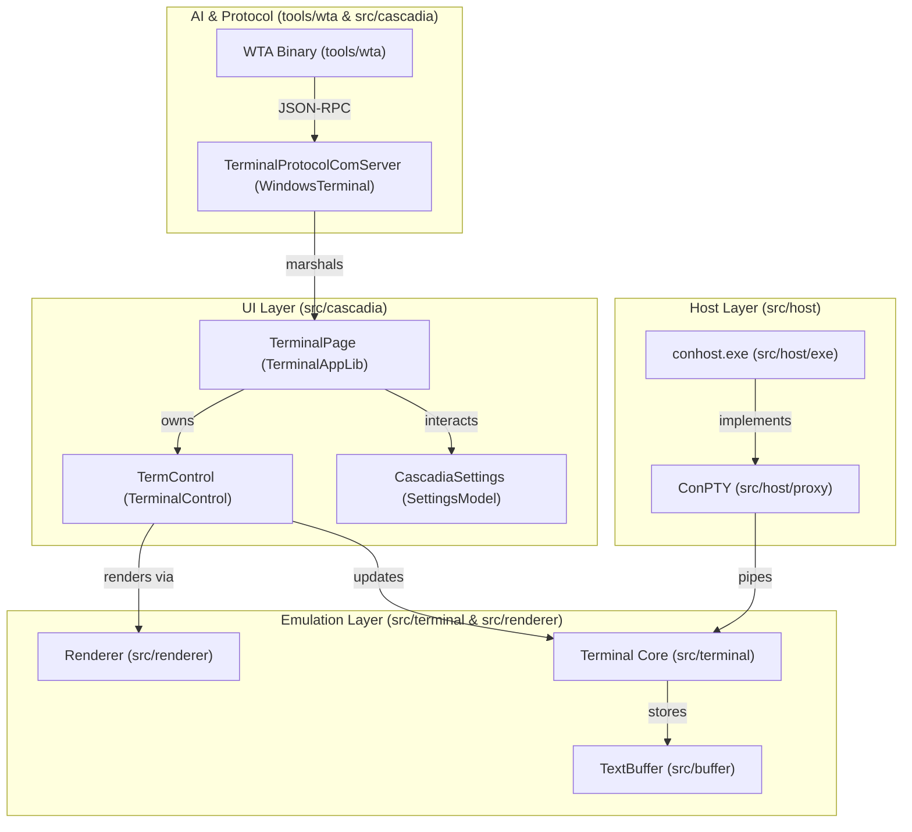
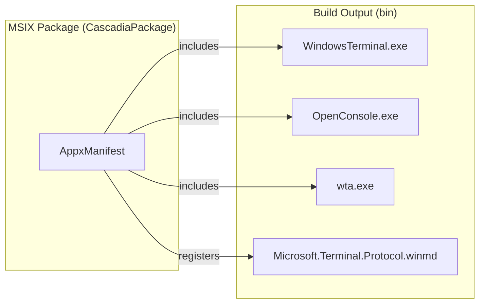

<!-- source: DeepWiki mcp.deepwiki.com · repo microsoft/intelligent-terminal · page 1.2 Project Structure and Key Directories · fetched 2026-10-26 -->

# Project Structure and Key Directories

Relevant source files

The following files were used as context for generating this wiki page:

- [.config/dotnet-tools.json](.config/dotnet-tools.json)
- [.vsconfig](.vsconfig)
- [build/config/272MSSharedLibSN2048.snk](build/config/272MSSharedLibSN2048.snk)
- [build/config/esrp.build.batch.wpfdotnet.json](build/config/esrp.build.batch.wpfdotnet.json)
- [build/scripts/Create-AppxBundle.ps1](build/scripts/Create-AppxBundle.ps1)
- [build/scripts/Test-WindowsTerminalPackage.ps1](build/scripts/Test-WindowsTerminalPackage.ps1)
- [doc/cascadia/Unittesting-CppWinRT-Xaml.md](doc/cascadia/Unittesting-CppWinRT-Xaml.md)
- [res/README.md](res/README.md)
- [res/fonts/CascadiaCode.ttf](res/fonts/CascadiaCode.ttf)
- [res/fonts/CascadiaCodeItalic.ttf](res/fonts/CascadiaCodeItalic.ttf)
- [res/fonts/CascadiaMono.ttf](res/fonts/CascadiaMono.ttf)
- [res/fonts/CascadiaMonoItalic.ttf](res/fonts/CascadiaMonoItalic.ttf)
- [res/fonts/README.md](res/fonts/README.md)
- [samples/ConPTY/EchoCon/EchoCon/EchoCon.vcxproj](samples/ConPTY/EchoCon/EchoCon/EchoCon.vcxproj)
- [scratch/ScratchIslandApp/Package/Package.appxmanifest](scratch/ScratchIslandApp/Package/Package.appxmanifest)
- [src/cascadia/CascadiaPackage/CascadiaPackage.wapproj](src/cascadia/CascadiaPackage/CascadiaPackage.wapproj)
- [src/cascadia/CascadiaPackage/Package-Can.appxmanifest](src/cascadia/CascadiaPackage/Package-Can.appxmanifest)
- [src/cascadia/CascadiaPackage/Package-Dev.appxmanifest](src/cascadia/CascadiaPackage/Package-Dev.appxmanifest)
- [src/cascadia/CascadiaPackage/Package-Pre.appxmanifest](src/cascadia/CascadiaPackage/Package-Pre.appxmanifest)
- [src/cascadia/CascadiaPackage/Package.appxmanifest](src/cascadia/CascadiaPackage/Package.appxmanifest)
- [src/cascadia/CascadiaPackage/Resources/Resources.resw](src/cascadia/CascadiaPackage/Resources/Resources.resw)
- [src/cascadia/CascadiaResources.build.items](src/cascadia/CascadiaResources.build.items)
- [src/cascadia/LocalTests_TerminalApp/TerminalApp.LocalTests.AppxManifest.prototype.xml](src/cascadia/LocalTests_TerminalApp/TerminalApp.LocalTests.AppxManifest.prototype.xml)
- [src/cascadia/LocalTests_TerminalApp/TerminalApp.LocalTests.vcxproj](src/cascadia/LocalTests_TerminalApp/TerminalApp.LocalTests.vcxproj)
- [src/cascadia/LocalTests_TerminalApp/TestHostApp/Package.appxmanifest](src/cascadia/LocalTests_TerminalApp/TestHostApp/Package.appxmanifest)
- [src/cascadia/LocalTests_TerminalApp/TestHostApp/TestHostApp.vcxproj](src/cascadia/LocalTests_TerminalApp/TestHostApp/TestHostApp.vcxproj)
- [src/cascadia/TerminalApp/Resources/en-US/ContextMenu.resw](src/cascadia/TerminalApp/Resources/en-US/ContextMenu.resw)
- [src/cascadia/TerminalApp/TerminalAppLib.vcxproj](src/cascadia/TerminalApp/TerminalAppLib.vcxproj)
- [src/cascadia/TerminalApp/TerminalAppLib.vcxproj.filters](src/cascadia/TerminalApp/TerminalAppLib.vcxproj.filters)
- [src/cascadia/TerminalApp/dll/TerminalApp.vcxproj](src/cascadia/TerminalApp/dll/TerminalApp.vcxproj)
- [src/cascadia/WindowsTerminal/WindowsTerminal.vcxproj](src/cascadia/WindowsTerminal/WindowsTerminal.vcxproj)
- [src/cascadia/WpfTerminalControl/WpfTerminalControl.csproj](src/cascadia/WpfTerminalControl/WpfTerminalControl.csproj)
- [src/cascadia/WpfTerminalTestNetCore/WpfTerminalTestNetCore.csproj](src/cascadia/WpfTerminalTestNetCore/WpfTerminalTestNetCore.csproj)
- [src/cascadia/ut_app/TerminalApp.Unit.Tests.AppxManifest.xml](src/cascadia/ut_app/TerminalApp.Unit.Tests.AppxManifest.xml)
- [src/cascadia/ut_app/TerminalApp.UnitTests.vcxproj](src/cascadia/ut_app/TerminalApp.UnitTests.vcxproj)
- [src/common.build.post.props](src/common.build.post.props)
- [src/common.build.pre.props](src/common.build.pre.props)
- [src/cppwinrt.build.post.props](src/cppwinrt.build.post.props)
- [src/cppwinrt.build.pre.props](src/cppwinrt.build.pre.props)
- [src/features.xml](src/features.xml)
- [src/host/proxy/Host.Proxy.vcxproj](src/host/proxy/Host.Proxy.vcxproj)
- [src/host/proxy/Host.Proxy.vcxproj.filters](src/host/proxy/Host.Proxy.vcxproj.filters)
- [src/tools/TerminalStress/Program.cs](src/tools/TerminalStress/Program.cs)
- [src/tools/TerminalStress/TerminalStress.csproj](src/tools/TerminalStress/TerminalStress.csproj)
- [src/unit.tests.x64.runsettings](src/unit.tests.x64.runsettings)
- [src/unit.tests.x86.runsettings](src/unit.tests.x86.runsettings)
- [src/wap-common.build.pre.props](src/wap-common.build.pre.props)

This page provides a technical tour of the Intelligent Terminal repository layout. It explains the relationship between the original Windows Terminal components and the Intelligent Terminal additions, focusing on how the codebase is organized to support terminal emulation, modern UI, and AI agent integration.

## Repository Overview

The repository is a fork of Windows Terminal, extending its core architecture with AI-driven capabilities. The structure follows a layered approach, separating the low-level console host (`src/host`), the terminal emulation engine (`src/terminal`), and the high-level XAML-based user interface (`src/cascadia`). Intelligent Terminal specifically introduces the Windows Terminal Agent (`tools/wta`) and the COM-based protocol server for external tool interaction.

### Core Architecture Flow

The following diagram illustrates the data flow and ownership relationship between key directories and their primary code entities.

**Diagram: Architectural Layering and Directory Mapping**

Sources: [src/cascadia/WindowsTerminal/WindowsTerminal.vcxproj:50-73](), [src/cascadia/TerminalApp/TerminalAppLib.vcxproj:52-85](), [src/cascadia/CascadiaPackage/CascadiaPackage.wapproj:87-109]()

---

## Key Directories

### `src/cascadia` (Terminal UI & Application Logic)
This is the most complex part of the repository, containing the modern Windows Terminal application.
*   **`WindowsTerminal/`**: The main executable project (`WindowsTerminal.exe`). It hosts the `AppHost` [src/cascadia/WindowsTerminal/AppHost.h:53](), `IslandWindow` [src/cascadia/WindowsTerminal/IslandWindow.h:55](), and the newly added `TerminalProtocolComServer` [src/cascadia/WindowsTerminal/TerminalProtocolComServer.h:59]() which enables AI agent communication.
*   **`TerminalApp/`**: Contains `TerminalAppLib`, the core logic for the UI. Key files include `TerminalPage.xaml` [src/cascadia/TerminalApp/TerminalAppLib.vcxproj:52]() (the main UI container) and `AppLogic.cpp` [src/cascadia/TerminalApp/TerminalAppLib.vcxproj:161]().
*   **`TerminalControl/`**: The WinRT control that bridges the XAML UI to the terminal engine.
*   **`TerminalSettingsModel/`**: Handles the loading, layering, and serialization of `settings.json`.
*   **`CascadiaPackage/`**: The MSIX packaging project. It defines the application identity (e.g., `IntelligentTerminal`) and execution aliases like `wtai.exe` [src/cascadia/CascadiaPackage/Package-Dev.appxmanifest:21-163]().

### `src/host` (Console Host)
Contains the code for `conhost.exe` (the classic Windows Console) and the Pseudoconsole (ConPTY) infrastructure.
*   **`exe/`**: The entry point for the console host.
*   **`proxy/`**: Implements the `winconpty.dll` logic used by the terminal to host shell processes like `powershell.exe` or `cmd.exe` [src/cascadia/CascadiaPackage/CascadiaPackage.wapproj:103]().

### `src/terminal` & `src/renderer` & `src/buffer`
These directories form the "Engine" of the terminal.
*   **`src/terminal/`**: The VT (Virtual Terminal) state machine and parser.
*   **`src/renderer/`**: The rendering engine coordination, including the DirectX-based AtlasEngine and the GDI engine.
*   **`src/buffer/`**: The low-level `TextBuffer` and `ROW` storage implementation.

### `tools/wta` (Windows Terminal Agent)
A critical addition for Intelligent Terminal. This directory contains the Rust-based agent binary (`wta.exe`). It serves as the bridge between AI agents and the terminal's internal state, communicating via JSON-RPC over the COM interface provided by `WindowsTerminal.exe` [src/cascadia/CascadiaPackage/CascadiaPackage.wapproj:118-125]().

### `dep/` & `oss/`
External dependencies. `dep/` contains headers and libraries like `GSL` and `jsoncpp` [src/cascadia/WindowsTerminal/WindowsTerminal.vcxproj:39](). `oss/` (not shown in snippet but referenced in architecture) contains larger open-source components.

### `res/`
Static assets, including application icons and the Cascadia Code font family [res/README.md:1-9]().

---

## Intelligent Terminal Additions

The Intelligent Terminal fork introduces several new components integrated into the existing Windows Terminal structure:

| Component | Location | Purpose |
| :--- | :--- | :--- |
| **WTA Binary** | `tools/wta` | Rust agent for AI orchestration and TUI client. |
| **Protocol Server** | `src/cascadia/WindowsTerminal/TerminalProtocolComServer.*` | COM server for cross-process terminal manipulation. |
| **Agent Pane** | `src/cascadia/TerminalApp/AgentPaneContent.xaml` | UI container for AI interactions [src/cascadia/TerminalApp/TerminalAppLib.vcxproj:83](). |
| **FRE Overlay** | `src/cascadia/TerminalApp/FreOverlay.xaml` | First-run experience for AI onboarding [src/cascadia/TerminalApp/TerminalAppLib.vcxproj:86](). |
| **wtcli** | `src/tools/wtcli` | CLI tool for interacting with the Protocol Server [src/cascadia/CascadiaPackage/CascadiaPackage.wapproj:106](). |

### Build and Output Configuration
The project uses a unified output structure defined in `common.build.pre.props`. All binaries are compiled into a central `bin/` directory at the root, organized by platform and configuration [src/common.build.pre.props:9-11]().

**Diagram: Binary Output and Packaging Relationship**

Sources: [src/common.build.pre.props:9-24](), [src/cascadia/CascadiaPackage/CascadiaPackage.wapproj:113-125]()

---

## Testing Infrastructure
The repository includes extensive unit and integration tests located alongside the source:
*   **`src/cascadia/ut_app/`**: Unit tests for `TerminalAppLib`, covering JSON utilities, agent hooks, and FZF integration [src/cascadia/ut_app/TerminalApp.UnitTests.vcxproj:24-28]().
*   **`src/cascadia/LocalTests_TerminalApp/`**: Integration tests that run within a test host app to validate XAML and UI logic.

Sources:
* [src/cascadia/CascadiaPackage/CascadiaPackage.wapproj:87-125]()
* [src/cascadia/CascadiaPackage/Package-Dev.appxmanifest:21-163]()
* [src/cascadia/TerminalApp/TerminalAppLib.vcxproj:52-175]()
* [src/cascadia/WindowsTerminal/WindowsTerminal.vcxproj:50-73]()
* [src/cascadia/ut_app/TerminalApp.UnitTests.vcxproj:24-32]()
* [src/common.build.pre.props:9-24]()
* [res/README.md:1-9]()

---

