# Page: Intelligent Terminal: Overview

# Intelligent Terminal: Overview

<details>
<summary>Relevant source files</summary>

The following files were used as context for generating this wiki page:

- [.github/actions/spelling/allow/allow.txt](.github/actions/spelling/allow/allow.txt)
- [.github/actions/spelling/allow/apis.txt](.github/actions/spelling/allow/apis.txt)
- [.github/actions/spelling/allow/microsoft.txt](.github/actions/spelling/allow/microsoft.txt)
- [.github/actions/spelling/allow/names.txt](.github/actions/spelling/allow/names.txt)
- [.github/actions/spelling/expect/expect.txt](.github/actions/spelling/expect/expect.txt)
- [AGENTS.md](AGENTS.md)
- [ARCHITECTURE.md](ARCHITECTURE.md)
- [CONTRIBUTING.md](CONTRIBUTING.md)
- [README.md](README.md)
- [SUPPORT.md](SUPPORT.md)
- [TelemetryEvents.md](TelemetryEvents.md)
- [doc/building.md](doc/building.md)
- [doc/faq.md](doc/faq.md)
- [doc/roadmap-2022.md](doc/roadmap-2022.md)
- [doc/roadmap-2023.md](doc/roadmap-2023.md)
- [doc/specs/#1571 - New Tab Menu Customization/#1571 - New Tab Menu Customization.md](doc/specs/#1571 - New Tab Menu Customization/#1571 - New Tab Menu Customization.md)
- [doc/specs/#1571 - New Tab Menu Customization/Menu-Customization-000.png](doc/specs/#1571 - New Tab Menu Customization/Menu-Customization-000.png)
- [doc/specs/#1595 - Suggestions UI/Suggestions-UI.md](doc/specs/#1595 - Suggestions UI/Suggestions-UI.md)
- [doc/specs/#2046 - Command Palette.md](doc/specs/#2046 - Command Palette.md)
- [doc/specs/#2046 - Unified keybindings and commands, and synthesized action names.md](doc/specs/#2046 - Unified keybindings and commands, and synthesized action names.md)
- [doc/specs/#4066 - Theme-controlled color scheme switch.md](doc/specs/#4066 - Theme-controlled color scheme switch.md)
- [doc/specs/#653 - Quake Mode/#653 - Quake Mode.md](doc/specs/#653 - Quake Mode/#653 - Quake Mode.md)
- [doc/specs/#6899 - Action IDs/#6899 - Action IDs.md](doc/specs/#6899 - Action IDs/#6899 - Action IDs.md)
- [doc/specs/#6899 - Action IDs/data-mockup-actions-ids-keys-maps.png](doc/specs/#6899 - Action IDs/data-mockup-actions-ids-keys-maps.png)
- [doc/specs/connection-resilience.md](doc/specs/connection-resilience.md)
- [doc/terminal-a11y-2023.md](doc/terminal-a11y-2023.md)
- [doc/terminal-v2-roadmap.md](doc/terminal-v2-roadmap.md)
- [images/intelligent-terminal-agent-focus.png](images/intelligent-terminal-agent-focus.png)
- [res/README.md](res/README.md)
- [res/fonts/CascadiaCode.ttf](res/fonts/CascadiaCode.ttf)
- [res/fonts/CascadiaCodeItalic.ttf](res/fonts/CascadiaCodeItalic.ttf)
- [res/fonts/CascadiaMono.ttf](res/fonts/CascadiaMono.ttf)
- [res/fonts/CascadiaMonoItalic.ttf](res/fonts/CascadiaMonoItalic.ttf)
- [res/fonts/README.md](res/fonts/README.md)
- [src/cascadia/CascadiaResources.build.items](src/cascadia/CascadiaResources.build.items)
- [tools/bcz.cmd](tools/bcz.cmd)
- [tools/bx.ps1](tools/bx.ps1)

</details>


Intelligent Terminal is an experimental fork of [Windows Terminal](https://github.com/microsoft/terminal) that introduces native AI agent integration directly into the terminal experience [README.md:39-41](). It is designed to work with any agent CLI compatible with the **Agent Client Protocol (ACP)** [README.md:43-43]().

While inheriting the high-performance rendering engine, settings model, and terminal emulation from Windows Terminal, Intelligent Terminal adds a specialized "Natural Language Space" that interacts with the traditional "Code Entity Space" (the shell and terminal buffer).

## Key Features and Differences

Unlike the standard Windows Terminal, Intelligent Terminal provides:
*   **Agent Pane:** A context-aware, docked XAML pane (`AgentPaneContent`) that hosts an AI agent CLI with full access to the terminal's scrollback buffer [README.md:135-141]().
*   **WTA (Windows Terminal Agent):** A specialized Rust-based binary (`wta.exe`) that acts as a bridge between the terminal UI and various AI agents [README.md:43-43]().
*   **Automatic Error Detection:** Integration with shell execution (via OSC 133 marks) to detect non-zero exit codes and suggest fixes via the status bar [README.md:127-133]().
*   **Agent Management:** A dedicated UI for tracking active sessions, history, and background agent tasks [README.md:149-155]().

## Architectural Layers

The system is organized into three primary conceptual layers that bridge the gap between user intent and terminal execution.

### High-Level Architecture Diagram
This diagram illustrates the relationship between the UI components and the background agent processes.

```mermaid
graph TD
    subgraph "UI Layer (XAML/C++)"
        [TerminalPage] --> [AgentPaneContent]
        [TerminalPage] --> [TermControl]
        [AgentPaneContent] --> [SharedWta]
    end

    subgraph "Agent Space (Rust/JSON-RPC)"
        [SharedWta] -- "ACP Protocol" --> [WTA_Binary]
        [WTA_Binary] -- "stdio JSON-RPC" --> [Agent_CLI]
    end

    subgraph "Data Bridge (COM)"
        [Agent_CLI] -- "IProtocolServer" --> [TerminalProtocolComServer]
        [TerminalProtocolComServer] --> [TextBuffer]
    end

    style [WTA_Binary] stroke-dasharray: 5 5
    style [Agent_CLI] stroke-dasharray: 5 5
```
Sources: [README.md:135-155](), [CONTRIBUTING.md:7-7]()

### Bridging Natural Language to Code Entities
The following diagram maps how user interactions in the "Natural Language" Agent Pane translate into operations on core terminal code entities.

```mermaid
graph LR
    subgraph "Natural Language Space"
        [AIAgentsViewModel] -- "manages" --> [Agent_Session]
        [AgentPaneContent] -- "renders" --> [WTA_TUI]
    end

    subgraph "Code Entity Space"
        [WTA_TUI] -- "calls" --> [IProtocolServer::GetText]
        [IProtocolServer::GetText] -- "accesses" --> [TextBuffer]
        [Agent_Session] -- "triggers" --> [ShortcutActionDispatch]
        [ShortcutActionDispatch] -- "executes" --> [TerminalPage::_HandleOpenNewTab]
    end
```
Sources: [README.md:113-122](), [README.md:141-141]()

## Project Structure

The repository maintains the original Windows Terminal structure while adding specific directories for AI integration:

| Directory | Purpose |
| :--- | :--- |
| `src/cascadia` | The main Terminal UI (XAML/WinRT). Contains the new `AgentPane` and AI settings. |
| `tools/wta` | The **Windows Terminal Agent** Rust source code. |
| `src/host` | The Windows Console Host (`conhost.exe`) and ConPTY logic. |
| `src/terminal` | The core VT state machine and text buffer logic. |
| `src/renderer` | Hardware-accelerated (AtlasEngine) and legacy (GDI) renderers. |

For a detailed walkthrough of the repository, see **[Project Structure and Key Directories](#1.2)**.

## Navigation and Wiki Guide

This wiki is structured to guide you from high-level concepts down to specific implementation details.

### 1. Setup and Basics
*   **[Getting Started: Installation and Building](#1.1)**: System requirements (Windows 11 22H2+), building via `OpenConsole.psm1` or `razzle.cmd`, and deploying the `CascadiaPackage` [doc/building.md:20-41]().
*   **[Project Structure and Key Directories](#1.2)**: Understanding the layout of the fork and where AI-specific code resides.

### 2. AI Integration (The "Intelligent" Layer)
Detailed documentation on the `WTA` binary, the **Agent Client Protocol (ACP)**, and the `TerminalProtocolComServer` which allows agents to read and write to the terminal.

### 3. Core Terminal Engine
Deep dives into the inherited Windows Terminal stack:
*   **Terminal Emulation**: The VT parser (`AdaptDispatch`) and `TextBuffer` management.
*   **Rendering Pipeline**: How `AtlasEngine` uses DirectX for high-performance text rendering.
*   **Settings Model**: The JSON-based layering system and the XAML Settings Editor.

### 4. Console Infrastructure
Information on `ConPTY`, the `conhost` screen buffer, and how terminal applications communicate with the shell.

---

**Next Steps:** To begin contributing or building the project, visit **[Getting Started: Installation and Building](#1.1)**.

---

# Page: Getting Started: Installation and Building

# Getting Started: Installation and Building

<details>
<summary>Relevant source files</summary>

The following files were used as context for generating this wiki page:

- [.cargo/config.toml](.cargo/config.toml)
- [.github/copilot-instructions.md](.github/copilot-instructions.md)
- [.github/workflows/spelling2.yml](.github/workflows/spelling2.yml)
- [Directory.Build.props](Directory.Build.props)
- [Directory.Build.targets](Directory.Build.targets)
- [build/Helix/ConvertWttLogToXUnit.ps1](build/Helix/ConvertWttLogToXUnit.ps1)
- [build/Helix/HelixTestHelpers.cs](build/Helix/HelixTestHelpers.cs)
- [build/Helix/OutputTestErrorsForAzureDevops.ps1](build/Helix/OutputTestErrorsForAzureDevops.ps1)
- [build/config/GitCheckin.json](build/config/GitCheckin.json)
- [build/config/release.gdnbaselines](build/config/release.gdnbaselines)
- [build/config/tsa.json](build/config/tsa.json)
- [build/pipelines/1espt-nightly.yml](build/pipelines/1espt-nightly.yml)
- [build/pipelines/ci-caching.yml](build/pipelines/ci-caching.yml)
- [build/pipelines/ci.yml](build/pipelines/ci.yml)
- [build/pipelines/ob-nightly.yml](build/pipelines/ob-nightly.yml)
- [build/pipelines/ob-release.yml](build/pipelines/ob-release.yml)
- [build/pipelines/pgo.yml](build/pipelines/pgo.yml)
- [build/pipelines/templates-v2/job-build-package-wpf.yml](build/pipelines/templates-v2/job-build-package-wpf.yml)
- [build/pipelines/templates-v2/job-build-project.yml](build/pipelines/templates-v2/job-build-project.yml)
- [build/pipelines/templates-v2/job-merge-msix-into-bundle.yml](build/pipelines/templates-v2/job-merge-msix-into-bundle.yml)
- [build/pipelines/templates-v2/job-package-conpty.yml](build/pipelines/templates-v2/job-package-conpty.yml)
- [build/pipelines/templates-v2/job-pgo-build-nuget-and-publish.yml](build/pipelines/templates-v2/job-pgo-build-nuget-and-publish.yml)
- [build/pipelines/templates-v2/job-publish-symbols-using-symbolrequestprod-api.yml](build/pipelines/templates-v2/job-publish-symbols-using-symbolrequestprod-api.yml)
- [build/pipelines/templates-v2/job-publish-symbols.yml](build/pipelines/templates-v2/job-publish-symbols.yml)
- [build/pipelines/templates-v2/job-run-pgo-tests.yml](build/pipelines/templates-v2/job-run-pgo-tests.yml)
- [build/pipelines/templates-v2/job-submit-windows-vpack.yml](build/pipelines/templates-v2/job-submit-windows-vpack.yml)
- [build/pipelines/templates-v2/job-test-project.yml](build/pipelines/templates-v2/job-test-project.yml)
- [build/pipelines/templates-v2/pipeline-1espt-full-release-build.yml](build/pipelines/templates-v2/pipeline-1espt-full-release-build.yml)
- [build/pipelines/templates-v2/pipeline-full-release-build.yml](build/pipelines/templates-v2/pipeline-full-release-build.yml)
- [build/pipelines/templates-v2/pipeline-onebranch-full-release-build.yml](build/pipelines/templates-v2/pipeline-onebranch-full-release-build.yml)
- [build/pipelines/templates-v2/steps-ensure-nuget-version.yml](build/pipelines/templates-v2/steps-ensure-nuget-version.yml)
- [build/pipelines/templates-v2/steps-esrp-signing.yml](build/pipelines/templates-v2/steps-esrp-signing.yml)
- [build/pipelines/templates-v2/steps-install-terrapin.yml](build/pipelines/templates-v2/steps-install-terrapin.yml)
- [build/pipelines/templates-v2/steps-restore-nuget.yml](build/pipelines/templates-v2/steps-restore-nuget.yml)
- [build/pipelines/templates-v2/steps-setup-versioning.yml](build/pipelines/templates-v2/steps-setup-versioning.yml)
- [build/pipelines/templates-v2/variables-nuget-package-version.yml](build/pipelines/templates-v2/variables-nuget-package-version.yml)
- [build/pipelines/templates-v2/variables-onebranch-config.yml](build/pipelines/templates-v2/variables-onebranch-config.yml)
- [build/scripts/Get-DependenciesFromAppxRecipe.ps1](build/scripts/Get-DependenciesFromAppxRecipe.ps1)
- [build/scripts/New-WtaLocalInstaller.ps1](build/scripts/New-WtaLocalInstaller.ps1)
- [build/scripts/Run-Tests.ps1](build/scripts/Run-Tests.ps1)
- [build/scripts/Set-LatestVCToolsVersion.ps1](build/scripts/Set-LatestVCToolsVersion.ps1)
- [custom.props](custom.props)
- [dep/nuget/nuget.exe](dep/nuget/nuget.exe)
- [doc/building.md](doc/building.md)
- [src/cascadia/TerminalSettingsEditor/Compatibility.cpp](src/cascadia/TerminalSettingsEditor/Compatibility.cpp)
- [src/cascadia/TerminalSettingsEditor/Compatibility.h](src/cascadia/TerminalSettingsEditor/Compatibility.h)
- [src/cascadia/TerminalSettingsEditor/Compatibility.idl](src/cascadia/TerminalSettingsEditor/Compatibility.idl)
- [src/cascadia/TerminalSettingsEditor/Compatibility.xaml](src/cascadia/TerminalSettingsEditor/Compatibility.xaml)
- [src/cascadia/TerminalSettingsEditor/Extensions.xaml](src/cascadia/TerminalSettingsEditor/Extensions.xaml)
- [src/cascadia/TerminalSettingsEditor/NewTabMenu.xaml](src/cascadia/TerminalSettingsEditor/NewTabMenu.xaml)
- [src/cascadia/TerminalSettingsEditor/SearchIndex.cpp](src/cascadia/TerminalSettingsEditor/SearchIndex.cpp)
- [src/cascadia/TerminalSettingsEditor/SearchIndex.h](src/cascadia/TerminalSettingsEditor/SearchIndex.h)
- [src/cascadia/UnitTests_Control/Control.UnitTests.vcxproj](src/cascadia/UnitTests_Control/Control.UnitTests.vcxproj)
- [src/cascadia/UnitTests_Control/UnitTests_Control.def](src/cascadia/UnitTests_Control/UnitTests_Control.def)
- [src/cascadia/UnitTests_Control/pch.cpp](src/cascadia/UnitTests_Control/pch.cpp)
- [src/interactivity/onecore/SystemConfigurationProvider.cpp](src/interactivity/onecore/SystemConfigurationProvider.cpp)
- [tools/GenerateSettingsIndex.ps1](tools/GenerateSettingsIndex.ps1)
- [tools/OpenConsole.psm1](tools/OpenConsole.psm1)
- [tools/ReleaseEngineering/Draft-TerminalReleases.ps1](tools/ReleaseEngineering/Draft-TerminalReleases.ps1)
- [tools/bcz.cmd](tools/bcz.cmd)
- [tools/bx.ps1](tools/bx.ps1)
- [tools/razzle.cmd](tools/razzle.cmd)
- [tools/runft.cmd](tools/runft.cmd)
- [tools/runuia.cmd](tools/runuia.cmd)
- [tools/runut.cmd](tools/runut.cmd)
- [tools/tests.xml](tools/tests.xml)
- [tools/wta/Cargo.lock](tools/wta/Cargo.lock)
- [tools/wta/build.rs](tools/wta/build.rs)

</details>


This page provides technical instructions for installing, configuring, and building the Intelligent Terminal codebase. It covers the environment requirements, the specialized PowerShell and Cmd tooling used for development, and the structure of the Continuous Integration (CI) pipelines.

## System Requirements and Installation

Intelligent Terminal targets modern Windows environments. The primary distribution methods are the Microsoft Store and WinGet.

### Requirements
*   **Operating System**: Windows 11 22H2 (Build 22621) or higher.
*   **Architecture**: x64, x86, or ARM64.
*   **Dependencies**: The terminal utilizes `Microsoft.UI.Xaml` for its UI layer [doc/building.md:76-77]().

### Distribution Channels
*   **Microsoft Store**: The official release channel.
*   **WinGet**: Can be installed via `winget install Microsoft.IntelligentTerminal`.
*   **Unpackaged/Portable**: The build system supports a `-PortableMode` argument for Canary-branded builds [build/pipelines/templates-v2/job-build-project.yml:120-121]().

---

## Development Environment Setup

The repository uses a mix of C++ (for the terminal core and UI) and Rust (for the WTA agent).

### Prerequisites
1.  **Visual Studio 2022**: Version 17.0 to 18.0 is required to maintain compatibility with the `v143` PlatformToolset [tools/razzle.cmd:52-58]().
2.  **Git Submodules**: Several dependencies (including `oss` and `dep` folders) are managed via submodules [doc/building.md:4-8]().
    ```shell
    git submodule update --init --recursive
    ```
3.  **Rust Toolchain**: Required for building the `wta` (Windows Terminal Agent) binary [build/pipelines/templates-v2/job-build-project.yml:186-191]().

### Tooling Initialization
The project provides two primary entry points for setting up the developer environment:

*   **PowerShell (`OpenConsole.psm1`)**: The preferred modern method. It provides functions like `Set-MsbuildDevEnvironment` to locate Visual Studio instances and configure the shell [tools/OpenConsole.psm1:63-101]().
*   **Cmd (`razzle.cmd`)**: A legacy-style script that mimics the internal Windows development environment ("Razzle"). It adds `msbuild`, `nuget`, and internal tools to the `%PATH%` [tools/razzle.cmd:1-25]().

**Sources:** [tools/OpenConsole.psm1:1-101](), [tools/razzle.cmd:1-60](), [doc/building.md:1-26]()

---

## Building from Source

### Using PowerShell (Recommended)
The `OpenConsole.psm1` module exports several `Invoke-` cmdlets to manage the build lifecycle:

| Function | Purpose |
| :--- | :--- |
| `Set-MsBuildDevEnvironment` | Imports `VSSetup` and configures `$env:PATH` for the correct architecture [tools/OpenConsole.psm1:63-101](). |
| `Invoke-OpenConsoleBuild` | Wrapper around MSBuild to compile the `OpenConsole.slnx` solution [doc/building.md:30](). |
| `Invoke-OpenConsoleTests` | Executes TAEF-based unit and feature tests [tools/OpenConsole.psm1:163-188](). |
| `Invoke-CodeFormat` | Applies `clang-format` based on the project's style guide [doc/building.md:34](). |

### Using Cmd
After running `razzle.cmd`, developers can use `bcz.cmd` (Build-Clean-Zap) to compile the solution:
*   `bcz dbg`: Builds the Debug configuration [tools/bcz.cmd:27-30]().
*   `bcz rel`: Builds the Release configuration [tools/bcz.cmd:31-34]().
*   `bcz no_clean`: Skips the `Clean` target for faster incremental builds [tools/bcz.cmd:39-41]().

### The Rust Agent (WTA)
The Rust-based agent (`tools/wta`) is integrated into the MSBuild pipeline. Before the Rust build occurs, versioning overlays are applied to `src/cascadia/TerminalApp/init.cpp` and `dep/telemetry/ProjectTelemetry.h`, which are then consumed by `tools/wta/build.rs` [build/pipelines/templates-v2/job-build-project.yml:59-68]().

**Sources:** [doc/building.md:20-48](), [tools/bcz.cmd:1-80](), [build/pipelines/templates-v2/job-build-project.yml:179-183]()

---

## Project Build Pipeline and Data Flow

The following diagram illustrates how natural language build commands translate into code entity executions within the build system.

### Build Tooling Architecture
"Natural Language Space" to "Code Entity Space" (1/2)

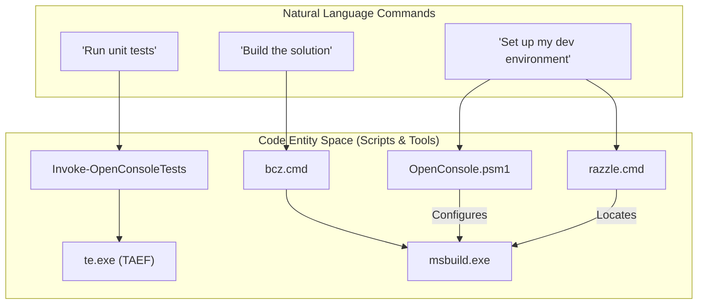
**Sources:** [tools/OpenConsole.psm1:8-101](), [tools/razzle.cmd:1-60](), [tools/bcz.cmd:1-80](), [doc/building.md:20-48]()

---

## MSIX Packaging and Deployment

Intelligent Terminal is packaged as an MSIX bundle. The primary project for this is `CascadiaPackage.wapproj` [doc/building.md:103]().

### Manual Deployment Flow
Because `WindowsTerminal.exe` cannot be launched directly as a loose file due to its dependency on the MSIX identity, a specific deployment flow is required:

1.  **Build the Package**: Run MSBuild with the `/t:Terminal\CascadiaPackage` target [doc/building.md:106]().
2.  **Unpack**: Use `makeappx.exe` to expand the `.msix` into a "loose" directory [doc/building.md:124]().
3.  **Register**: Use `Add-AppxPackage -Register` pointing to the `AppxManifest.xml` in the loose directory [doc/building.md:125]().

### Build Branding
The build system uses a branding parameter to determine the Package Family Name (PFN) and AppX manifest variants:
*   **Dev**: `WindowsTerminalDev` [build/pipelines/templates-v2/job-merge-msix-into-bundle.yml:64]().
*   **Preview**: `Microsoft.WindowsTerminalPreview` [build/pipelines/templates-v2/job-merge-msix-into-bundle.yml:60]().
*   **Canary**: `Microsoft.WindowsTerminalCanary` [build/pipelines/templates-v2/job-merge-msix-into-bundle.yml:62]().
*   **Release**: `Microsoft.IntelligentTerminal` [build/pipelines/templates-v2/job-merge-msix-into-bundle.yml:58]().

**Sources:** [doc/building.md:102-137](), [build/pipelines/templates-v2/job-merge-msix-into-bundle.yml:57-67]()

---

## Continuous Integration (CI) Infrastructure

The project uses Azure DevOps (OneBranch) for its CI/CD pipelines.

### Pipeline Definitions
*   **`ci.yml`**: Triggered on PRs and pushes to `main`. It runs an "Audit Mode" build (static analysis) and executes tests across x64, x86, and ARM64 [build/pipelines/ci.yml:1-50]().
*   **`ob-nightly.yml`**: A scheduled build that produces "Canary" branded releases and publishes symbols to the public server [build/pipelines/ob-nightly.yml:1-46]().
*   **`pipeline-onebranch-full-release-build.yml`**: The master template for official release builds, including code signing via ESRP and SBOM generation [build/pipelines/templates-v2/pipeline-onebranch-full-release-build.yml:1-112]().

### CI Data Flow
"Natural Language Space" to "Code Entity Space" (2/2)

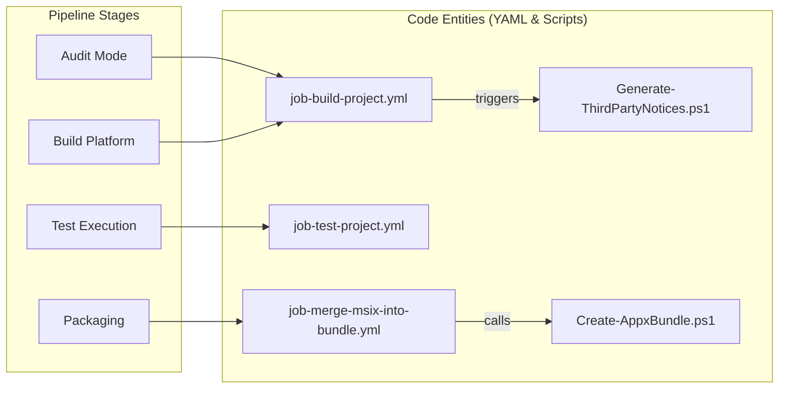
**Sources:** [build/pipelines/ci.yml:50-110](), [build/pipelines/templates-v2/job-build-project.yml:1-130](), [build/pipelines/templates-v2/job-merge-msix-into-bundle.yml:1-100]()

### Build Configurations
The solution supports three primary configurations [doc/building.md:59-63]():
1.  **Debug**: Optimized for developer iteration.
2.  **Release**: Optimized for performance; includes PGO (Profile-Guided Optimization) in official pipelines [build/pipelines/ob-nightly.yml:31]().
3.  **AuditMode**: Enables `CppCoreCheck` and additional static analysis [doc/building.md:65]().

**Sources:** [build/pipelines/ci.yml:1-110](), [build/pipelines/ob-nightly.yml:1-66](), [doc/building.md:59-66]()

---

# Page: Project Structure and Key Directories

# Project Structure and Key Directories

<details>
<summary>Relevant source files</summary>

The following files were used as context for generating this wiki page:

- [.config/dotnet-tools.json](.config/dotnet-tools.json)
- [.vsconfig](.vsconfig)
- [build/config/272MSSharedLibSN2048.snk](build/config/272MSSharedLibSN2048.snk)
- [build/config/esrp.build.batch.wpfdotnet.json](build/config/esrp.build.batch.wpfdotnet.json)
- [build/scripts/Create-AppxBundle.ps1](build/scripts/Create-AppxBundle.ps1)
- [build/scripts/Test-WindowsTerminalPackage.ps1](build/scripts/Test-WindowsTerminalPackage.ps1)
- [doc/cascadia/Unittesting-CppWinRT-Xaml.md](doc/cascadia/Unittesting-CppWinRT-Xaml.md)
- [res/README.md](res/README.md)
- [res/fonts/CascadiaCode.ttf](res/fonts/CascadiaCode.ttf)
- [res/fonts/CascadiaCodeItalic.ttf](res/fonts/CascadiaCodeItalic.ttf)
- [res/fonts/CascadiaMono.ttf](res/fonts/CascadiaMono.ttf)
- [res/fonts/CascadiaMonoItalic.ttf](res/fonts/CascadiaMonoItalic.ttf)
- [res/fonts/README.md](res/fonts/README.md)
- [samples/ConPTY/EchoCon/EchoCon/EchoCon.vcxproj](samples/ConPTY/EchoCon/EchoCon/EchoCon.vcxproj)
- [scratch/ScratchIslandApp/Package/Package.appxmanifest](scratch/ScratchIslandApp/Package/Package.appxmanifest)
- [src/cascadia/CascadiaPackage/CascadiaPackage.wapproj](src/cascadia/CascadiaPackage/CascadiaPackage.wapproj)
- [src/cascadia/CascadiaPackage/Package-Can.appxmanifest](src/cascadia/CascadiaPackage/Package-Can.appxmanifest)
- [src/cascadia/CascadiaPackage/Package-Dev.appxmanifest](src/cascadia/CascadiaPackage/Package-Dev.appxmanifest)
- [src/cascadia/CascadiaPackage/Package-Pre.appxmanifest](src/cascadia/CascadiaPackage/Package-Pre.appxmanifest)
- [src/cascadia/CascadiaPackage/Package.appxmanifest](src/cascadia/CascadiaPackage/Package.appxmanifest)
- [src/cascadia/CascadiaPackage/Resources/Resources.resw](src/cascadia/CascadiaPackage/Resources/Resources.resw)
- [src/cascadia/CascadiaResources.build.items](src/cascadia/CascadiaResources.build.items)
- [src/cascadia/LocalTests_TerminalApp/TerminalApp.LocalTests.AppxManifest.prototype.xml](src/cascadia/LocalTests_TerminalApp/TerminalApp.LocalTests.AppxManifest.prototype.xml)
- [src/cascadia/LocalTests_TerminalApp/TerminalApp.LocalTests.vcxproj](src/cascadia/LocalTests_TerminalApp/TerminalApp.LocalTests.vcxproj)
- [src/cascadia/LocalTests_TerminalApp/TestHostApp/Package.appxmanifest](src/cascadia/LocalTests_TerminalApp/TestHostApp/Package.appxmanifest)
- [src/cascadia/LocalTests_TerminalApp/TestHostApp/TestHostApp.vcxproj](src/cascadia/LocalTests_TerminalApp/TestHostApp/TestHostApp.vcxproj)
- [src/cascadia/TerminalApp/Resources/en-US/ContextMenu.resw](src/cascadia/TerminalApp/Resources/en-US/ContextMenu.resw)
- [src/cascadia/TerminalApp/TerminalAppLib.vcxproj](src/cascadia/TerminalApp/TerminalAppLib.vcxproj)
- [src/cascadia/TerminalApp/TerminalAppLib.vcxproj.filters](src/cascadia/TerminalApp/TerminalAppLib.vcxproj.filters)
- [src/cascadia/TerminalApp/dll/TerminalApp.vcxproj](src/cascadia/TerminalApp/dll/TerminalApp.vcxproj)
- [src/cascadia/WindowsTerminal/WindowsTerminal.vcxproj](src/cascadia/WindowsTerminal/WindowsTerminal.vcxproj)
- [src/cascadia/WpfTerminalControl/WpfTerminalControl.csproj](src/cascadia/WpfTerminalControl/WpfTerminalControl.csproj)
- [src/cascadia/WpfTerminalTestNetCore/WpfTerminalTestNetCore.csproj](src/cascadia/WpfTerminalTestNetCore/WpfTerminalTestNetCore.csproj)
- [src/cascadia/ut_app/TerminalApp.Unit.Tests.AppxManifest.xml](src/cascadia/ut_app/TerminalApp.Unit.Tests.AppxManifest.xml)
- [src/cascadia/ut_app/TerminalApp.UnitTests.vcxproj](src/cascadia/ut_app/TerminalApp.UnitTests.vcxproj)
- [src/common.build.post.props](src/common.build.post.props)
- [src/common.build.pre.props](src/common.build.pre.props)
- [src/cppwinrt.build.post.props](src/cppwinrt.build.post.props)
- [src/cppwinrt.build.pre.props](src/cppwinrt.build.pre.props)
- [src/features.xml](src/features.xml)
- [src/host/proxy/Host.Proxy.vcxproj](src/host/proxy/Host.Proxy.vcxproj)
- [src/host/proxy/Host.Proxy.vcxproj.filters](src/host/proxy/Host.Proxy.vcxproj.filters)
- [src/tools/TerminalStress/Program.cs](src/tools/TerminalStress/Program.cs)
- [src/tools/TerminalStress/TerminalStress.csproj](src/tools/TerminalStress/TerminalStress.csproj)
- [src/unit.tests.x64.runsettings](src/unit.tests.x64.runsettings)
- [src/unit.tests.x86.runsettings](src/unit.tests.x86.runsettings)
- [src/wap-common.build.pre.props](src/wap-common.build.pre.props)

</details>


This page provides a technical tour of the Intelligent Terminal repository layout. It explains the relationship between the original Windows Terminal components and the Intelligent Terminal additions, focusing on how the codebase is organized to support terminal emulation, modern UI, and AI agent integration.

## Repository Overview

The repository is a fork of Windows Terminal, extending its core architecture with AI-driven capabilities. The structure follows a layered approach, separating the low-level console host (`src/host`), the terminal emulation engine (`src/terminal`), and the high-level XAML-based user interface (`src/cascadia`). Intelligent Terminal specifically introduces the Windows Terminal Agent (`tools/wta`) and the COM-based protocol server for external tool interaction.

### Core Architecture Flow

The following diagram illustrates the data flow and ownership relationship between key directories and their primary code entities.

**Diagram: Architectural Layering and Directory Mapping**
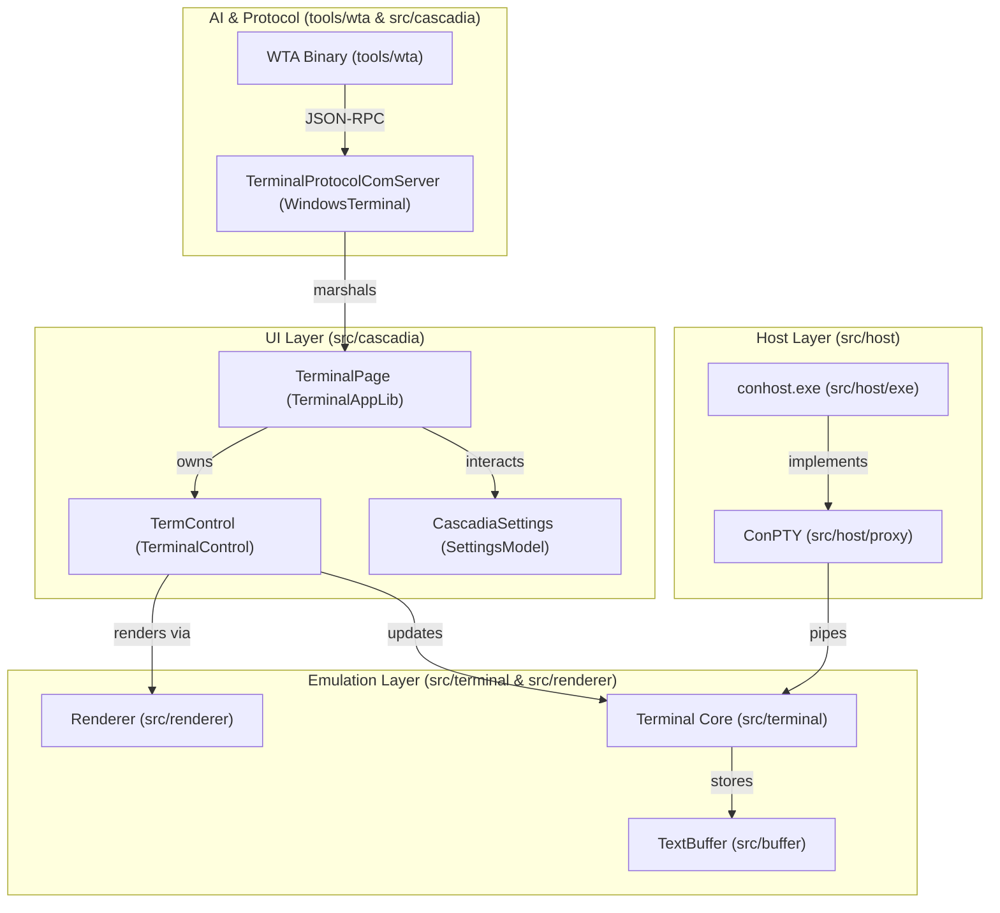
Sources: [src/cascadia/WindowsTerminal/WindowsTerminal.vcxproj:50-73](), [src/cascadia/TerminalApp/TerminalAppLib.vcxproj:52-85](), [src/cascadia/CascadiaPackage/CascadiaPackage.wapproj:87-109]()

---

## Key Directories

### `src/cascadia` (Terminal UI & Application Logic)
This is the most complex part of the repository, containing the modern Windows Terminal application.
*   **`WindowsTerminal/`**: The main executable project (`WindowsTerminal.exe`). It hosts the `AppHost` [src/cascadia/WindowsTerminal/AppHost.h:53](), `IslandWindow` [src/cascadia/WindowsTerminal/IslandWindow.h:55](), and the newly added `TerminalProtocolComServer` [src/cascadia/WindowsTerminal/TerminalProtocolComServer.h:59]() which enables AI agent communication.
*   **`TerminalApp/`**: Contains `TerminalAppLib`, the core logic for the UI. Key files include `TerminalPage.xaml` [src/cascadia/TerminalApp/TerminalAppLib.vcxproj:52]() (the main UI container) and `AppLogic.cpp` [src/cascadia/TerminalApp/TerminalAppLib.vcxproj:161]().
*   **`TerminalControl/`**: The WinRT control that bridges the XAML UI to the terminal engine.
*   **`TerminalSettingsModel/`**: Handles the loading, layering, and serialization of `settings.json`.
*   **`CascadiaPackage/`**: The MSIX packaging project. It defines the application identity (e.g., `IntelligentTerminal`) and execution aliases like `wtai.exe` [src/cascadia/CascadiaPackage/Package-Dev.appxmanifest:21-163]().

### `src/host` (Console Host)
Contains the code for `conhost.exe` (the classic Windows Console) and the Pseudoconsole (ConPTY) infrastructure.
*   **`exe/`**: The entry point for the console host.
*   **`proxy/`**: Implements the `winconpty.dll` logic used by the terminal to host shell processes like `powershell.exe` or `cmd.exe` [src/cascadia/CascadiaPackage/CascadiaPackage.wapproj:103]().

### `src/terminal` & `src/renderer` & `src/buffer`
These directories form the "Engine" of the terminal.
*   **`src/terminal/`**: The VT (Virtual Terminal) state machine and parser.
*   **`src/renderer/`**: The rendering engine coordination, including the DirectX-based AtlasEngine and the GDI engine.
*   **`src/buffer/`**: The low-level `TextBuffer` and `ROW` storage implementation.

### `tools/wta` (Windows Terminal Agent)
A critical addition for Intelligent Terminal. This directory contains the Rust-based agent binary (`wta.exe`). It serves as the bridge between AI agents and the terminal's internal state, communicating via JSON-RPC over the COM interface provided by `WindowsTerminal.exe` [src/cascadia/CascadiaPackage/CascadiaPackage.wapproj:118-125]().

### `dep/` & `oss/`
External dependencies. `dep/` contains headers and libraries like `GSL` and `jsoncpp` [src/cascadia/WindowsTerminal/WindowsTerminal.vcxproj:39](). `oss/` (not shown in snippet but referenced in architecture) contains larger open-source components.

### `res/`
Static assets, including application icons and the Cascadia Code font family [res/README.md:1-9]().

---

## Intelligent Terminal Additions

The Intelligent Terminal fork introduces several new components integrated into the existing Windows Terminal structure:

| Component | Location | Purpose |
| :--- | :--- | :--- |
| **WTA Binary** | `tools/wta` | Rust agent for AI orchestration and TUI client. |
| **Protocol Server** | `src/cascadia/WindowsTerminal/TerminalProtocolComServer.*` | COM server for cross-process terminal manipulation. |
| **Agent Pane** | `src/cascadia/TerminalApp/AgentPaneContent.xaml` | UI container for AI interactions [src/cascadia/TerminalApp/TerminalAppLib.vcxproj:83](). |
| **FRE Overlay** | `src/cascadia/TerminalApp/FreOverlay.xaml` | First-run experience for AI onboarding [src/cascadia/TerminalApp/TerminalAppLib.vcxproj:86](). |
| **wtcli** | `src/tools/wtcli` | CLI tool for interacting with the Protocol Server [src/cascadia/CascadiaPackage/CascadiaPackage.wapproj:106](). |

### Build and Output Configuration
The project uses a unified output structure defined in `common.build.pre.props`. All binaries are compiled into a central `bin/` directory at the root, organized by platform and configuration [src/common.build.pre.props:9-11]().

**Diagram: Binary Output and Packaging Relationship**
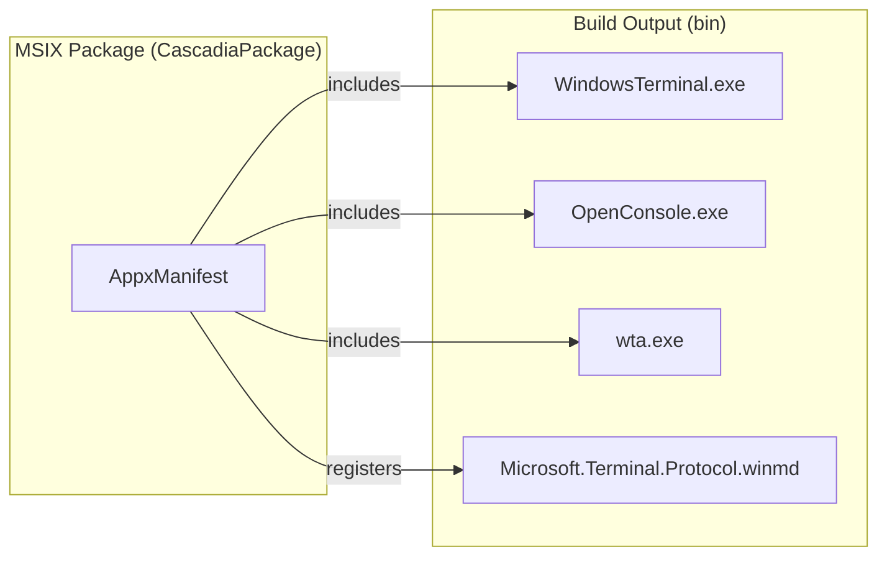
Sources: [src/common.build.pre.props:9-24](), [src/cascadia/CascadiaPackage/CascadiaPackage.wapproj:113-125]()

---

## Testing Infrastructure
The repository includes extensive unit and integration tests located alongside the source:
*   **`src/cascadia/ut_app/`**: Unit tests for `TerminalAppLib`, covering JSON utilities, agent hooks, and FZF integration [src/cascadia/ut_app/TerminalApp.UnitTests.vcxproj:24-28]().
*   **`src/cascadia/LocalTests_TerminalApp/`**: Integration tests that run within a test host app to validate XAML and UI logic.

Sources:
* [src/cascadia/CascadiaPackage/CascadiaPackage.wapproj:87-125]()
* [src/cascadia/CascadiaPackage/Package-Dev.appxmanifest:21-163]()
* [src/cascadia/TerminalApp/TerminalAppLib.vcxproj:52-175]()
* [src/cascadia/WindowsTerminal/WindowsTerminal.vcxproj:50-73]()
* [src/cascadia/ut_app/TerminalApp.UnitTests.vcxproj:24-32]()
* [src/common.build.pre.props:9-24]()
* [res/README.md:1-9]()

---

# Page: AI Agent Integration

# AI Agent Integration

<details>
<summary>Relevant source files</summary>

The following files were used as context for generating this wiki page:

- [.github/actions/spelling/allow/allow.txt](.github/actions/spelling/allow/allow.txt)
- [.github/actions/spelling/allow/apis.txt](.github/actions/spelling/allow/apis.txt)
- [.github/actions/spelling/allow/microsoft.txt](.github/actions/spelling/allow/microsoft.txt)
- [.github/actions/spelling/allow/names.txt](.github/actions/spelling/allow/names.txt)
- [.github/actions/spelling/expect/expect.txt](.github/actions/spelling/expect/expect.txt)
- [NOTICE.md](NOTICE.md)
- [README.md](README.md)
- [build/scripts/Generate-WtaThirdPartyNotices.ps1](build/scripts/Generate-WtaThirdPartyNotices.ps1)
- [doc/faq.md](doc/faq.md)
- [doc/roadmap-2022.md](doc/roadmap-2022.md)
- [doc/roadmap-2023.md](doc/roadmap-2023.md)
- [doc/specs/#1571 - New Tab Menu Customization/#1571 - New Tab Menu Customization.md](doc/specs/#1571 - New Tab Menu Customization/#1571 - New Tab Menu Customization.md)
- [doc/specs/#1571 - New Tab Menu Customization/Menu-Customization-000.png](doc/specs/#1571 - New Tab Menu Customization/Menu-Customization-000.png)
- [doc/specs/#1595 - Suggestions UI/Suggestions-UI.md](doc/specs/#1595 - Suggestions UI/Suggestions-UI.md)
- [doc/specs/#2046 - Command Palette.md](doc/specs/#2046 - Command Palette.md)
- [doc/specs/#2046 - Unified keybindings and commands, and synthesized action names.md](doc/specs/#2046 - Unified keybindings and commands, and synthesized action names.md)
- [doc/specs/#4066 - Theme-controlled color scheme switch.md](doc/specs/#4066 - Theme-controlled color scheme switch.md)
- [doc/specs/#653 - Quake Mode/#653 - Quake Mode.md](doc/specs/#653 - Quake Mode/#653 - Quake Mode.md)
- [doc/specs/#6899 - Action IDs/#6899 - Action IDs.md](doc/specs/#6899 - Action IDs/#6899 - Action IDs.md)
- [doc/specs/#6899 - Action IDs/data-mockup-actions-ids-keys-maps.png](doc/specs/#6899 - Action IDs/data-mockup-actions-ids-keys-maps.png)
- [doc/terminal-a11y-2023.md](doc/terminal-a11y-2023.md)
- [doc/terminal-v2-roadmap.md](doc/terminal-v2-roadmap.md)
- [images/intelligent-terminal-agent-focus.png](images/intelligent-terminal-agent-focus.png)
- [src/cascadia/TerminalApp/AgentPaneContent.cpp](src/cascadia/TerminalApp/AgentPaneContent.cpp)
- [src/cascadia/TerminalApp/AgentPaneContent.idl](src/cascadia/TerminalApp/AgentPaneContent.idl)
- [src/cascadia/TerminalApp/TerminalPage.Protocol.cpp](src/cascadia/TerminalApp/TerminalPage.Protocol.cpp)
- [src/cascadia/TerminalApp/TerminalPage.idl](src/cascadia/TerminalApp/TerminalPage.idl)
- [src/cascadia/TerminalProtocol/TerminalProtocol.idl](src/cascadia/TerminalProtocol/TerminalProtocol.idl)
- [src/cascadia/WindowsTerminal/TerminalProtocolComServer.cpp](src/cascadia/WindowsTerminal/TerminalProtocolComServer.cpp)
- [src/cascadia/WindowsTerminal/TerminalProtocolComServer.h](src/cascadia/WindowsTerminal/TerminalProtocolComServer.h)
- [src/tools/wtcli/Formatting.cpp](src/tools/wtcli/Formatting.cpp)
- [src/tools/wtcli/main.cpp](src/tools/wtcli/main.cpp)
- [tools/wta/AGENTS.md](tools/wta/AGENTS.md)
- [tools/wta/Cargo.toml](tools/wta/Cargo.toml)
- [tools/wta/cgmanifest.json](tools/wta/cgmanifest.json)
- [tools/wta/src/agent_pane_origin.rs](tools/wta/src/agent_pane_origin.rs)
- [tools/wta/src/agent_sessions.rs](tools/wta/src/agent_sessions.rs)
- [tools/wta/src/app.rs](tools/wta/src/app.rs)
- [tools/wta/src/history_loader.rs](tools/wta/src/history_loader.rs)
- [tools/wta/src/main.rs](tools/wta/src/main.rs)
- [tools/wta/src/master/mod.rs](tools/wta/src/master/mod.rs)
- [tools/wta/src/protocol/acp/client.rs](tools/wta/src/protocol/acp/client.rs)
- [tools/wta/src/runtime_paths.rs](tools/wta/src/runtime_paths.rs)
- [tools/wta/src/session_mgmt.rs](tools/wta/src/session_mgmt.rs)
- [tools/wta/src/session_registry.rs](tools/wta/src/session_registry.rs)
- [tools/wta/src/shell/wt_channel/cli_channel.rs](tools/wta/src/shell/wt_channel/cli_channel.rs)
- [tools/wta/src/shell/wt_channel/mod.rs](tools/wta/src/shell/wt_channel/mod.rs)
- [tools/wta/src/ui/agents_view.rs](tools/wta/src/ui/agents_view.rs)
- [tools/wta/src/ui/layout.rs](tools/wta/src/ui/layout.rs)

</details>


The Intelligent Terminal extends the standard Windows Terminal with a native AI agent subsystem. This integration allows users to interact with Large Language Models (LLMs) through Agent Client Protocol (ACP) compatible CLI tools directly within the terminal interface.

The architecture is built around a split-process model: the **Windows Terminal (WindowsTerminal.exe)** handles the UI and terminal emulation, while the **Windows Terminal Agent (wta.exe)** acts as a middleware that orchestrates agent processes and manages session state.

### System Architecture Overview

The integration consists of four major components communicating via COM and VT sequences:

1.  **Agent Pane (`AgentPaneContent`)**: A XAML-based side-pane within the Terminal UI that hosts a `wta.exe` instance.
2.  **Windows Terminal Agent (`wta.exe`)**: A Rust-based binary that manages ACP agent CLIs (e.g., GitHub Copilot, Claude Code) and provides a TUI for chat and session management.
3.  **Terminal Protocol COM Server**: A high-performance bridge inside the terminal process that allows `wta.exe` to read terminal buffers and automate actions.
4.  **Shell Integration**: OSC 133 sequences that mark command boundaries, enabling features like automatic error detection and "Auto-fix".

#### Component Interaction Diagram

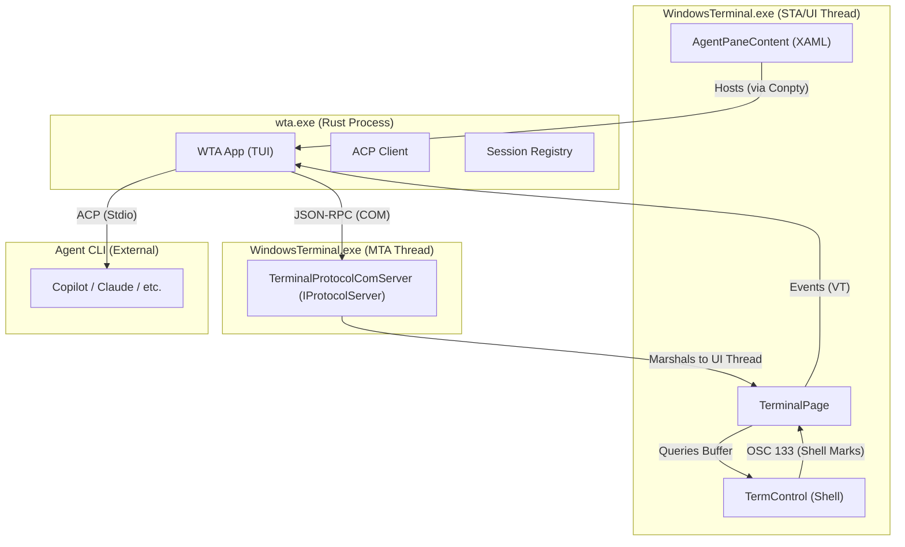
Sources: [README.md:39-47](), [src/cascadia/WindowsTerminal/TerminalProtocolComServer.cpp:44-68](), [tools/wta/src/app.rs:109-116]()

---

### Key Subsystems

#### 1. Windows Terminal Agent (WTA)
The `wta.exe` binary is the core orchestrator. It operates in three primary modes: a TUI client for the agent pane, a session manager, and a background helper. It implements the **Agent Client Protocol (ACP)** to communicate with agents via JSON-RPC over stdio.

*   **Master/Helper Architecture**: WTA uses a "master" process to track global session state and "helper" processes for individual panes.
*   **Session Management**: Maintains a history of conversations and allows resuming sessions across different terminal tabs.

For details, see [WTA: Windows Terminal Agent Binary](#2.1).

Sources: [tools/wta/src/main.rs:120-183](), [tools/wta/src/app.rs:38-52]()

#### 2. Terminal Protocol COM Server
To provide agents with context (like the contents of the terminal buffer), the terminal hosts a COM server implementing `IProtocolServer`. This interface allows external processes to:
*   List windows, tabs, and panes.
*   Read output from specific sessions.
*   Inject input or create new tabs.

The `wtcli.exe` utility is a command-line consumer of this interface, used for testing and automation.

For details, see [Terminal Protocol COM Server and wtcli](#2.2).

Sources: [src/cascadia/WindowsTerminal/TerminalProtocolComServer.h:51-90](), [src/tools/wtcli/main.cpp:40-75]()

#### 3. Agent Pane and UI Integration
The **Agent Pane** is a specialized `TerminalPaneContent` that hosts the WTA TUI. It is context-aware, automatically associating itself with the "active" shell pane in a tab.

*   **Onboarding (FRE)**: A First-Run Experience wizard helps users select and install their preferred agent (e.g., via WinGet).
*   **Settings**: Managed via the `AIAgents` settings page, allowing configuration of model overrides and pane placement.

For details, see [Agent Pane, FRE Onboarding, and AI Settings](#2.3).

Sources: [src/cascadia/TerminalApp/TerminalPage.idl:110-125](), [README.md:113-122]()

#### 4. Shell Integration and Auto-Fix
Intelligent Terminal uses **OSC 133** shell marks to understand the structure of the shell (prompt, command, and output). This allows the terminal to detect when a command finishes with a non-zero exit code.

*   **Auto-Fix**: When an error is detected, the terminal can automatically send the error context to the agent to suggest a fix.
*   **Security**: Agent-suggested commands are not executed automatically; they require user confirmation.

For details, see [Shell Integration and Auto-Fix](#2.4).

Sources: [tools/wta/src/app.rs:31-34](), [tools/wta/src/protocol/acp/client.rs:82-87]()

---

### Code Mapping: Logic to Entities

The following diagram maps the high-level integration logic to specific classes and files in the repository.

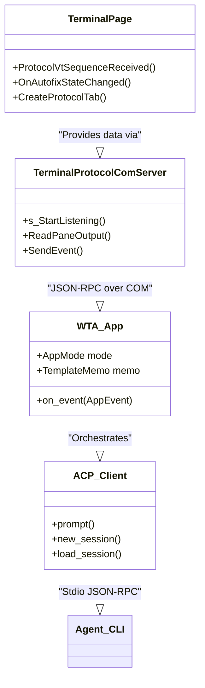
Sources: [src/cascadia/TerminalApp/TerminalPage.idl:110-128](), [src/cascadia/WindowsTerminal/TerminalProtocolComServer.h:51-90](), [tools/wta/src/app.rs:108-116](), [tools/wta/src/protocol/acp/client.rs:77-173]()

---

# Page: WTA: Windows Terminal Agent Binary

# WTA: Windows Terminal Agent Binary

<details>
<summary>Relevant source files</summary>

The following files were used as context for generating this wiki page:

- [NOTICE.md](NOTICE.md)
- [build/scripts/Generate-WtaThirdPartyNotices.ps1](build/scripts/Generate-WtaThirdPartyNotices.ps1)
- [doc/security-model.md](doc/security-model.md)
- [doc/specs/rtl-investigation.md](doc/specs/rtl-investigation.md)
- [src/cascadia/TerminalApp/AgentPaneContent.cpp](src/cascadia/TerminalApp/AgentPaneContent.cpp)
- [src/cascadia/TerminalApp/AgentPaneContent.idl](src/cascadia/TerminalApp/AgentPaneContent.idl)
- [src/cascadia/TerminalApp/AgentPaneLog.h](src/cascadia/TerminalApp/AgentPaneLog.h)
- [src/cascadia/inc/IntelligentTerminalPaths.h](src/cascadia/inc/IntelligentTerminalPaths.h)
- [src/cascadia/inc/RtlHelper.h](src/cascadia/inc/RtlHelper.h)
- [src/cascadia/ut_app/RtlHelperTests.cpp](src/cascadia/ut_app/RtlHelperTests.cpp)
- [tools/wta/AGENTS.md](tools/wta/AGENTS.md)
- [tools/wta/Cargo.toml](tools/wta/Cargo.toml)
- [tools/wta/README.md](tools/wta/README.md)
- [tools/wta/cgmanifest.json](tools/wta/cgmanifest.json)
- [tools/wta/locales/ar-SA.yml](tools/wta/locales/ar-SA.yml)
- [tools/wta/locales/as-IN.yml](tools/wta/locales/as-IN.yml)
- [tools/wta/locales/az-Latn-AZ.yml](tools/wta/locales/az-Latn-AZ.yml)
- [tools/wta/locales/bg-BG.yml](tools/wta/locales/bg-BG.yml)
- [tools/wta/locales/bs-Latn-BA.yml](tools/wta/locales/bs-Latn-BA.yml)
- [tools/wta/locales/cs-CZ.yml](tools/wta/locales/cs-CZ.yml)
- [tools/wta/locales/de-DE.yml](tools/wta/locales/de-DE.yml)
- [tools/wta/locales/en-US.yml](tools/wta/locales/en-US.yml)
- [tools/wta/locales/es-ES.yml](tools/wta/locales/es-ES.yml)
- [tools/wta/locales/es-MX.yml](tools/wta/locales/es-MX.yml)
- [tools/wta/locales/fa-IR.yml](tools/wta/locales/fa-IR.yml)
- [tools/wta/prompts/auto-fix.md](tools/wta/prompts/auto-fix.md)
- [tools/wta/prompts/terminal-agent.md](tools/wta/prompts/terminal-agent.md)
- [tools/wta/src/agent_check.rs](tools/wta/src/agent_check.rs)
- [tools/wta/src/agent_hooks_installer.rs](tools/wta/src/agent_hooks_installer.rs)
- [tools/wta/src/agent_pane_origin.rs](tools/wta/src/agent_pane_origin.rs)
- [tools/wta/src/agent_sessions.rs](tools/wta/src/agent_sessions.rs)
- [tools/wta/src/app.rs](tools/wta/src/app.rs)
- [tools/wta/src/app/turn_state.rs](tools/wta/src/app/turn_state.rs)
- [tools/wta/src/commands.rs](tools/wta/src/commands.rs)
- [tools/wta/src/coordinator.rs](tools/wta/src/coordinator.rs)
- [tools/wta/src/event.rs](tools/wta/src/event.rs)
- [tools/wta/src/history_loader.rs](tools/wta/src/history_loader.rs)
- [tools/wta/src/logging.rs](tools/wta/src/logging.rs)
- [tools/wta/src/main.rs](tools/wta/src/main.rs)
- [tools/wta/src/master/mod.rs](tools/wta/src/master/mod.rs)
- [tools/wta/src/protocol/acp/client.rs](tools/wta/src/protocol/acp/client.rs)
- [tools/wta/src/protocol/acp/probe.rs](tools/wta/src/protocol/acp/probe.rs)
- [tools/wta/src/protocol/acp/spawn.rs](tools/wta/src/protocol/acp/spawn.rs)
- [tools/wta/src/rtl.rs](tools/wta/src/rtl.rs)
- [tools/wta/src/runtime_paths.rs](tools/wta/src/runtime_paths.rs)
- [tools/wta/src/session_mgmt.rs](tools/wta/src/session_mgmt.rs)
- [tools/wta/src/session_registry.rs](tools/wta/src/session_registry.rs)
- [tools/wta/src/shell/wt_channel/cli_channel.rs](tools/wta/src/shell/wt_channel/cli_channel.rs)
- [tools/wta/src/shell/wt_channel/mod.rs](tools/wta/src/shell/wt_channel/mod.rs)
- [tools/wta/src/slash_command_tests.rs](tools/wta/src/slash_command_tests.rs)
- [tools/wta/src/theme.rs](tools/wta/src/theme.rs)
- [tools/wta/src/ui/agents_view.rs](tools/wta/src/ui/agents_view.rs)
- [tools/wta/src/ui/auth.rs](tools/wta/src/ui/auth.rs)
- [tools/wta/src/ui/card.rs](tools/wta/src/ui/card.rs)
- [tools/wta/src/ui/chat.rs](tools/wta/src/ui/chat.rs)
- [tools/wta/src/ui/input.rs](tools/wta/src/ui/input.rs)
- [tools/wta/src/ui/layout.rs](tools/wta/src/ui/layout.rs)
- [tools/wta/src/ui/mod.rs](tools/wta/src/ui/mod.rs)
- [tools/wta/src/ui/permission.rs](tools/wta/src/ui/permission.rs)
- [tools/wta/src/ui/recommendations.rs](tools/wta/src/ui/recommendations.rs)
- [tools/wta/src/ui/setup.rs](tools/wta/src/ui/setup.rs)
- [tools/wta/wt-agent-hooks/claude/.claude-plugin/marketplace.json](tools/wta/wt-agent-hooks/claude/.claude-plugin/marketplace.json)
- [tools/wta/wt-agent-hooks/claude/wt-agent-hooks/.claude-plugin/plugin.json](tools/wta/wt-agent-hooks/claude/wt-agent-hooks/.claude-plugin/plugin.json)
- [tools/wta/wt-agent-hooks/claude/wt-agent-hooks/hooks/send-event.ps1](tools/wta/wt-agent-hooks/claude/wt-agent-hooks/hooks/send-event.ps1)
- [tools/wta/wt-agent-hooks/codex/wt-agent-hooks/.codex-plugin/plugin.json](tools/wta/wt-agent-hooks/codex/wt-agent-hooks/.codex-plugin/plugin.json)
- [tools/wta/wt-agent-hooks/codex/wt-agent-hooks/hooks/send-event.ps1](tools/wta/wt-agent-hooks/codex/wt-agent-hooks/hooks/send-event.ps1)
- [tools/wta/wt-agent-hooks/copilot/.claude-plugin/marketplace.json](tools/wta/wt-agent-hooks/copilot/.claude-plugin/marketplace.json)
- [tools/wta/wt-agent-hooks/copilot/wt-agent-hooks/.claude-plugin/plugin.json](tools/wta/wt-agent-hooks/copilot/wt-agent-hooks/.claude-plugin/plugin.json)
- [tools/wta/wt-agent-hooks/copilot/wt-agent-hooks/hooks/send-event.ps1](tools/wta/wt-agent-hooks/copilot/wt-agent-hooks/hooks/send-event.ps1)
- [tools/wta/wt-agent-hooks/gemini-extension/gemini-extension.json](tools/wta/wt-agent-hooks/gemini-extension/gemini-extension.json)
- [tools/wta/wt-agent-hooks/gemini-extension/hooks/send-event.ps1](tools/wta/wt-agent-hooks/gemini-extension/hooks/send-event.ps1)

</details>


The **Windows Terminal Agent (WTA)** is a Rust-based binary (`wta.exe`) that serves as the primary orchestration layer between Windows Terminal and AI Agent CLIs. It implements the **Agent Client Protocol (ACP)** to communicate with agents (like Copilot, Claude, or Gemini) and provides a terminal-native user interface built on `ratatui`.

## Operating Modes

`wta` operates in three distinct modes depending on its launch arguments:

1.  **ACP Client (TUI Mode)**: The default mode used in the Agent Pane. It hosts the chat interface, handles user input, and manages the lifecycle of the Agent CLI [tools/wta/src/main.rs:120-190]().
2.  **WTA Master**: A singleton multiplexer that spawns a single Agent CLI subprocess and allows multiple "helper" panes to connect to it via named pipes [tools/wta/src/master/mod.rs:3-16]().
3.  **CLI Helpers**: Utility commands (e.g., `wta sessions list`, `wta hooks install`) that interact with the session registry or perform environment setup [tools/wta/src/main.rs:200-260]().

### Data Flow: Master/Helper Architecture

To support multiple terminal windows sharing a single AI agent instance, WTA uses a master/helper split.

| Component | Role | Communication |
| :--- | :--- | :--- |
| **WTA Master** | Owns the Agent CLI process; manages the authoritative `SessionId` registry. | Named Pipe (Server) |
| **WTA Helper** | Hosts the TUI for a specific pane; forwards user prompts to Master. | Named Pipe (Client) |
| **Agent CLI** | The actual LLM-backed process (e.g., `copilot.exe`). | Stdio (JSON-RPC) |

Sources: [tools/wta/src/master/mod.rs:18-35](), [tools/wta/src/protocol/acp/client.rs:124-149]()

## Core Components

### 1. Session Registry and History Loader
WTA maintains a runtime registry of both live and historical sessions. 
*   **`AgentSessionRegistry`**: Tracks active sessions by `pane_session_id` (the WT pane GUID) and `AgentKey` (the CLI's internal ID) [tools/wta/src/agent_sessions.rs:10-27]().
*   **`history_loader`**: Scans on-disk metadata for various CLIs (e.g., `~/.claude/projects/`, `~/.copilot/session-state/`) to reconstruct past conversations for the "Agent Sessions" view [tools/wta/src/history_loader.rs:1-59]().

### 2. The Ratatui UI
The interface is rendered using the `ratatui` crate. The layout is dynamically calculated based on the pane's dimensions and current state (Chat, Auth, or Setup) [tools/wta/src/ui/layout.rs:9-40]().

*   **Chat View**: Renders the message history and streaming chunks from the agent [tools/wta/src/ui/layout.rs:135-155]().
*   **Agents View**: A session management list (triggered by `Ctrl+Shift+/`) that allows users to resume historical sessions [tools/wta/src/ui/layout.rs:48-82]().
*   **Setup View**: Handles first-run experiences, including `winget` installation of missing agents [tools/wta/src/app.rs:158-200]().

### 3. Agent Hooks Bridge
To detect activity in standard shell panes (where WTA is not the parent), WTA installs PowerShell-based hooks into agent CLIs. These hooks (`send-event.ps1`) invoke `wtcli.exe` to broadcast events to the Terminal's COM server, which WTA then observes to update the session registry [tools/wta/src/agent_hooks_installer.rs:9-14](), [tools/wta/wt-agent-hooks/copilot/wt-agent-hooks/hooks/send-event.ps1:1-33]().

## Implementation Diagrams

### Agent Communication Stack
This diagram shows how code entities bridge the gap between the user's Natural Language prompt and the execution of commands.

```mermaid
graph TD
    subgraph "Natural Language Space"
        UserPrompt["User Prompt (String)"]
    end

    subgraph "WTA Binary (Code Entity Space)"
        App["App (app.rs)"]
        AcpClient["AcpClient (protocol/acp/client.rs)"]
        TurnState["TurnState (app/turn_state.rs)"]
        ShellMgr["ShellManager (shell/mod.rs)"]
    end

    subgraph "External Agent"
        AgentCLI["Agent CLI (e.g. Copilot/Claude)"]
    end

    UserPrompt -->|KeyCode::Enter| App
    App -->|PromptSubmission| AcpClient
    AcpClient -->|JSON-RPC 'session/prompt'| AgentCLI
    AgentCLI -->|'session/updated' (Chunks)| AcpClient
    AcpClient -->|AppEvent::Chunk| TurnState
    AgentCLI -->|'terminal/write'| ShellMgr
    ShellMgr -->|IProtocolServer::SendInput| WT["Windows Terminal"]
```
Sources: [tools/wta/src/app.rs:12-28](), [tools/wta/src/protocol/acp/client.rs:77-87](), [tools/wta/src/master/mod.rs:18-35]()

### Session Management & History Discovery
This diagram illustrates how WTA discovers historical data from the filesystem and maps it to UI components.

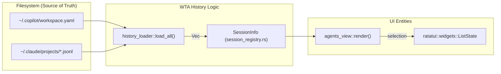
Sources: [tools/wta/src/history_loader.rs:7-52](), [tools/wta/src/agent_sessions.rs:136-150](), [tools/wta/src/ui/agents_view.rs:27-52]()

## Key Functions

| Function | File | Description |
| :--- | :--- | :--- |
| `main()` | [tools/wta/src/main.rs:120]() | Entry point; parses CLI arguments and determines operating mode. |
| `render()` | [tools/wta/src/ui/layout.rs:9]() | The main UI loop that composes the chat, input, and agent views. |
| `load_all()` | [tools/wta/src/history_loader.rs:82]() | Scans the user's home directory for agent-specific session logs. |
| `should_ship()` | [tools/wta/src/protocol/acp/client.rs:65]() | Determines if a prompt template needs to be re-sent to the agent (memoization). |
| `ensure_installed()` | [tools/wta/src/agent_hooks_installer.rs:92]() | Orchestrates the installation of the `wt-agent-hooks` into third-party CLIs. |

Sources: [tools/wta/src/main.rs](), [tools/wta/src/ui/layout.rs](), [tools/wta/src/history_loader.rs](), [tools/wta/src/protocol/acp/client.rs](), [tools/wta/src/agent_hooks_installer.rs]()

---

# Page: Terminal Protocol COM Server and wtcli

# Terminal Protocol COM Server and wtcli

<details>
<summary>Relevant source files</summary>

The following files were used as context for generating this wiki page:

- [OpenConsole.slnx](OpenConsole.slnx)
- [build/pipelines/fuzz.yml](build/pipelines/fuzz.yml)
- [src/cascadia/TerminalApp/TerminalPage.Protocol.cpp](src/cascadia/TerminalApp/TerminalPage.Protocol.cpp)
- [src/cascadia/TerminalApp/TerminalPage.idl](src/cascadia/TerminalApp/TerminalPage.idl)
- [src/cascadia/TerminalProtocol/ProtocolParsing.h](src/cascadia/TerminalProtocol/ProtocolParsing.h)
- [src/cascadia/TerminalProtocol/TerminalProtocol.idl](src/cascadia/TerminalProtocol/TerminalProtocol.idl)
- [src/cascadia/TerminalProtocol/TerminalProtocol.vcxproj](src/cascadia/TerminalProtocol/TerminalProtocol.vcxproj)
- [src/cascadia/TerminalProtocol/ft_fuzzer/ProtocolFuzzer.vcxproj](src/cascadia/TerminalProtocol/ft_fuzzer/ProtocolFuzzer.vcxproj)
- [src/cascadia/TerminalProtocol/ft_fuzzer/fuzzmain.cpp](src/cascadia/TerminalProtocol/ft_fuzzer/fuzzmain.cpp)
- [src/cascadia/TerminalProtocol/ft_fuzzer/precomp.cpp](src/cascadia/TerminalProtocol/ft_fuzzer/precomp.cpp)
- [src/cascadia/TerminalProtocol/ft_fuzzer/precomp.h](src/cascadia/TerminalProtocol/ft_fuzzer/precomp.h)
- [src/cascadia/WindowsTerminal/TerminalProtocolComServer.cpp](src/cascadia/WindowsTerminal/TerminalProtocolComServer.cpp)
- [src/cascadia/WindowsTerminal/TerminalProtocolComServer.h](src/cascadia/WindowsTerminal/TerminalProtocolComServer.h)
- [src/tools/wtcli/Formatting.cpp](src/tools/wtcli/Formatting.cpp)
- [src/tools/wtcli/Formatting.h](src/tools/wtcli/Formatting.h)
- [src/tools/wtcli/ft_fuzzer/fuzzmain.cpp](src/tools/wtcli/ft_fuzzer/fuzzmain.cpp)
- [src/tools/wtcli/main.cpp](src/tools/wtcli/main.cpp)
- [src/tools/wtcli/wtcli.vcxproj](src/tools/wtcli/wtcli.vcxproj)
- [src/tools/wtcli/wtcli_functions.h](src/tools/wtcli/wtcli_functions.h)

</details>


The Terminal Protocol provides a cross-process interface for querying and mutating the state of Windows Terminal. It is primarily used by `wtcli.exe` and the AI agent infrastructure to inspect window/tab hierarchies, read pane content, and inject input.

## Architecture Overview

The system consists of a COM server hosted within `WindowsTerminal.exe` and clients (like `wtcli.exe` or `wta.exe`) that consume the `IProtocolServer` interface.

### Key Components

*   **`IProtocolServer`**: The primary WinRT/COM interface defining the protocol's capabilities [src/cascadia/TerminalProtocol/TerminalProtocol.idl:97-127]().
*   **`TerminalProtocolComServer`**: The C++ implementation of the server inside the terminal process [src/cascadia/WindowsTerminal/TerminalProtocolComServer.cpp:52-53]().
*   **`wtcli.exe`**: A command-line utility that acts as a reference client for the protocol [src/tools/wtcli/main.cpp:124-125]().
*   **Metadata Based Marshaling (MBM)**: Used to handle cross-process communication without requiring a custom proxy/stub DLL [src/cascadia/WindowsTerminal/TerminalProtocolComServer.h:24-26]().

### Entity Relationship Diagram

The following diagram illustrates how the COM server bridges the gap between external CLI tools and the internal Terminal UI hierarchy.

Title: Terminal Protocol Entity Mapping
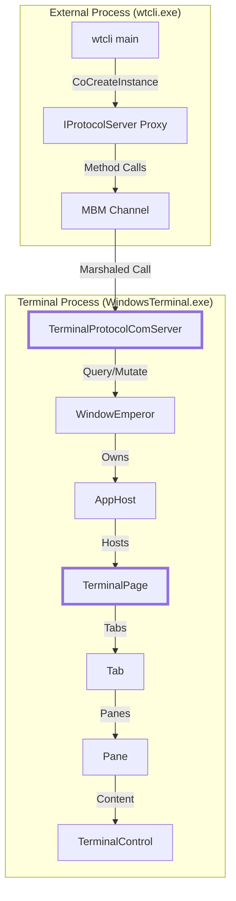
Sources: [src/cascadia/WindowsTerminal/TerminalProtocolComServer.cpp:23-37](), [src/cascadia/TerminalApp/TerminalPage.Protocol.cpp:9-12](), [src/tools/wtcli/main.cpp:58-59]()

---

## The COM Server Implementation

### Threading Model
The COM server uses a dedicated **MTA (Multithreaded Apartment)** thread to listen for incoming requests [src/cascadia/WindowsTerminal/TerminalProtocolComServer.cpp:44-46](). This prevents external COM calls from blocking the main UI thread during initial dispatch.

However, since most terminal operations (querying tabs, splitting panes) must interact with XAML elements, the server methods are implemented as coroutines that marshal to the **UI Thread** using `wil::resume_foreground(Dispatcher())` [src/cascadia/TerminalApp/TerminalPage.Protocol.cpp:9-12]().

### Identifier Hierarchy
The protocol uses a specific hierarchy to identify UI elements:
1.  **WindowId**: A `uint64_t` identifying the top-level window [src/cascadia/TerminalProtocol/TerminalProtocol.idl:10]().
2.  **TabId**: A `uint32_t` identifying a tab within a specific window [src/cascadia/TerminalProtocol/TerminalProtocol.idl:18]().
3.  **SessionId**: A `GUID` uniquely identifying a specific terminal connection (pane) across all windows [src/cascadia/TerminalProtocol/TerminalProtocol.idl:27]().

### Event Fan-out
The server supports a push-based event model via `IProtocolEventCallback` [src/cascadia/TerminalProtocol/TerminalProtocol.idl:89-92]().
*   **Subscription**: Clients call `Subscribe()` to register their callback [src/cascadia/WindowsTerminal/TerminalProtocolComServer.cpp:227-233]().
*   **VT Sequence Forwarding**: `TerminalPage` emits `ProtocolVtSequenceReceived` when special VT sequences (like agent attachments) are detected [src/cascadia/TerminalApp/TerminalPage.idl:124]().
*   **Notification**: The server maintains a static list of active COM instances and broadcasts events to all subscribed clients [src/cascadia/WindowsTerminal/TerminalProtocolComServer.cpp:217-225]().

Title: Event Dispatch Flow
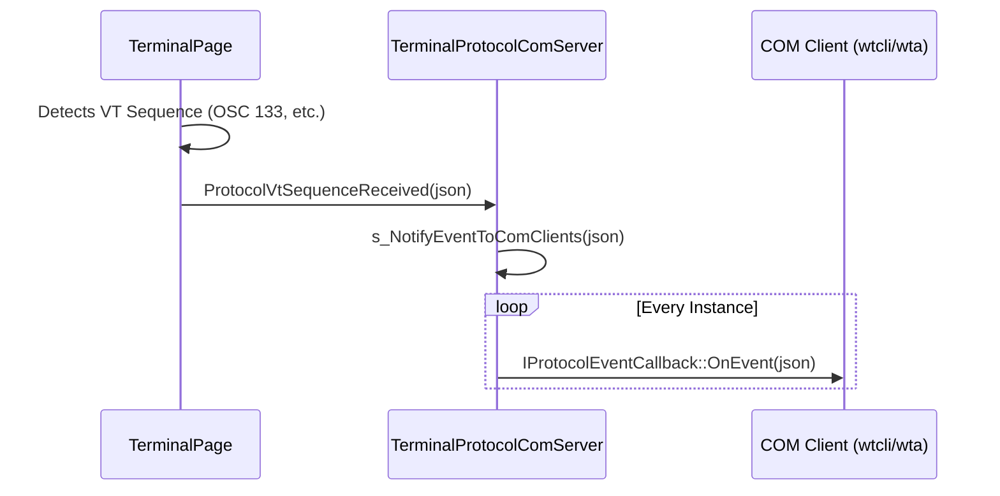
Sources: [src/cascadia/WindowsTerminal/TerminalProtocolComServer.cpp:200-205](), [src/cascadia/WindowsTerminal/TerminalProtocolComServer.cpp:217-225]()

---

## wtcli: The Protocol Client

`wtcli.exe` provides a command-line interface to all `IProtocolServer` methods.

### Connection Logic
`wtcli` locates the terminal instance using the `WT_COM_CLSID` environment variable, which is set by Windows Terminal in every pane's environment [src/tools/wtcli/main.cpp:42-47](). It then performs a simple handshake via `Authenticate()` [src/tools/wtcli/main.cpp:59]().

### Key Commands
| Command | Implementation | Description |
| :--- | :--- | :--- |
| `list-panes` | `ListPanes` | Lists all panes in a tab, including PID and dimensions [src/tools/wtcli/main.cpp:204-220](). |
| `read-output` | `ReadPaneOutput` | Captures text from the scrollback or screen [src/tools/wtcli/main.cpp:323-335](). |
| `send-keys` | `SendInput` | Injects text or control characters into a pane [src/tools/wtcli/main.cpp:448-460](). |
| `listen` | `Subscribe` | Blocks and prints events as they occur in the terminal [src/tools/wtcli/main.cpp:511-525](). |

### Key Translation
`wtcli` includes a `TranslateKeys` helper that maps tmux-style strings (e.g., `"C-c"`, `"Enter"`, `"Tab"`) to their respective ASCII/UTF-16 byte sequences before calling `SendInput` [src/tools/wtcli/wtcli_functions.h:58-95]().

---

## Data Flow: ReadPaneOutput

The `ReadPaneOutput` method is a critical path for AI agents to "see" the terminal.

Title: ReadPaneOutput Data Pipeline
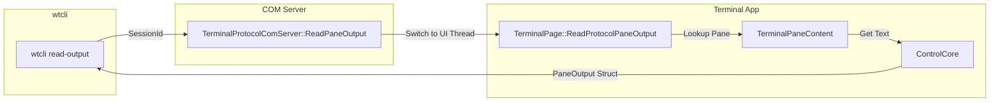
Sources: [src/cascadia/TerminalProtocol/TerminalProtocol.idl:108](), [src/cascadia/TerminalApp/TerminalPage.Protocol.cpp:212-225](), [src/cascadia/WindowsTerminal/TerminalProtocolComServer.cpp:115-119]()

### Source Routing
The protocol supports different sources for reading output, parsed via `ClassifyPaneOutputSource` [src/cascadia/TerminalProtocol/ProtocolParsing.h:186-198]():
*   **`scrollback`**: Reads from the circular buffer.
*   **`screen`**: Reads only the currently visible viewport.
*   **`last_prompt`**: Uses OSC 133 shell integration marks to slice exactly the last command's output [src/cascadia/TerminalProtocol/TerminalProtocol.idl:49-53]().

---

## Security and Authentication

Currently, the `Authenticate` method provides a basic placeholder for security. The client must pass a token (currently unused) to set the `_authenticated` state on the COM instance [src/cascadia/WindowsTerminal/TerminalProtocolComServer.cpp:78-83](). All other methods check this flag before proceeding.

The `WT_COM_CLSID` is used as a rudimentary form of isolation, ensuring that a client connects to the specific terminal instance that spawned it [src/tools/wtcli/main.cpp:42-47]().

Sources: [src/cascadia/WindowsTerminal/TerminalProtocolComServer.cpp:78-83](), [src/tools/wtcli/main.cpp:42-47]()

---

# Page: Agent Pane, FRE Onboarding, and AI Settings

# Agent Pane, FRE Onboarding, and AI Settings

<details>
<summary>Relevant source files</summary>

The following files were used as context for generating this wiki page:

- [NOTICE.md](NOTICE.md)
- [build/scripts/Generate-WtaThirdPartyNotices.ps1](build/scripts/Generate-WtaThirdPartyNotices.ps1)
- [src/cascadia/TerminalApp/AgentPaneContent.cpp](src/cascadia/TerminalApp/AgentPaneContent.cpp)
- [src/cascadia/TerminalApp/AgentPaneContent.idl](src/cascadia/TerminalApp/AgentPaneContent.idl)
- [src/cascadia/TerminalApp/FreOverlay.cpp](src/cascadia/TerminalApp/FreOverlay.cpp)
- [src/cascadia/TerminalApp/FreOverlay.h](src/cascadia/TerminalApp/FreOverlay.h)
- [src/cascadia/TerminalApp/FreOverlay.idl](src/cascadia/TerminalApp/FreOverlay.idl)
- [src/cascadia/TerminalApp/FreOverlay.xaml](src/cascadia/TerminalApp/FreOverlay.xaml)
- [src/cascadia/TerminalApp/SharedWta.cpp](src/cascadia/TerminalApp/SharedWta.cpp)
- [src/cascadia/TerminalApp/SharedWta.h](src/cascadia/TerminalApp/SharedWta.h)
- [src/cascadia/TerminalSettingsEditor/AIAgents.cpp](src/cascadia/TerminalSettingsEditor/AIAgents.cpp)
- [src/cascadia/TerminalSettingsEditor/AIAgents.h](src/cascadia/TerminalSettingsEditor/AIAgents.h)
- [src/cascadia/TerminalSettingsEditor/AIAgents.idl](src/cascadia/TerminalSettingsEditor/AIAgents.idl)
- [src/cascadia/TerminalSettingsEditor/AIAgents.xaml](src/cascadia/TerminalSettingsEditor/AIAgents.xaml)
- [src/cascadia/TerminalSettingsEditor/AIAgentsViewModel.cpp](src/cascadia/TerminalSettingsEditor/AIAgentsViewModel.cpp)
- [src/cascadia/TerminalSettingsEditor/AIAgentsViewModel.h](src/cascadia/TerminalSettingsEditor/AIAgentsViewModel.h)
- [src/cascadia/TerminalSettingsEditor/AIAgentsViewModel.idl](src/cascadia/TerminalSettingsEditor/AIAgentsViewModel.idl)
- [src/cascadia/inc/WtaProcess.h](src/cascadia/inc/WtaProcess.h)
- [tools/wta/AGENTS.md](tools/wta/AGENTS.md)
- [tools/wta/Cargo.toml](tools/wta/Cargo.toml)
- [tools/wta/cgmanifest.json](tools/wta/cgmanifest.json)
- [tools/wta/src/agent_pane_origin.rs](tools/wta/src/agent_pane_origin.rs)
- [tools/wta/src/agent_sessions.rs](tools/wta/src/agent_sessions.rs)
- [tools/wta/src/app.rs](tools/wta/src/app.rs)
- [tools/wta/src/history_loader.rs](tools/wta/src/history_loader.rs)
- [tools/wta/src/main.rs](tools/wta/src/main.rs)
- [tools/wta/src/master/mod.rs](tools/wta/src/master/mod.rs)
- [tools/wta/src/protocol/acp/client.rs](tools/wta/src/protocol/acp/client.rs)
- [tools/wta/src/runtime_paths.rs](tools/wta/src/runtime_paths.rs)
- [tools/wta/src/session_mgmt.rs](tools/wta/src/session_mgmt.rs)
- [tools/wta/src/session_registry.rs](tools/wta/src/session_registry.rs)
- [tools/wta/src/shell/wt_channel/cli_channel.rs](tools/wta/src/shell/wt_channel/cli_channel.rs)
- [tools/wta/src/shell/wt_channel/mod.rs](tools/wta/src/shell/wt_channel/mod.rs)
- [tools/wta/src/ui/agents_view.rs](tools/wta/src/ui/agents_view.rs)
- [tools/wta/src/ui/layout.rs](tools/wta/src/ui/layout.rs)

</details>


This section details the user-facing AI integration components within Intelligent Terminal. It covers the Agent Pane UI, the First Run Experience (FRE) wizard, the settings infrastructure for AI agents, and the background process management that ensures a seamless connection between the terminal and the Rust-based `wta` binary.

## Agent Pane UI and Lifecycle

The **Agent Pane** is the primary interface for interacting with AI agents. It is implemented as the `AgentPaneContent` XAML control, which hosts a specialized terminal instance running the `wta` helper process.

### Implementation: AgentPaneContent
The `AgentPaneContent` class manages the lifecycle of the agent-specific UI. When a user opens the agent pane (e.g., via `Ctrl+Shift+I`), the terminal creates an `AgentPaneContent` instance that initiates a connection to the AI backend.

- **Initialization**: It determines the appropriate agent command and model from the global settings.
- **View Switching**: It handles transitions between the chat view and the session management view (`/sessions`).
- **Log Integration**: Uses `AgentPaneLog.h` for diagnostic tracing of pane-specific events.

### SharedWta Process Management
To optimize resource usage and maintain session state across multiple windows, Intelligent Terminal uses a singleton process management strategy via `SharedWta`.

- **Role**: Manages the lifetime of the `wta` process.
- **Master/Helper Architecture**: `wta` can run in "master" mode (singleton multiplexer) or "helper" mode (per-pane UI). `SharedWta` ensures that a master process is available to coordinate between different terminal windows [tools/wta/src/master/mod.rs:1-17]().
- **Named Pipes**: Communication between the C++ terminal host and the Rust `wta` process occurs over Windows Named Pipes [tools/wta/src/master/mod.rs:11-12]().

**Sources**: [src/cascadia/TerminalApp/AgentPaneContent.cpp:1-50](), [src/cascadia/TerminalApp/SharedWta.cpp:1-40](), [tools/wta/src/master/mod.rs:1-35]().

---

## First Run Experience (FRE) Onboarding

The `FreOverlay` provides a guided setup wizard for new users. It is a two-step XAML-based overlay that replaces the terminal content until the user has configured their preferred AI agent.

### The Onboarding Wizard
The wizard is defined in `FreOverlay.xaml` and consists of:
1.  **Welcome Page**: Highlights features like Error Detection and Session Management [src/cascadia/TerminalApp/FreOverlay.xaml:59-136]().
2.  **Settings Page**: Allows users to select an agent and triggers dependency installation if necessary [src/cascadia/TerminalApp/FreOverlay.xaml:164-210]().

### Dependency Detection and Installation
`FreOverlay` performs real-time checks to see if required binaries are present on the system:
- **Agent Probing**: Uses `SearchPathW` to look for agent executables (e.g., `copilot.exe`, `claude.cmd`) on the system `PATH` [src/cascadia/TerminalApp/FreOverlay.cpp:37-53]().
- **Environment Checks**: Verifies if `node`/`npx` and `winget` are installed [src/cascadia/TerminalApp/FreOverlay.cpp:55-74]().
- **WinGet Integration**: If an agent is selected but not found, the UI offers to install it via `winget`. The `wta` process itself handles the execution of `winget install` and streams the log back to the UI [tools/wta/src/app.rs:188-200]().

### Diagram: FRE Detection and Installation Flow

Title: "FRE Onboarding Logic"
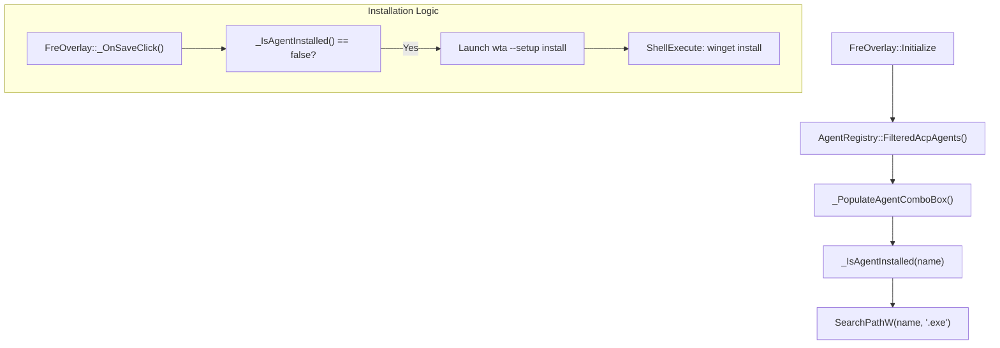
**Sources**: [src/cascadia/TerminalApp/FreOverlay.cpp:37-147](), [src/cascadia/TerminalApp/FreOverlay.xaml:13-210](), [tools/wta/src/app.rs:159-200]().

---

## AI Settings and AIAgentsViewModel

The `AIAgents` page in the Settings UI provides centralized configuration for AI integrations. It is backed by the `AIAgentsViewModel`, which bridges the `CascadiaSettings` model with the XAML view.

### Configuration Capabilities
- **ACP Agent Selection**: Choose the primary agent for the Agent Pane (e.g., GitHub Copilot, Anthropic Claude).
- **Model Overrides**: Select specific LLM models (e.g., `gpt-4o`, `claude-3-5-sonnet`) advertised by the agent via the Agent Client Protocol (ACP) [tools/wta/src/protocol/acp/client.rs:145-148]().
- **Custom Agents**: Users can define custom agent commands. The system derives a unique ID for these using `DeriveCustomAgentId` [src/cascadia/TerminalSettingsEditor/AIAgentsViewModel.cpp:69-73]().

### GPO Policy Enforcement
The settings page respects Group Policy Object (GPO) restrictions:
- **Policy Locking**: If an administrator has locked AI settings, the UI displays a "Managed by your organization" indicator and disables changes [src/cascadia/TerminalSettingsEditor/AIAgents.xaml:111-114]().
- **Filtered Agents**: The `AgentRegistry::FilteredAcpAgents()` function returns only those agents permitted by active policy [src/cascadia/TerminalSettingsEditor/AIAgentsViewModel.cpp:128-130]().

### Data Flow: Settings to Runtime
The following diagram illustrates how a settings change propagates from the UI to the running `wta` process.

Title: "AI Settings Propagation"
```mermaid
graph LR
    UI["AIAgents.xaml (ComboBox)"] -- "TwoWay Bind" --> VM["AIAgentsViewModel::CurrentAcpAgent"]
    VM -- "Update" --> Global["GlobalAppSettings::AcpAgent()"]
    Global -- "Notify" --> AppLogic["AppLogic::_ApplyLanguageSettingChange"]
    AppLogic -- "Restart/Signal" --> SharedWta["SharedWta::Restart()"]
    SharedWta -- "CLI Arg" --> WtaMain["wta.exe --agent <id>"]
```
**Sources**: [src/cascadia/TerminalSettingsEditor/AIAgents.xaml:106-114](), [src/cascadia/TerminalSettingsEditor/AIAgentsViewModel.cpp:108-147](), [tools/wta/src/protocol/acp/client.rs:124-149]().

---

## Session Management and History

Intelligent Terminal tracks both live and historical AI sessions. This allows users to resume conversations even after the terminal has been closed.

### History Loading
The `history_loader` module in `wta` scans well-known on-disk locations for various CLI agents to reconstruct the session list [tools/wta/src/history_loader.rs:7-57]().

| Agent | Location | Metadata Source |
| :--- | :--- | :--- |
| **Copilot** | `~/.copilot/session-state/` | `workspace.yaml` |
| **Claude** | `~/.claude/projects/` | `.jsonl` filename/content |
| **Gemini** | `~/.gemini/tmp/` | `projects.json` + `.jsonl` |
| **Codex** | `~/.codex/sessions/` | `session_meta` in `.jsonl` |

### Session Origin Tracking
Sessions are tagged with a `SessionOrigin` to distinguish between those started manually in a shell and those created via the Intelligent Terminal Agent Pane (`AgentPane`) [tools/wta/src/agent_sessions.rs:137-145](). This allows the UI to filter or badge sessions appropriately in the `/sessions` view [tools/wta/src/ui/agents_view.rs:122-129]().

**Sources**: [tools/wta/src/history_loader.rs:1-81](), [tools/wta/src/agent_sessions.rs:71-124](), [tools/wta/src/ui/agents_view.rs:109-138]().

---

# Page: Shell Integration and Auto-Fix

# Shell Integration and Auto-Fix

<details>
<summary>Relevant source files</summary>

The following files were used as context for generating this wiki page:

- [.github/actions/spelling/allow/allow.txt](.github/actions/spelling/allow/allow.txt)
- [.github/actions/spelling/allow/apis.txt](.github/actions/spelling/allow/apis.txt)
- [.github/actions/spelling/allow/microsoft.txt](.github/actions/spelling/allow/microsoft.txt)
- [.github/actions/spelling/allow/names.txt](.github/actions/spelling/allow/names.txt)
- [.github/actions/spelling/expect/expect.txt](.github/actions/spelling/expect/expect.txt)
- [README.md](README.md)
- [doc/faq.md](doc/faq.md)
- [doc/roadmap-2022.md](doc/roadmap-2022.md)
- [doc/roadmap-2023.md](doc/roadmap-2023.md)
- [doc/security-model.md](doc/security-model.md)
- [doc/specs/#1571 - New Tab Menu Customization/#1571 - New Tab Menu Customization.md](doc/specs/#1571 - New Tab Menu Customization/#1571 - New Tab Menu Customization.md)
- [doc/specs/#1571 - New Tab Menu Customization/Menu-Customization-000.png](doc/specs/#1571 - New Tab Menu Customization/Menu-Customization-000.png)
- [doc/specs/#1595 - Suggestions UI/Suggestions-UI.md](doc/specs/#1595 - Suggestions UI/Suggestions-UI.md)
- [doc/specs/#2046 - Command Palette.md](doc/specs/#2046 - Command Palette.md)
- [doc/specs/#2046 - Unified keybindings and commands, and synthesized action names.md](doc/specs/#2046 - Unified keybindings and commands, and synthesized action names.md)
- [doc/specs/#4066 - Theme-controlled color scheme switch.md](doc/specs/#4066 - Theme-controlled color scheme switch.md)
- [doc/specs/#653 - Quake Mode/#653 - Quake Mode.md](doc/specs/#653 - Quake Mode/#653 - Quake Mode.md)
- [doc/specs/#6899 - Action IDs/#6899 - Action IDs.md](doc/specs/#6899 - Action IDs/#6899 - Action IDs.md)
- [doc/specs/#6899 - Action IDs/data-mockup-actions-ids-keys-maps.png](doc/specs/#6899 - Action IDs/data-mockup-actions-ids-keys-maps.png)
- [doc/terminal-a11y-2023.md](doc/terminal-a11y-2023.md)
- [doc/terminal-v2-roadmap.md](doc/terminal-v2-roadmap.md)
- [images/intelligent-terminal-agent-focus.png](images/intelligent-terminal-agent-focus.png)
- [src/cascadia/ShellExtension/WindowsTerminalShellExt.vcxproj](src/cascadia/ShellExtension/WindowsTerminalShellExt.vcxproj)
- [src/cascadia/TerminalApp/AgentPaneLog.h](src/cascadia/TerminalApp/AgentPaneLog.h)
- [src/cascadia/TerminalControl/dll/TerminalControl.vcxproj](src/cascadia/TerminalControl/dll/TerminalControl.vcxproj)
- [src/cascadia/UnitTests_TerminalCore/ShellIntegrationTests.cpp](src/cascadia/UnitTests_TerminalCore/ShellIntegrationTests.cpp)
- [src/cascadia/UnitTests_TerminalCore/UnitTests.vcxproj](src/cascadia/UnitTests_TerminalCore/UnitTests.vcxproj)
- [src/cascadia/inc/IntelligentTerminalPaths.h](src/cascadia/inc/IntelligentTerminalPaths.h)
- [src/cascadia/inc/ShellIntegration.h](src/cascadia/inc/ShellIntegration.h)
- [src/host/dbcs.h](src/host/dbcs.h)
- [src/host/exe/Host.EXE.vcxproj](src/host/exe/Host.EXE.vcxproj)
- [src/host/exe/openconsole.exe.manifest](src/host/exe/openconsole.exe.manifest)
- [src/host/ut_host/Host.UnitTests.vcxproj](src/host/ut_host/Host.UnitTests.vcxproj)
- [src/host/ut_host/Host.UnitTests.vcxproj.filters](src/host/ut_host/Host.UnitTests.vcxproj.filters)
- [src/host/ut_host/sources](src/host/ut_host/sources)
- [src/interactivity/win32/ut_interactivity_win32/Interactivity.Win32.UnitTests.vcxproj](src/interactivity/win32/ut_interactivity_win32/Interactivity.Win32.UnitTests.vcxproj)
- [tools/wta/README.md](tools/wta/README.md)
- [tools/wta/src/agent_check.rs](tools/wta/src/agent_check.rs)
- [tools/wta/src/coordinator.rs](tools/wta/src/coordinator.rs)
- [tools/wta/src/logging.rs](tools/wta/src/logging.rs)
- [tools/wta/src/protocol/acp/spawn.rs](tools/wta/src/protocol/acp/spawn.rs)

</details>


Intelligent Terminal leverages **OSC 133** shell integration marks to bridge the gap between the raw text buffer and semantic command execution. By instrumenting the shell prompt, the terminal can identify command boundaries, detect non-zero exit codes, and proactively trigger the **Auto-Fix** workflow via the agent status bar.

## OSC 133 Shell Integration Marks

The terminal recognizes a subset of the Final Term Shell Integration (FTCS) protocol. These sequences allow the shell to notify the terminal of its internal state transitions.

### Supported Sequences
The integration script, typically installed into the shell profile, wraps the user's prompt to emit the following sequences:

| Sequence | Meaning | Usage in Intelligent Terminal |
|:---|:---|:---|
| `OSC 133 ; A ST` | Prompt Started | Marks the beginning of the shell prompt. |
| `OSC 133 ; B ST` | Command Start | Marks the end of the prompt and the start of user input. |
| `OSC 133 ; D ; <exit_code> ST` | Command Finished | Reports the completion of a command and its exit status. |
| `OSC 9 ; 9 ; "<cwd>" ST` | Working Directory | Synchronizes the terminal's knowledge of the current directory. |

The `OSC 133 ; D` sequence is the primary trigger for the Auto-Fix system. When an exit code other than `0` is received, the terminal flags the preceding command block as a candidate for AI-assisted repair `[src/cascadia/inc/ShellIntegration.h:11-14]()`.

### Implementation Data Flow
The following diagram illustrates how OSC sequences move from the shell process into the terminal core to trigger the Auto-Fix indicator.

**Figure 1: Shell Integration Data Flow**
```mermaid
sequenceDiagram
    participant S as Shell (pwsh/cmd)
    participant P as VT Parser (OutputStateMachineEngine)
    participant T as Terminal Core (Terminal)
    participant UI as TerminalPage (UI Layer)

    S->>P: Write OSC 133;D;1 (Exit Code 1)
    P->>T: Dispatch CommandFinished(exitCode=1)
    T->>T: Mark Command Range in TextBuffer
    T-->>UI: Raise AutoFixIndicatorRequested
    UI->>UI: Light up Auto-Fix Icon in Status Bar
```
**Sources:** `[src/cascadia/inc/ShellIntegration.h:10-15]()`, `[src/cascadia/UnitTests_TerminalCore/UnitTests.vcxproj:28-28]()`.

## PowerShell Profile Installation

Shell integration is primarily delivered via PowerShell scripts. The terminal provides a mechanism to automatically inject these hooks into the user's PowerShell profiles (`Microsoft.PowerShell_profile.ps1` for PowerShell 7 and `Microsoft.PowerShell_profile.ps1` for Windows PowerShell 5.1).

### Execution Policy Gating
Before installation, the terminal performs a diagnostic probe to ensure the integration will not be blocked by the system's execution policy.

1.  **Policy Query**: The terminal runs `<exe> -NoProfile -NonInteractive -Command Get-ExecutionPolicy` `[src/cascadia/inc/ShellIntegration.h:48-52]()`.
2.  **Validation**: It checks if the policy is `Restricted` or `AllSigned`. If the script is unsigned and the policy is restrictive, the installation is flagged as blocked `[src/cascadia/inc/ShellIntegration.h:160-164]()`.
3.  **Timeout**: The probe is bounded by a 5-second wall-clock timeout to prevent hung processes from blocking the UI `[src/cascadia/inc/ShellIntegration.h:125-131]()`.

### Installation Logic
The `Microsoft::Terminal::ShellIntegration` namespace contains the logic for writing these scripts. The installation is idempotent; if the marks are already detected in the profile, the step is skipped `[src/cascadia/inc/ShellIntegration.h:38-44]()`.

**Sources:** `[src/cascadia/inc/ShellIntegration.h:6-15]()`, `[src/cascadia/inc/ShellIntegration.h:59-170]()`.

## Auto-Fix Detection and Triggering

The **Auto-Fix** feature is a reactive AI assistant that appears when a command fails.

### Detection Mechanism
1.  **Terminal Core**: The `Terminal` class tracks the "Current Command" state. When `OSC 133 ; B` is received, it records the current cursor position as the start of the command input `[src/cascadia/inc/ShellIntegration.h:13-13]()`.
2.  **Exit Code Processing**: Upon receiving `OSC 133 ; D ; <exit_code>`, the terminal evaluates the code. Any non-zero value triggers the "Error Detected" state `[src/cascadia/inc/ShellIntegration.h:11-11]()`.
3.  **Context Capture**: The terminal captures the text between the last `OSC 133 ; B` and the current `OSC 133 ; D`. This captured text, along with the exit code, forms the context sent to the agent `[doc/security-model.md:38-38]()`.

### Status Bar Integration
The `TerminalPage` hosts the agent status bar. When an error is detected, the `AutoFixIndicator` lights up (hotkey: `Ctrl+Alt+.`). Clicking this icon opens the Agent Pane and automatically submits the error context for analysis `[README.md:133-133]()`.

**Sources:** `[README.md:104-104]()`, `[README.md:119-120]()`, `[doc/security-model.md:38-38]()`.

## Security Model and Command Execution

Executing agent-suggested commands presents a significant security boundary. The terminal implements a tiered trust model to mitigate risks like prompt injection.

### Agent-Suggested Commands
When an agent suggests a fix, it can use the `SendInput` COM method to inject keystrokes into the shell.

*   **COM Control Plane**: `SendInput(sessionId, text)` is exposed via the `IProtocolServer` interface `[doc/security-model.md:10-10]()`.
*   **Gating**: Any process that can activate the terminal's COM server (knowing the per-launch `WT_COM_CLSID`) can call this method. There is no longer a separate capability boundary for shell input as of the 2026-05-21 architectural revert `[doc/security-model.md:10-11]()`.
*   **Confirmation**: While settings like `autoFixEnabled` exist, the system defaults to requiring user interaction (clicking the Auto-Fix icon) before the agent's analysis begins `[doc/security-model.md:38-38]()`.

### Security Boundary Diagram
This diagram maps the security components to the code entities responsible for managing command execution.

**Figure 2: Security and Execution Boundary**
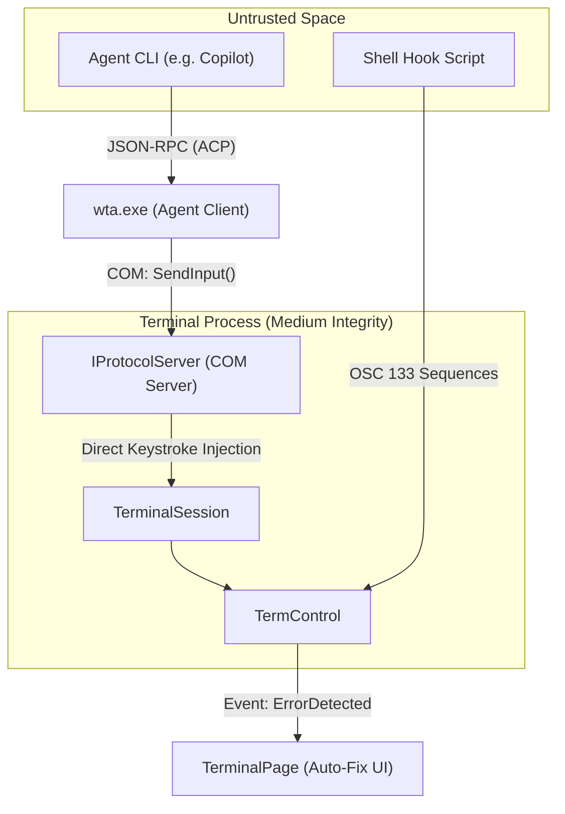

### Risk Mitigations
*   **Context Disclosure**: Crafted OSC 133 marks could theoretically trigger an Auto-Fix analysis that sends sensitive scrollback to an LLM. Users are encouraged to review the `autoFixEnabled` setting if working with highly sensitive data `[doc/security-model.md:38-38]()`.
*   **Environment Scrubbing**: When spawning agent processes, the terminal scrubs the `CLAUDECODE` environment variable to prevent recursion guards from blocking the agent host `[tools/wta/src/protocol/acp/spawn.rs:74-78]()`.
*   **Path Resolution**: The terminal rebuilds the `PATH` from the registry when spawning agents to ensure that newly installed CLI tools are visible without a terminal restart `[tools/wta/src/protocol/acp/spawn.rs:80-91]()`.

**Sources:** `[doc/security-model.md:10-18]()`, `[doc/security-model.md:34-38]()`, `[tools/wta/src/protocol/acp/spawn.rs:74-91]()`.

---

# Page: Application Lifecycle and Window Management

# Application Lifecycle and Window Management

<details>
<summary>Relevant source files</summary>

The following files were used as context for generating this wiki page:

- [src/cascadia/TerminalApp/AppLogic.cpp](src/cascadia/TerminalApp/AppLogic.cpp)
- [src/cascadia/TerminalApp/AppLogic.h](src/cascadia/TerminalApp/AppLogic.h)
- [src/cascadia/TerminalApp/AppLogic.idl](src/cascadia/TerminalApp/AppLogic.idl)
- [src/cascadia/TerminalApp/TerminalWindow.cpp](src/cascadia/TerminalApp/TerminalWindow.cpp)
- [src/cascadia/TerminalApp/TerminalWindow.h](src/cascadia/TerminalApp/TerminalWindow.h)
- [src/cascadia/TerminalApp/TerminalWindow.idl](src/cascadia/TerminalApp/TerminalWindow.idl)
- [src/cascadia/WindowsTerminal/AppHost.cpp](src/cascadia/WindowsTerminal/AppHost.cpp)
- [src/cascadia/WindowsTerminal/AppHost.h](src/cascadia/WindowsTerminal/AppHost.h)
- [src/cascadia/WindowsTerminal/BaseWindow.h](src/cascadia/WindowsTerminal/BaseWindow.h)
- [src/cascadia/WindowsTerminal/IslandWindow.cpp](src/cascadia/WindowsTerminal/IslandWindow.cpp)
- [src/cascadia/WindowsTerminal/IslandWindow.h](src/cascadia/WindowsTerminal/IslandWindow.h)
- [src/cascadia/WindowsTerminal/NonClientIslandWindow.cpp](src/cascadia/WindowsTerminal/NonClientIslandWindow.cpp)
- [src/cascadia/WindowsTerminal/NonClientIslandWindow.h](src/cascadia/WindowsTerminal/NonClientIslandWindow.h)
- [src/cascadia/WindowsTerminal/WindowEmperor.cpp](src/cascadia/WindowsTerminal/WindowEmperor.cpp)
- [src/cascadia/WindowsTerminal/WindowEmperor.h](src/cascadia/WindowsTerminal/WindowEmperor.h)
- [src/cascadia/WindowsTerminal/main.cpp](src/cascadia/WindowsTerminal/main.cpp)

</details>


This page provides a high-level overview of how the Intelligent Terminal manages its process lifecycle, windowing infrastructure, and the coordination between Win32 hosting and XAML UI layers. The architecture is designed to support single-instancing, multi-window orchestration, and high-performance XAML Island hosting.

## Process Orchestration

The application entry point is managed by the `WindowEmperor`, which acts as a process-wide singleton. It is responsible for determining whether a new process should become the "monarch" (the primary process hosting all windows) or hand off its command-line arguments to an existing instance.

### Single-Instancing and Handoff
When the terminal starts, it attempts to acquire a system-wide mutex based on its class name [src/cascadia/WindowsTerminal/WindowEmperor.cpp:164-177](). If the mutex is already held, the new process serializes its command line, environment variables, and working directory into a `WM_COPYDATA` payload and sends it to the existing window [src/cascadia/WindowsTerminal/WindowEmperor.cpp:183-200]().

### Global Responsibilities
The `WindowEmperor` manages several global features that persist regardless of how many windows are open:
*   **Global Hotkeys**: Registration and dispatch of "Summon" hotkeys [src/cascadia/WindowsTerminal/WindowEmperor.h:75-77]().
*   **System Tray**: Management of the notification area icon and its context menu [src/cascadia/WindowsTerminal/WindowEmperor.h:92-95]().
*   **Session Persistence**: Periodic saving of window state to `state.json` to allow restoration after a reboot or crash [src/cascadia/WindowsTerminal/WindowEmperor.h:78-80]().

For details, see [WindowEmperor: Process Orchestration](#3.1).

**Process Startup Flow**
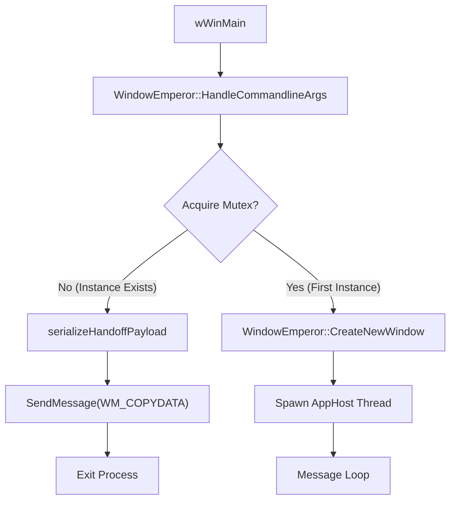
Sources: [src/cascadia/WindowsTerminal/WindowEmperor.cpp:164-200](), [src/cascadia/WindowsTerminal/WindowEmperor.h:35-43]()

---

## Win32 Hosting Layer (AppHost & IslandWindow)

Every terminal window runs in its own thread and is managed by an `AppHost` instance [src/cascadia/WindowsTerminal/AppHost.cpp:48-51](). The `AppHost` bridges the Win32 world (HWNDs, DPI scaling, system menus) with the WinRT/XAML world.

### The Window Stack
The windowing logic is split into three primary layers:
1.  **IslandWindow**: The base class that wraps a standard Win32 HWND and hosts a `DesktopWindowXamlSource` (XAML Island) [src/cascadia/WindowsTerminal/IslandWindow.cpp:123-162]().
2.  **NonClientIslandWindow**: Extends the base window to support custom titlebars. it uses `DwmExtendFrameIntoClientArea` to allow XAML content to be drawn in the non-client area [src/cascadia/WindowsTerminal/NonClientIslandWindow.h:8-14]().
3.  **AppHost**: The orchestrator that owns the window instance and handles high-level window events like "Summon", "Quake Mode" toggles, and taskbar progress updates [src/cascadia/WindowsTerminal/AppHost.cpp:104-113]().

### Specialized Modes
The hosting layer implements several advanced Windows features:
*   **Quake Mode**: A specialized "dropdown" window behavior that pins the terminal to the top of a monitor [src/cascadia/WindowsTerminal/IslandWindow.cpp:147-148]().
*   **Snap Layouts**: Custom handling of `WM_NCHITTEST` in `NonClientIslandWindow` to support the Windows 11 maximize button hover menu [src/cascadia/WindowsTerminal/NonClientIslandWindow.cpp:155-163]().

For details, see [AppHost and IslandWindow: Win32 Hosting Layer](#3.2).

Sources: [src/cascadia/WindowsTerminal/AppHost.h:38-41](), [src/cascadia/WindowsTerminal/IslandWindow.h:13-15](), [src/cascadia/WindowsTerminal/NonClientIslandWindow.h:23-24]()

---

## Settings and UI Bridge (AppLogic & TerminalWindow)

The `AppLogic` and `TerminalWindow` classes represent the transition from the "Host" (Win32) to the "App" (XAML/WinRT).

### Global Logic and Settings
`AppLogic` is a singleton that manages the lifecycle of `CascadiaSettings`. It uses a `ThrottledFunc` to reload settings from disk when `settings.json` is modified, ensuring that multiple rapid saves do not cause performance issues [src/cascadia/TerminalApp/AppLogic.cpp:137-149](). It also provides the `CreateNewWindow` factory method used by the `WindowEmperor` [src/cascadia/TerminalApp/AppLogic.h:48]().

### Window-Specific Logic
`TerminalWindow` is the WinRT object that represents the logical state of a single window. It implements `IInitializeWithWindow` to associate itself with the HWND created by the `AppHost` [src/cascadia/TerminalApp/TerminalWindow.cpp:150-151](). Its primary role is to host the `TerminalPage`, which contains the actual tabs, panes, and terminal controls.

**Entity Association Map**
| System Layer | Code Entity | Responsibility |
| :--- | :--- | :--- |
| **Orchestration** | `WindowEmperor` | Process singleton, mutex management, global hotkeys. |
| **Win32 Host** | `AppHost` | Per-window thread management and event routing. |
| **Win32 Window** | `IslandWindow` | HWND management and XAML Island hosting. |
| **UI Bridge** | `TerminalWindow` | WinRT logic for a single window; owns the `TerminalPage`. |
| **Global State** | `AppLogic` | Settings lifecycle and global app state. |

For details, see [AppLogic and TerminalWindow: Settings and UI Bridge](#3.3).

**Lifecycle Class Relationships**
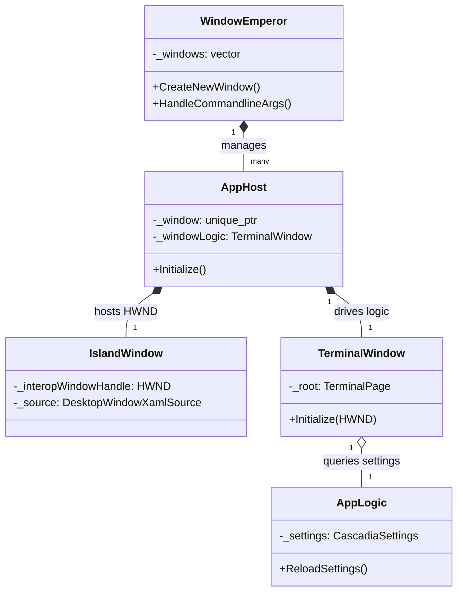
Sources: [src/cascadia/WindowsTerminal/WindowEmperor.h:85-86](), [src/cascadia/WindowsTerminal/AppHost.h:38-41](), [src/cascadia/TerminalApp/TerminalWindow.h:131-136](), [src/cascadia/TerminalApp/AppLogic.h:27-28]()

Sources:
* [src/cascadia/WindowsTerminal/WindowEmperor.cpp:164-200]()
* [src/cascadia/WindowsTerminal/AppHost.cpp:48-51]()
* [src/cascadia/WindowsTerminal/IslandWindow.cpp:123-162]()
* [src/cascadia/TerminalApp/AppLogic.cpp:137-149]()
* [src/cascadia/TerminalApp/TerminalWindow.cpp:150-151]()

---

# Page: WindowEmperor: Process Orchestration

# WindowEmperor: Process Orchestration

<details>
<summary>Relevant source files</summary>

The following files were used as context for generating this wiki page:

- [src/cascadia/TerminalApp/App.cpp](src/cascadia/TerminalApp/App.cpp)
- [src/cascadia/TerminalApp/App.h](src/cascadia/TerminalApp/App.h)
- [src/cascadia/TerminalApp/App.idl](src/cascadia/TerminalApp/App.idl)
- [src/cascadia/TerminalApp/AppKeyBindings.cpp](src/cascadia/TerminalApp/AppKeyBindings.cpp)
- [src/cascadia/TerminalApp/AppKeyBindings.h](src/cascadia/TerminalApp/AppKeyBindings.h)
- [src/cascadia/TerminalApp/AppKeyBindings.idl](src/cascadia/TerminalApp/AppKeyBindings.idl)
- [src/cascadia/TerminalApp/TerminalWindow.cpp](src/cascadia/TerminalApp/TerminalWindow.cpp)
- [src/cascadia/TerminalApp/TerminalWindow.h](src/cascadia/TerminalApp/TerminalWindow.h)
- [src/cascadia/TerminalApp/TerminalWindow.idl](src/cascadia/TerminalApp/TerminalWindow.idl)
- [src/cascadia/WindowsTerminal/WindowEmperor.cpp](src/cascadia/WindowsTerminal/WindowEmperor.cpp)
- [src/cascadia/WindowsTerminal/WindowEmperor.h](src/cascadia/WindowsTerminal/WindowEmperor.h)
- [src/cascadia/WindowsTerminal/main.cpp](src/cascadia/WindowsTerminal/main.cpp)

</details>


The `WindowEmperor` is the central singleton responsible for managing the application lifecycle of Intelligent Terminal. It orchestrates single-instance enforcement, command-line handoff between processes, global hotkey management, and session persistence. While each terminal window runs its own UI thread, the `WindowEmperor` lives on the main process thread to coordinate global state across all windows [src/cascadia/WindowsTerminal/WindowEmperor.h:8-14]().

## Process Entry Point and Initialization

The application entry point is `wWinMain` in `main.cpp`. It performs critical environment checks and initializes the WinRT COM apartment as a Single-Threaded Apartment (STA) before instantiating the `WindowEmperor` [src/cascadia/WindowsTerminal/main.cpp:85-125]().

### Startup Sequence
1.  **Architecture Validation**: `EnsureNativeArchitecture` checks if the process architecture (x64, ARM64, etc.) matches the native system architecture to ensure `conhost.exe` compatibility [src/cascadia/WindowsTerminal/main.cpp:62-83]().
2.  **STA Initialization**: `winrt::init_apartment(winrt::apartment_type::single_threaded)` is called to support XAML and UIAutomation [src/cascadia/WindowsTerminal/main.cpp:112-121]().
3.  **Emperor Creation**: The `WindowEmperor` is instantiated, which triggers the startup of the `TerminalProtocolComServer` [src/cascadia/WindowsTerminal/WindowEmperor.cpp:36-41]().
4.  **Command-line Handling**: `HandleCommandlineArgs` determines if this process should become the "Emperor" (primary instance) or hand off its arguments to an existing one [src/cascadia/WindowsTerminal/WindowEmperor.cpp:124]().

**Sources:** [src/cascadia/WindowsTerminal/main.cpp:62-125](), [src/cascadia/WindowsTerminal/WindowEmperor.cpp:36-41]()

## Single-Instance Handoff

Intelligent Terminal uses a named mutex and `WM_COPYDATA` to maintain a single primary process for all windows.

### Mutex Logic
`WindowEmperor` attempts to acquire a mutex named after the window class. If the mutex already exists, the new process serializes its command-line arguments, environment variables, and current working directory into a `Handoff` payload [src/cascadia/WindowsTerminal/WindowEmperor.cpp:124-160]().

### Communication via WM_COPYDATA
If an existing instance is found via `FindWindowW`, the secondary process sends the payload using `SendMessageTimeoutW` with the `TERMINAL_HANDOFF_MAGIC` identifier [src/cascadia/WindowsTerminal/WindowEmperor.cpp:183-205](). The primary instance receives this in its `_messageHandler` and dispatches the command-line to the appropriate window or creates a new one [src/cascadia/WindowsTerminal/WindowEmperor.cpp:68-122]().

### Process Orchestration Flow
Title: Command-line Handoff and Process Logic
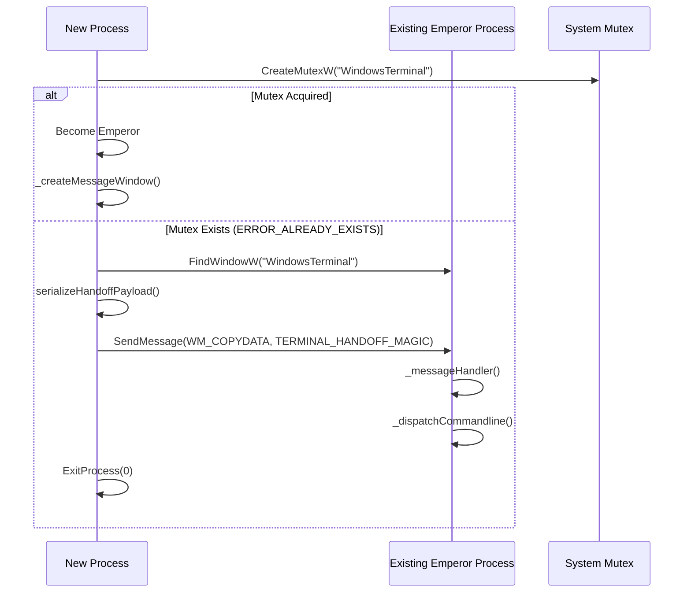
**Sources:** [src/cascadia/WindowsTerminal/WindowEmperor.cpp:124-205](), [src/cascadia/WindowsTerminal/WindowEmperor.h:68]()

## Global State Management

### Hotkey Registration
The Emperor registers global "Summon" hotkeys defined in the settings. It uses the Win32 `RegisterHotKey` API and handles the `WM_HOTKEY` message in the main message loop [src/cascadia/WindowsTerminal/WindowEmperor.cpp:75-77](). When a hotkey is pressed, `_hotkeyPressed` identifies the target window (or all windows) and brings them to the foreground [src/cascadia/WindowsTerminal/WindowEmperor.cpp:74]().

### System Tray (Notification Area)
If enabled in settings, the Emperor maintains a `NOTIFYICONDATA` structure and handles `WM_NOTIFY_FROM_NOTIFICATION_AREA`. This allows the terminal to run in the background even when all windows are closed, provided the "Always show notification icon" or "Minimize to tray" settings are active [src/cascadia/WindowsTerminal/WindowEmperor.cpp:32-33](), [src/cascadia/WindowsTerminal/WindowEmperor.h:92-95]().

### Session Persistence
The Emperor manages the lifecycle of `state.json`. It uses a `SafeDispatcherTimer` (`_persistStateTimer`) to periodically trigger `_persistState`, which saves the current window layout, tab state, and buffer locations [src/cascadia/WindowsTerminal/WindowEmperor.h:78-80](), [src/cascadia/WindowsTerminal/WindowEmperor.h:98]().

**Sources:** [src/cascadia/WindowsTerminal/WindowEmperor.cpp:32-77](), [src/cascadia/WindowsTerminal/WindowEmperor.h:74-98]()

## Protocol Server and AUMID Logic

### AI Agent Protocol Bridge
The `WindowEmperor` initializes the `TerminalProtocolComServer`, which enables external AI agents (via `wtcli.exe` or `wta.exe`) to communicate with terminal sessions. It generates a unique CLSID for the COM server and stores it in the `WT_COM_CLSID` environment variable so child processes can locate the protocol bridge [src/cascadia/WindowsTerminal/WindowEmperor.h:89-90]().

### AppUserModelID (AUMID) Stamping
To ensure correct taskbar grouping and "Pin to Taskbar" behavior, the Emperor implements deferred AUMID stamping. It uses `_setupAumid` to associate the process with the correct `AppUserModelID`, which is crucial for distinguishing between different release channels (Stable vs. Preview vs. Dev) [src/cascadia/WindowsTerminal/WindowEmperor.h:82](), [src/cascadia/WindowsTerminal/WindowEmperor.h:102-103]().

### Entity Mapping: Window Management
Title: WindowEmperor Entity Relationships
```mermaid
classDiagram
    class WindowEmperor {
        -vector~AppHost~ _windows
        -TerminalApp::App _app
        -_messageHandler(HWND, UINT, ...)
        -_dispatchCommandline()
        +CreateNewWindow()
    }
    class AppHost {
        -unique_ptr~IslandWindow~ _window
        -TerminalWindow _logic
    }
    class TerminalProtocolComServer {
        +s_StartListening()
        +s_StopListening()
    }
    class TerminalWindow {
        +Initialize(HWND)
        +ExecuteCommandline()
    }

    WindowEmperor "1" *-- "n" AppHost : manages
    WindowEmperor "1" -- "1" TerminalProtocolComServer : starts/stops
    AppHost "1" *-- "1" TerminalWindow : hosts logic
```
**Sources:** [src/cascadia/WindowsTerminal/WindowEmperor.h:18-116](), [src/cascadia/TerminalApp/TerminalWindow.h:63-66](), [src/cascadia/WindowsTerminal/WindowEmperor.cpp:36-41]()

## Key Functions and Data Structures

| Function/Member | Description |
| :--- | :--- |
| `_wndProc` | The static Win32 window procedure for the hidden message window [src/cascadia/WindowsTerminal/WindowEmperor.h:59](). |
| `_dispatchCommandline` | Parses `CommandlineArgs` and either routes them to an existing window or creates a new one [src/cascadia/WindowsTerminal/WindowEmperor.h:65](). |
| `_createMessageWindow` | Creates the hidden HWND used for `WM_COPYDATA`, hotkeys, and tray icon notifications [src/cascadia/WindowsTerminal/WindowEmperor.h:69](). |
| `_persistState` | Serializes the `ApplicationState` to `state.json` [src/cascadia/WindowsTerminal/WindowEmperor.h:79](). |
| `TERMINAL_HANDOFF_MAGIC` | A magic constant (0x4c414e494d524554) used to validate handoff messages [src/cascadia/WindowsTerminal/WindowEmperor.cpp:43-47](). |

**Sources:** [src/cascadia/WindowsTerminal/WindowEmperor.h:59-79](), [src/cascadia/WindowsTerminal/WindowEmperor.cpp:43-47]()

---

# Page: AppHost and IslandWindow: Win32 Hosting Layer

# AppHost and IslandWindow: Win32 Hosting Layer

<details>
<summary>Relevant source files</summary>

The following files were used as context for generating this wiki page:

- [src/cascadia/TerminalApp/App.xaml](src/cascadia/TerminalApp/App.xaml)
- [src/cascadia/TerminalApp/AppLogic.cpp](src/cascadia/TerminalApp/AppLogic.cpp)
- [src/cascadia/TerminalApp/AppLogic.h](src/cascadia/TerminalApp/AppLogic.h)
- [src/cascadia/TerminalApp/AppLogic.idl](src/cascadia/TerminalApp/AppLogic.idl)
- [src/cascadia/TerminalApp/MinMaxCloseControl.cpp](src/cascadia/TerminalApp/MinMaxCloseControl.cpp)
- [src/cascadia/TerminalApp/MinMaxCloseControl.h](src/cascadia/TerminalApp/MinMaxCloseControl.h)
- [src/cascadia/TerminalApp/MinMaxCloseControl.idl](src/cascadia/TerminalApp/MinMaxCloseControl.idl)
- [src/cascadia/TerminalApp/MinMaxCloseControl.xaml](src/cascadia/TerminalApp/MinMaxCloseControl.xaml)
- [src/cascadia/TerminalApp/TabRowControl.cpp](src/cascadia/TerminalApp/TabRowControl.cpp)
- [src/cascadia/TerminalApp/TabRowControl.h](src/cascadia/TerminalApp/TabRowControl.h)
- [src/cascadia/TerminalApp/TabRowControl.idl](src/cascadia/TerminalApp/TabRowControl.idl)
- [src/cascadia/TerminalApp/TabRowControl.xaml](src/cascadia/TerminalApp/TabRowControl.xaml)
- [src/cascadia/TerminalApp/TitlebarControl.cpp](src/cascadia/TerminalApp/TitlebarControl.cpp)
- [src/cascadia/TerminalApp/TitlebarControl.h](src/cascadia/TerminalApp/TitlebarControl.h)
- [src/cascadia/TerminalApp/TitlebarControl.idl](src/cascadia/TerminalApp/TitlebarControl.idl)
- [src/cascadia/WindowsTerminal/AppHost.cpp](src/cascadia/WindowsTerminal/AppHost.cpp)
- [src/cascadia/WindowsTerminal/AppHost.h](src/cascadia/WindowsTerminal/AppHost.h)
- [src/cascadia/WindowsTerminal/BaseWindow.h](src/cascadia/WindowsTerminal/BaseWindow.h)
- [src/cascadia/WindowsTerminal/IslandWindow.cpp](src/cascadia/WindowsTerminal/IslandWindow.cpp)
- [src/cascadia/WindowsTerminal/IslandWindow.h](src/cascadia/WindowsTerminal/IslandWindow.h)
- [src/cascadia/WindowsTerminal/NonClientIslandWindow.cpp](src/cascadia/WindowsTerminal/NonClientIslandWindow.cpp)
- [src/cascadia/WindowsTerminal/NonClientIslandWindow.h](src/cascadia/WindowsTerminal/NonClientIslandWindow.h)

</details>


The Win32 Hosting Layer provides the bridge between the traditional Windows desktop environment and the modern XAML-based UI. It manages the Win32 window lifecycle, handles high-DPI scaling, and hosts the XAML Islands that contain the terminal's user interface.

## AppHost: The Window Orchestrator

`AppHost` is the per-window orchestrator that links the `WindowEmperor` (process-level manager) to the specific `IslandWindow` and `TerminalWindow` (logic layer) instances [src/cascadia/WindowsTerminal/AppHost.h:12-15](). It handles the initial command-line parsing for a window and determines whether to use a standard or non-client area window based on settings [src/cascadia/WindowsTerminal/AppHost.cpp:48-64]().

### Key Responsibilities
*   **Initialization**: Sets up the XAML Island environment and connects logic callbacks [src/cascadia/WindowsTerminal/AppHost.cpp:176-181]().
*   **Virtual Desktop Integration**: Tracks and retrieves the Virtual Desktop ID for the window to support session persistence [src/cascadia/WindowsTerminal/AppHost.cpp:31-46]().
*   **Taskbar Integration**: Proxies progress state from the terminal panes to the Win32 Taskbar via `ITaskbarList3` [src/cascadia/WindowsTerminal/AppHost.cpp:104-113]().
*   **Command Dispatch**: Routes new command-line arguments to existing windows [src/cascadia/WindowsTerminal/AppHost.cpp:28-29]().

### Window Hosting Data Flow
The following diagram illustrates how `AppHost` mediates between the Win32 OS messages and the XAML UI logic.

**Diagram: AppHost Orchestration Flow**
```mermaid
graph TD
    subgraph "Win32 Layer"
        A["wWinMain"] --> B["WindowEmperor"]
        B --> C["AppHost"]
        C --> D["IslandWindow / NonClientIslandWindow"]
    end

    subgraph "XAML Island Layer"
        D --> E["DesktopWindowXamlSource"]
        E --> F["TerminalWindow (Logic)"]
        F --> G["TerminalPage (UI)"]
    end

    subgraph "Event Routing"
        D -- "WM_SIZE / WM_MOVE" --> C
        C -- "_WindowMoved()" --> F
        F -- "Update Settings" --> G
    end
```
Sources: [src/cascadia/WindowsTerminal/AppHost.cpp:48-86](), [src/cascadia/WindowsTerminal/AppHost.h:38-41]().

## IslandWindow and XAML Hosting

`IslandWindow` is the base class for a Win32 window (`HWND`) that hosts a `DesktopWindowXamlSource` [src/cascadia/WindowsTerminal/IslandWindow.h:13-15](). It encapsulates the complexity of hosting UWP XAML controls in a desktop application.

### Window Styles and Modes
*   **Focus Mode**: Removes the titlebar and tabs for a distraction-free experience [src/cascadia/WindowsTerminal/IslandWindow.cpp:49-50]().
*   **Quake Mode**: A special state where the window is pinned to the top of a monitor and slides down/up using a global hotkey [src/cascadia/WindowsTerminal/IslandWindow.cpp:144-148]().
*   **Fullscreen**: Manages the transition between windowed and fullscreen styles, including saving and restoring window placement [src/cascadia/WindowsTerminal/IslandWindow.cpp:110-123]().

### Input and Cursor Management
`IslandWindow` implements a "hide cursor on typing" feature to mimic modern Windows app behavior, using `ShowCursor` and tracking `WM_POINTERUPDATE` [src/cascadia/WindowsTerminal/IslandWindow.cpp:42-72]().

Sources: [src/cascadia/WindowsTerminal/IslandWindow.cpp:123-165](), [src/cascadia/WindowsTerminal/IslandWindow.h:110-117]().

## NonClientIslandWindow: Custom Titlebar

When `showTabsInTitlebar` is enabled, the terminal uses `NonClientIslandWindow`. This class extends the XAML island into the non-client area (the frame) using `DwmExtendFrameIntoClientArea` [src/cascadia/WindowsTerminal/NonClientIslandWindow.h:8-14]().

### Input Sink and Drag Bar
Because XAML Islands "steal" mouse messages, `NonClientIslandWindow` creates a transparent child Win32 window (`_dragBarWindow`) specifically to handle dragging and window controls [src/cascadia/WindowsTerminal/NonClientIslandWindow.cpp:92-103]().

### Snap Layouts and Hit Testing
To support Windows 11 Snap Layouts, the `_InputSinkMessageHandler` intercepts `WM_NCHITTEST`. It manually calculates if the mouse is over the maximize button and returns `HTMAXBUTTON` [src/cascadia/WindowsTerminal/NonClientIslandWindow.cpp:170-173]().

| Hit Test Region | Logic | Return Value |
| :--- | :--- | :--- |
| Close Button | Within `CaptionButtonWidth` from right | `HTCLOSE` |
| Maximize Button | Within 2x `CaptionButtonWidth` | `HTMAXBUTTON` |
| Top Border | Within `_GetResizeHandleHeight` | `HTTOP` |
| Titlebar | Anywhere else in drag bar | `HTCAPTION` |

Sources: [src/cascadia/WindowsTerminal/NonClientIslandWindow.cpp:107-147](), [src/cascadia/WindowsTerminal/NonClientIslandWindow.cpp:164-167]().

## DPI Scaling and Resizing

The terminal handles DPI changes dynamically. When a window moves between monitors with different scales, `IslandWindow` receives `WM_DPICHANGED`.

*   **Snap to Grid**: During resize (`WM_SIZING`), the window can "snap" its dimensions to match the character grid of the active terminal [src/cascadia/WindowsTerminal/IslandWindow.cpp:184-187]().
*   **Non-Client Calculation**: `GetNonClientFrame` calculates the size of borders and titlebars based on the current DPI to ensure the XAML content is positioned correctly [src/cascadia/WindowsTerminal/NonClientIslandWindow.cpp:38-39]().

**Diagram: Window Message to Code Entity Mapping**
```mermaid
classDiagram
    class IslandWindow {
        +HWND _window
        +DesktopWindowXamlSource _source
        +WndProc(message, wparam, lparam)
        +OnSize(width, height)
        +OnNcHitTest(point)
    }
    class NonClientIslandWindow {
        +HWND _dragBarWindow
        +_InputSinkMessageHandler()
        +_OnNcCalcSize()
    }
    class AppHost {
        +_HandleCreateWindow()
        +_resizeWindow()
    }

    IslandWindow <|-- NonClientIslandWindow
    AppHost o-- IslandWindow : owns

    note for IslandWindow "Handles WM_CREATE, WM_SIZE, WM_ACTIVATE"
    note for NonClientIslandWindow "Handles WM_NCHITTEST for Snap Layouts"
    note for AppHost "Coordinates with WindowEmperor"
```
Sources: [src/cascadia/WindowsTerminal/IslandWindow.h:13-16](), [src/cascadia/WindowsTerminal/NonClientIslandWindow.h:23-24](), [src/cascadia/WindowsTerminal/AppHost.h:38-41]().

## Virtual Desktop Integration

`AppHost` uses the `IVirtualDesktopManager` to manage window placement across virtual desktops [src/cascadia/WindowsTerminal/AppHost.cpp:31-46]().
*   **`GetVirtualDesktopId()`**: An asynchronous operation that retrieves the GUID of the desktop the window currently resides on [src/cascadia/WindowsTerminal/AppHost.h:21]().
*   **Summoning**: When a window is "summoned" (e.g., via Quake mode or global hotkey), `AppHost` can move the window to the current virtual desktop or the monitor where the mouse is located [src/cascadia/WindowsTerminal/AppHost.cpp:27]().

Sources: [src/cascadia/WindowsTerminal/AppHost.cpp:31-46](), [src/cascadia/WindowsTerminal/IslandWindow.cpp:58-68]().

---

# Page: AppLogic and TerminalWindow: Settings and UI Bridge

# AppLogic and TerminalWindow: Settings and UI Bridge

<details>
<summary>Relevant source files</summary>

The following files were used as context for generating this wiki page:

- [src/cascadia/TerminalApp/AppLogic.cpp](src/cascadia/TerminalApp/AppLogic.cpp)
- [src/cascadia/TerminalApp/AppLogic.h](src/cascadia/TerminalApp/AppLogic.h)
- [src/cascadia/TerminalApp/AppLogic.idl](src/cascadia/TerminalApp/AppLogic.idl)
- [src/cascadia/TerminalApp/TerminalWindow.cpp](src/cascadia/TerminalApp/TerminalWindow.cpp)
- [src/cascadia/TerminalApp/TerminalWindow.h](src/cascadia/TerminalApp/TerminalWindow.h)
- [src/cascadia/TerminalApp/TerminalWindow.idl](src/cascadia/TerminalApp/TerminalWindow.idl)
- [src/cascadia/WindowsTerminal/AppHost.cpp](src/cascadia/WindowsTerminal/AppHost.cpp)
- [src/cascadia/WindowsTerminal/AppHost.h](src/cascadia/WindowsTerminal/AppHost.h)
- [src/cascadia/WindowsTerminal/BaseWindow.h](src/cascadia/WindowsTerminal/BaseWindow.h)
- [src/cascadia/WindowsTerminal/IslandWindow.cpp](src/cascadia/WindowsTerminal/IslandWindow.cpp)
- [src/cascadia/WindowsTerminal/IslandWindow.h](src/cascadia/WindowsTerminal/IslandWindow.h)
- [src/cascadia/WindowsTerminal/NonClientIslandWindow.cpp](src/cascadia/WindowsTerminal/NonClientIslandWindow.cpp)
- [src/cascadia/WindowsTerminal/NonClientIslandWindow.h](src/cascadia/WindowsTerminal/NonClientIslandWindow.h)
- [src/cascadia/WindowsTerminal/WindowEmperor.cpp](src/cascadia/WindowsTerminal/WindowEmperor.cpp)
- [src/cascadia/WindowsTerminal/WindowEmperor.h](src/cascadia/WindowsTerminal/WindowEmperor.h)
- [src/cascadia/WindowsTerminal/main.cpp](src/cascadia/WindowsTerminal/main.cpp)

</details>


The communication between global application state (settings, lifecycle) and individual window instances is managed by two primary entities: `AppLogic` and `TerminalWindow`. `AppLogic` serves as the singleton orchestrator for settings and shared resources, while `TerminalWindow` acts as the WinRT/XAML bridge for a specific window instance.

## AppLogic: Global State and Settings Lifecycle

`AppLogic` is the central hub for the Terminal's global logic. It is responsible for loading `CascadiaSettings`, monitoring the settings file for changes, and notifying all active windows when a reload is required.

### Settings Management and Throttling
`AppLogic` manages the lifecycle of `CascadiaSettings` [src/cascadia/TerminalApp/AppLogic.h:59](). Because file system events can be chatty, `AppLogic` utilizes a `ThrottledFunc` to debounce settings reloads [src/cascadia/TerminalApp/AppLogic.cpp:137-149]().

*   **File Watching**: It uses `wil::unique_folder_change_reader_nothrow` to monitor the settings directory [src/cascadia/TerminalApp/AppLogic.h:75]().
*   **Propagation**: When settings change, `AppLogic` fires the `SettingsChanged` event [src/cascadia/TerminalApp/AppLogic.h:52](). `AppHost` instances subscribe to this event to trigger UI updates in their respective `TerminalWindow` objects [src/cascadia/WindowsTerminal/AppHost.cpp:557-563]().

### Global Resources
`AppLogic` also handles:
*   **Elevation Status**: Detects if the process is running as Administrator [src/cascadia/TerminalApp/AppLogic.cpp:134]().
*   **Content Management**: Manages the `ContentManager` for terminal sessions [src/cascadia/TerminalApp/AppLogic.h:77]().
*   **Language Changes**: Monitors system language changes via `LanguageProfileNotifier` to refresh localized resources [src/cascadia/TerminalApp/AppLogic.cpp:151-155]().

### Code Entity Mapping: AppLogic Lifecycle
The following diagram illustrates how `AppLogic` bridges global system events to the Terminal's settings model.

Title: AppLogic Settings Pipeline
```mermaid
graph TD
    subgraph "System Space"
        FS["File System Watcher"]
        LPN["LanguageProfileNotifier"]
    end

    subgraph "AppLogic implementation"
        AL["AppLogic Class"]
        TF["_reloadSettings (ThrottledFunc)"]
        RS["ReloadSettings()"]
    end

    subgraph "Settings Model"
        CS["CascadiaSettings"]
    end

    FS -->|Change Detected| TF
    LPN -->|Language Change| TF
    TF --> RS
    RS -->|Load/Layer JSON| CS
    RS -->|Fire| SC["SettingsChanged Event"]
```
Sources: [src/cascadia/TerminalApp/AppLogic.h:27-90](), [src/cascadia/TerminalApp/AppLogic.cpp:137-155]()

---

## TerminalWindow: The UI Bridge

`TerminalWindow` is the WinRT implementation of the window's logic. It hosts the `TerminalPage` and implements several interfaces required for Win32 integration within a XAML Island.

### Key Interfaces
*   **IInitializeWithWindow**: Allows the window to receive its parent `HWND` to facilitate dialog hosting and shell integration [src/cascadia/TerminalApp/TerminalWindow.cpp:150-151]().
*   **IDirectKeyListener**: Processes raw keyboard input before it is consumed by the XAML focus system, allowing for global hotkeys and terminal-specific input handling [src/cascadia/WindowsTerminal/AppHost.cpp:88-95]().

### Window Dimension Mapping
`TerminalWindow` handles the complex mapping between character-grid dimensions and pixel sizes. It provides callbacks to the `IslandWindow` to ensure that when a user resizes the window, it "snaps" to the nearest character width/height [src/cascadia/WindowsTerminal/IslandWindow.cpp:178-187]().

### Startup Sequence
1.  **Creation**: `AppHost` calls `AppLogic::CreateNewWindow()` [src/cascadia/WindowsTerminal/AppHost.cpp:134]().
2.  **Initialization**: `AppHost` passes the `HWND` to `TerminalWindow::Initialize()` [src/cascadia/WindowsTerminal/AppHost.cpp:181]().
3.  **Content Hosting**: `TerminalWindow` creates the `TerminalPage` and sets it as the root XAML element [src/cascadia/TerminalApp/TerminalWindow.cpp:153]().

### Data Flow: Window Initialization
This diagram maps the interaction between the Win32 `AppHost` and the WinRT `TerminalWindow`.

Title: Window Hosting Bridge
```mermaid
sequenceDiagram
    participant AH as AppHost (Win32)
    participant IW as IslandWindow (HWND)
    participant TW as TerminalWindow (WinRT)
    participant TP as TerminalPage (XAML)

    AH->>TW: CreateNewWindow()
    AH->>IW: MakeWindow()
    IW->>AH: _HandleCreateWindow(HWND)
    AH->>TW: Initialize(HWND)
    TW->>TP: Create Instance
    TW->>IW: SetContent(TP)
    IW->>TP: OnNavigatedTo()
```
Sources: [src/cascadia/WindowsTerminal/AppHost.cpp:48-86](), [src/cascadia/TerminalApp/TerminalWindow.cpp:150-175](), [src/cascadia/WindowsTerminal/IslandWindow.cpp:123-165]()

---

## Settings Propagation

When settings are updated (e.g., a user saves `settings.json`), the change must propagate through the hierarchy to update the UI (fonts, colors, keybindings).

| Component | Responsibility in Propagation |
| :--- | :--- |
| `AppLogic` | Detects file change, reloads `CascadiaSettings`, and fires `SettingsChanged`. [src/cascadia/TerminalApp/AppLogic.cpp:144-149]() |
| `AppHost` | Listens to `AppLogic::SettingsChanged` and calls `TerminalWindow::UpdateSettings`. [src/cascadia/WindowsTerminal/AppHost.cpp:557-563]() |
| `TerminalWindow` | Updates its internal `_settings` reference and notifies `TerminalPage`. [src/cascadia/TerminalApp/TerminalWindow.cpp:131-136]() |
| `TerminalPage` | Iterates through all Tabs and Panes to apply new styles and settings. |

### Launch Dimensions and Coordinates
During startup, `AppHost` queries `TerminalWindow` for the requested launch mode (e.g., Default, Maximized, Fullscreen) and initial position [src/cascadia/WindowsTerminal/AppHost.cpp:47-48](). 
*   **Coordinate Mapping**: Win32 coordinates are mapped to XAML DIPs (Device Independent Pixels) using the current monitor's DPI scale [src/cascadia/WindowsTerminal/NonClientIslandWindow.cpp:114]().
*   **Quake Mode**: If the window is designated as a "Quake" window, `IslandWindow` applies specific styles and positioning logic to anchor it to the top of a monitor [src/cascadia/WindowsTerminal/IslandWindow.cpp:144-148]().

Sources: [src/cascadia/WindowsTerminal/AppHost.cpp:48-163](), [src/cascadia/TerminalApp/AppLogic.cpp:137-149](), [src/cascadia/WindowsTerminal/IslandWindow.cpp:123-165](), [src/cascadia/TerminalApp/TerminalWindow.cpp:131-175]()

---

# Page: Terminal UI: Pages, Tabs, and Panes

# Terminal UI: Pages, Tabs, and Panes

<details>
<summary>Relevant source files</summary>

The following files were used as context for generating this wiki page:

- [doc/cascadia/SettingsSchema.md](doc/cascadia/SettingsSchema.md)
- [doc/cascadia/profiles.schema.json](doc/cascadia/profiles.schema.json)
- [src/cascadia/LocalTests_TerminalApp/CommandlineTest.cpp](src/cascadia/LocalTests_TerminalApp/CommandlineTest.cpp)
- [src/cascadia/LocalTests_TerminalApp/TabTests.cpp](src/cascadia/LocalTests_TerminalApp/TabTests.cpp)
- [src/cascadia/TerminalApp/AppActionHandlers.cpp](src/cascadia/TerminalApp/AppActionHandlers.cpp)
- [src/cascadia/TerminalApp/AppCommandlineArgs.cpp](src/cascadia/TerminalApp/AppCommandlineArgs.cpp)
- [src/cascadia/TerminalApp/AppCommandlineArgs.h](src/cascadia/TerminalApp/AppCommandlineArgs.h)
- [src/cascadia/TerminalApp/Pane.cpp](src/cascadia/TerminalApp/Pane.cpp)
- [src/cascadia/TerminalApp/Pane.h](src/cascadia/TerminalApp/Pane.h)
- [src/cascadia/TerminalApp/Resources/en-US/Resources.resw](src/cascadia/TerminalApp/Resources/en-US/Resources.resw)
- [src/cascadia/TerminalApp/Tab.cpp](src/cascadia/TerminalApp/Tab.cpp)
- [src/cascadia/TerminalApp/Tab.h](src/cascadia/TerminalApp/Tab.h)
- [src/cascadia/TerminalApp/Tab.idl](src/cascadia/TerminalApp/Tab.idl)
- [src/cascadia/TerminalApp/TabManagement.cpp](src/cascadia/TerminalApp/TabManagement.cpp)
- [src/cascadia/TerminalApp/TerminalPage.cpp](src/cascadia/TerminalApp/TerminalPage.cpp)
- [src/cascadia/TerminalApp/TerminalPage.h](src/cascadia/TerminalApp/TerminalPage.h)
- [src/cascadia/TerminalApp/TerminalPage.xaml](src/cascadia/TerminalApp/TerminalPage.xaml)
- [src/cascadia/TerminalSettingsModel/ActionAndArgs.cpp](src/cascadia/TerminalSettingsModel/ActionAndArgs.cpp)
- [src/cascadia/TerminalSettingsModel/ActionArgs.cpp](src/cascadia/TerminalSettingsModel/ActionArgs.cpp)
- [src/cascadia/TerminalSettingsModel/ActionArgs.h](src/cascadia/TerminalSettingsModel/ActionArgs.h)
- [src/cascadia/TerminalSettingsModel/ActionArgs.idl](src/cascadia/TerminalSettingsModel/ActionArgs.idl)
- [src/cascadia/TerminalSettingsModel/AllShortcutActions.h](src/cascadia/TerminalSettingsModel/AllShortcutActions.h)
- [src/cascadia/TerminalSettingsModel/Resources/en-US/Resources.resw](src/cascadia/TerminalSettingsModel/Resources/en-US/Resources.resw)
- [src/cascadia/TerminalSettingsModel/TerminalSettingsSerializationHelpers.h](src/cascadia/TerminalSettingsModel/TerminalSettingsSerializationHelpers.h)
- [src/cascadia/TerminalSettingsModel/defaults.json](src/cascadia/TerminalSettingsModel/defaults.json)

</details>


The Terminal UI layer is the primary WinRT/XAML interface of the application. It is responsible for orchestrating the visual layout of terminal sessions, managing user interactions through tabs and panes, and providing high-level UI components like the Command Palette and the AI Agent toolbar.

The architecture follows a hierarchical structure where a single `TerminalPage` hosts multiple `Tab` objects, each of which contains a recursive tree of `Pane` objects.

## TerminalPage: The UI Orchestrator

`TerminalPage` is the root XAML control for a terminal window [src/cascadia/TerminalApp/TerminalPage.xaml:5-14](). It serves as the central hub for action dispatching, settings application, and window-level UI elements.

- **Action Dispatching**: It initializes a `ShortcutActionDispatch` and registers handlers (prefixed with `_Handle`) for all keyboard shortcuts and commands [src/cascadia/TerminalApp/TerminalPage.cpp:64-64]().
- **Startup Logic**: It processes command-line arguments via `AppCommandlineArgs` and executes the resulting `ActionAndArgs` to restore tabs and panes [src/cascadia/TerminalApp/TerminalPage.cpp:175-177]().
- **Agent Integration**: It hosts the `BottomBar`, which provides a window-wide interface for AI agent interactions, including the agent toggle and auto-fix diagnostics [src/cascadia/TerminalApp/TerminalPage.xaml:91-118]().

For details, see [TerminalPage: Main UI Page and Action Dispatch](#4.1).

### Natural Language to Code Entity Mapping: Terminal Window Root

| Concept | Code Entity | File |
| :--- | :--- | :--- |
| Main UI Container | `class TerminalPage` | [src/cascadia/TerminalApp/TerminalPage.h:108-108]() |
| XAML Root Grid | `x:Name="Root"` | [src/cascadia/TerminalApp/TerminalPage.xaml:16-16]() |
| Tab Container | `x:Name="TabContent"` | [src/cascadia/TerminalApp/TerminalPage.xaml:70-70]() |
| Action Hub | `_actionDispatch` | [src/cascadia/TerminalApp/TerminalPage.h:1120-1120]() |

Sources: [src/cascadia/TerminalApp/TerminalPage.h:108-1120](), [src/cascadia/TerminalApp/TerminalPage.xaml:16-118]()

## Tab and Pane Management

The UI organizes terminal sessions into a flexible, tiled layout.

- **Tabs**: The `Tab` class encapsulates a `TabViewItem` and manages the lifecycle of the panes within it [src/cascadia/TerminalApp/Tab.h:34-34](). It tracks the Most Recently Used (MRU) pane for focus management.
- **Panes**: Panes are structured as a binary tree. A `Pane` is either a **leaf** (hosting `IPaneContent`, usually a `TermControl`) or a **branch** (hosting two child `Pane` objects split horizontally or vertically) [src/cascadia/Pane.h:63-73]().
- **Layout**: Branch panes use XAML `Grid` definitions with `ColumnDefinition` or `RowDefinition` to provide interactive resizing via splitters [src/cascadia/Pane.cpp:72-84]().

For details, see [Tab and Pane Management](#4.2).

### UI Hierarchy Diagram

This diagram illustrates how the code entities represent the nested structure of the terminal interface.

```mermaid
graph TD
    TP["TerminalPage (XAML Page)"] --> TR["TabRowControl"]
    TP --> TC["TabContent (Grid)"]
    TC --> T1["Tab 1"]
    TC --> T2["Tab 2"]
    
    T1 --> RP["Root Pane (Branch)"]
    RP -- "SplitState::Vertical" --> P1["Pane 1 (Leaf)"]
    RP -- "SplitState::Vertical" --> P2["Pane 2 (Branch)"]
    
    P1 --> TC1["TermControl (Terminal)"]
    P2 -- "SplitState::Horizontal" --> P3["Pane 3 (Leaf)"]
    P2 -- "SplitState::Horizontal" --> P4["Pane 4 (Leaf)"]
    
    P3 --> TC3["TermControl (Terminal)"]
    P4 --> APC["AgentPaneContent (AI Agent)"]
```
Sources: [src/cascadia/TerminalApp/Pane.h:48-73](), [src/cascadia/TerminalApp/Tab.h:34-40](), [src/cascadia/TerminalApp/TerminalPage.xaml:70-77]()

## Command Palette and Suggestions

The terminal provides an "Omnibox" style interface for discovering actions and receiving context-aware suggestions.

- **Command Palette**: Hosted by `TerminalPage`, the `CommandPalette` control allows users to search through all available `Command` objects defined in `settings.json` [src/cascadia/TerminalApp/TerminalPage.h:136-136]().
- **Suggestions UI**: The `SuggestionsControl` provides an IntelliSense-like overlay for command history and directory history, appearing relative to the cursor position in the active terminal [src/cascadia/TerminalApp/TerminalPage.h:137-137]().

For details, see [Command Palette and Suggestions UI](#4.3).

## Titlebar and Chrome

Intelligent Terminal reclaims the non-client area of the window to provide a custom integrated look.

- **Tab Row**: The `TabRowControl` is hosted in the top-most row of the `TerminalPage` [src/cascadia/TerminalApp/TerminalPage.xaml:25-27]().
- **Custom Chrome**: Elements like the `TitlebarControl` and `MinMaxCloseControl` allow the terminal to draw into the titlebar while maintaining standard window management behaviors like dragging and Snap Layouts.

For details, see [Titlebar, Tab Row, and Chrome Controls](#4.4).

### Key Component Relationships

| Component | Responsibility | Primary Files |
| :--- | :--- | :--- |
| **TerminalPage** | Window lifecycle, Global Actions, AI Toolbar | `TerminalPage.cpp`, `TerminalPage.xaml` |
| **Tab** | Grouping panes, TabView integration | `Tab.cpp`, `Tab.h` |
| **Pane** | Recursive tiling, Resizing, Content hosting | `Pane.cpp`, `Pane.h` |
| **CommandPalette** | Fuzzy search for actions and commands | `CommandPalette.cpp` |
| **TabRowControl** | Rendering the list of tabs in the titlebar | `TabRowControl.cpp` |

Sources: [src/cascadia/TerminalApp/TerminalPage.h:108-200](), [src/cascadia/TerminalApp/Pane.h:63-165](), [src/cascadia/TerminalApp/Tab.h:34-100]()

---

# Page: TerminalPage: Main UI Page and Action Dispatch

# TerminalPage: Main UI Page and Action Dispatch

<details>
<summary>Relevant source files</summary>

The following files were used as context for generating this wiki page:

- [doc/cascadia/SettingsSchema.md](doc/cascadia/SettingsSchema.md)
- [doc/cascadia/profiles.schema.json](doc/cascadia/profiles.schema.json)
- [src/cascadia/LocalTests_TerminalApp/CommandlineTest.cpp](src/cascadia/LocalTests_TerminalApp/CommandlineTest.cpp)
- [src/cascadia/LocalTests_TerminalApp/TabTests.cpp](src/cascadia/LocalTests_TerminalApp/TabTests.cpp)
- [src/cascadia/TerminalApp/AppActionHandlers.cpp](src/cascadia/TerminalApp/AppActionHandlers.cpp)
- [src/cascadia/TerminalApp/AppCommandlineArgs.cpp](src/cascadia/TerminalApp/AppCommandlineArgs.cpp)
- [src/cascadia/TerminalApp/AppCommandlineArgs.h](src/cascadia/TerminalApp/AppCommandlineArgs.h)
- [src/cascadia/TerminalApp/Resources/en-US/Resources.resw](src/cascadia/TerminalApp/Resources/en-US/Resources.resw)
- [src/cascadia/TerminalApp/ShortcutActionDispatch.cpp](src/cascadia/TerminalApp/ShortcutActionDispatch.cpp)
- [src/cascadia/TerminalApp/ShortcutActionDispatch.h](src/cascadia/TerminalApp/ShortcutActionDispatch.h)
- [src/cascadia/TerminalApp/ShortcutActionDispatch.idl](src/cascadia/TerminalApp/ShortcutActionDispatch.idl)
- [src/cascadia/TerminalApp/TabManagement.cpp](src/cascadia/TerminalApp/TabManagement.cpp)
- [src/cascadia/TerminalApp/TerminalPage.cpp](src/cascadia/TerminalApp/TerminalPage.cpp)
- [src/cascadia/TerminalApp/TerminalPage.h](src/cascadia/TerminalApp/TerminalPage.h)
- [src/cascadia/TerminalApp/TerminalPage.xaml](src/cascadia/TerminalApp/TerminalPage.xaml)
- [src/cascadia/TerminalSettingsModel/ActionAndArgs.cpp](src/cascadia/TerminalSettingsModel/ActionAndArgs.cpp)
- [src/cascadia/TerminalSettingsModel/ActionArgs.cpp](src/cascadia/TerminalSettingsModel/ActionArgs.cpp)
- [src/cascadia/TerminalSettingsModel/ActionArgs.h](src/cascadia/TerminalSettingsModel/ActionArgs.h)
- [src/cascadia/TerminalSettingsModel/ActionArgs.idl](src/cascadia/TerminalSettingsModel/ActionArgs.idl)
- [src/cascadia/TerminalSettingsModel/AllShortcutActions.h](src/cascadia/TerminalSettingsModel/AllShortcutActions.h)
- [src/cascadia/TerminalSettingsModel/Resources/en-US/Resources.resw](src/cascadia/TerminalSettingsModel/Resources/en-US/Resources.resw)
- [src/cascadia/TerminalSettingsModel/TerminalSettingsSerializationHelpers.h](src/cascadia/TerminalSettingsModel/TerminalSettingsSerializationHelpers.h)
- [src/cascadia/TerminalSettingsModel/defaults.json](src/cascadia/TerminalSettingsModel/defaults.json)

</details>


`TerminalPage` is the primary XAML-based hosting container for the Intelligent Terminal user interface. It serves as the root of the terminal's visual tree, orchestrating the lifecycle of tabs, panes, and the AI agent infrastructure. It acts as the central hub for dispatching user actions (keyboard shortcuts, menu items) and provides a bridge between the Win32 application host and the WinRT-based terminal controls.

## Architecture and Visual Hierarchy

`TerminalPage` is defined in `TerminalPage.xaml` and managed by `TerminalPage.cpp`. It uses a `Grid` layout to partition the window into functional zones.

### Visual Tree Structure
*   **TabRow (Row 0):** Hosts the `TabRowControl`, which contains the `TabView` for tab management [src/cascadia/TerminalApp/TerminalPage.xaml:25-27]().
*   **InfoBars (Row 1):** A container for system-level notifications, such as the `KeyboardServiceWarningInfoBar` [src/cascadia/TerminalApp/TerminalPage.xaml:29-58]().
*   **TabContent (Row 2):** The main content area where the active `Tab` and its associated `Pane` tree are rendered [src/cascadia/TerminalApp/TerminalPage.xaml:70-77]().
*   **BottomBar (Row 3):** The Intelligent Terminal agent bar, providing window-level AI controls and status indicators [src/cascadia/TerminalApp/TerminalPage.xaml:91-118]().

### Component Association: Natural Language to Code Entities

| System Concept | Code Entity | File Path |
| :--- | :--- | :--- |
| **Main UI Page** | `winrt::TerminalApp::implementation::TerminalPage` | [src/cascadia/TerminalApp/TerminalPage.h:108]() |
| **Action Hub** | `ShortcutActionDispatch` | [src/cascadia/TerminalApp/ShortcutActionDispatch.h:15]() |
| **Tab Management** | `winrt::TerminalApp::implementation::Tab` | [src/cascadia/TerminalApp/Tab.h:35]() |
| **CLI Parser** | `AppCommandlineArgs` | [src/cascadia/TerminalApp/AppCommandlineArgs.h:16]() |
| **AI Agent Bar** | `BottomBar` (XAML element) | [src/cascadia/TerminalApp/TerminalPage.xaml:106]() |

**Sources:** [src/cascadia/TerminalApp/TerminalPage.xaml:16-118](), [src/cascadia/TerminalApp/TerminalPage.h:108-112]()

---

## Startup Sequence and Settings Application

The initialization of `TerminalPage` involves setting up the environment, registering for system events, and applying user settings.

1.  **Constructor:** Initializes window properties and content managers [src/cascadia/TerminalApp/TerminalPage.cpp:258-285]().
2.  **Initialize (HWND):** Implements `IInitializeWithWindow` to associate the XAML page with the Win32 window handle [src/cascadia/TerminalApp/TerminalPage.cpp:305-312]().
3.  **SetSettings:** Updates the internal `CascadiaSettings` object. If `needRefreshUI` is true, it triggers a global UI refresh, updating themes, keybindings, and tab styles [src/cascadia/TerminalApp/TerminalPage.cpp:446-512]().
4.  **Create:** Finalizes the setup, including hooking up the `ShortcutActionDispatch` handlers [src/cascadia/TerminalApp/TerminalPage.cpp:319-354]().

### Action Handler Registration
`TerminalPage` uses the `HOOKUP_ACTION` macro to register private methods as handlers for actions defined in the settings model [src/cascadia/TerminalApp/TerminalPage.cpp:64]().

```mermaid
graph TD
    subgraph "TerminalPage Initialization"
    A["TerminalPage::Create()"] --> B["_actionDispatch = ShortcutActionDispatch()"]
    B --> C["HOOKUP_ACTION(NewTab)"]
    B --> D["HOOKUP_ACTION(SplitPane)"]
    B --> E["HOOKUP_ACTION(OpenSettings)"]
    C --> F["_HandleNewTab"]
    D --> G["_HandleSplitPane"]
    E --> H["_HandleOpenSettings"]
    end
```

**Sources:** [src/cascadia/TerminalApp/TerminalPage.cpp:319-354](), [src/cascadia/TerminalApp/TerminalPage.cpp:64]()

---

## Action Dispatch and Command Execution

The `ShortcutActionDispatch` class is the engine that converts `ActionAndArgs` (from keybindings or the command palette) into functional calls within `TerminalPage`.

### Action Handling Flow
When a user triggers an action (e.g., `Ctrl+Shift+T`), the following flow occurs:
1.  The `ActionMap` identifies the `ShortcutAction` and its `IActionArgs`.
2.  `ShortcutActionDispatch::DoAction` is called with the `ActionAndArgs` [src/cascadia/TerminalApp/ShortcutActionDispatch.cpp:24-42]().
3.  The registered `_HandleX` method in `TerminalPage` (e.g., `_HandleNewTab`) is invoked [src/cascadia/TerminalApp/AppActionHandlers.cpp:337-342]().
4.  The handler extracts arguments and calls the appropriate internal logic (e.g., `_OpenNewTab`) [src/cascadia/TerminalApp/TabManagement.cpp:69-97]().

### Common Handlers in AppActionHandlers.cpp
*   `_HandleNewTab`: Creates a new tab based on `NewTabArgs` [src/cascadia/TerminalApp/AppActionHandlers.cpp:337]().
*   `_HandleSplitPane`: Splits the active pane [src/cascadia/TerminalApp/AppActionHandlers.cpp:358]().
*   `_HandleScrollUp`/`_HandleScrollDown`: Sends scroll commands to the active control [src/cascadia/TerminalApp/AppActionHandlers.cpp:138-157]().

**Sources:** [src/cascadia/TerminalApp/ShortcutActionDispatch.cpp:24-42](), [src/cascadia/TerminalApp/AppActionHandlers.cpp:337-360]()

---

## CLI Parsing with AppCommandlineArgs

`TerminalPage` handles command-line arguments passed during startup or via `wt.exe` execution through the `AppCommandlineArgs` class.

### Key Logic
*   **Parsing:** Uses a subcommand-based parser (similar to `git` or `docker`) to handle `new-tab`, `split-pane`, and global options like `--window` [src/cascadia/TerminalApp/AppCommandlineArgs.cpp:446-550]().
*   **Action Generation:** The parser generates a list of `ActionAndArgs` which are then executed by `TerminalPage::ProcessStartupActions` [src/cascadia/TerminalApp/TerminalPage.cpp:2205-2250]().

**Sources:** [src/cascadia/TerminalApp/AppCommandlineArgs.cpp:446-550](), [src/cascadia/TerminalApp/TerminalPage.cpp:2205-2250]()

---

## Protocol Bridge API

Intelligent Terminal introduces a "Protocol Bridge" to allow external COM clients (like `wtcli.exe`) to interact with the UI. `TerminalPage` implements several methods to facilitate this.

### Key Protocol Methods
*   **GetProtocolTabs:** Returns a list of `ProtocolTab` objects representing the current UI state [src/cascadia/TerminalApp/TerminalPage.cpp:2585-2605]().
*   **CreateProtocolTab:** Allows external creation of tabs via the COM server [src/cascadia/TerminalApp/TerminalPage.cpp:2607-2620]().
*   **GetProtocolActiveTab:** Retrieves the currently focused tab for the protocol server [src/cascadia/TerminalApp/TerminalPage.cpp:2622-2630]().

### Bridge Interaction Diagram

```mermaid
sequenceDiagram
    participant COM as ProtocolServer (COM)
    participant TP as TerminalPage
    participant TM as TabManagement
    participant TC as TermControl

    COM->>TP: CreateProtocolTab(args)
    TP->>TM: _OpenNewTab(args)
    TM->>TC: Initialize Connection
    TC-->>TM: Connection Ready
    TM-->>TP: Tab Created
    TP-->>COM: ProtocolTab Object
```

**Sources:** [src/cascadia/TerminalApp/TerminalPage.cpp:2585-2630](), [src/cascadia/TerminalApp/TabManagement.cpp:69-97]()

---

## Agent Bar Integration

The `BottomBar` in `TerminalPage.xaml` is the primary interface for the AI Agent features.

*   **AgentToggleButton:** Toggles the visibility of the `AgentPaneContent` for the active tab [src/cascadia/TerminalApp/TerminalPage.xaml:121-128]().
*   **State Management:** The visibility and state of the bar are updated in `_UpdateBottomBar` based on whether the active tab has an associated agent session [src/cascadia/TerminalApp/TerminalPage.cpp:3050-3100]().
*   **Autofix Integration:** When a shell error is detected, `TerminalPage` updates the `BottomBar` status to show the "Quick Fix" availability [src/cascadia/TerminalApp/TerminalPage.cpp:3120-3150]().

**Sources:** [src/cascadia/TerminalApp/TerminalPage.xaml:91-151](), [src/cascadia/TerminalApp/TerminalPage.cpp:3050-3150]()

---

# Page: Tab and Pane Management

# Tab and Pane Management

<details>
<summary>Relevant source files</summary>

The following files were used as context for generating this wiki page:

- [src/cascadia/TerminalApp/IPaneContent.idl](src/cascadia/TerminalApp/IPaneContent.idl)
- [src/cascadia/TerminalApp/Pane.cpp](src/cascadia/TerminalApp/Pane.cpp)
- [src/cascadia/TerminalApp/Pane.h](src/cascadia/TerminalApp/Pane.h)
- [src/cascadia/TerminalApp/Tab.cpp](src/cascadia/TerminalApp/Tab.cpp)
- [src/cascadia/TerminalApp/Tab.h](src/cascadia/TerminalApp/Tab.h)
- [src/cascadia/TerminalApp/Tab.idl](src/cascadia/TerminalApp/Tab.idl)
- [src/cascadia/TerminalApp/TabHeaderControl.cpp](src/cascadia/TerminalApp/TabHeaderControl.cpp)
- [src/cascadia/TerminalApp/TabHeaderControl.h](src/cascadia/TerminalApp/TabHeaderControl.h)
- [src/cascadia/TerminalApp/TabHeaderControl.idl](src/cascadia/TerminalApp/TabHeaderControl.idl)
- [src/cascadia/TerminalApp/TabHeaderControl.xaml](src/cascadia/TerminalApp/TabHeaderControl.xaml)
- [src/cascadia/TerminalApp/TerminalPaneContent.cpp](src/cascadia/TerminalApp/TerminalPaneContent.cpp)
- [src/cascadia/TerminalApp/TerminalPaneContent.h](src/cascadia/TerminalApp/TerminalPaneContent.h)
- [src/cascadia/TerminalApp/TerminalPaneContent.idl](src/cascadia/TerminalApp/TerminalPaneContent.idl)
- [src/cascadia/TerminalApp/TerminalSettingsCache.cpp](src/cascadia/TerminalApp/TerminalSettingsCache.cpp)
- [src/cascadia/TerminalApp/TerminalSettingsCache.h](src/cascadia/TerminalApp/TerminalSettingsCache.h)
- [src/cascadia/TerminalApp/TerminalTabStatus.h](src/cascadia/TerminalApp/TerminalTabStatus.h)
- [src/cascadia/TerminalApp/TerminalTabStatus.idl](src/cascadia/TerminalApp/TerminalTabStatus.idl)

</details>


This page details the implementation of the recursive layout system used to manage multiple terminal sessions within a single window. It covers the hierarchical relationship between tabs and panes, the XAML-based layout engine, and the lifecycle of these components.

## The Recursive Pane Tree

The `Pane` class represents either a single terminal session (a **Leaf**) or a container for two other panes (a **Branch**). This recursive structure allows for arbitrary nesting of vertical and horizontal splits.

### Leaf vs Branch Panes
*   **Leaf Panes**: Contain an `IPaneContent` (typically a `TerminalPaneContent` hosting a `TermControl`) and are assigned a unique `ContentId` [src/cascadia/TerminalApp/Pane.cpp:40-44]().
*   **Branch Panes**: Contain two child `Pane` objects (`_firstChild` and `_secondChild`), a `SplitState` (Horizontal or Vertical), and a `_desiredSplitPosition` [src/cascadia/TerminalApp/Pane.cpp:61-71]().

### XAML Layout and Grid Logic
The `Pane` tree is rendered using a XAML `Grid` control. When a pane is split, the `Grid` is configured with either two `RowDefinitions` or two `ColumnDefinitions` [src/cascadia/TerminalApp/Pane.cpp:72-83]().

| Entity | Role in Pane Tree |
| :--- | :--- |
| `Pane` | The recursive node class managing layout and child life [src/cascadia/TerminalApp/Pane.h:63](). |
| `SplitState` | Enum defining `None`, `Horizontal`, or `Vertical` orientation [src/cascadia/TerminalApp/Pane.h:48-53](). |
| `IPaneContent` | Interface for content hosted inside a leaf pane [src/cascadia/TerminalApp/Pane.h:66](). |
| `TerminalPaneContent` | Implementation of `IPaneContent` that wraps a `TermControl` [src/cascadia/TerminalApp/TerminalPaneContent.h:34](). |

### Code Entity Space: Pane Hierarchy
The following diagram illustrates how the logical pane tree maps to the XAML visual tree.

```mermaid
graph TD
    subgraph "Logical Tree (Pane.cpp)"
        P1["Pane (Branch)"] --> P2["Pane (Leaf)"]
        P1 --> P3["Pane (Branch)"]
        P3 --> P4["Pane (Leaf)"]
        P3 --> P5["Pane (Leaf)"]
    end

    subgraph "Visual Tree (XAML Grid)"
        G1["Grid (Root)"] --> B1["Border (First)"]
        G1 --> B2["Border (Second)"]
        B1 --> TC1["TermControl (Content)"]
        B2 --> G2["Grid (Child)"]
        G2 --> B3["Border (First)"]
        G2 --> B4["Border (Second)"]
        B3 --> TC2["TermControl (Content)"]
        B4 --> TC3["TermControl (Content)"]
    end

    P1 -.->|"GetRootElement()"| G1
    P2 -.->|"_content.GetRoot()"| TC1
    P4 -.->|"_content.GetRoot()"| TC2
    P5 -.->|"_content.GetRoot()"| TC3
```
**Sources:** [src/cascadia/TerminalApp/Pane.cpp:61-83](), [src/cascadia/TerminalApp/Pane.h:96-97](), [src/cascadia/TerminalApp/TerminalPaneContent.cpp:51-54]()

---

## Tab Management

The `Tab` class encapsulates a collection of panes, managing the `TabViewItem` UI and coordinating focus across the pane tree.

### Key Responsibilities
*   **TabViewItem Integration**: Each `Tab` owns a `TabViewItem` for display in the tab row [src/cascadia/TerminalApp/Tab.cpp:138-140]().
*   **MRU Pane List**: Maintains a list of pane IDs in Most Recently Used order to support directional navigation and "last active" pane restoration [src/cascadia/TerminalApp/Tab.cpp:69-73]().
*   **Focus Propagation**: When a tab is focused, it propagates that focus to the `_activePane` [src/cascadia/TerminalApp/Tab.cpp:63-68]().
*   **Title Management**: Coordinates between the `TermControl`'s dynamic title and user-defined tab renames via the `TabHeaderControl` [src/cascadia/TerminalApp/Tab.cpp:98-104]().

### Tab and Pane Interaction
```mermaid
sequenceDiagram
    participant T as Tab (implementation)
    participant P as Pane (Root)
    participant TC as TermControl
    
    T->>P: WalkTree()
    P-->>T: Identify _lastActive pane
    T->>T: _MakeTabViewItem()
    T->>P: GetRootElement()
    P-->>T: XAML Grid
    T->>T: Content(Grid)
    TC->>T: GotFocus event
    T->>T: Update MRU list
```
**Sources:** [src/cascadia/TerminalApp/Tab.cpp:47-75](), [src/cascadia/TerminalApp/Tab.cpp:138-141]()

---

## Lifecycle and Initialization

Tab and Pane creation is orchestrated primarily in `TabManagement.cpp` (part of the `TerminalPage` logic).

### `_OpenNewTab` and `_InitializeTab`
When a new tab is requested:
1.  `_OpenNewTab` determines the profile and settings to use.
2.  `_InitializeTab` creates the `Pane` and `Tab` objects.
3.  The `Tab` is added to the `_tabs` collection and its `TabViewItem` is inserted into the `TabView` control.

### Agent Pane Pre-warming
To improve responsiveness, the Intelligent Terminal can "pre-warm" agent panes. The `AgentPaneContent` is often created in the background before being attached to a specific pane in the tree [src/cascadia/TerminalApp/Tab.h:105-111]().

### Serialization via `BuildStartupActions`
The terminal supports persisting the layout of tabs and panes.
*   `Pane::BuildStartupActions` recursively walks the tree and generates a list of `ActionAndArgs` (like `SplitPane`) that can recreate the layout [src/cascadia/TerminalApp/Pane.cpp:125-152]().
*   `BuildStartupKind` determines if the serialization is for a window move, session persistence, or content duplication [src/cascadia/TerminalApp/Pane.cpp:145-150]().

| Function | Purpose |
| :--- | :--- |
| `GetTerminalArgsForPane` | Extracts profile, directory, and command-line for a specific pane [src/cascadia/TerminalApp/Pane.cpp:98-103](). |
| `Split` | Logic for dividing a pane into two children [src/cascadia/TerminalApp/Pane.h:124-126](). |
| `AttachPane` | Moves an existing pane tree into a new split position [src/cascadia/TerminalApp/Pane.h:136-137](). |

**Sources:** [src/cascadia/TerminalApp/Pane.cpp:98-152](), [src/cascadia/TerminalApp/Tab.cpp:911-920]() (implied by BuildStartupActions usage)

---

## Agent Pane Integration

The Intelligent Terminal introduces specialized handling for the Agent Pane (the AI interface).

*   **Stashing**: The agent pane can be "stashed" (hidden without destruction). This involves rewriting the parent pane's split so the terminal sibling occupies the full area while the `TermControl` and its underlying `conpty` session remain alive [src/cascadia/TerminalApp/Tab.h:117-123]().
*   **Agent Chip**: The `Tab` manages the "Agent" status indicator (chip) in the pane header, which can be overridden to follow specific sessions [src/cascadia/TerminalApp/Tab.h:130-131]().
*   **Cross-Window Moves**: During a pane drag-and-drop between windows, the `ContentId` mechanism is used to reattach the existing terminal session and its associated AI agent helper process [src/cascadia/TerminalApp/Pane.cpp:142-150]().

**Sources:** [src/cascadia/TerminalApp/Pane.cpp:142-150](), [src/cascadia/TerminalApp/Tab.h:117-131]()

---

# Page: Command Palette and Suggestions UI

# Command Palette and Suggestions UI

<details>
<summary>Relevant source files</summary>

The following files were used as context for generating this wiki page:

- [.github/actions/spelling/allow/allow.txt](.github/actions/spelling/allow/allow.txt)
- [.github/actions/spelling/allow/apis.txt](.github/actions/spelling/allow/apis.txt)
- [.github/actions/spelling/allow/microsoft.txt](.github/actions/spelling/allow/microsoft.txt)
- [.github/actions/spelling/allow/names.txt](.github/actions/spelling/allow/names.txt)
- [.github/actions/spelling/expect/expect.txt](.github/actions/spelling/expect/expect.txt)
- [README.md](README.md)
- [doc/faq.md](doc/faq.md)
- [doc/roadmap-2022.md](doc/roadmap-2022.md)
- [doc/roadmap-2023.md](doc/roadmap-2023.md)
- [doc/specs/#1571 - New Tab Menu Customization/#1571 - New Tab Menu Customization.md](doc/specs/#1571 - New Tab Menu Customization/#1571 - New Tab Menu Customization.md)
- [doc/specs/#1571 - New Tab Menu Customization/Menu-Customization-000.png](doc/specs/#1571 - New Tab Menu Customization/Menu-Customization-000.png)
- [doc/specs/#1595 - Suggestions UI/Suggestions-UI.md](doc/specs/#1595 - Suggestions UI/Suggestions-UI.md)
- [doc/specs/#2046 - Command Palette.md](doc/specs/#2046 - Command Palette.md)
- [doc/specs/#2046 - Unified keybindings and commands, and synthesized action names.md](doc/specs/#2046 - Unified keybindings and commands, and synthesized action names.md)
- [doc/specs/#4066 - Theme-controlled color scheme switch.md](doc/specs/#4066 - Theme-controlled color scheme switch.md)
- [doc/specs/#653 - Quake Mode/#653 - Quake Mode.md](doc/specs/#653 - Quake Mode/#653 - Quake Mode.md)
- [doc/specs/#6899 - Action IDs/#6899 - Action IDs.md](doc/specs/#6899 - Action IDs/#6899 - Action IDs.md)
- [doc/specs/#6899 - Action IDs/data-mockup-actions-ids-keys-maps.png](doc/specs/#6899 - Action IDs/data-mockup-actions-ids-keys-maps.png)
- [doc/terminal-a11y-2023.md](doc/terminal-a11y-2023.md)
- [doc/terminal-v2-roadmap.md](doc/terminal-v2-roadmap.md)
- [images/intelligent-terminal-agent-focus.png](images/intelligent-terminal-agent-focus.png)
- [src/cascadia/TerminalApp/CommandPalette.cpp](src/cascadia/TerminalApp/CommandPalette.cpp)
- [src/cascadia/TerminalApp/CommandPalette.h](src/cascadia/TerminalApp/CommandPalette.h)
- [src/cascadia/TerminalApp/CommandPalette.idl](src/cascadia/TerminalApp/CommandPalette.idl)
- [src/cascadia/TerminalApp/CommandPalette.xaml](src/cascadia/TerminalApp/CommandPalette.xaml)
- [src/cascadia/TerminalSettingsEditor/Actions.cpp](src/cascadia/TerminalSettingsEditor/Actions.cpp)
- [src/cascadia/TerminalSettingsEditor/Actions.h](src/cascadia/TerminalSettingsEditor/Actions.h)
- [src/cascadia/TerminalSettingsEditor/Actions.idl](src/cascadia/TerminalSettingsEditor/Actions.idl)
- [src/cascadia/TerminalSettingsEditor/Actions.xaml](src/cascadia/TerminalSettingsEditor/Actions.xaml)
- [src/cascadia/TerminalSettingsEditor/ActionsViewModel.cpp](src/cascadia/TerminalSettingsEditor/ActionsViewModel.cpp)
- [src/cascadia/TerminalSettingsEditor/ActionsViewModel.h](src/cascadia/TerminalSettingsEditor/ActionsViewModel.h)
- [src/cascadia/TerminalSettingsEditor/ActionsViewModel.idl](src/cascadia/TerminalSettingsEditor/ActionsViewModel.idl)

</details>


The Command Palette and Suggestions UI provide a centralized interface for executing actions, switching tabs, and interacting with AI agents. These components bridge user input with the internal action dispatch system, supporting fuzzy search, nested command structures, and cursor-relative suggestions.

## CommandPalette Control

The `CommandPalette` is a XAML-based `UserControl` that operates in several distinct modes to handle different user workflows. It is defined in `src/cascadia/TerminalApp/CommandPalette.cpp` and `src/cascadia/TerminalApp/CommandPalette.xaml`.

### Operational Modes
The palette switches between modes using `_switchToMode(CommandPaletteMode mode)` [src/cascadia/TerminalApp/CommandPalette.cpp:37]().

| Mode | Purpose | Activation Method |
| :--- | :--- | :--- |
| `ActionMode` | Default fuzzy search for all bound actions. | `EnableCommandPaletteMode(CommandPaletteLaunchMode::Action)` |
| `CommandlineMode` | Direct execution of `wt` command lines. | Triggered by `>` prefix in search box. |
| `TabSearchMode` | Fuzzy search across open tabs. | `EnableTabSearchMode()` |
| `TabSwitchMode` | MRU or sequential tab switching (Alt+Tab style). | `EnableTabSwitcherMode()` |
| `AgentForegroundMode` | Sending prompts directly to the AI agent. | Triggered by `ai` or similar agent prefixes. |

### Search and Filtering
The palette uses a fuzzy search algorithm to filter commands.
- **Data Source**: It consumes an `IActionMapView` to populate available commands [src/cascadia/TerminalApp/CommandPalette.cpp:37]().
- **FilteredCommand**: Each item is wrapped in a `FilteredCommand` object which stores highlight information for the UI [src/cascadia/TerminalApp/CommandPalette.h:6]().
- **Dynamic Updates**: The `_filterTextChanged` handler triggers `_updateFilteredActions`, which re-calculates matches based on the current input [src/cascadia/TerminalApp/CommandPalette.cpp:91-120]().

### Action Execution Flow
When a command is selected, the palette dispatches it back to the `TerminalPage` via events.

Title: Command Palette Action Dispatch
```mermaid
graph TD
    User["User Input"] -->|Select Item| LV["_filteredActionsView (ListView)"]
    LV -->|ItemClick| LIK["_listItemClicked"]
    LIK -->|Extract Command| DC["_dispatchCommand"]
    DC -->|Fire Event| DCR["DispatchCommandRequested (Event)"]
    DCR -->|Handled by| TP["TerminalPage::_HandleDispatchCommand"]
    
    subgraph "CommandPalette Space"
    LV
    LIK
    DC
    end
    
    subgraph "Action System Space"
    TP
    end
```
Sources: [src/cascadia/TerminalApp/CommandPalette.cpp:110-147](), [src/cascadia/TerminalApp/CommandPalette.h:55]()

## Suggestions UI

The Suggestions UI (often referred to as the "IntelliSense-style" UI) provides context-aware command and directory history. Unlike the Command Palette, which is centered in the window, the Suggestions UI is positioned relative to the cursor in the active terminal buffer.

### Key Characteristics
- **Cursor Anchoring**: The control calculates its position based on the character coordinates of the terminal's text buffer.
- **History Integration**: It pulls from the shell's command history and directory history (if shell integration OSC marks are present).
- **Intelligent Terminal Additions**: In the Intelligent Terminal fork, this UI also surfaces AI-suggested fixes when a command fails with a non-zero exit code.

Sources: [doc/specs/#1595 - Suggestions UI/Suggestions-UI.md](), [README.md:133-141]()

## Command Lifecycle and Nesting

The Command Palette supports "Iterable Commands" and "Nested Commands," allowing for complex hierarchies (e.g., "Color Scheme..." leading to a list of available schemes).

### Nested Commands
- When a command with children is selected, the palette pushes the current view onto `_nestedActionStack` and populates the view with the children of the selected command [src/cascadia/TerminalApp/CommandPalette.cpp:31-81]().
- The `_updateUIForStackChange` function updates the "breadcrumb" or "Parent Command Name" displayed in the UI [src/cascadia/TerminalApp/CommandPalette.cpp:102]().

### ExpandCommands Lifecycle
Commands defined in `settings.json` can be "iterable" (e.g., `iterateOn: "profiles"`).
1. **Expansion**: During settings loading, these templates are expanded into concrete commands for every profile/scheme.
2. **Action IDs**: Every command is assigned a unique ID to facilitate tracking and rebinding [doc/specs/#6899 - Action IDs/#6899 - Action IDs.md]().
3. **Palette Integration**: The `CommandPalette` calls `_populateCommands` to flatten these into the searchable list [src/cascadia/TerminalApp/CommandPalette.cpp:89]().

Title: Command Expansion and Palette Population
```mermaid
graph LR
    subgraph "Settings Space"
    JSON["settings.json (Iterable Command)"] -->|SettingsLoader| CM["CommandModel"]
    CM -->|ExpandCommands| CC["Concrete Commands"]
    end

    subgraph "UI Space"
    CC -->|SetActionMap| CP["CommandPalette::_populateCommands"]
    CP -->|Filter| FC["FilteredCommand (UI)"]
    end
```
Sources: [src/cascadia/TerminalApp/CommandPalette.cpp:37-89](), [doc/specs/#6899 - Action IDs/#6899 - Action IDs.md]()

## XAML Implementation Details

The UI is defined in `CommandPalette.xaml` using multiple `DataTemplate` objects to handle different item types.

- **PaletteItemTemplateSelector**: Selects between `GeneralItemTemplate`, `NestedItemTemplate`, and `TabSearchResultTemplate` [src/cascadia/TerminalApp/CommandPalette.xaml:27]().
- **HighlightedTextControl**: A custom control used within the templates to render fuzzy match highlights (bolding specific characters in the command name) [src/cascadia/TerminalApp/CommandPalette.xaml:83-85]().
- **KeyChordText**: Displays the keyboard shortcut associated with the action, styled with a border to look like a physical key [src/cascadia/TerminalApp/CommandPalette.xaml:27-37]().

Sources: [src/cascadia/TerminalApp/CommandPalette.xaml:24-132]()

## Action IDs and Rebinding

The system uses `ActionID`s to decouple the UI representation from the underlying implementation.
- **ActionMap**: A lookup table that maps `KeyChord`s to `Command` objects [src/cascadia/TerminalApp/CommandPalette.h:134]().
- **Rebinding**: Users can modify bindings in the "Actions" page of the Settings Editor (`src/cascadia/TerminalSettingsEditor/Actions.xaml`), which updates the `ActionMap` consumed by the palette [src/cascadia/TerminalSettingsEditor/Actions.xaml:5-130]().

Sources: [src/cascadia/TerminalSettingsEditor/Actions.xaml:123-130](), [doc/specs/#6899 - Action IDs/#6899 - Action IDs.md]()

---

# Page: Titlebar, Tab Row, and Chrome Controls

# Titlebar, Tab Row, and Chrome Controls

<details>
<summary>Relevant source files</summary>

The following files were used as context for generating this wiki page:

- [src/buffer/out/precomp.h](src/buffer/out/precomp.h)
- [src/cascadia/TerminalApp/AboutDialog.cpp](src/cascadia/TerminalApp/AboutDialog.cpp)
- [src/cascadia/TerminalApp/AboutDialog.h](src/cascadia/TerminalApp/AboutDialog.h)
- [src/cascadia/TerminalApp/AboutDialog.idl](src/cascadia/TerminalApp/AboutDialog.idl)
- [src/cascadia/TerminalApp/AboutDialog.xaml](src/cascadia/TerminalApp/AboutDialog.xaml)
- [src/cascadia/TerminalApp/App.xaml](src/cascadia/TerminalApp/App.xaml)
- [src/cascadia/TerminalApp/MinMaxCloseControl.cpp](src/cascadia/TerminalApp/MinMaxCloseControl.cpp)
- [src/cascadia/TerminalApp/MinMaxCloseControl.h](src/cascadia/TerminalApp/MinMaxCloseControl.h)
- [src/cascadia/TerminalApp/MinMaxCloseControl.idl](src/cascadia/TerminalApp/MinMaxCloseControl.idl)
- [src/cascadia/TerminalApp/MinMaxCloseControl.xaml](src/cascadia/TerminalApp/MinMaxCloseControl.xaml)
- [src/cascadia/TerminalApp/TabRowControl.cpp](src/cascadia/TerminalApp/TabRowControl.cpp)
- [src/cascadia/TerminalApp/TabRowControl.h](src/cascadia/TerminalApp/TabRowControl.h)
- [src/cascadia/TerminalApp/TabRowControl.idl](src/cascadia/TerminalApp/TabRowControl.idl)
- [src/cascadia/TerminalApp/TabRowControl.xaml](src/cascadia/TerminalApp/TabRowControl.xaml)
- [src/cascadia/TerminalApp/TitlebarControl.cpp](src/cascadia/TerminalApp/TitlebarControl.cpp)
- [src/cascadia/TerminalApp/TitlebarControl.h](src/cascadia/TerminalApp/TitlebarControl.h)
- [src/cascadia/TerminalApp/TitlebarControl.idl](src/cascadia/TerminalApp/TitlebarControl.idl)
- [src/cascadia/TerminalApp/pch.h](src/cascadia/TerminalApp/pch.h)
- [src/cascadia/TerminalConnection/pch.h](src/cascadia/TerminalConnection/pch.h)
- [src/cascadia/TerminalControl/pch.h](src/cascadia/TerminalControl/pch.h)
- [src/cascadia/WinRTUtils/WinRTUtils.vcxproj](src/cascadia/WinRTUtils/WinRTUtils.vcxproj)
- [src/cascadia/WinRTUtils/WinRTUtils.vcxproj.filters](src/cascadia/WinRTUtils/WinRTUtils.vcxproj.filters)
- [src/cascadia/WindowsTerminal/pch.h](src/cascadia/WindowsTerminal/pch.h)

</details>


This page describes the XAML-based custom chrome components of the Intelligent Terminal. It covers the implementation of the titlebar, the tab strip, and the caption controls (Minimize, Maximize, Close), as well as the reclamation of the non-client area to support features like Snap Layouts and custom themes.

## Custom Chrome Architecture

Intelligent Terminal utilizes a custom-drawn titlebar to integrate tabs and the AI agent status directly into the window frame. This is achieved by extending the XAML content into the non-client area of the Win32 window.

### Non-Client Area Reclamation
The `IslandWindow` and `NonClientIslandWindow` classes (see Section 3.2) handle the low-level Win32 messages like `WM_NCHITTEST`. The XAML layer provides the visual representation, while the Win32 layer defines which regions act as the "drag bar" or "caption buttons" for the OS.

### App.xaml Resource Dictionary
`App.xaml` serves as the global repository for theme-dependent styles and brushes used across the chrome.
- **BackgroundGridThemeStyle**: A style applied to the root grid of the tab row to ensure it respects the `ApplicationPageBackgroundThemeBrush` regardless of the explicit `RequestedTheme` [src/cascadia/TerminalApp/App.xaml:34-37]().
- **ErrorTextBrush**: A theme-dependent `SolidColorBrush` mapping to `SystemErrorTextColor` [src/cascadia/TerminalApp/App.xaml:44-45]().
- **Performance Optimizations**: The `EntranceThemeTransition` is explicitly disabled for `TabViewListView` to reduce window startup latency by approximately 10% [src/cascadia/TerminalApp/App.xaml:53-67]().

**Sources:** [src/cascadia/TerminalApp/App.xaml:17-70]()

---

## TitlebarControl

The `TitlebarControl` is the top-level XAML container for the window's custom titlebar. It coordinates between the application content (tabs) and the system caption buttons.

### Key Components
- **ContentRoot**: A `ContentPresenter` that hosts the `TabRowControl` or other titlebar content [src/cascadia/TerminalApp/TitlebarControl.cpp:66-74]().
- **DragBar**: A region that allows the user to move the window. It handles `DoubleTapped` events to toggle maximization via `_OnMaximizeOrRestore` [src/cascadia/TerminalApp/TitlebarControl.cpp:118-122]().
- **MinMaxCloseControl**: Hosts the system caption buttons [src/cascadia/TerminalApp/TitlebarControl.cpp:24-26]().

### Visual Logic and Flow
The control dynamically calculates the available space for tabs. In `Root_SizeChanged`, it calculates `maxWidth` by subtracting the width of the `MinMaxCloseControl` and the minimum width of the `DragBar` from the total window width [src/cascadia/TerminalApp/TitlebarControl.cpp:76-89]().

### Titlebar Interaction Mapping
The following diagram maps Win32 events and user interactions to the `TitlebarControl` logic.

**Diagram: Titlebar Interaction Flow**
```mermaid
graph TD
    subgraph "Win32 Layer"
        WM_SYSCOMMAND["WM_SYSCOMMAND"]
    end

    subgraph "TitlebarControl (XAML)"
        TBC_DoubleTap["DragBar_DoubleTapped()"]
        TBC_MaxClick["Maximize_Click()"]
        TBC_MinClick["Minimize_Click()"]
        TBC_CloseClick["Close_Click()"]
        OMR["_OnMaximizeOrRestore()"]
    end

    TBC_DoubleTap --> OMR
    TBC_MaxClick --> OMR
    OMR -- "SC_MAXIMIZE | SC_RESTORE" --> WM_SYSCOMMAND
    TBC_MinClick -- "SC_MINIMIZE" --> WM_SYSCOMMAND
    TBC_CloseClick -- "SC_CLOSE" --> WM_SYSCOMMAND
```
**Sources:** [src/cascadia/TerminalApp/TitlebarControl.cpp:113-134](), [src/cascadia/TerminalApp/TitlebarControl.h:9-30]()

---

## MinMaxCloseControl

The `MinMaxCloseControl` provides the Minimize, Maximize/Restore, and Close buttons. These are not standard system buttons but custom XAML `Button` controls styled to match the Windows 11 design language.

### Implementation Details
- **Throttled Tooltips**: To match system behavior, tooltips for caption buttons use a `ThrottledFunc` with a delay (default 400ms) fetched via `SPI_GETMOUSEHOVERTIME` [src/cascadia/TerminalApp/MinMaxCloseControl.cpp:33-69]().
- **State Management**: The control tracks whether the parent window is focused and updates button visual states accordingly via `SetWindowVisualState` [src/cascadia/TerminalApp/MinMaxCloseControl.cpp:91-101]().
- **Snap Layouts Integration**: While the buttons are XAML, the `IslandWindow` uses the geometry of these buttons to return `HTMAXBUTTON` during `WM_NCHITTEST`, allowing the Windows 11 Snap Layouts menu to appear when hovering the Maximize button.

### Visual States
The control uses `VisualStateManager` to switch between `WindowStateMaximized` and `WindowStateNormal`, which changes the glyph (e.g., from a square to overlapping squares) and the tooltip text [src/cascadia/TerminalApp/MinMaxCloseControl.cpp:134-157]().

**Sources:** [src/cascadia/TerminalApp/MinMaxCloseControl.xaml:5-116](), [src/cascadia/TerminalApp/MinMaxCloseControl.cpp:24-157]()

---

## TabRowControl

The `TabRowControl` encapsulates the `Microsoft.UI.Xaml.Controls.TabView` and the "New Tab" button.

### Components
- **TabView**: The core WinUI control for managing tab lifecycle [src/cascadia/TerminalApp/TabRowControl.xaml:27-35]().
- **TabStripHeader**: Displays the `ElevationShield` (glyph `\uEA18`) when the terminal is running with elevated privileges [src/cascadia/TerminalApp/TabRowControl.xaml:37-46]().
- **NewTabButton**: A `SplitButton` that allows for a simple click (default profile) or a dropdown menu to select specific profiles [src/cascadia/TerminalApp/TabRowControl.xaml:55-70]().

### Layout Adjustments
The control applies a `-1` bottom padding to the `TabView` to prevent a 1px gap often seen on 150% DPI scaling displays between the tab strip and the main terminal content [src/cascadia/TerminalApp/TabRowControl.xaml:21-25]().

**Sources:** [src/cascadia/TerminalApp/TabRowControl.xaml:5-125]()

---

## About Dialog

The `AboutDialog` is a `ContentDialog` that provides version information and update checks.

### Features
- **Dynamic Versioning**: Fetches application name and version from `CascadiaSettings` [src/cascadia/TerminalApp/AboutDialog.cpp:34-43]().
- **Update Checking**: Implements an asynchronous update check using `PackageManager` (for MSIX/Store builds) or `StoreContext` [src/cascadia/TerminalApp/AboutDialog.cpp:57-145]().
- **Branding**: In `WT_BRANDING_DEV` builds, the dialog simulates a 3-second check and always reports an update is available for testing purposes [src/cascadia/TerminalApp/AboutDialog.cpp:78-83]().

### Update Logic Flow
The check is throttled to once every 24 hours via `_lastUpdateCheck` [src/cascadia/TerminalApp/AboutDialog.cpp:60-65]().

**Diagram: AboutDialog Update Check**
```mermaid
sequenceDiagram
    participant AD as AboutDialog
    participant PM as Windows.Management.Deployment.PackageManager
    participant SC as Windows.Services.Store.StoreContext

    AD->>AD: _queueUpdateCheck()
    Note over AD: Check _lastUpdateCheck < 24h
    AD->>PM: CheckUpdateAvailabilityAsync()
    alt Package Manager Success
        PM-->>AD: PackageUpdateAvailability::Available
    else Package Manager Error/Unknown
        AD->>SC: GetAppAndOptionalStorePackageUpdatesAsync()
        SC-->>AD: Size > 0
    end
    AD->>AD: UpdatesAvailable(true)
```
**Sources:** [src/cascadia/TerminalApp/AboutDialog.cpp:57-145](), [src/cascadia/TerminalApp/AboutDialog.xaml:5-68]()

---

# Page: Terminal Emulation Engine

# Terminal Emulation Engine

<details>
<summary>Relevant source files</summary>

The following files were used as context for generating this wiki page:

- [src/cascadia/TerminalControl/ControlCore.cpp](src/cascadia/TerminalControl/ControlCore.cpp)
- [src/cascadia/TerminalControl/ControlCore.h](src/cascadia/TerminalControl/ControlCore.h)
- [src/cascadia/TerminalControl/ControlCore.idl](src/cascadia/TerminalControl/ControlCore.idl)
- [src/cascadia/TerminalControl/TermControl.cpp](src/cascadia/TerminalControl/TermControl.cpp)
- [src/cascadia/TerminalControl/TermControl.h](src/cascadia/TerminalControl/TermControl.h)
- [src/cascadia/TerminalControl/TermControl.idl](src/cascadia/TerminalControl/TermControl.idl)
- [src/cascadia/TerminalCore/Terminal.cpp](src/cascadia/TerminalCore/Terminal.cpp)
- [src/cascadia/TerminalCore/Terminal.hpp](src/cascadia/TerminalCore/Terminal.hpp)
- [src/cascadia/TerminalCore/TerminalApi.cpp](src/cascadia/TerminalCore/TerminalApi.cpp)
- [src/cascadia/TerminalCore/TerminalSelection.cpp](src/cascadia/TerminalCore/TerminalSelection.cpp)
- [src/cascadia/TerminalCore/terminalrenderdata.cpp](src/cascadia/TerminalCore/terminalrenderdata.cpp)
- [src/host/renderData.cpp](src/host/renderData.cpp)
- [src/host/renderData.hpp](src/host/renderData.hpp)
- [src/host/ut_host/VtIoTests.cpp](src/host/ut_host/VtIoTests.cpp)
- [src/renderer/inc/IRenderData.hpp](src/renderer/inc/IRenderData.hpp)

</details>


The Terminal Emulation Engine is the core architectural component of the Intelligent Terminal, responsible for managing the lifecycle of a terminal session from raw byte input to rendered UI. It is structured as a three-layer stack that bridges the gap between the low-level Virtual Terminal (VT) state machine and the high-level XAML-based user interface.

### Architecture Overview

The emulation engine operates as a pipeline where data flows from the connection (PTY) through a parser into a text buffer, which is then monitored by a rendering bridge to update the UI.

```mermaid
graph TD
    subgraph "UI Layer (src/cascadia/TerminalControl)"
        A["TermControl (XAML)"] -- "Input / Settings" --> B["ControlCore"]
    end

    subgraph "Emulation Layer (src/cascadia/TerminalCore)"
        B -- "Bridge" --> C["Terminal Class"]
        C -- "State" --> D["TextBuffer"]
        C -- "Parsing" --> E["StateMachine"]
    end

    subgraph "VT Pipeline (src/terminal)"
        E -- "Dispatch" --> F["AdaptDispatch"]
        F -- "API Calls" --> C
    end

    A -- "Render Bridge" --> G["Renderer / AtlasEngine"]
    D -- "Data Source" --> G
```

**Sources:**
- [src/cascadia/TerminalControl/ControlCore.h:8-11]()
- [src/cascadia/TerminalCore/Terminal.hpp:54-58]()
- [src/cascadia/TerminalCore/Terminal.cpp:53-55]()

---

### TermControl and ControlCore: UI and Rendering Bridge
The top layer consists of `TermControl`, a XAML `UserControl` that provides the visual surface for the terminal. It handles high-level UI concerns such as focus, mouse/touch input, and the integration of the Text Services Framework (TSF) for IME support [src/cascadia/TerminalControl/TermControl.cpp:182-189]().

`ControlCore` acts as the non-UI orchestrator. It manages the lifecycle of the `AtlasEngine` (the hardware-accelerated renderer) and the `Terminal` instance. It ensures that rendering is throttled appropriately and that the UI thread is not blocked by heavy terminal output [src/cascadia/TerminalControl/ControlCore.cpp:152-162]().

For details, see [TermControl and ControlCore: UI and Rendering Bridge](#5.1).

**Sources:**
- [src/cascadia/TerminalControl/TermControl.h:46-48]()
- [src/cascadia/TerminalControl/ControlCore.h:79-84]()
- [src/cascadia/TerminalControl/ControlCore.cpp:100-103]()

---

### Terminal Core: VT State Machine and Buffer Management
The `Terminal` class is the central entity of the emulation layer. It implements `ITerminalApi`, providing the interface that the VT parser uses to manipulate the terminal state [src/cascadia/TerminalCore/Terminal.hpp:54-58](). It maintains the `TextBuffer` (the grid of characters and attributes) and the `StateMachine` (the VT parser).

Key responsibilities include:
*   **Viewport Management**: Tracking the `mutableViewport` and handling scrollback history [src/cascadia/TerminalCore/Terminal.cpp:45-51]().
*   **Selection**: Managing `TerminalSelection` which supports block mode and various expansion granularities (char, word, line) [src/cascadia/TerminalCore/TerminalSelection.cpp:199-203]().
*   **Pattern Detection**: Using an interval tree to track URLs and other clickable patterns in the buffer [src/cascadia/TerminalCore/terminalrenderdata.cpp:80-101]().

For details, see [Terminal Core: VT State Machine and Buffer Management](#5.2).

**Sources:**
- [src/cascadia/TerminalCore/Terminal.cpp:28-56]()
- [src/cascadia/TerminalCore/TerminalApi.cpp:23-44]()
- [src/cascadia/TerminalCore/TerminalSelection.cpp:49-61]()

---

### VT Parser and Dispatch
The engine processes incoming text via the `StateMachine` and `OutputStateMachineEngine`. These components parse ANSI/VT escape sequences (CSI, OSC, DCS). The actual logic for these commands is implemented in `AdaptDispatch` [src/cascadia/TerminalCore/Terminal.cpp:53-54]().

`AdaptDispatch` translates generic VT commands (like "move cursor to x,y" or "set color to red") into specific operations on the `Terminal`'s internal state and `TextBuffer` via the `ITerminalApi` abstraction.

For details, see [VT Parser and Dispatch: AdaptDispatch and OutputStateMachineEngine](#5.3).

**Sources:**
- [src/cascadia/TerminalCore/Terminal.cpp:53-55]()
- [src/cascadia/TerminalCore/Terminal.hpp:133-170]()

---

### TextBuffer and ROW Storage
At the lowest level, the `TextBuffer` stores the terminal's content. It is a circular buffer designed for high-performance reflow and rendering. Data is stored in `ROW` objects, which manage character data and run-length encoded (RLE) attributes for efficiency.

The buffer supports:
*   **Reflow**: Dynamically recalculating character positions when the window is resized.
*   **Dirty Tracking**: Marking regions of the buffer as "dirty" to signal the renderer that only specific areas need to be redrawn [src/cascadia/TerminalControl/ControlCore.cpp:152-162]().

For details, see [TextBuffer and ROW Storage](#5.4).

**Sources:**
- [src/cascadia/TerminalCore/Terminal.cpp:47-51]()
- [src/cascadia/TerminalCore/terminalrenderdata.cpp:24-27]()

---

### Key Code Entities

| Class | File | Responsibility |
| :--- | :--- | :--- |
| `TermControl` | [src/cascadia/TerminalControl/TermControl.h:46]() | XAML UI Surface and Input Handling |
| `ControlCore` | [src/cascadia/TerminalControl/ControlCore.h:79]() | Bridge between UI and Terminal Logic |
| `Terminal` | [src/cascadia/TerminalCore/Terminal.hpp:54]() | Main emulation logic and API provider |
| `TextBuffer` | [src/buffer/out/textBuffer.hpp]() | Grid storage for text and attributes |
| `StateMachine` | [src/terminal/parser/StateMachine.hpp]() | VT Escape sequence parser |
| `AdaptDispatch` | [src/terminal/adapter/adaptDispatch.hpp]() | Implementation of VT command logic |

**Sources:**
- [src/cascadia/TerminalControl/TermControl.h:46-52]()
- [src/cascadia/TerminalControl/ControlCore.h:79-84]()
- [src/cascadia/TerminalCore/Terminal.hpp:54-58]()

---

# Page: TermControl and ControlCore: UI and Rendering Bridge

# TermControl and ControlCore: UI and Rendering Bridge

<details>
<summary>Relevant source files</summary>

The following files were used as context for generating this wiki page:

- [src/cascadia/TerminalControl/ControlCore.cpp](src/cascadia/TerminalControl/ControlCore.cpp)
- [src/cascadia/TerminalControl/ControlCore.h](src/cascadia/TerminalControl/ControlCore.h)
- [src/cascadia/TerminalControl/ControlCore.idl](src/cascadia/TerminalControl/ControlCore.idl)
- [src/cascadia/TerminalControl/ControlInteractivity.cpp](src/cascadia/TerminalControl/ControlInteractivity.cpp)
- [src/cascadia/TerminalControl/ControlInteractivity.h](src/cascadia/TerminalControl/ControlInteractivity.h)
- [src/cascadia/TerminalControl/ControlInteractivity.idl](src/cascadia/TerminalControl/ControlInteractivity.idl)
- [src/cascadia/TerminalControl/InteractivityAutomationPeer.cpp](src/cascadia/TerminalControl/InteractivityAutomationPeer.cpp)
- [src/cascadia/TerminalControl/InteractivityAutomationPeer.h](src/cascadia/TerminalControl/InteractivityAutomationPeer.h)
- [src/cascadia/TerminalControl/InteractivityAutomationPeer.idl](src/cascadia/TerminalControl/InteractivityAutomationPeer.idl)
- [src/cascadia/TerminalControl/Resources/en-US/Resources.resw](src/cascadia/TerminalControl/Resources/en-US/Resources.resw)
- [src/cascadia/TerminalControl/SearchBoxControl.cpp](src/cascadia/TerminalControl/SearchBoxControl.cpp)
- [src/cascadia/TerminalControl/SearchBoxControl.h](src/cascadia/TerminalControl/SearchBoxControl.h)
- [src/cascadia/TerminalControl/SearchBoxControl.idl](src/cascadia/TerminalControl/SearchBoxControl.idl)
- [src/cascadia/TerminalControl/SearchBoxControl.xaml](src/cascadia/TerminalControl/SearchBoxControl.xaml)
- [src/cascadia/TerminalControl/TermControl.cpp](src/cascadia/TerminalControl/TermControl.cpp)
- [src/cascadia/TerminalControl/TermControl.h](src/cascadia/TerminalControl/TermControl.h)
- [src/cascadia/TerminalControl/TermControl.idl](src/cascadia/TerminalControl/TermControl.idl)
- [src/cascadia/TerminalControl/TermControl.xaml](src/cascadia/TerminalControl/TermControl.xaml)
- [src/cascadia/TerminalControl/TermControlAutomationPeer.cpp](src/cascadia/TerminalControl/TermControlAutomationPeer.cpp)
- [src/cascadia/TerminalControl/TermControlAutomationPeer.h](src/cascadia/TerminalControl/TermControlAutomationPeer.h)
- [src/cascadia/TerminalControl/XamlUiaTextRange.cpp](src/cascadia/TerminalControl/XamlUiaTextRange.cpp)
- [src/cascadia/TerminalCore/Terminal.cpp](src/cascadia/TerminalCore/Terminal.cpp)
- [src/cascadia/TerminalCore/Terminal.hpp](src/cascadia/TerminalCore/Terminal.hpp)
- [src/cascadia/TerminalCore/TerminalApi.cpp](src/cascadia/TerminalCore/TerminalApi.cpp)
- [src/cascadia/TerminalCore/TerminalSelection.cpp](src/cascadia/TerminalCore/TerminalSelection.cpp)
- [src/cascadia/TerminalSettingsModel/MediaResourceSupport.h](src/cascadia/TerminalSettingsModel/MediaResourceSupport.h)
- [src/cascadia/UIHelpers/TextMenuFlyout.cpp](src/cascadia/UIHelpers/TextMenuFlyout.cpp)
- [src/cascadia/UnitTests_Control/ControlCoreTests.cpp](src/cascadia/UnitTests_Control/ControlCoreTests.cpp)
- [src/cascadia/UnitTests_Control/ControlInteractivityTests.cpp](src/cascadia/UnitTests_Control/ControlInteractivityTests.cpp)
- [src/types/IControlAccessibilityInfo.h](src/types/IControlAccessibilityInfo.h)
- [src/types/TermControlUiaProvider.cpp](src/types/TermControlUiaProvider.cpp)
- [src/types/TermControlUiaProvider.hpp](src/types/TermControlUiaProvider.hpp)
- [src/types/TermControlUiaTextRange.cpp](src/types/TermControlUiaTextRange.cpp)
- [src/types/TermControlUiaTextRange.hpp](src/types/TermControlUiaTextRange.hpp)

</details>


The Terminal UI is built on a tiered architecture that separates XAML-based user interaction from the core terminal emulation logic. This bridge is primarily composed of `TermControl` (the UI layer) and `ControlCore` (the rendering and logic orchestrator).

## TermControl: The XAML Interface

`TermControl` is a XAML `UserControl` that serves as the primary interaction point for the user. It handles high-level UI concerns such as mouse input, touch gestures, focus management, and integration with Windows input services like TSF (Text Services Framework).

### Key Responsibilities
*   **Input Handling**: Captures keystrokes via `_KeyDownHandler` and `_CharacterHandler` [src/cascadia/TerminalControl/TermControl.xaml:22-30](), and mouse events via `_MouseWheelHandler` [src/cascadia/TerminalControl/TermControl.xaml:29]().
*   **TSF/IME Integration**: Implements `TsfDataProvider` to bridge terminal text input with the Windows Text Services Framework, allowing for complex script entry (IME) [src/cascadia/TerminalControl/TermControl.cpp:158-161]().
*   **UI Components**: Hosts the `SearchBoxControl` for buffer searching [src/cascadia/TerminalControl/TermControl.cpp:1063-1067]() and manages context menus (`CommandBarFlyout`) [src/cascadia/TerminalControl/TermControl.xaml:36-90]().
*   **Accessibility**: Provides a `TermControlAutomationPeer` to expose the terminal buffer to UI Automation (UIA) clients like screen readers [src/cascadia/TerminalControl/TermControl.cpp:153-155]().

### Data Pipeline: Keystroke to VT
1.  User presses a key; XAML triggers `_KeyDownHandler`.
2.  `TermControl` calls `ControlCore::TrySendKeyEvent` [src/cascadia/TerminalControl/ControlCore.idl:124-127]().
3.  `ControlCore` delegates to the `Terminal` instance's `SendKeyEvent` [src/cascadia/TerminalCore/Terminal.cpp:178-178]().
4.  The `Terminal` state machine translates the key into a VT sequence (e.g., `\x1b[A` for Up Arrow).
5.  The sequence is sent to the `ITerminalConnection` (ConPTY) to be consumed by the shell [src/cascadia/TerminalControl/ControlCore.cpp:107-109]().

**Sources**: [src/cascadia/TerminalControl/TermControl.cpp:5-155](), [src/cascadia/TerminalControl/TermControl.xaml:5-90](), [src/cascadia/TerminalControl/TermControl.idl:28-150]().

---

## ControlCore: The Logic Orchestrator

`ControlCore` is a non-UI class that encapsulates the lifecycle of a terminal session. It acts as the "brain" that connects the `Terminal` emulation engine, the `Renderer`, and the `ITerminalConnection`.

### Implementation Details
*   **Renderer Lifecycle**: Manages the `AtlasEngine` (DirectX-based GPU renderer) and coordinates with the `Renderer` class to ensure the swap chain is correctly attached to the XAML `SwapChainPanel` [src/cascadia/TerminalControl/ControlCore.cpp:152-165]().
*   **Throttling and Idle Detection**: Uses a `DispatcherQueue` to throttle UI updates, such as scrollbar movements (8ms interval) [src/cascadia/TerminalControl/TermControl.cpp:31-31](), ensuring the UI thread is not overwhelmed by high-velocity VT output.
*   **UIA Engine Attachment**: Attaches a `UiaRenderer` to the rendering pipeline, allowing screen readers to receive "dirty" region notifications when the buffer changes [src/cascadia/TerminalControl/ControlCore.cpp:170-175]().

### Control and Core Association
The following diagram illustrates how the "Natural Language" concepts of the UI map to the "Code Entity" space within the bridge.

**Diagram: UI to Core Entity Mapping**
```mermaid
graph TD
    subgraph "Natural Language Space"
        Input["User Input (Mouse/Keyboard)"]
        Display["Visual Terminal Grid"]
        A11y["Screen Reader Support"]
    end

    subgraph "Code Entity Space"
        TC["TermControl (XAML)"]
        CC["ControlCore (WinRT)"]
        T["Terminal (Core Logic)"]
        AE["AtlasEngine (Renderer)"]
        UIA["UiaRenderer / AutomationPeer"]
        
        TC -- "delegates input" --> CC
        CC -- "manages" --> T
        CC -- "owns" --> AE
        CC -- "notifies" --> UIA
        
        Input -.-> TC
        AE -.-> Display
        UIA -.-> A11y
    end
```
**Sources**: [src/cascadia/TerminalControl/ControlCore.cpp:68-175](), [src/cascadia/TerminalControl/ControlCore.h:79-190](), [src/cascadia/TerminalControl/ControlCore.idl:87-200]().

---

## The Rendering Bridge

The bridge ensures that changes in the `TextBuffer` (located in `Terminal`) are efficiently reflected on screen via the `Renderer`.

### Output Data Flow
1.  **Output Arrival**: Data arrives from the `ITerminalConnection` and is written to the `Terminal` via `Terminal::Write` [src/cascadia/TerminalCore/Terminal.hpp:106-106]().
2.  **State Update**: The `StateMachine` parses VT sequences and updates the `TextBuffer` [src/cascadia/TerminalCore/Terminal.cpp:53-56]().
3.  **Invalidation**: The `Terminal` triggers a `Renderer::TriggerTeardown` or invalidates specific rectangles.
4.  **Throttled Rendering**: `ControlCore` listens for `OutputIdle` events. When the terminal is "idle" (no more output pending for a few milliseconds), it allows the renderer to present the frame to the `SwapChainPanel` [src/cascadia/TerminalControl/ControlCore.cpp:161-165]().

**Diagram: Rendering Pipeline Bridge**
```mermaid
graph LR
    subgraph "Backend"
        Conn["ITerminalConnection"]
        Term["Terminal.cpp"]
        Buff["TextBuffer"]
    end

    subgraph "Bridge Layer"
        Core["ControlCore.cpp"]
        Rend["Renderer.cpp"]
    end

    subgraph "Frontend"
        Atlas["AtlasEngine.cpp"]
        XAML["TermControl.xaml"]
    end

    Conn -- "Write()" --> Term
    Term -- "Updates" --> Buff
    Buff -- "Invalidates" --> Rend
    Core -- "Throttles" --> Rend
    Rend -- "PaintFrame()" --> Atlas
    Atlas -- "Present()" --> XAML
```

### Key Functions and Classes
| Class | Function | Purpose |
| :--- | :--- | :--- |
| `TermControl` | `OnDirectKeyEvent` | Handles raw keyboard input before XAML translation [src/cascadia/TerminalControl/TermControl.cpp:1072-1074](). |
| `ControlCore` | `Initialize` | Sets up the renderer, font metrics, and dispatcher callbacks [src/cascadia/TerminalControl/ControlCore.cpp:87-95](). |
| `TsfDataProvider` | `HandleOutput` | Forwards text from the IME to the terminal connection [src/cascadia/TerminalControl/TermControl.cpp:218-221](). |
| `ControlInteractivity` | `PointerPressed` | Manages selection state and multi-click logic [src/cascadia/TerminalControl/ControlInteractivity.cpp:141-168](). |

**Sources**: [src/cascadia/TerminalControl/TermControl.cpp:1063-1080](), [src/cascadia/TerminalControl/ControlCore.cpp:82-165](), [src/cascadia/TerminalControl/ControlInteractivity.cpp:28-168](), [src/cascadia/TerminalCore/Terminal.cpp:43-56]().

---

# Page: Terminal Core: VT State Machine and Buffer Management

# Terminal Core: VT State Machine and Buffer Management

<details>
<summary>Relevant source files</summary>

The following files were used as context for generating this wiki page:

- [src/cascadia/ShellExtension/WindowsTerminalShellExt.vcxproj](src/cascadia/ShellExtension/WindowsTerminalShellExt.vcxproj)
- [src/cascadia/TerminalControl/ControlCore.cpp](src/cascadia/TerminalControl/ControlCore.cpp)
- [src/cascadia/TerminalControl/ControlCore.h](src/cascadia/TerminalControl/ControlCore.h)
- [src/cascadia/TerminalControl/ControlCore.idl](src/cascadia/TerminalControl/ControlCore.idl)
- [src/cascadia/TerminalControl/TermControl.cpp](src/cascadia/TerminalControl/TermControl.cpp)
- [src/cascadia/TerminalControl/TermControl.h](src/cascadia/TerminalControl/TermControl.h)
- [src/cascadia/TerminalControl/TermControl.idl](src/cascadia/TerminalControl/TermControl.idl)
- [src/cascadia/TerminalControl/dll/TerminalControl.vcxproj](src/cascadia/TerminalControl/dll/TerminalControl.vcxproj)
- [src/cascadia/TerminalCore/ITerminalInput.hpp](src/cascadia/TerminalCore/ITerminalInput.hpp)
- [src/cascadia/TerminalCore/Terminal.cpp](src/cascadia/TerminalCore/Terminal.cpp)
- [src/cascadia/TerminalCore/Terminal.hpp](src/cascadia/TerminalCore/Terminal.hpp)
- [src/cascadia/TerminalCore/TerminalApi.cpp](src/cascadia/TerminalCore/TerminalApi.cpp)
- [src/cascadia/TerminalCore/TerminalSelection.cpp](src/cascadia/TerminalCore/TerminalSelection.cpp)
- [src/cascadia/UnitTests_TerminalCore/InputTest.cpp](src/cascadia/UnitTests_TerminalCore/InputTest.cpp)
- [src/cascadia/UnitTests_TerminalCore/ScreenSizeLimitsTest.cpp](src/cascadia/UnitTests_TerminalCore/ScreenSizeLimitsTest.cpp)
- [src/cascadia/UnitTests_TerminalCore/ScrollTest.cpp](src/cascadia/UnitTests_TerminalCore/ScrollTest.cpp)
- [src/cascadia/UnitTests_TerminalCore/SelectionTest.cpp](src/cascadia/UnitTests_TerminalCore/SelectionTest.cpp)
- [src/cascadia/UnitTests_TerminalCore/ShellIntegrationTests.cpp](src/cascadia/UnitTests_TerminalCore/ShellIntegrationTests.cpp)
- [src/cascadia/UnitTests_TerminalCore/TerminalBufferTests.cpp](src/cascadia/UnitTests_TerminalCore/TerminalBufferTests.cpp)
- [src/cascadia/UnitTests_TerminalCore/UnitTests.vcxproj](src/cascadia/UnitTests_TerminalCore/UnitTests.vcxproj)
- [src/cascadia/inc/ShellIntegration.h](src/cascadia/inc/ShellIntegration.h)
- [src/host/dbcs.h](src/host/dbcs.h)
- [src/host/exe/Host.EXE.vcxproj](src/host/exe/Host.EXE.vcxproj)
- [src/host/exe/openconsole.exe.manifest](src/host/exe/openconsole.exe.manifest)
- [src/host/ut_host/Host.UnitTests.vcxproj](src/host/ut_host/Host.UnitTests.vcxproj)
- [src/host/ut_host/Host.UnitTests.vcxproj.filters](src/host/ut_host/Host.UnitTests.vcxproj.filters)
- [src/host/ut_host/sources](src/host/ut_host/sources)
- [src/interactivity/win32/ut_interactivity_win32/Interactivity.Win32.UnitTests.vcxproj](src/interactivity/win32/ut_interactivity_win32/Interactivity.Win32.UnitTests.vcxproj)

</details>


The Terminal Core is the heart of the terminal emulation engine, responsible for maintaining the internal state of the terminal, managing text buffers, and processing Virtual Terminal (VT) sequences. It resides in the `Terminal` class, which implements several key interfaces to bridge VT dispatch operations with buffer manipulations.

## The Terminal Class

The `Terminal` class ([src/cascadia/TerminalCore/Terminal.hpp:54-58]()) is the central orchestrator of the emulation state. It inherits from:
*   `ITerminalApi`: The interface used by the VT engine to execute commands.
*   `ITerminalInput`: Handles key and mouse event translation into VT sequences.
*   `IRenderData`: Provides the renderer with access to the buffer for drawing.

### Core Components and Data Flow

The `Terminal` class manages the lifecycle of the text buffer and the state machine that drives it.

| Component | Class/Entity | Responsibility |
| :--- | :--- | :--- |
| **Buffer** | `TextBuffer` | Stores character data, attributes, and the cursor. |
| **Parser** | `StateMachine` | Orchestrates the parsing of incoming byte streams. |
| **Engine** | `OutputStateMachineEngine` | The logic for interpreting VT sequences (CSI, OSC, etc.). |
| **Dispatch** | `AdaptDispatch` | Implements the actual buffer operations requested by the engine. |

### Initialization and Settings
The terminal is typically initialized via `CreateFromSettings` ([src/cascadia/TerminalCore/Terminal.cpp:75-85]()), which configures the viewport size, scrollback history, and URL detection patterns.

### System Architecture: Core Emulation
This diagram illustrates how the `Terminal` class bridges the VT parser and the underlying data storage.

**Terminal Emulation Data Flow**
```mermaid
graph TD
    subgraph "Input Path"
        A["TermControl::SendInput"] -- "wstring" --> B["ControlCore::SendInput"]
        B -- "Write()" --> C["Terminal::Write"]
    end

    subgraph "Emulation Engine"
        C -- "ProcessString" --> D["StateMachine"]
        D -- "Execute/Dispatch" --> E["OutputStateMachineEngine"]
        E -- "Call ITerminalApi" --> F["AdaptDispatch"]
    end

    subgraph "Buffer Management"
        F -- "Manipulate" --> G["TextBuffer"]
        G -- "Dirty Rects" --> H["Renderer"]
    end

    F -- "Implement" --> I["Terminal (ITerminalApi)"]
    I -- "Update Viewport" --> J["_mutableViewport"]
```
Sources: [src/cascadia/TerminalCore/Terminal.cpp:43-56](), [src/cascadia/TerminalControl/ControlCore.cpp:100-110](), [src/cascadia/TerminalCore/Terminal.hpp:54-58]()

## VT State Machine and TerminalApi

The `Terminal` class implements `ITerminalApi` to act as the bridge between the VT parser and the terminal's internal state. When the `OutputStateMachineEngine` identifies a command (e.g., "Set Cursor Position"), it calls a method on the `ITerminalApi` interface, which `Terminal` fulfills.

### Key Implementation Details
*   **Viewport Management**: The `Terminal` maintains a `_mutableViewport` ([src/cascadia/TerminalCore/Terminal.cpp:45]()) representing the visible area. Methods like `SetViewportPosition` ([src/cascadia/TerminalCore/TerminalApi.cpp:46-64]()) ensure the viewport remains within the bounds of the `TextBuffer` and handle scroll events.
*   **Taskbar Integration**: Implements `SetTaskbarProgress` ([src/cascadia/TerminalCore/TerminalApi.cpp:172-215]()) to handle OSC sequences that update the window's taskbar state (Progress, Error, Indeterminate).
*   **Shell Integration**: Handles OSC 133 sequences to mark prompt boundaries and command results ([src/cascadia/inc/ShellIntegration.h:10-15]()).

Sources: [src/cascadia/TerminalCore/TerminalApi.cpp:23-44](), [src/cascadia/TerminalCore/Terminal.hpp:133-170]()

## Buffer Management

The terminal uses a dual-buffer system: a **Main Buffer** and an **Alternate Buffer**.

*   **Main Buffer**: Used for standard operations, supports scrollback history defined by `_scrollbackLines` ([src/cascadia/TerminalCore/Terminal.cpp:46-51]()).
*   **Alternate Buffer**: Triggered by sequences like `DECSET 1049`. It has no scrollback and is typically used by full-screen applications like `vim` or `tmux`.

### URL and Pattern Detection
The terminal maintains a `pattern_interval_tree` to track URLs and other regex patterns in the buffer.
*   `_updateUrlDetection()`: Triggered on buffer changes or settings updates ([src/cascadia/TerminalCore/Terminal.cpp:146-148]()).
*   Throttled updates: In the UI layer, pattern locations are updated every 500ms to maintain performance ([src/cascadia/TerminalControl/TermControl.cpp:37-38]()).

Sources: [src/cascadia/TerminalCore/Terminal.cpp:43-56](), [src/cascadia/TerminalCore/Terminal.hpp:157-158]()

## Terminal Selection and Reflow

Selection logic is encapsulated within `TerminalSelection.cpp`. It supports various granularities and interaction modes.

### Selection Modes and Expansion
Selection can be expanded by character, word, or line ([src/cascadia/TerminalCore/TerminalSelection.cpp:168-183]()).
*   **Pivot**: A "pivot" point is maintained to allow the selection to be dragged "over itself" without losing the original anchor ([src/cascadia/TerminalCore/TerminalSelection.cpp:13-43]()).
*   **Mark Mode**: A keyboard-centric selection mode where a cursor can be moved to define selection boundaries ([src/cascadia/TerminalControl/TermControl.h:68]()).

### Reflow on Resize
When the terminal window is resized, the `Terminal` class handles the reflow of text within the `TextBuffer`. This involves recalculating character positions based on the new width while attempting to preserve the relative position of the viewport and cursor.

**Selection Interaction Logic**
```mermaid
graph LR
    subgraph "Code Entities"
        TC["TermControl"]
        CC["ControlCore"]
        T["Terminal"]
        TB["TextBuffer"]
    end

    TC -- "ToggleMarkMode()" --> CC
    CC -- "ToggleMarkMode()" --> T
    T -- "SelectionPivot" --> TB
    T -- "GetTextSpans()" --> TB
    TB -- "til::point_span" --> T
```
Sources: [src/cascadia/TerminalCore/TerminalSelection.cpp:49-64](), [src/cascadia/TerminalControl/ControlCore.cpp:131-134](), [src/cascadia/TerminalControl/TermControl.cpp:151-155]()

## Threading and Locking

The `Terminal` core is not thread-safe by default and relies on a `recursive_ticket_lock` for synchronization between the UI thread, the PTY read thread, and the Render thread.

*   `LockForReading()`: Used by the Renderer to ensure the buffer doesn't change during a frame draw ([src/cascadia/TerminalCore/Terminal.hpp:110]()).
*   `LockForWriting()`: Used by the PTY thread when writing new data to the buffer ([src/cascadia/TerminalCore/Terminal.hpp:111]()).

Sources: [src/cascadia/TerminalCore/Terminal.hpp:108-112](), [src/cascadia/TerminalControl/ControlCore.cpp:101]()

---

# Page: VT Parser and Dispatch: AdaptDispatch and OutputStateMachineEngine

# VT Parser and Dispatch: AdaptDispatch and OutputStateMachineEngine

<details>
<summary>Relevant source files</summary>

The following files were used as context for generating this wiki page:

- [src/host/input.cpp](src/host/input.cpp)
- [src/host/outputStream.cpp](src/host/outputStream.cpp)
- [src/host/outputStream.hpp](src/host/outputStream.hpp)
- [src/host/ut_host/ScreenBufferTests.cpp](src/host/ut_host/ScreenBufferTests.cpp)
- [src/interactivity/win32/windowio.cpp](src/interactivity/win32/windowio.cpp)
- [src/server/ApiDispatchersInternal.cpp](src/server/ApiDispatchersInternal.cpp)
- [src/server/ProcessList.cpp](src/server/ProcessList.cpp)
- [src/server/ProcessList.h](src/server/ProcessList.h)
- [src/terminal/adapter/DispatchTypes.hpp](src/terminal/adapter/DispatchTypes.hpp)
- [src/terminal/adapter/IInteractDispatch.hpp](src/terminal/adapter/IInteractDispatch.hpp)
- [src/terminal/adapter/ITermDispatch.hpp](src/terminal/adapter/ITermDispatch.hpp)
- [src/terminal/adapter/ITerminalApi.hpp](src/terminal/adapter/ITerminalApi.hpp)
- [src/terminal/adapter/InteractDispatch.cpp](src/terminal/adapter/InteractDispatch.cpp)
- [src/terminal/adapter/InteractDispatch.hpp](src/terminal/adapter/InteractDispatch.hpp)
- [src/terminal/adapter/adaptDispatch.cpp](src/terminal/adapter/adaptDispatch.cpp)
- [src/terminal/adapter/adaptDispatch.hpp](src/terminal/adapter/adaptDispatch.hpp)
- [src/terminal/adapter/termDispatch.hpp](src/terminal/adapter/termDispatch.hpp)
- [src/terminal/adapter/ut_adapter/MouseInputTest.cpp](src/terminal/adapter/ut_adapter/MouseInputTest.cpp)
- [src/terminal/adapter/ut_adapter/adapterTest.cpp](src/terminal/adapter/ut_adapter/adapterTest.cpp)
- [src/terminal/adapter/ut_adapter/inputTest.cpp](src/terminal/adapter/ut_adapter/inputTest.cpp)
- [src/terminal/input/mouseInput.cpp](src/terminal/input/mouseInput.cpp)
- [src/terminal/input/terminalInput.cpp](src/terminal/input/terminalInput.cpp)
- [src/terminal/input/terminalInput.hpp](src/terminal/input/terminalInput.hpp)
- [src/terminal/parser/IStateMachineEngine.hpp](src/terminal/parser/IStateMachineEngine.hpp)
- [src/terminal/parser/InputStateMachineEngine.cpp](src/terminal/parser/InputStateMachineEngine.cpp)
- [src/terminal/parser/InputStateMachineEngine.hpp](src/terminal/parser/InputStateMachineEngine.hpp)
- [src/terminal/parser/OutputStateMachineEngine.cpp](src/terminal/parser/OutputStateMachineEngine.cpp)
- [src/terminal/parser/OutputStateMachineEngine.hpp](src/terminal/parser/OutputStateMachineEngine.hpp)
- [src/terminal/parser/stateMachine.cpp](src/terminal/parser/stateMachine.cpp)
- [src/terminal/parser/stateMachine.hpp](src/terminal/parser/stateMachine.hpp)
- [src/terminal/parser/ut_parser/InputEngineTest.cpp](src/terminal/parser/ut_parser/InputEngineTest.cpp)
- [src/terminal/parser/ut_parser/OutputEngineTest.cpp](src/terminal/parser/ut_parser/OutputEngineTest.cpp)
- [src/terminal/parser/ut_parser/StateMachineTest.cpp](src/terminal/parser/ut_parser/StateMachineTest.cpp)

</details>


This section details the Virtual Terminal (VT) output processing pipeline. The pipeline is responsible for taking a stream of characters (typically UTF-16), parsing them into actionable commands (CSI, OSC, DCS, etc.), and dispatching those commands to an implementation that modifies the terminal state or text buffer.

## Architecture Overview

The output pipeline consists of three primary layers:
1.  **`StateMachine`**: The core state-based parser that identifies escape sequences and control characters [src/terminal/parser/stateMachine.cpp:14-32]().
2.  **`OutputStateMachineEngine`**: The "brains" of the output parser. It implements the `IStateMachineEngine` interface to handle specific VT actions (Execute, Print, EscDispatch, CsiDispatch) [src/terminal/parser/OutputStateMachineEngine.cpp:20-25]().
3.  **`AdaptDispatch`**: The Windows Console implementation of the `ITermDispatch` interface. It translates high-level VT commands into low-level buffer and state operations [src/terminal/adapter/adaptDispatch.cpp:40-49]().

### Data Flow Diagram

The following diagram illustrates how raw text flows from the input stream through the parser and into the buffer.

**VT Output Processing Pipeline**
```mermaid
graph TD
    subgraph "Parser Layer"
        Input["Raw Text Stream"] --> SM["StateMachine"]
        SM -->|"Identifies Sequence"| OSE["OutputStateMachineEngine"]
    end

    subgraph "Dispatch Layer"
        OSE -->|"Calls Interface"| ITD["ITermDispatch (Interface)"]
        ITD -.->|"Implemented by"| AD["AdaptDispatch"]
    end

    subgraph "Execution Layer"
        AD -->|"Manipulates"| TAPI["ITerminalApi (Abstraction)"]
        TAPI -->|"Writes to"| TB["TextBuffer"]
        TAPI -->|"Updates"| CUR["Cursor"]
    end
```
Sources: [src/terminal/parser/stateMachine.cpp](), [src/terminal/parser/OutputStateMachineEngine.cpp](), [src/terminal/adapter/adaptDispatch.cpp]()

## OutputStateMachineEngine

The `OutputStateMachineEngine` is responsible for mapping the raw sequences identified by the `StateMachine` to specific methods on the `ITermDispatch` interface. It handles the complexity of VT52, ANSI, and private DEC sequences.

### Key Dispatch Logic
*   **`ActionPrint`**: Handles standard printable characters by passing them to the dispatcher's `Print` method [src/terminal/parser/OutputStateMachineEngine.cpp:132-143]().
*   **`ActionExecute`**: Handles C0 control codes like `BEL`, `BS`, `TAB`, `CR`, and `LF` [src/terminal/parser/OutputStateMachineEngine.cpp:54-108]().
*   **`ActionCsiDispatch`**: Uses a large switch statement based on the `VTID` (a packed representation of the sequence's final character and intermediates) to call methods like `CursorPosition` (CUP) or `SetGraphicsRendition` (SGR) [src/terminal/parser/OutputStateMachineEngine.hpp:93-170]().

### VTID Mechanism
The engine uses a `VTID` type, which allows for efficient compile-time representation of VT sequences as `uint64_t` values. For example, `CUP_CursorPosition` is defined as `VTID("H")` [src/terminal/parser/OutputStateMachineEngine.hpp:103]().

Sources: [src/terminal/parser/OutputStateMachineEngine.cpp](), [src/terminal/parser/OutputStateMachineEngine.hpp](), [src/terminal/adapter/DispatchTypes.hpp]()

## AdaptDispatch: The Terminal Implementation

`AdaptDispatch` is the primary implementation of `ITermDispatch`. It bridges the gap between the platform-agnostic parser and the Windows-specific console logic.

### Buffer Manipulation and Text Writing
The core of text output is `_WriteToBuffer`. This function handles:
*   **Auto-Wrap**: Managing the `DelayEOLWrap` state when the cursor reaches the end of a line [src/terminal/adapter/adaptDispatch.cpp:125-149]().
*   **Margins**: Respecting vertical and horizontal scrolling margins during output [src/terminal/adapter/adaptDispatch.cpp:109-116]().
*   **Insertion Mode**: Choosing between `TextBuffer::Insert` and `TextBuffer::Replace` based on the current mode [src/terminal/adapter/adaptDispatch.cpp:154-161]().

### Command Implementation Examples
| VT Command | Method | Logic |
| :--- | :--- | :--- |
| **SGR** | `SetGraphicsRendition` | Parses parameters for colors (3/4-bit, 8-bit, 24-bit RGB) and styles (Bold, Underline, etc.) [src/terminal/adapter/adaptDispatch.cpp:73-115](). |
| **CUP** | `CursorPosition` | Moves the cursor to a specific coordinate, adjusting for margins and origin mode [src/terminal/adapter/adaptDispatch.cpp:55](). |
| **ED** | `EraseInDisplay` | Clears parts of the buffer based on the `EraseType` (from cursor to end, start to cursor, or entire screen) [src/terminal/adapter/adaptDispatch.cpp:58](). |
| **DECSTBM**| `SetTopBottomScrollingMargins` | Restricts the scrolling region of the screen [src/terminal/adapter/adaptDispatch.cpp:105-106](). |

Sources: [src/terminal/adapter/adaptDispatch.cpp](), [src/terminal/adapter/adaptDispatch.hpp]()

## ITerminalApi Abstraction

`AdaptDispatch` does not talk to the `TextBuffer` or `Cursor` directly. Instead, it uses the `ITerminalApi` interface. This allows the same dispatch logic to be used in different contexts:
1.  **`TerminalApi`**: Used within `WindowsTerminal.exe` to modify the internal state of the `Terminal` class [src/terminal/adapter/ITerminalApi.hpp]().
2.  **`ConhostInternalGetSet`**: Used within `conhost.exe` to modify the global console state [src/host/outputStream.cpp:22-26]().

### Mapping VT to API Calls

**Code Entity Mapping: AdaptDispatch to ITerminalApi**
```mermaid
classDiagram
    class AdaptDispatch {
        +_api: ITerminalApi
        +CursorPosition(line, col)
        +SetGraphicsRendition(attrs)
        +EraseInDisplay(type)
    }
    class ITerminalApi {
        <<interface>>
        +GetBufferAndViewport()
        +SetViewportPosition(point)
        +SetSystemMode(mode, enabled)
        +ReturnResponse(string)
    }
    class ConhostInternalGetSet {
        +GetBufferAndViewport()
        +SetSystemMode()
    }
    
    AdaptDispatch --> ITerminalApi : calls
    ITerminalApi <|-- ConhostInternalGetSet : implements
```
Sources: [src/terminal/adapter/adaptDispatch.hpp](), [src/terminal/adapter/ITerminalApi.hpp](), [src/host/outputStream.cpp]()

## Advanced VT Features

### Alternate Buffer
`AdaptDispatch` manages the switching between the main and alternate screen buffers via `ITerminalApi::UseAlternateScreenBuffer` and `UseMainScreenBuffer`. When switching to the alternate buffer, the current cursor state and attributes are often saved/restored [src/terminal/adapter/adaptDispatch.cpp:45]().

### Sixel and Image Support
The parser includes hooks for `SixelParser` through the `ActionDcsDispatch` method in `OutputStateMachineEngine`. This allows the terminal to handle bitmapped graphics by transitioning into a specialized sub-parser [src/terminal/adapter/adaptDispatch.cpp:7]().

### Macros and Soft Fonts
`AdaptDispatch` maintains `MacroBuffer` and `FontBuffer` instances to support DEC User Defined Keys (UDK) and Soft Fonts (DECDLD), allowing applications to redefine terminal behavior and character sets [src/terminal/adapter/adaptDispatch.hpp:19-20]().

Sources: [src/terminal/adapter/adaptDispatch.cpp](), [src/terminal/adapter/adaptDispatch.hpp](), [src/terminal/parser/OutputStateMachineEngine.cpp]()

---

# Page: TextBuffer and ROW Storage

# TextBuffer and ROW Storage

<details>
<summary>Relevant source files</summary>

The following files were used as context for generating this wiki page:

- [src/buffer/out/OutputCell.cpp](src/buffer/out/OutputCell.cpp)
- [src/buffer/out/OutputCell.hpp](src/buffer/out/OutputCell.hpp)
- [src/buffer/out/OutputCellIterator.cpp](src/buffer/out/OutputCellIterator.cpp)
- [src/buffer/out/OutputCellIterator.hpp](src/buffer/out/OutputCellIterator.hpp)
- [src/buffer/out/OutputCellRect.cpp](src/buffer/out/OutputCellRect.cpp)
- [src/buffer/out/OutputCellRect.hpp](src/buffer/out/OutputCellRect.hpp)
- [src/buffer/out/OutputCellView.cpp](src/buffer/out/OutputCellView.cpp)
- [src/buffer/out/Row.cpp](src/buffer/out/Row.cpp)
- [src/buffer/out/Row.hpp](src/buffer/out/Row.hpp)
- [src/buffer/out/TextAttribute.cpp](src/buffer/out/TextAttribute.cpp)
- [src/buffer/out/TextAttribute.hpp](src/buffer/out/TextAttribute.hpp)
- [src/buffer/out/TextColor.cpp](src/buffer/out/TextColor.cpp)
- [src/buffer/out/TextColor.h](src/buffer/out/TextColor.h)
- [src/buffer/out/lib/bufferout.vcxproj](src/buffer/out/lib/bufferout.vcxproj)
- [src/buffer/out/sources.inc](src/buffer/out/sources.inc)
- [src/buffer/out/textBuffer.cpp](src/buffer/out/textBuffer.cpp)
- [src/buffer/out/textBuffer.hpp](src/buffer/out/textBuffer.hpp)
- [src/buffer/out/textBufferTextIterator.cpp](src/buffer/out/textBufferTextIterator.cpp)
- [src/buffer/out/ut_textbuffer/ReflowTests.cpp](src/buffer/out/ut_textbuffer/ReflowTests.cpp)
- [src/buffer/out/ut_textbuffer/TextAttributeTests.cpp](src/buffer/out/ut_textbuffer/TextAttributeTests.cpp)
- [src/host/settings.cpp](src/host/settings.cpp)
- [src/host/settings.hpp](src/host/settings.hpp)
- [src/host/ut_host/TextBufferTests.cpp](src/host/ut_host/TextBufferTests.cpp)
- [src/inc/conattrs.hpp](src/inc/conattrs.hpp)
- [src/inc/til/rle.h](src/inc/til/rle.h)
- [src/interactivity/win32/menu.cpp](src/interactivity/win32/menu.cpp)
- [src/renderer/base/RenderSettings.cpp](src/renderer/base/RenderSettings.cpp)
- [src/renderer/inc/RenderSettings.hpp](src/renderer/inc/RenderSettings.hpp)
- [src/terminal/adapter/adaptDispatchGraphics.cpp](src/terminal/adapter/adaptDispatchGraphics.cpp)

</details>


The `TextBuffer` is the core data structure of the terminal emulation engine, responsible for managing the grid of characters and their visual attributes. It is implemented as a circular buffer that supports high-performance text insertion, reflow during resize, and efficient memory management through virtual memory primitives.

## 1. TextBuffer Architecture

The `TextBuffer` manages a collection of `ROW` objects. To minimize memory overhead while supporting large scrollback buffers, it uses a custom memory allocation strategy involving `VirtualAlloc` and a commit watermark.

### 1.1 Virtual Memory Arena and Commit Watermark
Instead of allocating all rows on the heap immediately, `TextBuffer` reserves a large block of virtual address space and commits physical memory only as rows are actually used.

*   **Reservation**: `_reserve` calculates the total required size for `ROW` structs, character buffers, and offset buffers, then calls `VirtualAlloc` with `MEM_RESERVE` [[src/buffer/out/textBuffer.cpp:92-113]]().
*   **Commit Watermark**: The `_commitWatermark` pointer tracks how much of the reserved space has been backed by physical memory [[src/buffer/out/textBuffer.cpp:115-115]]().
*   **Lazy Commitment**: When `_getRowByOffsetDirect` (inlined) accesses a row beyond the watermark, `_commit` is called to perform a `MEM_COMMIT` and construct the `ROW` objects [[src/buffer/out/textBuffer.cpp:130-143]]().

### 1.2 Data Layout and Stride
Rows are stored contiguously in memory to improve cache locality. Each "row unit" consists of:
1.  The `ROW` structure itself.
2.  The character buffer (`wchar_t`).
3.  The character offsets buffer (`uint16_t`).

The `_bufferRowStride` ensures that each `ROW` is aligned correctly (16-byte alignment) for SIMD operations [[src/buffer/out/textBuffer.cpp:97-101]]().

### TextBuffer Memory Layout
Title: TextBuffer Memory Layout
```mermaid
graph TD
    subgraph "Virtual Memory Arena"
        B["_buffer (Base Pointer)"] --> R0["ROW 0 Struct"]
        R0 --> C0["Chars Buffer 0"]
        C0 --> O0["Offsets Buffer 0"]
        O0 --> R1["ROW 1 Struct"]
        R1 --> C1["Chars Buffer 1"]
        C1 --> O1["Offsets Buffer 1"]
        O1 --> DOTS["..."]
        DOTS --> WM["_commitWatermark"]
        WM --> UN["Uncommitted Pages (Reserved Only)"]
        UN --> BE["_bufferEnd"]
    end
```
Sources: [[src/buffer/out/textBuffer.cpp:92-122]](), [[src/buffer/out/textBuffer.hpp:68-122]]()

## 2. ROW Storage and CharOffsets

A `ROW` object represents a single line in the terminal. It handles complex glyph mapping (UTF-16 surrogates and combining characters) and stores visual attributes.

### 2.1 Character and Offset Mapping
The `ROW` maintains a fixed-width grid of cells, but the actual text can vary in length due to multi-unit UTF-16 characters or zero-width joiners.
*   **`_chars`**: A `wchar_t` buffer containing the raw UTF-16 data [[src/buffer/out/Row.hpp:169-169]]().
*   **`_charOffsets`**: A mapping array where each index corresponds to a visual column. It stores the index into `_chars` where that column's data begins [[src/buffer/out/Row.hpp:170-170]]().
*   **`CharOffsetsTrailer`**: A bit flag (`0x8000`) used in the offset array to indicate that a column is a continuation of a wide glyph (e.g., the second half of a full-width Emoji) [[src/buffer/out/Row.cpp:117-123]]().

### 2.2 SIMD Initialization
The `ROW::Reset` method is optimized using SIMD instructions to quickly clear character and offset buffers. It leverages 16-byte alignment to process multiple cells per instruction [[src/buffer/out/Row.hpp:101-106]](), [[src/buffer/out/Row.cpp:141-141]]().

Sources: [[src/buffer/out/Row.cpp:83-127]](), [[src/buffer/out/Row.hpp:98-175]]()

## 3. Visual Attributes and RLE

Attributes (colors, bold, underline, etc.) are stored separately from text to allow for efficient rendering and storage.

### 3.1 TextAttribute Structure
`TextAttribute` is a compact 18-byte structure containing foreground/background colors and metadata flags [[src/buffer/out/TextAttribute.cpp:10-11]]().
*   **Colors**: Stored as `TextColor`, which can represent legacy 16-color indices, 256-color indices, or full RGB COLORREFs [[src/buffer/out/TextColor.h:23-50]]().
*   **Metadata**: Includes `CharacterAttributes` (Bold, Italic, Underline styles) and `MarkKind` (Prompt, Command, Output) for shell integration [[src/buffer/out/TextAttribute.hpp:42-48]]().

### 3.2 Run-Length Encoding (RLE)
Because many cells often share the same attribute, `ROW` uses `til::small_rle` to store attributes.
*   **`RowAttributes`**: Defined as `til::small_rle<TextAttribute, uint16_t, 2>`, it stores attributes as a series of "runs" (e.g., "10 cells of Blue, 70 cells of Gray") [[src/buffer/out/Row.hpp:20-20]]().
*   This significantly reduces memory usage for lines with uniform styling.

Sources: [[src/buffer/out/TextAttribute.cpp:1-110]](), [[src/buffer/out/Row.hpp:14-20]](), [[src/buffer/out/TextColor.cpp:55-113]]()

## 4. Text Insertion and Invalidation

The `TextBuffer` provides high-level `Write` methods that handle coordinate wrapping and renderer notification.

### 4.1 Data Flow: From VT to Buffer
1.  **`AdaptDispatch`**: Receives VT sequences and calculates the required `TextAttribute` [[src/terminal/adapter/adaptDispatchGraphics.cpp:175-180]]().
2.  **`OutputCellIterator`**: Wraps the text and attributes into an iterator format [[src/buffer/out/OutputCellIterator.cpp:105-114]]().
3.  **`TextBuffer::Write`**: Consumes the iterator and updates the `ROW` objects [[src/buffer/out/textBuffer.cpp:525-535]]().

### 4.2 Dirty Regions and Invalidation
When text is modified, the `TextBuffer` calculates a "dirty" region.
*   **`TriggerRedraw`**: Notifies the `Renderer` that a specific `Viewport` area has changed [[src/buffer/out/textBuffer.cpp:1550-1554]]().
*   **`MutationId`**: Every modification increments a `_lastMutationId`. The renderer compares this ID to determine if a cached frame is still valid [[src/buffer/out/textBuffer.cpp:57-59]]().

### Write Operation Sequence
Title: Text Write and Invalidation Flow
```mermaid
sequenceDiagram
    participant AD as AdaptDispatch
    participant TB as TextBuffer
    participant R as ROW
    participant RD as Renderer

    AD->>TB: Write(OutputCellIterator)
    TB->>TB: GetMutableRowByOffset(cursorY)
    TB->>R: WriteCells(iterator, columnBegin)
    R-->>TB: RowWriteState (columnEndDirty)
    TB->>RD: TriggerRedraw(dirtyViewport)
    RD->>RD: PaintFrame()
```
Sources: [[src/buffer/out/textBuffer.cpp:525-550]](), [[src/buffer/out/Row.cpp:150-160]](), [[src/terminal/adapter/adaptDispatchGraphics.cpp:175-200]]()

## 5. Reflow Algorithm

When the terminal window is resized, the `TextBuffer` performs a "reflow" to ensure text wraps correctly to the new width.

*   **`ResizeTraditional`**: This method handles the logic of re-mapping existing rows to a new width [[src/buffer/out/textBuffer.cpp:1450-1460]]().
*   **Wrap Detection**: The algorithm checks `ROW::WasWrapForced()`. If a row was wrapped, it is merged with the following row during reflow; otherwise, it is treated as a hard line break [[src/buffer/out/Row.cpp:177-185]]().
*   **Preservation**: High Unicode characters (surrogates) are carefully preserved during the transfer between the old and new buffers to prevent corruption [[src/host/ut_host/TextBufferTests.cpp:132-133]]().

Sources: [[src/buffer/out/textBuffer.cpp:1450-1500]](), [[src/buffer/out/Row.cpp:177-185]](), [[src/host/ut_host/TextBufferTests.cpp:130-156]]()

---

# Page: Rendering Pipeline

# Rendering Pipeline

<details>
<summary>Relevant source files</summary>

The following files were used as context for generating this wiki page:

- [src/interactivity/onecore/BgfxEngine.cpp](src/interactivity/onecore/BgfxEngine.cpp)
- [src/interactivity/onecore/BgfxEngine.hpp](src/interactivity/onecore/BgfxEngine.hpp)
- [src/renderer/atlas/AtlasEngine.api.cpp](src/renderer/atlas/AtlasEngine.api.cpp)
- [src/renderer/atlas/AtlasEngine.cpp](src/renderer/atlas/AtlasEngine.cpp)
- [src/renderer/atlas/AtlasEngine.h](src/renderer/atlas/AtlasEngine.h)
- [src/renderer/atlas/AtlasEngine.r.cpp](src/renderer/atlas/AtlasEngine.r.cpp)
- [src/renderer/atlas/BackendD2D.cpp](src/renderer/atlas/BackendD2D.cpp)
- [src/renderer/atlas/BackendD2D.h](src/renderer/atlas/BackendD2D.h)
- [src/renderer/atlas/BackendD3D.cpp](src/renderer/atlas/BackendD3D.cpp)
- [src/renderer/atlas/BackendD3D.h](src/renderer/atlas/BackendD3D.h)
- [src/renderer/atlas/common.h](src/renderer/atlas/common.h)
- [src/renderer/atlas/shader_ps.hlsl](src/renderer/atlas/shader_ps.hlsl)
- [src/renderer/base/RenderEngineBase.cpp](src/renderer/base/RenderEngineBase.cpp)
- [src/renderer/base/renderer.cpp](src/renderer/base/renderer.cpp)
- [src/renderer/base/renderer.hpp](src/renderer/base/renderer.hpp)
- [src/renderer/gdi/gdirenderer.hpp](src/renderer/gdi/gdirenderer.hpp)
- [src/renderer/gdi/paint.cpp](src/renderer/gdi/paint.cpp)
- [src/renderer/gdi/state.cpp](src/renderer/gdi/state.cpp)
- [src/renderer/inc/IRenderEngine.hpp](src/renderer/inc/IRenderEngine.hpp)
- [src/renderer/inc/RenderEngineBase.hpp](src/renderer/inc/RenderEngineBase.hpp)
- [src/renderer/uia/UiaRenderer.cpp](src/renderer/uia/UiaRenderer.cpp)
- [src/renderer/uia/UiaRenderer.hpp](src/renderer/uia/UiaRenderer.hpp)
- [src/renderer/wddmcon/WddmConRenderer.cpp](src/renderer/wddmcon/WddmConRenderer.cpp)
- [src/renderer/wddmcon/WddmConRenderer.hpp](src/renderer/wddmcon/WddmConRenderer.hpp)
- [src/tools/RenderingTests/main.cpp](src/tools/RenderingTests/main.cpp)

</details>


The rendering pipeline is responsible for transforming the contents of the `TextBuffer` into visual pixels on the screen. It is architected as a decoupled system where a central **Renderer** controller coordinates multiple **Render Engines** (backends) through a standardized interface.

## Architecture Overview

The pipeline follows a "Pull" model where the `Renderer` manages a dedicated thread to drive the frame lifecycle. Backends implement the `IRenderEngine` interface to handle the actual drawing commands.

### Core Components

| Component | Role | File |
| :--- | :--- | :--- |
| `Renderer` | Central controller; manages the render thread, timers, and engine fan-out. | [src/renderer/base/renderer.hpp:19-20]() |
| `IRenderEngine` | Interface defining the contract for backends (e.g., `PaintBufferLine`, `Present`). | [src/renderer/inc/IRenderEngine.hpp:1-1]() |
| `AtlasEngine` | Modern, hardware-accelerated GPU renderer using DirectX and a glyph atlas. | [src/renderer/atlas/AtlasEngine.h:16-17]() |
| `GdiEngine` | Legacy CPU-based renderer using GDI for compatibility and complex script shaping. | [src/renderer/gdi/gdirenderer.hpp:1-1]() |
| `UiaRenderer` | Accessibility "renderer" that notifies screen readers of buffer changes. | [src/renderer/uia/UiaRenderer.hpp:1-1]() |

### High-Level Data Flow

```mermaid
graph TD
    subgraph "Core Space"
        TB["TextBuffer (src/buffer/out/textBuffer.hpp)"]
        RS["RenderSettings"]
    end

    subgraph "Controller Space"
        R["Renderer (src/renderer/base/renderer.cpp)"]
        RT["Render Thread (s_renderThread)"]
    end

    subgraph "Engine Space (IRenderEngine)"
        AE["AtlasEngine (GPU)"]
        GE["GdiEngine (Legacy)"]
        UR["UiaRenderer (Accessibility)"]
    end

    TB -- "Invalidates regions" --> R
    R -- "Coordinates" --> RT
    RT -- "PaintFrame()" --> AE
    RT -- "PaintFrame()" --> GE
    RT -- "Notify Events" --> UR
    AE -- "DirectX/D3D11" --> GPU["GPU / Monitor"]
    GE -- "GDI/User32" --> DC["Window DC"]
```

**Sources:** [src/renderer/base/renderer.cpp:26-37](), [src/renderer/base/renderer.hpp:19-20](), [src/renderer/atlas/AtlasEngine.h:16-17]()

---

## The Renderer Controller

The `Renderer` class is the orchestrator of the pipeline. It encapsulates a dedicated background thread (`s_renderThread`) to ensure that rendering operations do not block the UI or the terminal emulation logic.

*   **Thread Management**: Starts a "Rendering Output Thread" via `EnablePainting()` to handle the `PaintFrame` loop. [src/renderer/base/renderer.cpp:55-78]()
*   **Invalidation**: Instead of redrawing the entire screen every time, it tracks "dirty" regions (dirty rects). It uses `TriggerRedraw` and `TriggerRedrawAll` to mark regions for the next frame. [src/renderer/base/renderer.cpp:391-420]()
*   **Timers**: Manages internal timers for cursor blinking and rendition blinking (e.g., the CSS-like blink attribute). [src/renderer/base/renderer.cpp:26-37]()
*   **Engine Fan-out**: The `Renderer` can hold multiple engines (e.g., `AtlasEngine` for visuals and `UiaRenderer` for accessibility) and calls each engine's `StartPaint`, `PaintBufferLine`, and `EndPaint` in sequence. [src/renderer/base/renderer.cpp:655-680]()

For details, see [Renderer: Frame Composition and Engine Coordination](#6.1).

**Sources:** [src/renderer/base/renderer.cpp:115-140](), [src/renderer/base/renderer.hpp:100-115]()

---

## AtlasEngine: GPU Rendering

`AtlasEngine` is the primary high-performance renderer. It uses **Direct3D 11** to achieve hardware acceleration.

*   **Thread Separation**: It splits state into `ApiState` (modified by the `Renderer` thread) and `RenderingPayload` (used by the GPU during `Present`). [src/renderer/atlas/AtlasEngine.cpp:16-21]()
*   **Glyph Atlas**: Instead of drawing characters individually, it packs frequently used glyphs into a texture atlas using `stb_rect_pack`. [src/renderer/atlas/BackendD3D.cpp:71-85]()
*   **Shaders**: Uses custom HLSL pixel shaders (`shader_ps.hlsl`) to handle ClearType blending, retro terminal effects (scanlines/glow), and cursor rendering. [src/renderer/atlas/shader_ps.hlsl:30-44]()
*   **Performance**: Implements optimized scrolling by bit-blitting existing textures rather than re-rendering the entire buffer. [src/renderer/atlas/AtlasEngine.cpp:154-165]()

For details, see [AtlasEngine: Hardware-Accelerated GPU Renderer](#6.2).

**Sources:** [src/renderer/atlas/AtlasEngine.h:81-110](), [src/renderer/atlas/BackendD3D.cpp:69-100](), [src/renderer/atlas/AtlasEngine.r.cpp:32-53]()

---

## GDI and Legacy Engines

The `GdiEngine` serves as the fallback for environments where GPU acceleration is unavailable or for specific legacy features.

*   **Double Buffering**: Uses a memory DC (`_hdcMemoryContext`) and a bitmap surface to compose the frame before calling `BitBlt` to the window. [src/renderer/gdi/paint.cpp:44-60]()
*   **Complex Script Support**: Leverages GDI's `ScriptStringAnalyse` for shaping complex scripts that might not be fully handled by the GPU path.
*   **UIA Engine**: The `UiaRenderer` does not draw pixels; it implements the `IRenderEngine` interface to receive updates about what *would* have been drawn, allowing it to fire UI Automation events for screen readers. [src/renderer/uia/UiaRenderer.cpp:1-20]()

For details, see [GDI Engine and Accessibility Renderer](#6.3).

**Sources:** [src/renderer/gdi/paint.cpp:28-68](), [src/renderer/gdi/state.cpp:21-60]()

---

## Rendering Lifecycle

The following diagram bridges the high-level `Renderer` logic to the specific engine implementations during a single frame.

```mermaid
sequenceDiagram
    participant R as Renderer (Thread)
    participant AE as AtlasEngine (IRenderEngine)
    participant D3D as BackendD3D (GPU)

    R->>R: _renderThread() loops
    R->>R: _waitUntilTimerOrRedraw()
    R->>AE: StartPaint()
    Note over AE: Clamps invalidation rects<br/>Updates settings
    R->>AE: PrepareRenderInfo()
    R->>AE: PaintBufferLine()
    Note over AE: Shapes text via DWrite<br/>Fills ShapedRow buffer
    R->>AE: PaintCursor()
    R->>AE: EndPaint()
    R->>AE: Present()
    AE->>D3D: Render(RenderingPayload)
    D3D->>D3D: Update Glyph Atlas
    D3D->>D3D: DrawInstanced (Quads)
    AE->>R: HRESULT (S_OK)
```

**Sources:** [src/renderer/base/renderer.cpp:120-137](), [src/renderer/atlas/AtlasEngine.cpp:58-125](), [src/renderer/atlas/AtlasEngine.r.cpp:32-53]()

---

# Page: Renderer: Frame Composition and Engine Coordination

# Renderer: Frame Composition and Engine Coordination

<details>
<summary>Relevant source files</summary>

The following files were used as context for generating this wiki page:

- [src/cascadia/TerminalCore/terminalrenderdata.cpp](src/cascadia/TerminalCore/terminalrenderdata.cpp)
- [src/host/renderData.cpp](src/host/renderData.cpp)
- [src/host/renderData.hpp](src/host/renderData.hpp)
- [src/host/ut_host/VtIoTests.cpp](src/host/ut_host/VtIoTests.cpp)
- [src/interactivity/onecore/BgfxEngine.cpp](src/interactivity/onecore/BgfxEngine.cpp)
- [src/interactivity/onecore/BgfxEngine.hpp](src/interactivity/onecore/BgfxEngine.hpp)
- [src/renderer/base/RenderEngineBase.cpp](src/renderer/base/RenderEngineBase.cpp)
- [src/renderer/base/renderer.cpp](src/renderer/base/renderer.cpp)
- [src/renderer/base/renderer.hpp](src/renderer/base/renderer.hpp)
- [src/renderer/gdi/gdirenderer.hpp](src/renderer/gdi/gdirenderer.hpp)
- [src/renderer/gdi/paint.cpp](src/renderer/gdi/paint.cpp)
- [src/renderer/gdi/state.cpp](src/renderer/gdi/state.cpp)
- [src/renderer/inc/IRenderData.hpp](src/renderer/inc/IRenderData.hpp)
- [src/renderer/inc/IRenderEngine.hpp](src/renderer/inc/IRenderEngine.hpp)
- [src/renderer/inc/RenderEngineBase.hpp](src/renderer/inc/RenderEngineBase.hpp)
- [src/renderer/uia/UiaRenderer.cpp](src/renderer/uia/UiaRenderer.cpp)
- [src/renderer/uia/UiaRenderer.hpp](src/renderer/uia/UiaRenderer.hpp)
- [src/renderer/wddmcon/WddmConRenderer.cpp](src/renderer/wddmcon/WddmConRenderer.cpp)
- [src/renderer/wddmcon/WddmConRenderer.hpp](src/renderer/wddmcon/WddmConRenderer.hpp)

</details>


The `Renderer` class is the central orchestrator of the rendering pipeline. It manages a dedicated high-priority thread to decouple the terminal's internal state updates from the display refresh cycle. It coordinates multiple rendering engines (e.g., AtlasEngine, GdiEngine, UiaRenderer) and ensures that the visual representation of the `TextBuffer` is consistent, performant, and correctly synchronized with VT output.

## Core Architecture and Threading Model

The `Renderer` operates on a dedicated background thread to prevent UI or terminal logic from blocking on GPU/GDI operations.

*   **Render Thread (`s_renderThread`)**: Created in `EnablePainting`, this thread runs a loop that waits for redraw signals or timer expirations before calling `PaintFrame`. [src/renderer/base/renderer.cpp:115-137]()
*   **Engine Fan-out**: The `Renderer` maintains a list of `IRenderEngine` implementations. Each frame is painted into every registered engine (e.g., GDI for legacy support and UIA for screen readers). [src/renderer/base/renderer.cpp:144-148](), [src/renderer/base/renderer.cpp:256-273]()
*   **Throttling and Synchronization**: The loop uses `WaitUntilCanRender` to allow engines (like AtlasEngine) to throttle the frame rate to the monitor's refresh rate. [src/renderer/base/renderer.cpp:142-148]()

### Render Loop Entity Relationship

The following diagram illustrates how the `Renderer` bridges the high-level `Terminal` data with low-level hardware-specific engines.

Title: Renderer Coordination and Threading
```mermaid
graph TD
    subgraph "Logic Thread"
        Terminal["Terminal (ITerminalApi)"]
        ControlCore["ControlCore"]
    end

    subgraph "Render Thread (s_renderThread)"
        RendererClass["Renderer"]
        PaintFrame["Renderer::PaintFrame()"]
        EngineFanOut["_PaintFrameForEngine()"]
    end

    subgraph "Engines (IRenderEngine)"
        AtlasEngine["AtlasEngine (DirectX)"]
        GdiEngine["GdiEngine (GDI)"]
        UiaEngine["UiaEngine (Accessibility)"]
    end

    ControlCore -- "TriggerRedraw()" --> RendererClass
    RendererClass -- "signal _redraw" --> PaintFrame
    PaintFrame --> EngineFanOut
    EngineFanOut --> AtlasEngine
    EngineFanOut --> GdiEngine
    EngineFanOut --> UiaEngine
    
    AtlasEngine -- "WaitUntilCanRender()" --> PaintFrame
```
Sources: [src/renderer/base/renderer.cpp:115-137](), [src/renderer/base/renderer.hpp:19-78](), [src/renderer/inc/IRenderEngine.hpp:56-97]()

## The PaintFrame Lifecycle

The `PaintFrame` method is the core execution block for a single frame. It follows a strict sequence of calls to the `IRenderEngine` interface.

1.  **StartPaint**: Engines prepare their back-buffers or graphics contexts. [src/renderer/base/renderer.cpp:328-333]()
2.  **ScrollFrame**: If a scroll operation was triggered, the renderer instructs engines to perform a bit-blit of existing pixels before painting new content. [src/renderer/base/renderer.cpp:335-338]()
3.  **PaintBackground**: Clears the frame or paints the default background color. [src/renderer/base/renderer.cpp:340-343]()
4.  **PaintBufferLine**: Iterates through the `TextBuffer` within the current `Viewport`. It groups text into `Cluster` objects based on identical attributes to minimize engine calls. [src/renderer/base/renderer.cpp:345-348](), [src/renderer/base/renderer.cpp:557-580]()
5.  **PaintSelection**: Renders the translucent selection overlays. [src/renderer/base/renderer.cpp:350-353]()
6.  **PaintCursor**: Renders the cursor (block, bar, etc.) if visible and currently "on" in the blink cycle. [src/renderer/base/renderer.cpp:355-358]()
7.  **EndPaint & Present**: Finalizes the frame and flips the buffers to the screen. [src/renderer/base/renderer.cpp:360-365]()

### Paint Sequence Data Flow

Title: PaintFrame Sequence and Engine Calls
```mermaid
sequenceDiagram
    participant R as Renderer
    participant D as IRenderData (Terminal)
    participant E as IRenderEngine (e.g. AtlasEngine)

    R->>D: LockConsole()
    R->>E: StartPaint()
    R->>E: PrepareRenderInfo(highlights, selection)
    R->>E: PaintBackground()
    
    loop For each Row in Viewport
        R->>D: GetTextBuffer().GetRowByOffset(y)
        R->>E: PaintBufferLine(clusters, point)
    end
    
    R->>E: PaintSelection(rect)
    R->>E: PaintCursor(options)
    R->>E: EndPaint()
    R->>D: UnlockConsole()
    R->>E: Present()
```
Sources: [src/renderer/base/renderer.cpp:256-313](), [src/renderer/base/renderer.cpp:315-367](), [src/renderer/inc/IRenderEngine.hpp:62-85]()

## Invalidation and Dirty Rects

To optimize performance, the `Renderer` does not always redraw the entire screen. It uses a "dirty rect" system.

*   **TriggerRedraw**: When the `TextBuffer` changes, it calls `TriggerRedraw` for specific regions. [src/renderer/base/renderer.cpp:871-888]()
*   **Dirty Area Calculation**: Engines track which regions of the screen are invalid via `Invalidate`. During `PaintFrame`, the renderer queries `GetDirtyArea` to determine which rows need to be re-processed. [src/renderer/inc/IRenderEngine.hpp:68-74](), [src/renderer/base/renderer.cpp:453-468]()
*   **Synchronized Output (DECSET 2026)**: If a client application enables Synchronized Output, the renderer inhibits all painting until the client sends the "End Synchronization" signal, preventing "tearing" of complex UI updates. [src/renderer/base/renderer.cpp:1062-1081]()

## Blinking and Timers

The `Renderer` manages its own timer system for periodic visual updates.

*   **Cursor Blinker**: A timer registered during construction toggles `_cursorBlinkerOn`. If the cursor is currently in a "blink" state, the `Renderer` triggers a redraw. [src/renderer/base/renderer.cpp:30-32]()
*   **Rendition Blinker**: Handles the VT `Blink` attribute (SGR 5). It toggles the `ToggleBlinkRendition` state in `RenderSettings` and triggers a full redraw. [src/renderer/base/renderer.cpp:33-36]()
*   **Wait Mechanism**: The render thread uses `WaitOnAddress` (via `til::atomic_wait`) to sleep efficiently until either a timer expires or `NotifyPaintFrame` is called. [src/renderer/base/renderer.cpp:226-254]()

## Implementation Detail: Multi-Engine Fan-out

The `Renderer` supports multiple simultaneous engines. This is primarily used to support:
1.  **GdiEngine**: Used for legacy conhost windows and certain fallback scenarios. [src/renderer/gdi/paint.cpp:28-68]()
2.  **UiaRenderer**: A "virtual" engine that doesn't draw pixels but instead fires UI Automation events (like `UIA_Text_TextChangedEventId`) when it "paints" new text. [src/renderer/uia/UiaRenderer.cpp:190-202]()
3.  **AtlasEngine**: The modern, hardware-accelerated DirectX renderer.

| Function | Purpose | Implementation Detail |
| :--- | :--- | :--- |
| `AddRenderEngine` | Attaches a new output target. | Adds to `_engines` small_vector. [src/renderer/base/renderer.cpp:840-848]() |
| `TriggerRedrawAll` | Invalidates the entire viewport. | Calls `InvalidateAll` on all engines. [src/renderer/base/renderer.cpp:921-932]() |
| `_UpdateDrawingBrushes` | Synchronizes color state. | Resolves `TextAttribute` to `COLORREF` using `RenderSettings`. [src/renderer/base/renderer.cpp:663-685]() |

Sources: [src/renderer/base/renderer.cpp:1-100](), [src/renderer/base/renderer.hpp:19-160](), [src/renderer/uia/UiaRenderer.cpp:16-56]()

---

# Page: AtlasEngine: Hardware-Accelerated GPU Renderer

# AtlasEngine: Hardware-Accelerated GPU Renderer

<details>
<summary>Relevant source files</summary>

The following files were used as context for generating this wiki page:

- [src/renderer/atlas/AtlasEngine.api.cpp](src/renderer/atlas/AtlasEngine.api.cpp)
- [src/renderer/atlas/AtlasEngine.cpp](src/renderer/atlas/AtlasEngine.cpp)
- [src/renderer/atlas/AtlasEngine.h](src/renderer/atlas/AtlasEngine.h)
- [src/renderer/atlas/AtlasEngine.r.cpp](src/renderer/atlas/AtlasEngine.r.cpp)
- [src/renderer/atlas/BackendD2D.cpp](src/renderer/atlas/BackendD2D.cpp)
- [src/renderer/atlas/BackendD2D.h](src/renderer/atlas/BackendD2D.h)
- [src/renderer/atlas/BackendD3D.cpp](src/renderer/atlas/BackendD3D.cpp)
- [src/renderer/atlas/BackendD3D.h](src/renderer/atlas/BackendD3D.h)
- [src/renderer/atlas/common.h](src/renderer/atlas/common.h)
- [src/renderer/atlas/shader_ps.hlsl](src/renderer/atlas/shader_ps.hlsl)
- [src/tools/RenderingTests/main.cpp](src/tools/RenderingTests/main.cpp)

</details>


The `AtlasEngine` is a high-performance, hardware-accelerated implementation of the `IRenderEngine` interface. It is designed to replace legacy GDI-based rendering with a modern GPU pipeline that utilizes a glyph atlas for text and instanced drawing for terminal cells.

## Architecture and Threading Model

The `AtlasEngine` employs a strict separation between the state accessed by the Terminal's API thread and the state used by the background rendering thread. This is managed through two primary structures: `ApiState` (referred to as `_api`) and `RenderingPayload` (referred to as `_p`).

*   **ApiState (`_api`)**: Contains state modified by the `IRenderEngine` API methods (e.g., `Invalidate`, `UpdateViewport`). These methods are typically called while the console buffer lock is held [src/renderer/atlas/AtlasEngine.cpp:18-20]().
*   **RenderingPayload (`_p`)**: Contains the state required for the actual rendering process on the background thread. Data is synchronized from `_api` to `_p` during the `StartPaint()` call [src/renderer/atlas/AtlasEngine.cpp:74-77]().
*   **Synchronization**: `StartPaint()` serves as the synchronization point. It is called while the console buffer lock is held, ensuring a consistent snapshot of the terminal state is moved into the rendering payload [src/renderer/atlas/AtlasEngine.cpp:56-58]().

### Data Flow Diagram

The following diagram illustrates the flow of data from the Terminal API calls through the synchronization layer to the GPU backends.

**AtlasEngine Threading and Data Flow**
```mermaid
graph TD
    subgraph "API Thread (Console Lock Held)"
        A["Terminal/Renderer"] -- "Invalidate/Update" --> B["AtlasEngine::_api (ApiState)"]
    end

    subgraph "Synchronization (StartPaint)"
        B -- "Snapshot & Settings Update" --> C["AtlasEngine::_p (RenderingPayload)"]
    end

    subgraph "Render Thread (Concurrent)"
        C -- "Render(_p)" --> D["IBackend"]
        D --> E["BackendD3D (Direct3D 11)"]
        D --> F["BackendD2D (Fallback)"]
    end

    E -- "Present" --> G["DXGI SwapChain"]
    F -- "Present" --> G
```
Sources: [src/renderer/atlas/AtlasEngine.h:81-110](), [src/renderer/atlas/AtlasEngine.cpp:16-21](), [src/renderer/atlas/AtlasEngine.r.cpp:32-52]()

## BackendD3D: The Primary GPU Pipeline

`BackendD3D` is the primary rendering path, utilizing Direct3D 11. It achieves high performance by treating the terminal as a grid of "quads" (instances) and using a texture atlas for glyphs.

### Glyph Atlas and Packing
The engine maintains a glyph atlas using `stb_rect_pack` to manage texture space [src/renderer/atlas/BackendD3D.h:6]().
*   **Atlas Management**: Glyphs are cached in `AtlasFontFaceEntry`, which maps font faces to a `til::linear_flat_set` of `AtlasGlyphEntry` [src/renderer/atlas/BackendD3D.h:144-153]().
*   **Caching Strategy**: Each entry stores the `glyphIndex`, `texcoord`, and `shadingType` (e.g., Grayscale vs ClearType) [src/renderer/atlas/BackendD3D.h:104-113]().

### Instanced Drawing (QuadInstance)
Every cell in the viewport is represented by a `QuadInstance` [src/renderer/atlas/BackendD3D.h:87-100](). This structure packs all necessary data for the GPU:
*   `shadingType`: Determines how the pixel shader interprets the data (Background, Text, Cursor, etc.) [src/renderer/atlas/BackendD3D.h:61-83]().
*   `position`: i16 coordinates for the cell [src/renderer/atlas/BackendD3D.h:96]().
*   `texcoord`: Coordinates into the Glyph Atlas [src/renderer/atlas/BackendD3D.h:98]().
*   `color`: 32-bit RGBA color [src/renderer/atlas/BackendD3D.h:99]().

### ClearType and Dual-Source Blending
The engine supports high-quality ClearType antialiasing.
*   **Algorithm**: The shader calculates RGB weights for subpixel rendering [src/renderer/atlas/shader_ps.hlsl:59-70]().
*   **Blending**: It uses dual-source color blending (`D3D11_BLEND_SRC1_COLOR` and `D3D11_BLEND_INV_SRC1_COLOR`) to correctly blend the foreground and background based on subpixel masks [src/renderer/atlas/BackendD3D.cpp:140-154]().

### HLSL Shaders and Effects
*   **Pixel Shader (`shader_ps.hlsl`)**: Handles various shading types, including `SHADING_TYPE_TEXT_CLEARTYPE`, `SHADING_TYPE_CURLY_LINE`, and `SHADING_TYPE_TEXT_BUILTIN_GLYPH` [src/renderer/atlas/shader_ps.hlsl:36-180]().
*   **Retro Terminal Effect**: Supports a custom HLSL effect (scanlines, curvature) when enabled via settings [src/renderer/atlas/AtlasEngine.h:73]().

**BackendD3D Code Entity Map**
```mermaid
classDiagram
    class AtlasEngine {
        +RenderingPayload _p
        +ApiState _api
        +unique_ptr~IBackend~ _b
        +Present()
    }
    class BackendD3D {
        -ID3D11VertexShader _vertexShader
        -ID3D11PixelShader _pixelShader
        -Buffer~QuadInstance~ _instances
        -AtlasFontFaceEntry _fontFaces
        +Render(RenderingPayload p)
    }
    class QuadInstance {
        +u16 shadingType
        +i16x2 position
        +u16x2 texcoord
        +u32 color
    }
    class AtlasGlyphEntry {
        +u32 glyphIndex
        +u16x2 texcoord
        +ShadingType shadingType
    }
    AtlasEngine *-- IBackend
    IBackend <|-- BackendD3D
    BackendD3D *-- QuadInstance
    BackendD3D *-- AtlasGlyphEntry
```
Sources: [src/renderer/atlas/BackendD3D.h:13-113](), [src/renderer/atlas/AtlasEngine.h:16-110](), [src/renderer/atlas/shader_ps.hlsl:30-180]()

## Scrolling Optimization and Invalidation

AtlasEngine implements sophisticated scrolling to minimize GPU work.

*   **ShapedRow Bit-Blit**: The engine uses a bit-blit approach for scrolling. When the viewport scrolls, the engine calculates the `scrollOffset` and shifts the existing content in the swap chain [src/renderer/atlas/AtlasEngine.cpp:154-164]().
*   **Partial Invalidation**: Only "dirty" rows are updated. The `_api.invalidatedRows` range tracks which parts of the buffer have changed [src/renderer/atlas/AtlasEngine.api.cpp:46-54]().
*   **ScrollFrame()**: This method handles the movement of existing pixels on the screen before the new frame is painted [src/renderer/atlas/AtlasEngine.cpp:218-230]().

Sources: [src/renderer/atlas/AtlasEngine.cpp:96-117](), [src/renderer/atlas/AtlasEngine.api.cpp:122-146]()

## Font Metrics and Decorations

The engine handles complex text layout and terminal-specific decorations:
*   **Font Metrics**: `_resolveFontMetrics` calculates baseline positions, underline widths, and thin-line scales based on DPI and font design [src/renderer/atlas/AtlasEngine.api.cpp:98]().
*   **Decorations**: Underlines (single, double, curly, dotted, dashed) are rendered using specialized shading types in the pixel shader [src/renderer/atlas/shader_ps.hlsl:158-185]().
*   **Built-in Glyphs**: For certain block elements and box-drawing characters, the engine can generate them procedurally in the shader to ensure they perfectly align with cell boundaries without gaps [src/renderer/atlas/shader_ps.hlsl:71-151]().

Sources: [src/renderer/atlas/AtlasEngine.h:45-48](), [src/renderer/atlas/shader_ps.hlsl:158-185](), [src/renderer/atlas/BackendD3D.h:61-83]()

## BackendD2D Fallback

When hardware requirements for `BackendD3D` are not met (e.g., legacy hardware or specific software environments), the engine falls back to `BackendD2D`.
*   **Implementation**: Uses `ID2D1RenderTarget` and `ID2D1DeviceContext` to draw text and primitives [src/renderer/atlas/BackendD2D.cpp:93-100]().
*   **Resource Management**: Manages its own `_backgroundBitmap` and `_brush` cache [src/renderer/atlas/BackendD2D.h:47-63]().

Sources: [src/renderer/atlas/BackendD2D.cpp:29-71](), [src/renderer/atlas/BackendD2D.h:13-82]()

---

# Page: GDI Engine and Accessibility Renderer

# GDI Engine and Accessibility Renderer

<details>
<summary>Relevant source files</summary>

The following files were used as context for generating this wiki page:

- [src/cascadia/TerminalControl/InteractivityAutomationPeer.cpp](src/cascadia/TerminalControl/InteractivityAutomationPeer.cpp)
- [src/cascadia/TerminalControl/InteractivityAutomationPeer.h](src/cascadia/TerminalControl/InteractivityAutomationPeer.h)
- [src/cascadia/TerminalControl/InteractivityAutomationPeer.idl](src/cascadia/TerminalControl/InteractivityAutomationPeer.idl)
- [src/cascadia/TerminalControl/TermControlAutomationPeer.cpp](src/cascadia/TerminalControl/TermControlAutomationPeer.cpp)
- [src/cascadia/TerminalControl/TermControlAutomationPeer.h](src/cascadia/TerminalControl/TermControlAutomationPeer.h)
- [src/cascadia/TerminalControl/XamlUiaTextRange.cpp](src/cascadia/TerminalControl/XamlUiaTextRange.cpp)
- [src/interactivity/onecore/BgfxEngine.cpp](src/interactivity/onecore/BgfxEngine.cpp)
- [src/interactivity/onecore/BgfxEngine.hpp](src/interactivity/onecore/BgfxEngine.hpp)
- [src/interactivity/win32/screenInfoUiaProvider.cpp](src/interactivity/win32/screenInfoUiaProvider.cpp)
- [src/interactivity/win32/screenInfoUiaProvider.hpp](src/interactivity/win32/screenInfoUiaProvider.hpp)
- [src/interactivity/win32/uiaTextRange.cpp](src/interactivity/win32/uiaTextRange.cpp)
- [src/interactivity/win32/uiaTextRange.hpp](src/interactivity/win32/uiaTextRange.hpp)
- [src/interactivity/win32/ut_interactivity_win32/GeneratedUiaTextRangeMovementTests.g.cpp](src/interactivity/win32/ut_interactivity_win32/GeneratedUiaTextRangeMovementTests.g.cpp)
- [src/interactivity/win32/ut_interactivity_win32/UiaTextRangeTests.cpp](src/interactivity/win32/ut_interactivity_win32/UiaTextRangeTests.cpp)
- [src/renderer/base/RenderEngineBase.cpp](src/renderer/base/RenderEngineBase.cpp)
- [src/renderer/base/renderer.cpp](src/renderer/base/renderer.cpp)
- [src/renderer/base/renderer.hpp](src/renderer/base/renderer.hpp)
- [src/renderer/gdi/gdirenderer.hpp](src/renderer/gdi/gdirenderer.hpp)
- [src/renderer/gdi/paint.cpp](src/renderer/gdi/paint.cpp)
- [src/renderer/gdi/state.cpp](src/renderer/gdi/state.cpp)
- [src/renderer/inc/IRenderEngine.hpp](src/renderer/inc/IRenderEngine.hpp)
- [src/renderer/inc/RenderEngineBase.hpp](src/renderer/inc/RenderEngineBase.hpp)
- [src/renderer/uia/UiaRenderer.cpp](src/renderer/uia/UiaRenderer.cpp)
- [src/renderer/uia/UiaRenderer.hpp](src/renderer/uia/UiaRenderer.hpp)
- [src/renderer/wddmcon/WddmConRenderer.cpp](src/renderer/wddmcon/WddmConRenderer.cpp)
- [src/renderer/wddmcon/WddmConRenderer.hpp](src/renderer/wddmcon/WddmConRenderer.hpp)
- [src/types/IControlAccessibilityInfo.h](src/types/IControlAccessibilityInfo.h)
- [src/types/ScreenInfoUiaProviderBase.cpp](src/types/ScreenInfoUiaProviderBase.cpp)
- [src/types/ScreenInfoUiaProviderBase.h](src/types/ScreenInfoUiaProviderBase.h)
- [src/types/TermControlUiaProvider.cpp](src/types/TermControlUiaProvider.cpp)
- [src/types/TermControlUiaProvider.hpp](src/types/TermControlUiaProvider.hpp)
- [src/types/TermControlUiaTextRange.cpp](src/types/TermControlUiaTextRange.cpp)
- [src/types/TermControlUiaTextRange.hpp](src/types/TermControlUiaTextRange.hpp)
- [src/types/UiaTextRangeBase.cpp](src/types/UiaTextRangeBase.cpp)
- [src/types/UiaTextRangeBase.hpp](src/types/UiaTextRangeBase.hpp)
- [tools/TestTableWriter/GenerateTests.ps1](tools/TestTableWriter/GenerateTests.ps1)
- [tools/TestTableWriter/README.md](tools/TestTableWriter/README.md)
- [tools/TestTableWriter/UiaTests.csv](tools/TestTableWriter/UiaTests.csv)

</details>


The rendering pipeline in Intelligent Terminal supports multiple backends to ensure compatibility across diverse Windows environments. While the `AtlasEngine` provides hardware-accelerated rendering, the `GdiEngine` serves as the primary software fallback and legacy support layer. In parallel, the `UiaRenderer` and `UiaTextRangeBase` infrastructure provide the essential bridge between the terminal's internal text buffer and assistive technologies like screen readers.

## GDI Engine (GdiEngine)

The `GdiEngine` implements the `IRenderEngine` interface using the Windows Graphics Device Interface (GDI). It is designed for high reliability and compatibility, particularly in environments where GPU acceleration is unavailable or when rendering complex scripts that require GDI's specific shaping logic.

### Double-Buffered Rendering
To prevent flickering, the `GdiEngine` maintains an in-memory bitmap surface (`_hbitmapMemorySurface`) and a memory Device Context (`_hdcMemoryContext`).
*   **Initialization**: The engine creates a compatible DC and prepares a memory bitmap that matches the client area size of the target HWND [src/renderer/gdi/state.cpp:43-47]().
*   **Surface Management**: When the window is resized, `_PrepareMemoryBitmap` reallocates the surface and performs a bit-blit from the old surface to the new one to preserve existing frame data [src/renderer/gdi/paint.cpp:154-168]().
*   **Presenting**: During `Present()`, the engine performs a `BitBlt` from the memory DC to the actual window DC (`_psInvalidData.hdc`) [src/renderer/gdi/paint.cpp:49-53]().

### Performance Optimizations
The engine employs several techniques to minimize the overhead of software rendering:
1.  **ScrollDC Optimization**: Instead of redrawing the entire buffer during a scroll event, the engine uses `ScrollWindowEx` for the physical window and `ScrollDC` for the internal memory buffer [src/renderer/gdi/paint.cpp:127-138]().
2.  **PolyText Cache**: The engine batches text output calls using `PolyTextOutW`. It maintains a cache of `POLYTEXTW` structures (`_pPolyText`) to reduce the number of transitions between the application and the GDI subsystem [src/renderer/gdi/state.cpp:41-41](), [src/renderer/gdi/gdirenderer.hpp:126-128]().
3.  **Dirty Region Tracking**: It tracks invalid regions (`_rcInvalid`) and only updates the portions of the memory surface that have changed [src/renderer/gdi/paint.cpp:59-60]().

### Complex Script and Line Rendition
The `GdiEngine` supports advanced VT features such as Double-Height and Double-Width lines through coordinate transformations.
*   **Line Transforms**: It uses `SetWorldTransform` with `GM_ADVANCED` graphics mode to scale and translate text for specific line renditions [src/renderer/gdi/state.cpp:188-198]().
*   **Soft Fonts**: It supports user-defined characters (DRCS) by creating custom font resources via `_softFont` [src/renderer/gdi/gdirenderer.hpp:124-124]().

### GDI Engine Data Flow
Title: GDI Engine Rendering Pipeline
```mermaid
graph TD
    subgraph "Renderer Controller"
        "Renderer::PaintFrame"["Renderer::PaintFrame()"]
    end

    subgraph "GdiEngine Implementation"
        "StartPaint"["GdiEngine::StartPaint()"]
        "PrepareBitmap"["GdiEngine::_PrepareMemoryBitmap()"]
        "PaintBuffer"["GdiEngine::PaintBufferLine()"]
        "Flush"["GdiEngine::_FlushBufferLines()"]
        "Present"["GdiEngine::Present()"]
    end

    "Renderer::PaintFrame" --> "StartPaint"
    "StartPaint" --> "PrepareBitmap"
    "Renderer::PaintFrame" --> "PaintBuffer"
    "PaintBuffer" --> "Flush"
    "Flush" --> |"PolyTextOutW"| "MemoryDC"["_hdcMemoryContext"]
    "Renderer::PaintFrame" --> "Present"
    "Present" --> |"BitBlt"| "TargetHWND"["_hwndTargetWindow"]
```
Sources: [src/renderer/base/renderer.cpp:115-136](), [src/renderer/gdi/paint.cpp:28-68](), [src/renderer/gdi/paint.cpp:154-168](), [src/renderer/gdi/state.cpp:21-60]().

---

## Accessibility Renderer (UiaRenderer)

The `UiaEngine` is a specialized implementation of `IRenderEngine` that does not draw pixels. Instead, it translates rendering invalidations into UI Automation (UIA) events to notify screen readers of changes in the terminal.

### Event Dispatching
The engine wraps an `IUiaEventDispatcher` which is responsible for the actual communication with the UIA subsystem.
*   **Text Changes**: When new text is written to the buffer, `NotifyNewText` appends the data to a local buffer (`_newOutput`) and sets `_textBufferChanged` [src/renderer/uia/UiaRenderer.cpp:147-161]().
*   **Cursor/Selection**: Changes to the cursor position or text selection trigger `_cursorChanged` and `_selectionChanged` flags respectively [src/renderer/uia/UiaRenderer.cpp:78-89](), [src/renderer/uia/UiaRenderer.cpp:112-118]().
*   **Signal Propagation**: During the `Present()` phase, these flags are checked, and the dispatcher is called to raise events like `SignalTextChanged` or `SignalCursorChanged` [src/renderer/uia/UiaRenderer.cpp:219-240]().

### UIA Architecture Mapping
Title: Accessibility Event Pipeline
```mermaid
graph LR
    subgraph "Terminal Core"
        "TextBuffer"["TextBuffer"]
    end

    subgraph "Rendering Layer"
        "Renderer"["Renderer"]
        "UiaEngine"["UiaEngine"]
    end

    subgraph "UI Layer (XAML)"
        "TermControlAutomationPeer"["TermControlAutomationPeer"]
        "InteractivityAutomationPeer"["InteractivityAutomationPeer"]
    end

    "TextBuffer" -- "Invalidate" --> "Renderer"
    "Renderer" -- "PaintFrame" --> "UiaEngine"
    "UiaEngine" -- "IUiaEventDispatcher" --> "InteractivityAutomationPeer"
    "InteractivityAutomationPeer" -- "Signal" --> "TermControlAutomationPeer"
    "TermControlAutomationPeer" -- "RaiseAutomationEvent" --> "Windows OS (UIA)"
```
Sources: [src/renderer/uia/UiaRenderer.cpp:16-26](), [src/cascadia/TerminalControl/TermControlAutomationPeer.cpp:69-86](), [src/renderer/uia/UiaRenderer.cpp:219-240]().

---

## UI Automation Provider and Text Ranges

The core of the accessibility support lies in the implementation of the `ITextProvider` and `ITextRangeProvider` interfaces.

### UiaTextRangeBase
This class provides the logic for navigating the terminal's 2D grid as a linear stream of text.
*   **Movement Units**: It supports movement by `Character`, `Word`, and `Line`. Movement logic accounts for the terminal's dimensions and the underlying `TextBuffer` [src/types/UiaTextRangeBase.hpp:101-107]().
*   **Coordinate Clamping**: Coordinates are clamped to the buffer size to prevent out-of-bounds access during navigation [src/types/UiaTextRangeBase.cpp:59-67]().
*   **Degenerate Ranges**: Supports "empty" ranges (where start equals end), typically used to represent the cursor position [src/types/UiaTextRangeBase.cpp:183-186]().

### ScreenInfoUiaProviderBase
This acts as the root provider for the terminal's text area.
*   **Pattern Support**: It identifies itself as a `UIA_DocumentControlTypeId` and supports the `UIA_TextPatternId` [src/types/ScreenInfoUiaProviderBase.cpp:89-95](), [src/types/ScreenInfoUiaProviderBase.cpp:61-78]().
*   **Selection Retrieval**: It provides `GetSelection`, which returns a `SAFEARRAY` of `UiaTextRange` objects representing currently selected text [src/types/ScreenInfoUiaProviderBase.cpp:198-212]().

### Entity Association Table
| Code Entity | Role | Key File |
|:---|:---|:---|
| `UiaTextRangeBase` | Base implementation of `ITextRangeProvider` for terminal grid navigation. | [src/types/UiaTextRangeBase.cpp]() |
| `ScreenInfoUiaProviderBase` | Root UIA provider implementing `IRawElementProviderSimple`. | [src/types/ScreenInfoUiaProviderBase.cpp]() |
| `TermControlAutomationPeer` | XAML peer that bridges WinRT UIA events to the terminal. | [src/cascadia/TerminalControl/TermControlAutomationPeer.cpp]() |
| `UiaEngine` | The `IRenderEngine` that triggers UIA notifications. | [src/renderer/uia/UiaRenderer.cpp]() |

Sources: [src/types/UiaTextRangeBase.hpp:33-34](), [src/types/ScreenInfoUiaProviderBase.h:25-25](), [src/cascadia/TerminalControl/TermControlAutomationPeer.h:21-21](), [src/renderer/uia/UiaRenderer.hpp:20-20]().

---

## OneCore and Specialized Renderers

For environments without full Win32 support (like OneCore or WDDM-only environments), Intelligent Terminal provides specialized engines.

### WddmConRenderer
The `WddmConEngine` is designed for the Windows Display Driver Model console. It operates in a more restricted environment than the standard GDI engine, often used during boot or in recovery environments [src/renderer/wddmcon/WddmConRenderer.hpp:20-22]().

### BgfxEngine
The `BgfxEngine` provides a cross-platform abstraction for graphics rendering, allowing the terminal to target various backends (D3D, Vulkan, Metal) through the `bgfx` library. This is primarily utilized in specialized hardware scenarios or OneCore configurations where the standard `AtlasEngine` (which is tightly coupled to D3D11) may not be appropriate [src/interactivity/onecore/BgfxEngine.hpp:19-21]().

Sources: [src/renderer/wddmcon/WddmConRenderer.hpp:20-22](), [src/interactivity/onecore/BgfxEngine.hpp:19-21]().

---

# Page: Settings Model

# Settings Model

<details>
<summary>Relevant source files</summary>

The following files were used as context for generating this wiki page:

- [src/cascadia/TerminalControl/IControlSettings.idl](src/cascadia/TerminalControl/IControlSettings.idl)
- [src/cascadia/TerminalSettingsEditor/Resources/en-US/Resources.resw](src/cascadia/TerminalSettingsEditor/Resources/en-US/Resources.resw)
- [src/cascadia/TerminalSettingsModel/ActionMap.cpp](src/cascadia/TerminalSettingsModel/ActionMap.cpp)
- [src/cascadia/TerminalSettingsModel/ActionMap.h](src/cascadia/TerminalSettingsModel/ActionMap.h)
- [src/cascadia/TerminalSettingsModel/ActionMap.idl](src/cascadia/TerminalSettingsModel/ActionMap.idl)
- [src/cascadia/TerminalSettingsModel/ActionMapSerialization.cpp](src/cascadia/TerminalSettingsModel/ActionMapSerialization.cpp)
- [src/cascadia/TerminalSettingsModel/CascadiaSettings.cpp](src/cascadia/TerminalSettingsModel/CascadiaSettings.cpp)
- [src/cascadia/TerminalSettingsModel/CascadiaSettings.h](src/cascadia/TerminalSettingsModel/CascadiaSettings.h)
- [src/cascadia/TerminalSettingsModel/CascadiaSettings.idl](src/cascadia/TerminalSettingsModel/CascadiaSettings.idl)
- [src/cascadia/TerminalSettingsModel/CascadiaSettingsSerialization.cpp](src/cascadia/TerminalSettingsModel/CascadiaSettingsSerialization.cpp)
- [src/cascadia/TerminalSettingsModel/Command.cpp](src/cascadia/TerminalSettingsModel/Command.cpp)
- [src/cascadia/TerminalSettingsModel/Command.h](src/cascadia/TerminalSettingsModel/Command.h)
- [src/cascadia/TerminalSettingsModel/Command.idl](src/cascadia/TerminalSettingsModel/Command.idl)
- [src/cascadia/TerminalSettingsModel/GlobalAppSettings.cpp](src/cascadia/TerminalSettingsModel/GlobalAppSettings.cpp)
- [src/cascadia/TerminalSettingsModel/GlobalAppSettings.h](src/cascadia/TerminalSettingsModel/GlobalAppSettings.h)
- [src/cascadia/TerminalSettingsModel/GlobalAppSettings.idl](src/cascadia/TerminalSettingsModel/GlobalAppSettings.idl)
- [src/cascadia/TerminalSettingsModel/MTSMSettings.h](src/cascadia/TerminalSettingsModel/MTSMSettings.h)
- [src/cascadia/TerminalSettingsModel/Profile.cpp](src/cascadia/TerminalSettingsModel/Profile.cpp)
- [src/cascadia/TerminalSettingsModel/Profile.h](src/cascadia/TerminalSettingsModel/Profile.h)
- [src/cascadia/TerminalSettingsModel/Profile.idl](src/cascadia/TerminalSettingsModel/Profile.idl)
- [src/cascadia/inc/ControlProperties.h](src/cascadia/inc/ControlProperties.h)

</details>


The Settings Model is the central configuration system for Intelligent Terminal. It manages the lifecycle of application settings, from loading JSON files on disk to providing a unified, layered view of properties to the UI and terminal core. The system is built around the `CascadiaSettings` class, which aggregates global application settings, terminal profiles, color schemes, and action mappings.

## System Architecture

The settings system follows a layered inheritance model. Settings are not just a single flat file; they are the result of merging multiple sources:
1.  **In-box Defaults**: Hardcoded `defaults.json` included with the application [src/cascadia/TerminalSettingsModel/CascadiaSettingsSerialization.cpp:36]().
2.  **User Settings**: The user's `settings.json` file [src/cascadia/TerminalSettingsModel/CascadiaSettingsSerialization.cpp:35]().
3.  **Dynamic Profiles**: Profiles generated at runtime (e.g., WSL distros, PowerShell Core, SSH hosts) [src/cascadia/TerminalSettingsModel/CascadiaSettingsSerialization.cpp:14-18]().
4.  **Fragments**: JSON snippets provided by third-party applications or extensions [src/cascadia/TerminalSettingsModel/CascadiaSettingsSerialization.cpp:61-64]().

### Code Entity Relationship

The following diagram illustrates the relationship between the primary classes in the `Microsoft::Terminal::Settings::Model` namespace.

```mermaid
classDiagram
    class CascadiaSettings {
        +LoadAll() CascadiaSettings
        +ActiveProfiles IVector
        +GlobalSettings GlobalAppSettings
        +FindProfile(guid) Profile
    }
    class GlobalAppSettings {
        +ActionMap ActionMap
        +ColorSchemes IMap
        +Themes IMap
        +DefaultProfile Guid
    }
    class Profile {
        +Guid Guid
        +Name String
        +DefaultAppearance IAppearanceConfig
        +FontInfo FontConfig
    }
    class ActionMap {
        +GetActionByKey(KeyChord) ActionAndArgs
        +RebindKeys(KeyChord, KeyChord)
    }
    class SettingsLoader {
        +MergeInboxIntoUserSettings()
        +FinalizeLayering()
    }

    CascadiaSettings *-- GlobalAppSettings : contains
    CascadiaSettings *-- Profile : manages many
    GlobalAppSettings *-- ActionMap : contains
    CascadiaSettings ..> SettingsLoader : uses for initialization
    Profile o-- Profile : inherits from (DAG)
```
**Sources:** [src/cascadia/TerminalSettingsModel/CascadiaSettings.h:144-154](), [src/cascadia/TerminalSettingsModel/GlobalAppSettings.h:45-56](), [src/cascadia/TerminalSettingsModel/Profile.h:40-43](), [src/cascadia/TerminalSettingsModel/ActionMap.h:20-25]().

---

## CascadiaSettings: Loading and Layering

The `CascadiaSettings` class acts as the root of the settings object graph. Initialization is handled by the `SettingsLoader`, which implements a complex pipeline to ensure that user preferences correctly override defaults while maintaining links to parent profiles for property inheritance.

*   **Origin Tracking**: Every setting is tagged with an `OriginTag` (User, InBox, Fragment, or Generated) to track where a value came from [src/cascadia/TerminalSettingsModel/CascadiaSettingsSerialization.cpp:148-152]().
*   **Inheritance DAG**: Profiles support a Directed Acyclic Graph (DAG) of inheritance. A profile can inherit from the "Base Layer" or other profiles, allowing for shared configuration across multiple shells [src/cascadia/TerminalSettingsModel/Profile.cpp:79-96]().
*   **Serialization**: The model uses `jsoncpp` for parsing and custom `JsonUtils` for type-safe deserialization [src/cascadia/TerminalSettingsModel/CascadiaSettingsSerialization.cpp:154-157]().

For details on the loading pipeline and fragment extensions, see [CascadiaSettings: Loading, Layering, and Serialization](#7.1).

---

## Globals, Actions, and Commands

Global settings apply to the entire application instance rather than specific terminal sessions. This includes windowing behavior, themes, and the interaction model.

*   **GlobalAppSettings**: Managed via `MTSM_GLOBAL_SETTINGS` X-macros, which automate the definition of properties, JSON keys, and default values [src/cascadia/TerminalSettingsModel/MTSMSettings.h:21-56]().
*   **ActionMap**: A specialized container that maps `KeyChord` (keyboard shortcuts) to `ActionAndArgs`. It handles conflict resolution when multiple keys are bound to the same action [src/cascadia/TerminalSettingsModel/ActionMap.cpp:19-61]().
*   **Command Model**: Represents an entry in the Command Palette. Commands can be "iterable" (automatically expanding into multiple entries for each profile) and can host nested sub-commands [src/cascadia/TerminalSettingsModel/Command.cpp:101-124]().

For details on keybindings and the command palette data model, see [GlobalAppSettings, ActionMap, and Command Model](#7.2).

---

## Settings Editor UI

The Settings Editor is a XAML-based interface for modifying the settings model without editing JSON directly. It is hosted as a separate page within the terminal window.

*   **MVVM Infrastructure**: The editor uses a heavy View-Model architecture (e.g., `ProfileViewModel`, `AppearanceViewModel`) to wrap the underlying `CascadiaSettings` objects, providing observable properties for the UI [src/cascadia/TerminalSettingsEditor/Resources/en-US/Resources.resw:120-140]().
*   **Validation**: The UI includes real-time validation for paths, GUIDs, and color strings.
*   **AI Settings**: A dedicated section for managing AI Agent integration, including coordinator command lines and security confirmation levels [src/cascadia/TerminalSettingsModel/GlobalAppSettings.idl:128-134]().

For details on the XAML implementation and view models, see [Settings Editor UI](#7.3).

---

## Data Flow: From Disk to Terminal

The following diagram bridges the "Natural Language" concept of a user setting to the "Code Entity" that processes it.

```mermaid
sequenceDiagram
    participant Disk as "settings.json"
    participant SL as "SettingsLoader"
    participant CS as "CascadiaSettings"
    participant P as "Profile"
    participant TC as "TermControl"

    Disk->>SL: Read JSON string
    SL->>SL: _parseJson() into Json::Value
    SL->>P: LayerJson(profileJson)
    P->>P: _FinalizeInheritance()
    SL->>CS: Create instance
    CS->>TC: Dispatch settings update
    Note over TC: terminal.cpp uses<br/>EffectiveAppearance()
```
**Sources:** [src/cascadia/TerminalSettingsModel/CascadiaSettingsSerialization.cpp:146-158](), [src/cascadia/TerminalSettingsModel/Profile.cpp:170-175](), [src/cascadia/TerminalSettingsModel/CascadiaSettings.cpp:110-115]().

---

# Page: CascadiaSettings: Loading, Layering, and Serialization

# CascadiaSettings: Loading, Layering, and Serialization

<details>
<summary>Relevant source files</summary>

The following files were used as context for generating this wiki page:

- [src/cascadia/TerminalSettingsModel/ApplicationState.cpp](src/cascadia/TerminalSettingsModel/ApplicationState.cpp)
- [src/cascadia/TerminalSettingsModel/ApplicationState.h](src/cascadia/TerminalSettingsModel/ApplicationState.h)
- [src/cascadia/TerminalSettingsModel/ApplicationState.idl](src/cascadia/TerminalSettingsModel/ApplicationState.idl)
- [src/cascadia/TerminalSettingsModel/AzureCloudShellGenerator.cpp](src/cascadia/TerminalSettingsModel/AzureCloudShellGenerator.cpp)
- [src/cascadia/TerminalSettingsModel/CascadiaSettings.cpp](src/cascadia/TerminalSettingsModel/CascadiaSettings.cpp)
- [src/cascadia/TerminalSettingsModel/CascadiaSettings.h](src/cascadia/TerminalSettingsModel/CascadiaSettings.h)
- [src/cascadia/TerminalSettingsModel/CascadiaSettings.idl](src/cascadia/TerminalSettingsModel/CascadiaSettings.idl)
- [src/cascadia/TerminalSettingsModel/CascadiaSettingsSerialization.cpp](src/cascadia/TerminalSettingsModel/CascadiaSettingsSerialization.cpp)
- [src/cascadia/TerminalSettingsModel/FileUtils.cpp](src/cascadia/TerminalSettingsModel/FileUtils.cpp)
- [src/cascadia/TerminalSettingsModel/FileUtils.h](src/cascadia/TerminalSettingsModel/FileUtils.h)
- [src/cascadia/TerminalSettingsModel/JsonUtils.h](src/cascadia/TerminalSettingsModel/JsonUtils.h)
- [src/cascadia/TerminalSettingsModel/Microsoft.Terminal.Settings.Model.rc](src/cascadia/TerminalSettingsModel/Microsoft.Terminal.Settings.Model.rc)
- [src/cascadia/TerminalSettingsModel/Microsoft.Terminal.Settings.ModelLib.vcxproj](src/cascadia/TerminalSettingsModel/Microsoft.Terminal.Settings.ModelLib.vcxproj)
- [src/cascadia/TerminalSettingsModel/Microsoft.Terminal.Settings.ModelLib.vcxproj.filters](src/cascadia/TerminalSettingsModel/Microsoft.Terminal.Settings.ModelLib.vcxproj.filters)
- [src/cascadia/TerminalSettingsModel/PowershellCoreProfileGenerator.cpp](src/cascadia/TerminalSettingsModel/PowershellCoreProfileGenerator.cpp)
- [src/cascadia/TerminalSettingsModel/Profile.cpp](src/cascadia/TerminalSettingsModel/Profile.cpp)
- [src/cascadia/TerminalSettingsModel/Profile.h](src/cascadia/TerminalSettingsModel/Profile.h)
- [src/cascadia/TerminalSettingsModel/Profile.idl](src/cascadia/TerminalSettingsModel/Profile.idl)
- [src/cascadia/TerminalSettingsModel/VsDevCmdGenerator.cpp](src/cascadia/TerminalSettingsModel/VsDevCmdGenerator.cpp)
- [src/cascadia/TerminalSettingsModel/VsDevCmdGenerator.h](src/cascadia/TerminalSettingsModel/VsDevCmdGenerator.h)
- [src/cascadia/TerminalSettingsModel/VsDevShellGenerator.cpp](src/cascadia/TerminalSettingsModel/VsDevShellGenerator.cpp)
- [src/cascadia/TerminalSettingsModel/VsDevShellGenerator.h](src/cascadia/TerminalSettingsModel/VsDevShellGenerator.h)
- [src/cascadia/TerminalSettingsModel/VsSetupConfiguration.cpp](src/cascadia/TerminalSettingsModel/VsSetupConfiguration.cpp)
- [src/cascadia/TerminalSettingsModel/VsSetupConfiguration.h](src/cascadia/TerminalSettingsModel/VsSetupConfiguration.h)
- [src/cascadia/TerminalSettingsModel/WslDistroGenerator.cpp](src/cascadia/TerminalSettingsModel/WslDistroGenerator.cpp)
- [src/cascadia/TerminalSettingsModel/dll/Microsoft.Terminal.Settings.Model.vcxproj](src/cascadia/TerminalSettingsModel/dll/Microsoft.Terminal.Settings.Model.vcxproj)
- [src/cascadia/TerminalSettingsModel/pch.h](src/cascadia/TerminalSettingsModel/pch.h)
- [src/cascadia/TerminalSettingsModel/resource.h](src/cascadia/TerminalSettingsModel/resource.h)
- [src/cascadia/TerminalSettingsModel/userDefaults.json](src/cascadia/TerminalSettingsModel/userDefaults.json)
- [src/cascadia/UnitTests_SettingsModel/DeserializationTests.cpp](src/cascadia/UnitTests_SettingsModel/DeserializationTests.cpp)
- [src/cascadia/UnitTests_SettingsModel/MediaResourceTests.cpp](src/cascadia/UnitTests_SettingsModel/MediaResourceTests.cpp)
- [src/cascadia/UnitTests_SettingsModel/NewTabMenuTests.cpp](src/cascadia/UnitTests_SettingsModel/NewTabMenuTests.cpp)
- [src/cascadia/UnitTests_SettingsModel/ProfileTests.cpp](src/cascadia/UnitTests_SettingsModel/ProfileTests.cpp)
- [src/cascadia/UnitTests_SettingsModel/SerializationTests.cpp](src/cascadia/UnitTests_SettingsModel/SerializationTests.cpp)
- [src/cascadia/UnitTests_SettingsModel/ThemeTests.cpp](src/cascadia/UnitTests_SettingsModel/ThemeTests.cpp)

</details>


The `CascadiaSettings` class is the central container for all application settings in Intelligent Terminal. It manages the lifecycle of global application state and terminal profiles by aggregating data from multiple sources including built-in defaults, user configuration files, dynamic runtime generators, and side-loaded fragments.

### The SettingsLoader Pipeline

The loading process is orchestrated by the `SettingsLoader` struct, which implements a multi-stage pipeline to resolve the final state of settings. This pipeline ensures that settings are layered correctly, allowing user preferences to override system defaults while maintaining inheritance from dynamic sources.

#### Data Flow and Implementation
The primary entry point for loading settings is `CascadiaSettings::LoadAll()` [src/cascadia/TerminalSettingsModel/CascadiaSettings.h:148](), which instantiates a `SettingsLoader` to perform the following sequence:

1.  **Parse Inbox and User JSON**: The loader reads the read-only `defaults.json` (Inbox) and the writable `settings.json` (User). Parsing is handled by `SettingsLoader::_parse` [src/cascadia/TerminalSettingsModel/CascadiaSettingsSerialization.cpp:146-157]().
2.  **Dynamic Profile Generation**: Generators for WSL, PowerShell, Visual Studio, and SSH are executed via `SettingsLoader::GenerateProfiles()` [src/cascadia/TerminalSettingsModel/CascadiaSettingsSerialization.cpp:88]().
3.  **Fragment Merging**: JSON fragments located in `%ProgramData%` or app extension packages are discovered and merged using `FindFragmentsAndMergeIntoUserSettings` [src/cascadia/TerminalSettingsModel/CascadiaSettingsSerialization.cpp:130]().
4.  **Layering and Finalization**: The loader establishes the inheritance graph between profiles and applies the "Base Layer" settings to all profiles.

#### Settings Loading Pipeline Diagram
This diagram maps the logical loading stages to the internal functions of the `SettingsLoader` class.

```mermaid
graph TD
    subgraph "Natural Language Space"
        A["Read defaults.json"]
        B["Read settings.json"]
        C["Detect WSL/SSH/VS"]
        D["Load App Extensions"]
        E["Apply Inheritance"]
    end

    subgraph "Code Entity Space (SettingsLoader)"
        A --> L1["_parse(OriginTag::InBox)"]
        B --> L2["_parse(OriginTag::User)"]
        C --> L3["GenerateProfiles()"]
        D --> L4["FindFragmentsAndMergeIntoUserSettings()"]
        E --> L5["FinalizeLayering()"]
    end

    L1 --> L2
    L2 --> L3
    L3 --> L4
    L4 --> L5
```
Sources: [src/cascadia/TerminalSettingsModel/CascadiaSettingsSerialization.cpp:117-124](), [src/cascadia/TerminalSettingsModel/CascadiaSettingsSerialization.cpp:146-185]()

---

### Profile Inheritance and the DAG

Profiles in Intelligent Terminal are structured as a Directed Acyclic Graph (DAG) rather than a simple list. This allows a single profile to inherit settings from multiple "parents," such as the global `profiles.defaults` (Base Layer) and dynamic fragments.

#### Key Mechanisms
*   **IInheritable Interface**: Many setting types implement `IInheritable`, which allows them to track whether a value was explicitly set in the current layer or inherited from a parent [src/cascadia/TerminalSettingsModel/Profile.h:79]().
*   **OriginTag System**: Every setting and profile is stamped with an `OriginTag` (e.g., `InBox`, `User`, `Dynamic`, `Fragment`) to identify its source [src/cascadia/TerminalSettingsModel/CascadiaSettingsSerialization.cpp:148-152]().
*   **DAG Cloning**: When settings are copied, the `Profile::CopyInheritanceGraph` function uses a `visited` map to "intern" profile nodes, ensuring that the shared parent structure is preserved without duplication [src/cascadia/TerminalSettingsModel/Profile.cpp:79-96]().

#### Profile Inheritance Structure
The following diagram illustrates how a user profile resolves its final settings from multiple code entities.

```mermaid
graph BT
    subgraph "Profile Entities"
        P1["User Profile (Profile.cpp)"]
        B["Base Layer (ParsedSettings::baseLayerProfile)"]
        F["Fragment (FragmentSettings)"]
        D["Inbox Default (defaults.json)"]
    end

    P1 -- "AddLeastImportantParent()" --> F
    F -- "AddLeastImportantParent()" --> B
    B -- "AddLeastImportantParent()" --> D

    subgraph "Inheritance Logic"
        IL["_FinalizeInheritance()"]
    end

    P1 -.-> IL
```
Sources: [src/cascadia/TerminalSettingsModel/Profile.h:108](), [src/cascadia/TerminalSettingsModel/Profile.cpp:45-59](), [src/cascadia/TerminalSettingsModel/CascadiaSettings.cpp:82-93]()

---

### Fragments and Extension Packages

Fragments allow third-party applications (like WSL distributions or SSH clients) to inject profiles and color schemes into the terminal without modifying the user's `settings.json`.

*   **Discovery**: The loader looks in `%LOCALAPPDATA%\Microsoft\Windows Terminal\Fragments` and `%PROGRAMDATA%\Microsoft\Windows Terminal\Fragments` [src/cascadia/TerminalSettingsModel/CascadiaSettingsSerialization.cpp:61-62]().
*   **Extension Packages**: These are managed via the `ExtensionPackage` struct, which contains `FragmentSettings` and metadata like `DisplayName` and `Icon` [src/cascadia/TerminalSettingsModel/CascadiaSettings.h:46-66]().
*   **Registration**: `SettingsLoader::_registerFragment` is responsible for cataloging these side-loaded settings into the `extensionPackageMap` [src/cascadia/TerminalSettingsModel/CascadiaSettingsSerialization.cpp:102]().

Sources: [src/cascadia/TerminalSettingsModel/CascadiaSettingsSerialization.cpp:60-65](), [src/cascadia/TerminalSettingsModel/CascadiaSettings.idl:94-101]()

---

### Serialization and Disk I/O

The serialization logic converts the in-memory C++/WinRT objects back into JSON for persistence.

#### WriteSettingsToDisk
The `CascadiaSettings::WriteSettingsToDisk()` method [src/cascadia/TerminalSettingsModel/CascadiaSettingsSerialization.cpp:2416]() performs the following:
1.  Calls `ToJson()` on the `GlobalAppSettings` and `Profile` objects.
2.  Filters out settings that are identical to the defaults to keep the user's `settings.json` clean.
3.  Uses `Json::StreamWriterBuilder` to format the output with standard indentation [src/cascadia/TerminalSettingsModel/CascadiaSettingsSerialization.cpp:136]().
4.  Writes to the path returned by `CascadiaSettings::SettingsPath()` [src/cascadia/TerminalSettingsModel/CascadiaSettings.cpp:151]().

#### Validation Routines
Before and after loading, the system performs validation:
*   **JSON Schema**: The `$schema` property is automatically added to the output JSON to enable IntelliSense in editors [src/cascadia/UnitTests_SettingsModel/SerializationTests.cpp:97-104]().
*   **Fixups**: `SettingsLoader::FixupUserSettings()` identifies and corrects common configuration errors or migrates legacy settings (like old font formats) to the modern structure [src/cascadia/TerminalSettingsModel/CascadiaSettingsSerialization.cpp:98]().

| Function | Responsibility |
| :--- | :--- |
| `_parseJSON` | Converts raw string to `Json::Value` using `jsoncpp` [src/cascadia/TerminalSettingsModel/CascadiaSettingsSerialization.cpp:124](). |
| `LayerJson` | Merges a `Json::Value` into an existing `Profile` or `GlobalAppSettings` object [src/cascadia/TerminalSettingsModel/Profile.cpp:170](). |
| `ToJson` | Serializes an object back to `Json::Value` [src/cascadia/TerminalSettingsModel/Profile.cpp:99](). |
| `_rethrowSerializationExceptionWithLocationInfo` | Provides line/column data for JSON syntax errors [src/cascadia/TerminalSettingsModel/CascadiaSettingsSerialization.cpp:123](). |

Sources: [src/cascadia/TerminalSettingsModel/CascadiaSettingsSerialization.cpp:122-136](), [src/cascadia/TerminalSettingsModel/Profile.cpp:151-170](), [src/cascadia/TerminalSettingsModel/JsonUtils.h:141-153]()

---

# Page: GlobalAppSettings, ActionMap, and Command Model

# GlobalAppSettings, ActionMap, and Command Model

<details>
<summary>Relevant source files</summary>

The following files were used as context for generating this wiki page:

- [doc/cascadia/SettingsSchema.md](doc/cascadia/SettingsSchema.md)
- [doc/cascadia/profiles.schema.json](doc/cascadia/profiles.schema.json)
- [src/cascadia/LocalTests_TerminalApp/CommandlineTest.cpp](src/cascadia/LocalTests_TerminalApp/CommandlineTest.cpp)
- [src/cascadia/LocalTests_TerminalApp/TabTests.cpp](src/cascadia/LocalTests_TerminalApp/TabTests.cpp)
- [src/cascadia/TerminalApp/AppActionHandlers.cpp](src/cascadia/TerminalApp/AppActionHandlers.cpp)
- [src/cascadia/TerminalApp/AppCommandlineArgs.cpp](src/cascadia/TerminalApp/AppCommandlineArgs.cpp)
- [src/cascadia/TerminalApp/AppCommandlineArgs.h](src/cascadia/TerminalApp/AppCommandlineArgs.h)
- [src/cascadia/TerminalApp/Resources/en-US/Resources.resw](src/cascadia/TerminalApp/Resources/en-US/Resources.resw)
- [src/cascadia/TerminalApp/TabManagement.cpp](src/cascadia/TerminalApp/TabManagement.cpp)
- [src/cascadia/TerminalApp/TerminalPage.cpp](src/cascadia/TerminalApp/TerminalPage.cpp)
- [src/cascadia/TerminalApp/TerminalPage.h](src/cascadia/TerminalApp/TerminalPage.h)
- [src/cascadia/TerminalApp/TerminalPage.xaml](src/cascadia/TerminalApp/TerminalPage.xaml)
- [src/cascadia/TerminalControl/IControlSettings.idl](src/cascadia/TerminalControl/IControlSettings.idl)
- [src/cascadia/TerminalSettingsEditor/Resources/en-US/Resources.resw](src/cascadia/TerminalSettingsEditor/Resources/en-US/Resources.resw)
- [src/cascadia/TerminalSettingsModel/ActionAndArgs.cpp](src/cascadia/TerminalSettingsModel/ActionAndArgs.cpp)
- [src/cascadia/TerminalSettingsModel/ActionArgs.cpp](src/cascadia/TerminalSettingsModel/ActionArgs.cpp)
- [src/cascadia/TerminalSettingsModel/ActionArgs.h](src/cascadia/TerminalSettingsModel/ActionArgs.h)
- [src/cascadia/TerminalSettingsModel/ActionArgs.idl](src/cascadia/TerminalSettingsModel/ActionArgs.idl)
- [src/cascadia/TerminalSettingsModel/ActionMap.cpp](src/cascadia/TerminalSettingsModel/ActionMap.cpp)
- [src/cascadia/TerminalSettingsModel/ActionMap.h](src/cascadia/TerminalSettingsModel/ActionMap.h)
- [src/cascadia/TerminalSettingsModel/ActionMap.idl](src/cascadia/TerminalSettingsModel/ActionMap.idl)
- [src/cascadia/TerminalSettingsModel/ActionMapSerialization.cpp](src/cascadia/TerminalSettingsModel/ActionMapSerialization.cpp)
- [src/cascadia/TerminalSettingsModel/AllShortcutActions.h](src/cascadia/TerminalSettingsModel/AllShortcutActions.h)
- [src/cascadia/TerminalSettingsModel/Command.cpp](src/cascadia/TerminalSettingsModel/Command.cpp)
- [src/cascadia/TerminalSettingsModel/Command.h](src/cascadia/TerminalSettingsModel/Command.h)
- [src/cascadia/TerminalSettingsModel/Command.idl](src/cascadia/TerminalSettingsModel/Command.idl)
- [src/cascadia/TerminalSettingsModel/GlobalAppSettings.cpp](src/cascadia/TerminalSettingsModel/GlobalAppSettings.cpp)
- [src/cascadia/TerminalSettingsModel/GlobalAppSettings.h](src/cascadia/TerminalSettingsModel/GlobalAppSettings.h)
- [src/cascadia/TerminalSettingsModel/GlobalAppSettings.idl](src/cascadia/TerminalSettingsModel/GlobalAppSettings.idl)
- [src/cascadia/TerminalSettingsModel/MTSMSettings.h](src/cascadia/TerminalSettingsModel/MTSMSettings.h)
- [src/cascadia/TerminalSettingsModel/Resources/en-US/Resources.resw](src/cascadia/TerminalSettingsModel/Resources/en-US/Resources.resw)
- [src/cascadia/TerminalSettingsModel/TerminalSettingsSerializationHelpers.h](src/cascadia/TerminalSettingsModel/TerminalSettingsSerializationHelpers.h)
- [src/cascadia/TerminalSettingsModel/Theme.cpp](src/cascadia/TerminalSettingsModel/Theme.cpp)
- [src/cascadia/TerminalSettingsModel/Theme.h](src/cascadia/TerminalSettingsModel/Theme.h)
- [src/cascadia/TerminalSettingsModel/Theme.idl](src/cascadia/TerminalSettingsModel/Theme.idl)
- [src/cascadia/TerminalSettingsModel/defaults.json](src/cascadia/TerminalSettingsModel/defaults.json)
- [src/cascadia/inc/ControlProperties.h](src/cascadia/inc/ControlProperties.h)

</details>


This page details the structural components of the Intelligent Terminal settings model that govern application-wide behavior, input mapping, and the execution of discrete actions.

## GlobalAppSettings

`GlobalAppSettings` encapsulates settings that apply to the entire application instance rather than specific profiles. This includes window dimensions, theme selection, and Group Policy Object (GPO) enforcement.

### X-Macro Implementation
The settings model utilizes X-macros to maintain consistency between class definitions, IDL interfaces, and JSON serialization. The `MTSM_GLOBAL_SETTINGS` macro defines the type, property name, and JSON key for every global setting [src/cascadia/TerminalSettingsModel/MTSMSettings.h:21-72]().

This macro is expanded in:
*   **`GlobalAppSettings.h`**: To generate private member variables and public property getters/setters [src/cascadia/TerminalSettingsModel/GlobalAppSettings.h:22-30]().
*   **`GlobalAppSettings.cpp`**: To handle JSON serialization and deserialization [src/cascadia/TerminalSettingsModel/GlobalAppSettings.cpp:15-40]().

### GPO and Effective Settings
Global settings support Group Policy overrides. The implementation provides "effective" getters that check if a policy is enforced before returning the user-defined value. For example, `InputServiceWarning` and `DebugFeaturesEnabled` are subject to organizational policies [src/cascadia/TerminalSettingsModel/MTSMSettings.h:47-56]().

### Themes and Color Schemes
*   **Themes**: Managed via the `Theme` class, which defines the visual appearance of the window chrome (tabs, title bar, window colors) [src/cascadia/TerminalSettingsModel/Theme.h:18-35](). Themes are serialized as a `ThemePair` to handle both dark and light mode variants [src/cascadia/TerminalSettingsModel/MTSMSettings.h:42]().
*   **Color Schemes**: Global settings maintain a map of named `ColorScheme` objects. These define the 16-color ANSI palette used within the terminal buffer [src/cascadia/TerminalSettingsModel/defaults.json:90-163]().

**Sources:** [src/cascadia/TerminalSettingsModel/MTSMSettings.h](), [src/cascadia/TerminalSettingsModel/GlobalAppSettings.h](), [src/cascadia/TerminalSettingsModel/GlobalAppSettings.cpp](), [src/cascadia/TerminalSettingsModel/Theme.h]()

---

## ActionMap and Input Binding

The `ActionMap` class is the central authority for mapping user input (KeyChords) to executable actions.

### Data Structures
`ActionMap` maintains several internal maps to facilitate fast lookups and UI rendering:
*   **KeyChord Map**: A hash map associating a `KeyChord` (modifiers + vkey) with a `ShortcutAction` [src/cascadia/TerminalSettingsModel/ActionMap.h:45-55]().
*   **Name Map**: Maps a human-readable string name to a `Command` object for use in the Command Palette [src/cascadia/TerminalSettingsModel/ActionMap.cpp:110-125]().
*   **Cumulative ID Cache**: To handle settings layering, the `ActionMap` tracks which actions were defined in which layer (defaults vs. user) to support the "unbind" functionality [src/cascadia/TerminalSettingsModel/ActionMap.cpp:140-160]().

### RebindKeys and Serialization
When settings are reloaded, `RebindKeys` is called to rebuild the internal lookup tables. It processes the `actions` array from the JSON settings, parsing strings like `"ctrl+shift+c"` into `KeyChord` structures [doc/cascadia/profiles.schema.json:6-10]().

### Action Logic Flow: Key to Execution
The following diagram illustrates how a physical keypress is translated into a functional code execution within the terminal.

**Input Translation Diagram**
```mermaid
graph TD
    subgraph "Natural Language Space"
        UserAction["User presses 'Ctrl+Shift+T'"]
    end

    subgraph "Code Entity Space"
        KeyChord["til::KeyChord (Modifiers: Ctrl|Shift, VKey: 'T')"]
        ActionMap["ActionMap::GetActionByKeyChord()"]
        ShortcutAction["ShortcutAction::NewTab"]
        ActionAndArgs["ActionAndArgs"]
        TerminalPage["TerminalPage::_HandleNewTab()"]

        UserAction --> KeyChord
        KeyChord --> ActionMap
        ActionMap --> ActionAndArgs
        ActionAndArgs --> ShortcutAction
        ShortcutAction --> TerminalPage
    end
```
**Sources:** [src/cascadia/TerminalSettingsModel/ActionMap.h](), [src/cascadia/TerminalSettingsModel/ActionMap.cpp](), [src/cascadia/TerminalApp/TerminalPage.cpp:64-65]()

---

## Command Model

The Command Model represents the "Action" itself, decoupled from the specific keybinding.

### Command Class
A `Command` object contains:
*   **ActionAndArgs**: A pair consisting of the `ShortcutAction` enum and the specific `IActionArgs` required for that action [src/cascadia/TerminalSettingsModel/Command.h:30-45]().
*   **UI Metadata**: Icon path, label (for palette), and visibility flags [src/cascadia/TerminalSettingsModel/Command.idl:10-25]().

### Iterable Commands and Expansion
Some commands are "iterable," meaning they expand into multiple entries in the UI. For example, a `NewTab` command with `iterateOn: "profiles"` will be expanded into a list of commands—one for each available profile [src/cascadia/TerminalSettingsModel/Command.cpp:210-230]().
*   **`ExpandCommands`**: This function is called during settings initialization to flatten these templates into the `ActionMap`'s command list [src/cascadia/TerminalSettingsModel/Command.cpp:240-260]().

### ActionArgs Serialization
`ActionArgs` are specialized WinRT objects that hold parameters for actions (e.g., `SplitPaneArgs` holds the split direction). These use a dedicated serialization helper to convert JSON sub-objects into the correct WinRT implementation [src/cascadia/TerminalSettingsModel/TerminalSettingsSerializationHelpers.h:15-30]().

**Command Structure Diagram**
```mermaid
classDiagram
    class Command {
        +String Name
        +ActionAndArgs Action
        +IVector~Command~ Subcommands
        +Boolean IsExpanded
    }
    class ActionAndArgs {
        +ShortcutAction Action
        +IActionArgs Args
    }
    class IActionArgs {
        <<interface>>
    }
    class NewTerminalArgs {
        +String Profile
        +String Commandline
        +String StartingDirectory
    }

    Command "1" *-- "1" ActionAndArgs
    ActionAndArgs "1" *-- "1" IActionArgs
    IActionArgs <|-- NewTerminalArgs
    IActionArgs <|-- SplitPaneArgs
```
**Sources:** [src/cascadia/TerminalSettingsModel/Command.h](), [src/cascadia/TerminalSettingsModel/ActionAndArgs.cpp](), [src/cascadia/TerminalSettingsModel/ActionArgs.cpp]()

---

## Data Flow: Settings Dispatch

When an action is triggered (via keybinding or palette), it is dispatched to the `TerminalPage` for execution.

1.  **Dispatch**: The `ActionMap` provides the `ActionAndArgs` to the `ShortcutActionDispatch` [src/cascadia/TerminalApp/TerminalPage.cpp:64-65]().
2.  **Handling**: `TerminalPage` registers handlers using the `HOOKUP_ACTION` macro, which maps `ShortcutAction` enums to `_Handle{Action}` methods [src/cascadia/TerminalApp/TerminalPage.h:19]().
3.  **Execution**: Handlers like `_HandleNewTab` or `_HandleSplitPane` extract parameters from the `IActionArgs` and modify the UI tree (tabs/panes) accordingly [src/cascadia/TerminalApp/AppActionHandlers.cpp:61-100]().

**Sources:** [src/cascadia/TerminalApp/TerminalPage.cpp](), [src/cascadia/TerminalApp/TerminalPage.h](), [src/cascadia/TerminalApp/AppActionHandlers.cpp]()

---

# Page: Settings Editor UI

# Settings Editor UI

<details>
<summary>Relevant source files</summary>

The following files were used as context for generating this wiki page:

- [src/cascadia/TerminalSettingsEditor/Appearances.cpp](src/cascadia/TerminalSettingsEditor/Appearances.cpp)
- [src/cascadia/TerminalSettingsEditor/Appearances.h](src/cascadia/TerminalSettingsEditor/Appearances.h)
- [src/cascadia/TerminalSettingsEditor/Appearances.idl](src/cascadia/TerminalSettingsEditor/Appearances.idl)
- [src/cascadia/TerminalSettingsEditor/Appearances.xaml](src/cascadia/TerminalSettingsEditor/Appearances.xaml)
- [src/cascadia/TerminalSettingsEditor/ColorSchemeViewModel.cpp](src/cascadia/TerminalSettingsEditor/ColorSchemeViewModel.cpp)
- [src/cascadia/TerminalSettingsEditor/ColorSchemeViewModel.h](src/cascadia/TerminalSettingsEditor/ColorSchemeViewModel.h)
- [src/cascadia/TerminalSettingsEditor/ColorSchemeViewModel.idl](src/cascadia/TerminalSettingsEditor/ColorSchemeViewModel.idl)
- [src/cascadia/TerminalSettingsEditor/ColorSchemes.cpp](src/cascadia/TerminalSettingsEditor/ColorSchemes.cpp)
- [src/cascadia/TerminalSettingsEditor/ColorSchemes.h](src/cascadia/TerminalSettingsEditor/ColorSchemes.h)
- [src/cascadia/TerminalSettingsEditor/ColorSchemes.idl](src/cascadia/TerminalSettingsEditor/ColorSchemes.idl)
- [src/cascadia/TerminalSettingsEditor/ColorSchemes.xaml](src/cascadia/TerminalSettingsEditor/ColorSchemes.xaml)
- [src/cascadia/TerminalSettingsEditor/ColorSchemesPageViewModel.cpp](src/cascadia/TerminalSettingsEditor/ColorSchemesPageViewModel.cpp)
- [src/cascadia/TerminalSettingsEditor/ColorSchemesPageViewModel.h](src/cascadia/TerminalSettingsEditor/ColorSchemesPageViewModel.h)
- [src/cascadia/TerminalSettingsEditor/ColorSchemesPageViewModel.idl](src/cascadia/TerminalSettingsEditor/ColorSchemesPageViewModel.idl)
- [src/cascadia/TerminalSettingsEditor/CommonResources.xaml](src/cascadia/TerminalSettingsEditor/CommonResources.xaml)
- [src/cascadia/TerminalSettingsEditor/EditColorScheme.xaml](src/cascadia/TerminalSettingsEditor/EditColorScheme.xaml)
- [src/cascadia/TerminalSettingsEditor/GlobalAppearance.cpp](src/cascadia/TerminalSettingsEditor/GlobalAppearance.cpp)
- [src/cascadia/TerminalSettingsEditor/GlobalAppearance.h](src/cascadia/TerminalSettingsEditor/GlobalAppearance.h)
- [src/cascadia/TerminalSettingsEditor/GlobalAppearance.idl](src/cascadia/TerminalSettingsEditor/GlobalAppearance.idl)
- [src/cascadia/TerminalSettingsEditor/GlobalAppearance.xaml](src/cascadia/TerminalSettingsEditor/GlobalAppearance.xaml)
- [src/cascadia/TerminalSettingsEditor/GlobalAppearanceViewModel.cpp](src/cascadia/TerminalSettingsEditor/GlobalAppearanceViewModel.cpp)
- [src/cascadia/TerminalSettingsEditor/GlobalAppearanceViewModel.h](src/cascadia/TerminalSettingsEditor/GlobalAppearanceViewModel.h)
- [src/cascadia/TerminalSettingsEditor/GlobalAppearanceViewModel.idl](src/cascadia/TerminalSettingsEditor/GlobalAppearanceViewModel.idl)
- [src/cascadia/TerminalSettingsEditor/Interaction.cpp](src/cascadia/TerminalSettingsEditor/Interaction.cpp)
- [src/cascadia/TerminalSettingsEditor/Interaction.h](src/cascadia/TerminalSettingsEditor/Interaction.h)
- [src/cascadia/TerminalSettingsEditor/Interaction.idl](src/cascadia/TerminalSettingsEditor/Interaction.idl)
- [src/cascadia/TerminalSettingsEditor/Interaction.xaml](src/cascadia/TerminalSettingsEditor/Interaction.xaml)
- [src/cascadia/TerminalSettingsEditor/InteractionViewModel.h](src/cascadia/TerminalSettingsEditor/InteractionViewModel.h)
- [src/cascadia/TerminalSettingsEditor/InteractionViewModel.idl](src/cascadia/TerminalSettingsEditor/InteractionViewModel.idl)
- [src/cascadia/TerminalSettingsEditor/Launch.cpp](src/cascadia/TerminalSettingsEditor/Launch.cpp)
- [src/cascadia/TerminalSettingsEditor/Launch.h](src/cascadia/TerminalSettingsEditor/Launch.h)
- [src/cascadia/TerminalSettingsEditor/Launch.idl](src/cascadia/TerminalSettingsEditor/Launch.idl)
- [src/cascadia/TerminalSettingsEditor/Launch.xaml](src/cascadia/TerminalSettingsEditor/Launch.xaml)
- [src/cascadia/TerminalSettingsEditor/LaunchViewModel.cpp](src/cascadia/TerminalSettingsEditor/LaunchViewModel.cpp)
- [src/cascadia/TerminalSettingsEditor/LaunchViewModel.h](src/cascadia/TerminalSettingsEditor/LaunchViewModel.h)
- [src/cascadia/TerminalSettingsEditor/LaunchViewModel.idl](src/cascadia/TerminalSettingsEditor/LaunchViewModel.idl)
- [src/cascadia/TerminalSettingsEditor/MainPage.cpp](src/cascadia/TerminalSettingsEditor/MainPage.cpp)
- [src/cascadia/TerminalSettingsEditor/MainPage.h](src/cascadia/TerminalSettingsEditor/MainPage.h)
- [src/cascadia/TerminalSettingsEditor/MainPage.idl](src/cascadia/TerminalSettingsEditor/MainPage.idl)
- [src/cascadia/TerminalSettingsEditor/MainPage.xaml](src/cascadia/TerminalSettingsEditor/MainPage.xaml)
- [src/cascadia/TerminalSettingsEditor/Microsoft.Terminal.Settings.Editor.vcxproj](src/cascadia/TerminalSettingsEditor/Microsoft.Terminal.Settings.Editor.vcxproj)
- [src/cascadia/TerminalSettingsEditor/Microsoft.Terminal.Settings.Editor.vcxproj.filters](src/cascadia/TerminalSettingsEditor/Microsoft.Terminal.Settings.Editor.vcxproj.filters)
- [src/cascadia/TerminalSettingsEditor/ProfileViewModel.cpp](src/cascadia/TerminalSettingsEditor/ProfileViewModel.cpp)
- [src/cascadia/TerminalSettingsEditor/ProfileViewModel.h](src/cascadia/TerminalSettingsEditor/ProfileViewModel.h)
- [src/cascadia/TerminalSettingsEditor/ProfileViewModel.idl](src/cascadia/TerminalSettingsEditor/ProfileViewModel.idl)
- [src/cascadia/TerminalSettingsEditor/Profiles_Advanced.xaml](src/cascadia/TerminalSettingsEditor/Profiles_Advanced.xaml)
- [src/cascadia/TerminalSettingsEditor/Profiles_Appearance.cpp](src/cascadia/TerminalSettingsEditor/Profiles_Appearance.cpp)
- [src/cascadia/TerminalSettingsEditor/Profiles_Appearance.h](src/cascadia/TerminalSettingsEditor/Profiles_Appearance.h)
- [src/cascadia/TerminalSettingsEditor/Profiles_Appearance.xaml](src/cascadia/TerminalSettingsEditor/Profiles_Appearance.xaml)
- [src/cascadia/TerminalSettingsEditor/Profiles_Base.cpp](src/cascadia/TerminalSettingsEditor/Profiles_Base.cpp)
- [src/cascadia/TerminalSettingsEditor/Profiles_Base.h](src/cascadia/TerminalSettingsEditor/Profiles_Base.h)
- [src/cascadia/TerminalSettingsEditor/Profiles_Base.xaml](src/cascadia/TerminalSettingsEditor/Profiles_Base.xaml)
- [src/cascadia/TerminalSettingsEditor/Resources/de-DE/Resources.resw](src/cascadia/TerminalSettingsEditor/Resources/de-DE/Resources.resw)
- [src/cascadia/TerminalSettingsEditor/Resources/es-ES/Resources.resw](src/cascadia/TerminalSettingsEditor/Resources/es-ES/Resources.resw)
- [src/cascadia/TerminalSettingsEditor/Resources/fr-FR/Resources.resw](src/cascadia/TerminalSettingsEditor/Resources/fr-FR/Resources.resw)
- [src/cascadia/TerminalSettingsEditor/Resources/it-IT/Resources.resw](src/cascadia/TerminalSettingsEditor/Resources/it-IT/Resources.resw)
- [src/cascadia/TerminalSettingsEditor/Resources/ja-JP/Resources.resw](src/cascadia/TerminalSettingsEditor/Resources/ja-JP/Resources.resw)
- [src/cascadia/TerminalSettingsEditor/Resources/ko-KR/Resources.resw](src/cascadia/TerminalSettingsEditor/Resources/ko-KR/Resources.resw)
- [src/cascadia/TerminalSettingsEditor/Resources/pt-BR/Resources.resw](src/cascadia/TerminalSettingsEditor/Resources/pt-BR/Resources.resw)
- [src/cascadia/TerminalSettingsEditor/Resources/qps-ploc/Resources.resw](src/cascadia/TerminalSettingsEditor/Resources/qps-ploc/Resources.resw)
- [src/cascadia/TerminalSettingsEditor/Resources/qps-ploca/Resources.resw](src/cascadia/TerminalSettingsEditor/Resources/qps-ploca/Resources.resw)
- [src/cascadia/TerminalSettingsEditor/Resources/qps-plocm/Resources.resw](src/cascadia/TerminalSettingsEditor/Resources/qps-plocm/Resources.resw)
- [src/cascadia/TerminalSettingsEditor/Resources/ru-RU/Resources.resw](src/cascadia/TerminalSettingsEditor/Resources/ru-RU/Resources.resw)
- [src/cascadia/TerminalSettingsEditor/Resources/zh-CN/Resources.resw](src/cascadia/TerminalSettingsEditor/Resources/zh-CN/Resources.resw)
- [src/cascadia/TerminalSettingsEditor/Resources/zh-TW/Resources.resw](src/cascadia/TerminalSettingsEditor/Resources/zh-TW/Resources.resw)
- [src/cascadia/TerminalSettingsEditor/SettingContainer.cpp](src/cascadia/TerminalSettingsEditor/SettingContainer.cpp)
- [src/cascadia/TerminalSettingsEditor/SettingContainer.h](src/cascadia/TerminalSettingsEditor/SettingContainer.h)
- [src/cascadia/TerminalSettingsEditor/SettingContainer.idl](src/cascadia/TerminalSettingsEditor/SettingContainer.idl)
- [src/cascadia/TerminalSettingsEditor/SettingContainerStyle.xaml](src/cascadia/TerminalSettingsEditor/SettingContainerStyle.xaml)
- [src/cascadia/TerminalSettingsEditor/Utils.h](src/cascadia/TerminalSettingsEditor/Utils.h)
- [src/cascadia/TerminalSettingsEditor/ViewModelHelpers.h](src/cascadia/TerminalSettingsEditor/ViewModelHelpers.h)

</details>


The Settings Editor UI is a WinRT/XAML application hosted within the Terminal process that provides a graphical interface for modifying `settings.json`. It is built using a modern MVVM (Model-View-ViewModel) architecture, utilizing XAML Islands for integration into the Win32-hosted terminal windows.

## Navigation and MainPage Structure

The `MainPage` serves as the primary shell for the settings experience. It utilizes a `muxc:NavigationView` to manage the primary navigation categories and a `Frame` named `contentFrame` to host individual settings pages [src/cascadia/TerminalSettingsEditor/MainPage.xaml:65-102]().

### Navigation Categories
The editor organizes settings into several distinct areas:
*   **Global Settings**: Launch, Interaction, Appearance, Rendering, and Compatibility.
*   **Profiles**: A dynamic list of terminal profiles (e.g., PowerShell, Command Prompt) plus a "Base Layer" for shared settings.
*   **Resources**: Color Schemes, Actions, and the New Tab Menu editor.
*   **Extensibility**: Extensions and AI Agents.

### Navigation Logic
When an item is selected in the `NavigationView`, `MainPage::SettingsNav_ItemInvoked` is triggered. The application uses "Nav Tags" (string identifiers) to determine which view model and page to load [src/cascadia/TerminalSettingsEditor/MainPage.cpp:71-78]().

### Breadcrumb Navigation
To support deep-linking (e.g., navigating from a profile's Appearance sub-page back to the main Profile page), the UI implements a `BreadcrumbBar`. The `_breadcrumbs` observable vector tracks the current navigation stack [src/cascadia/TerminalSettingsEditor/MainPage.xaml:82-99]().

**MainPage Navigation Flow**
```mermaid
graph TD
    subgraph "MainPage.xaml"
        NV["NavigationView (SettingsNav)"]
        CF["Frame (contentFrame)"]
        BB["BreadcrumbBar"]
    end

    NV -- "ItemInvoked" --> NI["_Navigate()"]
    NI -- "Navigate" --> CF
    NI -- "Update" --> BB

    subgraph "Pages"
        P1["Profiles_Base"]
        P2["ColorSchemes"]
        P3["AIAgents"]
        P4["Actions"]
    end

    CF --> P1
    CF --> P2
    CF --> P3
    CF --> P4
```
Sources: [src/cascadia/TerminalSettingsEditor/MainPage.xaml:65-102](), [src/cascadia/TerminalSettingsEditor/MainPage.cpp:112-160]()

## MVVM Infrastructure

The Settings Editor relies on a robust MVVM pattern to bridge the `CascadiaSettings` model with the XAML UI.

### SettingContainer
The `SettingContainer` is a custom control used throughout the editor to provide a consistent look for individual settings. It handles:
*   **Override Indicators**: Displays an icon if a setting is inherited from a base layer or a parent profile.
*   **Reset Logic**: Provides a "Clear" button to revert a setting to its inherited value [src/cascadia/TerminalSettingsEditor/Appearances.xaml:78-84]().
*   **Complex Previews**: Supports inline previews, such as the color chips in the Color Scheme dropdown [src/cascadia/TerminalSettingsEditor/Appearances.xaml:91-118]().

### ViewModel Helpers
View models (like `ProfileViewModel` and `AIAgentsViewModel`) wrap the underlying `Model` objects. They provide `IObservableVector` properties for lists and handle property change notifications to ensure the UI stays in sync with the settings clone [src/cascadia/TerminalSettingsEditor/MainPage.cpp:80-83]().

**MVVM Data Mapping**
```mermaid
classDiagram
    class CascadiaSettings {
        <<Model>>
        +GlobalSettings
        +Profiles
    }
    class ProfileViewModel {
        <<ViewModel>>
        +Name
        +Commandline
        +Appearance
        +DeleteProfile()
    }
    class Profiles_Base {
        <<View>>
        +SettingContainer Name
        +SettingContainer Commandline
    }

    CascadiaSettings *-- ProfileViewModel : "Wraps Model"
    ProfileViewModel <.. Profiles_Base : "x:Bind"
```
Sources: [src/cascadia/TerminalSettingsEditor/MainPage.cpp:80-83](), [src/cascadia/TerminalSettingsEditor/Appearances.xaml:78-118]()

## Profile Pages

Profiles are managed via a set of sub-pages to reduce visual clutter. The navigation between these is handled by the `ProfileSubPage` enum [src/cascadia/TerminalSettingsEditor/MainPage.cpp:85-102]().

| Page | File | Description |
| :--- | :--- | :--- |
| **Base** | `Profiles_Base.xaml` | Core identity: Name, Command line, Starting directory, and Icon. |
| **Appearance** | `Profiles_Appearance.xaml` | Visuals: Color scheme, Font face/size, Cursor shape, and Transparency. |
| **Advanced** | `Profiles_Advanced.xaml` | Behavior: History size, Profile termination behavior, and Bell style. |
| **Terminal** | `Profiles_Terminal.xaml` | Protocol settings: Tab title, Scrollbar visibility, and Alt-buffer settings. |

### Font Management
The Appearance page includes a specialized `FontFaceComboBoxItemTemplate` that renders font names using the actual font family [src/cascadia/TerminalSettingsEditor/Appearances.xaml:28-32](). It also manages complex font features through `FontKeyValuePairTemplate` [src/cascadia/TerminalSettingsEditor/Appearances.xaml:42-66]().

Sources: [src/cascadia/TerminalSettingsEditor/MainPage.cpp:85-102](), [src/cascadia/TerminalSettingsEditor/Appearances.xaml:23-68]()

## Global Pages

Global settings affect the entire application lifecycle and are grouped into specialized pages:

*   **Launch**: Controls default profile, launch size (columns/rows), and windowing behavior (e.g., "Always on top") [src/cascadia/TerminalSettingsEditor/MainPage.cpp:23]().
*   **Interaction**: Configures mouse behavior, copy/paste settings (e.g., "Copy on select"), and text selection formatting [src/cascadia/TerminalSettingsEditor/MainPage.cpp:20]().
*   **Global Appearance**: Manages the application theme (Light/Dark/System), tab bar position, and whether to hide the title bar [src/cascadia/TerminalSettingsEditor/MainPage.cpp:15-16]().
*   **Rendering**: Advanced GPU settings, including software rendering fallback and AtlasEngine tuning [src/cascadia/TerminalSettingsEditor/MainPage.cpp:10-11]().
*   **Compatibility**: Legacy settings for console interoperability and troubleshooting [src/cascadia/TerminalSettingsEditor/MainPage.cpp:9]().

Sources: [src/cascadia/TerminalSettingsEditor/MainPage.cpp:9-23]()

## Specialized Editors

### Color Schemes Editor
The `ColorSchemes` page allows users to browse and edit ANSI color palettes.
*   **Implementation**: Uses `ColorSchemesPageViewModel` to manage the list of available schemes [src/cascadia/TerminalSettingsEditor/MainPage.cpp:132]().
*   **Edit View**: Selecting a scheme navigates to `EditColorScheme.xaml`, which provides a grid of color pickers for the 16 base colors plus background/foreground [src/cascadia/TerminalSettingsEditor/MainPage.cpp:18]().
*   **Inheritance**: Built-in schemes are protected; the UI prompts users to "Make a copy" before editing [src/cascadia/TerminalSettingsEditor/Resources/en-US/Resources.resw]().

### Actions and New Tab Menu
*   **Actions**: Managed by `ActionsViewModel`. It provides a searchable list of all keybindings and commands defined in the `ActionMap` [src/cascadia/TerminalSettingsEditor/MainPage.cpp:135-136]().
*   **New Tab Menu**: Uses `NewTabMenuViewModel` to configure the structure of the dropdown menu next to the "New Tab" button, including folders and profile grouping [src/cascadia/TerminalSettingsEditor/MainPage.cpp:112-130]().

### AI Agents and Extensions
*   **AI Agents**: Powered by `AIAgentsViewModel`, this page allows users to configure the AI integration, select models, and manage provider credentials [src/cascadia/TerminalSettingsEditor/MainPage.cpp:21-22]().
*   **Extensions**: Lists installed terminal fragments and extension packages, providing a way to navigate to settings provided by third-party add-ons [src/cascadia/TerminalSettingsEditor/MainPage.cpp:12, 138-159]().

Sources: [src/cascadia/TerminalSettingsEditor/MainPage.cpp:18-25](), [src/cascadia/TerminalSettingsEditor/MainPage.cpp:112-159]()

---

# Page: Console Host (conhost) and ConPTY

# Console Host (conhost) and ConPTY

<details>
<summary>Relevant source files</summary>

The following files were used as context for generating this wiki page:

- [doc/COOKED_READ_DATA.md](doc/COOKED_READ_DATA.md)
- [src/cascadia/TerminalConnection/ConptyConnection.cpp](src/cascadia/TerminalConnection/ConptyConnection.cpp)
- [src/cascadia/TerminalConnection/ConptyConnection.h](src/cascadia/TerminalConnection/ConptyConnection.h)
- [src/cascadia/TerminalConnection/ConptyConnection.idl](src/cascadia/TerminalConnection/ConptyConnection.idl)
- [src/host/_stream.cpp](src/host/_stream.cpp)
- [src/host/_stream.h](src/host/_stream.h)
- [src/host/getset.cpp](src/host/getset.cpp)
- [src/host/getset.h](src/host/getset.h)
- [src/host/inputReadHandleData.cpp](src/host/inputReadHandleData.cpp)
- [src/host/readDataCooked.cpp](src/host/readDataCooked.cpp)
- [src/host/readDataCooked.hpp](src/host/readDataCooked.hpp)
- [src/host/screenInfo.cpp](src/host/screenInfo.cpp)
- [src/host/screenInfo.hpp](src/host/screenInfo.hpp)
- [src/host/stream.cpp](src/host/stream.cpp)
- [src/inc/conpty-static.h](src/inc/conpty-static.h)
- [src/winconpty/dll/winconpty.def](src/winconpty/dll/winconpty.def)
- [src/winconpty/ft_pty/ConPtyTests.cpp](src/winconpty/ft_pty/ConPtyTests.cpp)
- [src/winconpty/winconpty.cpp](src/winconpty/winconpty.cpp)
- [src/winconpty/winconpty.h](src/winconpty/winconpty.h)

</details>


The Windows Console Host (`conhost.exe` or its open-source equivalent `OpenConsole.exe`) is the engine responsible for hosting command-line applications. In the Intelligent Terminal architecture, it acts as the "backend" for terminal sessions, providing the text buffer, API implementation, and VT (Virtual Terminal) translation layer. The **Pseudoconsole (ConPTY)** infrastructure bridges these host instances to the modern terminal emulator UI.

## Overview of Architecture

When a new tab is opened, the terminal does not run the shell (like `cmd.exe` or `pwsh.exe`) directly. Instead, it creates a **ConPTY** connection. This connection spawns an instance of the Console Host which in turn launches the shell. The terminal communicates with the host via asynchronous pipes, sending user input and receiving VT-encoded screen updates.

### System Hierarchy
The following diagram illustrates the relationship between the terminal UI and the underlying console host infrastructure.

**ConPTY Infrastructure and Process Bridge**
```mermaid
graph TD
    subgraph "Terminal Process (WindowsTerminal.exe)"
        A["ConptyConnection (WinRT)"] -- "Pipe (UTF-8)" --> B["OutputThread"]
        A -- "WriteInput" --> C["Input Pipe"]
    end

    subgraph "Console Host Process (OpenConsole.exe)"
        D["ConDrv (Driver)"] -- "IOCTL" --> E["Console Server / API Dispatch"]
        F["VtIo / VtInputThread"] -- "VT Parsing" --> G["SCREEN_INFORMATION"]
        G -- "TextBuffer" --> H["Screen Buffer"]
    end

    subgraph "Client Process (e.g. cmd.exe)"
        I["Win32 Console APIs"] -- "LPC / ConDrv" --> D
    end

    C -- "Standard Input" --> F
    G -- "VT Render" --> B
```
Sources: [src/cascadia/TerminalConnection/ConptyConnection.h:15-27](), [src/host/screenInfo.cpp:21-39](), [src/winconpty/winconpty.cpp:119-155]()

## Key Components

### ConptyConnection
The `ConptyConnection` class is the primary implementation of `ITerminalConnection` for local shell sessions. It manages the lifecycle of the `OpenConsole.exe` process and the associated pipes. It also handles environment variable injection, including `WT_SESSION` and `WSLENV` interop for WSL sessions.

For details, see [ConptyConnection and winconpty: Pseudoconsole Infrastructure](#8.1).

### Console Host (OpenConsole)
The host maintains the "truth" of the console state. It contains the `SCREEN_INFORMATION` structure which holds the `TextBuffer`, cursor state, and viewport information. Even when running in PTY mode (headless), the host simulates a traditional console environment to remain compatible with legacy Win32 Console APIs (e.g., `WriteConsoleOutput`).

For details, see [Console Host Screen Buffer and I/O](#8.2).

### API Dispatch and Server
The host acts as a server for client applications. When a client calls a Win32 API like `GetConsoleScreenBufferInfo`, the request is routed through the `ConDrv` driver to the host's `ApiDispatchers`. This layer maps these calls to internal host routines.

For details, see [Console Server and API Dispatch](#8.3).

## Data Flow and Code Entities

The bridge between the "Natural Language" concepts of a PTY and the actual "Code Entities" is defined by the `winconpty` library and the `VtIo` subsystem.

**PTY Data Flow: Input to Screen Update**
```mermaid
sequenceDiagram
    participant UI as "TermControl (UI)"
    participant Conn as "ConptyConnection"
    participant Lib as "winconpty.lib"
    participant Host as "OpenConsole (Host)"
    participant Client as "Shell (Client)"

    UI->>Conn: WriteInput(u16 string)
    Conn->>Conn: _writeBuffer (UTF-8 conversion)
    Conn->>Host: WriteFile(hInputPipe)
    Host->>Host: VtInputThread -> InputStateMachine
    Host->>Client: ReadConsoleW (Cooked/Raw)
    Client->>Host: WriteConsoleW (API Call)
    Host->>Host: WriteCharsLegacy / WriteCharsVT
    Host->>Host: SCREEN_INFORMATION::UpdateBottom()
    Host->>Conn: VtIo::Write (VT Sequence)
    Conn->>UI: TerminalOutput Event
```
Sources: [src/cascadia/TerminalConnection/ConptyConnection.cpp:33-62](), [src/host/_stream.cpp:188-195](), [src/host/readDataCooked.cpp:34-51](), [src/winconpty/winconpty.cpp:119-168]()

## Sub-Pages

| Page | Description |
| :--- | :--- |
| **[ConptyConnection and winconpty: Pseudoconsole Infrastructure](#8.1)** | Details on the WinRT connection layer, pipe management, and the `winconpty.lib` helper that abstracts `HPCON` creation. |
| **[Console Host Screen Buffer and I/O](#8.2)** | Deep dive into `SCREEN_INFORMATION`, `TextBuffer` management within the host, and "Cooked Read" (line editing) logic. |
| **[Console Server and API Dispatch](#8.3)** | Explanation of the LPC/ConDrv messaging system and how Win32 APIs are dispatched to `IApiRoutines`. |

Sources: [src/cascadia/TerminalConnection/ConptyConnection.h:13-27](), [src/host/screenInfo.hpp:31-60](), [src/winconpty/winconpty.h:6-10]()

---

# Page: ConptyConnection and winconpty: Pseudoconsole Infrastructure

# ConptyConnection and winconpty: Pseudoconsole Infrastructure

<details>
<summary>Relevant source files</summary>

The following files were used as context for generating this wiki page:

- [src/cascadia/TerminalApp/DebugTapConnection.cpp](src/cascadia/TerminalApp/DebugTapConnection.cpp)
- [src/cascadia/TerminalApp/DebugTapConnection.h](src/cascadia/TerminalApp/DebugTapConnection.h)
- [src/cascadia/TerminalConnection/AzureClient.h](src/cascadia/TerminalConnection/AzureClient.h)
- [src/cascadia/TerminalConnection/AzureConnection.cpp](src/cascadia/TerminalConnection/AzureConnection.cpp)
- [src/cascadia/TerminalConnection/AzureConnection.h](src/cascadia/TerminalConnection/AzureConnection.h)
- [src/cascadia/TerminalConnection/ConptyConnection.cpp](src/cascadia/TerminalConnection/ConptyConnection.cpp)
- [src/cascadia/TerminalConnection/ConptyConnection.h](src/cascadia/TerminalConnection/ConptyConnection.h)
- [src/cascadia/TerminalConnection/ConptyConnection.idl](src/cascadia/TerminalConnection/ConptyConnection.idl)
- [src/cascadia/TerminalConnection/EchoConnection.cpp](src/cascadia/TerminalConnection/EchoConnection.cpp)
- [src/cascadia/TerminalConnection/ITerminalConnection.idl](src/cascadia/TerminalConnection/ITerminalConnection.idl)
- [src/cascadia/TerminalConnection/Resources/en-US/Resources.resw](src/cascadia/TerminalConnection/Resources/en-US/Resources.resw)
- [src/cascadia/TerminalConnection/TerminalConnection.vcxproj](src/cascadia/TerminalConnection/TerminalConnection.vcxproj)
- [src/cascadia/TerminalConnection/TerminalConnection.vcxproj.filters](src/cascadia/TerminalConnection/TerminalConnection.vcxproj.filters)
- [src/cascadia/TerminalSettingsEditor/PreviewConnection.cpp](src/cascadia/TerminalSettingsEditor/PreviewConnection.cpp)
- [src/cascadia/TerminalSettingsEditor/PreviewConnection.h](src/cascadia/TerminalSettingsEditor/PreviewConnection.h)
- [src/cascadia/UnitTests_Control/MockConnection.h](src/cascadia/UnitTests_Control/MockConnection.h)
- [src/host/PtySignalInputThread.cpp](src/host/PtySignalInputThread.cpp)
- [src/host/PtySignalInputThread.hpp](src/host/PtySignalInputThread.hpp)
- [src/host/VtInputThread.cpp](src/host/VtInputThread.cpp)
- [src/host/VtInputThread.hpp](src/host/VtInputThread.hpp)
- [src/host/VtIo.cpp](src/host/VtIo.cpp)
- [src/host/VtIo.hpp](src/host/VtIo.hpp)
- [src/inc/conpty-static.h](src/inc/conpty-static.h)
- [src/winconpty/dll/winconpty.def](src/winconpty/dll/winconpty.def)
- [src/winconpty/ft_pty/ConPtyTests.cpp](src/winconpty/ft_pty/ConPtyTests.cpp)
- [src/winconpty/winconpty.cpp](src/winconpty/winconpty.cpp)
- [src/winconpty/winconpty.h](src/winconpty/winconpty.h)

</details>


The Pseudoconsole (ConPTY) infrastructure provides the bridge between the Windows Terminal and command-line applications. It consists of a high-level WinRT connection class (`ConptyConnection`) and a low-level support library (`winconpty.lib`) that manages the lifecycle of the console host (`conhost.exe` or `OpenConsole.exe`).

## ConptyConnection: Terminal Connection Lifecycle

`ConptyConnection` implements the `ITerminalConnection` WinRT interface [src/cascadia/TerminalConnection/ConptyConnection.h:15-15](). It is responsible for launching the hosting process, managing environment variables, and handling the I/O pipeline between the terminal and the pseudoconsole.

### Lifecycle Management
*   **Start()**: Initializes the pseudoconsole and launches the attached client application [src/cascadia/TerminalConnection/ConptyConnection.cpp:161-161]().
*   **WriteInput()**: Converts UTF-16 input from the UI into UTF-8 and writes it to the ConPTY input pipe [src/cascadia/TerminalConnection/ConptyConnection.cpp:665-665]().
*   **Resize()**: Sends a signal to the pseudoconsole to update the buffer dimensions [src/cascadia/TerminalConnection/ConptyConnection.cpp:737-737]().
*   **Close()**: Terminates the connection and cleans up handles [src/cascadia/TerminalConnection/ConptyConnection.cpp:757-757]().

### Data Flow: UTF-8 to UTF-16 Pipeline
The `_OutputThread` handles the asynchronous reading of data from the pseudoconsole. Since ConPTY outputs UTF-8, the connection uses a `til::u8u16convert` state machine to transform the byte stream into UTF-16 `hstring` chunks for the terminal renderer [src/cascadia/TerminalConnection/ConptyConnection.cpp:846-911]().

### Connection Data Flow Diagram
This diagram illustrates how `ConptyConnection` bridges the WinRT Terminal UI with the underlying Console Host.

```mermaid
graph TD
    subgraph "Terminal Process (WinRT Space)"
        "TermControl" -- "WriteInput(u16)" --> "ConptyConnection"
        "ConptyConnection" -- "TerminalOutput(u16)" --> "TermControl"
        "ConptyConnection" -- "_OutputThread" --> "ReadPipe"
    end

    subgraph "winconpty.lib"
        "ConptyConnection" -- "CreatePseudoConsole" --> "winconpty"
        "winconpty" -- "CreateProcess" --> "OpenConsole.exe"
    end

    subgraph "Console Host (conhost.exe)"
        "ReadPipe" <== "VtIo (UTF-8 Output)" ==> "OpenConsole.exe"
        "OpenConsole.exe" -- "ConDrv" --> "Client Process (cmd/pwsh)"
    end

    "ConptyConnection" -- "Resize(rows, cols)" --> "SignalPipe"
    "SignalPipe" --> "PtySignalInputThread"
```
**Sources:** [src/cascadia/TerminalConnection/ConptyConnection.cpp:846-911](), [src/host/VtIo.cpp:169-181](), [src/winconpty/winconpty.cpp:119-125]()

## Environment Interop and WSLENV

`ConptyConnection` performs extensive environment variable manipulation during `_LaunchAttachedClient` [src/cascadia/TerminalConnection/ConptyConnection.cpp:33-34]().

1.  **WT_SESSION/WT_PROFILE_ID**: Injected to allow shells to identify the specific terminal session [src/cascadia/TerminalConnection/ConptyConnection.cpp:62-65]().
2.  **WSLENV Interop**: The connection automatically appends terminal-specific variables to the `WSLENV` variable. This ensures that when a user launches a WSL distribution, variables like `WT_SESSION` and `WT_COM_CLSID` are translated and available inside the Linux environment [src/cascadia/TerminalConnection/ConptyConnection.cpp:98-131]().
3.  **WTA_HOOK_LOG_DIR**: Injected to provide the AI Agent shell hooks with a path to write diagnostic logs [src/cascadia/TerminalConnection/ConptyConnection.cpp:87-93]().

**Sources:** [src/cascadia/TerminalConnection/ConptyConnection.cpp:33-159]()

## winconpty.lib: The PTY Provider

`winconpty.lib` is a static library that abstracts the creation of the pseudoconsole server. It communicates with `ConDrv` (the Console Driver) to establish the server and reference handles required for a PTY [src/winconpty/winconpty.cpp:141-155]().

### Key Components
| Component | Role |
| :--- | :--- |
| `HPCON` | A handle to the Pseudoconsole object. |
| `ConDrv Server Handle` | Established via `CreateServerHandle`, it represents the PTY server [src/winconpty/winconpty.cpp:142-147](). |
| `Signal Pipe` | A dedicated pipe used to send out-of-band signals (Resize, Show/Hide, Clear Buffer) to the console host [src/winconpty/winconpty.cpp:157-168](). |
| `Reference Handle` | A handle used by client processes to attach to the console session [src/winconpty/winconpty.cpp:151-155](). |

### Inbound Connections (Handoff)
ConPTY supports "Default Terminal" handoff via `CTerminalHandoff`. When a command-line application is launched and the system determines it should be hosted in the Intelligent Terminal, `ConptyConnection::InitializeFromHandoff` is used to adopt the existing handles [src/cascadia/TerminalConnection/ConptyConnection.cpp:211-219]().

**Sources:** [src/winconpty/winconpty.cpp:119-180](), [src/cascadia/TerminalConnection/ConptyConnection.cpp:211-230]()

## Console Host Integration (VtIo)

Inside `conhost.exe` (or `OpenConsole.exe`), the `VtIo` class manages the PTY-side communication [src/host/VtIo.hpp:13-13]().

*   **VtInputThread**: Reads UTF-8 VT sequences from the terminal, parses them via the `StateMachine`, and injects them into the console's input buffer [src/host/VtInputThread.cpp:51-52]().
*   **PtySignalInputThread**: Listens on the signal pipe for control messages from `ConptyConnection`. It handles asynchronous events like `PtySignal::ResizeWindow` and `PtySignal::ClearBuffer` [src/host/PtySignalInputThread.cpp:97-112]().

### Code Entity Mapping: PTY Signal Handling
This diagram maps the signal identifiers to the implementation functions within the console host.

```mermaid
graph LR
    subgraph "ConptyConnection.cpp"
        "ConptyConnection::Resize" -- "PtySignal::ResizeWindow" --> "SignalPipe"
        "ConptyConnection::ClearBuffer" -- "PtySignal::ClearBuffer" --> "SignalPipe"
    end

    subgraph "PtySignalInputThread.cpp"
        "SignalPipe" --> "PtySignalInputThread::_InputThread"
        "PtySignalInputThread::_InputThread" -- "case ResizeWindow" --> "PtySignalInputThread::_DoResizeWindow"
        "PtySignalInputThread::_InputThread" -- "case ClearBuffer" --> "PtySignalInputThread::_DoClearBuffer"
        "PtySignalInputThread::_DoResizeWindow" --> "ConsoleApi::ResizeWindow"
        "PtySignalInputThread::_DoClearBuffer" --> "TextBuffer::ClearScrollback"
    end
```
**Sources:** [src/host/PtySignalInputThread.cpp:104-162](), [src/cascadia/TerminalConnection/ConptyConnection.cpp:737-755]()

## Deadlock-Safe Final Release

Because `ConptyConnection` manages background threads (`_OutputThread`) and WinRT objects, it uses a specialized `final_release` pattern to avoid deadlocks during destruction [src/cascadia/TerminalConnection/ConptyConnection.cpp:918-918]().

The `final_release` function is a `safe_void_coroutine` that ensures the connection is fully closed and the output thread has joined before the memory is reclaimed [src/cascadia/TerminalConnection/ConptyConnection.h:21-21](). This prevents the UI thread from blocking on a background thread that might be waiting for a lock held by the UI.

**Sources:** [src/cascadia/TerminalConnection/ConptyConnection.cpp:918-932](), [src/cascadia/TerminalConnection/ConptyConnection.h:21-21]()

---

# Page: Console Host Screen Buffer and I/O

# Console Host Screen Buffer and I/O

<details>
<summary>Relevant source files</summary>

The following files were used as context for generating this wiki page:

- [doc/COOKED_READ_DATA.md](doc/COOKED_READ_DATA.md)
- [src/host/_stream.cpp](src/host/_stream.cpp)
- [src/host/_stream.h](src/host/_stream.h)
- [src/host/alias.cpp](src/host/alias.cpp)
- [src/host/alias.h](src/host/alias.h)
- [src/host/cmdline.cpp](src/host/cmdline.cpp)
- [src/host/cmdline.h](src/host/cmdline.h)
- [src/host/dbcs.cpp](src/host/dbcs.cpp)
- [src/host/exe/CConsoleHandoff.h](src/host/exe/CConsoleHandoff.h)
- [src/host/exe/exemain.cpp](src/host/exe/exemain.cpp)
- [src/host/exe/sources](src/host/exe/sources)
- [src/host/ft_uia/sources](src/host/ft_uia/sources)
- [src/host/getset.cpp](src/host/getset.cpp)
- [src/host/getset.h](src/host/getset.h)
- [src/host/globals.h](src/host/globals.h)
- [src/host/history.cpp](src/host/history.cpp)
- [src/host/history.h](src/host/history.h)
- [src/host/inputBuffer.cpp](src/host/inputBuffer.cpp)
- [src/host/inputBuffer.hpp](src/host/inputBuffer.hpp)
- [src/host/inputReadHandleData.cpp](src/host/inputReadHandleData.cpp)
- [src/host/proxy/IConsoleHandoff.idl](src/host/proxy/IConsoleHandoff.idl)
- [src/host/readDataCooked.cpp](src/host/readDataCooked.cpp)
- [src/host/readDataCooked.hpp](src/host/readDataCooked.hpp)
- [src/host/readDataDirect.cpp](src/host/readDataDirect.cpp)
- [src/host/readDataDirect.hpp](src/host/readDataDirect.hpp)
- [src/host/readDataRaw.cpp](src/host/readDataRaw.cpp)
- [src/host/readDataRaw.hpp](src/host/readDataRaw.hpp)
- [src/host/screenInfo.cpp](src/host/screenInfo.cpp)
- [src/host/screenInfo.hpp](src/host/screenInfo.hpp)
- [src/host/scrolling.cpp](src/host/scrolling.cpp)
- [src/host/scrolling.hpp](src/host/scrolling.hpp)
- [src/host/selection.cpp](src/host/selection.cpp)
- [src/host/selection.hpp](src/host/selection.hpp)
- [src/host/selectionInput.cpp](src/host/selectionInput.cpp)
- [src/host/selectionState.cpp](src/host/selectionState.cpp)
- [src/host/srvinit.cpp](src/host/srvinit.cpp)
- [src/host/stream.cpp](src/host/stream.cpp)
- [src/host/ut_host/AliasTests.cpp](src/host/ut_host/AliasTests.cpp)
- [src/host/ut_host/HistoryTests.cpp](src/host/ut_host/HistoryTests.cpp)
- [src/host/ut_host/InputBufferTests.cpp](src/host/ut_host/InputBufferTests.cpp)
- [src/host/ut_host/SelectionTests.cpp](src/host/ut_host/SelectionTests.cpp)
- [src/inc/conint.h](src/inc/conint.h)
- [src/internal/stubs.cpp](src/internal/stubs.cpp)
- [src/propslib/DelegationConfig.cpp](src/propslib/DelegationConfig.cpp)
- [src/propslib/RegistrySerialization.hpp](src/propslib/RegistrySerialization.hpp)
- [src/server/IoDispatchers.cpp](src/server/IoDispatchers.cpp)
- [src/terminal/parser/ft_fuzzer/fuzzing_directed.h](src/terminal/parser/ft_fuzzer/fuzzing_directed.h)
- [src/terminal/parser/tracing.cpp](src/terminal/parser/tracing.cpp)
- [src/terminal/parser/tracing.hpp](src/terminal/parser/tracing.hpp)
- [src/types/ColorFix.cpp](src/types/ColorFix.cpp)
- [src/types/inc/ColorFix.hpp](src/types/inc/ColorFix.hpp)
- [src/types/inc/IInputEvent.hpp](src/types/inc/IInputEvent.hpp)

</details>


This page details the core data structures and I/O processing logic within the Console Host (`conhost.exe`). It covers the management of screen buffers, the implementation of Win32 Console APIs, the output stream processing pipeline, and the "cooked read" logic used for interactive command-line editing.

## Screen Buffer Management: SCREEN_INFORMATION

The `SCREEN_INFORMATION` class is the central entity representing a console screen buffer. It encapsulates the text data, viewport state, cursor properties, and the state machine required for VT (Virtual Terminal) processing.

### Key Components
*   **TextBuffer**: Managed via `std::unique_unique<TextBuffer>`, it holds the actual character data and attributes [src/host/screenInfo.cpp:87-91]().
*   **Viewport**: Defines the visible window into the buffer [src/host/screenInfo.cpp:82-83]().
*   **Cursor**: Managed within the `TextBuffer`, but controlled via `SCREEN_INFORMATION` methods like `SetCursorPosition` [src/host/screenInfo.hpp:100]().
*   **StateMachine**: Each screen buffer maintains its own `StateMachine` to parse incoming VT escape sequences [src/host/screenInfo.cpp:142-150]().

### Buffer Lifecycle and Types
Conhost supports multiple screen buffers, though only one is "active" and attached to the renderer at a time. It also supports an "Alternate Buffer" mode (common in VT applications like `vim` or `tmux`), where a temporary buffer is created and swapped with the main buffer [src/host/screenInfo.hpp:85-91]().

**SCREEN_INFORMATION Data Flow**
The following diagram illustrates how `SCREEN_INFORMATION` acts as the bridge between API requests and the underlying storage.

| Entity | Role |
| :--- | :--- |
| `SCREEN_INFORMATION` | Primary container for output state [src/host/screenInfo.hpp:31](). |
| `TextBuffer` | Circular buffer for `ROW` and `Cell` data [src/host/screenInfo.cpp:87](). |
| `StateMachine` | Parses VT sequences for the buffer [src/host/screenInfo.cpp:96](). |
| `_virtualBottom` | Tracks the "end" of the terminal content for scrollback management [src/host/screenInfo.cpp:135](). |

Sources: [src/host/screenInfo.cpp:21-110](), [src/host/screenInfo.hpp:31-160]()

## API Implementation: getset.cpp

The `ApiRoutines` namespace in `getset.cpp` provides the concrete implementation for the classic Win32 Console APIs. These functions bridge the IPC layer (LPC/ConDrv) to the internal state of the `InputBuffer` and `SCREEN_INFORMATION`.

### Implementation Patterns
Most implementations follow a standard pattern:
1.  **Locking**: Acquire the global console lock via `LockConsole()` [src/host/getset.cpp:42]().
2.  **Context Resolution**: Operate on the provided `InputBuffer` or `SCREEN_INFORMATION` context.
3.  **State Retrieval/Mutation**: Access members like `InputMode` or `OutputMode` [src/host/getset.cpp:45, 70]().

### Common API Implementations
*   **GetConsoleInputMode / SetConsoleInputMode**: Manages flags like `ENABLE_LINE_INPUT` and `ENABLE_VIRTUAL_TERMINAL_INPUT` [src/host/getset.cpp:37-56]().
*   **GetConsoleScreenBufferInfoEx**: Populates the `CONSOLE_SCREEN_BUFFER_INFOEX` structure with viewport, cursor, and color table data [src/host/getset.cpp:102-147]().
*   **GetConsoleCursorInfo**: Retrieves cursor size and visibility [src/host/getset.cpp:155-168]().

Sources: [src/host/getset.cpp:32-168]()

## Output Stream Processing: _stream.cpp

The `_stream.cpp` file contains the "legacy" output pipeline. This is responsible for taking strings (usually from `WriteConsole`) and rendering them into the `TextBuffer`, handling both plain text and control characters (like `\r`, `\n`, `\t`).

### The Processing Pipeline
1.  **WriteCharsLegacy**: The entry point for writing strings. It checks if `ENABLE_PROCESSED_OUTPUT` is set [src/host/_stream.cpp:188]().
2.  **Control Character Handling**: If processed output is enabled, characters like Tab (`0x09`) are expanded to spaces, and Newline (`0x0A`) triggers buffer scrolling [src/host/_stream.cpp:190-200]().
3.  **AdjustCursorPosition**: A critical helper that handles wrapping at the end of a line (if `ENABLE_WRAP_AT_EOL_OUTPUT` is set) and triggers circular buffer increments when the cursor moves past the bottom [src/host/_stream.cpp:94-151]().
4.  **_writeCharsLegacyUnprocessed**: Performs the actual `TextBuffer::Replace` calls for spans of text that do not contain control characters [src/host/_stream.cpp:154-183]().

### Accessibility Integration
The stream pipeline is hooked into the `AccessibilityNotifier`. Changes to the cursor position or buffer content trigger `RegionChanged` and `CursorChanged` events for screen readers [src/host/_stream.cpp:33-81]().

Sources: [src/host/_stream.cpp:33-200]()

## Cooked Read and Line Editing: readDataCooked.cpp

"Cooked Read" refers to the high-level input mode (`ReadConsole`) where the console host handles line editing, command history, and aliases before returning the final string to the application (e.g., `cmd.exe`).

### COOKED_READ_DATA Class
This class maintains the state of a pending read operation, including the current edit buffer, cursor position within that line, and any active popups (like the F7 history list) [src/host/readDataCooked.hpp:9-40]().

### Key Features
*   **Line Editing**: Supports standard keys (Backspace, Home, End, Arrow keys) to manipulate the local `_buffer` [src/host/readDataCooked.hpp:162-164]().
*   **Command History**: Integrates with `CommandHistory` to allow users to cycle through previous commands using Up/Down arrows [src/host/readDataCooked.cpp:48]().
*   **Alias Expansion**: Checks the `Alias` table when Enter is pressed to replace keywords with defined command strings [src/host/readDataCooked.cpp:7]().
*   **Popups**: Implements the legacy console UI for history (F7), search (F8), and specific character copying (F2/F4) [src/host/readDataCooked.hpp:53-80]().

### Data Flow: Cooked Read Loop
The logic resides in `_readCharInputLoop`, which waits for input events and dispatches them to `_handleChar` or `_handleVkey` [src/host/readDataCooked.hpp:127-129]().

**Cooked Read Entity Mapping**

```mermaid
graph TD
    subgraph "Natural Language Space"
        InputLine["The line currently being typed"]
        History["Previous commands (F7/Up Arrow)"]
        Popups["History List / Search Dialogs"]
    end

    subgraph "Code Entity Space"
        CRD["COOKED_READ_DATA (readDataCooked.cpp)"]
        IB["InputBuffer (inputBuffer.cpp)"]
        CH["CommandHistory (history.cpp)"]
        SI["SCREEN_INFORMATION (screenInfo.cpp)"]
    end

    InputLine --> CRD
    CRD -- "manages" --> IB
    CRD -- "queries" --> CH
    CRD -- "echoes to" --> SI
    Popups -- "implemented in" --> CRD
```

Sources: [src/host/readDataCooked.cpp:34-130](), [src/host/readDataCooked.hpp:9-172]()

## Input Buffer and PTY Mode

The `InputBuffer` manages the queue of input events (keyboard, mouse, window resize) and handles the transition between Unicode (UTF-16) and ANSI (Codepage) input.

### Input Modes
The behavior of the `InputBuffer` is governed by `InputMode` flags [src/host/inputBuffer.cpp:27]().
*   `ENABLE_VIRTUAL_TERMINAL_INPUT`: When enabled, input is parsed by an `InputStateMachineEngine` and converted into VT sequences (e.g., `\x1b[A` for Up Arrow) [src/host/getset.cpp:25]().

### PTY Mode (VtIo)
In ConPTY mode, the console host does not render to a window. Instead, it uses `VtIo` and a `VtInputThread` to:
1.  Read VT sequences from the terminal emulator via a pipe.
2.  Parse those sequences back into `INPUT_RECORD` structures.
3.  Inject those records into the `InputBuffer` for the attached shell application to read [src/host/_stream.cpp:17]().

**PTY I/O Flow**

```mermaid
sequenceDiagram
    participant Term as Terminal Emulator
    participant VtIn as VtInputThread
    participant IB as InputBuffer
    participant App as Shell Application (cmd/pwsh)

    Term->>VtIn: VT Sequence (e.g. \x1b[A)
    VtIn->>VtIn: Parse via InputStateMachineEngine
    VtIn->>IB: Write INPUT_RECORD (VK_UP)
    App->>IB: ReadConsoleInput()
    IB-->>App: Return INPUT_RECORD
```

Sources: [src/host/inputBuffer.cpp:26-123](), [src/host/getset.cpp:37-56]()

---

# Page: Console Server and API Dispatch

# Console Server and API Dispatch

<details>
<summary>Relevant source files</summary>

The following files were used as context for generating this wiki page:

- [.github/actions/spelling/candidate.patterns](.github/actions/spelling/candidate.patterns)
- [src/host/ApiRoutines.h](src/host/ApiRoutines.h)
- [src/host/directio.cpp](src/host/directio.cpp)
- [src/host/exe/CConsoleHandoff.h](src/host/exe/CConsoleHandoff.h)
- [src/host/exe/exemain.cpp](src/host/exe/exemain.cpp)
- [src/host/exe/sources](src/host/exe/sources)
- [src/host/ft_uia/sources](src/host/ft_uia/sources)
- [src/host/globals.h](src/host/globals.h)
- [src/host/precomp.h](src/host/precomp.h)
- [src/host/proxy/IConsoleHandoff.idl](src/host/proxy/IConsoleHandoff.idl)
- [src/host/readData.hpp](src/host/readData.hpp)
- [src/host/srvinit.cpp](src/host/srvinit.cpp)
- [src/host/ut_host/ApiRoutinesTests.cpp](src/host/ut_host/ApiRoutinesTests.cpp)
- [src/host/writeData.cpp](src/host/writeData.cpp)
- [src/host/writeData.hpp](src/host/writeData.hpp)
- [src/inc/conint.h](src/inc/conint.h)
- [src/inc/til/u8u16convert.h](src/inc/til/u8u16convert.h)
- [src/interactivity/base/InteractivityFactory.cpp](src/interactivity/base/InteractivityFactory.cpp)
- [src/interactivity/base/InteractivityFactory.hpp](src/interactivity/base/InteractivityFactory.hpp)
- [src/interactivity/base/PseudoConsoleWindowAccessibilityProvider.cpp](src/interactivity/base/PseudoConsoleWindowAccessibilityProvider.cpp)
- [src/interactivity/base/PseudoConsoleWindowAccessibilityProvider.hpp](src/interactivity/base/PseudoConsoleWindowAccessibilityProvider.hpp)
- [src/interactivity/base/ServiceLocator.cpp](src/interactivity/base/ServiceLocator.cpp)
- [src/interactivity/inc/IInteractivityFactory.hpp](src/interactivity/inc/IInteractivityFactory.hpp)
- [src/interactivity/inc/ServiceLocator.hpp](src/interactivity/inc/ServiceLocator.hpp)
- [src/internal/stubs.cpp](src/internal/stubs.cpp)
- [src/propslib/DelegationConfig.cpp](src/propslib/DelegationConfig.cpp)
- [src/server/ApiDispatchers.cpp](src/server/ApiDispatchers.cpp)
- [src/server/ApiMessage.cpp](src/server/ApiMessage.cpp)
- [src/server/ApiMessage.h](src/server/ApiMessage.h)
- [src/server/ConDrvDeviceComm.cpp](src/server/ConDrvDeviceComm.cpp)
- [src/server/ConDrvDeviceComm.h](src/server/ConDrvDeviceComm.h)
- [src/server/DeviceComm.h](src/server/DeviceComm.h)
- [src/server/IApiRoutines.h](src/server/IApiRoutines.h)
- [src/server/IWaitRoutine.h](src/server/IWaitRoutine.h)
- [src/server/IoDispatchers.cpp](src/server/IoDispatchers.cpp)
- [src/server/WaitBlock.cpp](src/server/WaitBlock.cpp)
- [src/server/WaitBlock.h](src/server/WaitBlock.h)
- [src/server/WaitQueue.cpp](src/server/WaitQueue.cpp)
- [src/server/WaitQueue.h](src/server/WaitQueue.h)
- [src/server/lib/server.vcxproj](src/server/lib/server.vcxproj)
- [src/server/lib/server.vcxproj.filters](src/server/lib/server.vcxproj.filters)
- [src/server/sources.inc](src/server/sources.inc)
- [src/terminal/parser/tracing.cpp](src/terminal/parser/tracing.cpp)
- [src/terminal/parser/tracing.hpp](src/terminal/parser/tracing.hpp)
- [src/til/ut_til/u8u16convertTests.cpp](src/til/ut_til/u8u16convertTests.cpp)
- [src/tools/U8U16Test/U8U16Test.hpp](src/tools/U8U16Test/U8U16Test.hpp)
- [src/types/ColorFix.cpp](src/types/ColorFix.cpp)
- [src/types/inc/ColorFix.hpp](src/types/inc/ColorFix.hpp)

</details>


The Console Server and API Dispatch layer acts as the communication backbone of the console host (`conhost.exe`). It is responsible for routing requests from the Windows Console Driver (`condrv.sys`) or LPC/ALPC ports to the appropriate internal routines, managing process lifecycles, and abstracting environment-specific behaviors (Win32 vs. OneCore).

## Console Server Architecture

The console server operates by listening for messages from the driver and dispatching them through a hierarchy of sorters and dispatchers. This architecture ensures that API calls from client applications (like `cmd.exe` or `powershell.exe`) are translated into state changes within the console host's buffers.

### Core Components and Data Flow

1.  **ConDrvDeviceComm**: The primary communication channel that interfaces with the kernel-mode console driver. It receives `CD_IO_OPERATION` packets [src/server/ApiMessage.cpp:80-86]().
2.  **IoDispatchers**: Handles high-level I/O operations such as creating or closing console handles [src/server/IoDispatchers.cpp:36-108]().
3.  **ApiDispatchers**: Routes specific Console API calls (e.g., `GetConsoleMode`, `WriteConsoleInput`) to the implementation in `IApiRoutines` [src/server/ApiDispatchers.cpp:62-87]().
4.  **ServiceLocator**: A singleton provider used to resolve environmental dependencies like the window manager or system configuration [src/interactivity/inc/ServiceLocator.hpp:30-112]().

### API Dispatch Flow Diagram

The following diagram illustrates how a Console API call from a client process reaches the internal implementation.

```mermaid
graph TD
    subgraph "Kernel Space"
        ClientApp["Client Application"] -- "DeviceIoControl" --> ConDrv["condrv.sys"]
    end

    subgraph "Console Server (conhost.exe)"
        ConDrv -- "IO Request" --> CDDC["ConDrvDeviceComm"]
        CDDC -- "CONSOLE_API_MSG" --> IoSorter["IoSorter"]
        
        IoSorter -- "Object Lifecycle" --> IoD["IoDispatchers::ConsoleCreateObject"]
        IoSorter -- "API Call" --> ApiD["ApiDispatchers"]
        
        ApiD -- "Route to Implementation" --> ApiR["ApiRoutines (IApiRoutines)"]
        ApiR -- "Modify State" --> TextBuffer["TextBuffer / InputBuffer"]
    end

    subgraph "Interactivity Layer"
        ApiR -- "Get Globals" --> SL["ServiceLocator"]
        SL -- "Win32/OneCore" --> IF["InteractivityFactory"]
    end
```
**Sources:** [src/server/IoDispatchers.cpp:36-108](), [src/server/ApiDispatchers.cpp:46-60](), [src/server/ApiMessage.cpp:80-87](), [src/interactivity/base/ServiceLocator.cpp:185-209]()

## API Message and Wait Infrastructure

Console operations are often asynchronous (e.g., reading from an empty input buffer). The server uses a "Wait Block" mechanism to suspend requests until the required data is available.

### ApiMessage (`_CONSOLE_API_MSG`)
The `_CONSOLE_API_MSG` structure encapsulates the state of a single API request, including input/output buffers and the originating process/thread information [src/server/ApiMessage.h:13-67]().
*   **Buffer Management**: It lazily allocates and manages memory for input and output payloads using `GetInputBuffer` and `GetOutputBuffer` [src/server/ApiMessage.cpp:98-174]().
*   **Reply Handling**: Once an operation is complete, `ReleaseMessageBuffers` is called to sync the results back to the driver [src/server/ApiMessage.cpp:183-196]().

### WaitBlock and Async Waits
When an API routine (like `GetConsoleInputImpl`) cannot be fulfilled immediately, it returns `CONSOLE_STATUS_WAIT` [src/host/directio.cpp:80-86]().
*   **Wait Creation**: The server creates a `WaitBlock` and adds it to the `ConsoleWaitQueue` [src/host/directio.cpp:84]().
*   **Wait Completion**: When new data arrives (e.g., a keypress), the `WaitQueue` is signaled, and the original `ApiMessage` is re-dispatched to complete the call.

**Sources:** [src/server/ApiMessage.cpp:98-174](), [src/host/directio.cpp:54-89](), [src/server/WaitBlock.h:1-20]()

## Interactivity and Service Location

Intelligent Terminal supports both standard Win32 Desktop environments and OneCore (IoT/Server) environments. The `ServiceLocator` abstracts these differences.

### ServiceLocator and InteractivityFactory
The `ServiceLocator` provides a unified interface to access global state (`LocateGlobals`) and environmental abstractions [src/interactivity/base/ServiceLocator.cpp:185-209]().
*   **InteractivityFactory**: This factory detects the current OS capabilities via `ApiDetector::DetectNtUserWindow` and instantiates the correct implementation of `IConsoleControl`, `IConsoleWindow`, and `IConsoleInputThread` [src/interactivity/base/InteractivityFactory.cpp:32-114]().

### Environment Abstraction Table

| Interface | Win32 Implementation | OneCore Implementation |
| :--- | :--- | :--- |
| `IConsoleControl` | `Win32::ConsoleControl` | `OneCore::ConsoleControl` |
| `IConsoleInputThread` | `Win32::ConsoleInputThread` | `OneCore::ConsoleInputThread` |
| `IWindowMetrics` | `Win32::WindowMetrics` | `OneCore::WindowMetrics` |
| `ISystemConfiguration` | `Win32::SystemConfigurationProvider` | `OneCore::SystemConfigurationProvider` |

**Sources:** [src/interactivity/base/InteractivityFactory.cpp:32-240](), [src/interactivity/inc/ServiceLocator.hpp:30-81]()

## Console Initialization and Handoff

When `conhost.exe` starts, it performs a series of checks to determine if it should host the console itself or hand off the connection to a terminal like Windows Terminal.

### Initialization Sequence
1.  **Entrypoint**: `wwinMain` in `exemain.cpp` validates the server handle [src/host/exe/exemain.cpp:55-73]().
2.  **Server Init**: `ConsoleServerInitialization` sets up global state, font defaults, and delegation pairs [src/host/srvinit.cpp:31-79]().
3.  **Delegation Check**: The host checks `DelegationConfig` to see if a default terminal (like Windows Terminal) is registered to handle the connection [src/host/srvinit.cpp:53-75]().

### Terminal Handoff Logic
The function `_shouldAttemptHandoff` determines if the current console session should be redirected [src/server/IoDispatchers.cpp:157-200](). redirection is skipped if:
*   The console is already initialized [src/server/IoDispatchers.cpp:185-189]().
*   The host is already a target for another handoff [src/server/IoDispatchers.cpp:176-179]().

```mermaid
classDiagram
    class ServiceLocator {
        +LocateGlobals() Globals
        +LocateConsoleControl() IConsoleControl
        +LocateSystemConfigurationProvider() ISystemConfigurationProvider
    }
    class InteractivityFactory {
        +CreateConsoleControl()
        +CreateConsoleInputThread()
    }
    class Globals {
        +CONSOLE_INFORMATION gci
        +IDeviceComm pDeviceComm
        +ConsoleArguments launchArgs
    }
    class DelegationConfig {
        +s_GetDelegationPair()
        +s_GetAvailablePackages()
    }

    ServiceLocator --> InteractivityFactory : uses
    ServiceLocator --> Globals : holds
    ServiceLocator ..> DelegationConfig : queries
```

**Sources:** [src/host/srvinit.cpp:31-79](), [src/server/IoDispatchers.cpp:157-200](), [src/propslib/DelegationConfig.cpp:158-169](), [src/host/exe/exemain.cpp:55-73]()

---

# Page: Accessibility (UIA)

# Accessibility (UIA)

<details>
<summary>Relevant source files</summary>

The following files were used as context for generating this wiki page:

- [src/cascadia/TerminalControl/InteractivityAutomationPeer.cpp](src/cascadia/TerminalControl/InteractivityAutomationPeer.cpp)
- [src/cascadia/TerminalControl/InteractivityAutomationPeer.h](src/cascadia/TerminalControl/InteractivityAutomationPeer.h)
- [src/cascadia/TerminalControl/InteractivityAutomationPeer.idl](src/cascadia/TerminalControl/InteractivityAutomationPeer.idl)
- [src/cascadia/TerminalControl/TermControlAutomationPeer.cpp](src/cascadia/TerminalControl/TermControlAutomationPeer.cpp)
- [src/cascadia/TerminalControl/TermControlAutomationPeer.h](src/cascadia/TerminalControl/TermControlAutomationPeer.h)
- [src/cascadia/TerminalControl/XamlUiaTextRange.cpp](src/cascadia/TerminalControl/XamlUiaTextRange.cpp)
- [src/interactivity/onecore/BgfxEngine.cpp](src/interactivity/onecore/BgfxEngine.cpp)
- [src/interactivity/onecore/BgfxEngine.hpp](src/interactivity/onecore/BgfxEngine.hpp)
- [src/interactivity/win32/screenInfoUiaProvider.cpp](src/interactivity/win32/screenInfoUiaProvider.cpp)
- [src/interactivity/win32/screenInfoUiaProvider.hpp](src/interactivity/win32/screenInfoUiaProvider.hpp)
- [src/interactivity/win32/uiaTextRange.cpp](src/interactivity/win32/uiaTextRange.cpp)
- [src/interactivity/win32/uiaTextRange.hpp](src/interactivity/win32/uiaTextRange.hpp)
- [src/interactivity/win32/ut_interactivity_win32/GeneratedUiaTextRangeMovementTests.g.cpp](src/interactivity/win32/ut_interactivity_win32/GeneratedUiaTextRangeMovementTests.g.cpp)
- [src/interactivity/win32/ut_interactivity_win32/UiaTextRangeTests.cpp](src/interactivity/win32/ut_interactivity_win32/UiaTextRangeTests.cpp)
- [src/renderer/base/RenderEngineBase.cpp](src/renderer/base/RenderEngineBase.cpp)
- [src/renderer/base/renderer.cpp](src/renderer/base/renderer.cpp)
- [src/renderer/base/renderer.hpp](src/renderer/base/renderer.hpp)
- [src/renderer/gdi/gdirenderer.hpp](src/renderer/gdi/gdirenderer.hpp)
- [src/renderer/gdi/paint.cpp](src/renderer/gdi/paint.cpp)
- [src/renderer/gdi/state.cpp](src/renderer/gdi/state.cpp)
- [src/renderer/inc/IRenderEngine.hpp](src/renderer/inc/IRenderEngine.hpp)
- [src/renderer/inc/RenderEngineBase.hpp](src/renderer/inc/RenderEngineBase.hpp)
- [src/renderer/uia/UiaRenderer.cpp](src/renderer/uia/UiaRenderer.cpp)
- [src/renderer/uia/UiaRenderer.hpp](src/renderer/uia/UiaRenderer.hpp)
- [src/renderer/wddmcon/WddmConRenderer.cpp](src/renderer/wddmcon/WddmConRenderer.cpp)
- [src/renderer/wddmcon/WddmConRenderer.hpp](src/renderer/wddmcon/WddmConRenderer.hpp)
- [src/types/IControlAccessibilityInfo.h](src/types/IControlAccessibilityInfo.h)
- [src/types/ScreenInfoUiaProviderBase.cpp](src/types/ScreenInfoUiaProviderBase.cpp)
- [src/types/ScreenInfoUiaProviderBase.h](src/types/ScreenInfoUiaProviderBase.h)
- [src/types/TermControlUiaProvider.cpp](src/types/TermControlUiaProvider.cpp)
- [src/types/TermControlUiaProvider.hpp](src/types/TermControlUiaProvider.hpp)
- [src/types/TermControlUiaTextRange.cpp](src/types/TermControlUiaTextRange.cpp)
- [src/types/TermControlUiaTextRange.hpp](src/types/TermControlUiaTextRange.hpp)
- [src/types/UiaTextRangeBase.cpp](src/types/UiaTextRangeBase.cpp)
- [src/types/UiaTextRangeBase.hpp](src/types/UiaTextRangeBase.hpp)
- [tools/TestTableWriter/GenerateTests.ps1](tools/TestTableWriter/GenerateTests.ps1)
- [tools/TestTableWriter/README.md](tools/TestTableWriter/README.md)
- [tools/TestTableWriter/UiaTests.csv](tools/TestTableWriter/UiaTests.csv)

</details>


The Intelligent Terminal implements the **UI Automation (UIA)** framework to provide deep accessibility support for screen readers (like Narrator and NVDA) and automation testing. This implementation bridges the low-level character grid of the terminal buffer to the standard `ITextProvider` and `ITextRangeProvider` interfaces.

## Architectural Overview

The UIA architecture is divided into providers (representing the terminal window) and text ranges (representing spans of text).

### Code-to-System Mapping: UIA Provider Hierarchy

The following diagram illustrates how WinRT/XAML entities map to the internal UIA implementation.

```mermaid
graph TD
    subgraph "Natural Language Space"
        A["Screen Reader (Narrator)"]
        B["Terminal UI Element"]
        C["Text Selection/Cursor"]
    end

    subgraph "Code Entity Space"
        D["TermControlAutomationPeer"]
        E["Control::InteractivityAutomationPeer"]
        F["ScreenInfoUiaProviderBase"]
        G["UiaTextRangeBase"]
        H["UiaRenderer"]
    end

    A -->|Queries| D
    B --- D
    D -->|Wraps| E
    E -->|Implements| F
    F -->|Creates| G
    H -->|Dispatches Events| D
    G -->|Reads| I["TextBuffer"]
```
**Sources:** [src/cascadia/TerminalControl/TermControlAutomationPeer.cpp:69-86](), [src/types/ScreenInfoUiaProviderBase.cpp:34-43](), [src/renderer/uia/UiaRenderer.cpp:16-26]()

## UiaTextRangeBase and Movement Units

`UiaTextRangeBase` is the core implementation of `ITextRangeProvider`. It manages coordinates in the `TextBuffer` space using `til::point` for `_start` and `_end` [src/types/UiaTextRangeBase.hpp:131-136]().

### Movement Units
The implementation supports standard `TextUnit` movements:
*   **Character**: Moves by individual cells, handling wide glyphs.
*   **Word**: Uses `_wordDelimiters` to identify boundaries [src/types/UiaTextRangeBase.cpp:35]().
*   **Line**: Moves vertically within the buffer, respecting the viewport [src/interactivity/win32/ut_interactivity_win32/UiaTextRangeTests.cpp:74-107]().
*   **Document**: Moves to the absolute start or end of the scrollback buffer.

### Key Functions
*   `ExpandToEnclosingUnit`: Expands a degenerate (empty) range to the boundaries of the specified `TextUnit` [src/types/UiaTextRangeBase.hpp:86]().
*   `GetText`: Retrieves a `BSTR` of the text within the range, including newline handling for wrapped rows [src/types/UiaTextRangeBase.cpp:99-101]().
*   `GetBoundingRectangles`: Returns the screen coordinates for the range, used by screen readers to draw focus rectangles [src/types/UiaTextRangeBase.hpp:97]().

**Sources:** [src/types/UiaTextRangeBase.cpp:19-120](), [src/types/UiaTextRangeBase.hpp:45-115]()

## ScreenInfoUiaProviderBase

`ScreenInfoUiaProviderBase` implements `IRawElementProviderSimple` and `ITextProvider`. It acts as the root accessibility node for the terminal content [src/types/ScreenInfoUiaProviderBase.cpp:34-43]().

| Property | Value / Source |
| :--- | :--- |
| **Control Type** | `UIA_DocumentControlTypeId` [src/types/ScreenInfoUiaProviderBase.cpp:94]() |
| **Name** | "Text Area" [src/types/ScreenInfoUiaProviderBase.cpp:99]() |
| **Runtime ID** | Generated via `UiaAppendRuntimeId` [src/types/ScreenInfoUiaProviderBase.cpp:169]() |
| **Selection Support** | Returns `UiaTextRange` objects via `GetSelection` [src/types/ScreenInfoUiaProviderBase.cpp:198-211]() |

**Sources:** [src/types/ScreenInfoUiaProviderBase.cpp:89-149]()

## TermControlAutomationPeer

This class is the XAML bridge. It inherits from `FrameworkElementAutomationPeer` and wraps the internal `InteractivityAutomationPeer` [src/cascadia/TerminalControl/TermControlAutomationPeer.cpp:69-75]().

### Event Dispatching Pipeline
When the terminal state changes, the `UiaRenderer` triggers events that eventually bubble up through the Automation Peer to the OS.

```mermaid
sequenceDiagram
    participant T as Terminal (TextBuffer)
    participant R as UiaRenderer
    participant I as InteractivityAutomationPeer
    participant P as TermControlAutomationPeer
    participant OS as Windows UIA Pipeline

    T->>R: NotifyNewText()
    R->>R: EndPaint() (Set _textBufferChanged)
    R->>I: SignalTextChanged()
    I->>P: SelectionChanged Callback
    P->>P: RaiseAutomationEvent(TextPatternOnTextChanged)
    P->>OS: UIA Notification
```
**Sources:** [src/renderer/uia/UiaRenderer.cpp:147-161](), [src/cascadia/TerminalControl/TermControlAutomationPeer.cpp:161-179]()

## High Contrast and Color Algorithms

The terminal supports High Contrast Mode by ensuring text remains readable regardless of the user's color scheme.

### Delta-E Contrast
The renderer uses a Delta-E color contrast algorithm to calculate the perceptual difference between foreground and background colors. If the contrast falls below a specific threshold (especially in High Contrast Mode), the terminal automatically adjusts the colors to meet accessibility standards.

### High Contrast Mode Handling
In `UiaTextRangeBase::GetAttributeValue`, the system reports text attributes like `UIA_ForegroundColorAttributeId` [src/types/UiaTextRangeBase.cpp:95-96](). When High Contrast is active, the `RenderSettings` (via `IRenderData`) provides the system-defined contrast colors instead of the terminal's SGR-defined colors.

**Sources:** [src/types/UiaTextRangeBase.cpp:11-15](), [src/renderer/base/renderer.cpp:26-37]()

## UIA Notification Payloads

To improve the experience for screen readers during high-velocity output, the terminal uses `UIA_NotificationEventId`.

*   **New Output**: When `UiaEngine::NotifyNewText` is called, text is buffered [src/renderer/uia/UiaRenderer.cpp:147-161]().
*   **Payload Construction**: The `TermControlAutomationPeer` receives these updates and can sanitize the string (removing control characters) before sending it to the screen reader via `NotifyNewOutput` [src/cascadia/TerminalControl/TermControlAutomationPeer.cpp:84]().
*   **Sanitization**: The `Sanitize` function removes non-printable control characters while preserving newlines to ensure the screen reader doesn't encounter "garbage" VT sequences [src/cascadia/TerminalControl/TermControlAutomationPeer.cpp:38-46]().

**Sources:** [src/renderer/uia/UiaRenderer.cpp:190-202](), [src/cascadia/TerminalControl/TermControlAutomationPeer.cpp:32-65]()

---

# Page: Utility Libraries (til, types, oss)

# Utility Libraries (til, types, oss)

<details>
<summary>Relevant source files</summary>

The following files were used as context for generating this wiki page:

- [src/buffer/out/ImageSlice.cpp](src/buffer/out/ImageSlice.cpp)
- [src/buffer/out/ImageSlice.hpp](src/buffer/out/ImageSlice.hpp)
- [src/cascadia/WinRTUtils/inc/Utils.h](src/cascadia/WinRTUtils/inc/Utils.h)
- [src/inc/LibraryIncludes.h](src/inc/LibraryIncludes.h)
- [src/inc/til.h](src/inc/til.h)
- [src/inc/til/color.h](src/inc/til/color.h)
- [src/inc/til/point.h](src/inc/til/point.h)
- [src/inc/til/size.h](src/inc/til/size.h)
- [src/inc/til/small_vector.h](src/inc/til/small_vector.h)
- [src/inc/til/static_map.h](src/inc/til/static_map.h)
- [src/renderer/atlas/atlas.vcxproj](src/renderer/atlas/atlas.vcxproj)
- [src/renderer/atlas/pch.h](src/renderer/atlas/pch.h)
- [src/terminal/adapter/SixelParser.cpp](src/terminal/adapter/SixelParser.cpp)
- [src/terminal/adapter/SixelParser.hpp](src/terminal/adapter/SixelParser.hpp)
- [src/terminal/adapter/charsets.hpp](src/terminal/adapter/charsets.hpp)
- [src/til/ut_til/ColorTests.cpp](src/til/ut_til/ColorTests.cpp)
- [src/til/ut_til/PointTests.cpp](src/til/ut_til/PointTests.cpp)
- [src/til/ut_til/RectangleTests.cpp](src/til/ut_til/RectangleTests.cpp)
- [src/til/ut_til/SizeTests.cpp](src/til/ut_til/SizeTests.cpp)
- [src/til/ut_til/SmallVectorTests.cpp](src/til/ut_til/SmallVectorTests.cpp)
- [src/til/ut_til/StaticMapTests.cpp](src/til/ut_til/StaticMapTests.cpp)
- [src/til/ut_til/sources](src/til/ut_til/sources)
- [src/til/ut_til/til.unit.tests.vcxproj](src/til/ut_til/til.unit.tests.vcxproj)
- [src/til/ut_til/til.unit.tests.vcxproj.filters](src/til/ut_til/til.unit.tests.vcxproj.filters)
- [src/types/colorTable.cpp](src/types/colorTable.cpp)
- [src/types/inc/colorTable.hpp](src/types/inc/colorTable.hpp)
- [src/types/inc/utils.hpp](src/types/inc/utils.hpp)
- [src/types/ut_types/UtilsTests.cpp](src/types/ut_types/UtilsTests.cpp)
- [src/types/utils.cpp](src/types/utils.cpp)
- [tools/ConsoleTypes.natvis](tools/ConsoleTypes.natvis)

</details>


The Intelligent Terminal codebase relies on a multi-layered utility infrastructure designed to provide high-performance terminal primitives, Unicode-aware type systems, and specialized third-party algorithms. This infrastructure is partitioned into the **Terminal Implementation Library (til)**, a **Types** library for domain-specific console objects, and a set of vendored **Open Source Software (OSS)** dependencies.

## Shared Infrastructure Overview

The utility stack bridges the gap between low-level Win32/DirectX APIs and the high-level terminal logic used in the renderer and buffer.

Terminal Utility Stack Architecture
```mermaid
graph TD
    subgraph "Terminal Application & Host"
        [TermControl] --> [TypesLib]
        [ConHost] --> [TIL]
    end

    subgraph "[Types Library]"
        [TypesLib] --> [TextAttribute]
        [TypesLib] --> [CodepointWidthDetector]
        [TypesLib] --> [ColorTable]
    end

    subgraph "[til: Terminal Implementation Library]"
        [TIL] --> [til::point/size/rect]
        [TIL] --> [til::color]
        [TIL] --> [til::small_rle]
        [TIL] --> [til::u8u16convert]
    end

    subgraph "[OSS Dependencies]"
        [TIL] --> [ChromiumBaseNumerics]
        [Renderer] --> [stb_rect_pack]
        [TerminalCore] --> [IntervalTree]
    end

    [TypesLib] -.-> [TIL]
```
Sources: [src/inc/LibraryIncludes.h:125-130](), [src/inc/til.h:17-25]()

## til: Terminal Implementation Library (#10.1)

The `til` library is a header-only collection of performance-oriented utilities. It provides the fundamental coordinate system used throughout the terminal, replacing or augmenting standard Win32 `COORD` and `RECT` types with modern C++ equivalents that support safe math via Chromium's numerics.

Key components include:
*   **Coordinate Primitives**: `til::point`, `til::size`, and `til::rect` provide `int32_t` based geometry with built-in conversion to Win32, Direct2D, and WinRT types [src/inc/til/point.h:30-33](), [src/inc/til/size.h:10-11]().
*   **Color Handling**: `til::color` is a universal 8bpp RGBA type that handles alpha blending and conversions between `COLORREF` and `D3DCOLORVALUE` [src/inc/til/color.h:14-39]().
*   **Storage Utilities**: `til::small_vector` for stack-allocated optimizations and `til::small_rle` for run-length encoding of buffer attributes [src/inc/til/small_vector.h](), [src/inc/til/rle.h]().
*   **String & Encoding**: `til::u8u16convert` provides high-speed UTF-8/UTF-16 conversion using Windows APIs but with a safer, more ergonomic interface [src/inc/til/u8u16convert.h]().

For details, see [til: Terminal Implementation Library](#10.1).

Sources: [src/inc/til.h:55-56](), [src/inc/til/point.h:8-10](), [src/inc/til/color.h:142-156]()

## Types Library: Colors, Glyphs, and Utilities (#10.2)

The `types` library contains console-specific logic that is too heavy for the header-only `til` but required by both the host and the terminal application. It defines how the terminal understands text properties and Unicode.

*   **Text Attributes**: Classes like `TextAttribute` and `TextColor` manage the SGR (Select Graphic Rendition) state, including 256-color lookups and RGB "TrueColor" storage [tools/ConsoleTypes.natvis:4-15]().
*   **Unicode Intelligence**: The `CodepointWidthDetector` determines if a character is narrow, wide (CJK), or part of a complex grapheme cluster.
*   **Parsing Utilities**: Includes `SixelParser` for handling DEC Sixel graphics [src/terminal/adapter/SixelParser.cpp:45-51]() and `Utils` for GUID/Color string parsing [src/types/utils.cpp:37-46]().

For details, see [Types Library: Colors, Glyphs, and Utilities](#10.2).

Sources: [src/types/inc/utils.hpp:16-17](), [src/terminal/adapter/SixelParser.cpp:55-57]()

## Vendored OSS Dependencies

The project vendors several lightweight OSS libraries to handle specialized tasks without introducing heavy external package managers.

| Library | Purpose | Code Location |
| :--- | :--- | :--- |
| **Chromium Base** | Safe integer math (prevents overflows in coordinate logic) | `dep/chromium/base/numerics/` |
| **Interval Tree** | Efficiently tracking URL/pattern ranges in the scrollback buffer | `src/inc/IntervalTree.h` |
| **stb** | `stb_rect_pack` is used by the AtlasEngine to pack glyphs into GPU textures | `oss/stb/` |
| **{fmt}** | High-performance string formatting and compile-time format checking | `src/inc/LibraryIncludes.h:84-99]` |
| **wyhash** | Fast, non-cryptographic hashing for internal maps and caches | `src/inc/til/hash.h` |

Sources: [src/inc/LibraryIncludes.h:74-78](), [src/inc/LibraryIncludes.h:101-102](), [src/renderer/atlas/BackendD3D.cpp]() (referenced)

## Utility Integration Mapping

The following diagram maps high-level utility concepts to their specific implementations within the `til` and `Microsoft::Console` namespaces.

Utility Entity Mapping
```mermaid
classDiagram
    class "Coordinate System" {
        til::point
        til::size
        til::rect
    }
    class "Color Management" {
        til::color
        Microsoft::Console::Utils::ColorFromHexString()
        Microsoft::Console::Utils::InitializeVT340ColorTable()
    }
    class "Memory & Performance" {
        til::small_vector
        til::small_rle
        til::generational
    }
    class "Data Conversion" {
        til::u8u16convert
        Microsoft::Console::Utils::GuidToString()
    }

    "Coordinate System" --|> "Chromium Safe Math" : uses base::CheckedNumeric
    "Color Management" --|> "til::color" : returns/consumes
```
Sources: [src/inc/til/point.h:19-27](), [src/types/utils.cpp:94-97](), [src/types/inc/utils.hpp:52-56]()

---

# Page: til: Terminal Implementation Library

# til: Terminal Implementation Library

<details>
<summary>Relevant source files</summary>

The following files were used as context for generating this wiki page:

- [src/cascadia/TerminalApp/Jumplist.cpp](src/cascadia/TerminalApp/Jumplist.cpp)
- [src/cascadia/TerminalApp/Jumplist.h](src/cascadia/TerminalApp/Jumplist.h)
- [src/cascadia/TerminalControl/KeyChord.cpp](src/cascadia/TerminalControl/KeyChord.cpp)
- [src/cascadia/TerminalControl/KeyChord.h](src/cascadia/TerminalControl/KeyChord.h)
- [src/cascadia/TerminalControl/KeyChord.idl](src/cascadia/TerminalControl/KeyChord.idl)
- [src/cascadia/TerminalSettingsModel/KeyChordSerialization.cpp](src/cascadia/TerminalSettingsModel/KeyChordSerialization.cpp)
- [src/cascadia/WinRTUtils/inc/Utils.h](src/cascadia/WinRTUtils/inc/Utils.h)
- [src/inc/LibraryIncludes.h](src/inc/LibraryIncludes.h)
- [src/inc/til.h](src/inc/til.h)
- [src/inc/til/color.h](src/inc/til/color.h)
- [src/inc/til/point.h](src/inc/til/point.h)
- [src/inc/til/size.h](src/inc/til/size.h)
- [src/inc/til/small_vector.h](src/inc/til/small_vector.h)
- [src/inc/til/string.h](src/inc/til/string.h)
- [src/renderer/atlas/atlas.vcxproj](src/renderer/atlas/atlas.vcxproj)
- [src/renderer/atlas/pch.h](src/renderer/atlas/pch.h)
- [src/til/ut_til/ColorTests.cpp](src/til/ut_til/ColorTests.cpp)
- [src/til/ut_til/PointTests.cpp](src/til/ut_til/PointTests.cpp)
- [src/til/ut_til/RectangleTests.cpp](src/til/ut_til/RectangleTests.cpp)
- [src/til/ut_til/SizeTests.cpp](src/til/ut_til/SizeTests.cpp)
- [src/til/ut_til/SmallVectorTests.cpp](src/til/ut_til/SmallVectorTests.cpp)
- [src/til/ut_til/sources](src/til/ut_til/sources)
- [src/til/ut_til/string.cpp](src/til/ut_til/string.cpp)
- [src/til/ut_til/til.unit.tests.vcxproj](src/til/ut_til/til.unit.tests.vcxproj)
- [src/til/ut_til/til.unit.tests.vcxproj.filters](src/til/ut_til/til.unit.tests.vcxproj.filters)
- [tools/ConsoleTypes.natvis](tools/ConsoleTypes.natvis)

</details>


The **Terminal Implementation Library (til)** is a header-only utility library designed to provide high-performance, terminal-specific data structures and common helper functions used throughout the Intelligent Terminal codebase [src/inc/LibraryIncludes.h:125-128](). It abstracts complex operations like coordinate math, color blending, and efficient string manipulation into a unified namespace `til` [src/inc/til.h:55-56]().

## Coordinate and Geometry Types

TIL provides a set of 2D geometry primitives specifically tuned for terminal grid operations. Unlike standard Win32 `POINT` or `RECT` structures which use `LONG`, TIL types use `til::CoordType` (a 32-bit integer) and provide operator overloading for safe arithmetic using Chromium's safe math library [src/inc/til/point.h:8-10](), [src/inc/til/point.h:95-100]().

### til::point and til::size
*   **`til::point`**: Represents a coordinate $(x, y)$ on the terminal grid or screen [src/inc/til/point.h:30-33](). It supports comparison operators (e.g., `operator<` for row-major ordering) and safe arithmetic [src/inc/til/point.h:68-71]().
*   **`til::size`**: Represents dimensions (width, height) [src/inc/til/size.h:10-11](). It includes helper methods like `area()` and `divide_ceil()` for calculating grid layouts [src/inc/til/size.h:87-100](), [src/inc/til/size.h:115-118]().

### til::rect
Represents a rectangular region defined by `left`, `top`, `right`, and `bottom` edges [tools/ConsoleTypes.natvis:80-82](). It is used extensively for invalidation regions in the renderer and viewport management in the text buffer.

### Coordinate Space Mapping
TIL provides explicit conversion helpers to bridge between internal terminal coordinates and external APIs (Win32, Direct2D, and WinRT).

| From Type | To Type | Conversion Method |
| :--- | :--- | :--- |
| `til::point` | `POINT` | `to_win32_point()` [src/inc/til/point.h:178-181]() |
| `til::size` | `SIZE` | `to_win32_size()` [src/inc/til/size.h:126-129]() |
| `til::point` | `D2D1_POINT_2F` | `to_d2d_point()` [src/inc/til/point.h:205-208]() |
| `COORD` | `til::size` | `wrap_coord_size()` [src/inc/til/size.h:182-185]() |

**Sources:** `src/inc/til/point.h`, `src/inc/til/size.h`, `tools/ConsoleTypes.natvis`

## Color and Alpha Blending

`til::color` is a universal 8bpp RGBA color type [src/inc/til/color.h:8-9](). It is implemented as a union of four `uint8_t` components (`r, g, b, a`) and a single `uint32_t abgr` for fast register-level operations and compatibility with `COLORREF` [src/inc/til/color.h:28-39]().

### Key Features:
*   **Alpha Compositing**: Implements "source-over" alpha blending via `layer_over(destination)` [src/inc/til/color.h:142-156]().
*   **Format Interop**: Implicitly converts to/from `COLORREF`, `D3DCOLORVALUE`, and various WinRT color structures using SFINAE-based constructors [src/inc/til/color.h:69-126]().
*   **Luminance Utilities**: Includes logic for calculating perceived brightness to support high-contrast mode adjustments.

**Sources:** `src/inc/til/color.h`

## Specialized Data Structures

### til::small_rle and til::rle
Run-Length Encoding (RLE) is used to store text attributes (colors, styles) efficiently. Since terminal rows often have long sequences of identical attributes, RLE significantly reduces memory overhead [tools/ConsoleTypes.natvis:88-94]().
*   **`til::small_rle`**: Optimized for small numbers of runs, often used within the `ROW` structure of the `TextBuffer`.
*   **Iterators**: Provides `rle_const_iterator` to traverse encoded runs as if they were a flat array [tools/ConsoleTypes.natvis:96-98]().

### til::small_vector
A `std::vector`-like container with a small-buffer optimization (SBO). It allocates elements on the stack until a threshold is reached, at which point it spills to the heap [tools/ConsoleTypes.natvis:100-110](). This is critical for performance in the rendering pipeline where many small collections are created per frame.

### til::static_map
A compile-time, branchless lookup table used for mapping strings to enums (e.g., parsing key chords in settings) [src/cascadia/TerminalSettingsModel/KeyChordSerialization.cpp:132-141]().

### til::generational
A wrapper used for change detection. It associates a value with a "generation" counter that increments whenever the value is modified, allowing consumers to quickly check if they need to re-process data [tools/ConsoleTypes.natvis:120-124]().

**Sources:** `src/inc/til/small_vector.h`, `src/inc/til/rle.h`, `src/cascadia/TerminalSettingsModel/KeyChordSerialization.cpp`, `tools/ConsoleTypes.natvis`

## String and UTF Conversion

TIL provides high-performance string utilities that avoid unnecessary allocations and handle terminal-specific edge cases.

### Visualization and Cleaning
*   **`visualize_control_codes`**: Converts non-printable ASCII control characters (0x00-0x1F) into their Unicode "Control Pictures" equivalents (e.g., `^C` becomes `␃`) [src/inc/til/string.h:8-26]().
*   **`clean_filename` / `clean_path`**: Uses a branchless bitmask filter (`details::pathFilter`) to strip illegal characters from strings intended for use in the filesystem [src/inc/til/string.h:71-89]().

### UTF Conversion (`u8u16convert.h`)
Provides efficient conversion between UTF-8 (used by many CLI tools and WTA) and UTF-16 (used by Win32/WinRT).
*   **`u16u8`**: Converts UTF-16 to UTF-8.
*   **`u8u16`**: Converts UTF-8 to UTF-16.
*   Includes error handling for "Bad Last Error" bugs in `MultiByteToWideChar` [src/inc/til.h:119-137]().

**Sources:** `src/inc/til/string.h`, `src/inc/til/u8u16convert.h`, `src/inc/til.h`

## Architecture and Data Flow

### Entity Mapping: Logic to Code
The following diagram maps high-level implementation concepts to their specific `til` identifiers.

Title: TIL Entity Mapping
```mermaid
graph TD
    subgraph "Natural Language Space"
        Coord["Coordinate Management"]
        Memory["Memory Efficiency"]
        Text["Text Processing"]
        Change["Change Tracking"]
    end

    subgraph "Code Entity Space (til::)"
        Coord --> P["point [point.h]"]
        Coord --> S["size [size.h]"]
        Coord --> R["rect [rect.h]"]
        
        Memory --> SV["small_vector [small_vector.h]"]
        Memory --> RLE["rle / small_rle [rle.h]"]
        
        Text --> U816["u8u16convert [u8u16convert.h]"]
        Text --> VS["visualize_control_codes [string.h]"]
        
        Change --> G["generational [generational.h]"]
    end
```
**Sources:** `src/inc/til/point.h`, `src/inc/til/size.h`, `src/inc/til/small_vector.h`, `src/inc/til/string.h`, `src/inc/til/generational.h`

### Data Flow: Coordinate Conversion
This diagram illustrates how a coordinate moves from a raw Win32 input through TIL types into the internal Terminal engine.

Title: Coordinate Transformation Flow
```mermaid
sequenceDiagram
    participant Win32 as "Win32 API (HWND/MOUSE)"
    participant TIL as "til::point / til::size"
    participant Core as "Terminal Core / Buffer"

    Win32->>TIL: POINT {x, y}
    Note over TIL: point(POINT p) constructor
    TIL->>TIL: operator- (viewport_offset)
    Note over TIL: Safe subtraction via base::CheckSub
    TIL->>Core: til::point internal_coord
    Core->>TIL: unwrap_coord_size(til::size)
    TIL->>Win32: COORD {X, Y}
```
**Sources:** `src/inc/til/point.h:173-176`, `src/inc/til/point.h:102-113`, `src/inc/til/size.h:187-193`

## Testing Infrastructure

TIL is verified via a dedicated unit test project: `til.unit.tests.vcxproj`. These tests cover:
*   **Math Validation**: Ensuring `base::CheckedNumeric` correctly throws `gsl::narrowing_error` on overflow [src/inc/til/point.h:16-28]().
*   **RLE Correctness**: Testing run merging and splitting logic in `RunLengthEncodingTests.cpp` [src/til/ut_til/til.unit.tests.vcxproj:31]().
*   **String Performance**: Benchmarking UTF conversion and path cleaning [src/til/ut_til/til.unit.tests.vcxproj:36-38]().

**Sources:** `src/til/ut_til/til.unit.tests.vcxproj`, `src/til/ut_til/til.unit.tests.vcxproj.filters`

---

# Page: Types Library: Colors, Glyphs, and Utilities

# Types Library: Colors, Glyphs, and Utilities

<details>
<summary>Relevant source files</summary>

The following files were used as context for generating this wiki page:

- [src/buffer/out/ImageSlice.cpp](src/buffer/out/ImageSlice.cpp)
- [src/buffer/out/ImageSlice.hpp](src/buffer/out/ImageSlice.hpp)
- [src/buffer/out/TextAttribute.cpp](src/buffer/out/TextAttribute.cpp)
- [src/buffer/out/TextAttribute.hpp](src/buffer/out/TextAttribute.hpp)
- [src/buffer/out/TextColor.cpp](src/buffer/out/TextColor.cpp)
- [src/buffer/out/TextColor.h](src/buffer/out/TextColor.h)
- [src/buffer/out/ut_textbuffer/TextAttributeTests.cpp](src/buffer/out/ut_textbuffer/TextAttributeTests.cpp)
- [src/host/settings.cpp](src/host/settings.cpp)
- [src/host/settings.hpp](src/host/settings.hpp)
- [src/host/ut_host/ClipboardTests.cpp](src/host/ut_host/ClipboardTests.cpp)
- [src/inc/conattrs.hpp](src/inc/conattrs.hpp)
- [src/inc/til/static_map.h](src/inc/til/static_map.h)
- [src/interactivity/base/EventSynthesis.cpp](src/interactivity/base/EventSynthesis.cpp)
- [src/interactivity/base/lib/InteractivityBase.vcxproj](src/interactivity/base/lib/InteractivityBase.vcxproj)
- [src/interactivity/base/lib/InteractivityBase.vcxproj.filters](src/interactivity/base/lib/InteractivityBase.vcxproj.filters)
- [src/interactivity/base/sources.inc](src/interactivity/base/sources.inc)
- [src/interactivity/inc/EventSynthesis.hpp](src/interactivity/inc/EventSynthesis.hpp)
- [src/interactivity/win32/menu.cpp](src/interactivity/win32/menu.cpp)
- [src/renderer/base/RenderSettings.cpp](src/renderer/base/RenderSettings.cpp)
- [src/renderer/inc/RenderSettings.hpp](src/renderer/inc/RenderSettings.hpp)
- [src/terminal/adapter/SixelParser.cpp](src/terminal/adapter/SixelParser.cpp)
- [src/terminal/adapter/SixelParser.hpp](src/terminal/adapter/SixelParser.hpp)
- [src/terminal/adapter/adaptDispatchGraphics.cpp](src/terminal/adapter/adaptDispatchGraphics.cpp)
- [src/terminal/adapter/charsets.hpp](src/terminal/adapter/charsets.hpp)
- [src/til/ut_til/StaticMapTests.cpp](src/til/ut_til/StaticMapTests.cpp)
- [src/tools/GraphemeTableGen/Program.cs](src/tools/GraphemeTableGen/Program.cs)
- [src/types/CodepointWidthDetector.cpp](src/types/CodepointWidthDetector.cpp)
- [src/types/GlyphWidth.cpp](src/types/GlyphWidth.cpp)
- [src/types/colorTable.cpp](src/types/colorTable.cpp)
- [src/types/convert.cpp](src/types/convert.cpp)
- [src/types/inc/CodepointWidthDetector.hpp](src/types/inc/CodepointWidthDetector.hpp)
- [src/types/inc/GlyphWidth.hpp](src/types/inc/GlyphWidth.hpp)
- [src/types/inc/colorTable.hpp](src/types/inc/colorTable.hpp)
- [src/types/inc/convert.hpp](src/types/inc/convert.hpp)
- [src/types/inc/utils.hpp](src/types/inc/utils.hpp)
- [src/types/ut_types/CodepointWidthDetectorTests.cpp](src/types/ut_types/CodepointWidthDetectorTests.cpp)
- [src/types/ut_types/UtilsTests.cpp](src/types/ut_types/UtilsTests.cpp)
- [src/types/utils.cpp](src/types/utils.cpp)
- [tools/Generate-CodepointWidthsFromUCD.ps1](tools/Generate-CodepointWidthsFromUCD.ps1)

</details>


The `types` library provides the foundational data structures and utility routines used across the Intelligent Terminal stack, including the console host (`conhost`), the terminal core, and the rendering engines. It manages how text attributes (colors and styles) are stored, how Unicode codepoints are measured for layout, and how various data formats (GUIDs, Hex strings, UTF encodings) are converted.

## TextAttribute and TextColor

`TextAttribute` is the primary structure for representing the visual state of a character in the `TextBuffer`. It is designed to be extremely compact (18 bytes) to minimize memory overhead in the circular buffer [src/buffer/out/TextAttribute.cpp:10-15]().

### Implementation Details
- **Storage**: It stores foreground, background, and underline colors using the `TextColor` abstraction, along with `CharacterAttributes` (e.g., Bold, Italic, Blinking) [src/buffer/out/TextAttribute.hpp:50-93]().
- **Legacy Compatibility**: It maintains mapping tables (`s_legacyForegroundColorMap` and `s_legacyBackgroundColorMap`) to convert between classic 4-bit Windows Console attributes and modern 24-bit RGB or 256-color indexed values [src/buffer/out/TextAttribute.cpp:39-41]().
- **Hyperlinks**: Supports embedded hyperlink IDs for terminal-native link hovering [src/buffer/out/TextAttribute.cpp:92-97]().

### Color Resolution Data Flow
The `RenderSettings` class (found in the renderer) uses `TextAttribute` to resolve final display colors by looking up indexed values in the `colorTable`.

Title: Color Resolution Flow
```mermaid
graph TD
    subgraph "TextAttribute Storage"
        TA["TextAttribute"] --> FG["TextColor (Foreground)"]
        TA --> BG["TextColor (Background)"]
        TA --> ATTR["CharacterAttributes (Bold, Underline, etc.)"]
    end

    FG --> FG_TYPE{Color Type?}
    BG --> BG_TYPE{Color Type?}

    FG_TYPE -- "IsDefault" --> DEF_FG["Resolve to Global Default FG"]
    FG_TYPE -- "IsIndex16/256" --> TABLE["Lookup in colorTable.cpp"]
    FG_TYPE -- "IsRGB" --> RAW["Direct RGB Value"]

    TABLE --> RS["RenderSettings::GetColorTableEntry()"]
    DEF_FG --> RS
    RAW --> RS
```
Sources: [src/buffer/out/TextAttribute.hpp:50-160](), [src/buffer/out/TextAttribute.cpp:48-81](), [src/types/colorTable.cpp:10-50]()

## CodepointWidthDetector

The `CodepointWidthDetector` is responsible for determining the visual width (columns) of Unicode grapheme clusters. This is critical for cursor positioning and text wrapping.

### Key Features
- **Measurement Modes**: Supports `Graphemes` (UAX #29), `Wcswidth` (Unix-style), and `Console` (Legacy UCS-2) modes [src/types/inc/CodepointWidthDetector.hpp:6-17]().
- **Trie-based Lookup**: Uses a multi-stage lookup table (Trie) to classify codepoints rapidly. The implementation deduplicates chunks of codepoints to minimize the memory footprint of the Unicode database [src/types/CodepointWidthDetector.cpp:17-31]().
- **SIMD Acceleration**: The lookup logic is optimized for high-throughput processing of text streams [src/types/CodepointWidthDetector.cpp:12-15]().
- **Grapheme State**: The `GraphemeState` struct tracks the boundaries of a cluster across string fragments, allowing the detector to handle clusters split across buffer reads [src/types/inc/CodepointWidthDetector.hpp:22-48]().

### Implementation Functions
- `GraphemeNext`: Advances to the next grapheme cluster in a string view [src/types/CodepointWidthDetector.cpp:55-56]().
- `_graphemeNext`: Internal implementation that selects the algorithm based on the current `TextMeasurementMode` [src/types/inc/CodepointWidthDetector.hpp:65-70]().

Sources: [src/types/CodepointWidthDetector.cpp:17-48](), [src/types/inc/CodepointWidthDetector.hpp:50-78]()

## SixelParser

The `SixelParser` implements the DEC Sixel graphics protocol, allowing the terminal to render bitmap images within the text flow.

- **Coordinate System**: Translates sixel "rows" (6 vertical pixels per character) into an internal image buffer [src/terminal/adapter/SixelParser.cpp:111-122]().
- **Color Mapping**: Maintains a private color map that can be modified via the `#` command. It initializes with the VT340 palette [src/terminal/adapter/SixelParser.cpp:52-57]().
- **State Machine**: Processes incoming characters through states such as `Normal`, `Color`, `Repeat`, and `Attributes` [src/terminal/adapter/SixelParser.cpp:135-185]().

Sources: [src/terminal/adapter/SixelParser.cpp:45-109](), [src/terminal/adapter/SixelParser.hpp:20-40]()

## Utility and Conversion Functions

The library includes several static utility classes for common terminal operations.

### convert.cpp
Provides robust UTF-16 (`std::wstring`) to Multi-byte (`std::string`) conversions using Windows Code Pages.
- `ConvertToW`: Converts a string to UTF-16 wide characters [src/types/convert.cpp:20-54]().
- `ConvertToA`: Converts a wide string to a specific codepage [src/types/convert.cpp:65-98]().
- `Utf16ToUcs2`: Specifically handles the conversion of surrogates to the UCS-2 plane for legacy internal components [src/types/convert.cpp:133-144]().

### utils.cpp
General-purpose helpers for the terminal emulator:
- **Color Parsing**: `ColorFromHexString` and `ColorFromXTermColor` handle various color specification formats (e.g., `#RRGGBB`, `rgb:RRRR/GGGG/BBBB`) [src/types/utils.cpp:106-164]().
- **GUID Management**: Helpers to convert between `GUID` structures and string representations used in settings [src/types/utils.cpp:37-75]().
- **Paste Filtering**: `FilterStringForPaste` strips or replaces dangerous control characters and normalizes line endings for clipboard operations [src/types/utils.cpp:82-83]().

Title: Utility Library Organization
```mermaid
classDiagram
    class Utils {
        +GuidToString(GUID)
        +ColorFromHexString(string)
        +FilterStringForPaste(string, FilterOption)
        +IsRunningElevated()
    }
    class Convert {
        +ConvertToW(UINT codePage, string_view)
        +ConvertToA(UINT codePage, wstring_view)
        +Utf16ToUcs2(wstring_view)
    }
    class CodepointWidthDetector {
        +Singleton()
        +GraphemeNext(GraphemeState, wstring_view)
        +SetAmbiguousWidth(int)
    }
    class SixelParser {
        +DefineImage(macro, background, color)
        +SoftReset()
    }

    Utils <.. Convert : uses
    SixelParser ..> Utils : uses color helpers
```
Sources: [src/types/utils.cpp:37-145](), [src/types/inc/utils.hpp:16-139](), [src/types/convert.cpp:20-144]()

## UiaTracing

`UiaTracing` provides specialized diagnostic logging for UI Automation (Accessibility) events. It allows developers to track how terminal buffer changes are exposed to screen readers.

- **Event Logging**: Tracks `RuntimeId`, `Name`, and `BoundingRect` of terminal elements [src/types/utils.cpp:32-34]().
- **Integration**: Heavily used by the `UiaRenderer` and `UiaTextRange` classes to debug selection and focus issues in the accessibility tree.

Sources: [src/types/utils.cpp:28-34](), [src/types/inc/utils.hpp:52-56]()

---

# Page: Testing Infrastructure

# Testing Infrastructure

<details>
<summary>Relevant source files</summary>

The following files were used as context for generating this wiki page:

- [Directory.Build.props](Directory.Build.props)
- [Directory.Build.targets](Directory.Build.targets)
- [build/Helix/ConvertWttLogToXUnit.ps1](build/Helix/ConvertWttLogToXUnit.ps1)
- [build/Helix/HelixTestHelpers.cs](build/Helix/HelixTestHelpers.cs)
- [build/Helix/OutputTestErrorsForAzureDevops.ps1](build/Helix/OutputTestErrorsForAzureDevops.ps1)
- [build/packages.config](build/packages.config)
- [build/pipelines/ci-caching.yml](build/pipelines/ci-caching.yml)
- [build/pipelines/ci.yml](build/pipelines/ci.yml)
- [build/pipelines/pgo.yml](build/pipelines/pgo.yml)
- [build/pipelines/templates-v2/job-pgo-build-nuget-and-publish.yml](build/pipelines/templates-v2/job-pgo-build-nuget-and-publish.yml)
- [build/pipelines/templates-v2/job-run-pgo-tests.yml](build/pipelines/templates-v2/job-run-pgo-tests.yml)
- [build/pipelines/templates-v2/job-test-project.yml](build/pipelines/templates-v2/job-test-project.yml)
- [build/pipelines/templates-v2/steps-ensure-nuget-version.yml](build/pipelines/templates-v2/steps-ensure-nuget-version.yml)
- [build/pipelines/templates-v2/steps-restore-nuget.yml](build/pipelines/templates-v2/steps-restore-nuget.yml)
- [build/scripts/Get-DependenciesFromAppxRecipe.ps1](build/scripts/Get-DependenciesFromAppxRecipe.ps1)
- [build/scripts/Run-Tests.ps1](build/scripts/Run-Tests.ps1)
- [common.openconsole.props](common.openconsole.props)
- [dep/nuget/packages.config](dep/nuget/packages.config)
- [src/cascadia/UnitTests_Control/Control.UnitTests.vcxproj](src/cascadia/UnitTests_Control/Control.UnitTests.vcxproj)
- [src/cascadia/UnitTests_Control/UnitTests_Control.def](src/cascadia/UnitTests_Control/UnitTests_Control.def)
- [src/cascadia/UnitTests_Control/pch.cpp](src/cascadia/UnitTests_Control/pch.cpp)
- [src/cascadia/WindowsTerminal_UIATests/Init.cs](src/cascadia/WindowsTerminal_UIATests/Init.cs)
- [src/cascadia/WindowsTerminal_UIATests/WindowsTerminal.UIA.Tests.csproj](src/cascadia/WindowsTerminal_UIATests/WindowsTerminal.UIA.Tests.csproj)
- [src/cascadia/WindowsTerminal_UIATests/app.config](src/cascadia/WindowsTerminal_UIATests/app.config)
- [src/common.build.tests.props](src/common.build.tests.props)
- [src/common.nugetversions.props](src/common.nugetversions.props)
- [src/common.nugetversions.targets](src/common.nugetversions.targets)
- [src/host/ft_uia/Host.Tests.UIA.csproj](src/host/ft_uia/Host.Tests.UIA.csproj)
- [src/host/ft_uia/Init.cs](src/host/ft_uia/Init.cs)
- [src/host/ft_uia/app.config](src/host/ft_uia/app.config)
- [src/terminal/parser/ut_parser/Parser.UnitTests.vcxproj](src/terminal/parser/ut_parser/Parser.UnitTests.vcxproj)
- [src/terminal/parser/ut_parser/Parser.UnitTests.vcxproj.filters](src/terminal/parser/ut_parser/Parser.UnitTests.vcxproj.filters)
- [src/tools/vtapp/App.config](src/tools/vtapp/App.config)
- [src/tools/vtapp/VTApp.csproj](src/tools/vtapp/VTApp.csproj)
- [tools/OpenConsole.psm1](tools/OpenConsole.psm1)
- [tools/runft.cmd](tools/runft.cmd)
- [tools/runuia.cmd](tools/runuia.cmd)
- [tools/runut.cmd](tools/runut.cmd)
- [tools/tests.xml](tools/tests.xml)

</details>


The Intelligent Terminal project employs a multi-layered testing strategy to ensure the stability of the terminal core, the WinUI-based application layer, and the console host (`conhost`). This infrastructure spans from low-level C++ unit tests to high-level UI Automation (UIA) functional tests, all integrated into a modern CI/CD pipeline.

The testing philosophy is divided into three primary categories:
1.  **Unit Tests**: Focused on individual libraries (e.g., `til`, `types`, `terminalCore`).
2.  **Feature/Functional Tests (FT)**: End-to-end tests for the console host and ConPTY.
3.  **UI Automation (UIA) Tests**: Interaction tests using WinAppDriver to simulate user input in the Terminal UI.

## Test Runner Architecture

The primary test runner for the repository is the **Test Authoring and Execution Framework (TAEF)**, specifically the `te.exe` engine [tools/OpenConsole.psm1:203](). TAEF allows for executing tests written in C++, C#, and managed code across different isolation levels.

### Developer Tooling: OpenConsole.psm1
For local development, the `OpenConsole.psm1` PowerShell module provides the `Invoke-OpenConsoleTests` function [tools/OpenConsole.psm1:163](). This cmdlet automates the discovery of test binaries based on a configuration file at `tools/tests.xml` [tools/tests.xml:1-18]().

| Test Category | Target Type | Cmdlet Argument | Description |
| :--- | :--- | :--- | :--- |
| **Unit** | `unit` | `-Test <name>` | Runs isolated logic tests for specific modules. |
| **Feature** | `ft` | `-FTOnly` | Runs integration tests for conhost and ConPTY. |
| **UIA** | `ft` | `-Test uia` | Launches WinAppDriver to test the UI. |

**Sources:** [tools/OpenConsole.psm1:163-234](), [tools/tests.xml:1-18]()

## System Overview: Test Orchestration

The following diagram illustrates how the testing infrastructure bridges the gap between high-level build pipelines and the low-level code entities being validated.

### Test Execution Flow
```mermaid
graph TD
    subgraph "CI Pipeline (ci.yml)"
        A["job-test-project.yml"] --> B["Run-Tests.ps1"]
    end

    subgraph "Local Development"
        C["OpenConsole.psm1"] -- "Invoke-OpenConsoleTests" --> D["te.exe (TAEF)"]
    end

    B --> D

    subgraph "Code Entity Space"
        D --> E["Terminal.Core.Unit.Tests.dll"]
        D --> F["Conhost.Unit.Tests.dll"]
        D --> G["TerminalApp.LocalTests.dll"]
        D --> H["Conhost.UIA.Tests.dll"]
    end

    E --> E1["TerminalBufferTests"]
    F --> F1["TextBuffer.Unit.Tests.dll"]
    G --> G1["LocalTests_TerminalApp"]
    H --> H1["WinAppDriver.exe"]
```
**Sources:** [build/pipelines/ci.yml:98-110](), [build/pipelines/templates-v2/job-test-project.yml:44-50](), [tools/tests.xml:1-18]()

## Test Categories

### Unit and Integration Tests
These tests target the core logic of the terminal without requiring the full application UI.
*   **Terminal Core**: Validates the state machine and buffer management in `Terminal.Core.Unit.Tests.dll` [tools/tests.xml:5]().
*   **Settings Model**: Tests the serialization and inheritance of `settings.json` via `SettingsModel.Unit.Tests.dll` [tools/tests.xml:8]().
*   **Terminal Control**: Validates the rendering bridge and interactivity in `Control.Unit.Tests.dll` [src/cascadia/UnitTests_Control/Control.UnitTests.vcxproj:1-20]().

For details, see [Unit and Integration Tests](#11.1).

### UIA and Functional Tests
Functional tests (FT) ensure that the console host and the Terminal UI respond correctly to external events and user input.
*   **Console Host UIA**: Located in `Conhost.UIA.Tests.dll`, these tests use `appium-dotnet-driver` to validate the legacy console window [src/host/ft_uia/Host.Tests.UIA.csproj:49-51]().
*   **Terminal UIA**: Located in `WindowsTerminal.UIA.Tests.dll`, these tests validate the WinUI 2/3 interface, including tab management and pane splitting [src/cascadia/WindowsTerminal_UIATests/WindowsTerminal.UIA.Tests.csproj:7-9]().

### Fuzz Testing
The repository includes fuzzing projects (typically targeting the VT parser) to ensure the `OutputStateMachineEngine` can gracefully handle malformed or malicious escape sequences.

## CI/CD and Cloud Infrastructure

The testing infrastructure is fully integrated into Azure DevOps pipelines. The `ci.yml` pipeline defines stages for auditing, building, and testing across `x64`, `x86`, and `arm64` architectures [build/pipelines/ci.yml:42-47]().

### Helix Cloud Runner
For high-scale testing, the project uses the **Helix** test runner. Helix allows for:
1.  **Massive Parallelization**: Running the test suite across hundreds of virtual machines.
2.  **Log Conversion**: Converting TAEF `.wtl` logs into standard xUnit `.xml` format for Azure DevOps reporting [build/pipelines/templates-v2/job-test-project.yml:80-86]().
3.  **PGO Data Collection**: Collecting Profile-Guided Optimization data during test runs to optimize the final production binaries [build/pipelines/templates-v2/job-pgo-build-nuget-and-publish.yml:63-68]().

### Build Pipeline Entity Mapping
```mermaid
graph LR
    subgraph "Pipeline Templates"
        JBP["job-build-project.yml"]
        JTP["job-test-project.yml"]
        JPB["job-pgo-build-nuget-and-publish.yml"]
    end

    subgraph "Scripts & Logic"
        RT["Run-Tests.ps1"]
        CWX["ConvertWttLogToXUnit.ps1"]
        GD["Get-DependenciesFromAppxRecipe.ps1"]
    end

    JTP --> RT
    RT --> CWX
    JBP --> GD
    JPB --> PGO["PGO.DB.proj"]
```
**Sources:** [build/pipelines/templates-v2/job-test-project.yml:49-84](), [build/pipelines/templates-v2/job-pgo-build-nuget-and-publish.yml:66-67](), [build/pipelines/ci.yml:92-94]()

For details on the pipeline configuration and packaging, see [Build Pipelines and Release Engineering](#11.2).

## Sub-Pages
*   [Unit and Integration Tests](#11.1) — Detailed breakdown of test projects for Core, Control, and Settings.
*   [Build Pipelines and Release Engineering](#11.2) — Overview of Azure DevOps, PGO, and MSIX packaging.

---
**Sources:**
*   [tools/OpenConsole.psm1]()
*   [build/pipelines/ci.yml]()
*   [tools/tests.xml]()
*   [build/pipelines/templates-v2/job-test-project.yml]()
*   [src/cascadia/WindowsTerminal_UIATests/WindowsTerminal.UIA.Tests.csproj]()

---

# Page: Unit and Integration Tests

# Unit and Integration Tests

<details>
<summary>Relevant source files</summary>

The following files were used as context for generating this wiki page:

- [src/cascadia/LocalTests_TerminalApp/SettingsTests.cpp](src/cascadia/LocalTests_TerminalApp/SettingsTests.cpp)
- [src/cascadia/TerminalControl/ControlInteractivity.cpp](src/cascadia/TerminalControl/ControlInteractivity.cpp)
- [src/cascadia/TerminalControl/ControlInteractivity.h](src/cascadia/TerminalControl/ControlInteractivity.h)
- [src/cascadia/TerminalControl/ControlInteractivity.idl](src/cascadia/TerminalControl/ControlInteractivity.idl)
- [src/cascadia/TerminalCore/ITerminalInput.hpp](src/cascadia/TerminalCore/ITerminalInput.hpp)
- [src/cascadia/UnitTests_Control/ControlCoreTests.cpp](src/cascadia/UnitTests_Control/ControlCoreTests.cpp)
- [src/cascadia/UnitTests_Control/ControlInteractivityTests.cpp](src/cascadia/UnitTests_Control/ControlInteractivityTests.cpp)
- [src/cascadia/UnitTests_TerminalCore/InputTest.cpp](src/cascadia/UnitTests_TerminalCore/InputTest.cpp)
- [src/cascadia/UnitTests_TerminalCore/ScreenSizeLimitsTest.cpp](src/cascadia/UnitTests_TerminalCore/ScreenSizeLimitsTest.cpp)
- [src/cascadia/UnitTests_TerminalCore/ScrollTest.cpp](src/cascadia/UnitTests_TerminalCore/ScrollTest.cpp)
- [src/cascadia/UnitTests_TerminalCore/SelectionTest.cpp](src/cascadia/UnitTests_TerminalCore/SelectionTest.cpp)
- [src/cascadia/UnitTests_TerminalCore/TerminalBufferTests.cpp](src/cascadia/UnitTests_TerminalCore/TerminalBufferTests.cpp)
- [src/host/ft_host/API_AliasTests.cpp](src/host/ft_host/API_AliasTests.cpp)
- [src/host/ft_host/API_BufferTests.cpp](src/host/ft_host/API_BufferTests.cpp)
- [src/host/ft_host/API_DimensionsTests.cpp](src/host/ft_host/API_DimensionsTests.cpp)
- [src/host/ft_host/API_FileTests.cpp](src/host/ft_host/API_FileTests.cpp)
- [src/host/ft_host/API_FillOutputTests.cpp](src/host/ft_host/API_FillOutputTests.cpp)
- [src/host/ft_host/API_FontTests.cpp](src/host/ft_host/API_FontTests.cpp)
- [src/host/ft_host/API_InputTests.cpp](src/host/ft_host/API_InputTests.cpp)
- [src/host/ft_host/API_OutputTests.cpp](src/host/ft_host/API_OutputTests.cpp)
- [src/host/ft_host/API_PolicyTests.cpp](src/host/ft_host/API_PolicyTests.cpp)
- [src/host/ft_host/API_TitleTests.cpp](src/host/ft_host/API_TitleTests.cpp)
- [src/host/ft_host/CJK_DbcsTests.cpp](src/host/ft_host/CJK_DbcsTests.cpp)
- [src/host/ft_host/CanaryTests.cpp](src/host/ft_host/CanaryTests.cpp)
- [src/host/ft_host/InitTests.cpp](src/host/ft_host/InitTests.cpp)
- [src/host/ft_host/Message_KeyPressTests.cpp](src/host/ft_host/Message_KeyPressTests.cpp)

</details>


This page describes the multi-layered testing infrastructure for the Intelligent Terminal codebase. The project utilizes the **Windows Execution Experience (WEX)** and **Test Authoring and Execution Framework (TAEF)** to perform unit and integration testing across the application lifecycle, terminal emulation engine, and console host.

## Overview of Test Projects

The testing strategy is divided into several specialized projects targeting different layers of the architecture:

| Project | Target Area | Key Test Classes |
| :--- | :--- | :--- |
| `LocalTests_TerminalApp` | UI and App Logic | `SettingsTests`, `TabTests`, `CommandlineTest` |
| `UnitTests_TerminalCore` | Emulation Engine | `TerminalBufferTests`, `SelectionTest`, `InputTest`, `ScrollTest` |
| `UnitTests_Control` | XAML Control Bridge | `ControlInteractivityTests`, `ControlCoreTests` |
| `UnitTests_SettingsModel` | Settings & Profiles | `SerializationTests`, `DeserializationTests` |
| `ft_host` (Host Tests) | Console Host (conhost) | `ScreenBufferTests`, `TextBufferTests`, `InputBufferTests` |

---

## 1. LocalTests_TerminalApp

This project tests the high-level application logic, specifically focusing on how settings are processed and how the terminal page handles commands.

### Settings and Command Expansion
The `SettingsTests` class validates the `CascadiaSettings` object and the `ActionMap`. A critical area of testing is **Iterable Commands**, where a single command definition in JSON is expanded into multiple commands (e.g., creating a "Split Pane" action for every available profile).

*   **Implementation**: Tests use a custom `AppxManifest` (`TestHostAppXManifest.xml`) to allow activation of WinRT types within the TAEF environment [src/cascadia/LocalTests_TerminalApp/SettingsTests.cpp:51-61]().
*   **Key Logic**: `TestIterateCommands` verifies that using `${profile.name}` in an action correctly generates a unique command for every profile in the settings [src/cascadia/LocalTests_TerminalApp/SettingsTests.cpp:125-182]().

**Sources**: [src/cascadia/LocalTests_TerminalApp/SettingsTests.cpp:1-182]()

---

## 2. UnitTests_TerminalCore

These tests target the `Terminal` class and its underlying buffers, bypassing the UI layer.

### Terminal Buffer and Wrapping
`TerminalBufferTests` validates the `TextBuffer` and `StateMachine` interactions.
*   **Buffer Writing**: `TestSimpleBufferWriting` ensures that `ProcessString` correctly populates the `TextBuffer` and updates the viewport [src/cascadia/UnitTests_TerminalCore/TerminalBufferTests.cpp:80-97]().
*   **Forced Wrapping**: `TestWrappingCharByChar` verifies that the `ROW` objects are marked with `WasWrapForced()` when text exceeds the viewport width [src/cascadia/UnitTests_TerminalCore/TerminalBufferTests.cpp:99-136]().

### Selection and Expansion
`SelectionTest` validates the linear selection logic and expansion granularities (Cell, Word, Line).
*   **Clamping**: Tests ensure that selection anchors are clamped to the valid viewport range even when provided with extreme coordinates like `SHRT_MAX` [src/cascadia/UnitTests_TerminalCore/SelectionTest.cpp:87-143]().
*   **Expansion**: `MultiClickSelection` is tested to ensure "Word" expansion correctly identifies word boundaries in the buffer [src/cascadia/UnitTests_TerminalCore/SelectionTest.cpp:106-113]().

### Input Handling
`InputTest` validates the translation of key events into VT sequences.
*   **Alt/Shift Modifiers**: Verifies that combinations like `Alt+Shift+A` generate the correct `\x1bA` sequence [src/cascadia/UnitTests_TerminalCore/InputTest.cpp:37-46]().

**Sources**: [src/cascadia/UnitTests_TerminalCore/TerminalBufferTests.cpp:26-170](), [src/cascadia/UnitTests_TerminalCore/SelectionTest.cpp:24-166](), [src/cascadia/UnitTests_TerminalCore/InputTest.cpp:27-55]()

---

## 3. UnitTests_Control

This project tests the interaction between the WinUI/WPF hosting layer and the core emulation engine.

### ControlInteractivity and ControlCore
The tests focus on `ControlInteractivity`, which handles mouse and keyboard input, and `ControlCore`, which manages the rendering bridge.

*   **Transparency/Acrylic**: `TestAdjustAcrylic` validates that opacity changes (e.g., via Ctrl+Shift+Scroll) correctly trigger `TransparencyChanged` events and update the `ControlCore` state without modifying the base settings [src/cascadia/UnitTests_Control/ControlInteractivityTests.cpp:123-170]().
*   **Selection Markers**: `ControlInteractivity` listens for `UpdateSelectionMarkers` from the core to set `_selectionNeedsToBeCopied` [src/cascadia/TerminalControl/ControlInteractivity.cpp:62-70]().

### Interaction Data Flow
The following diagram illustrates how tests simulate input to verify the interactivity layer.

**Test Input Data Flow**
```mermaid
graph TD
    subgraph "Test Space"
        "Test_Method" -- "PointerPressed()" --> "ControlInteractivity"
    end

    subgraph "Code Entity Space"
        "ControlInteractivity" -- "_numberOfClicks()" --> "Click_Counter"
        "ControlInteractivity" -- "SetSelectionAnchor()" --> "ControlCore"
        "ControlCore" -- "UpdateSelectionMarkers()" --> "Terminal_Selection"
        "Terminal_Selection" -- "raise_event" --> "ControlInteractivity"
    end

    "ControlInteractivity"["ControlInteractivity.cpp"]
    "ControlCore"["ControlCore.cpp"]
    "Terminal_Selection"["TerminalSelection.cpp"]
```
**Sources**: [src/cascadia/UnitTests_Control/ControlInteractivityTests.cpp:73-100](), [src/cascadia/TerminalControl/ControlInteractivity.cpp:39-71]()

---

## 4. Host Unit Tests (ft_host)

The `ft_host` project contains functional tests for the `conhost.exe` (Console Host). These tests often involve launching a "Nihilist" process (a dummy application) to test API behavior.

### DBCS and CJK Support
`CJK_DbcsTests` provides extensive coverage for Double-Byte Character Sets (DBCS), specifically for Japanese (CP 932).
*   **Write/Read Consistency**: Tests verify that strings written via `WriteConsoleOutput` are retrieved identically via `ReadConsoleOutput`, handling the "lead byte" and "trail byte" logic of DBCS [src/host/ft_host/CJK_DbcsTests.cpp:41-102]().
*   **Font Dependency**: Many DBCS tests verify that the system has "MS Gothic" or similar fonts before proceeding, as the console host's CJK behavior is font-dependent [src/host/ft_host/CJK_DbcsTests.cpp:179-197]().

### Module Setup and Job Objects
The host tests use `MODULE_SETUP` to initialize the environment.
*   **Process Isolation**: Tests are launched inside a Windows Job Object with `JOB_OBJECT_LIMIT_KILL_ON_JOB_CLOSE` to ensure that `OpenConsole.exe` and its children are terminated when the test finishes [src/host/ft_host/InitTests.cpp:134-162]().
*   **V1 vs V2**: The `CommonV1V2Helper` is used to toggle between the legacy console engine and the modern "V2" engine [src/host/ft_host/InitTests.cpp:91-103]().

**Sources**: [src/host/ft_host/CJK_DbcsTests.cpp:104-163](), [src/host/ft_host/InitTests.cpp:69-163]()

---

## 5. Integration: Scroll and Buffer Rotation

Integration tests in `ScrollTest.cpp` verify that the buffer rotation logic correctly notifies the UI.

### Buffer Rotation Notification
A specific test for **GH#5540** ensures that when the buffer rotates (newlines added), the terminal sends a `NotifyScroll` event even if the internal scroll delta is large.
*   **Mock Engine**: `MockScrollRenderEngine` implements `InvalidateScroll` to capture the delta sent by the `Terminal` [src/cascadia/UnitTests_TerminalCore/ScrollTest.cpp:21-46]().
*   **Callback Verification**: The test sets a `ScrollPositionChangedCallback` and verifies that `ViewportTop`, `ViewportHeight`, and `BufferHeight` are updated correctly during high-volume output [src/cascadia/UnitTests_TerminalCore/ScrollTest.cpp:102-109]().

**Terminal-to-Renderer Integration**
```mermaid
graph LR
    subgraph "Terminal Core"
        T["Terminal.cpp"] -- "ProcessString('\n')" --> B["TextBuffer.cpp"]
        B -- "Buffer_Rotation" --> T
    end

    subgraph "Test Infrastructure"
        T -- "InvalidateScroll(delta)" --> M["MockScrollRenderEngine"]
        T -- "ScrollPositionChanged()" --> CB["Test_Callback"]
    end

    M -- "Verify_Delta" --> Result["Test_Pass/Fail"]
    CB -- "Verify_Top/Bottom" --> Result
```
**Sources**: [src/cascadia/UnitTests_TerminalCore/ScrollTest.cpp:21-129]()

---

# Page: Build Pipelines and Release Engineering

# Build Pipelines and Release Engineering

<details>
<summary>Relevant source files</summary>

The following files were used as context for generating this wiki page:

- [.cargo/config.toml](.cargo/config.toml)
- [.vsconfig](.vsconfig)
- [Directory.Build.props](Directory.Build.props)
- [Directory.Build.targets](Directory.Build.targets)
- [build/Helix/ConvertWttLogToXUnit.ps1](build/Helix/ConvertWttLogToXUnit.ps1)
- [build/Helix/HelixTestHelpers.cs](build/Helix/HelixTestHelpers.cs)
- [build/Helix/OutputTestErrorsForAzureDevops.ps1](build/Helix/OutputTestErrorsForAzureDevops.ps1)
- [build/config/GitCheckin.json](build/config/GitCheckin.json)
- [build/config/release.gdnbaselines](build/config/release.gdnbaselines)
- [build/config/tsa.json](build/config/tsa.json)
- [build/packages.config](build/packages.config)
- [build/pipelines/1espt-nightly.yml](build/pipelines/1espt-nightly.yml)
- [build/pipelines/ci-caching.yml](build/pipelines/ci-caching.yml)
- [build/pipelines/ci.yml](build/pipelines/ci.yml)
- [build/pipelines/ob-nightly.yml](build/pipelines/ob-nightly.yml)
- [build/pipelines/ob-release.yml](build/pipelines/ob-release.yml)
- [build/pipelines/pgo.yml](build/pipelines/pgo.yml)
- [build/pipelines/templates-v2/job-build-package-wpf.yml](build/pipelines/templates-v2/job-build-package-wpf.yml)
- [build/pipelines/templates-v2/job-build-project.yml](build/pipelines/templates-v2/job-build-project.yml)
- [build/pipelines/templates-v2/job-merge-msix-into-bundle.yml](build/pipelines/templates-v2/job-merge-msix-into-bundle.yml)
- [build/pipelines/templates-v2/job-package-conpty.yml](build/pipelines/templates-v2/job-package-conpty.yml)
- [build/pipelines/templates-v2/job-pgo-build-nuget-and-publish.yml](build/pipelines/templates-v2/job-pgo-build-nuget-and-publish.yml)
- [build/pipelines/templates-v2/job-publish-symbols-using-symbolrequestprod-api.yml](build/pipelines/templates-v2/job-publish-symbols-using-symbolrequestprod-api.yml)
- [build/pipelines/templates-v2/job-publish-symbols.yml](build/pipelines/templates-v2/job-publish-symbols.yml)
- [build/pipelines/templates-v2/job-run-pgo-tests.yml](build/pipelines/templates-v2/job-run-pgo-tests.yml)
- [build/pipelines/templates-v2/job-submit-windows-vpack.yml](build/pipelines/templates-v2/job-submit-windows-vpack.yml)
- [build/pipelines/templates-v2/job-test-project.yml](build/pipelines/templates-v2/job-test-project.yml)
- [build/pipelines/templates-v2/pipeline-1espt-full-release-build.yml](build/pipelines/templates-v2/pipeline-1espt-full-release-build.yml)
- [build/pipelines/templates-v2/pipeline-full-release-build.yml](build/pipelines/templates-v2/pipeline-full-release-build.yml)
- [build/pipelines/templates-v2/pipeline-onebranch-full-release-build.yml](build/pipelines/templates-v2/pipeline-onebranch-full-release-build.yml)
- [build/pipelines/templates-v2/steps-ensure-nuget-version.yml](build/pipelines/templates-v2/steps-ensure-nuget-version.yml)
- [build/pipelines/templates-v2/steps-esrp-signing.yml](build/pipelines/templates-v2/steps-esrp-signing.yml)
- [build/pipelines/templates-v2/steps-install-terrapin.yml](build/pipelines/templates-v2/steps-install-terrapin.yml)
- [build/pipelines/templates-v2/steps-restore-nuget.yml](build/pipelines/templates-v2/steps-restore-nuget.yml)
- [build/pipelines/templates-v2/steps-setup-versioning.yml](build/pipelines/templates-v2/steps-setup-versioning.yml)
- [build/pipelines/templates-v2/variables-nuget-package-version.yml](build/pipelines/templates-v2/variables-nuget-package-version.yml)
- [build/pipelines/templates-v2/variables-onebranch-config.yml](build/pipelines/templates-v2/variables-onebranch-config.yml)
- [build/scripts/Create-AppxBundle.ps1](build/scripts/Create-AppxBundle.ps1)
- [build/scripts/Get-DependenciesFromAppxRecipe.ps1](build/scripts/Get-DependenciesFromAppxRecipe.ps1)
- [build/scripts/New-WtaLocalInstaller.ps1](build/scripts/New-WtaLocalInstaller.ps1)
- [build/scripts/Run-Tests.ps1](build/scripts/Run-Tests.ps1)
- [build/scripts/Set-LatestVCToolsVersion.ps1](build/scripts/Set-LatestVCToolsVersion.ps1)
- [build/scripts/Test-WindowsTerminalPackage.ps1](build/scripts/Test-WindowsTerminalPackage.ps1)
- [common.openconsole.props](common.openconsole.props)
- [custom.props](custom.props)
- [dep/nuget/packages.config](dep/nuget/packages.config)
- [doc/cascadia/Unittesting-CppWinRT-Xaml.md](doc/cascadia/Unittesting-CppWinRT-Xaml.md)
- [samples/ConPTY/EchoCon/EchoCon/EchoCon.vcxproj](samples/ConPTY/EchoCon/EchoCon/EchoCon.vcxproj)
- [scratch/ScratchIslandApp/Package/Package.appxmanifest](scratch/ScratchIslandApp/Package/Package.appxmanifest)
- [src/cascadia/CascadiaPackage/CascadiaPackage.wapproj](src/cascadia/CascadiaPackage/CascadiaPackage.wapproj)
- [src/cascadia/CascadiaPackage/Package-Can.appxmanifest](src/cascadia/CascadiaPackage/Package-Can.appxmanifest)
- [src/cascadia/CascadiaPackage/Package-Dev.appxmanifest](src/cascadia/CascadiaPackage/Package-Dev.appxmanifest)
- [src/cascadia/CascadiaPackage/Package-Pre.appxmanifest](src/cascadia/CascadiaPackage/Package-Pre.appxmanifest)
- [src/cascadia/CascadiaPackage/Package.appxmanifest](src/cascadia/CascadiaPackage/Package.appxmanifest)
- [src/cascadia/CascadiaPackage/Resources/Resources.resw](src/cascadia/CascadiaPackage/Resources/Resources.resw)
- [src/cascadia/LocalTests_TerminalApp/TerminalApp.LocalTests.AppxManifest.prototype.xml](src/cascadia/LocalTests_TerminalApp/TerminalApp.LocalTests.AppxManifest.prototype.xml)
- [src/cascadia/LocalTests_TerminalApp/TerminalApp.LocalTests.vcxproj](src/cascadia/LocalTests_TerminalApp/TerminalApp.LocalTests.vcxproj)
- [src/cascadia/LocalTests_TerminalApp/TestHostApp/Package.appxmanifest](src/cascadia/LocalTests_TerminalApp/TestHostApp/Package.appxmanifest)
- [src/cascadia/LocalTests_TerminalApp/TestHostApp/TestHostApp.vcxproj](src/cascadia/LocalTests_TerminalApp/TestHostApp/TestHostApp.vcxproj)
- [src/cascadia/TerminalApp/Resources/en-US/ContextMenu.resw](src/cascadia/TerminalApp/Resources/en-US/ContextMenu.resw)
- [src/cascadia/TerminalApp/TerminalAppLib.vcxproj](src/cascadia/TerminalApp/TerminalAppLib.vcxproj)
- [src/cascadia/TerminalApp/TerminalAppLib.vcxproj.filters](src/cascadia/TerminalApp/TerminalAppLib.vcxproj.filters)
- [src/cascadia/TerminalApp/dll/TerminalApp.vcxproj](src/cascadia/TerminalApp/dll/TerminalApp.vcxproj)
- [src/cascadia/WindowsTerminal/WindowsTerminal.vcxproj](src/cascadia/WindowsTerminal/WindowsTerminal.vcxproj)
- [src/cascadia/WindowsTerminal_UIATests/Init.cs](src/cascadia/WindowsTerminal_UIATests/Init.cs)
- [src/cascadia/WindowsTerminal_UIATests/WindowsTerminal.UIA.Tests.csproj](src/cascadia/WindowsTerminal_UIATests/WindowsTerminal.UIA.Tests.csproj)
- [src/cascadia/WindowsTerminal_UIATests/app.config](src/cascadia/WindowsTerminal_UIATests/app.config)
- [src/cascadia/ut_app/TerminalApp.Unit.Tests.AppxManifest.xml](src/cascadia/ut_app/TerminalApp.Unit.Tests.AppxManifest.xml)
- [src/cascadia/ut_app/TerminalApp.UnitTests.vcxproj](src/cascadia/ut_app/TerminalApp.UnitTests.vcxproj)
- [src/common.build.tests.props](src/common.build.tests.props)
- [src/common.nugetversions.props](src/common.nugetversions.props)
- [src/common.nugetversions.targets](src/common.nugetversions.targets)
- [src/host/ft_uia/Host.Tests.UIA.csproj](src/host/ft_uia/Host.Tests.UIA.csproj)
- [src/host/ft_uia/Init.cs](src/host/ft_uia/Init.cs)
- [src/host/ft_uia/app.config](src/host/ft_uia/app.config)
- [src/host/proxy/Host.Proxy.vcxproj](src/host/proxy/Host.Proxy.vcxproj)
- [src/host/proxy/Host.Proxy.vcxproj.filters](src/host/proxy/Host.Proxy.vcxproj.filters)
- [src/interactivity/onecore/SystemConfigurationProvider.cpp](src/interactivity/onecore/SystemConfigurationProvider.cpp)
- [src/terminal/parser/ut_parser/Parser.UnitTests.vcxproj](src/terminal/parser/ut_parser/Parser.UnitTests.vcxproj)
- [src/terminal/parser/ut_parser/Parser.UnitTests.vcxproj.filters](src/terminal/parser/ut_parser/Parser.UnitTests.vcxproj.filters)
- [src/tools/vtapp/App.config](src/tools/vtapp/App.config)
- [src/tools/vtapp/VTApp.csproj](src/tools/vtapp/VTApp.csproj)
- [tools/Get-OSSConhostLog.ps1](tools/Get-OSSConhostLog.ps1)
- [tools/ReleaseEngineering/Draft-TerminalReleases.ps1](tools/ReleaseEngineering/Draft-TerminalReleases.ps1)
- [tools/ReleaseEngineering/New-TerminalStackedChangelog.ps1](tools/ReleaseEngineering/New-TerminalStackedChangelog.ps1)
- [tools/ReleaseEngineering/ServicingPipeline.ps1](tools/ReleaseEngineering/ServicingPipeline.ps1)
- [tools/wta/Cargo.lock](tools/wta/Cargo.lock)
- [tools/wta/build.rs](tools/wta/build.rs)

</details>


This page details the infrastructure used to build, package, and release Intelligent Terminal. The project utilizes a multi-stage Azure DevOps pipeline architecture integrated with Microsoft OneBranch for official releases. This includes MSIX packaging logic, Profile-Guided Optimization (PGO), and automated release engineering scripts.

## CI/CD Pipeline Architecture

The build system is divided into three primary tiers: continuous integration (CI) for pull requests, nightly builds for internal validation, and release pipelines for public distribution.

### Core Build Job (`job-build-project.yml`)

The central building block of all pipelines is the `job-build-project.yml` template. This job handles:
1.  **Environment Setup**: Configures the Rust toolchain for `wta.exe` and installs C++ build dependencies via NuGet [build/pipelines/templates-v2/job-build-project.yml:186-191]().
2.  **Target Selection**: Dynamically determines which projects to build (Terminal, ConPTY, or WPF controls) based on parameters [build/pipelines/templates-v2/job-build-project.yml:137-161]().
3.  **Compilation**: Executes MSBuild with specific configurations (Debug, Release, AuditMode) and platforms (x64, x86, ARM64) [build/pipelines/templates-v2/job-build-project.yml:97-108]().
4.  **Packaging**: Generates MSIX/MSIXBundle outputs using `MakeAppx.exe` [build/pipelines/templates-v2/job-build-project.yml:110-111]().

### Pipeline Variants

| Pipeline | File | Purpose |
| :--- | :--- | :--- |
| **CI** | `ci.yml` | Validates PRs and `main` branch. Runs `AuditMode` for x64 and standard `Release` builds with unit tests [build/pipelines/ci.yml:1-50](). |
| **Nightly** | `ob-nightly.yml` | OneBranch-hosted nightly builds for internal dogfooding. |
| **Release** | `ob-release.yml` | Official signed builds for Store and GitHub releases [build/pipelines/templates-v2/pipeline-onebranch-full-release-build.yml:1-45](). |

### Build Pipeline Logic Flow

The following diagram illustrates how the `job-build-project.yml` template orchestrates the build process across different languages and project types.

**Build Orchestration Flow**
```mermaid
graph TD
    subgraph "Initialization"
        A["Checkout Source"] --> B["Setup Versioning"]
        B --> C["Install Rust Toolchain"]
        C --> D["Restore NuGet Packages"]
    end

    subgraph "Compilation"
        D --> E{"Build Targets?"}
        E -- "buildTerminal=true" --> F["Build WindowsTerminal.vcxproj"]
        E -- "buildConPTY=true" --> G["Build Host.EXE.vcxproj"]
        E -- "buildWPF=true" --> H["Build WpfTerminalControl.csproj"]
        
        F --> I["Build Rust wta.exe"]
        I --> J["Link Binaries"]
    end

    subgraph "Packaging"
        J --> K["Generate MSIX (CascadiaPackage)"]
        K --> L["Sign Binaries (if official)"]
        L --> M["Publish Artifacts"]
    end

    style F font-weight:bold
    style I font-weight:bold
```
Sources: [build/pipelines/templates-v2/job-build-project.yml:130-210](), [src/cascadia/CascadiaPackage/CascadiaPackage.wapproj:87-109]()

---

## MSIX Packaging and Branding

Intelligent Terminal uses the Windows Application Packaging (WAP) project (`CascadiaPackage.wapproj`) to bundle the application. A key feature is the support for multiple branding "channels" (Dev, Preview, Canary, and Release), each with distinct identities and capabilities.

### Manifest Variants
The build system selects the appropriate `.appxmanifest` based on the `$(WindowsTerminalBranding)` MSBuild property [src/cascadia/CascadiaPackage/CascadiaPackage.wapproj:53-66]().

*   **Dev**: Uses `Package-Dev.appxmanifest`. Identity: `IntelligentTerminal` [src/cascadia/CascadiaPackage/Package-Dev.appxmanifest:20-23]().
*   **Preview**: Uses `Package-Pre.appxmanifest`. Identity: `Microsoft.WindowsTerminalPreview` [src/cascadia/CascadiaPackage/Package-Pre.appxmanifest:21-24]().
*   **Canary**: Uses `Package-Can.appxmanifest`. Identity: `Microsoft.WindowsTerminalCanary` [src/cascadia/CascadiaPackage/Package-Can.appxmanifest:20-23]().
*   **Stable**: Uses `Package.appxmanifest`. Identity: `Microsoft.IntelligentTerminal` [src/cascadia/CascadiaPackage/Package.appxmanifest:21-24]().

### Metadata Based Marshaling (MBM)
To allow `wtcli.exe` and other tools to communicate with the main terminal process via COM, the package includes `Microsoft.Terminal.Protocol.winmd`. This enables the WinRT runtime to marshal the `IProtocolServer` interface across process boundaries without a manual proxy/stub registration [src/cascadia/CascadiaPackage/CascadiaPackage.wapproj:110-117]().

### Rust Integration (`wta.exe`)
The `CascadiaPackage.wapproj` includes logic to find and include the Rust-built `wta.exe` binary. It maps MSBuild platforms to Rust target triples (e.g., `x64` to `x86_64-pc-windows-msvc`) to ensure the correct architecture is bundled [src/cascadia/CascadiaPackage/CascadiaPackage.wapproj:24-27]().

---

## Profile-Guided Optimization (PGO)

For official releases, the terminal undergoes Profile-Guided Optimization to improve performance. This is controlled via the `pgoBuildMode` parameter [build/pipelines/templates-v2/job-build-project.yml:24-27]().

1.  **Instrument**: The code is compiled with instrumentation hooks using the `Microsoft.Internal.PGO-Helpers.Cpp` package [dep/nuget/packages.config:5]().
2.  **Training**: Automated tests (TAEF) run against the instrumented build to generate `.pgc` profile data.
3.  **Optimize**: The compiler uses the collected profile data to perform more efficient code layout, inlining, and register allocation.

Projects like `WindowsTerminal.vcxproj` explicitly enable PGO support via the `<PgoTarget>true</PgoTarget>` property [src/cascadia/WindowsTerminal/WindowsTerminal.vcxproj:17]().

---

## Release Engineering Scripts

Automated scripts in `tools/ReleaseEngineering/` manage the final stages of the release lifecycle.

### Servicing and Drafting
*   **`ServicingPipeline.ps1`**: Automates the ingestion of new builds into the servicing branches.
*   **`Draft-TerminalReleases.ps1`**: Automates the creation of GitHub release drafts. It collects the MSIX bundles, standalone ZIPs (unpackaged distribution), and generates the changelog.

### Versioning Logic
Versioning is managed through `custom.props`, which defines the major and minor versions used by OneStore versioning [custom.props:4-13](). During the build, `steps-setup-versioning.yml` applies these versions to the manifests and resource files [build/pipelines/templates-v2/pipeline-onebranch-full-release-build.yml:142-143]().

**Release Asset Generation Flow**
```mermaid
graph LR
    subgraph "Pipeline Output"
        MSIX["MSIX Bundles"]
        SYM["Symbols (.pdb)"]
    end

    subgraph "Release Engineering Scripts"
        DRAFT["Draft-TerminalReleases.ps1"]
        SERV["ServicingPipeline.ps1"]
    end

    MSIX --> DRAFT
    DRAFT --> GH["GitHub Release Draft"]
    SYM --> PUB["Symbol Publishing Job"]
    MSIX --> STORE["Store Submission"]

    GH -.-> V["Version: 0.1.x.0"]
    V -.-> custom_props["custom.props"]
```
Sources: [tools/ReleaseEngineering/Draft-TerminalReleases.ps1](), [custom.props:7-8](), [build/pipelines/templates-v2/job-publish-symbols-using-symbolrequestprod-api.yml]()

---

## Symbol Publishing and Store Assets

Official pipelines publish symbols to the Microsoft Public Symbol Server to assist in third-party debugging and crash dump analysis [build/pipelines/templates-v2/pipeline-onebranch-full-release-build.yml:46-51]().

The `CascadiaPackage` project also includes various Store assets (logos, splash screens) located in the `Images\` directory. These are suffixed by branding (e.g., `StoreLogo-Dev.png`) and resolved at build time using the `WindowsTerminalAssetSuffix` property [src/cascadia/CascadiaPackage/CascadiaPackage.wapproj:75-85]().

Sources:
- [build/pipelines/templates-v2/job-build-project.yml]()
- [src/cascadia/CascadiaPackage/CascadiaPackage.wapproj]()
- [src/cascadia/CascadiaPackage/Package-Dev.appxmanifest]()
- [src/cascadia/WindowsTerminal/WindowsTerminal.vcxproj]()
- [custom.props]()
- [dep/nuget/packages.config]()

---

# Page: Samples and Developer Tools

# Samples and Developer Tools

<details>
<summary>Relevant source files</summary>

The following files were used as context for generating this wiki page:

- [scratch/ScratchIslandApp/Package/Package.wapproj](scratch/ScratchIslandApp/Package/Package.wapproj)
- [scratch/ScratchIslandApp/SampleApp/SampleAppLib.vcxproj](scratch/ScratchIslandApp/SampleApp/SampleAppLib.vcxproj)
- [scratch/ScratchIslandApp/SampleApp/dll/SampleApp.vcxproj](scratch/ScratchIslandApp/SampleApp/dll/SampleApp.vcxproj)
- [scratch/ScratchIslandApp/SampleApp/packages.config](scratch/ScratchIslandApp/SampleApp/packages.config)
- [scratch/ScratchIslandApp/WindowExe/WindowExe.vcxproj](scratch/ScratchIslandApp/WindowExe/WindowExe.vcxproj)
- [scratch/ScratchIslandApp/WindowExe/packages.config](scratch/ScratchIslandApp/WindowExe/packages.config)
- [src/cascadia/TerminalControl/HwndTerminal.cpp](src/cascadia/TerminalControl/HwndTerminal.cpp)
- [src/cascadia/TerminalControl/HwndTerminal.hpp](src/cascadia/TerminalControl/HwndTerminal.hpp)
- [src/cascadia/TerminalControl/dll/Microsoft.Terminal.Control.def](src/cascadia/TerminalControl/dll/Microsoft.Terminal.Control.def)
- [src/cascadia/WpfTerminalControl/NativeMethods.cs](src/cascadia/WpfTerminalControl/NativeMethods.cs)
- [src/cascadia/WpfTerminalControl/TerminalContainer.cs](src/cascadia/WpfTerminalControl/TerminalContainer.cs)
- [src/cascadia/WpfTerminalControl/TerminalControl.xaml.cs](src/cascadia/WpfTerminalControl/TerminalControl.xaml.cs)
- [src/cascadia/WpfTerminalControl/TerminalTheme.cs](src/cascadia/WpfTerminalControl/TerminalTheme.cs)
- [src/cascadia/WpfTerminalTestNetCore/MainWindow.xaml.cs](src/cascadia/WpfTerminalTestNetCore/MainWindow.xaml.cs)
- [src/renderer/atlas/AtlasEngine.api.cpp](src/renderer/atlas/AtlasEngine.api.cpp)
- [src/renderer/atlas/AtlasEngine.cpp](src/renderer/atlas/AtlasEngine.cpp)
- [src/renderer/atlas/AtlasEngine.h](src/renderer/atlas/AtlasEngine.h)
- [src/renderer/atlas/AtlasEngine.r.cpp](src/renderer/atlas/AtlasEngine.r.cpp)
- [src/renderer/atlas/BackendD2D.cpp](src/renderer/atlas/BackendD2D.cpp)
- [src/renderer/atlas/BackendD2D.h](src/renderer/atlas/BackendD2D.h)
- [src/renderer/atlas/BackendD3D.cpp](src/renderer/atlas/BackendD3D.cpp)
- [src/renderer/atlas/BackendD3D.h](src/renderer/atlas/BackendD3D.h)
- [src/renderer/atlas/common.h](src/renderer/atlas/common.h)
- [src/renderer/atlas/shader_ps.hlsl](src/renderer/atlas/shader_ps.hlsl)
- [src/tools/RenderingTests/main.cpp](src/tools/RenderingTests/main.cpp)
- [src/tsf/Handle.cpp](src/tsf/Handle.cpp)
- [src/tsf/Handle.h](src/tsf/Handle.h)
- [src/tsf/Implementation.cpp](src/tsf/Implementation.cpp)
- [src/tsf/Implementation.h](src/tsf/Implementation.h)

</details>


The Intelligent Terminal repository includes a suite of samples and developer tools designed to test the underlying ConPTY infrastructure, experiment with new UI hosting models, and validate rendering performance. These tools range from low-level VT protocol validators to high-level library wrappers for embedding the terminal in external applications.

## ConPTY Samples

The ConPTY samples demonstrate how to use the Pseudoconsole API to host command-line applications. These are essential for testing the handoff between a terminal "frontend" and the console "backend."

*   **EchoCon**: A minimal sample that illustrates the basic lifecycle of a Pseudoconsole: creating pipes, calling `CreatePseudoConsole`, and pumping data between `stdin`/`stdout` and the PTY.
*   **GUIConsole**: Demonstrates hosting a ConPTY session within a Win32 GUI application, handling window resizing, and basic VT sequence processing.
*   **MiniTerm**: A more robust example of a terminal emulator built on ConPTY, used to validate complex terminal behaviors without the full overhead of the Cascadia UI.

## WpfTerminalControl

The `WpfTerminalControl` is a library designed to allow third-party WPF applications to embed the Intelligent Terminal engine. It bridges the Managed (C#) WPF environment with the Native (C++) terminal core.

### Implementation and Data Flow
The control is composed of a XAML `UserControl` (`TerminalControl.xaml.cs`) which hosts a `TerminalContainer`. The `TerminalContainer` inherits from `HwndHost` to bridge the Win32 HWND-based terminal renderer into the WPF visual tree [src/cascadia/WpfTerminalControl/TerminalContainer.cs:21-22]().

**Key Components:**
1.  **TerminalContainer**: Manages the `HwndTerminal` instance and handles the lifecycle of the `ITerminalConnection` [src/cascadia/WpfTerminalControl/TerminalContainer.cs:89-121]().
2.  **NativeMethods**: P/Invoke wrappers that call into `Microsoft.Terminal.Control.dll` to trigger terminal actions like `TerminalTriggerResize` and `TerminalSetTheme` [src/cascadia/WpfTerminalControl/TerminalContainer.cs:138-142]().
3.  **TerminalControl**: The public-facing WPF control that provides high-level APIs for resizing, theme application, and scroll management [src/cascadia/WpfTerminalControl/TerminalControl.xaml.cs:81-103]().

### WpfTerminalControl Architecture
The following diagram shows the data flow from the WPF UI down to the native terminal engine.

Title: WpfTerminalControl Data Flow
```mermaid
graph TD
    subgraph "Managed Space (WPF)"
        A["TerminalControl.xaml.cs"] -- "Wraps" --> B["TerminalContainer : HwndHost"]
        B -- "P/Invoke" --> C["NativeMethods.cs"]
    end

    subgraph "Native Space (C++)"
        C -- "Calls" --> D["HwndTerminal.cpp"]
        D -- "Owns" --> E["ControlCore"]
        E -- "Updates" --> F["TextBuffer"]
        D -- "Drives" --> G["AtlasEngine / Renderer"]
    end

    B -- "Events" --> A
    D -- "WM_PAINT" --> B
```
**Sources:** [src/cascadia/WpfTerminalControl/TerminalControl.xaml.cs:20-36](), [src/cascadia/WpfTerminalControl/TerminalContainer.cs:21-28](), [src/cascadia/TerminalControl/HwndTerminal.cpp:107-124]()

## AtlasEngine and Pixel Shaders

The `AtlasEngine` is the primary hardware-accelerated renderer. It supports custom HLSL pixel shaders for "retro" effects and experimentation.

### Rendering Pipeline
The `AtlasEngine` uses a dedicated render thread. During `Present()`, it coordinates with the `BackendD3D` to draw the terminal buffer [src/renderer/atlas/AtlasEngine.r.cpp:32-53]().

*   **Shading Types**: The engine defines several shading models in `ShadingType`, including `TextGrayscale`, `TextClearType`, and `TextBuiltinGlyph` [src/renderer/atlas/BackendD3D.h:61-83]().
*   **Pixel Shader (`shader_ps.hlsl`)**: Implements the actual drawing logic for different types. For example, `SHADING_TYPE_TEXT_CLEARTYPE` performs alpha correction and contrast adjustment using DWrite helpers [src/renderer/atlas/shader_ps.hlsl:59-70]().
*   **Built-in Glyphs**: The shader can procedurally generate patterns for "Powerline" or "Nerd Font" symbols using bitmask logic in `SHADING_TYPE_TEXT_BUILTIN_GLYPH` [src/renderer/atlas/shader_ps.hlsl:71-151]().

### Renderer Entity Mapping
This diagram maps rendering concepts to specific code entities.

Title: AtlasEngine Entity Mapping
```mermaid
classDiagram
    class AtlasEngine {
        +_p : RenderingPayload
        +_b : IBackend
        +StartPaint()
        +Present()
    }
    class BackendD3D {
        +_vertexShader : ID3D11VertexShader
        +_pixelShader : ID3D11PixelShader
        +Render(RenderingPayload)
    }
    class QuadInstance {
        +shadingType : u16
        +position : i16x2
        +texcoord : u16x2
        +color : u32
    }
    class PSConstBuffer {
        +backgroundColor : f32x4
        +gammaRatios : f32x4
        +enhancedContrast : f32
    }

    AtlasEngine *-- BackendD3D : "owns"
    BackendD3D ..> QuadInstance : "draws instances of"
    BackendD3D ..> PSConstBuffer : "updates cbuffer b0"
```
**Sources:** [src/renderer/atlas/AtlasEngine.h:16-50](), [src/renderer/atlas/BackendD3D.h:13-100](), [src/renderer/atlas/shader_ps.hlsl:7-18]()

## Developer Tools

*   **ColorTool**: A utility for applying `.itermcolors` or `.ini` schemes to the Windows Console. It is used to test the color parsing logic shared with the terminal.
*   **vtpipeterm**: A tool that pipes VT sequences into a terminal instance, useful for debugging the parser and renderer without a shell.
*   **benchcat**: A performance benchmarking tool that "cats" large amounts of text to the terminal to measure throughput and rendering latency.
*   **RenderingTests**: A test suite that performs "Golden Image" comparisons. It renders a set of VT sequences using the `Renderer` and compares the output pixel-by-pixel against a known good reference [src/tools/RenderingTests/main.cpp]().

## ScratchIslandApp Prototype

`ScratchIslandApp` is a prototype located in the `scratch/` directory. It is used to test **XAML Islands** hosting in a decoupled environment. It allows developers to test the `TerminalPage` and `TerminalControl` inside a bare-bones Win32 application before integrating changes into the main `WindowsTerminal.exe`.

*   **Project Structure**: Includes `WindowExe` (the Win32 host) and `SampleApp` (the XAML content) [scratch/ScratchIslandApp/WindowExe/WindowExe.vcxproj](), [scratch/ScratchIslandApp/SampleApp/SampleAppLib.vcxproj]().
*   **Purpose**: Validating DPI scaling, focus handoff, and WinUI 3 compatibility in a controlled environment.

**Sources:**
*   `src/cascadia/WpfTerminalControl/TerminalContainer.cs`
*   `src/cascadia/WpfTerminalControl/TerminalControl.xaml.cs`
*   `src/renderer/atlas/AtlasEngine.cpp`
*   `src/renderer/atlas/AtlasEngine.r.cpp`
*   `src/renderer/atlas/BackendD3D.h`
*   `src/renderer/atlas/shader_ps.hlsl`
*   `src/cascadia/TerminalControl/HwndTerminal.cpp`

---

# Page: Glossary

# Glossary

<details>
<summary>Relevant source files</summary>

The following files were used as context for generating this wiki page:

- [.github/actions/spelling/allow/allow.txt](.github/actions/spelling/allow/allow.txt)
- [.github/actions/spelling/allow/apis.txt](.github/actions/spelling/allow/apis.txt)
- [.github/actions/spelling/allow/microsoft.txt](.github/actions/spelling/allow/microsoft.txt)
- [.github/actions/spelling/allow/names.txt](.github/actions/spelling/allow/names.txt)
- [.github/actions/spelling/expect/expect.txt](.github/actions/spelling/expect/expect.txt)
- [NOTICE.md](NOTICE.md)
- [README.md](README.md)
- [build/scripts/Generate-WtaThirdPartyNotices.ps1](build/scripts/Generate-WtaThirdPartyNotices.ps1)
- [doc/cascadia/SettingsSchema.md](doc/cascadia/SettingsSchema.md)
- [doc/cascadia/profiles.schema.json](doc/cascadia/profiles.schema.json)
- [doc/faq.md](doc/faq.md)
- [doc/roadmap-2022.md](doc/roadmap-2022.md)
- [doc/roadmap-2023.md](doc/roadmap-2023.md)
- [doc/specs/#1571 - New Tab Menu Customization/#1571 - New Tab Menu Customization.md](doc/specs/#1571 - New Tab Menu Customization/#1571 - New Tab Menu Customization.md)
- [doc/specs/#1571 - New Tab Menu Customization/Menu-Customization-000.png](doc/specs/#1571 - New Tab Menu Customization/Menu-Customization-000.png)
- [doc/specs/#1595 - Suggestions UI/Suggestions-UI.md](doc/specs/#1595 - Suggestions UI/Suggestions-UI.md)
- [doc/specs/#2046 - Command Palette.md](doc/specs/#2046 - Command Palette.md)
- [doc/specs/#2046 - Unified keybindings and commands, and synthesized action names.md](doc/specs/#2046 - Unified keybindings and commands, and synthesized action names.md)
- [doc/specs/#4066 - Theme-controlled color scheme switch.md](doc/specs/#4066 - Theme-controlled color scheme switch.md)
- [doc/specs/#653 - Quake Mode/#653 - Quake Mode.md](doc/specs/#653 - Quake Mode/#653 - Quake Mode.md)
- [doc/specs/#6899 - Action IDs/#6899 - Action IDs.md](doc/specs/#6899 - Action IDs/#6899 - Action IDs.md)
- [doc/specs/#6899 - Action IDs/data-mockup-actions-ids-keys-maps.png](doc/specs/#6899 - Action IDs/data-mockup-actions-ids-keys-maps.png)
- [doc/terminal-a11y-2023.md](doc/terminal-a11y-2023.md)
- [doc/terminal-v2-roadmap.md](doc/terminal-v2-roadmap.md)
- [images/intelligent-terminal-agent-focus.png](images/intelligent-terminal-agent-focus.png)
- [src/buffer/out/Row.cpp](src/buffer/out/Row.cpp)
- [src/buffer/out/Row.hpp](src/buffer/out/Row.hpp)
- [src/buffer/out/lib/bufferout.vcxproj](src/buffer/out/lib/bufferout.vcxproj)
- [src/buffer/out/sources.inc](src/buffer/out/sources.inc)
- [src/buffer/out/textBuffer.cpp](src/buffer/out/textBuffer.cpp)
- [src/buffer/out/textBuffer.hpp](src/buffer/out/textBuffer.hpp)
- [src/buffer/out/ut_textbuffer/ReflowTests.cpp](src/buffer/out/ut_textbuffer/ReflowTests.cpp)
- [src/cascadia/LocalTests_TerminalApp/CommandlineTest.cpp](src/cascadia/LocalTests_TerminalApp/CommandlineTest.cpp)
- [src/cascadia/LocalTests_TerminalApp/TabTests.cpp](src/cascadia/LocalTests_TerminalApp/TabTests.cpp)
- [src/cascadia/TerminalApp/AgentPaneContent.cpp](src/cascadia/TerminalApp/AgentPaneContent.cpp)
- [src/cascadia/TerminalApp/AgentPaneContent.idl](src/cascadia/TerminalApp/AgentPaneContent.idl)
- [src/cascadia/TerminalApp/AppActionHandlers.cpp](src/cascadia/TerminalApp/AppActionHandlers.cpp)
- [src/cascadia/TerminalApp/AppCommandlineArgs.cpp](src/cascadia/TerminalApp/AppCommandlineArgs.cpp)
- [src/cascadia/TerminalApp/AppCommandlineArgs.h](src/cascadia/TerminalApp/AppCommandlineArgs.h)
- [src/cascadia/TerminalApp/Pane.cpp](src/cascadia/TerminalApp/Pane.cpp)
- [src/cascadia/TerminalApp/Pane.h](src/cascadia/TerminalApp/Pane.h)
- [src/cascadia/TerminalApp/Resources/en-US/Resources.resw](src/cascadia/TerminalApp/Resources/en-US/Resources.resw)
- [src/cascadia/TerminalApp/Tab.cpp](src/cascadia/TerminalApp/Tab.cpp)
- [src/cascadia/TerminalApp/Tab.h](src/cascadia/TerminalApp/Tab.h)
- [src/cascadia/TerminalApp/Tab.idl](src/cascadia/TerminalApp/Tab.idl)
- [src/cascadia/TerminalApp/TabManagement.cpp](src/cascadia/TerminalApp/TabManagement.cpp)
- [src/cascadia/TerminalApp/TerminalPage.Protocol.cpp](src/cascadia/TerminalApp/TerminalPage.Protocol.cpp)
- [src/cascadia/TerminalApp/TerminalPage.cpp](src/cascadia/TerminalApp/TerminalPage.cpp)
- [src/cascadia/TerminalApp/TerminalPage.h](src/cascadia/TerminalApp/TerminalPage.h)
- [src/cascadia/TerminalApp/TerminalPage.idl](src/cascadia/TerminalApp/TerminalPage.idl)
- [src/cascadia/TerminalApp/TerminalPage.xaml](src/cascadia/TerminalApp/TerminalPage.xaml)
- [src/cascadia/TerminalApp/TerminalWindow.cpp](src/cascadia/TerminalApp/TerminalWindow.cpp)
- [src/cascadia/TerminalApp/TerminalWindow.h](src/cascadia/TerminalApp/TerminalWindow.h)
- [src/cascadia/TerminalApp/TerminalWindow.idl](src/cascadia/TerminalApp/TerminalWindow.idl)
- [src/cascadia/TerminalConnection/ConptyConnection.cpp](src/cascadia/TerminalConnection/ConptyConnection.cpp)
- [src/cascadia/TerminalConnection/ConptyConnection.h](src/cascadia/TerminalConnection/ConptyConnection.h)
- [src/cascadia/TerminalConnection/ConptyConnection.idl](src/cascadia/TerminalConnection/ConptyConnection.idl)
- [src/cascadia/TerminalControl/ControlCore.cpp](src/cascadia/TerminalControl/ControlCore.cpp)
- [src/cascadia/TerminalControl/ControlCore.h](src/cascadia/TerminalControl/ControlCore.h)
- [src/cascadia/TerminalControl/ControlCore.idl](src/cascadia/TerminalControl/ControlCore.idl)
- [src/cascadia/TerminalControl/TermControl.cpp](src/cascadia/TerminalControl/TermControl.cpp)
- [src/cascadia/TerminalControl/TermControl.h](src/cascadia/TerminalControl/TermControl.h)
- [src/cascadia/TerminalControl/TermControl.idl](src/cascadia/TerminalControl/TermControl.idl)
- [src/cascadia/TerminalCore/Terminal.cpp](src/cascadia/TerminalCore/Terminal.cpp)
- [src/cascadia/TerminalCore/Terminal.hpp](src/cascadia/TerminalCore/Terminal.hpp)
- [src/cascadia/TerminalCore/TerminalApi.cpp](src/cascadia/TerminalCore/TerminalApi.cpp)
- [src/cascadia/TerminalCore/TerminalSelection.cpp](src/cascadia/TerminalCore/TerminalSelection.cpp)
- [src/cascadia/TerminalProtocol/TerminalProtocol.idl](src/cascadia/TerminalProtocol/TerminalProtocol.idl)
- [src/cascadia/TerminalSettingsModel/ActionAndArgs.cpp](src/cascadia/TerminalSettingsModel/ActionAndArgs.cpp)
- [src/cascadia/TerminalSettingsModel/ActionArgs.cpp](src/cascadia/TerminalSettingsModel/ActionArgs.cpp)
- [src/cascadia/TerminalSettingsModel/ActionArgs.h](src/cascadia/TerminalSettingsModel/ActionArgs.h)
- [src/cascadia/TerminalSettingsModel/ActionArgs.idl](src/cascadia/TerminalSettingsModel/ActionArgs.idl)
- [src/cascadia/TerminalSettingsModel/AllShortcutActions.h](src/cascadia/TerminalSettingsModel/AllShortcutActions.h)
- [src/cascadia/TerminalSettingsModel/CascadiaSettings.cpp](src/cascadia/TerminalSettingsModel/CascadiaSettings.cpp)
- [src/cascadia/TerminalSettingsModel/CascadiaSettings.h](src/cascadia/TerminalSettingsModel/CascadiaSettings.h)
- [src/cascadia/TerminalSettingsModel/CascadiaSettings.idl](src/cascadia/TerminalSettingsModel/CascadiaSettings.idl)
- [src/cascadia/TerminalSettingsModel/CascadiaSettingsSerialization.cpp](src/cascadia/TerminalSettingsModel/CascadiaSettingsSerialization.cpp)
- [src/cascadia/TerminalSettingsModel/Profile.cpp](src/cascadia/TerminalSettingsModel/Profile.cpp)
- [src/cascadia/TerminalSettingsModel/Profile.h](src/cascadia/TerminalSettingsModel/Profile.h)
- [src/cascadia/TerminalSettingsModel/Profile.idl](src/cascadia/TerminalSettingsModel/Profile.idl)
- [src/cascadia/TerminalSettingsModel/Resources/en-US/Resources.resw](src/cascadia/TerminalSettingsModel/Resources/en-US/Resources.resw)
- [src/cascadia/TerminalSettingsModel/TerminalSettingsSerializationHelpers.h](src/cascadia/TerminalSettingsModel/TerminalSettingsSerializationHelpers.h)
- [src/cascadia/TerminalSettingsModel/defaults.json](src/cascadia/TerminalSettingsModel/defaults.json)
- [src/cascadia/WindowsTerminal/TerminalProtocolComServer.cpp](src/cascadia/WindowsTerminal/TerminalProtocolComServer.cpp)
- [src/cascadia/WindowsTerminal/TerminalProtocolComServer.h](src/cascadia/WindowsTerminal/TerminalProtocolComServer.h)
- [src/cascadia/WindowsTerminal/WindowEmperor.cpp](src/cascadia/WindowsTerminal/WindowEmperor.cpp)
- [src/cascadia/WindowsTerminal/WindowEmperor.h](src/cascadia/WindowsTerminal/WindowEmperor.h)
- [src/cascadia/WindowsTerminal/main.cpp](src/cascadia/WindowsTerminal/main.cpp)
- [src/host/outputStream.cpp](src/host/outputStream.cpp)
- [src/host/outputStream.hpp](src/host/outputStream.hpp)
- [src/host/ut_host/ScreenBufferTests.cpp](src/host/ut_host/ScreenBufferTests.cpp)
- [src/host/ut_host/TextBufferTests.cpp](src/host/ut_host/TextBufferTests.cpp)
- [src/inc/conpty-static.h](src/inc/conpty-static.h)
- [src/inc/til/rle.h](src/inc/til/rle.h)
- [src/renderer/atlas/AtlasEngine.api.cpp](src/renderer/atlas/AtlasEngine.api.cpp)
- [src/renderer/atlas/AtlasEngine.cpp](src/renderer/atlas/AtlasEngine.cpp)
- [src/renderer/atlas/AtlasEngine.h](src/renderer/atlas/AtlasEngine.h)
- [src/renderer/atlas/AtlasEngine.r.cpp](src/renderer/atlas/AtlasEngine.r.cpp)
- [src/renderer/atlas/BackendD2D.cpp](src/renderer/atlas/BackendD2D.cpp)
- [src/renderer/atlas/BackendD2D.h](src/renderer/atlas/BackendD2D.h)
- [src/renderer/atlas/BackendD3D.cpp](src/renderer/atlas/BackendD3D.cpp)
- [src/renderer/atlas/BackendD3D.h](src/renderer/atlas/BackendD3D.h)
- [src/renderer/atlas/common.h](src/renderer/atlas/common.h)
- [src/renderer/atlas/shader_ps.hlsl](src/renderer/atlas/shader_ps.hlsl)
- [src/terminal/adapter/DispatchTypes.hpp](src/terminal/adapter/DispatchTypes.hpp)
- [src/terminal/adapter/ITermDispatch.hpp](src/terminal/adapter/ITermDispatch.hpp)
- [src/terminal/adapter/ITerminalApi.hpp](src/terminal/adapter/ITerminalApi.hpp)
- [src/terminal/adapter/adaptDispatch.cpp](src/terminal/adapter/adaptDispatch.cpp)
- [src/terminal/adapter/adaptDispatch.hpp](src/terminal/adapter/adaptDispatch.hpp)
- [src/terminal/adapter/termDispatch.hpp](src/terminal/adapter/termDispatch.hpp)
- [src/terminal/adapter/ut_adapter/adapterTest.cpp](src/terminal/adapter/ut_adapter/adapterTest.cpp)
- [src/terminal/parser/OutputStateMachineEngine.cpp](src/terminal/parser/OutputStateMachineEngine.cpp)
- [src/terminal/parser/OutputStateMachineEngine.hpp](src/terminal/parser/OutputStateMachineEngine.hpp)
- [src/terminal/parser/ut_parser/OutputEngineTest.cpp](src/terminal/parser/ut_parser/OutputEngineTest.cpp)
- [src/tools/RenderingTests/main.cpp](src/tools/RenderingTests/main.cpp)
- [src/tools/wtcli/Formatting.cpp](src/tools/wtcli/Formatting.cpp)
- [src/tools/wtcli/main.cpp](src/tools/wtcli/main.cpp)
- [src/winconpty/dll/winconpty.def](src/winconpty/dll/winconpty.def)
- [src/winconpty/ft_pty/ConPtyTests.cpp](src/winconpty/ft_pty/ConPtyTests.cpp)
- [src/winconpty/winconpty.cpp](src/winconpty/winconpty.cpp)
- [src/winconpty/winconpty.h](src/winconpty/winconpty.h)
- [tools/wta/AGENTS.md](tools/wta/AGENTS.md)
- [tools/wta/Cargo.toml](tools/wta/Cargo.toml)
- [tools/wta/cgmanifest.json](tools/wta/cgmanifest.json)
- [tools/wta/src/agent_pane_origin.rs](tools/wta/src/agent_pane_origin.rs)
- [tools/wta/src/agent_sessions.rs](tools/wta/src/agent_sessions.rs)
- [tools/wta/src/app.rs](tools/wta/src/app.rs)
- [tools/wta/src/history_loader.rs](tools/wta/src/history_loader.rs)
- [tools/wta/src/main.rs](tools/wta/src/main.rs)
- [tools/wta/src/master/mod.rs](tools/wta/src/master/mod.rs)
- [tools/wta/src/protocol/acp/client.rs](tools/wta/src/protocol/acp/client.rs)
- [tools/wta/src/runtime_paths.rs](tools/wta/src/runtime_paths.rs)
- [tools/wta/src/session_mgmt.rs](tools/wta/src/session_mgmt.rs)
- [tools/wta/src/session_registry.rs](tools/wta/src/session_registry.rs)
- [tools/wta/src/shell/wt_channel/cli_channel.rs](tools/wta/src/shell/wt_channel/cli_channel.rs)
- [tools/wta/src/shell/wt_channel/mod.rs](tools/wta/src/shell/wt_channel/mod.rs)
- [tools/wta/src/ui/agents_view.rs](tools/wta/src/ui/agents_view.rs)
- [tools/wta/src/ui/layout.rs](tools/wta/src/ui/layout.rs)

</details>


This page provides definitions for codebase-specific terminology, abbreviations, and domain concepts used throughout the Intelligent Terminal project. It serves as a technical reference for onboarding engineers to understand the mapping between conceptual terms and their concrete implementations.

## Core Architectural Concepts

### ACP (Agent Client Protocol)
The standardized JSON-RPC over stdio protocol used by the terminal to communicate with AI agents. It allows the terminal to remain agnostic of the specific LLM or agent implementation.
*   **Implementation**: Handled primarily by the `wta` binary which acts as a bridge.
*   **Sources**: [README.md:43-43](), [README.md:117-117]()

### ConPTY (Pseudo Console)
The Windows infrastructure that allows "headless" console applications to run by providing a virtualized console environment. It translates console API calls into VT sequences for the terminal.
*   **Implementation**: `ConptyConnection` manages the lifecycle of the PTY process.
*   **Sources**: [src/cascadia/TerminalConnection/ConptyConnection.cpp:1-20]()

### ControlCore
The non-UI logic layer of the terminal emulator. it bridges the `Terminal` (state) and the `Renderer` (output), handling font measurements and dispatcher throttling.
*   **Class**: `winrt::Microsoft::Terminal::Control::implementation::ControlCore`
*   **Sources**: [src/cascadia/TerminalControl/ControlCore.cpp:68-100](), [src/cascadia/TerminalControl/ControlCore.h:1-30]()

### TermControl
The XAML UserControl that represents a single terminal instance in the UI. It handles WinUI input events (mouse, keyboard, touch) and hosts the swap chain for rendering.
*   **Class**: `winrt::Microsoft::Terminal::Control::implementation::TermControl`
*   **Sources**: [src/cascadia/TerminalControl/TermControl.cpp:46-53](), [src/cascadia/TerminalControl/TermControl.h:46-50]()

---

## Domain Terminology

| Term | Definition | Code Pointer |
| :--- | :--- | :--- |
| **ActionMap** | A mapping of `KeyChord` (keyboard shortcuts) to `ActionAndArgs` (commands). | [src/cascadia/TerminalSettingsModel/CascadiaSettings.cpp:1-50]() |
| **AtlasEngine** | The hardware-accelerated Direct3D renderer backend. | [src/renderer/atlas/AtlasEngine.cpp:1-20]() |
| **Cascadia** | The internal codename for the Windows Terminal project. | [doc/cascadia/profiles.schema.json:2-2]() |
| **IslandWindow** | The Win32 window hosting the XAML Island content. | [src/cascadia/WindowsTerminal/WindowEmperor.cpp:1-50]() |
| **Pane** | A subdivision of a Tab; can be a leaf (hosting a `TermControl`) or a branch. | [src/cascadia/TerminalApp/Pane.cpp:1-30]() |
| **SGR** | Select Graphic Rendition; VT sequences (e.g., `\x1b[31m`) that change text attributes. | [src/terminal/adapter/adaptDispatch.cpp:40-100]() |
| **til** | Terminal Implementation Library; a header-only utility library for terminal-specific types. | [src/cascadia/TerminalCore/Terminal.cpp:14-15]() |
| **WTA** | Windows Terminal Agent; the Rust-based binary managing AI agent sessions. | [tools/wta/src/main.rs:1-10]() |

---

## Data Flow & System Mapping

The following diagrams illustrate the relationship between high-level concepts and the specific classes/functions that implement them.

### Input Data Flow: From Keypress to Shell
This diagram bridges the "Natural Language Space" of user interaction to the "Code Entity Space" of input processing.

```mermaid
graph TD
    User["User Keypress"] --> TC["TermControl::OnDirectKeyEvent"]
    TC --> CI["ControlInteractivity::HandleKeyEvent"]
    CI --> CC["ControlCore::SendInput"]
    CC --> T["Terminal::SendInput"]
    T --> TI["TerminalInput::HandleKey"]
    TI --> CP["ConptyConnection::WriteInput"]
    CP --> ConHost["ConHost / Shell Process"]

    subgraph "TerminalControl Project"
        TC
        CI
        CC
    end

    subgraph "TerminalCore Project"
        T
        TI
    end

    subgraph "TerminalConnection Project"
        CP
    end
```
**Sources**: [src/cascadia/TerminalControl/TermControl.cpp:147-147](), [src/cascadia/TerminalControl/ControlCore.cpp:107-109](), [src/cascadia/TerminalApp/AppActionHandlers.cpp:181-196]()

### AI Integration: Agent Pane & WTA
This diagram maps the AI feature names to the internal protocol and process boundaries.

```mermaid
graph LR
    subgraph "WindowsTerminal.exe (UI Process)"
        AP["AgentPaneContent (XAML)"]
        TPCS["TerminalProtocolComServer"]
        TP["TerminalPage::_HandleToggleAgentPane"]
    end

    subgraph "SharedWta.exe (Agent Manager)"
        WTA["wta::app::run"]
        ACP["Agent Client Protocol (JSON-RPC)"]
    end

    subgraph "Agent Process (e.g. Copilot CLI)"
        CLI["Agent CLI (stdio)"]
    end

    AP -- "COM" --> TPCS
    TPCS -- "RPC" --> WTA
    WTA -- "JSON-RPC" --> ACP
    ACP -- "Pipe" --> CLI
```
**Sources**: [src/cascadia/TerminalApp/TerminalPage.cpp:23-33](), [src/cascadia/WindowsTerminal/TerminalProtocolComServer.cpp:1-50](), [tools/wta/src/app.rs:1-20]()

---

## Technical Details

### TextBuffer & ROW Storage
The `TextBuffer` is a circular buffer of `ROW` objects. Each `ROW` contains the character data and associated `TextAttribute` metadata.
*   **Implementation**: `TextBuffer` uses a virtual memory arena to handle large scrollback without frequent reallocations.
*   **Key Functions**: `TextBuffer::GetRowByOffset`, `ROW::Replace`.
*   **Sources**: [src/buffer/out/textBuffer.cpp:1-100](), [src/buffer/out/textBuffer.hpp:1-50]()

### VT Parsing Pipeline
When data arrives from the shell, it is processed by the `StateMachine`.
1.  **OutputStateMachineEngine**: Parses raw bytes into VT commands (CSI, OSC, etc.).
2.  **AdaptDispatch**: Implements the `ITermDispatch` interface to translate those commands into operations on the `Terminal` state or `TextBuffer`.
*   **Sources**: [src/terminal/parser/OutputStateMachineEngine.cpp:1-50](), [src/terminal/adapter/adaptDispatch.cpp:40-60]()

### Settings Layering
Settings are resolved through a hierarchy defined in `CascadiaSettings`.
1.  **Defaults**: Hardcoded in `defaults.json`.
2.  **User**: Found in `settings.json`.
3.  **Fragments**: Provided by third-party extensions or dynamic profile generators (e.g., WSL, PowerShell).
*   **Sources**: [src/cascadia/TerminalSettingsModel/CascadiaSettings.cpp:1-100](), [src/cascadia/TerminalSettingsModel/defaults.json:1-50]()