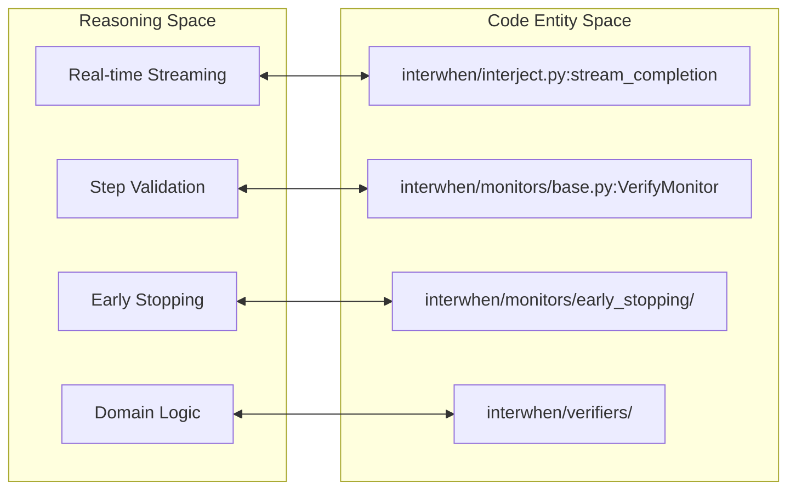

<!-- source: DeepWiki mcp.deepwiki.com · repo microsoft/interwhen · page 1 Overview · fetched 2026-10-26 -->

# Overview

<details>
<summary>Relevant source files</summary>

The following files were used as context for generating this wiki page:

- [LICENSE](LICENSE)
- [README.md](README.md)
- [environment.yml](environment.yml)
- [examples/README.md](examples/README.md)
- [interwhen/__init__.py](interwhen/__init__.py)
- [interwhen/interject.py](interwhen/interject.py)
- [pyproject.toml](pyproject.toml)

</details>


`interwhen` is a test-time verification framework for large language models (LLMs) that enforces correctness by monitoring reasoning traces in real-time. It provides a plug-and-play mechanism to improve instance-level reliability by intervening during the generation process rather than only verifying final outputs [README.md:23-27]().

The framework reframes reliability from average accuracy to explicit, verifiable constraint satisfaction [README.md:82-84](). By integrating verification directly into the inference pipeline, `interwhen` allows models to retain flexible reasoning strategies while subjecting them to structured correctness checks [README.md:74-76]().

### Key Concepts

*   **Verifier-Guided Reasoning**: A process where an auxiliary Monitor runs alongside the main model, reading the output stream and calling verifiers to check validity [README.md:72-73]().
*   **Test-Time Scaling**: A new axis for scaling performance by allocating compute to structured verification during inference [README.md:29-31]().
*   **Asynchronous Intervention**: Verifiers execute in the background and only interrupt the LLM stream when a violation is detected, minimizing latency [README.md:76-77]().
*   **Closed-Loop Correction**: When a monitor detects an error, it can inject feedback or stop generation to steer the model toward a valid state [README.md:27-28]().

### System Relationship Diagram

The following diagram illustrates how the `stream_completion` engine coordinates between the target LLM and the monitoring subsystem.

**Engine-Monitor Interaction**
```mermaid
graph TD
    subgraph "Engine Space (interwhen/interject.py)"
        SC["stream_completion()"]
        SE["asyncio.Event (stop_event)"]
        SI["stop_info dict"]
    end

    subgraph "Monitor Space (interwhen/monitors)"
        M["Monitor Class"]
        VE["verify() method"]
        FX["fix() method"]
        SX["step_extractor()"]
    end

    SC -->| "1. SSE Chunks" | SX
    SX -->| "2. stepFound" | SC
    SC -->| "3. asyncio.create_task" | VE
    VE -->| "4. set()" | SE
    VE -->| "5. Update" | SI
    SE -.->| "6. Break Loop" | SC
    SC -->| "7. Call" | FX
    FX -->| "8. feedback_text" | SC
    SC -->| "9. Recursive Call" | SC
```
Sources: [interwhen/interject.py:18-82](), [README.md:111-112]()

### Mapping Code Entities to Reasoning Space

This diagram bridges the conceptual "Reasoning Space" (how a user thinks about the problem) to the "Code Entity Space" (specific classes and files in the repository).

**Reasoning to Code Mapping**

Sources: [interwhen/interject.py:18-19](), [pyproject.toml:50-52](), [README.md:62-64]()

### Subsystem Overview

| Subsystem | Responsibility | Key File |
| :--- | :--- | :--- |
| **Streaming Engine** | Manages SSE connections to LLM servers and coordinates async monitor tasks. | [interwhen/interject.py]() |
| **Monitor Base** | Defines the interface contract (`verify`, `fix`, `step_extractor`) for all monitors. | `interwhen/monitors/base.py` |
| **Domain Verifiers** | Specialized logic for Games of 24, Mazes, ZebraLogic, and Formal Verification (Lean 4). | `interwhen/verifiers/` |
| **Early Stopping** | Strategies like EAT (Entropy After Think) and DEER to halt generation when confidence is high. | `interwhen/monitors/early_stopping/` |

### Getting Started
To begin using the framework, you must install the base dependencies. Optional extras are available for specific domains:
*   `pip install -e .` (Core) [README.md:100-100]()
*   `pip install -e .[math]` (SymPy/NumPy) [pyproject.toml:38-41]()
*   `pip install -e .[logic]` (Z3 Solver) [pyproject.toml:42-44]()

For a detailed setup guide and a minimal "Hello World" example using the `SimpleTextReplaceMonitor`, see **[Getting Started (#1.1)]()**.

### Architecture
The framework relies on a recursive loop where `stream_completion` calls itself upon detecting a monitor violation. This allows for multi-turn "corrections" within a single logical inference request.

For a deep dive into the async execution model and the interaction between the `stop_event` and the LLM stream, see **[Architecture Overview (#1.2)]()**.

Sources: [interwhen/interject.py:70-82](), [pyproject.toml:22-44](), [README.md:104-108]()

---

