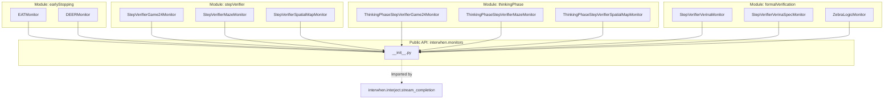
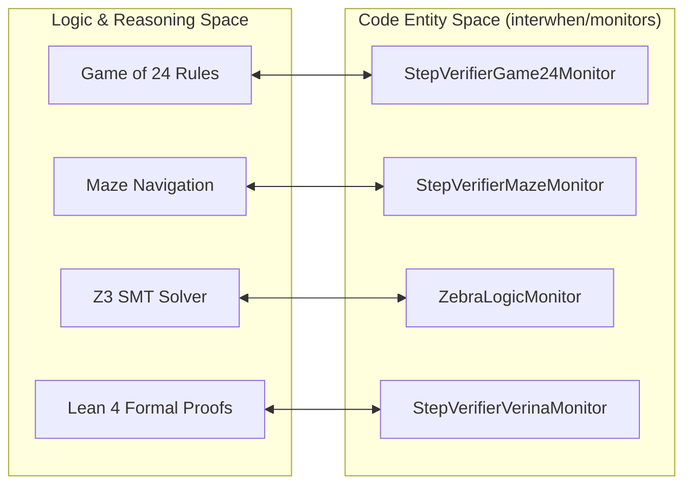

<!-- source: DeepWiki mcp.deepwiki.com · repo microsoft/interwhen · page 2.3 Monitor Package Structure · fetched 2026-10-26 -->

# Monitor Package Structure

Relevant source files

The following files were used as context for generating this wiki page:

- [interwhen/monitors/__init__.py](interwhen/monitors/__init__.py)

The `interwhen/monitors` package serves as the centralized registry and organizational hub for all monitoring strategies within the `interwhen` library. By utilizing a flat re-export structure in its initialization file, it provides a unified interface for the core engine to discover and instantiate various monitor types, ranging from simple text replacement to complex, solver-backed reasoning verifiers.

## Package Organization and Re-exports

The package is structured to consolidate monitors from diverse functional domains into a single namespace. This design allows users to import any monitor directly from `interwhen.monitors` without needing to navigate the internal subdirectory structure.

### Functional Grouping of Monitors

The monitors exported in `interwhen/monitors/__init__.py` [interwhen/monitors/__init__.py:1-10]() can be categorized into four primary functional groups:

| Group | Monitors | Purpose |
| :--- | :--- | :--- |
| **Early Stopping** | `EATMonitor`, `DEERMonitor` | Terminate LLM generation early based on entropy or confidence thresholds. |
| **Step Verifiers** | `StepVerifierGame24Monitor`, `StepVerifierMazeMonitor`, `StepVerifierSpatialMapMonitor`, `ZebraLogicMonitor` | Validate individual reasoning steps against domain-specific rules or formal solvers (Z3). |
| **Thinking Phase Verifiers** | `ThinkingPhaseStepVerifierGame24Monitor`, `ThinkingPhaseStepVerifierMazeMonitor`, `ThinkingPhaseStepVerifierSpatialMapMonitor` | Specialized verifiers that monitor the internal "thinking" process before final output. |
| **K-Stable / Utility** | `KstableAnswerMCQMonitor`, `KstableAnswerGame24Monitor`, `SimpleTextReplaceMonitor` | Ensure answer stability over $K$ steps or perform basic string manipulations. |

### Monitor Export Map

The following diagram illustrates how the `__init__.py` file aggregates entities from the underlying module structure to provide a clean API for the `stream_completion` engine.

**Diagram: Monitor Export Topology**

**Sources:** [interwhen/monitors/__init__.py:1-10]()

## Implementation Detail: Discovery and Usage

The `interwhen/monitors/__init__.py` file acts as a manifest. When a developer or a benchmark script (e.g., `game24_example.py`) needs to apply a specific intervention strategy, it references these classes directly.

### Discovery Pattern
To discover available monitors, developers can inspect the `__init__.py` file, which explicitly lists all supported classes [interwhen/monitors/__init__.py:1-10](). Each monitor inherits from a base class defined in `interwhen/monitors/base.py`, ensuring they all implement the `verify()` and `fix()` interface required by the interjection loop.

### Integration with Code Entities
The following table maps the system-level concepts to the specific code entities exported by the package:

| System Concept | Code Entity (Class Name) | Source File |
| :--- | :--- | :--- |
| **Text Replacement** | `SimpleTextReplaceMonitor` | [interwhen/monitors/__init__.py:1]() |
| **MCQ Stability** | `KstableAnswerMCQMonitor` | [interwhen/monitors/__init__.py:2]() |
| **Entropy Stopping** | `EATMonitor` | [interwhen/monitors/__init__.py:4]() |
| **Z3 Logic Solver** | `ZebraLogicMonitor` | [interwhen/monitors/__init__.py:8]() |
| **Lean 4 Verifier** | `StepVerifierVerinaMonitor` | [interwhen/monitors/__init__.py:9]() |

**Diagram: Code Entity Association**

**Sources:** [interwhen/monitors/__init__.py:3-10]()

## Summary of Specialized Monitors

*   **Step Verifiers:** Located in `stepVerifier.py`, these monitors use regex-based step extraction to validate intermediate reasoning [interwhen/monitors/__init__.py:3]().
*   **Thinking Phase Verifiers:** These are variants that trigger during the `<think>` blocks of reasoning models, providing feedback before the model commits to a final answer [interwhen/monitors/__init__.py:5-7]().
*   **Formal Verification:** The `verina` monitors (`StepVerifierVerinaMonitor` and `StepVerifierVerinaSpecMonitor`) integrate with external environments like Lean 4 to verify code correctness and specification soundness [interwhen/monitors/__init__.py:9-10]().

**Sources:** [interwhen/monitors/__init__.py:1-11]()

---

