# Page: Overview

# Overview

<details>
<summary>Relevant source files</summary>

The following files were used as context for generating this wiki page:

- [LICENSE](LICENSE)
- [README.md](README.md)
- [environment.yml](environment.yml)
- [examples/README.md](examples/README.md)
- [interwhen/__init__.py](interwhen/__init__.py)
- [interwhen/interject.py](interwhen/interject.py)
- [pyproject.toml](pyproject.toml)

</details>


`interwhen` is a test-time verification framework for large language models (LLMs) that enforces correctness by monitoring reasoning traces in real-time. It provides a plug-and-play mechanism to improve instance-level reliability by intervening during the generation process rather than only verifying final outputs [README.md:23-27]().

The framework reframes reliability from average accuracy to explicit, verifiable constraint satisfaction [README.md:82-84](). By integrating verification directly into the inference pipeline, `interwhen` allows models to retain flexible reasoning strategies while subjecting them to structured correctness checks [README.md:74-76]().

### Key Concepts

*   **Verifier-Guided Reasoning**: A process where an auxiliary Monitor runs alongside the main model, reading the output stream and calling verifiers to check validity [README.md:72-73]().
*   **Test-Time Scaling**: A new axis for scaling performance by allocating compute to structured verification during inference [README.md:29-31]().
*   **Asynchronous Intervention**: Verifiers execute in the background and only interrupt the LLM stream when a violation is detected, minimizing latency [README.md:76-77]().
*   **Closed-Loop Correction**: When a monitor detects an error, it can inject feedback or stop generation to steer the model toward a valid state [README.md:27-28]().

### System Relationship Diagram

The following diagram illustrates how the `stream_completion` engine coordinates between the target LLM and the monitoring subsystem.

**Engine-Monitor Interaction**
```mermaid
graph TD
    subgraph "Engine Space (interwhen/interject.py)"
        SC["stream_completion()"]
        SE["asyncio.Event (stop_event)"]
        SI["stop_info dict"]
    end

    subgraph "Monitor Space (interwhen/monitors)"
        M["Monitor Class"]
        VE["verify() method"]
        FX["fix() method"]
        SX["step_extractor()"]
    end

    SC -->| "1. SSE Chunks" | SX
    SX -->| "2. stepFound" | SC
    SC -->| "3. asyncio.create_task" | VE
    VE -->| "4. set()" | SE
    VE -->| "5. Update" | SI
    SE -.->| "6. Break Loop" | SC
    SC -->| "7. Call" | FX
    FX -->| "8. feedback_text" | SC
    SC -->| "9. Recursive Call" | SC
```
Sources: [interwhen/interject.py:18-82](), [README.md:111-112]()

### Mapping Code Entities to Reasoning Space

This diagram bridges the conceptual "Reasoning Space" (how a user thinks about the problem) to the "Code Entity Space" (specific classes and files in the repository).

**Reasoning to Code Mapping**
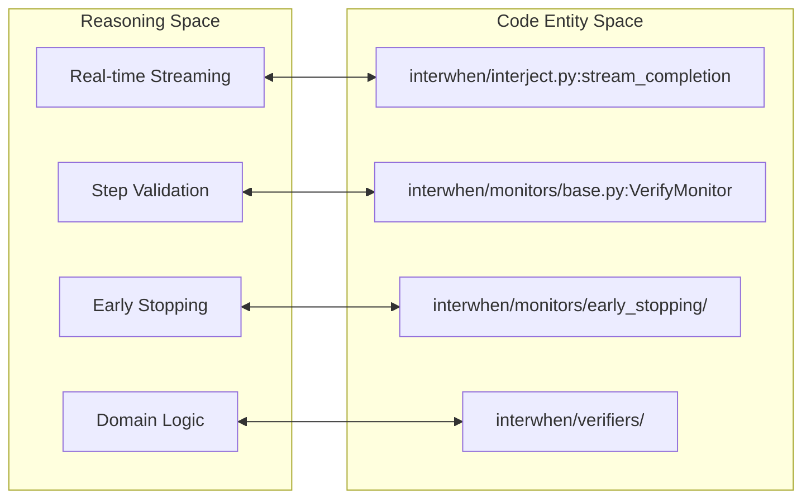
Sources: [interwhen/interject.py:18-19](), [pyproject.toml:50-52](), [README.md:62-64]()

### Subsystem Overview

| Subsystem | Responsibility | Key File |
| :--- | :--- | :--- |
| **Streaming Engine** | Manages SSE connections to LLM servers and coordinates async monitor tasks. | [interwhen/interject.py]() |
| **Monitor Base** | Defines the interface contract (`verify`, `fix`, `step_extractor`) for all monitors. | `interwhen/monitors/base.py` |
| **Domain Verifiers** | Specialized logic for Games of 24, Mazes, ZebraLogic, and Formal Verification (Lean 4). | `interwhen/verifiers/` |
| **Early Stopping** | Strategies like EAT (Entropy After Think) and DEER to halt generation when confidence is high. | `interwhen/monitors/early_stopping/` |

### Getting Started
To begin using the framework, you must install the base dependencies. Optional extras are available for specific domains:
*   `pip install -e .` (Core) [README.md:100-100]()
*   `pip install -e .[math]` (SymPy/NumPy) [pyproject.toml:38-41]()
*   `pip install -e .[logic]` (Z3 Solver) [pyproject.toml:42-44]()

For a detailed setup guide and a minimal "Hello World" example using the `SimpleTextReplaceMonitor`, see **[Getting Started (#1.1)]()**.

### Architecture
The framework relies on a recursive loop where `stream_completion` calls itself upon detecting a monitor violation. This allows for multi-turn "corrections" within a single logical inference request.

For a deep dive into the async execution model and the interaction between the `stop_event` and the LLM stream, see **[Architecture Overview (#1.2)]()**.

Sources: [interwhen/interject.py:70-82](), [pyproject.toml:22-44](), [README.md:104-108]()

---

# Page: Getting Started

# Getting Started

<details>
<summary>Relevant source files</summary>

The following files were used as context for generating this wiki page:

- [environment.yml](environment.yml)
- [examples/text_replacement_example.py](examples/text_replacement_example.py)
- [interwhen/interject.py](interwhen/interject.py)
- [pyproject.toml](pyproject.toml)
- [text_replacement.mp4](text_replacement.mp4)

</details>


This page provides the necessary instructions to install, configure, and run the `interwhen` library. It covers environment setup using `conda` or `pip`, dependency management via optional extras, and a minimal working example using the `SimpleTextReplaceMonitor`.

## Installation and Dependencies

`interwhen` requires Python 3.9 or higher [pyproject.toml:11-11](). The core library depends on `openai`, `pydantic`, `regex`, `tiktoken`, and `vllm` [pyproject.toml:22-28]().

### Optional Extras
Depending on the specific reasoning tasks and monitors you intend to use, you may need to install optional dependencies defined in `pyproject.toml` [pyproject.toml:30-44]():

| Extra | Dependencies | Purpose |
| :--- | :--- | :--- |
| `math` | `sympy`, `numpy` | Used for mathematical verification (e.g., Game of 24) |
| `logic` | `z3-solver` | Required for SMT-based reasoning (e.g., Spatial Map, ZebraLogic) |
| `dev` | `pytest`, `black`, `isort`, `mypy` | Tools for library development and testing |

### Environment Setup
A comprehensive `environment.yml` is provided for setting up a development environment with `conda` [environment.yml:1-219]().

```bash
# Create environment from file
conda env create -f environment.yml
conda activate inter

# Or install via pip with specific extras
pip install .[math,logic]
```

**Sources:** [pyproject.toml:11-44](), [environment.yml:1-219]()

---

## Minimal Working Example

The following example demonstrates how to use `stream_completion` with a `SimpleTextReplaceMonitor`. This monitor listens for a specific "IsCheck" trigger and injects a replacement string (e.g., `</think>`) into the generation stream.

### Logic Flow: Text Replacement
The diagram below illustrates how the `stream_completion` loop interacts with the `Monitor` interface to intercept and modify LLM output.

**Title: Interjection Loop Data Flow**
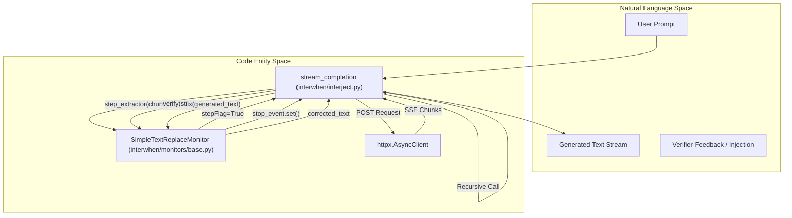
**Sources:** [interwhen/interject.py:18-82](), [examples/text_replacement_example.py:47-54]()

### Implementation: text_replacement_example.py
The example script configures a local LLM server (compatible with `vLLM` or `OpenAI` API formats) and attaches a monitor.

1.  **Server Initialization**: The `init_llm_server` function defines the endpoint and payload for the SSE stream [examples/text_replacement_example.py:10-25]().
2.  **Monitor Attachment**: A `SimpleTextReplaceMonitor` is instantiated with a trigger string ("IsCheck") and a replacement [examples/text_replacement_example.py:50-50]().
3.  **Execution**: `stream_completion` manages the asynchronous tasks and handles the recursive "fix" loop if the monitor triggers an early stop [interwhen/interject.py:18-22]().

```python
# Minimal snippet from examples/text_replacement_example.py
result = await stream_completion(
    text,
    llm_server=llm_server,
    monitors=(SimpleTextReplaceMonitor("IsCheck", "</think>"),),
    async_execution=True
)
```

**Sources:** [examples/text_replacement_example.py:10-60](), [interwhen/interject.py:18-82]()

---

## Core Execution Model

The `stream_completion` function in `interwhen/interject.py` is the entry point for the closed-loop control system.

### Key Functions and Classes

| Entity | Role | File Reference |
| :--- | :--- | :--- |
| `stream_completion` | Orchestrates the SSE stream, monitor task creation, and recursion. | [interwhen/interject.py:18-82]() |
| `SimpleTextReplaceMonitor` | Reference monitor that triggers based on substring matching. | [interwhen/monitors/base.py]() |
| `stop_event` | `asyncio.Event` used to signal all tasks to halt when a monitor fails. | [interwhen/interject.py:20-20]() |
| `stop_info` | Shared dictionary containing metadata about the failure (feedback, token index). | [interwhen/interject.py:21-21]() |

### Token-by-Token Processing
As chunks arrive via SSE [interwhen/interject.py:31-41](), the system:
1.  Appends the chunk to `generated_text` [interwhen/interject.py:48-48]().
2.  Calls `monitors[0].step_extractor` to determine if a reasoning step is complete [interwhen/interject.py:52-52]().
3.  If `stepFlag` is true, it spawns an asynchronous `verify` task [interwhen/interject.py:55-55]().
4.  If `stop_event` is set during verification, it cancels pending tasks and invokes `monitors[0].fix()` to prepare the prompt for the next iteration [interwhen/interject.py:64-75]().

**Sources:** [interwhen/interject.py:18-82](), [examples/text_replacement_example.py:4-5]()

---

# Page: Architecture Overview

# Architecture Overview

<details>
<summary>Relevant source files</summary>

The following files were used as context for generating this wiki page:

- [README.md](README.md)
- [examples/README.md](examples/README.md)
- [interwhen/__init__.py](interwhen/__init__.py)
- [interwhen/interject.py](interwhen/interject.py)
- [pyproject.toml](pyproject.toml)

</details>


The `interwhen` framework implements a **closed-loop control architecture** for Large Language Models (LLMs). It shifts from the traditional open-loop "prompt-and-generate" paradigm to a system where the model's output stream is treated as a continuous signal subject to real-time verification and intervention [README.md:23-28]().

## System Architecture

The core of the system is the `stream_completion` engine, which manages the lifecycle of a request from initial prompt to a verified final response. It coordinates between the LLM server (via SSE streaming), the `Monitor` suite, and a recursive correction loop [interwhen/interject.py:18-22]().

### High-Level Data Flow
The following diagram illustrates how the system bridges the gap between raw text generation and structured verification logic.

**Diagram: Verifier-Guided Reasoning Loop**
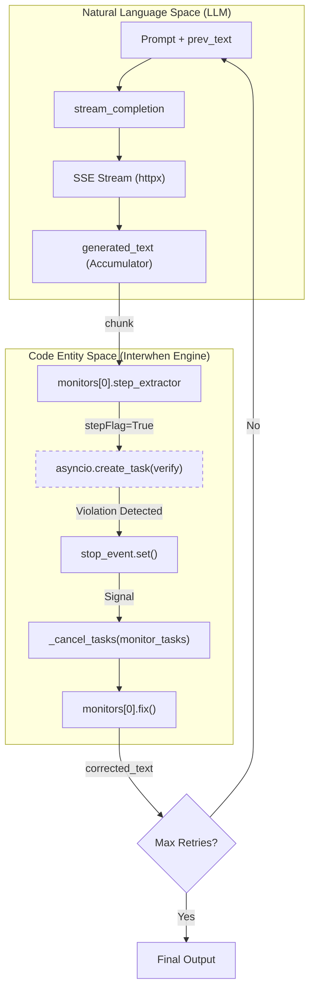
Sources: [interwhen/interject.py:18-82](), [README.md:71-79]()

## Core Components

### 1. The Interjection Loop (`stream_completion`)
The `stream_completion` function is the primary entry point. It establishes an asynchronous HTTP connection to an OpenAI-compatible API server [interwhen/interject.py:29-30](). 

- **Streaming Management**: It processes server-sent events (SSE). As each text `chunk` arrives, it is appended to the `generated_text` buffer [interwhen/interject.py:31-48]().
- **Task Orchestration**: For every chunk, it invokes the `step_extractor` of the active monitor. If a logical "step" is identified, it spawns a background `asyncio.Task` to run `verify()` [interwhen/interject.py:51-56]().
- **Early Termination**: If any verification task detects a violation, it sets a shared `asyncio.Event` (`stop_event`). This causes the engine to immediately stop consuming the stream and cancel all other pending verification tasks [interwhen/interject.py:64-66]().

### 2. Monitors and Verifiers
Monitors are the "sensors" and "actuators" of the framework. A monitor typically wraps a domain-specific verifier (e.g., a Z3 solver for logic or a Lean 4 compiler for code) [README.md:78-79]().

| Component | Responsibility | Code Reference |
| :--- | :--- | :--- |
| **`step_extractor`** | Parses the raw stream to identify verify-able units (e.g., a line of math, a move in a game). | [interwhen/interject.py:52]() |
| **`verify`** | An async function that checks the validity of a step. It updates `stop_info` on failure. | [interwhen/interject.py:55]() |
| **`fix`** | Generates the intervention text (feedback) to be injected back into the LLM's context. | [interwhen/interject.py:75]() |

Sources: [interwhen/interject.py:50-60](), [README.md:110-112]()

## Execution Model

The framework supports both `async_execution=True` (default) and synchronous execution. 

### Asynchronous Pipeline
In the default mode, verification tasks run concurrently with the LLM's generation. This minimizes the latency impact of slow verifiers (like formal solvers). The engine only blocks if a violation is found or the stream ends [interwhen/interject.py:63-69]().

**Diagram: Async Task Lifecycle**
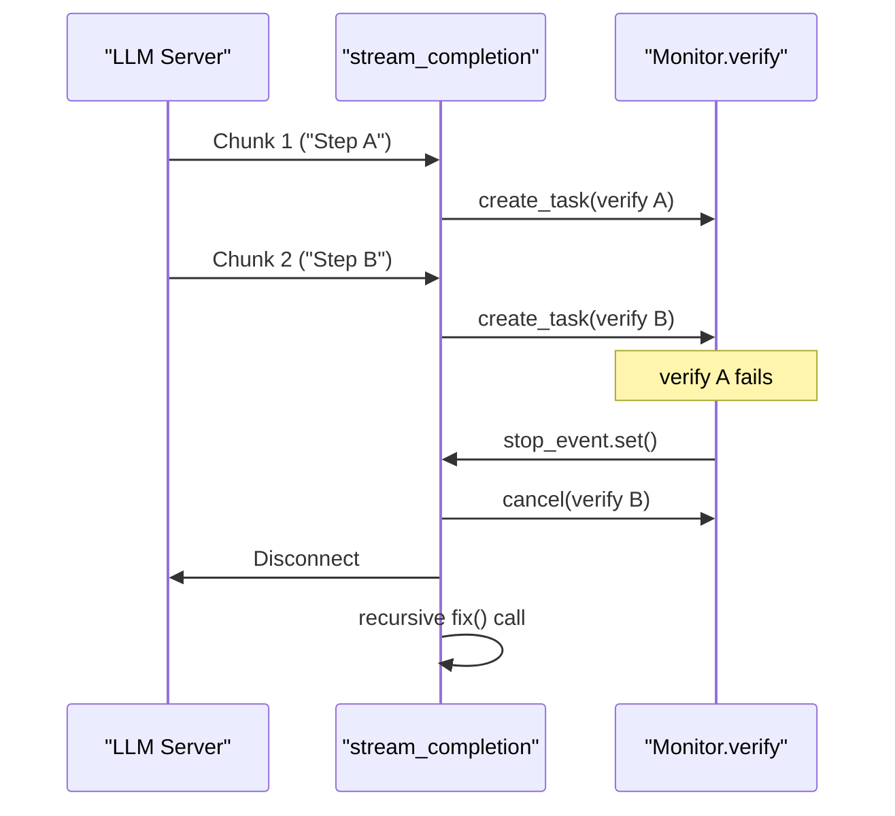
Sources: [interwhen/interject.py:55-68](), [README.md:76-77]()

### Recursive Correction
When a monitor triggers a stop, the system does not simply fail. It enters a recursive loop:
1. The `fix()` method appends feedback to the current reasoning trace [interwhen/interject.py:75]().
2. `stream_completion` is called again with the `corrected_text` as the new `prev_text` (prefix) [interwhen/interject.py:80]().
3. A safety guard (`num_calls_index`) prevents infinite loops, defaulting to a maximum of 50 correction attempts [interwhen/interject.py:71-73]().

Sources: [interwhen/interject.py:70-82]()

---

# Page: Core Engine

# Core Engine

<details>
<summary>Relevant source files</summary>

The following files were used as context for generating this wiki page:

- [interwhen/interject.py](interwhen/interject.py)
- [interwhen/monitors/__init__.py](interwhen/monitors/__init__.py)
- [pyproject.toml](pyproject.toml)

</details>


The **Core Engine** of `interwhen` provides the fundamental infrastructure for real-time monitoring and interjection during Large Language Model (LLM) generation. It implements a closed-loop control system where streaming output is intercepted, analyzed by domain-specific monitors, and potentially corrected via recursive feedback loops.

The engine is composed of three primary pillars:
1.  **The Interjection Loop**: An asynchronous streaming engine that manages SSE (Server-Sent Events) and coordinates monitor execution.
2.  **Monitor Abstraction Layer**: A set of base classes that define the contract for verification, extraction, and correction.
3.  **Monitor Registry**: A structured package that exposes specialized monitors for math, logic, and early stopping.

## System Architecture

The following diagram illustrates how the Core Engine components bridge the gap between the raw LLM stream and the structured verification logic.

### Data Flow: Stream to Verification
This diagram shows the relationship between the `stream_completion` function and the `Monitor` interface.

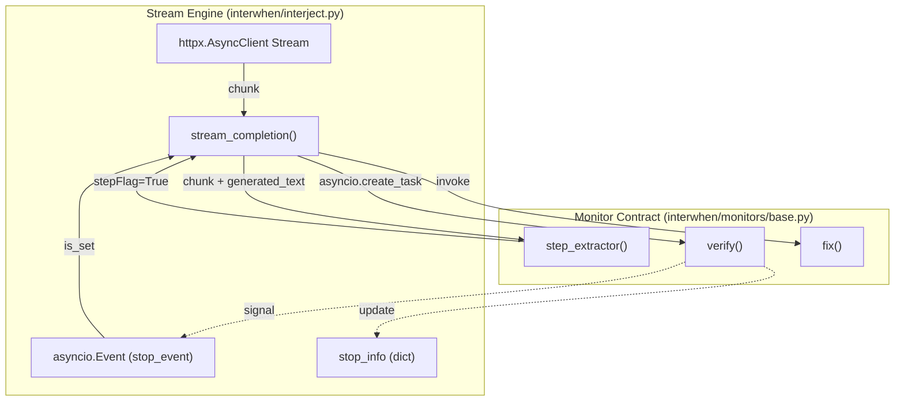
**Sources:** [interwhen/interject.py:18-82](), [interwhen/monitors/base.py:1-50]() (Note: base.py implied by structure).

## Component Overview

### 1. stream_completion and the Interjection Loop
The `stream_completion` function in `interwhen/interject.py` is the entry point for the library. It handles the low-level `httpx` streaming from an OpenAI-compatible API and manages the lifecycle of `asyncio` tasks that perform verification.

*   **Recursive Correction**: If a monitor triggers a `stop_event`, the engine calls `fix()` and recursively calls `stream_completion` with the corrected text [interwhen/interject.py:75-80]().
*   **Safety Guards**: A `num_calls_index` tracks the number of interjections to prevent infinite loops, capping at 50 attempts [interwhen/interject.py:71-73]().

For details, see [stream_completion and the Interjection Loop](#2.1).

### 2. Monitor Base Classes
The library relies on a strict interface for monitors to ensure compatibility with the async loop. Every monitor must implement logic to extract meaningful "steps" from a stream and determine if those steps warrant an interjection.

| Method | Role |
| :--- | :--- |
| `step_extractor` | Identifies boundaries in the text (e.g., newlines, LaTeX boxes) to trigger verification. |
| `verify` | An `async` method that runs domain logic and signals the `stop_event` if an error is found. |
| `fix` | Generates the feedback string or modified text to be injected back into the prompt. |

For details, see [Monitor Base Classes](#2.2).

### 3. Monitor Package Structure
The `interwhen.monitors` package serves as a registry, organizing monitors by their functional purpose. This structure allows users to easily swap between simple text replacement, complex Z3-based logic verification, or entropy-based early stopping.

**Key Groupings in `interwhen/monitors/__init__.py`:**
*   **Early Stopping**: `EATMonitor`, `DEERMonitor` [interwhen/monitors/__init__.py:4-4]().
*   **Step Verifiers**: `StepVerifierGame24Monitor`, `StepVerifierMazeMonitor`, `StepVerifierSpatialMapMonitor` [interwhen/monitors/__init__.py:3-3]().
*   **Formal Verification**: `StepVerifierVerinaMonitor` (Lean 4) [interwhen/monitors/__init__.py:9-9]().

For details, see [Monitor Package Structure](#2.3).

## Class Hierarchy and Registry

The following diagram maps the logical categories of monitors to their specific implementation classes exported by the package.

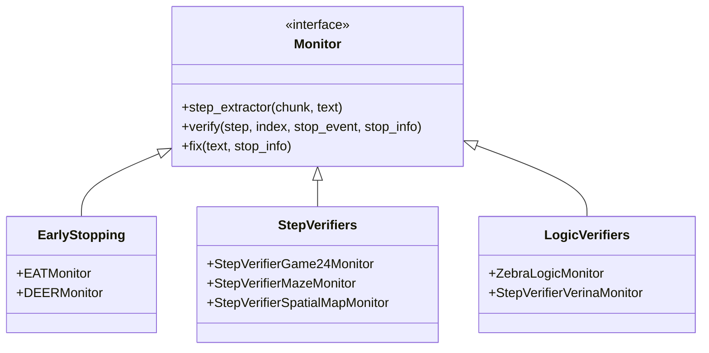
**Sources:** [interwhen/monitors/__init__.py:1-10](), [interwhen/interject.py:52-55]().

## Dependencies and Installation
The core engine requires `vllm` or an OpenAI-compatible server for streaming. Logic-based monitors require optional dependencies defined in `pyproject.toml`.

*   **Core**: `openai`, `httpx`, `vllm` [pyproject.toml:22-28]().
*   **Logic (Z3)**: `z3-solver` [pyproject.toml:42-44]().
*   **Math**: `sympy`, `numpy` [pyproject.toml:38-41]().

**Sources:** [pyproject.toml:22-44]().

---

# Page: stream_completion and the Interjection Loop

# stream_completion and the Interjection Loop

<details>
<summary>Relevant source files</summary>

The following files were used as context for generating this wiki page:

- [interwhen/__init__.py](interwhen/__init__.py)
- [interwhen/interject.py](interwhen/interject.py)
- [pyproject.toml](pyproject.toml)

</details>


This page provides a detailed technical walkthrough of the core streaming engine and the recursive interjection loop implemented in `interwhen/interject.py`. This subsystem is responsible for managing the lifecycle of an LLM generation, coordinating real-time monitor verification, and handling recursive corrections when reasoning errors are detected.

## Overview of stream_completion

The `stream_completion` function is the primary entry point for the `interwhen` library [interwhen/__init__.py:1](). It manages an asynchronous Server-Sent Events (SSE) stream from an LLM server and orchestrates "monitors" that inspect the text in real-time.

### Data Flow and Task Management

When `stream_completion` is invoked, it initializes a synchronization primitive, `asyncio.Event` (referred to as `stop_event`), and a shared dictionary, `stop_info`, to capture metadata from monitors when they trigger an interjection [interwhen/interject.py:20-21]().

The function utilizes `httpx.AsyncClient` to maintain a persistent connection to the LLM provider [interwhen/interject.py:29-30](). As chunks (tokens) arrive, they are appended to the `generated_text` buffer. For every chunk received, the engine invokes the `step_extractor` of the active monitor to determine if a logical "step" has been completed [interwhen/interject.py:51-52]().

**Key Execution Parameters:**
| Parameter | Role |
| :--- | :--- |
| `num_calls_index` | Tracks the recursion depth of the interjection loop to prevent infinite loops [interwhen/interject.py:19](). |
| `async_execution` | Boolean flag. If `True`, monitor `verify` calls run as background tasks. If `False`, the stream blocks until verification completes [interwhen/interject.py:55-58](). |
| `stop_event` | An `asyncio.Event` shared across all monitor tasks to signal an immediate halt to the stream [interwhen/interject.py:20](). |

**Sources:**
- [interwhen/interject.py:18-61]()
- [interwhen/__init__.py:1]()

## The Interjection Loop Logic

The "Interjection Loop" is a recursive pattern where the system catches an error, modifies the prompt/history, and restarts the generation.

### Step Extraction and Verification
As the LLM streams, the engine checks for reasoning steps. If `step_extractor` returns a `stepFlag`, the engine spawns a `verify` task [interwhen/interject.py:52-55]().

1.  **Extraction**: `monitors[0].step_extractor(chunk, generated_text)` is called for every token.
2.  **Verification**: If a step is found, `monitors[0].verify(...)` is executed. It receives the current `stop_event` and `stop_info` to signal if the reasoning is flawed [interwhen/interject.py:55]().
3.  **Early Exit**: If `stop_event.is_set()` becomes true during streaming, the engine breaks the SSE loop and ignores subsequent chunks [interwhen/interject.py:44-46]().

### Task Cleanup
If an early stop is triggered, the engine calls `_cancel_tasks` to immediately terminate any pending background verification tasks that have not yet completed [interwhen/interject.py:63-66](). If no stop was triggered, it waits for all tasks to finish via `asyncio.gather` before proceeding [interwhen/interject.py:68]().

### Recursive Correction
If the `stop_event` was set by a monitor, the engine enters the correction phase:
1.  **Fix**: It calls `monitors[0].fix(generated_text, stop_info)` to append feedback or truncate the erroneous reasoning [interwhen/interject.py:75]().
2.  **Recursion**: It calls `stream_completion` again, passing the `corrected_text` as `prev_text` and incrementing `num_calls_index` [interwhen/interject.py:80]().
3.  **Guard**: The loop is hard-capped at 50 calls to prevent infinite recursion [interwhen/interject.py:71-73]().

**Sources:**
- [interwhen/interject.py:9-17]()
- [interwhen/interject.py:43-80]()

## Code Entity Map: Streaming and Control

The following diagram maps the logical flow of the interjection loop to the specific functions and objects in `interwhen/interject.py`.

**Figure 1: stream_completion Control Flow**
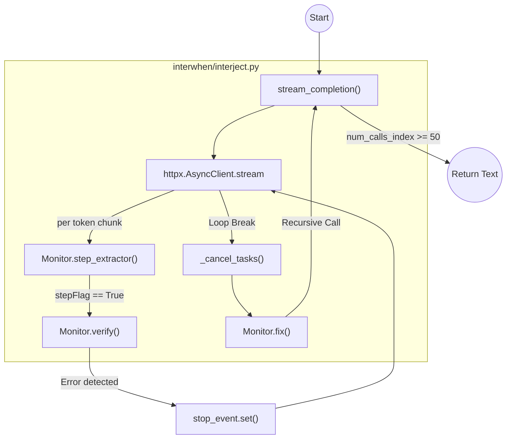
**Sources:**
- [interwhen/interject.py:18-82]()

## Data Interaction Map

This diagram illustrates how data structures are passed between the core engine and the monitor instances during the verification lifecycle.

**Figure 2: Data Flow and State Management**
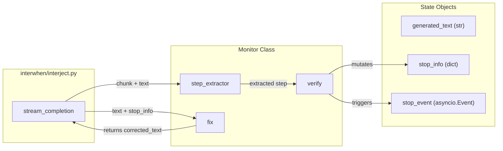
**Sources:**
- [interwhen/interject.py:20-21]()
- [interwhen/interject.py:52-55]()
- [interwhen/interject.py:75-80]()

## Implementation Details: stream_completion

| Feature | Implementation Detail |
| :--- | :--- |
| **SSE Parsing** | Parses lines starting with `data: ` and handles the `[DONE]` signal [interwhen/interject.py:32-35](). |
| **JSON Handling** | Extracts text from `choices[0][text]` and provides debug logging for malformed data [interwhen/interject.py:39-42](). |
| **Task Cancellation** | Uses `asyncio.gather` with `return_exceptions=True` to safely swallow `CancelledError` [interwhen/interject.py:16](). |
| **Feedback Handling** | Specific checks for `no solution` feedback or `final_answer_correct` phase to terminate early without further recursion [interwhen/interject.py:76-79](). |

**Sources:**
- [interwhen/interject.py:9-17]()
- [interwhen/interject.py:31-42]()
- [interwhen/interject.py:76-79]()

---

# Page: Monitor Base Classes

# Monitor Base Classes

<details>
<summary>Relevant source files</summary>

The following files were used as context for generating this wiki page:

- [interwhen/monitors/_common.py](interwhen/monitors/_common.py)
- [interwhen/monitors/base.py](interwhen/monitors/base.py)
- [interwhen/monitors/textReplacement.py](interwhen/monitors/textReplacement.py)

</details>


The `interwhen` library employs a closed-loop control architecture where partial LLM outputs are monitored in real-time. This monitoring logic is encapsulated in abstract base classes that define how the system should evaluate streaming text, signal for interruptions, and perform corrections.

## Monitor Abstractions

The library provides two primary base classes in [interwhen/monitors/base.py](): `Monitor` and `VerifyMonitor`. While `Monitor` is a general-purpose interface, the majority of the library's functionality (including early stopping and step verification) is built upon the `VerifyMonitor` pattern.

### Monitor Class
The `Monitor` class is the most basic abstraction for analyzing partial text output.

*   **Role**: Analyzes partial text and suggests improvements.
*   **Key Method**: `evaluate` [interwhen/monitors/base.py:30-44](). This method is intended to return suggested actions based on the current `chunk`, `token_index`, and `generated_text`.

### VerifyMonitor Class
The `VerifyMonitor` class defines the interface for the **Verify/Fix** pattern used by the `interject` loop. It coordinates with the streaming engine to pause generation when a condition is met and provide a mechanism to rewrite or append to the prompt.

*   **Role**: Detects domain-specific errors or stopping conditions during streaming and provides the logic to "fix" the state before resuming.
*   **Key Methods**:
    *   `verify(...)`: Analyzes streaming chunks and signals an `asyncio.Event` if an interjection is required [interwhen/monitors/base.py:72-83]().
    *   `fix(...)`: Implements the logic to modify the `generated_text` once an interjection is triggered [interwhen/monitors/base.py:85-98]().
    *   `step_extractor(...)`: Determines the boundaries of reasoning steps or identifies when to stop generating based on specific tokens [interwhen/monitors/base.py:100-112]().

### Relationship between Base Classes and Code Entities

The following diagram maps the conceptual "Closed-Loop" logic to the specific code entities defined in the base classes.

**Monitor Interface Mapping**
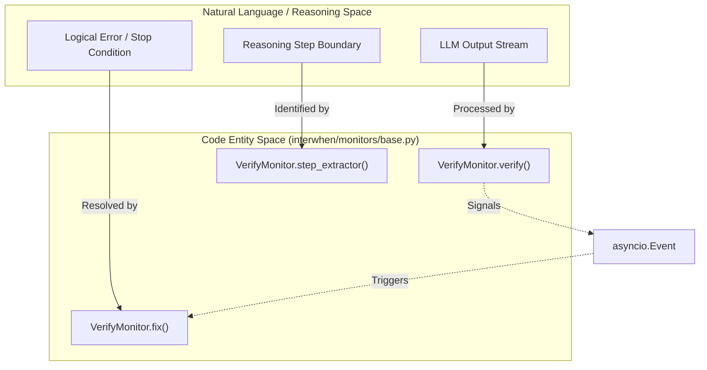
Sources: [interwhen/monitors/base.py:53-112]()

---

## The Verify/Fix Interface Contract

The `VerifyMonitor` relies on a specific signaling pattern using `asyncio.Event` and a shared `event_info` dictionary to communicate between the asynchronous streaming task and the interjection loop.

### Signaling Pattern
1.  **Detection**: Inside `verify()`, the monitor checks the `chunk`. If a violation is found, it populates the `event_info` dictionary with metadata (e.g., error type, required feedback, or index of the error).
2.  **Signaling**: The monitor calls `event.set()` [interwhen/monitors/textReplacement.py:28-28]().
3.  **Interruption**: The `interject` loop (see Section 2.1) detects the event, stops the stream, and passes the `event_info` to the `fix()` method.

### event_info Schema
While the schema is flexible, common keys used across implementations include:
| Key | Description |
| :--- | :--- |
| `generated_text` | The chunk or text that triggered the event. |
| `feedback` | The correction string or [VERIFIER FEEDBACK] to be injected. |
| `correction_index` | The integer position in the string where the fix should be applied. |

Sources: [interwhen/monitors/base.py:73-83](), [interwhen/monitors/textReplacement.py:19-29]()

---

## Reference Implementation: SimpleTextReplaceMonitor

The `SimpleTextReplaceMonitor` [interwhen/monitors/textReplacement.py:7-37]() serves as the reference implementation for the `VerifyMonitor` interface. It demonstrates a basic "find and replace" correction during streaming.

### Data Flow and Logic
When the monitor encounters the word "is" in a streaming chunk, it signals for a correction to change "is" to "isn't".

**SimpleTextReplaceMonitor Data Flow**
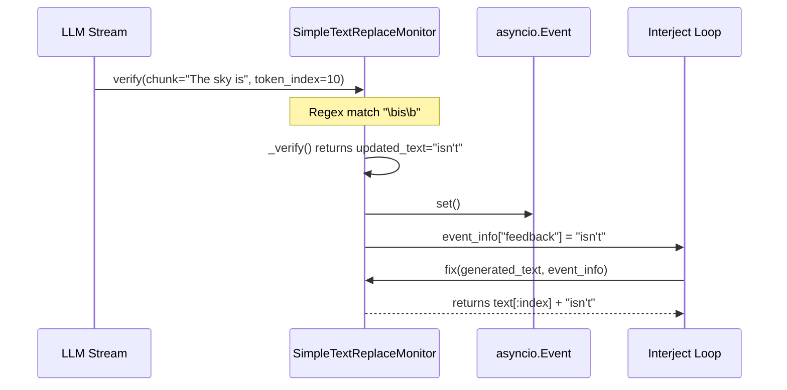

### Implementation Details
*   **`verify`**: Uses `re.search(r'\bis\b', chunk)` to find the target word [interwhen/monitors/textReplacement.py:14-17](). If found, it populates `event_info` and sets the event [interwhen/monitors/textReplacement.py:24-28]().
*   **`fix`**: Performs a slice-and-concatenate operation to replace the original text with the feedback [interwhen/monitors/textReplacement.py:30-31]().
*   **`step_extractor`**: Checks for the `answer_start_token`. If the token (e.g., `\nFinal Answer:`) is found, it returns `False` to signal the end of step generation [interwhen/monitors/textReplacement.py:33-36]().

Sources: [interwhen/monitors/textReplacement.py:7-37]()

---

## Shared Utilities

The library provides shared utilities in [interwhen/monitors/_common.py]() to assist monitors in parsing complex LLM outputs, particularly LaTeX-style reasoning.

### find_complete_boxed
A critical utility for mathematical and logical monitors is `find_complete_boxed(text)` [interwhen/monitors/_common.py:9-51](). Unlike standard regular expressions, this function uses a brace-counting algorithm to correctly handle nested structures within LaTeX `\boxed{...}` commands, such as `\boxed{12\frac{1}{2}}`.

Sources: [interwhen/monitors/_common.py:9-51]()

---

# Page: Monitor Package Structure

# Monitor Package Structure

<details>
<summary>Relevant source files</summary>

The following files were used as context for generating this wiki page:

- [interwhen/monitors/__init__.py](interwhen/monitors/__init__.py)

</details>


The `interwhen/monitors` package serves as the centralized registry and organizational hub for all monitoring strategies within the `interwhen` library. By utilizing a flat re-export structure in its initialization file, it provides a unified interface for the core engine to discover and instantiate various monitor types, ranging from simple text replacement to complex, solver-backed reasoning verifiers.

## Package Organization and Re-exports

The package is structured to consolidate monitors from diverse functional domains into a single namespace. This design allows users to import any monitor directly from `interwhen.monitors` without needing to navigate the internal subdirectory structure.

### Functional Grouping of Monitors

The monitors exported in `interwhen/monitors/__init__.py` [interwhen/monitors/__init__.py:1-10]() can be categorized into four primary functional groups:

| Group | Monitors | Purpose |
| :--- | :--- | :--- |
| **Early Stopping** | `EATMonitor`, `DEERMonitor` | Terminate LLM generation early based on entropy or confidence thresholds. |
| **Step Verifiers** | `StepVerifierGame24Monitor`, `StepVerifierMazeMonitor`, `StepVerifierSpatialMapMonitor`, `ZebraLogicMonitor` | Validate individual reasoning steps against domain-specific rules or formal solvers (Z3). |
| **Thinking Phase Verifiers** | `ThinkingPhaseStepVerifierGame24Monitor`, `ThinkingPhaseStepVerifierMazeMonitor`, `ThinkingPhaseStepVerifierSpatialMapMonitor` | Specialized verifiers that monitor the internal "thinking" process before final output. |
| **K-Stable / Utility** | `KstableAnswerMCQMonitor`, `KstableAnswerGame24Monitor`, `SimpleTextReplaceMonitor` | Ensure answer stability over $K$ steps or perform basic string manipulations. |

### Monitor Export Map

The following diagram illustrates how the `__init__.py` file aggregates entities from the underlying module structure to provide a clean API for the `stream_completion` engine.

**Diagram: Monitor Export Topology**
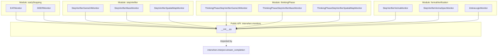
**Sources:** [interwhen/monitors/__init__.py:1-10]()

## Implementation Detail: Discovery and Usage

The `interwhen/monitors/__init__.py` file acts as a manifest. When a developer or a benchmark script (e.g., `game24_example.py`) needs to apply a specific intervention strategy, it references these classes directly.

### Discovery Pattern
To discover available monitors, developers can inspect the `__init__.py` file, which explicitly lists all supported classes [interwhen/monitors/__init__.py:1-10](). Each monitor inherits from a base class defined in `interwhen/monitors/base.py`, ensuring they all implement the `verify()` and `fix()` interface required by the interjection loop.

### Integration with Code Entities
The following table maps the system-level concepts to the specific code entities exported by the package:

| System Concept | Code Entity (Class Name) | Source File |
| :--- | :--- | :--- |
| **Text Replacement** | `SimpleTextReplaceMonitor` | [interwhen/monitors/__init__.py:1]() |
| **MCQ Stability** | `KstableAnswerMCQMonitor` | [interwhen/monitors/__init__.py:2]() |
| **Entropy Stopping** | `EATMonitor` | [interwhen/monitors/__init__.py:4]() |
| **Z3 Logic Solver** | `ZebraLogicMonitor` | [interwhen/monitors/__init__.py:8]() |
| **Lean 4 Verifier** | `StepVerifierVerinaMonitor` | [interwhen/monitors/__init__.py:9]() |

**Diagram: Code Entity Association**
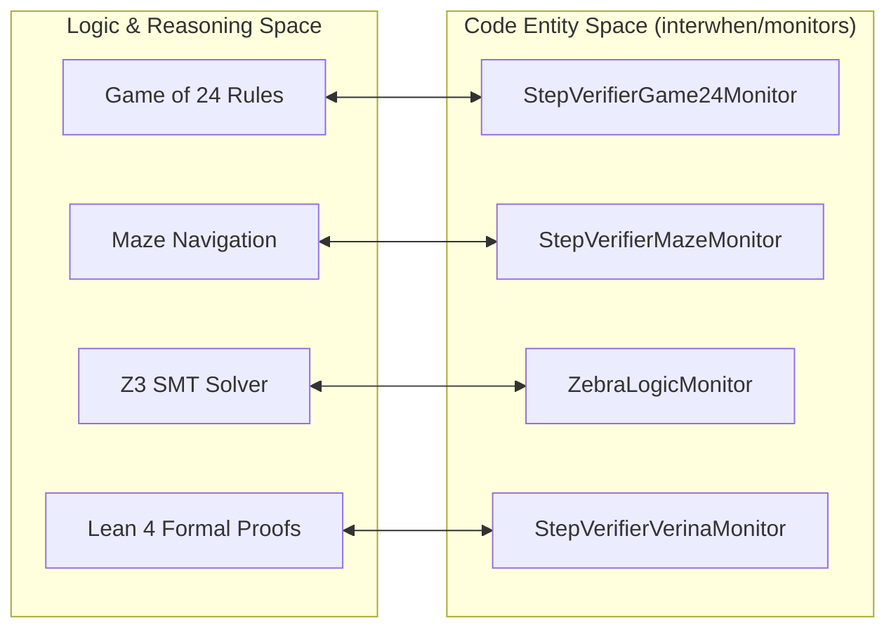
**Sources:** [interwhen/monitors/__init__.py:3-10]()

## Summary of Specialized Monitors

*   **Step Verifiers:** Located in `stepVerifier.py`, these monitors use regex-based step extraction to validate intermediate reasoning [interwhen/monitors/__init__.py:3]().
*   **Thinking Phase Verifiers:** These are variants that trigger during the `<think>` blocks of reasoning models, providing feedback before the model commits to a final answer [interwhen/monitors/__init__.py:5-7]().
*   **Formal Verification:** The `verina` monitors (`StepVerifierVerinaMonitor` and `StepVerifierVerinaSpecMonitor`) integrate with external environments like Lean 4 to verify code correctness and specification soundness [interwhen/monitors/__init__.py:9-10]().

**Sources:** [interwhen/monitors/__init__.py:1-11]()

---

# Page: Early Stopping Monitors

# Early Stopping Monitors

<details>
<summary>Relevant source files</summary>

The following files were used as context for generating this wiki page:

- [examples/EarlyStopping/README.md](examples/EarlyStopping/README.md)
- [examples/TTSwithVerification/README.md](examples/TTSwithVerification/README.md)
- [interwhen/monitors/earlyStopping.py](interwhen/monitors/earlyStopping.py)
- [interwhen/monitors/k_stable.py](interwhen/monitors/k_stable.py)
- [interwhen/utils/DEER_helper.py](interwhen/utils/DEER_helper.py)
- [interwhen/utils/EAT_helper.py](interwhen/utils/EAT_helper.py)

</details>


Early stopping monitors reduce inference costs and latency by detecting when a reasoning model has reached sufficient confidence in its answer, allowing the system to terminate generation early. Instead of waiting for the model to exhaust its maximum token budget, these monitors analyze intermediate signals—such as token entropy, geometric mean confidence, or answer stability—and inject a `</think>` token to force the transition to the final answer phase [examples/EarlyStopping/README.md:1-5]().

All early stopping monitors are integrated via the `stream_completion` engine, which handles the asynchronous loop of generation, step extraction, and potential early termination [examples/EarlyStopping/README.md:7-19]().

## System Architecture: Reasoning to Early Exit

The following diagram illustrates how early stopping monitors interface with the streaming engine to intercept reasoning before the model naturally concludes.

**Early Stopping Control Flow**
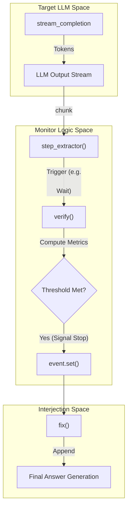
Sources: [interwhen/monitors/earlyStopping.py:101-114](), [interwhen/monitors/earlyStopping.py:75-91](), [examples/EarlyStopping/README.md:3-5]()

---

## EATMonitor — Entropy After Think

The `EATMonitor` uses entropy-based heuristics to determine if a model's internal uncertainty has stabilized. It computes the entropy of the next token at specific boundaries (triggered by `\n\nWait`) using a local HuggingFace model. It tracks the Exponential Moving Average (EMA) and Exponential Moving Variance (EMV) of these entropy values [interwhen/monitors/earlyStopping.py:11-17]().

When the EMV drops below a defined `delta` threshold after a `min_steps` count, the monitor triggers an early stop by calling `fix()`, which appends the `</think>` token [interwhen/monitors/earlyStopping.py:67-71]().

For implementation details on entropy calculation and EMA/EMV logic, see **[EATMonitor — Entropy After Think (#3.1)]**.

Sources: [interwhen/monitors/earlyStopping.py:11-40](), [interwhen/utils/EAT_helper.py:146-175]()

---

## DEERMonitor — Dynamic Early Exit in Reasoning

The `DEERMonitor` (Dynamic Early Exit in Reasoning) focuses on answer confidence rather than internal entropy. At every `\n\nWait` boundary, it performs a "probe": it appends a `</think>` token and sends the partial reasoning to a remote `llm_server` to compute the geometric mean confidence of the predicted answer tokens [interwhen/monitors/earlyStopping.py:117-122]().

If the geometric mean confidence exceeds the `delta` threshold (default `0.995`), the monitor signals the main streaming loop to terminate the thinking phase [interwhen/monitors/earlyStopping.py:144-145]().

For details on the `GeometricMeanTracker` and remote probing, see **[DEERMonitor — Dynamic Early Exit in Reasoning (#3.2)]**.

Sources: [interwhen/monitors/earlyStopping.py:117-147](), [interwhen/utils/DEER_helper.py:10-27]()

---

## K-Stable Monitors

The K-stable family of monitors looks for convergence within the model's own reasoning trace. They assume that if a model repeats the same conclusion `k` times consecutively during its thinking process, it has reached a stable state [interwhen/monitors/k_stable.py:8-14]().

*   **KstableAnswerMCQMonitor**: Specialized for Multiple Choice Questions. It normalizes extracted answers (e.g., mapping "A" to its option value) and checks for stability while ignoring negation or restatements of the problem [interwhen/monitors/k_stable.py:16-28]().
*   **KstableAnswerGame24Monitor**: Specialized for the "Game of 24" task. It monitors for stable arithmetic equations and can optionally validate that the equation uses the correct input numbers [examples/EarlyStopping/README.md:109-121]().

For details on answer normalization and stability criteria, see **[K-Stable Monitors (#3.3)]**.

Sources: [interwhen/monitors/k_stable.py:8-28](), [examples/EarlyStopping/README.md:84-112]()

---

## Comparison of Strategies

The following table summarizes when to use each early stopping strategy based on the available infrastructure and task type.

| Monitor | Primary Metric | Trigger Mechanism | Requirement | Best For |
| :--- | :--- | :--- | :--- | :--- |
| **EAT** | Token Entropy | `\n\nWait` token | Local HF Model | General reasoning (DeepSeek-R1 style) |
| **DEER** | Geometric Mean Prob | `\n\nWait` token | Remote LLM Server | High-precision confidence exits |
| **K-Stable** | Textual Convergence | Line-by-line parsing | `k` repeats | MCQ, Math, and Logic puzzles |

**Monitor Logic to Code Entity Mapping**
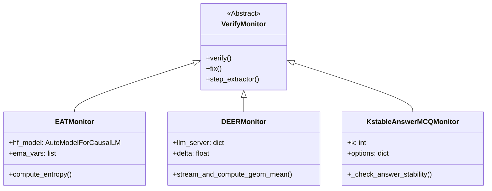
Sources: [interwhen/monitors/earlyStopping.py:11](), [interwhen/monitors/earlyStopping.py:117](), [interwhen/monitors/k_stable.py:8]()

---

# Page: EATMonitor — Entropy After Think

# EATMonitor — Entropy After Think

<details>
<summary>Relevant source files</summary>

The following files were used as context for generating this wiki page:

- [examples/EarlyStopping/README.md](examples/EarlyStopping/README.md)
- [examples/TTSwithVerification/README.md](examples/TTSwithVerification/README.md)
- [interwhen/monitors/earlyStopping.py](interwhen/monitors/earlyStopping.py)
- [interwhen/utils/DEER_helper.py](interwhen/utils/DEER_helper.py)
- [interwhen/utils/EAT_helper.py](interwhen/utils/EAT_helper.py)

</details>


The `EATMonitor` (Entropy After Think) is an early-stopping monitor designed to reduce inference costs by detecting when a reasoning model has reached sufficient internal stability to provide an answer. It analyzes the entropy of the next token at specific boundaries and terminates the reasoning phase by injecting a `</think>` token when uncertainty stabilizes.

## Overview and Purpose

`EATMonitor` operates on the principle that as a model reasons, its uncertainty regarding the final answer fluctuates. By monitoring the **Exponential Moving Variance (EMV)** of the next-token entropy, the system can identify "plateaus" in reasoning where additional tokens are unlikely to change the final outcome [examples/EarlyStopping/README.md:23-26]().

Key features include:
*   **Local Entropy Computation**: Uses a local HuggingFace model to compute logits and entropy, avoiding extra network round-trips for probing [interwhen/monitors/earlyStopping.py:29-34]().
*   **Wait-Step Trigger**: Specifically triggers whenever the string `\n\nWait` is detected in the stream [interwhen/monitors/earlyStopping.py:111-112]().
*   **Statistical Guardrails**: Employs a `min_steps` guard to prevent premature termination before the model has performed sufficient initial reasoning [interwhen/monitors/earlyStopping.py:64-65]().

Sources: [examples/EarlyStopping/README.md:23-38](), [interwhen/monitors/earlyStopping.py:11-27]()

## Architecture and Data Flow

The `EATMonitor` integrates into the `stream_completion` loop as a `VerifyMonitor`. It intercepts the stream at specific "Wait" tokens and uses a secondary local model to evaluate the state of the reasoning trace.

### System Components to Code Entities
The following diagram maps the logical components of the Entropy After Think strategy to their specific implementations in the `interwhen` codebase.

**Logic to Code Mapping**
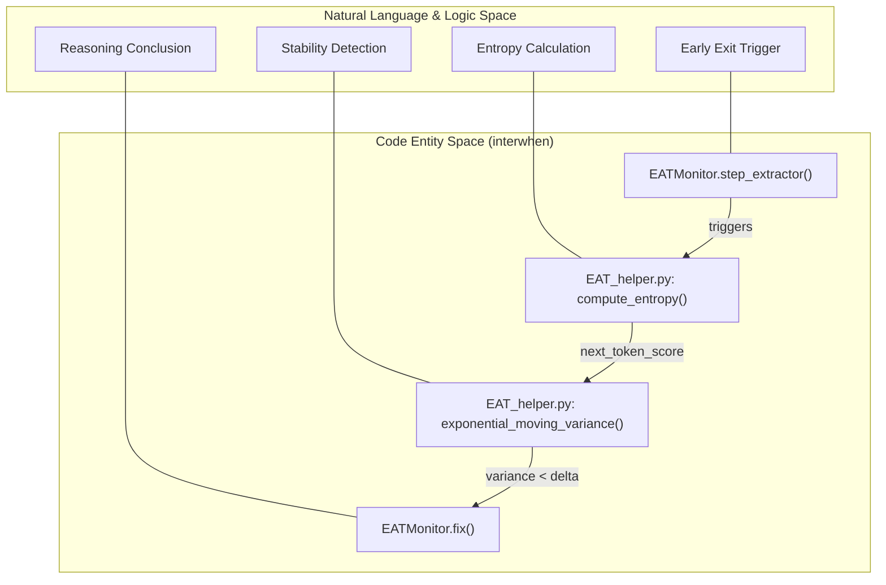
Sources: [interwhen/utils/EAT_helper.py:146-175](), [interwhen/monitors/earlyStopping.py:101-114](), [interwhen/monitors/earlyStopping.py:93-99]()

### Detailed Execution Flow
The monitor follows a specific sequence of operations during the streaming process:

1.  **Step Extraction**: The `step_extractor` looks for the `\n\nWait` suffix in the generated text [interwhen/monitors/earlyStopping.py:111-112]().
2.  **Context Preparation**: It appends a standardized tail (`\n\n</think>\n\nFinal answer is \boxed{`) to the current reasoning trace to simulate the transition to an answer [interwhen/monitors/earlyStopping.py:49-54]().
3.  **Entropy Probing**: The `hf_model` computes the entropy of the next token following this simulated tail [interwhen/utils/EAT_helper.py:165-167]().
4.  **Statistical Analysis**: The new entropy value is added to a history used to calculate the Exponential Moving Average (EMA) and EMV [interwhen/monitors/earlyStopping.py:57-61]().
5.  **Termination**: If `len(entropy) >= min_steps` and `ema_variance < delta`, the monitor signals an intervention by setting the `asyncio.Event` [interwhen/monitors/earlyStopping.py:68-73]().

Sources: [interwhen/monitors/earlyStopping.py:42-73](), [interwhen/monitors/earlyStopping.py:101-114]()

## Implementation Details

### EATMonitor Class
Defined in `interwhen/monitors/earlyStopping.py`, this class manages the local model lifecycle and the statistical state.

| Parameter | Type | Default | Description |
| :--- | :--- | :--- | :--- |
| `model_name` | `str` | — | The HuggingFace model path used for local logit computation [interwhen/monitors/earlyStopping.py:22]() |
| `alpha` | `float` | `0.2` | Smoothing factor for the EMA/EMV calculations [interwhen/monitors/earlyStopping.py:23]() |
| `delta` | `float` | `0.0001` | The variance threshold. Lower means more conservative stopping [interwhen/monitors/earlyStopping.py:24]() |
| `min_steps` | `int` | `4` | Minimum `\n\nWait` tokens required before stopping is possible [interwhen/monitors/earlyStopping.py:25]() |

Sources: [interwhen/monitors/earlyStopping.py:11-40]()

### EAT_helper.py Utilities
The helper file provides optimized numerical functions for entropy and moving statistics.

*   **`compute_entropy`**: Performs a forward pass on the local model (with `torch.no_grad()`) to get logits for the last token and applies a custom `numpy_softmax` before calculating Shannon entropy [interwhen/utils/EAT_helper.py:146-175]().
*   **`exponential_moving_variance`**: Computes the variance of the entropy sequence using the smoothing factor `alpha`. It determines if the model's "confidence" (as measured by entropy) has flattened [interwhen/utils/EAT_helper.py:206-218]().
*   **`numpy_softmax`**: A numerically stable softmax implementation using double precision (`np.float64`) and max-subtraction to prevent overflow [interwhen/utils/EAT_helper.py:20-27]().

Sources: [interwhen/utils/EAT_helper.py:20-27](), [interwhen/utils/EAT_helper.py:146-175](), [interwhen/utils/EAT_helper.py:206-218]()

## The Fix Mechanism
When the variance threshold is met, the `fix()` method is called by the interjection loop. 

```python
async def fix(self, generated_text, event_info, fix_method=None):
    fixed_text = generated_text[:event_info['correction_index']] + "\n\n</think>"
    return fixed_text
```
[interwhen/monitors/earlyStopping.py:93-99]()

This mechanism effectively "cuts off" the model's reasoning at the last valid step and forces the start of the answer phase by appending the `</think>` tag. Because the `stream_completion` loop is recursive, the model will resume generation immediately after the injected `</think>` token to provide the final answer.

Sources: [interwhen/monitors/earlyStopping.py:93-99](), [interwhen/monitors/earlyStopping.py:166-172]() (Note: DEER uses a similar pattern).

## Sequence Diagram: Entropy Probing Loop

This diagram illustrates the interaction between the `interject.py` streaming loop and the `EATMonitor` during a "Wait" step.

**Interjection and Probing Sequence**
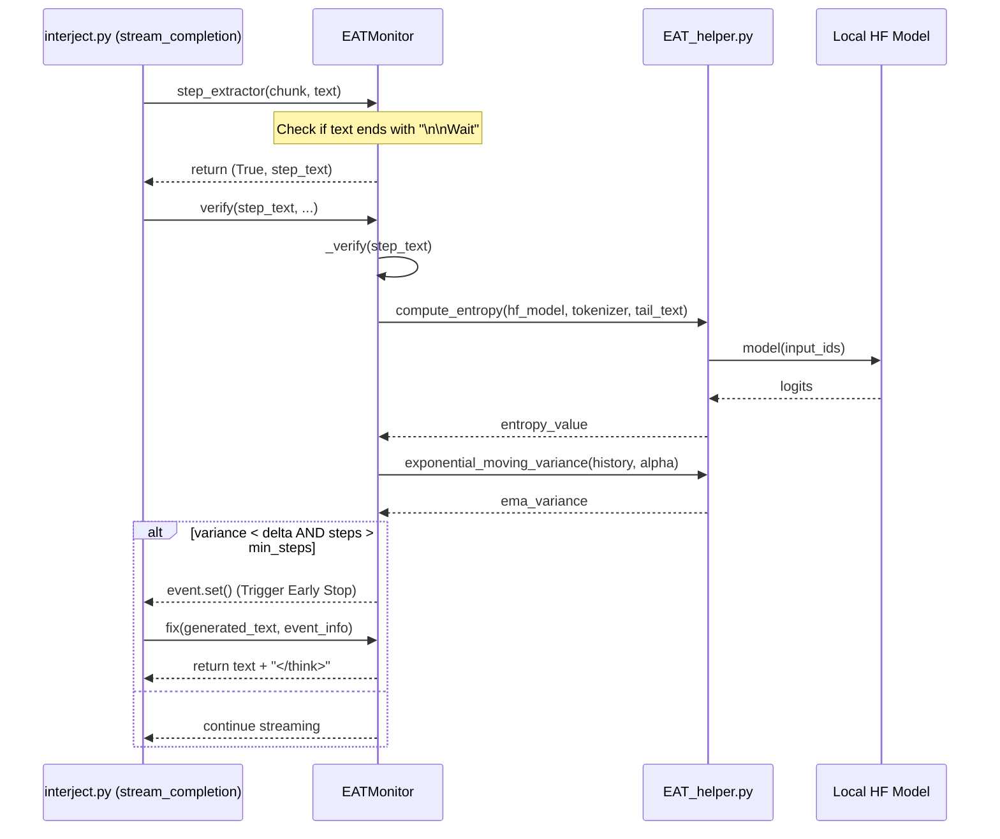
Sources: [interwhen/monitors/earlyStopping.py:42-91](), [interwhen/monitors/earlyStopping.py:101-114](), [interwhen/utils/EAT_helper.py:146-175]()

---

# Page: DEERMonitor — Dynamic Early Exit in Reasoning

# DEERMonitor — Dynamic Early Exit in Reasoning

<details>
<summary>Relevant source files</summary>

The following files were used as context for generating this wiki page:

- [examples/EarlyStopping/README.md](examples/EarlyStopping/README.md)
- [examples/TTSwithVerification/README.md](examples/TTSwithVerification/README.md)
- [interwhen/monitors/earlyStopping.py](interwhen/monitors/earlyStopping.py)
- [interwhen/utils/DEER_helper.py](interwhen/utils/DEER_helper.py)
- [interwhen/utils/EAT_helper.py](interwhen/utils/EAT_helper.py)

</details>


The **DEERMonitor** (Dynamic Early Exit in Reasoning) is an early-stopping monitor designed to reduce inference costs and latency by detecting when a model has reached sufficient internal confidence to produce an answer [examples/EarlyStopping/README.md:55-57](). Unlike the **EATMonitor**, which uses local entropy calculations, **DEERMonitor** probes the model's confidence by simulating an answer and computing the geometric mean of token probabilities via a remote LLM server [interwhen/monitors/earlyStopping.py:121-123]().

## Overview and Implementation

The DEERMonitor operates on the principle of **confidence probing**. At specific trigger points in the reasoning trace (identified by the `\n\nWait` token), the monitor temporarily halts the primary generation, appends an answer-forcing suffix, and queries an auxiliary model to see how "certain" it is about the final result [interwhen/monitors/earlyStopping.py:138-141]().

### Geometric Mean Confidence Probing

The core metric for DEER is the **Geometric Mean Confidence**. This is calculated by taking the log-probabilities of the predicted tokens and converting them back to a normalized probability space [interwhen/utils/DEER_helper.py:10-26]().

*   **GeometricMeanTracker**: A utility class that maintains a running sum of log-probabilities to compute the geometric mean without numerical underflow [interwhen/utils/DEER_helper.py:10-26]().
*   **Confidence Calculation**: $GM = \exp(\frac{1}{N} \sum_{i=1}^{N} \ln(p_i))$, where $p_i$ is the probability of the $i$-th token [interwhen/utils/DEER_helper.py:22-26]().

### Data Flow Diagram: Confidence Probing Loop

This diagram illustrates how the `DEERMonitor` interacts with the `llm_server` to determine if generation should exit early.

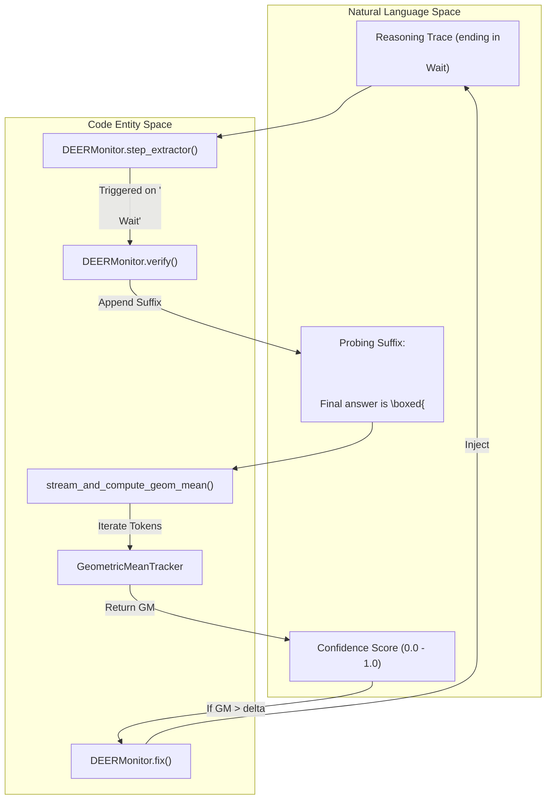
**Sources:** [interwhen/monitors/earlyStopping.py:132-184](), [interwhen/utils/DEER_helper.py:10-51]()

## Key Components and Functions

### DEERMonitor Class
Defined in `interwhen/monitors/earlyStopping.py`, this class inherits from `VerifyMonitor` and manages the early exit state [interwhen/monitors/earlyStopping.py:117-123]().

| Attribute | Description |
| :--- | :--- |
| `llm_server` | Configuration dictionary containing the `url`, `headers`, and `payload` for the remote confidence probe [interwhen/monitors/earlyStopping.py:125](). |
| `delta` | The confidence threshold (default `0.995`). If the geometric mean exceeds this, the monitor triggers an early exit [interwhen/monitors/earlyStopping.py:126, 144-145](). |
| `answer_start_token` | The token used to identify the end of reasoning, usually `</think>` [interwhen/monitors/earlyStopping.py:129](). |

### Geometric Mean Tracking (`DEER_helper.py`)
The helper file provides the logic for extracting probabilities from the LLM server's SSE (Server-Sent Events) stream.

*   **`extract_max_prob(token_json)`**: Extracts the highest log-probability from the `top_logprobs` provided by the server and converts it to a normal probability [interwhen/utils/DEER_helper.py:5-8]().
*   **`stream_and_compute_geom_mean(llm_server)`**: Opens a streaming connection to the probe model. It appends tokens until a termination character (like `.`) is reached, updating the `GeometricMeanTracker` at each step [interwhen/utils/DEER_helper.py:28-51]().

## Comparison: DEER vs. EAT

While both monitors provide early stopping, their mechanisms for determining "readiness" differ significantly:

| Feature | EAT (Entropy After Think) | DEER (Dynamic Early Exit) |
| :--- | :--- | :--- |
| **Metric** | Variance of next-token entropy [interwhen/monitors/earlyStopping.py:15-16]() | Geometric mean of answer token probabilities [interwhen/monitors/earlyStopping.py:121]() |
| **Compute Location** | Local (requires HuggingFace model in memory) [interwhen/monitors/earlyStopping.py:30-34]() | Remote (queries an external LLM server) [interwhen/monitors/earlyStopping.py:125]() |
| **Trigger Point** | Every `\n\nWait` boundary [interwhen/monitors/earlyStopping.py:103]() | Every `\n\nWait` boundary [interwhen/monitors/earlyStopping.py:176]() |
| **Stop Condition** | `ema_variance < delta` [interwhen/monitors/earlyStopping.py:68]() | `confidence > delta` [interwhen/monitors/earlyStopping.py:144]() |

**Sources:** [interwhen/monitors/earlyStopping.py:11-184](), [examples/EarlyStopping/README.md:23-81]()

## Execution Logic

### Step Extraction
The `step_extractor` monitors the stream for the string `\n\nWait`. When found, it strips the wait token and passes the preceding reasoning trace to the verification logic [interwhen/monitors/earlyStopping.py:182-183](). If the `answer_start_token` (e.g., `</think>`) is already present in the text, extraction is disabled to prevent redundant probing during the final answer phase [interwhen/monitors/earlyStopping.py:179-180]().

### Verification and Feedback
The `_verify` method performs the following:
1.  Constructs a `partial_answer` prompt by appending `\n\n</think>\n\nFinal answer is \boxed{` to the current reasoning [interwhen/monitors/earlyStopping.py:139]().
2.  Calls `stream_and_compute_geom_mean` using the auxiliary `llm_server` [interwhen/monitors/earlyStopping.py:141]().
3.  If the resulting confidence is above `delta`, it returns `False` (invalid), which signals the `interwhen` loop to stop the current generation [interwhen/monitors/earlyStopping.py:144-145]().

### Correction (The Exit)
When the exit condition is met, the `fix` method is called. It truncates the generated text at the point where the `\n\nWait` was detected and appends the `</think>` token [interwhen/monitors/earlyStopping.py:171](). This effectively forces the model to transition from the "Thinking" phase to the "Answer" phase immediately [interwhen/monitors/earlyStopping.py:168]().

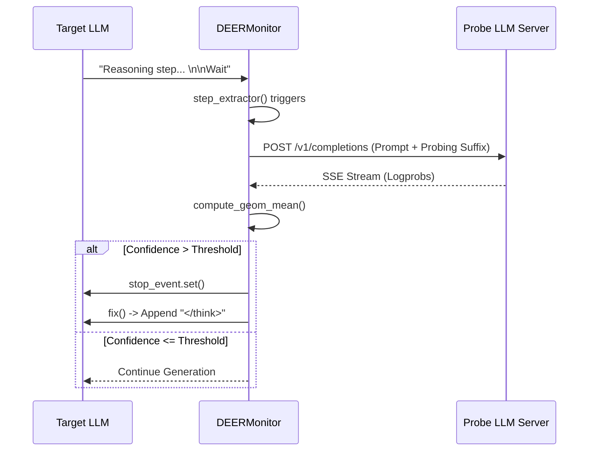
**Sources:** [interwhen/monitors/earlyStopping.py:132-184](), [interwhen/utils/DEER_helper.py:28-51](), [examples/EarlyStopping/README.md:55-81]()

---

# Page: K-Stable Monitors

# K-Stable Monitors

<details>
<summary>Relevant source files</summary>

The following files were used as context for generating this wiki page:

- [examples/EarlyStopping/game24_example.py](examples/EarlyStopping/game24_example.py)
- [examples/EarlyStopping/maze_example.py](examples/EarlyStopping/maze_example.py)
- [interwhen/monitors/k_stable.py](interwhen/monitors/k_stable.py)

</details>


K-Stable monitors are a family of early-stopping mechanisms designed to detect when a model's reasoning has converged on a consistent answer before it reaches the maximum token limit or natural termination. By monitoring the "stability" of the generated output—specifically the recurrence of a normalized answer $K$ consecutive times—these monitors can trigger an early exit from the reasoning phase, significantly reducing token consumption while maintaining accuracy.

Sources: [interwhen/monitors/k_stable.py:8-14](), [interwhen/monitors/k_stable.py:205-212]()

## Architecture and Data Flow

K-Stable monitors operate within the `stream_completion` loop. Unlike step verifiers that inject feedback for correction, K-Stable monitors use the `VerifyMonitor` interface to signal a stop event once the stability criterion is met.

### Logic Flow Diagram

The following diagram illustrates how the `KstableAnswerMCQMonitor` processes streaming text to identify stable answers.

"K-Stable MCQ Logic Flow"
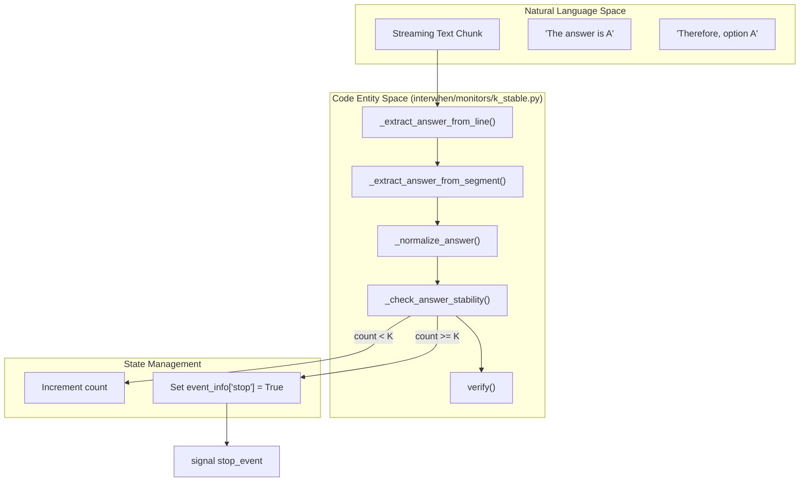
Sources: [interwhen/monitors/k_stable.py:145-176](), [interwhen/monitors/k_stable.py:194-218]()

## Answer Normalization and Negation Detection

A critical component of the K-stable logic is ensuring that the monitor is not fooled by the model merely restating the problem or expressing uncertainty.

### Negation Detection
The monitor checks for `NEGATION_WORDS` such as "not", "isn't", "cannot", or "never" [interwhen/monitors/k_stable.py:4-5](). If a segment containing the keyword "answer" also contains a negation, the monitor ignores that line to avoid stabilizing on a rejected hypothesis [interwhen/monitors/k_stable.py:80-82]().

### Answer Normalization
The `_normalize_answer` function maps various string representations to a canonical form using the provided `options` dictionary [interwhen/monitors/k_stable.py:49-74]():
*   **Pattern Matching**: Detects formats like "A.2" or "C.0" [interwhen/monitors/k_stable.py:55-58]().
*   **Dictionary Lookup**: Maps "A" to its corresponding value (e.g., "Yes") or vice versa [interwhen/monitors/k_stable.py:61-68]().
*   **Cleaning**: Strips quotes, whitespace, and handles case-insensitivity [interwhen/monitors/k_stable.py:51-52]().

Sources: [interwhen/monitors/k_stable.py:30-33](), [interwhen/monitors/k_stable.py:49-74]()

## Monitor Variants

### KstableAnswerMCQMonitor
Designed for Multiple Choice Questions. It requires an `options` dictionary to resolve letter choices to values.

*   **`options`**: A map such as `{"A": "Yes", "B": "No"}` [interwhen/monitors/k_stable.py:21]().
*   **`answer_start_token`**: Defaults to `</think>`, allowing the monitor to ignore initial brainstorming and focus on the concluding reasoning phase [interwhen/monitors/k_stable.py:22]().
*   **`_contains_all_options`**: A safety check that prevents the monitor from triggering if the model is simply listing all possible choices (restating the prompt) [interwhen/monitors/k_stable.py:35-47]().

### KstableAnswerGame24Monitor
Specialized for the Game of 24, where the "answer" is a mathematical expression rather than a fixed MCQ option.

*   **Expression Extraction**: Uses `extract_solution` (similar to the utility in `game24_example.py`) to parse LaTeX and Unicode math operators into standard Python-evaluable strings [examples/EarlyStopping/game24_example.py:115-185]().
*   **Stability Check**: Compares the mathematical result of the expressions across $K$ occurrences [interwhen/monitors/k_stable.py:246-270]().

Sources: [interwhen/monitors/k_stable.py:16-28](), [interwhen/monitors/k_stable.py:205-220]()

## Integration with Streaming Loop

The K-stable monitors are passed into `stream_completion` via the `monitors` list. During execution, the monitor's `verify` method is called periodically.

"Integration with interject.py"
```mermaid
sequenceDiagram
    participant S as stream_completion (interject.py)
    participant M as KstableAnswerMCQMonitor
    participant E as stop_event (asyncio.Event)

    S->>M: verify(current_text, token_index, stop_event, event_info)
    M->>M: _check_answer_stability()
    alt Stability Reached (count >= K)
        M->>M: event_info["stop"] = True
        M->>M: event_info["feedback"] = "</think>"
        M->>E: set()
        M-->>S: return (text, None)
    else Stability Not Reached
        M-->>S: return (text, None)
    end
```

### Key Parameters
| Parameter | Description | File Reference |
| :--- | :--- | :--- |
| `k` | Number of consecutive identical answers required to stop. | [interwhen/monitors/k_stable.py:25]() |
| `event_info["stop"]` | Boolean flag used to signal the outer loop to break. | [interwhen/monitors/k_stable.py:206]() |
| `event_info["feedback"]` | In K-stable, this is often set to `</think>` to force-close the reasoning block. | [interwhen/monitors/k_stable.py:203]() |

Sources: [interwhen/monitors/k_stable.py:194-212](), [interwhen/interject.py:116-125]()

## Usage Example

In the `maze_example.py` script, the `KstableAnswerMCQMonitor` is initialized to watch for the same MCQ choice appearing 3 times consecutively:

```python
# From examples/EarlyStopping/maze_example.py
monitor = KstableAnswerMCQMonitor(
    name="Kstable", 
    k=3, 
    options={"A": "...", "B": "...", "C": "...", "D": "..."}
)
```
The monitor will scan the streaming reasoning trace for lines containing "answer" (case-insensitive), normalize the found choice, and trigger an early exit once the internal counter hits 3.

Sources: [examples/EarlyStopping/maze_example.py:15-16](), [interwhen/monitors/k_stable.py:16-28]()

---

# Page: Step Verification Monitors

# Step Verification Monitors

<details>
<summary>Relevant source files</summary>

The following files were used as context for generating this wiki page:

- [examples/EarlyStopping/README.md](examples/EarlyStopping/README.md)
- [examples/TTSwithVerification/README.md](examples/TTSwithVerification/README.md)
- [interwhen/monitors/__init__.py](interwhen/monitors/__init__.py)
- [interwhen/monitors/stepVerifier.py](interwhen/monitors/stepVerifier.py)

</details>


Step Verification Monitors provide a real-time, closed-loop feedback mechanism for reasoning models. Unlike early stopping monitors that only determine when to terminate generation, step verifiers actively parse the model's intermediate reasoning steps, validate them against domain-specific ground truths (such as physics engines, math verifiers, or formal logic solvers), and inject corrective feedback directly into the context window if an error is detected [examples/TTSwithVerification/README.md:1-6]().

## System Architecture

The verification system operates within the `stream_completion` loop. When a monitor identifies a completed reasoning step, it triggers a domain-specific verifier. If the step is invalid, the monitor halts the current generation and appends a `[VERIFIER FEEDBACK]` block, prompting the model to reconsider its last step [interwhen/monitors/stepVerifier.py:167-172]().

### From Natural Language to Code Entities

The following diagram illustrates how natural language reasoning steps are mapped to internal verification logic and state management classes.

**Reasoning to Verification Mapping**
```mermaid
graph TD
    subgraph "Natural Language Space (LLM Output)"
        A[">Step N: available numbers..."] 
        B[">Step N: Move North to (1,2)"]
        C["Claim: A is North of B"]
    end

    subgraph "Code Entity Space (interwhen/monitors)"
        direction TB
        A --> SV24["StepVerifierGame24Monitor"]
        B --> SVMaze["StepVerifierMazeMonitor"]
        C --> SVSpatial["StepVerifierSpatialMapMonitor"]
        
        SV24 -.-> GV["utils/game24_verifier.py"]
        SVMaze -.-> MV["utils/maze_verifier.py"]
        SVSpatial -.-> SMV["utils/spatialmap_verifier.py"]
    end

    subgraph "Domain Verifiers & Solvers"
        GV --> GMath["Arithmetic & Reachability Logic"]
        MV --> MGrid["Grid Navigation Logic"]
        SMV --> SZ3["SpatialMapZ3Solver (Z3)"]
    end
```
Sources: [interwhen/monitors/stepVerifier.py:25-151](), [interwhen/monitors/__init__.py:3-8]()

## Core Components

### Step Parsing and State Recovery
Most step verifiers are designed to be stateless relative to the class instance; they reconstruct the problem state by parsing the `generated_text` history. For example, `StepVerifierGame24Monitor` scans previous valid steps to determine which numbers are currently available for the step being verified [interwhen/monitors/stepVerifier.py:43-57]().

### Thinking-Phase Variants
The library supports "Thinking-Phase" variants for models like DeepSeek-R1 that use `<think>` tags. These monitors (e.g., `ThinkingPhaseStepVerifierGame24Monitor`) operate inside the reasoning block and typically trigger verification on specific delimiters like `\n\nWait` or `\n\nStep` [interwhen/monitors/__init__.py:5-7]().

### Feedback Injection
When a `VerifyMonitor` detects an error, it calls `format_feedback` to generate a structured string. This string is appended to the prompt, and the `fix()` method is used to steer the model back to the last valid state [interwhen/monitors/stepVerifier.py:167-172]().

**Verification Flow**
```mermaid
sequenceDiagram
    participant LLM as "Target LLM"
    participant ME as "interject.py (Engine)"
    participant MON as "StepVerifierMonitor"
    participant VAL as "Domain Verifier"

    LLM->>ME: Streams reasoning step
    ME->>MON: verify(chunk)
    MON->>VAL: parse_step(text)
    VAL-->>MON: Valid/Invalid + Feedback
    alt Step is Invalid
        MON->>ME: set stop_event
        ME->>MON: fix(generated_text)
        MON-->>ME: Append [VERIFIER FEEDBACK]
        ME->>LLM: Resume with correction
    else Step is Valid
        MON-->>ME: Continue streaming
    end
```
Sources: [interwhen/monitors/stepVerifier.py:167-200](), [examples/TTSwithVerification/README.md:25-28]()

## Domain-Specific Verifiers

The system includes specialized monitors for different reasoning domains:

| Monitor Class | Domain | Verification Logic |
| :--- | :--- | :--- |
| `StepVerifierGame24Monitor` | Arithmetic | Validates operations and remaining numbers using exhaustive search [Game of 24 Verifier](#4.1). |
| `StepVerifierMazeMonitor` | Navigation | Checks walkability, turn types, and position coordinates against a grid [Maze Verifier](#4.2). |
| `StepVerifierSpatialMapMonitor` | Spatial Logic | Compiles directional claims into Z3 constraints to check for contradictions [Spatial Map Verifier (Z3-based)](#4.3). |
| `ZebraLogicMonitor` | Constraint Satisfaction | Parses house assignments into IR and uses Z3 to verify logical consistency [ZebraLogic Verifier](#4.4). |

---

## Child Pages

*   **[Game of 24 Verifier](#4.1)**: Arithmetic validation, `can_reach_24` search, and floating-point tolerance.
*   **[Maze Verifier](#4.2)**: Grid parsing, movement validation, and turn-count tracking.
*   **[Spatial Map Verifier (Z3-based)](#4.3)**: Diagonal coordinate systems and Z3-based entailment checking.
*   **[ZebraLogic Verifier](#4.4)**: Shadow LLM state extraction and house-assignment logic.

Sources: [interwhen/monitors/__init__.py:3-10](), [examples/TTSwithVerification/README.md:1-172]()

---

# Page: Game of 24 Verifier

# Game of 24 Verifier

<details>
<summary>Relevant source files</summary>

The following files were used as context for generating this wiki page:

- [examples/TTSwithVerification/interwhen/game24_example.py](examples/TTSwithVerification/interwhen/game24_example.py)
- [interwhen/monitors/stepVerifier.py](interwhen/monitors/stepVerifier.py)
- [interwhen/monitors/thinkingPhaseVerifierGame24.py](interwhen/monitors/thinkingPhaseVerifierGame24.py)
- [interwhen/utils/game24_verifier.py](interwhen/utils/game24_verifier.py)
- [interwhen/utils/spatialmap_verifier.py](interwhen/utils/spatialmap_verifier.py)

</details>


The Game of 24 Verifier is a specialized subsystem designed to monitor, validate, and guide Large Language Models (LLMs) as they solve arithmetic puzzles. It ensures that the model adheres to the rules of the game: using four given numbers exactly once with basic arithmetic operators to reach a total of 24.

The system supports two primary modes of operation:
1.  **Step-by-Step Verification**: Validates explicit reasoning steps (available numbers, operation, remaining numbers) as they are generated.
2.  **Thinking-Phase Verification**: Periodically probes the model's internal reasoning during ` The expression that I found till now is {` `[interwhen/monitors/thinkingPhaseVerifierGame24.py:44-46]()`.
- It captures the model's completion to extract a candidate expression.
- If the expression is a **dead end** (cannot reach 24), it injects feedback directly into the thinking trace to force the model to pivot `[interwhen/monitors/thinkingPhaseVerifierGame24.py:13-14]()`.

### Dead-End Detection (Exhaustive Search)
The function `can_reach_24` (and its helpers `can_reach_24_from_two/three/four`) performs an exhaustive search of all possible expression trees using the remaining numbers `[interwhen/utils/game24_verifier.py:54-210]()`.

| Numbers Remaining | Possible Combinations (approx) | Implementation |
| :--- | :--- | :--- |
| 2 | 8 | `can_reach_24_from_two` |
| 3 | 192 | `can_reach_24_from_three` |
| 4 | 7,680 | `can_reach_24_from_four` |

If the search returns `False`, the monitor informs the model that its current path is a dead end `[interwhen/utils/game24_verifier.py:383-390]()`.

**Sources:** `interwhen/monitors/thinkingPhaseVerifierGame24.py:9-21`(), `interwhen/utils/game24_verifier.py:148-162`()

## Feedback Injection

When a step is invalid, the verifier generates a `[VERIFIER FEEDBACK]` block.

### Feedback Logic Flow
The monitor uses `format_feedback` to construct natural language corrections.

```mermaid
graph TD
    node_start["verify_step() Call"]
    node_op["Check: Is operation mathematically sound?"]
    node_avail["Check: Are numbers used available?"]
    node_reach["Check: Is 24 still reachable?"]
    node_inject["Inject [VERIFIER FEEDBACK]"]

    node_start --> node_op
    node_op -- "No" --> node_inject
    node_op -- "Yes" --> node_avail
    node_avail -- "No" --> node_inject
    node_avail -- "Yes" --> node_reach
    node_reach -- "No" --> node_inject
    node_reach -- "Yes" --> node_continue["Continue Generation"]
```

### Final Answer Extraction
After the reasoning is complete, `extract_solution` (found in example utilities) cleans LaTeX formatting:
- Converts `\frac{a}{b}` to `(a/b)` `[examples/TTSwithVerification/interwhen/game24_example.py:159-161]()`.
- Replaces LaTeX symbols like `\times` and `\div` with `*` and `/` `[examples/TTSwithVerification/interwhen/game24_example.py:164-171]()`.
- Normalizes Unicode dashes and multiplication signs used by models like QwQ `[examples/TTSwithVerification/interwhen/game24_example.py:173-174]()`.

**Sources:** `interwhen/utils/game24_verifier.py:408-450`(), `examples/TTSwithVerification/interwhen/game24_example.py:119-189`()

---

# Page: Maze Verifier

# Maze Verifier

<details>
<summary>Relevant source files</summary>

The following files were used as context for generating this wiki page:

- [examples/TTSwithVerification/interwhen/maze_example.py](examples/TTSwithVerification/interwhen/maze_example.py)
- [interwhen/monitors/stepVerifier.py](interwhen/monitors/stepVerifier.py)
- [interwhen/monitors/thinkingPhaseVerifierMaze.py](interwhen/monitors/thinkingPhaseVerifierMaze.py)
- [interwhen/utils/maze_verifier.py](interwhen/utils/maze_verifier.py)

</details>


The Maze Verifier provides a real-time validation system for Large Language Models (LLMs) solving grid-based navigation problems. It ensures that the model's reasoning trace—whether during a thinking phase or a structured output phase—adheres to the physical constraints of the maze grid, correctly identifies turn types, and maintains accurate running counts of movements.

## Overview

The system is implemented across two primary layers:
1.  **`maze_verifier.py`**: A stateless utility module that handles grid parsing, movement logic, turn-type rules, and individual step validation [interwhen/utils/maze_verifier.py:1-10]().
2.  **Monitor Classes**: State-aware classes in `stepVerifier.py` and `thinkingPhaseVerifierMaze.py` that interface with the `stream_completion` loop to inject feedback or structured templates [interwhen/monitors/thinkingPhaseVerifierMaze.py:134-155]().

### Maze Representation and Detection
The verifier represents the maze as a 2D grid where `#` denotes walls, ` ` (space) or `X` denotes walkable paths, `S` is the starting position, and `E` is the exit [interwhen/utils/maze_verifier.py:148-184]().

The `from_prompt` factory logic (specifically `parse_maze_from_prompt`) extracts the maze grid directly from the input prompt by scanning for lines composed of valid maze characters [interwhen/utils/maze_verifier.py:133-142](). It specifically targets the **last** maze found in the prompt to ensure it validates the correct problem instance [interwhen/utils/maze_verifier.py:172-173]().

### Question Types
The verifier supports three distinct question types, which determine the validation logic for running counts and the structure of the injected templates:
*   **`right_turns`**: Validates the count of 90-degree right turns [interwhen/monitors/thinkingPhaseVerifierMaze.py:165]().
*   **`total_turns`**: Validates the sum of both left and right turns [interwhen/monitors/thinkingPhaseVerifierMaze.py:173]().
*   **`relative_position`**: Validates the spatial relationship (Above/Below/Left/Right) between the Start and Exit [interwhen/monitors/thinkingPhaseVerifierMaze.py:55-68]().

---

## Technical Architecture

The following diagram illustrates how natural language prompts and model outputs are transformed into structured verification data.

### Diagram: From Prompt to Verification State
| Phase | Entity | Role |
| :--- | :--- | :--- |
| **Parsing** | `parse_maze_from_prompt` | Extracts `grid`, `start_pos`, and `exit_pos` from the raw prompt [interwhen/utils/maze_verifier.py:133-135](). |
| **Detection** | `question_type` | Identified via CLI or prompt analysis to set `newline_threshold` and template [interwhen/monitors/thinkingPhaseVerifierMaze.py:178-179](). |
| **Extraction** | `parse_maze_step` | Uses Regex to convert LLM text into a `dict` containing `from_pos`, `to_pos`, and `direction` [interwhen/utils/maze_verifier.py:187-217](). |
| **Validation** | `verify_maze_step` | Compares parsed step against `DIRECTION_DELTAS` and `grid` [interwhen/utils/maze_verifier.py:34-39](). |

```mermaid
graph TD
    subgraph "Natural Language Space"
        P["User Prompt (Maze + Question)"]
        MT["Model Thinking Trace"]
        MS["Model Step Output"]
    end

    subgraph "Code Entity Space (maze_verifier.py)"
        PV["parse_maze_from_prompt()"]
        PS["parse_maze_step()"]
        VM["verify_maze_step()"]
        GD["grid (List[List[str]])"]
    end

    P --> PV
    PV --> GD
    MT -- "Side-stream" --> PS
    MS --> PS
    PS --> VM
    GD --> VM
    VM -- "Feedback" --> MT
```
*Sources: [interwhen/utils/maze_verifier.py:133-184](), [interwhen/utils/maze_verifier.py:187-217](), [interwhen/monitors/thinkingPhaseVerifierMaze.py:143-155]()*

---

## Implementation Details

### Movement and Turn Validation
Movement is validated by applying `DIRECTION_DELTAS` to the `from_pos` and checking if the resulting `to_pos` matches the model's claim and is not a wall (`#`) in the `grid` [interwhen/utils/maze_verifier.py:41-46]().

Turn types are determined by comparing the `prev_dir` and `curr_dir`. The verifier uses hardcoded sets to define these transitions:
*   **Right Turns**: `(UP, RIGHT)`, `(RIGHT, DOWN)`, `(DOWN, LEFT)`, `(LEFT, UP)` [interwhen/utils/maze_verifier.py:26-31]().
*   **Left Turns**: `(UP, LEFT)`, `(LEFT, DOWN)`, `(DOWN, RIGHT)`, `(RIGHT, UP)` [interwhen/utils/maze_verifier.py:33-38]().

### ThinkingPhaseStepVerifierMazeMonitor
This monitor implements a dual-phase verification strategy [interwhen/monitors/thinkingPhaseVerifierMaze.py:7-22]():

1.  **Thinking Phase (Phase 1)**: Every `N` newlines (defined by `newline_threshold`), the monitor forks a side-stream to ask the model to summarize its current path in a structured format [interwhen/monitors/thinkingPhaseVerifierMaze.py:143-147](). If errors are found, feedback is injected directly into the `` tag, the monitor injects a `_structured_prompt` (a template) that forces the model to output steps in a parsable format [interwhen/monitors/thinkingPhaseVerifierMaze.py:186-191]().

### Diagram: Monitor Control Flow
```mermaid
sequenceDiagram
    participant LLM as Target LLM
    participant M as ThinkingPhaseStepVerifierMazeMonitor
    participant V as maze_verifier.py

    LLM->>M: Thinking trace... (\n\n\n)
    M->>V: parse_maze_from_prompt()
    Note over M: newline_threshold reached
    M->>LLM: Fork Side-stream: "Output current steps"
    LLM->>M: Step 1: Move RIGHT...
    M->>V: verify_maze_step()
    V-->>M: Error: Hit Wall at (3,4)
    M->>LLM: Inject [VERIFIER FEEDBACK: Step 1 is invalid...]
    LLM->>M: Corrected thinking...
```
*Sources: [interwhen/monitors/thinkingPhaseVerifierMaze.py:134-155](), [interwhen/utils/maze_verifier.py:187-217]()*

---

## Feedback and Correction

When a step fails validation, the `format_maze_feedback` function generates a structured error message. This message is injected into the stream to trigger the model's recursive correction logic [interwhen/utils/maze_verifier.py:9]().

### Validation Checks
| Check | Logic | Error Message Example |
| :--- | :--- | :--- |
| **Position Continuity** | `from_pos` must match previous `to_pos`. | "Step N: from_pos (r,c) does not match expected (r,c)" |
| **Wall Collision** | `grid[r][c]` must not be `#`. | "Step N: to_pos (r,c) is a WALL" |
| **Direction Logic** | `to_pos` must be `from_pos` + `delta(dir)`. | "Step N: Move DIR from (r1,c1) leads to (r2,c2), not (r3,c3)" |
| **Turn Type** | `claimed_turn` must match `get_expected_turn_type`. | "Step N: Turn type should be STRAIGHT, not RIGHT_TURN" |
| **Running Count** | `claimed_count` must match internal tracker. | "Step N: Total turns should be X, not Y" |

*Sources: [interwhen/utils/maze_verifier.py:4-9](), [interwhen/utils/maze_verifier.py:187-230](), [interwhen/monitors/thinkingPhaseVerifierMaze.py:34-39]()*

---

# Page: Spatial Map Verifier (Z3-based)

# Spatial Map Verifier (Z3-based)

<details>
<summary>Relevant source files</summary>

The following files were used as context for generating this wiki page:

- [examples/TTSwithVerification/interwhen/spatialmap_example.py](examples/TTSwithVerification/interwhen/spatialmap_example.py)
- [interwhen/monitors/stepVerifier.py](interwhen/monitors/stepVerifier.py)
- [interwhen/monitors/thinkingPhaseVerifierSpatialMap.py](interwhen/monitors/thinkingPhaseVerifierSpatialMap.py)
- [interwhen/utils/game24_verifier.py](interwhen/utils/game24_verifier.py)
- [interwhen/utils/spatialmap_verifier.py](interwhen/utils/spatialmap_verifier.py)

</details>


The Spatial Map Verifier provides real-time verification of spatial reasoning tasks by translating natural language directional claims into formal logic constraints. It utilizes the **Z3 Theorem Prover** to maintain a consistent geometric model of entities in a 2D coordinate system, allowing the system to detect contradictions in the LLM's reasoning and filter invalid MCQ options.

## Overview and Purpose

The Spatial Map Verifier is implemented primarily in `spatialmap_verifier.py` and integrated into the streaming loop via two specialized monitors: `StepVerifierSpatialMapMonitor` and `ThinkingPhaseStepVerifierSpatialMapMonitor`. 

Its primary goals are:
1.  **Consistency Checking**: Ensure that derived spatial relationships (e.g., "A is northeast of B") do not contradict the initial problem constraints.
2.  **Abbreviation Resolution**: Mapping LLM shorthand (e.g., "PSS") back to full entity names (e.g., "Police Supply Store") to maintain variable integrity in the solver [interwhen/monitors/thinkingPhaseVerifierSpatialMap.py:64-70]().
3.  **MCQ Option Filtering**: Using the solver to determine which MCQ options are logically possible given the known constraints [interwhen/utils/spatialmap_verifier.py:218-220]().

### Coordinate System
The verifier uses a diagonal-biased coordinate system to represent the `SpatialMap` dataset characteristics:
*   **North/Up**: $y$ increases [interwhen/utils/spatialmap_verifier.py:8-8]().
*   **South/Down**: $y$ decreases [interwhen/utils/spatialmap_verifier.py:9-9]().
*   **East/Right**: $x$ increases [interwhen/utils/spatialmap_verifier.py:10-10]().
*   **West/Left**: $x$ decreases [interwhen/utils/spatialmap_verifier.py:11-11]().

Sources: `interwhen/utils/spatialmap_verifier.py:1-12`(), `interwhen/monitors/thinkingPhaseVerifierSpatialMap.py:1-25`()

---

## SpatialMapZ3Solver Implementation

The `SpatialMapZ3Solver` class manages the lifecycle of the Z3 solver instance and the mapping of entities to Z3 `Real` variables.

### Data Flow: Problem to Constraints
The solver follows a pipeline from raw text to satisfiability checks:

1.  **Parsing**: `parse_problem` extracts entities and initial relations from the prompt [interwhen/utils/spatialmap_verifier.py:37-43]().
2.  **Variable Setup**: `setup_vars` creates `_x` and `_y` Z3 `Real` variables for every named entity [interwhen/utils/spatialmap_verifier.py:83-89]().
3.  **IR Compilation**: `compile_constraint` converts an Internal Representation (IR) dictionary into Z3 `BoolRef` objects [interwhen/utils/spatialmap_verifier.py:97-113]().
4.  **Satisfiability**: The solver uses `solver.check() == sat` to validate the state [interwhen/utils/spatialmap_verifier.py:176-177]().

### Constraint Compilation Logic
The verifier handles both cardinal and intercardinal (diagonal) directions. In the SpatialMap dataset, constraints are typically diagonal (e.g., Northwest).

| Direction | Z3 Constraint Logic | Code Reference |
| :--- | :--- | :--- |
| **North** | `A_y > B_y` | [spatialmap_verifier.py:131-132]() |
| **South** | `A_y < B_y` | [spatialmap_verifier.py:133-134]() |
| **East** | `A_x > B_x` | [spatialmap_verifier.py:135-136]() |
| **West** | `A_x < B_x` | [spatialmap_verifier.py:137-138]() |
| **Northwest** | `And(A_y > B_y, A_x < B_x)` | [spatialmap_verifier.py:109-109]() |

**System Architecture: Natural Language to Z3 Logic**
```mermaid
graph TD
    subgraph "Natural Language Space"
        Prompt["'A is to the northwest of B'"]
        Step2["'C is to the east of A'"]
    end

    subgraph "interwhen/utils/spatialmap_verifier.py"
        Parser["parse_problem() / parse_directional_claims_from_text()"]
        IR["IR Dict: {A: 'C', direction: 'east', B: 'A'}"]
        Compiler["compile_constraint()"]
        Z3Vars["entities: {'C_x': Real, 'C_y': Real, ...}"]
    end

    subgraph "Z3 Solver Space"
        BoolRef["And(C_x > A_x, C_y == A_y)"]
        Solver["z3.Solver()"]
    end

    Prompt --> Parser
    Step2 --> Parser
    Parser --> IR
    IR --> Compiler
    Compiler --> BoolRef
    Z3Vars --> Compiler
    BoolRef --> Solver
```
Sources: `interwhen/utils/spatialmap_verifier.py:19-142`()

---

## Verification Monitors

### ThinkingPhaseStepVerifierSpatialMapMonitor
This monitor operates in two distinct phases to provide proactive feedback during the model's internal reasoning.

#### Phase 1: Thinking Interjection
During the `` is detected, the monitor injects a structured format template [interwhen/monitors/thinkingPhaseVerifierSpatialMap.py:124-132](). This forces the model to follow a Step 1 (Parse) -> Step 2 (Analyze) -> Step 3 (Answer) sequence, which the monitor verifies token-by-token.

**Monitor Logic Flow**
```mermaid
sequenceDiagram
    participant LLM as "Target LLM"
    participant Mon as "ThinkingPhaseStepVerifierSpatialMapMonitor"
    participant Z3 as "SpatialMapZ3Solver"

    LLM->>Mon: Streaming <think>...
    Note over Mon: Newline Threshold Reached
    Mon->>LLM: Side-stream: "Let me organize my claims..."
    LLM->>Mon: "A is east of B"
    Mon->>Z3: check_with_new_constraint({A, east, B})
    Z3-->>Mon: returns False (Contradiction!)
    Mon->>LLM: Interject: "[VERIFIER FEEDBACK] Contradiction detected..."
```
Sources: `interwhen/monitors/thinkingPhaseVerifierSpatialMap.py:146-168`(), `interwhen/monitors/thinkingPhaseVerifierSpatialMap.py:56-85`()

---

## Specialized Queries

The verifier supports complex spatial queries beyond simple directional consistency:

### Counting Queries
For questions asking "How many objects are North of X?", the solver implements `count_objects_in_direction` [interwhen/utils/spatialmap_verifier.py:179-181]().
*   **Strict vs. Diagonal**: Since the dataset uses diagonal constraints, no two objects share an axis. The solver checks for `A_y > B_y` for "north" in this context [interwhen/utils/spatialmap_verifier.py:191-195]().
*   **Range Filtering**: `get_possible_count_range` determines the minimum and maximum possible counts consistent with the current constraints to validate the model's numerical answer [interwhen/utils/spatialmap_verifier.py:236-240]().

### MCQ Option Filtering
The function `get_consistent_object_options` iterates through the MCQ options (A, B, C, D) and performs an entailment check [interwhen/utils/spatialmap_verifier.py:218-220]().
1.  For each option, it creates a temporary constraint.
2.  It checks if `Solver.check()` remains `sat`.
3.  If an option is logically impossible, it is excluded from the "Valid Options" feedback provided to the LLM.

Sources: `interwhen/utils/spatialmap_verifier.py:179-245`(), `interwhen/monitors/stepVerifier.py:12-20`()

---

# Page: ZebraLogic Verifier

# ZebraLogic Verifier

<details>
<summary>Relevant source files</summary>

The following files were used as context for generating this wiki page:

- [examples/TTSwithVerification/interwhen/zebralogic_example.py](examples/TTSwithVerification/interwhen/zebralogic_example.py)
- [interwhen/data/__init__.py](interwhen/data/__init__.py)
- [interwhen/data/zebralogic_ir_map.json](interwhen/data/zebralogic_ir_map.json)
- [interwhen/monitors/zebralogic_monitor.py](interwhen/monitors/zebralogic_monitor.py)
- [interwhen/utils/zebralogic_helper.py](interwhen/utils/zebralogic_helper.py)
- [interwhen/utils/zebralogic_verifier.py](interwhen/utils/zebralogic_verifier.py)

</details>


The ZebraLogic Verifier is a real-time monitoring system designed to validate logic puzzle reasoning steps. It extracts the current state of a "house grid" puzzle from an LLM's reasoning trace, parses it into a JSON format, and uses a Z3-based constraint solver to detect contradictions against the original puzzle clues.

## Overview

The system operates by periodically interrupting the LLM's generation to "shadow" its internal state. It uses a specialized extraction prompt to elicit a structured JSON snapshot of current house assignments. These assignments are then verified against a symbolic representation of the puzzle. If a contradiction is found, the monitor injects corrective feedback into the prompt, forcing the LLM to revise its reasoning.

### Key Components
*   **`ZebraLogicMonitor`**: The main monitor class that orchestrates state extraction, Z3 verification, and feedback injection `[interwhen/monitors/zebralogic_monitor.py:12-39]()`.
*   **`ZebraLogicProblem`**: A Z3-based solver that encodes puzzle clues into boolean constraints `[interwhen/utils/zebralogic_verifier.py:18-28]()`.
*   **`zebralogic_ir_map.json`**: A data file containing the Intermediate Representation (IR) of clues for the ZebraLogic dataset `[interwhen/data/zebralogic_ir_map.json:1-10]()`.
*   **State Extraction**: A secondary LLM call used to "read the mind" of the primary LLM by summarizing its reasoning into JSON `[interwhen/monitors/zebralogic_monitor.py:76-87]()`.

## Code Entity Space Mapping

The following diagram illustrates how natural language concepts in the ZebraLogic domain map to specific code entities within the system.

### Domain to Code Mapping
```mermaid
graph TD
    subgraph "Natural Language Space"
        A["Puzzle Clues"]
        B["Reasoning Step"]
        C["House Assignment"]
        D["Contradiction"]
    end

    subgraph "Code Entity Space"
        E["zebralogic_ir_map.json"]
        F["step_token ('\n\n')"]
        G["JSON Block (House 1: {color: red})"]
        H["ZebraLogicProblem.is_satisfiable"]
        I["ZebraLogicMonitor.verify()"]
    end

    A --> E
    B --> F
    C --> G
    D --> H
    I --> F
    I --> G
    I --> H
    E --> H
```
Sources: `[interwhen/monitors/zebralogic_monitor.py:12-149]()`, `[interwhen/utils/zebralogic_verifier.py:18-166]()`, `[interwhen/data/zebralogic_ir_map.json:1-32]()`

## Implementation Details

### ZebraLogicMonitor
The `ZebraLogicMonitor` inherits from `VerifyMonitor` and implements the `step_extractor` and `verify` loop. It triggers verification every `step_interval` occurrences of a `step_token` (usually `\n\n`) `[interwhen/monitors/zebralogic_monitor.py:147-147]()`.

1.  **Step Extraction**: It checks if the generation is currently inside a `<think>` block before triggering `[interwhen/monitors/zebralogic_monitor.py:142-145]()`.
2.  **State Snapshot**: It appends a `suffix` to the current generation to prompt the LLM to output its current certain assignments in JSON format `[interwhen/monitors/zebralogic_monitor.py:174-175]()`.
3.  **Validation**: It iterates through the extracted JSON. For each assignment, it creates a fresh `ZebraLogicProblem` instance, applies the puzzle clues, and then applies the specific house assignment as a new constraint `[interwhen/monitors/zebralogic_monitor.py:97-106]()`.
4.  **Feedback**: If `is_satisfiable` returns `False`, it generates a `[FEEDBACK]` block detailing which house/feature assignment is incorrect `[interwhen/monitors/zebralogic_monitor.py:202-212]()`.

### Z3 Constraint Solver
The `ZebraLogicProblem` class translates puzzle clues into Z3 boolean variables using the naming convention `{feature_name}={value}@{house_index}` `[interwhen/utils/zebralogic_verifier.py:47-47]()`.

| Constraint Type | IR Key | Logic |
| :--- | :--- | :--- |
| **Place** | `place` | Sets a specific feature/value/house variable to True `[interwhen/utils/zebralogic_verifier.py:80-83]()`. |
| **Not Place** | `not_place` | Sets a specific feature/value/house variable to False `[interwhen/utils/zebralogic_verifier.py:85-88]()`. |
| **Same House** | `same_house` | Asserts equality between two feature/value pairs across all houses `[interwhen/utils/zebralogic_verifier.py:90-96]()`. |
| **Relative Position** | `pos_relation` | Uses `Or` across possible house indices to satisfy "left", "right", or "any" direction `[interwhen/utils/zebralogic_verifier.py:98-142]()`. |

Sources: `[interwhen/monitors/zebralogic_monitor.py:12-212]()`, `[interwhen/utils/zebralogic_verifier.py:18-166]()`

## Data Flow: Verification Loop

The following diagram describes the sequence of events when the monitor intercepts an LLM stream.

### Verification and Correction Flow
```mermaid
sequenceDiagram
    participant LLM as Target LLM
    participant Mon as ZebraLogicMonitor
    participant Ext as Shadow LLM (State Extractor)
    participant Z3 as ZebraLogicProblem (Z3)

    LLM->>Mon: Stream Reasoning Chunk
    Mon->>Mon: step_extractor() checks interval
    Note over Mon: If interval reached:
    Mon->>Ext: Prompt with generation + suffix
    Ext-->>Mon: Return JSON State Snapshot
    loop For each Assignment in JSON
        Mon->>Z3: apply_ir(Puzzle Clues)
        Mon->>Z3: apply_ir(Current Assignment)
        Z3-->>Mon: is_satisfiable (True/False)
    end
    alt If Contradiction Found
        Mon-->>LLM: Inject [FEEDBACK] + Correction
    else If Valid
        Mon-->>LLM: Continue streaming
    end
```
Sources: `[interwhen/monitors/zebralogic_monitor.py:149-215]()`, `[interwhen/utils/zebralogic_verifier.py:146-166]()`, `[interwhen/monitors/zebralogic_monitor.py:76-87]()`

## Max Corrections Guard
To prevent infinite loops where the LLM repeatedly fails to correct its logic, the monitor tracks the number of `[FEEDBACK]` blocks in the text using `_count_feedback_blocks` `[interwhen/monitors/zebralogic_monitor.py:130-132]()`. If `num_corrections` exceeds `max_corrections` (default 50), the monitor forces an early exit by injecting a "no solution" boxed answer `[interwhen/monitors/zebralogic_monitor.py:164-171]()`.

Sources: `[interwhen/monitors/zebralogic_monitor.py:130-171]()`, `[examples/TTSwithVerification/interwhen/zebralogic_example.py:142-143]()`

---

# Page: Verina: Formal Code and Specification Verification

# Verina: Formal Code and Specification Verification

<details>
<summary>Relevant source files</summary>

The following files were used as context for generating this wiki page:

- [interwhen/monitors/verina_code_verifier.py](interwhen/monitors/verina_code_verifier.py)
- [interwhen/monitors/verina_spec_verifier.py](interwhen/monitors/verina_spec_verifier.py)
- [interwhen/utils/verina_utils.py](interwhen/utils/verina_utils.py)
- [interwhen/utils/verina_verifier_utils.py](interwhen/utils/verina_verifier_utils.py)

</details>


Verina is a benchmark integration within the Interwhen framework focused on formal verification using the **Lean 4** theorem prover. It supports two primary task types: formal code generation and formal specification generation. The system utilizes a closed-loop verification strategy where LLM-generated Lean 4 snippets are compiled and checked in a sandboxed environment, with compiler errors fed back to the model for iterative refinement.

### Verina Verification Architecture

The Verina integration bridges the gap between natural language requirements and formally verified code entities by utilizing a local Lean 4 environment (`lake`) to validate the model's output against a defined task signature.

**System Workflow: Natural Language to Lean 4 Space**

```mermaid
graph TD
    subgraph "Natural Language Space"
        A["Task Description"] --> B["System Prompt"]
        B --> C["Target LLM (Reasoning)"]
    end

    subgraph "Code Entity Space (Lean 4)"
        C -- "K Steps (Newlines)" --> D["Force Output"]
        D -- "[CODE] or [PRE/POSTCOND]" --> E["Lean Playground"]
        E -- "lake lean execution" --> F{"Compiles?"}
        F -- "No: Error Feedback" --> C
        F -- "Yes: Success" --> G["Verified Result"]
    end

    style E stroke-dasharray: 5 5
```
Sources: [interwhen/monitors/verina_code_verifier.py:32-40](), [interwhen/utils/verina_verifier_utils.py:36-60]()

---

### Core Task Types

Verina divides formal verification into two distinct workflows, managed by specialized monitors.

#### 1. Code Generation
In this task, the model is provided with a function signature, preconditions, and postconditions. Its goal is to generate the implementation (function body) in Lean 4. The `StepVerifierVerinaMonitor` tracks the number of reasoning steps (newlines) and triggers a code extraction phase after `k_steps`.

*   **Key Class**: `StepVerifierVerinaMonitor` [interwhen/monitors/verina_code_verifier.py:31-40]()
*   **Mechanism**: Uses `check_lean_compile` to validate the generated code within a `lake` project [interwhen/utils/verina_verifier_utils.py:36-55]().
*   **Details**: For implementation details on progressive thinking budgets and code-forcing variants, see [Verina Code Generation Monitor](#5.1).

#### 2. Specification Generation
This task requires the model to generate formal preconditions and postconditions for a given code description. The `StepVerifierVerinaSpecMonitor` enforces the use of specific tags (`[PRECOND]` and `[POSTCOND]`) and validates that the resulting specification is syntactically correct and logically consistent within the Lean 4 environment.

*   **Key Class**: `StepVerifierVerinaSpecMonitor` [interwhen/monitors/verina_spec_verifier.py:25-34]()
*   **Mechanism**: Builds a complete Lean file using `build_spec_lean_content` and evaluates it for soundness [interwhen/monitors/verina_spec_verifier.py:93-120]().
*   **Details**: For details on soundness/completeness evaluation and tag enforcement, see [Verina Specification Generation Monitor](#5.2).

---

### Shared Infrastructure

Both Verina task types rely on a shared utility layer for environment management and Lean 4 interaction.

**Lean 4 Execution Environment**

| Component | Code Entity | Description |
| :--- | :--- | :--- |
| **Sandbox** | `LEAN_PLAYGROUND_DIR` | A directory used to store temporary `.lean` files for compilation. |
| **Compiler** | `lake lean` | The command-line tool used to check Lean 4 files. |
| **File Builder** | `build_lean_content` | Assembles imports, auxiliary definitions, and generated code into a valid file. |
| **Cleanup** | `clean_playground` | Removes temporary artifacts between verification attempts. |

Sources: [interwhen/utils/verina_verifier_utils.py:12-33](), [interwhen/utils/verina_verifier_utils.py:63-75]()

**Verification Data Flow**

```mermaid
graph LR
    subgraph "interwhen/utils/verina_verifier_utils.py"
        direction TB
        U1["create_lean_file"] --> U2["check_lean_compile"]
        U2 --> U3["clean_compile_output"]
    end

    subgraph "Monitors"
        M1["StepVerifierVerinaMonitor"] -- "calls" --> U1
        M2["StepVerifierVerinaSpecMonitor"] -- "calls" --> U1
    end

    U2 -- "subprocess.run(['lake', 'lean', ...])" --> L4["Lean 4 Kernel"]
```
Sources: [interwhen/utils/verina_verifier_utils.py:27-60](), [interwhen/monitors/verina_code_verifier.py:124-130](), [interwhen/monitors/verina_spec_verifier.py:118-125]()

### Child Pages
- **[Verina Code Generation Monitor](#5.1)**: Deep dive into `StepVerifierVerinaMonitor`, diversity feedback, and the code-forcing retry loop.
- **[Verina Specification Generation Monitor](#5.2)**: Deep dive into `StepVerifierVerinaSpecMonitor`, formal property extraction, and specification soundness checks.

---

# Page: Verina Code Generation Monitor

# Verina Code Generation Monitor

<details>
<summary>Relevant source files</summary>

The following files were used as context for generating this wiki page:

- [examples/TTSwithVerification/interwhen/verina_code_example.py](examples/TTSwithVerification/interwhen/verina_code_example.py)
- [interwhen/monitors/verina_code_verifier.py](interwhen/monitors/verina_code_verifier.py)
- [interwhen/utils/verina_code_example_utils.py](interwhen/utils/verina_code_example_utils.py)
- [interwhen/utils/verina_verifier_utils.py](interwhen/utils/verina_verifier_utils.py)

</details>


The Verina Code Generation Monitor is a specialized verification component designed for the Verina benchmark, focusing on formal Lean 4 code generation. It implements a closed-loop verification strategy that monitors reasoning steps, forces code output after a defined thinking budget, and validates the generated code using a Lean 4 compilation sandbox.

## Overview and Purpose

The `StepVerifierVerinaMonitor` manages the lifecycle of a code generation task. Unlike simple text monitors, it interacts with a formal verification environment (Lean 4) to provide high-fidelity feedback to the LLM. It is designed to prevent infinite reasoning loops by enforcing a "thinking budget" and uses a diversity-aware feedback mechanism to guide the model away from repeated compilation errors.

### Key Responsibilities
*   **Step Monitoring**: Tracks the number of newlines in the `\n\n[CODE]` to the stream, effectively ending the reasoning phase and forcing the model into the code generation phase [interwhen/monitors/verina_code_verifier.py:226-235]().

To prevent the model from getting stuck, the monitor rotates through `_FORCE_CODE_VARIANTS`, providing different prompting cues if the model ignores the first force attempt [interwhen/monitors/verina_code_verifier.py:237-243]().

### Diversity Feedback
If a code block fails compilation, the monitor does not just provide the error. It appends the failed code and the error to `failed_attempts`. When generating the next feedback block, it explicitly tells the model: *"You have already tried the following approaches which failed..."* [interwhen/monitors/verina_code_verifier.py:318-325]().

**Sources:** [interwhen/monitors/verina_code_verifier.py:31-80](), [interwhen/monitors/verina_code_verifier.py:220-250]()

---

## Lean 4 Compilation Sandbox

The monitor relies on utility functions to interface with the Lean 4 toolchain. This process involves creating temporary files and executing the `lake` build system.

### Compilation Workflow
1.  **File Creation**: `create_lean_file` writes the generated content to the `lean-playground` directory [interwhen/utils/verina_verifier_utils.py:27-33]().
2.  **Execution**: `check_lean_compile` runs `lake lean <file>` within the `VERINA_ROOT` directory [interwhen/utils/verina_verifier_utils.py:41-47]().
3.  **Timeout Handling**: A default timeout (typically 120-240 seconds) is enforced to prevent runaway Lean processes [interwhen/utils/verina_verifier_utils.py:36]().

### Data Flow: From Step to Verification
The following diagram illustrates how natural language reasoning steps are transitioned into code entities and verified.

**Diagram: Verina Code Verification Loop**
```mermaid
graph TD
    subgraph "Natural Language Space (LLM Stream)"
        A["Reasoning Step (Newline)"] -- "Count > k_steps" --> B["force_code mechanism"]
        B --> C["Append </think>\n[CODE]"]
    end

    subgraph "Code Entity Space (Monitor/Verifier)"
        C --> D["extract_code_from_response()"]
        D --> E["build_lean_content()"]
        E --> F["create_lean_file()"]
    end

    subgraph "Execution Space (Lean 4 Sandbox)"
        F --> G["check_lean_compile()"]
        G -- "lake lean" --> H{"Compiles?"}
    end

    H -- "No" --> I["diversity_feedback + Error"]
    I --> A
    H -- "Yes" --> J["verified_code = True"]
```
**Sources:** [interwhen/utils/verina_verifier_utils.py:36-60](), [interwhen/monitors/verina_code_verifier.py:205-235]()

---

## Final Verification Retry Loop

Even after the main streaming loop concludes, the `StepVerifierVerinaMonitor` provides a high-level `verify_final_code` method. This serves as a secondary "Thinking Budget" specifically for fixing compilation errors.

### Implementation of `verify_final_code`
This function implements a synchronous retry loop (up to `max_retries`) that allows the model to re-examine its own failed code [interwhen/monitors/verina_code_verifier.py:99-116]().

1.  **Error Cleaning**: It uses `clean_compile_output` to strip verbose Lean error messages into a concise format for the LLM [interwhen/monitors/verina_code_verifier.py:138]().
2.  **Retry Prompting**: It constructs a new prompt including the `LEAN4_API_REFERENCE` and the specific error message [interwhen/monitors/verina_code_verifier.py:134-147]().
3.  **Thinking Budget**: It increases the `max_tokens` for the retry call to 2048, allowing the model significant room to reason about the fix [interwhen/monitors/verina_code_verifier.py:153]().

**Sources:** [interwhen/monitors/verina_code_verifier.py:99-179](), [interwhen/utils/verina_verifier_utils.py:10-15]()

---

## Integration with Example Scripts

The monitor is primarily used in `verina_code_example.py`. This script handles the loading of the `BenchmarkData` and the setup of the `stream_completion` loop.

### Component Association
The following diagram bridges the system components used in the example script to the code entities in the monitor.

**Diagram: System to Code Entity Mapping**
```mermaid
classDiagram
    class VerinaExample {
        +init_llm_server()
        +load_verina_dataset()
        +save_results_csv()
    }
    class StepVerifierVerinaMonitor {
        +k_steps
        +failed_attempts
        +verify()
        +fix()
        +verify_final_code()
    }
    class LeanUtils {
        +create_lean_file()
        +check_lean_compile()
        +build_lean_content()
    }

    VerinaExample ..> StepVerifierVerinaMonitor : "instantiates"
    StepVerifierVerinaMonitor ..> LeanUtils : "calls for validation"
    VerinaExample ..> LeanUtils : "clean_playground()"
```

### Data Schema: BenchmarkData
The `BenchmarkData` class in `verina_code_example_utils.py` provides the structure for the tasks processed by the monitor:
*   `signature`: Defines the function name and parameters [interwhen/utils/verina_code_example_utils.py:22]().
*   `lean_data`: Contains the necessary imports and auxiliary definitions (preconditions/postconditions) required to build a valid Lean file [interwhen/utils/verina_code_example_utils.py:23]().
*   `tests`: A list of test cases used for final evaluation [interwhen/utils/verina_code_example_utils.py:25]().

**Sources:** [examples/TTSwithVerification/interwhen/verina_code_example.py:15-17](), [interwhen/utils/verina_code_example_utils.py:17-27](), [interwhen/utils/verina_verifier_utils.py:63-73]()

---

# Page: Verina Specification Generation Monitor

# Verina Specification Generation Monitor

<details>
<summary>Relevant source files</summary>

The following files were used as context for generating this wiki page:

- [examples/TTSwithVerification/interwhen/verina_spec_example.py](examples/TTSwithVerification/interwhen/verina_spec_example.py)
- [interwhen/monitors/verina_spec_verifier.py](interwhen/monitors/verina_spec_verifier.py)
- [interwhen/utils/verina_spec_example_utils.py](interwhen/utils/verina_spec_example_utils.py)
- [interwhen/utils/verina_verifier_utils.py](interwhen/utils/verina_verifier_utils.py)

</details>


The Verina Specification Generation Monitor is a specialized verification system designed to oversee the generation of formal specifications (preconditions and postconditions) in Lean 4. It ensures that the generated specifications are syntactically valid, compile within the Lean 4 environment, and satisfy logical constraints defined by the Verina benchmark.

## Overview

The `StepVerifierVerinaSpecMonitor` manages a closed-loop refinement process for specification generation. It monitors the reasoning process of an LLM, triggers specification output at strategic intervals, and performs real-time verification using the Lean 4 compiler. If the generated specification fails to compile, the monitor injects structured feedback into the LLM's context to facilitate self-correction.

### Key Responsibilities
*   **Tag Enforcement**: Ensures the model uses `[PRECOND]`, `[/PRECOND]`, `[POSTCOND]`, and `[/POSTCOND]` tags for clear extraction [interwhen/monitors/verina_spec_verifier.py:31-32]().
*   **Force-Spec Mechanism**: Interrupts extended reasoning (based on a newline threshold `k_steps`) to force the model into the output phase [interwhen/monitors/verina_spec_verifier.py:30-31]().
*   **Compilation Verification**: Utilizes a Lean 4 "playground" to validate the generated code [interwhen/monitors/verina_spec_verifier.py:32-33]().
*   **Retry Loop**: Implements a robust retry mechanism that allows the model to rethink and fix compilation errors [interwhen/monitors/verina_spec_verifier.py:93-114]().

---

## Implementation Details

### StepVerifierVerinaSpecMonitor Class

The `StepVerifierVerinaSpecMonitor` inherits from `VerifyMonitor` and maintains the state of the verification session, including failure history to encourage diversity in subsequent attempts.

| Attribute | Description |
| :--- | :--- |
| `task_data` | Dictionary containing function signatures, tests, and metadata [interwhen/monitors/verina_spec_verifier.py:39-48](). |
| `k_steps` | Threshold of newlines before the monitor forces the specification output [interwhen/monitors/verina_spec_verifier.py:42-51](). |
| `failed_attempts` | A list of previously failed specifications and their error summaries to prevent repetition [interwhen/monitors/verina_spec_verifier.py:69-69](). |
| `num_corrections` | Counter for the number of retry attempts made during a single generation [interwhen/monitors/verina_spec_verifier.py:56-56](). |

Sources: [interwhen/monitors/verina_spec_verifier.py:25-74]()

### Data Flow and Verification Loop

The monitor operates by intercepting the LLM stream. When the `k_steps` threshold is reached, it uses `httpx` to call the LLM server with a specialized prompt that appends `</think>` and the opening `[PRECOND]` tag, forcing the model to stop reasoning and start specifying [interwhen/monitors/verina_spec_verifier.py:31-31]().

**Verification Process Flow**

```mermaid
graph TD
    subgraph "Natural Language Space"
        A["LLM Reasoning (Streaming)"] --> B{"Newline Count > k_steps?"}
    end

    subgraph "Code Entity Space"
        B -- "Yes" --> C["force_spec_output()"]
        C --> D["extract_spec_from_response()"]
        D --> E["build_spec_lean_content()"]
        E --> F["check_lean_compile()"]
        F --> G{"Compiles?"}
        G -- "No" --> H["verify_final_spec retry loop"]
        H --> I["clean_compile_output()"]
        I --> J["Inject Feedback into Prompt"]
        J --> A
        G -- "Yes" --> K["Success Found"]
    end
```
Sources: [interwhen/monitors/verina_spec_verifier.py:25-177](), [interwhen/utils/verina_verifier_utils.py:36-60]()

---

## Specification Verification Logic

### Soundness and Completeness
The Verina benchmark evaluates specifications based on two primary metrics:
1.  **Soundness**: Testing if the specification correctly rejects invalid inputs/outputs [examples/TTSwithVerification/interwhen/verina_spec_example.py:8-8]().
2.  **Completeness**: Testing if the specification correctly accepts valid inputs/outputs [examples/TTSwithVerification/interwhen/verina_spec_example.py:9-9]().

The monitor facilitates this by extracting the specification components into a dictionary containing `precond`, `postcond`, `precond_aux`, and `postcond_aux` [interwhen/monitors/verina_spec_verifier.py:104-104]().

### Lean 4 Integration
The function `build_spec_lean_content` constructs a complete Lean 4 file by merging the LLM's generated specification with the task's signature and auxiliary definitions.

**Lean File Construction Mapping**

| Component | Source Entity |
| :--- | :--- |
| Imports | `task_imports` + `solution_imports` [interwhen/utils/verina_verifier_utils.py:90-96]() |
| Precondition | `def {func_name}_precond ... := {precond}` [interwhen/utils/verina_verifier_utils.py:121-123]() |
| Postcondition | `def {func_name}_postcond ... := {postcond}` [interwhen/utils/verina_verifier_utils.py:134-136]() |
| Solution Body | Provided by `task_data["lean_data"]["code"]` [interwhen/utils/verina_verifier_utils.py:131-132]() |

Sources: [interwhen/utils/verina_verifier_utils.py:63-140](), [interwhen/utils/verina_spec_example_utils.py:34-102]()

---

## Benchmark Data Schema

The `BenchmarkData` class and the `parse_benchmark_lean_data` utility manage the ingestion of Verina tasks.

```mermaid
classDiagram
    class BenchmarkData {
        +String data_id
        +String description
        +Dict signature
        +Dict lean_data
        +Dict spec_desc
        +List tests
        +List reject_inputs
    }
    class SpecVerifierMonitor {
        +verify_final_spec()
        +build_spec_lean_content()
    }
    BenchmarkData --> SpecVerifierMonitor : provides task context
```

### Benchmark Structure
*   **Signature**: Defines the function name, parameters, and return types [interwhen/utils/verina_spec_example_utils.py:26-26]().
*   **Lean Data**: Contains partitioned sections of a `.lean` file marked with `-- !benchmark @start [section]` [interwhen/utils/verina_spec_example_utils.py:34-56]().
*   **Tests/Reject Inputs**: Used for evaluating the logical correctness of the spec after compilation succeeds [interwhen/utils/verina_spec_example_utils.py:136-148]().

Sources: [interwhen/utils/verina_spec_example_utils.py:21-31](), [interwhen/utils/verina_spec_example_utils.py:34-102]()

---

## Error Handling and Retries

The `verify_final_spec` function implements a retry loop (defaulting to 3 attempts) [interwhen/monitors/verina_spec_verifier.py:97-97]().

1.  **Error Cleaning**: The `clean_compile_output` utility (imported from `verina_verifier_utils.py`) strips verbose compiler messages to provide a concise error summary to the LLM [interwhen/monitors/verina_spec_verifier.py:136-136]().
2.  **Feedback Injection**: The monitor constructs a `retry_prompt` that includes the failed specification, the compiler error, and the `LEAN4_API_REFERENCE` to guide the model [interwhen/monitors/verina_spec_verifier.py:132-145]().
3.  **State Safety**: Uses `asyncio.Lock` to ensure that state updates during the verification of streaming chunks are thread-safe [interwhen/monitors/verina_spec_verifier.py:73-73]().

Sources: [interwhen/monitors/verina_spec_verifier.py:93-177](), [interwhen/utils/verina_verifier_utils.py:36-60]()

---

# Page: Examples and Benchmarks

# Examples and Benchmarks

<details>
<summary>Relevant source files</summary>

The following files were used as context for generating this wiki page:

- [README.md](README.md)
- [examples/EarlyStopping/README.md](examples/EarlyStopping/README.md)
- [examples/README.md](examples/README.md)
- [examples/TTSwithVerification/README.md](examples/TTSwithVerification/README.md)

</details>


The `interwhen` repository includes a comprehensive suite of examples and benchmark scripts designed to demonstrate the framework's capabilities across different reasoning domains. These examples serve as both evaluation tools for the paper's results and as reference implementations for developers building custom monitors.

The examples are categorized into three main paradigms: **Early Stopping**, **Test-Time Search (TTS) with Step Verification**, and **Formal Code/Spec Verification (Verina)**.

## System-to-Code Mapping

The following diagram maps high-level benchmarking concepts to the specific code entities and scripts used to execute them.

### Benchmark Execution Flow
```mermaid
graph TD
    subgraph "Natural Language Space"
        "User CLI Command" --> "Dataset Loading"
        "Dataset Loading" --> "Prompt Construction"
        "Prompt Construction" --> "Verifier-Guided Inference"
    end

    subgraph "Code Entity Space"
        "User CLI Command" -- "python examples/..." --> [example_scripts]
        [example_scripts] -- "load_dataset()" --> [HuggingFace_Datasets]
        [example_scripts] -- "metaPrompt" --> [Prompt_Templates]
        [example_scripts] -- "stream_completion()" --> [interject.py]
        [interject.py] -- "monitor.verify()" --> [Monitor_Classes]
    end

    [example_scripts]:::code
    [Monitor_Classes]:::code
    [interject.py]:::code

    classDef code font-family:monospace, font-weight:bold;
```
**Sources:** [examples/EarlyStopping/game24_example.py:1-150](), [examples/TTSwithVerification/README.md:1-21](), [README.md:103-120]()

---

## 6.1 Early Stopping Examples
Early stopping examples demonstrate how to reduce inference costs by terminating reasoning traces once the model reaches a stability or confidence threshold. These scripts utilize the `EATMonitor`, `DEERMonitor`, and `K-Stable` variants to inject a `</think>` token and force an answer.

*   **Datasets:** Uses `nlile/24-game` for arithmetic and `microsoft/VISION_LANGUAGE` for Maze/SpatialMap tasks.
*   **Key Scripts:** `game24_example.py`, `maze_example.py`, and `spatialmap_example.py` located in `examples/EarlyStopping/`.
*   **Configuration:** Supports configuring the `earlystop_model` (e.g., a smaller 1.5B model) used for entropy or confidence probing.

For details on configuration and token statistics, see [Early Stopping Examples](#6.1).

**Sources:** [examples/EarlyStopping/README.md:1-159]()

---

## 6.2 Test-Time Search with Verification Examples
These examples showcase active steering of the LLM. Instead of just stopping early, these scripts use domain-specific verifiers to check intermediate reasoning steps (e.g., valid arithmetic moves in Game of 24 or valid grid coordinates in Maze).

*   **Interaction Model:** When a step fails verification, the monitor injects `[VERIFIER FEEDBACK]` into the stream, triggering the LLM's internal correction loop.
*   **Key Scripts:** `game24_stepverifier.py`, `maze_stepverifier.py`, and `spatialmap_stepverifier.py` in `examples/TTSwithVerification/`.
*   **Logic:** Uses `from_prompt` factory methods to automatically initialize verifier state (like Maze grids or Z3 constraints) from the input text.

For details on step extraction and feedback loops, see [Test-Time Search with Verification Examples](#6.2).

**Sources:** [examples/TTSwithVerification/README.md:1-180]()

---

## 6.3 Verina Benchmark Examples
Verina focuses on formal verification tasks using the Lean 4 theorem prover. These examples evaluate the model's ability to generate either executable code or formal specifications that satisfy a set of properties.

*   **Environment:** Requires a Lean 4 "playground" setup to compile and verify generated snippets.
*   **Metrics:** Outputs `verina_results.csv` containing soundness and completeness metrics, along with entropy plots for reasoning traces.
*   **Key Scripts:** `verina_code_example.py` and `verina_spec_example.py`.

For details on Lean sandbox integration and metric interpretation, see [Verina Benchmark Examples](#6.3).

**Sources:** [README.md:120-140]() (Implied by project structure and Verina sections).

---

## Example Directory Structure

The following diagram illustrates how the benchmark results and reasoning traces are organized in the output directory after running the examples.

### Output Artifacts Trace
```mermaid
graph TD
    "Output Root" --> "Task Folder (e.g., game24)"
    "Task Folder (e.g., game24)" --> "Run Timestamp"
    "Run Timestamp" --> "summary.json"
    "Run Timestamp" --> "logs/"
    "logs/" --> "trace_0.txt"
    "logs/" --> "entropy_plots/"
    
    "summary.json" -- "Contains" --> "Accuracy & Token Usage"
    "trace_0.txt" -- "Contains" --> "LLM + [VERIFIER] Interjections"
```
**Sources:** [examples/EarlyStopping/README.md:135-159](), [README.md:71-80]()

## Common CLI Arguments
Most example scripts share a standard set of arguments for consistent benchmarking:

| Argument | Description |
| :--- | :--- |
| `-n`, `--num_examples` | Number of test instances to process. |
| `-m`, `--monitor` | Boolean flag to enable/disable the `Monitor`. |
| `--max_corrections` | Max number of `fix()` attempts allowed per step. |
| `--main_model` | The target LLM (e.g., `Qwen3-30B-Thinking`). |
| `--debug` | Enables verbose logging of the `interjection` loop. |

**Sources:** [examples/EarlyStopping/README.md:150-159](), [examples/TTSwithVerification/README.md:174-180]()

---

# Page: Early Stopping Examples

# Early Stopping Examples

<details>
<summary>Relevant source files</summary>

The following files were used as context for generating this wiki page:

- [examples/EarlyStopping/game24_example.py](examples/EarlyStopping/game24_example.py)
- [examples/EarlyStopping/maze_example.py](examples/EarlyStopping/maze_example.py)
- [examples/EarlyStopping/spatialmap_example.py](examples/EarlyStopping/spatialmap_example.py)

</details>


This page provides a technical walkthrough of the early stopping examples located in `examples/EarlyStopping/`. These scripts demonstrate how to integrate `interwhen` monitors to terminate LLM reasoning phases early based on confidence or stability metrics, significantly reducing token consumption while maintaining accuracy.

## Overview of Example Scripts

The repository contains three primary scripts for evaluating early stopping strategies across different reasoning domains:

| Script | Dataset | Task Type |
| :--- | :--- | :--- |
| `game24_example.py` | `nlile/24-game` | Mathematical expression generation |
| `maze_example.py` | `microsoft/VISION_LANGUAGE` (maze) | Multiple Choice (MCQ) navigation |
| `spatialmap_example.py` | `microsoft/VISION_LANGUAGE` (spatial) | Multiple Choice (MCQ) spatial reasoning |

### Core Components
All three scripts follow a standardized execution flow:
1.  **Dataset Loading**: Fetching domain-specific data from HuggingFace Hub [examples/EarlyStopping/game24_example.py:67-69](), [examples/EarlyStopping/maze_example.py:68-70](), [examples/EarlyStopping/spatialmap_example.py:68-70]().
2.  **LLM Configuration**: Initializing the server payload for the main reasoning model and the early-stopping assistant model [examples/EarlyStopping/game24_example.py:71-88]().
3.  **Monitor Selection**: Configuring `EATMonitor`, `DEERMonitor`, or `Kstable` variants via CLI flags.
4.  **Streaming Loop**: Invoking `stream_completion` to execute the interjection-capable generation [examples/EarlyStopping/game24_example.py:13]().
5.  **Evaluation**: Validating the final answer against ground truth and logging token statistics.

**Sources:**
- [examples/EarlyStopping/game24_example.py:1-100]()
- [examples/EarlyStopping/maze_example.py:1-100]()
- [examples/EarlyStopping/spatialmap_example.py:1-100]()

---

## Data Flow and Implementation

The following diagram illustrates the data flow from the dataset to the `stream_completion` loop and the subsequent evaluation.

### Example Execution Pipeline
```mermaid
graph TD
    subgraph "Data Preparation"
        DS["load_dataset()"] --> BP["build_prompt_from_example()"]
        BP --> PROMPT["Final Prompt String"]
    end

    subgraph "Generation Loop"
        PROMPT --> SC["stream_completion()"]
        MON["Monitor (EAT/DEER/K-Stable)"] -- "Interject" --> SC
        LLM["init_llm_server()"] -- "Tokens" --> SC
    end

    subgraph "Evaluation & Storage"
        SC --> EVAL["evaluate_game24_answer() / evaluate_mcq_answer()"]
        SC --> STATS["count_tokens()"]
        EVAL --> CSV["CSV Results"]
        STATS --> CSV
        SC --> TXT["Reasoning Trace (.txt)"]
    end

    style SC stroke-width:4px
```
**Sources:**
- [examples/EarlyStopping/game24_example.py:13-15]()
- [examples/EarlyStopping/game24_example.py:109-112]()
- [examples/EarlyStopping/maze_example.py:137-154]()

---

## Configuration and Setup

### LLM Server Initialization
The `init_llm_server` function configures the connection to a vLLM or compatible OpenAI-style endpoint. It defaults to a `top_k: 20` and `logprobs: 20` configuration, which is essential for entropy-based monitors like `EATMonitor` [examples/EarlyStopping/game24_example.py:71-88]().

### Monitor Selection
The examples support multiple monitors via the `interwhen.monitors` package:
- **EATMonitor**: Entropy-based stopping using a local model.
- **DEERMonitor**: Geometric mean confidence probing.
- **Kstable Monitors**: `KstableAnswerGame24Monitor` and `KstableAnswerMCQMonitor` which stop once the answer remains unchanged for $K$ consecutive steps [examples/EarlyStopping/game24_example.py:14]().

### Code-to-System Mapping
This diagram maps the CLI arguments and internal logic to the specific monitor classes and utility functions.

```mermaid
graph LR
    subgraph "CLI Arguments"
        M_FLAG["--monitor"]
        T_FLAG["--thinking"]
    end

    subgraph "Code Entities"
        EAT["EATMonitor"]
        DEER["DEERMonitor"]
        KST["KstableAnswerGame24Monitor"]
        STR["stream_completion"]
    end

    subgraph "Utilities"
        EV_G24["evaluate_game24_answer"]
        EV_MCQ["evaluate_mcq_answer"]
        EX_SOL["extract_solution"]
    end

    M_FLAG --> EAT
    M_FLAG --> DEER
    M_FLAG --> KST
    EAT --> STR
    DEER --> STR
    KST --> STR
    STR --> EX_SOL
    EX_SOL --> EV_G24
    EX_SOL --> EV_MCQ
```
**Sources:**
- [examples/EarlyStopping/game24_example.py:156-170]()
- [examples/EarlyStopping/maze_example.py:15-16]()

---

## Answer Extraction and Evaluation

The accuracy of the early stopping benchmarks relies on robust answer extraction from the raw LLM stream.

### Game of 24 Extraction
The `extract_solution` function in `game24_example.py` is designed to:
1.  Search only after the `</think>` tag to avoid intermediate reasoning steps [examples/EarlyStopping/game24_example.py:121-122]().
2.  Handle nested LaTeX `\boxed{}` content [examples/EarlyStopping/game24_example.py:131-148]().
3.  Normalize LaTeX operators (e.g., `\times` to `*`) and handle implicit multiplication [examples/EarlyStopping/game24_example.py:155-184]().

### MCQ Extraction
The `evaluate_mcq_answer` function in `maze_example.py` and `spatialmap_example.py` supports multiple patterns including `\boxed{A}`, `**A**`, and standalone letters [examples/EarlyStopping/maze_example.py:104-123](). It validates the extracted choice against the `options` dictionary and the ground truth string [examples/EarlyStopping/maze_example.py:137-154]().

**Sources:**
- [examples/EarlyStopping/game24_example.py:115-185]()
- [examples/EarlyStopping/maze_example.py:104-123]()
- [examples/EarlyStopping/maze_example.py:137-154]()

---

## Output Directory Layout

The examples generate a structured output directory based on the `MAIN_MODEL` name to facilitate comparison across different model scales [examples/EarlyStopping/game24_example.py:28-43]().

| Path Component | Description |
| :--- | :--- |
| `Reasoning_output/` | Contains `.txt` files of the full prompt and answer trace (e.g., `reason_0.txt`) [examples/EarlyStopping/game24_example.py:59-63](). |
| `csv_saved/` | Stores the final token statistics and accuracy results. |
| `EAT_[N]examples.log` | Detailed execution logs including monitor interjection points [examples/EarlyStopping/game24_example.py:45-50](). |
| `EAT_[N]examples.csv` | Per-example token counts (thinking tokens vs. total tokens) [examples/EarlyStopping/game24_example.py:52-57](). |

**Sources:**
- [examples/EarlyStopping/game24_example.py:22-63]()
- [examples/EarlyStopping/maze_example.py:31-61]()

---

# Page: Test-Time Search with Verification Examples

# Test-Time Search with Verification Examples

<details>
<summary>Relevant source files</summary>

The following files were used as context for generating this wiki page:

- [examples/TTSwithVerification/interwhen/game24_example.py](examples/TTSwithVerification/interwhen/game24_example.py)
- [examples/TTSwithVerification/interwhen/maze_example.py](examples/TTSwithVerification/interwhen/maze_example.py)
- [examples/TTSwithVerification/interwhen/spatialmap_example.py](examples/TTSwithVerification/interwhen/spatialmap_example.py)
- [examples/TTSwithVerification/interwhen/zebralogic_example.py](examples/TTSwithVerification/interwhen/zebralogic_example.py)
- [examples/TTSwithVerification/metaPrompt/game24meta.py](examples/TTSwithVerification/metaPrompt/game24meta.py)
- [examples/TTSwithVerification/metaPrompt/mazemeta.py](examples/TTSwithVerification/metaPrompt/mazemeta.py)
- [examples/TTSwithVerification/metaPrompt/spatialmeta.py](examples/TTSwithVerification/metaPrompt/spatialmeta.py)

</details>


This page details the implementation and execution of Test-Time Search (TTS) benchmarks within the `interwhen` framework. It covers the example scripts that demonstrate how to use step-based verification and thinking-phase verification across four primary domains: Game of 24, Maze navigation, Spatial Mapping, and ZebraLogic.

## Overview of TTS Examples

The examples are organized into two primary categories based on how they interact with the LLM's reasoning process:

1.  **Thinking-Phase Verification**: These scripts monitor the `"]
        Feedback["[VERIFIER FEEDBACK: 4.8 * 5 = 24]"]
    end

    subgraph "Code Entity Space"
        Stream["stream_completion()"]
        Monitor["ThinkingPhaseStepVerifierGame24Monitor"]
        Extract["extract_solution()"]
        Verify["validate_numbers_used()"]
    end

    Prompt --> Stream
    Stream -- "intercepts <think>" --> Monitor
    Monitor -- "parses LaTeX" --> Extract
    Extract -- "checks math" --> Verify
    Verify -- "if error" --> Feedback
    Feedback -- "injected into" --> Stream
```

### Implementation Details
*   **Solution Extraction**: The `extract_solution` function handles complex LaTeX artifacts, including `\frac`, `\times`, and implicit multiplication (e.g., `(a+b)(c+d)`) [examples/TTSwithVerification/interwhen/game24_example.py:119-190]().
*   **Verification**: The `validate_numbers_used` function ensures the model uses exactly the four provided numbers [examples/TTSwithVerification/interwhen/game24_example.py:197-198]().
*   **Meta-Prompting**: The `game24meta.py` script provides a system prompt that defines a `>StepN` format for explicit verification [examples/TTSwithVerification/metaPrompt/game24meta.py:93-128]().

Sources: [examples/TTSwithVerification/interwhen/game24_example.py:119-190](), [examples/TTSwithVerification/metaPrompt/game24meta.py:93-128]()

---

## Maze Navigation Verification

The Maze examples verify path-finding steps in an ASCII grid. It supports three question types: counting right turns, counting total turns, and determining relative positions (e.g., "Is E top-left of S?").

### Structured Step Format
The `ThinkingPhaseStepVerifierMazeMonitor` looks for a specific format during the thinking phase or as part of a meta-prompted output:
1.  **LOCATE**: Identifying S (Start) and E (Exit) coordinates.
2.  **STEP**: Individual movements (UP, DOWN, LEFT, RIGHT).
3.  **TURN**: Calculation of turn types (RIGHT_TURN, LEFT_TURN, STRAIGHT).

### Verification Process
The monitor uses `parse_maze_from_prompt` to convert the ASCII text into a coordinate-indexed grid [examples/TTSwithVerification/interwhen/maze_example.py:24]().

**Maze Verification Data Flow**
```mermaid
graph LR
    subgraph "Natural Language Space"
        MazeGrid["ASCII Maze"]
        StepText["'Move DOWN from (3,5) to (4,5)'"]
    end

    subgraph "Code Entity Space"
        Factory["parse_maze_from_prompt()"]
        Monitor["ThinkingPhaseStepVerifierMazeMonitor"]
        CoordSys["(row, col) State Machine"]
    end

    MazeGrid --> Factory
    Factory --> Monitor
    StepText --> Monitor
    Monitor -- "checks bounds & walls" --> CoordSys
```

Sources: [examples/TTSwithVerification/interwhen/maze_example.py:4-8](), [examples/TTSwithVerification/metaPrompt/mazemeta.py:72-125]()

---

## Spatial Map Verification (Z3-based)

Spatial Map examples involve reasoning about the relative positions of multiple entities (e.g., "A is Northwest of B"). This domain uses a formal Z3 solver to check for consistency and transitivity.

### Key Functions
*   **`get_question_type`**: Categorizes the task into "direction", "object", or "counting" based on the dataset index [examples/TTSwithVerification/interwhen/spatialmap_example.py:67-80]().
*   **`ThinkingPhaseStepVerifierSpatialMapMonitor`**: Intercepts claims like "X is Southeast of Y" and verifies them against the ground truth map constraints using a Z3 backend [examples/TTSwithVerification/interwhen/spatialmap_example.py:4-8]().
*   **Meta-Prompting**: The `spatialmeta.py` script enforces a `>>> STEP 1: PARSE RELATIONSHIPS` format to ensure the model explicitly lists its spatial deductions [examples/TTSwithVerification/metaPrompt/spatialmeta.py:135-155]().

Sources: [examples/TTSwithVerification/interwhen/spatialmap_example.py:67-80](), [examples/TTSwithVerification/metaPrompt/spatialmeta.py:135-155]()

---

## ZebraLogic Verification

The ZebraLogic example uses the `ZebraLogicMonitor` to verify logic puzzle solutions. Unlike the other examples, ZebraLogic verification is often performed at specific intervals rather than per-sentence.

### Monitor Configuration
The `run` function in `zebralogic_example.py` configures the monitor with a `step_token` (usually `\n\n`) and a `step_interval` (e.g., every 25 occurrences) to trigger verification [examples/TTSwithVerification/interwhen/zebralogic_example.py:85-94]().

### Verification Logic
1.  **State Extraction**: The monitor extracts the current "shadow state" of the logic grid (which house has which attribute).
2.  **Z3 Validation**: It uses `ZebraLogicProblem` (a Z3 wrapper) to check if the current assignments contradict the puzzle's rules [examples/TTSwithVerification/interwhen/zebralogic_example.py:107-112]().
3.  **Feedback**: If a contradiction is found, it injects a specific correction prompt [examples/TTSwithVerification/interwhen/zebralogic_example.py:142-143]().

Sources: [examples/TTSwithVerification/interwhen/zebralogic_example.py:85-112](), [examples/TTSwithVerification/interwhen/zebralogic_example.py:140-143]()

---

## Running the Benchmarks

All TTS examples share a common CLI interface for execution.

### Common Arguments
*   `--model`: The model name (defaulting to `Qwen/QwQ-32B`).
*   `--port`: The port where the vLLM/LLM server is running (default 8000).
*   `--max_corrections`: The maximum number of times the monitor can inject feedback before stopping.
*   `--indices` / `--start` / `--end`: Controls which subset of the dataset to run.

### Execution Command Example
To run the Game of 24 benchmark with 5 examples and a maximum of 5 corrections per example:
```bash
python examples/TTSwithVerification/interwhen/game24_example.py --num_examples 5 --max_corrections 5 --port 8000
```

### Output Structure
Results are saved in `Outputs_TTS/` relative to the repository root [examples/TTSwithVerification/interwhen/game24_example.py:33]().
*   `Reasoning_output/`: Contains `.txt` files of the full interaction traces, including injected feedback.
*   `csv_saved/`: Contains summary statistics (accuracy, token counts, number of corrections).

Sources: [examples/TTSwithVerification/interwhen/game24_example.py:162-175](), [examples/TTSwithVerification/interwhen/game24_example.py:41-57]()

---

# Page: Verina Benchmark Examples

# Verina Benchmark Examples

<details>
<summary>Relevant source files</summary>

The following files were used as context for generating this wiki page:

- [examples/TTSwithVerification/interwhen/verina_code_example.py](examples/TTSwithVerification/interwhen/verina_code_example.py)
- [examples/TTSwithVerification/interwhen/verina_spec_example.py](examples/TTSwithVerification/interwhen/verina_spec_example.py)
- [interwhen/utils/verina_utils.py](interwhen/utils/verina_utils.py)

</details>


The Verina benchmark examples demonstrate how to apply real-time verification and early stopping to formal verification tasks in Lean 4. These examples cover two primary domains: **Code Generation** (implementing function bodies that satisfy specifications) and **Specification Generation** (defining preconditions and postconditions for existing code).

## 1. Verina Code Generation Example

The `verina_code_example.py` script evaluates the LLM's ability to generate Lean 4 code. It uses a closed-loop system where the `StepVerifierVerinaMonitor` monitors the generation process, extracts code snippets, and validates them against a Lean compiler.

### 1.1 CLI Arguments and Configuration
The script provides several command-line arguments to control the benchmark behavior:
*   `--tasks`: Number of tasks to run (default: 10) [examples/TTSwithVerification/interwhen/verina_code_example.py:204]().
*   `--k_steps`: Threshold for forcing code generation if the model is stuck in reasoning [examples/TTSwithVerification/interwhen/verina_code_example.py:205]().
*   `--max_corrections`: Maximum number of feedback loops allowed per task [examples/TTSwithVerification/interwhen/verina_code_example.py:206]().
*   `--monitor`: Choice of monitor strategy (e.g., `eat` for Entropy After Think, `step` for step-wise verification, or `both`) [examples/TTSwithVerification/interwhen/verina_code_example.py:207]().

### 1.2 Lean Playground Setup
To verify generated code, the system maintains a `lean-playground` directory within the `verina` root [interwhen/utils/verina_utils.py:14](). 
*   **`clean_playground()`**: Removes all files from the playground to ensure a fresh environment for each check [interwhen/utils/verina_utils.py:17-25]().
*   **`create_lean_file()`**: Writes the assembled Lean content to a `.lean` file [interwhen/utils/verina_utils.py:27-33]().
*   **`check_lean_compile()`**: Invokes `lake lean` via a subprocess to check for syntax or type errors [interwhen/utils/verina_utils.py:36-62]().

### 1.3 Data Flow: Code Verification Loop

The following diagram illustrates the interaction between the example script, the monitor, and the Lean environment.

**Code Verification Flow**
```mermaid
graph TD
    subgraph "Natural Language Space"
        A["verina_code_example.py"] -- "task_data" --> B["stream_completion"]
        B -- "tokens" --> C["StepVerifierVerinaMonitor"]
    end

    subgraph "Code Entity Space"
        C -- "extract [CODE]" --> D["build_lean_content"]
        D -- "Assembly" --> E["create_lean_file"]
        E -- "File Path" --> F["check_lean_compile"]
        F -- "lake lean result" --> G["Verification Feedback"]
    end

    G -- "[VERIFIER FEEDBACK]" --> B
```
Sources: [examples/TTSwithVerification/interwhen/verina_code_example.py:15-17](), [interwhen/utils/verina_utils.py:65-142](), [interwhen/utils/verina_utils.py:36-50]()

## 2. Verina Specification Generation Example

The `verina_spec_example.py` script focuses on generating formal contracts (preconditions and postconditions). Unlike code generation, this task evaluates the **Soundness** and **Completeness** of the generated logic.

### 2.1 Soundness and Completeness Metrics
The benchmark calculates metrics to ensure the specification is neither too loose nor too strict:
*   **Soundness**: Ensures the specification correctly rejects invalid inputs/outputs [examples/TTSwithVerification/interwhen/verina_spec_example.py:8]().
*   **Completeness**: Ensures the specification correctly accepts valid inputs/outputs [examples/TTSwithVerification/interwhen/verina_spec_example.py:9]().

### 2.2 Specification Extraction
The `StepVerifierVerinaSpecMonitor` looks for specific tags in the LLM output:
*   `[PRECOND]`: Defines the logic for `func_name_precond` [examples/TTSwithVerification/interwhen/verina_spec_example.py:124]().
*   `[POSTCOND]`: Defines the logic for `func_name_postcond` [examples/TTSwithVerification/interwhen/verina_spec_example.py:137]().

**Specification Evaluation Flow**
```mermaid
graph LR
    subgraph "Natural Language Space"
        Prompt["verina_spec_example.py"] --> Stream["stream_completion"]
        Monitor["StepVerifierVerinaSpecMonitor"] --> Stream
    end

    subgraph "Code Entity Space"
        Monitor -- "Extract Tags" --> Builder["build_spec_lean_content"]
        Builder -- "Inject into Lean" --> Eval["Lean Compiler / Verifier"]
        Eval -- "Soundness Result" --> MetricS["Soundness Score"]
        Eval -- "Completeness Result" --> MetricC["Completeness Score"]
    end
```
Sources: [examples/TTSwithVerification/interwhen/verina_spec_example.py:118-158](), [interwhen/utils/verina_utils.py:107-110]()

## 3. Output Files and Interpretation

Both scripts generate standardized outputs in the `Outputs_TTS` directory to facilitate debugging and analysis.

### 3.1 File Structure
*   **`verina_results.csv`**: Contains per-task results including compilation status, token counts, and final generated code/spec [examples/TTSwithVerification/interwhen/verina_code_example.py:101-120]().
*   **`summary.json`**: Aggregated statistics across the entire run.
*   **Reasoning Traces**: Full text files (e.g., `reason_0_id.txt`) containing the complete interaction history, including verifier interjections [examples/TTSwithVerification/interwhen/verina_code_example.py:94-99]().
*   **Entropy Plots**: If `EATMonitor` is used, the script generates plots showing the entropy trajectory and the exit point chosen by the early-stopping mechanism [examples/TTSwithVerification/interwhen/verina_code_example.py:138-174]().

### 3.2 Metrics Table
| Metric | Description | Source |
| :--- | :--- | :--- |
| `compiles` | Boolean indicating if the final code passed Lean compilation. | [verina_code_example.py:105]() |
| `all_tests_pass` | Boolean indicating if the generated code passed all provided test cases. | [verina_code_example.py:105]() |
| `reasoning_tokens` | Total number of tokens spent in the reasoning/thinking phase. | [verina_code_example.py:105]() |
| `spec_sound` | (Spec only) Whether the generated spec correctly identifies invalid states. | [verina_spec_example.py:129]() |
| `spec_complete` | (Spec only) Whether the generated spec correctly identifies valid states. | [verina_spec_example.py:129]() |

Sources: [examples/TTSwithVerification/interwhen/verina_code_example.py:101-120](), [examples/TTSwithVerification/interwhen/verina_spec_example.py:118-158]()

---

# Page: Glossary

# Glossary

<details>
<summary>Relevant source files</summary>

The following files were used as context for generating this wiki page:

- [README.md](README.md)
- [examples/README.md](examples/README.md)
- [interwhen/interject.py](interwhen/interject.py)
- [interwhen/monitors/__init__.py](interwhen/monitors/__init__.py)
- [interwhen/monitors/earlyStopping.py](interwhen/monitors/earlyStopping.py)
- [interwhen/monitors/stepVerifier.py](interwhen/monitors/stepVerifier.py)
- [interwhen/monitors/verina_code_verifier.py](interwhen/monitors/verina_code_verifier.py)
- [interwhen/monitors/verina_spec_verifier.py](interwhen/monitors/verina_spec_verifier.py)
- [interwhen/monitors/zebralogic_monitor.py](interwhen/monitors/zebralogic_monitor.py)
- [interwhen/utils/DEER_helper.py](interwhen/utils/DEER_helper.py)
- [interwhen/utils/EAT_helper.py](interwhen/utils/EAT_helper.py)
- [interwhen/utils/game24_verifier.py](interwhen/utils/game24_verifier.py)
- [interwhen/utils/spatialmap_verifier.py](interwhen/utils/spatialmap_verifier.py)
- [pyproject.toml](pyproject.toml)

</details>


This page provides definitions for codebase-specific terms, acronyms, and domain concepts used throughout the **interwhen** framework. It details the implementation of the verifier-guided reasoning loop and the specialized monitors that enforce correctness during LLM generation.

## Core System Concepts

### Verifier-guided Reasoning
A paradigm where an auxiliary **Monitor** agent observes the output of a target LLM in real-time. It intercepts the stream to validate intermediate reasoning steps, providing feedback or steering the model when violations are detected [README.md:23-28]().

### Interjection Loop
The recursive process managed by `stream_completion`. It handles the asynchronous execution of monitors and re-invokes the LLM with injected feedback if a monitor triggers a "stop" event [interwhen/interject.py:18-82]().

### Monitor
An abstract base class (`Monitor` or `VerifyMonitor`) that defines how to extract, verify, and fix LLM output.
- **Step Extractor**: A function that determines if a specific chunk of text (e.g., a completed reasoning step) should be verified [interwhen/monitors/base.py:1-10]().
- **Verify**: An async function that runs the domain-specific verification logic [interwhen/monitors/base.py:11-20]().
- **Fix**: A function called after a verification failure to modify the generated text or inject feedback [interwhen/interject.py:75]().

### Stop Event & Stop Info
An `asyncio.Event` used by monitors to signal the `stream_completion` loop to halt generation immediately. `stop_info` is a dictionary containing the `feedback` string and the `token_index` where the intervention occurred [interwhen/interject.py:20-21]().

## System Data Flow: Stream to Verification
The following diagram illustrates how the `stream_completion` function coordinates between the LLM Server and the Monitor entities.

**Diagram: Interjection Loop Data Flow**
```mermaid
graph TD
    subgraph "Natural Language Space"
        PROMPT["User Prompt"]
        STREAM["SSE Token Stream"]
        FEEDBACK["[VERIFIER FEEDBACK]"]
    end

    subgraph "Code Entity Space (interwhen/interject.py)"
        SC["stream_completion()"]
        SE["Monitor.step_extractor()"]
        V["Monitor.verify()"]
        F["Monitor.fix()"]
    end

    PROMPT --> SC
    SC -- "httpx.stream POST" --> STREAM
    STREAM -- "chunk" --> SE
    SE -- "stepFlag=True" --> V
    V -- "stop_event.set()" --> SC
    SC -- "stop_info" --> F
    F -- "corrected_text" --> FEEDBACK
    FEEDBACK -- "Recursive Call" --> SC
```
**Sources:** [interwhen/interject.py:18-82](), [interwhen/monitors/base.py:1-25]()

---

## Domain-Specific Terms

### EAT (Entropy After Think)
An early-stopping strategy that monitors the entropy of the next-token distribution after a `\n\nWait` or `</think>` token. It uses a local model to compute if the LLM has reached a "stable" internal state [interwhen/monitors/earlyStopping.py:1-10](), [interwhen/utils/EAT_helper.py:146-175]().

### DEER (Dynamic Early Exit in Reasoning)
A strategy that uses a geometric mean of token confidence (probabilities) to decide when to stop reasoning. It relies on a remote `llm_server` to provide logprobs [interwhen/utils/DEER_helper.py:10-27]().

### K-Stability
A criterion for Multiple Choice Questions (MCQ) where the monitor ensures the predicted answer remains consistent over $K$ consecutive reasoning steps before allowing termination [interwhen/monitors/k_stable.py:1-15]().

### ZebraLogic IR
Intermediate Representation (IR) used for logic puzzles. The `ZebraLogicMonitor` extracts a JSON state of "house assignments" from the LLM and uses a Z3-solver to check for satisfiability against the puzzle's constraints [interwhen/monitors/zebralogic_monitor.py:89-107]().

### Verina
A benchmark for formal verification.
- **Verina Code**: Generating Lean 4 code that must compile [interwhen/monitors/verina_code_verifier.py:31-40]().
- **Verina Spec**: Generating formal preconditions and postconditions [interwhen/monitors/verina_spec_verifier.py:25-34]().

---

## Monitor Implementation Details

The table below maps domain concepts to their primary implementation classes and verification methods.

| Concept | Monitor Class | Primary Verification Logic |
| :--- | :--- | :--- |
| **Game of 24** | `StepVerifierGame24Monitor` | Reconstructs available numbers and checks arithmetic operations [interwhen/monitors/stepVerifier.py:25-38](). |
| **Maze Navigation** | `StepVerifierMazeMonitor` | Validates movement (Up/Down/Left/Right) against a grid [interwhen/monitors/stepVerifier.py:200-215](). |
| **Spatial Map** | `StepVerifierSpatialMapMonitor` | Uses `SpatialMapZ3Solver` to check directional consistency [interwhen/utils/spatialmap_verifier.py:19-35](). |
| **Lean 4 Code** | `StepVerifierVerinaMonitor` | Invokes `_verify_compilation` via Lean 4 subprocess [interwhen/monitors/verina_code_verifier.py:123-128](). |

### Verifier State Machine: Game of 24
The `StepVerifierGame24Monitor` is notable for being "stateless" relative to the class instance; it reconstructs the mathematical state (available numbers) by parsing the entire `generated_text` history on every verification call.

**Diagram: Stateless State Reconstruction**
```mermaid
graph LR
    subgraph "Text History (generated_text)"
        T1["Step 1: [4, 6, 8, 8]"]
        T2["Step 2: [10, 8, 8]"]
        T3["Step 3: ... (current)"]
    end

    subgraph "StepVerifierGame24Monitor"
        GS["_get_current_available()"]
        PV["verify_step()"]
    end

    T1 --> GS
    T2 --> GS
    GS -- "List[float]" --> PV
    T3 -- "Parsed Op" --> PV
    PV -- "Success/Fail" --> Result
```
**Sources:** [interwhen/monitors/stepVerifier.py:43-121](), [interwhen/utils/game24_verifier.py:1-20]()

---

## Acronyms & Constants Reference

- **SSE**: Server-Sent Events. The protocol used by `stream_completion` to receive tokens from the vLLM server [interwhen/interject.py:31-42]().
- **Z3**: A high-performance theorem prover from Microsoft Research used by SpatialMap and ZebraLogic monitors [pyproject.toml:42-44](), [interwhen/utils/spatialmap_verifier.py:16-19]().
- **EMA/EMV**: Exponential Moving Average/Variance. Used in `EATMonitor` to track entropy stability [interwhen/monitors/earlyStopping.py:15-25]().
- **`max_corrections`**: A guardrail in the interjection loop to prevent infinite recursion if the LLM cannot resolve a verifier error [interwhen/interject.py:71-73]().

**Sources:** [interwhen/interject.py:1-82](), [interwhen/monitors/earlyStopping.py:1-50](), [interwhen/utils/spatialmap_verifier.py:1-50]()