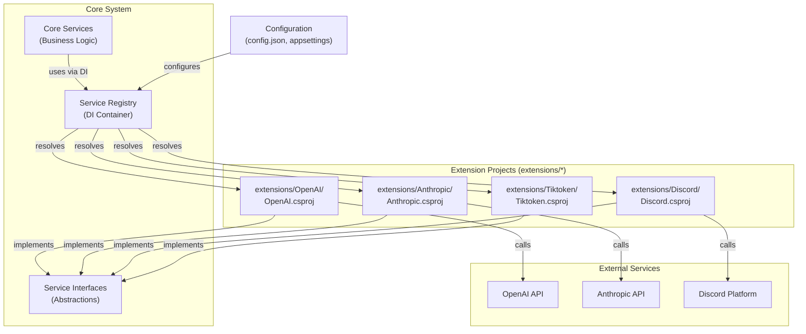
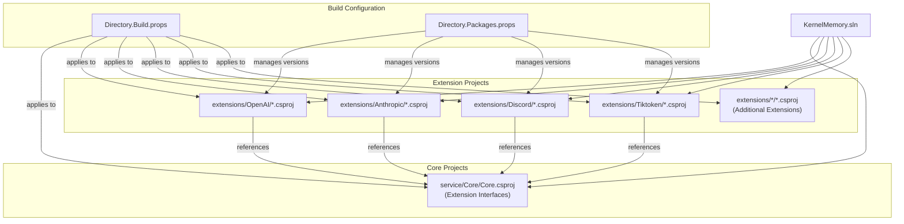
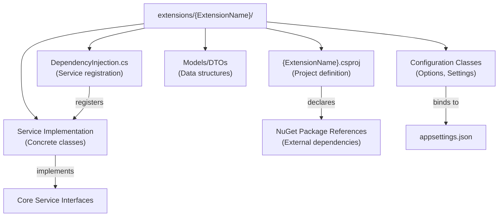
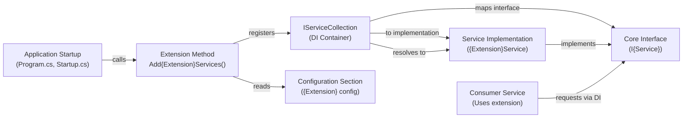
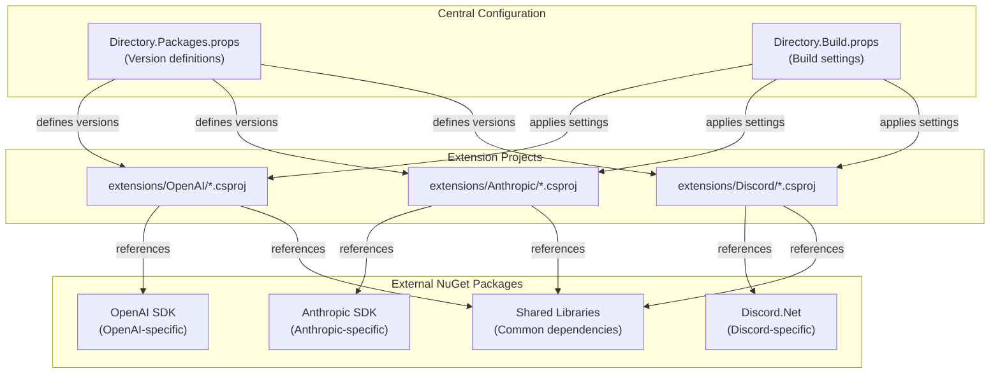
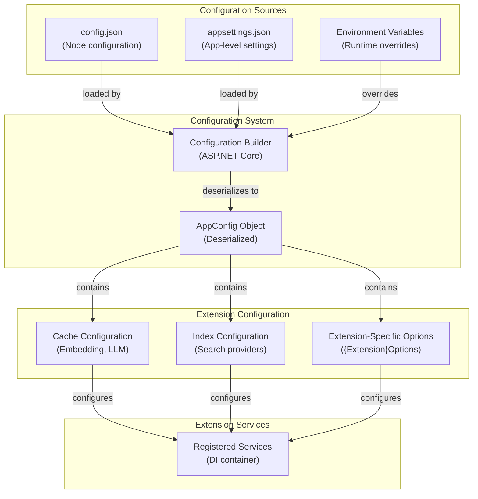
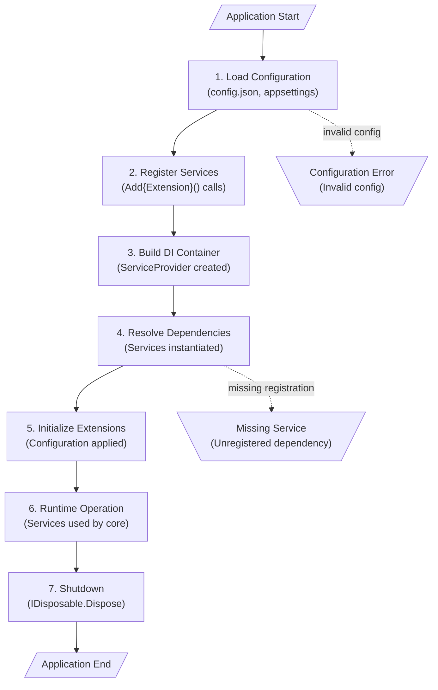
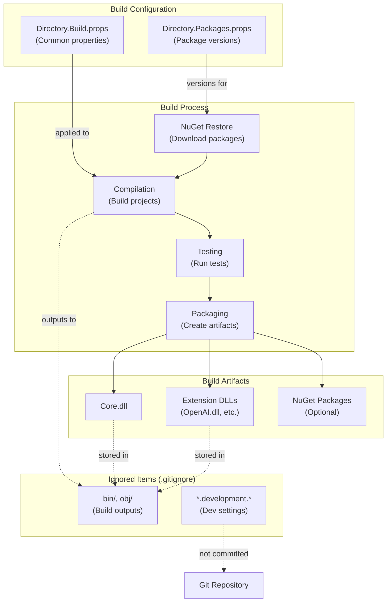

<!-- source: DeepWiki mcp.deepwiki.com · repo microsoft/kernel-memory · page 8.1 Extension Architecture · fetched 2026-10-26 -->

# Extension Architecture

Relevant source files

The following files were used as context for generating this wiki page:

- [.gitignore](.gitignore)
- [.gitmodules](.gitmodules)
- [README.md](README.md)

## Purpose and Scope

This document explains the architectural design of the extension system in KM² (Kernel Memory squared), including how extensions are structured, organized in the repository, and integrated into the core system. It covers the design patterns, project organization, and integration mechanisms that enable modular functionality.

For information about specific available extensions and their capabilities, see [Available Extensions](#8.2). For details on how the core system uses these extensions in practice, see [AI Service Integrations](#8).

---

## Extension System Overview

KM² uses an extension-based architecture to provide optional capabilities, particularly for AI service integrations. Extensions are separate projects that can be included or excluded from a deployment based on requirements, enabling:

- **Modular functionality**: Only include the AI services needed
- **Isolated dependencies**: Each extension manages its own external dependencies
- **Independent versioning**: Extensions can evolve at different rates
- **Reduced core complexity**: Core system remains focused on fundamental capabilities

The extension architecture supports multiple types of integrations:
- **AI Service Providers**: OpenAI, Anthropic/Claude, and other LLM services
- **Communication Platforms**: Discord and similar integrations
- **Utility Libraries**: Token counting (Tiktoken) and other helpers

**Extension Architecture Pattern**

Sources: [README.md:1-80](), High-Level System Architecture diagrams

---

## Repository Structure

Extensions are organized as independent projects within the repository, each with its own `.csproj` file and dependencies. The structure follows .NET best practices for solution organization.

**Extension Organization**

| Directory Pattern | Purpose | Example Projects |
|------------------|---------|------------------|
| `extensions/*/` | Extension project directories | OpenAI, Anthropic, Discord, Tiktoken |
| `extensions/*/*.csproj` | Individual extension project files | `extensions/OpenAI/OpenAI.csproj` |
| `service/Core/` | Core system with extension interfaces | Core service abstractions |

Sources: High-Level System Architecture Diagram 3, Diagram 7

---

## Extension Project Structure

Each extension follows a consistent project structure pattern:

**Typical Extension Project Layout**

**Key Components**

| Component | Responsibility | Typical Pattern |
|-----------|---------------|-----------------|
| `{Extension}.csproj` | Project definition, references | Standard .NET project file |
| Service Implementations | Concrete implementations of core interfaces | Classes implementing `I{Service}` interfaces |
| Configuration Classes | Strongly-typed configuration options | Classes with `{Extension}Options` suffix |
| DependencyInjection | Service registration methods | Static `Add{Extension}` methods |
| External Package References | Third-party SDKs and libraries | NuGet packages managed centrally |

Sources: High-Level System Architecture Diagram 3, Diagram 7

---

## Integration Patterns

Extensions integrate with the core system through well-defined patterns based on .NET dependency injection and service registration.

**Service Registration Pattern**

**Common Integration Patterns**

| Pattern | Description | Usage |
|---------|-------------|-------|
| **Interface-Based** | Extensions implement core-defined interfaces | All AI service providers |
| **Options Pattern** | Configuration bound to strongly-typed classes | All extensions with config |
| **Extension Methods** | `IServiceCollection` extension methods for registration | `Add{Extension}()` methods |
| **Factory Pattern** | Factories create extension instances based on config | Multi-provider scenarios |
| **Strategy Pattern** | Different implementations selected at runtime | Switching between AI providers |

Sources: High-Level System Architecture Diagram 3

---

## Dependency Management

Extensions manage their dependencies through centralized package management, ensuring version consistency across the solution.

**Centralized Package Management**

**Dependency Isolation Benefits**

| Benefit | Description | Impact |
|---------|-------------|--------|
| **Version Control** | Centralized version management via `Directory.Packages.props` | Consistent versions across solution |
| **Dependency Isolation** | Each extension's external dependencies isolated | No conflicts between extensions |
| **Minimal Core** | Core project has minimal dependencies | Easier to maintain and test |
| **Optional Loading** | Extensions only loaded when needed | Reduced deployment size |

Sources: High-Level System Architecture Diagram 3, [.gitignore:1-73]()

---

## Configuration Integration

Extensions integrate with KM²'s configuration system through the `config.json` structure and application settings.

**Configuration Flow**

**Extension Configuration Locations**

| Configuration Area | File/Location | Extensions Configured |
|-------------------|---------------|----------------------|
| Application-level caches | `config.json` → `caches` | Embedding cache, LLM cache (shared across nodes) |
| Node-level indexes | `config.json` → `nodes[*].indexes` | Search providers, vector stores |
| App settings | `appsettings.json` or `appsettings.{Environment}.json` | Extension-specific settings |
| Environment variables | Runtime environment | Sensitive values (API keys) |

Sources: [README.md:1-80](), [.gitignore:19-25](), High-Level System Architecture Diagram 6

---

## Extension Lifecycle

Extensions follow a standard lifecycle managed by the application's dependency injection container.

**Extension Lifecycle Stages**

**Lifecycle Management Responsibilities**

| Stage | Responsibility | Typical Actions |
|-------|---------------|-----------------|
| **Load Configuration** | Read and validate configuration files | Parse JSON, validate schema |
| **Register Services** | Add services to DI container | Call `IServiceCollection.Add*()` methods |
| **Build Container** | Create service provider | ASP.NET Core builds `IServiceProvider` |
| **Resolve Dependencies** | Instantiate services with dependencies | DI resolves constructor parameters |
| **Initialize Extensions** | Apply configuration to services | Set options, initialize connections |
| **Runtime Operation** | Execute extension functionality | Process requests, call external APIs |
| **Shutdown** | Clean up resources | Dispose connections, flush buffers |

Sources: High-Level System Architecture Diagram 3

---

## Extension Development Guidelines

When developing new extensions for KM², follow these architectural patterns:

**Extension Development Checklist**

| Guideline | Description | Benefit |
|-----------|-------------|---------|
| **Define interfaces in Core** | Place service abstractions in core project | Loose coupling, testability |
| **Implement in extension project** | Concrete implementations in extension | Isolated dependencies |
| **Use Options pattern** | Configuration as strongly-typed classes | Type safety, validation |
| **Provide extension methods** | `Add{Extension}()` for service registration | Consistent API |
| **Handle errors gracefully** | Don't throw during registration | Allows partial configurations |
| **Document configuration** | Clear documentation of config options | Easier to use |
| **Minimize core dependencies** | Keep extension dependencies isolated | Reduced coupling |
| **Support async operations** | Use async/await for I/O operations | Better performance |

**Extension Development Anti-Patterns to Avoid**

| Anti-Pattern | Problem | Better Approach |
|--------------|---------|----------------|
| Direct instantiation in core | Creates tight coupling | Use dependency injection |
| Hardcoded configuration | Not flexible | Use Options pattern |
| Static dependencies | Hard to test, not thread-safe | Use instance services |
| Missing disposal | Resource leaks | Implement `IDisposable` or `IAsyncDisposable` |
| Synchronous I/O | Blocks threads | Use async operations |

Sources: High-Level System Architecture Diagram 3, [.gitignore:19-25]()

---

## Build and Deployment Integration

Extensions participate in the solution's build system through centralized build configurations.

**Build System Integration**

**Build Artifacts and Exclusions**

| Item | Location | Committed to Git |
|------|----------|------------------|
| Build outputs | `bin/`, `obj/` | No (excluded in `.gitignore`) |
| Extension DLLs | `extensions/*/bin/` | No (excluded in `.gitignore`) |
| Development configs | `*.development.*` | No (excluded in `.gitignore`) |
| Test results | `TestResult*/` | No (excluded in `.gitignore`) |
| Source code | `extensions/*/` | Yes (tracked) |
| Project files | `extensions/*/*.csproj` | Yes (tracked) |

Sources: [.gitignore:1-73](), High-Level System Architecture Diagram 7

---

## Research Project Considerations

As KM² is an active research project, the extension architecture is subject to rapid evolution.

**Extension Architecture Evolution**

| Aspect | Current State | Expected Evolution |
|--------|---------------|-------------------|
| **Stability** | No guarantees | Breaking changes expected |
| **API Surface** | Experimental | May change without notice |
| **Extension Count** | Limited set | May grow or be removed |
| **Integration Patterns** | Standard .NET DI | May adopt new patterns |
| **Configuration Schema** | JSON-based | May change structure |

**Implications for Extension Development**

- Extensions are part of the research exploration
- No commitment to maintaining backward compatibility
- Pin specific commits if stability is needed
- Expect refactoring as concepts evolve
- Extensions may be removed if not aligned with research goals

Sources: [README.md:1-34]()

---

## Summary

The KM² extension architecture provides a modular, dependency injection-based system for integrating optional capabilities, particularly AI services. Extensions are:

- **Isolated projects** under `extensions/*/` with independent dependencies
- **Integrated via interfaces** defined in the core system
- **Registered through DI** using standard .NET patterns
- **Configured** through `config.json` and `appsettings.json`
- **Managed centrally** through `Directory.Build.props` and `Directory.Packages.props`

As an active research project, the extension architecture evolves rapidly with no stability guarantees. Developers should expect changes and pin specific commits for consistency.

For details on specific available extensions, see [Available Extensions](#8.2).

Sources: [README.md:1-80](), [.gitignore:1-73](), [.gitmodules:1-4](), High-Level System Architecture diagrams

---

