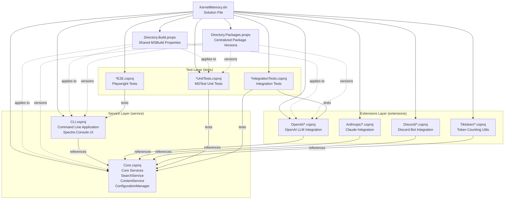
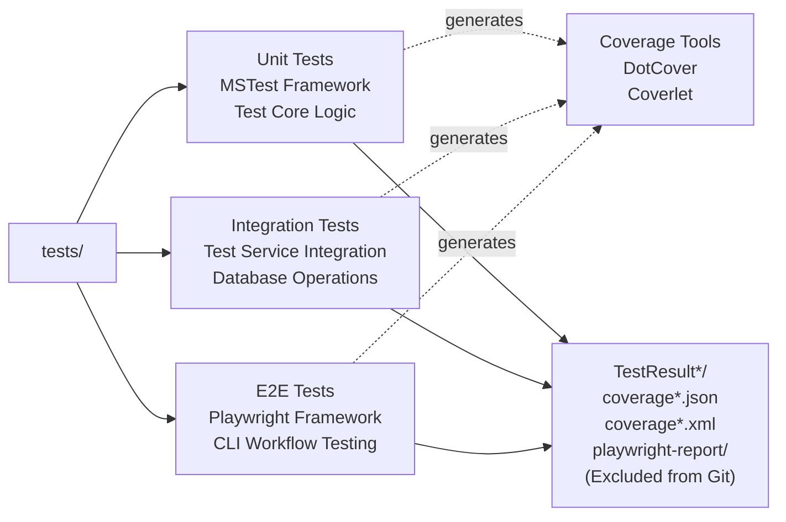
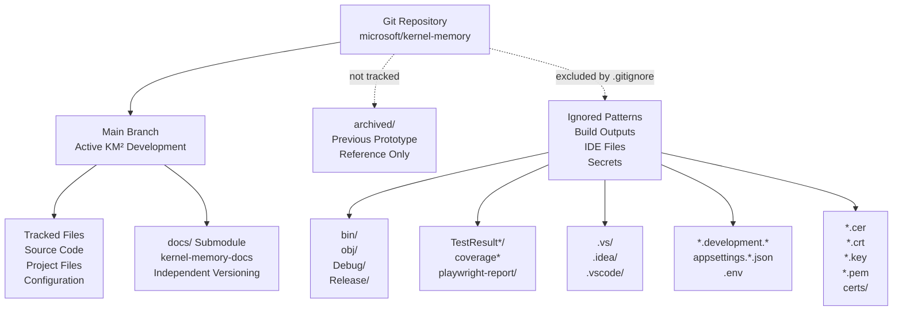
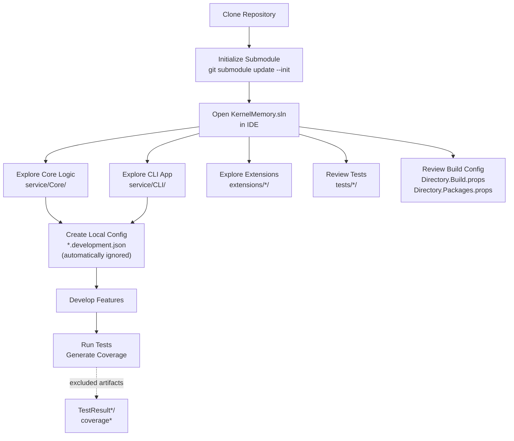

<!-- source: DeepWiki mcp.deepwiki.com · repo microsoft/kernel-memory · page 9.1 Repository Structure · fetched 2026-10-26 -->

# Repository Structure

<details>
<summary>Relevant source files</summary>

The following files were used as context for generating this wiki page:

- [.gitignore](.gitignore)
- [.gitmodules](.gitmodules)
- [README.md](README.md)

</details>


This page explains the organization of the KM² (Kernel Memory squared) codebase, including the solution structure, directory layout, build configuration approach, and version control practices. This information is essential for developers who want to understand how the code is organized and where to find specific functionality.

For information about the build system and package management, see [Build System](#9.2). For details on setting up your development environment, see [IDE Setup and Development Environment](#9.4).

---

## Purpose and Scope

The KM² repository follows a modern .NET solution structure with centralized build configuration, multi-project organization, and explicit exclusion of build artifacts and sensitive data from version control. The repository contains both the active KM² codebase and an archived reference implementation of the previous prototype.

---

## Top-Level Directory Structure

The repository is organized into functional areas that separate active development code, documentation, archived material, and generated artifacts:

```mermaid
graph TB
    Root["Repository Root<br/>(github.com/microsoft/kernel-memory)"]
    
    Service["service/<br/>Active KM² Implementation"]
    Extensions["extensions/<br/>AI Service Integrations"]
    Tests["tests/<br/>Test Projects"]
    Docs["docs/<br/>Git Submodule<br/>(kernel-memory-docs)"]
    Archived["archived/<br/>Previous Prototype<br/>(Not Tracked)"]
    
    BuildConfig["Directory.Build.props<br/>Directory.Packages.props"]
    Solution["KernelMemory.sln"]
    Gitignore[".gitignore"]
    Gitmodules[".gitmodules"]
    Readme["README.md"]
    
    Root --> Service
    Root --> Extensions
    Root --> Tests
    Root --> Docs
    Root --> Archived
    Root --> BuildConfig
    Root --> Solution
    Root --> Gitignore
    Root --> Gitmodules
    Root --> Readme
    
    Core["Core/<br/>Core.csproj<br/>Core Services"]
    CLI["CLI/<br/>CLI Application"]
    
    Service --> Core
    Service --> CLI
    
    OpenAI["OpenAI/<br/>LLM Extension"]
    Anthropic["Anthropic/<br/>Claude Extension"]
    Discord["Discord/<br/>Discord Extension"]
    Tiktoken["Tiktoken/<br/>Token Counting"]
    
    Extensions --> OpenAI
    Extensions --> Anthropic
    Extensions --> Discord
    Extensions --> Tiktoken
    
    UnitTests["Unit Tests"]
    IntegrationTests["Integration Tests"]
    E2ETests["E2E Tests<br/>(Playwright)"]
    
    Tests --> UnitTests
    Tests --> IntegrationTests
    Tests --> E2ETests
```



**Sources:** [README.md:1-80](), [.gitignore:1-73](), [.gitmodules:1-4]()

---

## Directory Purposes

| Directory/File | Purpose | Version Controlled |
|----------------|---------|-------------------|
| `service/` | Active KM² implementation including core services and CLI application | ✓ Yes |
| `extensions/` | AI service integration extensions (OpenAI, Anthropic, Discord, etc.) | ✓ Yes |
| `tests/` | Test projects including unit tests, integration tests, and E2E tests | ✓ Yes |
| `docs/` | Documentation repository managed as a Git submodule (`kernel-memory-docs`) | ✓ Submodule |
| `archived/` | Previous prototype codebase, kept for reference only | ✗ No |
| `KernelMemory.sln` | Visual Studio solution file defining the project structure | ✓ Yes |
| `Directory.Build.props` | Centralized MSBuild properties applied to all projects | ✓ Yes |
| `Directory.Packages.props` | Centralized NuGet package version management | ✓ Yes |
| `.gitignore` | Defines files and directories excluded from version control | ✓ Yes |
| `.gitmodules` | Defines Git submodules (docs repository) | ✓ Yes |
| `README.md` | Project overview, disclaimer, and contributor information | ✓ Yes |

**Sources:** [README.md:9-11](), [.gitignore:1-2](), [.gitmodules:1-4]()

---

## Project Organization and Solution Structure

The codebase follows a layered architecture with clear separation between core functionality, application layer, extensions, and tests:



**Sources:** [README.md:1-80]()

---

## Core Service Layer Projects

The `service/` directory contains the primary implementation of KM²:

| Project | File Pattern | Responsibilities |
|---------|--------------|------------------|
| **Core** | `service/Core/Core.csproj` | Core services including `SearchService`, `ContentService`, `ContentStorageService`, `NodeSearchService`, query parsers (`InfixQueryParser`, `MongoQueryParser`), SQLite database access via Entity Framework Core, and configuration management (`AppConfig`, `NodeConfig`) |
| **CLI** | `service/CLI/*.csproj` | Command-line interface application using Spectre.Console, implements commands: `search`, `get`, `list`, `upsert`, `delete`, `config`, `examples` |

**Sources:** [README.md:1-80]()

---

## Extensions Layer Projects

The `extensions/` directory contains modular AI service integrations that extend the core functionality:

| Extension | Directory Pattern | Purpose |
|-----------|------------------|---------|
| **OpenAI** | `extensions/OpenAI/*.csproj` | Integration with OpenAI's LLM services for text generation and embeddings |
| **Anthropic** | `extensions/Anthropic/*.csproj` | Integration with Anthropic's Claude models |
| **Discord** | `extensions/Discord/*.csproj` | Discord bot integration for collaborative features |
| **Tiktoken** | `extensions/Tiktoken/*.csproj` | Token counting utilities for LLM input/output management |

Extensions are designed to be optional and modular, allowing KM² to integrate with different AI service providers based on configuration.

**Sources:** [README.md:1-80]()

---

## Test Projects

The `tests/` directory contains comprehensive test coverage:



**Sources:** [.gitignore:44-56]()

---

## Build Configuration Files

KM² uses a centralized build configuration approach that eliminates duplication and ensures consistency across all projects:

### Centralized Build Properties

| File | Purpose | Scope |
|------|---------|-------|
| `Directory.Build.props` | Defines MSBuild properties, build settings, target frameworks, and compiler options applied to all projects in the solution | All `.csproj` files |
| `Directory.Packages.props` | Centralized NuGet package version management using Central Package Management (CPM) feature | All projects |

This approach ensures that:
- All projects use consistent target frameworks (e.g., .NET 8.0)
- Package versions are managed in a single location
- Build settings are uniform across the solution
- Individual projects only need to specify which packages they use, not versions

**Sources:** [README.md:1-80]()

---

## Version Control Structure

The repository uses Git with specific practices for managing code, documentation, and historical artifacts:



**Sources:** [.gitignore:1-73](), [.gitmodules:1-4](), [README.md:11]()

---

## Git Submodule: Documentation Repository

The documentation is managed as a separate Git submodule, allowing independent versioning and contribution workflows:

```
[submodule "docs"]
    path = docs
    url = https://github.com/microsoft/kernel-memory-docs
```

This structure enables:
- Independent documentation updates without affecting the main codebase
- Separate contribution policies for documentation
- Documentation versioning that can be synchronized with specific code releases
- Cleaner separation of concerns between implementation and documentation

**Sources:** [.gitmodules:1-4]()

---

## Archived Directory

The `archived/` directory contains the previous research prototype:

| Aspect | Details |
|--------|---------|
| **Status** | Reference only, not actively maintained |
| **Version Control** | Not tracked in Git (excluded via `.gitignore`) |
| **Purpose** | Preserved for reference and lessons learned |
| **Relationship to KM²** | KM² is a complete rewrite informed by the archived prototype |

As stated in the README:

> "KM² is a full rewrite of the initial research prototype, informed by lessons learned from the first iteration and by adjacent work in this space. The previous codebase remains in the repo for reference only."

The decision to exclude `archived/` from version control keeps the Git history focused on the active KM² development while maintaining the prototype as a local reference for developers who need to understand design decisions and evolution.

**Sources:** [README.md:9-11](), [.gitignore:1]()

---

## Files Excluded from Version Control

The `.gitignore` file defines comprehensive exclusion patterns to keep the repository clean:

### Build Outputs and Artifacts

```
# Build results
bin/
obj/
Debug/
Release/
x64/
x86/
bld/
```

All compiler-generated outputs are excluded, including platform-specific builds and intermediate object files.

**Sources:** [.gitignore:7-41]()

### Test Results and Coverage Reports

```
# MSTest test Results
TestResult*/
BuildLog.*

# DotCover is a Code Coverage Tool
*.dotCover

# Coverlet is a free, cross platform Code Coverage Tool
coverage*.json
coverage*.xml
coverage*.info

# Playwright
playwright-report/
```

Test execution artifacts are excluded to prevent repository bloat and avoid committing machine-specific test results.

**Sources:** [.gitignore:43-56]()

### IDE-Specific Files

```
.idea      # JetBrains Rider
.vs/       # Visual Studio
.vscode/   # VS Code (if configured locally)
*.user     # Visual Studio user-specific settings
```

IDE configuration files are excluded to allow developers to use their preferred development environment without affecting others.

**Sources:** [.gitignore:4, 12, 14-15]()

### Configuration and Secrets

```
# Local settings which might contain credentials
.env
config.development.yaml
*.development.config
*.development.json
*.development.json*
appsettings.*.json

# Certificates and keys
*.cer
*.crt
*.key
*.pem
certs/
```

Environment-specific configurations and sensitive data are explicitly excluded to prevent accidental credential exposure.

**Sources:** [.gitignore:19-26, 68-72]()

### Project-Specific Exclusions

```
archived/          # Previous prototype (not tracked)
.amplifier/        # Amplifier platform artifacts
.claude/           # Claude AI artifacts
node_modules/      # Node.js dependencies
__pycache__/       # Python cache
_dev/              # Development scratch space
.dev/              # Development scratch space
*.devis.*          # Custom development markers
*.devis
```

These exclusions reflect the multi-language nature of the project and temporary development artifacts.

**Sources:** [.gitignore:1-16]()

---

## Development Workflow and Repository Navigation

When navigating the codebase, developers should follow this mental model:



**Sources:** [.gitignore:1-73](), [.gitmodules:1-4]()

---

## Summary

The KM² repository structure reflects its status as an active research project with:

- **Layered organization**: Core services, CLI application, and extensions are clearly separated
- **Centralized build management**: `Directory.Build.props` and `Directory.Packages.props` ensure consistency
- **Multi-language support**: Infrastructure for .NET, Python, and Node.js components
- **Comprehensive testing**: Unit, integration, and E2E test projects with coverage tooling
- **Clean version control**: Extensive `.gitignore` patterns keep the repository focused
- **Documentation separation**: Git submodule for independent documentation management
- **Historical preservation**: Archived prototype retained locally but not in version control

This structure supports rapid iteration while maintaining code quality, as befits an experimental research project that "is evolving rapidly and may change without notice."

**Sources:** [README.md:1-34](), [.gitignore:1-73](), [.gitmodules:1-4]()

---

