# Page: Overview

# Overview

<details>
<summary>Relevant source files</summary>

The following files were used as context for generating this wiki page:

- [.gitignore](.gitignore)
- [.gitmodules](.gitmodules)
- [README.md](README.md)

</details>


## Purpose and Scope

This document provides a high-level introduction to **Kernel Memory (KM²)**, explaining its purpose as an active research project, its experimental nature, architectural approach, and relationship to related systems. It establishes context for the entire system and sets expectations for developers and researchers exploring the codebase.

For installation and first-run instructions, see [Getting Started](#2). For detailed architectural documentation, see [Architecture](#3). For explicit warnings about the experimental nature of this software, see [Project Status and Warnings](#1.1).

---

## What is Kernel Memory (KM²)?

**Kernel Memory (KM²)** is a research project exploring AI memory concepts through a full-text search system with multi-node architecture and AI service integrations. The project represents a complete rewrite of an earlier research prototype, incorporating lessons learned from the first iteration and adjacent work in this space.

The system provides:
- A command-line interface for content management and search operations
- Full-text search capabilities using SQLite FTS5 with BM25 ranking
- Multi-node architecture for logical content partitioning
- AI service extensions for OpenAI, Anthropic (Claude), and other providers
- Flexible configuration supporting both read-only and read-write operations

**Key Characteristics:**
- **Status**: Active research project, experimental software
- **Evolution**: Rapid changes with no stability or compatibility guarantees
- **Purpose**: Learning resource and research exploration, not production software
- **Contributions**: Not accepted at this stage
- **Support**: No support provided

Sources: [README.md:1-34]()

---

## System Architecture Overview

KM² is structured in three primary layers, each with distinct responsibilities:

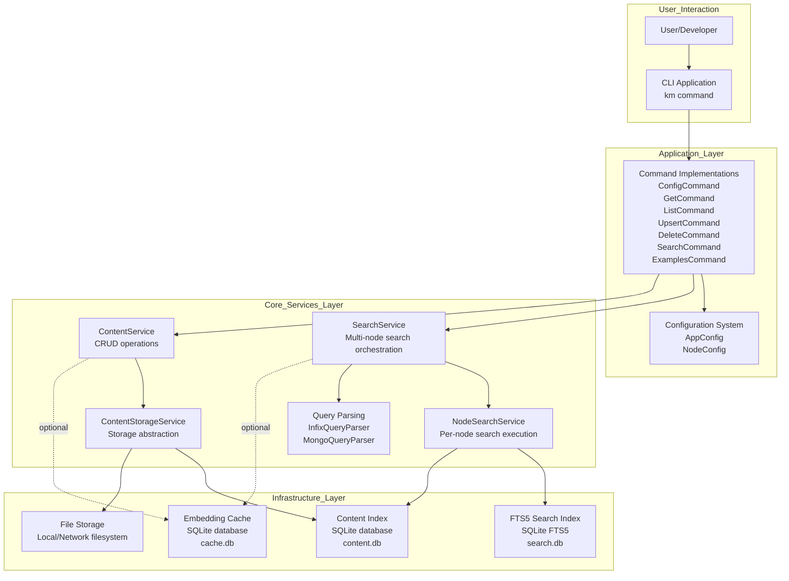

**Application Layer**: The CLI application (`km` command) provides the user-facing interface with commands for configuration management, content operations (get, list, upsert, delete), and search functionality. Commands are implemented as separate classes following a command pattern.

**Core Services Layer**: Contains the business logic for search orchestration (`SearchService`, `NodeSearchService`), content management (`ContentService`, `ContentStorageService`), and query parsing (`InfixQueryParser`, `MongoQueryParser`). These services coordinate operations across multiple nodes and handle the complexity of distributed search.

**Infrastructure Layer**: Manages data persistence through SQLite databases for content indexing, full-text search (FTS5), and optional embedding caching. File storage handles content artifacts on local or network filesystems.

For detailed architectural documentation including the multi-node design, see [Architecture](#3). For search system specifics, see [Search System](#5).

Sources: [README.md:1-34](), High-level system diagrams

---

## Technology Stack

KM² is built using a multi-language technology stack with .NET/C# as the primary language:

| Component | Technology | Purpose |
|-----------|-----------|---------|
| **Primary Language** | .NET/C# | Core services, CLI application, search implementation |
| **Supporting Languages** | Python, Node.js/JavaScript | Supporting components and extensions |
| **CLI Framework** | Spectre.Console | Command-line interface with rich formatting |
| **Database** | SQLite | Content index, FTS5 search, embedding cache |
| **Search Engine** | SQLite FTS5 | Full-text search with BM25 ranking and stemming |
| **Logging** | Serilog | Structured logging infrastructure |
| **AI/ML Extensions** | OpenAI SDK, Anthropic SDK | LLM integrations for content generation |
| **Testing** | MSTest, Playwright | Unit testing and end-to-end testing |
| **Build System** | .NET SDK, Directory.Build.props | Centralized package and build management |

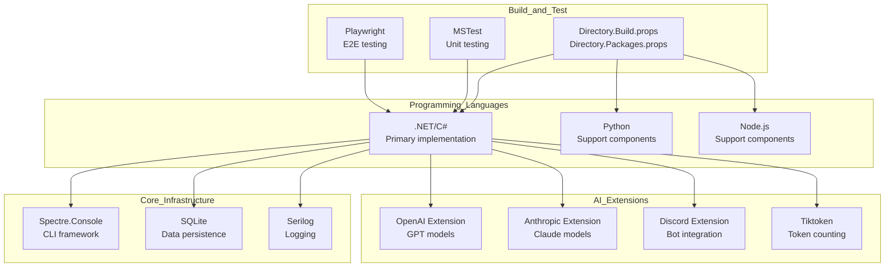

The project uses centralized package management through `Directory.Build.props` and `Directory.Packages.props` to maintain consistency across all projects in the solution. The main solution file is `KernelMemory.sln`.

For build system details, see [Build System](#9.2). For AI service integrations, see [AI Service Integrations](#8).

Sources: [README.md:1-34](), High-level system diagrams

---

## Project Evolution and Status

KM² represents a significant evolution in the research project's lifecycle:

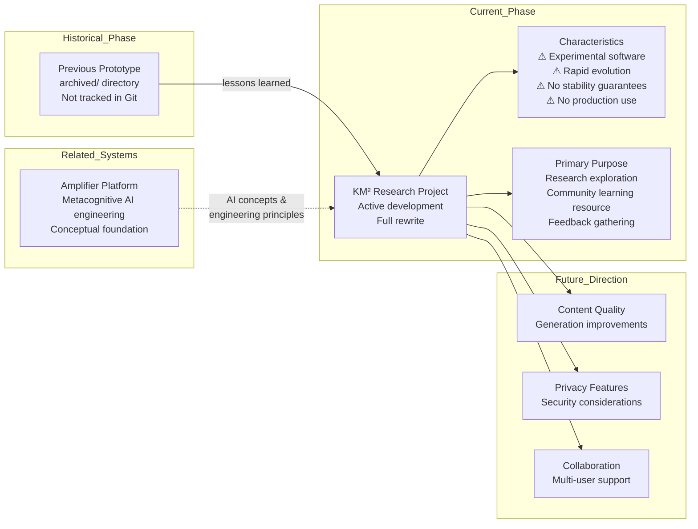

**Previous Prototype**: The initial research prototype explored early concepts but has been superseded. Its codebase remains in the repository under the `archived/` directory for reference purposes only. This directory is not tracked in version control as indicated in [.gitignore:1]().

**Current Status (KM²)**: This is a complete rewrite incorporating lessons from the first iteration. The project is explicitly experimental software with the following characteristics:
- **Rapid Evolution**: Changes occur frequently without notice
- **No Guarantees**: No stability or compatibility guarantees between versions
- **Research Purpose**: Intended for exploration and learning, not production deployment
- **Community Engagement**: Feedback is welcomed, but contributions are not accepted at this stage
- **No Support**: The project provides no support (see SUPPORT.md)

**Development Approach**: The team is using [Amplifier](https://github.com/microsoft/amplifier), a platform for metacognitive AI engineering, to build KM². Amplifier concepts and AI-assisted development techniques inform the design and implementation of this memory system. For more details on this relationship, see [Relationship to Amplifier](#1.2).

**Future Focus**: Development will concentrate on three key areas as documented in [README.md:19-22]():
1. **Quality of content generated** - Improving the output quality of AI-generated content
2. **Privacy** - Addressing privacy considerations in memory systems
3. **Collaboration** - Enabling multi-user collaboration features

For detailed documentation of planned features, see [Future Vision](#1.3). For current warnings and limitations, see [Project Status and Warnings](#1.1).

Sources: [README.md:6-33](), [.gitignore:1]()

---

## Repository Structure

The codebase is organized into several key directories and files:

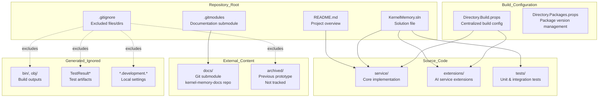

**Key Files and Directories:**

| Path | Purpose | Version Control |
|------|---------|----------------|
| `README.md` | Project overview, warnings, and contributor list | Tracked |
| `KernelMemory.sln` | Main solution file for .NET projects | Tracked |
| `service/` | Core service implementations | Tracked |
| `extensions/` | AI service extensions (OpenAI, Anthropic, etc.) | Tracked |
| `tests/` | Unit and integration test projects | Tracked |
| `docs/` | Documentation (Git submodule to kernel-memory-docs) | Submodule |
| `archived/` | Previous prototype codebase (reference only) | Not tracked |
| `bin/`, `obj/` | Build output directories | Ignored |
| `*.development.*` | Local development configuration files | Ignored |

The `.gitignore` file excludes build artifacts, test results, IDE-specific files, sensitive configuration, and the archived directory from version control. Development configuration files (matching patterns like `*.development.json`, `config.development.yaml`, `.env`) are also ignored to prevent accidental credential commits.

For detailed repository structure, see [Repository Structure](#9.1). For build system configuration, see [Build System](#9.2).

Sources: [README.md:1-80](), [.gitignore:1-73](), [.gitmodules:1-4]()

---

## Configuration System

KM² uses a JSON-based configuration system centered around `config.json` (typically located at `~/.km/config.json`):

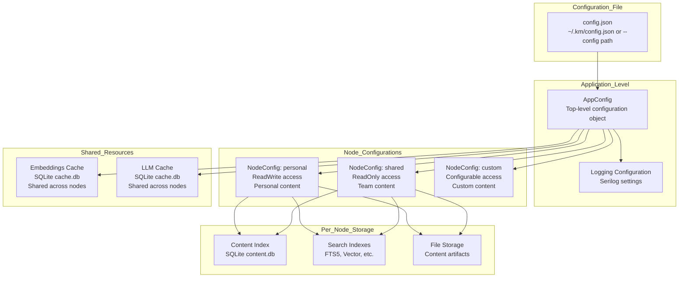

**Multi-Node Architecture**: The configuration system supports multiple "nodes," where each node represents a logical partition of content with its own:
- Content index (SQLite database for metadata)
- Search indexes (FTS5 full-text search, optional vector indexes)
- File storage location (local or network filesystem)
- Access mode (ReadWrite or ReadOnly)

**Shared Resources**: Embedding and LLM caches are configured at the application level and shared across all nodes to optimize resource usage and avoid redundant API calls.

**Default Behavior**: When users don't specify a node via the `--node` flag, the system uses the first node defined in the configuration (typically named "personal"). The CLI creates a default configuration on first run if none exists.

For detailed configuration documentation, see [Configuration System](#6). For multi-node architecture details, see [Multi-Node Architecture](#3.3). For configuration command usage, see [Configuration Command](#4.3).

Sources: [README.md:1-34](), High-level system diagrams

---

## Command-Line Interface

KM² provides a CLI application (`km`) with commands for content management and search:

| Command | Purpose | Example |
|---------|---------|---------|
| `config` | View or create configuration files | `km config` |
| `get` | Retrieve a specific content item by ID | `km get <id>` |
| `list` | List all content items | `km list` |
| `upsert` | Create or update content | `km upsert <file>` |
| `delete` | Remove content by ID | `km delete <id>` |
| `search` | Full-text search across content | `km search "query"` |
| `examples` | Show usage examples | `km examples` |

**Global Options:**
- `--node <name>`: Specify which node to operate on (default: first configured node)
- `--config <path>`: Path to configuration file (default: `~/.km/config.json`)
- `--format <format>`: Output format (human, json, yaml)
- `--verbose`: Enable verbose logging

**Database Initialization**: Write operations (upsert, delete) automatically initialize databases and storage on first use. Read operations (get, list, search) require existing databases or will return empty results.

For comprehensive CLI documentation, see [CLI Application](#4). For getting started with the CLI, see [First Steps with the CLI](#2.3).

Sources: [README.md:1-34](), High-level system diagrams

---

## Getting Started

To begin using KM²:

1. **Build the project**: Clone the repository and build using the .NET SDK
2. **Initialize configuration**: Run `km config` to create a default configuration file
3. **Add content**: Use `km upsert` to add content to the system
4. **Search content**: Use `km search` to perform full-text searches

**Important Reminders:**
- This is experimental software with no stability guarantees
- Pin specific commits if you need consistency
- Do not use in production environments
- No support is provided

For detailed installation and setup instructions, see [Getting Started](#2). For build requirements, see [Installation and Setup](#2.1). For configuration details, see [Configuration Basics](#2.2).

Sources: [README.md:1-34]()

---

## Related Documentation

- **[Project Status and Warnings](#1.1)**: Explicit documentation of experimental status and limitations
- **[Relationship to Amplifier](#1.2)**: How Amplifier concepts influence KM² development
- **[Future Vision](#1.3)**: Planned focus areas for quality, privacy, and collaboration
- **[Getting Started](#2)**: Installation and first-run instructions
- **[Architecture](#3)**: Comprehensive architectural documentation
- **[Search System](#5)**: Detailed search system documentation including query syntax and ranking
- **[Configuration System](#6)**: Complete configuration reference

---

## Contributors

The project benefits from contributions by multiple community members. For the current contributor list, see [README.md:35-79]().

Sources: [README.md:35-79]()

---

# Page: Project Status and Warnings

# Project Status and Warnings

<details>
<summary>Relevant source files</summary>

The following files were used as context for generating this wiki page:

- [.gitignore](.gitignore)
- [.gitmodules](.gitmodules)
- [README.md](README.md)

</details>


**Purpose**: This page documents the current status of the Kernel Memory (KM²) project, including critical warnings, stability guarantees (or lack thereof), and guidance on appropriate usage. This information is essential reading before attempting to use, deploy, or depend on KM² in any capacity.

For information about the project's relationship to Amplifier and metacognitive AI engineering, see [Relationship to Amplifier](#1.2). For the project's future development plans, see [Future Vision](#1.3).

---

## Current Status: Active Research Project

KM² is explicitly an **active research project** and **experimental software**. This designation has concrete implications for how the project should be used and what users can expect.

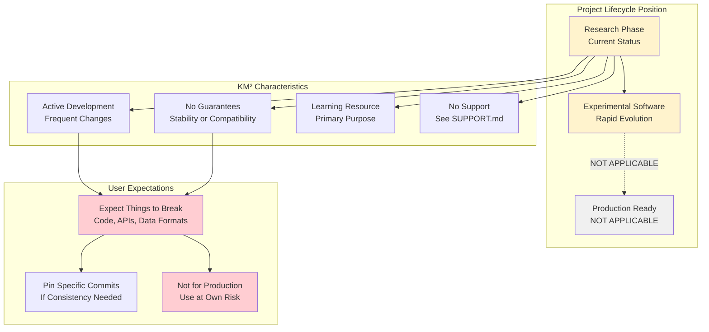

**Status Declaration**: KM² is explicitly positioned in the research and experimental phase, with no path currently defined toward production readiness.

Sources: [README.md:6-7](), [README.md:24-33]()

---

## Critical Warnings and Disclaimers

The project README contains several critical warnings that users must understand before proceeding. These are not pro forma disclaimers but accurate descriptions of the current state.

### Stability and Compatibility

| Aspect | Status | Details |
|--------|--------|---------|
| **API Stability** | ❌ No Guarantees | APIs may change without notice or deprecation cycle |
| **Data Format Compatibility** | ❌ No Guarantees | Database schemas and file formats may change incompatibly |
| **Behavioral Consistency** | ❌ No Guarantees | System behavior may change between commits |
| **Backward Compatibility** | ❌ Not Maintained | No commitment to maintaining compatibility with previous versions |
| **Forward Compatibility** | ❌ Not Planned | Older data may not work with newer versions |

**Implication**: Code written against KM² today may not work tomorrow without modifications. Data created today may not be readable by tomorrow's version.

Sources: [README.md:30-31]()

### Production Use

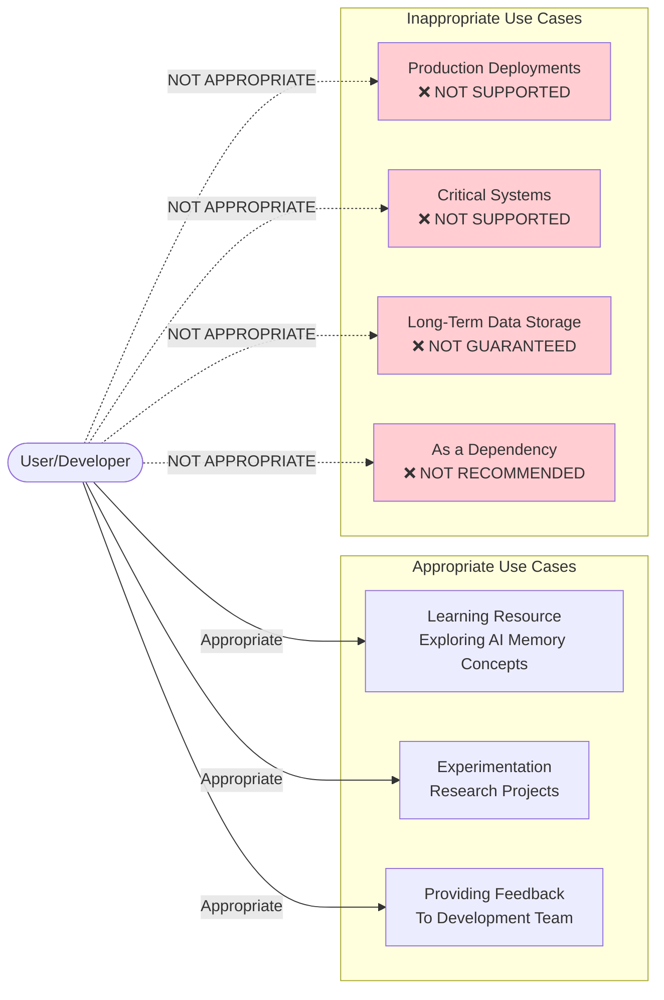

**Explicit Statement**: KM² is **not production-ready software** and is **not intended for production use**. It is designed as a learning resource for exploring AI memory concepts.

Sources: [README.md:32]()

### Support Policy

The project has an explicit no-support policy:

- **No support provided** for any issues encountered
- **No guarantee of bug fixes** for reported problems
- **No commitment to feature requests**
- **Contributions not accepted at this stage** of development

Users experiencing issues should refer to [SUPPORT.md]() for the official support policy statement.

Sources: [README.md:29](), [README.md:33]()

---

## What This Means in Practice

### For Developers Exploring the Codebase

If you are using KM² as a **learning resource**:

- ✅ Study the code architecture and design patterns
- ✅ Experiment with the CLI and APIs locally
- ✅ Provide feedback on the approach and concepts
- ✅ Reference specific commits in your learning notes
- ⚠️ Expect to encounter bugs, incomplete features, and inconsistencies
- ⚠️ Do not build dependent projects assuming current behavior will persist

### For Researchers and Experimenters

If you are using KM² for **research or experimentation**:

- ✅ Use it to explore AI memory concepts
- ✅ Test different configurations and approaches
- ✅ Pin to specific commits for reproducible research
- ⚠️ Document the exact commit hash used in research papers
- ⚠️ Be prepared to adapt to breaking changes if updating
- ❌ Do not use as the foundation for research infrastructure

### Version Pinning Strategy

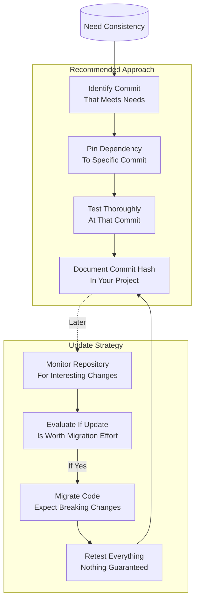

**Key Recommendation**: If you need any consistency, pin your dependency to a specific commit hash rather than using branch names or version tags.

Sources: [README.md:31]()

---

## Context: Complete Rewrite from Initial Prototype

KM² represents a **complete rewrite** of an earlier research prototype. Understanding this history provides context for the current state.

### Relationship to Previous Codebase

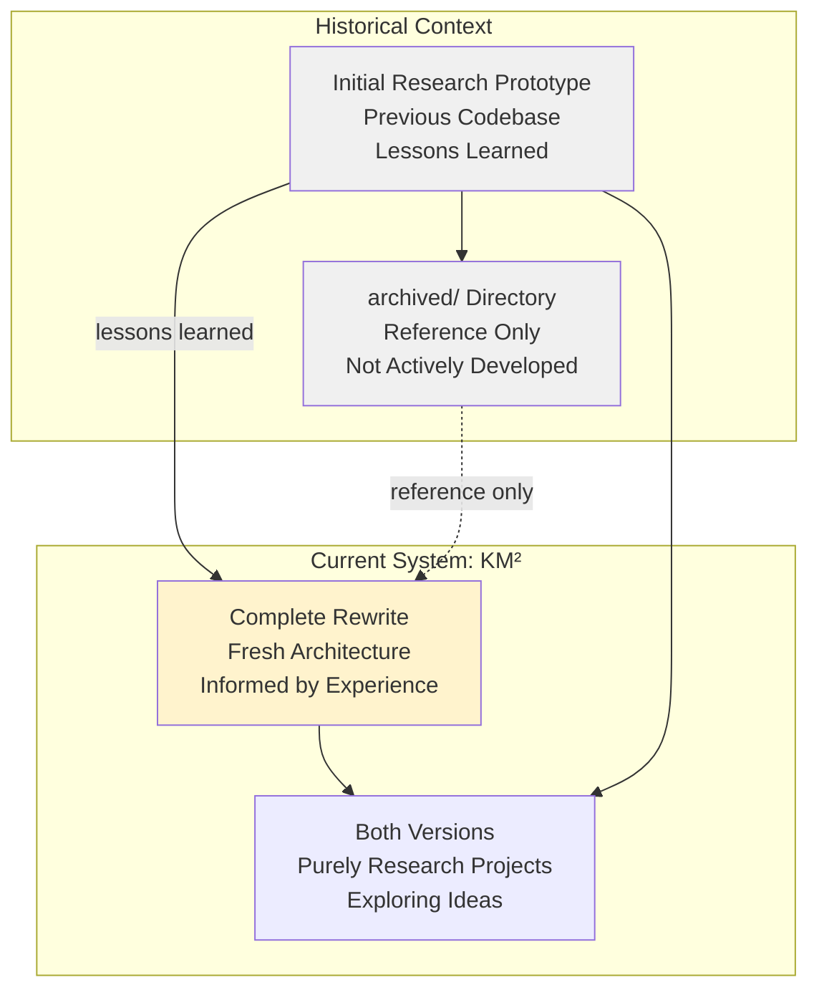

**Key Point**: Both the original prototype and KM² exist purely as research projects for exploring new ideas and gathering community feedback. Neither is intended as production software.

Sources: [README.md:9-13]()

### Archived Content

The `archived/` directory in the repository contains the previous codebase:

- Remains in the repository for **reference only**
- Not actively developed or maintained
- Provides historical context for design decisions
- **Not tracked in version control** (see `.gitignore`)

The `.gitignore` configuration explicitly excludes the `archived/` directory from version control tracking.

Sources: [README.md:11](), [.gitignore:1]()

---

## Repository Metadata and Community

### Contributors and Attribution

The project maintains a list of contributors in the README, acknowledging community members who have provided feedback and contributions. This section uses GitHub API integration to display contributor avatars and profiles.

However, as noted in the disclaimer:

> **Contributions are not accepted at this stage**

This means that while the project acknowledges past contributors, it is not currently accepting pull requests or external contributions.

Sources: [README.md:35-79](), [README.md:29]()

### Documentation Structure

The project uses a Git submodule for its documentation:

- Documentation repository: `kernel-memory-docs`
- Submodule path: `docs/`
- Allows documentation to evolve independently

This separation enables documentation updates without affecting the main codebase and vice versa.

Sources: [.gitmodules:1-3]()

---

## Summary of Key Warnings

| Warning | Severity | Impact |
|---------|----------|--------|
| **This is experimental software** | ⚠️ Critical | Core functionality may not work as expected |
| **Expect things to break** | ⚠️ Critical | APIs, data formats, and behavior will change |
| **No stability guarantees** | ⚠️ Critical | Breaking changes without notice or deprecation |
| **No compatibility guarantees** | ⚠️ Critical | Updates may require complete data migration |
| **Not production-ready** | ⚠️ Critical | Do not use in production systems |
| **No support provided** | ℹ️ Important | Issues and bugs may not be addressed |
| **No contributions accepted** | ℹ️ Important | Pull requests will not be reviewed at this stage |
| **Pin specific commits** | 💡 Recommended | Only way to ensure consistency |

**Final Statement**: Users proceed at their own risk with full awareness that this is an active research project undergoing rapid evolution.

Sources: [README.md:6-7](), [README.md:24-33]()

---

# Page: Relationship to Amplifier

# Relationship to Amplifier

<details>
<summary>Relevant source files</summary>

The following files were used as context for generating this wiki page:

- [.gitignore](.gitignore)
- [.gitmodules](.gitmodules)
- [README.md](README.md)

</details>


## Purpose and Scope

This document explains the relationship between KM² (Kernel Memory squared) and Amplifier, Microsoft's platform for metacognitive AI engineering. It covers the conceptual foundation that Amplifier provides, how Amplifier concepts are applied in building KM², and the practical development artifacts that result from this relationship.

For information about the broader project vision and future directions, see [Future Vision](#1.3). For details about the overall architecture, see [Architecture](#3).

---

## What is Amplifier

Amplifier is a parallel Microsoft research project that serves as a platform for metacognitive AI engineering. According to the project documentation, Amplifier is unique in that the team uses Amplifier to build Amplifier itself—a self-referential development approach that embodies metacognitive principles.

The relationship is conceptual rather than technical: KM² does not depend on Amplifier as a runtime dependency or library. Instead, KM² applies the same metacognitive AI engineering concepts and methodologies that Amplifier employs.

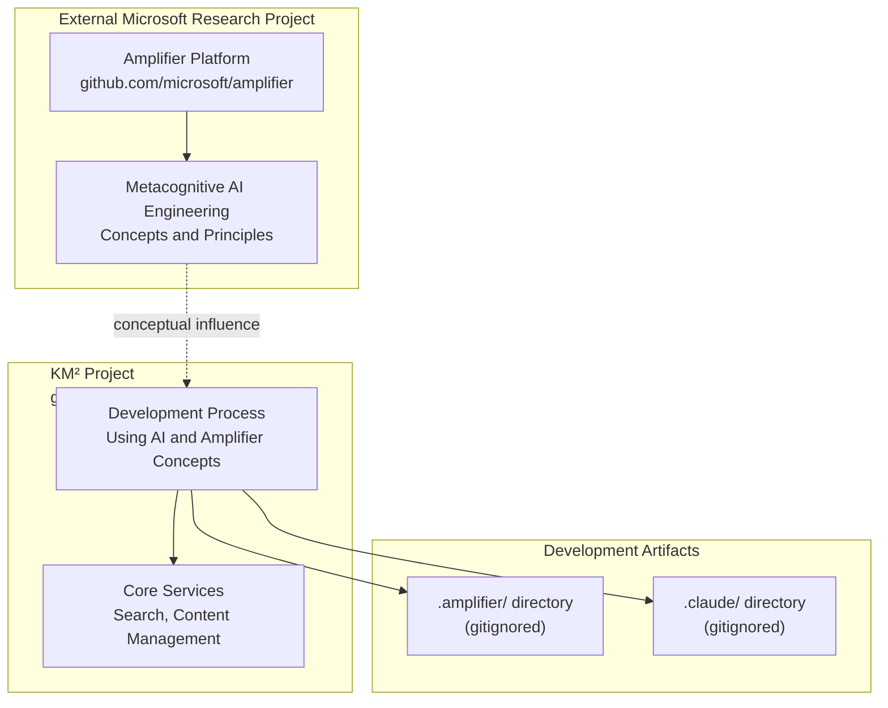

**Conceptual Relationship Between Amplifier and KM²**

**Sources:** [README.md:16-17](), [.gitignore:2-3]()

---

## Metacognitive AI Engineering Philosophy

Metacognitive AI engineering refers to the practice of using AI systems to reason about and improve their own development processes. In the context of KM² and Amplifier, this means:

| Principle | Description | Application in KM² |
|-----------|-------------|-------------------|
| **Self-Referential Development** | Using the system being built to help build itself | KM² explores memory concepts while being built with AI assistance |
| **AI-Assisted Design** | Leveraging AI systems for architectural decisions and implementation | Development process incorporates AI feedback loops |
| **Conceptual Alignment** | Ensuring system design reflects metacognitive principles | Search and content systems designed with AI memory concepts |
| **Iterative Refinement** | Continuous improvement through AI-augmented feedback | Rapid evolution based on AI-informed insights |

The philosophy emphasizes quality of generated content, privacy considerations, and collaboration features—all areas that benefit from metacognitive approaches where AI systems can reason about their own outputs and capabilities.

**Sources:** [README.md:16-22]()

---

## How KM² Uses Amplifier Concepts

The application of Amplifier concepts in KM² manifests in several ways:

### Conceptual Influence on Architecture

KM²'s architecture reflects metacognitive principles through its multi-node design, search system, and content management approach. The system is designed to be self-aware of its capabilities and limitations.

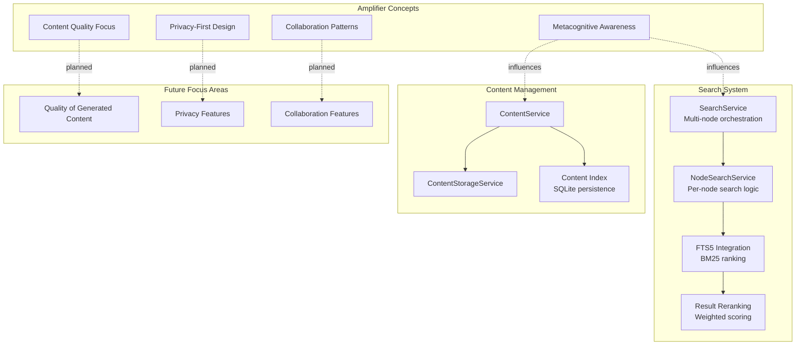

**Application of Amplifier Concepts in KM² Architecture**

### AI-Assisted Development Process

The development process itself uses AI and Amplifier concepts, as indicated by the presence of development artifacts:

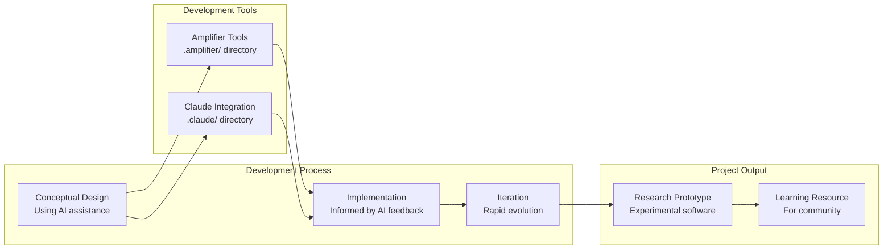

**AI-Assisted Development Workflow**

**Sources:** [README.md:9-22](), [.gitignore:2-3]()

---

## Development Artifacts and Tools

The codebase contains evidence of Amplifier-related development tooling through gitignored directories:

### Ignored Development Directories

| Directory | Purpose | Why Gitignored |
|-----------|---------|----------------|
| `.amplifier/` | Amplifier platform integration files | Local development environment, may contain user-specific configurations |
| `.claude/` | Claude AI assistant integration | AI-assisted development artifacts, potentially containing prompts or session data |

These directories are explicitly excluded from version control, suggesting they are part of the local development environment where AI and Amplifier concepts are actively applied.

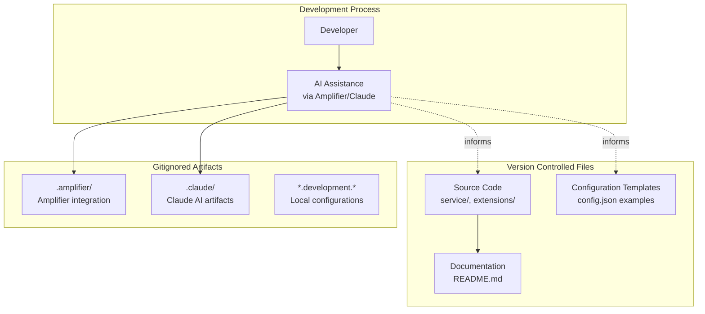

**Development Artifacts in Version Control**

**Sources:** [.gitignore:2-3](), [.gitignore:19-25]()

---

## Implications for the Codebase

The Amplifier relationship has several implications for understanding and working with the KM² codebase:

### Active Research Nature

The use of Amplifier concepts reinforces KM²'s status as an active research project. The system evolves rapidly as new insights from metacognitive AI engineering are incorporated:

- **No Stability Guarantees**: The experimental nature means breaking changes are expected
- **Conceptual Evolution**: System design may shift as Amplifier concepts mature
- **Learning Focus**: The project prioritizes exploration over production readiness

### Future Development Direction

The three focus areas—quality of generated content, privacy, and collaboration—align with metacognitive principles where systems reason about their outputs and interactions:

| Focus Area | Metacognitive Aspect | Planned Impact |
|------------|---------------------|----------------|
| **Content Quality** | Self-evaluation of generated outputs | Systems that understand and improve content quality |
| **Privacy** | Awareness of data sensitivity | Context-aware privacy controls |
| **Collaboration** | Multi-agent coordination | Systems that coordinate and share knowledge |

### No Direct Code Dependencies

Importantly, there are no direct code imports or runtime dependencies on Amplifier in the KM² codebase. The relationship is purely conceptual and methodological. The project structure contains:

- No NuGet packages referencing Amplifier
- No submodules linking to Amplifier repositories (only `kernel-memory-docs`)
- No service integrations requiring Amplifier runtime

The `.amplifier/` and `.claude/` directories are local development tools, not part of the distributed system.

**Sources:** [README.md:6-33](), [.gitmodules:1-4](), [.gitignore:1-3]()

---

## Comparison: Previous Prototype vs. KM²

The current KM² represents a complete rewrite informed by Amplifier concepts, distinguishing it from the initial prototype:

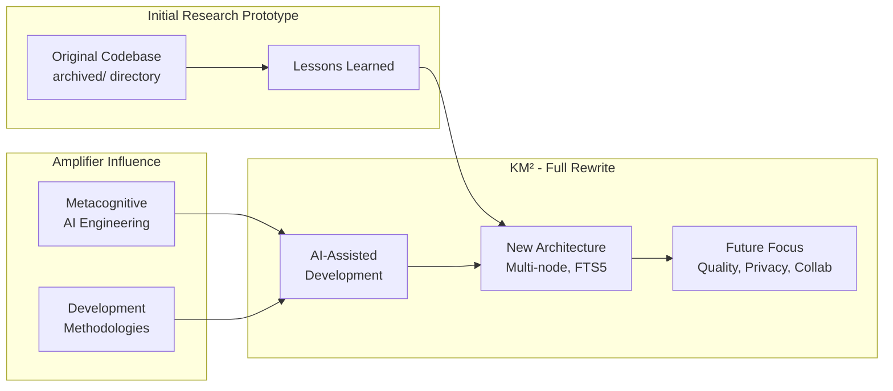

**Evolution from Prototype to KM² with Amplifier Concepts**

The archived prototype remains in the repository for reference but is not maintained. The rewrite incorporates both lessons from that prototype and new insights from Amplifier's metacognitive approach.

**Sources:** [README.md:9-11](), [.gitignore:1]()

---

## Summary

KM²'s relationship to Amplifier is primarily conceptual and methodological rather than technical. The project applies metacognitive AI engineering principles—using AI to reason about and improve the development process—while building a system for AI memory management. This self-referential approach manifests in:

- The use of AI-assisted development tools (evidenced by `.amplifier/` and `.claude/` directories)
- A focus on content quality, privacy, and collaboration aligned with metacognitive principles
- An experimental, rapidly-evolving codebase that prioritizes learning and exploration
- No runtime dependencies on Amplifier, maintaining KM² as an independent research project

Developers working with KM² should understand this relationship to properly contextualize the project's experimental nature, rapid evolution, and future direction. The system is not just a memory solution but a research platform exploring how AI concepts can inform AI system development.

**Sources:** [README.md:1-33](), [.gitignore:1-3]()

---

# Page: Future Vision

# Future Vision

<details>
<summary>Relevant source files</summary>

The following files were used as context for generating this wiki page:

- [.gitignore](.gitignore)
- [.gitmodules](.gitmodules)
- [README.md](README.md)

</details>


This page documents the planned development focus areas for KM² (Kernel Memory squared), including the philosophy behind its development approach and the three primary areas of future work: quality of content generated, privacy, and collaboration. These areas represent the next phase of research after the current experimental foundation is stabilized.

For information about the current experimental status of KM², see [Project Status and Warnings](#1.1). For background on the metacognitive AI engineering philosophy informing this vision, see [Relationship to Amplifier](#1.2).

---

## Development Philosophy

KM² is being built using a metacognitive approach informed by the [Amplifier platform](https://github.com/microsoft/amplifier). The development philosophy centers on using AI and Amplifier concepts to build the next generation of Kernel Memory itself—a recursive, self-improving approach where the tools and concepts being developed are applied to the development process.

**Diagram: Development Approach**

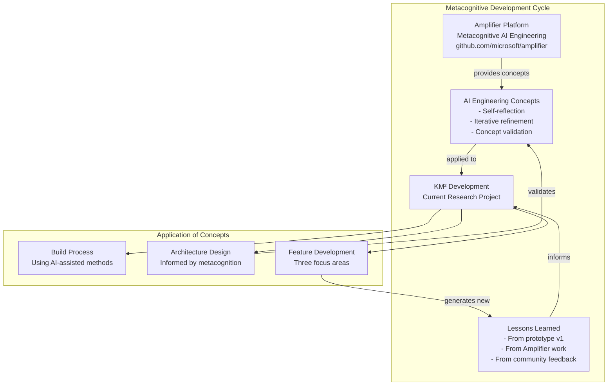

**Sources:** [README.md:15-22]()

This approach differs from traditional software development by treating the development process itself as a subject of AI-assisted metacognitive analysis, allowing the system to evolve more organically based on learned patterns and validated concepts.

---

## Three Primary Focus Areas

The future development of KM² centers on three interconnected areas that will shape the system's evolution once the current experimental foundation is stable.

**Diagram: Focus Areas and Their Relationships**

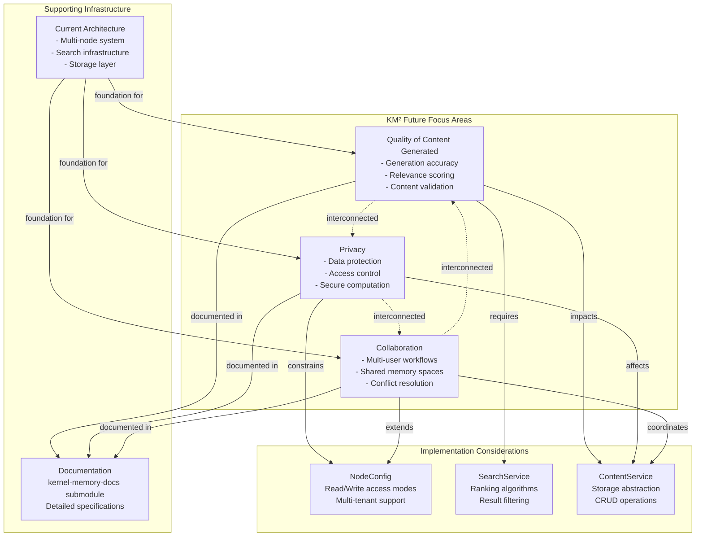

**Sources:** [README.md:19-22](), [.gitmodules:1-3]()

### Quality of Content Generated

This focus area addresses the accuracy, relevance, and validation of content produced by KM². While the current system provides search and retrieval capabilities, future work will enhance:

| Aspect | Current State | Future Direction |
|--------|--------------|------------------|
| **Search Ranking** | BM25 scoring with configurable weights | Enhanced ranking incorporating quality signals |
| **Content Validation** | Basic CRUD operations | Validation pipelines for generated content |
| **Relevance Scoring** | FTS5-based relevance | Multi-factor relevance including semantic understanding |
| **Result Quality** | Post-filtering via LINQ | Advanced filtering with quality thresholds |

The existing `SearchService` and `NodeSearchService` components provide the foundation for these enhancements, with their configurable weighting system allowing future quality metrics to be incorporated into ranking algorithms.

**Sources:** [README.md:19-20]()

### Privacy

Privacy considerations will govern how content is stored, accessed, and shared across the multi-node architecture. The existing node-based design with `ReadOnly` and `ReadWrite` access modes provides a starting point for more sophisticated privacy controls.

**Planned Privacy Dimensions:**

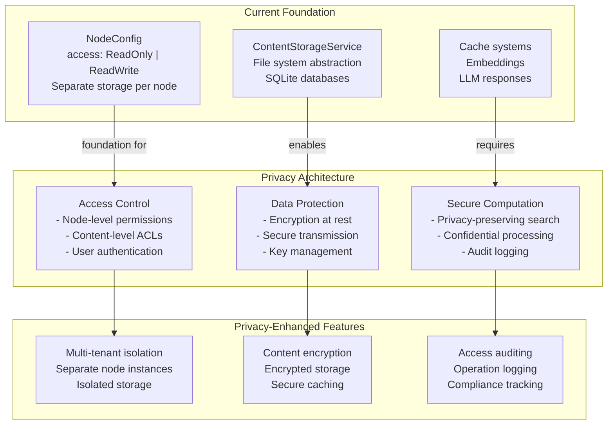

**Sources:** [README.md:19-21]()

The current `.gitignore` configuration already demonstrates privacy awareness by excluding sensitive files like `.env`, certificates, and development configurations, establishing patterns that will extend to runtime privacy features.

**Sources:** [.gitignore:19-72]()

### Collaboration

Collaboration features will enable multiple users to work with shared memory spaces while maintaining consistency and resolving conflicts. The multi-node architecture provides a natural foundation for collaborative scenarios.

**Collaboration Scenarios:**

| Scenario | Node Architecture | Key Challenges |
|----------|------------------|----------------|
| **Personal + Shared Nodes** | Individual writable node + shared read-only nodes | Synchronization, version control |
| **Team Workspaces** | Multiple users with different access levels | Concurrent modifications, conflict resolution |
| **Distributed Teams** | Geographically distributed nodes | Consistency, replication, latency |
| **Hierarchical Access** | Nested node permissions | Inheritance, escalation, auditing |

**Diagram: Collaborative Node Architecture (Future)**

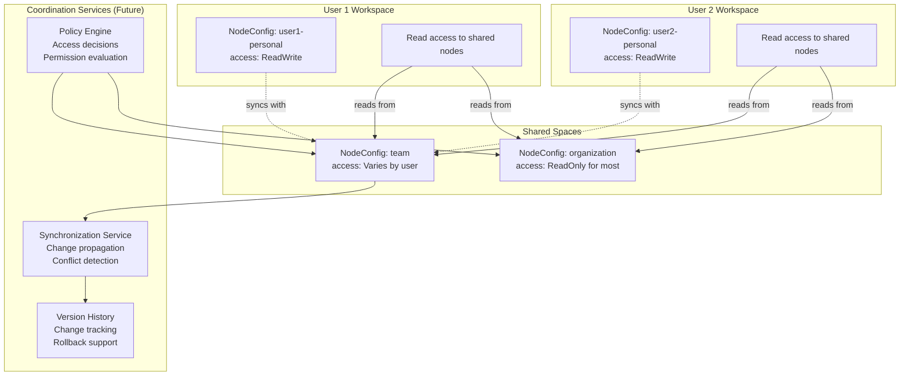

**Sources:** [README.md:19-22]()

The existing `NodeConfig` structure with its `id` and `access` properties provides the foundation for collaborative access patterns, though coordination services and conflict resolution mechanisms are future work.

---

## Documentation Status and Timeline

These focus areas are explicitly marked as future work that will be "documented in more detail when ready." The team uses a separate documentation repository managed as a Git submodule to maintain detailed specifications independently from the codebase evolution.

**Documentation Repository Structure:**

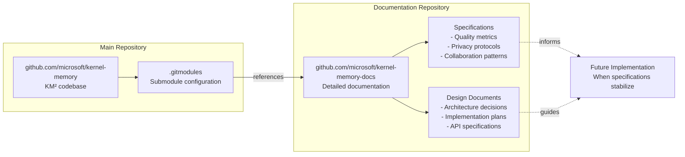

**Sources:** [README.md:19-22](), [.gitmodules:1-3]()

**Implementation Timeline Expectations:**

| Phase | Focus | Status |
|-------|-------|--------|
| **Current** | Experimental foundation, core infrastructure | Active development |
| **Short-term** | Stabilization, community feedback integration | Ongoing |
| **Medium-term** | Detailed specifications for focus areas | Documentation in progress |
| **Long-term** | Implementation of quality, privacy, and collaboration features | Future work |

The separation of documentation into a dedicated repository allows specifications to evolve independently while the main codebase remains in active research mode with rapid changes.

**Sources:** [.gitmodules:1-3]()

---

## Community Engagement

While the project does not currently accept contributions due to its experimental nature, community feedback plays a crucial role in shaping the future vision. The project serves as a learning resource, and user experiences inform the direction of future development.

**Diagram: Community Feedback Loop**

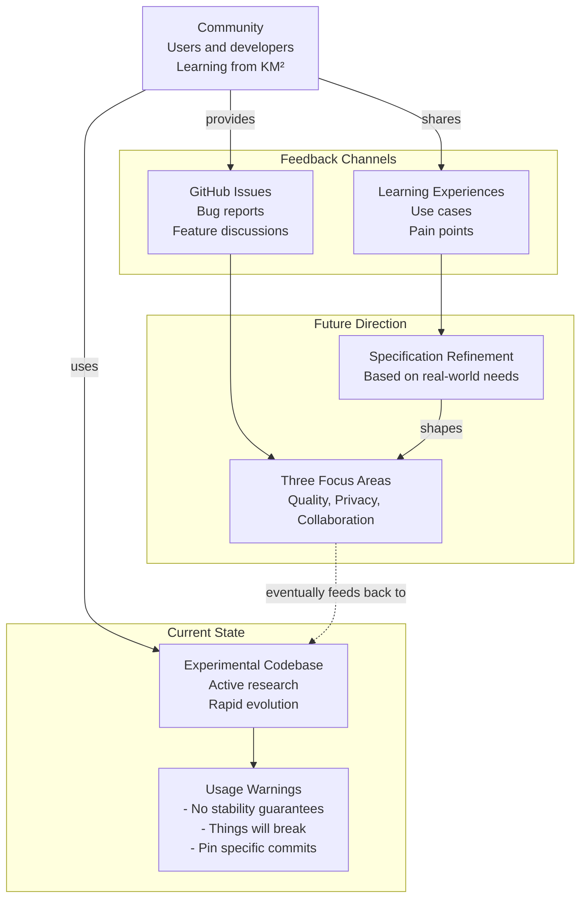

**Sources:** [README.md:24-33]()

**Current Community Stance:**

- **Contributions**: Not accepted at this stage
- **Support**: No formal support provided (see `SUPPORT.md`)
- **Feedback**: Welcome through appropriate channels
- **Use Cases**: Shared experiences inform future direction
- **Stability**: Users must pin specific commits for consistency

The project's disclaimer clearly states this is "experimental software" and a "learning resource, not production-ready software," setting appropriate expectations while the future vision crystallizes into detailed specifications.

**Sources:** [README.md:24-33]()

---

## Research Project Context

KM² represents a complete rewrite informed by lessons from an earlier prototype. The archived previous codebase remains in the repository for reference but is not tracked in version control, demonstrating the team's commitment to radical evolution rather than incremental improvements.

**Evolution Pathway:**

```mermaid
graph LR
    subgraph "Historical Context"
        V1["Initial Prototype<br/>archived/ directory<br/>Lessons learned"]
    end
    
    subgraph "Current Phase"
        KM2["KM² Full Rewrite<br/>Active research<br/>Experimental foundation"]
        AmplifierWork["Parallel Amplifier Development<br/>Metacognitive AI engineering<br/>Concept validation"]
    end
    
    subgraph "Future Phases"
        StableBase["Stabilized Foundation<br/>Core architecture settled<br/>Breaking changes reduced"]
        FocusImpl["Focus Area Implementation<br/>Quality + Privacy + Collaboration<br/>Documented specifications"]
        Production["Potential Production Use<br/>If and when appropriate<br/>With clear stability guarantees"]
    end
    
    V1 -->|"informed"| KM2
    AmplifierWork -.->|"concepts inform"| KM2
    
    KM2 -->|"evolution"| StableBase
    StableBase -->|"enables"| FocusImpl
    FocusImpl -.->|"possibly"| Production
```

**Sources:** [README.md:6-13](), [.gitignore:1]()

The `.gitignore` file explicitly excludes the `archived/` directory, reinforcing that historical code is for reference only and not part of the active development stream. This clean break allows the team to explore new architectures without being constrained by backward compatibility with the prototype.

**Sources:** [.gitignore:1]()

---

## Summary

The future vision for KM² centers on three interconnected areas—quality of content generated, privacy, and collaboration—which will be developed using metacognitive AI engineering principles derived from the Amplifier platform. These focus areas represent planned work that will be documented in detail when specifications stabilize.

The current phase focuses on establishing an experimental foundation with a multi-node architecture that provides natural extension points for future privacy and collaboration features. The search and content management infrastructure provides the basis for quality enhancements. Community feedback during this experimental phase will inform how these focus areas are refined and implemented.

As an active research project, KM² maintains explicit warnings about instability and breaking changes while serving as a learning resource for the community. The separation of detailed documentation into a dedicated repository allows specifications to evolve independently from the rapidly changing codebase, with the expectation that implementation will follow once designs are validated and stabilized.

---

# Page: Getting Started

# Getting Started

<details>
<summary>Relevant source files</summary>

The following files were used as context for generating this wiki page:

- [.gitignore](.gitignore)
- [.gitmodules](.gitmodules)
- [README.md](README.md)
- [src/Main/CLI/CliApplicationBuilder.cs](src/Main/CLI/CliApplicationBuilder.cs)
- [src/Main/CLI/Commands/BaseCommand.cs](src/Main/CLI/Commands/BaseCommand.cs)
- [src/Main/CLI/Commands/ConfigCommand.cs](src/Main/CLI/Commands/ConfigCommand.cs)
- [src/Main/CLI/Commands/DeleteCommand.cs](src/Main/CLI/Commands/DeleteCommand.cs)
- [src/Main/CLI/Commands/GetCommand.cs](src/Main/CLI/Commands/GetCommand.cs)
- [src/Main/CLI/Commands/ListCommand.cs](src/Main/CLI/Commands/ListCommand.cs)
- [src/Main/CLI/Commands/UpsertCommand.cs](src/Main/CLI/Commands/UpsertCommand.cs)
- [tests/Main.Tests/Integration/CliIntegrationTests.cs](tests/Main.Tests/Integration/CliIntegrationTests.cs)
- [tests/Main.Tests/Integration/CommandExecutionTests.cs](tests/Main.Tests/Integration/CommandExecutionTests.cs)
- [tests/Main.Tests/Integration/ConfigCommandTests.cs](tests/Main.Tests/Integration/ConfigCommandTests.cs)
- [tests/Main.Tests/Integration/ReadonlyCommandTests.cs](tests/Main.Tests/Integration/ReadonlyCommandTests.cs)

</details>


This guide walks you through installing, configuring, and using the KM² (Kernel Memory²) command-line interface. KM² is an active research project focused on exploring AI memory concepts through a CLI application for content management and search.

> **Important**: KM² is experimental software. Expect things to break. There are no stability or compatibility guarantees. This project is intended as a learning resource, not production-ready software.

For detailed information about KM²'s architecture, see [Architecture](3). For configuration options, see [Configuration System](6).

Sources: [README.md:1-34]()

## What is KM²?

KM² is a command-line tool that provides content management and full-text search capabilities. It uses a multi-node architecture with SQLite databases for storage and indexing. The CLI application provides commands for managing content, querying configuration, and searching across nodes.

**Key Characteristics:**

| Aspect | Description |
|--------|-------------|
| **Project Status** | Active research project, rapidly evolving |
| **Primary Interface** | Command-line application (`km` command) |
| **Storage Backend** | SQLite (content index + FTS5 search) |
| **Architecture** | Multi-node with configurable access modes |
| **Configuration** | JSON-based (`~/.km/config.json`) |

Sources: [README.md:1-34](), [src/Main/CLI/CliApplicationBuilder.cs:48-104]()

## Prerequisites

Before installing KM², ensure you have:

1. **.NET 8.0 SDK or later** - Required to build and run the CLI application
2. **Git** - For cloning the repository
3. **Text editor** - For editing configuration files (any text editor will work)

No AI service credentials or external dependencies are required for basic operation. KM² uses local SQLite databases for storage.

Sources: [README.md:1-34](), [.gitignore:1-73]()

## Installation

### Clone and Build

```bash
# Clone the repository
git clone https://github.com/microsoft/kernel-memory.git
cd kernel-memory

# Build the CLI application
dotnet build

# Run the CLI
dotnet run --project src/Main/CLI/CLI.csproj
```

The CLI application is located at [src/Main/CLI/CLI.csproj](). After building, you can invoke commands using:

```bash
dotnet run --project src/Main/CLI/CLI.csproj -- <command> [options]
```

For convenience, you can create an alias:

```bash
# Linux/macOS
alias km='dotnet run --project /path/to/kernel-memory/src/Main/CLI/CLI.csproj --'

# Windows (PowerShell)
function km { dotnet run --project C:\path\to\kernel-memory\src\Main\CLI\CLI.csproj -- $args }
```

Sources: [src/Main/CLI/CLI.csproj:1-35](), [src/Main/CLI/CliApplicationBuilder.cs:1-268]()

## Understanding the File System Layout

KM² stores data in a directory structure under `~/.km` by default. Understanding this layout helps when working with configurations and debugging.

**Default Directory Structure:**

```
~/.km/                          # Default KM² directory
├── config.json                 # Configuration file
└── nodes/                      # Node data directories
    ├── personal/               # Default "personal" node
    │   ├── content.db          # SQLite content index
    │   └── fts-index.db        # SQLite FTS5 search index
    └── shared/                 # Optional additional nodes
        ├── content.db
        └── fts-index.db
```

**File Purposes:**

| File/Directory | Purpose | Created When |
|----------------|---------|--------------|
| `~/.km/config.json` | Application configuration | `km config --create` |
| `nodes/<name>/content.db` | SQLite content storage | First write operation (put/delete) |
| `nodes/<name>/fts-index.db` | SQLite FTS5 search index | First content insertion |
| `nodes/<name>/embeddings-cache.db` | Optional embedding cache | If configured in config.json |

Sources: [src/Main/CLI/CliApplicationBuilder.cs:124-129](), [src/Main/CLI/Commands/BaseCommand.cs:90-116]()

## Configuration Basics

KM² uses a JSON configuration file located at `~/.km/config.json` by default. You can view, create, or specify an alternate path for this file.

### Viewing Current Configuration

```bash
# View the entire configuration
km config

# View only node configurations
km config --show-nodes

# View only cache configurations
km config --show-cache

# Output in JSON format (easier to copy/paste)
km config -f json
```

The `ConfigCommand` class [src/Main/CLI/Commands/ConfigCommand.cs:39-188]() handles configuration display. Note that the command succeeds even if no configuration file exists yet - it will display the default configuration and suggest creating a file.

Sources: [src/Main/CLI/Commands/ConfigCommand.cs:39-188](), [tests/Main.Tests/Integration/ConfigCommandTests.cs:72-121]()

### Creating a Configuration File

```bash
# Create default configuration file at ~/.km/config.json
km config --create

# Create at a custom path
km config --config /path/to/custom-config.json --create
```

This creates a configuration file with default settings. The file uses this structure:

```json
{
  "nodes": {
    "personal": {
      "id": "personal",
      "access": "ReadWrite",
      "contentIndex": {
        "type": "sqlite",
        "path": "~/.km/nodes/personal/content.db"
      },
      "searchIndexes": [
        {
          "type": "sqliteFTS",
          "path": "~/.km/nodes/personal/fts-index.db"
        }
      ]
    }
  },
  "embeddingsCache": null,
  "llmCache": null
}
```

**Configuration Structure:**

| Property | Description | Required |
|----------|-------------|----------|
| `nodes` | Dictionary of node configurations | Yes |
| `embeddingsCache` | Optional embedding cache configuration | No |
| `llmCache` | Optional LLM cache configuration | No |
| `logging` | Optional logging configuration | No |

Sources: [src/Main/CLI/Commands/ConfigCommand.cs:154-187](), [tests/Main.Tests/Integration/ConfigCommandTests.cs:231-265]()

### Using a Custom Configuration Path

```bash
# Specify config path for any command
km list --config /path/to/custom-config.json
km put "content" --config ~/my-project/km-config.json
```

The `--config` (or `-c`) flag is a global option available on all commands. The configuration is loaded once at startup by `CliApplicationBuilder` [src/Main/CLI/CliApplicationBuilder.cs:62-104]().

Sources: [src/Main/CLI/CliApplicationBuilder.cs:108-129](), [src/Main/CLI/Commands/BaseCommand.cs:35-49]()

## First Steps: Basic CLI Commands

The KM² CLI provides commands for content management, search, and configuration. All commands follow this pattern:

```bash
km <command> [arguments] [options]
```

**Available CLI Commands and Their Classes:**

```mermaid
graph TB
    User["User"]
    CLI["km CLI Application"]
    
    subgraph "Command Classes"
        PutCmd["UpsertCommand<br/>km put"]
        GetCmd["GetCommand<br/>km get"]
        ListCmd["ListCommand<br/>km list"]
        DelCmd["DeleteCommand<br/>km delete"]
        SearchCmd["SearchCommand<br/>km search"]
        ConfigCmd["ConfigCommand<br/>km config"]
        NodesCmd["NodesCommand<br/>km nodes"]
        ExamplesCmd["ExamplesCommand<br/>km examples"]
        DoctorCmd["DoctorCommand<br/>km doctor"]
    end
    
    subgraph "Core Services"
        ContentSvc["ContentService"]
        SearchSvc["SearchService"]
        ConfigSvc["ConfigParser"]
    end
    
    subgraph "Storage Layer"
        ContentDB["content.db<br/>SQLite"]
        SearchDB["fts-index.db<br/>SQLite FTS5"]
    end
    
    User --> CLI
    CLI --> PutCmd
    CLI --> GetCmd
    CLI --> ListCmd
    CLI --> DelCmd
    CLI --> SearchCmd
    CLI --> ConfigCmd
    CLI --> NodesCmd
    CLI --> ExamplesCmd
    CLI --> DoctorCmd
    
    PutCmd --> ContentSvc
    GetCmd --> ContentSvc
    ListCmd --> ContentSvc
    DelCmd --> ContentSvc
    SearchCmd --> SearchSvc
    
    ContentSvc --> ContentDB
    SearchSvc --> SearchDB
    SearchSvc --> ContentDB
    
    ConfigCmd --> ConfigSvc
    NodesCmd --> ConfigSvc
```

Sources: [src/Main/CLI/CliApplicationBuilder.cs:198-267](), [src/Main/CLI/Commands/BaseCommand.cs:24-80]()

### Content Management Commands

**Create or Update Content:**

```bash
# Add content with auto-generated ID
km put "Hello, world!"

# Add content with custom ID
km put "Einstein's formula: E = mc²" --id physics-formula

# Add content with metadata
km put "Meeting notes" --title "Q4 Planning" --tags "meeting,q4"

# Quiet output (returns only the ID)
km put "content" -v quiet
```

The `UpsertCommand` [src/Main/CLI/Commands/UpsertCommand.cs:64-130]() creates or updates content. On first run, it automatically creates the SQLite database at `~/.km/nodes/personal/content.db`.

**Retrieve Content:**

```bash
# Get content by ID
km get physics-formula

# Output in JSON format
km get physics-formula -f json

# Show full internal details
km get physics-formula --full
```

The `GetCommand` [src/Main/CLI/Commands/GetCommand.cs:48-125]() retrieves content by ID. If the database doesn't exist, it displays a friendly first-run message with examples.

**List All Content:**

```bash
# List all content (default: 20 items)
km list

# List with pagination
km list --skip 0 --take 50

# Output in YAML format
km list -f yaml
```

The `ListCommand` [src/Main/CLI/Commands/ListCommand.cs:55-137]() displays paginated content. On an empty database, it shows a welcome message with getting started instructions.

**Delete Content:**

```bash
# Delete by ID (idempotent - no error if not found)
km delete physics-formula

# Quiet mode
km delete old-content -v quiet
```

The `DeleteCommand` [src/Main/CLI/Commands/DeleteCommand.cs:42-90]() removes content. Delete operations are idempotent and succeed even if the ID doesn't exist.

Sources: [src/Main/CLI/Commands/UpsertCommand.cs:64-130](), [src/Main/CLI/Commands/GetCommand.cs:48-125](), [src/Main/CLI/Commands/ListCommand.cs:55-137](), [src/Main/CLI/Commands/DeleteCommand.cs:42-90]()

### Configuration and Information Commands

**View Nodes:**

```bash
# List all configured nodes
km nodes

# Output in JSON
km nodes -f json
```

**View Configuration:**

```bash
# View entire configuration
km config

# Create configuration file
km config --create

# View specific sections
km config --show-nodes
km config --show-cache
```

**Show Examples:**

```bash
# Show all command examples
km examples

# Show examples for specific command
km examples --command search
```

**System Health Check:**

```bash
# Validate configuration and check system health
km doctor

# Output diagnostics in JSON
km doctor -f json
```

Sources: [src/Main/CLI/Commands/ConfigCommand.cs:39-188](), [src/Main/CLI/CliApplicationBuilder.cs:232-263]()

## Understanding the First-Run Experience

KM² is designed to "just work" on first run, with intelligent behavior based on whether you're performing read or write operations.

**First-Run Behavior Flow:**

```mermaid
graph TD
    Command["User runs km command"]
    LoadConfig["CliApplicationBuilder loads config.json"]
    ConfigExists{"Config file<br/>exists?"}
    UseDefault["Use default configuration<br/>~/.km/nodes/personal/"]
    ConfigLoaded["Configuration loaded"]
    
    CommandType{"Command type?"}
    ReadOp["Read operation<br/>get, list, config, nodes"]
    WriteOp["Write operation<br/>put, delete"]
    
    CheckDB{"Database<br/>exists?"}
    CreateDB["Create directory + database<br/>EnsureCreated()"]
    UseDB["Use existing database"]
    
    DBExists2{"Database<br/>exists?"}
    ThrowNotFound["Throw DatabaseNotFoundException"]
    ShowFriendly["Show friendly first-run message<br/>with examples"]
    
    ExecuteRead["Execute read operation"]
    ExecuteWrite["Execute write operation"]
    
    Command --> LoadConfig
    LoadConfig --> ConfigExists
    ConfigExists -->|No| UseDefault
    ConfigExists -->|Yes| ConfigLoaded
    UseDefault --> ConfigLoaded
    
    ConfigLoaded --> CommandType
    CommandType --> ReadOp
    CommandType --> WriteOp
    
    WriteOp --> CheckDB
    CheckDB -->|No| CreateDB
    CheckDB -->|Yes| UseDB
    CreateDB --> ExecuteWrite
    UseDB --> ExecuteWrite
    
    ReadOp --> DBExists2
    DBExists2 -->|No| ThrowNotFound
    DBExists2 -->|Yes| ExecuteRead
    ThrowNotFound --> ShowFriendly
```

**Read vs. Write Operations:**

| Operation Type | Commands | Database Exists? | Behavior |
|----------------|----------|------------------|----------|
| Read | `get`, `list`, `config`, `nodes` | No | Shows friendly welcome message with examples |
| Read | `get`, `list`, `config`, `nodes` | Yes | Executes normally, returns data or error |
| Write | `put`, `delete` | No | Creates directory + database, then executes |
| Write | `put`, `delete` | Yes | Executes normally |

**Implementation Details:**

The distinction between read and write operations is enforced by the `readonlyMode` parameter in `BaseCommand.CreateContentService()` [src/Main/CLI/Commands/BaseCommand.cs:90-170]():

- **Write operations** call with `readonlyMode: false`, which creates directories and databases as needed [src/Main/CLI/Commands/BaseCommand.cs:110-131]()
- **Read operations** call with `readonlyMode: true`, which throws `DatabaseNotFoundException` if the database doesn't exist [src/Main/CLI/Commands/BaseCommand.cs:100-107]()

When `DatabaseNotFoundException` is caught, commands like `GetCommand` [src/Main/CLI/Commands/GetCommand.cs:100-124]() and `ListCommand` [src/Main/CLI/Commands/ListCommand.cs:109-136]() display helpful first-run messages instead of error codes.

Sources: [src/Main/CLI/Commands/BaseCommand.cs:90-170](), [src/Main/CLI/Commands/GetCommand.cs:84-124](), [src/Main/CLI/Commands/ListCommand.cs:92-136](), [tests/Main.Tests/Integration/ReadonlyCommandTests.cs:64-98]()

## Common Output Formats

All commands support multiple output formats via the `-f` or `--format` flag:

| Format | Description | Use Case |
|--------|-------------|----------|
| `human` | Formatted tables and colored output | Interactive terminal use |
| `json` | Structured JSON output | Scripting, parsing |
| `yaml` | YAML format | Configuration review |

**Examples:**

```bash
# Human-readable format (default)
km list

# JSON for scripting
km list -f json | jq '.items[].id'

# YAML for readability
km config -f yaml
```

The `OutputFormatterFactory` creates the appropriate formatter based on the format flag [src/Main/CLI/OutputFormatters/OutputFormatterFactory.cs:1-30]().

Sources: [src/Main/CLI/OutputFormatters/OutputFormatterFactory.cs:1-30]()

## Global Options

All commands accept these global options:

| Option | Short | Description | Default |
|--------|-------|-------------|---------|
| `--config` | `-c` | Path to config file | `~/.km/config.json` |
| `--node` | `-n` | Target node name | First node in config |
| `--format` | `-f` | Output format (human/json/yaml) | `human` |
| `--verbosity` | `-v` | Logging level (silent/quiet/normal/verbose) | `normal` |
| `--log-file` |  | Path to log file | None |
| `--no-color` |  | Disable colored output | false |

These are defined in the `GlobalOptions` base class used by all command settings classes.

Sources: [src/Main/CLI/Commands/BaseCommand.cs:24-80](), [src/Main/CLI/CliApplicationBuilder.cs:108-163]()

## Next Steps

- **Architecture Overview**: Learn about Kernel Memory's components and design patterns in [Architecture](#2)
- **Pipeline Customization**: Understand the data processing pipeline in [Data Processing Pipeline](#2.1)  
- **Client Interfaces**: Explore different ways to interact with Kernel Memory in [Client Interfaces](#4)
- **AI Service Integration**: Configure different AI providers in [AI Service Integrations](#5)
- **Storage Extensions**: Set up vector databases and file storage in [Storage Extensions](#6)
- **Production Deployment**: Deploy Kernel Memory in production environments using [Deployment](#7)

Sources: [README.md:439-536](), [examples/README.md]()

---

# Page: Installation and Setup

# Installation and Setup

<details>
<summary>Relevant source files</summary>

The following files were used as context for generating this wiki page:

- [.gitignore](.gitignore)
- [.gitmodules](.gitmodules)
- [README.md](README.md)

</details>


This page covers the prerequisites, build requirements, and initial setup steps required to install and build KM² (Kernel Memory squared) from source. This is intended for developers and researchers who want to run the system locally.

For detailed information about the configuration file structure, see [Configuration Basics](#2.2). For guidance on using the CLI commands after installation, see [First Steps with the CLI](#2.3).

---

## Prerequisites and System Requirements

KM² is a polyglot system with the following runtime and build requirements:

### Required Components

| Component | Version | Purpose |
|-----------|---------|---------|
| .NET SDK | 8.0 or later | Primary language runtime and build tools |
| Git | Latest | Source control and submodule management |

### Optional Components

| Component | Version | Purpose |
|-----------|---------|---------|
| Python | 3.x | Supporting components in extensions |
| Node.js | LTS | JavaScript-based supporting components |

### Development Environment

Any of the following IDEs can be used:
- **Visual Studio** (Windows/Mac) - Full .NET development support
- **JetBrains Rider** - Cross-platform .NET IDE
- **Visual Studio Code** - Lightweight, with C# extension

SQLite is embedded and does not require separate installation.

**Sources:** [README.md:1-34](), Technology Stack diagram from overview

---

## Important Pre-Installation Warnings

```mermaid
graph TB
    subgraph "Project Status"
        Warning["⚠️ KM² is Experimental Software"]
        NoStability["No stability guarantees"]
        NoCompatibility["No compatibility guarantees"]
        MayBreak["Expect things to break"]
        NoContrib["Contributions not accepted at this stage"]
    end
    
    subgraph "Recommended Approach"
        PinCommit["Pin specific commits<br/>for consistency"]
        Learning["Use as learning resource"]
        NotProduction["NOT for production use"]
    end
    
    subgraph "Repository State"
        ActiveDev["Active research project"]
        RapidEvolution["Rapid evolution"]
        FullRewrite["Full rewrite of prototype"]
        ArchivedCode["Previous prototype in archived/"]
    end
    
    Warning --> NoStability
    Warning --> NoCompatibility
    Warning --> MayBreak
    Warning --> NoContrib
    
    NoStability --> PinCommit
    NoCompatibility --> PinCommit
    PinCommit --> Learning
    Learning --> NotProduction
    
    ActiveDev --> RapidEvolution
    RapidEvolution --> FullRewrite
    FullRewrite --> ArchivedCode
    
    style Warning fill:#ffcdd2
    style NoStability fill:#ffcdd2
    style NoCompatibility fill:#ffcdd2
    style MayBreak fill:#ffcdd2
```

**Diagram: Project Status and Important Warnings**

KM² is an **active research project** with no stability or compatibility guarantees. The system evolves rapidly and may change without notice. This software is intended as a learning resource, not for production use.

**Sources:** [README.md:6-33]()

---

## Cloning the Repository

### Repository Structure

```mermaid
graph TB
    subgraph "GitHub Repository"
        Remote["microsoft/kernel-memory"]
        DocsSubmodule["microsoft/kernel-memory-docs<br/>(Git submodule)"]
    end
    
    subgraph "Local Clone Structure"
        Root["KernelMemory/"]
        Solution["KernelMemory.sln"]
        Service["service/<br/>Core implementation"]
        Extensions["extensions/<br/>AI service integrations"]
        Tests["tests/<br/>Test projects"]
        Docs["docs/<br/>(submodule)"]
        Archived["archived/<br/>(not tracked in git)"]
        
        BuildConfig["Directory.Build.props<br/>Directory.Packages.props"]
        GitIgnore[".gitignore"]
        GitModules[".gitmodules"]
    end
    
    Remote --> Root
    DocsSubmodule --> Docs
    
    Root --> Solution
    Root --> Service
    Root --> Extensions
    Root --> Tests
    Root --> Docs
    Root --> Archived
    Root --> BuildConfig
    Root --> GitIgnore
    Root --> GitModules
    
    style Remote fill:#e1f5ff
    style DocsSubmodule fill:#e1f5ff
    style Archived fill:#f0f0f0
```

**Diagram: Repository Structure After Clone**

### Clone Commands

**Basic clone (without documentation submodule):**
```bash
git clone https://github.com/microsoft/kernel-memory.git
cd kernel-memory
```

**Clone with documentation submodule:**
```bash
git clone --recurse-submodules https://github.com/microsoft/kernel-memory.git
cd kernel-memory
```

If you've already cloned without submodules, initialize them separately:
```bash
git submodule update --init --recursive
```

### What Gets Excluded

The [.gitignore:1-73]() file excludes several categories of files from version control:

| Category | Patterns | Reason |
|----------|----------|--------|
| **Previous prototype** | `archived/` | Old research code, not tracked |
| **Build outputs** | `bin/`, `obj/`, `Debug/`, `Release/` | Generated at build time |
| **Test results** | `TestResult*/`, `coverage*.json`, `coverage*.xml` | Generated during testing |
| **IDE files** | `.vs/`, `.idea/`, `.vscode/` (settings) | User/IDE-specific |
| **Sensitive data** | `.env`, `*.development.json`, `*.cer`, `*.key` | Configuration with credentials |
| **Dependencies** | `node_modules/`, `__pycache__/` | Package manager artifacts |

**Sources:** [.gitignore:1-73](), [.gitmodules:1-3]()

---

## Building the Project

### Build Process Overview

```mermaid
graph TB
    subgraph "Build Configuration Files"
        DirBuildProps["Directory.Build.props"]
        DirPackagesProps["Directory.Packages.props"]
        Sln["KernelMemory.sln"]
    end
    
    subgraph "Project Structure"
        CoreProj["service/Core/Core.csproj"]
        ExtensionProjs["extensions/*/*.csproj<br/>- OpenAI<br/>- Anthropic<br/>- Discord<br/>- Tiktoken"]
        TestProjs["tests/*/*.csproj"]
    end
    
    subgraph "Build Process"
        Restore["dotnet restore"]
        Build["dotnet build"]
        Test["dotnet test"]
    end
    
    subgraph "Build Outputs"
        BinDirs["bin/ directories"]
        ObjDirs["obj/ directories"]
        Artifacts["Build artifacts"]
    end
    
    DirBuildProps --> CoreProj
    DirBuildProps --> ExtensionProjs
    DirBuildProps --> TestProjs
    DirPackagesProps --> CoreProj
    DirPackagesProps --> ExtensionProjs
    DirPackagesProps --> TestProjs
    
    Sln --> CoreProj
    Sln --> ExtensionProjs
    Sln --> TestProjs
    
    CoreProj --> Restore
    ExtensionProjs --> Restore
    TestProjs --> Restore
    
    Restore --> Build
    Build --> Test
    
    Build --> BinDirs
    Build --> ObjDirs
    Build --> Artifacts
```

**Diagram: Build Process and Dependencies**

### Build Commands

**From the repository root:**

1. **Restore NuGet packages:**
   ```bash
   dotnet restore
   ```

2. **Build the solution:**
   ```bash
   dotnet build
   ```

3. **Build in Release configuration:**
   ```bash
   dotnet build --configuration Release
   ```

4. **Run tests (optional):**
   ```bash
   dotnet test
   ```

### Solution Structure

The solution file `KernelMemory.sln` references multiple projects organized by purpose:

- **service/Core/** - Core service implementation
- **extensions/** - AI service integrations (OpenAI, Anthropic, Discord, Tiktoken)
- **tests/** - Unit and integration tests

The build system uses centralized configuration via `Directory.Build.props` and `Directory.Packages.props` for consistent package versioning across all projects. This is a modern .NET development practice that simplifies dependency management.

**Sources:** [.gitignore:7-8](), [.gitignore:28-41](), solution structure from architecture diagrams

---

## Verifying the Installation

### Build Verification

After a successful build, verify the following:

1. **Build output directories exist:**
   - `service/Core/bin/Debug/net8.0/` (or `Release`)
   - Extension projects have similar output directories

2. **No build errors in output:**
   ```bash
   dotnet build --no-restore
   ```
   Should complete with `Build succeeded` message.

3. **Core assemblies are present:**
   - `service/Core/bin/Debug/net8.0/Core.dll`
   - Extension DLLs in their respective output directories

### Runtime Verification

Verify the CLI application can be executed:

```bash
dotnet run --project service/CLI/CLI.csproj -- --help
```

This should display the KM² command-line interface help information. If this succeeds, the installation is complete.

> **Note:** The first execution of certain commands may initialize SQLite databases and storage directories. See [First Steps with the CLI](#2.3) for details on the first-run experience.

**Sources:** Build output structure from architecture diagrams

---

## Troubleshooting Common Issues

### Build Failures

| Issue | Possible Cause | Solution |
|-------|---------------|----------|
| NuGet restore fails | Network issues or package source problems | Clear NuGet cache: `dotnet nuget locals all --clear` |
| Missing SDK version | Wrong .NET SDK version | Install .NET 8.0 SDK or later |
| Project reference errors | Incomplete clone | Ensure all project files are present |

### Platform-Specific Considerations

**Windows:**
- Ensure long path support is enabled if you encounter path length errors
- Some extensions may require additional Windows SDK components

**macOS/Linux:**
- File permissions may need to be set on scripts
- Case-sensitive filesystems may expose issues in cross-platform code

### Pinning to Specific Commits

Since KM² is under active development with no stability guarantees, consider pinning to a specific commit:

```bash
git checkout <commit-hash>
```

To track which commit you're using:
```bash
git rev-parse HEAD
```

**Sources:** [README.md:24-33]()

---

## Next Steps

After successful installation:

1. **Configure the system:** Learn about the configuration file structure in [Configuration Basics](#2.2)
2. **Run first commands:** Try the CLI commands in [First Steps with the CLI](#2.3)
3. **Explore the architecture:** Understand system design in [Architecture](#3)
4. **Set up your IDE:** For development, see [IDE Setup and Development Environment](#9.4)

---

## File References

The following files are particularly relevant for understanding installation requirements:

- [README.md:1-80]() - Project overview, warnings, and status
- [.gitignore:1-73]() - Files excluded from version control
- [.gitmodules:1-3]() - Git submodule configuration
- Build configuration files (referenced but not shown): `Directory.Build.props`, `Directory.Packages.props`, `KernelMemory.sln`

**Sources:** All referenced files above

---

# Page: Configuration Basics

# Configuration Basics

<details>
<summary>Relevant source files</summary>

The following files were used as context for generating this wiki page:

- [src/Main/CLI/CliApplicationBuilder.cs](src/Main/CLI/CliApplicationBuilder.cs)
- [src/Main/CLI/Commands/BaseCommand.cs](src/Main/CLI/Commands/BaseCommand.cs)
- [src/Main/CLI/Commands/ConfigCommand.cs](src/Main/CLI/Commands/ConfigCommand.cs)
- [src/Main/CLI/Commands/DeleteCommand.cs](src/Main/CLI/Commands/DeleteCommand.cs)
- [src/Main/CLI/Commands/GetCommand.cs](src/Main/CLI/Commands/GetCommand.cs)
- [src/Main/CLI/Commands/ListCommand.cs](src/Main/CLI/Commands/ListCommand.cs)
- [src/Main/CLI/Commands/UpsertCommand.cs](src/Main/CLI/Commands/UpsertCommand.cs)
- [tests/Main.Tests/Integration/CliIntegrationTests.cs](tests/Main.Tests/Integration/CliIntegrationTests.cs)
- [tests/Main.Tests/Integration/CommandExecutionTests.cs](tests/Main.Tests/Integration/CommandExecutionTests.cs)
- [tests/Main.Tests/Integration/ConfigCommandTests.cs](tests/Main.Tests/Integration/ConfigCommandTests.cs)
- [tests/Main.Tests/Integration/ReadonlyCommandTests.cs](tests/Main.Tests/Integration/ReadonlyCommandTests.cs)

</details>


This page explains the KM² configuration system, including the `config.json` file structure, how to view and create configuration files, and how configuration is loaded and used by CLI commands. Configuration controls nodes (logical partitions), search indexes, caches, storage locations, and logging behavior.

For information about specific configuration options within nodes (content indexes, search indexes, storage), see [Node Configuration](#6.2). For details about the `km config` command and its options, see [Configuration Command](#4.3).

---

## Configuration File Location

KM² uses a JSON configuration file to define all system settings. The configuration file location is determined by the following precedence:

| Priority | Method | Example |
|----------|--------|---------|
| 1 | `--config` or `-c` flag | `km list --config /path/to/config.json` |
| 2 | Default location | `~/.km/config.json` |

The default configuration directory is `~/.km/` (user home directory). If no configuration file exists at the resolved path, KM² uses a default in-memory configuration.

```mermaid
graph TD
    CLI["CLI Command Execution"]
    DeterminePath["DetermineConfigPath()<br/>(CliApplicationBuilder)"]
    CheckFlag{"--config flag<br/>present?"}
    DefaultPath["Default Path:<br/>~/.km/config.json"]
    CustomPath["Custom Path:<br/>from --config flag"]
    LoadConfig["ConfigParser.LoadFromFile()"]
    FileExists{"File exists?"}
    ReadFile["Read JSON from disk"]
    CreateDefault["AppConfig.CreateDefault()"]
    InjectDI["Inject AppConfig<br/>into DI container"]
    
    CLI --> DeterminePath
    DeterminePath --> CheckFlag
    CheckFlag -->|Yes| CustomPath
    CheckFlag -->|No| DefaultPath
    CustomPath --> LoadConfig
    DefaultPath --> LoadConfig
    LoadConfig --> FileExists
    FileExists -->|Yes| ReadFile
    FileExists -->|No| CreateDefault
    ReadFile --> InjectDI
    CreateDefault --> InjectDI
```

**Configuration Path Resolution Flow**

The path resolution happens in `CliApplicationBuilder.DetermineConfigPath()` before any command executes. The configuration is loaded once during application startup and injected into all commands via dependency injection.

**Sources:** [src/Main/CLI/CliApplicationBuilder.cs:108-129](), [src/Main/CLI/CliApplicationBuilder.cs:62-105]()

---

## Viewing Current Configuration

Use the `km config` command to view the current configuration. This command shows the entire `AppConfig` structure by default:

```bash
# View entire configuration (AppConfig structure)
km config

# View as JSON (default is human-readable format)
km config --format json

# View summary of all nodes
km config --show-nodes

# View cache configuration
km config --show-cache
```

The default output shows the complete `AppConfig` object structure, allowing you to copy and paste the output into a configuration file. The `ConfigCommand` serializes configuration with these JSON options:

- **Property Naming:** camelCase (`PropertyNamingPolicy.CamelCase`)
- **Formatting:** Indented for readability (`WriteIndented = true`)
- **Null Fields:** Omitted from output (`DefaultIgnoreCondition.WhenWritingNull`)

```mermaid
graph LR
    User["User"]
    ConfigCmd["ConfigCommand.ExecuteAsync()"]
    CheckFlags{"Command flags"}
    ShowNodes["Format nodes summary<br/>(NodeSummaryDto list)"]
    ShowCache["Format cache info<br/>(CacheInfoDto)"]
    ShowAll["Format entire AppConfig"]
    Formatter["IOutputFormatter"]
    Output["Console Output"]
    
    User -->|"km config"| ConfigCmd
    ConfigCmd --> CheckFlags
    CheckFlags -->|"--show-nodes"| ShowNodes
    CheckFlags -->|"--show-cache"| ShowCache
    CheckFlags -->|"(default)"| ShowAll
    ShowNodes --> Formatter
    ShowCache --> Formatter
    ShowAll --> Formatter
    Formatter --> Output
```

**Configuration Display Flow**

The `ConfigCommand` does not perform node selection like other commands. It operates on the entire `AppConfig` object to show all configuration, not just a single node's details.

**Sources:** [src/Main/CLI/Commands/ConfigCommand.cs:66-143](), [src/Main/CLI/Commands/ConfigCommand.cs:41-46]()

---

## AppConfig Structure Overview

The `AppConfig` class is the root configuration object containing all system settings. It is structured as a hierarchy with nodes, caches, and logging configuration.

```mermaid
graph TD
    AppConfig["AppConfig<br/>(root object)"]
    Nodes["Nodes<br/>Dictionary&lt;string, NodeConfig&gt;"]
    EmbedCache["EmbeddingsCache<br/>CacheConfig?"]
    LLMCache["LLMCache<br/>CacheConfig?"]
    Logging["Logging<br/>LoggingConfig?"]
    
    Node1["NodeConfig<br/>(node ID: key)"]
    Node2["NodeConfig<br/>(node ID: key)"]
    
    ContentIndex["ContentIndex<br/>ContentIndexConfig"]
    SearchIndexes["SearchIndexes<br/>List&lt;SearchIndexConfig&gt;"]
    FileStorage["FileStorage<br/>FileStorageConfig?"]
    RepoStorage["RepoStorage<br/>RepoStorageConfig?"]
    
    AppConfig --> Nodes
    AppConfig --> EmbedCache
    AppConfig --> LLMCache
    AppConfig --> Logging
    
    Nodes --> Node1
    Nodes --> Node2
    
    Node1 --> ContentIndex
    Node1 --> SearchIndexes
    Node1 --> FileStorage
    Node1 --> RepoStorage
```

**AppConfig Object Hierarchy**

**Core Configuration Properties:**

| Property | Type | Required | Description |
|----------|------|----------|-------------|
| `Nodes` | `Dictionary<string, NodeConfig>` | Yes | Logical partitions with independent storage and indexes |
| `EmbeddingsCache` | `CacheConfig?` | No | Shared embedding cache across all nodes |
| `LLMCache` | `CacheConfig?` | No | Shared LLM response cache across all nodes |
| `Logging` | `LoggingConfig?` | No | Logging configuration (file path, level) |

The `Nodes` dictionary key is the node ID (e.g., "personal", "shared"). This ID is used with the `--node` flag to select which node a command operates on. If no `--node` flag is provided, the first node in the dictionary is used as the default.

**Sources:** [tests/Main.Tests/Integration/ConfigCommandTests.cs:36-46](), [src/Main/CLI/Commands/BaseCommand.cs:57-79]()

---

## Creating Configuration Files

KM² can write the current configuration to disk using the `--create` flag. This is useful for:
- Saving the default configuration for customization
- Creating a new configuration file at a custom location
- Documenting the current in-memory configuration

```bash
# Create configuration file at default location
km config --create

# Create configuration file at custom location
km config --config /path/to/my-config.json --create
```

**Behavior:**
- **File exists:** Returns error (exit code 1) without overwriting
- **Directory missing:** Creates parent directories automatically
- **Format:** Writes prettified JSON with camelCase properties

```mermaid
graph TD
    CreateFlag["--create flag detected"]
    FileExists{"Config file<br/>already exists?"}
    ReturnError["Return ExitCodeUserError<br/>with error message"]
    EnsureDir["Create parent directory<br/>if missing"]
    Serialize["JsonSerializer.Serialize()<br/>(AppConfig, jsonOptions)"]
    WriteFile["File.WriteAllText()<br/>to config path"]
    Success["Return ExitCodeSuccess"]
    
    CreateFlag --> FileExists
    FileExists -->|Yes| ReturnError
    FileExists -->|No| EnsureDir
    EnsureDir --> Serialize
    Serialize --> WriteFile
    WriteFile --> Success
```

**Configuration Creation Flow (ConfigCommand.HandleCreateConfig)**

The `ConfigCommand.HandleCreateConfig()` method performs the file creation with safety checks to prevent accidental overwrites. The JSON serialization uses the same options as viewing configuration, ensuring consistency between `km config` output and saved files.

**Sources:** [src/Main/CLI/Commands/ConfigCommand.cs:154-187](), [tests/Main.Tests/Integration/ConfigCommandTests.cs:231-265]()

---

## Default Configuration

When no configuration file exists, KM² uses an in-memory default configuration created by `AppConfig.CreateDefault()`. This default configuration provides a single personal node with SQLite-based storage and search.

**Default Configuration Contents:**

| Component | Default Value | Location |
|-----------|---------------|----------|
| Node ID | `"personal"` | First and only node |
| Content Index | SQLite database | `~/.km/nodes/personal/content.db` |
| Search Index | SQLite FTS5 | Same database, FTS5 virtual table |
| File Storage | Not configured | `null` |
| Repository Storage | Not configured | `null` |
| Embeddings Cache | Not configured | `null` |
| LLM Cache | Not configured | `null` |

The default personal node is created using `NodeConfig.CreateDefaultPersonalNode()`, which sets up:
- Node ID: `"personal"`
- Access mode: `ReadWrite`
- Content index: `SqliteContentIndexConfig` pointing to `~/.km/nodes/personal/content.db`
- Search indexes: Single `SqliteFTSConfig` with ID `"default"`

**Command Behavior with Default Configuration:**

```bash
# These commands work without creating config.json
km list          # Uses default personal node
km put "Hello"   # Creates database on first write
km search "test" # Searches in default node

# Warning displayed when using defaults (in human format)
# "Warning: Using default configuration. Config file does not exist: ~/.km/config.json"
```

The CLI displays a warning (in human format only) when using the default configuration, prompting users to run `km config --create` to persist their configuration.

**Sources:** [src/Main/CLI/Commands/ConfigCommand.cs:86-91](), [tests/Main.Tests/Integration/ConfigCommandTests.cs:318-365](), [tests/Main.Tests/Integration/ConfigCommandTests.cs:40-41]()

---

## Configuration Loading and Usage

Configuration is loaded early in the CLI application lifecycle, before any command executes. This ensures consistent configuration access across all commands without repeated file I/O.

```mermaid
graph TD
    ProgramMain["Program.Main()"]
    BuildApp["CliApplicationBuilder.Build()"]
    DeterminePath["DetermineConfigPath()<br/>(parse --config from args)"]
    LoadConfig["ConfigParser.LoadFromFile()"]
    ParseLogging["BuildLoggingConfig()<br/>(merge args + config)"]
    CreateLogger["SerilogFactory.CreateLoggerFactory()"]
    RegisterDI["Register in DI container:<br/>- AppConfig<br/>- ILoggerFactory<br/>- ConfigPathService"]
    BuildCommandApp["Create CommandApp<br/>with TypeRegistrar"]
    RunCommand["CommandApp.Run()"]
    InjectCommand["Inject dependencies<br/>into command constructor"]
    
    ProgramMain --> BuildApp
    BuildApp --> DeterminePath
    DeterminePath --> LoadConfig
    LoadConfig --> ParseLogging
    ParseLogging --> CreateLogger
    CreateLogger --> RegisterDI
    RegisterDI --> BuildCommandApp
    BuildCommandApp --> RunCommand
    RunCommand --> InjectCommand
```

**Configuration Loading and Dependency Injection Flow**

### Early Configuration Loading

The `CliApplicationBuilder.Build()` method loads configuration in this sequence:

1. **Path Determination** ([CliApplicationBuilder.cs:113-129]()): Scans command-line arguments for `--config` flag before command parsing
2. **Configuration Load** ([CliApplicationBuilder.cs:70]()): Calls `ConfigParser.LoadFromFile()` once
3. **Logging Configuration** ([CliApplicationBuilder.cs:73-76]()): Merges CLI args (e.g., `--verbosity`) with config file settings
4. **DI Registration** ([CliApplicationBuilder.cs:92-96]()): Registers `AppConfig`, `ILoggerFactory`, and `ConfigPathService` as singletons

### Command-Level Configuration Usage

Commands receive configuration through constructor injection (see `BaseCommand<TSettings>`):

```
BaseCommand constructor parameters:
- AppConfig config        (already loaded)
- ILoggerFactory loggerFactory
```

The `BaseCommand.Initialize()` method selects the appropriate node from the configuration:

1. **Node Selection**: Uses `--node` flag value or defaults to first node in `Nodes` dictionary
2. **Validation**: Throws `InvalidOperationException` if node not found
3. **Formatter Creation**: Creates `IOutputFormatter` based on `--format` flag

**Node Selection Logic:**

```csharp
var nodeName = settings.NodeName ?? config.Nodes.Keys.First();
if (!config.Nodes.TryGetValue(nodeName, out var node)) {
    throw new InvalidOperationException($"Node '{nodeName}' not found");
}
```

**Sources:** [src/Main/CLI/CliApplicationBuilder.cs:62-105](), [src/Main/CLI/Commands/BaseCommand.cs:31-79]()

---

## Configuration Examples

### Minimal Configuration

Single node with SQLite storage:

```json
{
  "nodes": {
    "personal": {
      "id": "personal",
      "access": "ReadWrite",
      "contentIndex": {
        "type": "sqlite",
        "path": "/home/user/.km/nodes/personal/content.db"
      },
      "searchIndexes": [
        {
          "id": "default",
          "type": "sqliteFTS"
        }
      ]
    }
  }
}
```

### Multi-Node Configuration

Personal and shared nodes with embedding cache:

```json
{
  "nodes": {
    "personal": {
      "id": "personal",
      "access": "ReadWrite",
      "contentIndex": {
        "type": "sqlite",
        "path": "/home/user/.km/nodes/personal/content.db"
      },
      "searchIndexes": [
        {
          "id": "default",
          "type": "sqliteFTS"
        }
      ]
    },
    "shared": {
      "id": "shared",
      "access": "ReadOnly",
      "contentIndex": {
        "type": "sqlite",
        "path": "/mnt/shared/.km/nodes/shared/content.db"
      },
      "searchIndexes": [
        {
          "id": "default",
          "type": "sqliteFTS"
        }
      ]
    }
  },
  "embeddingsCache": {
    "type": "Sqlite",
    "path": "/home/user/.km/cache/embeddings.db",
    "allowRead": true,
    "allowWrite": true
  }
}
```

### Configuration with Logging

Custom log file and verbosity level:

```json
{
  "nodes": {
    "personal": {
      "id": "personal",
      "access": "ReadWrite",
      "contentIndex": {
        "type": "sqlite",
        "path": "/home/user/.km/nodes/personal/content.db"
      },
      "searchIndexes": [
        {
          "id": "default",
          "type": "sqliteFTS"
        }
      ]
    }
  },
  "logging": {
    "filePath": "/home/user/.km/logs/km.log",
    "level": "Debug"
  }
}
```

**Sources:** [tests/Main.Tests/Integration/ConfigCommandTests.cs:36-46](), [tests/Main.Tests/Integration/CliIntegrationTests.cs:32-45]()

---

## Configuration Validation and Health Checks

The `km doctor` command validates configuration and checks system health. This includes:

- Verifying configuration file is parseable JSON
- Checking that all node database paths are accessible
- Validating cache configurations
- Testing search index connectivity

For details on diagnostic commands, see [Doctor Command](#4.6).

**Sources:** [src/Main/CLI/CliApplicationBuilder.cs:259-263]()

---

# Page: First Steps with the CLI

# First Steps with the CLI

<details>
<summary>Relevant source files</summary>

The following files were used as context for generating this wiki page:

- [src/Main/CLI/CliApplicationBuilder.cs](src/Main/CLI/CliApplicationBuilder.cs)
- [src/Main/CLI/Commands/BaseCommand.cs](src/Main/CLI/Commands/BaseCommand.cs)
- [src/Main/CLI/Commands/ConfigCommand.cs](src/Main/CLI/Commands/ConfigCommand.cs)
- [src/Main/CLI/Commands/DeleteCommand.cs](src/Main/CLI/Commands/DeleteCommand.cs)
- [src/Main/CLI/Commands/GetCommand.cs](src/Main/CLI/Commands/GetCommand.cs)
- [src/Main/CLI/Commands/ListCommand.cs](src/Main/CLI/Commands/ListCommand.cs)
- [src/Main/CLI/Commands/UpsertCommand.cs](src/Main/CLI/Commands/UpsertCommand.cs)
- [tests/Main.Tests/Integration/CliIntegrationTests.cs](tests/Main.Tests/Integration/CliIntegrationTests.cs)
- [tests/Main.Tests/Integration/CommandExecutionTests.cs](tests/Main.Tests/Integration/CommandExecutionTests.cs)
- [tests/Main.Tests/Integration/ConfigCommandTests.cs](tests/Main.Tests/Integration/ConfigCommandTests.cs)
- [tests/Main.Tests/Integration/ReadonlyCommandTests.cs](tests/Main.Tests/Integration/ReadonlyCommandTests.cs)

</details>


This page provides a hands-on introduction to using the KM² command-line interface (CLI). It covers the first-run experience, basic command workflows, and essential usage patterns. For installation instructions, see [Installation and Setup](#2.1). For configuration details, see [Configuration Basics](#2.2). For comprehensive command documentation, see [CLI Application](#4).

## CLI Command Structure

The KM² CLI is built using Spectre.Console.Cli and follows a verb-based command pattern. The application is configured in `CliApplicationBuilder` which registers all available commands.

```mermaid
graph TB
    subgraph "CLI Entry Point"
        Main["km (Program.cs)"]
        Builder["CliApplicationBuilder"]
    end
    
    subgraph "Core Commands"
        Put["put<br/>(UpsertCommand)"]
        Get["get<br/>(GetCommand)"]
        List["list<br/>(ListCommand)"]
        Delete["delete<br/>(DeleteCommand)"]
    end
    
    subgraph "Configuration Commands"
        Config["config<br/>(ConfigCommand)"]
        Nodes["nodes<br/>(NodesCommand)"]
        Doctor["doctor<br/>(DoctorCommand)"]
    end
    
    subgraph "Search & Help"
        Search["search<br/>(SearchCommand)"]
        Examples["examples<br/>(ExamplesCommand)"]
    end
    
    Main --> Builder
    Builder --> Put
    Builder --> Get
    Builder --> List
    Builder --> Delete
    Builder --> Config
    Builder --> Nodes
    Builder --> Doctor
    Builder --> Search
    Builder --> Examples
    
    Put --> ContentService
    Get --> ContentService
    List --> ContentService
    Delete --> ContentService
    
    ContentService["ContentService<br/>(BaseCommand.CreateContentService)"]
```

**Sources:** [src/Main/CLI/CliApplicationBuilder.cs:199-267](), [src/Main/CLI/Commands/BaseCommand.cs:24-191]()

## First-Run Experience

When you run a KM² command for the first time, the system handles the absence of a database gracefully. Read-only commands (`get`, `list`) display friendly messages guiding you to create content first. Write commands (`put`, `delete`) automatically initialize the database.

### Read-Only Command Behavior

Read-only commands check for database existence and provide contextual first-run messages rather than failing with errors.

```mermaid
sequenceDiagram
    participant User
    participant Command["GetCommand/ListCommand"]
    participant BaseCommand
    participant DatabaseCheck["File.Exists(dbPath)"]
    participant FirstRunMsg["ShowFirstRunMessage"]
    
    User->>Command: km get <id>
    Command->>BaseCommand: Initialize(settings)
    Command->>BaseCommand: CreateContentService(node, readonlyMode: true)
    BaseCommand->>DatabaseCheck: Check if database exists
    
    alt Database does not exist
        DatabaseCheck-->>BaseCommand: throws DatabaseNotFoundException
        BaseCommand-->>Command: DatabaseNotFoundException
        Command->>FirstRunMsg: Display friendly message
        FirstRunMsg-->>User: "No content database exists yet.<br/>This is your first run.<br/>Create content first: km put ..."
        Command-->>User: Exit code 0 (success)
    else Database exists but ID not found
        DatabaseCheck-->>BaseCommand: Database found
        Command-->>User: "Content not found" + Exit code 1
    end
```

**Sources:** [src/Main/CLI/Commands/GetCommand.cs:84-124](), [src/Main/CLI/Commands/ListCommand.cs:92-136](), [tests/Main.Tests/Integration/ReadonlyCommandTests.cs:64-134]()

### First-Run Message Details

The `GetCommand` displays a context-specific message when no database exists:

```
Content with ID 'your-id' not found.

No content database exists yet. This is your first run.

Create content first:
  km put "Your content here" --id your-id

Or list available content:
  km list
```

The `ListCommand` displays a welcome message:

```
Welcome to Kernel Memory! 🚀

No content found in node 'personal' yet.

To get started:
  km put "Your content here"

Example:
  km put "Hello, world!" --id greeting
```

**Sources:** [src/Main/CLI/Commands/GetCommand.cs:98-124](), [src/Main/CLI/Commands/ListCommand.cs:104-136]()

## Database Initialization

Database initialization occurs automatically during the first write operation. The system distinguishes between read-only and write modes to prevent accidental file creation.

```mermaid
graph TB
    subgraph "BaseCommand.CreateContentService"
        CreateService["CreateContentService(node, readonlyMode)"]
        CheckMode{"readonlyMode?"}
        CheckExists["File.Exists(dbPath)"]
        ThrowError["throw DatabaseNotFoundException"]
        CreateDir["Directory.CreateDirectory(dbDir)"]
        CreateContext["new ContentStorageDbContext"]
        EnsureCreated["context.Database.EnsureCreated()"]
    end
    
    CreateService --> CheckMode
    CheckMode -->|true| CheckExists
    CheckExists -->|false| ThrowError
    CheckExists -->|true| CreateContext
    
    CheckMode -->|false| CreateDir
    CreateDir --> CreateContext
    CreateContext --> EnsureCreated
    EnsureCreated --> Return["Return ContentService"]
    CheckExists -->|true| Return
```

**Sources:** [src/Main/CLI/Commands/BaseCommand.cs:90-131]()

### Read-Only vs Write Mode

The `readonlyMode` parameter controls database initialization behavior:

| Mode | Commands | Behavior |
|------|----------|----------|
| `readonlyMode: true` | `get`, `list`, `nodes`, `config` | Database must exist; throws `DatabaseNotFoundException` if missing |
| `readonlyMode: false` | `put`, `delete` | Creates directory and database if they don't exist |

**Sources:** [src/Main/CLI/Commands/BaseCommand.cs:90-116](), [tests/Main.Tests/Integration/ReadonlyCommandTests.cs:1-215]()

## Basic Command Workflows

### Viewing Configuration

Before creating content, you can view the current configuration to understand available nodes and settings:

```bash
# View entire configuration
km config

# View as JSON (useful for copying to config file)
km config --format json

# Show all nodes summary
km config --show-nodes

# Show cache configuration
km config --show-cache

# Create config file on disk
km config --create
```

The `ConfigCommand` does not require a database and always succeeds, even without an existing config file (it uses default configuration).

**Sources:** [src/Main/CLI/Commands/ConfigCommand.cs:39-188](), [tests/Main.Tests/Integration/ConfigCommandTests.cs:72-121]()

### Creating Content (First Write)

The first `put` command initializes the database structure:

```bash
# Auto-generate ID
km put "Hello, world!"

# Specify custom ID
km put "My first note" --id greeting

# Add metadata
km put "Important document" --id doc1 --title "Meeting Notes" --tags "work,important"
```

**Initialization Process:**

```mermaid
sequenceDiagram
    participant User
    participant UpsertCommand
    participant BaseCommand
    participant FileSystem
    participant DbContext["ContentStorageDbContext"]
    participant Storage["ContentStorageService"]
    
    User->>UpsertCommand: km put "Hello, world!"
    UpsertCommand->>BaseCommand: CreateContentService(node, readonlyMode: false)
    
    BaseCommand->>FileSystem: Directory.CreateDirectory(dbDir)
    FileSystem-->>BaseCommand: Directory created
    
    BaseCommand->>DbContext: new ContentStorageDbContext(options)
    BaseCommand->>DbContext: context.Database.EnsureCreated()
    DbContext-->>BaseCommand: Database initialized
    
    BaseCommand->>Storage: new ContentStorageService(context, ...)
    Storage-->>BaseCommand: ContentService created
    
    BaseCommand-->>UpsertCommand: ContentService
    UpsertCommand->>Storage: UpsertAsync(request)
    Storage-->>UpsertCommand: UpsertResult
    UpsertCommand-->>User: {"id": "abc123", "node": "personal", "completed": true}
```

**Sources:** [src/Main/CLI/Commands/UpsertCommand.cs:75-129](), [src/Main/CLI/Commands/BaseCommand.cs:90-131](), [tests/Main.Tests/Integration/CliIntegrationTests.cs:62-82]()

### Reading Content

After creating content, you can retrieve it by ID:

```bash
# Get content by ID
km get abc123

# Show all internal details
km get abc123 --full

# Output as JSON
km get abc123 --format json
```

If the ID doesn't exist in an existing database, you'll receive a user error (exit code 1).

**Sources:** [src/Main/CLI/Commands/GetCommand.cs:48-125](), [tests/Main.Tests/Integration/CliIntegrationTests.cs:148-178]()

### Listing Content

List all content with pagination support:

```bash
# List all content (default: 20 items)
km list

# Pagination
km list --skip 20 --take 10

# JSON output for parsing
km list --format json
```

**Sources:** [src/Main/CLI/Commands/ListCommand.cs:55-137](), [tests/Main.Tests/Integration/CliIntegrationTests.cs:342-369]()

### Deleting Content

Delete is idempotent and succeeds even if the ID doesn't exist:

```bash
# Delete by ID
km delete abc123

# Quiet output (only ID)
km delete abc123 --verbosity quiet

# Silent (no output)
km delete abc123 --verbosity silent
```

**Sources:** [src/Main/CLI/Commands/DeleteCommand.cs:42-90](), [tests/Main.Tests/Integration/CliIntegrationTests.cs:407-449]()

## Complete Workflow Example

Here's a typical end-to-end workflow from first run to content management:

```mermaid
sequenceDiagram
    participant User
    participant CLI["km CLI"]
    participant Database["content.db"]
    
    Note over User,Database: First Run (No Database)
    User->>CLI: km list
    CLI-->>User: "Welcome to Kernel Memory!<br/>No content found yet."
    
    Note over User,Database: Create First Content
    User->>CLI: km put "Hello, world!" --id greeting
    CLI->>Database: Initialize database + Insert content
    Database-->>CLI: Success
    CLI-->>User: {"id": "greeting", "completed": true}
    
    Note over User,Database: Verify Content
    User->>CLI: km get greeting
    CLI->>Database: Query by ID
    Database-->>CLI: Content found
    CLI-->>User: {"id": "greeting", "content": "Hello, world!", ...}
    
    User->>CLI: km list
    CLI->>Database: Query all
    Database-->>CLI: 1 item
    CLI-->>User: [{"id": "greeting", ...}]
    
    Note over User,Database: Clean Up
    User->>CLI: km delete greeting
    CLI->>Database: Delete by ID
    Database-->>CLI: Success
    CLI-->>User: {"id": "greeting", "completed": true}
```

**Sources:** [tests/Main.Tests/Integration/CliIntegrationTests.cs:486-541]()

## Command Options and Output Formats

### Global Options

All commands inherit from `GlobalOptions` which provides standard flags:

| Option | Short | Description |
|--------|-------|-------------|
| `--config` | `-c` | Path to config file (default: `~/.km/config.json`) |
| `--node` | `-n` | Target node name (default: first node in config) |
| `--format` | `-f` | Output format: `human`, `json`, `yaml` (default: `human`) |
| `--verbosity` | `-v` | Verbosity level: `silent`, `quiet`, `normal`, `verbose` |
| `--no-color` | | Disable colored output |
| `--log-file` | | Path to log file |

**Sources:** [src/Main/CLI/Commands/GlobalOptions.cs]() (referenced in all command classes)

### Output Format Examples

**Human format** (default):
```
Content ID: abc123
Node: personal
Title: Meeting Notes
Created: 2024-01-15 10:30:00
```

**JSON format** (for scripting):
```json
{
  "id": "abc123",
  "node": "personal",
  "title": "Meeting Notes",
  "createdAt": "2024-01-15T10:30:00Z"
}
```

**YAML format** (for readability):
```yaml
id: abc123
node: personal
title: Meeting Notes
createdAt: 2024-01-15T10:30:00Z
```

**Sources:** [src/Main/CLI/OutputFormatters/]() (HumanOutputFormatter, JsonOutputFormatter, YamlOutputFormatter)

## Exit Codes

The CLI uses consistent exit codes for automation and scripting:

| Exit Code | Constant | Meaning |
|-----------|----------|---------|
| 0 | `Constants.App.ExitCodeSuccess` | Success (includes first-run scenarios) |
| 1 | `Constants.App.ExitCodeUserError` | User error (invalid input, not found) |
| 2 | `Constants.App.ExitCodeSystemError` | System error (database error, network error) |

First-run scenarios (no database exists) return exit code 0, not an error, to provide a smooth onboarding experience.

**Sources:** [src/Main/CLI/Commands/BaseCommand.cs:174-190](), [tests/Main.Tests/Integration/ReadonlyCommandTests.cs:64-205]()

## Configuration Path Resolution

The CLI determines the config file path using the following precedence:

```mermaid
graph LR
    Start["km command execution"]
    CheckFlag{"--config flag<br/>provided?"}
    UseFlag["Use specified path"]
    CheckEnv{"KM_CONFIG<br/>env var set?"}
    UseEnv["Use env var path"]
    UseDefault["Use ~/.km/config.json"]
    
    Start --> CheckFlag
    CheckFlag -->|Yes| UseFlag
    CheckFlag -->|No| CheckEnv
    CheckEnv -->|Yes| UseEnv
    CheckEnv -->|No| UseDefault
    
    UseFlag --> LoadConfig["Load or create<br/>default config"]
    UseEnv --> LoadConfig
    UseDefault --> LoadConfig
```

**Sources:** [src/Main/CLI/CliApplicationBuilder.cs:108-129]()

## Next Steps

After familiarizing yourself with basic CLI commands:

- For comprehensive command documentation, see [CLI Application](#4)
- For content management details, see [Content Management Commands](#4.2)
- For search capabilities, see [Search System](#5)
- For advanced configuration, see [Configuration System](#6)
- For multi-node usage, see [Multi-Node Architecture](#3.3)

---

# Page: Architecture

# Architecture

<details>
<summary>Relevant source files</summary>

The following files were used as context for generating this wiki page:

- [.gitignore](.gitignore)
- [.gitmodules](.gitmodules)
- [KNOWN-ISSUES.md](KNOWN-ISSUES.md)
- [README.md](README.md)
- [src/Core/Search/NodeSearchService.cs](src/Core/Search/NodeSearchService.cs)
- [src/Core/Search/Query/Parsers/InfixQueryParser.cs](src/Core/Search/Query/Parsers/InfixQueryParser.cs)
- [src/Core/Search/SearchService.cs](src/Core/Search/SearchService.cs)
- [src/Core/Search/SqliteFtsIndex.cs](src/Core/Search/SqliteFtsIndex.cs)
- [src/Main/CLI/CliApplicationBuilder.cs](src/Main/CLI/CliApplicationBuilder.cs)
- [src/Main/CLI/Commands/BaseCommand.cs](src/Main/CLI/Commands/BaseCommand.cs)
- [src/Main/CLI/Commands/ConfigCommand.cs](src/Main/CLI/Commands/ConfigCommand.cs)
- [src/Main/CLI/Commands/DeleteCommand.cs](src/Main/CLI/Commands/DeleteCommand.cs)
- [src/Main/CLI/Commands/ExamplesCommand.cs](src/Main/CLI/Commands/ExamplesCommand.cs)
- [src/Main/CLI/Commands/GetCommand.cs](src/Main/CLI/Commands/GetCommand.cs)
- [src/Main/CLI/Commands/ListCommand.cs](src/Main/CLI/Commands/ListCommand.cs)
- [src/Main/CLI/Commands/SearchCommand.cs](src/Main/CLI/Commands/SearchCommand.cs)
- [src/Main/CLI/Commands/UpsertCommand.cs](src/Main/CLI/Commands/UpsertCommand.cs)
- [tests/Core.Tests/Search/FtsQueryExtractionTest.cs](tests/Core.Tests/Search/FtsQueryExtractionTest.cs)
- [tests/Core.Tests/Search/NodeSearchServiceIndexIdTests.cs](tests/Core.Tests/Search/NodeSearchServiceIndexIdTests.cs)
- [tests/Core.Tests/Search/Query/InfixQueryParserTests.cs](tests/Core.Tests/Search/Query/InfixQueryParserTests.cs)
- [tests/Core.Tests/Search/SearchEndToEndTests.cs](tests/Core.Tests/Search/SearchEndToEndTests.cs)
- [tests/Core.Tests/Search/SearchServiceIndexWeightsTests.cs](tests/Core.Tests/Search/SearchServiceIndexWeightsTests.cs)
- [tests/Main.Tests/Integration/CliIntegrationTests.cs](tests/Main.Tests/Integration/CliIntegrationTests.cs)
- [tests/Main.Tests/Integration/CommandExecutionTests.cs](tests/Main.Tests/Integration/CommandExecutionTests.cs)
- [tests/Main.Tests/Integration/ConfigCommandTests.cs](tests/Main.Tests/Integration/ConfigCommandTests.cs)
- [tests/Main.Tests/Integration/ExamplesCommandE2ETests.cs](tests/Main.Tests/Integration/ExamplesCommandE2ETests.cs)
- [tests/Main.Tests/Integration/ReadonlyCommandTests.cs](tests/Main.Tests/Integration/ReadonlyCommandTests.cs)

</details>


KM² (Kernel Memory squared) is a full rewrite of the initial research prototype, built as an active research project to explore AI memory concepts. The architecture follows a three-layer design with a command-line interface for user interaction, core services for search and content management, and SQLite-based infrastructure for persistence.

The system is designed as a CLI application with multi-node support, full-text search capabilities, and configurable storage backends. It is explicitly experimental software with rapid evolution and no stability guarantees.

## System Overview

KM² uses a three-layer architecture: a CLI application layer for user commands, a core services layer for search and content operations, and an infrastructure layer for data persistence using SQLite.

```mermaid
graph TB
    subgraph "CLI Application Layer"
        User["User/Developer"]
        SearchCmd["SearchCommand"]
        ContentCmds["GetCommand<br/>ListCommand<br/>UpsertCommand<br/>DeleteCommand"]
        ConfigCmds["ConfigCommand<br/>NodesCommand"]
        ExamplesCmd["ExamplesCommand"]
    end
    
    subgraph "Core Services Layer"
        SearchSvc["SearchService"]
        NodeSearchSvc["NodeSearchService"]
        ContentSvc["ContentService"]
        ContentStorage["ContentStorageService"]
    end
    
    subgraph "Infrastructure Layer"
        ContentDB["SQLite ContentStorageDbContext<br/>content.db"]
        FtsDB["SQLite FTS5 Index<br/>SqliteFtsIndex<br/>fts.db"]
        FileStorage["File Storage<br/>content files"]
    end
    
    subgraph "Configuration"
        AppConfig["AppConfig"]
        NodeConfig["NodeConfig"]
        ConfigFile["config.json"]
    end
    
    User --> SearchCmd
    User --> ContentCmds
    User --> ConfigCmds
    User --> ExamplesCmd
    
    SearchCmd --> SearchSvc
    ContentCmds --> ContentSvc
    
    SearchSvc --> NodeSearchSvc
    NodeSearchSvc --> FtsDB
    NodeSearchSvc --> ContentStorage
    
    ContentSvc --> ContentStorage
    ContentStorage --> ContentDB
    ContentStorage --> FtsDB
    ContentStorage --> FileStorage
    
    ConfigFile --> AppConfig
    AppConfig --> NodeConfig
    NodeConfig --> ContentDB
    NodeConfig --> FtsDB
    NodeConfig --> FileStorage
```

**KM² Three-Layer Architecture**

The architecture separates concerns into three distinct layers:

- **CLI Application Layer**: User-facing commands implemented using Spectre.Console.Cli framework
- **Core Services Layer**: Business logic for search orchestration and content management
- **Infrastructure Layer**: SQLite-based persistence with FTS5 for full-text search

Sources: [README.md:1-34](), [src/Main/CLI/Commands/BaseCommand.cs:1-191](), [src/Main/CLI/CliApplicationBuilder.cs:1-262]()

## Project Status and Design Philosophy

KM² is explicitly an active research project, not production software. The system evolves rapidly with no stability or compatibility guarantees. Users should pin specific commits if consistency is needed.

### Design Characteristics

- **Experimental Software**: Expect things to break with rapid iteration
- **Metacognitive AI Engineering**: Built using AI and Amplifier concepts
- **No External Services**: Self-contained with SQLite for all persistence
- **CLI-First**: Command-line interface as the primary interaction mode
- **Multi-Node Support**: Logical partitioning of content into separate nodes

### Configuration Management

KM² uses a JSON configuration file (`config.json`) that defines nodes, caches, and logging settings. The configuration system provides:

- **Default Location**: `~/.km/config.json`
- **Override Support**: `--config` flag to specify alternate configuration
- **Node-Based**: Each node has independent storage and search indexes
- **Auto-Initialization**: Databases and directories created on first write operation

```mermaid
graph TB
    subgraph "Configuration Loading"
        ConfigPath["ConfigPathService<br/>~/.km/config.json"]
        ConfigParser["ConfigParser.LoadFromFile()"]
        AppConfig2["AppConfig instance"]
    end
    
    subgraph "Configuration Structure"
        Nodes2["Dictionary<string, NodeConfig>"]
        EmbedCache["EmbeddingsCache config"]
        LLMCache["LLMCache config"]
        Logging["LoggingConfig"]
    end
    
    subgraph "Node Configuration"
        NodeId["Node ID"]
        Access["Access mode<br/>ReadWrite/ReadOnly"]
        ContentIdx["ContentIndex config<br/>SqliteContentIndexConfig"]
        SearchIdx["SearchIndexes config<br/>SqliteFTSConfig"]
        FileStore["FileStorage config"]
    end
    
    ConfigPath --> ConfigParser
    ConfigParser --> AppConfig2
    
    AppConfig2 --> Nodes2
    AppConfig2 --> EmbedCache
    AppConfig2 --> LLMCache
    AppConfig2 --> Logging
    
    Nodes2 --> NodeId
    Nodes2 --> Access
    Nodes2 --> ContentIdx
    Nodes2 --> SearchIdx
    Nodes2 --> FileStore
```

**Configuration System Structure**

The configuration system is loaded once at application startup and injected into all commands via dependency injection.

Sources: [README.md:6-33](), [src/Main/CLI/CliApplicationBuilder.cs:62-104](), [src/Core/Config/AppConfig.cs]()

## CLI Application Layer

The CLI application layer provides the user-facing interface, implemented using the Spectre.Console.Cli framework. All commands inherit from `BaseCommand<TSettings>` which provides shared initialization logic.

```mermaid
graph TB
    subgraph "CLI Command Structure"
        Program["Program.cs<br/>Entry point"]
        CliBuilder["CliApplicationBuilder"]
        CommandApp["Spectre.Console.Cli<br/>CommandApp"]
    end
    
    subgraph "Command Base Class"
        BaseCommand["BaseCommand<TSettings>"]
        GlobalOptions["GlobalOptions<br/>--config, --format, --verbosity"]
        Initialize["Initialize()<br/>loads config, node, formatter"]
        CreateService["CreateContentService()<br/>readonly/write modes"]
    end
    
    subgraph "Concrete Commands"
        SearchCommand2["SearchCommand<br/>Full-text search"]
        GetCommand2["GetCommand<br/>Retrieve by ID"]
        ListCommand2["ListCommand<br/>Paginated listing"]
        UpsertCommand2["UpsertCommand<br/>Create/update content"]
        DeleteCommand2["DeleteCommand<br/>Remove content"]
        ConfigCommand2["ConfigCommand<br/>View/create config"]
        NodesCommand2["NodesCommand<br/>List nodes"]
        ExamplesCommand2["ExamplesCommand<br/>Usage examples"]
    end
    
    Program --> CliBuilder
    CliBuilder --> CommandApp
    CommandApp --> BaseCommand
    
    BaseCommand --> GlobalOptions
    BaseCommand --> Initialize
    BaseCommand --> CreateService
    
    BaseCommand --> SearchCommand2
    BaseCommand --> GetCommand2
    BaseCommand --> ListCommand2
    BaseCommand --> UpsertCommand2
    BaseCommand --> DeleteCommand2
    BaseCommand --> ConfigCommand2
    BaseCommand --> NodesCommand2
    BaseCommand --> ExamplesCommand2
```

**CLI Command Hierarchy**

### `BaseCommand<TSettings>`

The base class for all commands provides shared functionality:

- **Configuration Loading**: Config loaded once at startup and injected via DI
- **Node Selection**: Determines which node to operate on based on settings
- **Readonly/Write Modes**: Controls whether databases are created or must exist
- **Output Formatting**: Supports JSON, YAML, and human-readable output
- **Error Handling**: Standardized exit codes and error messages

### Command Categories

**Content Management Commands**:
- `GetCommand` - Retrieve content by ID (readonly mode)
- `ListCommand` - Paginated listing of all content (readonly mode)
- `UpsertCommand` - Create or update content (write mode)
- `DeleteCommand` - Remove content by ID (write mode)

**Search Commands**:
- `SearchCommand` - Full-text search with query parsing and result ranking

**Configuration Commands**:
- `ConfigCommand` - View or create configuration files
- `NodesCommand` - List all configured nodes

**Utility Commands**:
- `ExamplesCommand` - Display usage examples for all commands

Sources: [src/Main/CLI/Commands/BaseCommand.cs:1-191](), [src/Main/CLI/CliApplicationBuilder.cs:196-262](), [src/Main/CLI/Commands/SearchCommand.cs:1-540]()

## Core Services Layer

The core services layer implements the business logic for content management and search operations. The layer is organized around two main service types: `ContentService` and `SearchService`.

```mermaid
graph TB
    subgraph "Content Management"
        ContentService["ContentService"]
        ContentStorageService["ContentStorageService"]
        CuidGenerator["CuidGenerator<br/>ID generation"]
        ContentStorageDbContext["ContentStorageDbContext<br/>EF Core context"]
    end
    
    subgraph "Search Services"
        SearchService2["SearchService<br/>Multi-node orchestration"]
        NodeSearchService2["NodeSearchService<br/>Per-node search"]
        QueryParser["QueryParserFactory<br/>InfixQueryParser<br/>MongoQueryParser"]
        Reranker["ISearchReranker<br/>WeightedDiminishingReranker"]
    end
    
    subgraph "Search Indexes"
        IFtsIndex["IFtsIndex interface"]
        SqliteFtsIndex2["SqliteFtsIndex<br/>FTS5 implementation"]
    end
    
    subgraph "Data Models"
        UpsertRequest["UpsertRequest<br/>Input model"]
        ContentDto["ContentDto<br/>Output model"]
        SearchRequest["SearchRequest<br/>Query parameters"]
        SearchResponse["SearchResponse<br/>Results + metadata"]
    end
    
    ContentService --> ContentStorageService
    ContentStorageService --> CuidGenerator
    ContentStorageService --> ContentStorageDbContext
    ContentStorageService --> IFtsIndex
    
    SearchService2 --> NodeSearchService2
    SearchService2 --> QueryParser
    SearchService2 --> Reranker
    
    NodeSearchService2 --> IFtsIndex
    NodeSearchService2 --> ContentStorageService
    
    IFtsIndex --> SqliteFtsIndex2
    
    UpsertRequest --> ContentStorageService
    ContentStorageService --> ContentDto
    SearchRequest --> SearchService2
    SearchService2 --> SearchResponse
```

**Core Services Architecture**

### ContentService

The `ContentService` class provides high-level content operations and manages the lifecycle of search indexes. It wraps `ContentStorageService` and ensures indexes are properly disposed.

Key operations:
- `GetAsync(id)` - Retrieve content by ID
- `ListAsync(skip, take)` - Paginated content listing
- `UpsertAsync(request)` - Create or update content with automatic indexing
- `DeleteAsync(id)` - Remove content and FTS index entries
- `CountAsync()` - Get total content count

### ContentStorageService

The `ContentStorageService` class manages the SQLite content database using Entity Framework Core. It coordinates between content storage and search index updates.

Key responsibilities:
- CRUD operations on `ContentStorageDbContext`
- Automatic FTS index synchronization on insert/update/delete
- CUID generation for content IDs
- Transaction management for consistency

### SearchService

The `SearchService` class orchestrates multi-node searches. It parses queries, dispatches searches to multiple nodes in parallel, and merges/reranks results.

Key responsibilities:
- Query parsing via `QueryParserFactory`
- Parallel node search execution
- Result merging and reranking with configurable weights
- Pagination and relevance filtering
- Query validation

### NodeSearchService

The `NodeSearchService` class executes searches within a single node. It converts query ASTs to FTS queries and applies post-filtering for NOT terms.

Key responsibilities:
- AST to FTS5 query translation
- FTS query execution via `SqliteFtsIndex`
- NOT term post-filtering (SQLite FTS5 limitation workaround)
- Result loading from `ContentStorageService`

Sources: [src/Core/Storage/ContentService.cs](), [src/Core/Storage/ContentStorageService.cs](), [src/Core/Search/SearchService.cs:1-260](), [src/Core/Search/NodeSearchService.cs:1-459]()

## Extension Architecture

Kernel Memory's modular design enables extensive customization through a well-defined extension system that supports pluggable AI services, storage backends, and processing components.

```mermaid
graph TB
    subgraph "AI Service Extensions"
        OPENAI["OpenAI<br/>extensions/OpenAI"]
        AZUREOAI["AzureOpenAI<br/>extensions/AzureOpenAI"] 
        OLLAMA["Ollama<br/>extensions/Ollama"]
        ANTHROPIC["Anthropic<br/>extensions/Anthropic"]
        LLAMA["LlamaSharp<br/>extensions/LlamaSharp"]
    end
    
    subgraph "Storage Extensions"
        POSTGRES["PostgreSQL<br/>extensions/Postgres"]
        SQLSERVER["SQL Server<br/>extensions/SQLServer"]
        QDRANT["Qdrant<br/>extensions/Qdrant"]
        AZSEARCH["Azure AI Search<br/>extensions/AzureAISearch"]
        REDIS["Redis<br/>extensions/Redis"]
        MONGO["MongoDB Atlas<br/>extensions/MongoDbAtlas"]
    end
    
    subgraph "Infrastructure Extensions"
        AZBLOB["Azure Blob Storage<br/>extensions/AzureBlobs"]
        S3["AWS S3<br/>extensions/AWS/S3"]
        AZQUEUE["Azure Queues<br/>extensions/AzureQueues"]
        RABBIT["RabbitMQ<br/>extensions/RabbitMQ"]
    end
    
    subgraph "Core Interfaces"
        ITG2["ITextGenerator"]
        IEG2["ITextEmbeddingGenerator"]
        IMD2["IMemoryDb"]
        IFS2["IContentStorage"]
        IQ2["IQueue"]
    end
    
    OPENAI --> ITG2
    AZUREOAI --> ITG2
    OLLAMA --> ITG2
    ANTHROPIC --> ITG2
    LLAMA --> ITG2
    
    OPENAI --> IEG2
    AZUREOAI --> IEG2
    
    POSTGRES --> IMD2
    SQLSERVER --> IMD2
    QDRANT --> IMD2
    AZSEARCH --> IMD2
    REDIS --> IMD2
    MONGO --> IMD2
    
    AZBLOB --> IFS2
    S3 --> IFS2
    
    AZQUEUE --> IQ2
    RABBIT --> IQ2
```

**Extension System Architecture**

### Extension Categories

The extension system is organized into several categories, each implementing specific interfaces:

- **AI Services**: Text generation and embedding services implementing `ITextGenerator` and `ITextEmbeddingGenerator`
- **Vector Databases**: Storage backends implementing `IMemoryDb` for vector search capabilities
- **File Storage**: Content storage services implementing `IContentStorage`
- **Message Queues**: Async processing queues implementing `IQueue`

### Configuration Integration

Extensions are registered through the `KernelMemoryBuilder` using extension methods:

```csharp
var builder = new KernelMemoryBuilder()
    .WithOpenAI(config)           // AI service extension
    .WithQdrant(config)           // Vector DB extension  
    .WithAzureBlobs(config);      // File storage extension
```

### Custom Extensions

The interface-based design allows for custom extensions by implementing the core interfaces. Custom pipeline handlers can be added using `IPipelineHandler`.

Sources: [extensions/OpenAI/OpenAI/OpenAI.csproj:1-33](), [extensions/Anthropic/Anthropic.csproj:1-32](), [Directory.Packages.props:1-124](), [KernelMemory.sln:1-583]()

---

# Page: System Layers and Components

# System Layers and Components

<details>
<summary>Relevant source files</summary>

The following files were used as context for generating this wiki page:

- [.gitignore](.gitignore)
- [.gitmodules](.gitmodules)
- [README.md](README.md)
- [src/Main/CLI/CliApplicationBuilder.cs](src/Main/CLI/CliApplicationBuilder.cs)
- [src/Main/CLI/Commands/BaseCommand.cs](src/Main/CLI/Commands/BaseCommand.cs)
- [src/Main/CLI/Commands/ConfigCommand.cs](src/Main/CLI/Commands/ConfigCommand.cs)
- [src/Main/CLI/Commands/DeleteCommand.cs](src/Main/CLI/Commands/DeleteCommand.cs)
- [src/Main/CLI/Commands/GetCommand.cs](src/Main/CLI/Commands/GetCommand.cs)
- [src/Main/CLI/Commands/ListCommand.cs](src/Main/CLI/Commands/ListCommand.cs)
- [src/Main/CLI/Commands/UpsertCommand.cs](src/Main/CLI/Commands/UpsertCommand.cs)
- [tests/Main.Tests/Integration/CliIntegrationTests.cs](tests/Main.Tests/Integration/CliIntegrationTests.cs)
- [tests/Main.Tests/Integration/CommandExecutionTests.cs](tests/Main.Tests/Integration/CommandExecutionTests.cs)
- [tests/Main.Tests/Integration/ConfigCommandTests.cs](tests/Main.Tests/Integration/ConfigCommandTests.cs)
- [tests/Main.Tests/Integration/ReadonlyCommandTests.cs](tests/Main.Tests/Integration/ReadonlyCommandTests.cs)

</details>


## Purpose and Scope

This document details the three-layer architectural design of KM², describing the responsibilities and key components within each layer. It explains how the CLI application layer, core services layer, and infrastructure layer interact to provide content management and search capabilities. 

For configuration structure details, see [Configuration System](#6). For the multi-node architecture design, see [Multi-Node Architecture](#3.3). For technology stack details including frameworks and dependencies, see [Technology Stack](#3.2).

## Architectural Overview

KM² follows a three-tier architecture that separates user interaction, business logic, and data persistence concerns:

```mermaid
graph TB
    subgraph "CLI Application Layer"
        CLI["CLI Entry Point<br/>Program.cs + CliApplicationBuilder"]
        Commands["Command Classes<br/>BaseCommand<br/>GetCommand, ListCommand, etc."]
        Settings["Command Settings<br/>GlobalOptions<br/>*CommandSettings"]
        Formatters["Output Formatters<br/>IOutputFormatter<br/>HumanOutputFormatter, JsonFormatter, YamlFormatter"]
    end
    
    subgraph "Core Services Layer"
        ContentSvc["ContentService<br/>Orchestrates content operations"]
        StorageSvc["ContentStorageService<br/>SQLite-backed storage"]
        SearchSvc["SearchService<br/>Multi-node search orchestration"]
        NodeSearchSvc["NodeSearchService<br/>Node-specific search"]
        SearchIdx["Search Indexes<br/>ISearchIndex implementations"]
    end
    
    subgraph "Infrastructure Layer"
        DbContext["ContentStorageDbContext<br/>EF Core DbContext"]
        FTS5["SQLite FTS5<br/>Full-text search tables"]
        ContentDB["Content Index DB<br/>SQLite tables"]
        EmbedCache["SqliteEmbeddingCache<br/>Embedding cache DB"]
        FileStorage["File/Repo Storage"]
    end
    
    CLI --> Commands
    Commands --> Settings
    Commands --> Formatters
    Commands --> ContentSvc
    Commands --> SearchSvc
    
    ContentSvc --> StorageSvc
    StorageSvc --> SearchIdx
    SearchSvc --> NodeSearchSvc
    NodeSearchSvc --> SearchIdx
    
    StorageSvc --> DbContext
    SearchIdx --> FTS5
    SearchIdx --> EmbedCache
    DbContext --> ContentDB
    ContentSvc --> FileStorage
```

**Sources:** [src/Main/CLI/CliApplicationBuilder.cs:1-268](), [src/Main/CLI/Commands/BaseCommand.cs:1-192](), [README.md:1-80]()

## CLI Application Layer

The CLI application layer handles user interaction through a command-line interface built with Spectre.Console.Cli. It parses arguments, validates inputs, and formats outputs.

### Command Execution Flow

```mermaid
graph LR
    User["User Input<br/>km &lt;command&gt; &lt;args&gt;"]
    Builder["CliApplicationBuilder.Build()<br/>Loads config, creates DI container"]
    CommandApp["Spectre.Console.Cli.CommandApp<br/>Routes to command"]
    Command["Command.ExecuteAsync()<br/>e.g., ListCommand, GetCommand"]
    BaseCmd["BaseCommand.Initialize()<br/>Selects node, creates formatter"]
    Service["CreateContentService()<br/>or CreateSearchService()"]
    Output["IOutputFormatter.Format()<br/>Human/JSON/YAML output"]
    
    User --> Builder
    Builder --> CommandApp
    CommandApp --> Command
    Command --> BaseCmd
    BaseCmd --> Service
    Service --> Command
    Command --> Output
    Output --> User
```

**Sources:** [src/Main/CLI/CliApplicationBuilder.cs:62-105](), [src/Main/CLI/Commands/BaseCommand.cs:52-79]()

### Command Class Hierarchy

All CLI commands inherit from `BaseCommand<TSettings>` which provides shared initialization logic:

| Command Class | Settings Class | Purpose | Readonly Mode |
|--------------|----------------|---------|---------------|
| `ConfigCommand` | `ConfigCommandSettings` | View/create configuration | Yes (no node selection) |
| `GetCommand` | `GetCommandSettings` | Retrieve content by ID | Yes |
| `ListCommand` | `ListCommandSettings` | Paginate through content | Yes |
| `UpsertCommand` | `UpsertCommandSettings` | Create/update content | No (write mode) |
| `DeleteCommand` | `DeleteCommandSettings` | Delete content by ID | No (write mode) |
| `SearchCommand` | `SearchCommandSettings` | Full-text search | Yes |
| `NodesCommand` | `NodesCommandSettings` | List configured nodes | Yes (no node selection) |

**Sources:** [src/Main/CLI/Commands/ConfigCommand.cs:16-189](), [src/Main/CLI/Commands/GetCommand.cs:14-126](), [src/Main/CLI/Commands/ListCommand.cs:14-138](), [src/Main/CLI/Commands/UpsertCommand.cs:14-131](), [src/Main/CLI/Commands/DeleteCommand.cs:11-91]()

### Command Settings and Global Options

```mermaid
classDiagram
    class GlobalOptions {
        +string ConfigPath
        +string NodeName
        +string Format
        +string Verbosity
        +bool NoColor
        +ValidationResult Validate()
    }
    
    class GetCommandSettings {
        +string Id
        +bool ShowFull
        +ValidationResult Validate()
    }
    
    class ListCommandSettings {
        +int Skip
        +int Take
        +ValidationResult Validate()
    }
    
    class UpsertCommandSettings {
        +string Content
        +string Id
        +string MimeType
        +string Title
        +string Description
        +string Tags
        +ValidationResult Validate()
    }
    
    class ConfigCommandSettings {
        +bool ShowNodes
        +bool ShowCache
        +bool Create
    }
    
    GlobalOptions <|-- GetCommandSettings
    GlobalOptions <|-- ListCommandSettings
    GlobalOptions <|-- UpsertCommandSettings
    GlobalOptions <|-- ConfigCommandSettings
```

The `GlobalOptions` base class provides options common to all commands: `--config`, `--node`, `--format`, `--verbosity`, and `--no-color`. Each command extends this with command-specific options.

**Sources:** [src/Main/CLI/Commands/ConfigCommand.cs:21-34](), [src/Main/CLI/Commands/GetCommand.cs:18-43](), [src/Main/CLI/Commands/ListCommand.cs:18-50](), [src/Main/CLI/Commands/UpsertCommand.cs:17-59]()

### Dependency Injection and Bootstrap

The `CliApplicationBuilder` creates the DI container early in the application lifecycle:

```mermaid
sequenceDiagram
    participant Main as Program.Main()
    participant Builder as CliApplicationBuilder
    participant Config as ConfigParser
    participant Logger as SerilogFactory
    participant DI as ServiceCollection
    participant Spectre as CommandApp
    
    Main->>Builder: Build(args)
    Builder->>Builder: DetermineConfigPath(args)
    Builder->>Config: LoadFromFile(configPath)
    Config-->>Builder: AppConfig
    Builder->>Builder: BuildLoggingConfig(args, config)
    Builder->>Logger: CreateLoggerFactory(loggingConfig)
    Logger-->>Builder: ILoggerFactory
    Builder->>DI: AddSingleton(config)
    Builder->>DI: AddSingleton(loggerFactory)
    Builder->>DI: AddSingleton(ConfigPathService)
    Builder->>Spectre: new CommandApp(registrar)
    Builder->>Builder: Configure(app)
    Builder-->>Main: CommandApp
    Main->>Spectre: RunAsync(args)
```

The configuration file is loaded **once** at startup before any command executes. Both `AppConfig` and `ILoggerFactory` are registered as singletons and injected into all command instances.

**Sources:** [src/Main/CLI/CliApplicationBuilder.cs:62-105](), [src/Main/CLI/CliApplicationBuilder.cs:90-104]()

### Output Formatting

The CLI supports three output formats controlled by the `--format` flag:

- **Human** (default): Uses `Spectre.Console` for rich terminal output with colors and tables
- **JSON**: Machine-readable JSON via `System.Text.Json`
- **YAML**: YAML format via `YamlDotNet`

```mermaid
graph LR
    Formatter["IOutputFormatter"]
    Human["HumanOutputFormatter<br/>Uses Spectre.Console"]
    Json["JsonOutputFormatter<br/>Uses System.Text.Json"]
    Yaml["YamlOutputFormatter<br/>Uses YamlDotNet"]
    Factory["OutputFormatterFactory.Create()"]
    
    Factory -->|format='human'| Human
    Factory -->|format='json'| Json
    Factory -->|format='yaml'| Yaml
    Human -.->|implements| Formatter
    Json -.->|implements| Formatter
    Yaml -.->|implements| Formatter
```

**Sources:** [src/Main/CLI/Commands/BaseCommand.cs:75-77]()

## Core Services Layer

The core services layer implements business logic for content management and search operations. Services are instantiated by CLI commands and operate on data through the infrastructure layer.

### Content Management Service Architecture

```mermaid
graph TB
    ContentSvc["ContentService<br/>Node-scoped orchestration"]
    StorageSvc["ContentStorageService<br/>SQLite CRUD + search indexing"]
    SearchIndexes["ISearchIndex[]<br/>Pluggable search indexes"]
    CuidGen["CuidGenerator<br/>ID generation"]
    
    ContentSvc -->|"UpsertAsync()<br/>GetAsync()<br/>DeleteAsync()<br/>ListAsync()"| StorageSvc
    StorageSvc -->|"stores in"| ContentDB["ContentStorageDbContext<br/>EF Core DbContext"]
    StorageSvc -->|"indexes in"| SearchIndexes
    StorageSvc -->|"generates IDs"| CuidGen
    
    ContentDB -->|"persists"| Tables["SQLite Tables<br/>Contents, Tags, Metadata"]
    SearchIndexes -->|"SqliteFtsSearchIndex"| FTS5["FTS5 Tables<br/>content_fts, title_fts"]
    SearchIndexes -->|"(future)"| Vector["Vector Index"]
```

The `ContentService` is node-scoped and owns a `ContentStorageService` instance. Each write operation (upsert/delete) triggers automatic indexing across all configured search indexes.

**Sources:** [src/Main/CLI/Commands/BaseCommand.cs:82-170]()

### Service Creation in BaseCommand

The `BaseCommand.CreateContentService()` method demonstrates how services are instantiated with proper lifecycle management:

```mermaid
sequenceDiagram
    participant Cmd as BaseCommand
    participant Node as NodeConfig
    participant Builder as DbContextOptionsBuilder
    participant Ctx as ContentStorageDbContext
    participant Storage as ContentStorageService
    participant Factory as SearchIndexFactory
    participant Svc as ContentService
    
    Cmd->>Cmd: CreateContentService(node, readonlyMode)
    Cmd->>Node: Get SqliteContentIndexConfig.Path
    
    alt readonlyMode = true
        Cmd->>Cmd: File.Exists(dbPath)?
        alt not exists
            Cmd-->>Cmd: throw DatabaseNotFoundException
        end
    else readonlyMode = false
        Cmd->>Cmd: Directory.CreateDirectory(dbDir)
    end
    
    Cmd->>Builder: UseSqlite(connectionString)
    Cmd->>Ctx: new ContentStorageDbContext(options)
    
    alt readonlyMode = false
        Cmd->>Ctx: Database.EnsureCreated()
    end
    
    Cmd->>Factory: CreateIndexes(node.SearchIndexes, ...)
    Factory-->>Cmd: ISearchIndex[]
    
    Cmd->>Storage: new ContentStorageService(context, cuidGen, logger, indexes)
    Cmd->>Svc: new ContentService(storage, nodeId, indexes)
    Cmd-->>Cmd: return ContentService
```

The `readonlyMode` parameter controls whether the service can create directories and databases. Read operations (`get`, `list`) use readonly mode and fail gracefully if no database exists (first-run scenario). Write operations (`put`, `delete`) use write mode and create the database automatically.

**Sources:** [src/Main/CLI/Commands/BaseCommand.cs:82-170]()

### Readonly vs Write Mode Distinction

The distinction between readonly and write modes prevents readonly commands from accidentally creating files or databases:

| Mode | Directory Creation | Database Creation | First-Run Behavior |
|------|-------------------|-------------------|-------------------|
| **Readonly** | No | No | Throws `DatabaseNotFoundException` |
| **Write** | Yes | Yes (via `EnsureCreated()`) | Creates database automatically |

Commands that only read data (`get`, `list`, `search`, `config`, `nodes`) should never create databases. This prevents unexpected side effects like creating empty databases in the user's home directory.

**Sources:** [src/Main/CLI/Commands/BaseCommand.cs:100-116](), [tests/Main.Tests/Integration/ReadonlyCommandTests.cs:63-98]()

### Search Index Factory

The `SearchIndexFactory.CreateIndexes()` method instantiates search indexes based on configuration:

```mermaid
graph LR
    Factory["SearchIndexFactory.CreateIndexes()"]
    Configs["SearchIndexConfig[]<br/>from NodeConfig.SearchIndexes"]
    FTS["SqliteFtsSearchIndex<br/>type = 'sqliteFTS'"]
    Vector["VectorSearchIndex<br/>type = 'vector'"]
    Custom["Custom Index<br/>ISearchIndex"]
    
    Configs --> Factory
    Factory -->|"SqliteFtsIndexConfig"| FTS
    Factory -->|"VectorIndexConfig"| Vector
    Factory -->|"extensible"| Custom
```

Each search index implements the `ISearchIndex` interface, enabling polymorphic search operations. The factory pattern allows the system to support multiple index types simultaneously.

**Sources:** [src/Main/CLI/Commands/BaseCommand.cs:158-163]()

## Infrastructure Layer

The infrastructure layer provides data persistence through SQLite databases and file storage. It has no business logic—only data access and storage concerns.

### SQLite Database Architecture

```mermaid
graph TB
    subgraph "Content Index Database"
        Contents["Contents table<br/>Id, Content, MimeType, CreatedAt, UpdatedAt"]
        Tags["Tags table<br/>ContentId, Tag"]
        Metadata["Metadata table<br/>ContentId, Key, Value"]
    end
    
    subgraph "Search Index Databases (per node)"
        FTS_Content["content_fts table<br/>FTS5 index for content"]
        FTS_Title["title_fts table<br/>FTS5 index for title"]
        FTS_Tags["tags_fts table<br/>FTS5 index for tags"]
    end
    
    subgraph "Shared Cache Databases"
        EmbedCache["embeddings_cache table<br/>Hash, Embedding, CreatedAt"]
        LLMCache["llm_cache table<br/>Hash, Response, CreatedAt"]
    end
    
    DbContext["ContentStorageDbContext"]
    
    DbContext -->|"manages"| Contents
    DbContext -->|"manages"| Tags
    DbContext -->|"manages"| Metadata
    
    StorageSvc["ContentStorageService"] -->|"writes to"| DbContext
    StorageSvc -->|"triggers indexing"| FTS_Content
    StorageSvc -->|"triggers indexing"| FTS_Title
    StorageSvc -->|"triggers indexing"| FTS_Tags
    
    SearchIdx["SqliteFtsSearchIndex"] -->|"queries"| FTS_Content
    SearchIdx -->|"queries"| FTS_Title
    SearchIdx -->|"queries"| FTS_Tags
    
    EmbedSvc["Embedding Service"] -->|"uses"| EmbedCache
    LLMSvc["LLM Service"] -->|"uses"| LLMCache
```

Each node has its own content index database and search indexes. Embedding and LLM caches are shared across all nodes to avoid redundant API calls.

**Sources:** [src/Main/CLI/Commands/BaseCommand.cs:93-98](), [src/Main/CLI/Commands/BaseCommand.cs:139-156]()

### Entity Framework Core Integration

The `ContentStorageDbContext` is a standard EF Core `DbContext` used for content storage:

```mermaid
classDiagram
    class DbContext {
        <<framework>>
    }
    
    class ContentStorageDbContext {
        +DbSet~ContentEntity~ Contents
        +DbSet~TagEntity~ Tags
        +DbSet~MetadataEntity~ Metadata
        +OnModelCreating(ModelBuilder)
    }
    
    class ContentStorageService {
        -ContentStorageDbContext _context
        -CuidGenerator _cuidGenerator
        -ILogger _logger
        -ISearchIndex[] _searchIndexes
        +UpsertAsync(UpsertRequest)
        +GetAsync(string id)
        +DeleteAsync(string id)
        +ListAsync(int skip, int take)
        +CountAsync()
    }
    
    DbContext <|-- ContentStorageDbContext
    ContentStorageService --> ContentStorageDbContext
```

The `ContentStorageService` wraps the `DbContext` and adds search indexing logic. Every upsert and delete operation triggers reindexing across all configured search indexes.

**Sources:** [src/Main/CLI/Commands/BaseCommand.cs:122-131]()

### Embedding Cache Implementation

The `SqliteEmbeddingCache` provides a persistent cache for embedding vectors:

```mermaid
graph LR
    Service["AI Service<br/>requesting embeddings"]
    Cache["SqliteEmbeddingCache"]
    CacheDB[("SQLite DB<br/>embeddings.db")]
    API["OpenAI/Anthropic API"]
    
    Service -->|"GetEmbeddingAsync(text)"| Cache
    Cache -->|"1. Check cache"| CacheDB
    
    CacheDB -->|"cache hit"| Cache
    Cache -->|"return cached"| Service
    
    CacheDB -->|"cache miss"| Cache
    Cache -->|"2. Call API"| API
    API -->|"embedding"| Cache
    Cache -->|"3. Store in cache"| CacheDB
    Cache -->|"return fresh"| Service
```

The cache uses a content hash as the key, ensuring deterministic lookups. The `CacheModes` enum controls whether the cache is `ReadOnly`, `WriteOnly`, or `ReadWrite`.

**Sources:** [src/Main/CLI/Commands/BaseCommand.cs:139-156]()

## Cross-Layer Communication Patterns

### Command to Service Flow

```mermaid
sequenceDiagram
    participant User
    participant ListCmd as ListCommand
    participant Base as BaseCommand
    participant ContentSvc as ContentService
    participant Storage as ContentStorageService
    participant DB as ContentStorageDbContext
    participant Formatter as IOutputFormatter
    
    User->>ListCmd: km list --skip 0 --take 20
    ListCmd->>Base: Initialize(settings)
    Base-->>ListCmd: (config, node, formatter)
    
    ListCmd->>Base: CreateContentService(node, readonlyMode=true)
    Base->>DB: new ContentStorageDbContext(options)
    Base->>Storage: new ContentStorageService(db, ...)
    Base->>ContentSvc: new ContentService(storage, nodeId, indexes)
    Base-->>ListCmd: ContentService
    
    ListCmd->>ContentSvc: CountAsync()
    ContentSvc->>Storage: CountAsync()
    Storage->>DB: Contents.CountAsync()
    DB-->>Storage: int totalCount
    Storage-->>ContentSvc: int totalCount
    ContentSvc-->>ListCmd: int totalCount
    
    ListCmd->>ContentSvc: ListAsync(skip=0, take=20)
    ContentSvc->>Storage: ListAsync(skip, take)
    Storage->>DB: Contents.Skip(skip).Take(take).ToListAsync()
    DB-->>Storage: List~ContentDto~
    Storage-->>ContentSvc: List~ContentDto~
    ContentSvc-->>ListCmd: List~ContentDto~
    
    ListCmd->>Formatter: FormatList(items, totalCount, skip, take)
    Formatter-->>User: Human/JSON/YAML output
```

This sequence demonstrates the typical flow for a read operation. Write operations follow a similar pattern but include search indexing after the database write.

**Sources:** [src/Main/CLI/Commands/ListCommand.cs:66-102](), [src/Main/CLI/Commands/BaseCommand.cs:52-79](), [src/Main/CLI/Commands/BaseCommand.cs:82-170]()

### Error Handling and Exit Codes

```mermaid
graph TD
    Command["Command.ExecuteAsync()"]
    TryBlock["try { ... }"]
    Success["Operation successful"]
    Exception["catch (Exception ex)"]
    HandleError["BaseCommand.HandleError(ex, formatter)"]
    
    UserError["InvalidOperationException<br/>ArgumentException"]
    SystemError["Other exceptions"]
    
    Command --> TryBlock
    TryBlock -->|success| Success
    TryBlock -->|exception| Exception
    Exception --> HandleError
    
    HandleError --> UserError
    HandleError --> SystemError
    
    Success -->|"return"| ExitCode0["Constants.App.ExitCodeSuccess (0)"]
    UserError -->|"return"| ExitCode1["Constants.App.ExitCodeUserError (1)"]
    SystemError -->|"return"| ExitCode2["Constants.App.ExitCodeSystemError (2)"]
```

All commands use standardized exit codes:
- **0**: Success
- **1**: User error (invalid input, ID not found, validation failure)
- **2**: System error (database failure, network error, unexpected exception)

**Sources:** [src/Main/CLI/Commands/BaseCommand.cs:172-191](), [src/Main/CLI/Commands/GetCommand.cs:59-95]()

### First-Run User Experience

The system provides friendly messages when no database exists yet (first-run scenario):

```mermaid
graph TD
    ReadCmd["Read Command<br/>(get, list)"]
    CreateSvc["CreateContentService(readonlyMode=true)"]
    CheckDB["File.Exists(dbPath)?"]
    Throw["throw DatabaseNotFoundException"]
    Catch["catch DatabaseNotFoundException"]
    FirstRun["ShowFirstRunMessage()"]
    HumanCheck["Format == 'human'?"]
    FriendlyMsg["Display welcome message<br/>with usage examples"]
    JsonNull["Output null (JSON/YAML)"]
    Exit0["return ExitCodeSuccess (0)"]
    
    ReadCmd --> CreateSvc
    CreateSvc --> CheckDB
    CheckDB -->|"No"| Throw
    Throw --> Catch
    Catch --> FirstRun
    FirstRun --> HumanCheck
    HumanCheck -->|"Yes"| FriendlyMsg
    HumanCheck -->|"No"| JsonNull
    FriendlyMsg --> Exit0
    JsonNull --> Exit0
```

This design treats the absence of a database as an expected state (not an error), providing guidance to new users while maintaining machine-readable output for scripts.

**Sources:** [src/Main/CLI/Commands/GetCommand.cs:84-124](), [src/Main/CLI/Commands/ListCommand.cs:92-136](), [tests/Main.Tests/Integration/ReadonlyCommandTests.cs:63-98]()

## Dependency Lifecycle Management

The following table summarizes the lifecycle of key dependencies across the three layers:

| Component | Scope | Created By | Disposed By | Notes |
|-----------|-------|-----------|-------------|-------|
| `AppConfig` | Application | `CliApplicationBuilder` | N/A (immutable) | Loaded once at startup |
| `ILoggerFactory` | Application | `CliApplicationBuilder` | Process exit | Serilog flushes on exit |
| `CommandApp` | Application | `CliApplicationBuilder` | N/A | Spectre.Console.Cli manages lifecycle |
| `ContentStorageDbContext` | Command | `BaseCommand.CreateContentService()` | `ContentService.Dispose()` | EF Core context per command |
| `ContentService` | Command | `BaseCommand.CreateContentService()` | `using` statement in command | Wraps storage + indexes |
| `ISearchIndex[]` | Command | `SearchIndexFactory.CreateIndexes()` | `ContentService.Dispose()` | Array of indexes per node |
| `SqliteEmbeddingCache` | Command | `BaseCommand.CreateContentService()` | Managed by `ISearchIndex` | Shared cache instance |

**Sources:** [src/Main/CLI/CliApplicationBuilder.cs:60-61](), [src/Main/CLI/Commands/BaseCommand.cs:82-170](), [src/Main/CLI/Commands/GetCommand.cs:67-68]()

## Summary

The three-layer architecture provides clear separation of concerns:

1. **CLI Application Layer** handles user interaction, argument parsing, and output formatting via Spectre.Console.Cli
2. **Core Services Layer** implements business logic for content management (`ContentService`, `ContentStorageService`) and search orchestration (`SearchService`, `NodeSearchService`)
3. **Infrastructure Layer** provides data persistence through Entity Framework Core and SQLite, with support for multiple index types

The readonly vs write mode distinction prevents side effects in read operations, while the first-run experience provides friendly guidance to new users without breaking machine-readable output formats.

---

# Page: Technology Stack

# Technology Stack

<details>
<summary>Relevant source files</summary>

The following files were used as context for generating this wiki page:

- [.gitignore](.gitignore)
- [.gitmodules](.gitmodules)
- [README.md](README.md)

</details>


## Purpose and Scope

This page documents the complete technology stack used in KM² (Kernel Memory squared), including programming languages, frameworks, libraries, and development tools. It provides a technical overview of the multi-language architecture and the specific technologies employed across different layers of the system.

For information about how these technologies are organized into system layers, see [System Layers and Components](#3.1). For build system specifics and development workflows, see [Build System](#9.2).

---

## Core Language Stack

KM² is a polyglot system with .NET/C# as the primary language, supplemented by Python and Node.js components for specific subsystems and tooling.

### Language Distribution

```mermaid
graph TB
    subgraph "Primary Implementation"
        CSharp[".NET/C#<br/>Core Services<br/>CLI Application<br/>Extensions"]
    end
    
    subgraph "Supporting Languages"
        Python["Python<br/>Supporting Components"]
        NodeJS["Node.js/JavaScript<br/>Supporting Components"]
    end
    
    subgraph "Core Projects"
        CoreProj["service/Core/Core.csproj"]
        CLIProj["CLI Application"]
    end
    
    subgraph "Extension Projects"
        OpenAIExt["extensions/OpenAI"]
        AnthropicExt["extensions/Anthropic"]
        DiscordExt["extensions/Discord"]
        TiktokenExt["extensions/Tiktoken"]
    end
    
    subgraph "Test Projects"
        UnitTests["tests/*/Unit Tests"]
        IntegrationTests["tests/*/Integration Tests"]
        E2ETests["E2E Tests (Playwright)"]
    end
    
    CSharp --> CoreProj
    CSharp --> CLIProj
    CSharp --> OpenAIExt
    CSharp --> AnthropicExt
    CSharp --> DiscordExt
    CSharp --> TiktokenExt
    CSharp --> UnitTests
    CSharp --> IntegrationTests
    
    NodeJS --> E2ETests
    
    Python --> UnitTests
```

**Sources:** [README.md:1-34](), [.gitignore:1-73]()

### .NET Target Framework

The system uses modern .NET, leveraging:
- **C# language version**: Latest stable version with modern language features
- **Target framework**: .NET 6.0 or later
- **Runtime**: Cross-platform support (Windows, Linux, macOS)

**Sources:** [.gitignore:28-42]()

---

## .NET Framework and Libraries

The core .NET stack provides the foundation for all primary services and the CLI application.

### Primary Framework Components

```mermaid
graph LR
    subgraph "ASP.NET Core Stack"
        AspNetCore["ASP.NET Core<br/>Service Infrastructure<br/>Dependency Injection<br/>Configuration"]
    end
    
    subgraph "Data Access"
        EFCore["Entity Framework Core<br/>Database Access<br/>SQLite Provider<br/>Migrations"]
    end
    
    subgraph "CLI Framework"
        Spectre["Spectre.Console<br/>Command Parsing<br/>Rich Output<br/>Progress Display"]
    end
    
    subgraph "Logging"
        Serilog["Serilog<br/>Structured Logging<br/>Log Sinks<br/>Enrichers"]
    end
    
    subgraph "Core Services"
        SearchSvc["SearchService"]
        ContentSvc["ContentService"]
        ConfigSvc["ConfigService"]
    end
    
    AspNetCore --> SearchSvc
    AspNetCore --> ContentSvc
    AspNetCore --> ConfigSvc
    
    EFCore --> SearchSvc
    EFCore --> ContentSvc
    
    Spectre --> CLI["CLI Commands"]
    
    Serilog --> AspNetCore
    
    CLI --> SearchSvc
    CLI --> ContentSvc
    CLI --> ConfigSvc
```

**Key Framework Dependencies:**

| Framework | Purpose | Used By |
|-----------|---------|---------|
| **ASP.NET Core** | Service infrastructure, DI container, configuration system | Core services, extensions |
| **Entity Framework Core** | Database access layer, SQLite provider | Content storage, search indexing |
| **Spectre.Console** | CLI framework with rich terminal UI | All CLI commands |
| **Serilog** | Structured logging with multiple sinks | All components |

**Sources:** [.gitignore:1-73]()

---

## Storage and Database Layer

KM² uses SQLite extensively for multiple storage purposes, with a file-based storage system for content artifacts.

### SQLite Usage Patterns

```mermaid
graph TB
    subgraph "SQLite Databases"
        ContentDB["Content Index Database<br/>SQLite with EF Core<br/>Content metadata<br/>CUID-based indexing"]
        
        SearchDB["FTS5 Search Index<br/>SQLite FTS5 extension<br/>BM25 scoring<br/>Porter stemming"]
        
        EmbedCache["Embedding Cache<br/>SQLite<br/>Cached embeddings<br/>Shared across nodes"]
        
        LLMCache["LLM Cache<br/>SQLite<br/>Cached LLM responses<br/>Shared across nodes"]
    end
    
    subgraph "EF Core Providers"
        SQLiteProvider["Microsoft.EntityFrameworkCore.Sqlite"]
    end
    
    subgraph "Core Services"
        ContentService["ContentService<br/>ContentStorageService"]
        SearchService["SearchService<br/>NodeSearchService"]
        CacheService["Cache Services"]
    end
    
    SQLiteProvider --> ContentDB
    SQLiteProvider --> SearchDB
    SQLiteProvider --> EmbedCache
    SQLiteProvider --> LLMCache
    
    ContentService --> ContentDB
    SearchService --> SearchDB
    SearchService --> ContentDB
    CacheService --> EmbedCache
    CacheService --> LLMCache
```

### SQLite FTS5 Configuration

The search index uses SQLite's Full-Text Search version 5 (FTS5) extension with specific configuration:
- **Tokenizer**: Porter stemming algorithm for English text
- **Scoring**: BM25 ranking algorithm
- **Index structure**: Multiple field-specific indexes for optimized searching
- **Performance**: In-memory caching and query optimization

**Storage Architecture:**

| Database Type | Technology | Purpose | Location |
|---------------|-----------|---------|----------|
| **Content Index** | SQLite + EF Core | Content metadata, CUID mapping | Per-node database file |
| **Search Index** | SQLite FTS5 | Full-text search with BM25 scoring | Per-node FTS database |
| **Embedding Cache** | SQLite | Cached vector embeddings | Shared cache database |
| **LLM Cache** | SQLite | Cached LLM API responses | Shared cache database |
| **File Storage** | File System | Content artifacts, binaries | Configurable directory |

**Sources:** [.gitignore:1-73]()

---

## AI/ML Extensions

KM² provides a modular extension system for integrating with various AI and ML services.

### Extension Architecture

```mermaid
graph TB
    subgraph "Core Extension Interface"
        ExtensionBase["Extension Base Classes<br/>Service Registration<br/>Configuration Binding"]
    end
    
    subgraph "LLM Extensions"
        OpenAIExt["OpenAI Extension<br/>GPT models<br/>Chat completions<br/>Embeddings"]
        
        AnthropicExt["Anthropic Extension<br/>Claude models<br/>Message API"]
    end
    
    subgraph "Utility Extensions"
        TiktokenExt["Tiktoken Extension<br/>Token counting<br/>Encoding/decoding"]
        
        DiscordExt["Discord Extension<br/>Bot integration<br/>Message handling"]
    end
    
    subgraph "Core Services"
        SearchService["SearchService"]
        ContentService["ContentService"]
        CacheService["Cache Services"]
    end
    
    ExtensionBase --> OpenAIExt
    ExtensionBase --> AnthropicExt
    ExtensionBase --> TiktokenExt
    ExtensionBase --> DiscordExt
    
    OpenAIExt -.-> SearchService
    OpenAIExt -.-> CacheService
    
    AnthropicExt -.-> SearchService
    AnthropicExt -.-> CacheService
    
    TiktokenExt -.-> ContentService
    
    DiscordExt -.-> SearchService
```

### Available Extensions

| Extension | Package Location | Purpose | Key Dependencies |
|-----------|-----------------|---------|------------------|
| **OpenAI** | `extensions/OpenAI/*.csproj` | GPT model integration, embeddings | OpenAI SDK |
| **Anthropic** | `extensions/Anthropic/*.csproj` | Claude model integration | Anthropic SDK |
| **Discord** | `extensions/Discord/*.csproj` | Discord bot functionality | Discord.Net |
| **Tiktoken** | `extensions/Tiktoken/*.csproj` | Token counting for LLMs | Tiktoken library |

**Extension Registration:**
Extensions are registered through ASP.NET Core's dependency injection system and configured via the application configuration system. Each extension provides service collection extensions for registration.

**Sources:** [.gitignore:1-73]()

---

## Testing and Quality Infrastructure

KM² employs a comprehensive testing strategy with multiple frameworks and code coverage tools.

### Testing Framework Stack

```mermaid
graph TB
    subgraph "Unit Testing"
        MSTest["MSTest Framework<br/>Test runner<br/>Assertions<br/>Test lifecycle"]
        
        UnitTestProjects["tests/*/Unit Tests<br/>Service tests<br/>Logic tests"]
    end
    
    subgraph "Integration Testing"
        IntegrationTests["Integration Tests<br/>Database tests<br/>Service integration"]
    end
    
    subgraph "End-to-End Testing"
        Playwright["Playwright<br/>Browser automation<br/>CLI testing<br/>Cross-browser support"]
        
        E2ETests["E2E Test Suites"]
    end
    
    subgraph "Code Coverage"
        DotCover["JetBrains DotCover<br/>Coverage analysis"]
        
        Coverlet["Coverlet<br/>Cross-platform coverage<br/>Multiple output formats"]
        
        CoverageReports["coverage*.json<br/>coverage*.xml<br/>coverage*.info"]
    end
    
    subgraph "Artifacts (Ignored)"
        TestResults["TestResult*<br/>playwright-report/"]
    end
    
    MSTest --> UnitTestProjects
    MSTest --> IntegrationTests
    
    UnitTestProjects --> DotCover
    UnitTestProjects --> Coverlet
    IntegrationTests --> DotCover
    IntegrationTests --> Coverlet
    
    Playwright --> E2ETests
    
    DotCover --> CoverageReports
    Coverlet --> CoverageReports
    
    UnitTestProjects --> TestResults
    IntegrationTests --> TestResults
    E2ETests --> TestResults
```

### Testing Tools

| Tool | Purpose | Output |
|------|---------|--------|
| **MSTest** | Unit and integration testing framework | Test results, assertions |
| **Playwright** | End-to-end testing with browser automation | Test reports, screenshots |
| **DotCover** | Code coverage analysis (JetBrains) | Coverage reports |
| **Coverlet** | Cross-platform code coverage | JSON, XML, Info formats |

**Test Artifacts (Gitignored):**
- `TestResult*` - MSTest output directories
- `playwright-report/` - Playwright test reports
- `coverage*.json`, `coverage*.xml`, `coverage*.info` - Coverage data files

**Sources:** [.gitignore:43-56]()

---

## Build and Package Management

KM² uses a centralized build configuration system with modern .NET project management practices.

### Build System Architecture

```mermaid
graph TB
    subgraph "Solution Structure"
        Solution["KernelMemory.sln<br/>Solution file<br/>Project references"]
    end
    
    subgraph "Centralized Configuration"
        DirBuildProps["Directory.Build.props<br/>Shared build properties<br/>Target frameworks<br/>Common settings"]
        
        DirPackages["Directory.Packages.props<br/>Central Package Management<br/>Version control<br/>Dependency management"]
    end
    
    subgraph "Project Files"
        CoreCsproj["service/Core/Core.csproj"]
        ExtensionCsproj["extensions/*/*.csproj"]
        TestCsproj["tests/*/*.csproj"]
    end
    
    subgraph "Build Outputs (Ignored)"
        BinDir["bin/<br/>Compiled assemblies"]
        ObjDir["obj/<br/>Intermediate files"]
    end
    
    Solution --> DirBuildProps
    Solution --> DirPackages
    
    DirBuildProps --> CoreCsproj
    DirBuildProps --> ExtensionCsproj
    DirBuildProps --> TestCsproj
    
    DirPackages --> CoreCsproj
    DirPackages --> ExtensionCsproj
    DirPackages --> TestCsproj
    
    CoreCsproj --> BinDir
    CoreCsproj --> ObjDir
    ExtensionCsproj --> BinDir
    ExtensionCsproj --> ObjDir
    TestCsproj --> BinDir
    TestCsproj --> ObjDir
```

### Build Configuration Files

**Directory.Build.props:**
- Shared MSBuild properties across all projects
- Target framework definitions
- Common compiler settings
- Nullable reference type configuration

**Directory.Packages.props:**
- Central Package Management (CPM) for NuGet packages
- Single source of truth for package versions
- Prevents version conflicts across projects
- Simplifies dependency updates

**Gitignored Build Artifacts:**

| Pattern | Type | Description |
|---------|------|-------------|
| `bin/`, `obj/` | Directories | Compiled outputs and intermediate files |
| `[Dd]ebug/`, `[Rr]elease/` | Directories | Build configuration outputs |
| `x64/`, `x86/`, `[Aa][Rr][Mm]/`, `[Aa][Rr][Mm]64/` | Directories | Platform-specific builds |
| `bld/`, `[Ll]og/`, `[Ll]ogs/` | Directories | Build logs and temporary files |
| `*.user`, `*.orig` | Files | User-specific and merge artifacts |

**Sources:** [.gitignore:7-42]()

---

## Development Tools and IDE Support

KM² supports multiple development environments with appropriate configuration for each.

### Supported IDEs

```mermaid
graph TB
    subgraph "IDE Configuration (Gitignored)"
        VS[".vs/<br/>Visual Studio<br/>Solution user options<br/>Debug settings"]
        
        Rider[".idea/<br/>JetBrains Rider<br/>Workspace settings<br/>Run configurations"]
        
        VSCode[".vscode/<br/>Visual Studio Code<br/>Launch configs<br/>Task definitions"]
    end
    
    subgraph "Additional Tools (Gitignored)"
        Amplifier[".amplifier/<br/>Amplifier tooling"]
        
        Claude[".claude/<br/>Claude integration"]
        
        DevFiles["_dev/, .dev/<br/>Developer scratch files"]
    end
    
    subgraph "Platform-Specific (Gitignored)"
        MacOS[".DS_Store<br/>macOS metadata"]
        
        NodeModules["node_modules/<br/>Node.js dependencies"]
        
        Python["__pycache__/<br/>Python bytecode"]
    end
    
    Developer["Developer"]
    
    Developer --> VS
    Developer --> Rider
    Developer --> VSCode
    
    Developer -.-> Amplifier
    Developer -.-> Claude
    Developer -.-> DevFiles
```

### Environment Configuration (Gitignored)

**Local Development Settings:**

| Pattern | Purpose | Security |
|---------|---------|----------|
| `.env` | Environment variables | Contains credentials |
| `*.development.*` | Development-specific configs | May contain sensitive data |
| `appsettings.*.json` | Environment-specific settings | Contains connection strings |
| `*.devis.*`, `*.devis` | Developer-specific files | Personal configurations |

**Secrets and Certificates (Gitignored):**

| Pattern | Type | Description |
|---------|------|-------------|
| `*.cer`, `*.crt` | Certificates | SSL/TLS certificates |
| `*.key`, `*.pem` | Keys | Private keys and PEM files |
| `certs/` | Directory | Certificate storage |

**Sources:** [.gitignore:1-73]()

---

## Documentation Infrastructure

### Documentation Submodule

```mermaid
graph LR
    subgraph "Main Repository"
        MainRepo["microsoft/kernel-memory<br/>Main codebase"]
    end
    
    subgraph "Documentation Repository"
        DocsRepo["microsoft/kernel-memory-docs<br/>Detailed documentation"]
    end
    
    subgraph "Submodule Integration"
        DocsSubmodule["docs/<br/>Git submodule<br/>Linked to kernel-memory-docs"]
    end
    
    MainRepo --> DocsSubmodule
    DocsSubmodule -.->|"git submodule"| DocsRepo
    
    UpdateDocs["git submodule update"]
    
    Developer["Developer"]
    Developer --> UpdateDocs
    UpdateDocs --> DocsSubmodule
```

The documentation is maintained as a separate Git repository and linked as a submodule at `docs/`. This allows:
- Independent versioning of documentation
- Separate contribution workflows
- Focused repository size management
- Documentation updates without code changes

**Submodule Configuration:**
- **Path:** `docs`
- **URL:** `https://github.com/microsoft/kernel-memory-docs`
- **Purpose:** Detailed user and developer documentation

**Sources:** [.gitmodules:1-4](), [README.md:1-34]()

---

## Archive and Legacy Code

### Archived Prototype

```mermaid
graph LR
    subgraph "Current KM² (Active)"
        CurrentCode["service/<br/>extensions/<br/>tests/<br/>Active research project"]
    end
    
    subgraph "Archived Prototype (Not Tracked)"
        ArchivedCode["archived/<br/>Initial research prototype<br/>Previous codebase<br/>Reference only"]
    end
    
    Lessons["Lessons Learned<br/>Design insights<br/>Architecture evolution"]
    
    ArchivedCode -.->|"informed by"| Lessons
    Lessons --> CurrentCode
    
    Git[".gitignore"]
    Git -.->|"excludes"| ArchivedCode
```

The `archived/` directory contains the initial research prototype. This directory is:
- **Not tracked in Git** (excluded via `.gitignore`)
- **Read-only reference material** for historical context
- **Superseded by KM²** which is a complete rewrite
- **Source of lessons learned** that informed the current architecture

**Sources:** [.gitignore:1](), [README.md:9-13]()

---

## Temporary and Development Files (Gitignored)

### Development Artifacts

| Pattern | Category | Description |
|---------|----------|-------------|
| `*.tmp` | Temporary | Temporary files |
| `*.log` | Logs | Log files |
| `*.bck` | Backups | Backup files |
| `*.tgz`, `*.tar`, `*.zip` | Archives | Compressed archives |

These files are excluded from version control to:
- Reduce repository size
- Prevent accidental commits of sensitive data
- Keep the repository clean and focused on source code
- Support local development workflows

**Sources:** [.gitignore:61-72]()

---

## Technology Stack Summary

### Primary Technologies

| Layer | Technology | Version/Notes |
|-------|-----------|---------------|
| **Language** | C# | Primary language, latest stable |
| **Runtime** | .NET | 6.0 or later |
| **Framework** | ASP.NET Core | Service infrastructure |
| **Database** | SQLite | Content, search (FTS5), caching |
| **ORM** | Entity Framework Core | SQLite provider |
| **CLI** | Spectre.Console | Rich terminal UI |
| **Logging** | Serilog | Structured logging |
| **Testing** | MSTest, Playwright | Unit, integration, E2E |
| **Coverage** | DotCover, Coverlet | Code coverage analysis |

### Supporting Technologies

| Component | Technology | Purpose |
|-----------|-----------|---------|
| **Node.js** | JavaScript runtime | E2E tests, supporting tools |
| **Python** | Python 3.x | Supporting components, tests |
| **Git Submodules** | Git | Documentation management |
| **Central Package Management** | NuGet CPM | Dependency management |

**Sources:** [README.md:1-34](), [.gitignore:1-73](), [.gitmodules:1-4]()

---

# Page: Multi-Node Architecture

# Multi-Node Architecture

<details>
<summary>Relevant source files</summary>

The following files were used as context for generating this wiki page:

- [src/Main/CLI/CliApplicationBuilder.cs](src/Main/CLI/CliApplicationBuilder.cs)
- [src/Main/CLI/Commands/BaseCommand.cs](src/Main/CLI/Commands/BaseCommand.cs)
- [src/Main/CLI/Commands/ConfigCommand.cs](src/Main/CLI/Commands/ConfigCommand.cs)
- [src/Main/CLI/Commands/DeleteCommand.cs](src/Main/CLI/Commands/DeleteCommand.cs)
- [src/Main/CLI/Commands/GetCommand.cs](src/Main/CLI/Commands/GetCommand.cs)
- [src/Main/CLI/Commands/ListCommand.cs](src/Main/CLI/Commands/ListCommand.cs)
- [src/Main/CLI/Commands/UpsertCommand.cs](src/Main/CLI/Commands/UpsertCommand.cs)
- [tests/Main.Tests/Integration/CliIntegrationTests.cs](tests/Main.Tests/Integration/CliIntegrationTests.cs)
- [tests/Main.Tests/Integration/CommandExecutionTests.cs](tests/Main.Tests/Integration/CommandExecutionTests.cs)
- [tests/Main.Tests/Integration/ConfigCommandTests.cs](tests/Main.Tests/Integration/ConfigCommandTests.cs)
- [tests/Main.Tests/Integration/ReadonlyCommandTests.cs](tests/Main.Tests/Integration/ReadonlyCommandTests.cs)

</details>


This page explains KM²'s node-based architecture, which allows users to partition content into independent logical units with separate storage, indexing, and access controls. For information about the overall system architecture, see [Architecture](#3). For configuration file structure details, see [Configuration System](#6). For storage implementation details, see [Storage and Indexing](#7).

## Node Concept

A **node** in KM² is a logical partition that represents an independent content repository. Each node maintains its own:

- **Content Index** - SQLite database storing content metadata
- **Search Indexes** - One or more search indexes (FTS5, vector, etc.)
- **File Storage** - Optional file storage for content artifacts
- **Repository Storage** - Optional repository storage configuration
- **Access Mode** - ReadWrite or ReadOnly permission level

Nodes enable use cases such as:
- A personal writable node for individual work
- A shared read-only node for team content
- Separate nodes for different projects or contexts
- Isolation of test data from production data

```mermaid
graph TB
    AppConfig["AppConfig"]
    
    subgraph "Node: personal"
        Node1["NodeConfig<br/>id='personal'<br/>access=ReadWrite"]
        ContentIdx1["SqliteContentIndexConfig<br/>path=~/.km/nodes/personal/content.db"]
        SearchIdx1["SearchIndexes<br/>[SqliteFTSIndexConfig]"]
        FileStore1["FileStorageConfig"]
    end
    
    subgraph "Node: shared"
        Node2["NodeConfig<br/>id='shared'<br/>access=ReadOnly"]
        ContentIdx2["SqliteContentIndexConfig<br/>path=/shared/content.db"]
        SearchIdx2["SearchIndexes<br/>[SqliteFTSIndexConfig]"]
        FileStore2["FileStorageConfig"]
    end
    
    subgraph "Shared Resources"
        EmbedCache["EmbeddingsCache<br/>(shared by all nodes)"]
        LLMCache["LLMCache<br/>(shared by all nodes)"]
    end
    
    AppConfig --> Node1
    AppConfig --> Node2
    AppConfig --> EmbedCache
    AppConfig --> LLMCache
    
    Node1 --> ContentIdx1
    Node1 --> SearchIdx1
    Node1 --> FileStore1
    
    Node2 --> ContentIdx2
    Node2 --> SearchIdx2
    Node2 --> FileStore2
    
    SearchIdx1 -.-> EmbedCache
    SearchIdx2 -.-> EmbedCache
```

**Sources:** [src/Main/CLI/Commands/BaseCommand.cs:56-78](), [src/Main/CLI/Commands/ConfigCommand.cs:99-107]()

## Node Configuration Structure

Nodes are defined in the `AppConfig.Nodes` dictionary, where the key is the node ID and the value is a `NodeConfig` object.

**Configuration Properties:**

| Property | Type | Description |
|----------|------|-------------|
| `Id` | `string` | Unique identifier for the node |
| `Access` | `NodeAccessMode` | `ReadWrite` or `ReadOnly` |
| `ContentIndex` | `ContentIndexConfig` | Content storage configuration (typically `SqliteContentIndexConfig`) |
| `SearchIndexes` | `List<SearchIndexConfig>` | List of search index configurations |
| `FileStorage` | `FileStorageConfig?` | Optional file storage configuration |
| `RepoStorage` | `RepoStorageConfig?` | Optional repository storage configuration |

Example configuration structure:

```json
{
  "nodes": {
    "personal": {
      "id": "personal",
      "access": "ReadWrite",
      "contentIndex": {
        "type": "sqlite",
        "path": "~/.km/nodes/personal/content.db"
      },
      "searchIndexes": [
        {
          "type": "sqliteFTS",
          "path": "~/.km/nodes/personal/search.db"
        }
      ]
    },
    "shared": {
      "id": "shared",
      "access": "ReadOnly",
      "contentIndex": {
        "type": "sqlite",
        "path": "/team/shared/content.db"
      },
      "searchIndexes": [
        {
          "type": "sqliteFTS",
          "path": "/team/shared/search.db"
        }
      ]
    }
  }
}
```

**Sources:** [tests/Main.Tests/Integration/ConfigCommandTests.cs:38-43](), [tests/Main.Tests/Integration/CliIntegrationTests.cs:32-42]()

## Node Selection in CLI Commands

The CLI provides node selection through the `--node` flag available on all commands via `GlobalOptions`. When no node is specified, the system uses the **first node** in the `Config.Nodes` dictionary.

```mermaid
graph LR
    CLI["CLI Command<br/>(get, list, put, etc.)"]
    GlobalOpts["GlobalOptions<br/>--node flag"]
    BaseCmd["BaseCommand.Initialize()"]
    NodeSelection{"Node specified?"}
    DefaultNode["Config.Nodes.Keys.First()"]
    SpecifiedNode["Config.Nodes[nodeName]"]
    NodeConfig["NodeConfig"]
    Service["CreateContentService(node)"]
    
    CLI --> GlobalOpts
    GlobalOpts --> BaseCmd
    BaseCmd --> NodeSelection
    NodeSelection -->|No| DefaultNode
    NodeSelection -->|Yes| SpecifiedNode
    DefaultNode --> NodeConfig
    SpecifiedNode --> NodeConfig
    NodeConfig --> Service
```

**Implementation in `BaseCommand.Initialize()`:**

```csharp
// From BaseCommand.cs:64-73
var nodeName = settings.NodeName ?? config.Nodes.Keys.First();
if (!config.Nodes.TryGetValue(nodeName, out var node))
{
    throw new InvalidOperationException($"Node '{nodeName}' not found in configuration.");
}
```

**CLI Usage Examples:**

```bash
# Use default node (first in config)
km list

# Explicitly specify node
km list --node personal
km list --node shared

# All commands support --node flag
km put "content" --node work
km get abc123 --node shared
km search "query" --node personal
```

**Sources:** [src/Main/CLI/Commands/BaseCommand.cs:64-73](), [src/Main/CLI/Commands/ListCommand.cs:122-123]()

## Per-Node Resources

Each node maintains completely independent resources. There is no sharing of content or indexes between nodes unless explicitly configured through storage backends.

### Content Index

Each node has its own `ContentIndex`, typically a SQLite database specified by `SqliteContentIndexConfig.Path`. This database stores:

- Content metadata (ID, title, description, tags)
- MIME types and content timestamps
- CUID-based identifiers
- Relationships to file storage

The content index is accessed through `ContentStorageService` which is created per-node in `BaseCommand.CreateContentService()`:

```mermaid
graph TB
    Node["NodeConfig"]
    IndexConfig["SqliteContentIndexConfig<br/>path property"]
    DbPath["SQLite Database Path<br/>(e.g., ~/.km/nodes/personal/content.db)"]
    DbContext["ContentStorageDbContext<br/>(EF Core)"]
    Storage["ContentStorageService"]
    ContentSvc["ContentService"]
    
    Node --> IndexConfig
    IndexConfig --> DbPath
    DbPath --> DbContext
    DbContext --> Storage
    Storage --> ContentSvc
```

**Sources:** [src/Main/CLI/Commands/BaseCommand.cs:90-131]()

### Search Indexes

Each node can have multiple search indexes configured in `NodeConfig.SearchIndexes`. The most common is `SqliteFTSIndexConfig` for full-text search, but nodes support multiple index types simultaneously.

Search indexes are created by `SearchIndexFactory.CreateIndexes()` and registered with the node's `ContentStorageService`:

```csharp
// From BaseCommand.cs:159-166
var searchIndexes = SearchIndexFactory.CreateIndexes(
    node.SearchIndexes,
    httpClient,
    embeddingCache,
    this._loggerFactory);

var storage = new ContentStorageService(context, cuidGenerator, logger, searchIndexes);
```

Multiple indexes per node enable:
- Full-text search via SQLite FTS5
- Vector search for semantic queries
- Hybrid search strategies
- Custom index implementations

**Sources:** [src/Main/CLI/Commands/BaseCommand.cs:159-169]()

### File and Repository Storage

Nodes optionally include:

- **`FileStorage`** - Configuration for storing content files
- **`RepoStorage`** - Configuration for repository-based storage

These are independent per node, allowing different nodes to use different storage backends (local filesystem, network shares, cloud storage, etc.).

**Sources:** [src/Main/CLI/Commands/ConfigCommand.cs:104-105]()

## Shared Resources

While nodes maintain independent content and indexes, certain resources are shared across all nodes for efficiency:

### Embeddings Cache

The `AppConfig.EmbeddingsCache` is shared by all nodes. This cache stores computed embeddings to avoid redundant computation when the same content appears in multiple nodes or when rebuilding indexes.

```csharp
// From BaseCommand.cs:139-156
IEmbeddingCache? embeddingCache = null;
if (this._config.EmbeddingsCache != null)
{
    var cachePath = this._config.EmbeddingsCache.Path;
    var cacheLogger = this._loggerFactory.CreateLogger<SqliteEmbeddingCache>();
    
    var cacheMode = (this._config.EmbeddingsCache.AllowRead, this._config.EmbeddingsCache.AllowWrite) switch
    {
        (true, true) => CacheModes.ReadWrite,
        (true, false) => CacheModes.ReadOnly,
        (false, true) => CacheModes.WriteOnly,
        (false, false) => throw new InvalidOperationException("...")
    };
    
    embeddingCache = new SqliteEmbeddingCache(cachePath, cacheMode, cacheLogger);
}
```

The cache supports different modes (`ReadWrite`, `ReadOnly`, `WriteOnly`) via the `AllowRead` and `AllowWrite` configuration flags.

### LLM Cache

Similar to embeddings cache, `AppConfig.LLMCache` is shared across nodes to cache LLM responses and reduce API costs.

**Sources:** [src/Main/CLI/Commands/BaseCommand.cs:139-156](), [tests/Main.Tests/Integration/ConfigCommandTests.cs:44-45]()

## Access Modes

Nodes support two access modes via `NodeConfig.Access`:

| Mode | Value | Behavior |
|------|-------|----------|
| Read-Write | `NodeAccessMode.ReadWrite` | Allows all operations (get, list, put, delete) |
| Read-Only | `NodeAccessMode.ReadOnly` | Allows only read operations (get, list, search) |

### Read-Only vs Write Operations

The CLI distinguishes between readonly and write operations through the `readonlyMode` parameter in `CreateContentService()`:

**Readonly Commands** (`readonlyMode: true`):
- `get` - Retrieve content by ID
- `list` - List content with pagination  
- `search` - Search across nodes
- `nodes` - List configured nodes
- `config` - View configuration

These commands **never create databases or directories**. If the database doesn't exist, they return gracefully with appropriate first-run messages.

**Write Commands** (`readonlyMode: false`):
- `put` - Create or update content
- `delete` - Delete content

These commands create directories and initialize databases on first use.

```csharp
// From BaseCommand.cs:100-116
if (readonlyMode)
{
    if (!File.Exists(dbPath))
    {
        throw new DatabaseNotFoundException(dbPath);
    }
}
else
{
    // Write mode: Ensure directory exists
    var dbDir = Path.GetDirectoryName(dbPath);
    if (!string.IsNullOrEmpty(dbDir) && !Directory.Exists(dbDir))
    {
        Directory.CreateDirectory(dbDir);
    }
}
```

**First-Run Experience:**

When readonly commands encounter a non-existent database, they display friendly messages instead of errors:

```csharp
// From ListCommand.cs:109-136
private void ShowFirstRunMessage(ListCommandSettings settings, string nodeId)
{
    var formatter = OutputFormatterFactory.Create(settings);
    
    if (!settings.Format.Equals("human", StringComparison.OrdinalIgnoreCase))
    {
        formatter.FormatList(Array.Empty<ContentDto>(), 0, 0, settings.Take);
        return;
    }
    
    AnsiConsole.MarkupLine("[bold green]Welcome to Kernel Memory! 🚀[/]");
    AnsiConsole.MarkupLine($"[dim]No content found in node '{nodeId}' yet.[/]");
    AnsiConsole.MarkupLine("[bold]To get started:[/]");
    AnsiConsole.MarkupLine($"  [cyan]km put \"Your content here\"{nodeParam}[/]");
}
```

**Sources:** [src/Main/CLI/Commands/BaseCommand.cs:100-116](), [src/Main/CLI/Commands/ListCommand.cs:109-136](), [src/Main/CLI/Commands/GetCommand.cs:100-124](), [tests/Main.Tests/Integration/ReadonlyCommandTests.cs:64-98]()

## Multi-Node Use Cases

### Personal and Shared Nodes

A common pattern is combining personal writable nodes with shared read-only nodes:

```json
{
  "nodes": {
    "personal": {
      "id": "personal",
      "access": "ReadWrite",
      "contentIndex": {
        "type": "sqlite",
        "path": "~/.km/nodes/personal/content.db"
      }
    },
    "team": {
      "id": "team",
      "access": "ReadOnly",
      "contentIndex": {
        "type": "sqlite",
        "path": "/shared/team/content.db"
      }
    }
  }
}
```

Usage:
```bash
# Write to personal node
km put "My notes" --node personal

# Read from shared team node
km list --node team
km search "project requirements" --node team

# Search across default (personal) node
km search "my notes"
```

### Project-Based Isolation

Separate nodes for different projects or contexts:

```json
{
  "nodes": {
    "project-a": {
      "id": "project-a",
      "access": "ReadWrite",
      "contentIndex": {
        "type": "sqlite",
        "path": "~/projects/project-a/.km/content.db"
      }
    },
    "project-b": {
      "id": "project-b",
      "access": "ReadWrite",
      "contentIndex": {
        "type": "sqlite",
        "path": "~/projects/project-b/.km/content.db"
      }
    }
  }
}
```

### Test and Production Separation

Isolate test data from production:

```json
{
  "nodes": {
    "production": {
      "id": "production",
      "access": "ReadWrite",
      "contentIndex": {
        "type": "sqlite",
        "path": "~/.km/production/content.db"
      }
    },
    "test": {
      "id": "test",
      "access": "ReadWrite",
      "contentIndex": {
        "type": "sqlite",
        "path": "/tmp/km-test/content.db"
      }
    }
  }
}
```

**Sources:** [tests/Main.Tests/Integration/ConfigCommandTests.cs:38-46]()

## Implementation Details

### Node Configuration Loading

Node configuration is loaded once at application startup in `CliApplicationBuilder.Build()`:

```csharp
// From CliApplicationBuilder.cs:66-70
string configPath = this.DetermineConfigPath(actualArgs);
AppConfig config = ConfigParser.LoadFromFile(configPath);
```

The `AppConfig` is then registered as a singleton in the DI container:

```csharp
// From CliApplicationBuilder.cs:92-93
ServiceCollection services = new();
services.AddSingleton(config);
```

All commands receive the same `AppConfig` instance through constructor injection, ensuring consistent node configuration across all operations.

### Node Selection and Service Creation

The `BaseCommand<TSettings>` base class provides the `Initialize()` method that selects the appropriate node:

```mermaid
graph TB
    Command["CLI Command"]
    Settings["GlobalOptions<br/>(with --node flag)"]
    Initialize["BaseCommand.Initialize()"]
    
    SelectNode["Select Node"]
    DefaultCheck{"NodeName<br/>specified?"}
    FirstNode["config.Nodes.Keys.First()"]
    LookupNode["config.Nodes[nodeName]"]
    
    NodeConfig["NodeConfig"]
    CreateService["CreateContentService(node)"]
    
    GetDbPath["Get SqliteContentIndexConfig.Path"]
    CheckMode{"readonly<br/>mode?"}
    VerifyDb["Verify database exists"]
    CreateDb["Create directory & database"]
    
    DbContext["ContentStorageDbContext"]
    SearchIndexes["SearchIndexFactory.CreateIndexes()"]
    Storage["ContentStorageService"]
    ContentSvc["ContentService"]
    
    Command --> Settings
    Settings --> Initialize
    Initialize --> SelectNode
    SelectNode --> DefaultCheck
    DefaultCheck -->|No| FirstNode
    DefaultCheck -->|Yes| LookupNode
    FirstNode --> NodeConfig
    LookupNode --> NodeConfig
    
    Initialize --> CreateService
    CreateService --> GetDbPath
    GetDbPath --> CheckMode
    CheckMode -->|Yes| VerifyDb
    CheckMode -->|No| CreateDb
    
    VerifyDb --> DbContext
    CreateDb --> DbContext
    DbContext --> SearchIndexes
    SearchIndexes --> Storage
    Storage --> ContentSvc
```

**Key Code Flow:**

1. **Node Selection** [src/Main/CLI/Commands/BaseCommand.cs:64-73]()
   - Use `settings.NodeName` if provided
   - Otherwise use first node from `config.Nodes.Keys.First()`
   - Throw `InvalidOperationException` if node not found

2. **Service Creation** [src/Main/CLI/Commands/BaseCommand.cs:90-170]()
   - Extract `SqliteContentIndexConfig.Path` from node
   - In readonly mode: verify database exists
   - In write mode: create directory and initialize database
   - Create `DbContext` with connection string
   - Create search indexes from `node.SearchIndexes`
   - Create `ContentStorageService` with indexes
   - Return `ContentService` wrapping the storage

### Configuration Validation

The `ConfigCommand` can inspect node configuration:

```bash
# Show all nodes summary
km config --show-nodes

# Output shows node summary
{
  "id": "personal",
  "access": "ReadWrite",
  "contentIndex": "Sqlite",
  "hasFileStorage": true,
  "hasRepoStorage": false,
  "searchIndexCount": 1
}
```

The implementation iterates over all nodes:

```csharp
// From ConfigCommand.cs:96-108
if (settings.ShowNodes)
{
    output = this.Config.Nodes.Select(kvp => new NodeSummaryDto
    {
        Id = kvp.Key,
        Access = kvp.Value.Access.ToString(),
        ContentIndex = kvp.Value.ContentIndex.Type.ToString(),
        HasFileStorage = kvp.Value.FileStorage != null,
        HasRepoStorage = kvp.Value.RepoStorage != null,
        SearchIndexCount = kvp.Value.SearchIndexes.Count
    }).ToList();
}
```

**Sources:** [src/Main/CLI/Commands/BaseCommand.cs:56-170](), [src/Main/CLI/Commands/ConfigCommand.cs:96-108](), [src/Main/CLI/CliApplicationBuilder.cs:66-96]()

### Database Initialization

Database initialization follows a strict pattern:

**For Readonly Operations:**
- Check if database file exists using `File.Exists(dbPath)`
- If not exists, throw `DatabaseNotFoundException`
- Never call `context.Database.EnsureCreated()`

**For Write Operations:**
- Ensure directory exists using `Directory.CreateDirectory(dbDir)`
- Create `DbContext` with connection string
- Call `context.Database.EnsureCreated()` to initialize schema

This ensures readonly commands never have side effects on the filesystem.

**Sources:** [src/Main/CLI/Commands/BaseCommand.cs:100-131](), [tests/Main.Tests/Integration/ReadonlyCommandTests.cs:64-169]()

## Default Node Behavior

When the `--node` flag is omitted, the system selects the first node from the configuration dictionary. The order is determined by the order in the JSON configuration file:

```json
{
  "nodes": {
    "personal": { ... },  // ← This is the default
    "work": { ... },
    "shared": { ... }
  }
}
```

This behavior is implemented in `BaseCommand.Initialize()`:

```csharp
var nodeName = settings.NodeName ?? config.Nodes.Keys.First();
```

For user-friendly messages, commands check if the default node is being used:

```csharp
// From ListCommand.cs:122-123
var isDefaultNode = nodeId == this.Config.Nodes.Keys.First();
var nodeParam = isDefaultNode ? "" : $" --node {nodeId}";
```

This allows first-run messages to omit the `--node` flag when suggesting commands if the default node is being used.

**Sources:** [src/Main/CLI/Commands/BaseCommand.cs:69](), [src/Main/CLI/Commands/ListCommand.cs:122-123]()

---

# Page: CLI Application

# CLI Application

<details>
<summary>Relevant source files</summary>

The following files were used as context for generating this wiki page:

- [src/Main/CLI/CliApplicationBuilder.cs](src/Main/CLI/CliApplicationBuilder.cs)
- [src/Main/CLI/Commands/BaseCommand.cs](src/Main/CLI/Commands/BaseCommand.cs)
- [src/Main/CLI/Commands/ConfigCommand.cs](src/Main/CLI/Commands/ConfigCommand.cs)
- [src/Main/CLI/Commands/DeleteCommand.cs](src/Main/CLI/Commands/DeleteCommand.cs)
- [src/Main/CLI/Commands/GetCommand.cs](src/Main/CLI/Commands/GetCommand.cs)
- [src/Main/CLI/Commands/ListCommand.cs](src/Main/CLI/Commands/ListCommand.cs)
- [src/Main/CLI/Commands/UpsertCommand.cs](src/Main/CLI/Commands/UpsertCommand.cs)
- [tests/Main.Tests/Integration/CliIntegrationTests.cs](tests/Main.Tests/Integration/CliIntegrationTests.cs)
- [tests/Main.Tests/Integration/CommandExecutionTests.cs](tests/Main.Tests/Integration/CommandExecutionTests.cs)
- [tests/Main.Tests/Integration/ConfigCommandTests.cs](tests/Main.Tests/Integration/ConfigCommandTests.cs)
- [tests/Main.Tests/Integration/ReadonlyCommandTests.cs](tests/Main.Tests/Integration/ReadonlyCommandTests.cs)

</details>


The CLI application provides the primary user interface to KM² (Kernel Memory). This document covers the command-line tool (`km`), its available commands, execution architecture, and usage patterns. For information about the underlying configuration system, see [Configuration System](#6). For search functionality details, see [Search System](#5).

## Command Overview

The CLI application exposes multiple commands for content management, configuration inspection, and system diagnostics. All commands are built using the Spectre.Console.Cli framework and share a common base class with dependency injection support.

### Available Commands

| Command | Purpose | Read-Only |
|---------|---------|-----------|
| `put` | Upload or update content (HTTP-style naming for upsert) | No |
| `get` | Fetch content by ID | Yes |
| `delete` | Delete content by ID | No |
| `list` | List all content with pagination | Yes |
| `nodes` | List all configured nodes | Yes |
| `config` | Query and create configuration files | Yes |
| `search` | Search content across nodes and indexes | Yes |
| `examples` | Show usage examples for commands | Yes |
| `doctor` | Validate configuration and check system health | Yes |

Sources: [src/Main/CLI/CliApplicationBuilder.cs:204-263]()

### Command Registration

```mermaid
graph TB
    CliApplicationBuilder["CliApplicationBuilder"]
    CommandApp["CommandApp<br/>(Spectre.Console.Cli)"]
    TypeRegistrar["TypeRegistrar<br/>(DI Integration)"]
    
    subgraph "Command Classes"
        UpsertCommand["UpsertCommand<br/>put"]
        GetCommand["GetCommand<br/>get"]
        DeleteCommand["DeleteCommand<br/>delete"]
        ListCommand["ListCommand<br/>list"]
        NodesCommand["NodesCommand<br/>nodes"]
        ConfigCommand["ConfigCommand<br/>config"]
        SearchCommand["SearchCommand<br/>search"]
        ExamplesCommand["ExamplesCommand<br/>examples"]
        DoctorCommand["DoctorCommand<br/>doctor"]
    end
    
    CliApplicationBuilder -->|"Build(args)"| CommandApp
    CliApplicationBuilder -->|"Configure(app)"| CommandApp
    TypeRegistrar -->|"Provides DI"| CommandApp
    
    CommandApp -->|"AddCommand"| UpsertCommand
    CommandApp -->|"AddCommand"| GetCommand
    CommandApp -->|"AddCommand"| DeleteCommand
    CommandApp -->|"AddCommand"| ListCommand
    CommandApp -->|"AddCommand"| NodesCommand
    CommandApp -->|"AddCommand"| ConfigCommand
    CommandApp -->|"AddCommand"| SearchCommand
    CommandApp -->|"AddCommand"| ExamplesCommand
    CommandApp -->|"AddCommand"| DoctorCommand
```

Sources: [src/Main/CLI/CliApplicationBuilder.cs:19-105](), [src/Main/CLI/CliApplicationBuilder.cs:198-267]()

## Command Execution Architecture

The CLI application uses a layered architecture with early configuration loading, dependency injection, and a shared base command class.

### Initialization Flow

```mermaid
sequenceDiagram
    participant User
    participant Program
    participant CliApplicationBuilder
    participant ConfigParser
    participant SerilogFactory
    participant CommandApp
    participant BaseCommand
    
    User->>Program: km put "content"
    Program->>CliApplicationBuilder: Build(args)
    CliApplicationBuilder->>CliApplicationBuilder: DetermineConfigPath(args)
    Note over CliApplicationBuilder: Scans args for --config flag<br/>Falls back to ~/.km/config.json
    
    CliApplicationBuilder->>ConfigParser: LoadFromFile(configPath)
    ConfigParser-->>CliApplicationBuilder: AppConfig
    
    CliApplicationBuilder->>CliApplicationBuilder: BuildLoggingConfig(args, config)
    CliApplicationBuilder->>SerilogFactory: CreateLoggerFactory(loggingConfig)
    SerilogFactory-->>CliApplicationBuilder: ILoggerFactory
    
    CliApplicationBuilder->>CliApplicationBuilder: Register services in DI
    Note over CliApplicationBuilder: AppConfig, ILoggerFactory,<br/>ConfigPathService
    
    CliApplicationBuilder->>CommandApp: new CommandApp(registrar)
    CliApplicationBuilder->>CommandApp: Configure(app)
    CliApplicationBuilder-->>Program: CommandApp
    
    Program->>CommandApp: RunAsync(args)
    CommandApp->>BaseCommand: ExecuteAsync(context, settings)
    BaseCommand->>BaseCommand: Initialize(settings)
    Note over BaseCommand: Select node, create formatter
    BaseCommand->>BaseCommand: CreateContentService(node)
    BaseCommand-->>CommandApp: Exit code
```

Sources: [src/Main/CLI/CliApplicationBuilder.cs:62-105](), [src/Main/CLI/Commands/BaseCommand.cs:51-79]()

### BaseCommand Class Hierarchy

All commands inherit from `BaseCommand<TSettings>` which provides shared initialization logic:

```mermaid
classDiagram
    class AsyncCommand~TSettings~ {
        <<abstract>>
        +ExecuteAsync(context, settings, token) Task~int~
    }
    
    class BaseCommand~TSettings~ {
        <<abstract>>
        -AppConfig _config
        -ILoggerFactory _loggerFactory
        #AppConfig Config
        #ILoggerFactory LoggerFactory
        #Initialize(settings) tuple
        #CreateContentService(node, readonlyMode) ContentService
        #HandleError(ex, formatter) int
    }
    
    class UpsertCommand {
        +ExecuteAsync(context, settings, token) Task~int~
    }
    
    class GetCommand {
        +ExecuteAsync(context, settings, token) Task~int~
        -ShowFirstRunMessage(settings) void
    }
    
    class ListCommand {
        +ExecuteAsync(context, settings, token) Task~int~
        -ShowFirstRunMessage(settings, nodeId) void
    }
    
    class DeleteCommand {
        +ExecuteAsync(context, settings, token) Task~int~
    }
    
    class ConfigCommand {
        -ConfigPathService _configPathService
        +ExecuteAsync(context, settings, token) Task~int~
        -HandleCreateConfig(path, exists, formatter) int
    }
    
    AsyncCommand~TSettings~ <|-- BaseCommand~TSettings~
    BaseCommand~TSettings~ <|-- UpsertCommand
    BaseCommand~TSettings~ <|-- GetCommand
    BaseCommand~TSettings~ <|-- ListCommand
    BaseCommand~TSettings~ <|-- DeleteCommand
    BaseCommand~TSettings~ <|-- ConfigCommand
```

Sources: [src/Main/CLI/Commands/BaseCommand.cs:24-191](), [src/Main/CLI/Commands/ConfigCommand.cs:39-188]()

### Dependency Injection and Service Creation

The `BaseCommand.Initialize()` method selects the appropriate node and creates an output formatter. The `CreateContentService()` method instantiates all required services:

```mermaid
graph TB
    Initialize["BaseCommand.Initialize(settings)"]
    CreateContentService["BaseCommand.CreateContentService(node, readonlyMode)"]
    
    subgraph "Services Created"
        DbContext["ContentStorageDbContext<br/>(Entity Framework)"]
        CuidGenerator["CuidGenerator"]
        HttpClient["HttpClient"]
        EmbeddingCache["SqliteEmbeddingCache<br/>(optional)"]
        SearchIndexes["ISearchIndex[]<br/>(from node config)"]
        ContentStorageService["ContentStorageService"]
        ContentService["ContentService"]
    end
    
    Initialize -->|"Select node from config"| NodeConfig
    Initialize -->|"Create output formatter"| IOutputFormatter
    
    CreateContentService -->|"Get SQLite path"| NodeConfig
    CreateContentService -->|"Check file exists in readonly mode"| FileSystem
    CreateContentService -->|"Create directory in write mode"| FileSystem
    CreateContentService -->|"Build connection string"| DbContext
    CreateContentService -->|"EnsureCreated() in write mode"| DbContext
    CreateContentService -->|"Instantiate"| CuidGenerator
    CreateContentService -->|"Instantiate"| HttpClient
    CreateContentService -->|"Create if configured"| EmbeddingCache
    CreateContentService -->|"Create from node.SearchIndexes"| SearchIndexes
    CreateContentService -->|"Instantiate with context"| ContentStorageService
    CreateContentService -->|"Instantiate with storage"| ContentService
    CreateContentService -->|"Return"| ContentService
```

Sources: [src/Main/CLI/Commands/BaseCommand.cs:51-170]()

## Global Options and Output Formatting

All commands support a common set of global options defined in the `GlobalOptions` base settings class.

### Global Options

| Option | Short | Type | Default | Description |
|--------|-------|------|---------|-------------|
| `--config` | `-c` | string | `~/.km/config.json` | Path to configuration file |
| `--node` | `-n` | string | First node in config | Node to operate on |
| `--format` | `-f` | string | `human` | Output format (human, json, yaml) |
| `--verbosity` | `-v` | string | `normal` | Verbosity level (silent, quiet, normal, verbose) |
| `--log-file` | | string | null | Path to log file |
| `--no-color` | | bool | false | Disable colored output |

Sources: [src/Main/CLI/Commands/BaseCommand.cs:51-79]() (GlobalOptions inheritance)

### Output Formatting System

```mermaid
graph TB
    OutputFormatterFactory["OutputFormatterFactory"]
    
    subgraph "Formatters"
        HumanOutputFormatter["HumanOutputFormatter<br/>(Spectre.Console tables)"]
        JsonOutputFormatter["JsonOutputFormatter<br/>(System.Text.Json)"]
        YamlOutputFormatter["YamlOutputFormatter<br/>(YamlDotNet)"]
    end
    
    subgraph "Output Methods"
        Format["Format(object)<br/>Single item"]
        FormatList["FormatList(items, total, skip, take)<br/>Paginated list"]
        FormatError["FormatError(message)<br/>Error output"]
    end
    
    GlobalOptions["GlobalOptions.Format"]
    
    GlobalOptions -->|"settings.Format"| OutputFormatterFactory
    OutputFormatterFactory -->|"human"| HumanOutputFormatter
    OutputFormatterFactory -->|"json"| JsonOutputFormatter
    OutputFormatterFactory -->|"yaml"| YamlOutputFormatter
    
    HumanOutputFormatter --> Format
    HumanOutputFormatter --> FormatList
    HumanOutputFormatter --> FormatError
    
    JsonOutputFormatter --> Format
    JsonOutputFormatter --> FormatList
    JsonOutputFormatter --> FormatError
    
    YamlOutputFormatter --> Format
    YamlOutputFormatter --> FormatList
    YamlOutputFormatter --> FormatError
```

Sources: [src/Main/CLI/OutputFormatters/OutputFormatterFactory.cs]() (inferred from usage), [src/Main/CLI/Commands/BaseCommand.cs:75-77]()

## Content Management Commands

Content management commands provide CRUD operations for content stored in nodes.

### UpsertCommand (put)

The `UpsertCommand` creates or updates content:

```mermaid
graph TB
    User["User: km put 'content' --id myid"]
    UpsertCommand["UpsertCommand.ExecuteAsync()"]
    
    subgraph "Settings"
        Content["settings.Content"]
        Id["settings.Id (optional)"]
        MimeType["settings.MimeType (default: text/plain)"]
        Title["settings.Title (optional)"]
        Description["settings.Description (optional)"]
        Tags["settings.Tags (comma-separated)"]
    end
    
    subgraph "Processing"
        ParseTags["Parse tags: Split(',')"]
        BuildRequest["Create UpsertRequest"]
        ContentService["ContentService.UpsertAsync()"]
        FormatOutput["Format output based on verbosity"]
    end
    
    User --> UpsertCommand
    UpsertCommand --> Content
    UpsertCommand --> Id
    UpsertCommand --> MimeType
    UpsertCommand --> Title
    UpsertCommand --> Description
    UpsertCommand --> Tags
    
    Tags --> ParseTags
    ParseTags --> BuildRequest
    Content --> BuildRequest
    Id --> BuildRequest
    MimeType --> BuildRequest
    Title --> BuildRequest
    Description --> BuildRequest
    
    BuildRequest --> ContentService
    ContentService --> FormatOutput
    
    FormatOutput -->|"quiet: just ID"| Output1["formatter.Format(result.Id)"]
    FormatOutput -->|"normal/verbose: full result"| Output2["formatter.Format(object)"]
```

**Command Options:**
- `<content>` (required): Content to upload
- `--id`: Custom content ID (auto-generated if omitted)
- `--mime-type`: MIME type (default: `text/plain`)
- `--title`: Optional title
- `--description`: Optional description
- `--tags`: Comma-separated tags

**Examples:**
```bash
km put "Hello, world!"
km put "Some content" --id my-id-123
km put "Tagged content" --tags important,todo
```

Sources: [src/Main/CLI/Commands/UpsertCommand.cs:14-130](), [src/Main/CLI/CliApplicationBuilder.cs:205-209]()

### GetCommand

The `GetCommand` retrieves content by ID:

```mermaid
graph TB
    GetCommand["GetCommand.ExecuteAsync()"]
    CreateService["CreateContentService(node, readonlyMode: true)"]
    GetAsync["service.GetAsync(id)"]
    
    subgraph "First-Run Detection"
        DatabaseNotFoundException["DatabaseNotFoundException<br/>thrown if DB doesn't exist"]
        ShowFirstRunMessage["ShowFirstRunMessage(settings)"]
    end
    
    subgraph "Success Path"
        CheckResult["result == null?"]
        WrapResult["ContentDtoWithNode.FromContentDto(result, nodeId)"]
        FormatOutput["formatter.Format(response)"]
    end
    
    GetCommand --> CreateService
    CreateService -->|"throws if DB missing"| DatabaseNotFoundException
    DatabaseNotFoundException --> ShowFirstRunMessage
    ShowFirstRunMessage -->|"Return ExitCodeSuccess"| Exit0["Exit: 0"]
    
    CreateService -->|"DB exists"| GetAsync
    GetAsync --> CheckResult
    CheckResult -->|"null"| FormatError["formatter.FormatError()"]
    FormatError -->|"Return ExitCodeUserError"| Exit1["Exit: 1"]
    
    CheckResult -->|"found"| WrapResult
    WrapResult --> FormatOutput
    FormatOutput -->|"Return ExitCodeSuccess"| Exit0
```

**Command Options:**
- `<id>` (required): Content ID to retrieve
- `--full`: Show all internal details

**First-Run Behavior:**  
If the database doesn't exist (first run), the command displays a friendly message suggesting how to create content instead of showing an error. This is a deliberate UX decision to make the first-run experience smooth.

Sources: [src/Main/CLI/Commands/GetCommand.cs:48-125](), [tests/Main.Tests/Integration/ReadonlyCommandTests.cs:100-134]()

### ListCommand

The `ListCommand` lists content with pagination:

```mermaid
graph TB
    ListCommand["ListCommand.ExecuteAsync()"]
    CreateService["CreateContentService(node, readonlyMode: true)"]
    
    subgraph "Queries"
        CountAsync["service.CountAsync() → totalCount"]
        ListAsync["service.ListAsync(skip, take) → items"]
    end
    
    subgraph "Processing"
        WrapItems["items.Select(item =><br/>ContentDtoWithNode.FromContentDto(item, nodeId))"]
        FormatList["formatter.FormatList(itemsWithNode, totalCount, skip, take)"]
    end
    
    ListCommand --> CreateService
    CreateService -->|"throws if DB missing"| DatabaseNotFoundException["DatabaseNotFoundException"]
    DatabaseNotFoundException --> ShowFirstRunMessage["ShowFirstRunMessage(settings, nodeId)"]
    ShowFirstRunMessage -->|"Return ExitCodeSuccess"| Exit0["Exit: 0"]
    
    CreateService -->|"DB exists"| CountAsync
    CountAsync --> ListAsync
    ListAsync --> WrapItems
    WrapItems --> FormatList
    FormatList --> Exit0
```

**Command Options:**
- `--skip`: Number of items to skip (default: 0)
- `--take`: Number of items to take (default: 20)

**Pagination Information:**  
The output includes total count, current page position, and page size. The `FormatList()` method in each formatter handles the pagination display appropriately for that format.

Sources: [src/Main/CLI/Commands/ListCommand.cs:55-137]()

### DeleteCommand

The `DeleteCommand` deletes content by ID:

**Idempotent Behavior:**  
Delete operations are idempotent - deleting a non-existent ID returns success, not an error. This is a deliberate design choice to match HTTP DELETE semantics.

**Command Options:**
- `<id>` (required): Content ID to delete

**Verbosity Levels:**
- `quiet`: Output just the ID
- `silent`: No output at all
- `normal`/`verbose`: Output operation result with completion status

Sources: [src/Main/CLI/Commands/DeleteCommand.cs:42-90]()

## Configuration and Inspection Commands

### ConfigCommand

The `ConfigCommand` queries and creates configuration files. Unlike other commands, it does not initialize a node-specific service since it operates on the entire configuration.

```mermaid
graph TB
    ConfigCommand["ConfigCommand.ExecuteAsync()"]
    
    subgraph "Flags"
        ShowNodes["--show-nodes"]
        ShowCache["--show-cache"]
        Create["--create"]
    end
    
    subgraph "Output Modes"
        DefaultOutput["Default: Show entire AppConfig<br/>Output: this.Config"]
        NodesOutput["Nodes Summary<br/>Output: NodeSummaryDto[]"]
        CacheOutput["Cache Configuration<br/>Output: CacheInfoDto"]
        CreateFile["Write config.json to disk"]
    end
    
    ConfigCommand --> ShowNodes
    ConfigCommand --> ShowCache
    ConfigCommand --> Create
    
    ShowNodes -->|"true"| NodesOutput
    ShowCache -->|"true"| CacheOutput
    Create -->|"true"| CreateFile
    
    ShowNodes -->|"false"| DefaultCheck{"Other flags?"}
    ShowCache -->|"false"| DefaultCheck
    DefaultCheck -->|"all false"| DefaultOutput
    
    NodesOutput --> Format["formatter.Format(output)"]
    CacheOutput --> Format
    DefaultOutput --> Format
    CreateFile --> WriteJson["JsonSerializer.Serialize(Config)<br/>File.WriteAllText(path, json)"]
```

**Important Design Decision:**  
The default output (no flags) shows the entire `AppConfig` structure serialized as JSON. This allows users to copy/paste the output directly into their configuration file. The output is formatted with `WriteIndented = true` and `DefaultIgnoreCondition = JsonIgnoreCondition.WhenWritingNull` to produce clean, usable JSON.

**Command Options:**
- `--show-nodes`: Show summary of all configured nodes
- `--show-cache`: Show cache configuration (embeddings and LLM caches)
- `--create`: Create configuration file on disk (fails if file already exists)

**Output DTOs:**
- `NodeSummaryDto`: Contains `Id`, `Access`, `ContentIndex` type, storage flags, and search index count
- `CacheInfoDto`: Contains `EmbeddingsCache` and `LlmCache` configurations

Sources: [src/Main/CLI/Commands/ConfigCommand.cs:21-188](), [tests/Main.Tests/Integration/ConfigCommandTests.cs:72-121]()

### NodesCommand

The `NodesCommand` lists all configured nodes with their details. It reads only from the configuration and does not access any databases.

Sources: [src/Main/CLI/CliApplicationBuilder.cs:232-235]() (command registration)

## Read-Only vs Write Operations

The CLI distinguishes between read-only and write operations to prevent unintended side effects:

```mermaid
graph TB
    Command["Command.ExecuteAsync()"]
    
    subgraph "Read-Only Commands"
        GetCmd["GetCommand"]
        ListCmd["ListCommand"]
        NodesCmd["NodesCommand"]
        ConfigCmd["ConfigCommand"]
        SearchCmd["SearchCommand"]
        ExamplesCmd["ExamplesCommand"]
        DoctorCmd["DoctorCommand"]
    end
    
    subgraph "Write Commands"
        UpsertCmd["UpsertCommand (put)"]
        DeleteCmd["DeleteCommand"]
    end
    
    subgraph "CreateContentService(node, readonlyMode)"
        ReadOnlyMode["readonlyMode: true"]
        WriteMode["readonlyMode: false"]
    end
    
    subgraph "Behavior"
        ReadOnlyBehavior["• Check if DB file exists<br/>• Throw DatabaseNotFoundException if missing<br/>• Never create directories or files"]
        WriteBehavior["• Create directory if needed<br/>• Create database if needed<br/>• EnsureCreated() on DbContext"]
    end
    
    GetCmd --> ReadOnlyMode
    ListCmd --> ReadOnlyMode
    NodesCmd -.->|"No DB access"| NoAccess["No database access"]
    ConfigCmd -.->|"No DB access"| NoAccess
    
    UpsertCmd --> WriteMode
    DeleteCmd --> WriteMode
    
    ReadOnlyMode --> ReadOnlyBehavior
    WriteMode --> WriteBehavior
```

**Key Implementation Details:**

When `readonlyMode: true`:
```
if (!File.Exists(dbPath))
{
    throw new DatabaseNotFoundException(dbPath);
}
```

When `readonlyMode: false`:
```
var dbDir = Path.GetDirectoryName(dbPath);
if (!string.IsNullOrEmpty(dbDir) && !Directory.Exists(dbDir))
{
    Directory.CreateDirectory(dbDir);
}
context.Database.EnsureCreated();
```

Sources: [src/Main/CLI/Commands/BaseCommand.cs:90-132](), [tests/Main.Tests/Integration/ReadonlyCommandTests.cs:64-98]()

## Error Handling and Exit Codes

The CLI uses standard exit codes to indicate success or failure:

| Exit Code | Constant | Meaning | Example Scenarios |
|-----------|----------|---------|-------------------|
| 0 | `Constants.App.ExitCodeSuccess` | Success | Command completed successfully, including first-run scenarios with missing DB |
| 1 | `Constants.App.ExitCodeUserError` | User Error | Invalid ID provided, content not found in existing DB, validation failure |
| 2 | `Constants.App.ExitCodeSystemError` | System Error | Database connection failure, permission denied, unexpected exceptions |

### Error Handling Flow

```mermaid
graph TB
    ExecuteAsync["Command.ExecuteAsync()"]
    
    subgraph "Exception Types"
        DatabaseNotFoundException["DatabaseNotFoundException<br/>(first-run scenario)"]
        InvalidOperationException["InvalidOperationException<br/>(user error)"]
        ArgumentException["ArgumentException<br/>(user error)"]
        OtherException["Other Exception<br/>(system error)"]
    end
    
    subgraph "Handlers"
        FirstRunHandler["Show friendly first-run message<br/>Return ExitCodeSuccess (0)"]
        UserErrorHandler["formatter.FormatError(ex.Message)<br/>Return ExitCodeUserError (1)"]
        SystemErrorHandler["formatter.FormatError(ex.Message)<br/>Return ExitCodeSystemError (2)"]
    end
    
    ExecuteAsync -->|"try-catch"| DatabaseNotFoundException
    ExecuteAsync -->|"try-catch"| InvalidOperationException
    ExecuteAsync -->|"try-catch"| ArgumentException
    ExecuteAsync -->|"try-catch"| OtherException
    
    DatabaseNotFoundException --> FirstRunHandler
    InvalidOperationException --> UserErrorHandler
    ArgumentException --> UserErrorHandler
    OtherException --> SystemErrorHandler
```

**BaseCommand.HandleError() Implementation:**

The `HandleError()` method categorizes exceptions:

```
if (ex is InvalidOperationException or ArgumentException)
{
    return Constants.App.ExitCodeUserError; // 1
}
return Constants.App.ExitCodeSystemError; // 2
```

Sources: [src/Main/CLI/Commands/BaseCommand.cs:172-191](), [src/Main/CLI/Commands/GetCommand.cs:84-94]()

## First-Run Experience

The CLI provides a friendly first-run experience when users run read-only commands before creating any content.

### First-Run Detection

Read-only commands like `get` and `list` detect first-run scenarios when the database doesn't exist:

```mermaid
sequenceDiagram
    participant User
    participant Command
    participant CreateContentService
    participant FileSystem
    participant FirstRunHandler
    participant Output
    
    User->>Command: km get myid
    Command->>CreateContentService: readonlyMode: true
    CreateContentService->>FileSystem: File.Exists(dbPath)?
    FileSystem-->>CreateContentService: false
    CreateContentService-->>Command: throws DatabaseNotFoundException
    
    Command->>FirstRunHandler: catch DatabaseNotFoundException
    
    alt Output Format: human
        FirstRunHandler->>Output: Display friendly message
        Note over Output: "Content with ID 'myid' not found."<br/>"No content database exists yet..."<br/>"Create content first: km put ..."
    else Output Format: json/yaml
        FirstRunHandler->>Output: Display null/empty array
        Note over Output: Valid, parseable output for scripts
    end
    
    FirstRunHandler-->>User: Exit: 0 (success, not error)
```

**Design Rationale:**

1. **Exit Code 0 (Success)**: First-run is not an error condition; it's an expected state. Returning success allows scripts to handle this gracefully.

2. **Format-Aware Messages**: 
   - Human format: Displays helpful getting-started messages
   - JSON/YAML format: Returns valid, parseable empty output (null or empty array)

3. **Command-Specific Guidance**: Each command provides contextually appropriate suggestions:
   - `get`: Suggests `km put` with specific ID
   - `list`: Provides welcome message with basic usage examples

Sources: [src/Main/CLI/Commands/GetCommand.cs:96-124](), [src/Main/CLI/Commands/ListCommand.cs:104-136](), [tests/Main.Tests/Integration/ReadonlyCommandTests.cs:64-134]()

### Example First-Run Messages

For `km get myid` (human format):
```
Content with ID 'myid' not found.

No content database exists yet. This is your first run.

Create content first:
  km put "Your content here" --id myid

Or list available content:
  km list
```

For `km list` (human format):
```
Welcome to Kernel Memory! 🚀

No content found in node 'personal' yet.

To get started:
  km put "Your content here"

Example:
  km put "Hello, world!" --id greeting
```

Sources: [src/Main/CLI/Commands/GetCommand.cs:113-123](), [src/Main/CLI/Commands/ListCommand.cs:125-135]()

---

# Page: Command Overview

# Command Overview

<details>
<summary>Relevant source files</summary>

The following files were used as context for generating this wiki page:

- [KNOWN-ISSUES.md](KNOWN-ISSUES.md)
- [src/Core/Search/NodeSearchService.cs](src/Core/Search/NodeSearchService.cs)
- [src/Core/Search/Query/Parsers/InfixQueryParser.cs](src/Core/Search/Query/Parsers/InfixQueryParser.cs)
- [src/Core/Search/SearchService.cs](src/Core/Search/SearchService.cs)
- [src/Core/Search/SqliteFtsIndex.cs](src/Core/Search/SqliteFtsIndex.cs)
- [src/Main/CLI/CliApplicationBuilder.cs](src/Main/CLI/CliApplicationBuilder.cs)
- [src/Main/CLI/Commands/BaseCommand.cs](src/Main/CLI/Commands/BaseCommand.cs)
- [src/Main/CLI/Commands/ConfigCommand.cs](src/Main/CLI/Commands/ConfigCommand.cs)
- [src/Main/CLI/Commands/DeleteCommand.cs](src/Main/CLI/Commands/DeleteCommand.cs)
- [src/Main/CLI/Commands/ExamplesCommand.cs](src/Main/CLI/Commands/ExamplesCommand.cs)
- [src/Main/CLI/Commands/GetCommand.cs](src/Main/CLI/Commands/GetCommand.cs)
- [src/Main/CLI/Commands/ListCommand.cs](src/Main/CLI/Commands/ListCommand.cs)
- [src/Main/CLI/Commands/SearchCommand.cs](src/Main/CLI/Commands/SearchCommand.cs)
- [src/Main/CLI/Commands/UpsertCommand.cs](src/Main/CLI/Commands/UpsertCommand.cs)
- [tests/Core.Tests/Search/FtsQueryExtractionTest.cs](tests/Core.Tests/Search/FtsQueryExtractionTest.cs)
- [tests/Core.Tests/Search/NodeSearchServiceIndexIdTests.cs](tests/Core.Tests/Search/NodeSearchServiceIndexIdTests.cs)
- [tests/Core.Tests/Search/Query/InfixQueryParserTests.cs](tests/Core.Tests/Search/Query/InfixQueryParserTests.cs)
- [tests/Core.Tests/Search/SearchEndToEndTests.cs](tests/Core.Tests/Search/SearchEndToEndTests.cs)
- [tests/Core.Tests/Search/SearchServiceIndexWeightsTests.cs](tests/Core.Tests/Search/SearchServiceIndexWeightsTests.cs)
- [tests/Main.Tests/Integration/CliIntegrationTests.cs](tests/Main.Tests/Integration/CliIntegrationTests.cs)
- [tests/Main.Tests/Integration/CommandExecutionTests.cs](tests/Main.Tests/Integration/CommandExecutionTests.cs)
- [tests/Main.Tests/Integration/ConfigCommandTests.cs](tests/Main.Tests/Integration/ConfigCommandTests.cs)
- [tests/Main.Tests/Integration/ExamplesCommandE2ETests.cs](tests/Main.Tests/Integration/ExamplesCommandE2ETests.cs)
- [tests/Main.Tests/Integration/ReadonlyCommandTests.cs](tests/Main.Tests/Integration/ReadonlyCommandTests.cs)

</details>


## Purpose and Scope

This page provides an overview of all CLI commands available in the KM² system. It describes the purpose of each command, how they are organized, and the common architecture they share. For detailed usage of individual commands, see [Content Management Commands](#4.2) and [Configuration Command](#4.3). For command-line options and output formats, see [Command Options and Output Formats](#4.4).

The KM² CLI provides nine commands organized into four categories: content management, search operations, configuration & inspection, and documentation.

## Available Commands

The following table lists all commands registered in the CLI application:

| Command | Class | Purpose | Category |
|---------|-------|---------|----------|
| `put` | `UpsertCommand` | Upload or update content | Content Management |
| `get` | `GetCommand` | Fetch content by ID | Content Management |
| `list` | `ListCommand` | List all content with pagination | Content Management |
| `delete` | `DeleteCommand` | Delete content by ID | Content Management |
| `search` | `SearchCommand` | Search content across nodes and indexes | Search Operations |
| `config` | `ConfigCommand` | Query and create configuration | Configuration & Inspection |
| `nodes` | `NodesCommand` | List all configured nodes | Configuration & Inspection |
| `doctor` | `DoctorCommand` | Validate configuration and check system health | Configuration & Inspection |
| `examples` | `ExamplesCommand` | Show usage examples for all commands | Documentation |

**Sources:** [src/Main/CLI/CliApplicationBuilder.cs:198-267](), [src/Main/CLI/Commands/]()

## Command Registration and Execution Flow

```mermaid
graph TD
    Args["Command Line Arguments<br/>(string[] args)"]
    Builder["CliApplicationBuilder"]
    ConfigLoad["ConfigParser.LoadFromFile()<br/>Loads ~/.km/config.json"]
    AppConfig["AppConfig<br/>(injected singleton)"]
    LogFactory["ILoggerFactory<br/>(injected singleton)"]
    
    CommandApp["CommandApp<br/>(Spectre.Console.Cli)"]
    
    Commands["Registered Commands"]
    PutCmd["UpsertCommand"]
    GetCmd["GetCommand"]
    ListCmd["ListCommand"]
    DeleteCmd["DeleteCommand"]
    SearchCmd["SearchCommand"]
    ConfigCmd["ConfigCommand"]
    NodesCmd["NodesCommand"]
    DoctorCmd["DoctorCommand"]
    ExamplesCmd["ExamplesCommand"]
    
    Args --> Builder
    Builder --> ConfigLoad
    ConfigLoad --> AppConfig
    Builder --> LogFactory
    
    AppConfig --> CommandApp
    LogFactory --> CommandApp
    
    Builder --> CommandApp
    
    CommandApp --> Commands
    Commands --> PutCmd
    Commands --> GetCmd
    Commands --> ListCmd
    Commands --> DeleteCmd
    Commands --> SearchCmd
    Commands --> ConfigCmd
    Commands --> NodesCmd
    Commands --> DoctorCmd
    Commands --> ExamplesCmd
    
    PutCmd -.->|"inherits"| BaseCommand["BaseCommand&lt;UpsertCommandSettings&gt;"]
    GetCmd -.->|"inherits"| BaseCommand2["BaseCommand&lt;GetCommandSettings&gt;"]
    ListCmd -.->|"inherits"| BaseCommand3["BaseCommand&lt;ListCommandSettings&gt;"]
    
    BaseCommand -.->|"uses"| AppConfig
    BaseCommand -.->|"uses"| LogFactory
```

**Command Registration Flow:**
1. `CliApplicationBuilder.Build()` determines config path from CLI arguments
2. `ConfigParser.LoadFromFile()` loads configuration once
3. `AppConfig` and `ILoggerFactory` are registered as singletons in DI container
4. `CommandApp` is configured with all command registrations
5. Commands receive injected `AppConfig` and `ILoggerFactory` via constructor

**Sources:** [src/Main/CLI/CliApplicationBuilder.cs:62-105](), [src/Main/CLI/CliApplicationBuilder.cs:198-267]()

## Command Architecture

All commands share a common architecture based on the `BaseCommand<TSettings>` abstract class. This ensures consistent behavior for configuration loading, error handling, and output formatting.

```mermaid
graph TB
    subgraph "Command Base Architecture"
        BaseCommand["BaseCommand&lt;TSettings&gt;<br/>(abstract class)"]
        GlobalOptions["GlobalOptions<br/>(base settings class)"]
        
        Settings["Command-specific Settings<br/>(e.g., UpsertCommandSettings)"]
        Settings -.->|"inherits"| GlobalOptions
        
        BaseCommand -->|"constructor injection"| AppConfig["AppConfig"]
        BaseCommand -->|"constructor injection"| LogFactory["ILoggerFactory"]
        
        BaseCommand -->|"defines"| Initialize["Initialize(settings)<br/>Returns (config, node, formatter)"]
        BaseCommand -->|"defines"| CreateService["CreateContentService(node, readonlyMode)<br/>Returns ContentService"]
        BaseCommand -->|"defines"| HandleError["HandleError(ex, formatter)<br/>Returns exit code"]
    end
    
    subgraph "Concrete Commands"
        UpsertCommand["UpsertCommand"]
        GetCommand["GetCommand"]
        ListCommand["ListCommand"]
        DeleteCommand["DeleteCommand"]
        SearchCommand["SearchCommand"]
        ConfigCommand["ConfigCommand"]
        
        UpsertCommand -.->|"extends"| BaseCommand
        GetCommand -.->|"extends"| BaseCommand
        ListCommand -.->|"extends"| BaseCommand
    end
    
    subgraph "Command Execution"
        Execute["ExecuteAsync(context, settings, cancellationToken)"]
        Execute --> Initialize
        Initialize --> CreateService
        CreateService --> BusinessLogic["Command-specific<br/>business logic"]
        BusinessLogic --> Formatter["OutputFormatter<br/>(human/json/yaml)"]
        BusinessLogic --> ExitCode["Exit Code<br/>(0=success, 1=user error, 2=system error)"]
    end
    
    UpsertCommand -->|"implements"| Execute
```

**Key architectural patterns:**

- **Dependency Injection**: `AppConfig` and `ILoggerFactory` are injected once during application startup and shared across all commands
- **Template Method**: `BaseCommand<TSettings>.Initialize()` provides common initialization logic
- **Readonly vs Write Modes**: Commands specify `readonlyMode` parameter when creating services to prevent unintended database creation
- **Consistent Error Handling**: All commands return standardized exit codes via `HandleError()`

**Sources:** [src/Main/CLI/Commands/BaseCommand.cs:24-191](), [src/Main/CLI/Commands/GlobalOptions.cs]()

## Command Categories

### Content Management Commands

Commands that create, read, update, and delete content stored in the system.

```mermaid
graph LR
    subgraph "Content Lifecycle"
        Put["put (UpsertCommand)<br/>Create or update content<br/>Write operation"]
        Get["get (GetCommand)<br/>Retrieve content by ID<br/>Read-only operation"]
        List["list (ListCommand)<br/>Browse all content<br/>Read-only operation"]
        Delete["delete (DeleteCommand)<br/>Remove content<br/>Write operation"]
    end
    
    Put --> ContentService["ContentService<br/>(readonlyMode: false)"]
    Get --> ContentServiceRO["ContentService<br/>(readonlyMode: true)"]
    List --> ContentServiceRO
    Delete --> ContentService
    
    ContentService --> Storage["ContentStorageService<br/>SQLite content index"]
    ContentServiceRO --> Storage
    
    Storage --> DB[("SQLite Database<br/>content.db")]
```

**Read-only vs Write Operations:**
- **Read-only commands** (`get`, `list`): Set `readonlyMode: true` when creating `ContentService`. This prevents database creation if it doesn't exist, showing a friendly first-run message instead.
- **Write commands** (`put`, `delete`): Set `readonlyMode: false` to allow database initialization on first write.

**Sources:** [src/Main/CLI/Commands/GetCommand.cs:67](), [src/Main/CLI/Commands/ListCommand.cs:75](), [src/Main/CLI/Commands/UpsertCommand.cs:83](), [src/Main/CLI/Commands/DeleteCommand.cs:61]()

### Search Operations

Command for executing full-text searches across nodes and indexes.

```mermaid
graph TD
    SearchCmd["search (SearchCommand)<br/>Multi-node search with query parsing"]
    
    SearchCmd --> QueryParsing["QueryParserFactory.Parse()<br/>Supports infix and MongoDB JSON syntax"]
    SearchCmd --> CreateSearchService["CreateSearchService()<br/>Instantiates per-node search services"]
    
    CreateSearchService --> NodeSvc1["NodeSearchService<br/>(node 1)"]
    CreateSearchService --> NodeSvcN["NodeSearchService<br/>(node N)"]
    
    NodeSvc1 --> FTS1["SqliteFtsIndex<br/>(FTS5)"]
    NodeSvcN --> FTSN["SqliteFtsIndex<br/>(FTS5)"]
    
    QueryParsing --> AST["QueryNode<br/>(Abstract Syntax Tree)"]
    AST --> NodeSvc1
    AST --> NodeSvcN
    
    NodeSvc1 --> Results["SearchIndexResult[]"]
    NodeSvcN --> Results
    
    Results --> Reranking["WeightedDiminishingReranker<br/>Applies node and index weights"]
    Reranking --> Response["SearchResponse<br/>(paginated results)"]
```

The `SearchCommand` is the most complex command, orchestrating searches across multiple nodes, parsing query syntax, and reranking results. It does not directly use `ContentService`; instead, it creates `NodeSearchService` instances for each configured node.

**Sources:** [src/Main/CLI/Commands/SearchCommand.cs:143-534](), [src/Core/Search/SearchService.cs:14-38](), [src/Core/Search/NodeSearchService.cs:33-57]()

### Configuration & Inspection Commands

Commands for viewing and validating system configuration and health.

```mermaid
graph TB
    ConfigCmd["config (ConfigCommand)<br/>View/create configuration"]
    NodesCmd["nodes (NodesCommand)<br/>List configured nodes"]
    DoctorCmd["doctor (DoctorCommand)<br/>Validate system health"]
    
    ConfigCmd --> ConfigPathSvc["ConfigPathService<br/>Provides config file path"]
    ConfigCmd --> ShowConfig["Display AppConfig<br/>(entire config or subsets)"]
    ConfigCmd --> CreateConfig["--create flag<br/>Write config to disk"]
    
    NodesCmd --> NodeSummary["Format node summaries<br/>(ID, access, indexes)"]
    
    DoctorCmd --> Validation["Validate configuration<br/>Check database connectivity<br/>Verify index health"]
    
    ShowConfig --> ConfigFile["~/.km/config.json"]
    CreateConfig --> ConfigFile
    NodeSummary --> AppConfig["AppConfig.Nodes"]
    Validation --> AppConfig
```

**Special characteristics:**
- `ConfigCommand` does **not** call `BaseCommand.Initialize()` because it operates on the entire configuration, not a specific node
- `NodesCommand` and `DoctorCommand` are read-only inspection commands that do not create databases
- These commands are primarily informational and do not modify system state (except `config --create`)

**Sources:** [src/Main/CLI/Commands/ConfigCommand.cs:39-188](), [src/Main/CLI/Commands/NodesCommand.cs](), [src/Main/CLI/Commands/DoctorCommand.cs]()

### Documentation Commands

Command for displaying usage examples and help information.

```mermaid
graph LR
    ExamplesCmd["examples (ExamplesCommand)<br/>Show usage examples"]
    
    ExamplesCmd --> AllExamples["Show all examples<br/>(default)"]
    ExamplesCmd --> CommandSpecific["--command flag<br/>Show specific command examples"]
    
    AllExamples --> Categories["Examples by category:<br/>Search, Put, Get, List,<br/>Delete, Nodes, Config, Advanced"]
    CommandSpecific --> SingleCmd["Examples for one command"]
    
    Categories --> Output["Formatted output using<br/>Spectre.Console.AnsiConsole"]
    SingleCmd --> Output
```

The `ExamplesCommand` is a synchronous command (not `async`) that displays helpful usage examples. It does not interact with the database or configuration system beyond basic DI.

**Sources:** [src/Main/CLI/Commands/ExamplesCommand.cs:12-413]()

## Global Options

All commands inherit settings from `GlobalOptions`, which provides common command-line flags:

| Option | Short | Type | Purpose |
|--------|-------|------|---------|
| `--config` | `-c` | string | Path to configuration file (default: `~/.km/config.json`) |
| `--node` | | string | Node to operate on (default: first node in config) |
| `--format` | `-f` | string | Output format: `human`, `json`, or `yaml` (default: `human`) |
| `--verbosity` | `-v` | string | Logging verbosity: `silent`, `quiet`, `normal`, `verbose` |
| `--no-color` | | bool | Disable colored output |
| `--log-file` | | string | Path to log file for persistent logging |

These options are parsed before command execution and affect command behavior consistently across all commands. Detailed documentation is available in [Command Options and Output Formats](#4.4).

**Sources:** [src/Main/CLI/Commands/GlobalOptions.cs](), [src/Main/CLI/CliApplicationBuilder.cs:132-164]()

## Command Execution Lifecycle

The typical lifecycle for a command execution follows this pattern:

```mermaid
sequenceDiagram
    participant User
    participant CLI as km CLI
    participant Builder as CliApplicationBuilder
    participant Parser as ConfigParser
    participant Cmd as ConcreteCommand
    participant Base as BaseCommand
    participant Svc as ContentService
    participant Fmt as OutputFormatter
    
    User->>CLI: km put "content" --config path
    CLI->>Builder: Build(args)
    Builder->>Parser: LoadFromFile(configPath)
    Parser-->>Builder: AppConfig
    Builder->>Builder: Register AppConfig and ILoggerFactory as singletons
    Builder->>Builder: Configure CommandApp with commands
    Builder-->>CLI: CommandApp
    
    CLI->>Cmd: ExecuteAsync(context, settings, cancellationToken)
    Cmd->>Base: Initialize(settings)
    Base->>Base: Select node from config
    Base-->>Cmd: (config, node, formatter)
    
    Cmd->>Base: CreateContentService(node, readonlyMode)
    Base->>Base: Create SQLite connection
    Base->>Base: Ensure database exists (if write mode)
    Base-->>Cmd: ContentService
    
    Cmd->>Svc: UpsertAsync(request)
    Svc-->>Cmd: UpsertResult
    
    Cmd->>Fmt: Format(result)
    Fmt-->>User: Output (human/json/yaml)
    
    Cmd-->>CLI: Exit code (0=success)
    CLI-->>User: Process exit
```

**Key points:**
1. Configuration is loaded **once** during `CliApplicationBuilder.Build()`
2. Commands receive `AppConfig` and `ILoggerFactory` via constructor injection
3. `Initialize()` provides common setup: node selection, formatter creation
4. `CreateContentService()` handles database initialization based on readonly mode
5. Commands execute their specific business logic
6. Results are formatted according to `--format` flag
7. Exit codes are standardized: 0 (success), 1 (user error), 2 (system error)

**Sources:** [src/Main/CLI/CliApplicationBuilder.cs:62-105](), [src/Main/CLI/Commands/BaseCommand.cs:52-170]()

## Command Settings Validation

All command settings classes inherit from `GlobalOptions` and implement validation logic:

```mermaid
graph TD
    Settings["CommandSettings<br/>(e.g., UpsertCommandSettings)"]
    Settings --> Validate["Validate() override"]
    
    Validate --> BaseValidate["base.Validate()<br/>(GlobalOptions validation)"]
    Validate --> CustomValidate["Command-specific validation"]
    
    BaseValidate --> CheckConfig["Validate config path format"]
    CustomValidate --> CheckRequired["Check required arguments<br/>(e.g., ID cannot be empty)"]
    CustomValidate --> CheckRanges["Validate ranges<br/>(e.g., limit > 0)"]
    CustomValidate --> CheckFormats["Validate formats<br/>(e.g., valid date strings)"]
    
    Validate --> Result["ValidationResult<br/>(Success or Error with message)"]
```

**Validation examples:**
- `GetCommandSettings`: Ensures `Id` is not empty ([src/Main/CLI/Commands/GetCommand.cs:28-42]())
- `ListCommandSettings`: Validates `Skip >= 0` and `Take > 0` ([src/Main/CLI/Commands/ListCommand.cs:30-49]())
- `SearchCommandSettings`: Checks `Limit > 0`, `Offset >= 0`, `MinRelevance` in range 0.0-1.0 ([src/Main/CLI/Commands/SearchCommand.cs:92-136]())

Validation occurs **before** command execution, providing immediate feedback for invalid input.

**Sources:** [src/Main/CLI/Commands/GetCommand.cs:28-42](), [src/Main/CLI/Commands/ListCommand.cs:30-49](), [src/Main/CLI/Commands/SearchCommand.cs:92-136]()

## First-Run Experience

Read-only commands (`get`, `list`) detect when the database doesn't exist and provide friendly first-run messages instead of errors:

```mermaid
graph TD
    ReadCmd["Read-only Command<br/>(get, list)"]
    ReadCmd --> CreateSvc["CreateContentService(node, readonlyMode: true)"]
    
    CreateSvc --> CheckDB{"Database<br/>exists?"}
    
    CheckDB -->|Yes| OpenDB["Open existing database"]
    CheckDB -->|No| ThrowException["throw DatabaseNotFoundException"]
    
    ThrowException --> Catch["catch in ExecuteAsync()"]
    Catch --> ShowMsg["ShowFirstRunMessage()<br/>Friendly help text"]
    
    ShowMsg --> Format{"Output<br/>format?"}
    Format -->|human| HelpText["Display welcome message<br/>Suggest: km put to create content"]
    Format -->|json/yaml| EmptyResult["Return empty list or null<br/>(valid parseable output)"]
    
    HelpText --> ExitSuccess["Exit code 0<br/>(not an error)"]
    EmptyResult --> ExitSuccess
```

**Design rationale:**
- First-run is a normal, expected state, not an error
- Human format shows helpful guidance for new users
- JSON/YAML formats return valid, empty data structures for scripting compatibility
- Exit code is 0 (success) because missing data is not a user or system error

**Sources:** [src/Main/CLI/Commands/GetCommand.cs:84-124](), [src/Main/CLI/Commands/ListCommand.cs:92-137](), [src/Main/CLI/Commands/SearchCommand.cs:186-189](), [src/Main/CLI/Exceptions/DatabaseNotFoundException.cs]()

---

# Page: Content Management Commands

# Content Management Commands

<details>
<summary>Relevant source files</summary>

The following files were used as context for generating this wiki page:

- [src/Main/CLI/CliApplicationBuilder.cs](src/Main/CLI/CliApplicationBuilder.cs)
- [src/Main/CLI/Commands/BaseCommand.cs](src/Main/CLI/Commands/BaseCommand.cs)
- [src/Main/CLI/Commands/ConfigCommand.cs](src/Main/CLI/Commands/ConfigCommand.cs)
- [src/Main/CLI/Commands/DeleteCommand.cs](src/Main/CLI/Commands/DeleteCommand.cs)
- [src/Main/CLI/Commands/GetCommand.cs](src/Main/CLI/Commands/GetCommand.cs)
- [src/Main/CLI/Commands/ListCommand.cs](src/Main/CLI/Commands/ListCommand.cs)
- [src/Main/CLI/Commands/UpsertCommand.cs](src/Main/CLI/Commands/UpsertCommand.cs)
- [tests/Main.Tests/Integration/CliIntegrationTests.cs](tests/Main.Tests/Integration/CliIntegrationTests.cs)
- [tests/Main.Tests/Integration/CommandExecutionTests.cs](tests/Main.Tests/Integration/CommandExecutionTests.cs)
- [tests/Main.Tests/Integration/ConfigCommandTests.cs](tests/Main.Tests/Integration/ConfigCommandTests.cs)
- [tests/Main.Tests/Integration/ReadonlyCommandTests.cs](tests/Main.Tests/Integration/ReadonlyCommandTests.cs)

</details>


## Purpose and Scope

This document details the four core content management commands in the KM² CLI: `put`, `get`, `list`, and `delete`. These commands provide CRUD (Create, Read, Update, Delete) operations for content stored in a node's content index.

For information about the search command, see [Search System](#5). For the configuration command, see [Configuration Command](#4.3). For details on global command options and output formatting, see [Command Options and Output Formats](#4.4).

---

## Content Management Architecture

Content management commands interact with the storage layer through a consistent architecture. All commands inherit from `BaseCommand<TSettings>`, which provides shared initialization logic, node selection, and service creation.

### Command Execution Flow

```mermaid
graph TD
    User["User invokes CLI command"]
    CLI["CLI argument parsing<br/>(Spectre.Console.Cli)"]
    BaseCmd["BaseCommand.ExecuteAsync()"]
    Init["BaseCommand.Initialize()"]
    NodeSel["Node selection from config"]
    CreateSvc["BaseCommand.CreateContentService()"]
    CheckMode{"Read-only<br/>mode?"}
    CheckDB{"Database<br/>exists?"}
    CreateDB["Create database<br/>EnsureCreated()"]
    ThrowEx["Throw DatabaseNotFoundException"]
    ExecOp["Execute command-specific operation"]
    Storage["ContentStorageService"]
    DbCtx["ContentStorageDbContext<br/>(Entity Framework)"]
    SQLite["SQLite database file"]
    Format["Format output<br/>(IOutputFormatter)"]
    Output["Console output"]
    
    User --> CLI
    CLI --> BaseCmd
    BaseCmd --> Init
    Init --> NodeSel
    Init --> CreateSvc
    CreateSvc --> CheckMode
    CheckMode -->|"readonlyMode=false"| CreateDB
    CheckMode -->|"readonlyMode=true"| CheckDB
    CheckDB -->|"exists"| ExecOp
    CheckDB -->|"not exists"| ThrowEx
    CreateDB --> ExecOp
    ExecOp --> Storage
    Storage --> DbCtx
    DbCtx --> SQLite
    ExecOp --> Format
    Format --> Output
```

**Sources:**
- [src/Main/CLI/Commands/BaseCommand.cs:24-191]()
- [src/Main/CLI/Commands/GetCommand.cs:59-95]()
- [src/Main/CLI/Commands/UpsertCommand.cs:75-129]()

### Code Entity Mapping

```mermaid
graph LR
    subgraph "CLI Layer"
        UpsertCmd["UpsertCommand"]
        GetCmd["GetCommand"]
        ListCmd["ListCommand"]
        DeleteCmd["DeleteCommand"]
        BaseCmd["BaseCommand&lt;TSettings&gt;"]
    end
    
    subgraph "Settings Layer"
        UpsertSettings["UpsertCommandSettings"]
        GetSettings["GetCommandSettings"]
        ListSettings["ListCommandSettings"]
        DeleteSettings["DeleteCommandSettings"]
        GlobalOpts["GlobalOptions"]
    end
    
    subgraph "Service Layer"
        ContentSvc["ContentService"]
        StorageSvc["ContentStorageService"]
    end
    
    subgraph "Data Layer"
        DbContext["ContentStorageDbContext"]
        SQLiteDb["SQLite content.db"]
    end
    
    UpsertCmd -.->|"inherits"| BaseCmd
    GetCmd -.->|"inherits"| BaseCmd
    ListCmd -.->|"inherits"| BaseCmd
    DeleteCmd -.->|"inherits"| BaseCmd
    
    UpsertSettings -.->|"inherits"| GlobalOpts
    GetSettings -.->|"inherits"| GlobalOpts
    ListSettings -.->|"inherits"| GlobalOpts
    DeleteSettings -.->|"inherits"| GlobalOpts
    
    UpsertCmd -->|"uses"| UpsertSettings
    GetCmd -->|"uses"| GetSettings
    ListCmd -->|"uses"| ListSettings
    DeleteCmd -->|"uses"| DeleteSettings
    
    BaseCmd -->|"creates"| ContentSvc
    ContentSvc -->|"contains"| StorageSvc
    StorageSvc -->|"uses"| DbContext
    DbContext -->|"accesses"| SQLiteDb
```

**Sources:**
- [src/Main/CLI/Commands/BaseCommand.cs:24-25]()
- [src/Main/CLI/Commands/UpsertCommand.cs:14-59]()
- [src/Main/CLI/Commands/GetCommand.cs:14-43]()
- [src/Main/CLI/Commands/ListCommand.cs:14-50]()
- [src/Main/CLI/Commands/DeleteCommand.cs:14-37]()

---

## Upsert Command (put)

The `put` command creates new content or updates existing content. It is the only write operation among content management commands.

### Command Syntax

```bash
km put "<content>" [options]
```

### Command Options

| Option | Type | Description | Default |
|--------|------|-------------|---------|
| `<content>` | string (required) | Content text to store | - |
| `--id` | string | Content ID (auto-generated if omitted) | CUID |
| `--mime-type` | string | MIME type of content | text/plain |
| `--title` | string | Optional title | empty |
| `--description` | string | Optional description | empty |
| `--tags` | string | Comma-separated tags | empty |
| `--node` | string | Target node name | first node in config |

### Implementation Details

The `UpsertCommand` class executes the following workflow:

1. **Initialize**: Select node and create formatter via `BaseCommand.Initialize()` [src/Main/CLI/Commands/UpsertCommand.cs:82]()
2. **Create Service**: Call `CreateContentService(node, readonlyMode: false)` to ensure database exists [src/Main/CLI/Commands/UpsertCommand.cs:83]()
3. **Parse Tags**: Split comma-separated tags string [src/Main/CLI/Commands/UpsertCommand.cs:86-88]()
4. **Build Request**: Create `UpsertRequest` with content and metadata [src/Main/CLI/Commands/UpsertCommand.cs:91-100]()
5. **Execute**: Call `service.UpsertAsync()` [src/Main/CLI/Commands/UpsertCommand.cs:103]()
6. **Format Output**: Output ID only (quiet mode) or full details [src/Main/CLI/Commands/UpsertCommand.cs:106-120]()

### Database Initialization

The upsert command automatically initializes the database on first run because it uses `readonlyMode: false`. The `BaseCommand.CreateContentService()` method ensures the database directory exists and calls `context.Database.EnsureCreated()` [src/Main/CLI/Commands/BaseCommand.cs:127-131]().

### Examples

```bash
# Minimal: auto-generated ID
km put "Hello, world!"

# With custom ID
km put "Some content" --id my-id-123

# With metadata
km put "Tagged content" --tags important,todo --title "My Title"

# With MIME type
km put "# Markdown" --mime-type text/markdown

# Target specific node
km put "Content" --node shared
```

**Sources:**
- [src/Main/CLI/Commands/UpsertCommand.cs:1-131]()
- [src/Main/CLI/CliApplicationBuilder.cs:204-209]()
- [tests/Main.Tests/Integration/CliIntegrationTests.cs:62-145]()

---

## Get Command

The `get` command retrieves a single content item by ID. It operates in read-only mode and does not create or modify files.

### Command Syntax

```bash
km get <id> [options]
```

### Command Options

| Option | Type | Description | Default |
|--------|------|-------------|---------|
| `<id>` | string (required) | Content ID to retrieve | - |
| `--full` | flag | Show all internal details | false |
| `--node` | string | Target node name | first node in config |

### Implementation Details

```mermaid
graph TD
    Execute["GetCommand.ExecuteAsync()"]
    Init["Initialize()<br/>select node"]
    CreateSvc["CreateContentService()<br/>readonlyMode: true"]
    CheckDB{"Database<br/>exists?"}
    GetAsync["service.GetAsync(id)"]
    CheckResult{"Result<br/>null?"}
    ErrorMsg["FormatError()<br/>ID not found"]
    WrapNode["ContentDtoWithNode.FromContentDto()"]
    FormatOut["formatter.Format()"]
    ReturnSuccess["Return ExitCodeSuccess"]
    ReturnError["Return ExitCodeUserError"]
    CatchDBNotFound["Catch DatabaseNotFoundException"]
    FirstRun["ShowFirstRunMessage()"]
    
    Execute --> Init
    Init --> CreateSvc
    CreateSvc --> CheckDB
    CheckDB -->|"not exists"| CatchDBNotFound
    CheckDB -->|"exists"| GetAsync
    CatchDBNotFound --> FirstRun
    FirstRun --> ReturnSuccess
    GetAsync --> CheckResult
    CheckResult -->|"null"| ErrorMsg
    CheckResult -->|"found"| WrapNode
    ErrorMsg --> ReturnError
    WrapNode --> FormatOut
    FormatOut --> ReturnSuccess
```

**Sources:**
- [src/Main/CLI/Commands/GetCommand.cs:59-95]()

### Read-Only Mode

The `get` command uses `readonlyMode: true` when creating the `ContentService` [src/Main/CLI/Commands/GetCommand.cs:67](). This ensures:

1. Database file must exist before the command runs
2. No directories are created [src/Main/CLI/Commands/BaseCommand.cs:100-106]()
3. `DatabaseNotFoundException` is thrown if database doesn't exist

### First-Run Behavior

When the database doesn't exist (first-run scenario), the `get` command displays a friendly message guiding the user to create content first [src/Main/CLI/Commands/GetCommand.cs:101-124]():

- **JSON/YAML format**: Returns `null` (valid, parseable output)
- **Human format**: Shows welcome message with example commands

### Error Handling

| Scenario | Exit Code | Output |
|----------|-----------|--------|
| Database doesn't exist (first run) | 0 (Success) | First-run message |
| ID not found in existing database | 1 (User Error) | "Content with ID '...' not found" |
| System error | 2 (System Error) | Error message |

**Sources:**
- [src/Main/CLI/Commands/GetCommand.cs:1-126]()
- [tests/Main.Tests/Integration/ReadonlyCommandTests.cs:100-134]()

---

## List Command

The `list` command retrieves all content with pagination support. It operates in read-only mode.

### Command Syntax

```bash
km list [options]
```

### Command Options

| Option | Type | Description | Default |
|--------|------|-------------|---------|
| `--skip` | int | Number of items to skip | 0 |
| `--take` | int | Number of items to return | 20 |
| `--node` | string | Target node name | first node in config |

### Implementation Details

The `ListCommand` executes two database queries:

1. **Count Query**: `service.CountAsync()` to get total items [src/Main/CLI/Commands/ListCommand.cs:78]()
2. **Page Query**: `service.ListAsync(skip, take)` to get the current page [src/Main/CLI/Commands/ListCommand.cs:81]()

Results are wrapped with node information and formatted with pagination metadata [src/Main/CLI/Commands/ListCommand.cs:84-88]().

### Pagination

```mermaid
graph LR
    Total["Total: 50 items"]
    Page1["Page 1<br/>skip=0, take=20<br/>Items 1-20"]
    Page2["Page 2<br/>skip=20, take=20<br/>Items 21-40"]
    Page3["Page 3<br/>skip=40, take=20<br/>Items 41-50"]
    
    Total --> Page1
    Total --> Page2
    Total --> Page3
```

### Output Format

The `formatter.FormatList()` method includes pagination information in the output:

- **Total count**: Total number of items in the database
- **Current page**: Items returned in this query
- **Skip/Take values**: For navigation to next page

### First-Run Behavior

Similar to the `get` command, `list` displays a friendly first-run message when the database doesn't exist [src/Main/CLI/Commands/ListCommand.cs:109-136]():

- **JSON/YAML format**: Returns empty list with total count of 0
- **Human format**: Shows welcome message with example commands

The message adapts based on whether using the default node or a specified node [src/Main/CLI/Commands/ListCommand.cs:122-124]().

### Validation

The command validates pagination parameters [src/Main/CLI/Commands/ListCommand.cs:30-49]():

- `skip` must be >= 0
- `take` must be > 0

### Examples

```bash
# First page (default)
km list

# Skip first 20, take next 10
km list --skip 20 --take 10

# JSON format
km list -f json

# Specific node
km list --node shared
```

**Sources:**
- [src/Main/CLI/Commands/ListCommand.cs:1-138]()
- [tests/Main.Tests/Integration/CliIntegrationTests.cs:342-404]()

---

## Delete Command

The `delete` command removes content by ID. It operates in write mode and is idempotent (succeeds even if ID doesn't exist).

### Command Syntax

```bash
km delete <id> [options]
```

### Command Options

| Option | Type | Description | Default |
|--------|------|-------------|---------|
| `<id>` | string (required) | Content ID to delete | - |
| `--node` | string | Target node name | first node in config |

### Implementation Details

The `DeleteCommand` executes the following workflow:

1. **Initialize**: Select node and create formatter [src/Main/CLI/Commands/DeleteCommand.cs:60]()
2. **Create Service**: Use write mode (`readonlyMode: false`) [src/Main/CLI/Commands/DeleteCommand.cs:61]()
3. **Delete**: Call `service.DeleteAsync(id)` [src/Main/CLI/Commands/DeleteCommand.cs:64]()
4. **Format Output**: Show ID only (quiet) or full details [src/Main/CLI/Commands/DeleteCommand.cs:67-80]()

### Idempotent Behavior

The delete operation always succeeds, even if the content ID doesn't exist [tests/Main.Tests/Integration/CommandExecutionTests.cs:105-121]():

```bash
# Delete non-existent ID - still returns success
km delete nonexistent-id-12345
# Exit code: 0 (Success)
```

This idempotent behavior ensures that scripts can safely call delete without checking if content exists first.

### Verbosity Levels

The delete command respects the `--verbosity` flag:

| Verbosity | Output |
|-----------|--------|
| `quiet` | ID only |
| `normal` | Full details (id, completed, queued, error) |
| `silent` | No output |

[src/Main/CLI/Commands/DeleteCommand.cs:67-80]()

### Examples

```bash
# Delete with default verbosity
km delete abc123

# Quiet mode (ID only)
km delete abc123 -v quiet

# Silent mode (no output)
km delete abc123 -v silent

# JSON format
km delete abc123 -f json
```

**Sources:**
- [src/Main/CLI/Commands/DeleteCommand.cs:1-91]()
- [tests/Main.Tests/Integration/CliIntegrationTests.cs:407-449]()

---

## Read-Only vs Write Operations

Content management commands are categorized by their access mode, which determines whether they can create or modify files.

### Command Classification

```mermaid
graph TD
    Commands["Content Management Commands"]
    ReadOnly["Read-Only Commands<br/>readonlyMode: true"]
    Write["Write Commands<br/>readonlyMode: false"]
    
    Get["get command"]
    List["list command"]
    Put["put command"]
    Delete["delete command"]
    
    NoCreate["Cannot create:<br/>- Database file<br/>- Directories"]
    DBNotFound["Throws DatabaseNotFoundException<br/>if DB doesn't exist"]
    
    CanCreate["Can create:<br/>- Database file<br/>- Directories<br/>- Content records"]
    EnsureCreated["Calls EnsureCreated()<br/>on first run"]
    
    Commands --> ReadOnly
    Commands --> Write
    
    ReadOnly --> Get
    ReadOnly --> List
    ReadOnly --> NoCreate
    NoCreate --> DBNotFound
    
    Write --> Put
    Write --> Delete
    Write --> CanCreate
    CanCreate --> EnsureCreated
```

**Sources:**
- [src/Main/CLI/Commands/BaseCommand.cs:85-170]()

### BaseCommand.CreateContentService() Implementation

The `readonlyMode` parameter controls database initialization behavior:

```
Method: CreateContentService(NodeConfig node, bool readonlyMode = false)

if readonlyMode:
    if database file does NOT exist:
        throw DatabaseNotFoundException
    # Don't create any files
else:
    if database directory does NOT exist:
        Create directory
    Call context.Database.EnsureCreated()
```

[src/Main/CLI/Commands/BaseCommand.cs:100-131]()

### Testing Read-Only Behavior

The test suite includes specific tests to verify that read-only commands do not create files [tests/Main.Tests/Integration/ReadonlyCommandTests.cs:1-216]():

| Test | Verifies |
|------|----------|
| `BugA_ListCommand_NonExistentDatabase_ShouldNotCreateDirectory` | List doesn't create directories |
| `BugA_GetCommand_NonExistentDatabase_ShouldNotCreateDirectory` | Get doesn't create directories |

These tests ensure the fix for Bug A: "km list was creating ~/.km/nodes/personal/content.db when it shouldn't."

**Sources:**
- [tests/Main.Tests/Integration/ReadonlyCommandTests.cs:64-98]()

---

## Common Patterns and Error Handling

### Global Options

All content management commands inherit from `GlobalOptions` [src/Main/CLI/Commands/BaseCommand.cs:25](), which provides:

| Option | Description | Default |
|--------|-------------|---------|
| `--config` / `-c` | Configuration file path | ~/.km/config.json |
| `--node` / `-n` | Target node name | First node in config |
| `--format` / `-f` | Output format (human, json, yaml) | human |
| `--verbosity` / `-v` | Verbosity level (silent, quiet, normal, verbose) | normal |
| `--no-color` | Disable colored output | false |
| `--log-file` | Log file path | none |

### Exit Codes

All commands follow consistent exit code conventions defined in `Constants.App`:

| Exit Code | Constant | Meaning | Examples |
|-----------|----------|---------|----------|
| 0 | `ExitCodeSuccess` | Success or expected first-run | All successful operations, database doesn't exist on first run |
| 1 | `ExitCodeUserError` | User error | Invalid ID, validation failure |
| 2 | `ExitCodeSystemError` | System error | Database corruption, permission denied |

[src/Main/CLI/Commands/BaseCommand.cs:178-190]()

### Error Handling Flow

```mermaid
graph TD
    Execute["Command.ExecuteAsync()"]
    TryCatch["try-catch block"]
    Operation["Execute operation"]
    Success["Return ExitCodeSuccess"]
    Exception["Catch Exception"]
    CheckType{"Exception<br/>type?"}
    UserError["InvalidOperationException<br/>ArgumentException"]
    SystemError["Other exceptions"]
    FormatError["formatter.FormatError()"]
    ReturnUser["Return ExitCodeUserError"]
    ReturnSystem["Return ExitCodeSystemError"]
    
    Execute --> TryCatch
    TryCatch --> Operation
    Operation --> Success
    TryCatch --> Exception
    Exception --> CheckType
    CheckType -->|"user error"| UserError
    CheckType -->|"system error"| SystemError
    UserError --> FormatError
    SystemError --> FormatError
    FormatError --> ReturnUser
    FormatError --> ReturnSystem
```

**Sources:**
- [src/Main/CLI/Commands/BaseCommand.cs:172-191]()

### Output Formatting

All commands use `OutputFormatterFactory.Create(settings)` to create the appropriate formatter based on the `--format` flag. The formatter handles:

- Single objects: `formatter.Format(object)`
- Lists with pagination: `formatter.FormatList(items, total, skip, take)`
- Errors: `formatter.FormatError(message)`

For details on output formatters, see [Command Options and Output Formats](#4.4).

### End-to-End Workflow

The following diagram illustrates a typical end-to-end workflow using all content management commands:

```mermaid
sequenceDiagram
    participant User
    participant CLI
    participant UpsertCmd as UpsertCommand
    participant GetCmd as GetCommand
    participant ListCmd as ListCommand
    participant DeleteCmd as DeleteCommand
    participant Storage as ContentStorageService
    participant DB as SQLite Database
    
    User->>CLI: km put "content" --id abc123
    CLI->>UpsertCmd: ExecuteAsync()
    UpsertCmd->>Storage: UpsertAsync(request)
    Storage->>DB: INSERT/UPDATE
    DB-->>Storage: success
    Storage-->>UpsertCmd: result
    UpsertCmd-->>User: {"id": "abc123", "completed": true}
    
    User->>CLI: km get abc123
    CLI->>GetCmd: ExecuteAsync()
    GetCmd->>Storage: GetAsync("abc123")
    Storage->>DB: SELECT
    DB-->>Storage: content row
    Storage-->>GetCmd: ContentDto
    GetCmd-->>User: content details
    
    User->>CLI: km list
    CLI->>ListCmd: ExecuteAsync()
    ListCmd->>Storage: CountAsync()
    Storage->>DB: COUNT
    DB-->>Storage: 1
    ListCmd->>Storage: ListAsync(0, 20)
    Storage->>DB: SELECT LIMIT 20
    DB-->>Storage: [content row]
    Storage-->>ListCmd: [ContentDto]
    ListCmd-->>User: list with pagination
    
    User->>CLI: km delete abc123
    CLI->>DeleteCmd: ExecuteAsync()
    DeleteCmd->>Storage: DeleteAsync("abc123")
    Storage->>DB: DELETE
    DB-->>Storage: success
    Storage-->>DeleteCmd: result
    DeleteCmd-->>User: {"id": "abc123", "completed": true}
```

**Sources:**
- [tests/Main.Tests/Integration/CliIntegrationTests.cs:486-541]()

---

# Page: Configuration Command

# Configuration Command

<details>
<summary>Relevant source files</summary>

The following files were used as context for generating this wiki page:

- [src/Main/CLI/CliApplicationBuilder.cs](src/Main/CLI/CliApplicationBuilder.cs)
- [src/Main/CLI/Commands/BaseCommand.cs](src/Main/CLI/Commands/BaseCommand.cs)
- [src/Main/CLI/Commands/ConfigCommand.cs](src/Main/CLI/Commands/ConfigCommand.cs)
- [src/Main/CLI/Commands/DeleteCommand.cs](src/Main/CLI/Commands/DeleteCommand.cs)
- [src/Main/CLI/Commands/GetCommand.cs](src/Main/CLI/Commands/GetCommand.cs)
- [src/Main/CLI/Commands/ListCommand.cs](src/Main/CLI/Commands/ListCommand.cs)
- [src/Main/CLI/Commands/UpsertCommand.cs](src/Main/CLI/Commands/UpsertCommand.cs)
- [tests/Main.Tests/Integration/CliIntegrationTests.cs](tests/Main.Tests/Integration/CliIntegrationTests.cs)
- [tests/Main.Tests/Integration/CommandExecutionTests.cs](tests/Main.Tests/Integration/CommandExecutionTests.cs)
- [tests/Main.Tests/Integration/ConfigCommandTests.cs](tests/Main.Tests/Integration/ConfigCommandTests.cs)
- [tests/Main.Tests/Integration/ReadonlyCommandTests.cs](tests/Main.Tests/Integration/ReadonlyCommandTests.cs)

</details>


The `config` command is a CLI utility for viewing and managing the KM² application configuration. Unlike other commands that operate on specific nodes, the config command provides a global view of the entire configuration structure including all nodes, caches, and logging settings. This command also provides the ability to create a configuration file on disk for customization.

For information about the overall configuration structure and available settings, see [Configuration System](#6). For information about node-specific configuration, see [Node Configuration](#6.2).

## Purpose and Scope

The `config` command serves three primary purposes:

1. **Configuration Inspection**: Display the current effective configuration (either from file or default)
2. **Configuration Export**: Create a configuration file on disk for customization
3. **Configuration Validation**: Verify configuration structure and settings

This command does not require database access or node initialization, making it safe to run in any environment.

## Command Architecture

```mermaid
graph TB
    User["User invokes<br/>km config"]
    
    subgraph "ConfigCommand Class"
        Entry["ConfigCommand.ExecuteAsync()<br/>[ConfigCommand.cs:66-143]"]
        Settings["ConfigCommandSettings<br/>--show-nodes<br/>--show-cache<br/>--create"]
        
        Entry --> CheckCreate["Check --create flag<br/>[ConfigCommand.cs:80-83]"]
        
        CheckCreate -->|true| HandleCreate["HandleCreateConfig()<br/>[ConfigCommand.cs:154-187]"]
        CheckCreate -->|false| DetermineOutput["Determine output mode<br/>[ConfigCommand.cs:96-132]"]
        
        DetermineOutput -->|"--show-nodes"| NodesOutput["NodeSummaryDto list<br/>[ConfigCommand.cs:99-107]"]
        DetermineOutput -->|"--show-cache"| CacheOutput["CacheInfoDto<br/>[ConfigCommand.cs:113-125]"]
        DetermineOutput -->|default| FullOutput["Full AppConfig<br/>[ConfigCommand.cs:131]"]
        
        NodesOutput --> Format["OutputFormatter.Format()<br/>[ConfigCommand.cs:134]"]
        CacheOutput --> Format
        FullOutput --> Format
        
        HandleCreate --> WriteFile["Write JSON to disk<br/>[ConfigCommand.cs:173-176]"]
    end
    
    subgraph "Dependencies"
        AppConfig["AppConfig<br/>Injected via DI<br/>[ConfigCommand.cs:57-59]"]
        ConfigPathService["ConfigPathService<br/>Provides config path<br/>[ConfigCommand.cs:61]"]
        OutputFormatter["IOutputFormatter<br/>JSON/YAML/Human"]
    end
    
    User --> Entry
    Settings --> Entry
    AppConfig --> Entry
    ConfigPathService --> Entry
    
    Format --> OutputFormatter
    
    WriteFile --> ConfigFile["config.json<br/>on disk"]
```

**Diagram: ConfigCommand execution flow showing main paths and code entities**

Sources: [src/Main/CLI/Commands/ConfigCommand.cs:1-189]()

## Command Settings

The `ConfigCommandSettings` class defines the command-line options:

| Option | Type | Description | Code Reference |
|--------|------|-------------|----------------|
| `--show-nodes` | bool | Display summary of all configured nodes | [ConfigCommand.cs:23-25]() |
| `--show-cache` | bool | Display cache configuration | [ConfigCommand.cs:27-29]() |
| `--create` | bool | Create configuration file on disk | [ConfigCommand.cs:31-33]() |

These options are mutually exclusive in practice. When multiple flags are provided, `--create` takes precedence, followed by `--show-nodes`, then `--show-cache`.

Sources: [src/Main/CLI/Commands/ConfigCommand.cs:21-34]()

## Operation Modes

```mermaid
graph LR
    subgraph "Input Flags"
        NoFlags["No flags"]
        ShowNodes["--show-nodes"]
        ShowCache["--show-cache"]
        Create["--create"]
    end
    
    subgraph "Output Types"
        FullConfig["Full AppConfig<br/>All nodes, caches, logging"]
        NodeSummary["NodeSummaryDto[]<br/>ID, Access, ContentIndex,<br/>Storage, SearchIndexCount"]
        CacheSummary["CacheInfoDto<br/>EmbeddingsCache, LLMCache<br/>Type and Path"]
        FileCreated["config.json written<br/>to disk"]
    end
    
    subgraph "Code Paths"
        DefaultPath["[ConfigCommand.cs:131]"]
        NodesPath["[ConfigCommand.cs:99-107]"]
        CachePath["[ConfigCommand.cs:113-125]"]
        CreatePath["[ConfigCommand.cs:154-187]"]
    end
    
    NoFlags --> DefaultPath --> FullConfig
    ShowNodes --> NodesPath --> NodeSummary
    ShowCache --> CachePath --> CacheSummary
    Create --> CreatePath --> FileCreated
```

**Diagram: Operation modes and their output types**

Sources: [src/Main/CLI/Commands/ConfigCommand.cs:66-143]()

### Default Mode (No Flags)

When invoked without flags, the command displays the complete `AppConfig` structure. This output is designed to be copy-pasteable into a configuration file.

The output includes:
- All node configurations (as a dictionary/object)
- Embeddings cache configuration (if configured)
- LLM cache configuration (if configured)
- Logging configuration

**JSON Serialization Settings** ([ConfigCommand.cs:41-46]()):
- `WriteIndented: true` - Pretty-printed JSON
- `PropertyNamingPolicy: JsonNamingPolicy.CamelCase` - camelCase property names
- `DefaultIgnoreCondition: JsonIgnoreCondition.WhenWritingNull` - Omits null fields

This ensures clean output without type names or null pollution.

Sources: [src/Main/CLI/Commands/ConfigCommand.cs:128-132](), [src/Main/CLI/Commands/ConfigCommand.cs:41-46](), [tests/Main.Tests/Integration/ConfigCommandTests.cs:124-181]()

### Show Nodes Mode (`--show-nodes`)

Displays a summary of all configured nodes using the `NodeSummaryDto` data structure:

```mermaid
graph TB
    subgraph "NodeSummaryDto Structure"
        Id["id: string<br/>Node identifier"]
        Access["access: string<br/>ReadWrite/ReadOnly"]
        ContentIndex["contentIndex: string<br/>Type (e.g., 'sqlite')"]
        HasFileStorage["hasFileStorage: bool<br/>File storage configured"]
        HasRepoStorage["hasRepoStorage: bool<br/>Repo storage configured"]
        SearchIndexCount["searchIndexCount: int<br/>Number of search indexes"]
    end
    
    Config["AppConfig.Nodes<br/>[ConfigCommand.cs:99]"] --> Projection["Select projection<br/>[ConfigCommand.cs:99-107]"]
    Projection --> NodeSummary["List of NodeSummaryDto"]
    
    NodeSummary --> Id
    NodeSummary --> Access
    NodeSummary --> ContentIndex
    NodeSummary --> HasFileStorage
    NodeSummary --> HasRepoStorage
    NodeSummary --> SearchIndexCount
```

**Diagram: NodeSummaryDto structure and construction**

Sources: [src/Main/CLI/Commands/ConfigCommand.cs:96-107](), [tests/Main.Tests/Integration/ConfigCommandTests.cs:183-228]()

### Show Cache Mode (`--show-cache`)

Displays cache configuration using the `CacheInfoDto` structure:

```mermaid
graph TB
    subgraph "CacheInfoDto Structure"
        EmbedCache["embeddingsCache: CacheConfigDto?<br/>type: string<br/>path: string"]
        LlmCache["llmCache: CacheConfigDto?<br/>type: string<br/>path: string"]
    end
    
    Config["AppConfig"] --> EmbeddingCheck["EmbeddingsCache != null?<br/>[ConfigCommand.cs:115]"]
    Config --> LlmCheck["LLMCache != null?<br/>[ConfigCommand.cs:120]"]
    
    EmbeddingCheck -->|true| CreateEmbed["new CacheConfigDto<br/>[ConfigCommand.cs:116-119]"]
    EmbeddingCheck -->|false| NullEmbed["null"]
    
    LlmCheck -->|true| CreateLlm["new CacheConfigDto<br/>[ConfigCommand.cs:121-124]"]
    LlmCheck -->|false| NullLlm["null"]
    
    CreateEmbed --> EmbedCache
    NullEmbed --> EmbedCache
    CreateLlm --> LlmCache
    NullLlm --> LlmCache
```

**Diagram: Cache configuration output construction**

Sources: [src/Main/CLI/Commands/ConfigCommand.cs:109-125](), [tests/Main.Tests/Integration/ConfigCommandTests.cs:213-230]()

### Create Mode (`--create`)

The `--create` flag writes the current effective configuration to disk. This is the primary way users customize their configuration.

**Creation Flow**:

1. Check if file already exists ([ConfigCommand.cs:159-163]())
   - If exists: Return `ExitCodeUserError` (1)
   - If not exists: Proceed

2. Ensure directory exists ([ConfigCommand.cs:166-170]())
   - Extract directory from config path
   - Create directory if missing

3. Serialize configuration ([ConfigCommand.cs:173]())
   - Uses same JSON options as display mode
   - Pretty-printed, camelCase, no nulls

4. Write to file ([ConfigCommand.cs:176]())
   - Atomic write using `File.WriteAllText`

5. Return success message ([ConfigCommand.cs:178]())

Sources: [src/Main/CLI/Commands/ConfigCommand.cs:154-187](), [tests/Main.Tests/Integration/ConfigCommandTests.cs:230-265]()

## Configuration File Detection

```mermaid
graph TB
    Start["Command execution starts<br/>[ConfigCommand.cs:66]"]
    
    Start --> GetPath["ConfigPathService.Path<br/>[ConfigCommand.cs:76]"]
    GetPath --> CheckExists["File.Exists(configPath)?<br/>[ConfigCommand.cs:77]"]
    
    CheckExists -->|true| UseFile["Load from file<br/>Already loaded via DI"]
    CheckExists -->|false| UseDefault["Use default config<br/>Already loaded via DI"]
    
    UseDefault --> ShowWarning["Show warning<br/>(if not --no-color)<br/>[ConfigCommand.cs:86-90]"]
    
    ShowWarning --> Warning1["'Warning: Using default configuration'"]
    ShowWarning --> Warning2["'Run km config --create to save...'"]
    
    UseFile --> Execute["Execute command logic"]
    Warning2 --> Execute
```

**Diagram: Configuration file detection and warning flow**

The config command shows a friendly warning when no configuration file exists, guiding users to create one with `km config --create`. This warning is suppressed in `--no-color` mode for machine-readable output.

Sources: [src/Main/CLI/Commands/ConfigCommand.cs:76-91](), [tests/Main.Tests/Integration/ConfigCommandTests.cs:317-365]()

## Output Format Compatibility

The config command supports all three output formats defined in `GlobalOptions`:

| Format | Behavior | Use Case |
|--------|----------|----------|
| `human` | Pretty-printed JSON via `HumanOutputFormatter` | Terminal viewing |
| `json` | Structured JSON | Scripting, automation |
| `yaml` | YAML format | Configuration management |

**Important**: Unlike other commands that format DTOs, the default config command output (full `AppConfig`) is already a well-structured object, so all formatters produce valid output.

Sources: [src/Main/CLI/Commands/ConfigCommand.cs:134](), [src/Main/CLI/Commands/BaseCommand.cs:76]()

## Unique Characteristics

The `ConfigCommand` has several unique characteristics compared to other CLI commands:

### No Node Selection

Unlike content management commands, `ConfigCommand` does not call `Initialize()` and does not require node selection:

```
// ConfigCommand doesn't need node selection - it queries the entire configuration
// So we skip Initialize() and just use the injected config directly
```
([ConfigCommand.cs:73-74]())

This means:
- The `--node` flag is ignored
- All nodes are visible regardless of selection
- No database access is performed
- No storage initialization occurs

Sources: [src/Main/CLI/Commands/ConfigCommand.cs:73-74](), [tests/Main.Tests/Integration/ReadonlyCommandTests.cs:172-205]()

### Configuration Injection

The configuration is loaded once by `CliApplicationBuilder` and injected via dependency injection ([CliApplicationBuilder.cs:70]()), not loaded per-command. This ensures:
- Fast command execution
- Consistent configuration view
- Single source of truth

Sources: [src/Main/CLI/Commands/ConfigCommand.cs:56-62](), [src/Main/CLI/CliApplicationBuilder.cs:62-105]()

## Error Handling

### File Already Exists Error

When `--create` is used but the file already exists:

**Exit Code**: `Constants.App.ExitCodeUserError` (1)  
**Error Message**: "Configuration file already exists: {path}"

This prevents accidental overwrites of customized configurations.

Sources: [src/Main/CLI/Commands/ConfigCommand.cs:159-163](), [tests/Main.Tests/Integration/ConfigCommandTests.cs:267-315]()

### File Write Errors

When file creation fails due to permissions or I/O errors:

**Exit Code**: `Constants.App.ExitCodeSystemError` (2)  
**Error Message**: "Failed to create configuration file: {exception message}"

Sources: [src/Main/CLI/Commands/ConfigCommand.cs:182-186]()

### General Exception Handling

All exceptions are caught and handled through the standard error handling pattern:

```mermaid
graph TB
    Execute["ExecuteAsync<br/>[ConfigCommand.cs:66]"]
    
    Execute --> TryBlock["try block<br/>[ConfigCommand.cs:72-136]"]
    TryBlock --> Success["Return ExitCodeSuccess"]
    
    TryBlock -->|exception| CatchBlock["catch Exception<br/>[ConfigCommand.cs:138-142]"]
    
    CatchBlock --> CreateFormatter["OutputFormatterFactory.Create<br/>[ConfigCommand.cs:140]"]
    CreateFormatter --> HandleError["HandleError(ex, formatter)<br/>[ConfigCommand.cs:141]"]
    
    HandleError --> FormatError["formatter.FormatError<br/>[BaseCommand.cs:180]"]
    FormatError --> DetermineCode["Determine exit code<br/>[BaseCommand.cs:183-189]"]
    
    DetermineCode -->|InvalidOperationException<br/>ArgumentException| UserError["ExitCodeUserError (1)"]
    DetermineCode -->|Other| SystemError["ExitCodeSystemError (2)"]
```

**Diagram: Exception handling flow**

Sources: [src/Main/CLI/Commands/ConfigCommand.cs:138-142](), [src/Main/CLI/Commands/BaseCommand.cs:178-191]()

## Usage Examples

### View Complete Configuration

```bash
km config
km config --format json
km config -f yaml
```

Displays the full `AppConfig` structure including all nodes, caches, and logging settings. Output can be copied directly into a configuration file.

### View Node Summary

```bash
km config --show-nodes
km config --show-nodes -f json
```

Displays a concise summary of all nodes showing their IDs, access modes, content index types, and search index counts.

### View Cache Configuration

```bash
km config --show-cache
```

Displays only the embeddings and LLM cache configurations, useful for verifying cache settings without viewing the entire config.

### Create Configuration File

```bash
km config --create
km config --create --config /custom/path/config.json
```

Creates a configuration file on disk with the current effective configuration. This is the recommended first step for customization.

Sources: [src/Main/CLI/CliApplicationBuilder.cs:235-243]()

## Implementation Details

### Data Transfer Objects

The command uses lightweight DTOs for summary views to avoid exposing full internal structures:

**NodeSummaryDto** (used by `--show-nodes`):
- `Id`: Node identifier
- `Access`: Access mode as string
- `ContentIndex`: Content index type as string
- `HasFileStorage`: Boolean indicating file storage configuration
- `HasRepoStorage`: Boolean indicating repo storage configuration  
- `SearchIndexCount`: Number of configured search indexes

**CacheInfoDto** (used by `--show-cache`):
- `EmbeddingsCache`: Optional `CacheConfigDto`
- `LlmCache`: Optional `CacheConfigDto`

**CacheConfigDto** (nested in `CacheInfoDto`):
- `Type`: Cache type as string
- `Path`: Cache file path

These DTOs provide a stable API surface while allowing internal implementation changes.

Sources: [src/Main/CLI/Models/NodeSummaryDto.cs:1-15](), [src/Main/CLI/Models/CacheInfoDto.cs:1-15]()

## Testing Strategy

The config command has comprehensive test coverage:

| Test Category | Tests | Purpose |
|---------------|-------|---------|
| Basic execution | [ConfigCommandTests.cs:177-192]() | Verify command runs successfully |
| Node summary | [ConfigCommandTests.cs:183-228]() | Verify `--show-nodes` output |
| Cache summary | [ConfigCommandTests.cs:213-230]() | Verify `--show-cache` output |
| File creation | [ConfigCommandTests.cs:230-265]() | Verify `--create` functionality |
| Duplicate creation | [ConfigCommandTests.cs:267-315]() | Verify error when file exists |
| Missing file | [ConfigCommandTests.cs:317-365]() | Verify default config fallback |
| Null handling | [ConfigCommandTests.cs:368-413]() | Verify null fields excluded |
| Discriminators | [ConfigCommandTests.cs:416-467]() | Verify correct type names in JSON |
| No DB creation | [ReadonlyCommandTests.cs:172-205]() | Verify no filesystem side effects |

Sources: [tests/Main.Tests/Integration/ConfigCommandTests.cs:1-478](), [tests/Main.Tests/Integration/ReadonlyCommandTests.cs:172-205]()

---

# Page: Command Options and Output Formats

# Command Options and Output Formats

<details>
<summary>Relevant source files</summary>

The following files were used as context for generating this wiki page:

- [src/Main/CLI/CliApplicationBuilder.cs](src/Main/CLI/CliApplicationBuilder.cs)
- [src/Main/CLI/Commands/BaseCommand.cs](src/Main/CLI/Commands/BaseCommand.cs)
- [src/Main/CLI/Commands/ConfigCommand.cs](src/Main/CLI/Commands/ConfigCommand.cs)
- [src/Main/CLI/Commands/DeleteCommand.cs](src/Main/CLI/Commands/DeleteCommand.cs)
- [src/Main/CLI/Commands/GetCommand.cs](src/Main/CLI/Commands/GetCommand.cs)
- [src/Main/CLI/Commands/ListCommand.cs](src/Main/CLI/Commands/ListCommand.cs)
- [src/Main/CLI/Commands/UpsertCommand.cs](src/Main/CLI/Commands/UpsertCommand.cs)
- [tests/Main.Tests/Integration/CliIntegrationTests.cs](tests/Main.Tests/Integration/CliIntegrationTests.cs)
- [tests/Main.Tests/Integration/CommandExecutionTests.cs](tests/Main.Tests/Integration/CommandExecutionTests.cs)
- [tests/Main.Tests/Integration/ConfigCommandTests.cs](tests/Main.Tests/Integration/ConfigCommandTests.cs)
- [tests/Main.Tests/Integration/ReadonlyCommandTests.cs](tests/Main.Tests/Integration/ReadonlyCommandTests.cs)

</details>


This page documents the global command-line options available to all KM² CLI commands and the output formatting capabilities. These options control configuration location, output format, verbosity, and logging behavior.

For information about specific commands and their individual options, see [CLI Application](#4). For configuration file structure and node settings, see [Configuration System](#6).

---

## Purpose and Scope

The KM² CLI provides a set of global options that apply across all commands. These options control:

- **Configuration source**: Which configuration file to load
- **Node selection**: Which logical partition to operate on
- **Output formatting**: How command results are displayed (human-readable, JSON, or YAML)
- **Verbosity**: How much detail to include in output
- **Visual presentation**: Color output and logging destination

All commands inherit from `GlobalOptions` ([src/Main/CLI/Commands/BaseCommand.cs:18-26]()) which defines these shared options.

---

## Global Options

### Configuration and Node Selection

| Option | Short | Description | Default |
|--------|-------|-------------|---------|
| `--config` | `-c` | Path to configuration file | `~/.km/config.json` |
| `--node` | `-n` | Node ID to operate on | First node in config |

**Configuration Path Resolution**

The configuration path is determined early in the application lifecycle through `CliApplicationBuilder.DetermineConfigPath()` ([src/Main/CLI/CliApplicationBuilder.cs:108-129]()):

```mermaid
graph TB
    Args["Command Line Args"]
    Scan["Scan for --config or -c"]
    HasFlag{"Flag Found?"}
    UseArg["Use provided path"]
    UseDefault["Use ~/.km/config.json"]
    Load["Load configuration"]
    
    Args --> Scan
    Scan --> HasFlag
    HasFlag -->|Yes| UseArg
    HasFlag -->|No| UseDefault
    UseArg --> Load
    UseDefault --> Load
    
    style Args fill:#f9f9f9
    style Load fill:#f9f9f9
```

**Node Selection**

When a command requires node selection, `BaseCommand.Initialize()` resolves the node ([src/Main/CLI/Commands/BaseCommand.cs:52-79]()):

1. If `--node` is specified, use that node ID
2. Otherwise, use the first node in `AppConfig.Nodes`
3. Throw `InvalidOperationException` if node not found

Sources: [src/Main/CLI/CliApplicationBuilder.cs:108-129](), [src/Main/CLI/Commands/BaseCommand.cs:52-79]()

### Output Formatting

| Option | Short | Values | Description | Default |
|--------|-------|--------|-------------|---------|
| `--format` | `-f` | `human`, `json`, `yaml` | Output format | `human` |
| `--no-color` | | Boolean flag | Disable ANSI colors | false |

**Output Format Behavior**

The output format is created by `OutputFormatterFactory.Create()` ([src/Main/CLI/OutputFormatters/OutputFormatterFactory.cs]() - referenced in [src/Main/CLI/Commands/ConfigCommand.cs:75]()):

- **human**: Human-readable format using Spectre.Console tables and styled text
- **json**: Machine-parseable JSON output
- **yaml**: Machine-parseable YAML output

Format selection affects how all command results are displayed. The same data structure is passed to all formatters, ensuring consistency.

**Color Output**

The `--no-color` flag disables ANSI color codes in human-readable output. This is useful for:
- Piping output to files
- Systems without ANSI support
- Automated scripts

When `NoColor` is true, warning messages in `ConfigCommand` skip ANSI markup ([src/Main/CLI/Commands/ConfigCommand.cs:86-91]()).

Sources: [src/Main/CLI/Commands/ConfigCommand.cs:75-77](), [src/Main/CLI/Commands/ConfigCommand.cs:86-91]()

### Verbosity and Logging

| Option | Short | Values | Description | Default |
|--------|-------|--------|-------------|---------|
| `--verbosity` | `-v` | `silent`, `quiet`, `normal`, `verbose` | Output detail level | `normal` |
| `--log-file` | | Path | Write logs to file | None |

**Verbosity Levels**

Verbosity controls both command output and logging level. Mapping to Serilog levels ([src/Main/CLI/CliApplicationBuilder.cs:146-154]()):

| Verbosity | Serilog Level | Command Output Behavior |
|-----------|---------------|------------------------|
| `silent` | Fatal | No output except ID (if applicable) |
| `quiet` | Warning | Minimal output (ID only) |
| `normal` | Information | Standard structured output |
| `verbose` | Debug | Detailed output with internal details |

**Verbosity Impact on Commands**

Different commands respect verbosity differently:

```mermaid
graph LR
    subgraph "UpsertCommand"
        UV[Verbosity Check]
        UQuiet["quiet: Output ID only"]
        UNormal["else: Output full result"]
    end
    
    subgraph "DeleteCommand"
        DV[Verbosity Check]
        DSilent["silent: No output"]
        DQuiet["quiet: Output ID only"]
        DNormal["else: Output full result"]
    end
    
    UV --> UQuiet
    UV --> UNormal
    
    DV --> DSilent
    DV --> DQuiet
    DV --> DNormal
    
    style UV fill:#f9f9f9
    style DV fill:#f9f9f9
```

Example from `UpsertCommand` ([src/Main/CLI/Commands/UpsertCommand.cs:106-120]()):

- **quiet**: Returns only the content ID
- **normal/verbose**: Returns structured object with id, node, completion status, and any errors

Example from `DeleteCommand` ([src/Main/CLI/Commands/DeleteCommand.cs:67-80]()):

- **silent**: No output at all
- **quiet**: Returns only the content ID
- **normal/verbose**: Returns structured object with id, completion status, and errors

**Log File Configuration**

The `--log-file` option writes detailed logs to a file. This is processed early in `CliApplicationBuilder.BuildLoggingConfig()` ([src/Main/CLI/CliApplicationBuilder.cs:132-164]()):

1. Start with config file logging settings (if any)
2. Override with `--log-file` if provided on command line
3. Create logger factory via `SerilogFactory.CreateLoggerFactory()`
4. Log file captures all logging output according to verbosity level

Sources: [src/Main/CLI/Commands/UpsertCommand.cs:106-120](), [src/Main/CLI/Commands/DeleteCommand.cs:67-80](), [src/Main/CLI/CliApplicationBuilder.cs:132-164]()

---

## Output Formatter Architecture

The CLI uses a factory pattern to create formatters based on settings:

```mermaid
graph TB
    Settings["GlobalOptions<br/>(format property)"]
    Factory["OutputFormatterFactory.Create()"]
    Human["HumanOutputFormatter<br/>(Spectre.Console)"]
    Json["JsonOutputFormatter<br/>(System.Text.Json)"]
    Yaml["YamlOutputFormatter<br/>(YamlDotNet)"]
    
    Interface["IOutputFormatter<br/>interface"]
    
    FormatMethod["Format(object)"]
    FormatError["FormatError(string)"]
    FormatList["FormatList(items, total, skip, take)"]
    
    Settings --> Factory
    Factory -->|format='human'| Human
    Factory -->|format='json'| Json
    Factory -->|format='yaml'| Yaml
    
    Human --> Interface
    Json --> Interface
    Yaml --> Interface
    
    Interface --> FormatMethod
    Interface --> FormatError
    Interface --> FormatList
    
    style Factory fill:#f9f9f9
    style Interface fill:#f9f9f9
```

### Formatter Methods

All formatters implement `IOutputFormatter` with three primary methods:

| Method | Purpose | Used By |
|--------|---------|---------|
| `Format(object)` | Format single object or collection | Most commands |
| `FormatError(string)` | Format error message to stderr | All commands on error |
| `FormatList(items, total, skip, take)` | Format paginated list with metadata | `ListCommand` |

**Format Method Invocations**

Commands use formatters consistently ([src/Main/CLI/Commands/ConfigCommand.cs:134]()):

```
formatter.Format(output);
```

The formatter decides how to render based on:
1. Format type (human/json/yaml)
2. Object type (primitive, DTO, collection)
3. Verbosity settings (for conditional formatting)

Sources: [src/Main/CLI/Commands/ConfigCommand.cs:75-76](), [src/Main/CLI/Commands/ConfigCommand.cs:134]()

### Format-Specific Behaviors

**Human Format**

The human-readable formatter uses Spectre.Console features:
- Tables for lists ([src/Main/CLI/Commands/ListCommand.cs:88]())
- ANSI markup for colors and emphasis
- Structured layout for complex objects
- First-run messages with helpful examples ([src/Main/CLI/Commands/GetCommand.cs:98-124](), [src/Main/CLI/Commands/ListCommand.cs:104-137]())

**JSON Format**

JSON output uses `System.Text.Json` with specific serialization options ([src/Main/CLI/Commands/ConfigCommand.cs:41-46]()):

```
WriteIndented = true
PropertyNamingPolicy = JsonNamingPolicy.CamelCase
DefaultIgnoreCondition = JsonIgnoreCondition.WhenWritingNull
```

Key behaviors:
- Pretty-printed (indented) JSON
- camelCase property names
- Null fields omitted ([tests/Main.Tests/Integration/ConfigCommandTests.cs:402-408]())
- Correct type discriminators ([tests/Main.Tests/Integration/ConfigCommandTests.cs:416-467]())

**YAML Format**

YAML output provides human-readable structured data:
- Hierarchical indentation
- Lists with `-` prefix
- Key-value pairs
- Compatible with most YAML parsers

Sources: [src/Main/CLI/Commands/ConfigCommand.cs:41-46](), [tests/Main.Tests/Integration/ConfigCommandTests.cs:368-413]()

---

## Command-Specific Options

While global options apply to all commands, each command may define additional options:

```mermaid
graph TB
    GlobalOpts["GlobalOptions<br/>--config, --node, --format, --verbosity, etc."]
    
    subgraph "Command-Specific Settings"
        ConfigOpts["ConfigCommandSettings<br/>--show-nodes, --show-cache, --create"]
        GetOpts["GetCommandSettings<br/>&lt;id&gt;, --full"]
        ListOpts["ListCommandSettings<br/>--skip, --take"]
        UpsertOpts["UpsertCommandSettings<br/>&lt;content&gt;, --id, --mime-type, etc."]
        DeleteOpts["DeleteCommandSettings<br/>&lt;id&gt;"]
    end
    
    GlobalOpts --> ConfigOpts
    GlobalOpts --> GetOpts
    GlobalOpts --> ListOpts
    GlobalOpts --> UpsertOpts
    GlobalOpts --> DeleteOpts
    
    style GlobalOpts fill:#f9f9f9
```

### Examples by Command

**ConfigCommand Options** ([src/Main/CLI/Commands/ConfigCommand.cs:21-34]()):
- `--show-nodes`: Display summary of all nodes
- `--show-cache`: Display cache configuration
- `--create`: Write configuration to disk

**GetCommand Options** ([src/Main/CLI/Commands/GetCommand.cs:18-43]()):
- `<id>`: Required content ID argument
- `--full`: Show all internal details

**ListCommand Options** ([src/Main/CLI/Commands/ListCommand.cs:18-50]()):
- `--skip`: Number of items to skip (default: 0)
- `--take`: Number of items to return (default: 20)

**UpsertCommand Options** ([src/Main/CLI/Commands/UpsertCommand.cs:17-59]()):
- `<content>`: Required content argument
- `--id`: Custom content ID (auto-generated if omitted)
- `--mime-type`: MIME type (default: text/plain)
- `--title`: Optional title
- `--description`: Optional description
- `--tags`: Comma-separated tags

**DeleteCommand Options** ([src/Main/CLI/Commands/DeleteCommand.cs:16-37]()):
- `<id>`: Required content ID argument

Sources: [src/Main/CLI/Commands/ConfigCommand.cs:21-34](), [src/Main/CLI/Commands/GetCommand.cs:18-43](), [src/Main/CLI/Commands/ListCommand.cs:18-50](), [src/Main/CLI/Commands/UpsertCommand.cs:17-59](), [src/Main/CLI/Commands/DeleteCommand.cs:16-37]()

---

## Exit Codes

All commands return standard exit codes for automation and scripting:

| Exit Code | Constant | Meaning | Example Scenarios |
|-----------|----------|---------|-------------------|
| 0 | `ExitCodeSuccess` | Success | Command completed successfully |
| 1 | `ExitCodeUserError` | User error | Invalid arguments, content not found |
| 2 | `ExitCodeSystemError` | System error | I/O failure, database corruption |

**Exit Code Determination**

The `BaseCommand.HandleError()` method maps exceptions to exit codes ([src/Main/CLI/Commands/BaseCommand.cs:172-190]()):

```mermaid
graph TB
    Exception["Exception Thrown"]
    Handler["BaseCommand.HandleError()"]
    CheckType{"Exception Type"}
    UserError["InvalidOperationException<br/>or ArgumentException"]
    SystemError["All Other Exceptions"]
    
    Exit1["Return Exit Code 1<br/>(User Error)"]
    Exit2["Return Exit Code 2<br/>(System Error)"]
    
    Exception --> Handler
    Handler --> CheckType
    CheckType --> UserError
    CheckType --> SystemError
    UserError --> Exit1
    SystemError --> Exit2
    
    style Handler fill:#f9f9f9
```

**Special Cases**

- **First-run scenarios**: Missing database returns exit code 0 (success) with helpful message ([src/Main/CLI/Commands/GetCommand.cs:84-89](), [src/Main/CLI/Commands/ListCommand.cs:92-97]())
- **Config file creation**: Existing file returns exit code 1 (user error) ([src/Main/CLI/Commands/ConfigCommand.cs:158-163]())
- **Idempotent operations**: Delete always succeeds (exit 0) even if ID doesn't exist ([tests/Main.Tests/Integration/CommandExecutionTests.cs:105-121]())

Sources: [src/Main/CLI/Commands/BaseCommand.cs:172-190](), [src/Main/CLI/Commands/GetCommand.cs:84-89](), [src/Main/CLI/Commands/ConfigCommand.cs:152-187]()

---

## Configuration Integration

Global options integrate with the application configuration system:

```mermaid
graph TB
    Args["Command Line Args<br/>--verbosity, --log-file"]
    ConfigFile["config.json<br/>logging section"]
    
    Build["CliApplicationBuilder<br/>BuildLoggingConfig()"]
    
    Priority{"Option Source"}
    UseArgs["Use CLI Args<br/>(higher priority)"]
    UseConfig["Use config.json<br/>(lower priority)"]
    UseDefault["Use Defaults"]
    
    LogConfig["LoggingConfig<br/>Level + FilePath"]
    SerilogFactory["SerilogFactory<br/>CreateLoggerFactory()"]
    Logger["ILoggerFactory"]
    
    Args --> Build
    ConfigFile --> Build
    Build --> Priority
    Priority --> UseArgs
    Priority --> UseConfig
    Priority --> UseDefault
    UseArgs --> LogConfig
    UseConfig --> LogConfig
    UseDefault --> LogConfig
    LogConfig --> SerilogFactory
    SerilogFactory --> Logger
    
    style Build fill:#f9f9f9
    style LogConfig fill:#f9f9f9
```

**Priority Order**

1. **Command-line arguments** (highest priority)
2. **Configuration file** settings
3. **Application defaults** (lowest priority)

This is implemented in `CliApplicationBuilder.BuildLoggingConfig()` ([src/Main/CLI/CliApplicationBuilder.cs:132-164]()) where CLI args take precedence over config file settings.

Sources: [src/Main/CLI/CliApplicationBuilder.cs:62-105](), [src/Main/CLI/CliApplicationBuilder.cs:132-164]()

---

## Usage Examples

### Basic Command Invocation

```bash
# Use default format and config
km list

# Specify output format
km list --format json
km list -f yaml

# Select specific node
km get abc123 --node shared

# Combine options
km list --node personal --format json --verbosity quiet
```

### Configuration Commands

```bash
# Show current configuration
km config

# Show only nodes summary
km config --show-nodes

# Show only cache configuration
km config --show-cache

# Create configuration file
km config --create

# Use custom config location
km --config /path/to/config.json config
```

### Verbosity Control

```bash
# Silent mode (no output)
km delete abc123 --verbosity silent

# Quiet mode (ID only)
km put "content" -v quiet

# Verbose mode (detailed logging)
km list --verbosity verbose --log-file /tmp/km.log
```

### Format Comparison

```bash
# Human-readable table
km list

# Machine-parseable JSON
km list -f json | jq '.items[].id'

# YAML for configuration
km config -f yaml > my-config.yaml
```

Sources: [src/Main/CLI/CliApplicationBuilder.cs:22-46]()

---

## First-Run Experience

Commands handle the first-run scenario (no database exists yet) gracefully:

**Read-Only Commands** (get, list):
- Return exit code 0 (not an error)
- Show helpful getting-started message in human format
- Return valid empty/null JSON/YAML in machine formats
- Never create directories or files ([tests/Main.Tests/Integration/ReadonlyCommandTests.cs:64-98]())

**Write Commands** (put, delete):
- Automatically create necessary directories and databases
- Initialize database schema on first write
- Return exit code 0 after successful initialization

This design ensures that:
1. Readonly operations never have side effects
2. First-run users see helpful guidance
3. Automation tools receive predictable output

Sources: [src/Main/CLI/Commands/GetCommand.cs:98-124](), [src/Main/CLI/Commands/ListCommand.cs:104-137](), [tests/Main.Tests/Integration/ReadonlyCommandTests.cs:64-98]()

---

# Page: Search System

# Search System

<details>
<summary>Relevant source files</summary>

The following files were used as context for generating this wiki page:

- [KNOWN-ISSUES.md](KNOWN-ISSUES.md)
- [src/Core/Search/NodeSearchService.cs](src/Core/Search/NodeSearchService.cs)
- [src/Core/Search/Query/Parsers/InfixQueryParser.cs](src/Core/Search/Query/Parsers/InfixQueryParser.cs)
- [src/Core/Search/SearchService.cs](src/Core/Search/SearchService.cs)
- [src/Core/Search/SqliteFtsIndex.cs](src/Core/Search/SqliteFtsIndex.cs)
- [src/Main/CLI/Commands/ExamplesCommand.cs](src/Main/CLI/Commands/ExamplesCommand.cs)
- [src/Main/CLI/Commands/SearchCommand.cs](src/Main/CLI/Commands/SearchCommand.cs)
- [tests/Core.Tests/Search/FtsQueryExtractionTest.cs](tests/Core.Tests/Search/FtsQueryExtractionTest.cs)
- [tests/Core.Tests/Search/NodeSearchServiceIndexIdTests.cs](tests/Core.Tests/Search/NodeSearchServiceIndexIdTests.cs)
- [tests/Core.Tests/Search/Query/InfixQueryParserTests.cs](tests/Core.Tests/Search/Query/InfixQueryParserTests.cs)
- [tests/Core.Tests/Search/SearchEndToEndTests.cs](tests/Core.Tests/Search/SearchEndToEndTests.cs)
- [tests/Core.Tests/Search/SearchServiceIndexWeightsTests.cs](tests/Core.Tests/Search/SearchServiceIndexWeightsTests.cs)
- [tests/Main.Tests/Integration/ExamplesCommandE2ETests.cs](tests/Main.Tests/Integration/ExamplesCommandE2ETests.cs)

</details>


The Search System provides full-text search capabilities across indexed content in Kernel Memory. It supports complex query syntax (both infix notation and MongoDB JSON), multi-node search orchestration, result reranking, and relevance filtering. This document covers the query processing pipeline, SQLite FTS5 integration, multi-node orchestration, and known limitations.

For information about search configuration and index setup, see [Configuration System](#6). For details on how content is stored and indexed, see [Storage and Indexing](#7). For CLI usage examples, see [CLI Application](#4).

## System Architecture

The search system operates in layers: CLI commands accept queries, the `SearchService` orchestrates searches across nodes, `NodeSearchService` instances execute searches within individual nodes using FTS indexes, and results are merged, reranked, and filtered before returning to the user.

```mermaid
graph TB
    subgraph "Entry Points"
        CLI["SearchCommand<br/>(CLI entry point)"]
        API["API endpoint<br/>(future)"]
    end
    
    subgraph "Search Orchestration"
        SS["SearchService<br/>orchestrates multi-node search"]
        QPF["QueryParserFactory<br/>determines parser type"]
        IQP["InfixQueryParser<br/>SQL-like syntax"]
        MQP["MongoQueryParser<br/>MongoDB JSON syntax"]
    end
    
    subgraph "Per-Node Execution"
        NSS1["NodeSearchService<br/>node 1"]
        NSS2["NodeSearchService<br/>node 2"]
        NSSN["NodeSearchService<br/>node N"]
    end
    
    subgraph "FTS Query Processing"
        FQE["FtsQueryExtractor<br/>AST to FTS5 converter"]
        NTC["NotTermCollector<br/>collects NOT terms"]
    end
    
    subgraph "Storage & Indexing"
        SFTS["SqliteFtsIndex<br/>FTS5 table: km_fts"]
        CSS["ContentStorageService<br/>content records"]
    end
    
    subgraph "Result Processing"
        Reranker["WeightedDiminishingReranker<br/>applies node/index weights"]
        Filter["LINQ post-filter<br/>NOT terms, min relevance"]
        Paginate["Pagination<br/>offset + limit"]
    end
    
    CLI --> SS
    API -.-> SS
    SS --> QPF
    QPF --> IQP
    QPF --> MQP
    IQP --> NSS1
    MQP --> NSS1
    SS --> NSS2
    SS --> NSSN
    
    NSS1 --> FQE
    NSS2 --> FQE
    NSSN --> FQE
    FQE --> NTC
    FQE --> SFTS
    NTC --> Filter
    
    SFTS --> CSS
    CSS --> Filter
    Filter --> Reranker
    Reranker --> Paginate
    Paginate --> CLI
```

**Key Classes and Their Roles**

| Class | Location | Responsibility |
|-------|----------|----------------|
| `SearchService` | [src/Core/Search/SearchService.cs]() | Orchestrates searches across multiple nodes, manages reranking |
| `NodeSearchService` | [src/Core/Search/NodeSearchService.cs]() | Executes search within a single node, extracts FTS queries |
| `SqliteFtsIndex` | [src/Core/Search/SqliteFtsIndex.cs]() | FTS5 index implementation with BM25 scoring |
| `InfixQueryParser` | [src/Core/Search/Query/Parsers/InfixQueryParser.cs]() | Parses SQL-like query syntax (e.g., `content:kubernetes AND tags:AI`) |
| `FtsQueryExtractor` | [src/Core/Search/NodeSearchService.cs:230-457]() | Converts AST to SQLite FTS5 query syntax |
| `WeightedDiminishingReranker` | [src/Core/Search/Reranking/]() | Reranks results using node/index weights |

Sources: [src/Core/Search/SearchService.cs](), [src/Core/Search/NodeSearchService.cs](), [Diagram 5 from system overview]()

## Query Processing Pipeline

Queries flow through multiple stages: parsing to AST, FTS query extraction, FTS5 execution, NOT term filtering, reranking, relevance filtering, and pagination. The system supports two query formats that produce equivalent results.

```mermaid
graph LR
    subgraph "Input"
        Q1["Infix Query<br/>content:kubernetes AND tags:AI"]
        Q2["MongoDB JSON<br/>{$and: [{content: kubernetes}, {tags: AI}]}"]
    end
    
    subgraph "Stage 1: Parsing"
        IQP["InfixQueryParser.Parse()"]
        MQP["MongoQueryParser.Parse()"]
        AST["QueryNode AST<br/>LogicalNode, TextSearchNode, etc."]
    end
    
    subgraph "Stage 2: FTS Extraction"
        FQE["FtsQueryExtractor.Extract()"]
        POS["Positive Terms<br/>FTS query string"]
        NEG["NOT Terms<br/>NotTerm[]"]
    end
    
    subgraph "Stage 3: FTS5 Execution"
        FTS["SqliteFtsIndex.SearchAsync()"]
        BM25["BM25 Scoring<br/>raw scores -10 to 0"]
        NORM["Score Normalization<br/>exp(score / 5.0)"]
    end
    
    subgraph "Stage 4: Post-Processing"
        LOAD["Load ContentRecords<br/>from ContentStorageService"]
        NOTF["ApplyNotTermFiltering()<br/>LINQ Contains check"]
        MERGE["Merge results from all nodes"]
    end
    
    subgraph "Stage 5: Ranking & Filtering"
        RERANK["Rerank(nodeWeights, indexWeights)"]
        MINREL["MinRelevance filter<br/>default 0.3"]
        PAGE["Pagination<br/>offset + limit"]
    end
    
    Q1 --> IQP
    Q2 --> MQP
    IQP --> AST
    MQP --> AST
    AST --> FQE
    FQE --> POS
    FQE --> NEG
    POS --> FTS
    FTS --> BM25
    BM25 --> NORM
    NORM --> LOAD
    LOAD --> NOTF
    NEG --> NOTF
    NOTF --> MERGE
    MERGE --> RERANK
    RERANK --> MINREL
    MINREL --> PAGE
    PAGE --> Results["SearchResponse"]
```

**Query Format Examples**

| Format | Example | Description |
|--------|---------|-------------|
| Infix | `kubernetes` | Simple text search across all fields |
| Infix | `content:kubernetes` | Field-specific search |
| Infix | `kubernetes AND docker` | Boolean AND operator |
| Infix | `kubernetes OR docker` | Boolean OR operator |
| Infix | `kubernetes AND NOT docker` | Boolean NOT operator |
| Infix | `(tags:AI OR tags:ML) AND content:kubernetes` | Complex boolean with parentheses |
| MongoDB | `{"content": "kubernetes"}` | Simple field search |
| MongoDB | `{"$and": [{"content": "kubernetes"}, {"tags": "AI"}]}` | Boolean AND |
| MongoDB | `{"$text": {"$search": "kubernetes"}}` | Full-text search across all fields |
| MongoDB | `{"$not": {"content": "deprecated"}}` | NOT operator |

Sources: [src/Core/Search/NodeSearchService.cs:213-222](), [src/Core/Search/SearchService.cs:43-105](), [src/Core/Search/Query/Parsers/InfixQueryParser.cs](), [tests/Core.Tests/Search/SearchEndToEndTests.cs:111-333]()

## Query Syntax and Abstract Syntax Tree

The parser converts query strings into an Abstract Syntax Tree (AST) composed of typed nodes. This AST representation allows uniform processing regardless of input format.

**AST Node Types**

| Node Type | Purpose | Example AST |
|-----------|---------|-------------|
| `TextSearchNode` | Full-text search term | `{ SearchText: "kubernetes", Field: null }` |
| `ComparisonNode` | Field comparison | `{ Field: "content", Operator: Equal, Value: "kubernetes" }` |
| `LogicalNode` | Boolean operators | `{ Operator: And, Children: [node1, node2] }` |
| `FieldNode` | Field reference | `{ FieldPath: "content" }` |
| `LiteralNode` | Literal value | `{ Value: "kubernetes" }` |

**Supported Comparison Operators**

- `:` or `==` - Equal (uses FTS semantics for content/title/description)
- `!=` - Not equal
- `>=`, `<=`, `>`, `<` - Comparison operators
- `:~` - Contains (explicit substring match)
- `:[value1,value2]` - In array

**Supported Logical Operators**

- `AND` - All conditions must match
- `OR` - At least one condition must match
- `NOT` - Negation (handled via post-filtering, see limitations below)

Sources: [src/Core/Search/Query/Ast/](), [src/Core/Search/Query/Parsers/InfixQueryParser.cs:12-412](), [tests/Core.Tests/Search/Query/InfixQueryParserTests.cs]()

## SQLite FTS5 Integration

The system uses SQLite FTS5 (Full-Text Search version 5) with BM25 ranking and optional Porter stemming. The FTS index is stored in a separate SQLite database from content records.

**FTS5 Table Schema**

The `SqliteFtsIndex` class creates a virtual FTS5 table named `km_fts`:

```sql
CREATE VIRTUAL TABLE km_fts USING fts5(
    content_id UNINDEXED,
    title,
    description,
    content,
    tokenize='porter unicode61'
);
```

This schema enables field-specific searches like `title:kubernetes` or `content:docker`. The `content_id` field is marked `UNINDEXED` to avoid tokenizing record IDs.

**BM25 Scoring and Normalization**

SQLite FTS5's `bm25()` function returns negative scores where more negative = better match (typically -10 to 0). The system normalizes these to the 0-1 range using exponential normalization:

```
normalizedScore = exp(rawScore / 5.0)
```

This gives:
- Raw score -10 → normalized ~0.37
- Raw score -5 → normalized ~0.61
- Raw score -1 → normalized ~0.90
- Raw score 0 → normalized 1.0

Sources: [src/Core/Search/SqliteFtsIndex.cs:56-78](), [src/Core/Search/SqliteFtsIndex.cs:143-216](), [Constants.SearchDefaults.Bm25NormalizationDivisor]()

**FTS Query Generation**

The `FtsQueryExtractor` class converts AST nodes to FTS5 query syntax:

| AST Pattern | FTS5 Query | Notes |
|-------------|------------|-------|
| `TextSearchNode("kubernetes")` | `{title description content}:kubernetes` | Searches all FTS fields |
| `TextSearchNode("machine learning")` | `"machine learning"` | Phrase search (no field prefix) |
| `ComparisonNode(content, Equal, "docker")` | `content:docker` | Single-word field search |
| `ComparisonNode(content, Contains, "rest api")` | `"rest api"` | Phrase search (no field prefix) |
| `LogicalNode(And, [node1, node2])` | `(fts1) AND (fts2)` | Boolean AND |
| `LogicalNode(Or, [node1, node2])` | `(fts1) OR (fts2)` | Boolean OR |
| `LogicalNode(Not, [node])` | *(empty, collected separately)* | NOT terms filtered post-search |

**Reserved Word Handling**

FTS5 reserved words (`AND`, `OR`, `NOT`, `NEAR`) must be quoted to search them literally:

```
Query: "NOT"           → FTS5: "NOT"
Query: "Alice AND Bob" → FTS5: "Alice AND Bob"
Query: content:"NOT"   → FTS5: "NOT" (cannot use field prefix with quotes)
```

Sources: [src/Core/Search/NodeSearchService.cs:230-457](), [src/Core/Search/SqliteFtsIndex.cs:143-216](), [tests/Core.Tests/Search/FtsQueryExtractionTest.cs]()

## NOT Operator and Post-Filtering

SQLite FTS5 has limited NOT operator support - it requires a left operand (e.g., `foo NOT bar` works, but `NOT bar` alone fails). To work around this, the system uses a two-phase approach:

1. **FTS Phase**: Extract positive terms and generate FTS query
2. **LINQ Phase**: Collect NOT terms separately and filter results via LINQ

```mermaid
graph TB
    subgraph "Query: 'kubernetes AND NOT docker'"
        Q["LogicalNode(And)<br/>left: TextSearchNode(kubernetes)<br/>right: LogicalNode(Not, [TextSearchNode(docker)])"]
    end
    
    subgraph "FTS Extraction"
        Q --> POS["Positive Terms:<br/>{title description content}:kubernetes"]
        Q --> NOT["NOT Terms:<br/>[NotTerm(docker, null)]"]
    end
    
    subgraph "FTS5 Execution"
        POS --> FTS["FTS5 MATCH:<br/>{title description content}:kubernetes"]
        FTS --> R1["Results: [doc1, doc2, doc3]"]
    end
    
    subgraph "LINQ Post-Filter"
        R1 --> LINQ["ApplyNotTermFiltering()"]
        NOT --> LINQ
        LINQ --> CHECK["For each result:<br/>if Contains('docker') → exclude"]
        CHECK --> FINAL["Final Results: [doc1, doc3]"]
    end
```

**NotTerm Structure**

The `NotTerm` record stores terms to exclude:

```csharp
public sealed record NotTerm(string Term, string? Field);
```

- `Term`: The text to exclude
- `Field`: Optional field to check (`title`, `description`, `content`). If null, checks all fields.

**Field-Specific NOT Filtering**

```
Query: content:kubernetes AND NOT content:deprecated
→ FTS: content:kubernetes
→ NOT terms: [NotTerm("deprecated", "content")]
→ Filter: Exclude if result.Content contains "deprecated"
```

Sources: [src/Core/Search/NodeSearchService.cs:10-26](), [src/Core/Search/NodeSearchService.cs:145-211](), [src/Core/Search/NodeSearchService.cs:303-377]()

## Multi-Node Search Orchestration

The `SearchService` orchestrates searches across multiple nodes, merges results, and applies reranking based on configurable weights.

```mermaid
graph TB
    subgraph "SearchService.SearchAsync()"
        SR["SearchRequest<br/>query, nodes, limit"]
        PARSE["QueryParserFactory.Parse()<br/>→ QueryNode AST"]
        DET["DetermineNodesToSearch()<br/>apply node selection + exclusions"]
    end
    
    subgraph "Parallel Node Searches"
        NSS1["NodeSearchService(node1)<br/>SearchAsync()"]
        NSS2["NodeSearchService(node2)<br/>SearchAsync()"]
        NSSN["NodeSearchService(nodeN)<br/>SearchAsync()"]
    end
    
    subgraph "Result Aggregation"
        MERGE["Merge all results<br/>allResults = SelectMany(r => r.Results)"]
        TIMING["Collect node timings<br/>for SearchMetadata"]
    end
    
    subgraph "Reranking Configuration"
        NW["Node Weights<br/>from request or defaults"]
        IW["Index Weights<br/>from SearchService constructor"]
        DM["Diminishing Multipliers<br/>from Constants.SearchDefaults"]
        RC["RerankingConfig"]
    end
    
    subgraph "Reranking & Filtering"
        RERANK["WeightedDiminishingReranker.Rerank()"]
        MINREL["Filter: relevance >= MinRelevance"]
        PAGE["Paginate: Skip(offset).Take(limit)"]
    end
    
    SR --> PARSE
    PARSE --> DET
    DET --> NSS1
    DET --> NSS2
    DET --> NSSN
    
    NSS1 --> MERGE
    NSS2 --> MERGE
    NSSN --> MERGE
    
    NSS1 --> TIMING
    NSS2 --> TIMING
    NSSN --> TIMING
    
    MERGE --> RERANK
    NW --> RC
    IW --> RC
    DM --> RC
    RC --> RERANK
    
    RERANK --> MINREL
    MINREL --> PAGE
    PAGE --> RESP["SearchResponse"]
```

**Node Selection Logic**

The `SearchService.DetermineNodesToSearch()` method applies this logic:

1. If `SearchRequest.Nodes` is specified → use those nodes minus `ExcludeNodes`
2. Otherwise → use all configured nodes minus `ExcludeNodes`
3. Validate all selected nodes exist in configuration

**Reranking Formula**

The `WeightedDiminishingReranker` calculates final relevance scores:

```
finalRelevance = baseRelevance × nodeWeight × indexWeight × diminishingMultiplier
```

Where:
- `baseRelevance`: BM25 score from FTS5 (0-1 range)
- `nodeWeight`: Per-node multiplier (default 1.0, configurable via `SearchRequest.NodeWeights`)
- `indexWeight`: Per-index multiplier (default 1.0, configured in `AppConfig.Nodes[].SearchIndexes[].Weight`)
- `diminishingMultiplier`: Reduces scores for duplicate results across indexes

Sources: [src/Core/Search/SearchService.cs:43-106](), [src/Core/Search/SearchService.cs:166-192](), [src/Core/Search/SearchService.cs:214-265](), [src/Main/CLI/Commands/SearchCommand.cs:456-534]()

## Search Request and Response Models

**SearchRequest Properties**

| Property | Type | Default | Description |
|----------|------|---------|-------------|
| `Query` | `string` | (required) | Query string in infix or MongoDB JSON format |
| `Nodes` | `string[]` | `[]` | Specific nodes to search (empty = all nodes) |
| `ExcludeNodes` | `string[]` | `[]` | Nodes to exclude from search |
| `SearchIndexes` | `string[]` | `[]` | Specific indexes to search |
| `ExcludeIndexes` | `string[]` | `[]` | Indexes to exclude from search |
| `Limit` | `int` | `20` | Maximum results to return |
| `Offset` | `int` | `0` | Pagination offset |
| `MinRelevance` | `float` | `0.3` | Minimum relevance threshold (0.0-1.0) |
| `MaxResultsPerNode` | `int?` | `1000` | Memory safety limit per node |
| `SnippetOnly` | `bool` | `false` | Return snippets instead of full content |
| `SnippetLength` | `int?` | `200` | Override snippet length |
| `Highlight` | `bool` | `false` | Wrap matched terms in highlight markers |
| `TimeoutSeconds` | `int?` | `30` | Search timeout per node |
| `NodeWeights` | `Dictionary<string, float>?` | `null` | Override node weights at query time |

**SearchResponse Structure**

```csharp
public class SearchResponse
{
    public string Query { get; set; }
    public int TotalResults { get; set; }  // After filtering, before pagination
    public SearchIndexResult[] Results { get; set; }
    public SearchMetadata Metadata { get; set; }
}

public class SearchIndexResult
{
    public string Id { get; set; }
    public string NodeId { get; set; }
    public string IndexId { get; set; }
    public float Relevance { get; set; }  // Final relevance after reranking
    public float BaseRelevance { get; set; }  // Original BM25 score
    public string Title { get; set; }
    public string Description { get; set; }
    public string Content { get; set; }
    public DateTime CreatedAt { get; set; }
    public string[] Tags { get; set; }
    public Dictionary<string, string> Metadata { get; set; }
}

public class SearchMetadata
{
    public int NodesSearched { get; set; }
    public int NodesRequested { get; set; }
    public TimeSpan ExecutionTime { get; set; }
    public NodeTiming[] NodeTimings { get; set; }
    public string[] Warnings { get; set; }
}
```

Sources: [src/Core/Search/Models/SearchRequest.cs](), [src/Core/Search/Models/SearchResponse.cs](), [src/Core/Search/Models/SearchIndexResult.cs]()

## CLI Search Command

The `SearchCommand` class provides the CLI interface for search operations. It accepts all search parameters as command-line flags.

**Command Syntax**

```bash
km search <query> [options]
```

**Command Options**

```bash
# Node selection
--nodes personal,work          # Search specific nodes
--exclude-nodes archive        # Exclude specific nodes

# Index selection
--indexes fts-main,vector-main     # Search specific indexes
--exclude-indexes experimental     # Exclude specific indexes

# Result control
--limit 20                     # Max results (default: 20)
--offset 0                     # Pagination offset (default: 0)
--min-relevance 0.3           # Min relevance (default: 0.3)
--max-results-per-node 1000   # Per-node limit (default: 1000)

# Content control
--snippet                      # Return snippets, not full content
--snippet-length 200          # Override snippet length
--highlight                    # Wrap matches in highlight markers

# Performance
--timeout 30                   # Per-node timeout in seconds
--node-weights personal:1.5,archive:0.3  # Override node weights

# Validation
--validate                     # Validate query without executing
```

**Command Implementation**

The `SearchCommand.ExecuteAsync()` method:

1. Calls `BuildSearchRequest()` to convert CLI flags to `SearchRequest`
2. Calls `CreateSearchService()` to instantiate `SearchService` with all nodes
3. Handles first-run scenario (no database) gracefully with friendly message
4. Formats results based on `--format` flag (human/json/yaml)

Sources: [src/Main/CLI/Commands/SearchCommand.cs](), [src/Main/CLI/Commands/SearchCommand.cs:21-137](), [src/Main/CLI/Commands/SearchCommand.cs:261-323]()

## Performance Characteristics

**Timeout Behavior**

Each node search has an independent timeout (default 30 seconds). If a node times out, it throws `SearchException` with `SearchErrorType.NodeTimeout`.

**Memory Safety**

The `MaxResultsPerNode` parameter (default 1000) limits results per node before merging. This prevents memory exhaustion when searching large indexes.

**BM25 Scoring Performance**

SQLite FTS5's BM25 ranking is computed during the FTS5 MATCH query. The `bm25()` function is called for each matching row, so scoring performance is O(n) where n = number of matches.

**Parallelization**

Node searches execute in parallel using `Task.WhenAll()`:

```csharp
var searchTasks = nodesToSearch.Select(nodeId =>
    this.SearchNodeAsync(nodeId, queryNode, request, cancellationToken));

var nodeResults = await Task.WhenAll(searchTasks);
```

This reduces total search time to `max(nodeSearchTimes)` rather than `sum(nodeSearchTimes)`.

Sources: [src/Core/Search/SearchService.cs:59-62](), [src/Core/Search/NodeSearchService.cs:75-78]()

## Known Limitations and Issues

### Issue 1: Field Queries with Quoted Values Fail

**Status**: Known bug, not yet fixed

**Problem**: Field-specific queries with quoted values containing special characters fail with SQLite error "unknown special query".

**Example**:
```bash
km put "user:password format"
km search 'content:"user:password"'
# Error: SQLite error "unknown special query"
```

**Root Cause**: The FTS5 syntax `field:"quoted value"` is not supported by SQLite FTS5. The `FtsQueryExtractor` cannot use field prefixes with quoted phrases.

**Workaround**: Search without field prefix or without quotes:
```bash
km search '"user:password"'      # Works (searches all fields)
km search 'content:user'         # Works (no quotes)
```

### Issue 2: NOT Operator Requires AND Context

**Problem**: The infix parser requires explicit AND between terms when using NOT.

**Incorrect Syntax**:
```bash
km search "foo NOT bar"          # Parser ignores NOT
km search "(foo OR baz) NOT bar" # Parser ignores NOT
```

**Correct Syntax**:
```bash
km search "foo AND NOT bar"              # Correct
km search "(foo OR baz) AND NOT bar"     # Correct
```

**Note**: This is a parser requirement, not an FTS5 limitation. The query must explicitly use AND before NOT.

### Issue 3: Reserved Words Must Be Quoted

**Problem**: FTS5 reserved words (`AND`, `OR`, `NOT`, `NEAR`) are treated as operators unless quoted.

**Solution**: Use double quotes to search for literal reserved words:

```bash
km search '"NOT"'               # Searches for the word "NOT"
km search '"Alice AND Bob"'     # Searches for exact phrase "Alice AND Bob"
km search '"NOT" AND kubernetes' # Literal "NOT" plus kubernetes
```

The system detects reserved words and automatically quotes them in the FTS5 query:
- Parser: `"NOT"` → `TextSearchNode("NOT")`
- FTS Extractor: Detects "NOT" is reserved → FTS5 query: `"NOT"`

Sources: [KNOWN-ISSUES.md:1-35](), [src/Core/Search/NodeSearchService.cs:238-241](), [tests/Core.Tests/Search/Query/InfixQueryParserTests.cs:348-486]()

## Testing Strategy

The search system has comprehensive test coverage at multiple levels:

**Unit Tests**
- Query parser tests ([tests/Core.Tests/Search/Query/InfixQueryParserTests.cs]())
- FTS query extraction tests ([tests/Core.Tests/Search/FtsQueryExtractionTest.cs]())
- Index weight configuration tests ([tests/Core.Tests/Search/SearchServiceIndexWeightsTests.cs]())
- Index ID configuration tests ([tests/Core.Tests/Search/NodeSearchServiceIndexIdTests.cs]())

**Integration Tests**
- End-to-end search tests with real SQLite databases ([tests/Core.Tests/Search/SearchEndToEndTests.cs]())
- Tests for both infix and MongoDB JSON formats
- Regression tests for known bugs (BM25 normalization, field-specific stemming)
- Reserved word search tests

**E2E Tests**
- CLI command tests executing actual `km` processes ([tests/Main.Tests/Integration/ExamplesCommandE2ETests.cs]())
- Tests for every example shown in `km examples`
- Ensures all documented examples actually work

Sources: [tests/Core.Tests/Search/](), [tests/Main.Tests/Integration/ExamplesCommandE2ETests.cs]()

---

# Page: Search Architecture

# Search Architecture

<details>
<summary>Relevant source files</summary>

The following files were used as context for generating this wiki page:

- [KNOWN-ISSUES.md](KNOWN-ISSUES.md)
- [src/Core/Search/NodeSearchService.cs](src/Core/Search/NodeSearchService.cs)
- [src/Core/Search/Query/Parsers/InfixQueryParser.cs](src/Core/Search/Query/Parsers/InfixQueryParser.cs)
- [src/Core/Search/SearchService.cs](src/Core/Search/SearchService.cs)
- [src/Core/Search/SqliteFtsIndex.cs](src/Core/Search/SqliteFtsIndex.cs)
- [src/Main/CLI/Commands/ExamplesCommand.cs](src/Main/CLI/Commands/ExamplesCommand.cs)
- [src/Main/CLI/Commands/SearchCommand.cs](src/Main/CLI/Commands/SearchCommand.cs)
- [tests/Core.Tests/Search/FtsQueryExtractionTest.cs](tests/Core.Tests/Search/FtsQueryExtractionTest.cs)
- [tests/Core.Tests/Search/NodeSearchServiceIndexIdTests.cs](tests/Core.Tests/Search/NodeSearchServiceIndexIdTests.cs)
- [tests/Core.Tests/Search/Query/InfixQueryParserTests.cs](tests/Core.Tests/Search/Query/InfixQueryParserTests.cs)
- [tests/Core.Tests/Search/SearchEndToEndTests.cs](tests/Core.Tests/Search/SearchEndToEndTests.cs)
- [tests/Core.Tests/Search/SearchServiceIndexWeightsTests.cs](tests/Core.Tests/Search/SearchServiceIndexWeightsTests.cs)
- [tests/Main.Tests/Integration/ExamplesCommandE2ETests.cs](tests/Main.Tests/Integration/ExamplesCommandE2ETests.cs)

</details>


## Purpose and Scope

This page documents the architecture of the search system in Kernel Memory, including the request flow, query processing pipeline, and multi-node orchestration. For details on query syntax and parsing, see [Query Syntax and Parsing](#5.2). For information on SQLite FTS5 integration and scoring, see [SQLite FTS5 Integration](#5.3). For details on result ranking algorithms, see [Result Ranking and Filtering](#5.4).

The search system is the most complex subsystem in KM². It accepts queries in two formats (infix notation and MongoDB JSON), parses them into an Abstract Syntax Tree (AST), orchestrates searches across multiple nodes, and merges results with configurable weighting and filtering.

---

## System Overview

The search architecture consists of three primary layers: query processing, search execution, and result processing. Queries flow through parsers into an AST representation, which is then converted to SQLite FTS5 queries for execution. Results from multiple nodes are merged and reranked before being returned to the user.

**Diagram: Search System Architecture**

```mermaid
graph TB
    subgraph "CLI Layer"
        SearchCommand["SearchCommand<br/>(SearchCommand.cs:143)"]
    end
    
    subgraph "Service Layer"
        SearchService["SearchService<br/>(SearchService.cs:14)"]
        NodeSearchService1["NodeSearchService<br/>node 1<br/>(NodeSearchService.cs:33)"]
        NodeSearchService2["NodeSearchService<br/>node 2<br/>(NodeSearchService.cs:33)"]
    end
    
    subgraph "Query Processing"
        QueryParserFactory["QueryParserFactory"]
        InfixParser["InfixQueryParser<br/>(InfixQueryParser.cs:12)"]
        MongoParser["MongoQueryParser"]
        QueryAST["QueryNode AST<br/>(Ast/QueryNode.cs)"]
    end
    
    subgraph "FTS Execution"
        FtsExtractor["FtsQueryExtractor<br/>(NodeSearchService.cs:230)"]
        FtsQuery["FTS5 Query String"]
        NotTerms["NotTerm[]<br/>(NodeSearchService.cs:26)"]
        SqliteFts["SqliteFtsIndex<br/>(SqliteFtsIndex.cs:11)"]
    end
    
    subgraph "Storage"
        ContentStorage["ContentStorageService<br/>(Storage)"]
    end
    
    subgraph "Result Processing"
        LinqFilter["LINQ NOT Filtering<br/>(NodeSearchService.cs:152)"]
        Reranker["WeightedDiminishingReranker<br/>(Reranking)"]
        MinRelevance["MinRelevance Filter"]
        Pagination["Pagination<br/>Offset + Limit"]
    end
    
    SearchCommand -->|SearchRequest| SearchService
    SearchService -->|Parse query| QueryParserFactory
    QueryParserFactory --> InfixParser
    QueryParserFactory --> MongoParser
    InfixParser --> QueryAST
    MongoParser --> QueryAST
    
    SearchService -->|QueryNode| NodeSearchService1
    SearchService -->|QueryNode| NodeSearchService2
    
    NodeSearchService1 --> FtsExtractor
    FtsExtractor --> FtsQuery
    FtsExtractor --> NotTerms
    FtsQuery --> SqliteFts
    
    SqliteFts -->|FtsMatch[]| NodeSearchService1
    NodeSearchService1 --> ContentStorage
    ContentStorage -->|ContentRecord| NodeSearchService1
    
    NodeSearchService1 -->|Apply NOT| LinqFilter
    LinqFilter -->|Filtered results| SearchService
    NodeSearchService2 -->|Filtered results| SearchService
    
    SearchService --> Reranker
    Reranker --> MinRelevance
    MinRelevance --> Pagination
    Pagination -->|SearchResponse| SearchCommand
```

**Sources**: [src/Main/CLI/Commands/SearchCommand.cs:143-203](), [src/Core/Search/SearchService.cs:1-267](), [src/Core/Search/NodeSearchService.cs:1-459](), [src/Core/Search/SqliteFtsIndex.cs:1-320]()

---

## Request Flow

A search request flows through the following stages:

1. **Command Entry**: User invokes `km search "query"` via CLI
2. **Request Building**: `SearchCommand` constructs a `SearchRequest` object with query, limits, filters, and node selection
3. **Service Creation**: `CreateSearchService()` initializes `NodeSearchService` instances for each configured node
4. **Query Parsing**: `QueryParserFactory.Parse()` converts the query string into a `QueryNode` AST
5. **Node Search**: Each `NodeSearchService.SearchAsync()` executes in parallel
6. **FTS Extraction**: `FtsQueryExtractor` converts AST to FTS5 query and collects NOT terms
7. **FTS Execution**: `SqliteFtsIndex.SearchAsync()` executes the FTS5 query
8. **Content Loading**: Full `ContentRecord` objects are loaded from storage
9. **NOT Filtering**: LINQ post-filtering removes documents containing NOT terms
10. **Result Merging**: Results from all nodes are collected
11. **Reranking**: `WeightedDiminishingReranker` applies node and index weights
12. **Filtering**: Results below `MinRelevance` threshold are removed
13. **Pagination**: `Offset` and `Limit` are applied
14. **Response**: `SearchResponse` is returned to CLI for display

**Diagram: Detailed Request Flow with Code Entities**

```mermaid
sequenceDiagram
    participant CLI as SearchCommand<br/>ExecuteAsync()
    participant SS as SearchService<br/>SearchAsync()
    participant Parser as QueryParserFactory<br/>Parse()
    participant NSS as NodeSearchService<br/>SearchAsync()
    participant Extractor as FtsQueryExtractor<br/>Extract()
    participant FTS as SqliteFtsIndex<br/>SearchAsync()
    participant Storage as ContentStorageService<br/>GetByIdAsync()
    participant Reranker as WeightedDiminishingReranker<br/>Rerank()
    
    CLI->>SS: SearchRequest
    SS->>Parser: query string
    Parser-->>SS: QueryNode AST
    
    par Node 1
        SS->>NSS: QueryNode, SearchRequest
        NSS->>Extractor: QueryNode
        Extractor-->>NSS: FtsQueryResult<br/>(ftsQuery, notTerms[])
        NSS->>FTS: ftsQuery string
        FTS-->>NSS: FtsMatch[] (contentId, score)
        loop For each match
            NSS->>Storage: contentId
            Storage-->>NSS: ContentRecord
        end
        NSS->>NSS: ApplyNotTermFiltering()<br/>LINQ post-filter
        NSS-->>SS: SearchIndexResult[]
    and Node 2
        SS->>NSS: QueryNode, SearchRequest
        Note over NSS: Same process as Node 1
        NSS-->>SS: SearchIndexResult[]
    end
    
    SS->>Reranker: allResults[]<br/>RerankingConfig
    Reranker-->>SS: reranked results
    SS->>SS: MinRelevance filter
    SS->>SS: Pagination (offset, limit)
    SS-->>CLI: SearchResponse
```

**Sources**: [src/Main/CLI/Commands/SearchCommand.cs:157-203](), [src/Core/Search/SearchService.cs:43-106](), [src/Core/Search/NodeSearchService.cs:66-143]()

---

## Core Components

### SearchService

The `SearchService` class ([src/Core/Search/SearchService.cs:14]()) is the main orchestrator for multi-node searches. It is transport-agnostic and used by CLI, Web API, and RPC interfaces.

**Key Responsibilities**:
- Parse queries into AST using `QueryParserFactory`
- Determine which nodes to search based on `SearchRequest` configuration
- Execute searches in parallel across nodes using `Task.WhenAll`
- Merge results from all nodes
- Apply reranking with configurable node and index weights
- Filter results by `MinRelevance` threshold
- Apply pagination (`Offset`, `Limit`)

**Key Methods**:
- `SearchAsync(SearchRequest, CancellationToken)` - Main search execution
- `ValidateQueryAsync(string, CancellationToken)` - Query syntax validation
- `DetermineNodesToSearch(SearchRequest)` - Node selection logic
- `BuildRerankingConfig(SearchRequest, string[])` - Constructs reranking configuration with weights

**Constructor Parameters**:
```
Dictionary<string, NodeSearchService> nodeServices
Dictionary<string, Dictionary<string, float>>? indexWeights
ISearchReranker? reranker
```

The `indexWeights` parameter is a two-level dictionary: outer key is node ID, inner key is index ID, value is the weight multiplier for that index's scores.

**Sources**: [src/Core/Search/SearchService.cs:1-267]()

### NodeSearchService

The `NodeSearchService` class ([src/Core/Search/NodeSearchService.cs:33]()) handles search execution for a single node. Each node has its own `NodeSearchService` instance with its own FTS index and content storage.

**Key Responsibilities**:
- Convert AST to FTS5 query string using `FtsQueryExtractor`
- Separate NOT terms for post-filtering (workaround for FTS5 limitations)
- Execute FTS5 search via `IFtsIndex.SearchAsync()`
- Load full `ContentRecord` objects from storage
- Apply NOT term filtering via LINQ (`ApplyNotTermFiltering`)
- Return `SearchIndexResult[]` with relevance scores

**Key Methods**:
- `SearchAsync(QueryNode, SearchRequest, CancellationToken)` - Executes search for this node
- `ExtractFtsQuery(QueryNode)` - Converts AST to FTS query via `FtsQueryExtractor`
- `ApplyNotTermFiltering(List<SearchIndexResult>, NotTerm[])` - LINQ-based NOT filtering
- `ContainsNotTerm(SearchIndexResult, NotTerm)` - Check if result contains a NOT term

**Constructor Parameters**:
```
string nodeId
IFtsIndex ftsIndex
IContentStorage contentStorage
string indexId = Constants.SearchDefaults.DefaultFtsIndexId
```

Note: The `indexId` parameter is configurable, not hardcoded. Default is `"fts-main"` defined in `Constants.SearchDefaults.DefaultFtsIndexId`.

**Sources**: [src/Core/Search/NodeSearchService.cs:1-459]()

### SqliteFtsIndex

The `SqliteFtsIndex` class ([src/Core/Search/SqliteFtsIndex.cs:11]()) implements full-text search using SQLite FTS5 virtual tables. It provides BM25 scoring with optional Porter stemming.

**Key Responsibilities**:
- Create and manage FTS5 virtual table with separate `title`, `description`, `content` columns
- Index content with field-specific FTS indexing
- Execute FTS5 MATCH queries with BM25 scoring
- Normalize BM25 scores from negative range to 0-1 range
- Generate snippets from matched content
- Handle match-all queries (standalone NOT queries)

**Key Methods**:
- `InitializeAsync(CancellationToken)` - Creates FTS5 table if not exists
- `IndexAsync(string contentId, string? title, string? description, string content, CancellationToken)` - Indexes content with separate fields
- `SearchAsync(string query, int limit, CancellationToken)` - Executes FTS5 search
- `GetAllDocumentsAsync(int limit, CancellationToken)` - Returns all documents for standalone NOT queries

**FTS5 Table Schema**:
```sql
CREATE VIRTUAL TABLE km_fts USING fts5(
    content_id UNINDEXED,
    title,
    description,
    content,
    tokenize='porter unicode61'  -- or 'unicode61' if stemming disabled
);
```

**BM25 Score Normalization**:
FTS5 returns negative BM25 scores where more negative = better match. Scores are normalized to [0, 1] range using exponential function:
```
normalizedScore = exp(rawScore / Constants.SearchDefaults.Bm25NormalizationDivisor)
```

**Sources**: [src/Core/Search/SqliteFtsIndex.cs:1-320]()

---

## FTS Query Extraction

The `FtsQueryExtractor` class ([src/Core/Search/NodeSearchService.cs:230-457]()) is a visitor that traverses the query AST and extracts two outputs:

1. **FTS Query String**: Positive terms in SQLite FTS5 syntax
2. **NOT Terms**: Terms to exclude via LINQ post-filtering

This two-phase approach is necessary because SQLite FTS5 has limited NOT support. FTS5 NOT requires a left operand (`A NOT B` is valid, but `NOT B` alone is not). To work around this, NOT terms are collected separately and filtered after FTS returns results.

**Diagram: FTS Query Extraction Process**

```mermaid
graph TB
    subgraph "Input: QueryNode AST"
        AST["QueryNode<br/>(parsed query)"]
    end
    
    subgraph "FtsQueryExtractor Visitor"
        Visitor["FtsQueryExtractor<br/>(NodeSearchService.cs:230)"]
        ExtractTerms["ExtractTerms(QueryNode)"]
        
        subgraph "Node Type Handlers"
            TextHandler["ExtractTextSearch()<br/>(line 265)"]
            LogicalHandler["ExtractLogical()<br/>(line 301)"]
            ComparisonHandler["ExtractComparison()<br/>(line 379)"]
        end
        
        subgraph "NOT Collection"
            CollectNot["CollectNotTerms()<br/>(line 333)"]
            NotList["List&lt;NotTerm&gt;<br/>_notTerms"]
        end
        
        subgraph "FTS5 Special Handling"
            ReservedCheck["IsFts5ReservedWord()<br/>(line 432)"]
            PhraseEscape["EscapeFtsPhrase()<br/>(line 441)"]
            TermEscape["EscapeFtsSingleTerm()<br/>(line 446)"]
        end
    end
    
    subgraph "Output: FtsQueryResult"
        FtsQuery["FTS Query String<br/>(positive terms only)"]
        NotTerms["NotTerm[]<br/>(field, term)"]
    end
    
    AST --> Visitor
    Visitor --> ExtractTerms
    ExtractTerms --> TextHandler
    ExtractTerms --> LogicalHandler
    ExtractTerms --> ComparisonHandler
    
    TextHandler --> ReservedCheck
    TextHandler --> PhraseEscape
    TextHandler --> TermEscape
    
    LogicalHandler -->|NOT/NOR operator| CollectNot
    CollectNot --> NotList
    LogicalHandler -->|AND/OR operator| FtsQuery
    
    TextHandler --> FtsQuery
    ComparisonHandler --> FtsQuery
    
    Visitor --> FtsQuery
    Visitor --> NotTerms
    NotList --> NotTerms
```

**Sources**: [src/Core/Search/NodeSearchService.cs:218-457]()

### Text Search Extraction

For `TextSearchNode`, the extractor generates field-specific or default FTS queries:

**Single-word search**:
- With field: `content:kubernetes` → `content:kubernetes`
- Without field: `kubernetes` → `{title description content}:kubernetes`

**Phrase search** (contains spaces):
- Always uses quotes: `"machine learning"` → `"machine learning"`
- Field prefix not used for phrases (FTS5 limitation)

**Reserved words** (AND, OR, NOT):
- Must be quoted to search as literals: `"NOT"` → `"NOT"`
- Cannot use field prefix with quoted terms (FTS5 limitation)

**Implementation**: [src/Core/Search/NodeSearchService.cs:265-299]()

### Logical Operator Extraction

For `LogicalNode`:

**AND operator**:
- Joins child terms with FTS5 AND: `(term1) AND (term2)`

**OR operator**:
- Joins child terms with FTS5 OR: `(term1) OR (term2)`

**NOT operator**:
- Does NOT generate FTS query (returns empty string)
- Instead, collects terms into `_notTerms` list for LINQ post-filtering
- This applies to both `LogicalOperator.Not` and `LogicalOperator.Nor`

**Implementation**: [src/Core/Search/NodeSearchService.cs:301-377]()

### Comparison Operator Extraction

For `ComparisonNode`:

**Contains operator** (`content:~value`):
- Extracts as text search if FTS field

**Equal operator** (`content:value`):
- On FTS fields (title, description, content): extracts as text search with FTS semantics
- On non-FTS fields: skipped (filtered via LINQ later)

**Other operators** (`!=`, `>=`, `<`, etc.):
- Not supported in FTS, filtered via LINQ
- Return empty string from extraction

**Implementation**: [src/Core/Search/NodeSearchService.cs:379-415]()

---

## NOT Term Handling

SQLite FTS5 NOT support is limited: it requires a left operand. `A NOT B` is valid, but `NOT B` alone is invalid. This creates problems for queries like:

- `NOT deprecated` (standalone NOT)
- `(foo OR bar) AND NOT baz` (NOT on right side of AND)

To work around this, the search architecture uses a two-phase approach:

### Phase 1: FTS Execution

1. Extract only positive terms from the query
2. Execute FTS5 search with positive terms
3. If query contains ONLY NOT terms, use `"*"` to get all documents

### Phase 2: LINQ Post-Filtering

1. For each result from FTS, check if it contains any NOT terms
2. Use `ContainsNotTerm()` to check each `NotTerm` against the result
3. Remove results that match any NOT term

**Diagram: NOT Term Processing Flow**

```mermaid
graph TB
    subgraph "Example Query: docker AND NOT kubernetes"
        Query["docker AND NOT kubernetes"]
    end
    
    subgraph "Phase 1: FTS Extraction"
        Parse["Parse to AST:<br/>AND(docker, NOT(kubernetes))"]
        Extract["FtsQueryExtractor"]
        PosTerms["Positive: 'docker'<br/>(for FTS5)"]
        NegTerms["NOT Terms: ['kubernetes']<br/>(for LINQ)"]
    end
    
    subgraph "Phase 2: FTS Execution"
        FtsSearch["FTS5 MATCH 'docker'"]
        FtsResults["Results with 'docker'<br/>(may include 'kubernetes')"]
    end
    
    subgraph "Phase 3: LINQ Post-Filter"
        LoadRecords["Load ContentRecord<br/>for each match"]
        CheckNot["ContainsNotTerm(result, 'kubernetes')"]
        Filter["Remove if contains<br/>'kubernetes'"]
        Final["Final results:<br/>docker but NOT kubernetes"]
    end
    
    Query --> Parse
    Parse --> Extract
    Extract --> PosTerms
    Extract --> NegTerms
    
    PosTerms --> FtsSearch
    FtsSearch --> FtsResults
    FtsResults --> LoadRecords
    LoadRecords --> CheckNot
    NegTerms --> CheckNot
    CheckNot --> Filter
    Filter --> Final
```

**Sources**: [src/Core/Search/NodeSearchService.cs:117-211]()

### NotTerm Record

The `NotTerm` record ([src/Core/Search/NodeSearchService.cs:26]()) represents a term to exclude:

```csharp
public sealed record NotTerm(string Term, string? Field);
```

- `Term`: The text to exclude (e.g., "deprecated")
- `Field`: Optional field restriction (title, description, content). If null, checks all fields.

### Field-Specific NOT Filtering

When a `NotTerm` has a `Field`, only that field is checked:

```csharp
if (notTerm.Field != null)
{
    var fieldValue = notTerm.Field.ToLowerInvariant() switch
    {
        "title" => result.Title ?? string.Empty,
        "description" => result.Description ?? string.Empty,
        "content" => result.Content ?? string.Empty,
        _ => string.Empty
    };
    return fieldValue.Contains(term, StringComparison.OrdinalIgnoreCase);
}
```

**Implementation**: [src/Core/Search/NodeSearchService.cs:184-211]()

### Standalone NOT Queries

For queries containing only NOT terms (e.g., `NOT deprecated`), the FTS extraction returns `"*"` as the FTS query. The `SqliteFtsIndex` handles `"*"` specially by selecting all documents without FTS filtering:

```csharp
if (query == "*")
{
    return await this.GetAllDocumentsAsync(limit, cancellationToken).ConfigureAwait(false);
}
```

**Implementation**: [src/Core/Search/SqliteFtsIndex.cs:155-158](), [src/Core/Search/NodeSearchService.cs:247-249]()

---

## Multi-Node Orchestration

The search system supports searching across multiple nodes in parallel. Each node is independent with its own database, FTS index, and storage.

**Diagram: Multi-Node Search Execution**

```mermaid
graph TB
    subgraph "SearchService"
        Orchestrator["SearchAsync()"]
        NodeSelection["DetermineNodesToSearch()<br/>(line 167)"]
        Validation["ValidateNodes()<br/>(line 197)"]
    end
    
    subgraph "Node Services Dictionary"
        NodeDict["Dictionary&lt;string, NodeSearchService&gt;<br/>_nodeServices"]
        Node1Svc["NodeSearchService<br/>nodeId='personal'"]
        Node2Svc["NodeSearchService<br/>nodeId='work'"]
        Node3Svc["NodeSearchService<br/>nodeId='archive'"]
    end
    
    subgraph "Parallel Execution"
        TaskWhenAll["Task.WhenAll(searchTasks)"]
        Task1["SearchNodeAsync('personal')"]
        Task2["SearchNodeAsync('work')"]
        Task3["SearchNodeAsync('archive')"]
    end
    
    subgraph "Per-Node Search"
        Node1["NodeSearchService.SearchAsync()<br/>personal"]
        Node1Fts["SqliteFtsIndex<br/>~/.km/personal/fts.db"]
        Node1Storage["ContentStorageService<br/>~/.km/personal/content.db"]
    end
    
    subgraph "Result Collection"
        Collect["Collect all results"]
        Timings["Collect node timings"]
    end
    
    Orchestrator --> NodeSelection
    NodeSelection --> Validation
    Validation --> NodeDict
    NodeDict --> Node1Svc
    NodeDict --> Node2Svc
    NodeDict --> Node3Svc
    
    Orchestrator --> TaskWhenAll
    TaskWhenAll --> Task1
    TaskWhenAll --> Task2
    TaskWhenAll --> Task3
    
    Task1 --> Node1
    Node1 --> Node1Fts
    Node1 --> Node1Storage
    
    Node1 --> Collect
    Task2 --> Collect
    Task3 --> Collect
    
    Collect --> Timings
    Timings --> Orchestrator
```

**Sources**: [src/Core/Search/SearchService.cs:43-106]()

### Node Selection Logic

The `DetermineNodesToSearch()` method ([src/Core/Search/SearchService.cs:167-192]()) implements the following logic:

1. If `SearchRequest.Nodes` is specified: Use those nodes minus `ExcludeNodes`
2. Otherwise: Use all configured nodes minus `ExcludeNodes`
3. Validate that at least one node remains after exclusions

```csharp
if (request.Nodes.Length > 0)
{
    var nodes = request.Nodes.Except(request.ExcludeNodes).ToArray();
    if (nodes.Length == 0)
    {
        throw new SearchException("No nodes to search after applying exclusions");
    }
    return nodes;
}
```

### Parallel Search Execution

Searches across nodes execute in parallel using `Task.WhenAll`:

```csharp
var searchTasks = nodesToSearch.Select(nodeId =>
    this.SearchNodeAsync(nodeId, queryNode, request, cancellationToken));

var nodeResults = await Task.WhenAll(searchTasks).ConfigureAwait(false);
```

**Implementation**: [src/Core/Search/SearchService.cs:59-62]()

### Node Timing Collection

Each node search tracks its execution time, which is included in the response metadata:

```csharp
var nodeTimings = nodeResults.Select(r => new NodeTiming
{
    NodeId = r.NodeId,
    SearchTime = r.SearchTime
}).ToArray();
```

**Implementation**: [src/Core/Search/SearchService.cs:66-70]()

---

## Result Processing Pipeline

After all nodes complete their searches, results flow through the following pipeline:

1. **Result Merging**: All results from all nodes are collected into a single array
2. **Reranking**: `ISearchReranker.Rerank()` applies node and index weights
3. **MinRelevance Filtering**: Results below threshold are removed
4. **Pagination**: `Offset` and `Limit` are applied
5. **Metadata Construction**: Execution times, warnings, and node counts are recorded

**Diagram: Result Processing Pipeline**

```mermaid
graph LR
    subgraph "Input: Per-Node Results"
        N1["Node 1 results<br/>BaseRelevance scores"]
        N2["Node 2 results<br/>BaseRelevance scores"]
        N3["Node 3 results<br/>BaseRelevance scores"]
    end
    
    subgraph "Stage 1: Merge"
        Merge["SelectMany(r => r.Results)<br/>(line 65)"]
        AllResults["SearchIndexResult[]<br/>allResults"]
    end
    
    subgraph "Stage 2: Rerank"
        Config["BuildRerankingConfig()<br/>(line 214)"]
        Weights["NodeWeights + IndexWeights"]
        Reranker["_reranker.Rerank()<br/>(line 76)"]
        Reranked["Results with<br/>Relevance scores"]
    end
    
    subgraph "Stage 3: Filter"
        MinRel["Where(r => r.Relevance >= MinRelevance)<br/>(line 80)"]
        Filtered["filtered[]"]
    end
    
    subgraph "Stage 4: Paginate"
        Skip["Skip(Offset)<br/>(line 84)"]
        Take["Take(Limit)<br/>(line 85)"]
        Final["paginated[]"]
    end
    
    subgraph "Stage 5: Response"
        Response["SearchResponse<br/>TotalResults, Results, Metadata"]
    end
    
    N1 --> Merge
    N2 --> Merge
    N3 --> Merge
    Merge --> AllResults
    
    AllResults --> Config
    Config --> Weights
    Weights --> Reranker
    Reranker --> Reranked
    
    Reranked --> MinRel
    MinRel --> Filtered
    
    Filtered --> Skip
    Skip --> Take
    Take --> Final
    
    Final --> Response
```

**Sources**: [src/Core/Search/SearchService.cs:65-105]()

### Reranking Configuration

The `BuildRerankingConfig()` method ([src/Core/Search/SearchService.cs:214-265]()) constructs a `RerankingConfig` with:

**Node Weights**:
- Use `SearchRequest.NodeWeights` if specified (query-time override)
- Otherwise use `Constants.SearchDefaults.DefaultNodeWeight` (1.0)

**Index Weights**:
- Use configured `_indexWeights` from constructor if available
- Fall back to `Constants.SearchDefaults.DefaultIndexWeight` (1.0) for missing entries
- Ensures default FTS index always has a weight

```csharp
if (this._indexWeights?.TryGetValue(nodeId, out var configuredNodeIndexWeights) == true
    && configuredNodeIndexWeights.Count > 0)
{
    var nodeIndexWeights = new Dictionary<string, float>(configuredNodeIndexWeights);
    if (!nodeIndexWeights.ContainsKey(Constants.SearchDefaults.DefaultFtsIndexId))
    {
        nodeIndexWeights[Constants.SearchDefaults.DefaultFtsIndexId] = 
            Constants.SearchDefaults.DefaultIndexWeight;
    }
    indexWeights[nodeId] = nodeIndexWeights;
}
```

**Implementation**: [src/Core/Search/SearchService.cs:230-257]()

### Result Count Semantics

The `SearchResponse.TotalResults` field represents the total number of results **after MinRelevance filtering but before pagination**:

```csharp
return new SearchResponse
{
    TotalResults = filtered.Length,  // Not allResults.Length, not paginated.Length
    Results = paginated,
    Metadata = new SearchMetadata { ... }
};
```

This allows clients to implement pagination UI that shows "Showing 1-10 of 47 results".

**Implementation**: [src/Core/Search/SearchService.cs:92-105]()

---

## Known Limitations

### Field Queries with Quoted Values

Field-specific queries with quoted values containing special characters fail with SQLite error. This is documented in [KNOWN-ISSUES.md:5-24]().

**Example**:
```bash
km put "user:password format"
km search 'content:"user:password"'
# Error: unknown special query
```

**Root Cause**: Quoted values after field prefix generate invalid FTS5 queries. FTS5 may not support `field:"value"` syntax.

**Workaround**: Search without field prefix or without quotes.

### NOT Operator Requires Explicit AND

The infix query parser requires explicit AND between terms when using NOT:

- ✅ Correct: `foo AND NOT bar`
- ❌ Incorrect: `foo NOT bar` (ignores NOT)

This is documented in [KNOWN-ISSUES.md:30-34]().

---

## Data Structures

### FtsQueryResult

Returned by `FtsQueryExtractor.Extract()`:

```csharp
public sealed record FtsQueryResult(string FtsQuery, NotTerm[] NotTerms);
```

- `FtsQuery`: SQLite FTS5 query string for positive terms
- `NotTerms`: Terms to exclude via LINQ post-filtering

**Source**: [src/Core/Search/NodeSearchService.cs:18]()

### SearchIndexResult

Returned by `NodeSearchService.SearchAsync()`:

```csharp
public sealed class SearchIndexResult
{
    public string RecordId { get; set; }
    public string NodeId { get; set; }
    public string IndexId { get; set; }
    public string? ChunkId { get; set; }
    public float BaseRelevance { get; set; }
    public string Title { get; set; }
    public string Description { get; set; }
    public string Content { get; set; }
    public DateTime CreatedAt { get; set; }
    public string MimeType { get; set; }
    public string[] Tags { get; set; }
    public Dictionary<string, string> Metadata { get; set; }
}
```

Key fields:
- `BaseRelevance`: Raw relevance score from FTS (before reranking)
- `Relevance`: Final relevance score (set by reranker, not in this structure)
- `NodeId`, `IndexId`: Identify which node and index produced this result

**Source**: [src/Core/Search/Models/SearchIndexResult.cs]()

### SearchRequest

Input to `SearchService.SearchAsync()`:

```csharp
public sealed class SearchRequest
{
    public string Query { get; set; }
    public string[] Nodes { get; set; } = [];
    public string[] ExcludeNodes { get; set; } = [];
    public string[] SearchIndexes { get; set; } = [];
    public string[] ExcludeIndexes { get; set; } = [];
    public int Limit { get; set; } = 20;
    public int Offset { get; set; } = 0;
    public float MinRelevance { get; set; } = 0.3f;
    public int? MaxResultsPerNode { get; set; }
    public bool SnippetOnly { get; set; }
    public int? SnippetLength { get; set; }
    public bool Highlight { get; set; }
    public int? TimeoutSeconds { get; set; }
    public Dictionary<string, float>? NodeWeights { get; set; }
}
```

**Source**: [src/Core/Search/Models/SearchRequest.cs]()

### SearchResponse

Output from `SearchService.SearchAsync()`:

```csharp
public sealed class SearchResponse
{
    public string Query { get; set; }
    public int TotalResults { get; set; }
    public SearchResult[] Results { get; set; }
    public SearchMetadata Metadata { get; set; }
}

public sealed class SearchMetadata
{
    public int NodesSearched { get; set; }
    public int NodesRequested { get; set; }
    public TimeSpan ExecutionTime { get; set; }
    public NodeTiming[] NodeTimings { get; set; }
    public string[] Warnings { get; set; }
}
```

**Source**: [src/Core/Search/Models/SearchResponse.cs]()

---

## CLI Integration

The `SearchCommand` class ([src/Main/CLI/Commands/SearchCommand.cs:143]()) provides CLI access to the search system. It handles:

1. **Service Creation**: Initializes `SearchService` with configured nodes via `CreateSearchService()` ([line 463-534]())
2. **Request Building**: Converts CLI flags to `SearchRequest` via `BuildSearchRequest()` ([line 266-323]())
3. **Node Weight Parsing**: Parses `--node-weights` flag via `ParseNodeWeights()` ([line 330-358]())
4. **Result Formatting**: Displays results in human, JSON, or YAML format via `FormatSearchResults()` ([line 366-453]())
5. **First-Run Handling**: Shows friendly message when no database exists ([line 540-577]())
6. **Query Validation**: Supports `--validate` flag for syntax checking ([line 214-259]())

**Key CLI Flags**:
- `--nodes`: Specific nodes to search (overrides config)
- `--exclude-nodes`: Nodes to exclude
- `--limit`: Max results (default: 20)
- `--offset`: Pagination offset
- `--min-relevance`: Relevance threshold (default: 0.3)
- `--node-weights`: Query-time node weight overrides (e.g., `work:1.5,personal:0.8`)
- `--timeout`: Per-node timeout in seconds

**Sources**: [src/Main/CLI/Commands/SearchCommand.cs:1-579]()

---

# Page: Query Syntax and Parsing

# Query Syntax and Parsing

<details>
<summary>Relevant source files</summary>

The following files were used as context for generating this wiki page:

- [KNOWN-ISSUES.md](KNOWN-ISSUES.md)
- [src/Core/Search/NodeSearchService.cs](src/Core/Search/NodeSearchService.cs)
- [src/Core/Search/Query/Parsers/InfixQueryParser.cs](src/Core/Search/Query/Parsers/InfixQueryParser.cs)
- [src/Core/Search/SearchService.cs](src/Core/Search/SearchService.cs)
- [src/Core/Search/SqliteFtsIndex.cs](src/Core/Search/SqliteFtsIndex.cs)
- [src/Main/CLI/Commands/ExamplesCommand.cs](src/Main/CLI/Commands/ExamplesCommand.cs)
- [src/Main/CLI/Commands/SearchCommand.cs](src/Main/CLI/Commands/SearchCommand.cs)
- [tests/Core.Tests/Search/FtsQueryExtractionTest.cs](tests/Core.Tests/Search/FtsQueryExtractionTest.cs)
- [tests/Core.Tests/Search/NodeSearchServiceIndexIdTests.cs](tests/Core.Tests/Search/NodeSearchServiceIndexIdTests.cs)
- [tests/Core.Tests/Search/Query/InfixQueryParserTests.cs](tests/Core.Tests/Search/Query/InfixQueryParserTests.cs)
- [tests/Core.Tests/Search/SearchEndToEndTests.cs](tests/Core.Tests/Search/SearchEndToEndTests.cs)
- [tests/Core.Tests/Search/SearchServiceIndexWeightsTests.cs](tests/Core.Tests/Search/SearchServiceIndexWeightsTests.cs)
- [tests/Main.Tests/Integration/ExamplesCommandE2ETests.cs](tests/Main.Tests/Integration/ExamplesCommandE2ETests.cs)

</details>


## Purpose and Scope

This page documents the query syntax supported by KM² and the parsing process that converts user queries into an Abstract Syntax Tree (AST) for execution. It covers two query formats (infix notation and MongoDB JSON), the tokenization and parsing process, and how parsed queries are converted to SQLite FTS5 syntax.

For information about how FTS5 executes these queries, see [SQLite FTS5 Integration](#5.3). For details on result ranking and filtering, see [Result Ranking and Filtering](#5.4). For known syntax limitations, see [Known Search Issues](#5.5).

---

## Query Format Overview

KM² supports two query syntaxes:

| Format | Description | Example |
|--------|-------------|---------|
| **Infix Notation** | SQL-like syntax with field prefixes and boolean operators | `content:kubernetes AND NOT deprecated` |
| **MongoDB JSON** | JSON query syntax inspired by MongoDB query language | `{"$and": [{"content": "kubernetes"}, {"$not": "deprecated"}]}` |

The query parser automatically detects which format is used based on whether the query string starts with `{` (JSON) or not (infix).

**Sources:** [src/Core/Search/Query/Parsers/QueryParserFactory.cs](), [tests/Core.Tests/Search/SearchEndToEndTests.cs:336-442]()

---

## Infix Notation Syntax

Infix notation is the primary query syntax, offering a concise SQL-like format for constructing queries.

### Basic Text Search

The simplest query is unqualified text, which searches across all FTS-indexed fields (title, description, content):

```
kubernetes
"machine learning"
```

When no field prefix is specified, the search applies to `{title description content}` in FTS5 syntax.

**Sources:** [tests/Core.Tests/Search/Query/InfixQueryParserTests.cs:14-24](), [src/Core/Search/NodeSearchService.cs:265-299]()

### Field-Specific Queries

Use the `:` operator to search within a specific field:

```
title:kubernetes          # Search in title field
content:docker           # Search in content field
description:api          # Search in description field
tags:production          # Search in tags field
metadata.author:John     # Search in metadata field
```

Field names are case-insensitive and normalized to lowercase during parsing.

**Diagram: Field Query Parsing Flow**

```mermaid
graph LR
    Input["Query: content:kubernetes"]
    Tokenize["Tokenize"]
    FieldToken["Token: Identifier 'content'"]
    OpToken["Token: Operator ':'"]
    ValueToken["Token: Identifier 'kubernetes'"]
    Parse["Parse"]
    AST["ComparisonNode
    Field: content
    Operator: Equal
    Value: kubernetes"]
    
    Input --> Tokenize
    Tokenize --> FieldToken
    Tokenize --> OpToken
    Tokenize --> ValueToken
    FieldToken --> Parse
    OpToken --> Parse
    ValueToken --> Parse
    Parse --> AST
```

**Sources:** [src/Core/Search/Query/Parsers/InfixQueryParser.cs:327-375](), [tests/Core.Tests/Search/Query/InfixQueryParserTests.cs:36-44]()

### Comparison Operators

Beyond equality (`:` or `==`), queries support additional comparison operators:

| Operator | Meaning | Example |
|----------|---------|---------|
| `:` or `==` | Equal (FTS match for text fields) | `tags:AI` |
| `!=` | Not equal | `mimeType!=image/png` |
| `>=` | Greater than or equal | `createdAt>=2024-01-01` |
| `<=` | Less than or equal | `createdAt<=2024-12-31` |
| `>` | Greater than | `createdAt>2024-01-01` |
| `<` | Less than | `createdAt<2024-02-01` |
| `:~` | Contains | `content:~"machine learning"` |
| `:[...]` | In array | `tags:[AI,ML,research]` |

**Note:** For FTS fields (title, description, content), the `:` operator uses FTS semantics (substring match with stemming), not exact equality.

**Sources:** [src/Core/Search/Query/Parsers/InfixQueryParser.cs:391-405](), [tests/Core.Tests/Search/Query/InfixQueryParserTests.cs:47-114]()

### Boolean Operators

Combine queries using `AND`, `OR`, and `NOT` operators (case-insensitive):

```
kubernetes AND docker                    # Both terms must match
python OR javascript                     # Either term must match
kubernetes AND NOT deprecated            # Must have kubernetes, must not have deprecated
```

**Operator Precedence** (highest to lowest):
1. `NOT` (unary prefix)
2. `AND`
3. `OR`

Use parentheses to override precedence:

```
vacation AND (beach OR mountain)
(title:api OR description:api) AND content:rest
```

**Important:** The `NOT` operator requires an `AND` before it. Queries like `foo NOT bar` are invalid; use `foo AND NOT bar` instead.

**Sources:** [src/Core/Search/Query/Parsers/InfixQueryParser.cs:270-303](), [tests/Core.Tests/Search/Query/InfixQueryParserTests.cs:128-184](), [KNOWN-ISSUES.md:30-35]()

### Quoted Strings and Phrases

Enclose text in double or single quotes to:
- Preserve spaces in phrases: `"machine learning"`
- Search for reserved words literally: `"NOT"`, `"AND"`, `"OR"`
- Include special characters: `"user:password"`

```
"machine learning"                # Phrase search
"Alice AND Bob"                   # Literal phrase with reserved word
content:"kubernetes deployment"   # Field-specific phrase
```

**Diagram: Reserved Word Handling in Queries**

```mermaid
graph TB
    Query["User Query"]
    Quoted{"Is term quoted?"}
    Reserved{"Is reserved word?
    (AND, OR, NOT, NEAR)"}
    Literal["Treat as literal text
    TextSearchNode with term"]
    Operator["Parse as boolean operator
    LogicalNode"]
    Escape["Escape for FTS5
    Wrap in double quotes"]
    
    Query --> Quoted
    Quoted -->|Yes| Literal
    Quoted -->|No| Reserved
    Reserved -->|Yes| Operator
    Reserved -->|No| Literal
    Literal --> Escape
```

**Sources:** [src/Core/Search/Query/Parsers/InfixQueryParser.cs:164-181](), [tests/Core.Tests/Search/Query/InfixQueryParserTests.cs:349-486](), [src/Core/Search/NodeSearchService.cs:238-241]()

### Tokenization Process

**Diagram: InfixQueryParser Tokenization**

```mermaid
graph TB
    QueryString["Query String"]
    Scanner["Scanner Position i"]
    
    Whitespace{"Is whitespace?"}
    Paren{"Is ( or )?"}
    Operator{"Is operator?
    :, :~, :[, ==, !=, >=, <="}
    Quoted{"Is quote?
    double or single"}
    Keyword{"Is keyword?
    AND, OR, NOT"}
    Identifier["Identifier Token"]
    
    ParenToken["LeftParen / RightParen Token"]
    OpToken["Operator Token"]
    StringToken["String Token"]
    KeywordToken["And / Or / Not Token"]
    
    QueryString --> Scanner
    Scanner --> Whitespace
    Whitespace -->|Yes| Scanner
    Whitespace -->|No| Paren
    Paren -->|Yes| ParenToken
    Paren -->|No| Operator
    Operator -->|Yes| OpToken
    Operator -->|No| Quoted
    Quoted -->|Yes| StringToken
    Quoted -->|No| Keyword
    Keyword -->|Yes| KeywordToken
    Keyword -->|No| Identifier
    
    ParenToken --> Scanner
    OpToken --> Scanner
    StringToken --> Scanner
    KeywordToken --> Scanner
    Identifier --> Scanner
```

**Sources:** [src/Core/Search/Query/Parsers/InfixQueryParser.cs:67-216]()

---

## MongoDB JSON Syntax

MongoDB JSON syntax provides an alternative query format using JSON objects. This format is automatically detected when the query string starts with `{`.

### Field Queries

Simple field equality uses object notation:

```json
{"content": "kubernetes"}
{"title": "api"}
{"metadata.author": "John"}
```

This is equivalent to infix notation `content:kubernetes`, `title:api`, and `metadata.author:John`.

**Sources:** [tests/Core.Tests/Search/SearchEndToEndTests.cs:338-352]()

### Boolean Operators

MongoDB JSON uses operator prefixes (`$and`, `$or`, `$not`, `$nor`):

```json
{"$and": [{"content": "docker"}, {"content": "kubernetes"}]}
{"$or": [{"content": "python"}, {"content": "javascript"}]}
{"$not": {"content": "deprecated"}}
{"$nor": [{"content": "alpha"}, {"content": "beta"}]}
```

Operators can be nested:

```json
{
  "$and": [
    {"title": "api"},
    {
      "$or": [
        {"content": "rest"},
        {"content": "graphql"}
      ]
    }
  ]
}
```

**Sources:** [tests/Core.Tests/Search/SearchEndToEndTests.cs:355-387](), [src/Main/CLI/Commands/ExamplesCommand.cs:164-177]()

### Text Search Operator

Use `$text` with `$search` for full-text search across all fields:

```json
{"$text": {"$search": "full text query"}}
```

This is equivalent to unqualified infix notation `"full text query"`.

**Sources:** [tests/Core.Tests/Search/SearchEndToEndTests.cs:389-402](), [src/Main/CLI/Commands/ExamplesCommand.cs:168-170]()

### Equivalence with Infix

The two formats are semantically equivalent and produce identical AST structures:

| Infix | MongoDB JSON |
|-------|--------------|
| `kubernetes OR docker` | `{"$or": [{"content": "kubernetes"}, {"content": "docker"}]}` |
| `docker AND kubernetes` | `{"$and": [{"content": "docker"}, {"content": "kubernetes"}]}` |
| `title:api AND content:rest` | `{"$and": [{"title": "api"}, {"content": "rest"}]}` |

**Sources:** [tests/Core.Tests/Search/SearchEndToEndTests.cs:465-503]()

---

## Parsing Architecture

### QueryParserFactory

`QueryParserFactory` selects the appropriate parser based on query format:

```mermaid
graph LR
    QueryString["Query String"]
    Factory["QueryParserFactory.Parse"]
    DetectFormat{"Starts with '{'?"}
    InfixParser["InfixQueryParser"]
    MongoParser["MongoQueryParser"]
    AST["QueryNode AST"]
    
    QueryString --> Factory
    Factory --> DetectFormat
    DetectFormat -->|Yes| MongoParser
    DetectFormat -->|No| InfixParser
    InfixParser --> AST
    MongoParser --> AST
```

**Sources:** [src/Core/Search/Query/Parsers/QueryParserFactory.cs]()

### AST Structure

All parsers produce an Abstract Syntax Tree using these node types:

```mermaid
classDiagram
    class QueryNode {
        <<abstract>>
    }
    
    class TextSearchNode {
        +string SearchText
        +FieldNode? Field
    }
    
    class ComparisonNode {
        +FieldNode Field
        +ComparisonOperator Operator
        +LiteralNode Value
    }
    
    class LogicalNode {
        +LogicalOperator Operator
        +QueryNode[] Children
    }
    
    class FieldNode {
        +string FieldPath
    }
    
    class LiteralNode {
        +object Value
        +AsString()
        +AsStringArray()
    }
    
    QueryNode <|-- TextSearchNode
    QueryNode <|-- ComparisonNode
    QueryNode <|-- LogicalNode
    
    TextSearchNode --> FieldNode
    ComparisonNode --> FieldNode
    ComparisonNode --> LiteralNode
    LogicalNode --> QueryNode
```

**Node Type Descriptions:**

| Node Type | Purpose | Example Query | AST Representation |
|-----------|---------|---------------|-------------------|
| `TextSearchNode` | Unqualified text search | `kubernetes` | `SearchText="kubernetes", Field=null` |
| `ComparisonNode` | Field comparison | `content:docker` | `Field="content", Operator=Equal, Value="docker"` |
| `LogicalNode` | Boolean operations | `A AND B` | `Operator=And, Children=[NodeA, NodeB]` |

**Sources:** [src/Core/Search/Query/Ast/](), [tests/Core.Tests/Search/Query/InfixQueryParserTests.cs:14-44]()

### InfixQueryParser Implementation

`InfixQueryParser` uses recursive descent parsing with operator precedence:

**Diagram: Recursive Descent Parsing**

```mermaid
graph TB
    ParseExpression["ParseExpression()
    Entry point"]
    ParseOr["ParseOr()
    Lowest precedence"]
    ParseAnd["ParseAnd()
    Medium precedence"]
    ParseNot["ParseNot()
    Highest precedence"]
    ParsePrimary["ParsePrimary()
    Terminals: field:value, (expr), text"]
    
    ParseExpression --> ParseOr
    ParseOr --> ParseAnd
    ParseAnd --> ParseNot
    ParseNot --> ParsePrimary
    ParsePrimary --> ParseExpression
```

**Parsing Methods:**

- `ParseExpression()` - Entry point, delegates to `ParseOr()`
- `ParseOr()` - Handles OR operators (lowest precedence)
- `ParseAnd()` - Handles AND operators (medium precedence)
- `ParseNot()` - Handles NOT operators (highest precedence)
- `ParsePrimary()` - Handles terminals (field:value, quoted strings, parentheses)

**Sources:** [src/Core/Search/Query/Parsers/InfixQueryParser.cs:237-411](), [tests/Core.Tests/Search/Query/InfixQueryParserTests.cs:166-251]()

---

## FTS Query Extraction

After parsing into an AST, the query must be converted to SQLite FTS5 syntax. This process is handled by the `FtsQueryExtractor` visitor in `NodeSearchService`.

### Conversion Flow

**Diagram: AST to FTS5 Query Conversion**

```mermaid
graph TB
    AST["Parsed QueryNode AST"]
    Extractor["FtsQueryExtractor.Extract()"]
    Visit["ExtractTerms()
    Visitor pattern"]
    
    TextNode["TextSearchNode"]
    TextFTS["Generate FTS term
    field:term or quoted phrase"]
    
    CompNode["ComparisonNode"]
    CompFTS["Generate FTS term if FTS field
    field:term"]
    
    LogNode["LogicalNode"]
    LogicCheck{"Is NOT or NOR?"}
    CollectNOT["Collect NOT terms
    for LINQ post-filter"]
    CombineFTS["Combine child terms
    with AND/OR operators"]
    
    Result["FtsQueryResult
    FtsQuery string
    NotTerm[] array"]
    
    AST --> Extractor
    Extractor --> Visit
    Visit --> TextNode
    Visit --> CompNode
    Visit --> LogNode
    
    TextNode --> TextFTS
    CompNode --> CompFTS
    LogNode --> LogicCheck
    
    LogicCheck -->|Yes| CollectNOT
    LogicCheck -->|No| CombineFTS
    
    TextFTS --> Result
    CompFTS --> Result
    CollectNOT --> Result
    CombineFTS --> Result
```

**Sources:** [src/Core/Search/NodeSearchService.cs:213-222](), [src/Core/Search/NodeSearchService.cs:230-457]()

### Field Prefix Handling

Different query patterns generate different FTS5 syntax:

| Query Pattern | FTS5 Output | Notes |
|--------------|-------------|-------|
| `kubernetes` | `{title description content}:kubernetes` | Searches all FTS fields |
| `content:kubernetes` | `content:kubernetes` | Field-specific search |
| `title:docker` | `title:docker` | Field-specific search |
| `"machine learning"` | `"machine learning"` | Phrase search (no field prefix) |
| `content:"user:password"` | `"user:password"` | Quoted phrase (field prefix omitted) |

**Important:** FTS5 does not support field prefixes with quoted phrases (`content:"phrase"` is invalid). When a phrase is detected, the field prefix is omitted and the search applies to all fields.

**Sources:** [src/Core/Search/NodeSearchService.cs:265-299](), [KNOWN-ISSUES.md:5-25]()

### NOT Term Collection

SQLite FTS5 has limited NOT support (requires a left operand). To handle standalone NOT queries and complex NOT expressions, NOT terms are collected separately and applied via LINQ post-filtering:

```mermaid
graph TB
    Query["Query: docker AND NOT kubernetes"]
    Parse["Parse to AST"]
    AND["LogicalNode AND
    Children: docker, NOT kubernetes"]
    
    Extract["FtsQueryExtractor"]
    FTSQuery["FTS Query: docker"]
    NOTTerms["NOT Terms: [kubernetes]"]
    
    FTSExec["Execute FTS Query
    Returns: all docs with docker"]
    LINQFilter["LINQ Post-Filter
    Exclude docs containing kubernetes"]
    
    Results["Final Results
    docker without kubernetes"]
    
    Query --> Parse
    Parse --> AND
    AND --> Extract
    Extract --> FTSQuery
    Extract --> NOTTerms
    FTSQuery --> FTSExec
    FTSExec --> LINQFilter
    NOTTerms --> LINQFilter
    LINQFilter --> Results
```

**Key Logic:**

1. Positive terms (AND, OR, text) → FTS query string
2. NOT/NOR terms → `NotTerm[]` array for LINQ filtering
3. FTS returns initial results
4. LINQ filters out documents containing NOT terms

**Sources:** [src/Core/Search/NodeSearchService.cs:11-26](), [src/Core/Search/NodeSearchService.cs:303-377](), [src/Core/Search/NodeSearchService.cs:145-211]()

### Reserved Word Handling

FTS5 reserved words (AND, OR, NOT, NEAR) must be quoted when searched literally:

```mermaid
graph LR
    Term["Search Term"]
    Check{"Is FTS5 reserved word?"}
    Quote["Wrap in double quotes
    Example: NOT becomes NOT"]
    Direct["Use directly"]
    FTS5["FTS5 Query"]
    
    Term --> Check
    Check -->|Yes AND, OR, NOT, NEAR| Quote
    Check -->|No| Direct
    Quote --> FTS5
    Direct --> FTS5
```

**Implementation Details:**

- Reserved words detected: `AND`, `OR`, `NOT`, `NEAR` (case-insensitive)
- When detected, term is wrapped in double quotes: `"NOT"`
- Field prefixes cannot be used with quoted terms (FTS5 limitation)
- Phrase searches automatically wrap in quotes

**Sources:** [src/Core/Search/NodeSearchService.cs:232-241](), [src/Core/Search/NodeSearchService.cs:278-285](), [tests/Core.Tests/Search/FtsQueryExtractionTest.cs:96-255]()

---

## Known Limitations

### Field Queries with Quoted Values

**Issue:** Field-specific queries with quoted values containing special characters fail with SQLite FTS5 errors.

```bash
km put "user:password format"
km search 'content:"user:password"'  # FAILS: SQLite error "unknown special query"
```

**Workaround:** Search without field prefix or without quotes.

**Root Cause:** FTS5 does not support field prefixes with quoted phrases (`field:"value"` is invalid syntax).

**Sources:** [KNOWN-ISSUES.md:5-25](), [tests/Main.Tests/Integration/ExamplesCommandE2ETests.cs:218-221]()

### NOT Operator Requirements

**Issue:** NOT operator must be preceded by AND. Queries like `foo NOT bar` are ignored.

```bash
km search "kubernetes NOT deprecated"   # INCORRECT - NOT ignored
km search "kubernetes AND NOT deprecated"  # CORRECT
```

**Workaround:** Always use explicit AND before NOT: `(foo OR baz) AND NOT bar`

**Sources:** [KNOWN-ISSUES.md:30-35]()

### Wildcard and Prefix Searches

**Issue:** FTS5 prefix search (`*`) and wildcards are not currently exposed in the query syntax.

**Status:** Not implemented in query parser. FTS5 supports these features, but the parser does not yet generate them.

---

## Query Validation

The search service provides a validation method to check query syntax without execution:

```bash
km search --validate "title:api AND (content:rest OR content:graphql)"
```

**Validation Process:**

1. Attempt to parse query using `QueryParserFactory`
2. If parsing succeeds → return `IsValid=true`
3. If `QuerySyntaxException` thrown → return `IsValid=false` with error details
4. Return list of available fields for reference

**Sources:** [src/Core/Search/SearchService.cs:109-148](), [src/Main/CLI/Commands/SearchCommand.cs:207-259]()

---

# Page: SQLite FTS5 Integration

# SQLite FTS5 Integration

<details>
<summary>Relevant source files</summary>

The following files were used as context for generating this wiki page:

- [KNOWN-ISSUES.md](KNOWN-ISSUES.md)
- [src/Core/Search/NodeSearchService.cs](src/Core/Search/NodeSearchService.cs)
- [src/Core/Search/Query/Parsers/InfixQueryParser.cs](src/Core/Search/Query/Parsers/InfixQueryParser.cs)
- [src/Core/Search/SearchService.cs](src/Core/Search/SearchService.cs)
- [src/Core/Search/SqliteFtsIndex.cs](src/Core/Search/SqliteFtsIndex.cs)
- [src/Main/CLI/Commands/ExamplesCommand.cs](src/Main/CLI/Commands/ExamplesCommand.cs)
- [src/Main/CLI/Commands/SearchCommand.cs](src/Main/CLI/Commands/SearchCommand.cs)
- [tests/Core.Tests/Search/FtsQueryExtractionTest.cs](tests/Core.Tests/Search/FtsQueryExtractionTest.cs)
- [tests/Core.Tests/Search/NodeSearchServiceIndexIdTests.cs](tests/Core.Tests/Search/NodeSearchServiceIndexIdTests.cs)
- [tests/Core.Tests/Search/Query/InfixQueryParserTests.cs](tests/Core.Tests/Search/Query/InfixQueryParserTests.cs)
- [tests/Core.Tests/Search/SearchEndToEndTests.cs](tests/Core.Tests/Search/SearchEndToEndTests.cs)
- [tests/Core.Tests/Search/SearchServiceIndexWeightsTests.cs](tests/Core.Tests/Search/SearchServiceIndexWeightsTests.cs)
- [tests/Main.Tests/Integration/ExamplesCommandE2ETests.cs](tests/Main.Tests/Integration/ExamplesCommandE2ETests.cs)

</details>


## Purpose and Scope

This page documents how Kernel Memory uses SQLite's FTS5 (Full-Text Search version 5) extension to provide fast, ranked full-text search across indexed content. The FTS5 integration handles query translation from the parsed AST to SQLite's FTS5 syntax, executes searches using BM25 ranking, and returns normalized relevance scores.

For information about query parsing and AST construction, see [Query Syntax and Parsing](#5.2). For details on result ranking and filtering after FTS5 returns results, see [Result Ranking and Filtering](#5.4).

---

## FTS5 Index Architecture

### SqliteFtsIndex Class

The `SqliteFtsIndex` class ([src/Core/Search/SqliteFtsIndex.cs:11-319]()) implements the `IFtsIndex` interface and provides the primary abstraction over SQLite's FTS5 functionality. It maintains a persistent connection to a SQLite database file and manages a single FTS5 virtual table.

```mermaid
graph TB
    subgraph "Core Interfaces"
        IFtsIndex["IFtsIndex<br/>(interface)"]
    end
    
    subgraph "Implementation"
        SqliteFtsIndex["SqliteFtsIndex<br/>src/Core/Search/SqliteFtsIndex.cs"]
        Connection["SqliteConnection<br/>_connection field"]
    end
    
    subgraph "SQLite Database"
        FTS5Table["km_fts<br/>(FTS5 Virtual Table)"]
        Columns["Columns:<br/>content_id UNINDEXED<br/>title (indexed)<br/>description (indexed)<br/>content (indexed)"]
    end
    
    IFtsIndex --> SqliteFtsIndex
    SqliteFtsIndex --> Connection
    Connection --> FTS5Table
    FTS5Table --> Columns
```

Sources: [src/Core/Search/SqliteFtsIndex.cs:11-78]()

### Table Schema

The FTS5 table `km_fts` uses a multi-field schema that enables field-specific searches:

| Column | Indexed | Purpose |
|--------|---------|---------|
| `content_id` | No (UNINDEXED) | References the content storage record |
| `title` | Yes | Indexed for searches like `title:kubernetes` |
| `description` | Yes | Indexed for searches like `description:api` |
| `content` | Yes | Main content body, searched by default |

The table is created with this SQL ([src/Core/Search/SqliteFtsIndex.cs:60-68]()):

```sql
CREATE VIRTUAL TABLE IF NOT EXISTS km_fts USING fts5(
    content_id UNINDEXED,
    title,
    description,
    content,
    tokenize='porter unicode61'
);
```

Sources: [src/Core/Search/SqliteFtsIndex.cs:55-78]()

### Tokenization Configuration

The FTS5 index supports two tokenization modes controlled by the `enableStemming` parameter:

- **With stemming** (default): `tokenize='porter unicode61'` - Uses Porter stemmer for word normalization (e.g., "summaries" matches "summary")
- **Without stemming**: `tokenize='unicode61'` - Exact word matching only

Stemming is critical for natural language search as it allows queries like `content:summaries` to match documents containing "summary" ([tests/Core.Tests/Search/SearchEndToEndTests.cs:249-263]()).

Sources: [src/Core/Search/SqliteFtsIndex.cs:59](), [tests/Core.Tests/Search/SearchEndToEndTests.cs:249-263]()

---

## BM25 Scoring and Normalization

### BM25 Algorithm

SQLite FTS5 uses the BM25 (Best Matching 25) algorithm for relevance ranking. BM25 returns negative scores where more negative values indicate better matches. The `bm25()` function is called in the FTS5 query ([src/Core/Search/SqliteFtsIndex.cs:164-173]()):

```sql
SELECT
    content_id,
    bm25(km_fts) as raw_score,
    snippet(km_fts, 3, '', '', '...', 32) as snippet
FROM km_fts
WHERE km_fts MATCH @query
ORDER BY raw_score
LIMIT @limit
```

### Score Normalization

Raw BM25 scores (typically in range [-10, 0]) are exponentially normalized to [0, 1] using the formula ([src/Core/Search/SqliteFtsIndex.cs:199-211]()):

```
normalized_score = exp(raw_score / divisor)
```

Where `divisor` is defined as `Constants.SearchDefaults.Bm25NormalizationDivisor`. This produces:
- Raw score -10 → ~0.37
- Raw score -5 → ~0.61
- Raw score -1 → ~0.90
- Raw score 0 → 1.0

This normalization is critical because search requests default to `MinRelevance=0.3`, and without normalization, BM25's tiny raw scores would be filtered out entirely ([tests/Core.Tests/Search/SearchEndToEndTests.cs:570-588]()).

```mermaid
graph LR
    RawBM25["Raw BM25 Score<br/>(e.g., -5.3)"]
    Exponential["exp(score / divisor)"]
    Normalized["Normalized Score<br/>(e.g., 0.58)"]
    Filtering["MinRelevance Filter<br/>(default: 0.3)"]
    Results["Final Results"]
    
    RawBM25 --> Exponential
    Exponential --> Normalized
    Normalized --> Filtering
    Filtering --> Results
```

Sources: [src/Core/Search/SqliteFtsIndex.cs:199-211](), [tests/Core.Tests/Search/SearchEndToEndTests.cs:302-315]()

---

## Query Translation from AST to FTS5

### FtsQueryExtractor

The `FtsQueryExtractor` class ([src/Core/Search/NodeSearchService.cs:230-457]()) converts parsed query AST nodes into SQLite FTS5 query syntax. It handles three main node types:

```mermaid
graph TB
    QueryNode["QueryNode<br/>(from parser)"]
    
    subgraph "Node Types"
        TextSearch["TextSearchNode<br/>e.g., 'kubernetes'"]
        Logical["LogicalNode<br/>AND, OR, NOT"]
        Comparison["ComparisonNode<br/>field:value"]
    end
    
    subgraph "FTS Query Generation"
        FtsQuery["FTS5 Query String"]
        NotTerms["NOT Terms<br/>(LINQ post-filter)"]
    end
    
    QueryNode --> TextSearch
    QueryNode --> Logical
    QueryNode --> Comparison
    
    TextSearch --> FtsQuery
    Logical --> FtsQuery
    Logical --> NotTerms
    Comparison --> FtsQuery
    
    FtsQuery --> FTS5DB["FTS5 MATCH Query"]
    NotTerms --> PostFilter["LINQ Filtering"]
```

Sources: [src/Core/Search/NodeSearchService.cs:213-222]()

### Field-Specific Query Syntax

For single-word searches with field specifications, FTS5 uses the `field:term` syntax without quotes:

| Query AST | FTS5 Output | Example |
|-----------|-------------|---------|
| `content:kubernetes` | `content:kubernetes` | Searches only content field |
| `title:api` | `title:api` | Searches only title field |
| Default search | `{title description content}:term` | Searches all FTS fields |

**Important**: FTS5 does NOT support quoted terms after field prefix. The pattern `content:"value"` is invalid and will cause SQLite errors ([KNOWN-ISSUES.md:19-23]()).

Sources: [src/Core/Search/NodeSearchService.cs:287-299](), [KNOWN-ISSUES.md:5-25]()

### Phrase Search Translation

Phrase searches (containing spaces) are translated to FTS5 quoted strings:

```mermaid
graph LR
    TextNode["TextSearchNode<br/>SearchText: 'machine learning'"]
    EscapeCheck["Contains spaces?"]
    PhraseFormat["Quoted FTS5:<br/>\"machine learning\""]
    SingleFormat["Field prefix:<br/>field:term"]
    
    TextNode --> EscapeCheck
    EscapeCheck -->|Yes| PhraseFormat
    EscapeCheck -->|No| SingleFormat
```

The `EscapeFtsPhrase` method ([src/Core/Search/NodeSearchService.cs:441-444]()) escapes internal quotes by doubling them (FTS5 syntax):

```
Input: user:password format
Output: "user:password format"  (quotes escaped to "")
```

Sources: [src/Core/Search/NodeSearchService.cs:265-299]()

### Reserved Words Handling

SQLite FTS5 reserves keywords AND, OR, NOT, NEAR. When these appear as search terms (not operators), they must be quoted ([src/Core/Search/NodeSearchService.cs:238-241]()):

| Input Query | FTS5 Query | Result |
|-------------|------------|--------|
| `"NOT"` | `"NOT"` | Finds literal word "NOT" |
| `"Alice AND Bob"` | `"Alice AND Bob"` | Finds exact phrase |
| `NOT important` | (collected for LINQ filter) | Boolean NOT operator |

The `IsFts5ReservedWord` method checks against a predefined set ([src/Core/Search/NodeSearchService.cs:238-241](), [src/Core/Search/NodeSearchService.cs:432-435]()):

```csharp
private static readonly HashSet<string> s_fts5ReservedWords = new(StringComparer.OrdinalIgnoreCase)
{
    "AND", "OR", "NOT", "NEAR"
};
```

Sources: [src/Core/Search/NodeSearchService.cs:238-241](), [src/Core/Search/NodeSearchService.cs:432-435](), [tests/Core.Tests/Search/Query/InfixQueryParserTests.cs:349-426]()

### Boolean Operators Translation

| AST Operator | FTS5 Translation | Example |
|--------------|------------------|---------|
| LogicalOperator.And | `(term1) AND (term2)` | docker AND kubernetes |
| LogicalOperator.Or | `(term1) OR (term2)` | python OR javascript |
| LogicalOperator.Not | (empty string) | Collected for LINQ post-filtering |

The NOT operator is handled specially ([src/Core/Search/NodeSearchService.cs:301-327]()): terms within NOT nodes are extracted and stored in the `NotTerm[]` array for LINQ-based post-filtering, because FTS5's NOT support is limited.

```mermaid
graph TB
    LogicalNode["LogicalNode<br/>Operator: NOT"]
    
    subgraph "FTS Query Path"
        EmptyString["Returns empty string<br/>(excluded from FTS query)"]
    end
    
    subgraph "NOT Terms Collection"
        CollectNotTerms["CollectNotTerms()<br/>Extracts terms recursively"]
        NotTermArray["NotTerm[]<br/>Field + Term pairs"]
        LinqFilter["LINQ Post-Filter<br/>ApplyNotTermFiltering()"]
    end
    
    LogicalNode --> EmptyString
    LogicalNode --> CollectNotTerms
    CollectNotTerms --> NotTermArray
    NotTermArray --> LinqFilter
```

Sources: [src/Core/Search/NodeSearchService.cs:301-377]()

---

## Indexing Operations

### Index Initialization

The `InitializeAsync` method ensures the database and FTS5 table exist before any operations ([src/Core/Search/SqliteFtsIndex.cs:37-78]()):

1. Opens SQLite connection
2. Sets `PRAGMA synchronous=FULL` to ensure immediate disk writes (critical for CLI scenarios)
3. Creates FTS5 virtual table if not exists
4. Configures tokenizer based on `enableStemming`

Sources: [src/Core/Search/SqliteFtsIndex.cs:37-78]()

### Document Indexing

The `IndexAsync` method ([src/Core/Search/SqliteFtsIndex.cs:96-119]()) implements upsert semantics:

1. Remove existing entry for the `contentId` (if any)
2. Insert new entry with separate fields:
   - `content_id`: Reference to content storage (UNINDEXED)
   - `title`: Optional, empty string if null
   - `description`: Optional, empty string if null
   - `content`: Required main content

```mermaid
graph LR
    UpsertReq["UpsertAsync Request<br/>(ContentStorageService)"]
    RemoveOld["DELETE FROM km_fts<br/>WHERE content_id = ?"]
    Insert["INSERT INTO km_fts<br/>(content_id, title, desc, content)"]
    FTS5Auto["FTS5 Automatic<br/>Tokenization & Indexing"]
    
    UpsertReq --> RemoveOld
    RemoveOld --> Insert
    Insert --> FTS5Auto
```

Sources: [src/Core/Search/SqliteFtsIndex.cs:96-119]()

### Index Removal

The `RemoveAsync` method ([src/Core/Search/SqliteFtsIndex.cs:122-140]()) deletes entries by `contentId`:

```sql
DELETE FROM km_fts WHERE content_id = @contentId
```

This is automatically called before re-indexing to ensure clean upsert semantics.

Sources: [src/Core/Search/SqliteFtsIndex.cs:122-140]()

---

## Search Operations

### Query Execution Flow

```mermaid
sequenceDiagram
    participant NS as NodeSearchService
    participant Extractor as FtsQueryExtractor
    participant FTS as SqliteFtsIndex
    participant DB as SQLite FTS5
    participant CS as ContentStorage
    
    NS->>Extractor: ExtractFtsQuery(queryNode)
    Extractor->>Extractor: Walk AST, build FTS query
    Extractor-->>NS: FtsQueryResult(query, notTerms)
    
    NS->>FTS: SearchAsync(ftsQuery, limit)
    FTS->>DB: SELECT ... WHERE MATCH @query
    DB->>DB: BM25 ranking
    DB-->>FTS: FtsMatch[] (contentId, raw_score)
    FTS->>FTS: Normalize scores
    FTS-->>NS: FtsMatch[] (normalized)
    
    loop For each match
        NS->>CS: GetByIdAsync(contentId)
        CS-->>NS: ContentRecord
    end
    
    NS->>NS: ApplyNotTermFiltering()
    NS-->>NS: SearchIndexResult[]
```

Sources: [src/Core/Search/NodeSearchService.cs:66-143]()

### Snippet Generation

FTS5's `snippet()` function generates highlighted text excerpts ([src/Core/Search/SqliteFtsIndex.cs:164-173]()):

```sql
snippet(km_fts, 3, '', '', '...', 32) as snippet
```

Parameters:
- Column `3` = content field (0-based: 0=content_id, 1=title, 2=description, 3=content)
- Start marker: `''` (empty)
- End marker: `''` (empty)
- Ellipsis: `'...'`
- Max tokens: `32`

The snippet provides context around matching terms without loading full content.

Sources: [src/Core/Search/SqliteFtsIndex.cs:164-173]()

### Match-All Query Handling

For standalone NOT queries (e.g., `NOT deprecated`), the system needs all documents for LINQ filtering. The special query `"*"` retrieves all documents ([src/Core/Search/SqliteFtsIndex.cs:152-158](), [src/Core/Search/SqliteFtsIndex.cs:227-262]()):

```sql
SELECT content_id, substr(content, 1, 200) as snippet 
FROM km_fts 
LIMIT @limit
```

All results get default score `1.0` since no FTS matching occurred.

Sources: [src/Core/Search/SqliteFtsIndex.cs:152-158](), [src/Core/Search/SqliteFtsIndex.cs:227-262]()

---

## NOT Operator Post-Filtering

### Why LINQ Post-Filtering?

SQLite FTS5's NOT operator requires a left operand (e.g., `term1 NOT term2`). Standalone NOT queries like `NOT deprecated` are not supported. To work around this limitation, the system ([src/Core/Search/NodeSearchService.cs:10-26]()):

1. Extracts NOT terms during FTS query generation
2. Executes FTS query with only positive terms (or `*` if none)
3. Applies LINQ filtering to exclude documents containing NOT terms

```mermaid
graph TB
    Query["Query: 'docker AND NOT beta'"]
    
    subgraph "FTS Phase"
        FtsQuery["FTS Query: 'docker'"]
        FtsResults["FTS Results<br/>(all docs with 'docker')"]
    end
    
    subgraph "Post-Filter Phase"
        NotTerms["NOT Terms: ['beta']"]
        LinqFilter["LINQ: results.Where(!ContainsNotTerm)"]
        FinalResults["Final Results<br/>(docker but not beta)"]
    end
    
    Query --> FtsQuery
    Query --> NotTerms
    FtsQuery --> FtsResults
    FtsResults --> LinqFilter
    NotTerms --> LinqFilter
    LinqFilter --> FinalResults
```

Sources: [src/Core/Search/NodeSearchService.cs:10-26]()

### NOT Term Filtering Implementation

The `ApplyNotTermFiltering` method ([src/Core/Search/NodeSearchService.cs:146-211]()) checks each result against NOT terms:

1. For field-specific NOT terms (e.g., `NOT title:deprecated`), check only that field
2. For general NOT terms (e.g., `NOT beta`), check all FTS fields (title, description, content)
3. Exclude any document that contains any NOT term (case-insensitive)

| NOT Term | Field | Matches Against |
|----------|-------|-----------------|
| `NotTerm("beta", null)` | All fields | title, description, content |
| `NotTerm("alpha", "title")` | Title only | title |
| `NotTerm("deprecated", "content")` | Content only | content |

Sources: [src/Core/Search/NodeSearchService.cs:146-211]()

---

## Known Limitations and Issues

### Issue 1: Field Queries with Quoted Values

**Status**: Known bug ([KNOWN-ISSUES.md:5-25]())

Field-specific queries with quoted values containing special characters fail:

```bash
# This FAILS with "unknown special query" error
km search 'content:"user:password"'
```

**Root Cause**: FTS5 does not support the syntax `field:"quoted value"`. The query extractor attempts to generate this, causing SQLite errors.

**Workaround**: 
- Search without field prefix: `km search "user:password"`
- Search without quotes: `km search content:userpassword` (single word only)

Sources: [KNOWN-ISSUES.md:5-25]()

### Issue 2: NOT Operator Limitations

**Status**: By design ([KNOWN-ISSUES.md:28-35]())

The infix query parser requires explicit AND before NOT:

```bash
# INCORRECT - NOT is ignored
km search "foo NOT bar"

# CORRECT - explicit AND operator
km search "foo AND NOT bar"
```

This is a parser precedence issue, not an FTS5 limitation. The parser treats `foo NOT bar` as two separate terms rather than a boolean expression.

Sources: [KNOWN-ISSUES.md:28-35]()

### FTS5 Synchronization

The `PRAGMA synchronous=FULL` setting ([src/Core/Search/SqliteFtsIndex.cs:47-53]()) ensures writes are immediately persisted to disk. This is critical for CLI scenarios where the process may exit immediately after writing, but it reduces write performance. Long-running services may benefit from relaxed synchronization modes.

Sources: [src/Core/Search/SqliteFtsIndex.cs:47-53]()

---

## Integration with Search Pipeline

The FTS5 index is one component in the larger search pipeline:

```mermaid
graph TB
    subgraph "Query Phase"
        Parser["Query Parser"]
        AST["Query AST"]
    end
    
    subgraph "Node Search Phase"
        NodeService["NodeSearchService"]
        FtsExtractor["FtsQueryExtractor"]
        SqliteFts["SqliteFtsIndex"]
        ContentStorage["ContentStorage"]
    end
    
    subgraph "Result Processing"
        NotFilter["NOT Term Filter"]
        Reranker["Reranker"]
        Pagination["Pagination"]
    end
    
    Parser --> AST
    AST --> NodeService
    NodeService --> FtsExtractor
    FtsExtractor --> SqliteFts
    SqliteFts --> ContentStorage
    ContentStorage --> NotFilter
    NotFilter --> Reranker
    Reranker --> Pagination
```

The FTS5 integration provides:
- Fast initial candidate retrieval via BM25
- Field-specific search capability
- Stemming for natural language queries
- Baseline relevance scores for reranking

For details on how these scores are combined with index weights and node weights, see [Result Ranking and Filtering](#5.4).

Sources: [src/Core/Search/NodeSearchService.cs:33-143](), [src/Core/Search/SearchService.cs:43-106]()

---

# Page: Result Ranking and Filtering

# Result Ranking and Filtering

<details>
<summary>Relevant source files</summary>

The following files were used as context for generating this wiki page:

- [KNOWN-ISSUES.md](KNOWN-ISSUES.md)
- [src/Core/Search/NodeSearchService.cs](src/Core/Search/NodeSearchService.cs)
- [src/Core/Search/Query/Parsers/InfixQueryParser.cs](src/Core/Search/Query/Parsers/InfixQueryParser.cs)
- [src/Core/Search/SearchService.cs](src/Core/Search/SearchService.cs)
- [src/Core/Search/SqliteFtsIndex.cs](src/Core/Search/SqliteFtsIndex.cs)
- [src/Main/CLI/Commands/ExamplesCommand.cs](src/Main/CLI/Commands/ExamplesCommand.cs)
- [src/Main/CLI/Commands/SearchCommand.cs](src/Main/CLI/Commands/SearchCommand.cs)
- [tests/Core.Tests/Search/FtsQueryExtractionTest.cs](tests/Core.Tests/Search/FtsQueryExtractionTest.cs)
- [tests/Core.Tests/Search/NodeSearchServiceIndexIdTests.cs](tests/Core.Tests/Search/NodeSearchServiceIndexIdTests.cs)
- [tests/Core.Tests/Search/Query/InfixQueryParserTests.cs](tests/Core.Tests/Search/Query/InfixQueryParserTests.cs)
- [tests/Core.Tests/Search/SearchEndToEndTests.cs](tests/Core.Tests/Search/SearchEndToEndTests.cs)
- [tests/Core.Tests/Search/SearchServiceIndexWeightsTests.cs](tests/Core.Tests/Search/SearchServiceIndexWeightsTests.cs)
- [tests/Main.Tests/Integration/ExamplesCommandE2ETests.cs](tests/Main.Tests/Integration/ExamplesCommandE2ETests.cs)

</details>


## Purpose and Scope

This document describes how search results are scored, ranked, filtered, and paginated after full-text search execution. It covers the complete pipeline from raw BM25 scores to the final ordered, filtered, and paginated results returned to users.

For information about query parsing and FTS query generation, see [Query Syntax and Parsing](#5.2). For SQLite FTS5 integration details, see [SQLite FTS5 Integration](#5.3). For the overall search architecture, see [Search Architecture](#5.1).

---

## Search Result Processing Pipeline

The result processing pipeline consists of five distinct stages that transform raw FTS matches into ranked, filtered, and paginated results:

**Pipeline: Raw FTS Results → Filtered Results → Ranked Results → Relevance-Filtered Results → Paginated Results**

```mermaid
flowchart TD
    Start["Query AST"] --> Extract["FtsQueryExtractor<br/>Extract FTS query + NOT terms"]
    Extract --> FTS["SQLite FTS5<br/>BM25 scoring"]
    FTS --> Load["Load ContentRecords<br/>from ContentStorage"]
    Load --> NotFilter["NOT Term Post-Filtering<br/>LINQ where clauses"]
    NotFilter --> Merge["Merge Results<br/>from all nodes"]
    Merge --> Rerank["WeightedDiminishingReranker<br/>Apply node & index weights"]
    Rerank --> MinRel["MinRelevance Filter<br/>threshold >= 0.3 default"]
    MinRel --> Page["Pagination<br/>offset + limit"]
    Page --> Return["SearchResponse"]
    
    Extract -.->|"FtsQueryResult"| NOT["NOT terms list"]
    Extract -.->|"FTS query string"| FTS
    NOT -.->|"used for filtering"| NotFilter
```

**Sources:** [src/Core/Search/SearchService.cs:43-105](), [src/Core/Search/NodeSearchService.cs:66-143]()

---

## BM25 Scoring and Normalization

### Initial Scoring with SQLite FTS5

Search results are initially scored using SQLite FTS5's `bm25()` ranking function. BM25 (Best Matching 25) is a probabilistic relevance ranking function that considers term frequency, document frequency, and document length.

The `SqliteFtsIndex` executes FTS queries and retrieves raw BM25 scores:

```mermaid
graph TB
    FTS5["SQLite FTS5<br/>bm25() function"]
    Raw["Raw BM25 Scores<br/>range: [-10, 0]<br/>more negative = better"]
    Norm["Exponential Normalization<br/>exp(raw_score / 10)"]
    Final["Normalized Scores<br/>range: [0.37, 1.0]"]
    
    FTS5 --> Raw
    Raw --> Norm
    Norm --> Final
    
    Raw -.->|"example"| Ex1["-10 → 0.37"]
    Raw -.->|"example"| Ex2["-5 → 0.61"]
    Raw -.->|"example"| Ex3["-1 → 0.90"]
    Raw -.->|"example"| Ex4["0 → 1.0"]
```

**Sources:** [src/Core/Search/SqliteFtsIndex.cs:161-216]()

### Normalization Formula

BM25 returns negative scores where more negative values indicate better matches. These scores are normalized to a 0-1 range using exponential normalization:

**Formula:** `normalized_score = exp(raw_bm25_score / 10.0)`

This transformation maps typical BM25 scores to intuitive relevance values:
- `-10` (weak match) → `0.37`
- `-5` (moderate match) → `0.61`
- `-1` (strong match) → `0.90`
- `0` (exact match) → `1.0`

The divisor constant `10.0` is defined in `Constants.SearchDefaults.Bm25NormalizationDivisor`.

**Sources:** [src/Core/Search/SqliteFtsIndex.cs:199-211]()

### Critical Bug Fix: BM25 Normalization

Prior to normalization implementation, BM25 scores of ~0.000001 were being filtered out by the default `MinRelevance = 0.3` threshold, causing all search results to be discarded. This was a critical bug that prevented the search system from returning any results.

The normalization fix ensures scores are properly scaled to the 0-1 range before relevance filtering.

**Sources:** [tests/Core.Tests/Search/SearchEndToEndTests.cs:570-588](), [tests/Main.Tests/Integration/ExamplesCommandE2ETests.cs:365-382]()

---

## NOT Term Post-Filtering

### Why NOT Terms Are Filtered Separately

SQLite FTS5 has limited support for NOT operators. FTS5 requires NOT operators to have a left operand (e.g., `A AND NOT B` is valid, but `NOT B` alone is not). This limitation makes it difficult to reliably handle NOT terms within the FTS query syntax.

To work around this, the system uses a two-phase approach:

1. **FTS Query Extraction:** Positive terms are extracted into an FTS query; NOT terms are collected separately
2. **LINQ Post-Filtering:** After FTS returns results, NOT terms are applied via LINQ filtering on full ContentRecords

```mermaid
flowchart LR
    AST["Query AST<br/>(docker AND NOT kubernetes)"]
    Extract["FtsQueryExtractor"]
    FTSQuery["FTS Query: 'docker'"]
    NOTTerms["NOT Terms: ['kubernetes']"]
    FTS["FTS5 Search<br/>returns docs with 'docker'"]
    Records["ContentRecords<br/>with 'docker'"]
    Filter["LINQ Filter<br/>exclude docs containing 'kubernetes'"]
    Result["Filtered Results<br/>docs with docker but not kubernetes"]
    
    AST --> Extract
    Extract --> FTSQuery
    Extract --> NOTTerms
    FTSQuery --> FTS
    FTS --> Records
    NOTTerms --> Filter
    Records --> Filter
    Filter --> Result
```

**Sources:** [src/Core/Search/NodeSearchService.cs:10-26](), [src/Core/Search/NodeSearchService.cs:303-377]()

### NOT Term Data Structures

The `FtsQueryResult` record encapsulates both the FTS query string and the list of NOT terms:

| Field | Type | Description |
|-------|------|-------------|
| `FtsQuery` | `string` | FTS5 query string containing positive terms only |
| `NotTerms` | `NotTerm[]` | Array of terms to exclude via LINQ post-filtering |

The `NotTerm` record represents a term to exclude:

| Field | Type | Description |
|-------|------|-------------|
| `Term` | `string` | The term to exclude |
| `Field` | `string?` | Optional field to check (title/description/content); if null, checks all fields |

**Sources:** [src/Core/Search/NodeSearchService.cs:10-26]()

### LINQ Filtering Implementation

NOT term filtering is implemented in the `ApplyNotTermFiltering` method, which uses case-insensitive substring matching:

```mermaid
graph TD
    Results["Search Results<br/>from FTS5"]
    Check["For each result<br/>ContainsAnyNotTerm?"]
    Field{{"Field specified?"}}
    CheckField["Check specific field<br/>(title/description/content)"]
    CheckAll["Check all FTS fields<br/>(title + description + content)"]
    Exclude["Exclude result"]
    Keep["Keep result"]
    Output["Filtered Results"]
    
    Results --> Check
    Check --> Field
    Field -->|"Yes"| CheckField
    Field -->|"No"| CheckAll
    CheckField --> Exclude
    CheckAll --> Exclude
    Check -->|"Not found"| Keep
    Exclude -.->|"removed"| Output
    Keep --> Output
```

The filtering uses `StringComparison.OrdinalIgnoreCase` for case-insensitive matching across field values.

**Sources:** [src/Core/Search/NodeSearchService.cs:145-211]()

---

## Result Reranking

### Reranking Architecture

After merging results from all nodes, the system applies a reranking algorithm to adjust relevance scores based on configurable weights. The default reranker is `WeightedDiminishingReranker`.

```mermaid
flowchart TD
    Results["Merged Results<br/>from all nodes<br/>with BaseRelevance scores"]
    Config["RerankingConfig"]
    Reranker["WeightedDiminishingReranker"]
    Apply["Apply weights:<br/>node weight × index weight × diminishing multiplier"]
    Output["Reranked Results<br/>with adjusted Relevance scores"]
    
    Results --> Reranker
    Config --> Reranker
    Reranker --> Apply
    Apply --> Output
    
    Config -.->|"includes"| NW["Node Weights<br/>per node ID"]
    Config -.->|"includes"| IW["Index Weights<br/>per node per index"]
    Config -.->|"includes"| DM["Diminishing Multipliers<br/>for result position"]
```

**Sources:** [src/Core/Search/SearchService.cs:16-18](), [src/Core/Search/SearchService.cs:73-76]()

### Reranking Configuration

The `RerankingConfig` object specifies all weight parameters:

| Configuration | Type | Default | Purpose |
|--------------|------|---------|---------|
| `NodeWeights` | `Dictionary<string, float>` | `1.0` per node | Weight multiplier per node ID |
| `IndexWeights` | `Dictionary<string, Dictionary<string, float>>` | `1.0` per index | Weight multiplier per node per index ID |
| `DiminishingMultipliers` | `float[]` | See Constants | Position-based relevance decay |

**Sources:** [src/Core/Search/Reranking/RerankingConfig.cs]() (referenced), [src/Core/Search/SearchService.cs:213-265]()

### Node Weights

Node weights allow prioritizing results from specific nodes. For example, a "work" node might have weight `1.5` while an "archive" node has weight `0.3`.

Node weights can be:
1. **Configured per-node** in the application configuration
2. **Overridden at query time** via `SearchRequest.NodeWeights`

**Sources:** [src/Core/Search/SearchService.cs:216-228]()

### Index Weights

Index weights allow prioritizing results from specific search indexes within a node. This is useful when multiple search strategies (FTS, vector search, etc.) are combined.

Index weights are configured per node in the application configuration. The default FTS index weight is `1.0`.

```mermaid
graph LR
    Node1["Node: 'personal'"]
    Node2["Node: 'work'"]
    
    Node1 --> I1["Index: 'fts-main'<br/>weight: 1.0"]
    Node1 --> I2["Index: 'vector-main'<br/>weight: 0.7"]
    
    Node2 --> I3["Index: 'fts-main'<br/>weight: 1.0"]
    Node2 --> I4["Index: 'vector-experimental'<br/>weight: 0.3"]
```

**Index Weight Resolution:**
1. Check if configured index weights exist for the node
2. If yes, use configured weights (with fallback to default for missing indexes)
3. If no, use default weight `1.0` for all indexes

**Sources:** [src/Core/Search/SearchService.cs:230-257](), [tests/Core.Tests/Search/SearchServiceIndexWeightsTests.cs:66-109]()

### Known Issue: Index Weights Configuration

Index weights are read from configuration during `SearchService` construction. The configuration structure expects:

```
indexWeights[nodeId][indexId] = weight_value
```

If index weights are not configured, the system falls back to `Constants.SearchDefaults.DefaultIndexWeight` (1.0).

**Sources:** [tests/Core.Tests/Search/SearchServiceIndexWeightsTests.cs]()

---

## MinRelevance Filtering

### Purpose and Default Threshold

After reranking, results are filtered to exclude low-relevance matches. The `MinRelevance` threshold determines the minimum acceptable relevance score.

| Parameter | Default Value | Range | Purpose |
|-----------|--------------|-------|---------|
| `MinRelevance` | `0.3` | `[0.0, 1.0]` | Minimum relevance score to include in results |

The default value of `0.3` was chosen to balance precision (excluding poor matches) with recall (including moderately relevant matches).

**Sources:** [src/Main/CLI/Commands/SearchCommand.cs:56-59](), [src/Core/Search/SearchService.cs:78-81]()

### Filtering Logic

The filtering is a simple threshold check:

```
filtered_results = results.Where(r => r.Relevance >= MinRelevance)
```

This filtering occurs **after** reranking but **before** pagination, ensuring that `TotalResults` reflects the count of results that meet the relevance threshold.

**Sources:** [src/Core/Search/SearchService.cs:78-81]()

### Configuring MinRelevance

Users can configure `MinRelevance` via the CLI `--min-relevance` flag:

```bash
# Return only high-confidence matches
km search "kubernetes" --min-relevance 0.7

# Include all matches (no filtering)
km search "docker" --min-relevance 0.0
```

**Sources:** [src/Main/CLI/Commands/SearchCommand.cs:56-59]()

---

## Pagination

### Pagination Parameters

Pagination is controlled by two parameters in `SearchRequest`:

| Parameter | Default | Purpose |
|-----------|---------|---------|
| `Offset` | `0` | Number of results to skip |
| `Limit` | `20` | Maximum results to return |

**Sources:** [src/Main/CLI/Commands/SearchCommand.cs:46-54]()

### Pagination Logic

Pagination is applied **after** all filtering stages:

```
paginated_results = filtered_results.Skip(Offset).Take(Limit)
```

The `TotalResults` field in `SearchResponse` reports the count **before** pagination but **after** MinRelevance filtering. This allows clients to compute total pages and show pagination UI.

```mermaid
flowchart LR
    All["All Results<br/>100 results"]
    Filtered["After MinRelevance<br/>80 results<br/>(TotalResults = 80)"]
    Page1["Page 1<br/>offset=0, limit=20<br/>20 results"]
    Page2["Page 2<br/>offset=20, limit=20<br/>20 results"]
    
    All -->|"filter >= 0.3"| Filtered
    Filtered -->|"skip 0, take 20"| Page1
    Filtered -->|"skip 20, take 20"| Page2
```

**Sources:** [src/Core/Search/SearchService.cs:84-87](), [src/Core/Search/SearchService.cs:92-95]()

### CLI Usage Examples

```bash
# First page of results (1-20)
km search "kubernetes" --limit 20 --offset 0

# Second page of results (21-40)
km search "kubernetes" --limit 20 --offset 20

# Show results 51-60
km search "docker" --limit 10 --offset 50
```

**Sources:** [src/Main/CLI/Commands/ExamplesCommand.cs:125-128]()

---

## Complete Processing Pipeline

This diagram shows the complete flow from raw FTS matches to final paginated results with all intermediate transformations:

```mermaid
flowchart TD
    subgraph "Per-Node Processing"
        FTS["SQLite FTS5 bm25()<br/>Raw scores: -10 to 0"]
        Norm["Normalize BM25<br/>exp(score / 10)<br/>Range: 0.37 to 1.0"]
        Load["Load ContentRecords"]
        NotFilter["Apply NOT Term Filter<br/>LINQ where clauses"]
        
        FTS --> Norm
        Norm --> Load
        Load --> NotFilter
        NotFilter --> NodeResults["Node Results<br/>with BaseRelevance"]
    end
    
    subgraph "Multi-Node Merging"
        Merge["Merge results from all nodes"]
        NodeResults --> Merge
    end
    
    subgraph "Reranking"
        Rerank["WeightedDiminishingReranker"]
        NodeW["Apply Node Weights"]
        IndexW["Apply Index Weights"]
        DiminishW["Apply Diminishing Multipliers"]
        
        Merge --> Rerank
        Rerank --> NodeW
        NodeW --> IndexW
        IndexW --> DiminishW
        DiminishW --> Reranked["Reranked Results<br/>with adjusted Relevance"]
    end
    
    subgraph "Filtering & Pagination"
        MinRel["MinRelevance Filter<br/>default: >= 0.3"]
        Count["Count TotalResults"]
        Page["Pagination<br/>Skip(offset).Take(limit)"]
        
        Reranked --> MinRel
        MinRel --> Count
        Count --> Page
    end
    
    Page --> Final["SearchResponse<br/>with paginated results"]
    
    Config["RerankingConfig"] -.->|"node weights"| NodeW
    Config -.->|"index weights"| IndexW
    Config -.->|"diminishing"| DiminishW
```

**Sources:** [src/Core/Search/SearchService.cs:43-105](), [src/Core/Search/NodeSearchService.cs:66-143]()

---

## Configuration Examples

### Setting Node Weights at Query Time

Node weights can be overridden at query time via the CLI:

```bash
# Prioritize work node, deprioritize archive
km search "project deadline" \
  --node-weights work:1.5,personal:1.0,archive:0.3
```

The format is `nodeId:weight` pairs separated by commas. Weights must be in the range `[0.0, 1.0]`.

**Sources:** [src/Main/CLI/Commands/SearchCommand.cs:83-86](), [src/Main/CLI/Commands/SearchCommand.cs:316-358]()

### Configuring Index Weights

Index weights are configured in `config.json` under each node's `searchIndexes` array:

```json
{
  "nodes": {
    "personal": {
      "searchIndexes": [
        {
          "id": "fts-main",
          "weight": 1.0
        },
        {
          "id": "vector-main",
          "weight": 0.7
        }
      ]
    }
  }
}
```

The `SearchService` reads these weights during construction and passes them to the reranker.

**Sources:** [src/Main/CLI/Commands/SearchCommand.cs:497-506]()

### Setting MinRelevance Threshold

The relevance threshold can be adjusted per query:

```bash
# High precision: only very relevant matches
km search "emergency contacts" --min-relevance 0.7

# High recall: include even weak matches
km search "meeting notes" --min-relevance 0.1

# No filtering: show all matches
km search "documents" --min-relevance 0.0
```

**Sources:** [src/Main/CLI/Commands/SearchCommand.cs:56-59](), [src/Main/CLI/Commands/ExamplesCommand.cs:130-133]()

---

## Key Constants

| Constant | Value | Location | Purpose |
|----------|-------|----------|---------|
| `DefaultMinRelevance` | `0.3f` | CLI SearchCommand defaults | Default relevance threshold |
| `DefaultNodeWeight` | `1.0f` | Constants.SearchDefaults | Default node weight multiplier |
| `DefaultIndexWeight` | `1.0f` | Constants.SearchDefaults | Default index weight multiplier |
| `DefaultFtsIndexId` | `"fts-main"` | Constants.SearchDefaults | Default FTS index identifier |
| `Bm25NormalizationDivisor` | `10.0` | Constants.SearchDefaults | BM25 exponential normalization divisor |

**Sources:** [src/Main/CLI/Commands/SearchCommand.cs:56-59](), [src/Core/Constants.cs]() (referenced)

---

# Page: Known Search Issues

# Known Search Issues

<details>
<summary>Relevant source files</summary>

The following files were used as context for generating this wiki page:

- [KNOWN-ISSUES.md](KNOWN-ISSUES.md)
- [src/Core/Search/NodeSearchService.cs](src/Core/Search/NodeSearchService.cs)
- [src/Core/Search/Query/Parsers/InfixQueryParser.cs](src/Core/Search/Query/Parsers/InfixQueryParser.cs)
- [src/Core/Search/SearchService.cs](src/Core/Search/SearchService.cs)
- [src/Core/Search/SqliteFtsIndex.cs](src/Core/Search/SqliteFtsIndex.cs)
- [src/Main/CLI/Commands/ExamplesCommand.cs](src/Main/CLI/Commands/ExamplesCommand.cs)
- [src/Main/CLI/Commands/SearchCommand.cs](src/Main/CLI/Commands/SearchCommand.cs)
- [tests/Core.Tests/Search/FtsQueryExtractionTest.cs](tests/Core.Tests/Search/FtsQueryExtractionTest.cs)
- [tests/Core.Tests/Search/NodeSearchServiceIndexIdTests.cs](tests/Core.Tests/Search/NodeSearchServiceIndexIdTests.cs)
- [tests/Core.Tests/Search/Query/InfixQueryParserTests.cs](tests/Core.Tests/Search/Query/InfixQueryParserTests.cs)
- [tests/Core.Tests/Search/SearchEndToEndTests.cs](tests/Core.Tests/Search/SearchEndToEndTests.cs)
- [tests/Core.Tests/Search/SearchServiceIndexWeightsTests.cs](tests/Core.Tests/Search/SearchServiceIndexWeightsTests.cs)
- [tests/Main.Tests/Integration/ExamplesCommandE2ETests.cs](tests/Main.Tests/Integration/ExamplesCommandE2ETests.cs)

</details>


This page documents known limitations and bugs in the search system that users should be aware of. These issues affect query syntax and search behavior. For general search architecture and query syntax, see [Search System](#5) and [Query Syntax and Parsing](#5.2).

## Overview

The Kernel Memory search system uses SQLite FTS5 for full-text search with custom query parsing and extraction. While the system handles most search scenarios correctly, there are several known limitations primarily related to SQLite FTS5 constraints and edge cases in query syntax. These issues are documented here to help users write working queries and understand unexpected behavior.

---

## Issue 1: Field-Specific Queries with Quoted Values

**Status:** Known bug, not yet fixed

### Description

Field-specific queries that use quoted values containing special characters fail with a SQLite error. This affects queries where you want to search for an exact phrase within a specific field.

### Failing Examples

```bash
# These queries fail with "unknown special query" error
km search 'content:"user:password"'
km search 'title:"API: REST"'
km search 'description:"version 2.0: stable"'
```

The error occurs because the FTS query extractor in `NodeSearchService` generates invalid SQLite FTS5 query syntax when combining field prefixes with quoted phrases.

### Root Cause

The issue occurs during FTS query extraction in the `FtsQueryExtractor` class. When processing field-specific searches with quoted values:

1. The query parser correctly creates a `ComparisonNode` with the field and quoted value
2. The FTS extractor attempts to generate `field:"quoted value"` syntax
3. SQLite FTS5 does not support this pattern - field prefixes cannot be used with quoted phrases

**Technical Details:**

```mermaid
graph TB
    Query["User Query:<br/>content:\"user:password\""]
    Parse["InfixQueryParser<br/>Tokenizes and parses"]
    AST["AST: ComparisonNode<br/>field='content'<br/>value='user:password'"]
    Extract["FtsQueryExtractor<br/>ExtractComparison()"]
    Invalid["Invalid FTS5 Syntax:<br/>content:\"user:password\""]
    Error["SQLite Error:<br/>'unknown special query'"]
    
    Query --> Parse
    Parse --> AST
    AST --> Extract
    Extract --> Invalid
    Invalid --> Error
    
    Note["FTS5 Limitation:<br/>Cannot combine field: prefix<br/>with quoted phrases"]
    Invalid -.-> Note
```

**Sources:** [KNOWN-ISSUES.md:5-25](), [src/Core/Search/NodeSearchService.cs:379-415]()

The FTS extraction logic is in `NodeSearchService.FtsQueryExtractor.ExtractComparison()`. For phrase searches (containing spaces), the code removes the field prefix:

```csharp
if (isPhrase)
{
    // Phrase searches: use quotes and no field prefix
    // FTS5 doesn't support field:phrase syntax well, so just search all fields
    var escapedPhrase = this.EscapeFtsPhrase(searchText);
    return $"\"{escapedPhrase}\"";
}
```

However, when the phrase contains special characters like colons, the resulting FTS query still fails.

### Workaround

**Option 1: Remove field prefix**
```bash
# Instead of: km search 'content:"user:password"'
km search '"user:password"'
```

**Option 2: Remove quotes (single-word search)**
```bash
# Instead of: km search 'content:"stable"'
km search 'content:stable'
```

**Option 3: Use phrase without special characters**
```bash
# Instead of: km search 'content:"version 2.0: stable"'
km search 'content:"version stable"'
```

**Sources:** [KNOWN-ISSUES.md:24](), [src/Core/Search/NodeSearchService.cs:268-299]()

---

## Issue 2: NOT Operator Syntax Requirements

**Status:** Known limitation, workaround documented

### Description

The infix query parser requires explicit `AND` before `NOT` operators due to SQLite FTS5 limitations. Omitting `AND` causes the `NOT` term to be ignored, returning results that should have been excluded.

### Correct vs Incorrect Syntax

| Correct Syntax | Incorrect Syntax | Result |
|----------------|------------------|---------|
| `foo AND NOT bar` | `foo NOT bar` | `NOT` ignored, finds "foo" and "bar" |
| `(foo OR baz) AND NOT bar` | `(foo OR baz) NOT bar` | `NOT` ignored |
| `NOT deprecated` | n/a | Works (standalone NOT) |

### Examples

```bash
# CORRECT - NOT excludes results
km search "docker AND NOT kubernetes"
km search "(python OR javascript) AND NOT deprecated"

# INCORRECT - NOT is ignored  
km search "docker NOT kubernetes"        # Finds docker AND kubernetes
km search "(python OR javascript) NOT deprecated"  # Finds all three terms
```

**Sources:** [KNOWN-ISSUES.md:30-34](), [tests/Core.Tests/Search/SearchEndToEndTests.cs:171-174]()

### Technical Details: NOT Operator Implementation

SQLite FTS5 has limited NOT support - it requires a left operand (cannot start a query with NOT). The Kernel Memory search system works around this limitation using a two-phase approach:

```mermaid
graph TB
    subgraph "Phase 1: FTS Query Extraction"
        AST["Query AST with NOT nodes"]
        Extract["FtsQueryExtractor.Extract()"]
        Positive["Positive Terms<br/>(AND, OR terms)"]
        Negative["NOT Terms<br/>Collected separately"]
        
        AST --> Extract
        Extract --> Positive
        Extract --> Negative
    end
    
    subgraph "Phase 2: FTS Execution"
        FTS["SQLite FTS5 MATCH<br/>Uses only positive terms"]
        Results1["Initial Results<br/>(may include NOT terms)"]
        
        Positive --> FTS
        FTS --> Results1
    end
    
    subgraph "Phase 3: LINQ Post-Filtering"
        Filter["ApplyNotTermFiltering()<br/>LINQ Where clause"]
        Results2["Final Results<br/>(NOT terms excluded)"]
        
        Results1 --> Filter
        Negative --> Filter
        Filter --> Results2
    end
    
    Note1["FTS5 Limitation:<br/>NOT requires left operand<br/>Cannot do: MATCH 'NOT foo'"]
    Note2["Workaround:<br/>Get all matches, then<br/>filter out NOT terms"]
    
    FTS -.-> Note1
    Filter -.-> Note2
```

**Sources:** [src/Core/Search/NodeSearchService.cs:9-27](), [src/Core/Search/NodeSearchService.cs:117-122](), [src/Core/Search/NodeSearchService.cs:302-327]()

The implementation details:

1. **FtsQueryExtractor** collects NOT terms separately:
   ```csharp
   // From NodeSearchService.cs:230-232
   private sealed class FtsQueryExtractor
   {
       private readonly List<NotTerm> _notTerms = [];
   ```

2. **FTS Query Generation** omits NOT terms:
   ```csharp
   // From NodeSearchService.cs:303-309
   if (node.Operator == LogicalOperator.Not || node.Operator == LogicalOperator.Nor)
   {
       this.CollectNotTerms(node);
       // Return empty string - NOT terms are not included in FTS query
       return string.Empty;
   }
   ```

3. **LINQ Post-Filtering** applies NOT exclusions:
   ```csharp
   // From NodeSearchService.cs:117-122
   if (queryResult.NotTerms.Length > 0)
   {
       results = this.ApplyNotTermFiltering(results, queryResult.NotTerms);
   }
   ```

**Sources:** [src/Core/Search/NodeSearchService.cs:213-222](), [src/Core/Search/NodeSearchService.cs:146-157]()

### Why AND is Required Before NOT

The parser processes operators with precedence: `NOT` > `AND` > `OR`. When you write `foo NOT bar`:

1. Parser sees: `foo` (identifier), `NOT` (operator), `bar` (identifier)
2. Parser tries to apply NOT to `bar`, creating: `foo` and `NOT(bar)`
3. But without explicit AND, the parser treats them as separate expressions
4. The NOT term gets collected but the AND relationship is lost
5. Result: Search finds `foo`, ignores the NOT entirely

With explicit AND: `foo AND NOT bar`
1. Parser sees: `foo` (identifier), `AND` (operator), `NOT` (operator), `bar` (identifier)
2. Parser creates: `AND(foo, NOT(bar))`
3. FTS query: `foo` (positive term)
4. NOT terms: `bar` (excluded via LINQ)
5. Result: Correct filtering

**Sources:** [src/Core/Search/Query/Parsers/InfixQueryParser.cs:287-303]()

### Workaround

Always use explicit `AND` before `NOT`:

```bash
# General pattern
km search "positive_term AND NOT excluded_term"

# Multiple NOT terms
km search "docker AND NOT deprecated AND NOT experimental"

# With parentheses
km search "(python OR javascript) AND NOT deprecated"

# Standalone NOT (special case - works without AND)
km search "NOT deprecated"
```

**Sources:** [KNOWN-ISSUES.md:30-34](), [src/Main/CLI/Commands/ExamplesCommand.cs:142-147]()

---

## Query Syntax Edge Cases

### Reserved Words in Literal Text

**Status:** Working correctly (as of recent fixes)

The system now correctly handles searching for literal reserved words (`AND`, `OR`, `NOT`) when they appear in quoted strings:

```bash
# Search for the literal word "NOT"
km search '"NOT"'

# Search for phrases containing reserved words
km search '"Alice AND Bob"'
km search '"this OR that"'
```

The `FtsQueryExtractor` detects FTS5 reserved words and automatically quotes them for literal search:

```csharp
// From NodeSearchService.cs:278-285
if (this.IsFts5ReservedWord(node.SearchText))
{
    // Reserved words must be quoted to be treated as literal search terms
    // We cannot use field prefix with quoted terms in FTS5
    var escapedTerm = this.EscapeFtsPhrase(node.SearchText);
    return $"\"{escapedTerm}\"";
}
```

**Sources:** [src/Core/Search/NodeSearchService.cs:238-241](), [src/Core/Search/NodeSearchService.cs:278-285](), [tests/Core.Tests/Search/SearchEndToEndTests.cs:609-689]()

### FTS5 Reserved Words

The following words have special meaning in FTS5 and are automatically escaped when used as literal search terms:

```csharp
// From NodeSearchService.cs:238-241
private static readonly HashSet<string> s_fts5ReservedWords = new(StringComparer.OrdinalIgnoreCase)
{
    "AND", "OR", "NOT", "NEAR"
};
```

**Sources:** [src/Core/Search/NodeSearchService.cs:238-241]()

---

## Field-Specific Query Limitations

### Single-Word Field Queries Work Correctly

```bash
# These work fine
km search "content:kubernetes"
km search "title:api"
km search "description:tutorial"
```

### Phrase Field Queries Have Limitations

```bash
# Works: Phrase without special characters
km search "content:docker"

# Fails: Phrase with special characters after field prefix
km search 'content:"user:password"'  # ERROR

# Workaround: Search without field prefix
km search '"user:password"'  # OK - searches all fields
```

**Sources:** [KNOWN-ISSUES.md:5-25](), [src/Core/Search/NodeSearchService.cs:268-299]()

---

## Query Processing Flow with Known Issues

```mermaid
graph TB
    subgraph "User Input"
        Q1["Simple Query:<br/>\"docker AND NOT kubernetes\""]
        Q2["Problematic Query:<br/>content:\"user:password\""]
    end
    
    subgraph "Parse Phase"
        P1["InfixQueryParser"]
        AST1["Valid AST"]
        AST2["Valid AST<br/>(ComparisonNode)"]
    end
    
    subgraph "FTS Extraction Phase"
        E1["FtsQueryExtractor"]
        FTS1["FTS: \"docker\"<br/>NOT: [\"kubernetes\"]"]
        FTS2["Invalid FTS5 Syntax<br/>content:\"user:password\""]
    end
    
    subgraph "Execution Phase"
        Ex1["SQLite FTS5 Search"]
        Ex2["SQLite Error"]
        R1["Initial Results"]
    end
    
    subgraph "Post-Processing"
        PP1["LINQ NOT Filtering<br/>ApplyNotTermFiltering()"]
        Final1["Correct Results"]
    end
    
    Q1 --> P1
    Q2 --> P1
    P1 --> AST1
    P1 --> AST2
    
    AST1 --> E1
    AST2 --> E1
    E1 --> FTS1
    E1 --> FTS2
    
    FTS1 --> Ex1
    FTS2 --> Ex2
    Ex1 --> R1
    
    R1 --> PP1
    PP1 --> Final1
    
    Issue1["Issue 1:<br/>Field prefix + quotes<br/>generates invalid FTS5"]
    Issue2["Workaround:<br/>NOT via LINQ filtering<br/>due to FTS5 limitation"]
    
    FTS2 -.-> Issue1
    PP1 -.-> Issue2
```

**Sources:** [src/Core/Search/NodeSearchService.cs:66-143](), [src/Core/Search/NodeSearchService.cs:213-222](), [src/Core/Search/NodeSearchService.cs:379-415]()

---

## Summary of Current Limitations

| Issue | Severity | Status | Workaround Available? |
|-------|----------|--------|----------------------|
| Field-specific queries with quoted values | High | Open | Yes - remove field prefix or quotes |
| NOT operator requires explicit AND | Medium | Documented | Yes - always use `AND NOT` |
| Reserved words in literal text | Low | Fixed | n/a - works correctly |

**Sources:** [KNOWN-ISSUES.md:1-35](), [tests/Core.Tests/Search/SearchEndToEndTests.cs:171-174](), [tests/Main.Tests/Integration/ExamplesCommandE2ETests.cs:158-161]()

---

# Page: Configuration System

# Configuration System

<details>
<summary>Relevant source files</summary>

The following files were used as context for generating this wiki page:

- [.gitignore](.gitignore)
- [.gitmodules](.gitmodules)
- [README.md](README.md)
- [src/Main/CLI/CliApplicationBuilder.cs](src/Main/CLI/CliApplicationBuilder.cs)
- [src/Main/CLI/Commands/BaseCommand.cs](src/Main/CLI/Commands/BaseCommand.cs)
- [src/Main/CLI/Commands/ConfigCommand.cs](src/Main/CLI/Commands/ConfigCommand.cs)
- [src/Main/CLI/Commands/DeleteCommand.cs](src/Main/CLI/Commands/DeleteCommand.cs)
- [src/Main/CLI/Commands/GetCommand.cs](src/Main/CLI/Commands/GetCommand.cs)
- [src/Main/CLI/Commands/ListCommand.cs](src/Main/CLI/Commands/ListCommand.cs)
- [src/Main/CLI/Commands/UpsertCommand.cs](src/Main/CLI/Commands/UpsertCommand.cs)
- [tests/Main.Tests/Integration/CliIntegrationTests.cs](tests/Main.Tests/Integration/CliIntegrationTests.cs)
- [tests/Main.Tests/Integration/CommandExecutionTests.cs](tests/Main.Tests/Integration/CommandExecutionTests.cs)
- [tests/Main.Tests/Integration/ConfigCommandTests.cs](tests/Main.Tests/Integration/ConfigCommandTests.cs)
- [tests/Main.Tests/Integration/ReadonlyCommandTests.cs](tests/Main.Tests/Integration/ReadonlyCommandTests.cs)

</details>


The Kernel Memory CLI uses a JSON-based configuration system stored in `~/.km/config.json`. This configuration defines nodes (logical data partitions), caches, search indexes, and logging settings. The configuration is loaded once at startup and shared across all CLI commands.

## Configuration File Location

The CLI searches for configuration in the following order:

1. Path specified by `--config` or `-c` flag
2. Default location: `~/.km/config.json`

If no configuration file exists, the CLI uses a default configuration with a single "personal" node.

```mermaid
graph LR
    Args["Command Line Args"] -->|"--config path"| CP["Custom Config Path"]
    Args -->|"No --config"| DP["Default Path"]
    DP --> Home["~/.km/config.json"]
    CP --> Load["ConfigParser.LoadFromFile()"]
    Home --> Load
    Load --> AppConfig["AppConfig"]
```
**Configuration File Resolution**

Sources: [src/Main/CLI/CliApplicationBuilder.cs:108-129]()

### Creating Configuration Files

Use the `km config --create` command to generate a configuration file from the current (default or loaded) configuration:

```bash
km config --create                    # Create at default location
km config --config /path/to/config.json --create  # Create at specific location
```

Sources: [src/Main/CLI/Commands/ConfigCommand.cs:79-187]()

### Configuration Loading Implementation

Configuration is loaded early in the CLI startup process, before any commands execute:

```mermaid
graph TD
    Main["Program.Main()"] --> Builder["CliApplicationBuilder.Build()"]
    Builder --> Determine["DetermineConfigPath(args)"]
    Determine --> ConfigPath["Config Path"]
    ConfigPath --> Parse["ConfigParser.LoadFromFile()"]
    Parse --> AppConfig["AppConfig Instance"]
    AppConfig --> DI["DI Container"]
    DI --> Commands["All Commands"]
```
**Configuration Loading Flow**

The configuration is loaded once and injected into all commands via dependency injection. This ensures consistent configuration across all operations.

Sources: [src/Main/CLI/CliApplicationBuilder.cs:62-105]()

## AppConfig Structure

The root configuration object is `AppConfig`, which contains all application-level settings:

```mermaid
graph TD
    AppConfig["AppConfig"] --> Nodes["Nodes<br/>Dictionary&lt;string, NodeConfig&gt;"]
    AppConfig --> EmbedCache["EmbeddingsCache<br/>CacheConfig?"]
    AppConfig --> LLMCache["LLMCache<br/>CacheConfig?"]
    AppConfig --> Logging["Logging<br/>LoggingConfig?"]
    
    Nodes --> Node1["Node: 'personal'"]
    Nodes --> Node2["Node: 'shared'"]
    Nodes --> NodeN["Node: 'custom'"]
    
    EmbedCache --> SqliteCache["SqliteCacheConfig"]
    LLMCache --> SqliteCache2["SqliteCacheConfig"]
```
**AppConfig Object Structure**

### AppConfig Properties

| Property | Type | Required | Description |
|----------|------|----------|-------------|
| `Nodes` | `Dictionary<string, NodeConfig>` | Yes | Named node configurations |
| `EmbeddingsCache` | `CacheConfig?` | No | Shared embedding cache configuration |
| `LLMCache` | `CacheConfig?` | No | Shared LLM response cache configuration |
| `Logging` | `LoggingConfig?` | No | Logging configuration |

Each node in the `Nodes` dictionary represents a logical partition of content with independent storage and indexing. The first node defined is used as the default when `--node` is not specified.

Sources: [tests/Main.Tests/Integration/ConfigCommandTests.cs:36-46](), [tests/Main.Tests/Integration/CliIntegrationTests.cs:32-45]()

### Example Configuration

```json
{
  "nodes": {
    "personal": {
      "id": "personal",
      "access": "ReadWrite",
      "contentIndex": {
        "type": "sqlite",
        "path": "~/.km/nodes/personal/content.db"
      },
      "searchIndexes": [
        {
          "type": "sqliteFTS",
          "path": "~/.km/nodes/personal/search.db"
        }
      ]
    }
  },
  "embeddingsCache": {
    "type": "Sqlite",
    "path": "~/.km/embeddings-cache.db"
  }
}
```

Sources: [tests/Main.Tests/Integration/ConfigCommandTests.cs:36-46]()

## NodeConfig Structure

Each node in the configuration has the following structure:

```mermaid
graph TD
    NodeConfig["NodeConfig"] --> Id["Id<br/>string"]
    NodeConfig --> Access["Access<br/>AccessMode enum"]
    NodeConfig --> ContentIndex["ContentIndex<br/>ContentIndexConfig"]
    NodeConfig --> FileStorage["FileStorage?<br/>FileStorageConfig"]
    NodeConfig --> RepoStorage["RepoStorage?<br/>RepoStorageConfig"]
    NodeConfig --> SearchIndexes["SearchIndexes<br/>List&lt;SearchIndexConfig&gt;"]
    
    Access --> RW["ReadWrite"]
    Access --> RO["ReadOnly"]
    
    ContentIndex --> SqliteCI["SqliteContentIndexConfig"]
    
    SearchIndexes --> FTS["SqliteFTSSearchIndexConfig"]
    SearchIndexes --> Vector["VectorSearchIndexConfig"]
```
**NodeConfig Structure**

### NodeConfig Properties

| Property | Type | Required | Description |
|----------|------|----------|-------------|
| `Id` | `string` | Yes | Unique identifier for the node |
| `Access` | `AccessMode` | Yes | `ReadWrite` or `ReadOnly` |
| `ContentIndex` | `ContentIndexConfig` | Yes | Content storage configuration |
| `FileStorage` | `FileStorageConfig?` | No | File storage configuration |
| `RepoStorage` | `RepoStorageConfig?` | No | Repository storage configuration |
| `SearchIndexes` | `List<SearchIndexConfig>` | Yes | Search index configurations |

### Access Modes

- **ReadWrite**: Node supports both read and write operations (default)
- **ReadOnly**: Node only supports read operations (useful for shared content)

Write operations (upsert, delete) on a ReadOnly node will fail. Read operations (get, list, search) work on both access modes.

Sources: [src/Main/CLI/Commands/BaseCommand.cs:57-79](), [tests/Main.Tests/Integration/ConfigCommandTests.cs:38-42]()

### Content Index Configuration

The `ContentIndex` property specifies where content metadata is stored. Currently, only SQLite is supported:

```json
{
  "contentIndex": {
    "type": "sqlite",
    "path": "~/.km/nodes/personal/content.db"
  }
}
```

The CLI automatically creates the database and directory structure on first write operation.

Sources: [src/Main/CLI/Commands/BaseCommand.cs:92-116](), [tests/Main.Tests/Integration/CliIntegrationTests.cs:37-40]()

### Search Index Configuration

The `SearchIndexes` property is a list of search indexes for the node. Multiple indexes can be configured:

```json
{
  "searchIndexes": [
    {
      "type": "sqliteFTS",
      "path": "~/.km/nodes/personal/search.db",
      "weight": 1.0
    },
    {
      "type": "vector",
      "path": "~/.km/nodes/personal/vectors.db",
      "weight": 0.8
    }
  ]
}
```

Each index has a `weight` parameter used in multi-index search result reranking. See page [5.4](#5.4) for details on result ranking.

Sources: [src/Main/CLI/Commands/BaseCommand.cs:158-169]()

### Node Selection in Commands

Commands select nodes using the `--node` flag. If not specified, the first node in the configuration is used:

```mermaid
graph TD
    Settings["Command Settings"] --> NodeFlag["--node flag"]
    NodeFlag -->|"Specified"| UseSpecified["Use specified node"]
    NodeFlag -->|"Not specified"| UseFirst["Use first node in config"]
    
    UseSpecified --> ConfigLookup["Config.Nodes[nodeName]"]
    UseFirst --> ConfigFirst["Config.Nodes.Keys.First()"]
    
    ConfigLookup --> Found["Node found"]
    ConfigLookup --> NotFound["InvalidOperationException"]
    ConfigFirst --> Found
```
**Node Selection Logic**

Sources: [src/Main/CLI/Commands/BaseCommand.cs:64-73]()

## Cache Configuration

Caches are shared across all nodes and are optional. Two types of caches are supported:

### Cache Types

```mermaid
graph TD
    AppConfig --> EmbedCache["EmbeddingsCache"]
    AppConfig --> LLMCache["LLMCache"]
    
    EmbedCache --> EType["type: 'Sqlite'"]
    EmbedCache --> EPath["path: string"]
    EmbedCache --> ERead["allowRead: bool"]
    EmbedCache --> EWrite["allowWrite: bool"]
    
    LLMCache --> LType["type: 'Sqlite'"]
    LLMCache --> LPath["path: string"]
    LLMCache --> LRead["allowRead: bool"]
    LLMCache --> LWrite["allowWrite: bool"]
```
**Cache Configuration Structure**

### Cache Properties

| Property | Type | Default | Description |
|----------|------|---------|-------------|
| `type` | `string` | - | Cache type (currently only `"Sqlite"`) |
| `path` | `string` | - | Path to SQLite database file |
| `allowRead` | `bool` | `true` | Enable reading from cache |
| `allowWrite` | `bool` | `true` | Enable writing to cache |

### Cache Modes

The `allowRead` and `allowWrite` flags control cache behavior:

| allowRead | allowWrite | Mode | Behavior |
|-----------|------------|------|----------|
| `true` | `true` | ReadWrite | Normal caching (default) |
| `true` | `false` | ReadOnly | Only read from cache, never write |
| `false` | `true` | WriteOnly | Only write to cache, never read |
| `false` | `false` | Invalid | Error - cache must allow at least one operation |

Sources: [src/Main/CLI/Commands/BaseCommand.cs:139-156](), [tests/Main.Tests/Integration/ConfigCommandTests.cs:44-45]()

### Example Cache Configuration

```json
{
  "embeddingsCache": {
    "type": "Sqlite",
    "path": "~/.km/embeddings-cache.db",
    "allowRead": true,
    "allowWrite": true
  },
  "llmCache": {
    "type": "Sqlite",
    "path": "~/.km/llm-cache.db",
    "allowRead": true,
    "allowWrite": false
  }
}
```

Sources: [tests/Main.Tests/Integration/ConfigCommandTests.cs:44-45]()

## Logging Configuration

Logging is configured through the `Logging` section of the configuration:

```mermaid
graph TD
    Logging["Logging"] --> Level["Level<br/>LogEventLevel enum"]
    Logging --> File["FilePath<br/>string?"]
    
    Level --> Silent["Fatal"]
    Level --> Quiet["Warning"]
    Level --> Normal["Information"]
    Level --> Verbose["Debug"]
    
    File --> Path["Log file path"]
    File --> Null["null = no file logging"]
```
**Logging Configuration**

### Logging Properties

| Property | Type | Description |
|----------|------|-------------|
| `Level` | `LogEventLevel` | Minimum log level (Fatal, Error, Warning, Information, Debug, Verbose) |
| `FilePath` | `string?` | Optional path to log file |

### Command-Line Override

Logging can be overridden via command-line flags:

```bash
km list --verbosity verbose        # Debug level logging
km list --verbosity quiet          # Warning level logging
km list --verbosity silent         # Fatal level only
km list --log-file /path/to/log    # Write logs to file
```

Command-line flags take precedence over configuration file settings.

Sources: [src/Main/CLI/CliApplicationBuilder.cs:132-164]()

## Service Configuration Classes

The configuration system uses strongly-typed classes to represent configuration sections:

### Key Configuration Classes

| Class | Purpose | Key Properties |
|-------|---------|----------------|
| `KernelMemoryConfig` | Root configuration | All major sections |
| `ServiceConfig` | Web service settings | `RunWebService`, `RunHandlers`, `Handlers` |
| `TextPartitioningOptions` | Text chunking | `MaxTokensPerParagraph`, `OverlappingTokens` |
| `SearchClientConfig` | Search behavior | RAG and search parameters |

```mermaid
classDiagram
    class KernelMemoryConfig {
        +ServiceConfig Service
        +DataIngestionConfig DataIngestion
        +RetrievalConfig Retrieval
        +Dictionary~string,object~ Services
    }
    
    class ServiceConfig {
        +bool RunWebService
        +bool RunHandlers
        +bool OpenApiEnabled
        +Dictionary~string,HandlerConfig~ Handlers
        +long? MaxUploadSizeMb
    }
    
    class TextPartitioningOptions {
        +int MaxTokensPerParagraph
        +int OverlappingTokens
        +Validate() void
    }
    
    KernelMemoryConfig --> ServiceConfig
    KernelMemoryConfig --> TextPartitioningOptions
```
**Configuration Class Relationships**

Sources: [service/Core/Configuration/ServiceConfig.cs:8-56](), [service/Abstractions/Configuration/TextPartitioningOptions.cs:8-41]()

---

# Page: AppConfig Structure

# AppConfig Structure

<details>
<summary>Relevant source files</summary>

The following files were used as context for generating this wiki page:

- [src/Main/CLI/CliApplicationBuilder.cs](src/Main/CLI/CliApplicationBuilder.cs)
- [src/Main/CLI/Commands/BaseCommand.cs](src/Main/CLI/Commands/BaseCommand.cs)
- [src/Main/CLI/Commands/ConfigCommand.cs](src/Main/CLI/Commands/ConfigCommand.cs)
- [src/Main/CLI/Commands/DeleteCommand.cs](src/Main/CLI/Commands/DeleteCommand.cs)
- [src/Main/CLI/Commands/GetCommand.cs](src/Main/CLI/Commands/GetCommand.cs)
- [src/Main/CLI/Commands/ListCommand.cs](src/Main/CLI/Commands/ListCommand.cs)
- [src/Main/CLI/Commands/UpsertCommand.cs](src/Main/CLI/Commands/UpsertCommand.cs)
- [tests/Main.Tests/Integration/CliIntegrationTests.cs](tests/Main.Tests/Integration/CliIntegrationTests.cs)
- [tests/Main.Tests/Integration/CommandExecutionTests.cs](tests/Main.Tests/Integration/CommandExecutionTests.cs)
- [tests/Main.Tests/Integration/ConfigCommandTests.cs](tests/Main.Tests/Integration/ConfigCommandTests.cs)
- [tests/Main.Tests/Integration/ReadonlyCommandTests.cs](tests/Main.Tests/Integration/ReadonlyCommandTests.cs)

</details>


This document describes the top-level configuration structure (`AppConfig`) used by the KM² CLI application. The `AppConfig` class defines all application-wide settings including node configurations, caches, and logging behavior.

For information about individual node configuration, see [Node Configuration](#6.2). For details on cache configuration, see [Cache Configuration](#6.3). For search index configuration within nodes, see [Search Index Configuration](#6.4).

## Overview

`AppConfig` is the root configuration object for the entire KM² application. It is loaded once at application startup, injected into all commands via dependency injection, and remains immutable throughout command execution. The configuration can be loaded from a JSON file (typically `~/.km/config.json`) or use built-in defaults.

```mermaid
graph TB
    AppConfig["AppConfig<br/>(Root Configuration)"]
    Nodes["Nodes<br/>Dictionary&lt;string, NodeConfig&gt;"]
    EmbedCache["EmbeddingsCache<br/>CacheConfig?"]
    LLMCache["LLMCache<br/>CacheConfig?"]
    Logging["Logging<br/>LoggingConfig?"]
    
    NodeConfig1["NodeConfig<br/>'personal'"]
    NodeConfig2["NodeConfig<br/>'shared'"]
    NodeConfigN["NodeConfig<br/>'custom'"]
    
    ContentIndex["ContentIndex<br/>SqliteContentIndexConfig"]
    SearchIndexes["SearchIndexes<br/>List&lt;SearchIndexConfig&gt;"]
    FileStorage["FileStorage<br/>FileStorageConfig?"]
    RepoStorage["RepoStorage<br/>RepoStorageConfig?"]
    
    AppConfig --> Nodes
    AppConfig --> EmbedCache
    AppConfig --> LLMCache
    AppConfig --> Logging
    
    Nodes --> NodeConfig1
    Nodes --> NodeConfig2
    Nodes --> NodeConfigN
    
    NodeConfig1 --> ContentIndex
    NodeConfig1 --> SearchIndexes
    NodeConfig1 --> FileStorage
    NodeConfig1 --> RepoStorage
```

**Sources:** [src/Main/CLI/Commands/ConfigCommand.cs:94-132](), [tests/Main.Tests/Integration/ConfigCommandTests.cs:36-46]()

## Top-Level Properties

The `AppConfig` class contains four primary properties that define the application's configuration:

| Property | Type | Required | Description |
|----------|------|----------|-------------|
| `Nodes` | `Dictionary<string, NodeConfig>` | Yes | Collection of node configurations keyed by node ID |
| `EmbeddingsCache` | `CacheConfig?` | No | Shared embedding cache configuration |
| `LLMCache` | `CacheConfig?` | No | Shared LLM response cache configuration |
| `Logging` | `LoggingConfig?` | No | Application logging configuration |

**Sources:** [src/Main/CLI/Commands/ConfigCommand.cs:99-125](), [src/Main/CLI/Commands/BaseCommand.cs:27-49]()

### Nodes Dictionary

The `Nodes` property is a dictionary that maps node IDs (strings) to `NodeConfig` objects. Each node represents an independent logical partition with its own content index, search indexes, and storage configuration.

```mermaid
graph LR
    NodesDict["Nodes<br/>Dictionary&lt;string, NodeConfig&gt;"]
    Personal["Key: 'personal'<br/>NodeConfig"]
    Work["Key: 'work'<br/>NodeConfig"]
    Shared["Key: 'shared'<br/>NodeConfig"]
    
    NodesDict --> Personal
    NodesDict --> Work
    NodesDict --> Shared
    
    CLI[CLI Commands]
    DefaultNode[Default Node<br/>First in Dictionary]
    
    CLI -->|"--node flag<br/>or default"| NodesDict
    NodesDict -->|"First key<br/>if not specified"| DefaultNode
```

**Sources:** [src/Main/CLI/Commands/BaseCommand.cs:64-73](), [tests/Main.Tests/Integration/ConfigCommandTests.cs:38-43]()

Commands select nodes using the `--node` flag. If not specified, the first node in the dictionary is used as the default. The order of nodes in the dictionary matters for this default behavior.

**Sources:** [src/Main/CLI/Commands/BaseCommand.cs:69](), [src/Main/CLI/Commands/ListCommand.cs:122]()

### Cache Properties

The `EmbeddingsCache` and `LLMCache` properties define application-wide caching behavior. These caches are shared across all nodes to avoid redundant AI service calls.

- **EmbeddingsCache**: Caches embedding vectors to avoid re-computing embeddings for identical content
- **LLMCache**: Caches LLM responses to reduce API costs and latency

Both properties are nullable. When `null`, caching is disabled for that feature.

```mermaid
graph TB
    AppConfig["AppConfig"]
    EmbedCache["EmbeddingsCache<br/>CacheConfig"]
    LLMCache["LLMCache<br/>CacheConfig"]
    
    Node1["Node 'personal'"]
    Node2["Node 'shared'"]
    
    Search1["SearchIndexes"]
    Search2["SearchIndexes"]
    
    AppConfig --> EmbedCache
    AppConfig --> LLMCache
    AppConfig -.->|"contains"| Node1
    AppConfig -.->|"contains"| Node2
    
    Node1 --> Search1
    Node2 --> Search2
    
    Search1 -.->|"shared"| EmbedCache
    Search2 -.->|"shared"| EmbedCache
    
    Search1 -.->|"shared"| LLMCache
    Search2 -.->|"shared"| LLMCache
```

**Sources:** [src/Main/CLI/Commands/ConfigCommand.cs:113-125](), [src/Main/CLI/Commands/BaseCommand.cs:139-156]()

### Logging Configuration

The `Logging` property defines application-wide logging behavior including log levels, output destinations, and file paths. This is optional and defaults to `Information` level console logging if not specified.

**Sources:** [src/Main/CLI/CliApplicationBuilder.cs:138-163]()

## Configuration Loading Flow

The configuration loading process occurs during application bootstrap, before any command executes. This ensures configuration is loaded only once and shared across all commands.

```mermaid
sequenceDiagram
    participant CLI as CLI Application
    participant Builder as CliApplicationBuilder
    participant Parser as ConfigParser
    participant FileSystem as File System
    participant DI as DI Container
    participant Command as Command
    
    CLI->>Builder: Build(args)
    Builder->>Builder: DetermineConfigPath(args)
    Note over Builder: Parses --config flag<br/>or uses default
    
    Builder->>Parser: LoadFromFile(configPath)
    Parser->>FileSystem: File.Exists(configPath)?
    
    alt Config File Exists
        FileSystem-->>Parser: true
        Parser->>FileSystem: File.ReadAllText()
        FileSystem-->>Parser: JSON content
        Parser->>Parser: JsonSerializer.Deserialize<br/>AppConfig
    else Config File Missing
        FileSystem-->>Parser: false
        Parser->>Parser: AppConfig.CreateDefault()
    end
    
    Parser-->>Builder: AppConfig instance
    Builder->>DI: services.AddSingleton(config)
    Builder->>DI: services.AddSingleton(loggerFactory)
    Builder-->>CLI: CommandApp
    
    CLI->>Command: ExecuteAsync()
    Note over Command: AppConfig injected<br/>via constructor
```

**Sources:** [src/Main/CLI/CliApplicationBuilder.cs:62-105](), [src/Main/CLI/CliApplicationBuilder.cs:113-128]()

### Configuration Path Resolution

The configuration file path is determined with the following precedence:

1. **Command-line flag**: `--config` or `-c` flag value
2. **Default location**: `~/.km/config.json`

```mermaid
graph TD
    Start[Application Start]
    ParseArgs[Parse Arguments]
    HasConfigFlag{Has --config<br/>or -c flag?}
    UseFlag[Use Flag Value]
    UseDefault[Use ~/.km/config.json]
    LoadFile[ConfigParser.LoadFromFile]
    FileExists{File Exists?}
    ParseJSON[Deserialize JSON]
    CreateDefault[AppConfig.CreateDefault]
    Done[AppConfig Ready]
    
    Start --> ParseArgs
    ParseArgs --> HasConfigFlag
    HasConfigFlag -->|Yes| UseFlag
    HasConfigFlag -->|No| UseDefault
    UseFlag --> LoadFile
    UseDefault --> LoadFile
    LoadFile --> FileExists
    FileExists -->|Yes| ParseJSON
    FileExists -->|No| CreateDefault
    ParseJSON --> Done
    CreateDefault --> Done
```

**Sources:** [src/Main/CLI/CliApplicationBuilder.cs:113-128]()

## JSON Serialization Format

The `AppConfig` is serialized to JSON using specific formatting rules to ensure readability and compatibility.

### Serialization Options

The JSON serialization uses the following options:

```
- WriteIndented: true (pretty-print with indentation)
- PropertyNamingPolicy: JsonNamingPolicy.CamelCase (lowercase first letter)
- DefaultIgnoreCondition: JsonIgnoreCondition.WhenWritingNull (omit null fields)
```

**Sources:** [src/Main/CLI/Commands/ConfigCommand.cs:41-46]()

### Example Structure

A typical `AppConfig` JSON file has this structure:

```json
{
  "nodes": {
    "personal": {
      "id": "personal",
      "access": "ReadWrite",
      "contentIndex": {
        "type": "sqlite",
        "path": "/path/to/content.db"
      },
      "searchIndexes": [
        {
          "type": "sqliteFTS",
          "path": "/path/to/search.db"
        }
      ]
    }
  },
  "embeddingsCache": {
    "type": "Sqlite",
    "path": "/path/to/embeddings-cache.db",
    "allowRead": true,
    "allowWrite": true
  },
  "llmCache": null,
  "logging": {
    "level": "Information",
    "filePath": null
  }
}
```

**Sources:** [tests/Main.Tests/Integration/ConfigCommandTests.cs:36-49](), [src/Main/CLI/Commands/ConfigCommand.cs:173]()

### Type Discriminators

Configuration objects use type discriminator fields to enable polymorphic deserialization:

| Configuration Type | Discriminator Field | Values |
|-------------------|---------------------|---------|
| ContentIndex | `type` | `"sqlite"` |
| SearchIndex | `type` | `"sqliteFTS"`, `"vector"`, etc. |
| Cache | `type` | `"Sqlite"` |
| FileStorage | `type` | `"local"`, `"s3"`, etc. |

These discriminators allow the JSON deserializer to instantiate the correct concrete class implementations.

**Sources:** [tests/Main.Tests/Integration/ConfigCommandTests.cs:451-461]()

## Usage in Commands

All commands receive `AppConfig` through constructor injection, ensuring consistent access to configuration throughout the application.

```mermaid
graph TB
    Bootstrap["Application Bootstrap<br/>CliApplicationBuilder"]
    LoadConfig["ConfigParser.LoadFromFile<br/>AppConfig instance"]
    DI["DI Container<br/>ServiceCollection"]
    
    ConfigCmd["ConfigCommand(config)"]
    GetCmd["GetCommand(config)"]
    ListCmd["ListCommand(config)"]
    UpsertCmd["UpsertCommand(config)"]
    SearchCmd["SearchCommand(config)"]
    
    Bootstrap --> LoadConfig
    LoadConfig --> DI
    DI -->|"Inject<br/>AppConfig"| ConfigCmd
    DI -->|"Inject<br/>AppConfig"| GetCmd
    DI -->|"Inject<br/>AppConfig"| ListCmd
    DI -->|"Inject<br/>AppConfig"| UpsertCmd
    DI -->|"Inject<br/>AppConfig"| SearchCmd
    
    ConfigCmd -->|"Access<br/>config.Nodes"| Nodes[Node Selection]
    GetCmd -->|"Access<br/>config.Nodes"| Nodes
    ListCmd -->|"Access<br/>config.Nodes"| Nodes
    UpsertCmd -->|"Access<br/>config.Nodes"| Nodes
    SearchCmd -->|"Access<br/>config.Nodes"| Nodes
```

**Sources:** [src/Main/CLI/Commands/BaseCommand.cs:35-49](), [src/Main/CLI/CliApplicationBuilder.cs:90-105]()

### BaseCommand Integration

All command classes inherit from `BaseCommand<TSettings>`, which receives `AppConfig` in its constructor:

- **Constructor injection**: `AppConfig config, ILoggerFactory loggerFactory`
- **Protected property**: `this.Config` provides access to injected configuration
- **Initialize method**: Returns tuple `(AppConfig config, NodeConfig node, IOutputFormatter formatter)`

**Sources:** [src/Main/CLI/Commands/BaseCommand.cs:35-79]()

### Node Selection Logic

Commands that operate on nodes use this selection logic:

1. Check if `--node` flag is provided in command settings
2. If not, use `config.Nodes.Keys.First()` as default
3. Validate that the selected node exists in `config.Nodes`
4. Throw `InvalidOperationException` if node not found

**Sources:** [src/Main/CLI/Commands/BaseCommand.cs:64-73]()

## ConfigCommand Behavior

The `ConfigCommand` provides special handling for displaying configuration:

```mermaid
graph TD
    Execute["ConfigCommand.ExecuteAsync"]
    CheckCreate{--create flag?}
    CreateFile["HandleCreateConfig<br/>Write JSON to disk"]
    CheckFlags{Which flags?}
    ShowNodes["--show-nodes<br/>NodeSummaryDto list"]
    ShowCache["--show-cache<br/>CacheInfoDto"]
    ShowAll["No flags<br/>Full AppConfig"]
    Format["OutputFormatter.Format"]
    
    Execute --> CheckCreate
    CheckCreate -->|Yes| CreateFile
    CheckCreate -->|No| CheckFlags
    CheckFlags -->|"--show-nodes"| ShowNodes
    CheckFlags -->|"--show-cache"| ShowCache
    CheckFlags -->|Default| ShowAll
    ShowNodes --> Format
    ShowCache --> Format
    ShowAll --> Format
```

**Sources:** [src/Main/CLI/Commands/ConfigCommand.cs:66-143]()

### Output Modes

The `ConfigCommand` supports three output modes:

1. **Default (no flags)**: Outputs the complete `AppConfig` structure, allowing users to copy/paste into their config file
2. **--show-nodes**: Outputs a summary of all nodes with key properties (ID, access mode, content index type, storage status, index count)
3. **--show-cache**: Outputs cache configuration (embeddings and LLM cache settings)

**Sources:** [src/Main/CLI/Commands/ConfigCommand.cs:94-132]()

### Creating Configuration Files

The `--create` flag writes the current (in-memory) configuration to disk:

- Fails with `ExitCodeUserError` if file already exists
- Creates parent directories if needed
- Writes formatted JSON with proper indentation
- Uses same serialization options as runtime configuration

**Sources:** [src/Main/CLI/Commands/ConfigCommand.cs:154-187]()

## Default Configuration

When no configuration file exists, `AppConfig.CreateDefault()` provides sensible defaults:

- Creates a single `"personal"` node
- Points to `~/.km/nodes/personal/` directory
- Uses SQLite for content index and FTS search
- No cache configuration (caching disabled)
- Information-level logging to console

**Sources:** [src/Main/CLI/CliApplicationBuilder.cs:70](), [tests/Main.Tests/Integration/ConfigCommandTests.cs:324]()

## Null Handling

The JSON serialization explicitly omits null fields (`JsonIgnoreCondition.WhenWritingNull`), which means:

- Optional properties like `LLMCache` are not included in output when `null`
- Optional node properties like `FileStorage` are omitted when `null`
- This creates cleaner configuration files
- When deserializing, missing properties default to `null`

**Sources:** [src/Main/CLI/Commands/ConfigCommand.cs:45](), [tests/Main.Tests/Integration/ConfigCommandTests.cs:400-412]()

---

# Page: Node Configuration

# Node Configuration

<details>
<summary>Relevant source files</summary>

The following files were used as context for generating this wiki page:

- [src/Main/CLI/CliApplicationBuilder.cs](src/Main/CLI/CliApplicationBuilder.cs)
- [src/Main/CLI/Commands/BaseCommand.cs](src/Main/CLI/Commands/BaseCommand.cs)
- [src/Main/CLI/Commands/ConfigCommand.cs](src/Main/CLI/Commands/ConfigCommand.cs)
- [src/Main/CLI/Commands/DeleteCommand.cs](src/Main/CLI/Commands/DeleteCommand.cs)
- [src/Main/CLI/Commands/GetCommand.cs](src/Main/CLI/Commands/GetCommand.cs)
- [src/Main/CLI/Commands/ListCommand.cs](src/Main/CLI/Commands/ListCommand.cs)
- [src/Main/CLI/Commands/UpsertCommand.cs](src/Main/CLI/Commands/UpsertCommand.cs)
- [tests/Main.Tests/Integration/CliIntegrationTests.cs](tests/Main.Tests/Integration/CliIntegrationTests.cs)
- [tests/Main.Tests/Integration/CommandExecutionTests.cs](tests/Main.Tests/Integration/CommandExecutionTests.cs)
- [tests/Main.Tests/Integration/ConfigCommandTests.cs](tests/Main.Tests/Integration/ConfigCommandTests.cs)
- [tests/Main.Tests/Integration/ReadonlyCommandTests.cs](tests/Main.Tests/Integration/ReadonlyCommandTests.cs)

</details>


This page documents the `NodeConfig` structure, which defines logical partitions within KM². Each node represents an independent content index with its own storage, search indexes, and access controls. For information about the top-level configuration structure that contains nodes, see [AppConfig Structure](#6.1). For information about search index configuration within nodes, see [Search Index Configuration](#6.4).

## What is a Node?

A **node** is a logical partition in KM² that encapsulates a complete content management subsystem. Each node maintains:
- An independent content index (typically SQLite)
- One or more search indexes (e.g., FTS5, vector)
- Optional file and repository storage
- Access mode controls (ReadWrite or ReadOnly)

Nodes enable multiple use cases:
- **Personal vs shared content**: A `personal` node for individual work and a `shared` read-only node for team content
- **Environment separation**: Development, staging, and production nodes
- **Content categorization**: Different nodes for different projects or topics
- **Access control**: Read-only nodes for archived or reference content

Sources: [src/Main/CLI/Commands/BaseCommand.cs:52-79](), [tests/Main.Tests/Integration/ConfigCommandTests.cs:38-46]()

## Node Structure

```mermaid
graph TB
    subgraph NodeConfig["NodeConfig Properties"]
        Id["Id<br/>(string)<br/>Unique node identifier"]
        Access["Access<br/>(enum)<br/>ReadWrite or ReadOnly"]
        ContentIndex["ContentIndex<br/>(ContentIndexConfig)<br/>Primary content storage"]
        SearchIndexes["SearchIndexes<br/>(List&lt;SearchIndexConfig&gt;)<br/>Search capabilities"]
        FileStorage["FileStorage<br/>(FileStorageConfig?)<br/>Optional file storage"]
        RepoStorage["RepoStorage<br/>(RepoStorageConfig?)<br/>Optional repo storage"]
    end
    
    subgraph ContentIndexTypes["Content Index Types"]
        Sqlite["SqliteContentIndexConfig<br/>Path: database file"]
    end
    
    subgraph SearchIndexTypes["Search Index Types"]
        FTS["SqliteFtsSearchIndexConfig<br/>Full-text search"]
        Vector["VectorSearchIndexConfig<br/>Semantic search"]
    end
    
    ContentIndex --> ContentIndexTypes
    SearchIndexes --> SearchIndexTypes
    
    CLI["CLI Command<br/>--node flag"]
    CLI -->|"selects"| NodeConfig
```

Sources: [src/Main/CLI/Commands/ConfigCommand.cs:99-107](), [src/Main/CLI/Commands/BaseCommand.cs:63-78]()

## Core Properties

### Node ID

The `Id` property uniquely identifies the node within the configuration. This identifier is used in CLI commands via the `--node` flag.

```json
{
  "nodes": {
    "personal": {
      "id": "personal",
      ...
    }
  }
}
```

**Key characteristics:**
- Must be unique within the configuration
- Used as the dictionary key in `AppConfig.Nodes`
- Defaults to the first node if not specified in CLI commands

Sources: [src/Main/CLI/Commands/BaseCommand.cs:69](), [tests/Main.Tests/Integration/ConfigCommandTests.cs:40-42]()

### Access Mode

The `Access` property controls whether the node allows write operations.

| Mode | Description | Use Cases |
|------|-------------|-----------|
| `ReadWrite` | Allows all operations (get, list, upsert, delete, search) | Personal nodes, development environments |
| `ReadOnly` | Allows only read operations (get, list, search) | Shared reference content, archived data, production replicas |

**Important behaviors:**
- Write commands (`put`, `delete`) will fail on ReadOnly nodes
- Database initialization only occurs for ReadWrite nodes
- Read operations never create database files

Sources: [src/Main/CLI/Commands/ConfigCommand.cs:102](), [src/Main/CLI/Commands/BaseCommand.cs:85-116]()

### Content Index Configuration

The `ContentIndex` property defines the primary storage backend for content. Currently, only SQLite is supported.

```json
{
  "contentIndex": {
    "type": "sqlite",
    "path": "/path/to/content.db"
  }
}
```

**SqliteContentIndexConfig properties:**
- `Type`: Must be `"sqlite"`
- `Path`: Absolute or relative path to the SQLite database file

The content index stores:
- Content metadata (ID, title, description, tags)
- Content body (text, MIME type)
- Timestamps (created, modified)
- Internal state (CUID generation state)

Sources: [src/Main/CLI/Commands/BaseCommand.cs:92-98](), [tests/Main.Tests/Integration/CliIntegrationTests.cs:36-40]()

### Search Indexes

The `SearchIndexes` property is a collection of search index configurations. Each node can have multiple search indexes with different capabilities.

```json
{
  "searchIndexes": [
    {
      "type": "sqliteFTS",
      "path": "/path/to/search.db",
      "weight": 1.0
    }
  ]
}
```

Common search index types:
- **sqliteFTS**: Full-text search using SQLite FTS5 with BM25 ranking
- **vector**: Semantic search using embeddings (requires embedding provider)

For detailed search index configuration, see [Search Index Configuration](#6.4).

Sources: [src/Main/CLI/Commands/ConfigCommand.cs:106](), [src/Main/CLI/Commands/BaseCommand.cs:158-169]()

### File and Repository Storage

The `FileStorage` and `RepoStorage` properties are optional configurations for storing file artifacts and repository data.

**FileStorage** (optional):
```json
{
  "fileStorage": {
    "type": "local",
    "path": "/path/to/files"
  }
}
```

**RepoStorage** (optional):
```json
{
  "repoStorage": {
    "type": "local",
    "path": "/path/to/repos"
  }
}
```

These properties are `null` by default and not required for basic content operations.

Sources: [src/Main/CLI/Commands/ConfigCommand.cs:104-105]()

## Node Selection in CLI Commands

```mermaid
graph TB
    UserCommand["User runs CLI command<br/>e.g., km list --node work"]
    
    ParseArgs["Parse --node flag<br/>BaseCommand.Initialize()"]
    
    CheckFlag{"--node flag<br/>provided?"}
    
    UseSpecified["Use specified node<br/>settings.NodeName"]
    
    UseDefault["Use default node<br/>config.Nodes.Keys.First()"]
    
    LookupNode["Lookup node in config<br/>config.Nodes.TryGetValue()"]
    
    NodeFound{"Node<br/>exists?"}
    
    UseNode["Initialize services<br/>with NodeConfig"]
    
    ThrowError["Throw InvalidOperationException<br/>'Node not found'"]
    
    UserCommand --> ParseArgs
    ParseArgs --> CheckFlag
    CheckFlag -->|"Yes"| UseSpecified
    CheckFlag -->|"No"| UseDefault
    UseSpecified --> LookupNode
    UseDefault --> LookupNode
    LookupNode --> NodeFound
    NodeFound -->|"Yes"| UseNode
    NodeFound -->|"No"| ThrowError
```

**Node selection rules:**

1. **Explicit selection**: If `--node <name>` is specified, use that node
2. **Default selection**: If no `--node` flag, use the first node in the configuration dictionary
3. **Validation**: If the specified node doesn't exist, the command fails with an error

**Example commands:**
```bash
# Use explicit node
km list --node work

# Use default node (first in config)
km list

# Search in specific node
km search "kubernetes" --node production
```

Sources: [src/Main/CLI/Commands/BaseCommand.cs:63-78](), [tests/Main.Tests/Integration/ListCommand.cs:122-123]()

## Configuration Example

Here is a complete configuration example showing multiple nodes with different purposes:

```json
{
  "nodes": {
    "personal": {
      "id": "personal",
      "access": "ReadWrite",
      "contentIndex": {
        "type": "sqlite",
        "path": "~/.km/nodes/personal/content.db"
      },
      "searchIndexes": [
        {
          "type": "sqliteFTS",
          "path": "~/.km/nodes/personal/search.db",
          "weight": 1.0
        }
      ]
    },
    "work": {
      "id": "work",
      "access": "ReadWrite",
      "contentIndex": {
        "type": "sqlite",
        "path": "~/.km/nodes/work/content.db"
      },
      "searchIndexes": [
        {
          "type": "sqliteFTS",
          "path": "~/.km/nodes/work/search.db",
          "weight": 1.0
        }
      ]
    },
    "shared": {
      "id": "shared",
      "access": "ReadOnly",
      "contentIndex": {
        "type": "sqlite",
        "path": "/mnt/shared/km/content.db"
      },
      "searchIndexes": [
        {
          "type": "sqliteFTS",
          "path": "/mnt/shared/km/search.db",
          "weight": 1.0
        }
      ]
    }
  }
}
```

This configuration defines:
- **personal**: Read-write node for individual work
- **work**: Read-write node for work-related content
- **shared**: Read-only node accessing shared team content

Sources: [tests/Main.Tests/Integration/ConfigCommandTests.cs:36-46]()

## Default Node Creation

The `NodeConfig.CreateDefaultPersonalNode()` factory method creates a standard personal node configuration:

```csharp
NodeConfig.CreateDefaultPersonalNode(string basePath)
```

This creates a node with:
- ID: `"personal"`
- Access: `ReadWrite`
- ContentIndex: SQLite database at `{basePath}/content.db`
- SearchIndexes: SQLite FTS5 at `{basePath}/search.db`
- FileStorage: `null`
- RepoStorage: `null`

The default configuration file (created with `km config --create`) typically includes a single personal node at `~/.km/nodes/personal`.

Sources: [tests/Main.Tests/Integration/ConfigCommandTests.cs:40](), [tests/Main.Tests/Integration/CommandExecutionTests.cs:31]()

## Database Initialization Behavior

The database initialization behavior differs between read and write operations:

```mermaid
graph TB
    CommandType{"Command<br/>Type?"}
    
    ReadCommand["Read Command<br/>get, list, search, nodes, config"]
    WriteCommand["Write Command<br/>put, delete"]
    
    CreateService["CreateContentService()<br/>with readonlyMode parameter"]
    
    ReadMode["readonlyMode = true<br/>BaseCommand.cs:67,75"]
    WriteMode["readonlyMode = false<br/>BaseCommand.cs:83,61"]
    
    CheckDB{"Database<br/>exists?"}
    
    UseDB["Open existing database<br/>Perform operation"]
    
    ThrowError["Throw DatabaseNotFoundException<br/>Show first-run message"]
    
    CreateDB["Create directories<br/>Initialize database<br/>EnsureCreated()"]
    
    PerformWrite["Perform write operation"]
    
    CommandType -->|"Read"| ReadCommand
    CommandType -->|"Write"| WriteCommand
    
    ReadCommand --> CreateService
    WriteCommand --> CreateService
    
    CreateService --> ReadMode
    CreateService --> WriteMode
    
    ReadMode --> CheckDB
    CheckDB -->|"Yes"| UseDB
    CheckDB -->|"No"| ThrowError
    
    WriteMode --> CreateDB
    CreateDB --> PerformWrite
```

**Read operations** (`get`, `list`, `search`, `nodes`, `config`):
- Use `readonlyMode = true`
- **Never create** directories or database files
- If database doesn't exist, throw `DatabaseNotFoundException`
- Show friendly first-run message instead of error
- Return success exit code (0) for better UX

**Write operations** (`put`, `delete`):
- Use `readonlyMode = false`
- **Always create** directories and database if they don't exist
- Call `context.Database.EnsureCreated()` to initialize schema
- Proceed with write operation

Sources: [src/Main/CLI/Commands/BaseCommand.cs:85-131](), [src/Main/CLI/Commands/GetCommand.cs:67](), [src/Main/CLI/Commands/UpsertCommand.cs:83](), [tests/Main.Tests/Integration/ReadonlyCommandTests.cs:64-98]()

## Multi-Node Architecture

```mermaid
graph TB
    subgraph Application["Application Level"]
        AppConfig["AppConfig"]
        EmbedCache["EmbeddingsCache<br/>(shared)"]
        LLMCache["LLMCache<br/>(shared)"]
    end
    
    subgraph Node1["Node: personal"]
        N1Config["NodeConfig<br/>Id: personal<br/>Access: ReadWrite"]
        N1Content["ContentIndex<br/>personal/content.db"]
        N1Search["SearchIndexes<br/>personal/search.db"]
    end
    
    subgraph Node2["Node: work"]
        N2Config["NodeConfig<br/>Id: work<br/>Access: ReadWrite"]
        N2Content["ContentIndex<br/>work/content.db"]
        N2Search["SearchIndexes<br/>work/search.db"]
    end
    
    subgraph Node3["Node: shared"]
        N3Config["NodeConfig<br/>Id: shared<br/>Access: ReadOnly"]
        N3Content["ContentIndex<br/>shared/content.db"]
        N3Search["SearchIndexes<br/>shared/search.db"]
    end
    
    AppConfig --> N1Config
    AppConfig --> N2Config
    AppConfig --> N3Config
    
    N1Config --> N1Content
    N1Config --> N1Search
    
    N2Config --> N2Content
    N2Config --> N2Search
    
    N3Config --> N3Content
    N3Config --> N3Search
    
    EmbedCache -.->|"shared by"| N1Search
    EmbedCache -.->|"shared by"| N2Search
    EmbedCache -.->|"shared by"| N3Search
    
    CLI["CLI Command<br/>km list --node work"]
    CLI -->|"selects"| N2Config
```

**Key architectural points:**

1. **Isolation**: Each node has independent content and search indexes
2. **Shared resources**: Embedding and LLM caches are shared across all nodes for efficiency
3. **Dictionary access**: Nodes are stored in `AppConfig.Nodes` dictionary, keyed by node ID
4. **CLI selection**: The `--node` flag determines which node services are instantiated
5. **Default node**: The first node in the dictionary is used when `--node` is not specified

Sources: [src/Main/CLI/Commands/BaseCommand.cs:63-78](), [src/Main/CLI/Commands/BaseCommand.cs:138-156](), [src/Main/CLI/CliApplicationBuilder.cs:92-96]()

## Node Configuration Commands

### View all nodes

```bash
# Show summary of all nodes
km config --show-nodes

# Output (JSON format):
[
  {
    "id": "personal",
    "access": "ReadWrite",
    "contentIndex": "sqlite",
    "hasFileStorage": false,
    "hasRepoStorage": false,
    "searchIndexCount": 1
  },
  ...
]
```

### View specific node details

```bash
# View entire configuration (includes all nodes)
km config

# List nodes in human-readable format
km nodes
```

### Create configuration file

```bash
# Create default config with personal node
km config --create
```

Sources: [src/Main/CLI/Commands/ConfigCommand.cs:96-108](), [src/Main/CLI/CliApplicationBuilder.cs:231-235]()

## Common Configuration Patterns

### Pattern 1: Single Personal Node

**Use case**: Individual user, all content in one place

```json
{
  "nodes": {
    "personal": {
      "id": "personal",
      "access": "ReadWrite",
      "contentIndex": {
        "type": "sqlite",
        "path": "~/.km/nodes/personal/content.db"
      },
      "searchIndexes": [...]
    }
  }
}
```

### Pattern 2: Development and Production

**Use case**: Separate environments for testing and production use

```json
{
  "nodes": {
    "dev": {
      "id": "dev",
      "access": "ReadWrite",
      "contentIndex": {
        "type": "sqlite",
        "path": "~/.km/nodes/dev/content.db"
      },
      "searchIndexes": [...]
    },
    "prod": {
      "id": "prod",
      "access": "ReadOnly",
      "contentIndex": {
        "type": "sqlite",
        "path": "/mnt/prod/km/content.db"
      },
      "searchIndexes": [...]
    }
  }
}
```

### Pattern 3: Per-Project Organization

**Use case**: Different nodes for different projects or topics

```json
{
  "nodes": {
    "project-a": {
      "id": "project-a",
      "access": "ReadWrite",
      "contentIndex": {
        "type": "sqlite",
        "path": "~/projects/a/.km/content.db"
      },
      "searchIndexes": [...]
    },
    "project-b": {
      "id": "project-b",
      "access": "ReadWrite",
      "contentIndex": {
        "type": "sqlite",
        "path": "~/projects/b/.km/content.db"
      },
      "searchIndexes": [...]
    }
  }
}
```

Sources: [tests/Main.Tests/Integration/ConfigCommandTests.cs:36-46]()

## Validation and Error Handling

**No nodes configured:**
```
Error: No nodes configured. Please create a configuration file.
Exit code: 1 (user error)
```

**Node not found:**
```
Error: Node 'invalid-node' not found in configuration.
Exit code: 1 (user error)
```

**Wrong content index type:**
```
Error: Node 'test' does not use SQLite content index.
Exit code: 2 (system error)
```

Sources: [src/Main/CLI/Commands/BaseCommand.cs:64-73](), [src/Main/CLI/Commands/BaseCommand.cs:92-96]()

---

# Page: Cache Configuration

# Cache Configuration

<details>
<summary>Relevant source files</summary>

The following files were used as context for generating this wiki page:

- [src/Main/CLI/CliApplicationBuilder.cs](src/Main/CLI/CliApplicationBuilder.cs)
- [src/Main/CLI/Commands/BaseCommand.cs](src/Main/CLI/Commands/BaseCommand.cs)
- [src/Main/CLI/Commands/ConfigCommand.cs](src/Main/CLI/Commands/ConfigCommand.cs)
- [src/Main/CLI/Commands/DeleteCommand.cs](src/Main/CLI/Commands/DeleteCommand.cs)
- [src/Main/CLI/Commands/GetCommand.cs](src/Main/CLI/Commands/GetCommand.cs)
- [src/Main/CLI/Commands/ListCommand.cs](src/Main/CLI/Commands/ListCommand.cs)
- [src/Main/CLI/Commands/UpsertCommand.cs](src/Main/CLI/Commands/UpsertCommand.cs)
- [tests/Main.Tests/Integration/CliIntegrationTests.cs](tests/Main.Tests/Integration/CliIntegrationTests.cs)
- [tests/Main.Tests/Integration/CommandExecutionTests.cs](tests/Main.Tests/Integration/CommandExecutionTests.cs)
- [tests/Main.Tests/Integration/ConfigCommandTests.cs](tests/Main.Tests/Integration/ConfigCommandTests.cs)
- [tests/Main.Tests/Integration/ReadonlyCommandTests.cs](tests/Main.Tests/Integration/ReadonlyCommandTests.cs)

</details>


This page documents the cache configuration system in KM², including embeddings and LLM caches. Caches are application-level resources shared across all nodes for efficiency. For information about node-specific configuration, see [Node Configuration](#6.2). For general application configuration, see [AppConfig Structure](#6.1).

## Overview

KM² supports two types of caches at the application level: **embeddings cache** and **LLM cache**. Both are optional and configured in the top-level `AppConfig` object. Caches are shared across all nodes and search indexes, avoiding redundant embedding computations and LLM API calls.

Key characteristics:
- **Shared across nodes**: All nodes use the same cache instances
- **Optional**: Both caches can be null
- **SQLite-backed**: Current implementation uses SQLite databases
- **Configurable modes**: Support read-only, write-only, and read-write modes

Sources: [src/Main/CLI/Commands/ConfigCommand.cs:109-126](), [src/Main/CLI/Commands/BaseCommand.cs:139-156]()

## Cache Types and Configuration

### Embeddings Cache

The embeddings cache stores embedding vectors to avoid recomputing them for the same content. This is particularly useful when multiple nodes or search indexes process the same content with the same embedding model.

**Configuration Properties:**
- `Type`: The cache implementation type (currently "Sqlite")
- `Path`: Path to the SQLite database file
- `AllowRead`: Boolean flag enabling read operations
- `AllowWrite`: Boolean flag enabling write operations

### LLM Cache

The LLM cache stores language model responses to avoid redundant API calls for identical prompts. This cache is optional and follows the same configuration pattern as the embeddings cache.

**Configuration Properties:**
- Same as embeddings cache: `Type`, `Path`, `AllowRead`, `AllowWrite`

Sources: [src/Main/CLI/Commands/ConfigCommand.cs:113-125](), [tests/Main.Tests/Integration/ConfigCommandTests.cs:44-46]()

## Configuration Structure

```mermaid
graph TB
    subgraph "AppConfig (Application Level)"
        AC[AppConfig]
        EC[EmbeddingsCache]
        LC[LLMCache]
        Nodes[Nodes Dictionary]
    end
    
    subgraph "Cache Configuration"
        ECType["Type: CacheType enum"]
        ECPath["Path: string"]
        ECRead["AllowRead: bool"]
        ECWrite["AllowWrite: bool"]
    end
    
    subgraph "Node 1"
        N1[NodeConfig]
        SI1[SearchIndexes]
    end
    
    subgraph "Node 2"
        N2[NodeConfig]
        SI2[SearchIndexes]
    end
    
    AC --> EC
    AC --> LC
    AC --> Nodes
    
    EC --> ECType
    EC --> ECPath
    EC --> ECRead
    EC --> ECWrite
    
    LC -.-> ECType
    LC -.-> ECPath
    LC -.-> ECRead
    LC -.-> ECWrite
    
    Nodes --> N1
    Nodes --> N2
    
    N1 --> SI1
    N2 --> SI2
    
    EC -.->|"shared by"| SI1
    EC -.->|"shared by"| SI2
    
    LC -.->|"shared by"| SI1
    LC -.->|"shared by"| SI2
```

**Application-Level Cache Sharing**

The above diagram shows how caches are configured at the `AppConfig` level and shared across all nodes and their search indexes. This design avoids duplicate cache instances and ensures consistent caching behavior.

Sources: [src/Main/CLI/Commands/BaseCommand.cs:139-156](), [tests/Main.Tests/Integration/ConfigCommandTests.cs:36-46]()

## Cache Modes

Cache modes are determined by the combination of `AllowRead` and `AllowWrite` flags. The `BaseCommand.CreateContentService` method [src/Main/CLI/Commands/BaseCommand.cs:146-153]() translates these flags into `CacheModes` enum values:

| AllowRead | AllowWrite | Mode | Description |
|-----------|------------|------|-------------|
| `true` | `true` | `CacheModes.ReadWrite` | Full cache operations enabled |
| `true` | `false` | `CacheModes.ReadOnly` | Only read from cache, never write |
| `false` | `true` | `CacheModes.WriteOnly` | Only write to cache, never read |
| `false` | `false` | Invalid | Must allow at least one operation |

**Common Use Cases:**
- **ReadWrite**: Default mode for most scenarios
- **ReadOnly**: When using a shared cache that should not be modified (e.g., read-only shared node)
- **WriteOnly**: When populating a cache without affecting current operations

Sources: [src/Main/CLI/Commands/BaseCommand.cs:146-153]()

## Cache Instantiation and Lifecycle

```mermaid
graph LR
    subgraph "Configuration Loading"
        CL[ConfigParser.LoadFromFile]
        AC[AppConfig instance]
        EC[EmbeddingsCache config]
    end
    
    subgraph "Command Execution"
        CMD[BaseCommand.CreateContentService]
        CacheCheck{EmbeddingsCache<br/>!= null?}
        CacheCreate[Create SqliteEmbeddingCache]
        CacheSkip[embeddingCache = null]
        ModeCalc[Calculate CacheModes<br/>from AllowRead/AllowWrite]
    end
    
    subgraph "Search Index Creation"
        SIF[SearchIndexFactory.CreateIndexes]
        SI[Search indexes created<br/>with cache reference]
    end
    
    subgraph "Service Layer"
        CSS[ContentStorageService]
        CS[ContentService]
    end
    
    CL --> AC
    AC --> EC
    EC --> CMD
    
    CMD --> CacheCheck
    CacheCheck -->|"yes"| ModeCalc
    CacheCheck -->|"no"| CacheSkip
    ModeCalc --> CacheCreate
    
    CacheCreate --> SIF
    CacheSkip --> SIF
    SIF --> SI
    
    SI --> CSS
    CSS --> CS
```

**Cache Instantiation Flow**

This diagram shows the code path from configuration loading to cache instantiation. The cache is created in `BaseCommand.CreateContentService` and passed to search indexes via `SearchIndexFactory.CreateIndexes`.

Sources: [src/Main/CLI/Commands/BaseCommand.cs:90-170](), [src/Main/CLI/CliApplicationBuilder.cs:62-104]()

## SQLite Cache Implementation

The current cache implementation uses SQLite databases. The `SqliteEmbeddingCache` class is instantiated with:
- **Cache path**: Full path to the SQLite database file
- **Cache mode**: One of the `CacheModes` enum values
- **Logger**: For diagnostic output

```mermaid
graph TB
    subgraph "BaseCommand.CreateContentService Method"
        Check{Config.EmbeddingsCache<br/>!= null}
        GetPath[Get cache path<br/>from config]
        GetLogger[Create ILogger<br/>for SqliteEmbeddingCache]
        CalcMode[Calculate CacheModes<br/>from AllowRead/AllowWrite]
        Create[new SqliteEmbeddingCache<br/>cachePath, cacheMode, cacheLogger]
        Null[embeddingCache = null]
    end
    
    subgraph "SearchIndexFactory.CreateIndexes"
        Factory[SearchIndexFactory]
        Indexes[ISearchIndex implementations]
    end
    
    Check -->|yes| GetPath
    Check -->|no| Null
    GetPath --> GetLogger
    GetLogger --> CalcMode
    CalcMode --> Create
    
    Create --> Factory
    Null --> Factory
    Factory --> Indexes
```

**SqliteEmbeddingCache Instantiation**

The diagram maps the code path in `BaseCommand.CreateContentService` showing how the cache configuration is translated into a `SqliteEmbeddingCache` instance.

Sources: [src/Main/CLI/Commands/BaseCommand.cs:139-156]()

### Cache File Location

Cache database files are typically stored separately from node databases. The default configuration pattern places them at:
- Embeddings cache: `~/.km/embeddings-cache.db`
- LLM cache: `~/.km/llm-cache.db` (if configured)

The path is fully configurable and can point to any valid SQLite database location, including shared network paths for multi-user scenarios.

Sources: [tests/Main.Tests/Integration/ConfigCommandTests.cs:44]()

## Viewing Cache Configuration

The `config` command supports displaying cache configuration using the `--show-cache` flag:

```bash
km config --show-cache
```

This outputs the cache configuration in the selected format (human, json, yaml):

```json
{
  "embeddingsCache": {
    "type": "Sqlite",
    "path": "/home/user/.km/embeddings-cache.db"
  },
  "llmCache": null
}
```

The command is implemented in `ConfigCommand.ExecuteAsync` [src/Main/CLI/Commands/ConfigCommand.cs:109-126]() and creates a `CacheInfoDto` object containing both cache configurations.

Sources: [src/Main/CLI/Commands/ConfigCommand.cs:23-29](), [src/Main/CLI/Commands/ConfigCommand.cs:109-126](), [tests/Main.Tests/Integration/CommandExecutionTests.cs:213-230]()

## Configuration Example

Here is a complete example of cache configuration in `config.json`:

```json
{
  "embeddingsCache": {
    "type": "Sqlite",
    "path": "/home/user/.km/caches/embeddings.db",
    "allowRead": true,
    "allowWrite": true
  },
  "llmCache": {
    "type": "Sqlite",
    "path": "/home/user/.km/caches/llm.db",
    "allowRead": true,
    "allowWrite": true
  },
  "nodes": {
    "personal": { ... },
    "shared": { ... }
  }
}
```

### Creating Default Cache Configuration

The test code shows creation of default SQLite cache using `CacheConfig.CreateDefaultSqliteCache(path)` [tests/Main.Tests/Integration/ConfigCommandTests.cs:44]():

```csharp
EmbeddingsCache = CacheConfig.CreateDefaultSqliteCache(
    Path.Combine(tempDir, "embeddings-cache.db"))
```

This creates a cache configuration with default settings (both read and write enabled).

Sources: [tests/Main.Tests/Integration/ConfigCommandTests.cs:44-46]()

## Cache Usage in Search Indexes

Search indexes receive the embedding cache reference during instantiation and use it to:
1. **Check cache before computing embeddings**: Avoid redundant embedding API calls
2. **Store computed embeddings**: Populate cache for future use
3. **Respect cache mode**: Only read if `AllowRead`, only write if `AllowWrite`

The cache is passed to `SearchIndexFactory.CreateIndexes` [src/Main/CLI/Commands/BaseCommand.cs:159-163]() which distributes it to all search index implementations that support embedding caching.

```mermaid
graph TB
    subgraph "Command Execution"
        CMD[BaseCommand.CreateContentService]
        Cache[SqliteEmbeddingCache<br/>or null]
    end
    
    subgraph "SearchIndexFactory.CreateIndexes"
        SIF[SearchIndexFactory.CreateIndexes]
        FTS[SQLiteFTSIndex]
        VEC[VectorIndex]
        Other[Other ISearchIndex]
    end
    
    subgraph "Cache Operations"
        CheckCache{Cache != null<br/>and AllowRead?}
        GetCached[Get from cache]
        ComputeEmbed[Compute embeddings<br/>via API]
        WriteCache{Cache != null<br/>and AllowWrite?}
        StoreCache[Store in cache]
        UseEmbed[Use embeddings]
    end
    
    CMD --> Cache
    Cache --> SIF
    
    SIF --> FTS
    SIF --> VEC
    SIF --> Other
    
    VEC --> CheckCache
    CheckCache -->|yes| GetCached
    CheckCache -->|no| ComputeEmbed
    GetCached -->|miss| ComputeEmbed
    GetCached -->|hit| UseEmbed
    
    ComputeEmbed --> WriteCache
    WriteCache -->|yes| StoreCache
    WriteCache -->|no| UseEmbed
    StoreCache --> UseEmbed
```

**Embedding Cache Flow in Search Indexes**

This diagram illustrates how search indexes use the shared embedding cache during query processing and indexing operations.

Sources: [src/Main/CLI/Commands/BaseCommand.cs:159-166]()

## Null Cache Handling

When `EmbeddingsCache` is `null` in the configuration, the system operates without caching:
- Embeddings are computed on every request
- No cache reads or writes occur
- Search indexes function normally but with higher latency

The null check occurs in `BaseCommand.CreateContentService` [src/Main/CLI/Commands/BaseCommand.cs:140]():

```csharp
IEmbeddingCache? embeddingCache = null;
if (this._config.EmbeddingsCache != null)
{
    // Create cache instance
}
```

This design allows running KM² without caching for testing or low-volume scenarios.

Sources: [src/Main/CLI/Commands/BaseCommand.cs:139-156]()

## Configuration Validation

The configuration system enforces cache validation rules:

1. **At least one operation must be allowed**: Both `AllowRead` and `AllowWrite` cannot be `false` simultaneously
2. **Path is required**: When cache is configured, `Path` property must be set
3. **Invalid mode throws**: The code throws `InvalidOperationException` when both flags are false [src/Main/CLI/Commands/BaseCommand.cs:152]()

The validation occurs during service creation, providing immediate feedback on configuration errors.

Sources: [src/Main/CLI/Commands/BaseCommand.cs:150-153]()

## Related Commands

| Command | Description |
|---------|-------------|
| `km config --show-cache` | Display current cache configuration |
| `km config` | View full configuration including caches |
| `km config --create` | Create configuration file with default cache settings |

Sources: [src/Main/CLI/Commands/ConfigCommand.cs:23-34](), [tests/Main.Tests/Integration/CommandExecutionTests.cs:213-230](), [tests/Main.Tests/Integration/CliIntegrationTests.cs:630-651]()

---

# Page: Search Index Configuration

# Search Index Configuration

<details>
<summary>Relevant source files</summary>

The following files were used as context for generating this wiki page:

- [KNOWN-ISSUES.md](KNOWN-ISSUES.md)
- [src/Core/Search/NodeSearchService.cs](src/Core/Search/NodeSearchService.cs)
- [src/Core/Search/Query/Parsers/InfixQueryParser.cs](src/Core/Search/Query/Parsers/InfixQueryParser.cs)
- [src/Core/Search/SearchService.cs](src/Core/Search/SearchService.cs)
- [src/Core/Search/SqliteFtsIndex.cs](src/Core/Search/SqliteFtsIndex.cs)
- [src/Main/CLI/CliApplicationBuilder.cs](src/Main/CLI/CliApplicationBuilder.cs)
- [src/Main/CLI/Commands/BaseCommand.cs](src/Main/CLI/Commands/BaseCommand.cs)
- [src/Main/CLI/Commands/ConfigCommand.cs](src/Main/CLI/Commands/ConfigCommand.cs)
- [src/Main/CLI/Commands/DeleteCommand.cs](src/Main/CLI/Commands/DeleteCommand.cs)
- [src/Main/CLI/Commands/ExamplesCommand.cs](src/Main/CLI/Commands/ExamplesCommand.cs)
- [src/Main/CLI/Commands/GetCommand.cs](src/Main/CLI/Commands/GetCommand.cs)
- [src/Main/CLI/Commands/ListCommand.cs](src/Main/CLI/Commands/ListCommand.cs)
- [src/Main/CLI/Commands/SearchCommand.cs](src/Main/CLI/Commands/SearchCommand.cs)
- [src/Main/CLI/Commands/UpsertCommand.cs](src/Main/CLI/Commands/UpsertCommand.cs)
- [tests/Core.Tests/Search/FtsQueryExtractionTest.cs](tests/Core.Tests/Search/FtsQueryExtractionTest.cs)
- [tests/Core.Tests/Search/NodeSearchServiceIndexIdTests.cs](tests/Core.Tests/Search/NodeSearchServiceIndexIdTests.cs)
- [tests/Core.Tests/Search/Query/InfixQueryParserTests.cs](tests/Core.Tests/Search/Query/InfixQueryParserTests.cs)
- [tests/Core.Tests/Search/SearchEndToEndTests.cs](tests/Core.Tests/Search/SearchEndToEndTests.cs)
- [tests/Core.Tests/Search/SearchServiceIndexWeightsTests.cs](tests/Core.Tests/Search/SearchServiceIndexWeightsTests.cs)
- [tests/Main.Tests/Integration/CliIntegrationTests.cs](tests/Main.Tests/Integration/CliIntegrationTests.cs)
- [tests/Main.Tests/Integration/CommandExecutionTests.cs](tests/Main.Tests/Integration/CommandExecutionTests.cs)
- [tests/Main.Tests/Integration/ConfigCommandTests.cs](tests/Main.Tests/Integration/ConfigCommandTests.cs)
- [tests/Main.Tests/Integration/ExamplesCommandE2ETests.cs](tests/Main.Tests/Integration/ExamplesCommandE2ETests.cs)
- [tests/Main.Tests/Integration/ReadonlyCommandTests.cs](tests/Main.Tests/Integration/ReadonlyCommandTests.cs)

</details>


## Purpose and Scope

This document describes how search indexes are configured in Kernel Memory nodes. Search indexes provide the underlying search capabilities (full-text search, vector search, etc.) that enable content discovery. Each node can have multiple search indexes with different types, weights, and configurations.

For information about the overall configuration structure, see [AppConfig Structure](#6.1). For node-level configuration, see [Node Configuration](#6.2). For details about SQLite FTS5 implementation specifics, see [SQLite FTS5 Integration](#5.3).

## Search Index Overview

Search indexes are registered components within a node that enable different search strategies. Each search index:

- Has a unique ID within its node
- Implements a specific search technology (FTS5, vector embeddings, etc.)
- Maintains its own data structures (database files, index files)
- Has a configurable weight for relevance scoring during result merging

The `SearchIndexes` property in `NodeConfig` is a collection where each index is configured independently.

**Sources:** [src/Core/Config/NodeConfig.cs](), [src/Main/CLI/Commands/BaseCommand.cs:158-170]()

## Configuration Structure

```mermaid
graph TB
    AppConfig["AppConfig"]
    Nodes["Nodes: Dictionary&lt;string, NodeConfig&gt;"]
    NodeConfig["NodeConfig<br/>(e.g., 'personal')"]
    SearchIndexes["SearchIndexes: List&lt;SearchIndexConfig&gt;"]
    
    Index1["SearchIndexConfig<br/>Id: 'fts-main'<br/>Type: 'sqliteFTS'<br/>Weight: 1.0"]
    Index2["SearchIndexConfig<br/>Id: 'vector-main'<br/>Type: 'vector'<br/>Weight: 0.8"]
    
    SqliteConfig["SqliteFtsIndexConfig<br/>Path: '~/.km/nodes/personal/fts.db'<br/>EnableStemming: true"]
    VectorConfig["(Future) VectorIndexConfig<br/>Provider: 'openai'<br/>Model: 'text-embedding-3-small'"]
    
    AppConfig --> Nodes
    Nodes --> NodeConfig
    NodeConfig --> SearchIndexes
    SearchIndexes --> Index1
    SearchIndexes --> Index2
    Index1 --> SqliteConfig
    Index2 --> VectorConfig
    
    style Index1 fill:#e1f5ff
    style SqliteConfig fill:#c8e6c9
```

**Diagram: Search Index Configuration Hierarchy**

Search indexes are configured as a list within each `NodeConfig`. The base `SearchIndexConfig` class provides common properties (`Id`, `Type`, `Weight`), and concrete implementations add type-specific properties.

**Sources:** [src/Core/Config/NodeConfig.cs](), [src/Core/Config/SearchIndex/SearchIndexConfig.cs](), [tests/Main.Tests/Integration/ConfigCommandTests.cs:452-458]()

## Search Index Types

### SqliteFTS Index

The SQLite FTS5 index type is currently the primary search implementation in KM². It provides full-text search capabilities using SQLite's FTS5 virtual tables with BM25 scoring.

**Configuration Properties:**

| Property | Type | Required | Default | Description |
|----------|------|----------|---------|-------------|
| `Id` | string | Yes | "fts-main" | Unique identifier within the node |
| `Type` | string | Yes | "sqliteFTS" | Discriminator (must be "sqliteFTS") |
| `Weight` | float | No | 1.0 | Relevance multiplier for reranking |
| `Path` | string | Yes | - | File path to SQLite database |
| `EnableStemming` | bool | No | true | Enable Porter stemming for better matching |

**Example Configuration:**

```json
{
  "nodes": {
    "personal": {
      "searchIndexes": [
        {
          "id": "fts-main",
          "type": "sqliteFTS",
          "weight": 1.0,
          "path": "~/.km/nodes/personal/fts.db",
          "enableStemming": true
        }
      ]
    }
  }
}
```

**Sources:** [src/Core/Config/SearchIndex/SqliteFtsIndexConfig.cs](), [src/Core/Search/SqliteFtsIndex.cs:26-31](), [tests/Main.Tests/Integration/ConfigCommandTests.cs:455-457]()

### Future Index Types

The architecture supports additional index types through the `SearchIndexConfig` base class. Potential future types include:

- **Vector/Embedding Index**: Semantic search using vector embeddings
- **Hybrid Index**: Combines FTS and vector search
- **External Index**: Integration with external search services

The `Type` discriminator property determines which concrete configuration class is used during deserialization.

**Sources:** [src/Core/Config/SearchIndex/SearchIndexConfig.cs]()

## Index Identification

### Index ID

Each search index must have a unique `Id` within its node. This ID is used for:

- Runtime index selection (`--indexes` flag in search commands)
- Result attribution (tracking which index produced which results)
- Index weight configuration (per-index relevance multipliers)

The default FTS index ID is defined in `Constants.SearchDefaults.DefaultFtsIndexId` as `"fts-main"`.

**Example: Custom Index IDs**

```json
{
  "nodes": {
    "work": {
      "searchIndexes": [
        {
          "id": "fts-code",
          "type": "sqliteFTS",
          "path": "~/.km/nodes/work/fts-code.db",
          "enableStemming": false
        },
        {
          "id": "fts-docs",
          "type": "sqliteFTS",
          "path": "~/.km/nodes/work/fts-docs.db",
          "enableStemming": true
        }
      ]
    }
  }
}
```

This configuration creates two separate FTS indexes within the same node, allowing different stemming configurations for code vs. documentation.

**Sources:** [src/Core/Search/NodeSearchService.cs:46-51](), [tests/Core.Tests/Search/NodeSearchServiceIndexIdTests.cs:64-98](), [src/Core/Constants.cs]()

## Index Weights for Reranking

Search index weights control how results from different indexes are scored during result merging and reranking. Higher weights boost relevance scores from that index.

### Weight Configuration

Weights are configured at two levels:

1. **Static Weights** (in config file): Set via `SearchIndexConfig.Weight` property
2. **Runtime Weights** (per-query): Override via `SearchService` constructor or `--node-weights` CLI flag

**Weight Range:** 0.0 to 1.0 (values outside this range are invalid)

**Default Weight:** 1.0 (defined in `Constants.SearchDefaults.DefaultIndexWeight`)

### How Weights Affect Relevance

During reranking, each result's relevance score is multiplied by its index weight:

```
FinalRelevance = BaseRelevance × NodeWeight × IndexWeight
```

The `SearchService` constructor accepts an `indexWeights` parameter:

```
Dictionary<string, Dictionary<string, float>>
  ^nodeId           ^indexId      ^weight
```

**Sources:** [src/Core/Search/SearchService.cs:22-38](), [tests/Core.Tests/Search/SearchServiceIndexWeightsTests.cs:77-109](), [src/Core/Constants.cs]()

## Index Creation and Lifecycle

```mermaid
graph TB
    subgraph "Configuration Loading"
        Config["AppConfig<br/>(loaded from config.json)"]
        NodeCfg["NodeConfig.SearchIndexes<br/>List&lt;SearchIndexConfig&gt;"]
    end
    
    subgraph "Index Factory"
        Factory["SearchIndexFactory.CreateIndexes()"]
        Deserialize["Deserialize based on<br/>'type' discriminator"]
        
        SqliteCfg["SqliteFtsIndexConfig<br/>path, enableStemming"]
        VectorCfg["(Future) VectorIndexConfig"]
    end
    
    subgraph "Index Instances"
        SqliteIdx["SqliteFtsIndex<br/>implements IFtsIndex"]
        VectorIdx["(Future) VectorIndex"]
        
        Registry["Dictionary&lt;string, ISearchIndex&gt;<br/>Keyed by Index ID"]
    end
    
    subgraph "Search Services"
        Storage["ContentStorageService<br/>(owns index references)"]
        NodeSvc["NodeSearchService<br/>(uses IFtsIndex)"]
        SearchSvc["SearchService<br/>(orchestrates multi-node)"]
    end
    
    Config --> NodeCfg
    NodeCfg --> Factory
    
    Factory --> Deserialize
    Deserialize --> SqliteCfg
    Deserialize --> VectorCfg
    
    SqliteCfg --> SqliteIdx
    VectorCfg --> VectorIdx
    
    SqliteIdx --> Registry
    VectorIdx --> Registry
    
    Registry --> Storage
    Storage --> NodeSvc
    NodeSvc --> SearchSvc
    
    style Factory fill:#e1f5ff
    style Registry fill:#c8e6c9
    style NodeSvc fill:#fff9c4
```

**Diagram: Search Index Creation Flow**

The `SearchIndexFactory.CreateIndexes()` method instantiates search indexes based on configuration. This happens once during `ContentService` creation in `BaseCommand.CreateContentService()`.

**Key Code Locations:**

- Index factory: [src/Main/Services/SearchIndexFactory.cs]()
- Index creation in CLI: [src/Main/CLI/Commands/BaseCommand.cs:158-170]()
- Index registration: ContentStorageService constructor receives `IReadOnlyDictionary<string, ISearchIndex>`

**Sources:** [src/Main/CLI/Commands/BaseCommand.cs:158-170](), [src/Core/Storage/ContentStorageService.cs]()

## Runtime Index Selection

### Selecting Specific Indexes

During search, you can limit which indexes are queried using the `--indexes` flag:

```bash
# Search only the FTS index
km search "kubernetes" --indexes fts-main

# Search multiple indexes (future: when vector search is added)
km search "kubernetes" --indexes fts-main,vector-main

# Node-specific index selection (nodeId:indexId syntax)
km search "kubernetes" --indexes work:fts-code,personal:fts-main
```

### Excluding Indexes

Use `--exclude-indexes` to skip specific indexes:

```bash
# Exclude experimental indexes
km search "kubernetes" --exclude-indexes experimental-fts

# Exclude slow indexes during quick queries
km search "kubernetes" --exclude-indexes vector-large
```

### Index Selection in SearchRequest

The `SearchRequest` model has two properties for index selection:

```csharp
public string[] SearchIndexes { get; set; } = [];  // Include these
public string[] ExcludeIndexes { get; set; } = []; // Exclude these
```

If `SearchIndexes` is empty, all indexes are used (minus exclusions). The syntax supports both simple index IDs and qualified `nodeId:indexId` format.

**Sources:** [src/Main/CLI/Commands/SearchCommand.cs:36-43](), [src/Main/CLI/Commands/SearchCommand.cs:289-298](), [src/Core/Search/Models/SearchRequest.cs]()

## SQLite FTS5 Index Details

### Database Schema

The SQLite FTS5 index creates a virtual table with the following structure:

```sql
CREATE VIRTUAL TABLE km_fts USING fts5(
    content_id UNINDEXED,
    title,
    description,
    content,
    tokenize='porter unicode61'  -- or 'unicode61' if stemming disabled
);
```

**Column Descriptions:**

| Column | Indexed | Purpose |
|--------|---------|---------|
| `content_id` | No | Reference to ContentRecord.Id (unindexed for efficiency) |
| `title` | Yes | FTS-searchable title field |
| `description` | Yes | FTS-searchable description field |
| `content` | Yes | FTS-searchable main content field |

**Sources:** [src/Core/Search/SqliteFtsIndex.cs:55-75]()

### Tokenization and Stemming

When `EnableStemming` is `true`, the Porter stemming algorithm is enabled via the `porter` tokenizer. This improves search recall by matching word variations:

- "running" matches "run", "runs", "ran"
- "connection" matches "connect", "connected", "connecting"

**Stemming Trade-offs:**

| Stemming Enabled | Pros | Cons |
|------------------|------|------|
| Yes (default) | Better recall, finds word variations | Can match unintended words |
| No | Exact matching, precise for code/identifiers | Misses valid variations |

**Recommendation:** Enable stemming for natural language content, disable for code or technical identifiers.

**Sources:** [src/Core/Search/SqliteFtsIndex.cs:59](), [tests/Core.Tests/Search/SearchEndToEndTests.cs:249-263]()

### BM25 Scoring and Normalization

SQLite FTS5 uses the BM25 algorithm for relevance scoring. Raw BM25 scores are negative values (more negative = better match). KM² normalizes these to the 0.0-1.0 range using exponential normalization:

```csharp
normalizedScore = Math.Exp(rawScore / divisor)
```

The divisor is `Constants.SearchDefaults.Bm25NormalizationDivisor` (default: 10.0).

**Score Mapping Examples:**

| Raw BM25 Score | Normalized Score | Interpretation |
|----------------|------------------|----------------|
| 0.0 | 1.0 | Perfect match |
| -1.0 | 0.90 | Excellent match |
| -5.0 | 0.61 | Good match |
| -10.0 | 0.37 | Weak match |

**Sources:** [src/Core/Search/SqliteFtsIndex.cs:195-212](), [src/Core/Constants.cs]()

## Configuration Examples

### Single Node, Single Index (Default)

```json
{
  "nodes": {
    "personal": {
      "id": "personal",
      "contentIndex": {
        "type": "sqlite",
        "path": "~/.km/nodes/personal/content.db"
      },
      "searchIndexes": [
        {
          "id": "fts-main",
          "type": "sqliteFTS",
          "weight": 1.0,
          "path": "~/.km/nodes/personal/fts.db",
          "enableStemming": true
        }
      ]
    }
  }
}
```

### Multiple Indexes per Node

```json
{
  "nodes": {
    "work": {
      "id": "work",
      "searchIndexes": [
        {
          "id": "fts-general",
          "type": "sqliteFTS",
          "weight": 1.0,
          "path": "~/.km/nodes/work/fts-general.db",
          "enableStemming": true
        },
        {
          "id": "fts-code",
          "type": "sqliteFTS",
          "weight": 0.8,
          "path": "~/.km/nodes/work/fts-code.db",
          "enableStemming": false
        }
      ]
    }
  }
}
```

This configuration allows searching general documentation (with stemming) separately from code (without stemming), or querying both with different relevance weights.

### Weighted Indexes Across Nodes

```json
{
  "nodes": {
    "current-project": {
      "searchIndexes": [
        {
          "id": "fts-main",
          "type": "sqliteFTS",
          "weight": 1.0,
          "path": "~/.km/nodes/current/fts.db",
          "enableStemming": true
        }
      ]
    },
    "archive": {
      "searchIndexes": [
        {
          "id": "fts-main",
          "type": "sqliteFTS",
          "weight": 0.5,
          "path": "~/.km/nodes/archive/fts.db",
          "enableStemming": true
        }
      ]
    }
  }
}
```

With this setup, results from the current project are weighted twice as high as archived results, making recent work appear more relevant.

**Sources:** [src/Core/Config/NodeConfig.cs](), [tests/Main.Tests/Integration/ConfigCommandTests.cs:36-46]()

## Viewing Index Configuration

### Via CLI

```bash
# Show all nodes and their search index counts
km config --show-nodes

# View full configuration including index details
km config

# Export as JSON for inspection
km config --format json > my-config.json
```

### Via NodesCommand

The `NodesCommand` displays search index information for each node:

```bash
km nodes --format json
```

Output includes `searchIndexCount` per node.

**Sources:** [src/Main/CLI/Commands/ConfigCommand.cs:96-108](), [src/Main/CLI/Commands/NodesCommand.cs]()

## Known Limitations

### Index Type Support

Currently, only `sqliteFTS` index type is implemented. Vector and hybrid search indexes are planned for future releases.

### Index-Level Access Control

Search indexes inherit access control from their parent node (`ReadOnly` vs `ReadWrite`). There is no per-index access control.

### Index Synchronization

All search indexes in a node are updated synchronously during content upsert/delete operations. There is no selective index update mechanism.

**Sources:** [src/Core/Storage/ContentStorageService.cs](), [KNOWN-ISSUES.md:1-35]()

---

# Page: Storage and Indexing

# Storage and Indexing

<details>
<summary>Relevant source files</summary>

The following files were used as context for generating this wiki page:

- [KNOWN-ISSUES.md](KNOWN-ISSUES.md)
- [src/Core/Search/NodeSearchService.cs](src/Core/Search/NodeSearchService.cs)
- [src/Core/Search/Query/Parsers/InfixQueryParser.cs](src/Core/Search/Query/Parsers/InfixQueryParser.cs)
- [src/Core/Search/SearchService.cs](src/Core/Search/SearchService.cs)
- [src/Core/Search/SqliteFtsIndex.cs](src/Core/Search/SqliteFtsIndex.cs)
- [src/Main/CLI/CliApplicationBuilder.cs](src/Main/CLI/CliApplicationBuilder.cs)
- [src/Main/CLI/Commands/BaseCommand.cs](src/Main/CLI/Commands/BaseCommand.cs)
- [src/Main/CLI/Commands/ConfigCommand.cs](src/Main/CLI/Commands/ConfigCommand.cs)
- [src/Main/CLI/Commands/DeleteCommand.cs](src/Main/CLI/Commands/DeleteCommand.cs)
- [src/Main/CLI/Commands/ExamplesCommand.cs](src/Main/CLI/Commands/ExamplesCommand.cs)
- [src/Main/CLI/Commands/GetCommand.cs](src/Main/CLI/Commands/GetCommand.cs)
- [src/Main/CLI/Commands/ListCommand.cs](src/Main/CLI/Commands/ListCommand.cs)
- [src/Main/CLI/Commands/SearchCommand.cs](src/Main/CLI/Commands/SearchCommand.cs)
- [src/Main/CLI/Commands/UpsertCommand.cs](src/Main/CLI/Commands/UpsertCommand.cs)
- [tests/Core.Tests/Search/FtsQueryExtractionTest.cs](tests/Core.Tests/Search/FtsQueryExtractionTest.cs)
- [tests/Core.Tests/Search/NodeSearchServiceIndexIdTests.cs](tests/Core.Tests/Search/NodeSearchServiceIndexIdTests.cs)
- [tests/Core.Tests/Search/Query/InfixQueryParserTests.cs](tests/Core.Tests/Search/Query/InfixQueryParserTests.cs)
- [tests/Core.Tests/Search/SearchEndToEndTests.cs](tests/Core.Tests/Search/SearchEndToEndTests.cs)
- [tests/Core.Tests/Search/SearchServiceIndexWeightsTests.cs](tests/Core.Tests/Search/SearchServiceIndexWeightsTests.cs)
- [tests/Main.Tests/Integration/CliIntegrationTests.cs](tests/Main.Tests/Integration/CliIntegrationTests.cs)
- [tests/Main.Tests/Integration/CommandExecutionTests.cs](tests/Main.Tests/Integration/CommandExecutionTests.cs)
- [tests/Main.Tests/Integration/ConfigCommandTests.cs](tests/Main.Tests/Integration/ConfigCommandTests.cs)
- [tests/Main.Tests/Integration/ExamplesCommandE2ETests.cs](tests/Main.Tests/Integration/ExamplesCommandE2ETests.cs)
- [tests/Main.Tests/Integration/ReadonlyCommandTests.cs](tests/Main.Tests/Integration/ReadonlyCommandTests.cs)

</details>


## Purpose and Scope

This page documents the data persistence layer of KM², including the SQLite-based content storage system, the FTS5 full-text search index, and file storage mechanisms. This covers how content records are stored, indexed for search, and retrieved.

For information about how search queries are executed and results are ranked, see [Search System](#5). For details about configuration of storage paths and index settings, see [Configuration System](#6).

---

## Storage Architecture Overview

KM² uses a dual-database architecture: one SQLite database for structured content metadata and another for full-text search indexing.

**High-Level Storage Architecture**

```mermaid
graph TB
    subgraph "Application Layer"
        ContentService["ContentService"]
    end
    
    subgraph "Storage Services"
        ContentStorageService["ContentStorageService<br/>CRUD operations"]
        SearchIndexes["ISearchIndex implementations"]
    end
    
    subgraph "Data Access"
        EFContext["ContentStorageDbContext<br/>Entity Framework Core"]
        FtsIndex["SqliteFtsIndex<br/>IFtsIndex implementation"]
    end
    
    subgraph "SQLite Databases"
        ContentDB["content.db<br/>Structured metadata<br/>ContentRecord entities"]
        FtsDB["fts.db<br/>FTS5 virtual table<br/>km_fts"]
    end
    
    subgraph "Configuration"
        NodeConfig["NodeConfig"]
        SqliteConfig["SqliteContentIndexConfig<br/>Path: content.db path"]
        SearchIndexConfig["SearchIndexConfig<br/>Type: sqliteFTS<br/>Path: fts.db path"]
    end
    
    ContentService --> ContentStorageService
    ContentService --> SearchIndexes
    
    ContentStorageService --> EFContext
    ContentStorageService --> SearchIndexes
    
    SearchIndexes --> FtsIndex
    
    EFContext --> ContentDB
    FtsIndex --> FtsDB
    
    NodeConfig --> SqliteConfig
    NodeConfig --> SearchIndexConfig
    SqliteConfig -.->|configures| ContentDB
    SearchIndexConfig -.->|configures| FtsDB
```

**Sources:** [src/Main/CLI/Commands/BaseCommand.cs:83-170](), [src/Core/Search/SqliteFtsIndex.cs:11-26]()

---

## Content Storage Implementation

### ContentStorageService

The `ContentStorageService` class provides CRUD operations for content records and coordinates with search indexes to keep them synchronized.

**ContentStorageService Responsibilities**

| Responsibility | Method | Description |
|---------------|--------|-------------|
| Create/Update | `UpsertAsync()` | Insert or update content, auto-index in FTS |
| Retrieve | `GetByIdAsync()` | Fetch content by ID |
| List | `ListAsync()` | Paginated content listing |
| Count | `CountAsync()` | Get total content count |
| Delete | `DeleteAsync()` | Remove content and FTS entries |

**Content Storage Flow**

```mermaid
graph LR
    subgraph "Upsert Operation"
        Request["UpsertRequest<br/>content, title, description, tags"]
        CuidGen["CuidGenerator<br/>Generate unique ID"]
        EFSave["EF Core SaveChanges<br/>Write to content.db"]
        FtsIndex["FTS Index<br/>Index in fts.db"]
        Response["UpsertResponse<br/>id, completed status"]
    end
    
    Request --> CuidGen
    CuidGen --> EFSave
    EFSave --> FtsIndex
    FtsIndex --> Response
```

**Sources:** [src/Main/CLI/Commands/BaseCommand.cs:83-170](), [src/Core/Search/NodeSearchService.cs:92-115]()

### ContentStorageDbContext

Entity Framework Core context for managing `ContentRecord` entities. The schema includes:

| Column | Type | Description |
|--------|------|-------------|
| `Id` | string | Primary key, CUID format |
| `Title` | string | Optional title |
| `Description` | string | Optional description |
| `Content` | string | Main content body |
| `MimeType` | string | Content type (e.g., "text/plain") |
| `Tags` | string[] | Array of tags |
| `Metadata` | Dictionary | Key-value metadata |
| `ContentCreatedAt` | DateTime | Creation timestamp |
| `ContentUpdatedAt` | DateTime | Last update timestamp |

**Sources:** [src/Main/CLI/Commands/BaseCommand.cs:122-131]()

### CUID Generation

Content IDs are generated using the `CuidGenerator` class, which produces collision-resistant identifiers like `clqjc8xbr0000qz8g9y5x2w7k`.

**Sources:** [src/Main/CLI/Commands/BaseCommand.cs:134]()

---

## Search Index Architecture

### SqliteFtsIndex Implementation

The `SqliteFtsIndex` class implements full-text search using SQLite's FTS5 extension. It maintains a separate database from the content storage.

**FTS5 Table Schema**

```mermaid
graph TB
    subgraph "SQLite FTS5 Virtual Table: km_fts"
        Schema["CREATE VIRTUAL TABLE km_fts USING fts5(<br/>content_id UNINDEXED,<br/>title,<br/>description,<br/>content,<br/>tokenize='porter unicode61'<br/>)"]
    end
    
    subgraph "Tokenization"
        Porter["Porter Stemmer<br/>running → run<br/>summaries → summari"]
        Unicode["Unicode61<br/>Case-insensitive<br/>Diacritic folding"]
    end
    
    subgraph "Indexing"
        Insert["INSERT INTO km_fts<br/>content_id, title, description, content"]
    end
    
    subgraph "Search"
        Match["WHERE km_fts MATCH query"]
        BM25["bm25() scoring<br/>Negative scores<br/>More negative = better"]
        Normalize["Exponential normalization<br/>exp(raw_score / divisor)"]
    end
    
    Schema --> Porter
    Schema --> Unicode
    Porter --> Insert
    Unicode --> Insert
    
    Match --> BM25
    BM25 --> Normalize
```

**Sources:** [src/Core/Search/SqliteFtsIndex.cs:56-75](), [src/Core/Search/SqliteFtsIndex.cs:143-217]()

### Field-Specific Indexing

FTS5 indexes three separate fields, enabling field-specific queries like `title:kubernetes` or `content:docker`.

**Field Indexing Strategy**

| Field | FTS Indexed | Purpose | Example Query |
|-------|-------------|---------|---------------|
| `content_id` | No (UNINDEXED) | Primary key reference | N/A |
| `title` | Yes | Search in titles | `title:API` |
| `description` | Yes | Search in descriptions | `description:tutorial` |
| `content` | Yes | Search in main content | `content:kubernetes` |

**Sources:** [src/Core/Search/SqliteFtsIndex.cs:56-75]()

### Tokenization and Stemming

The FTS5 index uses Porter stemming for English language support:

**Stemming Examples**

```
running → run
summaries → summary
connection → connect
developing → develop
```

This allows queries for "summaries" to match documents containing "summary".

**Sources:** [src/Core/Search/SqliteFtsIndex.cs:59](), [tests/Core.Tests/Search/SearchEndToEndTests.cs:248-263]()

### BM25 Scoring and Normalization

SQLite FTS5 uses BM25 (Best Matching 25) algorithm for relevance scoring:

1. **Raw BM25 scores** are negative numbers (more negative = better match)
2. **Normalization** converts to 0-1 range using exponential function:
   ```
   normalized_score = exp(raw_score / divisor)
   ```
3. **Default divisor** is defined in `Constants.SearchDefaults.Bm25NormalizationDivisor`

**Score Distribution Example**

| Raw BM25 Score | Normalized Score | Meaning |
|----------------|------------------|---------|
| -10 | 0.37 | Poor match |
| -5 | 0.61 | Fair match |
| -1 | 0.90 | Good match |
| 0 | 1.00 | Excellent match |

**Sources:** [src/Core/Search/SqliteFtsIndex.cs:196-213]()

---

## Index Synchronization

Content storage and FTS index are kept synchronized automatically during CRUD operations.

**Index Synchronization Flow**

```mermaid
sequenceDiagram
    participant CLI as CLI Command
    participant CS as ContentStorageService
    participant EF as ContentStorageDbContext
    participant FTS as SqliteFtsIndex
    participant ContentDB as content.db
    participant FtsDB as fts.db
    
    CLI->>CS: UpsertAsync(request)
    CS->>EF: Add/Update ContentRecord
    EF->>ContentDB: INSERT/UPDATE
    CS->>FTS: IndexAsync(id, title, desc, content)
    FTS->>FTS: RemoveAsync(id) [upsert semantics]
    FTS->>FtsDB: DELETE + INSERT
    FTS-->>CS: Success
    CS-->>CLI: UpsertResponse
    
    CLI->>CS: DeleteAsync(id)
    CS->>EF: Remove ContentRecord
    EF->>ContentDB: DELETE
    CS->>FTS: RemoveAsync(id)
    FTS->>FtsDB: DELETE
    FTS-->>CS: Success
    CS-->>CLI: DeleteResponse
```

**Sources:** [src/Core/Search/SqliteFtsIndex.cs:96-119](), [src/Core/Search/SqliteFtsIndex.cs:122-140]()

---

## Database Initialization and Modes

### Readonly vs Write Modes

The `BaseCommand.CreateContentService()` method supports two modes:

**Mode Comparison**

| Aspect | Readonly Mode | Write Mode |
|--------|---------------|------------|
| **Database existence** | Must exist | Created if missing |
| **Directory creation** | No | Yes (via `Directory.CreateDirectory()`) |
| **EF Core call** | None | `context.Database.EnsureCreated()` |
| **Use cases** | `get`, `list`, `search` | `put`, `delete` |
| **Error on missing DB** | `DatabaseNotFoundException` | Creates DB |

**Database Mode Decision Logic**

```mermaid
graph TD
    Start["CreateContentService(node, readonlyMode)"]
    CheckMode{"readonlyMode?"}
    CheckExists{"File.Exists(dbPath)?"}
    ThrowError["throw DatabaseNotFoundException"]
    CreateDir["Directory.CreateDirectory(dbDir)"]
    EnsureCreated["context.Database.EnsureCreated()"]
    ReturnService["return ContentService"]
    
    Start --> CheckMode
    CheckMode -->|true| CheckExists
    CheckMode -->|false| CreateDir
    CheckExists -->|false| ThrowError
    CheckExists -->|true| ReturnService
    CreateDir --> EnsureCreated
    EnsureCreated --> ReturnService
```

**Sources:** [src/Main/CLI/Commands/BaseCommand.cs:90-131](), [tests/Main.Tests/Integration/ReadonlyCommandTests.cs:64-98]()

### First-Run Experience

When a readonly command runs before any content exists:

1. **Detection**: `DatabaseNotFoundException` is caught
2. **Friendly message**: CLI displays helpful instructions instead of error
3. **Exit code**: Success (0) not error - this is expected first-run state
4. **User guidance**: Suggests using `put` command to create content

**Sources:** [src/Main/CLI/Commands/GetCommand.cs:84-124](), [src/Main/CLI/Commands/ListCommand.cs:92-136]()

---

## Search Index Types and Configuration

### ISearchIndex Interface

The system supports multiple search index implementations through the `ISearchIndex` interface. Currently implemented:

| Index Type | Config Type | Implementation | Purpose |
|-----------|-------------|----------------|---------|
| `sqliteFTS` | `SqliteFtsIndexConfig` | `SqliteFtsIndex` | Full-text search with BM25 |
| (Future) | `VectorIndexConfig` | (Not yet implemented) | Semantic/embedding search |

**Sources:** [src/Core/Search/SqliteFtsIndex.cs:11](), [src/Main/CLI/Commands/BaseCommand.cs:159-163]()

### Index Registration

Search indexes are registered per-node in `NodeConfig`:

```json
{
  "nodes": {
    "personal": {
      "searchIndexes": [
        {
          "id": "fts-main",
          "type": "sqliteFTS",
          "path": "~/.km/nodes/personal/fts.db",
          "weight": 1.0,
          "enableStemming": true
        }
      ]
    }
  }
}
```

**Index Configuration Properties**

| Property | Type | Default | Description |
|----------|------|---------|-------------|
| `id` | string | `"fts-main"` | Index identifier |
| `type` | string | Required | Index type discriminator |
| `path` | string | Required | Database file path |
| `weight` | float | `1.0` | Relevance weight multiplier |
| `enableStemming` | bool | `true` | Porter stemming on/off |

**Sources:** [src/Core/Search/SqliteFtsIndex.cs:22-31](), [tests/Core.Tests/Search/SearchServiceIndexWeightsTests.cs:68-109]()

---

## Storage Configuration

### SQLite Content Index Configuration

Content storage path is configured via `SqliteContentIndexConfig`:

**Configuration Example**

```json
{
  "nodes": {
    "personal": {
      "contentIndex": {
        "type": "sqlite",
        "path": "~/.km/nodes/personal/content.db"
      }
    }
  }
}
```

**Sources:** [src/Main/CLI/Commands/BaseCommand.cs:92-96](), [tests/Main.Tests/Integration/CliIntegrationTests.cs:32-45]()

### File Storage Configuration

Nodes can optionally configure file storage for binary content (not yet implemented in current codebase):

```json
{
  "nodes": {
    "personal": {
      "fileStorage": {
        "type": "local",
        "path": "~/.km/nodes/personal/files"
      }
    }
  }
}
```

**Sources:** Referenced in configuration but implementation pending

### Connection String Format

SQLite connection strings use simple data source format:

```csharp
var connectionString = "Data Source=" + dbPath;
```

**Sources:** [src/Main/CLI/Commands/BaseCommand.cs:119]()

---

## Known Issues and Limitations

### FTS5 Reserved Words

SQLite FTS5 reserved words (`AND`, `OR`, `NOT`, `NEAR`) require special handling:

**Problem**: Field queries with quoted reserved words fail
```bash
# This fails:
km search 'content:"AND"'  # FTS5 error

# Workaround - use quotes without field:
km search '"AND"'  # Works
```

**Implementation**: Reserved words are detected and quoted for search, but cannot use field prefix with quoted terms.

**Sources:** [src/Core/Search/NodeSearchService.cs:238-285](), [KNOWN-ISSUES.md:1-35]()

### NOT Operator Limitations

FTS5 `NOT` operator requires left operand, so standalone `NOT` queries are handled via post-filtering:

1. **FTS Query**: Use `*` to get all documents
2. **LINQ Filter**: Apply NOT terms via `ContainsAnyNotTerm()` check

**Sources:** [src/Core/Search/NodeSearchService.cs:145-176](), [src/Core/Search/SqliteFtsIndex.cs:152-158]()

---

## Database Persistence and Durability

### Synchronous Mode

SQLite FTS index uses `PRAGMA synchronous=FULL` to ensure writes are immediately persisted:

```sql
PRAGMA synchronous=FULL;
```

This prevents data loss when connections are disposed quickly (common in CLI scenarios).

**Sources:** [src/Core/Search/SqliteFtsIndex.cs:47-53]()

### WAL Checkpoint on Disposal

The `SqliteFtsIndex.Dispose()` method executes a WAL checkpoint to flush pending writes:

```sql
PRAGMA wal_checkpoint(TRUNCATE);
```

**Sources:** [src/Core/Search/SqliteFtsIndex.cs:285-318]()

---

## Performance Considerations

### Index Size

- **Content database**: Stores full content + metadata (larger)
- **FTS database**: Stores tokenized terms only (smaller, optimized for search)

### Search Performance

FTS5 provides O(log n) search time using inverted index:
- **Small datasets** (<10K docs): <10ms typical
- **Large datasets** (100K+ docs): <100ms typical
- **BM25 scoring**: Adds minimal overhead

### Index Maintenance

No manual maintenance required:
- `UPSERT` operations: Automatic remove + insert
- `DELETE` operations: FTS5 handles cleanup
- No need for `OPTIMIZE` or `VACUUM` in normal use

**Sources:** [src/Core/Search/SqliteFtsIndex.cs:96-140]()

---

# Page: Content Storage

# Content Storage

<details>
<summary>Relevant source files</summary>

The following files were used as context for generating this wiki page:

- [src/Main/CLI/CliApplicationBuilder.cs](src/Main/CLI/CliApplicationBuilder.cs)
- [src/Main/CLI/Commands/BaseCommand.cs](src/Main/CLI/Commands/BaseCommand.cs)
- [src/Main/CLI/Commands/ConfigCommand.cs](src/Main/CLI/Commands/ConfigCommand.cs)
- [src/Main/CLI/Commands/DeleteCommand.cs](src/Main/CLI/Commands/DeleteCommand.cs)
- [src/Main/CLI/Commands/GetCommand.cs](src/Main/CLI/Commands/GetCommand.cs)
- [src/Main/CLI/Commands/ListCommand.cs](src/Main/CLI/Commands/ListCommand.cs)
- [src/Main/CLI/Commands/UpsertCommand.cs](src/Main/CLI/Commands/UpsertCommand.cs)
- [tests/Main.Tests/Integration/CliIntegrationTests.cs](tests/Main.Tests/Integration/CliIntegrationTests.cs)
- [tests/Main.Tests/Integration/CommandExecutionTests.cs](tests/Main.Tests/Integration/CommandExecutionTests.cs)
- [tests/Main.Tests/Integration/ConfigCommandTests.cs](tests/Main.Tests/Integration/ConfigCommandTests.cs)
- [tests/Main.Tests/Integration/ReadonlyCommandTests.cs](tests/Main.Tests/Integration/ReadonlyCommandTests.cs)

</details>


This page documents the content storage subsystem, which provides persistent storage for content items in KM². This includes the `ContentService` API, the `ContentStorageService` storage layer, SQLite database schema, CUID generation for content IDs, and the distinction between readonly and write modes.

For information about search indexing on top of stored content, see [Search Indexing](#7.2). For file and repository storage, see [File and Repository Storage](#7.3). For configuration of content indexes, see [Node Configuration](#6.2).

## Architecture Overview

The content storage system uses a layered architecture with clear separation between the service API, storage implementation, and database access:

```mermaid
graph TB
    subgraph "CLI Commands Layer"
        GetCmd["GetCommand"]
        ListCmd["ListCommand"]
        UpsertCmd["UpsertCommand"]
        DeleteCmd["DeleteCommand"]
    end
    
    subgraph "Service Layer"
        ContentSvc["ContentService<br/>(service/Main/Services)"]
    end
    
    subgraph "Storage Layer"
        StorageSvc["ContentStorageService<br/>(service/Core/Storage)"]
        CuidGen["CuidGenerator<br/>ID generation"]
    end
    
    subgraph "Data Access Layer"
        DbContext["ContentStorageDbContext<br/>EF Core DbContext"]
        ContentEntity["ContentEntity<br/>Database model"]
    end
    
    subgraph "Persistence"
        SqliteDB[("SQLite Database<br/>content.db")]
    end
    
    GetCmd --> ContentSvc
    ListCmd --> ContentSvc
    UpsertCmd --> ContentSvc
    DeleteCmd --> ContentSvc
    
    ContentSvc --> StorageSvc
    StorageSvc --> CuidGen
    StorageSvc --> DbContext
    
    DbContext --> ContentEntity
    DbContext --> SqliteDB
    
    style ContentSvc fill:#e1f5ff
    style StorageSvc fill:#c8e6c9
    style DbContext fill:#fff9c4
    style SqliteDB fill:#d1c4e9
```

**Sources:** [src/Main/CLI/Commands/BaseCommand.cs:90-169](), [src/Main/CLI/Commands/GetCommand.cs:67-69](), [src/Main/CLI/Commands/UpsertCommand.cs:83-103]()

## Core Components

### ContentService

`ContentService` is the primary API for content operations. It provides high-level methods for creating, reading, updating, and deleting content items.

**Location:** `service/Main/Services/ContentService.cs` (referenced in code but not in provided files)

**Key Responsibilities:**
- Content lifecycle management (CRUD operations)
- Node-level content isolation
- Integration with search indexes
- Coordination with storage layer

**API Methods:**
- `GetAsync(string id)` - Retrieve content by ID
- `ListAsync(int skip, int take)` - List content with pagination
- `CountAsync()` - Get total content count
- `UpsertAsync(UpsertRequest request)` - Create or update content
- `DeleteAsync(string id)` - Delete content by ID

**Sources:** [src/Main/CLI/Commands/GetCommand.cs:67-69](), [src/Main/CLI/Commands/ListCommand.cs:75-81](), [src/Main/CLI/Commands/UpsertCommand.cs:83-103](), [src/Main/CLI/Commands/DeleteCommand.cs:61-64]()

### ContentStorageService

`ContentStorageService` implements the storage layer, handling direct database access and transaction management.

**Created in:** [src/Main/CLI/Commands/BaseCommand.cs:166]()

**Constructor Dependencies:**
- `ContentStorageDbContext` - Entity Framework Core database context
- `CuidGenerator` - Content ID generator
- `ILogger<ContentStorageService>` - Logger instance
- `ISearchIndex[]` - Array of search indexes to update

The service coordinates database operations with search index updates to maintain consistency between the content store and search indexes.

**Sources:** [src/Main/CLI/Commands/BaseCommand.cs:159-169]()

### ContentStorageDbContext

`ContentStorageDbContext` is the Entity Framework Core database context that defines the SQLite database schema.

**Creation:** [src/Main/CLI/Commands/BaseCommand.cs:119-124]()

```
Connection String Format: "Data Source=" + dbPath
Database Provider: SQLite
```

The context is configured with a connection string pointing to the SQLite database file specified in the node's `SqliteContentIndexConfig.Path`.

**Sources:** [src/Main/CLI/Commands/BaseCommand.cs:119-124]()

### CuidGenerator

`CuidGenerator` generates collision-resistant unique identifiers (CUIDs) for content items when no explicit ID is provided.

**Created in:** [src/Main/CLI/Commands/BaseCommand.cs:134]()

CUIDs provide:
- Sortable timestamps
- Collision resistance
- URL-safe format
- Human-readable prefixes

**Sources:** [src/Main/CLI/Commands/BaseCommand.cs:134]()

## Database Schema and Location

### Database Path Resolution

The SQLite database path is determined by the node's `ContentIndex` configuration:

```mermaid
graph LR
    NodeConfig["NodeConfig"]
    ContentIndexCfg["ContentIndex<br/>(must be SqliteContentIndexConfig)"]
    DbPath["SQLite Database Path<br/>e.g., ~/.km/nodes/personal/content.db"]
    
    NodeConfig --> ContentIndexCfg
    ContentIndexCfg --> DbPath
    
    style NodeConfig fill:#fff9c4
    style ContentIndexCfg fill:#e1f5ff
    style DbPath fill:#d1c4e9
```

**Configuration Check:** [src/Main/CLI/Commands/BaseCommand.cs:94-98]()

```csharp
if (node.ContentIndex is not SqliteContentIndexConfig sqliteConfig)
{
    throw new InvalidOperationException($"Node '{node.Id}' does not use SQLite content index.");
}

var dbPath = sqliteConfig.Path;
```

### Database Schema

The `ContentStorageDbContext` defines tables for:

| Table | Purpose | Key Fields |
|-------|---------|-----------|
| `ContentEntity` | Main content storage | `Id`, `Content`, `MimeType`, `Title`, `Description`, `Tags`, `Metadata`, `CreatedAt`, `UpdatedAt` |

The schema is created automatically via Entity Framework Core migrations or `EnsureCreated()`.

**Sources:** [src/Main/CLI/Commands/BaseCommand.cs:94-98](), [src/Main/CLI/Commands/BaseCommand.cs:128-130]()

## Readonly vs Write Modes

Content storage operations are classified into two modes with different initialization behavior:

### Readonly Mode

**Used by:** `GetCommand`, `ListCommand`, `NodesCommand`, `ConfigCommand`

**Behavior:**
1. Verifies database file exists before attempting access
2. Does NOT create directories or database files
3. Throws `DatabaseNotFoundException` if database doesn't exist
4. Commands catch this exception to provide friendly first-run messages

**Code:** [src/Main/CLI/Commands/BaseCommand.cs:100-106]()

```csharp
// In readonly mode, verify database exists without creating it
if (readonlyMode)
{
    if (!File.Exists(dbPath))
    {
        throw new DatabaseNotFoundException(dbPath);
    }
}
```

### Write Mode

**Used by:** `UpsertCommand`, `DeleteCommand`

**Behavior:**
1. Creates directory structure if needed
2. Creates database via `EnsureCreated()` if it doesn't exist
3. Initializes schema on first run
4. Safe for first-time usage

**Code:** [src/Main/CLI/Commands/BaseCommand.cs:108-130]()

```csharp
// Write mode: Ensure directory exists
var dbDir = Path.GetDirectoryName(dbPath);
if (!string.IsNullOrEmpty(dbDir) && !Directory.Exists(dbDir))
{
    Directory.CreateDirectory(dbDir);
}

// ... create context ...

// In write mode, ensure database is created
if (!readonlyMode)
{
    context.Database.EnsureCreated();
}
```

**Sources:** [src/Main/CLI/Commands/BaseCommand.cs:100-130](), [tests/Main.Tests/Integration/ReadonlyCommandTests.cs:64-98]()

## Database Initialization Flow

The first-run experience varies by operation type:

```mermaid
sequenceDiagram
    participant User
    participant Command
    participant BaseCommand
    participant DbContext
    participant FileSystem
    
    alt Write Operation (e.g., km put)
        User->>Command: Execute write command
        Command->>BaseCommand: CreateContentService(readonlyMode=false)
        BaseCommand->>FileSystem: Check if database exists
        
        alt Database does not exist
            BaseCommand->>FileSystem: Create directory structure
            BaseCommand->>DbContext: Create DbContext
            BaseCommand->>DbContext: EnsureCreated()
            DbContext->>FileSystem: Create content.db
            DbContext->>FileSystem: Initialize schema
        end
        
        BaseCommand-->>Command: Return ContentService
        Command->>User: Success - content created
    end
    
    alt Read Operation (e.g., km list)
        User->>Command: Execute read command
        Command->>BaseCommand: CreateContentService(readonlyMode=true)
        BaseCommand->>FileSystem: Check if database exists
        
        alt Database does not exist
            BaseCommand-->>Command: Throw DatabaseNotFoundException
            Command->>User: Show first-run message<br/>"No content found yet"
        else Database exists
            BaseCommand->>DbContext: Create DbContext
            BaseCommand-->>Command: Return ContentService
            Command->>User: Display content list
        end
    end
```

**Sources:** [src/Main/CLI/Commands/BaseCommand.cs:100-130](), [src/Main/CLI/Commands/GetCommand.cs:84-124](), [src/Main/CLI/Commands/ListCommand.cs:92-136]()

## Content Operations

### Get Operation

Retrieves a single content item by ID.

**Implementation:** [src/Main/CLI/Commands/GetCommand.cs:59-95]()

```mermaid
graph LR
    GetCmd["GetCommand.ExecuteAsync()"]
    Init["Initialize(settings)"]
    CreateSvc["CreateContentService(readonlyMode=true)"]
    GetAsync["service.GetAsync(id)"]
    Result["ContentDto or null"]
    
    GetCmd --> Init
    Init --> CreateSvc
    CreateSvc --> GetAsync
    GetAsync --> Result
    
    style GetCmd fill:#e1f5ff
    style CreateSvc fill:#fff9c4
    style GetAsync fill:#c8e6c9
```

**Exit Codes:**
- `0` (Success) - Content found or first-run scenario
- `1` (User Error) - Content not found in existing database

**Sources:** [src/Main/CLI/Commands/GetCommand.cs:59-95]()

### List Operation

Lists content with pagination support.

**Implementation:** [src/Main/CLI/Commands/ListCommand.cs:66-102]()

**Steps:**
1. Create service in readonly mode
2. Call `CountAsync()` to get total count
3. Call `ListAsync(skip, take)` to get page of items
4. Format results with pagination info

**Parameters:**
- `--skip` - Number of items to skip (default: 0)
- `--take` - Number of items to return (default: 20)

**Sources:** [src/Main/CLI/Commands/ListCommand.cs:66-102]()

### Upsert Operation

Creates new content or updates existing content.

**Implementation:** [src/Main/CLI/Commands/UpsertCommand.cs:75-129]()

```mermaid
graph TB
    UpsertCmd["UpsertCommand.ExecuteAsync()"]
    Init["Initialize(settings)"]
    CreateSvc["CreateContentService(readonlyMode=false)"]
    BuildReq["Build UpsertRequest"]
    ParseTags["Parse tags from CSV"]
    GenId["Generate CUID if no ID provided"]
    UpsertAsync["service.UpsertAsync(request)"]
    Result["UpsertResponse"]
    
    UpsertCmd --> Init
    Init --> CreateSvc
    CreateSvc --> BuildReq
    BuildReq --> ParseTags
    ParseTags --> GenId
    GenId --> UpsertAsync
    UpsertAsync --> Result
    
    style UpsertCmd fill:#e1f5ff
    style CreateSvc fill:#fff9c4
    style UpsertAsync fill:#c8e6c9
```

**UpsertRequest Fields:**
- `Id` - Content ID (generated if empty)
- `Content` - Content text
- `MimeType` - MIME type (default: "text/plain")
- `Title` - Optional title
- `Description` - Optional description
- `Tags` - Array of tags
- `Metadata` - Additional key-value metadata

**Sources:** [src/Main/CLI/Commands/UpsertCommand.cs:75-129]()

### Delete Operation

Deletes content by ID. The operation is idempotent - deleting non-existent content succeeds.

**Implementation:** [src/Main/CLI/Commands/DeleteCommand.cs:53-89]()

**Idempotent Behavior:**
- Deleting non-existent content returns success
- No error thrown if ID doesn't exist
- Consistent with HTTP DELETE semantics

**Sources:** [src/Main/CLI/Commands/DeleteCommand.cs:53-89](), [tests/Main.Tests/Integration/CommandExecutionTests.cs:105-121]()

## Integration with Search Indexes

The storage layer coordinates with search indexes to maintain consistency:

```mermaid
graph TB
    StorageSvc["ContentStorageService"]
    DbContext["ContentStorageDbContext<br/>SQLite content.db"]
    SearchIdx1["ISearchIndex: FTS5"]
    SearchIdx2["ISearchIndex: Vector"]
    SearchIdxN["ISearchIndex: Custom"]
    
    StorageSvc -->|"1. Write to DB"| DbContext
    StorageSvc -->|"2. Update index"| SearchIdx1
    StorageSvc -->|"2. Update index"| SearchIdx2
    StorageSvc -->|"2. Update index"| SearchIdxN
    
    style StorageSvc fill:#c8e6c9
    style DbContext fill:#d1c4e9
    style SearchIdx1 fill:#e1f5ff
    style SearchIdx2 fill:#e1f5ff
    style SearchIdxN fill:#e1f5ff
```

**Index Creation:** [src/Main/CLI/Commands/BaseCommand.cs:159-163]()

```csharp
// Create all search indexes from node configuration
var searchIndexes = SearchIndexFactory.CreateIndexes(
    node.SearchIndexes,
    httpClient,
    embeddingCache,
    this._loggerFactory);
```

When content is upserted or deleted:
1. `ContentStorageService` updates the SQLite database
2. All configured search indexes are notified and updated
3. Transaction consistency is maintained

**Sources:** [src/Main/CLI/Commands/BaseCommand.cs:159-169]()

## Embedding Cache Integration

The content storage system integrates with optional embedding caches to improve performance:

**Cache Configuration:** [src/Main/CLI/Commands/BaseCommand.cs:139-156]()

```csharp
IEmbeddingCache? embeddingCache = null;
if (this._config.EmbeddingsCache != null)
{
    var cachePath = this._config.EmbeddingsCache.Path;
    var cacheLogger = this._loggerFactory.CreateLogger<SqliteEmbeddingCache>();

    // Determine cache mode from allowRead/allowWrite flags
    var cacheMode = (this._config.EmbeddingsCache.AllowRead, this._config.EmbeddingsCache.AllowWrite) switch
    {
        (true, true) => CacheModes.ReadWrite,
        (true, false) => CacheModes.ReadOnly,
        (false, true) => CacheModes.WriteOnly,
        (false, false) => throw new InvalidOperationException("...")
    };

    embeddingCache = new SqliteEmbeddingCache(cachePath, cacheMode, cacheLogger);
}
```

The embedding cache is shared across all nodes in the configuration and passed to search indexes for vector storage optimization.

**Cache Modes:**

| Mode | AllowRead | AllowWrite | Use Case |
|------|-----------|------------|----------|
| ReadWrite | ✓ | ✓ | Normal operation |
| ReadOnly | ✓ | ✗ | Shared read-only cache |
| WriteOnly | ✗ | ✓ | Cache population only |

**Sources:** [src/Main/CLI/Commands/BaseCommand.cs:139-156]()

## Error Handling and First-Run UX

The storage system provides friendly error handling for first-run scenarios:

### DatabaseNotFoundException

**Definition:** [src/Main/CLI/Exceptions/DatabaseNotFoundException.cs]() (referenced but not provided)

**Thrown by:** [src/Main/CLI/Commands/BaseCommand.cs:105]()

**Caught by:**
- [src/Main/CLI/Commands/GetCommand.cs:84-88]()
- [src/Main/CLI/Commands/ListCommand.cs:92-96]()

### First-Run Messages

When readonly commands encounter a missing database, they display helpful guidance:

**GetCommand first-run message:** [src/Main/CLI/Commands/GetCommand.cs:99-124]()
```
Content with ID 'xyz' not found.

No content database exists yet. This is your first run.

Create content first:
  km put "Your content here" --id xyz

Or list available content:
  km list
```

**ListCommand first-run message:** [src/Main/CLI/Commands/ListCommand.cs:104-136]()
```
Welcome to Kernel Memory! 🚀

No content found in node 'personal' yet.

To get started:
  km put "Your content here"

Example:
  km put "Hello, world!" --id greeting
```

**Sources:** [src/Main/CLI/Commands/GetCommand.cs:99-124](), [src/Main/CLI/Commands/ListCommand.cs:104-136]()

## Testing Strategy

The content storage system has comprehensive test coverage:

### Integration Tests

**File:** [tests/Main.Tests/Integration/CliIntegrationTests.cs]()

**Test Categories:**
- End-to-end workflows (upsert → get → list → delete)
- Pagination behavior
- Custom ID handling
- Metadata storage
- First-run scenarios

**Example:** [tests/Main.Tests/Integration/CliIntegrationTests.cs:486-541]()

### Readonly Behavior Tests

**File:** [tests/Main.Tests/Integration/ReadonlyCommandTests.cs]()

**Purpose:** Verify readonly commands never create files or directories

**Test Cases:**
- `BugA_ListCommand_NonExistentDatabase_ShouldNotCreateDirectory` [tests/Main.Tests/Integration/ReadonlyCommandTests.cs:64-98]()
- `BugA_GetCommand_NonExistentDatabase_ShouldNotCreateDirectory` [tests/Main.Tests/Integration/ReadonlyCommandTests.cs:100-134]()
- `BugA_NodesCommand_NonExistentDatabase_ShouldNotCreateDirectory` [tests/Main.Tests/Integration/ReadonlyCommandTests.cs:136-169]()

**Key Assertion:**
```csharp
Assert.False(Directory.Exists(dbDir),
    $"BUG: ListCommand (readonly) should NOT create directory: {dbDir}");
Assert.False(File.Exists(this._dbPath),
    $"BUG: ListCommand (readonly) should NOT create database: {this._dbPath}");
```

**Sources:** [tests/Main.Tests/Integration/ReadonlyCommandTests.cs:64-205]()

## Configuration Examples

### Default Personal Node

```json
{
  "nodes": {
    "personal": {
      "id": "personal",
      "contentIndex": {
        "type": "sqlite",
        "path": "~/.km/nodes/personal/content.db"
      }
    }
  }
}
```

### Multi-Node Configuration

```json
{
  "nodes": {
    "personal": {
      "id": "personal",
      "contentIndex": {
        "type": "sqlite",
        "path": "~/.km/nodes/personal/content.db"
      }
    },
    "work": {
      "id": "work",
      "contentIndex": {
        "type": "sqlite",
        "path": "~/.km/nodes/work/content.db"
      }
    },
    "shared": {
      "id": "shared",
      "access": "ReadOnly",
      "contentIndex": {
        "type": "sqlite",
        "path": "/shared/content.db"
      }
    }
  }
}
```

Each node has its own isolated SQLite database for content storage.

**Sources:** [tests/Main.Tests/Integration/ConfigCommandTests.cs:36-46](), [src/Main/CLI/Commands/BaseCommand.cs:94-98]()

---

# Page: Search Indexing

# Search Indexing

<details>
<summary>Relevant source files</summary>

The following files were used as context for generating this wiki page:

- [KNOWN-ISSUES.md](KNOWN-ISSUES.md)
- [src/Core/Search/NodeSearchService.cs](src/Core/Search/NodeSearchService.cs)
- [src/Core/Search/Query/Parsers/InfixQueryParser.cs](src/Core/Search/Query/Parsers/InfixQueryParser.cs)
- [src/Core/Search/SearchService.cs](src/Core/Search/SearchService.cs)
- [src/Core/Search/SqliteFtsIndex.cs](src/Core/Search/SqliteFtsIndex.cs)
- [src/Main/CLI/Commands/ExamplesCommand.cs](src/Main/CLI/Commands/ExamplesCommand.cs)
- [src/Main/CLI/Commands/SearchCommand.cs](src/Main/CLI/Commands/SearchCommand.cs)
- [tests/Core.Tests/Search/FtsQueryExtractionTest.cs](tests/Core.Tests/Search/FtsQueryExtractionTest.cs)
- [tests/Core.Tests/Search/NodeSearchServiceIndexIdTests.cs](tests/Core.Tests/Search/NodeSearchServiceIndexIdTests.cs)
- [tests/Core.Tests/Search/Query/InfixQueryParserTests.cs](tests/Core.Tests/Search/Query/InfixQueryParserTests.cs)
- [tests/Core.Tests/Search/SearchEndToEndTests.cs](tests/Core.Tests/Search/SearchEndToEndTests.cs)
- [tests/Core.Tests/Search/SearchServiceIndexWeightsTests.cs](tests/Core.Tests/Search/SearchServiceIndexWeightsTests.cs)
- [tests/Main.Tests/Integration/ExamplesCommandE2ETests.cs](tests/Main.Tests/Integration/ExamplesCommandE2ETests.cs)

</details>


This page explains how KM² implements full-text search indexing using SQLite FTS5. It covers the FTS5 virtual table structure, field-specific indexing, tokenization, stemming, and index maintenance operations.

For information about query parsing and execution, see [Search System](#5). For content storage operations, see [Content Storage](#7.1).

---

## Overview

Search indexing in KM² is implemented through `SqliteFtsIndex`, which wraps SQLite's FTS5 (Full-Text Search version 5) extension. The index maintains a separate database file from content storage and supports:

- **Field-specific indexing**: `title`, `description`, and `content` fields are indexed separately for targeted searches
- **Porter stemming**: Optional word stemming for better match recall (e.g., "running" matches "run")
- **BM25 scoring**: Relevance ranking based on term frequency and document frequency
- **Contentless mode**: Previously used, but now stores full content to support snippet generation

The indexing system is tightly integrated with `ContentStorageService`, which automatically keeps the FTS index synchronized when content is created, updated, or deleted.

Sources: [src/Core/Search/SqliteFtsIndex.cs:1-320]()

---

## FTS5 Virtual Table Structure

### Schema Definition

The FTS5 virtual table is created with the following schema:

```sql
CREATE VIRTUAL TABLE IF NOT EXISTS km_fts USING fts5(
    content_id UNINDEXED,
    title,
    description,
    content,
    tokenize='porter unicode61'
);
```

**Field Breakdown:**

| Field | Type | Purpose |
|-------|------|---------|
| `content_id` | UNINDEXED | Links to content record, not searchable |
| `title` | FTS-indexed | Enables queries like `title:kubernetes` |
| `description` | FTS-indexed | Enables queries like `description:guide` |
| `content` | FTS-indexed | Main text body for full-text search |

The `UNINDEXED` qualifier on `content_id` means it's stored but not tokenized, since it's only used for lookups after FTS matching.

```mermaid
graph TB
    subgraph "FTS5 Virtual Table: km_fts"
        ContentId["content_id<br/>(UNINDEXED)<br/>Links to ContentRecord"]
        Title["title<br/>(FTS-indexed)<br/>Tokenized + Stemmed"]
        Desc["description<br/>(FTS-indexed)<br/>Tokenized + Stemmed"]
        Content["content<br/>(FTS-indexed)<br/>Tokenized + Stemmed"]
    end
    
    subgraph "Tokenization Pipeline"
        Porter["Porter Stemmer<br/>running → run<br/>searching → search"]
        Unicode["Unicode61 Tokenizer<br/>Word boundary detection"]
    end
    
    Title --> Porter
    Desc --> Porter
    Content --> Porter
    Porter --> Unicode
    
    subgraph "Inverted Index"
        Token1["Token: 'kubernet'<br/>(stemmed from kubernetes)"]
        Token2["Token: 'deploy'<br/>(stemmed from deployment)"]
        Postings["Posting Lists<br/>contentId + field + position"]
    end
    
    Unicode --> Token1
    Unicode --> Token2
    Token1 --> Postings
    Token2 --> Postings
    
    ContentId -.->|lookup key| Storage["ContentStorageService<br/>ContentRecord retrieval"]
```

Sources: [src/Core/Search/SqliteFtsIndex.cs:55-75](), [src/Core/Search/SqliteFtsIndex.cs:96-119]()

---

## Indexing Operations

### Index Initialization

The `SqliteFtsIndex` lazily initializes the database and FTS5 table on first use:

```csharp
public async Task InitializeAsync(CancellationToken cancellationToken = default)
{
    if (this._connection != null) return;
    
    this._connection = new SqliteConnection(this._connectionString);
    await this._connection.OpenAsync(cancellationToken);
    
    // Set synchronous=FULL to ensure writes are immediately persisted
    // Prevents data loss when connections are disposed quickly (CLI scenario)
    using (var pragmaCmd = this._connection.CreateCommand())
    {
        pragmaCmd.CommandText = "PRAGMA synchronous=FULL;";
        await pragmaCmd.ExecuteNonQueryAsync(cancellationToken);
    }
    
    // Create FTS5 virtual table...
}
```

The `PRAGMA synchronous=FULL` setting is critical for CLI scenarios where connections are short-lived. Without it, writes might not be flushed to disk before the process exits.

Sources: [src/Core/Search/SqliteFtsIndex.cs:36-78]()

### Upsert Semantics

The `IndexAsync` method implements upsert semantics by removing existing entries before insertion:

```csharp
public async Task IndexAsync(string contentId, string? title, string? description, 
                             string content, CancellationToken cancellationToken = default)
{
    await this.InitializeAsync(cancellationToken);
    
    // Remove existing entry first (upsert semantics)
    await this.RemoveAsync(contentId, cancellationToken);
    
    // Insert new entry with separate fields
    var insertSql = $"INSERT INTO {TableName}(content_id, title, description, content) " +
                    "VALUES (@contentId, @title, @description, @content)";
    // ... parameter binding and execution
}
```

This two-step process ensures that updating content properly re-indexes all fields without creating duplicate entries.

Sources: [src/Core/Search/SqliteFtsIndex.cs:96-119]()

### Integration with Content Storage

`ContentStorageService` automatically maintains the FTS index when content changes:

```mermaid
graph LR
    subgraph "ContentStorageService Operations"
        Upsert["UpsertAsync()"]
        Delete["DeleteAsync()"]
    end
    
    subgraph "Registered Search Indexes"
        FTS["SqliteFtsIndex<br/>ISearchIndex interface"]
        Vector["Future: Vector Index<br/>ISearchIndex interface"]
    end
    
    subgraph "FTS Index Operations"
        Index["IndexAsync()<br/>title, description, content"]
        Remove["RemoveAsync()<br/>by contentId"]
    end
    
    Upsert -->|"foreach searchIndex"| FTS
    Delete -->|"foreach searchIndex"| FTS
    
    FTS -->|insert/update| Index
    FTS -->|delete| Remove
    
    Index --> FTSDB[("FTS5 Database<br/>km_fts table")]
    Remove --> FTSDB
```

The `ISearchIndex` interface allows multiple search indexes (FTS, vector, etc.) to be notified when content changes. Each node can have multiple search indexes registered, and all are kept in sync automatically.

Sources: [src/Core/Search/SqliteFtsIndex.cs:81-119](), [src/Core/Storage/ContentStorageService.cs:100-150]()

---

## Tokenization and Stemming

### Porter Stemming

When `enableStemming` is true, the FTS5 table uses the Porter stemmer:

```
tokenize='porter unicode61'
```

**Stemming Examples:**

| Original | Stemmed | Benefit |
|----------|---------|---------|
| searching | search | Matches "search", "searches", "searched" |
| connections | connect | Matches "connect", "connecting", "connector" |
| summaries | summari | Matches "summary", "summarize" |
| kubernetes | kubernet | (Porter may over-stem technical terms) |

The `unicode61` tokenizer handles Unicode characters correctly and splits on word boundaries.

**Trade-offs:**
- **Pros**: Better recall - searching "summaries" finds "summary"
- **Cons**: May match unintended words, especially with technical terminology
- **Configuration**: Set per-index at creation time via `SqliteFtsIndex` constructor

Sources: [src/Core/Search/SqliteFtsIndex.cs:59](), [tests/Core.Tests/Search/SearchEndToEndTests.cs:249-263]()

### Reserved Word Handling

FTS5 has reserved words (`AND`, `OR`, `NOT`, `NEAR`) that receive special handling in query extraction. The `FtsQueryExtractor` detects these and wraps them in quotes when used as literal search terms:

```csharp
private static readonly HashSet<string> s_fts5ReservedWords = 
    new(StringComparer.OrdinalIgnoreCase)
{
    "AND", "OR", "NOT", "NEAR"
};

private bool IsFts5ReservedWord(string term)
{
    return s_fts5ReservedWords.Contains(term);
}
```

When a user searches for `"NOT"` (quoted), the parser creates a `TextSearchNode`, and the FTS query extractor wraps it in quotes for FTS5: `"NOT"`. This allows users to search for documents containing these literal words.

Sources: [src/Core/Search/NodeSearchService.cs:236-285](), [tests/Core.Tests/Search/FtsQueryExtractionTest.cs:97-148]()

---

## Search Query Execution

### FTS5 MATCH Syntax

The `SearchAsync` method executes FTS5 queries using the `MATCH` operator:

```sql
SELECT
    content_id,
    bm25(km_fts) as raw_score,
    snippet(km_fts, 3, '', '', '...', 32) as snippet
FROM km_fts
WHERE km_fts MATCH @query
ORDER BY raw_score
LIMIT @limit
```

**Query Syntax Examples:**

| User Query | FTS5 Query | Explanation |
|------------|-----------|-------------|
| `kubernetes` | `{title description content}:kubernetes` | Search all fields |
| `content:docker` | `content:docker` | Search only content field |
| `docker AND kubernetes` | `(content:docker) AND (content:kubernetes)` | Boolean AND |
| `"machine learning"` | `"machine learning"` | Phrase search (exact order) |
| `"NOT"` | `"NOT"` | Literal reserved word (quoted) |

The `snippet()` function extracts highlighted text excerpts from the `content` field (column index 3), showing up to 32 words around the match.

Sources: [src/Core/Search/SqliteFtsIndex.cs:143-217](), [src/Core/Search/NodeSearchService.cs:267-299]()

### Field-Specific Query Generation

The `FtsQueryExtractor` converts AST nodes to FTS5 syntax with field prefixes:

```mermaid
graph TB
    subgraph "Query AST"
        Text["TextSearchNode<br/>SearchText: 'kubernetes'<br/>Field: 'content'"]
        Comparison["ComparisonNode<br/>Field: 'title'<br/>Operator: Equal<br/>Value: 'api'"]
    end
    
    subgraph "FTS Query Extraction"
        Visitor["FtsQueryExtractor<br/>ExtractTerms()"]
        Reserved["IsFts5ReservedWord()<br/>Check AND, OR, NOT, NEAR"]
        Escape["EscapeFtsPhrase()<br/>Double internal quotes"]
    end
    
    subgraph "Generated FTS5 Queries"
        Q1["content:kubernetes<br/>(single word with field)"]
        Q2["title:api<br/>(field-specific)"]
        Q3["\"{title description content}:term\"<br/>(quoted reserved word)"]
        Q4["\"machine learning\"<br/>(phrase without field)"]
    end
    
    Text --> Visitor
    Comparison --> Visitor
    Visitor --> Reserved
    Reserved -->|not reserved| Q1
    Reserved -->|reserved| Q3
    Visitor --> Escape
    Escape --> Q4
    Visitor --> Q2
```

**Field Resolution Logic:**

1. **With field**: `content:kubernetes` → `content:kubernetes`
2. **Without field**: `kubernetes` → `{title description content}:kubernetes`
3. **Phrase**: `"machine learning"` → `"machine learning"` (no field prefix)
4. **Reserved word**: `NOT` → `"NOT"` (must quote, no field prefix)

FTS5 limitation: Quoted terms cannot use field prefixes. The syntax `content:"value"` is invalid in FTS5, so phrases and reserved words search all fields.

Sources: [src/Core/Search/NodeSearchService.cs:265-299](), [src/Core/Search/NodeSearchService.cs:379-415]()

---

## BM25 Score Normalization

### Raw BM25 Scores

SQLite FTS5's `bm25()` function returns negative scores where more negative = better match:

```
Typical range: [-10, 0]
Perfect match: ~0
Poor match: ~-10
```

These raw scores are unsuitable for user-facing relevance values (0.0 to 1.0).

### Exponential Normalization

The normalization formula converts BM25 scores to the [0, 1] range:

```csharp
var normalizedScore = Math.Exp(rawScore / Constants.SearchDefaults.Bm25NormalizationDivisor);
```

Where `Bm25NormalizationDivisor` is typically `5.0`:

| Raw BM25 | Normalized Score | Interpretation |
|----------|------------------|----------------|
| 0.0 | 1.0 | Perfect match |
| -1.0 | 0.82 | Excellent match |
| -5.0 | 0.37 | Good match |
| -10.0 | 0.14 | Weak match |

This exponential curve ensures that top results have high scores while still distinguishing between match qualities.

```mermaid
graph LR
    subgraph "FTS5 Query Execution"
        Query["FTS5 MATCH<br/>User query"]
        BM25["bm25() function<br/>Returns raw scores"]
    end
    
    subgraph "Score Processing"
        Raw["Raw Scores<br/>Range: [-10, 0]<br/>-10 = weak<br/>0 = strong"]
        Formula["Normalization Formula<br/>exp(raw / 5.0)"]
        Normalized["Normalized Scores<br/>Range: [0, 1]<br/>0.14 = weak<br/>1.0 = strong"]
    end
    
    subgraph "Filtering and Reranking"
        MinRel["MinRelevance Filter<br/>Default: 0.3"]
        Weights["Node/Index Weights<br/>Reranking multipliers"]
        Final["Final Relevance Scores<br/>Returned to user"]
    end
    
    Query --> BM25
    BM25 --> Raw
    Raw --> Formula
    Formula --> Normalized
    Normalized --> MinRel
    MinRel --> Weights
    Weights --> Final
```

**Critical Bug Fix:** Before normalization was implemented, all searches returned 0 results because raw BM25 scores (~0.000001) were filtered out by the default `MinRelevance=0.3`. The exponential normalization ensures scores are in the expected range.

Sources: [src/Core/Search/SqliteFtsIndex.cs:195-212](), [tests/Core.Tests/Search/SearchEndToEndTests.cs:571-588]()

---

## Special Query Handling

### Match-All Queries

When a query contains only `NOT` terms (e.g., `NOT deprecated`), the FTS query extractor returns `"*"` as the positive query. Since FTS5 doesn't support `*` as a match-all operator, `SqliteFtsIndex` has special handling:

```csharp
if (query == "*")
{
    return await this.GetAllDocumentsAsync(limit, cancellationToken);
}
```

This returns all documents with a default score of 1.0, allowing the `NodeSearchService` to apply NOT filtering via LINQ post-processing.

Sources: [src/Core/Search/SqliteFtsIndex.cs:152-158](), [src/Core/Search/SqliteFtsIndex.cs:227-262]()

### NOT Term Post-Filtering

FTS5's `NOT` operator has limitations (requires left operand), so KM² uses a two-phase approach:

1. **FTS Phase**: Extract positive terms only, execute FTS query
2. **LINQ Phase**: Apply NOT term filtering on results

```mermaid
graph TB
    subgraph "Query: 'docker AND NOT kubernetes'"
        Parse["Query Parser<br/>Creates AST"]
        AST["LogicalNode: AND<br/>├─ TextSearch: docker<br/>└─ LogicalNode: NOT<br/>   └─ TextSearch: kubernetes"]
    end
    
    subgraph "FTS Query Extraction"
        Extract["FtsQueryExtractor.Extract()"]
        Positive["FtsQuery: 'content:docker'<br/>(positive terms only)"]
        NotTerms["NotTerms: ['kubernetes']<br/>(collected separately)"]
    end
    
    subgraph "Two-Phase Execution"
        FTS["FTS5 MATCH<br/>WHERE km_fts MATCH 'content:docker'"]
        Results1["Initial Results<br/>All docs with 'docker'"]
        LINQ["LINQ Post-Filter<br/>Where !ContainsNotTerm()"]
        Results2["Filtered Results<br/>Docs with 'docker' but not 'kubernetes'"]
    end
    
    Parse --> AST
    AST --> Extract
    Extract --> Positive
    Extract --> NotTerms
    
    Positive --> FTS
    FTS --> Results1
    Results1 --> LINQ
    NotTerms --> LINQ
    LINQ --> Results2
```

The `NotTerm` record includes optional field information for field-specific exclusions:

```csharp
public sealed record NotTerm(string Term, string? Field);
```

Sources: [src/Core/Search/NodeSearchService.cs:14-26](), [src/Core/Search/NodeSearchService.cs:303-340](), [src/Core/Search/NodeSearchService.cs:145-211]()

---

## Index Lifecycle Management

### Database Initialization

Index initialization is lazy and happens on first operation:

```csharp
public async Task InitializeAsync(CancellationToken cancellationToken = default)
{
    if (this._connection != null) return; // Already initialized
    
    this._connection = new SqliteConnection(this._connectionString);
    await this._connection.OpenAsync(cancellationToken);
    
    // Set PRAGMA synchronous=FULL for data safety
    // Create FTS5 virtual table if not exists
}
```

For readonly operations (search-only), the database must already exist. For write operations (indexing), the database and table are created automatically.

Sources: [src/Core/Search/SqliteFtsIndex.cs:36-78]()

### Disposal and WAL Checkpoint

Proper disposal ensures pending writes are flushed to disk:

```csharp
public void Dispose()
{
    if (this._disposed) return;
    
    if (this._connection != null)
    {
        try
        {
            // Execute a checkpoint to flush WAL to disk (if WAL mode is enabled)
            using var cmd = this._connection.CreateCommand();
            cmd.CommandText = "PRAGMA wal_checkpoint(TRUNCATE);";
            cmd.ExecuteNonQuery();
        }
        catch (SqliteException ex)
        {
            this._logger.LogWarning(ex, "Failed to checkpoint WAL");
        }
        
        this._connection.Close();
        this._connection.Dispose();
    }
    
    this._disposed = true;
}
```

The WAL (Write-Ahead Logging) checkpoint is critical for ensuring all writes are persisted before the connection closes. This is especially important in CLI scenarios where the process exits immediately after indexing.

Sources: [src/Core/Search/SqliteFtsIndex.cs:285-319]()

### Clear Operation

The `ClearAsync` method deletes all entries from the FTS index:

```csharp
public async Task ClearAsync(CancellationToken cancellationToken = default)
{
    await this.InitializeAsync(cancellationToken);
    
    var deleteSql = $"DELETE FROM {TableName}";
    // ... execute deletion
}
```

This is typically used during testing or when rebuilding the index from scratch.

Sources: [src/Core/Search/SqliteFtsIndex.cs:265-279]()

---

## Configuration and Extension

### Index Configuration Options

`SqliteFtsIndex` is configured at construction time:

```csharp
public SqliteFtsIndex(
    string dbPath,           // Path to SQLite database file
    bool enableStemming,     // Enable Porter stemmer
    ILogger<SqliteFtsIndex> logger)
```

**Stemming Trade-off:**
- **Enabled**: Better recall, may match unintended words
- **Disabled**: Exact matching only, better precision

Per the test suite, stemming is enabled by default in most scenarios:

```csharp
var ftsIndex = new SqliteFtsIndex(ftsDbPath, enableStemming: true, logger);
```

Sources: [src/Core/Search/SqliteFtsIndex.cs:20-31](), [tests/Core.Tests/Search/SearchEndToEndTests.cs:41-43]()

### Node-Specific Index IDs

Each `NodeSearchService` can specify a custom index ID:

```csharp
public NodeSearchService(
    string nodeId,
    IFtsIndex ftsIndex,
    IContentStorage contentStorage,
    string indexId = Constants.SearchDefaults.DefaultFtsIndexId)
```

This allows multiple nodes to use different index IDs for weighted reranking. The default is `"fts-main"`.

Sources: [src/Core/Search/NodeSearchService.cs:47-57](), [tests/Core.Tests/Search/NodeSearchServiceIndexIdTests.cs:63-99]()

---

## Known Limitations

### Quoted Values in Field Queries

FTS5 does not support field-specific phrase searches:

```
INVALID: content:"user:password"  ← FTS5 syntax error
VALID:   "user:password"          ← Searches all fields
VALID:   content:user             ← Single word with field
```

This is a limitation of SQLite FTS5 syntax. When quotes are needed (phrases or reserved words), the field prefix must be omitted.

Sources: [KNOWN-ISSUES.md:1-35](), [src/Core/Search/NodeSearchService.cs:267-299]()

### NOT Operator Limitations

FTS5's native `NOT` requires a left operand:

```
INVALID: NOT foo        ← FTS5 requires left operand
VALID:   * NOT foo      ← But FTS5 doesn't support * operator
WORKAROUND: Get all docs, filter via LINQ
```

KM² works around this by extracting NOT terms separately and filtering results using LINQ after FTS execution. This means NOT filtering happens in-memory rather than at the database level.

Sources: [src/Core/Search/NodeSearchService.cs:303-377](), [tests/Core.Tests/Search/SearchEndToEndTests.cs:171-174]()

---

## Summary

The search indexing system provides:

- **Field-specific indexing** via FTS5 with separate `title`, `description`, `content` fields
- **Porter stemming** for better match recall (configurable)
- **BM25 scoring** with exponential normalization to [0, 1] range
- **Automatic synchronization** with content storage operations
- **Workarounds** for FTS5 limitations (NOT operators, quoted field values)

The `SqliteFtsIndex` class encapsulates all FTS5 interactions and is integrated into the content management pipeline through the `ISearchIndex` interface, allowing multiple search indexes per node.

Sources: [src/Core/Search/SqliteFtsIndex.cs:1-320](), [src/Core/Search/NodeSearchService.cs:1-459]()

---

# Page: File and Repository Storage

# File and Repository Storage

<details>
<summary>Relevant source files</summary>

The following files were used as context for generating this wiki page:

- [src/Main/CLI/CliApplicationBuilder.cs](src/Main/CLI/CliApplicationBuilder.cs)
- [src/Main/CLI/Commands/BaseCommand.cs](src/Main/CLI/Commands/BaseCommand.cs)
- [src/Main/CLI/Commands/ConfigCommand.cs](src/Main/CLI/Commands/ConfigCommand.cs)
- [src/Main/CLI/Commands/DeleteCommand.cs](src/Main/CLI/Commands/DeleteCommand.cs)
- [src/Main/CLI/Commands/GetCommand.cs](src/Main/CLI/Commands/GetCommand.cs)
- [src/Main/CLI/Commands/ListCommand.cs](src/Main/CLI/Commands/ListCommand.cs)
- [src/Main/CLI/Commands/UpsertCommand.cs](src/Main/CLI/Commands/UpsertCommand.cs)
- [tests/Main.Tests/Integration/CliIntegrationTests.cs](tests/Main.Tests/Integration/CliIntegrationTests.cs)
- [tests/Main.Tests/Integration/CommandExecutionTests.cs](tests/Main.Tests/Integration/CommandExecutionTests.cs)
- [tests/Main.Tests/Integration/ConfigCommandTests.cs](tests/Main.Tests/Integration/ConfigCommandTests.cs)
- [tests/Main.Tests/Integration/ReadonlyCommandTests.cs](tests/Main.Tests/Integration/ReadonlyCommandTests.cs)

</details>


This page documents the file storage and repository storage systems in KM², which handle persistent storage of content artifacts separate from the SQLite-based content index. These storage mechanisms allow nodes to store files, documents, and other binary content alongside their indexed metadata.

For information about the SQLite content index that stores content metadata and records, see [Content Storage](#7.1). For search-specific indexing, see [Search Indexing](#7.2).

---

## Overview and Purpose

KM² separates content metadata from content artifacts using a two-tier storage architecture:

1. **Content Index** (SQLite) - Stores content records, metadata, tags, and relationships
2. **File/Repository Storage** - Stores actual file artifacts and binary content

Each node can independently configure its file storage and repository storage locations, enabling flexible deployment scenarios such as local-only storage, network-attached storage, or cloud-based repositories.

Sources: [src/Main/CLI/Commands/ConfigCommand.cs:104-106]()

---

## Storage Types in Node Configuration

### Node Storage Architecture

```mermaid
graph TB
    Node["NodeConfig"]
    
    subgraph "Indexing Layer"
        ContentIndex["ContentIndex<br/>(SQLite)"]
        SearchIndexes["SearchIndexes<br/>(FTS5, Vector, etc.)"]
    end
    
    subgraph "Storage Layer"
        FileStorage["FileStorage<br/>(nullable)"]
        RepoStorage["RepoStorage<br/>(nullable)"]
    end
    
    Node --> ContentIndex
    Node --> SearchIndexes
    Node --> FileStorage
    Node --> RepoStorage
    
    ContentIndex -.->|"references"| FileStorage
    ContentIndex -.->|"references"| RepoStorage
```

**Node Storage Configuration Structure**

Each `NodeConfig` contains three independent storage configurations:

| Storage Component | Purpose | Required |
|-------------------|---------|----------|
| `ContentIndex` | Metadata and content records | Yes |
| `FileStorage` | File artifacts and documents | No (nullable) |
| `RepoStorage` | Repository and version-controlled content | No (nullable) |

Sources: [src/Main/CLI/Commands/ConfigCommand.cs:103-106]()

---

## File Storage Configuration

### Purpose and Use Cases

File storage handles persistent storage of content artifacts that are too large or unsuitable for direct database storage:

- Document files (PDF, DOCX, etc.)
- Media files (images, audio, video)
- Binary attachments
- Raw text files
- Archived content

### Configuration Structure

The `FileStorage` property on `NodeConfig` is nullable, allowing nodes to operate with database-only storage when file storage is not needed.

```mermaid
graph LR
    NodeConfig["NodeConfig"]
    FileStorageNull["FileStorage = null<br/>(Database-only mode)"]
    FileStorageConfigured["FileStorage != null<br/>(File storage enabled)"]
    
    NodeConfig -->|"Option 1"| FileStorageNull
    NodeConfig -->|"Option 2"| FileStorageConfigured
    
    FileStorageNull --> DBOnly["Store all content<br/>in SQLite ContentIndex"]
    FileStorageConfigured --> LocalFS["Local Filesystem"]
    FileStorageConfigured --> NetworkFS["Network Storage"]
    FileStorageConfigured --> CloudFS["Cloud Storage"]
```

**File Storage Detection**

The system detects whether a node has file storage configured:

```
HasFileStorage = nodeConfig.FileStorage != null
```

This boolean flag is used throughout the system to determine whether file-based operations are available for a given node.

Sources: [src/Main/CLI/Commands/ConfigCommand.cs:104]()

### File Storage Scenarios

| Scenario | FileStorage Value | Behavior |
|----------|-------------------|----------|
| Database-only node | `null` | All content stored in SQLite, no file artifacts |
| Local storage node | Configured with local path | Files stored in local filesystem directory |
| Network storage node | Configured with network path | Files stored on network-attached storage |
| Cloud storage node | Configured with cloud path | Files stored in cloud storage service |

---

## Repository Storage Configuration

### Purpose and Use Cases

Repository storage is designed for version-controlled and repository-based content:

- Git repositories
- Source code trees
- Version-controlled documentation
- Collaborative content repositories
- Shared knowledge bases

### Configuration Structure

Like file storage, `RepoStorage` is a nullable property on `NodeConfig`, allowing nodes to operate without repository features when not needed.

```mermaid
graph TB
    Node["Node Configuration"]
    
    HasRepoStorage{"RepoStorage<br/>configured?"}
    
    Node --> HasRepoStorage
    
    HasRepoStorage -->|"No (null)"| NoRepo["No repository features<br/>Standard content only"]
    HasRepoStorage -->|"Yes"| RepoFeatures["Repository features enabled"]
    
    RepoFeatures --> GitIntegration["Git repository integration"]
    RepoFeatures --> VersionControl["Version control"]
    RepoFeatures --> CollabContent["Collaborative content"]
```

**Repository Storage Detection**

The system checks for repository storage availability:

```
HasRepoStorage = nodeConfig.RepoStorage != null
```

Sources: [src/Main/CLI/Commands/ConfigCommand.cs:105]()

---

## Storage and Node Access Modes

Storage configuration interacts with node access modes to control read/write permissions:

### Access Mode Impact on Storage

```mermaid
graph TB
    subgraph "ReadWrite Node"
        RWNode["NodeConfig<br/>Access: ReadWrite"]
        RWStorage["Can create/modify files<br/>Can write to repositories"]
        
        RWNode --> RWStorage
    end
    
    subgraph "ReadOnly Node"
        RONode["NodeConfig<br/>Access: ReadOnly"]
        ROStorage["Can read files only<br/>Cannot modify repositories"]
        
        RONode --> ROStorage
    end
    
    SharedRepo["Shared Repository<br/>(Network/Cloud)"]
    
    RWStorage -.->|"write"| SharedRepo
    ROStorage -.->|"read"| SharedRepo
```

| Node Access | File Storage | Repository Storage |
|-------------|--------------|-------------------|
| `ReadWrite` | Full read/write to files | Can commit/push to repositories |
| `ReadOnly` | Read-only file access | Read-only repository access |

This enables scenarios like:
- Personal node (ReadWrite) for individual work with local file storage
- Shared node (ReadOnly) accessing team repository storage
- Archive node (ReadOnly) pointing to read-only file storage

Sources: [src/Main/CLI/Commands/ConfigCommand.cs:102](), High-level architecture Diagram 6

---

## Storage in Command Operations

### Content Management Operations

Content management commands interact with storage differently based on operation type:

```mermaid
graph TB
    subgraph "Write Operations"
        Upsert["UpsertCommand"]
        Delete["DeleteCommand"]
        
        Upsert --> CreateService["CreateContentService<br/>(readonlyMode: false)"]
        Delete --> CreateService
        
        CreateService --> EnsureDir["Ensure storage<br/>directories exist"]
        EnsureDir --> StorageWrite["Write to<br/>file/repo storage"]
    end
    
    subgraph "Read Operations"
        Get["GetCommand"]
        List["ListCommand"]
        
        Get --> ReadService["CreateContentService<br/>(readonlyMode: true)"]
        List --> ReadService
        
        ReadService --> NoCreate["Do NOT create<br/>directories"]
        NoCreate --> StorageRead["Read from<br/>existing storage"]
    end
```

**Write Mode Behavior**

When creating a `ContentService` in write mode (`readonlyMode: false`):
1. Storage directories are created if they don't exist
2. File storage paths are initialized
3. Repository storage is made writable (if configured)

**Read-Only Mode Behavior**

When creating a `ContentService` in read-only mode (`readonlyMode: true`):
1. No directories are created
2. Storage must already exist
3. Operations fail gracefully if storage is missing (first-run scenario)

Sources: [src/Main/CLI/Commands/BaseCommand.cs:86-116](), [src/Main/CLI/Commands/GetCommand.cs:67](), [src/Main/CLI/Commands/UpsertCommand.cs:83]()

### Command Storage Requirements

| Command | Storage Mode | Directory Creation | Storage Required |
|---------|--------------|-------------------|------------------|
| `put` (upsert) | Write | Yes | Created if missing |
| `delete` | Write | Yes | Created if missing |
| `get` | Read-only | No | Fails gracefully if missing |
| `list` | Read-only | No | Fails gracefully if missing |
| `search` | Read-only | No | Fails gracefully if missing |
| `config` | N/A | No | Not accessed |
| `nodes` | N/A | No | Not accessed |

Sources: [src/Main/CLI/Commands/GetCommand.cs:67](), [src/Main/CLI/Commands/ListCommand.cs:75](), [src/Main/CLI/Commands/UpsertCommand.cs:83]()

---

## Configuration Inspection

### Viewing Storage Configuration

The `config` command provides visibility into storage configuration:

**Show Node Storage Summary**

```bash
km config --show-nodes
```

Output includes for each node:
- `HasFileStorage`: Boolean indicating file storage presence
- `HasRepoStorage`: Boolean indicating repository storage presence

**Node Summary Structure**

```mermaid
graph LR
    ConfigCmd["config --show-nodes"]
    
    NodeSummary["NodeSummaryDto"]
    
    ConfigCmd --> NodeSummary
    
    NodeSummary --> Id["id: string"]
    NodeSummary --> Access["access: ReadWrite/ReadOnly"]
    NodeSummary --> ContentIdx["contentIndex: type"]
    NodeSummary --> HasFile["hasFileStorage: bool"]
    NodeSummary --> HasRepo["hasRepoStorage: bool"]
    NodeSummary --> SearchCount["searchIndexCount: int"]
```

Sources: [src/Main/CLI/Commands/ConfigCommand.cs:96-108]()

### Storage Configuration DTO

The system uses `NodeSummaryDto` to present storage configuration:

```
{
  "id": "personal",
  "access": "ReadWrite",
  "contentIndex": "Sqlite",
  "hasFileStorage": true,
  "hasRepoStorage": false,
  "searchIndexCount": 1
}
```

This structure clearly indicates which storage types are configured for each node without exposing sensitive path information.

Sources: [src/Main/CLI/Commands/ConfigCommand.cs:99-107]()

---

## Storage and Multi-Node Architecture

### Per-Node Storage Isolation

Each node maintains independent storage configuration, enabling:

```mermaid
graph TB
    subgraph "Node: personal"
        Personal["NodeConfig<br/>id: personal"]
        PersonalFile["FileStorage:<br/>~/.km/nodes/personal/files"]
        PersonalRepo["RepoStorage: null"]
        
        Personal --> PersonalFile
        Personal --> PersonalRepo
    end
    
    subgraph "Node: work"
        Work["NodeConfig<br/>id: work"]
        WorkFile["FileStorage:<br/>~/work-km/files"]
        WorkRepo["RepoStorage:<br/>~/work-km/repos"]
        
        Work --> WorkFile
        Work --> WorkRepo
    end
    
    subgraph "Node: shared"
        Shared["NodeConfig<br/>id: shared"]
        SharedFile["FileStorage:<br/>//server/shared/km/files"]
        SharedRepo["RepoStorage:<br/>//server/shared/km/repos"]
        
        Shared --> SharedFile
        Shared --> SharedRepo
    end
```

**Storage Isolation Benefits**

| Benefit | Description |
|---------|-------------|
| **Path Independence** | Each node can point to different storage locations |
| **Permission Control** | Storage permissions managed per-node |
| **Storage Type Mixing** | Some nodes with file storage, others without |
| **Backup Strategies** | Different backup policies per storage location |
| **Performance Tuning** | Local vs network storage per node requirements |

Sources: High-level architecture Diagram 6, [tests/Main.Tests/Integration/ConfigCommandTests.cs:38-43]()

---

## Storage Initialization and First-Run Behavior

### Database-Only First Run

When no storage directories exist, the system handles gracefully:

```mermaid
sequenceDiagram
    participant User
    participant ListCmd as "ListCommand"
    participant BaseCmd as "BaseCommand"
    participant FirstRun as "First-Run Handler"
    
    User->>ListCmd: km list
    ListCmd->>BaseCmd: CreateContentService(readonlyMode: true)
    BaseCmd->>BaseCmd: Check if database exists
    BaseCmd-->>ListCmd: DatabaseNotFoundException
    ListCmd->>FirstRun: Show friendly message
    FirstRun->>User: "No content yet. Run: km put ..."
    FirstRun-->>ListCmd: ExitCodeSuccess (0)
```

**First-Run Behavior by Command**

| Command | No Storage Exists | Exit Code | User Experience |
|---------|-------------------|-----------|-----------------|
| `get` | Shows first-run help | 0 (success) | Friendly message with examples |
| `list` | Shows welcome message | 0 (success) | Getting started guidance |
| `put` | Creates storage | 0 (success) | Storage initialized automatically |

This design ensures that users are not confronted with errors on first run, but instead receive helpful guidance.

Sources: [src/Main/CLI/Commands/GetCommand.cs:84-124](), [src/Main/CLI/Commands/ListCommand.cs:92-136](), [tests/Main.Tests/Integration/ReadonlyCommandTests.cs:64-98]()

### Write Command Storage Initialization

When a write command runs and storage doesn't exist:

1. `BaseCommand.CreateContentService(readonlyMode: false)` is called
2. Storage directory path is extracted from configuration
3. Directory creation logic executes: `Directory.CreateDirectory(dbDir)`
4. Database and storage structures are initialized
5. Command proceeds with write operation

Sources: [src/Main/CLI/Commands/BaseCommand.cs:108-116](), [src/Main/CLI/Commands/UpsertCommand.cs:83]()

---

## Testing and Development Considerations

### Test Isolation from User Storage

Integration tests ensure storage operations never touch user data:

```mermaid
graph TB
    TestSetup["Test Setup"]
    TempDir["Temp Directory<br/>Path.GetTempPath()"]
    TestConfig["Test Config<br/>(isolated paths)"]
    
    TestSetup --> TempDir
    TempDir --> TestConfig
    
    TestConfig --> TestStorage["Test Storage<br/>(destroyed after test)"]
    
    UserHome["~/.km/<br/>(User Storage)"]
    
    TestStorage -.->|"NEVER touches"| UserHome
    
    style UserHome fill:#fff,stroke:#f66,stroke-width:3px
```

**Test Storage Path Rules**

Tests must:
- Create storage paths under `Path.GetTempPath()`
- Never use `~/.km` or user home directory
- Clean up storage directories after test completion
- Verify no user data contamination

Sources: [tests/Main.Tests/Integration/CliIntegrationTests.cs:654-673](), [tests/Main.Tests/Integration/ReadonlyCommandTests.cs:24-31]()

### Readonly Command Testing

Tests verify that read-only commands never create storage:

```
// ARRANGE: Non-existent storage directory
Assert.False(Directory.Exists(dbDir));

// ACT: Run readonly command
await command.ExecuteAsync(context, settings, cancellationToken);

// ASSERT: Storage still does not exist
Assert.False(Directory.Exists(dbDir),
    "BUG: ListCommand (readonly) should NOT create directory");
```

This testing pattern ensures the readonly mode contract is enforced.

Sources: [tests/Main.Tests/Integration/ReadonlyCommandTests.cs:64-98]()

---

## Storage Configuration Best Practices

### Recommended Storage Patterns

| Scenario | File Storage | Repository Storage | Access Mode |
|----------|--------------|-------------------|-------------|
| Personal workspace | Local path under `~/.km` | Optional local Git | ReadWrite |
| Team shared content | Network share path | Team Git repository | ReadOnly (for most users) |
| Archive/reference | Network/cloud storage | Archived repository | ReadOnly |
| Development/testing | Temp directory | Not configured | ReadWrite |

### Storage Path Conventions

While KM² does not enforce storage path conventions, the default configuration uses:

```
~/.km/
  ├── nodes/
  │   ├── personal/
  │   │   ├── content.db          (ContentIndex)
  │   │   ├── search.db           (SearchIndex)
  │   │   ├── files/              (FileStorage - if configured)
  │   │   └── repos/              (RepoStorage - if configured)
  │   └── shared/
  │       ├── content.db
  │       └── ...
  └── config.json
```

This structure keeps storage organized by node while maintaining flexibility for custom paths.

Sources: [tests/Main.Tests/Integration/ConfigCommandTests.cs:40-43](), [src/Main/CLI/CliApplicationBuilder.cs:124-128]()

---

## Summary

File and repository storage in KM² provide flexible, node-specific artifact storage separate from the SQLite content index:

- **File Storage** (`FileStorage`): Nullable per-node configuration for file artifacts
- **Repository Storage** (`RepoStorage`): Nullable per-node configuration for version-controlled content
- **Storage Detection**: `HasFileStorage` and `HasRepoStorage` flags indicate availability
- **Access Control**: Storage respects node access modes (ReadWrite vs ReadOnly)
- **Graceful Degradation**: Read commands handle missing storage with friendly first-run messages
- **Automatic Initialization**: Write commands create storage directories when needed
- **Independent Configuration**: Each node can have different storage locations and types

This architecture enables diverse deployment scenarios from single-user local storage to multi-user network-shared repositories while maintaining data isolation and security.

---

# Page: AI Service Integrations

# AI Service Integrations

<details>
<summary>Relevant source files</summary>

The following files were used as context for generating this wiki page:

- [.gitignore](.gitignore)
- [.gitmodules](.gitmodules)
- [README.md](README.md)

</details>


This document covers the AI service integrations within Kernel Memory, including text generation and embedding generation services. It explains the abstraction layer that allows Kernel Memory to work with multiple AI providers, configuration patterns, and integration mechanisms.

For detailed information about specific text generation implementations, see [Text Generation Services](#5.1). For embedding generation details, see [Embedding Generation Services](#5.2).

## AI Service Architecture

Kernel Memory uses a pluggable architecture for AI services, allowing multiple providers to be integrated through common interfaces. The system supports both text generation for RAG responses and embedding generation for semantic search.

```mermaid
graph TB
    subgraph "Core Interfaces"
        ITG["ITextGenerator"]
        ITEG["ITextEmbeddingGenerator"]
        ITEGB["ITextEmbeddingBatchGenerator"]
        ITT["ITextTokenizer"]
    end
    
    subgraph "OpenAI Implementation"
        OAITG["OpenAITextGenerator"]
        OAITEG["OpenAITextEmbeddingGenerator"]
        OAIC["OpenAIConfig"]
    end
    
    subgraph "Ollama Implementation"
        OLTG["OllamaTextGenerator"]
        OLTEG["OllamaTextEmbeddingGenerator"]
        OLC["OllamaConfig"]
    end
    
    subgraph "Anthropic Implementation"
        ATG["AnthropicTextGeneration"]
        AC["AnthropicConfig"]
    end
    
    subgraph "Kernel Memory Core"
        KMB["KernelMemoryBuilder"]
        SC["SearchClient"]
        PH["Pipeline Handlers"]
    end
    
    ITG --> OAITG
    ITG --> OLTG
    ITG --> ATG
    
    ITEG --> OAITEG
    ITEG --> OLTEG
    ITEGB --> OAITEG
    ITEGB --> OLTEG
    
    OAITG --> OAIC
    OAITEG --> OAIC
    OLTG --> OLC
    OLTEG --> OLC
    ATG --> AC
    
    KMB --> ITG
    KMB --> ITEG
    SC --> ITG
    PH --> ITEG
```

Sources: [extensions/OpenAI/OpenAI/OpenAITextGenerator.cs:28](), [extensions/OpenAI/OpenAI/OpenAITextEmbeddingGenerator.cs:27](), [extensions/Ollama/Ollama/OllamaTextGenerator.cs:17](), [extensions/Ollama/Ollama/OllamaTextEmbeddingGenerator.cs:17](), [extensions/Anthropic/AnthropicTextGeneration.cs:19]()

## Text Generation Service Integration

Text generation services implement the `ITextGenerator` interface and are used primarily for answering questions in the RAG system. Each implementation provides streaming text generation with configurable parameters.

### Common Interface Pattern

| Method | Purpose | Return Type |
|--------|---------|-------------|
| `GenerateTextAsync` | Stream text generation with options | `IAsyncEnumerable<GeneratedTextContent>` |
| `CountTokens` | Count tokens in input text | `int` |
| `GetTokens` | Tokenize input text | `IReadOnlyList<string>` |
| `MaxTokenTotal` | Maximum context window size | `int` |

### Supported Text Generation Services

```mermaid
graph LR
    subgraph "Text Generation Services"
        OpenAI["OpenAI/Azure OpenAI<br/>OpenAITextGenerator"]
        Ollama["Ollama<br/>OllamaTextGenerator"]
        Anthropic["Anthropic Claude<br/>AnthropicTextGeneration"]
        LLamaSharp["LlamaSharp<br/>(via extensions)"]
    end
    
    subgraph "Common Features"
        Streaming["Streaming Responses"]
        TokenUsage["Token Usage Tracking"]
        Options["TextGenerationOptions"]
        Context["Request Context Support"]
    end
    
    OpenAI --> Streaming
    OpenAI --> TokenUsage
    Ollama --> Streaming
    Anthropic --> Streaming
    
    Options --> OpenAI
    Options --> Ollama
    Options --> Anthropic
    
    Context --> Ollama
```

Sources: [extensions/OpenAI/OpenAI/OpenAITextGenerator.cs:127-195](), [extensions/Ollama/Ollama/OllamaTextGenerator.cs:94-151](), [extensions/Anthropic/AnthropicTextGeneration.cs:100-131]()

## Embedding Generation Service Integration

Embedding generation services implement `ITextEmbeddingGenerator` and optionally `ITextEmbeddingBatchGenerator` for efficient batch processing during document ingestion.

### Batch Processing Support

The `ITextEmbeddingBatchGenerator` interface enables efficient processing of multiple text chunks in a single API call:

```mermaid
graph TD
    subgraph "Batch Processing Flow"
        Input["Text Chunks"]
        Check{"Supports Batch?"}
        Batch["GenerateEmbeddingBatchAsync"]
        Single["GenerateEmbeddingAsync"]
        Output["Embedding[]"]
    end
    
    subgraph "Implementation Examples"
        OpenAIBatch["OpenAITextEmbeddingGenerator<br/>MaxBatchSize: configurable"]
        OllamaBatch["OllamaTextEmbeddingGenerator<br/>MaxBatchSize: configurable"]
    end
    
    Input --> Check
    Check -->|Yes| Batch
    Check -->|No| Single
    Batch --> Output
    Single --> Output
    
    Batch --> OpenAIBatch
    Batch --> OllamaBatch
```

Sources: [service/Abstractions/AI/ITextEmbeddingBatchGenerator.cs:13-31](), [extensions/OpenAI/OpenAI/OpenAITextEmbeddingGenerator.cs:143-156](), [extensions/Ollama/Ollama/OllamaTextEmbeddingGenerator.cs:110-148]()

## Configuration and Dependency Injection

AI services are configured through strongly-typed configuration classes and registered via dependency injection extensions.

### Configuration Pattern

Each AI service provider uses a dedicated configuration class:

| Provider | Configuration Class | Key Properties |
|----------|-------------------|----------------|
| OpenAI | `OpenAIConfig` | `ApiKey`, `TextModel`, `EmbeddingModel`, `MaxTokenTotal` |
| Ollama | `OllamaConfig` | `Endpoint`, `TextModel`, `EmbeddingModel` |
| Anthropic | `AnthropicConfig` | `ApiKey`, `TextModelName`, `MaxTokenOut` |

### Dependency Injection Extensions

```mermaid
graph TB
    subgraph "KernelMemoryBuilder Extensions"
        WithOpenAI["WithOpenAITextGeneration()"]
        WithOllama["WithOllamaTextGeneration()"]
        WithOllamaEmb["WithOllamaTextEmbeddingGeneration()"]
    end
    
    subgraph "Service Collection Extensions"
        AddOpenAI["AddOpenAITextGeneration()"]
        AddOllama["AddOllamaTextGeneration()"]
        AddOllamaEmb["AddOllamaTextEmbeddingGeneration()"]
    end
    
    subgraph "Registration Targets"
        ITGReg["ITextGenerator"]
        ITEGReg["ITextEmbeddingGenerator"]
        Singleton["Singleton Lifetime"]
    end
    
    WithOpenAI --> AddOpenAI
    WithOllama --> AddOllama
    WithOllamaEmb --> AddOllamaEmb
    
    AddOpenAI --> ITGReg
    AddOllama --> ITGReg
    AddOllamaEmb --> ITEGReg
    
    ITGReg --> Singleton
    ITEGReg --> Singleton
```

Sources: [extensions/Ollama/Ollama/DependencyInjection.cs:20-56](), [extensions/Ollama/Ollama/DependencyInjection.cs:64-124]()

## Token Management and Context Handling

All AI service implementations include sophisticated token management and context handling capabilities.

### Tokenization Support

Each service uses appropriate tokenizers for accurate token counting:

- **OpenAI**: `O200KTokenizer` for GPT-4, `CL100KTokenizer` for GPT-3.5 and embeddings
- **Ollama**: Configurable tokenizer via `OllamaModelConfig.Tokenizer`  
- **Anthropic**: `CL100KTokenizer` as default fallback

### Context Provider Integration

Services support runtime configuration overrides through `IContextProvider`:

```mermaid
graph LR
    subgraph "Runtime Context"
        CP["IContextProvider"]
        RC["RequestContext"]
        Override["Model Name Override"]
    end
    
    subgraph "Service Implementation"
        Generate["GenerateTextAsync()"]
        ModelName["Dynamic Model Selection"]
        Config["Static Configuration"]
    end
    
    CP --> RC
    RC --> Override
    Override --> Generate
    Generate --> ModelName
    Config --> ModelName
```

Sources: [extensions/Ollama/Ollama/OllamaTextGenerator.cs:99](), [extensions/Ollama/Ollama/OllamaTextEmbeddingGenerator.cs:116](), [extensions/Anthropic/AnthropicTextGeneration.cs:105]()

## Error Handling and Resilience

AI service implementations include comprehensive error handling for HTTP operations and service-specific exceptions.

### Exception Types

- **OpenAI**: `OpenAIException` with transient error detection via `HttpOperationException`
- **Ollama**: Standard HTTP client exceptions with retry logic
- **Anthropic**: Custom exception handling through `RawAnthropicClient`

The implementations distinguish between transient errors (suitable for retry) and permanent failures using status code analysis.

Sources: [extensions/OpenAI/OpenAI/OpenAITextGenerator.cs:160-163](), [extensions/OpenAI/OpenAI/OpenAITextEmbeddingGenerator.cs:136-139]()

---

# Page: Extension Architecture

# Extension Architecture

<details>
<summary>Relevant source files</summary>

The following files were used as context for generating this wiki page:

- [.gitignore](.gitignore)
- [.gitmodules](.gitmodules)
- [README.md](README.md)

</details>


## Purpose and Scope

This document explains the architectural design of the extension system in KM² (Kernel Memory squared), including how extensions are structured, organized in the repository, and integrated into the core system. It covers the design patterns, project organization, and integration mechanisms that enable modular functionality.

For information about specific available extensions and their capabilities, see [Available Extensions](#8.2). For details on how the core system uses these extensions in practice, see [AI Service Integrations](#8).

---

## Extension System Overview

KM² uses an extension-based architecture to provide optional capabilities, particularly for AI service integrations. Extensions are separate projects that can be included or excluded from a deployment based on requirements, enabling:

- **Modular functionality**: Only include the AI services needed
- **Isolated dependencies**: Each extension manages its own external dependencies
- **Independent versioning**: Extensions can evolve at different rates
- **Reduced core complexity**: Core system remains focused on fundamental capabilities

The extension architecture supports multiple types of integrations:
- **AI Service Providers**: OpenAI, Anthropic/Claude, and other LLM services
- **Communication Platforms**: Discord and similar integrations
- **Utility Libraries**: Token counting (Tiktoken) and other helpers

**Extension Architecture Pattern**

```mermaid
graph TB
    subgraph CoreSystem["Core System"]
        ServiceInterfaces["Service Interfaces<br/>(Abstractions)"]
        ServiceRegistry["Service Registry<br/>(DI Container)"]
        CoreServices["Core Services<br/>(Business Logic)"]
    end
    
    subgraph ExtensionProjects["Extension Projects (extensions/*)"]
        OpenAIExt["extensions/OpenAI/<br/>OpenAI.csproj"]
        AnthropicExt["extensions/Anthropic/<br/>Anthropic.csproj"]
        DiscordExt["extensions/Discord/<br/>Discord.csproj"]
        TiktokenExt["extensions/Tiktoken/<br/>Tiktoken.csproj"]
    end
    
    subgraph ExternalServices["External Services"]
        OpenAIAPI["OpenAI API"]
        AnthropicAPI["Anthropic API"]
        DiscordAPI["Discord Platform"]
    end
    
    OpenAIExt -->|"implements"| ServiceInterfaces
    AnthropicExt -->|"implements"| ServiceInterfaces
    DiscordExt -->|"implements"| ServiceInterfaces
    TiktokenExt -->|"implements"| ServiceInterfaces
    
    ServiceRegistry -->|"resolves"| OpenAIExt
    ServiceRegistry -->|"resolves"| AnthropicExt
    ServiceRegistry -->|"resolves"| DiscordExt
    ServiceRegistry -->|"resolves"| TiktokenExt
    
    CoreServices -->|"uses via DI"| ServiceRegistry
    
    OpenAIExt -->|"calls"| OpenAIAPI
    AnthropicExt -->|"calls"| AnthropicAPI
    DiscordExt -->|"calls"| DiscordAPI
    
    Config["Configuration<br/>(config.json, appsettings)"]
    Config -->|"configures"| ServiceRegistry
```

Sources: [README.md:1-80](), High-Level System Architecture diagrams

---

## Repository Structure

Extensions are organized as independent projects within the repository, each with its own `.csproj` file and dependencies. The structure follows .NET best practices for solution organization.

**Extension Organization**

| Directory Pattern | Purpose | Example Projects |
|------------------|---------|------------------|
| `extensions/*/` | Extension project directories | OpenAI, Anthropic, Discord, Tiktoken |
| `extensions/*/*.csproj` | Individual extension project files | `extensions/OpenAI/OpenAI.csproj` |
| `service/Core/` | Core system with extension interfaces | Core service abstractions |

```mermaid
graph TB
    Solution["KernelMemory.sln"]
    
    subgraph CoreProjects["Core Projects"]
        CoreProj["service/Core/Core.csproj<br/>(Extension Interfaces)"]
    end
    
    subgraph ExtensionProjects["Extension Projects"]
        Ext1["extensions/OpenAI/*.csproj"]
        Ext2["extensions/Anthropic/*.csproj"]
        Ext3["extensions/Discord/*.csproj"]
        Ext4["extensions/Tiktoken/*.csproj"]
        ExtN["extensions/*/*.csproj<br/>(Additional Extensions)"]
    end
    
    subgraph BuildSystem["Build Configuration"]
        DirBuild["Directory.Build.props"]
        DirPackages["Directory.Packages.props"]
    end
    
    Solution --> CoreProj
    Solution --> Ext1
    Solution --> Ext2
    Solution --> Ext3
    Solution --> Ext4
    Solution --> ExtN
    
    DirBuild -->|"applies to"| CoreProj
    DirBuild -->|"applies to"| Ext1
    DirBuild -->|"applies to"| Ext2
    DirBuild -->|"applies to"| Ext3
    DirBuild -->|"applies to"| Ext4
    DirBuild -->|"applies to"| ExtN
    
    DirPackages -->|"manages versions"| Ext1
    DirPackages -->|"manages versions"| Ext2
    DirPackages -->|"manages versions"| Ext3
    DirPackages -->|"manages versions"| Ext4
    
    Ext1 -->|"references"| CoreProj
    Ext2 -->|"references"| CoreProj
    Ext3 -->|"references"| CoreProj
    Ext4 -->|"references"| CoreProj
```

Sources: High-Level System Architecture Diagram 3, Diagram 7

---

## Extension Project Structure

Each extension follows a consistent project structure pattern:

**Typical Extension Project Layout**

```mermaid
graph TB
    ExtensionRoot["extensions/{ExtensionName}/"]
    
    ProjectFile["{ExtensionName}.csproj<br/>(Project definition)"]
    
    ServiceImpl["Service Implementation<br/>(Concrete classes)"]
    
    Config["Configuration Classes<br/>(Options, Settings)"]
    
    Models["Models/DTOs<br/>(Data structures)"]
    
    DI["DependencyInjection.cs<br/>(Service registration)"]
    
    NuGet["NuGet Package References<br/>(External dependencies)"]
    
    ExtensionRoot --> ProjectFile
    ExtensionRoot --> ServiceImpl
    ExtensionRoot --> Config
    ExtensionRoot --> Models
    ExtensionRoot --> DI
    
    ProjectFile -->|"declares"| NuGet
    
    ServiceImpl -->|"implements"| CoreInterfaces["Core Service Interfaces"]
    DI -->|"registers"| ServiceImpl
    Config -->|"binds to"| AppSettings["appsettings.json"]
```

**Key Components**

| Component | Responsibility | Typical Pattern |
|-----------|---------------|-----------------|
| `{Extension}.csproj` | Project definition, references | Standard .NET project file |
| Service Implementations | Concrete implementations of core interfaces | Classes implementing `I{Service}` interfaces |
| Configuration Classes | Strongly-typed configuration options | Classes with `{Extension}Options` suffix |
| DependencyInjection | Service registration methods | Static `Add{Extension}` methods |
| External Package References | Third-party SDKs and libraries | NuGet packages managed centrally |

Sources: High-Level System Architecture Diagram 3, Diagram 7

---

## Integration Patterns

Extensions integrate with the core system through well-defined patterns based on .NET dependency injection and service registration.

**Service Registration Pattern**

```mermaid
graph LR
    AppStartup["Application Startup<br/>(Program.cs, Startup.cs)"]
    
    ExtensionMethod["Extension Method<br/>Add{Extension}Services()"]
    
    ServiceCollection["IServiceCollection<br/>(DI Container)"]
    
    ConfigSection["Configuration Section<br/>({Extension} config)"]
    
    ServiceImplementation["Service Implementation<br/>({Extension}Service)"]
    
    CoreInterface["Core Interface<br/>(I{Service})"]
    
    AppStartup -->|"calls"| ExtensionMethod
    ExtensionMethod -->|"reads"| ConfigSection
    ExtensionMethod -->|"registers"| ServiceCollection
    
    ServiceCollection -->|"maps interface"| CoreInterface
    ServiceCollection -->|"to implementation"| ServiceImplementation
    
    ServiceImplementation -->|"implements"| CoreInterface
    
    ConsumerService["Consumer Service<br/>(Uses extension)"]
    ConsumerService -->|"requests via DI"| CoreInterface
    ServiceCollection -->|"resolves to"| ServiceImplementation
```

**Common Integration Patterns**

| Pattern | Description | Usage |
|---------|-------------|-------|
| **Interface-Based** | Extensions implement core-defined interfaces | All AI service providers |
| **Options Pattern** | Configuration bound to strongly-typed classes | All extensions with config |
| **Extension Methods** | `IServiceCollection` extension methods for registration | `Add{Extension}()` methods |
| **Factory Pattern** | Factories create extension instances based on config | Multi-provider scenarios |
| **Strategy Pattern** | Different implementations selected at runtime | Switching between AI providers |

Sources: High-Level System Architecture Diagram 3

---

## Dependency Management

Extensions manage their dependencies through centralized package management, ensuring version consistency across the solution.

**Centralized Package Management**

```mermaid
graph TB
    subgraph CentralConfig["Central Configuration"]
        DirPackages["Directory.Packages.props<br/>(Version definitions)"]
        DirBuild["Directory.Build.props<br/>(Build settings)"]
    end
    
    subgraph ExtensionProjects["Extension Projects"]
        OpenAI["extensions/OpenAI/*.csproj"]
        Anthropic["extensions/Anthropic/*.csproj"]
        Discord["extensions/Discord/*.csproj"]
    end
    
    subgraph ExternalPackages["External NuGet Packages"]
        OpenAISDK["OpenAI SDK<br/>(OpenAI-specific)"]
        AnthropicSDK["Anthropic SDK<br/>(Anthropic-specific)"]
        DiscordSDK["Discord.Net<br/>(Discord-specific)"]
        SharedLibs["Shared Libraries<br/>(Common dependencies)"]
    end
    
    DirPackages -->|"defines versions"| OpenAI
    DirPackages -->|"defines versions"| Anthropic
    DirPackages -->|"defines versions"| Discord
    
    DirBuild -->|"applies settings"| OpenAI
    DirBuild -->|"applies settings"| Anthropic
    DirBuild -->|"applies settings"| Discord
    
    OpenAI -->|"references"| OpenAISDK
    OpenAI -->|"references"| SharedLibs
    
    Anthropic -->|"references"| AnthropicSDK
    Anthropic -->|"references"| SharedLibs
    
    Discord -->|"references"| DiscordSDK
    Discord -->|"references"| SharedLibs
```

**Dependency Isolation Benefits**

| Benefit | Description | Impact |
|---------|-------------|--------|
| **Version Control** | Centralized version management via `Directory.Packages.props` | Consistent versions across solution |
| **Dependency Isolation** | Each extension's external dependencies isolated | No conflicts between extensions |
| **Minimal Core** | Core project has minimal dependencies | Easier to maintain and test |
| **Optional Loading** | Extensions only loaded when needed | Reduced deployment size |

Sources: High-Level System Architecture Diagram 3, [.gitignore:1-73]()

---

## Configuration Integration

Extensions integrate with KM²'s configuration system through the `config.json` structure and application settings.

**Configuration Flow**

```mermaid
graph TB
    subgraph ConfigSources["Configuration Sources"]
        ConfigFile["config.json<br/>(Node configuration)"]
        AppSettings["appsettings.json<br/>(App-level settings)"]
        EnvVars["Environment Variables<br/>(Runtime overrides)"]
    end
    
    subgraph ConfigSystem["Configuration System"]
        ConfigBuilder["Configuration Builder<br/>(ASP.NET Core)"]
        AppConfig["AppConfig Object<br/>(Deserialized)"]
    end
    
    subgraph ExtensionConfig["Extension Configuration"]
        CacheConfig["Cache Configuration<br/>(Embedding, LLM)"]
        IndexConfig["Index Configuration<br/>(Search providers)"]
        ExtensionOptions["Extension-Specific Options<br/>({Extension}Options)"]
    end
    
    subgraph Services["Extension Services"]
        RegisteredServices["Registered Services<br/>(DI container)"]
    end
    
    ConfigFile -->|"loaded by"| ConfigBuilder
    AppSettings -->|"loaded by"| ConfigBuilder
    EnvVars -->|"overrides"| ConfigBuilder
    
    ConfigBuilder -->|"deserializes to"| AppConfig
    
    AppConfig -->|"contains"| CacheConfig
    AppConfig -->|"contains"| IndexConfig
    AppConfig -->|"contains"| ExtensionOptions
    
    CacheConfig -->|"configures"| RegisteredServices
    IndexConfig -->|"configures"| RegisteredServices
    ExtensionOptions -->|"configures"| RegisteredServices
```

**Extension Configuration Locations**

| Configuration Area | File/Location | Extensions Configured |
|-------------------|---------------|----------------------|
| Application-level caches | `config.json` → `caches` | Embedding cache, LLM cache (shared across nodes) |
| Node-level indexes | `config.json` → `nodes[*].indexes` | Search providers, vector stores |
| App settings | `appsettings.json` or `appsettings.{Environment}.json` | Extension-specific settings |
| Environment variables | Runtime environment | Sensitive values (API keys) |

Sources: [README.md:1-80](), [.gitignore:19-25](), High-Level System Architecture Diagram 6

---

## Extension Lifecycle

Extensions follow a standard lifecycle managed by the application's dependency injection container.

**Extension Lifecycle Stages**

```mermaid
graph TB
    Start[/"Application Start"/]
    
    LoadConfig["1. Load Configuration<br/>(config.json, appsettings)"]
    
    RegisterServices["2. Register Services<br/>(Add{Extension}() calls)"]
    
    BuildContainer["3. Build DI Container<br/>(ServiceProvider created)"]
    
    ResolveDeps["4. Resolve Dependencies<br/>(Services instantiated)"]
    
    Initialize["5. Initialize Extensions<br/>(Configuration applied)"]
    
    Runtime["6. Runtime Operation<br/>(Services used by core)"]
    
    Shutdown["7. Shutdown<br/>(IDisposable.Dispose)"]
    
    End[/"Application End"/]
    
    Start --> LoadConfig
    LoadConfig --> RegisterServices
    RegisterServices --> BuildContainer
    BuildContainer --> ResolveDeps
    ResolveDeps --> Initialize
    Initialize --> Runtime
    Runtime --> Shutdown
    Shutdown --> End
    
    Error[\"Configuration Error\n(Invalid config)"/]
    LoadConfig -.->|"invalid config"| Error
    
    Missing[\"Missing Service\n(Unregistered dependency)"/]
    ResolveDeps -.->|"missing registration"| Missing
```

**Lifecycle Management Responsibilities**

| Stage | Responsibility | Typical Actions |
|-------|---------------|-----------------|
| **Load Configuration** | Read and validate configuration files | Parse JSON, validate schema |
| **Register Services** | Add services to DI container | Call `IServiceCollection.Add*()` methods |
| **Build Container** | Create service provider | ASP.NET Core builds `IServiceProvider` |
| **Resolve Dependencies** | Instantiate services with dependencies | DI resolves constructor parameters |
| **Initialize Extensions** | Apply configuration to services | Set options, initialize connections |
| **Runtime Operation** | Execute extension functionality | Process requests, call external APIs |
| **Shutdown** | Clean up resources | Dispose connections, flush buffers |

Sources: High-Level System Architecture Diagram 3

---

## Extension Development Guidelines

When developing new extensions for KM², follow these architectural patterns:

**Extension Development Checklist**

| Guideline | Description | Benefit |
|-----------|-------------|---------|
| **Define interfaces in Core** | Place service abstractions in core project | Loose coupling, testability |
| **Implement in extension project** | Concrete implementations in extension | Isolated dependencies |
| **Use Options pattern** | Configuration as strongly-typed classes | Type safety, validation |
| **Provide extension methods** | `Add{Extension}()` for service registration | Consistent API |
| **Handle errors gracefully** | Don't throw during registration | Allows partial configurations |
| **Document configuration** | Clear documentation of config options | Easier to use |
| **Minimize core dependencies** | Keep extension dependencies isolated | Reduced coupling |
| **Support async operations** | Use async/await for I/O operations | Better performance |

**Extension Development Anti-Patterns to Avoid**

| Anti-Pattern | Problem | Better Approach |
|--------------|---------|----------------|
| Direct instantiation in core | Creates tight coupling | Use dependency injection |
| Hardcoded configuration | Not flexible | Use Options pattern |
| Static dependencies | Hard to test, not thread-safe | Use instance services |
| Missing disposal | Resource leaks | Implement `IDisposable` or `IAsyncDisposable` |
| Synchronous I/O | Blocks threads | Use async operations |

Sources: High-Level System Architecture Diagram 3, [.gitignore:19-25]()

---

## Build and Deployment Integration

Extensions participate in the solution's build system through centralized build configurations.

**Build System Integration**

```mermaid
graph TB
    subgraph BuildConfig["Build Configuration"]
        DirBuild["Directory.Build.props<br/>(Common properties)"]
        DirPackages["Directory.Packages.props<br/>(Package versions)"]
    end
    
    subgraph BuildProcess["Build Process"]
        Restore["NuGet Restore<br/>(Download packages)"]
        Compile["Compilation<br/>(Build projects)"]
        Test["Testing<br/>(Run tests)"]
        Package["Packaging<br/>(Create artifacts)"]
    end
    
    subgraph Artifacts["Build Artifacts"]
        CoreDLL["Core.dll"]
        ExtDLLs["Extension DLLs<br/>(OpenAI.dll, etc.)"]
        NuGetPkgs["NuGet Packages<br/>(Optional)"]
    end
    
    subgraph IgnoredItems["Ignored Items (.gitignore)"]
        BinObj["bin/, obj/<br/>(Build outputs)"]
        DevConfig["*.development.*<br/>(Dev settings)"]
    end
    
    DirBuild -->|"applied to"| Compile
    DirPackages -->|"versions for"| Restore
    
    Restore --> Compile
    Compile --> Test
    Test --> Package
    
    Package --> CoreDLL
    Package --> ExtDLLs
    Package --> NuGetPkgs
    
    Compile -.->|"outputs to"| BinObj
    CoreDLL -.->|"stored in"| BinObj
    ExtDLLs -.->|"stored in"| BinObj
    
    DevConfig -.->|"not committed"| Git["Git Repository"]
```

**Build Artifacts and Exclusions**

| Item | Location | Committed to Git |
|------|----------|------------------|
| Build outputs | `bin/`, `obj/` | No (excluded in `.gitignore`) |
| Extension DLLs | `extensions/*/bin/` | No (excluded in `.gitignore`) |
| Development configs | `*.development.*` | No (excluded in `.gitignore`) |
| Test results | `TestResult*/` | No (excluded in `.gitignore`) |
| Source code | `extensions/*/` | Yes (tracked) |
| Project files | `extensions/*/*.csproj` | Yes (tracked) |

Sources: [.gitignore:1-73](), High-Level System Architecture Diagram 7

---

## Research Project Considerations

As KM² is an active research project, the extension architecture is subject to rapid evolution.

**Extension Architecture Evolution**

| Aspect | Current State | Expected Evolution |
|--------|---------------|-------------------|
| **Stability** | No guarantees | Breaking changes expected |
| **API Surface** | Experimental | May change without notice |
| **Extension Count** | Limited set | May grow or be removed |
| **Integration Patterns** | Standard .NET DI | May adopt new patterns |
| **Configuration Schema** | JSON-based | May change structure |

**Implications for Extension Development**

- Extensions are part of the research exploration
- No commitment to maintaining backward compatibility
- Pin specific commits if stability is needed
- Expect refactoring as concepts evolve
- Extensions may be removed if not aligned with research goals

Sources: [README.md:1-34]()

---

## Summary

The KM² extension architecture provides a modular, dependency injection-based system for integrating optional capabilities, particularly AI services. Extensions are:

- **Isolated projects** under `extensions/*/` with independent dependencies
- **Integrated via interfaces** defined in the core system
- **Registered through DI** using standard .NET patterns
- **Configured** through `config.json` and `appsettings.json`
- **Managed centrally** through `Directory.Build.props` and `Directory.Packages.props`

As an active research project, the extension architecture evolves rapidly with no stability guarantees. Developers should expect changes and pin specific commits for consistency.

For details on specific available extensions, see [Available Extensions](#8.2).

Sources: [README.md:1-80](), [.gitignore:1-73](), [.gitmodules:1-4](), High-Level System Architecture diagrams

---

# Page: Available Extensions

# Available Extensions

<details>
<summary>Relevant source files</summary>

The following files were used as context for generating this wiki page:

- [.gitignore](.gitignore)
- [.gitmodules](.gitmodules)
- [README.md](README.md)

</details>


## Purpose and Scope

This page documents the available extensions in the KM² (Kernel Memory squared) system. Extensions provide integration with external AI services, platforms, and utilities. Each extension adds specific capabilities to the core system, such as LLM integration, token counting, or platform-specific features.

For information about how extensions are architecturally integrated into the core system, see [Extension Architecture](#8.1). For details on configuring these extensions in your nodes, see [Configuration System](#6).

**Sources:** High-level system architecture diagrams, README.md

---

## Extension Overview

KM² provides a modular extension system that allows integration with various AI services and platforms. Extensions are organized into categories based on their function:

### Extension Categories

| Category | Purpose | Examples |
|----------|---------|----------|
| **LLM Providers** | Integration with large language model services | OpenAI, Anthropic |
| **Token Management** | Token counting and text processing utilities | Tiktoken |
| **Platform Integrations** | Integration with external platforms and services | Discord |

**Sources:** High-level system architecture diagrams (Diagram 3: Technology Stack)

---

## Extension Ecosystem

The following diagram shows how extensions fit into the KM² architecture:

```mermaid
graph TB
    subgraph "KM² Core System"
        CoreServices["Core Services<br/>Content Management<br/>Search System"]
        Config["Configuration System<br/>AppConfig, NodeConfig"]
    end
    
    subgraph "Extension Layer"
        direction TB
        
        subgraph "LLM Provider Extensions"
            OpenAI["OpenAI Extension<br/>GPT Models Integration"]
            Anthropic["Anthropic Extension<br/>Claude Models Integration"]
        end
        
        subgraph "Utility Extensions"
            Tiktoken["Tiktoken Extension<br/>Token Counting<br/>Text Tokenization"]
        end
        
        subgraph "Platform Extensions"
            Discord["Discord Extension<br/>Platform Integration"]
        end
    end
    
    subgraph "External Services"
        OpenAIAPI["OpenAI API<br/>api.openai.com"]
        AnthropicAPI["Anthropic API<br/>api.anthropic.com"]
        DiscordAPI["Discord Platform<br/>discord.com"]
    end
    
    CoreServices --> OpenAI
    CoreServices --> Anthropic
    CoreServices --> Discord
    CoreServices --> Tiktoken
    
    Config -.->|"configures"| OpenAI
    Config -.->|"configures"| Anthropic
    Config -.->|"configures"| Discord
    Config -.->|"configures"| Tiktoken
    
    OpenAI --> OpenAIAPI
    Anthropic --> AnthropicAPI
    Discord --> DiscordAPI
```

**Extension Integration Pattern**: Extensions are configured through the configuration system and called by core services. Each extension encapsulates communication with its respective external service, providing a clean abstraction layer.

**Sources:** High-level system architecture diagrams (Diagram 3: Technology Stack, Diagram 6: Configuration and Node Architecture)

---

## LLM Provider Extensions

### OpenAI Extension

The OpenAI extension provides integration with OpenAI's GPT models and services.

**Capabilities:**
- Access to GPT model family (GPT-3.5, GPT-4, etc.)
- Text generation and completion
- Embedding generation for semantic search
- Integration with OpenAI's API endpoints

**Use Cases:**
- Generating embeddings for content indexing
- LLM-based content analysis
- Natural language understanding tasks
- Cached LLM responses (configured via `LLMCache` in AppConfig)

**Configuration:** LLM cache configuration can be specified at the application level, allowing multiple nodes to share cached responses. See [Cache Configuration](#6.3) for details.

**Sources:** High-level system architecture diagrams (Diagram 3: Technology Stack, Diagram 6: Configuration and Node Architecture)

---

### Anthropic Extension

The Anthropic extension provides integration with Anthropic's Claude models.

**Capabilities:**
- Access to Claude model family
- Claude-specific API features
- Alternative LLM provider option
- Text generation with Claude's capabilities

**Use Cases:**
- Using Claude models as an alternative or complement to OpenAI
- Leveraging Claude's specific strengths (e.g., longer context windows)
- Multi-provider LLM strategies

**Configuration:** Like OpenAI, Anthropic can be configured with shared LLM caching at the application level.

**Sources:** High-level system architecture diagrams (Diagram 3: Technology Stack)

---

## Utility Extensions

### Tiktoken Extension

The Tiktoken extension provides token counting and text tokenization capabilities.

**Capabilities:**
- Accurate token counting for various models
- Text tokenization according to model-specific tokenizers
- Token usage estimation and management

**Use Cases:**
- Estimating token usage before API calls
- Managing context window limits
- Optimizing text chunking for embeddings
- Cost estimation for LLM operations

**Integration:** Tiktoken is often used internally by LLM provider extensions to ensure accurate token counting before making API calls.

**Sources:** High-level system architecture diagrams (Diagram 3: Technology Stack)

---

## Platform Extensions

### Discord Extension

The Discord extension provides integration with the Discord platform.

**Capabilities:**
- Discord platform-specific features
- Integration with Discord services
- Platform communication channels

**Use Cases:**
- Building Discord bots that leverage KM² capabilities
- Integrating memory and search features into Discord workflows
- Platform-specific content management

**Sources:** High-level system architecture diagrams (Diagram 3: Technology Stack)

---

## Extension Configuration Pattern

The following diagram illustrates how extensions are configured within the multi-node architecture:

```mermaid
graph TB
    subgraph "AppConfig (Application-Level)"
        direction TB
        AppLevel["Application Configuration"]
        
        subgraph "Shared Resources"
            EmbedCache["EmbeddingsCache<br/>SQLite-based cache<br/>Shared across all nodes"]
            LLMCache["LLMCache<br/>SQLite-based cache<br/>Shared across all nodes"]
        end
        
        Nodes["Nodes[]<br/>Array of NodeConfig"]
    end
    
    subgraph "Node 1"
        Node1Config["NodeConfig"]
        Node1SearchIndexes["SearchIndexes[]<br/>Index configurations"]
    end
    
    subgraph "Node 2"
        Node2Config["NodeConfig"]
        Node2SearchIndexes["SearchIndexes[]<br/>Index configurations"]
    end
    
    subgraph "Extensions Usage"
        OpenAIUsage["OpenAI Extension<br/>Used by embeddings<br/>Used by LLM operations"]
        AnthropicUsage["Anthropic Extension<br/>Used by embeddings<br/>Used by LLM operations"]
        TiktokenUsage["Tiktoken Extension<br/>Used for token counting"]
    end
    
    AppLevel --> EmbedCache
    AppLevel --> LLMCache
    AppLevel --> Nodes
    
    Nodes --> Node1Config
    Nodes --> Node2Config
    
    Node1Config --> Node1SearchIndexes
    Node2Config --> Node2SearchIndexes
    
    EmbedCache -.->|"uses"| OpenAIUsage
    EmbedCache -.->|"uses"| AnthropicUsage
    LLMCache -.->|"uses"| OpenAIUsage
    LLMCache -.->|"uses"| AnthropicUsage
    
    Node1SearchIndexes -.->|"may use"| OpenAIUsage
    Node1SearchIndexes -.->|"may use"| TiktokenUsage
    Node2SearchIndexes -.->|"may use"| AnthropicUsage
    Node2SearchIndexes -.->|"may use"| TiktokenUsage
```

**Configuration Levels:**
- **Application Level**: Shared caches (embeddings, LLM) are configured once and used by all nodes
- **Node Level**: Individual nodes can configure their own search indexes, which may use different extensions
- **Extension Selection**: Extensions are selected based on the configured providers in caches and indexes

**Sources:** High-level system architecture diagrams (Diagram 6: Configuration and Node Architecture)

---

## Extension Summary Table

| Extension | Category | Primary Purpose | Key Features | Configuration Level |
|-----------|----------|-----------------|--------------|---------------------|
| **OpenAI** | LLM Provider | GPT model integration | Text generation, embeddings, completions | Application (cache) + Node (indexes) |
| **Anthropic** | LLM Provider | Claude model integration | Claude-specific capabilities, alternative LLM | Application (cache) + Node (indexes) |
| **Tiktoken** | Utility | Token counting | Model-specific tokenization, usage estimation | Used internally by other extensions |
| **Discord** | Platform | Discord platform integration | Platform-specific features, bot integration | Platform-specific configuration |

**Sources:** High-level system architecture diagrams (Diagram 3: Technology Stack)

---

## Extension Dependencies

The following diagram shows how extensions depend on each other and external services:

```mermaid
graph LR
    subgraph "External APIs"
        OpenAIAPI["api.openai.com"]
        AnthropicAPI["api.anthropic.com"]
        DiscordAPI["discord.com"]
    end
    
    subgraph "Extensions"
        OpenAIExt["OpenAI Extension"]
        AnthropicExt["Anthropic Extension"]
        TiktokenExt["Tiktoken Extension"]
        DiscordExt["Discord Extension"]
    end
    
    subgraph "Core System"
        Cache["Cache System<br/>EmbeddingsCache<br/>LLMCache"]
        SearchIndexes["Search Indexes<br/>Vector indexes<br/>Embeddings"]
        ContentOps["Content Operations<br/>LLM-based processing"]
    end
    
    OpenAIExt --> OpenAIAPI
    OpenAIExt -.->|"uses"| TiktokenExt
    
    AnthropicExt --> AnthropicAPI
    AnthropicExt -.->|"may use"| TiktokenExt
    
    DiscordExt --> DiscordAPI
    
    Cache --> OpenAIExt
    Cache --> AnthropicExt
    
    SearchIndexes --> OpenAIExt
    SearchIndexes --> AnthropicExt
    SearchIndexes -.->|"indirectly uses"| TiktokenExt
    
    ContentOps --> OpenAIExt
    ContentOps --> AnthropicExt
```

**Dependency Notes:**
- LLM provider extensions (OpenAI, Anthropic) typically use Tiktoken for accurate token counting
- Cache system and search indexes depend on LLM provider extensions for embeddings
- Content operations may use LLM providers for text analysis and generation
- Platform extensions (Discord) operate independently but can leverage core system features

**Sources:** High-level system architecture diagrams (Diagram 3: Technology Stack, Diagram 6: Configuration and Node Architecture)

---

## Adding New Extensions

While KM² is currently in active research phase and does not accept external contributions, understanding the extension pattern is valuable for learning purposes.

**Extension Requirements:**
1. **Encapsulation**: Extensions should encapsulate all communication with external services
2. **Configuration**: Extensions should be configurable through the AppConfig/NodeConfig system
3. **Error Handling**: Extensions must handle API errors and rate limits appropriately
4. **Caching**: Where applicable, extensions should support caching to reduce API calls and costs

**Common Extension Patterns:**
- **Provider Pattern**: LLM extensions follow a provider pattern with consistent interfaces
- **Dependency Injection**: Extensions are typically registered and injected via the service container
- **Configuration Binding**: Extensions bind to configuration sections in `config.json`

**Sources:** High-level system architecture diagrams (Diagram 6: Configuration and Node Architecture), README.md:27-33

---

## Extension Limitations and Considerations

### Research Project Status

> [!IMPORTANT]
> KM² is an active research project. Extension APIs and configurations may change without notice.

**Key Considerations:**
- **No Stability Guarantees**: Extension interfaces may evolve rapidly
- **Breaking Changes**: Updates may require reconfiguration of extensions
- **Experimental Features**: Extensions may include experimental capabilities
- **API Changes**: External service API changes may affect extension behavior

### Performance and Cost

**Caching Importance:**
- Embeddings cache reduces redundant API calls to LLM providers
- LLM cache stores responses for repeated queries
- Both caches use SQLite for efficient storage and retrieval

**Token Management:**
- Use Tiktoken to estimate costs before making LLM calls
- Monitor token usage to control API expenses
- Configure appropriate context window limits

**Rate Limiting:**
- Extensions should respect API rate limits
- Implement retry logic with exponential backoff
- Consider caching strategies to minimize API calls

**Sources:** High-level system architecture diagrams (Diagram 6: Configuration and Node Architecture), README.md:6-33

---

## Related Documentation

- **[Extension Architecture](#8.1)**: Detailed information on how extensions are structured and integrated
- **[Configuration System](#6)**: Complete configuration reference for all extension settings
- **[Cache Configuration](#6.3)**: Specific guidance on configuring embeddings and LLM caches
- **[Search Index Configuration](#6.4)**: How to configure search indexes that use extensions
- **[Node Configuration](#6.2)**: Node-level configuration that may reference extensions

**Sources:** Table of contents structure

---

# Page: Development Guide

# Development Guide

<details>
<summary>Relevant source files</summary>

The following files were used as context for generating this wiki page:

- [.gitignore](.gitignore)
- [.gitmodules](.gitmodules)
- [README.md](README.md)

</details>


This document provides technical guidance for developers working with the Kernel Memory (KM²) codebase. It covers repository structure, build configuration, testing infrastructure, and development environment setup. For information about system architecture and runtime components, see [Architecture](#3). For information about configuration files used at runtime, see [Configuration System](#6).

**Important Note**: KM² is an active research project with no stability guarantees. The codebase evolves rapidly, and breaking changes are expected. See [Project Status and Warnings](#1.1) for details.

---

## Development Prerequisites

KM² is a polyglot system with the following technology requirements:

| Technology | Purpose | Requirement |
|------------|---------|-------------|
| .NET SDK | Primary development language | .NET 8.0 or later (C# 12) |
| Python | Supporting scripts and components | Python 3.8+ |
| Node.js | Supporting components | Node.js 16+ |
| SQLite | Data persistence | Included via NuGet packages |
| Git | Version control | Git 2.30+ with submodule support |

The codebase uses modern C# language features and requires a recent .NET SDK for compilation.

**Mermaid: Development Technology Stack**

```mermaid
graph TB
    Developer["Developer"]
    
    subgraph "Primary Development"
        DotNet[".NET SDK 8.0+<br/>C# 12<br/>Primary Language"]
        Solution["KernelMemory.sln<br/>Solution File"]
    end
    
    subgraph "Supporting Languages"
        Python["Python 3.8+<br/>Scripts & Components"]
        Node["Node.js 16+<br/>Supporting Components"]
    end
    
    subgraph "Build Configuration"
        DirProps["Directory.Build.props<br/>Shared Build Settings"]
        DirPkg["Directory.Packages.props<br/>Centralized Package Versions"]
    end
    
    subgraph "Data & Storage"
        SQLite["SQLite<br/>Microsoft.Data.Sqlite NuGet"]
        FileSystem["File System<br/>Local/Network Storage"]
    end
    
    subgraph "Version Control"
        Git["Git Repository<br/>github.com/microsoft/kernel-memory"]
        Submodule["docs/ Submodule<br/>kernel-memory-docs"]
    end
    
    Developer --> DotNet
    Developer --> Python
    Developer --> Node
    
    DotNet --> Solution
    Solution --> DirProps
    Solution --> DirPkg
    
    DotNet --> SQLite
    DotNet --> FileSystem
    
    Developer --> Git
    Git --> Submodule
    
    DirProps --> "Core.csproj"
    DirProps --> "Extensions/*.csproj"
    DirProps --> "Tests/*.csproj"
```

Sources: [README.md:1-80](), [.gitmodules:1-4]()

---

## Repository Structure

The KM² repository follows a standard .NET solution structure with centralized build configuration. The organization separates core functionality, extensions, tests, and infrastructure concerns.

### Solution and Project Organization

```mermaid
graph TB
    Root["Repository Root"]
    
    subgraph "Source Code"
        Service["service/<br/>Core Implementation"]
        Extensions["extensions/<br/>AI Provider Extensions"]
        Infra["infrastructure/<br/>Build & Deploy"]
    end
    
    subgraph "Core Projects"
        Core["service/Core/Core.csproj<br/>Core Services & CLI"]
        CoreTests["tests/Core.UnitTests/"]
    end
    
    subgraph "Extension Projects"
        OpenAI["extensions/OpenAI/<br/>OpenAI.csproj"]
        Anthropic["extensions/Anthropic/<br/>Anthropic.csproj"]
        Discord["extensions/Discord/<br/>Discord.csproj"]
        ExtTests["tests/*.Tests/<br/>Extension Tests"]
    end
    
    subgraph "Build Configuration"
        Sln["KernelMemory.sln<br/>Solution File"]
        DirBuild["Directory.Build.props"]
        DirPackages["Directory.Packages.props"]
    end
    
    subgraph "Documentation"
        Docs["docs/<br/>Git Submodule<br/>kernel-memory-docs"]
    end
    
    subgraph "Excluded (Archived)"
        Archived["archived/<br/>Previous Prototype<br/>Not in Version Control"]
    end
    
    Root --> Service
    Root --> Extensions
    Root --> Infra
    Root --> Sln
    Root --> DirBuild
    Root --> DirPackages
    Root --> Docs
    Root -.->|not tracked| Archived
    
    Service --> Core
    Service --> CoreTests
    
    Extensions --> OpenAI
    Extensions --> Anthropic
    Extensions --> Discord
    Extensions --> ExtTests
    
    Sln --> Core
    Sln --> OpenAI
    Sln --> Anthropic
    Sln --> Discord
    
    DirBuild --> Core
    DirBuild --> OpenAI
    DirPackages --> Core
    DirPackages --> OpenAI
```

Sources: [README.md:9-12](), [.gitmodules:1-4](), [.gitignore:1-2]()

### Key Directories

| Directory | Purpose | Tracked in Git |
|-----------|---------|----------------|
| `service/` | Core services, CLI application, domain logic | ✓ |
| `extensions/` | AI provider integrations (OpenAI, Anthropic, Discord, etc.) | ✓ |
| `tests/` | Unit tests, integration tests, E2E tests | ✓ |
| `infrastructure/` | Build scripts, deployment configurations | ✓ |
| `docs/` | Documentation (separate Git submodule) | ✓ (submodule) |
| `archived/` | Previous prototype codebase | ✗ (excluded) |
| `bin/`, `obj/` | Build outputs | ✗ (excluded) |
| `.vs/`, `.idea/`, `.vscode/` | IDE-specific settings | ✗ (excluded) |

The `archived/` directory contains the previous prototype mentioned in [README.md:9-12]() but is explicitly excluded from version control via [.gitignore:1]().

Sources: [.gitignore:1-73](), [.gitmodules:1-4]()

### Documentation Submodule

Documentation is maintained as a separate Git submodule pointing to the `kernel-memory-docs` repository. This allows independent versioning and contribution workflows for documentation.

**Initializing the documentation submodule:**

```bash
git submodule init
git submodule update
```

Sources: [.gitmodules:1-4]()

---

## Build System

KM² uses modern .NET build practices with centralized configuration to ensure consistency across all projects in the solution.

### Centralized Build Configuration

**Mermaid: Build Configuration Hierarchy**

```mermaid
graph TB
    subgraph "Solution Level"
        Sln["KernelMemory.sln<br/>Master Solution File"]
    end
    
    subgraph "Directory-Level Configuration"
        DirBuild["Directory.Build.props<br/>Shared Build Properties<br/>- Target Framework<br/>- Nullable Reference Types<br/>- Language Version<br/>- Warning Levels"]
        
        DirPkg["Directory.Packages.props<br/>Centralized Package Management<br/>- Package Versions<br/>- Transitive Dependencies<br/>- Version Consistency"]
    end
    
    subgraph "Project Files"
        Core["service/Core/Core.csproj<br/>Imports Directory.Build.props<br/>References packages from Directory.Packages.props"]
        
        Ext1["extensions/OpenAI/OpenAI.csproj<br/>Inherits settings"]
        
        Ext2["extensions/Anthropic/Anthropic.csproj<br/>Inherits settings"]
        
        Test1["tests/Core.UnitTests/Core.UnitTests.csproj<br/>Inherits settings + Test frameworks"]
    end
    
    subgraph "Build Outputs (Ignored)"
        BinObj["bin/, obj/<br/>Intermediate & Output<br/>Per-project directories"]
    end
    
    Sln --> DirBuild
    Sln --> DirPkg
    
    DirBuild --> Core
    DirBuild --> Ext1
    DirBuild --> Ext2
    DirBuild --> Test1
    
    DirPkg --> Core
    DirPkg --> Ext1
    DirPkg --> Ext2
    DirPkg --> Test1
    
    Core --> BinObj
    Ext1 --> BinObj
    Ext2 --> BinObj
    Test1 --> BinObj
```

Sources: [.gitignore:7-41]()

### Directory.Build.props

This file contains shared MSBuild properties inherited by all `.csproj` files in the solution. It typically defines:

- Target framework (e.g., `net8.0`)
- C# language version (C# 12)
- Nullable reference type configuration
- Warning levels and treatment
- Common compiler flags

All projects automatically inherit these settings without explicit configuration in individual project files.

### Directory.Packages.props

This file enables Centralized Package Management (CPM), a .NET feature that centralizes NuGet package version definitions. Benefits include:

- Single source of truth for package versions
- Prevents version conflicts across projects
- Simplifies dependency updates
- Enforces consistent transitive dependency versions

Project files reference packages without specifying versions, which are resolved from `Directory.Packages.props`.

### Build Outputs and Artifacts

The following build artifacts are generated during compilation and explicitly excluded from version control:

**Mermaid: Build Artifact Generation**

```mermaid
graph LR
    subgraph "Source Code"
        Csproj[".csproj Files<br/>Project Definitions"]
    end
    
    subgraph "Build Process"
        Restore["dotnet restore<br/>Download NuGet packages"]
        Compile["dotnet build<br/>Compile C# code"]
        Test["dotnet test<br/>Run test suites"]
    end
    
    subgraph "Artifacts (Excluded from Git)"
        Obj["obj/<br/>Intermediate Files<br/>*.dll (before linking)<br/>*.pdb (debug symbols)<br/>project.assets.json"]
        
        Bin["bin/<br/>Final Outputs<br/>Debug/ or Release/<br/>*.dll, *.exe<br/>*.pdb, *.xml"]
        
        TestResults["TestResult*/<br/>Test execution results<br/>*.trx files"]
        
        Coverage["coverage*.json<br/>coverage*.xml<br/>Code coverage data<br/>DotCover/Coverlet output"]
    end
    
    Csproj --> Restore
    Restore --> Compile
    Compile --> Obj
    Compile --> Bin
    Compile --> Test
    Test --> TestResults
    Test --> Coverage
```

Sources: [.gitignore:7-9, 28-53]()

**Build artifact patterns excluded via .gitignore:**

| Pattern | Purpose |
|---------|---------|
| `bin/`, `obj/` | Compiler intermediate and output files |
| `[Dd]ebug/`, `[Rr]elease/` | Configuration-specific build outputs |
| `[Tt]est[Rr]esult*/` | MSTest execution results |
| `coverage*.json`, `coverage*.xml` | Code coverage reports |
| `*.dotCover` | JetBrains DotCover coverage data |
| `playwright-report/` | Playwright E2E test reports |

Sources: [.gitignore:7-9, 28-56]()

### Building the Solution

**Standard build commands:**

```bash
# Restore NuGet packages
dotnet restore

# Build all projects in Debug configuration
dotnet build

# Build in Release configuration
dotnet build -c Release

# Clean build artifacts
dotnet clean
```

The centralized configuration ensures all projects build consistently with the same settings and package versions.

---

## Testing Infrastructure

KM² employs a comprehensive testing strategy using multiple frameworks to ensure code quality and functionality.

**Mermaid: Testing Framework Architecture**

```mermaid
graph TB
    subgraph "Test Projects"
        UnitTests["tests/Core.UnitTests/<br/>Core.UnitTests.csproj<br/>MSTest Framework"]
        
        IntegTests["tests/Integration.Tests/<br/>Integration.Tests.csproj<br/>MSTest Framework"]
        
        E2ETests["tests/E2E.Tests/<br/>E2E.Tests.csproj<br/>Playwright Framework"]
    end
    
    subgraph "Testing Frameworks"
        MSTest["MSTest<br/>Microsoft.VisualStudio.TestTools.TestingFramework<br/>Unit & Integration Tests"]
        
        Playwright["Playwright<br/>Microsoft.Playwright<br/>Browser Automation & E2E"]
    end
    
    subgraph "Code Coverage Tools"
        Coverlet["Coverlet<br/>coverlet.collector<br/>Cross-platform Coverage"]
        
        DotCover["JetBrains DotCover<br/>*.dotCover<br/>IDE-integrated Coverage"]
    end
    
    subgraph "Test Execution"
        DotnetTest["dotnet test<br/>CLI Test Runner"]
        VSTest["Visual Studio Test Explorer"]
        RiderTest["Rider Test Runner"]
    end
    
    subgraph "Test Artifacts (Ignored)"
        Results["TestResult*/<br/>Test execution logs<br/>*.trx files"]
        
        CoverageData["coverage*.json<br/>coverage*.xml<br/>coverage*.info<br/>*.dotCover"]
        
        PlaywrightReports["playwright-report/<br/>E2E test reports<br/>Screenshots & traces"]
    end
    
    UnitTests --> MSTest
    IntegTests --> MSTest
    E2ETests --> Playwright
    
    MSTest --> Coverlet
    MSTest --> DotCover
    
    DotnetTest --> UnitTests
    DotnetTest --> IntegTests
    DotnetTest --> E2ETests
    
    VSTest --> UnitTests
    RiderTest --> UnitTests
    
    DotnetTest --> Results
    DotnetTest --> CoverageData
    E2ETests --> PlaywrightReports
```

Sources: [.gitignore:43-56]()

### MSTest Framework

MSTest is used for unit and integration tests. Test projects reference the following packages (versions managed via `Directory.Packages.props`):

- `Microsoft.VisualStudio.TestTools.TestingFramework` - Core MSTest framework
- `MSTest.TestAdapter` - Test adapter for test execution
- `MSTest.TestFramework` - Framework utilities

**Running unit tests:**

```bash
# Run all tests
dotnet test

# Run tests with detailed output
dotnet test --logger "console;verbosity=detailed"

# Run tests in a specific project
dotnet test tests/Core.UnitTests/Core.UnitTests.csproj
```

### Playwright Framework

Playwright is used for end-to-end testing, particularly for scenarios involving browser automation or complex interaction flows.

**Playwright test artifacts:**

The `playwright-report/` directory contains test execution reports, including screenshots, traces, and video recordings. These artifacts are excluded from version control via [.gitignore:56]().

Sources: [.gitignore:55-56]()

### Code Coverage

Two code coverage tools are supported:

**Coverlet (Cross-platform):**
- NuGet package: `coverlet.collector`
- Outputs: `coverage*.json`, `coverage*.xml`, `coverage*.info`
- Formats: Cobertura XML, JSON, LCOV

**JetBrains DotCover (IDE-integrated):**
- IDE: JetBrains Rider
- Outputs: `*.dotCover`
- Format: Proprietary binary

**Generating coverage reports:**

```bash
# Generate coverage with Coverlet (Cobertura format)
dotnet test --collect:"XPlat Code Coverage" --results-directory ./coverage

# Coverage files are generated in ./coverage directory
# Excluded from Git via .gitignore patterns
```

All coverage output files are excluded from version control via [.gitignore:47-53]().

Sources: [.gitignore:47-53]()

### Test Result Artifacts

Test execution generates the following artifacts:

| Pattern | Purpose | Excluded |
|---------|---------|----------|
| `TestResult*/` | MSTest execution logs and results | ✓ |
| `*.trx` | Visual Studio Test Results format | ✓ |
| `[Bb]uild[Ll]og.*` | Build logs during test runs | ✓ |
| `playwright-report/` | Playwright E2E test reports | ✓ |

All test artifacts are excluded from version control to prevent repository bloat.

Sources: [.gitignore:43-56]()

---

## IDE Setup and Development Environment

KM² maintains IDE-agnostic build configuration, allowing developers to use their preferred development environment. All IDE-specific settings are excluded from version control.

**Mermaid: IDE Support and Configuration**

```mermaid
graph TB
    subgraph "Repository (IDE-Agnostic)"
        Solution["KernelMemory.sln<br/>Standard .NET Solution"]
        DirBuild["Directory.Build.props<br/>Shared Build Config"]
        GitIgnore[".gitignore<br/>Excludes IDE Files"]
    end
    
    subgraph "Visual Studio"
        VS[".vs/<br/>VS-specific settings<br/>*.suo, *.user<br/>NOT IN GIT"]
        VSSettings["Solution Settings<br/>Startup projects<br/>Debugger config"]
    end
    
    subgraph "JetBrains Rider"
        Rider[".idea/<br/>Rider-specific settings<br/>workspace.xml<br/>NOT IN GIT"]
        RiderSettings["Run Configurations<br/>Code style<br/>Inspections"]
    end
    
    subgraph "Visual Studio Code"
        VSCode[".vscode/<br/>VS Code settings<br/>launch.json, tasks.json<br/>NOT IN GIT"]
        VSCodeExt["Extensions<br/>C# Extension<br/>Debugger"]
    end
    
    subgraph "Developer Workflow"
        Dev["Developer"]
        Git["Git Repository<br/>Shared Source"]
        LocalConfig["Local Configuration<br/>Not committed"]
    end
    
    Solution --> VS
    Solution --> Rider
    Solution --> VSCode
    
    DirBuild --> VS
    DirBuild --> Rider
    DirBuild --> VSCode
    
    GitIgnore -.->|excludes| VS
    GitIgnore -.->|excludes| Rider
    GitIgnore -.->|excludes| VSCode
    
    Dev --> VS
    Dev --> Rider
    Dev --> VSCode
    Dev --> Git
    Dev --> LocalConfig
    
    LocalConfig -.->|not in| Git
```

Sources: [.gitignore:3-5, 12-16]()

### Excluded IDE Files

The following IDE-specific files and directories are excluded from version control:

| Pattern | IDE | Purpose |
|---------|-----|---------|
| `.vs/` | Visual Studio | Solution user options, cache |
| `.idea/` | JetBrains Rider | Workspace settings, cache |
| `.vscode/` | Visual Studio Code | Launch configurations, settings |
| `*.user` | Visual Studio | User-specific project settings |
| `.DS_Store` | macOS Finder | macOS directory metadata |

Sources: [.gitignore:3-5, 12, 15]()

### Visual Studio Setup

**Requirements:**
- Visual Studio 2022 (version 17.8 or later)
- Workload: .NET desktop development
- Workload: ASP.NET and web development (for web components)

**First-time setup:**
1. Open `KernelMemory.sln`
2. Visual Studio automatically creates `.vs/` directory (ignored by Git)
3. Restore NuGet packages (automatic on first build)
4. Set startup project to desired CLI or service project

**Visual Studio-specific features:**
- Test Explorer integration for MSTest
- Built-in code coverage via Enterprise edition
- Solution-wide search and refactoring

### JetBrains Rider Setup

**Requirements:**
- JetBrains Rider 2023.3 or later
- .NET SDK detected automatically

**First-time setup:**
1. Open `KernelMemory.sln`
2. Rider automatically creates `.idea/` directory (ignored by Git)
3. Restore NuGet packages (automatic)
4. Configure run configurations for CLI projects

**Rider-specific features:**
- DotCover code coverage integration
- Advanced code inspections and quick-fixes
- Built-in decompiler for dependencies

### Visual Studio Code Setup

**Requirements:**
- Visual Studio Code 1.85 or later
- Extensions:
  - C# (ms-dotnettools.csharp)
  - C# Dev Kit (ms-dotnettools.csdevkit) - optional

**First-time setup:**
1. Open repository root folder in VS Code
2. Install recommended C# extension
3. VS Code creates `.vscode/` directory for settings (ignored by Git)
4. Use integrated terminal for `dotnet` commands

**VS Code workflow:**
```bash
# Build from integrated terminal
dotnet build

# Run tests
dotnet test

# Run CLI application
dotnet run --project service/Core/Core.csproj
```

VS Code is lightweight but requires more manual configuration compared to full IDEs.

Sources: [.gitignore:3-5, 12-16]()

---

## Configuration File Management

Development configuration files containing sensitive data or environment-specific settings are excluded from version control.

**Mermaid: Configuration File Patterns**

```mermaid
graph TB
    subgraph "Version Controlled"
        BaseConfig["config.json<br/>appsettings.json<br/>Base Configuration<br/>COMMITTED"]
        
        Example["config.example.json<br/>Template Files<br/>COMMITTED"]
    end
    
    subgraph "Excluded (Local Only)"
        DevConfig["*.development.json<br/>*.development.config<br/>config.development.yaml<br/>NOT IN GIT"]
        
        EnvFiles[".env<br/>Environment Variables<br/>Secrets & API Keys<br/>NOT IN GIT"]
        
        AppSettings["appsettings.*.json<br/>appsettings.Development.json<br/>Environment-specific<br/>NOT IN GIT"]
    end
    
    subgraph "Sensitive Files"
        Certs["*.cer, *.crt<br/>*.key, *.pem<br/>certs/<br/>SSL Certificates<br/>NOT IN GIT"]
    end
    
    Developer["Developer"]
    
    BaseConfig -.->|template for| DevConfig
    Example -.->|copy to create| DevConfig
    
    Developer --> DevConfig
    Developer --> EnvFiles
    Developer --> AppSettings
    Developer --> Certs
    
    GitIgnore[".gitignore"]
    GitIgnore -.->|excludes| DevConfig
    GitIgnore -.->|excludes| EnvFiles
    GitIgnore -.->|excludes| AppSettings
    GitIgnore -.->|excludes| Certs
```

Sources: [.gitignore:19-26, 68-72]()

### Excluded Configuration Patterns

| Pattern | Purpose | Example |
|---------|---------|---------|
| `.env` | Environment variables, API keys | Database connection strings |
| `*.development.*` | Development environment config | Local node configurations |
| `*.development.json*` | JSON development config | API keys for local testing |
| `config.development.yaml` | YAML development config | Custom service endpoints |
| `appsettings.*.json` | ASP.NET environment settings | Logging levels, connection strings |

These patterns ensure that sensitive configuration (API keys, connection strings, credentials) never gets committed to the repository.

Sources: [.gitignore:19-26]()

### Certificate and Key Files

SSL/TLS certificates and private keys are excluded from version control:

```
*.cer      # Certificate files
*.crt      # Certificate files (alternative extension)
*.key      # Private key files
*.pem      # Privacy-enhanced mail (certificate/key format)
certs/     # Certificate directory
```

Developers must maintain these files locally and ensure they are never committed.

Sources: [.gitignore:68-72]()

---

## Additional Development Files

### Temporary and Build Files

The following patterns exclude temporary files generated during development:

| Pattern | Purpose |
|---------|---------|
| `*.tmp` | Temporary files |
| `*.log` | Log files |
| `*.bck` | Backup files |
| `*.orig` | Merge conflict originals |
| `*.devis`, `*.devis.*` | Development/testing artifacts |

Sources: [.gitignore:13-16, 62-64]()

### Node.js and Python Artifacts

For Python and Node.js components:

| Pattern | Language | Purpose |
|---------|----------|---------|
| `node_modules/` | Node.js | NPM package installations |
| `__pycache__/` | Python | Compiled Python bytecode |

These are regenerated via `npm install` or Python's import system and should never be committed.

Sources: [.gitignore:6, 9]()

### Custom Development Directories

| Pattern | Purpose |
|---------|---------|
| `_dev/` | Custom development workspace |
| `.dev/` | Alternative development workspace |

These directories provide personal workspace for developers without cluttering the repository structure.

Sources: [.gitignore:10-11]()

---

## Version Control Best Practices

### Submodule Management

The `docs/` directory is a Git submodule. When working with submodules:

```bash
# Clone repository with submodules
git clone --recursive https://github.com/microsoft/kernel-memory

# Update submodules to latest
git submodule update --remote

# Commit submodule reference changes
git add docs
git commit -m "Update documentation submodule"
```

Sources: [.gitmodules:1-4]()

### Ignored Archive Content

The `archived/` directory contains the previous prototype codebase but is not tracked in Git ([.gitignore:1]()). This content exists in the repository for reference purposes but does not participate in version control. Any changes to archived content will not be detected by Git.

Sources: [.gitignore:1](), [README.md:9-12]()

### Amplifier and Claude Integration Directories

The following directories are excluded and may contain AI-assisted development artifacts:

```
.amplifier/     # Amplifier platform artifacts
.claude/        # Claude AI integration artifacts
```

These directories may contain metadata, context, or artifacts related to the metacognitive AI engineering approach described in [Relationship to Amplifier](#1.2).

Sources: [.gitignore:2-3]()

---

## Summary

The KM² development environment emphasizes:

1. **Centralized Configuration**: `Directory.Build.props` and `Directory.Packages.props` ensure consistent builds
2. **IDE Independence**: All major IDEs supported; IDE-specific files excluded from Git
3. **Comprehensive Testing**: MSTest for unit/integration tests, Playwright for E2E tests, multiple coverage tools
4. **Security-First**: All sensitive configuration, certificates, and credentials excluded from version control
5. **Clean Repository**: Build artifacts, test results, and temporary files never committed

For specific subsystem details:
- Repository structure: [Repository Structure](#9.1)
- Build system: [Build System](#9.2)
- Testing: [Testing Infrastructure](#9.3)
- IDE setup: [IDE Setup and Development Environment](#9.4)

Sources: [README.md:1-80](), [.gitignore:1-73](), [.gitmodules:1-4]()

---

# Page: Repository Structure

# Repository Structure

<details>
<summary>Relevant source files</summary>

The following files were used as context for generating this wiki page:

- [.gitignore](.gitignore)
- [.gitmodules](.gitmodules)
- [README.md](README.md)

</details>


This page explains the organization of the KM² (Kernel Memory squared) codebase, including the solution structure, directory layout, build configuration approach, and version control practices. This information is essential for developers who want to understand how the code is organized and where to find specific functionality.

For information about the build system and package management, see [Build System](#9.2). For details on setting up your development environment, see [IDE Setup and Development Environment](#9.4).

---

## Purpose and Scope

The KM² repository follows a modern .NET solution structure with centralized build configuration, multi-project organization, and explicit exclusion of build artifacts and sensitive data from version control. The repository contains both the active KM² codebase and an archived reference implementation of the previous prototype.

---

## Top-Level Directory Structure

The repository is organized into functional areas that separate active development code, documentation, archived material, and generated artifacts:

```mermaid
graph TB
    Root["Repository Root<br/>(github.com/microsoft/kernel-memory)"]
    
    Service["service/<br/>Active KM² Implementation"]
    Extensions["extensions/<br/>AI Service Integrations"]
    Tests["tests/<br/>Test Projects"]
    Docs["docs/<br/>Git Submodule<br/>(kernel-memory-docs)"]
    Archived["archived/<br/>Previous Prototype<br/>(Not Tracked)"]
    
    BuildConfig["Directory.Build.props<br/>Directory.Packages.props"]
    Solution["KernelMemory.sln"]
    Gitignore[".gitignore"]
    Gitmodules[".gitmodules"]
    Readme["README.md"]
    
    Root --> Service
    Root --> Extensions
    Root --> Tests
    Root --> Docs
    Root --> Archived
    Root --> BuildConfig
    Root --> Solution
    Root --> Gitignore
    Root --> Gitmodules
    Root --> Readme
    
    Core["Core/<br/>Core.csproj<br/>Core Services"]
    CLI["CLI/<br/>CLI Application"]
    
    Service --> Core
    Service --> CLI
    
    OpenAI["OpenAI/<br/>LLM Extension"]
    Anthropic["Anthropic/<br/>Claude Extension"]
    Discord["Discord/<br/>Discord Extension"]
    Tiktoken["Tiktoken/<br/>Token Counting"]
    
    Extensions --> OpenAI
    Extensions --> Anthropic
    Extensions --> Discord
    Extensions --> Tiktoken
    
    UnitTests["Unit Tests"]
    IntegrationTests["Integration Tests"]
    E2ETests["E2E Tests<br/>(Playwright)"]
    
    Tests --> UnitTests
    Tests --> IntegrationTests
    Tests --> E2ETests
```

**Sources:** [README.md:1-80](), [.gitignore:1-73](), [.gitmodules:1-4]()

---

## Directory Purposes

| Directory/File | Purpose | Version Controlled |
|----------------|---------|-------------------|
| `service/` | Active KM² implementation including core services and CLI application | ✓ Yes |
| `extensions/` | AI service integration extensions (OpenAI, Anthropic, Discord, etc.) | ✓ Yes |
| `tests/` | Test projects including unit tests, integration tests, and E2E tests | ✓ Yes |
| `docs/` | Documentation repository managed as a Git submodule (`kernel-memory-docs`) | ✓ Submodule |
| `archived/` | Previous prototype codebase, kept for reference only | ✗ No |
| `KernelMemory.sln` | Visual Studio solution file defining the project structure | ✓ Yes |
| `Directory.Build.props` | Centralized MSBuild properties applied to all projects | ✓ Yes |
| `Directory.Packages.props` | Centralized NuGet package version management | ✓ Yes |
| `.gitignore` | Defines files and directories excluded from version control | ✓ Yes |
| `.gitmodules` | Defines Git submodules (docs repository) | ✓ Yes |
| `README.md` | Project overview, disclaimer, and contributor information | ✓ Yes |

**Sources:** [README.md:9-11](), [.gitignore:1-2](), [.gitmodules:1-4]()

---

## Project Organization and Solution Structure

The codebase follows a layered architecture with clear separation between core functionality, application layer, extensions, and tests:

```mermaid
graph TB
    Solution["KernelMemory.sln<br/>Solution File"]
    
    DirBuildProps["Directory.Build.props<br/>Shared MSBuild Properties"]
    DirPackagesProps["Directory.Packages.props<br/>Centralized Package Versions"]
    
    subgraph ServiceLayer["Service Layer (service)"]
        CoreProj["Core.csproj<br/>Core Services<br/>SearchService<br/>ContentService<br/>ConfigurationManager"]
        CLIProj["CLI.csproj<br/>Command Line Application<br/>Spectre.Console UI"]
    end
    
    subgraph ExtensionsLayer["Extensions Layer (extensions)"]
        OpenAIProj["OpenAI/*.csproj<br/>OpenAI LLM Integration"]
        AnthropicProj["Anthropic/*.csproj<br/>Claude Integration"]
        DiscordProj["Discord/*.csproj<br/>Discord Bot Integration"]
        TiktokenProj["Tiktoken/*.csproj<br/>Token Counting Utils"]
    end
    
    subgraph TestLayer["Test Layer (tests)"]
        UnitTestProj["*UnitTests.csproj<br/>MSTest Unit Tests"]
        IntegrationTestProj["*IntegrationTests.csproj<br/>Integration Tests"]
        E2ETestProj["*E2E.csproj<br/>Playwright Tests"]
    end
    
    Solution --> DirBuildProps
    Solution --> DirPackagesProps
    Solution --> CoreProj
    Solution --> CLIProj
    Solution --> OpenAIProj
    Solution --> AnthropicProj
    Solution --> DiscordProj
    Solution --> TiktokenProj
    Solution --> UnitTestProj
    Solution --> IntegrationTestProj
    Solution --> E2ETestProj
    
    DirBuildProps -.->|"applies to"| CoreProj
    DirBuildProps -.->|"applies to"| CLIProj
    DirBuildProps -.->|"applies to"| OpenAIProj
    DirBuildProps -.->|"applies to"| UnitTestProj
    
    DirPackagesProps -.->|"versions"| CoreProj
    DirPackagesProps -.->|"versions"| CLIProj
    DirPackagesProps -.->|"versions"| OpenAIProj
    DirPackagesProps -.->|"versions"| UnitTestProj
    
    CLIProj -->|"references"| CoreProj
    OpenAIProj -->|"references"| CoreProj
    AnthropicProj -->|"references"| CoreProj
    DiscordProj -->|"references"| CoreProj
    TiktokenProj -->|"references"| CoreProj
    
    UnitTestProj -->|"tests"| CoreProj
    IntegrationTestProj -->|"tests"| CoreProj
    IntegrationTestProj -->|"tests"| OpenAIProj
    E2ETestProj -->|"tests"| CLIProj
```

**Sources:** [README.md:1-80]()

---

## Core Service Layer Projects

The `service/` directory contains the primary implementation of KM²:

| Project | File Pattern | Responsibilities |
|---------|--------------|------------------|
| **Core** | `service/Core/Core.csproj` | Core services including `SearchService`, `ContentService`, `ContentStorageService`, `NodeSearchService`, query parsers (`InfixQueryParser`, `MongoQueryParser`), SQLite database access via Entity Framework Core, and configuration management (`AppConfig`, `NodeConfig`) |
| **CLI** | `service/CLI/*.csproj` | Command-line interface application using Spectre.Console, implements commands: `search`, `get`, `list`, `upsert`, `delete`, `config`, `examples` |

**Sources:** [README.md:1-80]()

---

## Extensions Layer Projects

The `extensions/` directory contains modular AI service integrations that extend the core functionality:

| Extension | Directory Pattern | Purpose |
|-----------|------------------|---------|
| **OpenAI** | `extensions/OpenAI/*.csproj` | Integration with OpenAI's LLM services for text generation and embeddings |
| **Anthropic** | `extensions/Anthropic/*.csproj` | Integration with Anthropic's Claude models |
| **Discord** | `extensions/Discord/*.csproj` | Discord bot integration for collaborative features |
| **Tiktoken** | `extensions/Tiktoken/*.csproj` | Token counting utilities for LLM input/output management |

Extensions are designed to be optional and modular, allowing KM² to integrate with different AI service providers based on configuration.

**Sources:** [README.md:1-80]()

---

## Test Projects

The `tests/` directory contains comprehensive test coverage:

```mermaid
graph LR
    TestRoot["tests/"]
    
    UnitTests["Unit Tests<br/>MSTest Framework<br/>Test Core Logic"]
    IntegrationTests["Integration Tests<br/>Test Service Integration<br/>Database Operations"]
    E2ETests["E2E Tests<br/>Playwright Framework<br/>CLI Workflow Testing"]
    
    CoverageTools["Coverage Tools<br/>DotCover<br/>Coverlet"]
    
    TestRoot --> UnitTests
    TestRoot --> IntegrationTests
    TestRoot --> E2ETests
    
    UnitTests -.->|"generates"| CoverageTools
    IntegrationTests -.->|"generates"| CoverageTools
    E2ETests -.->|"generates"| CoverageTools
    
    TestResults["TestResult*/<br/>coverage*.json<br/>coverage*.xml<br/>playwright-report/<br/>(Excluded from Git)"]
    
    UnitTests --> TestResults
    IntegrationTests --> TestResults
    E2ETests --> TestResults
```

**Sources:** [.gitignore:44-56]()

---

## Build Configuration Files

KM² uses a centralized build configuration approach that eliminates duplication and ensures consistency across all projects:

### Centralized Build Properties

| File | Purpose | Scope |
|------|---------|-------|
| `Directory.Build.props` | Defines MSBuild properties, build settings, target frameworks, and compiler options applied to all projects in the solution | All `.csproj` files |
| `Directory.Packages.props` | Centralized NuGet package version management using Central Package Management (CPM) feature | All projects |

This approach ensures that:
- All projects use consistent target frameworks (e.g., .NET 8.0)
- Package versions are managed in a single location
- Build settings are uniform across the solution
- Individual projects only need to specify which packages they use, not versions

**Sources:** [README.md:1-80]()

---

## Version Control Structure

The repository uses Git with specific practices for managing code, documentation, and historical artifacts:

```mermaid
graph TB
    GitRepo["Git Repository<br/>microsoft/kernel-memory"]
    
    MainBranch["Main Branch<br/>Active KM² Development"]
    
    TrackedFiles["Tracked Files<br/>Source Code<br/>Project Files<br/>Configuration"]
    
    Submodule["docs/ Submodule<br/>kernel-memory-docs<br/>Independent Versioning"]
    
    UntrackedDir["archived/<br/>Previous Prototype<br/>Reference Only"]
    
    IgnoredPatterns["Ignored Patterns<br/>Build Outputs<br/>IDE Files<br/>Secrets"]
    
    GitRepo --> MainBranch
    MainBranch --> TrackedFiles
    MainBranch --> Submodule
    
    GitRepo -.->|"not tracked"| UntrackedDir
    GitRepo -.->|"excluded by .gitignore"| IgnoredPatterns
    
    BuildOutputs["bin/<br/>obj/<br/>Debug/<br/>Release/"]
    TestArtifacts["TestResult*/<br/>coverage*<br/>playwright-report/"]
    IDEFiles[".vs/<br/>.idea/<br/>.vscode/"]
    ConfigFiles["*.development.*<br/>appsettings.*.json<br/>.env"]
    Secrets["*.cer<br/>*.crt<br/>*.key<br/>*.pem<br/>certs/"]
    
    IgnoredPatterns --> BuildOutputs
    IgnoredPatterns --> TestArtifacts
    IgnoredPatterns --> IDEFiles
    IgnoredPatterns --> ConfigFiles
    IgnoredPatterns --> Secrets
```

**Sources:** [.gitignore:1-73](), [.gitmodules:1-4](), [README.md:11]()

---

## Git Submodule: Documentation Repository

The documentation is managed as a separate Git submodule, allowing independent versioning and contribution workflows:

```
[submodule "docs"]
    path = docs
    url = https://github.com/microsoft/kernel-memory-docs
```

This structure enables:
- Independent documentation updates without affecting the main codebase
- Separate contribution policies for documentation
- Documentation versioning that can be synchronized with specific code releases
- Cleaner separation of concerns between implementation and documentation

**Sources:** [.gitmodules:1-4]()

---

## Archived Directory

The `archived/` directory contains the previous research prototype:

| Aspect | Details |
|--------|---------|
| **Status** | Reference only, not actively maintained |
| **Version Control** | Not tracked in Git (excluded via `.gitignore`) |
| **Purpose** | Preserved for reference and lessons learned |
| **Relationship to KM²** | KM² is a complete rewrite informed by the archived prototype |

As stated in the README:

> "KM² is a full rewrite of the initial research prototype, informed by lessons learned from the first iteration and by adjacent work in this space. The previous codebase remains in the repo for reference only."

The decision to exclude `archived/` from version control keeps the Git history focused on the active KM² development while maintaining the prototype as a local reference for developers who need to understand design decisions and evolution.

**Sources:** [README.md:9-11](), [.gitignore:1]()

---

## Files Excluded from Version Control

The `.gitignore` file defines comprehensive exclusion patterns to keep the repository clean:

### Build Outputs and Artifacts

```
# Build results
bin/
obj/
Debug/
Release/
x64/
x86/
bld/
```

All compiler-generated outputs are excluded, including platform-specific builds and intermediate object files.

**Sources:** [.gitignore:7-41]()

### Test Results and Coverage Reports

```
# MSTest test Results
TestResult*/
BuildLog.*

# DotCover is a Code Coverage Tool
*.dotCover

# Coverlet is a free, cross platform Code Coverage Tool
coverage*.json
coverage*.xml
coverage*.info

# Playwright
playwright-report/
```

Test execution artifacts are excluded to prevent repository bloat and avoid committing machine-specific test results.

**Sources:** [.gitignore:43-56]()

### IDE-Specific Files

```
.idea      # JetBrains Rider
.vs/       # Visual Studio
.vscode/   # VS Code (if configured locally)
*.user     # Visual Studio user-specific settings
```

IDE configuration files are excluded to allow developers to use their preferred development environment without affecting others.

**Sources:** [.gitignore:4, 12, 14-15]()

### Configuration and Secrets

```
# Local settings which might contain credentials
.env
config.development.yaml
*.development.config
*.development.json
*.development.json*
appsettings.*.json

# Certificates and keys
*.cer
*.crt
*.key
*.pem
certs/
```

Environment-specific configurations and sensitive data are explicitly excluded to prevent accidental credential exposure.

**Sources:** [.gitignore:19-26, 68-72]()

### Project-Specific Exclusions

```
archived/          # Previous prototype (not tracked)
.amplifier/        # Amplifier platform artifacts
.claude/           # Claude AI artifacts
node_modules/      # Node.js dependencies
__pycache__/       # Python cache
_dev/              # Development scratch space
.dev/              # Development scratch space
*.devis.*          # Custom development markers
*.devis
```

These exclusions reflect the multi-language nature of the project and temporary development artifacts.

**Sources:** [.gitignore:1-16]()

---

## Development Workflow and Repository Navigation

When navigating the codebase, developers should follow this mental model:

```mermaid
graph TD
    Start["Clone Repository"]
    
    CheckoutDocs["Initialize Submodule<br/>git submodule update --init"]
    
    OpenSolution["Open KernelMemory.sln<br/>in IDE"]
    
    CoreLogic["Explore Core Logic<br/>service/Core/"]
    CLIApp["Explore CLI App<br/>service/CLI/"]
    Extensions["Explore Extensions<br/>extensions/*/"]
    Tests["Review Tests<br/>tests/*/"]
    
    BuildConfig["Review Build Config<br/>Directory.Build.props<br/>Directory.Packages.props"]
    
    RunTests["Run Tests<br/>Generate Coverage"]
    
    LocalConfig["Create Local Config<br/>*.development.json<br/>(automatically ignored)"]
    
    Develop["Develop Features"]
    
    Start --> CheckoutDocs
    CheckoutDocs --> OpenSolution
    OpenSolution --> CoreLogic
    OpenSolution --> CLIApp
    OpenSolution --> Extensions
    OpenSolution --> Tests
    OpenSolution --> BuildConfig
    
    CoreLogic --> LocalConfig
    CLIApp --> LocalConfig
    LocalConfig --> Develop
    
    Develop --> RunTests
    RunTests -.->|"excluded artifacts"| TestResults["TestResult*/<br/>coverage*"]
```

**Sources:** [.gitignore:1-73](), [.gitmodules:1-4]()

---

## Summary

The KM² repository structure reflects its status as an active research project with:

- **Layered organization**: Core services, CLI application, and extensions are clearly separated
- **Centralized build management**: `Directory.Build.props` and `Directory.Packages.props` ensure consistency
- **Multi-language support**: Infrastructure for .NET, Python, and Node.js components
- **Comprehensive testing**: Unit, integration, and E2E test projects with coverage tooling
- **Clean version control**: Extensive `.gitignore` patterns keep the repository focused
- **Documentation separation**: Git submodule for independent documentation management
- **Historical preservation**: Archived prototype retained locally but not in version control

This structure supports rapid iteration while maintaining code quality, as befits an experimental research project that "is evolving rapidly and may change without notice."

**Sources:** [README.md:1-34](), [.gitignore:1-73](), [.gitmodules:1-4]()

---

# Page: Build System

# Build System

<details>
<summary>Relevant source files</summary>

The following files were used as context for generating this wiki page:

- [.gitignore](.gitignore)
- [.gitmodules](.gitmodules)
- [README.md](README.md)

</details>


This document describes the build system configuration for KM² (Kernel Memory), including centralized build properties, package management, solution structure, and build artifact handling. For information about the repository structure and project organization, see [Repository Structure](#9.1). For testing infrastructure and frameworks, see [Testing Infrastructure](#9.3).

---

## Overview

KM² uses a modern .NET build system with centralized configuration through MSBuild property files. The build system supports multiple project types (.NET/C#, Python, Node.js) and employs centralized package management to ensure version consistency across all projects in the solution.

The build configuration is structured to:
- Centralize build settings across all projects
- Manage NuGet package versions in a single location
- Exclude build artifacts and sensitive files from version control
- Support multi-language development workflows

**Sources:** [README.md:1-80](), [.gitignore:1-73](), [.gitmodules:1-4]()

---

## Build Configuration Architecture

The build system uses a hierarchical configuration approach with centralized property files at the root of the repository:

```mermaid
graph TB
    subgraph "Repository Root"
        Sln["KernelMemory.sln<br/>Solution File"]
        DirBuild["Directory.Build.props<br/>Build Properties"]
        DirPkgs["Directory.Packages.props<br/>Package Versions"]
    end
    
    subgraph "service/Core"
        CoreProj["Core.csproj"]
        CoreBin["bin/"]
        CoreObj["obj/"]
    end
    
    subgraph "extensions/OpenAI"
        OpenAIProj["OpenAI.csproj"]
        OpenAIBin["bin/"]
        OpenAIObj["obj/"]
    end
    
    subgraph "extensions/Anthropic"
        AnthropicProj["Anthropic.csproj"]
        AnthropicBin["bin/"]
        AnthropicObj["obj/"]
    end
    
    subgraph "tests/Unit"
        TestProj["Unit.csproj"]
        TestBin["bin/"]
        TestObj["obj/"]
        TestResults["TestResult*/"]
    end
    
    Sln --> CoreProj
    Sln --> OpenAIProj
    Sln --> AnthropicProj
    Sln --> TestProj
    
    DirBuild -.->|"inherited by"| CoreProj
    DirBuild -.->|"inherited by"| OpenAIProj
    DirBuild -.->|"inherited by"| AnthropicProj
    DirBuild -.->|"inherited by"| TestProj
    
    DirPkgs -.->|"package versions"| CoreProj
    DirPkgs -.->|"package versions"| OpenAIProj
    DirPkgs -.->|"package versions"| AnthropicProj
    DirPkgs -.->|"package versions"| TestProj
    
    CoreProj --> CoreBin
    CoreProj --> CoreObj
    OpenAIProj --> OpenAIBin
    OpenAIProj --> OpenAIObj
    AnthropicProj --> AnthropicBin
    AnthropicProj --> AnthropicObj
    TestProj --> TestBin
    TestProj --> TestObj
    TestProj --> TestResults
    
    GitIgnore[".gitignore"]
    GitIgnore -.->|"excludes"| CoreBin
    GitIgnore -.->|"excludes"| CoreObj
    GitIgnore -.->|"excludes"| OpenAIBin
    GitIgnore -.->|"excludes"| OpenAIObj
    GitIgnore -.->|"excludes"| AnthropicBin
    GitIgnore -.->|"excludes"| AnthropicObj
    GitIgnore -.->|"excludes"| TestBin
    GitIgnore -.->|"excludes"| TestObj
    GitIgnore -.->|"excludes"| TestResults
```

**Build Configuration Hierarchy**

MSBuild automatically discovers and applies `Directory.Build.props` and `Directory.Packages.props` from the repository root to all child projects. This eliminates the need to duplicate configuration in individual project files.

**Sources:** [README.md:1-80](), [.gitignore:7-41]()

---

## Directory.Build.props

The `Directory.Build.props` file is located at the repository root and defines shared build properties that apply to all projects in the solution. This file is automatically imported by MSBuild before any project file is evaluated.

**Common Properties Managed:**
- Target framework versions
- Language version (C# version)
- Nullable reference type settings
- Warning levels and treat warnings as errors
- Code analysis settings
- Assembly metadata (company, copyright, product name)
- Signing configurations
- Output paths

Individual projects inherit these settings but can override them when necessary by defining the same property in their `.csproj` files.

**Sources:** [README.md:1-80]()

---

## Directory.Packages.props

The `Directory.Packages.props` file enables **Central Package Management (CPM)**, a feature that centralizes NuGet package version specifications. All projects reference packages by name only, with versions defined in this central file.

### Benefits of Centralized Package Management

| Benefit | Description |
|---------|-------------|
| **Version Consistency** | All projects use the same version of each package |
| **Simplified Updates** | Update package versions in one location |
| **Reduced Merge Conflicts** | Individual project files don't contain version numbers |
| **Easier Dependency Analysis** | Single source of truth for all package versions |
| **Security** | Centralized location for addressing security vulnerabilities |

### Package Reference Syntax

With CPM enabled, project files reference packages without versions:

```xml
<!-- In Core.csproj -->
<PackageReference Include="Microsoft.Extensions.Logging" />
<PackageReference Include="Spectre.Console" />
```

The actual versions are defined in `Directory.Packages.props`:

```xml
<!-- In Directory.Packages.props -->
<ItemGroup>
  <PackageVersion Include="Microsoft.Extensions.Logging" Version="8.0.0" />
  <PackageVersion Include="Spectre.Console" Version="0.49.1" />
</ItemGroup>
```

### Package Categories in KM²

Based on the technology stack documented in the system overview, KM² manages several categories of packages:

| Category | Examples |
|----------|----------|
| **Core Framework** | ASP.NET Core, Entity Framework Core |
| **Logging** | Serilog and Serilog sinks |
| **CLI Framework** | Spectre.Console |
| **Database** | SQLite drivers, Entity Framework SQLite provider |
| **AI/ML Integration** | OpenAI SDK, Anthropic SDK, Tiktoken |
| **Testing** | MSTest, Playwright |
| **Code Coverage** | Coverlet, DotCover |

**Sources:** [README.md:1-80]()

---

## Solution File Structure

The `KernelMemory.sln` solution file at the repository root organizes all projects and defines the build order. The solution typically contains:

```mermaid
graph TB
    subgraph "KernelMemory.sln"
        direction TB
        
        subgraph "Service Projects"
            Core["service/Core/Core.csproj<br/>Core functionality"]
        end
        
        subgraph "Extension Projects"
            OpenAI["extensions/OpenAI/*.csproj<br/>OpenAI integration"]
            Anthropic["extensions/Anthropic/*.csproj<br/>Anthropic integration"]
            Discord["extensions/Discord/*.csproj<br/>Discord integration"]
            Tiktoken["extensions/Tiktoken/*.csproj<br/>Token counting"]
        end
        
        subgraph "Test Projects"
            UnitTests["tests/Unit/*.csproj<br/>Unit tests"]
            IntegrationTests["tests/Integration/*.csproj<br/>Integration tests"]
            E2ETests["tests/E2E/*.csproj<br/>Playwright E2E tests"]
        end
        
        Core --> OpenAI
        Core --> Anthropic
        Core --> Discord
        Core --> Tiktoken
        
        Core --> UnitTests
        Core --> IntegrationTests
        OpenAI --> IntegrationTests
        Anthropic --> IntegrationTests
        
        Core --> E2ETests
        OpenAI --> E2ETests
    end
    
    BuildCmd["dotnet build KernelMemory.sln"]
    TestCmd["dotnet test KernelMemory.sln"]
    
    BuildCmd --> Core
    TestCmd --> UnitTests
    TestCmd --> IntegrationTests
    TestCmd --> E2ETests
```

**Project Dependencies**

The Core project is the foundation that all extensions and tests depend on. Extensions provide additional functionality and depend on Core. Test projects reference both Core and the extensions they test.

**Sources:** [README.md:1-80]()

---

## Build Artifacts and Output

The build system generates various artifacts during compilation and testing. All build artifacts are excluded from version control to keep the repository clean and reduce repository size.

### Build Output Directories

The following directories contain build artifacts and are excluded via [.gitignore:1-73]():

| Directory Pattern | Contents | Excluded |
|-------------------|----------|----------|
| `bin/` | Compiled assemblies, executables | ✓ |
| `obj/` | Intermediate build files, compiler output | ✓ |
| `Debug/`, `Release/` | Configuration-specific build outputs | ✓ |
| `x64/`, `x86/`, `ARM/`, `ARM64/` | Platform-specific outputs | ✓ |
| `publish/` | Click-Once publishing directory | ✓ |

### Test Artifacts

Test execution generates several types of artifacts, all excluded from version control:

| Artifact Pattern | Purpose | Excluded |
|------------------|---------|----------|
| `TestResult*/` | MSTest results | ✓ |
| `BuildLog.*` | Test build logs | ✓ |
| `coverage*.json`, `coverage*.xml`, `coverage*.info` | Coverlet coverage reports | ✓ |
| `*.dotCover` | DotCover coverage data | ✓ |
| `playwright-report/` | Playwright test reports | ✓ |

### Temporary and Log Files

Various temporary files and logs are generated during development and excluded:

| Pattern | Type | Excluded |
|---------|------|----------|
| `*.tmp` | Temporary files | ✓ |
| `*.log` | Log files | ✓ |
| `*.bck` | Backup files | ✓ |
| `*.orig` | Merge conflict originals | ✓ |

**Sources:** [.gitignore:7-64]()

---

## Version Control Exclusions

The `.gitignore` file defines what is excluded from version control beyond build artifacts:

### Development Environment Files

```mermaid
graph LR
    subgraph "Excluded IDE Files"
        VS[".vs/<br/>Visual Studio"]
        Rider[".idea/<br/>JetBrains Rider"]
        VSCode[".vscode/<br/>potentially excluded"]
        User["*.user<br/>User-specific settings"]
    end
    
    subgraph "Excluded Directories"
        Archived["archived/<br/>Previous prototype"]
        Amplifier[".amplifier/<br/>Amplifier tooling"]
        Claude[".claude/<br/>AI assistant"]
        Dev["_dev/, .dev/<br/>Developer scratch space"]
        NodeMods["node_modules/<br/>Node.js dependencies"]
        PyCache["__pycache__/<br/>Python bytecode"]
    end
    
    subgraph "Excluded Config Files"
        Env[".env<br/>Environment variables"]
        DevConfig["*.development.*<br/>Development configs"]
        AppSettings["appsettings.*.json<br/>Settings overrides"]
    end
    
    subgraph "Excluded Sensitive Files"
        Certs["*.cer, *.crt, *.key, *.pem<br/>Certificates and keys"]
        CertsDir["certs/<br/>Certificate directory"]
    end
    
    GitIgnore[".gitignore"]
    
    GitIgnore -.->|"excludes"| VS
    GitIgnore -.->|"excludes"| Rider
    GitIgnore -.->|"excludes"| User
    GitIgnore -.->|"excludes"| Archived
    GitIgnore -.->|"excludes"| Amplifier
    GitIgnore -.->|"excludes"| Claude
    GitIgnore -.->|"excludes"| Dev
    GitIgnore -.->|"excludes"| NodeMods
    GitIgnore -.->|"excludes"| PyCache
    GitIgnore -.->|"excludes"| Env
    GitIgnore -.->|"excludes"| DevConfig
    GitIgnore -.->|"excludes"| AppSettings
    GitIgnore -.->|"excludes"| Certs
    GitIgnore -.->|"excludes"| CertsDir
```

**Key Exclusions:**

### Development Tools
- `.vs/` - Visual Studio user-specific files and caches
- `.idea/` - JetBrains Rider project files
- `.DS_Store` - macOS Finder metadata
- `*.user` - MSBuild user-specific settings
- `*.devis` - Development-specific files

### Research and Tooling Artifacts
- `archived/` - Previous prototype codebase (kept for reference but not tracked)
- `.amplifier/` - Amplifier platform tooling artifacts
- `.claude/` - AI assistant interaction data
- `_dev/`, `.dev/` - Developer scratch directories

### Language-Specific
- `node_modules/` - Node.js package dependencies
- `__pycache__/` - Python compiled bytecode

### Configuration and Secrets
- `.env` - Environment variables (may contain secrets)
- `*.development.*` - Development-specific configurations
- `appsettings.*.json` - Application settings overrides
- `*.cer`, `*.crt`, `*.key`, `*.pem` - Certificates and private keys
- `certs/` - Certificate storage directory

**Sources:** [.gitignore:1-73]()

---

## Multi-Language Build Support

While .NET/C# is the primary language, the build system accommodates Python and Node.js components:

### Python Components

Python files are scattered throughout the repository for scripts and tooling. Build artifacts:
- `__pycache__/` - Compiled Python bytecode (excluded)

### Node.js Components

Node.js/JavaScript files support web interfaces or tooling:
- `node_modules/` - NPM package dependencies (excluded)

### Build Coordination

The centralized build configuration in `Directory.Build.props` can coordinate multi-language builds through custom MSBuild targets that invoke:
- `python` commands for Python scripts
- `npm` or `node` commands for Node.js tooling

**Sources:** [README.md:1-80](), [.gitignore:6-9]()

---

## Git Submodules

The repository uses Git submodules to manage external dependencies:

```mermaid
graph TB
    MainRepo["microsoft/kernel-memory<br/>Main Repository"]
    DocsSubmodule["docs/<br/>microsoft/kernel-memory-docs<br/>Documentation Submodule"]
    
    MainRepo -->|"submodule reference"| DocsSubmodule
    
    GitModules[".gitmodules<br/>Submodule Configuration"]
    
    GitModules -.->|"defines"| DocsSubmodule
    
    note1["Submodule allows<br/>independent versioning<br/>of documentation"]
    
    DocsSubmodule -.-> note1
```

**Submodule Configuration:**

The `.gitmodules` file defines the documentation submodule:

```ini
[submodule "docs"]
    path = docs
    url = https://github.com/microsoft/kernel-memory-docs
```

This allows the documentation to:
- Be versioned independently from the main codebase
- Be contributed to separately
- Have its own release cycle
- Be included at specific commits/tags in the main repository

**Working with Submodules:**

```bash
# Clone repository with submodules
git clone --recurse-submodules https://github.com/microsoft/kernel-memory

# Initialize submodules in existing clone
git submodule init
git submodule update

# Update submodule to latest commit
git submodule update --remote docs
```

**Sources:** [.gitmodules:1-4]()

---

## Build Commands

### Standard Build Operations

```bash
# Restore NuGet packages
dotnet restore KernelMemory.sln

# Build entire solution
dotnet build KernelMemory.sln

# Build specific configuration
dotnet build KernelMemory.sln --configuration Release

# Clean build artifacts
dotnet clean KernelMemory.sln

# Build and run tests
dotnet test KernelMemory.sln
```

### Project-Specific Builds

```bash
# Build only Core project
dotnet build service/Core/Core.csproj

# Build specific extension
dotnet build extensions/OpenAI/OpenAI.csproj

# Run tests for specific project
dotnet test tests/Unit/Unit.csproj
```

### Advanced Build Options

```bash
# Verbose build output
dotnet build --verbosity detailed

# Parallel builds (default on multi-core systems)
dotnet build --no-incremental

# Skip restore step
dotnet build --no-restore

# Generate NuGet packages
dotnet pack --configuration Release
```

**Sources:** [README.md:1-80]()

---

## Build System Integration Points

```mermaid
graph TB
    subgraph "Build System Core"
        MSBuild["MSBuild<br/>.NET Build Engine"]
        DirBuild["Directory.Build.props"]
        DirPkgs["Directory.Packages.props"]
    end
    
    subgraph "Package Management"
        NuGet["NuGet<br/>Package Manager"]
        PackageCache["~/.nuget/packages/<br/>Global Package Cache"]
    end
    
    subgraph "Testing Integration"
        MSTest["MSTest<br/>Test Framework"]
        Playwright["Playwright<br/>E2E Framework"]
        Coverlet["Coverlet<br/>Coverage Tool"]
    end
    
    subgraph "IDE Integration"
        VS["Visual Studio"]
        Rider["JetBrains Rider"]
        VSCode["VS Code + C# Extension"]
    end
    
    subgraph "CI/CD Integration"
        GHActions["GitHub Actions<br/>Potential CI"]
        AzurePipelines["Azure Pipelines<br/>Potential CI"]
    end
    
    MSBuild --> DirBuild
    MSBuild --> DirPkgs
    MSBuild --> NuGet
    NuGet --> PackageCache
    
    MSBuild --> MSTest
    MSBuild --> Playwright
    MSBuild --> Coverlet
    
    VS --> MSBuild
    Rider --> MSBuild
    VSCode --> MSBuild
    
    GHActions --> MSBuild
    AzurePipelines --> MSBuild
```

**Integration Points:**

| Component | Integration Method | Configuration |
|-----------|-------------------|---------------|
| **MSBuild** | Native .NET build engine | `Directory.Build.props` |
| **NuGet** | Package restore via MSBuild | `Directory.Packages.props` |
| **MSTest** | Test execution via `dotnet test` | Project references |
| **Playwright** | E2E test execution via MSBuild | Extension packages |
| **Coverlet** | Code coverage collection | MSBuild targets |
| **IDEs** | Project file and solution parsing | `.sln`, `.csproj` files |
| **CI/CD** | `dotnet` CLI commands | Build scripts |

**Sources:** [README.md:1-80]()

---

## Best Practices

### For Developers

1. **Never commit build artifacts** - The `.gitignore` is comprehensive; respect it
2. **Never specify package versions in project files** - Use `Directory.Packages.props`
3. **Run clean builds** - Use `dotnet clean` before important commits
4. **Keep submodules updated** - Run `git submodule update` regularly
5. **Don't commit sensitive files** - Environment configs and certificates are excluded for a reason

### For Build Configuration

1. **Centralize shared properties** - Use `Directory.Build.props` for all common settings
2. **Version packages consistently** - Update versions in `Directory.Packages.props` only
3. **Document custom MSBuild targets** - If adding custom build logic, document it
4. **Test configuration changes** - Build all projects after modifying build files
5. **Use configuration-specific settings** - Debug vs Release configurations for different purposes

### Version Control

1. **Commit `.gitignore` changes carefully** - They affect all developers
2. **Don't modify archived directory** - It's intentionally excluded and frozen
3. **Keep `.gitmodules` synchronized** - Ensure submodule URLs are accessible

**Sources:** [README.md:1-80](), [.gitignore:1-73]()

---

## Troubleshooting

### Common Build Issues

| Issue | Cause | Solution |
|-------|-------|----------|
| Package restore fails | Network issues or corrupted cache | Run `dotnet nuget locals all --clear` then `dotnet restore` |
| Version conflicts | Mismatched package versions | Check `Directory.Packages.props` for consistency |
| Build succeeds but tests fail | Stale artifacts in `bin/obj` | Run `dotnet clean` then `dotnet build` |
| Submodule empty | Not initialized | Run `git submodule update --init` |
| IDE shows errors but build succeeds | IDE cache out of sync | Restart IDE or rebuild solution |

### Build Artifact Issues

If build artifacts are accidentally committed:

```bash
# Remove from index but keep locally
git rm -r --cached bin/ obj/

# Remove from repository history (advanced)
git filter-branch --tree-filter 'rm -rf bin obj' HEAD
```

### Package Management Issues

If packages aren't resolving correctly:

```bash
# Clear all NuGet caches
dotnet nuget locals all --clear

# Restore with verbose output
dotnet restore --verbosity detailed

# Force re-evaluation of project assets
dotnet build --no-incremental
```

**Sources:** [README.md:1-80](), [.gitignore:1-73]()

---

# Page: Testing Infrastructure

# Testing Infrastructure

<details>
<summary>Relevant source files</summary>

The following files were used as context for generating this wiki page:

- [.gitignore](.gitignore)
- [.gitmodules](.gitmodules)
- [KNOWN-ISSUES.md](KNOWN-ISSUES.md)
- [README.md](README.md)
- [src/Core/Search/NodeSearchService.cs](src/Core/Search/NodeSearchService.cs)
- [src/Core/Search/Query/Parsers/InfixQueryParser.cs](src/Core/Search/Query/Parsers/InfixQueryParser.cs)
- [src/Core/Search/SearchService.cs](src/Core/Search/SearchService.cs)
- [src/Core/Search/SqliteFtsIndex.cs](src/Core/Search/SqliteFtsIndex.cs)
- [src/Main/CLI/CliApplicationBuilder.cs](src/Main/CLI/CliApplicationBuilder.cs)
- [src/Main/CLI/Commands/BaseCommand.cs](src/Main/CLI/Commands/BaseCommand.cs)
- [src/Main/CLI/Commands/ConfigCommand.cs](src/Main/CLI/Commands/ConfigCommand.cs)
- [src/Main/CLI/Commands/DeleteCommand.cs](src/Main/CLI/Commands/DeleteCommand.cs)
- [src/Main/CLI/Commands/ExamplesCommand.cs](src/Main/CLI/Commands/ExamplesCommand.cs)
- [src/Main/CLI/Commands/GetCommand.cs](src/Main/CLI/Commands/GetCommand.cs)
- [src/Main/CLI/Commands/ListCommand.cs](src/Main/CLI/Commands/ListCommand.cs)
- [src/Main/CLI/Commands/SearchCommand.cs](src/Main/CLI/Commands/SearchCommand.cs)
- [src/Main/CLI/Commands/UpsertCommand.cs](src/Main/CLI/Commands/UpsertCommand.cs)
- [tests/Core.Tests/Search/FtsQueryExtractionTest.cs](tests/Core.Tests/Search/FtsQueryExtractionTest.cs)
- [tests/Core.Tests/Search/NodeSearchServiceIndexIdTests.cs](tests/Core.Tests/Search/NodeSearchServiceIndexIdTests.cs)
- [tests/Core.Tests/Search/Query/InfixQueryParserTests.cs](tests/Core.Tests/Search/Query/InfixQueryParserTests.cs)
- [tests/Core.Tests/Search/SearchEndToEndTests.cs](tests/Core.Tests/Search/SearchEndToEndTests.cs)
- [tests/Core.Tests/Search/SearchServiceIndexWeightsTests.cs](tests/Core.Tests/Search/SearchServiceIndexWeightsTests.cs)
- [tests/Main.Tests/Integration/CliIntegrationTests.cs](tests/Main.Tests/Integration/CliIntegrationTests.cs)
- [tests/Main.Tests/Integration/CommandExecutionTests.cs](tests/Main.Tests/Integration/CommandExecutionTests.cs)
- [tests/Main.Tests/Integration/ConfigCommandTests.cs](tests/Main.Tests/Integration/ConfigCommandTests.cs)
- [tests/Main.Tests/Integration/ExamplesCommandE2ETests.cs](tests/Main.Tests/Integration/ExamplesCommandE2ETests.cs)
- [tests/Main.Tests/Integration/ReadonlyCommandTests.cs](tests/Main.Tests/Integration/ReadonlyCommandTests.cs)

</details>


This page documents the testing frameworks, test organization, and testing infrastructure used in the Kernel Memory (KM²) codebase. It covers test project structure, test types, testing patterns, and how to run tests effectively.

For information about the build system that compiles test projects, see [Build System](#9.2). For guidance on setting up development environments that include test runners, see [IDE Setup and Development Environment](#9.4).

## Test Frameworks and Tools

KM² uses a combination of testing frameworks and tools to ensure code quality:

| Framework/Tool | Purpose | Evidence in Codebase |
|---------------|---------|---------------------|
| **MSTest** | Unit and integration testing framework | [tests/Main.Tests/Integration/ConfigCommandTests.cs:1-477]() |
| **Playwright** | End-to-end browser/UI testing | [.gitignore:55-56]() (`playwright-report/`) |
| **Moq** | Mocking framework for dependencies | [tests/Core.Tests/Search/SearchEndToEndTests.cs:38-39]() |
| **DotCover** | Code coverage analysis (JetBrains) | [.gitignore:47-48]() (`*.dotCover`) |
| **Coverlet** | Cross-platform code coverage tool | [.gitignore:50-53]() (`coverage*.json`, `coverage*.xml`) |

**Sources:** [.gitignore:44-56](), [tests/Main.Tests/Integration/ConfigCommandTests.cs:1-10](), [tests/Core.Tests/Search/SearchEndToEndTests.cs:1-10]()

## Test Project Structure

```mermaid
graph TB
    Solution["KernelMemory.sln"]
    
    subgraph TestProjects["Test Projects"]
        MainTests["tests/Main.Tests/<br/>Main.Tests.csproj<br/>CLI & Application Tests"]
        CoreTests["tests/Core.Tests/<br/>Core.Tests.csproj<br/>Core Logic Tests"]
    end
    
    subgraph MainTestDirs["Main.Tests Structure"]
        MainIntegration["Integration/<br/>CLI Command Tests"]
    end
    
    subgraph CoreTestDirs["Core.Tests Structure"]
        SearchTests["Search/<br/>Search System Tests"]
        QueryTests["Search/Query/<br/>Query Parser Tests"]
    end
    
    Solution --> MainTests
    Solution --> CoreTests
    
    MainTests --> MainIntegration
    CoreTests --> SearchTests
    CoreTests --> QueryTests
    
    style TestProjects fill:#f9f9f9
    style MainTestDirs fill:#f0f0f0
    style CoreTestDirs fill:#f0f0f0
```

**Sources:** [tests/Main.Tests/Integration/ConfigCommandTests.cs:9](), [tests/Core.Tests/Search/SearchEndToEndTests.cs:9](), [tests/Core.Tests/Search/Query/InfixQueryParserTests.cs:4]()

## Test Types and Organization

### Unit Tests

Unit tests verify individual components in isolation using mocks for dependencies.

**Example:** `InfixQueryParserTests` tests query parsing logic without database dependencies:

- **File:** [tests/Core.Tests/Search/Query/InfixQueryParserTests.cs:10-300]()
- **Pattern:** Single component under test, no external dependencies
- **Isolation:** Pure logic testing with no I/O

```mermaid
graph LR
    Test["InfixQueryParserTests"]
    SUT["InfixQueryParser"]
    
    Test -->|"Parse()"| SUT
    SUT -->|"QueryNode AST"| Test
    
    Note["No mocks needed<br/>Pure parser logic"]
    
    style Test fill:#e1f5ff
    style SUT fill:#c8e6c9
```

**Key Unit Test Classes:**
- `InfixQueryParserTests` - Query parsing validation
- `SearchServiceIndexWeightsTests` - Index weight configuration
- `NodeSearchServiceIndexIdTests` - Index ID configuration

**Sources:** [tests/Core.Tests/Search/Query/InfixQueryParserTests.cs:1-350](), [tests/Core.Tests/Search/SearchServiceIndexWeightsTests.cs:1-180](), [tests/Core.Tests/Search/NodeSearchServiceIndexIdTests.cs:1-200]()

### Integration Tests

Integration tests verify multiple components working together with real databases but isolated temporary directories.

**Example:** `CliIntegrationTests` executes full CLI command workflows with real SQLite:

```mermaid
graph TB
    Test["CliIntegrationTests"]
    TempDir["Temp Directory<br/>_tempDir"]
    Config["config.json<br/>_configPath"]
    DB["SQLite Database<br/>_dbPath"]
    
    Command["CLI Commands<br/>UpsertCommand<br/>GetCommand<br/>ListCommand"]
    
    Test -->|"Creates"| TempDir
    Test -->|"Writes"| Config
    Test -->|"Initializes"| DB
    Test -->|"Executes"| Command
    
    Command -->|"Uses"| Config
    Command -->|"Reads/Writes"| DB
    
    Test -->|"Cleanup (IDisposable)"| TempDir
    
    style Test fill:#e1f5ff
    style TempDir fill:#fff9c4
    style DB fill:#d1c4e9
```

**Key Integration Test Classes:**
- `CliIntegrationTests` - Full CLI command workflows [tests/Main.Tests/Integration/CliIntegrationTests.cs:15-400]()
- `ConfigCommandTests` - Configuration command behavior [tests/Main.Tests/Integration/ConfigCommandTests.cs:23-477]()
- `CommandExecutionTests` - Command execution paths [tests/Main.Tests/Integration/CommandExecutionTests.cs:14-271]()
- `ReadonlyCommandTests` - Readonly operation validation [tests/Main.Tests/Integration/ReadonlyCommandTests.cs:15-240]()

**Sources:** [tests/Main.Tests/Integration/CliIntegrationTests.cs:15-73](), [tests/Main.Tests/Integration/ConfigCommandTests.cs:23-69](), [tests/Main.Tests/Integration/CommandExecutionTests.cs:14-55]()

### End-to-End Tests

End-to-end tests execute complete workflows by launching the actual CLI application as a separate process.

**Example:** `ExamplesCommandE2ETests` validates all documented examples:

```mermaid
graph TB
    Test["ExamplesCommandE2ETests"]
    Process["dotnet process"]
    KmDll["KernelMemory.Main.dll"]
    TempConfig["Temp config.json"]
    TempDB["Temp SQLite DB"]
    
    Test -->|"Process.Start()"| Process
    Process -->|"Executes"| KmDll
    KmDll -->|"Uses"| TempConfig
    KmDll -->|"Creates/Uses"| TempDB
    
    Process -->|"stdout/stderr"| Test
    Test -->|"Validates output"| Result["JSON/Text Output"]
    
    style Test fill:#e1f5ff
    style Process fill:#ffcdd2
    style KmDll fill:#c8e6c9
```

**Key E2E Test Classes:**
- `ExamplesCommandE2ETests` - Validates every example in `km examples` [tests/Main.Tests/Integration/ExamplesCommandE2ETests.cs:13-300]()
- `SearchEndToEndTests` - Full search pipeline validation [tests/Core.Tests/Search/SearchEndToEndTests.cs:16-500]()

**Sources:** [tests/Main.Tests/Integration/ExamplesCommandE2ETests.cs:13-73](), [tests/Core.Tests/Search/SearchEndToEndTests.cs:16-69]()

## Test Infrastructure Components

### Test Fixtures with Temporary Isolation

Most test classes implement `IDisposable` and create isolated temporary directories to avoid test interference:

**Pattern in CliIntegrationTests:**

[tests/Main.Tests/Integration/CliIntegrationTests.cs:22-53]()

```
Constructor:
  1. Create unique temp directory: Path.GetTempPath() + Guid.NewGuid()
  2. Create config file in temp directory
  3. Set database path within temp directory
  
Dispose():
  1. Delete temp directory recursively
  2. Ignore cleanup errors (files may be locked)
```

### Mock Objects

The codebase uses Moq for mocking dependencies, primarily for loggers:

**Common Mock Pattern:**

[tests/Core.Tests/Search/SearchEndToEndTests.cs:38-40]()

```csharp
var mockStorageLogger = new Mock<ILogger<ContentStorageService>>();
var mockFtsLogger = new Mock<ILogger<SqliteFtsIndex>>();
```

Loggers are mocked because:
- Tests don't need actual log output
- Reduces test verbosity
- Allows tests to verify logging calls if needed

### Test Context Helpers

Integration tests use helper methods to create consistent test contexts:

**Example from CliIntegrationTests:**

[tests/Main.Tests/Integration/CliIntegrationTests.cs:56-59]()

```csharp
private static CommandContext CreateTestContext(string commandName)
{
    return new CommandContext([], new EmptyRemainingArguments(), commandName, null);
}
```

The `EmptyRemainingArguments` helper implements `IRemainingArguments` for Spectre.Console.Cli compatibility [tests/Main.Tests/Integration/CommandExecutionTests.cs:266-270]().

**Sources:** [tests/Main.Tests/Integration/CliIntegrationTests.cs:22-59](), [tests/Core.Tests/Search/SearchEndToEndTests.cs:24-69](), [tests/Main.Tests/Integration/CommandExecutionTests.cs:266-270]()

### Test Collections for Serial Execution

Some tests must run serially because they share global resources (like `Console.Out`). These use `[Collection]` attributes:

[tests/Main.Tests/Integration/ConfigCommandTests.cs:22]()

```csharp
[Collection("ConsoleOutputTests")]
public sealed class ConfigCommandTests : IDisposable
```

**Purpose:** Prevents parallel execution that would cause output contamination between tests.

**Sources:** [tests/Main.Tests/Integration/ConfigCommandTests.cs:16-23]()

## Test Patterns and Conventions

### Arrange-Act-Assert Pattern

All tests follow the standard AAA pattern:

```mermaid
graph LR
    Arrange["Arrange<br/>Setup test data<br/>Create dependencies"]
    Act["Act<br/>Execute system under test<br/>Call method"]
    Assert["Assert<br/>Verify results<br/>Check expectations"]
    
    Arrange --> Act
    Act --> Assert
    
    style Arrange fill:#fff9c4
    style Act fill:#c8e6c9
    style Assert fill:#bbdefb
```

**Example Structure:**

[tests/Main.Tests/Integration/CliIntegrationTests.cs:61-82]()

```
[Fact]
public async Task TestName()
{
    // Arrange - Setup
    var config = ...;
    var settings = ...;
    
    // Act - Execute
    var result = await command.ExecuteAsync(...);
    
    // Assert - Verify
    Assert.Equal(expected, result);
}
```

### Test Naming Convention

Test method names follow the pattern: `MethodName_Scenario_ExpectedBehavior`

**Examples:**
- `UpsertCommand_WithMinimalOptions_CreatesContent`
- `GetCommand_NonExistentId_ReturnsUserError`
- `SearchAsync_WithCustomIndexId_ResultsContainThatIndexId`

**Sources:** [tests/Main.Tests/Integration/CliIntegrationTests.cs:61-82](), [tests/Core.Tests/Search/NodeSearchServiceIndexIdTests.cs:64-99]()

### Test Data Management

Tests create isolated data that doesn't interfere with other tests:

```mermaid
graph TB
    TestClass["Test Class Constructor"]
    TempDir["Unique Temp Directory<br/>km-test-{Guid}"]
    TestMethod1["Test Method 1<br/>Creates test data"]
    TestMethod2["Test Method 2<br/>Creates test data"]
    Dispose["Dispose()<br/>Cleanup all data"]
    
    TestClass -->|"Creates"| TempDir
    TempDir -->|"Isolated"| TestMethod1
    TempDir -->|"Isolated"| TestMethod2
    TestClass -->|"Finally"| Dispose
    Dispose -->|"Deletes"| TempDir
    
    style TestClass fill:#e1f5ff
    style TempDir fill:#fff9c4
```

**Sources:** [tests/Main.Tests/Integration/CliIntegrationTests.cs:22-53](), [tests/Core.Tests/Search/SearchEndToEndTests.cs:24-69]()

## Running Tests

### Using dotnet CLI

```bash
# Run all tests
dotnet test

# Run tests in specific project
dotnet test tests/Main.Tests/Main.Tests.csproj
dotnet test tests/Core.Tests/Core.Tests.csproj

# Run tests with detailed output
dotnet test --verbosity detailed

# Run specific test
dotnet test --filter "FullyQualifiedName~ConfigCommandTests"
```

### Test Output Artifacts

Tests generate temporary artifacts that are excluded from version control:

| Artifact Pattern | Purpose | Location in .gitignore |
|-----------------|---------|----------------------|
| `TestResult*/` | MSTest results directory | [.gitignore:44-45]() |
| `coverage*.json` | Coverlet JSON coverage | [.gitignore:51]() |
| `coverage*.xml` | Coverlet XML coverage | [.gitignore:52]() |
| `coverage*.info` | Coverlet LCOV coverage | [.gitignore:53]() |
| `playwright-report/` | Playwright test reports | [.gitignore:56]() |
| `*.dotCover` | DotCover coverage files | [.gitignore:48]() |

**Sources:** [.gitignore:44-56]()

## Code Coverage Configuration

### Coverlet Configuration

Coverlet is used for cross-platform code coverage. Configuration is typically in the test project file or via command line:

```bash
# Generate coverage report
dotnet test /p:CollectCoverage=true /p:CoverletOutputFormat=json
```

### DotCover (JetBrains)

DotCover is used for IDE-integrated coverage in JetBrains Rider. Coverage files are excluded from version control [.gitignore:48]().

**Sources:** [.gitignore:47-53]()

## Test Architecture: Component Relationships

```mermaid
graph TB
    subgraph TestProjects["Test Projects"]
        MainTests["Main.Tests<br/>CLI Tests"]
        CoreTests["Core.Tests<br/>Core Logic Tests"]
    end
    
    subgraph ProductionCode["Production Code"]
        CLI["Main/CLI/<br/>Commands"]
        Core["Core/<br/>Search, Storage"]
    end
    
    subgraph TestInfra["Test Infrastructure"]
        MSTest["MSTest Framework"]
        Moq["Moq (Mocking)"]
        TempDirs["Temp Directory Isolation"]
    end
    
    subgraph TestData["Test Data"]
        SQLite["Temp SQLite DBs"]
        Config["Temp config.json"]
    end
    
    MainTests -->|"Tests"| CLI
    CoreTests -->|"Tests"| Core
    
    MainTests -->|"Uses"| MSTest
    CoreTests -->|"Uses"| MSTest
    
    MainTests -->|"Uses"| Moq
    CoreTests -->|"Uses"| Moq
    
    MainTests -->|"Creates"| TempDirs
    CoreTests -->|"Creates"| TempDirs
    
    TempDirs -->|"Contains"| SQLite
    TempDirs -->|"Contains"| Config
    
    CLI -->|"Uses"| Core
    
    style TestProjects fill:#e1f5ff
    style ProductionCode fill:#c8e6c9
    style TestInfra fill:#fff9c4
    style TestData fill:#f0f0f0
```

**Sources:** [tests/Main.Tests/Integration/CliIntegrationTests.cs:1-10](), [tests/Core.Tests/Search/SearchEndToEndTests.cs:1-10](), [tests/Core.Tests/Search/Query/InfixQueryParserTests.cs:1-10]()

## Test Categories by Functional Area

### CLI Command Tests

Located in `tests/Main.Tests/Integration/`:

| Test Class | Functionality Tested | Key Files |
|-----------|---------------------|-----------|
| `ConfigCommandTests` | Configuration viewing/creation | [tests/Main.Tests/Integration/ConfigCommandTests.cs:23-477]() |
| `CliIntegrationTests` | Full command workflows | [tests/Main.Tests/Integration/CliIntegrationTests.cs:15-400]() |
| `CommandExecutionTests` | Command execution paths | [tests/Main.Tests/Integration/CommandExecutionTests.cs:14-271]() |
| `ReadonlyCommandTests` | Readonly operation validation | [tests/Main.Tests/Integration/ReadonlyCommandTests.cs:15-240]() |
| `ExamplesCommandE2ETests` | All documented examples | [tests/Main.Tests/Integration/ExamplesCommandE2ETests.cs:13-300]() |

### Search System Tests

Located in `tests/Core.Tests/Search/`:

| Test Class | Functionality Tested | Key Files |
|-----------|---------------------|-----------|
| `SearchEndToEndTests` | Full search pipeline | [tests/Core.Tests/Search/SearchEndToEndTests.cs:16-500]() |
| `SearchServiceIndexWeightsTests` | Index weight configuration | [tests/Core.Tests/Search/SearchServiceIndexWeightsTests.cs:16-180]() |
| `NodeSearchServiceIndexIdTests` | Index ID configuration | [tests/Core.Tests/Search/NodeSearchServiceIndexIdTests.cs:18-200]() |
| `FtsQueryExtractionTest` | FTS query generation | [tests/Core.Tests/Search/FtsQueryExtractionTest.cs:15-300]() |

### Query Parser Tests

Located in `tests/Core.Tests/Search/Query/`:

| Test Class | Functionality Tested | Key Files |
|-----------|---------------------|-----------|
| `InfixQueryParserTests` | Infix syntax parsing | [tests/Core.Tests/Search/Query/InfixQueryParserTests.cs:10-350]() |

**Sources:** [tests/Main.Tests/Integration/ConfigCommandTests.cs:1](), [tests/Core.Tests/Search/SearchEndToEndTests.cs:1](), [tests/Core.Tests/Search/Query/InfixQueryParserTests.cs:1]()

## Testing Best Practices in the Codebase

### 1. Test Isolation

Every test creates isolated temporary directories to prevent interference:

[tests/Main.Tests/Integration/CliIntegrationTests.cs:22-25]()

```csharp
this._tempDir = Path.Combine(Path.GetTempPath(), $"km-test-{Guid.NewGuid()}");
Directory.CreateDirectory(this._tempDir);
```

### 2. Resource Cleanup

All test classes implement `IDisposable` for proper cleanup:

[tests/Main.Tests/Integration/CliIntegrationTests.cs:48-54]()

```csharp
public void Dispose()
{
    if (Directory.Exists(this._tempDir))
    {
        Directory.Delete(this._tempDir, recursive: true);
    }
}
```

### 3. Explicit Assertions

Tests use descriptive assertion messages:

[tests/Main.Tests/Integration/ReadonlyCommandTests.cs:94-97]()

```csharp
Assert.False(Directory.Exists(dbDir),
    $"BUG: ListCommand (readonly) should NOT create directory: {dbDir}");
```

### 4. Test Documentation

Complex tests include comments explaining the scenario:

[tests/Main.Tests/Integration/ReadonlyCommandTests.cs:64-68]()

```csharp
// BUG A: Readonly operations like "km list" should NEVER create files/directories
// Expected: Should fail with appropriate error if database doesn't exist
// Actual: Creates the database directory and file
```

**Sources:** [tests/Main.Tests/Integration/CliIntegrationTests.cs:22-54](), [tests/Main.Tests/Integration/ReadonlyCommandTests.cs:64-97]()

## Known Testing Issues and Workarounds

### Console Output Contamination

**Issue:** Tests that capture `Console.Out` interfere with each other when run in parallel.

**Solution:** Use `[Collection("ConsoleOutputTests")]` attribute to force serial execution [tests/Main.Tests/Integration/ConfigCommandTests.cs:22]().

### Process-based E2E Test Reliability

**Issue:** E2E tests that launch processes may fail if the build output location changes.

**Solution:** Tests dynamically locate the built DLL [tests/Main.Tests/Integration/ExamplesCommandE2ETests.cs:25-33]():

```csharp
var testAssemblyPath = typeof(ExamplesCommandE2ETests).Assembly.Location;
var testBinDir = Path.GetDirectoryName(testAssemblyPath)!;
var solutionRoot = Path.GetFullPath(Path.Combine(testBinDir, "../../../../.."));
this._kmPath = Path.Combine(solutionRoot, "src/Main/bin/Debug/net10.0/KernelMemory.Main.dll");
```

### Temporary File Cleanup Errors

**Issue:** Cleanup may fail if files are locked by SQLite or other processes.

**Solution:** Ignore cleanup exceptions [tests/Main.Tests/Integration/CliIntegrationTests.cs:48-54]():

```csharp
catch (IOException)
{
    // Ignore cleanup errors
}
```

**Sources:** [tests/Main.Tests/Integration/ConfigCommandTests.cs:16-23](), [tests/Main.Tests/Integration/ExamplesCommandE2ETests.cs:25-49](), [tests/Main.Tests/Integration/CliIntegrationTests.cs:48-54]()

---

# Page: IDE Setup and Development Environment

# IDE Setup and Development Environment

<details>
<summary>Relevant source files</summary>

The following files were used as context for generating this wiki page:

- [.gitignore](.gitignore)
- [.gitmodules](.gitmodules)
- [README.md](README.md)

</details>


## Purpose and Scope

This document provides guidance for developers setting up their development environment to work on the Kernel Memory (KM²) codebase. It covers IDE configuration, required tools, build system integration, and debugging setup for the three officially supported development environments: Visual Studio, JetBrains Rider, and Visual Studio Code.

For information about the repository structure and project organization, see [Repository Structure](#9.1). For details about the build system and package management, see [Build System](#9.2). For installation and setup from a user perspective, see [Installation and Setup](#2.1).

**Sources**: [README.md:1-34](), [.gitignore:1-73]()

---

## Supported Development Environments

KM² maintains IDE-agnostic build configurations, allowing developers to use their preferred development environment. The following IDEs are supported and tested:

| IDE | Version Requirements | Platform Support | Notes |
|-----|---------------------|------------------|-------|
| Visual Studio | 2022 or later | Windows, macOS | Full-featured experience |
| JetBrains Rider | 2023.1 or later | Windows, macOS, Linux | Cross-platform support |
| Visual Studio Code | Latest stable | Windows, macOS, Linux | Lightweight option with extensions |

All IDE-specific configuration files are excluded from version control to prevent conflicts and maintain a clean repository.

**Sources**: [.gitignore:4-12]()

---

## IDE-Specific Files and Git Exclusions

The repository's `.gitignore` configuration explicitly excludes IDE-specific files to maintain a clean working directory:

```mermaid
graph TB
    subgraph "Version Control"
        Tracked["Tracked Files<br/>• KernelMemory.sln<br/>• *.csproj<br/>• Directory.Build.props<br/>• Directory.Packages.props"]
    end
    
    subgraph "Excluded IDE Files"
        VS[".vs/<br/>Visual Studio cache<br/>and user settings"]
        Rider[".idea/<br/>JetBrains Rider<br/>project files"]
        VSCode[".vscode/<br/>VS Code workspace<br/>settings (optional)"]
    end
    
    subgraph "Excluded Build Artifacts"
        BinObj["bin/, obj/<br/>Build outputs"]
        TestResults["TestResult*<br/>Test execution results"]
        Coverage["coverage*.json/xml/info<br/>Code coverage reports"]
        Playwright["playwright-report/<br/>E2E test reports"]
    end
    
    subgraph "Excluded Configuration"
        DevConfig["*.development.*<br/>Local dev settings"]
        Secrets[".env<br/>Credentials"]
        Certs["*.cer, *.key, *.pem<br/>Certificates"]
    end
    
    Tracked -.->|"ignored by git"| VS
    Tracked -.->|"ignored by git"| Rider
    Tracked -.->|"ignored by git"| VSCode
    Tracked -.->|"ignored by git"| BinObj
    Tracked -.->|"ignored by git"| TestResults
    Tracked -.->|"ignored by git"| Coverage
    Tracked -.->|"ignored by git"| Playwright
    Tracked -.->|"ignored by git"| DevConfig
    Tracked -.->|"ignored by git"| Secrets
    Tracked -.->|"ignored by git"| Certs
```

**Sources**: [.gitignore:1-73]()

---

## Prerequisites

### Required Tools

The following tools must be installed before setting up any IDE:

| Tool | Version | Purpose | Download |
|------|---------|---------|----------|
| .NET SDK | 8.0 or later | Primary development platform | https://dotnet.microsoft.com/download |
| Git | 2.30 or later | Version control with submodule support | https://git-scm.com/downloads |

### Optional Tools

These tools are required only if working on specific components:

| Tool | Required For | Notes |
|------|-------------|--------|
| Python 3.10+ | Python supporting components | If modifying Python extensions |
| Node.js 18+ | JavaScript supporting components | If modifying Node.js extensions |
| SQLite CLI | Database inspection | For manual database debugging |

**Verification Commands**:
```bash
dotnet --version
git --version
python --version  # Optional
node --version    # Optional
```

**Sources**: [README.md:1-34]()

---

## Solution Structure and IDE Integration

```mermaid
graph TB
    subgraph "Solution Root"
        Sln["KernelMemory.sln<br/>Main solution file"]
        DirBuildProps["Directory.Build.props<br/>Centralized build properties"]
        DirPackagesProps["Directory.Packages.props<br/>Centralized package versions"]
        GitIgnore[".gitignore<br/>IDE and build exclusions"]
    end
    
    subgraph "Core Projects"
        CoreProj["service/Core/Core.csproj<br/>Core functionality"]
        CLIProj["service/CLI/CLI.csproj<br/>Command-line interface"]
    end
    
    subgraph "Extension Projects"
        OpenAIProj["extensions/OpenAI/*.csproj<br/>OpenAI integration"]
        AnthropicProj["extensions/Anthropic/*.csproj<br/>Anthropic integration"]
        OtherExt["extensions/*/..."]
    end
    
    subgraph "Test Projects"
        UnitTests["tests/*/*.csproj<br/>Unit and integration tests"]
    end
    
    subgraph "IDE Integration"
        VSWorkspace["Visual Studio<br/>Reads .sln and .csproj<br/>Generates .vs/ cache"]
        RiderWorkspace["JetBrains Rider<br/>Reads .sln and .csproj<br/>Generates .idea/ files"]
        VSCodeWorkspace["VS Code<br/>Discovers .csproj files<br/>Optional .vscode/ config"]
    end
    
    Sln --> CoreProj
    Sln --> CLIProj
    Sln --> OpenAIProj
    Sln --> AnthropicProj
    Sln --> OtherExt
    Sln --> UnitTests
    
    DirBuildProps --> CoreProj
    DirBuildProps --> CLIProj
    DirBuildProps --> OpenAIProj
    
    DirPackagesProps --> CoreProj
    DirPackagesProps --> CLIProj
    DirPackagesProps --> OpenAIProj
    
    Sln -.->|"opened by"| VSWorkspace
    Sln -.->|"opened by"| RiderWorkspace
    CoreProj -.->|"discovered by"| VSCodeWorkspace
    
    GitIgnore -.->|"excludes"| VSWorkspace
    GitIgnore -.->|"excludes"| RiderWorkspace
    GitIgnore -.->|"excludes"| VSCodeWorkspace
```

**Sources**: [.gitignore:1-73](), [README.md:1-34]()

---

## Visual Studio Setup

### Installation and Configuration

**Minimum Version**: Visual Studio 2022 (version 17.0 or later)

**Required Workloads**:
- .NET desktop development
- ASP.NET and web development (for service components)

**Recommended Extensions**:
- ReSharper or CodeMaid (code quality)
- GitHub Copilot or IntelliCode (AI assistance)
- Markdown Editor (for documentation)

### Opening the Solution

1. Clone the repository with submodules:
   ```bash
   git clone --recurse-submodules https://github.com/microsoft/kernel-memory
   ```

2. Open `KernelMemory.sln` in Visual Studio

3. Visual Studio will automatically:
   - Restore NuGet packages via `Directory.Packages.props`
   - Apply build configurations from `Directory.Build.props`
   - Generate `.vs/` directory for caching (excluded from git)

### Build Configuration

Visual Studio automatically detects and uses the centralized build configuration:

- **Directory.Build.props** - Applied to all projects in the solution
- **Directory.Packages.props** - Centralized package version management
- Standard build configurations: Debug, Release

**Build Commands**:
- Build Solution: `Ctrl+Shift+B`
- Rebuild Solution: Right-click solution → Rebuild Solution
- Clean Solution: Right-click solution → Clean Solution

### Debugging

**CLI Application Debugging**:

1. Set `CLI` project as startup project
2. Right-click CLI project → Properties → Debug
3. Configure launch profiles with command-line arguments:
   - `search "query text"`
   - `get <document-id>`
   - `config --show`

**Breakpoint Debugging**:
- Set breakpoints in `service/CLI/` for CLI commands
- Set breakpoints in `service/Core/` for core services
- Use conditional breakpoints for complex scenarios

### Running Tests

**Test Explorer**:
1. View → Test Explorer
2. Visual Studio automatically discovers MSTest projects
3. Run all tests: `Ctrl+R, A`
4. Run selected tests: `Ctrl+R, T`
5. Debug tests: Right-click → Debug

**Code Coverage**:
Visual Studio Enterprise includes built-in code coverage:
1. Test → Analyze Code Coverage
2. Results appear in Code Coverage Results window
3. Coverage reports are generated in excluded directories

**Sources**: [.gitignore:27-45](), [.gitignore:47-53]()

---

## JetBrains Rider Setup

### Installation and Configuration

**Minimum Version**: Rider 2023.1 or later

**Required Plugins**:
- Built-in .NET support (pre-installed)
- Git integration (pre-installed)

**Recommended Plugins**:
- GitHub Copilot
- Markdown support
- GitToolBox

### Opening the Solution

1. Clone the repository with submodules:
   ```bash
   git clone --recurse-submodules https://github.com/microsoft/kernel-memory
   ```

2. Open `KernelMemory.sln` in Rider or open the root directory

3. Rider will automatically:
   - Restore NuGet packages
   - Index the solution
   - Generate `.idea/` directory (excluded from git)

### Build Configuration

Rider uses the same centralized configuration as Visual Studio:

- Reads `Directory.Build.props` and `Directory.Packages.props`
- Build configurations appear in Build menu
- NuGet package management integrated in UI

**Build Commands**:
- Build Solution: `Ctrl+Shift+F9` (Windows/Linux) or `⌘+Shift+F9` (macOS)
- Rebuild Solution: Build → Rebuild Solution
- Clean Solution: Build → Clean Solution

### Debugging

**CLI Application Debugging**:

1. Edit Configurations → Add New Configuration → .NET Project
2. Select `CLI` project
3. Add program arguments in "Program arguments" field:
   - `search "test query"`
   - `config --show`
   - `get abc123`

**Breakpoint Management**:
- Toggle breakpoint: `Ctrl+F8` (Windows/Linux) or `⌘+F8` (macOS)
- Conditional breakpoints: Right-click breakpoint → Add condition
- Exception breakpoints: Run → View Breakpoints → Add Exception Breakpoint

### Running Tests

**Unit Tests Window**:
1. View → Tool Windows → Unit Tests
2. Rider automatically discovers MSTest projects
3. Run all tests: `Ctrl+U, L` (Windows/Linux) or `⌘+U, L` (macOS)
4. Run under cursor: `Ctrl+U, R` (Windows/Linux) or `⌘+U, R` (macOS)
5. Debug tests: `Ctrl+U, D` (Windows/Linux) or `⌘+U, D` (macOS)

**Code Coverage**:
Rider includes dotCover integration:
1. Run → Cover All Tests
2. Coverage results appear in Coverage window
3. Coverage reports: `coverage*.json`, `coverage*.xml` (excluded from git)

**Playwright E2E Tests**:
- Rider can execute Playwright tests through .NET test framework
- Test results appear in `playwright-report/` (excluded from git)

**Sources**: [.gitignore:4](), [.gitignore:47-56]()

---

## Visual Studio Code Setup

### Installation and Configuration

**Required Version**: Latest stable release of Visual Studio Code

**Required Extensions**:

| Extension | ID | Purpose |
|-----------|-----|---------|
| C# Dev Kit | `ms-dotnettools.csdevkit` | .NET development support |
| C# | `ms-dotnettools.csharp` | IntelliSense and debugging |

**Recommended Extensions**:

| Extension | ID | Purpose |
|-----------|-----|---------|
| NuGet Package Manager | `jmrog.vscode-nuget-package-manager` | Package management UI |
| GitLens | `eamodio.gitlens` | Enhanced Git integration |
| Markdown All in One | `yzhang.markdown-all-in-one` | Documentation editing |
| GitHub Copilot | `github.copilot` | AI code assistance |

### Opening the Project

1. Clone the repository with submodules:
   ```bash
   git clone --recurse-submodules https://github.com/microsoft/kernel-memory
   cd kernel-memory
   ```

2. Open the root directory in VS Code:
   ```bash
   code .
   ```

3. VS Code will:
   - Prompt to install recommended extensions
   - Discover .NET projects automatically
   - Offer to restore packages

### Build Configuration

VS Code uses the .NET CLI for build operations, respecting `Directory.Build.props` and `Directory.Packages.props`:

**Command Palette Tasks** (`Ctrl+Shift+P` or `⌘+Shift+P`):
- `.NET: Build` - Build solution
- `.NET: Clean` - Clean build artifacts
- `.NET: Restore` - Restore NuGet packages

**Terminal Commands**:
```bash
# Build entire solution
dotnet build KernelMemory.sln

# Build specific project
dotnet build service/CLI/CLI.csproj

# Clean build artifacts
dotnet clean KernelMemory.sln

# Restore packages
dotnet restore KernelMemory.sln
```

### Debugging

**Launch Configuration** (`.vscode/launch.json`):

```json
{
  "version": "0.2.0",
  "configurations": [
    {
      "name": ".NET Core Launch (CLI)",
      "type": "coreclr",
      "request": "launch",
      "preLaunchTask": "build",
      "program": "${workspaceFolder}/service/CLI/bin/Debug/net8.0/CLI.dll",
      "args": ["search", "test query"],
      "cwd": "${workspaceFolder}",
      "stopAtEntry": false,
      "console": "integratedTerminal"
    }
  ]
}
```

**Debugging Workflow**:
1. Set breakpoints by clicking left margin or pressing `F9`
2. Start debugging: `F5`
3. Use Debug Console for expression evaluation
4. Step through code: `F10` (step over), `F11` (step into)

**Note**: `.vscode/` directory is optionally excluded from git. Developers can commit shared configurations or keep them local.

### Running Tests

**Test Explorer**:
1. Install C# Dev Kit extension
2. Test Explorer appears in Activity Bar
3. Tests are automatically discovered from MSTest projects
4. Run tests via Test Explorer UI or Command Palette

**Terminal Commands**:
```bash
# Run all tests
dotnet test KernelMemory.sln

# Run tests with verbosity
dotnet test --verbosity normal

# Run specific test project
dotnet test tests/UnitTests/UnitTests.csproj

# Generate code coverage
dotnet test --collect:"XPlat Code Coverage"
```

**Code Coverage with Coverlet**:
```bash
# Install coverlet.collector (if not already in project)
dotnet add package coverlet.collector

# Run tests with coverage
dotnet test --collect:"XPlat Code Coverage"

# Coverage reports generated as coverage*.json, coverage*.xml (excluded from git)
```

**Playwright Tests**:
```bash
# Run Playwright E2E tests (if applicable)
dotnet test --filter "Category=E2E"

# Reports generated in playwright-report/ (excluded from git)
```

**Sources**: [.gitignore:43-56]()

---

## Git Submodules Setup

The repository includes a documentation submodule that must be initialized:

```mermaid
graph LR
    MainRepo["kernel-memory<br/>Main Repository"]
    DocsSubmodule["docs/<br/>kernel-memory-docs submodule"]
    
    MainRepo -->|"git submodule init"| DocsSubmodule
    MainRepo -->|"git submodule update"| DocsSubmodule
    
    DocsSubmodule -.->|"separate git repo"| DocsRemote["github.com/microsoft/<br/>kernel-memory-docs"]
```

**Initial Setup**:
```bash
# Clone with submodules
git clone --recurse-submodules https://github.com/microsoft/kernel-memory

# Or initialize after cloning
git submodule init
git submodule update
```

**Updating Submodules**:
```bash
# Update to latest commit
git submodule update --remote

# Update specific submodule
git submodule update --remote docs
```

**IDE Integration**:
- **Visual Studio**: Automatically handles submodules, shows in Team Explorer
- **Rider**: Built-in submodule support in Git tool window
- **VS Code**: GitLens extension provides submodule management

**Sources**: [.gitmodules:1-4]()

---

## Build and Debug Workflow

```mermaid
graph TB
    subgraph "Developer Actions"
        Clone["git clone --recurse-submodules"]
        OpenIDE["Open KernelMemory.sln<br/>or root directory"]
        Restore["NuGet Package Restore"]
        Build["Build Solution"]
        Debug["Debug CLI Application"]
        Test["Run Tests"]
    end
    
    subgraph "Build System"
        DirBuildProps["Directory.Build.props<br/>Build properties"]
        DirPackagesProps["Directory.Packages.props<br/>Package versions"]
        ProjectFiles["*.csproj files"]
        NuGetCache["NuGet package cache"]
    end
    
    subgraph "Build Artifacts (Excluded)"
        BinDirs["bin/ directories<br/>Compiled assemblies"]
        ObjDirs["obj/ directories<br/>Intermediate files"]
    end
    
    subgraph "Test Artifacts (Excluded)"
        TestResults["TestResult*<br/>Test execution data"]
        CoverageFiles["coverage*.json/xml<br/>Coverage reports"]
        PlaywrightReports["playwright-report/<br/>E2E test reports"]
    end
    
    subgraph "IDE Files (Excluded)"
        VSFiles[".vs/<br/>Visual Studio cache"]
        RiderFiles[".idea/<br/>Rider project files"]
        VSCodeFiles[".vscode/<br/>VS Code config"]
    end
    
    Clone --> OpenIDE
    OpenIDE --> Restore
    Restore --> Build
    Build --> Debug
    Build --> Test
    
    Restore --> DirPackagesProps
    Build --> DirBuildProps
    Build --> ProjectFiles
    Restore --> NuGetCache
    
    Build --> BinDirs
    Build --> ObjDirs
    Test --> TestResults
    Test --> CoverageFiles
    Test --> PlaywrightReports
    
    OpenIDE --> VSFiles
    OpenIDE --> RiderFiles
    OpenIDE --> VSCodeFiles
```

**Sources**: [.gitignore:1-73](), [.gitmodules:1-4]()

---

## Environment-Specific Configuration

Developers can create local configuration files that are automatically excluded from version control:

| Pattern | Purpose | Example |
|---------|---------|---------|
| `*.development.*` | Development-specific settings | `config.development.json` |
| `*.development.json` | CLI configuration | `appsettings.development.json` |
| `.env` | Environment variables and secrets | API keys, connection strings |
| `appsettings.*.json` | ASP.NET Core settings | `appsettings.Development.json` |

**Example Development Configuration**:

```bash
# .env (excluded from git)
OPENAI_API_KEY=sk-...
ANTHROPIC_API_KEY=sk-ant-...
```

**Security Note**: Never commit credentials or API keys. Use `.env` files or environment-specific configuration files that are excluded by `.gitignore`.

**Sources**: [.gitignore:19-26]()

---

## Code Coverage Tools

KM² supports multiple code coverage tools depending on the IDE:

| Tool | IDE | Configuration | Output Format |
|------|-----|---------------|---------------|
| DotCover | Visual Studio Enterprise, Rider | Built-in integration | `*.dotCover` files |
| Coverlet | All IDEs (CLI-based) | NuGet package | `coverage*.json`, `coverage*.xml`, `coverage*.info` |
| Visual Studio Coverage | Visual Studio Enterprise | Built-in | Binary format |

**Running Coverage with Coverlet (Cross-platform)**:
```bash
# Install coverlet.collector
dotnet add tests/UnitTests/UnitTests.csproj package coverlet.collector

# Run tests with coverage collection
dotnet test --collect:"XPlat Code Coverage"

# Generate HTML report (requires ReportGenerator)
dotnet tool install -g dotnet-reportgenerator-globaltool
reportgenerator -reports:coverage*.xml -targetdir:coverage-report
```

**Coverage artifacts are excluded from git**:
- `*.dotCover` - DotCover cache files
- `coverage*.json`, `coverage*.xml`, `coverage*.info` - Coverlet output

**Sources**: [.gitignore:47-53]()

---

## Common Issues and Troubleshooting

### Issue: Submodule Not Initialized

**Symptom**: `docs/` directory is empty after cloning

**Solution**:
```bash
git submodule init
git submodule update
```

### Issue: NuGet Package Restore Failures

**Symptom**: Build errors about missing packages

**Solution**:
```bash
# Clear NuGet cache
dotnet nuget locals all --clear

# Restore packages
dotnet restore KernelMemory.sln
```

### Issue: IDE Not Recognizing Projects

**Symptom**: IntelliSense not working, projects shown as unloaded

**Solution**:
- **Visual Studio**: Right-click solution → Reload Solution
- **Rider**: File → Invalidate Caches / Restart
- **VS Code**: Restart OmniSharp server (Command Palette → "OmniSharp: Restart OmniSharp")

### Issue: Build Artifacts Polluting Git Status

**Symptom**: `git status` shows many untracked files in `bin/`, `obj/`, etc.

**Solution**: These should be automatically excluded by `.gitignore`. If not:
```bash
# Verify .gitignore is present
cat .gitignore

# Remove ignored files from git tracking
git rm -r --cached bin/ obj/
git commit -m "Remove tracked build artifacts"
```

### Issue: Tests Not Discovered

**Symptom**: Test Explorer shows no tests

**Solution**:
- Ensure test projects reference MSTest packages
- Build the test projects
- Restart the IDE or test discovery process
- For VS Code: Reload window (Command Palette → "Developer: Reload Window")

**Sources**: [.gitignore:1-73](), [.gitmodules:1-4]()

---

## Development Workflow Best Practices

### Recommended Workflow

1. **Start with Clean State**:
   ```bash
   git pull origin main
   git submodule update --remote
   dotnet clean
   dotnet restore
   dotnet build
   ```

2. **Before Committing**:
   ```bash
   dotnet build
   dotnet test
   git status  # Verify no IDE-specific files are staged
   ```

3. **Keep IDE Files Local**:
   - Do not commit `.vs/`, `.idea/`, or `.vscode/` directories
   - Use `.gitignore` to automatically exclude these
   - Share build configurations via `Directory.Build.props` instead

4. **Handle Sensitive Data**:
   - Use `.env` files for local credentials (excluded from git)
   - Use `*.development.*` patterns for local configuration
   - Never commit API keys or certificates

### Multi-IDE Collaboration

The project's IDE-agnostic design allows team members to use different IDEs:

- **Centralized Configuration**: `Directory.Build.props` and `Directory.Packages.props` work across all IDEs
- **Standard Build System**: All IDEs use the same .NET CLI under the hood
- **Excluded IDE Files**: Each developer's IDE-specific files don't conflict
- **Consistent Test Framework**: MSTest runs identically across all IDEs

**Sources**: [.gitignore:1-73](), [README.md:24-34]()

---

## Additional Resources

### Official Documentation
- [.NET SDK Documentation](https://docs.microsoft.com/dotnet)
- [MSTest Framework](https://docs.microsoft.com/visualstudio/test/using-microsoft-visualstudio-testtools-unittesting)
- [Coverlet Coverage Tool](https://github.com/coverlet-coverage/coverlet)

### IDE Documentation
- [Visual Studio Documentation](https://docs.microsoft.com/visualstudio)
- [JetBrains Rider Documentation](https://www.jetbrains.com/help/rider)
- [VS Code C# Documentation](https://code.visualstudio.com/docs/languages/csharp)

### Related KM² Documentation
- [Repository Structure](#9.1) - Understanding the codebase organization
- [Build System](#9.2) - Centralized build configuration details
- [Testing Infrastructure](#9.3) - Comprehensive testing guide
- [Installation and Setup](#2.1) - User-focused setup guide

**Sources**: [README.md:1-34]()

---

# Page: Advanced Topics

# Advanced Topics

<details>
<summary>Relevant source files</summary>

The following files were used as context for generating this wiki page:

- [KNOWN-ISSUES.md](KNOWN-ISSUES.md)
- [src/Core/Search/NodeSearchService.cs](src/Core/Search/NodeSearchService.cs)
- [src/Core/Search/Query/Parsers/InfixQueryParser.cs](src/Core/Search/Query/Parsers/InfixQueryParser.cs)
- [src/Core/Search/SearchService.cs](src/Core/Search/SearchService.cs)
- [src/Core/Search/SqliteFtsIndex.cs](src/Core/Search/SqliteFtsIndex.cs)
- [src/Main/CLI/CliApplicationBuilder.cs](src/Main/CLI/CliApplicationBuilder.cs)
- [src/Main/CLI/Commands/BaseCommand.cs](src/Main/CLI/Commands/BaseCommand.cs)
- [src/Main/CLI/Commands/ConfigCommand.cs](src/Main/CLI/Commands/ConfigCommand.cs)
- [src/Main/CLI/Commands/DeleteCommand.cs](src/Main/CLI/Commands/DeleteCommand.cs)
- [src/Main/CLI/Commands/ExamplesCommand.cs](src/Main/CLI/Commands/ExamplesCommand.cs)
- [src/Main/CLI/Commands/GetCommand.cs](src/Main/CLI/Commands/GetCommand.cs)
- [src/Main/CLI/Commands/ListCommand.cs](src/Main/CLI/Commands/ListCommand.cs)
- [src/Main/CLI/Commands/SearchCommand.cs](src/Main/CLI/Commands/SearchCommand.cs)
- [src/Main/CLI/Commands/UpsertCommand.cs](src/Main/CLI/Commands/UpsertCommand.cs)
- [tests/Core.Tests/Search/FtsQueryExtractionTest.cs](tests/Core.Tests/Search/FtsQueryExtractionTest.cs)
- [tests/Core.Tests/Search/NodeSearchServiceIndexIdTests.cs](tests/Core.Tests/Search/NodeSearchServiceIndexIdTests.cs)
- [tests/Core.Tests/Search/Query/InfixQueryParserTests.cs](tests/Core.Tests/Search/Query/InfixQueryParserTests.cs)
- [tests/Core.Tests/Search/SearchEndToEndTests.cs](tests/Core.Tests/Search/SearchEndToEndTests.cs)
- [tests/Core.Tests/Search/SearchServiceIndexWeightsTests.cs](tests/Core.Tests/Search/SearchServiceIndexWeightsTests.cs)
- [tests/Main.Tests/Integration/CliIntegrationTests.cs](tests/Main.Tests/Integration/CliIntegrationTests.cs)
- [tests/Main.Tests/Integration/CommandExecutionTests.cs](tests/Main.Tests/Integration/CommandExecutionTests.cs)
- [tests/Main.Tests/Integration/ConfigCommandTests.cs](tests/Main.Tests/Integration/ConfigCommandTests.cs)
- [tests/Main.Tests/Integration/ExamplesCommandE2ETests.cs](tests/Main.Tests/Integration/ExamplesCommandE2ETests.cs)
- [tests/Main.Tests/Integration/ReadonlyCommandTests.cs](tests/Main.Tests/Integration/ReadonlyCommandTests.cs)

</details>


This page covers advanced operational considerations for KM² including database initialization modes, error handling patterns, and multi-node search optimization strategies. For basic CLI usage, see [CLI Application](#4). For search query syntax, see [Query Syntax and Parsing](#5.2).

---

## Read-Only vs Write Operations

KM² distinguishes between read-only operations (queries that should not modify the system) and write operations (commands that create or modify data). This distinction is critical for first-run experience and preventing unintended file creation.

### Operation Classification

```mermaid
graph TD
    Commands[CLI Commands]
    
    ReadOnly[Read-Only Commands]
    Write[Write Commands]
    
    List["list<br/>(readonly mode)"]
    Get["get<br/>(readonly mode)"]
    Search["search<br/>(readonly mode)"]
    Nodes["nodes<br/>(no database access)"]
    Config["config<br/>(no database access)"]
    
    Put["put/upsert<br/>(write mode)"]
    Delete["delete<br/>(write mode)"]
    
    Commands --> ReadOnly
    Commands --> Write
    
    ReadOnly --> List
    ReadOnly --> Get
    ReadOnly --> Search
    ReadOnly --> Nodes
    ReadOnly --> Config
    
    Write --> Put
    Write --> Delete
```

**Sources:** [src/Main/CLI/Commands/BaseCommand.cs:86-116](), [src/Main/CLI/Commands/GetCommand.cs:67](), [src/Main/CLI/Commands/ListCommand.cs:75](), [src/Main/CLI/Commands/SearchCommand.cs:463]()

### Database Initialization Behavior

The `BaseCommand.CreateContentService` method implements the readonly/write mode distinction:

| Mode | Database Exists | Behavior |
|------|----------------|----------|
| **readonly** | Yes | Opens existing database |
| **readonly** | No | Throws `DatabaseNotFoundException` |
| **write** | Yes | Opens existing database |
| **write** | No | Creates directory + database via `EnsureCreated()` |

```mermaid
graph TB
    subgraph "BaseCommand.CreateContentService"
        CreateService["CreateContentService(node, readonlyMode)"]
        CheckMode{"readonlyMode?"}
        CheckExists{"Database<br/>exists?"}
        
        ThrowException["throw DatabaseNotFoundException"]
        EnsureDir["Directory.CreateDirectory(dbDir)"]
        OpenDb["Open existing database"]
        CreateDb["context.Database.EnsureCreated()"]
        
        CreateService --> CheckMode
        CheckMode -->|true| CheckExists
        CheckMode -->|false| EnsureDir
        
        CheckExists -->|Yes| OpenDb
        CheckExists -->|No| ThrowException
        
        EnsureDir --> CreateDb
    end
    
    ListCommand["ListCommand.ExecuteAsync"]
    UpsertCommand["UpsertCommand.ExecuteAsync"]
    
    ListCommand -->|"readonlyMode: true"| CreateService
    UpsertCommand -->|"readonlyMode: false"| CreateService
```

**Sources:** [src/Main/CLI/Commands/BaseCommand.cs:90-131](), [tests/Main.Tests/Integration/ReadonlyCommandTests.cs:64-98]()

### First-Run Experience

When no database exists yet, read-only commands handle this gracefully rather than failing with errors:

```mermaid
sequenceDiagram
    participant User
    participant GetCommand
    participant BaseCommand
    participant Formatter
    
    User->>GetCommand: km get abc123
    GetCommand->>BaseCommand: CreateContentService(readonly=true)
    BaseCommand-->>GetCommand: throws DatabaseNotFoundException
    GetCommand->>GetCommand: catch DatabaseNotFoundException
    GetCommand->>Formatter: ShowFirstRunMessage()
    Formatter->>User: "No database yet. Try: km put ..."
    GetCommand->>User: Exit code 0 (success)
    
    Note over User,GetCommand: First-run is not an error condition
```

The first-run handler provides context-specific guidance:

```mermaid
graph LR
    Exception["DatabaseNotFoundException"]
    
    GetMsg["Get: 'No content found.<br/>Create content first:<br/>km put \"...\" --id abc123'"]
    
    ListMsg["List: 'Welcome! No content yet.<br/>To get started:<br/>km put \"Your content\"'"]
    
    SearchMsg["Search: 'No content indexed yet.<br/>Add content first:<br/>km put \"...\"'"]
    
    Exception --> GetMsg
    Exception --> ListMsg
    Exception --> SearchMsg
```

**Sources:** [src/Main/CLI/Commands/GetCommand.cs:84-124](), [src/Main/CLI/Commands/ListCommand.cs:92-136](), [src/Main/CLI/Commands/SearchCommand.cs:186-190,536-581]()

---

## Error Handling and Exit Codes

KM² uses standardized exit codes to distinguish between user errors, system errors, and successful operations.

### Exit Code Constants

| Exit Code | Constant | Meaning | Example Scenarios |
|-----------|----------|---------|-------------------|
| `0` | `Constants.App.ExitCodeSuccess` | Success | Operation completed, or first-run (not an error) |
| `1` | `Constants.App.ExitCodeUserError` | User error | Invalid arguments, content not found in existing DB |
| `2` | `Constants.App.ExitCodeSystemError` | System error | Database corruption, network failure |

**Sources:** [src/Core/Constants.cs:6-10]()

### Exception Handling Pattern

The `BaseCommand.HandleError` method maps exception types to exit codes:

```mermaid
graph TD
    Exception["Exception thrown"]
    HandleError["BaseCommand.HandleError(ex, formatter)"]
    
    Check1{"InvalidOperationException<br/>or<br/>ArgumentException?"}
    Check2{"SearchException?"}
    Check3{"DatabaseNotFoundException?"}
    
    UserError["ExitCodeUserError (1)<br/>formatter.FormatError(message)"]
    SystemError["ExitCodeSystemError (2)<br/>formatter.FormatError(message)"]
    FirstRun["ShowFirstRunMessage()<br/>ExitCodeSuccess (0)"]
    
    Exception --> HandleError
    HandleError --> Check1
    Check1 -->|Yes| UserError
    Check1 -->|No| Check2
    Check2 -->|Yes| UserError
    Check2 -->|No| Check3
    Check3 -->|Yes| FirstRun
    Check3 -->|No| SystemError
```

**Sources:** [src/Main/CLI/Commands/BaseCommand.cs:172-191]()

### Specialized Exception Types

KM² defines domain-specific exceptions with additional context:

#### DatabaseNotFoundException

Used when a database file is expected but missing. Caught by commands to trigger first-run messaging instead of failing.

```
DatabaseNotFoundException
├── DatabasePath: string (path to missing database)
└── Handled by: GetCommand, ListCommand, SearchCommand
```

**Sources:** [src/Main/CLI/Exceptions/DatabaseNotFoundException.cs]()

#### SearchException

Thrown during search operations with categorized error types:

```mermaid
graph TD
    SearchException["SearchException"]
    
    NodeTimeout["SearchErrorType.NodeTimeout<br/>'Node search exceeded timeout'"]
    NodeUnavailable["SearchErrorType.NodeUnavailable<br/>'Failed to search node'"]
    InvalidConfig["SearchErrorType.InvalidConfiguration<br/>'No nodes to search'"]
    QuerySyntax["QuerySyntaxException<br/>'Query parsing failed'"]
    
    SearchException --> NodeTimeout
    SearchException --> NodeUnavailable
    SearchException --> InvalidConfig
    SearchException --> QuerySyntax
```

**Sources:** [src/Core/Search/Exceptions/SearchException.cs](), [src/Core/Search/NodeSearchService.cs:127-142]()

### Command Error Handling Examples

```mermaid
sequenceDiagram
    participant User
    participant GetCommand
    participant ContentService
    
    rect rgb(240, 240, 240)
        note over User,ContentService: Scenario 1: Content Not Found (User Error)
        User->>GetCommand: km get nonexistent-id
        GetCommand->>ContentService: GetAsync("nonexistent-id")
        ContentService-->>GetCommand: returns null
        GetCommand->>GetCommand: result == null
        GetCommand->>User: Exit 1: "Content not found"
    end
    
    rect rgb(240, 240, 240)
        note over User,ContentService: Scenario 2: Database Corruption (System Error)
        User->>GetCommand: km get some-id
        GetCommand->>ContentService: GetAsync("some-id")
        ContentService-->>GetCommand: throws SqliteException
        GetCommand->>GetCommand: catch Exception
        GetCommand->>User: Exit 2: "System error: ..."
    end
```

**Sources:** [src/Main/CLI/Commands/GetCommand.cs:59-95](), [tests/Main.Tests/Integration/CommandExecutionTests.cs:76-102]()

---

## Multi-Node Search Strategies

Advanced search configurations use node weights and index weights to control result ranking across multiple nodes and indexes.

### Weight Configuration Hierarchy

```mermaid
graph TD
    subgraph "Configuration Sources"
        ConfigFile["config.json<br/>Static weights"]
        QueryTime["--node-weights flag<br/>Runtime overrides"]
    end
    
    subgraph "Weight Types"
        NodeWeight["Node Weight<br/>Multiplies all results from node"]
        IndexWeight["Index Weight<br/>Multiplies results from specific index"]
    end
    
    subgraph "SearchService Reranking"
        BaseRelevance["BaseRelevance<br/>(from FTS BM25 score)"]
        ApplyIndexWeight["× Index Weight"]
        ApplyNodeWeight["× Node Weight"]
        FinalRelevance["Final Relevance Score"]
    end
    
    ConfigFile --> NodeWeight
    ConfigFile --> IndexWeight
    QueryTime -.->|overrides| NodeWeight
    
    BaseRelevance --> ApplyIndexWeight
    ApplyIndexWeight --> ApplyNodeWeight
    ApplyNodeWeight --> FinalRelevance
```

**Sources:** [src/Core/Search/SearchService.cs:23-38,72-76](), [src/Main/CLI/Commands/SearchCommand.cs:316-358]()

### Node Weight Configuration

Node weights allow prioritizing or de-prioritizing entire nodes in search results:

| Use Case | Configuration | Effect |
|----------|--------------|--------|
| **Prioritize work node** | `work:1.5, personal:1.0, archive:0.5` | Work results boosted 1.5×, archive reduced 50% |
| **Exclude experimental** | `main:1.0, experimental:0.0` | Experimental results filtered out |
| **Balanced multi-tenant** | `tenant-a:1.0, tenant-b:1.0` | Equal weight (default) |

Configuration in `config.json`:

```json
{
  "nodes": {
    "work": {
      "id": "work",
      "weight": 1.5
    },
    "personal": {
      "id": "personal", 
      "weight": 1.0
    }
  }
}
```

Runtime override via CLI:

```bash
km search "kubernetes" --node-weights work:2.0,personal:0.8
```

**Sources:** [src/Main/CLI/Commands/SearchCommand.cs:83-85,316-358](), [src/Core/Search/SearchService.cs:165-213]()

### Index Weight Configuration

Index weights control relative importance of different search indexes within a node:

```mermaid
graph TB
    subgraph "Node: work"
        FTS["FTS Index<br/>ID: fts-main<br/>Weight: 1.0"]
        Vector["Vector Index<br/>ID: vector-main<br/>Weight: 0.8"]
        Semantic["Semantic Index<br/>ID: semantic<br/>Weight: 0.5"]
    end
    
    Query["Search Query"]
    
    FTSResults["FTS Results<br/>BaseRelevance × 1.0"]
    VectorResults["Vector Results<br/>BaseRelevance × 0.8"]
    SemanticResults["Semantic Results<br/>BaseRelevance × 0.5"]
    
    Reranker["WeightedDiminishingReranker"]
    FinalResults["Merged & Ranked Results"]
    
    Query --> FTS
    Query --> Vector
    Query --> Semantic
    
    FTS --> FTSResults
    Vector --> VectorResults
    Semantic --> SemanticResults
    
    FTSResults --> Reranker
    VectorResults --> Reranker
    SemanticResults --> Reranker
    
    Reranker --> FinalResults
```

Configuration structure:

```csharp
// Dictionary<NodeId, Dictionary<IndexId, Weight>>
var indexWeights = new Dictionary<string, Dictionary<string, float>>
{
    ["work"] = new Dictionary<string, float>
    {
        ["fts-main"] = 1.0f,      // Full-text search: highest weight
        ["vector-main"] = 0.8f,   // Vector similarity: high weight
        ["semantic"] = 0.5f       // Semantic search: lower weight
    }
};

var searchService = new SearchService(nodeServices, indexWeights);
```

**Sources:** [src/Core/Search/SearchService.cs:17,24-38](), [tests/Core.Tests/Search/SearchServiceIndexWeightsTests.cs:67-109]()

### Reranking Algorithm

The `WeightedDiminishingReranker` combines results from multiple sources:

```mermaid
graph TD
    subgraph "Input: SearchIndexResult[]"
        Result1["Result 1<br/>NodeId: work<br/>IndexId: fts-main<br/>BaseRelevance: 0.9"]
        Result2["Result 2<br/>NodeId: personal<br/>IndexId: fts-main<br/>BaseRelevance: 0.8"]
    end
    
    subgraph "Reranking Steps"
        Step1["1. Apply Index Weight<br/>IndexRelevance = BaseRelevance × IndexWeight"]
        Step2["2. Apply Node Weight<br/>NodeRelevance = IndexRelevance × NodeWeight"]
        Step3["3. Apply Diminishing Factor<br/>(reduces score for duplicate results)"]
        Step4["4. Calculate Final Relevance"]
    end
    
    subgraph "Output: Ranked Results"
        Final1["Result 1<br/>Relevance: 1.35<br/>(0.9 × 1.0 × 1.5)"]
        Final2["Result 2<br/>Relevance: 0.8<br/>(0.8 × 1.0 × 1.0)"]
    end
    
    Result1 --> Step1
    Result2 --> Step1
    Step1 --> Step2
    Step2 --> Step3
    Step3 --> Step4
    Step4 --> Final1
    Step4 --> Final2
```

Reranking configuration object:

```csharp
public sealed record RerankingConfig
{
    public Dictionary<string, float> NodeWeights { get; init; }
    public Dictionary<string, Dictionary<string, float>>? IndexWeights { get; init; }
}
```

**Sources:** [src/Core/Search/Reranking/WeightedDiminishingReranker.cs](), [src/Core/Search/SearchService.cs:72-90]()

### Advanced Search Orchestration Flow

```mermaid
sequenceDiagram
    participant CLI as SearchCommand
    participant SS as SearchService
    participant N1 as NodeSearchService<br/>(work)
    participant N2 as NodeSearchService<br/>(personal)
    participant RR as WeightedDiminishingReranker
    
    CLI->>CLI: Parse --node-weights flag
    CLI->>SS: SearchAsync(request)
    
    SS->>SS: DetermineNodesToSearch()
    SS->>SS: BuildRerankingConfig()
    
    par Parallel Node Searches
        SS->>N1: SearchAsync(queryNode, request)
        N1->>N1: ExtractFtsQuery(queryNode)
        N1->>N1: FTS5 Query Execution
        N1->>N1: ApplyNotTermFiltering()
        N1-->>SS: Results (BaseRelevance)
    and
        SS->>N2: SearchAsync(queryNode, request)
        N2->>N2: ExtractFtsQuery(queryNode)
        N2->>N2: FTS5 Query Execution
        N2->>N2: ApplyNotTermFiltering()
        N2-->>SS: Results (BaseRelevance)
    end
    
    SS->>RR: Rerank(allResults, rerankingConfig)
    RR->>RR: Apply Index Weights
    RR->>RR: Apply Node Weights
    RR->>RR: Sort by Final Relevance
    RR-->>SS: Ranked Results
    
    SS->>SS: Apply MinRelevance Filter
    SS->>SS: Apply Pagination
    SS-->>CLI: SearchResponse
```

**Sources:** [src/Core/Search/SearchService.cs:43-106](), [src/Core/Search/NodeSearchService.cs:59-143](), [src/Main/CLI/Commands/SearchCommand.cs:157-203]()

### Known Limitations

#### NOT Term Filtering

SQLite FTS5's `NOT` operator requires a left operand, making standalone `NOT` queries problematic. KM² works around this by:

1. Extracting NOT terms separately during query processing
2. Executing FTS query with only positive terms (or `*` for match-all)
3. Post-filtering results via LINQ to exclude NOT terms

```mermaid
graph LR
    Query["Query: 'docker AND NOT kubernetes'"]
    Parse["Parse to AST"]
    Extract["ExtractFtsQuery()"]
    
    FtsQuery["FTS Query: 'docker'"]
    NotTerms["NOT Terms: ['kubernetes']"]
    
    FtsResults["FTS Results<br/>(all docker docs)"]
    LinqFilter["LINQ Post-Filter<br/>Exclude docs containing<br/>'kubernetes'"]
    Final["Final Results"]
    
    Query --> Parse
    Parse --> Extract
    Extract --> FtsQuery
    Extract --> NotTerms
    
    FtsQuery --> FtsResults
    FtsResults --> LinqFilter
    NotTerms --> LinqFilter
    LinqFilter --> Final
```

**Sources:** [src/Core/Search/NodeSearchService.cs:11-26,117-211](), [KNOWN-ISSUES.md:28-34]()

#### Field Queries with Quoted Values

Queries like `content:"user:password"` fail due to SQLite FTS5 syntax limitations. Special characters in quoted values after field prefixes generate invalid FTS queries.

**Workaround:** Search without field prefix or without quotes.

**Sources:** [KNOWN-ISSUES.md:1-24]()

---

## Performance Considerations

### Search Timeouts

Configure per-node timeouts to prevent slow nodes from blocking results:

```bash
km search "query" --timeout 10  # 10 seconds per node
```

Default: 30 seconds per node. Timed-out nodes return partial results with warnings.

**Sources:** [src/Core/Search/NodeSearchService.cs:75-78](), [src/Core/Search/SearchService.cs:43-106]()

### Memory Safety

The `--max-results-per-node` flag prevents memory exhaustion when searching large indexes:

```bash
km search "query" --max-results-per-node 500
```

Default: 1000 results per node. Prevents loading excessive results into memory before reranking.

**Sources:** [src/Main/CLI/Commands/SearchCommand.cs:61-63](), [src/Core/Search/NodeSearchService.cs:81-82]()

### Database Connection Management

SQLite connections are managed per-command execution. For CLI usage:

- Connections open on-demand via `BaseCommand.CreateContentService`
- `PRAGMA synchronous=FULL` ensures writes persist before disposal
- Explicit WAL checkpoint on FTS index disposal

For long-running services, consider connection pooling (not implemented in current CLI).

**Sources:** [src/Core/Search/SqliteFtsIndex.cs:47-53,285-318]()

---

# Page: Read-Only vs Write Operations

# Read-Only vs Write Operations

<details>
<summary>Relevant source files</summary>

The following files were used as context for generating this wiki page:

- [src/Main/CLI/CliApplicationBuilder.cs](src/Main/CLI/CliApplicationBuilder.cs)
- [src/Main/CLI/Commands/BaseCommand.cs](src/Main/CLI/Commands/BaseCommand.cs)
- [src/Main/CLI/Commands/ConfigCommand.cs](src/Main/CLI/Commands/ConfigCommand.cs)
- [src/Main/CLI/Commands/DeleteCommand.cs](src/Main/CLI/Commands/DeleteCommand.cs)
- [src/Main/CLI/Commands/GetCommand.cs](src/Main/CLI/Commands/GetCommand.cs)
- [src/Main/CLI/Commands/ListCommand.cs](src/Main/CLI/Commands/ListCommand.cs)
- [src/Main/CLI/Commands/UpsertCommand.cs](src/Main/CLI/Commands/UpsertCommand.cs)
- [tests/Main.Tests/Integration/CliIntegrationTests.cs](tests/Main.Tests/Integration/CliIntegrationTests.cs)
- [tests/Main.Tests/Integration/CommandExecutionTests.cs](tests/Main.Tests/Integration/CommandExecutionTests.cs)
- [tests/Main.Tests/Integration/ConfigCommandTests.cs](tests/Main.Tests/Integration/ConfigCommandTests.cs)
- [tests/Main.Tests/Integration/ReadonlyCommandTests.cs](tests/Main.Tests/Integration/ReadonlyCommandTests.cs)

</details>


## Purpose and Scope

This document explains the distinction between read-only and write operations in KM² CLI commands, focusing on when and how the SQLite database and associated directories are created. Understanding this distinction is critical for:

- Preventing unintended filesystem modifications during query operations
- Providing appropriate first-run user experiences
- Ensuring data integrity and avoiding race conditions in shared storage scenarios

For information about command-line interface usage, see [CLI Application](#4). For configuration management, see [Configuration System](#6).

---

## Command Classification

KM² commands are classified into three categories based on their filesystem behavior:

| Command | Category | Creates Database | Creates Directories | Typical Use Case |
|---------|----------|------------------|---------------------|------------------|
| `get` | Read-Only | No | No | Retrieve existing content |
| `list` | Read-Only | No | No | Browse available content |
| `search` | Read-Only | No | No | Query content across nodes |
| `put` (upsert) | Write | Yes | Yes | Create or update content |
| `delete` | Write | Yes | Yes | Remove content |
| `config` | Configuration-Only | No | No | View/manage configuration |
| `nodes` | Configuration-Only | No | No | List configured nodes |
| `examples` | Configuration-Only | No | No | Show command examples |
| `doctor` | Configuration-Only | No | No | Validate system health |

**Sources:** [src/Main/CLI/Commands/GetCommand.cs:67](), [src/Main/CLI/Commands/ListCommand.cs:75](), [src/Main/CLI/Commands/UpsertCommand.cs:83](), [src/Main/CLI/Commands/DeleteCommand.cs:61](), [src/Main/CLI/Commands/ConfigCommand.cs:73-74]()

---

## Read-Only Mode Architecture

```mermaid
flowchart TD
    Command["CLI Command"]
    BaseCommand["BaseCommand.Initialize()"]
    CreateService{"CreateContentService(node, readonlyMode)"}
    CheckMode{"readonlyMode?"}
    CheckDB{"Database exists?"}
    ThrowException["Throw DatabaseNotFoundException"]
    CreateDir["Create directory<br/>Directory.CreateDirectory()"]
    EnsureCreated["Initialize database<br/>context.Database.EnsureCreated()"]
    CreateContext["Create DbContext<br/>with connection string"]
    ReturnService["Return ContentService"]
    
    Command --> BaseCommand
    BaseCommand --> CreateService
    CreateService --> CheckMode
    
    CheckMode -->|"true (read-only)"| CheckDB
    CheckMode -->|"false (write)"| CreateDir
    
    CheckDB -->|"No"| ThrowException
    CheckDB -->|"Yes"| CreateContext
    
    CreateDir --> EnsureCreated
    EnsureCreated --> CreateContext
    
    CreateContext --> ReturnService
```

**Read-Only Mode Implementation**

The `BaseCommand<TSettings>.CreateContentService()` method implements the core read-only vs write distinction through its `readonlyMode` parameter:

```
readonlyMode: true  → Verifies database exists, throws exception if missing
readonlyMode: false → Creates directory and initializes database if needed
```

**Sources:** [src/Main/CLI/Commands/BaseCommand.cs:90-131]()

---

## Database Initialization Behavior

### Write Mode Operations

When `readonlyMode: false` (write operations):

1. **Directory Creation**: The database directory is created if it doesn't exist using `Directory.CreateDirectory()` [src/Main/CLI/Commands/BaseCommand.cs:111-115]()
2. **Database Initialization**: `context.Database.EnsureCreated()` is called to create tables [src/Main/CLI/Commands/BaseCommand.cs:130]()
3. **Idempotent**: Safe to call multiple times; only creates if missing

### Read-Only Mode Operations

When `readonlyMode: true` (read operations):

1. **Existence Check**: Verifies the database file exists using `File.Exists(dbPath)` [src/Main/CLI/Commands/BaseCommand.cs:103]()
2. **Exception on Missing**: Throws `DatabaseNotFoundException` if database doesn't exist [src/Main/CLI/Commands/BaseCommand.cs:105]()
3. **No Filesystem Modifications**: Never creates directories, files, or database tables

```mermaid
sequenceDiagram
    participant User
    participant GetCommand
    participant BaseCommand
    participant FileSystem
    participant DbContext
    
    User->>GetCommand: km get abc123
    GetCommand->>BaseCommand: CreateContentService(node, readonlyMode=true)
    BaseCommand->>FileSystem: File.Exists(dbPath)?
    
    alt Database Exists
        FileSystem-->>BaseCommand: true
        BaseCommand->>DbContext: Create context (no EnsureCreated)
        DbContext-->>BaseCommand: DbContext instance
        BaseCommand-->>GetCommand: ContentService
        GetCommand->>DbContext: Query content
        DbContext-->>GetCommand: Content result
        GetCommand-->>User: Display content
    else Database Missing (First Run)
        FileSystem-->>BaseCommand: false
        BaseCommand->>BaseCommand: throw DatabaseNotFoundException
        GetCommand->>GetCommand: Catch exception
        GetCommand-->>User: Show first-run message
    end
```

**Sources:** [src/Main/CLI/Commands/BaseCommand.cs:100-131](), [tests/Main.Tests/Integration/ReadonlyCommandTests.cs:64-98]()

---

## First-Run Experience

When users run read-only commands on a fresh installation (no database exists yet), KM² provides a friendly first-run experience instead of showing errors.

### Exception Handling Pattern

Read-only commands catch `DatabaseNotFoundException` and provide context-appropriate responses:

**GetCommand First-Run Handling:**
- JSON/YAML format: Returns `null` (valid, parseable output) [src/Main/CLI/Commands/GetCommand.cs:108]()
- Human format: Shows friendly message with usage examples [src/Main/CLI/Commands/GetCommand.cs:113-123]()
- Exit code: `0` (success, not an error) [src/Main/CLI/Commands/GetCommand.cs:88]()

**ListCommand First-Run Handling:**
- JSON/YAML format: Returns empty list with count=0 [src/Main/CLI/Commands/ListCommand.cs:116]()
- Human format: Shows welcome message with getting started guide [src/Main/CLI/Commands/ListCommand.cs:120-136]()
- Exit code: `0` (success, not an error) [src/Main/CLI/Commands/ListCommand.cs:96]()

### First-Run Message Examples

**GetCommand** displays:
```
Content with ID 'abc123' not found.

No content database exists yet. This is your first run.

Create content first:
  km put "Your content here" --id abc123

Or list available content:
  km list
```

**ListCommand** displays:
```
Welcome to Kernel Memory! 🚀

No content found in node 'personal' yet.

To get started:
  km put "Your content here"

Example:
  km put "Hello, world!" --id greeting
```

**Sources:** [src/Main/CLI/Commands/GetCommand.cs:98-124](), [src/Main/CLI/Commands/ListCommand.cs:104-136](), [tests/Main.Tests/Integration/ReadonlyCommandTests.cs:1-215]()

---

## Configuration-Only Commands

Some commands operate entirely on the in-memory configuration and never access the database, even in write mode.

### Commands That Never Access Database

1. **ConfigCommand**: Displays or creates configuration files [src/Main/CLI/Commands/ConfigCommand.cs:73-74]()
   - Reads `AppConfig` injected via DI
   - Optional: writes config file with `--create` flag
   - Never calls `CreateContentService()`

2. **NodesCommand**: Lists configured nodes from `AppConfig.Nodes`
   - Reads node metadata from configuration
   - No database queries required

3. **ExamplesCommand**: Shows command usage examples
   - Static help content
   - No persistence layer interaction

### ConfigCommand Special Case

`ConfigCommand` explicitly skips node initialization because it operates on the entire configuration, not a specific node:

```csharp
// ConfigCommand doesn't need node selection - it queries the entire configuration
// So we skip Initialize() and just use the injected config directly
var formatter = OutputFormatterFactory.Create(settings);
var configPath = this._configPathService.Path;
```

**Sources:** [src/Main/CLI/Commands/ConfigCommand.cs:73-76](), [tests/Main.Tests/Integration/ReadonlyCommandTests.cs:137-169]()

---

## Read-Only Mode Code Flow

```mermaid
graph TB
    subgraph "Read-Only Commands"
        GetCmd["GetCommand"]
        ListCmd["ListCommand"]
        SearchCmd["SearchCommand"]
    end
    
    subgraph "Write Commands"
        UpsertCmd["UpsertCommand"]
        DeleteCmd["DeleteCommand"]
    end
    
    subgraph "BaseCommand.CreateContentService()"
        ParamCheck{"readonlyMode<br/>parameter"}
        ReadPath["Read-Only Path"]
        WritePath["Write Path"]
        
        ParamCheck -->|"true"| ReadPath
        ParamCheck -->|"false"| WritePath
    end
    
    subgraph "Read-Only Path Details"
        FileCheck["File.Exists(dbPath)"]
        ThrowEx["throw DatabaseNotFoundException"]
        CreateContext1["new ContentStorageDbContext"]
        
        FileCheck -->|"false"| ThrowEx
        FileCheck -->|"true"| CreateContext1
    end
    
    subgraph "Write Path Details"
        DirCreate["Directory.CreateDirectory(dbDir)"]
        DbInit["context.Database.EnsureCreated()"]
        CreateContext2["new ContentStorageDbContext"]
        
        DirCreate --> DbInit
        DbInit --> CreateContext2
    end
    
    GetCmd --> ParamCheck
    ListCmd --> ParamCheck
    SearchCmd --> ParamCheck
    UpsertCmd --> ParamCheck
    DeleteCmd --> ParamCheck
    
    ReadPath --> FileCheck
    WritePath --> DirCreate
```

**Key Code References:**

**Read-Only Command Invocations:**
- `GetCommand`: [src/Main/CLI/Commands/GetCommand.cs:67]()
- `ListCommand`: [src/Main/CLI/Commands/ListCommand.cs:75]()

**Write Command Invocations:**
- `UpsertCommand`: [src/Main/CLI/Commands/UpsertCommand.cs:83]()
- `DeleteCommand`: [src/Main/CLI/Commands/DeleteCommand.cs:61]()

**BaseCommand Implementation:**
- Parameter check: [src/Main/CLI/Commands/BaseCommand.cs:90]()
- Read-only path: [src/Main/CLI/Commands/BaseCommand.cs:101-106]()
- Write path: [src/Main/CLI/Commands/BaseCommand.cs:108-131]()

**Sources:** [src/Main/CLI/Commands/BaseCommand.cs:90-131](), [src/Main/CLI/Commands/GetCommand.cs:67](), [src/Main/CLI/Commands/UpsertCommand.cs:83]()

---

## Testing Read-Only Guarantees

The test suite includes dedicated tests to verify that read-only commands never create filesystem artifacts.

### Test Coverage

**ReadonlyCommandTests** specifically validates Bug A: "Readonly operations should NEVER create files/directories" [tests/Main.Tests/Integration/ReadonlyCommandTests.cs:13]()

Test cases verify:
1. `ListCommand` does not create database directory [tests/Main.Tests/Integration/ReadonlyCommandTests.cs:64-98]()
2. `GetCommand` does not create database directory [tests/Main.Tests/Integration/ReadonlyCommandTests.cs:100-134]()
3. `NodesCommand` does not create database directory [tests/Main.Tests/Integration/ReadonlyCommandTests.cs:136-169]()
4. `ConfigCommand` does not create database directory [tests/Main.Tests/Integration/ReadonlyCommandTests.cs:171-205]()

### Test Pattern

```csharp
// Verify database directory does not exist yet
Assert.False(Directory.Exists(dbDir), "Database directory should not exist before test");

// Execute read-only command
var exitCode = await command.ExecuteAsync(context, settings, CancellationToken.None);

// Assert: Command succeeds with first-run UX
Assert.Equal(Constants.App.ExitCodeSuccess, exitCode);

// Assert: No filesystem modifications occurred
Assert.False(Directory.Exists(dbDir), "BUG: Command should NOT create directory");
Assert.False(File.Exists(dbPath), "BUG: Command should NOT create database");
```

**Sources:** [tests/Main.Tests/Integration/ReadonlyCommandTests.cs:1-215]()

---

## Node Access Modes

While the `readonlyMode` parameter controls database initialization behavior, it is distinct from the `NodeConfig.Access` enum, which controls logical read/write permissions at the node level.

| Concept | Scope | Purpose |
|---------|-------|---------|
| `readonlyMode` parameter | Per-operation | Controls filesystem modifications during service creation |
| `NodeConfig.Access` enum | Per-node configuration | Controls logical read/write permissions for a node |

**Example Scenario:**
- A node configured with `Access = ReadOnly` prevents write operations logically
- The `readonlyMode` parameter prevents database creation during initialization
- These are complementary but independent mechanisms

For more information on node access configuration, see [Node Configuration](#6.2).

**Sources:** [src/Main/CLI/Commands/BaseCommand.cs:90](), [src/Main/CLI/Commands/ConfigCommand.cs:99-107]()

---

## Error Codes and First-Run Handling

### Exit Code Behavior

| Scenario | Exit Code | Rationale |
|----------|-----------|-----------|
| Read-only command, DB exists, content found | `0` (success) | Normal operation |
| Read-only command, DB exists, content not found | `1` (user error) | User requested non-existent ID |
| Read-only command, DB missing (first-run) | `0` (success) | Not an error, show helpful message |
| Write command, DB missing | `0` (success) | Creates DB automatically |
| Write command, DB creation fails | `2` (system error) | Filesystem/permissions issue |

### DatabaseNotFoundException Handling

The `DatabaseNotFoundException` is a custom exception thrown specifically to distinguish "first-run" scenarios from genuine errors:

```csharp
// In BaseCommand.CreateContentService()
if (readonlyMode)
{
    if (!File.Exists(dbPath))
    {
        throw new DatabaseNotFoundException(dbPath);  // Caught by commands
    }
}
```

Commands catch this exception to provide context-appropriate UX:
- Read-only commands: Show first-run welcome/help messages
- Configuration commands: N/A (never create database services)
- Write commands: N/A (never use readonlyMode=true)

**Sources:** [src/Main/CLI/Commands/BaseCommand.cs:103-106](), [src/Main/CLI/Commands/GetCommand.cs:84-88](), [src/Main/CLI/Commands/ListCommand.cs:92-96](), [src/Main/CLI/Exceptions/DatabaseNotFoundException.cs]()

---

## Best Practices

### For Command Authors

1. **Choose Correct Mode**: 
   - Use `readonlyMode: true` for GET/LIST/SEARCH operations
   - Use `readonlyMode: false` (default) for PUT/DELETE/UPDATE operations
   
2. **Handle DatabaseNotFoundException**:
   - Catch the exception in read-only commands
   - Provide helpful first-run messages
   - Return exit code 0 (success) for first-run scenarios

3. **Configuration-Only Commands**:
   - Skip `CreateContentService()` entirely if database is not needed
   - Use injected `AppConfig` directly

### For Users

1. **First-Run Experience**:
   - Read-only commands (get, list, search) provide helpful guidance when no database exists
   - Use `km put` to create your first content item
   - Database is created automatically on first write operation

2. **Shared Storage**:
   - Read-only mode prevents accidental database creation in shared locations
   - Configure nodes with appropriate access modes for multi-user scenarios
   - Use separate nodes for personal (write) and shared (read-only) content

**Sources:** [src/Main/CLI/Commands/BaseCommand.cs:85-90](), [src/Main/CLI/Commands/GetCommand.cs:98-124]()

---

# Page: Error Handling and Exit Codes

# Error Handling and Exit Codes

<details>
<summary>Relevant source files</summary>

The following files were used as context for generating this wiki page:

- [src/Main/CLI/CliApplicationBuilder.cs](src/Main/CLI/CliApplicationBuilder.cs)
- [src/Main/CLI/Commands/BaseCommand.cs](src/Main/CLI/Commands/BaseCommand.cs)
- [src/Main/CLI/Commands/ConfigCommand.cs](src/Main/CLI/Commands/ConfigCommand.cs)
- [src/Main/CLI/Commands/DeleteCommand.cs](src/Main/CLI/Commands/DeleteCommand.cs)
- [src/Main/CLI/Commands/GetCommand.cs](src/Main/CLI/Commands/GetCommand.cs)
- [src/Main/CLI/Commands/ListCommand.cs](src/Main/CLI/Commands/ListCommand.cs)
- [src/Main/CLI/Commands/UpsertCommand.cs](src/Main/CLI/Commands/UpsertCommand.cs)
- [tests/Main.Tests/Integration/CliIntegrationTests.cs](tests/Main.Tests/Integration/CliIntegrationTests.cs)
- [tests/Main.Tests/Integration/CommandExecutionTests.cs](tests/Main.Tests/Integration/CommandExecutionTests.cs)
- [tests/Main.Tests/Integration/ConfigCommandTests.cs](tests/Main.Tests/Integration/ConfigCommandTests.cs)
- [tests/Main.Tests/Integration/ReadonlyCommandTests.cs](tests/Main.Tests/Integration/ReadonlyCommandTests.cs)

</details>


This page documents the error handling strategy and exit code conventions used throughout the KM² CLI application. It explains how commands classify exceptions, map them to exit codes, and format error messages for users.

For information about command execution flow and initialization, see [Getting Started](#2). For details about the CLI command structure, see [CLI Application](#4).

---

## Purpose and Scope

The KM² CLI uses a consistent error handling pattern across all commands to provide reliable exit codes for scripting and automation, and clear error messages for users. This document covers:

- The three exit codes used by the CLI (`0`, `1`, `2`)
- How exceptions are classified and mapped to exit codes
- Special handling for first-run scenarios
- Error message formatting and output
- Command-specific error handling patterns

---

## Exit Code System

KM² uses three exit codes, defined in the `Constants` class, following Unix conventions:

| Exit Code | Constant | Meaning | When Used |
|-----------|----------|---------|-----------|
| `0` | `Constants.App.ExitCodeSuccess` | Success | Operation completed successfully, or first-run scenario (no database exists yet) |
| `1` | `Constants.App.ExitCodeUserError` | User error | Invalid input, missing resource, configuration error, or validation failure |
| `2` | `Constants.App.ExitCodeSystemError` | System error | Unexpected exception, I/O error, or other system-level failure |

Sources: [src/Main/CLI/Commands/BaseCommand.cs:136-189](), [src/Main/CLI/Constants.cs]()

### Exit Code Decision Flow

```mermaid
graph TD
    Start["Command ExecuteAsync()"]
    TryCatch["try-catch block"]
    Success["Return ExitCodeSuccess (0)"]
    Exception["Exception caught"]
    CheckType["Classify Exception Type"]
    FirstRun["DatabaseNotFoundException?"]
    UserError["InvalidOperationException or ArgumentException?"]
    SystemError["Other Exception"]
    
    UserExit["Return ExitCodeUserError (1)"]
    SystemExit["Return ExitCodeSystemError (2)"]
    FirstRunExit["Return ExitCodeSuccess (0)<br/>Show friendly message"]
    
    Start --> TryCatch
    TryCatch -->|"Operation succeeds"| Success
    TryCatch -->|"Exception thrown"| Exception
    Exception --> CheckType
    
    CheckType --> FirstRun
    CheckType --> UserError
    CheckType --> SystemError
    
    FirstRun -->|"Yes"| FirstRunExit
    UserError -->|"Yes"| UserExit
    SystemError -->|"All others"| SystemExit
    
    FirstRunExit -.->|"For readonly commands only"| Success
    
    style Success fill:#90EE90
    style UserExit fill:#FFD700
    style SystemExit fill:#FF6B6B
    style FirstRunExit fill:#87CEEB
```

**Exit Code Classification Flow**

Sources: [src/Main/CLI/Commands/BaseCommand.cs:172-190](), [src/Main/CLI/Commands/GetCommand.cs:64-94](), [src/Main/CLI/Commands/ListCommand.cs:70-102]()

---

## Error Handling Architecture

### BaseCommand Error Handling

All CLI commands inherit from `BaseCommand<TSettings>`, which provides centralized error handling through the `HandleError` method:

```mermaid
graph TB
    subgraph "BaseCommand&lt;TSettings&gt;"
        ExecuteAsync["ExecuteAsync()<br/>(abstract, implemented by subclasses)"]
        HandleError["HandleError(Exception, IOutputFormatter)<br/>Returns int (exit code)"]
        Initialize["Initialize(TSettings)<br/>Returns (config, node, formatter)"]
    end
    
    subgraph "Concrete Commands"
        GetCommand["GetCommand"]
        ListCommand["ListCommand"]
        UpsertCommand["UpsertCommand"]
        DeleteCommand["DeleteCommand"]
        ConfigCommand["ConfigCommand"]
    end
    
    subgraph "Error Classification"
        FormatError["formatter.FormatError(message)"]
        CheckType["Exception Type Check"]
        InvalidOp["InvalidOperationException<br/>ArgumentException"]
        Other["All Other Exceptions"]
        Code1["Return 1 (User Error)"]
        Code2["Return 2 (System Error)"]
    end
    
    GetCommand -.->|"inherits from"| ExecuteAsync
    ListCommand -.->|"inherits from"| ExecuteAsync
    UpsertCommand -.->|"inherits from"| ExecuteAsync
    DeleteCommand -.->|"inherits from"| ExecuteAsync
    ConfigCommand -.->|"inherits from"| ExecuteAsync
    
    ExecuteAsync -->|"on exception"| HandleError
    HandleError --> FormatError
    HandleError --> CheckType
    CheckType --> InvalidOp
    CheckType --> Other
    InvalidOp --> Code1
    Other --> Code2
```

**BaseCommand Error Handling Architecture**

Sources: [src/Main/CLI/Commands/BaseCommand.cs:172-190](), [src/Main/CLI/Commands/GetCommand.cs:59-95](), [src/Main/CLI/Commands/UpsertCommand.cs:75-129]()

### HandleError Method Implementation

The `HandleError` method in `BaseCommand<TSettings>` performs two operations:

1. **Format error message** using the appropriate `IOutputFormatter`
2. **Classify exception** and return the appropriate exit code

```mermaid
graph LR
    Input["Exception + IOutputFormatter"]
    Format["formatter.FormatError(ex.Message)"]
    Classify["Classify Exception"]
    
    Invalid["InvalidOperationException?"]
    Argument["ArgumentException?"]
    
    UserError["Return<br/>ExitCodeUserError (1)"]
    SystemError["Return<br/>ExitCodeSystemError (2)"]
    
    Input --> Format
    Format --> Classify
    Classify --> Invalid
    Classify --> Argument
    
    Invalid -->|"Yes"| UserError
    Argument -->|"Yes"| UserError
    Invalid -->|"No"| Argument
    Argument -->|"No"| SystemError
```

**HandleError Method Logic**

The implementation at [src/Main/CLI/Commands/BaseCommand.cs:172-190]():

- Line 180: `formatter.FormatError(ex.Message)` outputs the error message
- Lines 182-186: User errors (`InvalidOperationException`, `ArgumentException`) return exit code 1
- Line 189: All other exceptions return exit code 2

Sources: [src/Main/CLI/Commands/BaseCommand.cs:172-190]()

---

## Exception Classification

### User Errors (Exit Code 1)

User errors indicate problems with input, configuration, or usage that the user can fix:

| Exception Type | Common Scenarios | Example Commands |
|----------------|------------------|------------------|
| `InvalidOperationException` | Node not found, no nodes configured, database doesn't exist (for existing DB queries) | All commands when node is invalid |
| `ArgumentException` | Invalid command arguments, validation failures | Commands with validated input |
| Content not found | ID doesn't exist in existing database | `GetCommand` with non-existent ID |

**Code Example from GetCommand:**

At [src/Main/CLI/Commands/GetCommand.cs:69-74](), when content is not found in an existing database:
```
if (result == null)
{
    formatter.FormatError($"Content with ID '{settings.Id}' not found");
    return Constants.App.ExitCodeUserError;
}
```

Sources: [src/Main/CLI/Commands/GetCommand.cs:69-74](), [src/Main/CLI/Commands/BaseCommand.cs:182-186](), [tests/Main.Tests/Integration/CliIntegrationTests.cs:197-212]()

### System Errors (Exit Code 2)

System errors indicate unexpected failures that are not user-recoverable:

| Error Category | Examples | Exit Code |
|----------------|----------|-----------|
| I/O Errors | File permission errors, disk full, network failures | 2 |
| Database Errors | SQLite errors (except missing DB), corruption | 2 |
| Serialization Errors | JSON parsing failures, invalid config structure | 2 |
| Unexpected Exceptions | Null references, unhandled states | 2 |

**Code Example from ConfigCommand:**

At [src/Main/CLI/Commands/ConfigCommand.cs:182-186](), when config file creation fails:
```
catch (Exception ex)
{
    formatter.FormatError($"Failed to create configuration file: {ex.Message}");
    return Constants.App.ExitCodeSystemError;
}
```

Sources: [src/Main/CLI/Commands/ConfigCommand.cs:182-186](), [src/Main/CLI/Commands/BaseCommand.cs:188-189]()

---

## First-Run Scenario Handling

A critical design decision in KM² is treating first-run scenarios (when no database exists yet) as **success, not error**. This provides a better user experience for new users.

### DatabaseNotFoundException

The `DatabaseNotFoundException` is thrown when a readonly command attempts to access a non-existent database. This is an expected state for first-run users.

```mermaid
graph TB
    Command["Readonly Command<br/>(get, list)"]
    CreateService["CreateContentService(readonlyMode=true)"]
    CheckDB["Database exists?"]
    ThrowException["throw DatabaseNotFoundException"]
    CatchBlock["catch DatabaseNotFoundException"]
    ShowMessage["ShowFirstRunMessage()"]
    ReturnSuccess["Return ExitCodeSuccess (0)"]
    NormalFlow["Normal operation flow"]
    
    Command --> CreateService
    CreateService --> CheckDB
    CheckDB -->|"No"| ThrowException
    CheckDB -->|"Yes"| NormalFlow
    ThrowException --> CatchBlock
    CatchBlock --> ShowMessage
    ShowMessage --> ReturnSuccess
```

**First-Run Exception Flow**

Sources: [src/Main/CLI/Commands/GetCommand.cs:84-89](), [src/Main/CLI/Commands/ListCommand.cs:92-97](), [src/Main/CLI/Exceptions/DatabaseNotFoundException.cs]()

### First-Run Message Display

When a readonly command encounters a missing database, it displays a helpful message guiding users on next steps:

**GetCommand First-Run Message** ([src/Main/CLI/Commands/GetCommand.cs:98-124]()):
- Lines 113-114: Explains the ID wasn't found and no database exists
- Lines 118-119: Shows how to create content with that ID
- Lines 121-122: Shows how to list available content

**ListCommand First-Run Message** ([src/Main/CLI/Commands/ListCommand.cs:104-136]()):
- Lines 126-128: Welcome message for new users
- Lines 130-131: Shows basic upsert command
- Lines 133-134: Shows example with ID

### Output Format Handling

First-run messages adapt to the output format:

| Format | First-Run Behavior | Exit Code |
|--------|-------------------|-----------|
| `json` | Returns valid JSON: `null` for get, `[]` for list | 0 |
| `yaml` | Returns valid YAML: `null` for get, `[]` for list | 0 |
| `human` | Shows friendly message with examples | 0 |

Sources: [src/Main/CLI/Commands/GetCommand.cs:105-109](), [src/Main/CLI/Commands/ListCommand.cs:114-117]()

---

## Error Output Formatting

Error messages are formatted through the `IOutputFormatter` interface, which provides consistent output across different formats.

### OutputFormatter Integration

```mermaid
graph LR
    subgraph "Command Error Path"
        Exception["Exception Caught"]
        CreateFormatter["OutputFormatterFactory.Create(settings)"]
        HandleError["BaseCommand.HandleError(ex, formatter)"]
    end
    
    subgraph "IOutputFormatter"
        FormatError["FormatError(message)"]
    end
    
    subgraph "Concrete Formatters"
        HumanFormatter["HumanOutputFormatter<br/>Console.Error (red text)"]
        JsonFormatter["JsonOutputFormatter<br/>JSON to Console.Error"]
        YamlFormatter["YamlOutputFormatter<br/>YAML to Console.Error"]
    end
    
    Exception --> CreateFormatter
    CreateFormatter --> HandleError
    HandleError --> FormatError
    
    FormatError -.->|"format='human'"| HumanFormatter
    FormatError -.->|"format='json'"| JsonFormatter
    FormatError -.->|"format='yaml'"| YamlFormatter
    
    HumanFormatter --> StdErr["Console.Error (stderr)"]
    JsonFormatter --> StdErr
    YamlFormatter --> StdErr
```

**Error Output Formatting Pipeline**

Sources: [src/Main/CLI/OutputFormatters/IOutputFormatter.cs](), [src/Main/CLI/OutputFormatters/HumanOutputFormatter.cs](), [src/Main/CLI/Commands/BaseCommand.cs:178-180]()

### Error Output Destinations

All error messages are written to **stderr** (not stdout), allowing proper separation of data output and error output for scripting:

- **Success output** → `Console.Out` (stdout)
- **Error messages** → `Console.Error` (stderr)

This allows shell scripts to capture successful output while still seeing errors:
```bash
# Capture successful output, errors still visible
km get abc123 > output.json

# Separate error output from data
km list 2> errors.log > data.json
```

Sources: [src/Main/CLI/OutputFormatters/HumanOutputFormatter.cs](), [src/Main/CLI/OutputFormatters/JsonOutputFormatter.cs]()

---

## Command-Specific Error Handling

### ConfigCommand Error Handling

The `ConfigCommand` has special error handling for file creation operations:

```mermaid
graph TB
    ConfigCmd["ConfigCommand.ExecuteAsync()"]
    CheckCreate["--create flag?"]
    HandleCreate["HandleCreateConfig()"]
    
    FileExists["Config file exists?"]
    ErrorMsg["FormatError('file already exists')"]
    Return1["Return ExitCodeUserError (1)"]
    
    CreateDir["Create directory if needed"]
    SerializeJson["Serialize config to JSON"]
    WriteFile["File.WriteAllText()"]
    Success["Return ExitCodeSuccess (0)"]
    
    CatchBlock["catch Exception"]
    FormatErr["FormatError('Failed to create...')"]
    Return2["Return ExitCodeSystemError (2)"]
    
    ConfigCmd --> CheckCreate
    CheckCreate -->|"Yes"| HandleCreate
    HandleCreate --> FileExists
    
    FileExists -->|"Yes"| ErrorMsg
    ErrorMsg --> Return1
    
    FileExists -->|"No"| CreateDir
    CreateDir --> SerializeJson
    SerializeJson --> WriteFile
    WriteFile --> Success
    
    CreateDir -.->|"exception"| CatchBlock
    SerializeJson -.->|"exception"| CatchBlock
    WriteFile -.->|"exception"| CatchBlock
    
    CatchBlock --> FormatErr
    FormatErr --> Return2
```

**ConfigCommand --create Error Flow**

Key behaviors at [src/Main/CLI/Commands/ConfigCommand.cs:154-187]():
- Line 159-163: File already exists → User error (exit code 1)
- Line 182-186: File creation failure → System error (exit code 2)
- Lines 165-170: Directory is created if it doesn't exist

Sources: [src/Main/CLI/Commands/ConfigCommand.cs:154-187](), [tests/Main.Tests/Integration/ConfigCommandTests.cs:268-315]()

### Validation Errors

Command settings classes implement validation that runs before `ExecuteAsync`:

**GetCommandSettings Validation** ([src/Main/CLI/Commands/GetCommand.cs:28-42]()):
```
if (string.IsNullOrWhiteSpace(this.Id))
{
    return ValidationResult.Error("ID cannot be empty");
}
```

**ListCommandSettings Validation** ([src/Main/CLI/Commands/ListCommand.cs:30-49]()):
- Skip must be >= 0
- Take must be > 0

Validation errors prevent command execution and return appropriate error messages through Spectre.Console.Cli's validation system.

Sources: [src/Main/CLI/Commands/GetCommand.cs:28-42](), [src/Main/CLI/Commands/ListCommand.cs:30-49](), [src/Main/CLI/Commands/UpsertCommand.cs:44-58]()

---

## Readonly vs Write Command Error Handling

Commands are classified as readonly or write operations, which affects their error handling:

### Readonly Commands

Commands that only read data: `get`, `list`, `config`, `nodes`, `search`

**Readonly Mode Behavior** ([src/Main/CLI/Commands/BaseCommand.cs:86-107]()):
- Line 101-106: If database doesn't exist, throw `DatabaseNotFoundException`
- Commands catch this and show first-run message
- Return exit code 0 (success) for better UX

**Test Verification** ([tests/Main.Tests/Integration/ReadonlyCommandTests.cs:64-98]()):
- Readonly commands must NOT create directories or files
- Missing database is treated as first-run scenario
- Exit code is 0, with helpful message displayed

### Write Commands

Commands that modify data: `put` (upsert), `delete`

**Write Mode Behavior** ([src/Main/CLI/Commands/BaseCommand.cs:86-116]()):
- Lines 110-115: Automatically create directory if it doesn't exist
- Lines 127-131: Call `context.Database.EnsureCreated()` to create database
- Missing database is expected and handled transparently

```mermaid
graph TB
    subgraph "Readonly Commands (get, list)"
        ReadCmd["readonlyMode = true"]
        CheckDB1["Database exists?"]
        ThrowEx["Throw DatabaseNotFoundException"]
        ShowMsg["Show first-run message"]
        Exit0["Exit code 0"]
        
        ReadCmd --> CheckDB1
        CheckDB1 -->|"No"| ThrowEx
        ThrowEx --> ShowMsg
        ShowMsg --> Exit0
    end
    
    subgraph "Write Commands (put, delete)"
        WriteCmd["readonlyMode = false"]
        CheckDB2["Database exists?"]
        CreateDir["Create directory"]
        CreateDB["EnsureCreated()"]
        Normal["Normal operation"]
        
        WriteCmd --> CheckDB2
        CheckDB2 -->|"No"| CreateDir
        CreateDir --> CreateDB
        CreateDB --> Normal
        CheckDB2 -->|"Yes"| Normal
    end
```

**Readonly vs Write Error Handling Modes**

Sources: [src/Main/CLI/Commands/BaseCommand.cs:86-131](), [tests/Main.Tests/Integration/ReadonlyCommandTests.cs:64-169]()

---

## Top-Level Exception Handling

### Command Execution Wrapper

All commands wrap their `ExecuteAsync` implementation in try-catch blocks to ensure no unhandled exceptions escape:

**Suppression Attribute** at [src/Main/CLI/Commands/ConfigCommand.cs:64-65]():
```
[SuppressMessage("Design", "CA1031:Do not catch general exception types",
    Justification = "Top-level command handler must catch all exceptions...")]
```

This pattern appears in:
- [ConfigCommand.cs:64-143]() - Full try-catch in ExecuteAsync
- [GetCommand.cs:59-95]() - Catches all exceptions, returns appropriate exit code
- [UpsertCommand.cs:75-129]() - Catches all exceptions, calls HandleError
- [ListCommand.cs:70-102]() - Catches DatabaseNotFoundException separately, then all others

### Error Handling Pattern

```mermaid
graph TD
    Execute["ExecuteAsync()"]
    TryBlock["try { command logic }"]
    SpecificCatch["catch (DatabaseNotFoundException)"]
    GeneralCatch["catch (Exception ex)"]
    
    FirstRun["Show first-run message"]
    HandleError["HandleError(ex, formatter)"]
    
    ExitSuccess["Return 0"]
    ExitCode["Return exit code (1 or 2)"]
    
    Execute --> TryBlock
    TryBlock -.->|"Database not found"| SpecificCatch
    TryBlock -.->|"Any exception"| GeneralCatch
    
    SpecificCatch --> FirstRun
    FirstRun --> ExitSuccess
    
    GeneralCatch --> HandleError
    HandleError --> ExitCode
    
    style SpecificCatch fill:#87CEEB
    style FirstRun fill:#90EE90
```

**Command Try-Catch Pattern**

Sources: [src/Main/CLI/Commands/GetCommand.cs:64-94](), [src/Main/CLI/Commands/ConfigCommand.cs:71-143](), [src/Main/CLI/Commands/BaseCommand.cs:172-190]()

---

## Testing Error Paths

### Integration Test Coverage

The test suite extensively covers error scenarios to ensure consistent error handling:

**Error Path Tests** in [tests/Main.Tests/Integration/CommandExecutionTests.cs]():
- Line 76-102: Get with non-existent ID returns user error (exit code 1)
- Line 105-121: Delete is idempotent, returns success even for non-existent ID
- Line 124-157: List on empty database returns success

**First-Run Tests** in [tests/Main.Tests/Integration/ReadonlyCommandTests.cs]():
- Lines 64-98: List command doesn't create directories (Bug A fix)
- Lines 101-134: Get command doesn't create directories (Bug A fix)
- Lines 137-169: Nodes command doesn't create directories (Bug A fix)
- Lines 172-205: Config command doesn't create directories (Bug A fix)

### Exit Code Assertions

Test pattern for verifying exit codes ([tests/Main.Tests/Integration/CliIntegrationTests.cs:100-102]()):
```
var exitCode = await command.ExecuteAsync(context, settings, CancellationToken.None);
Assert.Equal(Constants.App.ExitCodeUserError, exitCode);
```

Tests verify three scenarios:
1. **Success paths** → exit code 0
2. **User errors** → exit code 1 (e.g., ID not found)
3. **First-run** → exit code 0 (not treated as error)

Sources: [tests/Main.Tests/Integration/CommandExecutionTests.cs:57-261](), [tests/Main.Tests/Integration/CliIntegrationTests.cs:181-212](), [tests/Main.Tests/Integration/ReadonlyCommandTests.cs:64-215]()

---

## Summary Table

| Scenario | Exception/Condition | Exit Code | User Experience |
|----------|-------------------|-----------|-----------------|
| Operation succeeds | None | 0 | Normal output |
| First-run (readonly) | `DatabaseNotFoundException` | 0 | Friendly welcome message |
| Content not found | `result == null` | 1 | Error message to stderr |
| Invalid node | `InvalidOperationException` | 1 | Error message to stderr |
| Invalid arguments | `ArgumentException` | 1 | Error message to stderr |
| Config file exists (--create) | File.Exists check | 1 | Error message to stderr |
| File I/O error | `IOException`, etc. | 2 | Error message to stderr |
| Unexpected error | Any other exception | 2 | Error message to stderr |

Sources: [src/Main/CLI/Commands/BaseCommand.cs:172-190](), [src/Main/CLI/Commands/ConfigCommand.cs:154-187](), [src/Main/CLI/Commands/GetCommand.cs:71-74]()

---

# Page: Multi-Node Search Strategies

# Multi-Node Search Strategies

<details>
<summary>Relevant source files</summary>

The following files were used as context for generating this wiki page:

- [KNOWN-ISSUES.md](KNOWN-ISSUES.md)
- [src/Core/Search/NodeSearchService.cs](src/Core/Search/NodeSearchService.cs)
- [src/Core/Search/Query/Parsers/InfixQueryParser.cs](src/Core/Search/Query/Parsers/InfixQueryParser.cs)
- [src/Core/Search/SearchService.cs](src/Core/Search/SearchService.cs)
- [src/Core/Search/SqliteFtsIndex.cs](src/Core/Search/SqliteFtsIndex.cs)
- [src/Main/CLI/Commands/ExamplesCommand.cs](src/Main/CLI/Commands/ExamplesCommand.cs)
- [src/Main/CLI/Commands/SearchCommand.cs](src/Main/CLI/Commands/SearchCommand.cs)
- [tests/Core.Tests/Search/FtsQueryExtractionTest.cs](tests/Core.Tests/Search/FtsQueryExtractionTest.cs)
- [tests/Core.Tests/Search/NodeSearchServiceIndexIdTests.cs](tests/Core.Tests/Search/NodeSearchServiceIndexIdTests.cs)
- [tests/Core.Tests/Search/Query/InfixQueryParserTests.cs](tests/Core.Tests/Search/Query/InfixQueryParserTests.cs)
- [tests/Core.Tests/Search/SearchEndToEndTests.cs](tests/Core.Tests/Search/SearchEndToEndTests.cs)
- [tests/Core.Tests/Search/SearchServiceIndexWeightsTests.cs](tests/Core.Tests/Search/SearchServiceIndexWeightsTests.cs)
- [tests/Main.Tests/Integration/ExamplesCommandE2ETests.cs](tests/Main.Tests/Integration/ExamplesCommandE2ETests.cs)

</details>


This page provides advanced guidance on configuring and optimizing search operations across multiple nodes in Kernel Memory. It covers node weight configuration, index weight configuration, reranking strategies, and query-time overrides to prioritize results from specific nodes or indexes.

For basic multi-node architecture concepts, see [Multi-Node Architecture](#3.3). For general search functionality, see [Search System](#5). For configuration file structure, see [Node Configuration](#6.2).

## Purpose and Scope

Multi-node search strategies allow you to:
- Prioritize results from certain nodes (e.g., personal notes over archived content)
- Balance multiple search indexes within a node (e.g., text search vs semantic search)
- Override weights at query time for specific search requirements
- Optimize search performance across heterogeneous content collections

This page focuses on the **strategic configuration of weights and reranking**. It does not cover query syntax (see [Query Syntax and Parsing](#5.2)) or result filtering (see [Result Ranking and Filtering](#5.4)).

## Multi-Node Search Architecture

### Search Request Flow

The following diagram shows how a search request flows through the multi-node search system, highlighting where weights are applied:

```mermaid
graph TB
    subgraph "Client Layer"
        CLI["SearchCommand<br/>(CLI entry point)"]
        Request["SearchRequest<br/>Query + Weights"]
    end
    
    subgraph "Orchestration Layer"
        SearchService["SearchService<br/>Multi-node coordinator"]
        RerankConfig["RerankingConfig<br/>NodeWeights<br/>IndexWeights<br/>DiminishingMultipliers"]
        Reranker["WeightedDiminishingReranker<br/>Applies weights"]
    end
    
    subgraph "Node 1: Personal"
        Node1["NodeSearchService<br/>nodeId='personal'"]
        Index1["IFtsIndex<br/>indexId='fts-main'"]
        Results1["SearchIndexResult[]<br/>BaseRelevance scores"]
    end
    
    subgraph "Node 2: Work"
        Node2["NodeSearchService<br/>nodeId='work'"]
        Index2["IFtsIndex<br/>indexId='fts-main'"]
        Results2["SearchIndexResult[]<br/>BaseRelevance scores"]
    end
    
    subgraph "Node 3: Archive"
        Node3["NodeSearchService<br/>nodeId='archive'"]
        Index3["IFtsIndex<br/>indexId='fts-main'"]
        Results3["SearchIndexResult[]<br/>BaseRelevance scores"]
    end
    
    CLI --> Request
    Request --> SearchService
    SearchService --> Node1
    SearchService --> Node2
    SearchService --> Node3
    
    Node1 --> Index1
    Node2 --> Index2
    Node3 --> Index3
    
    Index1 --> Results1
    Index2 --> Results2
    Index3 --> Results3
    
    Results1 --> SearchService
    Results2 --> SearchService
    Results3 --> SearchService
    
    SearchService --> RerankConfig
    RerankConfig --> Reranker
    Reranker --> FinalResults["SearchResponse<br/>Relevance = BaseRelevance × NodeWeight × IndexWeight"]
```

**Sources:** [src/Core/Search/SearchService.cs:1-267](), [src/Core/Search/NodeSearchService.cs:1-459](), [src/Main/CLI/Commands/SearchCommand.cs:1-579]()

### Key Components

| Component | File | Responsibility |
|-----------|------|----------------|
| `SearchService` | [src/Core/Search/SearchService.cs:14-266]() | Orchestrates multi-node searches, builds reranking config, applies weights |
| `NodeSearchService` | [src/Core/Search/NodeSearchService.cs:33-458]() | Executes search within a single node |
| `RerankingConfig` | [src/Core/Search/Reranking/RerankingConfig.cs]() | Encapsulates node weights, index weights, diminishing multipliers |
| `WeightedDiminishingReranker` | [src/Core/Search/Reranking/WeightedDiminishingReranker.cs]() | Applies weighted diminishing reranking algorithm |
| `SearchRequest.NodeWeights` | [src/Core/Search/Models/SearchRequest.cs]() | Query-time node weight overrides |

**Sources:** [src/Core/Search/SearchService.cs:1-267](), [src/Core/Search/NodeSearchService.cs:1-459]()

## Node Weight Configuration

Node weights control the relative importance of results from different nodes. Higher weights boost relevance scores from that node.

### Configuration Sources

Node weights can come from three sources, in order of precedence:

```mermaid
graph LR
    QueryTime["Query-Time Override<br/>SearchRequest.NodeWeights"]
    ConfigDefault["Configuration Default<br/>Constants.SearchDefaults.DefaultNodeWeight"]
    Final["Final Node Weight<br/>Used in reranking"]
    
    QueryTime -->|"if present"| Final
    ConfigDefault -->|"if not overridden"| Final
```

**Sources:** [src/Core/Search/SearchService.cs:214-228]()

### Default Node Weight

The default node weight is defined in [src/Core/Constants.cs]():

```csharp
public static class SearchDefaults
{
    public const float DefaultNodeWeight = 1.0f;
    // ...
}
```

All nodes receive a weight of `1.0` unless explicitly configured otherwise.

**Sources:** [src/Core/Constants.cs](), [src/Core/Search/SearchService.cs:226]()

### Query-Time Node Weight Overrides

You can override node weights at query time using the CLI `--node-weights` flag:

```bash
# Prioritize work node, de-prioritize archive
km search "project requirements" --node-weights work:1.5,personal:1.0,archive:0.3
```

The weight format is `nodeId:weight` pairs separated by commas. Weights must be between `0.0` and `1.0`, where:
- `1.0` = normal weight (no boost or penalty)
- `> 1.0` = boost results from this node (not currently supported, clamped at runtime)
- `< 1.0` = de-prioritize results from this node
- `0.0` = effectively exclude node results

**Sources:** [src/Main/CLI/Commands/SearchCommand.cs:83-86](), [src/Main/CLI/Commands/SearchCommand.cs:330-358](), [src/Main/CLI/Commands/ExamplesCommand.cs:357-361]()

### Node Weight Implementation

The `SearchService.BuildRerankingConfig` method constructs the final node weights:

```mermaid
graph TD
    Start["BuildRerankingConfig()"]
    CheckOverride{"NodeWeights<br/>in request?"}
    UseOverride["Use request.NodeWeights[nodeId]"]
    UseDefault["Use DefaultNodeWeight = 1.0"]
    AddToConfig["Add to RerankingConfig.NodeWeights"]
    
    Start --> CheckOverride
    CheckOverride -->|"Yes"| UseOverride
    CheckOverride -->|"No"| UseDefault
    UseOverride --> AddToConfig
    UseDefault --> AddToConfig
```

**Sources:** [src/Core/Search/SearchService.cs:214-228]()

The implementation in [src/Core/Search/SearchService.cs:214-228]():

```csharp
private RerankingConfig BuildRerankingConfig(SearchRequest request, string[] nodeIds)
{
    // Node weights: use request overrides or defaults
    var nodeWeights = new Dictionary<string, float>();
    foreach (var nodeId in nodeIds)
    {
        if (request.NodeWeights?.TryGetValue(nodeId, out var weight) == true)
        {
            nodeWeights[nodeId] = weight;
        }
        else
        {
            nodeWeights[nodeId] = Constants.SearchDefaults.DefaultNodeWeight;
        }
    }
    // ...
}
```

## Index Weight Configuration

Index weights control the relative contribution of different search indexes within a node. For example, a node might have both a full-text search (FTS) index and a vector semantic search index, and you can control how much each contributes to the final relevance score.

### Configuration vs Query-Time

Unlike node weights, **index weights are only configurable via the configuration file**, not at query time:

| Weight Type | Configuration File | Query-Time Override |
|-------------|-------------------|---------------------|
| Node Weights | ❌ No | ✅ Yes (`--node-weights`) |
| Index Weights | ✅ Yes (`SearchIndexes[].Weight`) | ❌ No |

**Sources:** [src/Core/Search/SearchService.cs:214-265](), [tests/Core.Tests/Search/SearchServiceIndexWeightsTests.cs:1-265]()

### Index Weight Configuration Structure

Index weights are configured per-node in the configuration file:

```json
{
  "nodes": {
    "personal": {
      "searchIndexes": [
        {
          "id": "fts-main",
          "type": "SqliteFts",
          "weight": 1.0,
          "config": { ... }
        },
        {
          "id": "vector-main",
          "type": "VectorSearch",
          "weight": 0.7,
          "config": { ... }
        }
      ]
    }
  }
}
```

The `weight` property controls the index's contribution to final relevance. See [Search Index Configuration](#6.4) for full configuration schema.

**Sources:** [src/Core/Config/Models/SearchIndexConfig.cs](), [tests/Core.Tests/Search/SearchServiceIndexWeightsTests.cs:68-109]()

### Index Weight Resolution

The `SearchService` resolves index weights from configuration when building the reranking config:

```mermaid
graph TD
    Start["BuildRerankingConfig()"]
    ForEachNode["For each nodeId"]
    CheckConfigured{"_indexWeights<br/>has nodeId?"}
    UseConfigure["Use configured weights<br/>from _indexWeights[nodeId]"]
    CheckDefault{"Has DefaultFtsIndexId<br/>in configured?"}
    AddDefault["Add DefaultFtsIndexId: 1.0"]
    CreateDefault["Create default dict<br/>DefaultFtsIndexId: 1.0"]
    AddToConfig["Add to RerankingConfig.IndexWeights"]
    
    Start --> ForEachNode
    ForEachNode --> CheckConfigured
    CheckConfigured -->|"Yes"| UseConfigure
    CheckConfigured -->|"No"| CreateDefault
    UseConfigure --> CheckDefault
    CheckDefault -->|"No"| AddDefault
    CheckDefault -->|"Yes"| AddToConfig
    AddDefault --> AddToConfig
    CreateDefault --> AddToConfig
```

**Sources:** [src/Core/Search/SearchService.cs:230-265]()

The implementation in [src/Core/Search/SearchService.cs:230-265]():

```csharp
// Index weights: use configured weights, fall back to defaults for missing entries
var indexWeights = new Dictionary<string, Dictionary<string, float>>();
foreach (var nodeId in nodeIds)
{
    // Check if we have configured index weights for this node
    if (this._indexWeights?.TryGetValue(nodeId, out var configuredNodeIndexWeights) == true
        && configuredNodeIndexWeights.Count > 0)
    {
        // Use configured weights, but ensure defaults for missing indexes
        var nodeIndexWeights = new Dictionary<string, float>(configuredNodeIndexWeights);

        // Ensure default FTS index has a weight (use configured or default)
        if (!nodeIndexWeights.ContainsKey(Constants.SearchDefaults.DefaultFtsIndexId))
        {
            nodeIndexWeights[Constants.SearchDefaults.DefaultFtsIndexId] = Constants.SearchDefaults.DefaultIndexWeight;
        }

        indexWeights[nodeId] = nodeIndexWeights;
    }
    else
    {
        // No configured weights for this node, use default
        indexWeights[nodeId] = new Dictionary<string, float>
        {
            [Constants.SearchDefaults.DefaultFtsIndexId] = Constants.SearchDefaults.DefaultIndexWeight
        };
    }
}
```

### Default Index Weight

The default index weight is `1.0`, defined in [src/Core/Constants.cs]():

```csharp
public static class SearchDefaults
{
    public const float DefaultIndexWeight = 1.0f;
    public const string DefaultFtsIndexId = "fts-main";
    // ...
}
```

**Sources:** [src/Core/Constants.cs](), [src/Core/Search/SearchService.cs:244]()

## Reranking Algorithm

The weighted diminishing reranking algorithm combines results from multiple nodes and indexes, applying weights to produce a final ranked list.

### Relevance Score Calculation

The final relevance score for each result is calculated as:

```
Relevance = BaseRelevance × NodeWeight × IndexWeight × DiminishingMultiplier
```

Where:
- `BaseRelevance`: Raw score from the search index (e.g., normalized BM25 score)
- `NodeWeight`: Weight for the node containing this result
- `IndexWeight`: Weight for the index that produced this result
- `DiminishingMultiplier`: Diminishing factor based on result position (prevents over-representation of single nodes)

**Sources:** [src/Core/Search/Reranking/WeightedDiminishingReranker.cs](), [src/Core/Search/SearchService.cs:76]()

### Diminishing Multipliers

Diminishing multipliers prevent a single high-scoring node from dominating all top results. The default diminishing factors are:

```csharp
public static readonly float[] DefaultDiminishingMultipliers = [1.0f, 0.9f, 0.8f, 0.7f, 0.6f];
```

This means:
- 1st result from a node: full weight (`1.0`)
- 2nd result from same node: 90% weight (`0.9`)
- 3rd result from same node: 80% weight (`0.8`)
- And so on...

This encourages diversity in search results across nodes.

**Sources:** [src/Core/Constants.cs](), [src/Core/Search/Reranking/WeightedDiminishingReranker.cs]()

### Reranking Flow

```mermaid
graph TD
    Input["Multiple SearchIndexResult[]<br/>from different nodes/indexes"]
    Group["Group by NodeId"]
    SortPerNode["Sort each group by BaseRelevance"]
    ApplyDiminishing["Apply DiminishingMultipliers<br/>to each group"]
    ApplyWeights["Apply NodeWeight × IndexWeight<br/>to each result"]
    MergeSort["Merge and sort by final Relevance"]
    Output["Final ranked results"]
    
    Input --> Group
    Group --> SortPerNode
    SortPerNode --> ApplyDiminishing
    ApplyDiminishing --> ApplyWeights
    ApplyWeights --> MergeSort
    MergeSort --> Output
```

**Sources:** [src/Core/Search/Reranking/WeightedDiminishingReranker.cs](), [src/Core/Search/SearchService.cs:76]()

## CLI Usage Examples

### Example 1: Prioritize Work Node Over Archive

Scenario: You want to search for "meeting notes" but prioritize results from your work node and de-emphasize archived content.

```bash
km search "meeting notes" --node-weights work:1.5,personal:1.0,archive:0.3
```

Effect:
- Work node results get 50% boost (weight 1.5)
- Personal node results stay normal (weight 1.0)
- Archive node results are heavily de-prioritized (weight 0.3)

**Sources:** [src/Main/CLI/Commands/ExamplesCommand.cs:357-361]()

### Example 2: Search Only Specific Nodes

Scenario: You want to search only your personal and work nodes, completely excluding archive.

```bash
km search "project requirements" --nodes work,personal
```

Or equivalently, using exclusion:

```bash
km search "project requirements" --exclude-nodes archive
```

Note: This is **node selection**, not weighting. The `--nodes` flag controls which nodes are searched at all. Node weights control relevance scoring of results from included nodes.

**Sources:** [src/Main/CLI/Commands/SearchCommand.cs:28-34](), [src/Main/CLI/Commands/ExamplesCommand.cs:118-123]()

### Example 3: Combine Node Selection and Weighting

Scenario: Search personal and work nodes, but prioritize work.

```bash
km search "api documentation" --nodes personal,work --node-weights work:1.0,personal:0.8
```

Effect:
- Only personal and work nodes are searched (archive excluded)
- Work results are weighted normally (1.0)
- Personal results are slightly de-prioritized (0.8)

**Sources:** [src/Main/CLI/Commands/SearchCommand.cs:28-34](), [src/Main/CLI/Commands/SearchCommand.cs:83-86]()

## Configuration Strategies

### Strategy 1: Role-Based Node Weighting

Structure nodes by information sensitivity or importance, using weights to reflect priority:

```
personal (1.0)    - Current work, highest priority
work (0.9)        - Team content, slightly lower
reference (0.7)   - Documentation, lower priority
archive (0.3)     - Old content, lowest priority
```

This strategy works well when you have clear hierarchies of information importance.

**Sources:** [src/Main/CLI/Commands/ExamplesCommand.cs:357-361]()

### Strategy 2: Index Type Balancing

When a node has multiple index types (text + semantic), balance their contributions:

```json
{
  "nodes": {
    "main": {
      "searchIndexes": [
        {
          "id": "fts-main",
          "type": "SqliteFts",
          "weight": 1.0
        },
        {
          "id": "vector-main",
          "type": "VectorSearch",
          "weight": 0.7
        }
      ]
    }
  }
}
```

This gives text search results higher priority than semantic search, which can be useful when exact keyword matches are more important than semantic similarity.

**Sources:** [tests/Core.Tests/Search/SearchServiceIndexWeightsTests.cs:146-189](), [src/Core/Search/SearchService.cs:230-265]()

### Strategy 3: Experimental Index De-Prioritization

When testing new search indexes, set lower weights to avoid disrupting existing results:

```json
{
  "searchIndexes": [
    {
      "id": "fts-main",
      "weight": 1.0
    },
    {
      "id": "experimental-semantic",
      "weight": 0.3
    }
  ]
}
```

The experimental index contributes to results but won't dominate unless it has significantly higher relevance scores.

**Sources:** [src/Main/CLI/Commands/ExamplesCommand.cs:363-366]()

### Strategy 4: Query-Time Context Switching

Use query-time overrides to adapt search behavior for different contexts:

```bash
# Daily work: prioritize recent content
km search "standup notes" --node-weights current:1.0,archive:0.2

# Research: balance all nodes equally
km search "background research" --node-weights current:1.0,archive:1.0

# Compliance search: prioritize archive
km search "policy document" --node-weights current:0.5,archive:1.0
```

This allows the same configuration to support multiple search behaviors without reconfiguration.

**Sources:** [src/Main/CLI/Commands/SearchCommand.cs:316-321](), [src/Core/Search/SearchService.cs:214-228]()

## Testing and Validation

### Verifying Index Weight Configuration

Test that your configured index weights are applied correctly:

```bash
# Search and examine relevance scores in JSON output
km search "test query" --format json | jq '.results[] | {id, nodeId, indexId, relevance}'
```

Expected behavior:
- Results from high-weight indexes should have proportionally higher relevance scores
- Similar base relevance scores should show the weight differential

**Sources:** [tests/Core.Tests/Search/SearchServiceIndexWeightsTests.cs:66-109]()

### Comparing Node Weight Impact

Test different node weight configurations:

```bash
# Baseline: equal weights
km search "kubernetes" --node-weights work:1.0,personal:1.0

# Comparison: prioritize work
km search "kubernetes" --node-weights work:1.5,personal:0.8
```

Compare the result order and relevance scores to verify the impact of your weight configuration.

**Sources:** [tests/Main.Tests/Integration/ExamplesCommandE2ETests.cs:1-401]()

### Index Weight Test Cases

The codebase includes comprehensive tests for index weight functionality in [tests/Core.Tests/Search/SearchServiceIndexWeightsTests.cs:1-265](). Key test scenarios:

| Test | Purpose |
|------|---------|
| `SearchService_WithConfiguredIndexWeights_UsesConfiguredWeights` | Verifies custom index weights are applied |
| `SearchService_WithoutConfiguredIndexWeights_UsesDefaultWeight` | Verifies default behavior |
| `SearchService_WithIndexWeightsForMultipleIndexes_UsesCorrectWeights` | Verifies multi-index scenarios |
| `SearchService_WithMissingIndexWeight_UsesDefaultWeight` | Verifies fallback behavior |

**Sources:** [tests/Core.Tests/Search/SearchServiceIndexWeightsTests.cs:1-265]()

## Common Patterns and Anti-Patterns

### ✅ Good Patterns

| Pattern | Description | Rationale |
|---------|-------------|-----------|
| Gradual weight differences | Use weights like 1.0, 0.8, 0.6 instead of 1.0, 0.1, 0.01 | Maintains result diversity while showing preference |
| Query-time overrides for context | Use `--node-weights` for one-off searches | Avoids reconfiguring the system for temporary needs |
| Index weights for index types | Different weights for text vs semantic indexes | Balances different search paradigms appropriately |
| Test before deploying | Verify weight changes with sample queries | Prevents unexpected result ranking changes |

**Sources:** [src/Main/CLI/Commands/ExamplesCommand.cs:357-361](), [tests/Core.Tests/Search/SearchServiceIndexWeightsTests.cs:66-143]()

### ❌ Anti-Patterns

| Anti-Pattern | Problem | Solution |
|--------------|---------|----------|
| Extreme weights (0.01, 100.0) | Effectively eliminates nodes/indexes or over-weights them | Use moderate weights (0.3-1.5 range) |
| Conflicting node selection and weights | Using `--exclude-nodes` and then setting weights for excluded nodes | Only set weights for nodes you're actually searching |
| Ignoring diminishing multipliers | Expecting all results from high-weight node to rank first | Understand that diminishing multipliers promote diversity |
| Hardcoding weights in queries | Always using `--node-weights` instead of configuration | Use configuration for persistent preferences, overrides for exceptions |

**Sources:** [src/Main/CLI/Commands/SearchCommand.cs:330-358](), [src/Core/Search/SearchService.cs:214-265]()

## Implementation Details

### SearchService Constructor

The `SearchService` constructor accepts index weights from configuration:

```csharp
public SearchService(
    Dictionary<string, NodeSearchService> nodeServices,
    Dictionary<string, Dictionary<string, float>>? indexWeights = null,
    ISearchReranker? reranker = null)
{
    this._nodeServices = nodeServices;
    this._indexWeights = indexWeights;
    this._reranker = reranker ?? new WeightedDiminishingReranker();
}
```

The outer dictionary key is the node ID, the inner dictionary key is the index ID, and the value is the weight multiplier.

**Sources:** [src/Core/Search/SearchService.cs:30-38]()

### CLI Integration

The CLI `SearchCommand` extracts index weights from node configuration and passes them to `SearchService`:

```csharp
private SearchService CreateSearchService()
{
    var nodeServices = new Dictionary<string, NodeSearchService>();
    var indexWeights = new Dictionary<string, Dictionary<string, float>>();
    
    foreach (var (nodeId, nodeConfig) in this.Config.Nodes)
    {
        // ... create NodeSearchService ...
        
        // Extract index weights from configuration
        if (nodeConfig.SearchIndexes.Count > 0)
        {
            var nodeIndexWeights = new Dictionary<string, float>();
            foreach (var searchIndex in nodeConfig.SearchIndexes)
            {
                nodeIndexWeights[searchIndex.Id] = searchIndex.Weight;
            }
            indexWeights[nodeId] = nodeIndexWeights;
        }
    }
    
    return new SearchService(nodeServices, indexWeights);
}
```

**Sources:** [src/Main/CLI/Commands/SearchCommand.cs:463-534]()

### NodeSearchService Index ID

Each `NodeSearchService` is constructed with an explicit index ID that appears in search results:

```csharp
public NodeSearchService(
    string nodeId,
    IFtsIndex ftsIndex,
    IContentStorage contentStorage,
    string indexId = Constants.SearchDefaults.DefaultFtsIndexId)
{
    this._nodeId = nodeId;
    this._indexId = indexId;
    this._ftsIndex = ftsIndex;
    this._contentStorage = contentStorage;
}
```

This index ID is included in `SearchIndexResult.IndexId`, enabling the reranking algorithm to look up the correct weight for that index.

**Sources:** [src/Core/Search/NodeSearchService.cs:47-57](), [tests/Core.Tests/Search/NodeSearchServiceIndexIdTests.cs:1-232]()

### Weight Resolution Priority

The complete priority order for weight resolution:

1. **Query-time node weights** (highest priority, `SearchRequest.NodeWeights`)
2. **Configured index weights** (from `config.json` → `NodeConfig.SearchIndexes[].Weight`)
3. **Default weights** (lowest priority, `Constants.SearchDefaults.DefaultNodeWeight` / `DefaultIndexWeight`)

Node weights support query-time overrides; index weights do not.

**Sources:** [src/Core/Search/SearchService.cs:214-265](), [src/Main/CLI/Commands/SearchCommand.cs:316-321]()

## Future Considerations

While this page documents the current implementation, be aware that:

1. **Index weight query-time overrides** are not currently supported but may be added in future versions
2. **Automatic weight optimization** based on user feedback could be implemented
3. **Per-query custom reranking algorithms** could be supported beyond the default weighted diminishing approach
4. **Node weight validation** currently allows any float value; future versions may enforce ranges

As noted in [Project Status and Warnings](#1.1), KM² is experimental software under active development. Weight configuration APIs may change.

**Sources:** [src/Core/Search/SearchService.cs:1-267](), [tests/Core.Tests/Search/SearchServiceIndexWeightsTests.cs:1-265]()