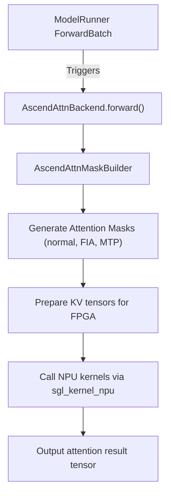
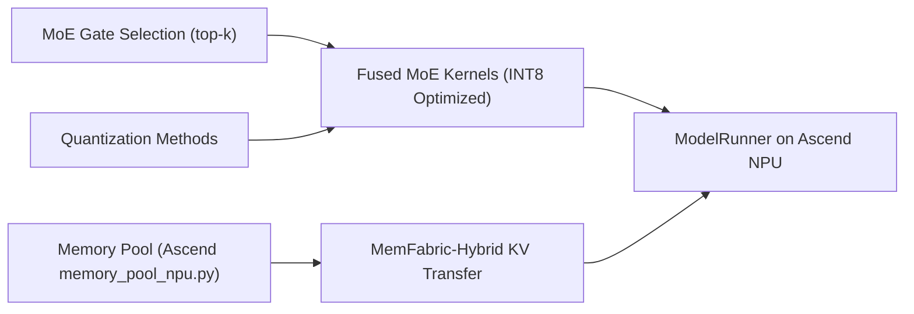
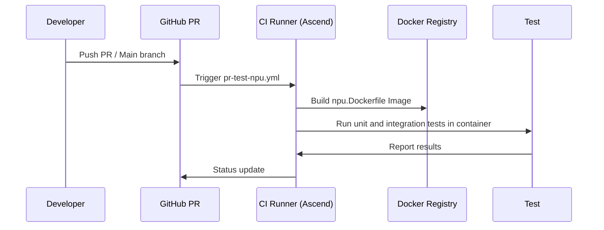
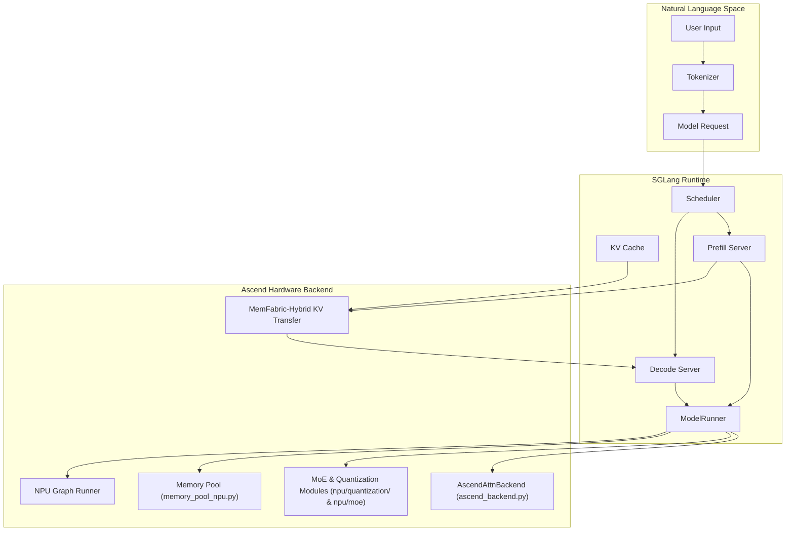

<!-- source: DeepWiki mcp.deepwiki.com · repo microsoft/llm-42 · page 11.3 Ascend NPU Support · fetched 2026-10-26 -->

# Ascend NPU Support

Relevant source files

The following files were used as context for generating this wiki page:

- [.github/workflows/nightly-test-amd.yml](.github/workflows/nightly-test-amd.yml)
- [.github/workflows/nightly-test-intel.yml](.github/workflows/nightly-test-intel.yml)
- [.github/workflows/nightly-test-npu.yml](.github/workflows/nightly-test-npu.yml)
- [.github/workflows/pr-test-amd.yml](.github/workflows/pr-test-amd.yml)
- [.github/workflows/pr-test-npu.yml](.github/workflows/pr-test-npu.yml)
- [.github/workflows/pr-test-xeon.yml](.github/workflows/pr-test-xeon.yml)
- [.github/workflows/pr-test-xpu.yml](.github/workflows/pr-test-xpu.yml)
- [.github/workflows/release-branch-cut.yml](.github/workflows/release-branch-cut.yml)
- [.github/workflows/release-docker-npu-nightly.yml](.github/workflows/release-docker-npu-nightly.yml)
- [.github/workflows/release-docker-npu.yml](.github/workflows/release-docker-npu.yml)
- [benchmark/hicache/bench_long_context.py](benchmark/hicache/bench_long_context.py)
- [benchmark/hicache/bench_multiturn.py](benchmark/hicache/bench_multiturn.py)
- [docker/npu.Dockerfile](docker/npu.Dockerfile)
- [docs/advanced_features/hyperparameter_tuning.md](docs/advanced_features/hyperparameter_tuning.md)
- [docs/advanced_features/pd_disaggregation.md](docs/advanced_features/pd_disaggregation.md)
- [docs/platforms/ascend_npu_best_practice.md](docs/platforms/ascend_npu_best_practice.md)
- [docs/platforms/ascend_npu_deepseek_example.md](docs/platforms/ascend_npu_deepseek_example.md)
- [docs/platforms/ascend_npu_qwen3_examples.md](docs/platforms/ascend_npu_qwen3_examples.md)
- [docs/platforms/ascend_npu_support.rst](docs/platforms/ascend_npu_support.rst)
- [docs/platforms/ascend_npu_support_features.md](docs/platforms/ascend_npu_support_features.md)
- [docs/platforms/ascend_npu_support_models.md](docs/platforms/ascend_npu_support_models.md)
- [docs/references/custom_chat_template.md](docs/references/custom_chat_template.md)
- [docs/references/faq.md](docs/references/faq.md)
- [python/sglang/srt/hardware_backend/npu/attention/ascend_backend.py](python/sglang/srt/hardware_backend/npu/attention/ascend_backend.py)
- [python/sglang/srt/hardware_backend/npu/attention/mla_preprocess.py](python/sglang/srt/hardware_backend/npu/attention/mla_preprocess.py)
- [python/sglang/srt/hardware_backend/npu/graph_runner/eagle_draft_extend_npu_graph_runner.py](python/sglang/srt/hardware_backend/npu/graph_runner/eagle_draft_extend_npu_graph_runner.py)
- [python/sglang/srt/hardware_backend/npu/graph_runner/eagle_draft_npu_graph_runner.py](python/sglang/srt/hardware_backend/npu/graph_runner/eagle_draft_npu_graph_runner.py)
- [python/sglang/srt/hardware_backend/npu/graph_runner/npu_graph_runner.py](python/sglang/srt/hardware_backend/npu/graph_runner/npu_graph_runner.py)
- [python/sglang/srt/hardware_backend/npu/memory_pool_npu.py](python/sglang/srt/hardware_backend/npu/memory_pool_npu.py)
- [python/sglang/srt/hardware_backend/npu/modules/deepseek_v2_attention_mla_npu.py](python/sglang/srt/hardware_backend/npu/modules/deepseek_v2_attention_mla_npu.py)
- [python/sglang/srt/hardware_backend/npu/moe/topk.py](python/sglang/srt/hardware_backend/npu/moe/topk.py)
- [python/sglang/srt/hardware_backend/npu/quantization/fused_moe_method_npu.py](python/sglang/srt/hardware_backend/npu/quantization/fused_moe_method_npu.py)
- [python/sglang/srt/hardware_backend/npu/quantization/linear_method_npu.py](python/sglang/srt/hardware_backend/npu/quantization/linear_method_npu.py)
- [python/sglang/srt/hardware_backend/npu/utils.py](python/sglang/srt/hardware_backend/npu/utils.py)
- [python/sglang/srt/models/deepseek_janus_pro.py](python/sglang/srt/models/deepseek_janus_pro.py)
- [python/sglang/srt/models/minicpmv.py](python/sglang/srt/models/minicpmv.py)
- [python/sglang/test/kits/cache_hit_kit.py](python/sglang/test/kits/cache_hit_kit.py)
- [scripts/ci/npu/npu_ci_install_dependency.sh](scripts/ci/npu/npu_ci_install_dependency.sh)
- [test/registered/amd/accuracy/mi30x/test_kimi_k25_eval_amd.py](test/registered/amd/accuracy/mi30x/test_kimi_k25_eval_amd.py)
- [test/registered/amd/accuracy/mi35x/test_kimi_k25_eval_mi35x.py](test/registered/amd/accuracy/mi35x/test_kimi_k25_eval_mi35x.py)
- [test/registered/ascend/test_ascend_memory_consumption.py](test/registered/ascend/test_ascend_memory_consumption.py)
- [test/registered/ascend/vlm_models/test_ascend_kimi_vl_a3b_instruct.py](test/registered/ascend/vlm_models/test_ascend_kimi_vl_a3b_instruct.py)
- [test/registered/radix_cache/test_radix_cache_hit.py](test/registered/radix_cache/test_radix_cache_hit.py)

This section provides an in-depth technical overview of the Huawei Ascend NPU support in the LLM-42 codebase. It covers the implementation details spanning the Docker environment (`npu.Dockerfile`), the Ascend attention backend (`ascend_backend.py`), NPU-tailored Mixture-of-Experts (MoE) and quantization modules, the MemFabric-Hybrid system for efficient Key-Value (KV) cache transfer, as well as Ascend-specific continuous integration workflows.

---

## 1. Purpose and Scope

Huawei's Ascend series NPUs are specialized hardware accelerators designed for AI workloads. To leverage their capabilities, LLM-42 integrates unique backends and optimizations catering specifically to Ascend NPU architecture and runtime environment. Key objectives include:

- Efficient attention kernel implementations adapted to Ascend constraints.
- Support for quantization and MoE modules optimized for Ascend.
- High-performance KV cache transfer using MemFabric-Hybrid for PD (Prefill-Decode) disaggregation.
- Docker environments and CI workflows tailored for Ascend ecosystem.

This page explains the software components, data flow, and architectural design enabling Ascend NPU support.

---

## 2. Docker Environment: `npu.Dockerfile`

The `npu.Dockerfile` sets up the runtime container image tailored for Ascend NPUs:

- Based on an ARM64 Ubuntu 22.04 image to match Ascend hardware requirements.
- Installs Huawei CANN SDK, with specific versions set via build args (e.g., CANN_VERSION=8.5.0) optimized for NPU drivers and runtime libraries.
- Python environment and dependencies aligned with Ascend runtime, including `torch_npu` for PyTorch Tensor support on Ascend devices.
- Designed multi-architecture support (linux/arm64 and linux/amd64) enables building for multiple Ascend device types (e.g., "910b" and "a3") using buildx.
- Entrypoints and environment variables configured for smooth integration with LLM-42 server codebase.

This Dockerfile forms the foundation for all Ascend NPU runs both in local testing and production deployments.

*Sources: `docker/npu.Dockerfile`, `.github/workflows/release-docker-npu.yml`*

---

## 3. Ascend Attention Backend: `ascend_backend.py`

The attention layer is a core computational bottleneck in transformers. `ascend_backend.py` implements the Ascend-specific attention backend, adapting LLM-42’s attention infrastructure to leverage Ascend capabilities.

### 3.1 Key Classes and Functions

- **`AscendAttnBackend(AttentionBackend)`**  
  Implements the interface expected by the LLM-42 framework’s attention layer abstraction. It manages the lifecycle of attention computation on Ascend NPUs.

- **`AscendAttnMaskBuilder`**  
  Generates various attention masks needed by attention kernels on Ascend NPUs, including masks for normal attention, FIA (Flash Infer Attention) masks, MTP (Mixed Token Position) masks, and mixed chunk masks.  
  - Implements efficient mask generation with support for different dtypes (float16, bfloat16).  
  - Supports specialized mask update mechanics to cache and reuse computed masks for performance.  
  - Uses lower-triangular masks inverted to define masked tokens with `True` / `False`.  
  - Provides FIA/NPU formatted mask view reshape.
  
- **`ForwardMetadata`**  
  Dataclass encapsulating forward-pass metadata such as KV cache block tables, sequence lengths, prefix lengths, used to optimize attention computations.

- **Helper Functions:**  
  - `_reshape_kv_for_fia_nz`: Reshapes KV tensors for FIA non-zero pattern optimization (specific to Ascend hardware format).

### 3.2 Data Flow and Execution

- The model runner triggers the attention backend for each transformer layer during inference.
- `AscendAttnMaskBuilder` creates the necessary attention masks before kernel execution.
- Attention keys and values tensors are reshaped and stored in special memory layouts optimal for Ascend architecture.
- Specialized NPU attention kernels from the `sgl_kernel_npu` package (e.g., `attention_sinks_prefill_triton` and `attention_sinks_triton`) are called to execute the attention computation leveraging Ascend’s hardware capabilities.
- Conditional logic supports MLA (Multi-Head Latent Attention) preprocess optimizations, NSA sparse attention, and FIA modes.
- Mask generation accounts for maximum sequence length dynamically, supporting incremental sequence extension during decode.

*Sources: `python/sglang/srt/hardware_backend/npu/attention/ascend_backend.py` [1-200](), `python/sglang/srt/hardware_backend/npu/attention/mla_preprocess.py` [1-40]()*

---

## 4. NPU-specific Attention and MoE Modules

### 4.1 Mixture-of-Experts (MoE) on Ascend

- The LLM-42 codebase contains MoE top-k routing and fused MoE kernels specialized for Ascend NPUs.
- MoE gate selection (top-k experts) uses optimized data structures to minimize synchronization overhead and memory transfers.
- Custom fused linear layers with quantization-aware optimizations are integrated to leverage Ascend integer math and tensor cores effectively.
- MoE parallelism scheduling follows the standard pipeline but with Ascend-specific backend hooks.

### 4.2 Quantization Modules

- Ascend targets mostly support INT8 (weight-only) and BF16.
- Modules such as `fused_moe_method_npu.py` and `linear_method_npu.py` provide kernel wrappers and utility methods for quantization-aware computations on Ascend.
- Quantization parameters and scale factors are managed carefully within the Ascend backend, preserving numerical stability.
- Runtime flags enable quantize-and-serve modes specialized for Ascend.

### 4.3 Memory Management and KV Cache

- The Ascend memory pool module (`memory_pool_npu.py`) manages device memory allocations, tuned for Ascend-specific allocation patterns.
- MemFabric-Hybrid is an internal infrastructure integrated with ascending disaggregation mode to handle KV cache transfers efficiently across nodes running prefill and decode workloads.
- MemFabric-Hybrid abstracts network transports and uses RDMA-like mechanisms provided by Ascend ecosystem for low latency and high throughput.

*Sources: `python/sglang/srt/hardware_backend/npu/quantization/fused_moe_method_npu.py` [1-100](), `python/sglang/srt/hardware_backend/npu/memory_pool_npu.py` [1-130](), `python/sglang/srt/hardware_backend/npu/moe/topk.py` [1-90](), `python/sglang/srt/hardware_backend/npu/graph_runner/npu_graph_runner.py` [1-110](), `python/sglang/srt/hardware_backend/npu/graph_runner/eagle_draft_npu_graph_runner.py` [1-50]()*

---

## 5. PD Disaggregation and MemFabric-Hybrid

### 5.1 Overview

PD Disaggregation splits model inference into **Prefill** and **Decode** server processes. Prefill executes full-sequence computation while Decode handles incremental generation with KV cache.

For Ascend NPU:

- MemFabric-Hybrid backs the KV cache transfer mechanism enabling high throughput communication between Prefill and Decode instances.
- It supports hybrid RDMA + TCP transport optimized for Ascend clusters.
- MemFabric-Hybrid orchestrates transfer queues and heartbeat monitoring to ensure synchronization and fast error recovery.

### 5.2 Integration

- The server arguments allow enabling/disabling PD disaggregation mode on Ascend hardware via flags like `--disaggregation-mode` and environment variables configuring network transports.
- The prefill process handles KV cache construction which is efficiently streamed or transferred to decode workers through MemFabric-Hybrid.
- Decode workers fetch KV cache increments with minimal CPU overhead by offloading transfer calls to Ascend-optimized drivers and transports.

---

## 6. Ascend-specific CI Workflows

CI pipelines for Ascend NPU are specialized due to hardware and environment constraints:

- `.github/workflows/pr-test-npu.yml` orchestrates PR tests on Ascend. It schedules multi-node testing on Ascend A2 hardware, runs unit and integration tests under container image `swr.cn-southwest-2.myhuaweicloud.com/base_image/ascend-ci/cann:8.5.0-910b-ubuntu22.04-py3.11`.
- The workflows include dependency installation scripts (`scripts/ci/npu/npu_ci_install_dependency.sh`).
- Nightly test workflows and release pipelines build and push Ascend Docker images multi-architecture, tagging with CANN and device type.
- Tests cover LLM decoding correctness, memory consumption, and benchmark suites specifically targeting Ascend hardware.
- CI includes environment preparations such as Python environment setup, caching, and proxy configuration for package mirrors.

*Sources: `.github/workflows/pr-test-npu.yml` [1-170](), `.github/workflows/release-docker-npu.yml` [1-95](), `scripts/ci/npu/npu_ci_install_dependency.sh`*

---

## 7. Supported Models and Best Practices

SGLang supports a wide range of LLMs optimized for Ascend:

- DeepSeek V3/V3.1, Qwen3 series, Llama variants, Mistral, Baichuan, GLM-4, etc.
- Support extends across large dense models, MoE mixtures, and multimodal models.
- Quantization options include W8A8 INT8, BF16, and hybrid configurations.
- Deployment modes include PD disaggregation with mixed precision and expert-level TPU/autotuning parameters.
- Best practice configurations and tuned parameters (hardware cards, batch sizes, quantization) are documented extensively for low latency and high throughput performance on Ascend (Atlas 800 series).

---

## 8. Ascend NPU Support Integration Diagram

Below diagram highlights the integration of Ascend-specific components within the LLM-42 system from model execution to hardware:

*Sources: `python/sglang/srt/hardware_backend/npu/attention/ascend_backend.py` [1-200](), `python/sglang/srt/hardware_backend/npu/memory_pool_npu.py` [1-130](), `python/sglang/srt/hardware_backend/npu/graph_runner/npu_graph_runner.py` [1-110](), `.github/workflows/pr-test-npu.yml` [1-170]()*

---

# Summary

Huawei Ascend NPU support is a comprehensive integration in LLM-42 enabling efficient and scalable deterministic LLM inference on Ascend hardware. This involves:

- Custom Docker environment for Ascend runtime.
- Specialized attention backend with mask builders and kernel call paths.
- NPU-optimized MoE and quantization modules supporting INT8 and BF16 precision.
- Efficient KV cache transfer via MemFabric-Hybrid integrated with PD disaggregation.
- Rigorous continuous integration workflows ensuring quality and correctness on Ascend devices.
- Extensive support for popular large and multimodal language models with best practice configurations.

This architecture empowers large-scale LLM inference deployment on Huawei Ascend NPUs with high performance and low latency.

---

# References

- `docker/npu.Dockerfile`
- `python/sglang/srt/hardware_backend/npu/attention/ascend_backend.py`
- `python/sglang/srt/hardware_backend/npu/memory_pool_npu.py`
- `python/sglang/srt/hardware_backend/npu/quantization/fused_moe_method_npu.py`
- `.github/workflows/pr-test-npu.yml`
- `.github/workflows/release-docker-npu.yml`
- `scripts/ci/npu/npu_ci_install_dependency.sh`
- `docs/platforms/ascend_npu_support_features.md`
- `docs/platforms/ascend_npu_support_models.md`
- `docs/platforms/ascend_npu_best_practice.md`
- `docs/advanced_features/pd_disaggregation.md`

---

