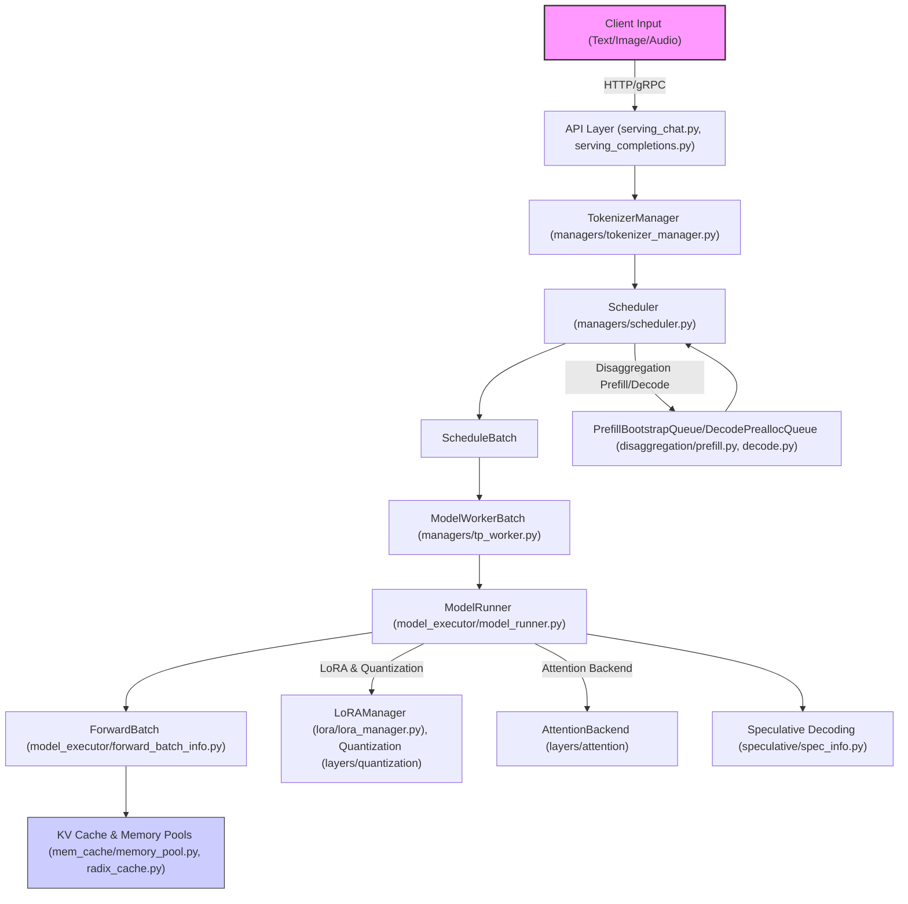
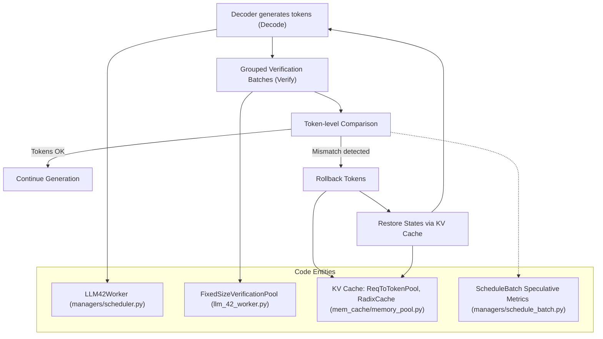
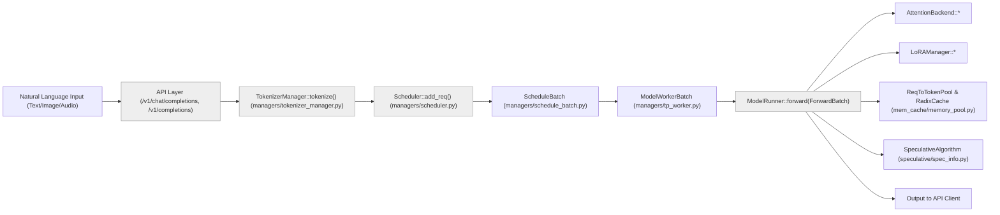

<!-- source: DeepWiki mcp.deepwiki.com · repo microsoft/llm-42 · page 15 Glossary · fetched 2026-10-26 -->

# Glossary

Relevant source files

The following files were used as context for generating this wiki page:

- [docs/advanced_features/hicache.rst](docs/advanced_features/hicache.rst)
- [docs/advanced_features/hicache_best_practices.md](docs/advanced_features/hicache_best_practices.md)
- [docs/advanced_features/hicache_design.md](docs/advanced_features/hicache_design.md)
- [docs/advanced_features/hicache_storage_runtime_attach_detach.md](docs/advanced_features/hicache_storage_runtime_attach_detach.md)
- [docs/references/environment_variables.md](docs/references/environment_variables.md)
- [python/sglang/srt/batch_invariant_ops/__init__.py](python/sglang/srt/batch_invariant_ops/__init__.py)
- [python/sglang/srt/batch_invariant_ops/batch_invariant_ops.py](python/sglang/srt/batch_invariant_ops/batch_invariant_ops.py)
- [python/sglang/srt/configs/model_config.py](python/sglang/srt/configs/model_config.py)
- [python/sglang/srt/disaggregation/ascend/conn.py](python/sglang/srt/disaggregation/ascend/conn.py)
- [python/sglang/srt/disaggregation/ascend/transfer_engine.py](python/sglang/srt/disaggregation/ascend/transfer_engine.py)
- [python/sglang/srt/disaggregation/base/__init__.py](python/sglang/srt/disaggregation/base/__init__.py)
- [python/sglang/srt/disaggregation/base/conn.py](python/sglang/srt/disaggregation/base/conn.py)
- [python/sglang/srt/disaggregation/common/__init__.py](python/sglang/srt/disaggregation/common/__init__.py)
- [python/sglang/srt/disaggregation/common/conn.py](python/sglang/srt/disaggregation/common/conn.py)
- [python/sglang/srt/disaggregation/decode.py](python/sglang/srt/disaggregation/decode.py)
- [python/sglang/srt/disaggregation/fake/__init__.py](python/sglang/srt/disaggregation/fake/__init__.py)
- [python/sglang/srt/disaggregation/fake/conn.py](python/sglang/srt/disaggregation/fake/conn.py)
- [python/sglang/srt/disaggregation/mooncake/__init__.py](python/sglang/srt/disaggregation/mooncake/__init__.py)
- [python/sglang/srt/disaggregation/mooncake/conn.py](python/sglang/srt/disaggregation/mooncake/conn.py)
- [python/sglang/srt/disaggregation/nixl/__init__.py](python/sglang/srt/disaggregation/nixl/__init__.py)
- [python/sglang/srt/disaggregation/nixl/conn.py](python/sglang/srt/disaggregation/nixl/conn.py)
- [python/sglang/srt/disaggregation/prefill.py](python/sglang/srt/disaggregation/prefill.py)
- [python/sglang/srt/disaggregation/utils.py](python/sglang/srt/disaggregation/utils.py)
- [python/sglang/srt/distributed/device_communicators/mooncake_transfer_engine.py](python/sglang/srt/distributed/device_communicators/mooncake_transfer_engine.py)
- [python/sglang/srt/entrypoints/http_server.py](python/sglang/srt/entrypoints/http_server.py)
- [python/sglang/srt/environ.py](python/sglang/srt/environ.py)
- [python/sglang/srt/layers/activation.py](python/sglang/srt/layers/activation.py)
- [python/sglang/srt/layers/communicator.py](python/sglang/srt/layers/communicator.py)
- [python/sglang/srt/layers/flashinfer_comm_fusion.py](python/sglang/srt/layers/flashinfer_comm_fusion.py)
- [python/sglang/srt/layers/layernorm.py](python/sglang/srt/layers/layernorm.py)
- [python/sglang/srt/layers/linear.py](python/sglang/srt/layers/linear.py)
- [python/sglang/srt/layers/logits_processor.py](python/sglang/srt/layers/logits_processor.py)
- [python/sglang/srt/layers/moe/ep_moe/layer.py](python/sglang/srt/layers/moe/ep_moe/layer.py)
- [python/sglang/srt/layers/moe/fused_moe_triton/fused_moe.py](python/sglang/srt/layers/moe/fused_moe_triton/fused_moe.py)
- [python/sglang/srt/layers/moe/fused_moe_triton/layer.py](python/sglang/srt/layers/moe/fused_moe_triton/layer.py)
- [python/sglang/srt/layers/moe/moe_runner/deep_gemm.py](python/sglang/srt/layers/moe/moe_runner/deep_gemm.py)
- [python/sglang/srt/layers/moe/token_dispatcher/__init__.py](python/sglang/srt/layers/moe/token_dispatcher/__init__.py)
- [python/sglang/srt/layers/moe/token_dispatcher/base.py](python/sglang/srt/layers/moe/token_dispatcher/base.py)
- [python/sglang/srt/layers/moe/token_dispatcher/deepep.py](python/sglang/srt/layers/moe/token_dispatcher/deepep.py)
- [python/sglang/srt/layers/moe/token_dispatcher/standard.py](python/sglang/srt/layers/moe/token_dispatcher/standard.py)
- [python/sglang/srt/layers/moe/topk.py](python/sglang/srt/layers/moe/topk.py)
- [python/sglang/srt/layers/moe/utils.py](python/sglang/srt/layers/moe/utils.py)
- [python/sglang/srt/layers/quantization/__init__.py](python/sglang/srt/layers/quantization/__init__.py)
- [python/sglang/srt/layers/quantization/fp8.py](python/sglang/srt/layers/quantization/fp8.py)
- [python/sglang/srt/layers/quantization/fp8_kernel.py](python/sglang/srt/layers/quantization/fp8_kernel.py)
- [python/sglang/srt/layers/quantization/fp8_utils.py](python/sglang/srt/layers/quantization/fp8_utils.py)
- [python/sglang/srt/layers/quantization/int8_kernel.py](python/sglang/srt/layers/quantization/int8_kernel.py)
- [python/sglang/srt/layers/quantization/modelopt_quant.py](python/sglang/srt/layers/quantization/modelopt_quant.py)
- [python/sglang/srt/layers/rotary_embedding.py](python/sglang/srt/layers/rotary_embedding.py)
- [python/sglang/srt/layers/sampler.py](python/sglang/srt/layers/sampler.py)
- [python/sglang/srt/layers/vocab_parallel_embedding.py](python/sglang/srt/layers/vocab_parallel_embedding.py)
- [python/sglang/srt/llm42/__init__.py](python/sglang/srt/llm42/__init__.py)
- [python/sglang/srt/llm42/llm42_info.py](python/sglang/srt/llm42/llm42_info.py)
- [python/sglang/srt/llm42/llm42_worker.py](python/sglang/srt/llm42/llm42_worker.py)
- [python/sglang/srt/managers/cache_controller.py](python/sglang/srt/managers/cache_controller.py)
- [python/sglang/srt/managers/detokenizer_manager.py](python/sglang/srt/managers/detokenizer_manager.py)
- [python/sglang/srt/managers/io_struct.py](python/sglang/srt/managers/io_struct.py)
- [python/sglang/srt/managers/multi_tokenizer_mixin.py](python/sglang/srt/managers/multi_tokenizer_mixin.py)
- [python/sglang/srt/managers/schedule_batch.py](python/sglang/srt/managers/schedule_batch.py)
- [python/sglang/srt/managers/scheduler.py](python/sglang/srt/managers/scheduler.py)
- [python/sglang/srt/managers/scheduler_dp_attn_mixin.py](python/sglang/srt/managers/scheduler_dp_attn_mixin.py)
- [python/sglang/srt/managers/scheduler_metrics_mixin.py](python/sglang/srt/managers/scheduler_metrics_mixin.py)
- [python/sglang/srt/managers/scheduler_output_processor_mixin.py](python/sglang/srt/managers/scheduler_output_processor_mixin.py)
- [python/sglang/srt/managers/scheduler_pp_mixin.py](python/sglang/srt/managers/scheduler_pp_mixin.py)
- [python/sglang/srt/managers/scheduler_runtime_checker_mixin.py](python/sglang/srt/managers/scheduler_runtime_checker_mixin.py)
- [python/sglang/srt/managers/scheduler_update_weights_mixin.py](python/sglang/srt/managers/scheduler_update_weights_mixin.py)
- [python/sglang/srt/managers/tokenizer_communicator_mixin.py](python/sglang/srt/managers/tokenizer_communicator_mixin.py)
- [python/sglang/srt/managers/tokenizer_manager.py](python/sglang/srt/managers/tokenizer_manager.py)
- [python/sglang/srt/managers/tp_worker.py](python/sglang/srt/managers/tp_worker.py)
- [python/sglang/srt/mem_cache/hicache_storage.py](python/sglang/srt/mem_cache/hicache_storage.py)
- [python/sglang/srt/mem_cache/hiradix_cache.py](python/sglang/srt/mem_cache/hiradix_cache.py)
- [python/sglang/srt/mem_cache/memory_pool.py](python/sglang/srt/mem_cache/memory_pool.py)
- [python/sglang/srt/mem_cache/memory_pool_host.py](python/sglang/srt/mem_cache/memory_pool_host.py)
- [python/sglang/srt/mem_cache/storage/__init__.py](python/sglang/srt/mem_cache/storage/__init__.py)
- [python/sglang/srt/mem_cache/storage/backend_factory.py](python/sglang/srt/mem_cache/storage/backend_factory.py)
- [python/sglang/srt/mem_cache/storage/hf3fs/hf3fs_client.py](python/sglang/srt/mem_cache/storage/hf3fs/hf3fs_client.py)
- [python/sglang/srt/mem_cache/storage/hf3fs/hf3fs_usrbio_client.py](python/sglang/srt/mem_cache/storage/hf3fs/hf3fs_usrbio_client.py)
- [python/sglang/srt/mem_cache/storage/hf3fs/storage_hf3fs.py](python/sglang/srt/mem_cache/storage/hf3fs/storage_hf3fs.py)
- [python/sglang/srt/mem_cache/storage/mooncake_store/README.md](python/sglang/srt/mem_cache/storage/mooncake_store/README.md)
- [python/sglang/srt/mem_cache/storage/mooncake_store/mooncake_store.py](python/sglang/srt/mem_cache/storage/mooncake_store/mooncake_store.py)
- [python/sglang/srt/mem_cache/storage/mooncake_store/test_mooncake_store.py](python/sglang/srt/mem_cache/storage/mooncake_store/test_mooncake_store.py)
- [python/sglang/srt/mem_cache/storage/nixl/README.md](python/sglang/srt/mem_cache/storage/nixl/README.md)
- [python/sglang/srt/mem_cache/storage/nixl/hicache_nixl.py](python/sglang/srt/mem_cache/storage/nixl/hicache_nixl.py)
- [python/sglang/srt/mem_cache/storage/nixl/nixl.config.toml.sample](python/sglang/srt/mem_cache/storage/nixl/nixl.config.toml.sample)
- [python/sglang/srt/mem_cache/storage/nixl/nixl_utils.py](python/sglang/srt/mem_cache/storage/nixl/nixl_utils.py)
- [python/sglang/srt/mem_cache/storage/nixl/test_hicache_nixl_storage.py](python/sglang/srt/mem_cache/storage/nixl/test_hicache_nixl_storage.py)
- [python/sglang/srt/metrics/collector.py](python/sglang/srt/metrics/collector.py)
- [python/sglang/srt/model_executor/cuda_graph_runner.py](python/sglang/srt/model_executor/cuda_graph_runner.py)
- [python/sglang/srt/model_executor/forward_batch_info.py](python/sglang/srt/model_executor/forward_batch_info.py)
- [python/sglang/srt/model_executor/model_runner.py](python/sglang/srt/model_executor/model_runner.py)
- [python/sglang/srt/models/deepseek_nextn.py](python/sglang/srt/models/deepseek_nextn.py)
- [python/sglang/srt/models/deepseek_v2.py](python/sglang/srt/models/deepseek_v2.py)
- [python/sglang/srt/sampling/sampling_batch_info.py](python/sglang/srt/sampling/sampling_batch_info.py)
- [python/sglang/srt/sampling/sampling_params.py](python/sglang/srt/sampling/sampling_params.py)
- [python/sglang/srt/server_args.py](python/sglang/srt/server_args.py)
- [python/sglang/srt/utils/common.py](python/sglang/srt/utils/common.py)
- [python/sglang/test/test_block_fp8.py](python/sglang/test/test_block_fp8.py)
- [sgl-kernel/CMakeLists.txt](sgl-kernel/CMakeLists.txt)
- [sgl-kernel/benchmark/bench_per_token_group_quant_8bit.py](sgl-kernel/benchmark/bench_per_token_group_quant_8bit.py)
- [sgl-kernel/csrc/common_extension.cc](sgl-kernel/csrc/common_extension.cc)
- [sgl-kernel/csrc/gemm/per_token_group_quant_8bit.cu](sgl-kernel/csrc/gemm/per_token_group_quant_8bit.cu)
- [sgl-kernel/csrc/moe/moe_fused_gate.cu](sgl-kernel/csrc/moe/moe_fused_gate.cu)
- [sgl-kernel/include/sgl_kernel_ops.h](sgl-kernel/include/sgl_kernel_ops.h)
- [sgl-kernel/python/sgl_kernel/__init__.py](sgl-kernel/python/sgl_kernel/__init__.py)
- [sgl-kernel/python/sgl_kernel/elementwise.py](sgl-kernel/python/sgl_kernel/elementwise.py)
- [sgl-kernel/python/sgl_kernel/gemm.py](sgl-kernel/python/sgl_kernel/gemm.py)
- [sgl-kernel/python/sgl_kernel/moe.py](sgl-kernel/python/sgl_kernel/moe.py)
- [sgl-kernel/python/sgl_kernel/test_utils.py](sgl-kernel/python/sgl_kernel/test_utils.py)
- [sgl-kernel/tests/test_moe_fused_gate.py](sgl-kernel/tests/test_moe_fused_gate.py)
- [sgl-kernel/tests/test_per_token_group_quant_8bit.py](sgl-kernel/tests/test_per_token_group_quant_8bit.py)
- [test/registered/hicache/test_hicache_storage_runtime_attach_detach.py](test/registered/hicache/test_hicache_storage_runtime_attach_detach.py)

This glossary defines key terms, abbreviations, and domain concepts specific to the LLM-42 codebase to assist onboarding engineers. Each entry includes technical details on implementation aspects, primary data flow, and pointers to relevant code entities for deep exploration.

---

## 15.1 ServerArgs

- **Definition**: Configuration parameters controlling server behavior, model loading, quantization, attention backend choice, memory pooling, LoRA adapter management, disaggregation, speculative decoding, and many other runtime features.
- **Role in Code**: `ServerArgs` is a dataclass representing the aggregated command-line arguments or environment variable settings used by the server processes.
- **Key properties:** choices for quantization methods (`QUANTIZATION_CHOICES`), attention backends (`ATTENTION_BACKEND_CHOICES`), LoRA backends, and disaggregation transfer backends allow flexible extensions.
- **Usage**: `ServerArgs` object is created at server start-up, setting global configurations accessible to components such as the scheduler, model runners, and tokenizers.
- **Code location**: Defined in `python/sglang/srt/server_args.py:274-463` [python/sglang/srt/server_args.py:274-463]()

---

## 15.2 Scheduler and Scheduling Data Structures

- **Scheduler**: Manages tensor-parallel GPU worker allocation and orchestrates request lifecycles, enforcing batch scheduling policies, disaggregation, and distributed coordination.
- **ScheduleBatch**: Represents a high-level batch of requests managed by the scheduler, primarily CPU-side.
- **ModelWorkerBatch**: A trimmed version of `ScheduleBatch` which contains only the necessary batch data for GPU model forward.
- **ForwardBatch**: Contains detailed low-level GPU tensor data for actual model forward execution.
- **Data Flow**: Requests `Req` → `ScheduleBatch` (CPU scheduler) → `ModelWorkerBatch` (GPU worker) → `ForwardBatch` (ModelRunner on GPU)
- **FinishReason Classes**: Enumerations of batch completion reasons such as `FINISH_MATCHED_TOKEN`, `FINISH_ABORT`, indicating stop conditions during generation.
- **Multimodal Data Types**: Defines modalities like IMAGE, AUDIO, VIDEO and their input formats for processing.
- **Code locations**:
  - Scheduler: `python/sglang/srt/managers/scheduler.py` [python/sglang/srt/managers/scheduler.py:1-4200 (large, see TOC)]  
  - ScheduleBatch & related: `python/sglang/srt/managers/schedule_batch.py:22-250` [python/sglang/srt/managers/schedule_batch.py:22-250]  
  - IO Structures between components: `python/sglang/srt/managers/io_struct.py:15-650` [python/sglang/srt/managers/io_struct.py:15-650]  

---

## 15.3 ModelRunner

- **Definition**: The subsystem that executes forward passes of transformer language models.
- **Key Responsibilities**:
  - Handles distributed parallelism (tensor-pipeline-data parallel modes)
  - Integrates with CUDA Graph Runner or Piecewise CUDA Graph Runner for optimization.
  - Manages LoRA adapter application and updates.
  - Supports Dynamic Parallelism and interfaces to various attention backends.
  - Interfaces with quantization and MoE (Mixture of Experts) components.
- **Data Structure**: Processes `ForwardBatch` objects containing GPU tensors.
- **Code location**: Defined and implemented in `python/sglang/srt/model_executor/model_runner.py` [python/sglang/srt/model_executor/model_runner.py:14-11658]()

---

## 15.4 KV Cache and Memory Pools

- **ReqToTokenPool**: Memory pool mapping global request indices to token positions in the KV cache.
- **TokenToKVPoolAllocator**: Allocates indices to individual KV cache buffers, managing token-level cache addressing.
- **KVCache**: Stores key-value tensors for transformer attention caches.
- **MambaPool**: Specialized memory pool for mamba selective state updates, used for certain specialized attention backends.
- **Memory Saver Adapter**: Optional adapter to optimize memory usage, controlled by server args.
- **Data Flow**: Request → Allocated token indices in `ReqToTokenPool` → Corresponding KV cache allocation via `TokenToKVPoolAllocator`.
- **Code location**: Memory pool management concepts are implemented mainly in `python/sglang/srt/mem_cache/memory_pool.py` [python/sglang/srt/mem_cache/memory_pool.py:16-285]

---

## 15.5 Attention Backends

- **Purpose**: Modular attention implementations optimized for different platforms and use-cases.
- **Common Backends**: Triton, FlashAttention (v3 and v4), FlashInfer, CUTLASS MLA.
- **Specialized Backends**:
  - MLA (Multi-Head Latent Attention) specialized kernels.
  - NSA (Native Sparse Attention)
  - Hybrid Linear Attention (Mamba, FLA)
  - AMD-specific backends like `aiter`
  - Platform-specific modes for Intel AMX, Ascend.
- **Backend Registry**: Attention backend classes are registered and dispatched dynamically based on server arguments.
- **Code locations**: See partial mention in `model_runner.py` and `server_args.py` for choices; implementation spread in `layers/attention/` (not fully covered here).
- **Relevant enums/constants**: `ATTENTION_BACKEND_CHOICES` in `server_args.py` [python/sglang/srt/server_args.py:120-145]()

---

## 15.6 LoRA Adapters

- **LoRA (Low-Rank Adaptation)**: Parameter efficient fine-tuning adapters dynamically loaded/evicted at runtime.
- **LoRAManager**: Manages loading, unloading, memory pooling, and multiplexing of multiple LoRA adapters.
- **LoRA Backend Choices**: Includes Triton, csgmv, ascend, torch_native.
- **Overlap Loading & Eviction**: To reduce stalls and memory pressure, LoRA weights can be loaded incrementally with an LRU eviction policy.
- **Code locations**: LoRA references in `server_args.py`, references in scheduler and model_runner but primarily in `lora/lora_manager.py` or `lora/lora_registry.py` (not included fully here).

---

## 15.7 Disaggregation

- **Concept**: Splitting work for prefill and decode across separate instances or machines to scale model serving.
- **Key Queues**:
  - `PrefillBootstrapQueue`: Manages prefill requests and metadata.
  - `DecodePreallocQueue`: Manages decode phase memory preallocation.
- **KV Transfer Backends**: Mooncake, NIXL, Ascend for KV cache data sharing.
- **Protocol**: Bootstrap handshake for prefill/decode coordination, ensuring KV cache coherence across stages.
- **Code locations**:
  - Prefill/Decode queues referenced in `managers/scheduler.py` and `managers/schedule_batch.py`.
  - Transfer backend choices enumerated in `server_args.py` [python/sglang/srt/server_args.py:140-150]()

---

## 15.8 Speculative Decoding and LLM-42 DVR

- **Speculative Decoding**: An algorithmic optimization to speculatively generate tokens in batches before verifying correctness.
- **LLM-42 DVR Protocol**:
  - Decode: Generate tokens with windowed token generation.
  - Verify: Grouped verification batches compare tokens at a fine granularity.
  - Rollback: Revert to safe states if verification fails.
- **Data Tracked**: Verification windows, rollback counts, accepted tokens, and verification histograms.
- **Code locations**: Traces in `managers/schedule_batch.py` (`SpeculativeDecodingMetricsMixin`), `scheduler.py`, and `server_args.py`.
- **Speculative Algorithm Enums**: Present in `speculative.spec_info`.
- **Diagram**: Outlined later below.

---

## 15.9 TokenizerManager

- **Tokenization Process**: Responsible for converting input text or multimodal inputs into token IDs or embeddings.
- **Asynchronous Support**: Uses asyncio and uvloop for high throughput.
- **Supports multiple input formats**: single string, batch of strings, cross-encoder pairs.
- **Also handles incremental tokenization state updates and outputs.**
- **Communicates with Scheduler via well-defined IO structures.**
- **Code location**: Defined heavily in `managers/tokenizer_manager.py` [python/sglang/srt/managers/tokenizer_manager.py:14-11000 (truncated)]

---

## 15.10 Natural Language Space to Code Entity Space Bridging Diagram 1: Request Flow with Code Entities

This diagram maps the natural language input to the main code entities involved in processing it, showing the data flow through tokenizer, scheduler, model runner, and into memory pools and attention backends.

Sources:  
- `managers/tokenizer_manager.py:14-1000`  
- `managers/scheduler.py:1-200`  
- `model_executor/model_runner.py:14-1000`  
- `managers/schedule_batch.py:20-200`  
- `mem_cache/memory_pool.py:120-180`  
- `server_args.py:140-260`  

---

## 15.11 Natural Language Space to Code Entity Space Bridging Diagram 2: LLM-42 DVR Speculative Decoding and Verification Flow

This diagram details the LLM-42 Decode-Verify-Rollback loop, connecting the conceptual steps to code entities that implement deterministic inference guarantees.

Sources:  
- `managers/scheduler.py:500-1300` (LLM42Worker usage)  
- `managers/schedule_batch.py:100-300` (Speculative decoding metrics and Finish reasons)  
- `mem_cache/memory_pool.py:125-180` (KV cache pools)  
- `python/sglang/srt/llm_42_worker.py` (not provided, assumed from naming)  

---

## 15.12 Important Terms

| Term                    | Description                                                                                                                     | Code Pointers                                                                           |
|-------------------------|---------------------------------------------------------------------------------------------------------------------------------|-----------------------------------------------------------------------------------------|
| **DVR**                 | Decode-Verify-Rollback protocol ensuring deterministic LLM inference by verifying token groups and rolling back on mismatch.   | See `managers/scheduler.py`, `schedule_batch.py`, `llm_42_worker.py`                    |
| **Batch-Invariant Mode**| A mode ensuring deterministic GPU outputs independent of batch composition, implemented via monkey-patching and custom kernels.| Mentioned in `server_args.py` and `batch_invariant_ops` module (not full code shown).   |
| **Prefill**             | The initial forward pass that processes the input context tokens in generation.                                                  | Managed in scheduler via `PrefillBootstrapQueue` and prefill-related code.              |
| **Decode**              | Generation of tokens step-by-step after prefill in inference.                                                                    | Managed similarly with `DecodePreallocQueue` and decode methods in scheduler/model runner.|
| **LoRA**                | Low-Rank Adaptation adapters dynamically loaded and merged with base model weights at runtime.                                   | Managed in `lora/lora_manager.py` and leveraged in `model_runner.py`.                    |
| **RadixCache**          | A hierarchical cache indexed by radix trees to accelerate prefix matching for KV cache.                                          | Implemented in `mem_cache/radix_cache.py` (not shown here, but referenced).             |
| **CudaGraphRunner**     | Utilizes CUDA Graphs and `torch.compile` for optimized model forward passes with low overhead.                                   | Defined in `model_executor/cuda_graph_runner.py`.                                       |
| **SpeculativeAlgorithm**| Abstraction for speculative decoding approaches (e.g., EAGLE).                                                                    | enums and algorithms in `speculative/spec_info.py`.                                    |
| **Multimodal**          | Support for inputs beyond text, including images, audio, and video, with dedicated processor chains.                            | `managers/tokenizer_manager.py`, multimodal input/output handled in IO structs.         |
| **MoE (Mixture of Experts)**| Architecture with multiple expert subnetworks dynamically selected per token.                                              | Covered in `layers/moe/` and model files like `models/deepseek_v2.py`.                  |

---

## 15.13 Request Lifecycle Overview (Code Entities Focus)

This diagram highlights the key processing components mapping natural language input to final output via the main runtime modules.

---

## 15.14 Summary

This glossary collects the core concepts and components intrinsic to the LLM-42 codebase:

- `ServerArgs` centralizes configuration.
- `Scheduler.py` is the core orchestrator of requests and batches.
- `ScheduleBatch`, `ModelWorkerBatch`, `ForwardBatch` represent data flow layers from CPU scheduling to GPU execution.
- `ModelRunner` executes model forwards with sophisticated backend integrations including CUDA graph and LoRA.
- `Memory Pools` like `ReqToTokenPool` and `RadixCache` efficiently manage state and KV caches.
- Attention backends diversify the hardware-optimized implementations.
- `LoRA` adapters provide dynamic fine-tuning capability.
- `Disaggregation` separates prefill and decode phases across deployments.
- `Speculative Decoding` uses the DVR protocol for determinism with rollback.
- `TokenizerManager` converts raw input to tokens asynchronously.

This technical vocabulary with code references enables engineers to dive directly into essential files and understand the relationships and flow in the system.

---

# Sources:

- `python/sglang/srt/server_args.py:274-463`  
- `python/sglang/srt/managers/scheduler.py:1-500` (overview and references)  
- `python/sglang/srt/managers/schedule_batch.py:22-250`  
- `python/sglang/srt/managers/io_struct.py:15-650`  
- `python/sglang/srt/model_executor/model_runner.py:14-11658` (partial)  
- `python/sglang/srt/mem_cache/memory_pool.py:16-285`  
- `python/sglang/srt/model_executor/cuda_graph_runner.py:1-300` (overview)  
- `python/sglang/srt/managers/tokenizer_manager.py:14-1100` (partial)  
- `python/sglang/srt/speculative/spec_info.py` (referenced)