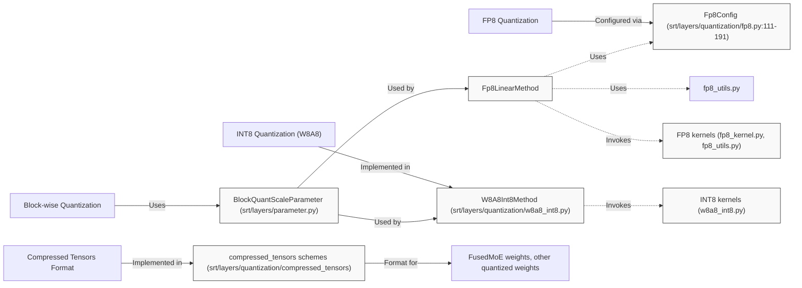

<!-- source: DeepWiki mcp.deepwiki.com · repo microsoft/llm-42 · page 6.1 FP8, INT8, and Block-wise Quantization · fetched 2026-10-26 -->

# 6.1 FP8, INT8, and Block-wise Quantization

<details>
<summary>Relevant source files</summary>

The following files were used as context for generating this wiki page:

- [.github/actions/upload-cuda-coredumps/action.yml](.github/actions/upload-cuda-coredumps/action.yml)
- [.github/workflows/nightly-test-nvidia.yml](.github/workflows/nightly-test-nvidia.yml)
- [docs/advanced_features/rfork.md](docs/advanced_features/rfork.md)
- [python/sglang/srt/configs/load_config.py](python/sglang/srt/configs/load_config.py)
- [python/sglang/srt/configs/model_config.py](python/sglang/srt/configs/model_config.py)
- [python/sglang/srt/debug_utils/cuda_coredump.py](python/sglang/srt/debug_utils/cuda_coredump.py)
- [python/sglang/srt/layers/linear.py](python/sglang/srt/layers/linear.py)
- [python/sglang/srt/layers/moe/ep_moe/layer.py](python/sglang/srt/layers/moe/ep_moe/layer.py)
- [python/sglang/srt/layers/moe/fused_moe_triton/fused_moe.py](python/sglang/srt/layers/moe/fused_moe_triton/fused_moe.py)
- [python/sglang/srt/layers/moe/fused_moe_triton/layer.py](python/sglang/srt/layers/moe/fused_moe_triton/layer.py)
- [python/sglang/srt/layers/moe/kt_ep_wrapper.py](python/sglang/srt/layers/moe/kt_ep_wrapper.py)
- [python/sglang/srt/layers/moe/moe_runner/deep_gemm.py](python/sglang/srt/layers/moe/moe_runner/deep_gemm.py)
- [python/sglang/srt/layers/moe/token_dispatcher/__init__.py](python/sglang/srt/layers/moe/token_dispatcher/__init__.py)
- [python/sglang/srt/layers/moe/token_dispatcher/base.py](python/sglang/srt/layers/moe/token_dispatcher/base.py)
- [python/sglang/srt/layers/moe/token_dispatcher/deepep.py](python/sglang/srt/layers/moe/token_dispatcher/deepep.py)
- [python/sglang/srt/layers/moe/token_dispatcher/standard.py](python/sglang/srt/layers/moe/token_dispatcher/standard.py)
- [python/sglang/srt/layers/moe/topk.py](python/sglang/srt/layers/moe/topk.py)
- [python/sglang/srt/layers/moe/utils.py](python/sglang/srt/layers/moe/utils.py)
- [python/sglang/srt/layers/quantization/__init__.py](python/sglang/srt/layers/quantization/__init__.py)
- [python/sglang/srt/layers/quantization/base_scheme.py](python/sglang/srt/layers/quantization/base_scheme.py)
- [python/sglang/srt/layers/quantization/blockwise_int8.py](python/sglang/srt/layers/quantization/blockwise_int8.py)
- [python/sglang/srt/layers/quantization/compressed_tensors/compressed_tensors.py](python/sglang/srt/layers/quantization/compressed_tensors/compressed_tensors.py)
- [python/sglang/srt/layers/quantization/compressed_tensors/schemes/__init__.py](python/sglang/srt/layers/quantization/compressed_tensors/schemes/__init__.py)
- [python/sglang/srt/layers/quantization/compressed_tensors/schemes/compressed_tensors_scheme.py](python/sglang/srt/layers/quantization/compressed_tensors/schemes/compressed_tensors_scheme.py)
- [python/sglang/srt/layers/quantization/compressed_tensors/schemes/compressed_tensors_w4a4_mxint4_moe.py](python/sglang/srt/layers/quantization/compressed_tensors/schemes/compressed_tensors_w4a4_mxint4_moe.py)
- [python/sglang/srt/layers/quantization/compressed_tensors/schemes/compressed_tensors_w4a4_nvfp4.py](python/sglang/srt/layers/quantization/compressed_tensors/schemes/compressed_tensors_w4a4_nvfp4.py)
- [python/sglang/srt/layers/quantization/compressed_tensors/schemes/compressed_tensors_w4a4_nvfp4_moe.py](python/sglang/srt/layers/quantization/compressed_tensors/schemes/compressed_tensors_w4a4_nvfp4_moe.py)
- [python/sglang/srt/layers/quantization/compressed_tensors/schemes/compressed_tensors_w8a16_fp8.py](python/sglang/srt/layers/quantization/compressed_tensors/schemes/compressed_tensors_w8a16_fp8.py)
- [python/sglang/srt/layers/quantization/compressed_tensors/schemes/compressed_tensors_w8a8_fp8.py](python/sglang/srt/layers/quantization/compressed_tensors/schemes/compressed_tensors_w8a8_fp8.py)
- [python/sglang/srt/layers/quantization/compressed_tensors/schemes/compressed_tensors_w8a8_int8.py](python/sglang/srt/layers/quantization/compressed_tensors/schemes/compressed_tensors_w8a8_int8.py)
- [python/sglang/srt/layers/quantization/compressed_tensors/schemes/compressed_tensors_wNa16.py](python/sglang/srt/layers/quantization/compressed_tensors/schemes/compressed_tensors_wNa16.py)
- [python/sglang/srt/layers/quantization/fp8.py](python/sglang/srt/layers/quantization/fp8.py)
- [python/sglang/srt/layers/quantization/fp8_kernel.py](python/sglang/srt/layers/quantization/fp8_kernel.py)
- [python/sglang/srt/layers/quantization/fp8_utils.py](python/sglang/srt/layers/quantization/fp8_utils.py)
- [python/sglang/srt/layers/quantization/modelopt_quant.py](python/sglang/srt/layers/quantization/modelopt_quant.py)
- [python/sglang/srt/layers/quantization/moe_wna16.py](python/sglang/srt/layers/quantization/moe_wna16.py)
- [python/sglang/srt/layers/quantization/w8a8_fp8.py](python/sglang/srt/layers/quantization/w8a8_fp8.py)
- [python/sglang/srt/layers/quantization/w8a8_int8.py](python/sglang/srt/layers/quantization/w8a8_int8.py)
- [python/sglang/srt/layers/vocab_parallel_embedding.py](python/sglang/srt/layers/vocab_parallel_embedding.py)
- [python/sglang/srt/model_loader/loader.py](python/sglang/srt/model_loader/loader.py)
- [python/sglang/srt/model_loader/remote_instance_weight_loader_utils.py](python/sglang/srt/model_loader/remote_instance_weight_loader_utils.py)
- [python/sglang/srt/model_loader/weight_utils.py](python/sglang/srt/model_loader/weight_utils.py)
- [python/sglang/srt/models/deepseek_nextn.py](python/sglang/srt/models/deepseek_nextn.py)
- [python/sglang/srt/models/deepseek_v2.py](python/sglang/srt/models/deepseek_v2.py)
- [python/sglang/test/ci/ci_utils.py](python/sglang/test/ci/ci_utils.py)
- [python/sglang/test/ci/run_with_retry.py](python/sglang/test/ci/run_with_retry.py)
- [python/sglang/test/test_block_fp8.py](python/sglang/test/test_block_fp8.py)
- [scripts/ci/utils/publish_traces.py](scripts/ci/utils/publish_traces.py)
- [sgl-kernel/benchmark/bench_awq_dequant.py](sgl-kernel/benchmark/bench_awq_dequant.py)
- [sgl-kernel/benchmark/bench_per_tensor_quant_fp8.py](sgl-kernel/benchmark/bench_per_tensor_quant_fp8.py)
- [sgl-kernel/benchmark/bench_per_token_quant_fp8.py](sgl-kernel/benchmark/bench_per_token_quant_fp8.py)
- [sgl-kernel/csrc/allreduce/mscclpp_allreduce.cuh](sgl-kernel/csrc/allreduce/mscclpp_allreduce.cuh)
- [sgl-kernel/csrc/elementwise/activation.cu](sgl-kernel/csrc/elementwise/activation.cu)
- [sgl-kernel/csrc/gemm/awq_kernel.cu](sgl-kernel/csrc/gemm/awq_kernel.cu)
- [sgl-kernel/csrc/gemm/per_tensor_quant_fp8.cu](sgl-kernel/csrc/gemm/per_tensor_quant_fp8.cu)
- [sgl-kernel/csrc/gemm/per_token_quant_fp8.cu](sgl-kernel/csrc/gemm/per_token_quant_fp8.cu)
- [sgl-kernel/include/hip/hip_act_and_mul.cuh](sgl-kernel/include/hip/hip_act_and_mul.cuh)
- [sgl-kernel/include/hip/hip_math_def.h](sgl-kernel/include/hip/hip_math_def.h)
- [sgl-kernel/include/hip/hip_vec_dtypes.h](sgl-kernel/include/hip/hip_vec_dtypes.h)
- [sgl-kernel/include/hip/impl/hip_vec_bf16_impl.h](sgl-kernel/include/hip/impl/hip_vec_bf16_impl.h)
- [sgl-kernel/include/hip/impl/hip_vec_fp32_impl.h](sgl-kernel/include/hip/impl/hip_vec_fp32_impl.h)
- [sgl-kernel/tests/test_awq_dequant.py](sgl-kernel/tests/test_awq_dequant.py)
- [sgl-kernel/tests/test_int8_gemm.py](sgl-kernel/tests/test_int8_gemm.py)
- [sgl-kernel/tests/test_per_tensor_quant_fp8.py](sgl-kernel/tests/test_per_tensor_quant_fp8.py)
- [sgl-kernel/tests/test_per_token_quant_fp8.py](sgl-kernel/tests/test_per_token_quant_fp8.py)
- [sgl-kernel/tests/utils.py](sgl-kernel/tests/utils.py)
- [test/registered/debug_utils/test_cuda_coredump_smoke.py](test/registered/debug_utils/test_cuda_coredump_smoke.py)

</details>


This section provides a detailed technical overview of the FP8 (E4M3FN, MXFP8), INT8 (W8A8), and block-wise quantization methods used in the LLM-42 codebase. It covers the core classes and methods supporting these quantization schemes, including the `Fp8LinearMethod`, `W8A8Int8Method`, block-wise scaling techniques, and the `compressed_tensors` format for efficient weight storage and inference.

---

## Purpose and Scope

Quantization is essential for optimizing large language model inference by reducing memory consumption and computational cost while maintaining accuracy. LLM-42 supports multiple quantization schemes such as FP8 (8-bit floating point), INT8 (8-bit integer), and block-wise quantization with per-block scaling and grouping. These are implemented via specialized quantization methods integrating tightly with the fused mixture-of-experts (MoE) layers and linear layers in the transformer model execution range.

This page explains:

- The main quantization configuration classes and their parameters.
- The implementation and dispatch mechanism for FP8 and INT8 linear methods.
- How block-wise quantization and scaling are integrated and applied.
- The compressed tensor formats storing block-wise quantized weights efficiently.
- The interaction between quantization methods and fused MoE expert layers.

---

## 1. Overview of Quantization Methods

### FP8 Quantization

- FP8 here refers primarily to 8-bit floating-point formats such as E4M3FN and MXFP8.
- FP8 quantization is configured and handled via the `Fp8Config` class, which supports options like activation schemes ("static" or "dynamic") and block sizes for weight quantization.
- Support for MXFP8 format is optionally enabled and enforces a block size of `[1, 32]` on weights.
- The `Fp8LinearMethod` class encapsulates FP8 quantization for linear layers, applying appropriate scaling and conversion before GEMM operations.
- Low-level Triton and fused CUDA kernels (`fp8_kernel.py` and `fp8_utils.py`) are used for efficient quantize/dequantize and block-wise FP8 matrix multiplications.

### INT8 Quantization (W8A8)

- INT8-based quantization here uses 8-bit integer weights and activations.
- The `W8A8Int8Method` class realizes W8A8 (Weight 8-bit, Activation 8-bit) quantization for linear operations.
- Methods for INT8 quantization include support for block-wise scaling to improve accuracy.
- Optimized GEMM kernels for INT8 quantized operations are employed, including fallback and dispatch logic to different hardware backends.
- Integration with MoE fused experts supports INT8 block quantized experts for efficient inference.

### Block-wise Quantization and Scaling

- Block-wise quantization subdivides weight tensors into fixed-size blocks (e.g., `[1, 32]`), with scaling factors computed and applied per block.
- This scheme allows for higher precision and reduces quantization errors by adapting scale per localized blocks instead of global tensor scale.
- Quantization configurations indicate block sizes and whether block-wise quantization is enabled.
- The `BlockQuantScaleParameter` class keeps track of scaling parameters per block.
- Block-wise methods are combined with FP8/INT8 base quantization methods to provide flexible precision-performance trade-offs.

### Compressed Tensors Format

- To optimize storage and loading of quantized weights, LLM-42 supports a compressed tensor format that stores quantized blocks and their scaling factors compactly.
- The `compressed_tensors` namespace and associated schemes implement various formats such as `CompressedTensorsMxInt4MoE` and `CompressedTensorsW8A8Int8`.
- These compressed tensors directly map onto quantized fused MoE weights for fast runtime utilization.
- The formats encode metadata, block sizes, scales, zero points, and quantized data in a unified structure compatible with efficient CUDA kernels.

---

## 2. Key Classes and Functions

### 2.1 `Fp8Config`

- Defined in `srt/layers/quantization/fp8.py` lines 111-191.
- Holds configuration for FP8 quantization; main parameters include:
  - `is_checkpoint_fp8_serialized`: Whether the checkpoint uses fp8 serialized weights.
  - `activation_scheme`: "static" or "dynamic" FP8 activation quantization.
  - `ignored_layers`: layers excluded from quantization.
  - `weight_block_size`: block size for block-wise quantization.
  - `use_mxfp8`: whether MXFP8 format is used (restricts block size to `[1, 32]`).
- Factory method `from_config` creates an `Fp8Config` instance from a dictionary.
- Provides `get_quant_method` to instantiate the correct quantize method for a given layer.

### 2.2 `Fp8LinearMethod`

- Responsible for applying FP8 quantization in linear operations.
- Integrates with fused kernels and GEMM backend dispatching depending on hardware support.
- Supports block-wise quantization using scaling blocks.
- Works with helper functions for scaling normalization (e.g., `normalize_e4m3fn_to_e4m3fnuz`) and dynamic quantization during forward.

### 2.3 `W8A8Int8Method`

- Implements INT8 W8A8 quantization for linear layers.
- Supports block-wise with similar scale management as FP8.
- Uses specialized CUDA kernels or fallback functions depending on backend availability.
- Supports zero-point corrections and per-channel/per-block quantization.

### 2.4 Block-wise Quantization Support

- The `BlockQuantScaleParameter` helps store and access per-block quantization scales.
- Quantization methods apply scaling inside `apply_fp8_linear` or block-wise INT8 functions.
- Dispatching selects optimized kernels for block-wise GEMM; example dispatch function is `dispatch_w8a8_block_fp8_linear()`.

### 2.5 Compressed Tensors

- Schemes like `CompressedTensorsMxInt4MoE` and `CompressedTensorsW8A8Int8` provide serialization and deserialization of compressed quantized weights.
- These schemes include logic for packing quantized blocks with scales and are tightly coupled with MoE fused weights layout.
- Facilitate fast runtime loading and memory-efficient storage.

---

## 3. Data Flow and Integration

The quantization flow can be described as follows:

1. **Model Loading & Quantization Configuration:**
   - At model loading (see `model_loader/loader.py`), quantization config is loaded from checkpoint or overridden config.
   - The `Fp8Config`, `W8A8Int8Config`, or equivalent configurations are instantiated.

2. **Weight Initialization:**
   - Weights are converted/packed into quantized formats according to config using quantization methods.
   - Block-wise scaling factors and zero points are computed and associated.

3. **Quantized Linear Layer Execution:**
   - At runtime, the quantized linear method is invoked (`Fp8LinearMethod` or `W8A8Int8Method`).
   - Input activations are optionally quantized.
   - Quantized GEMM kernels are called with weights, input, and scale parameters.
   - The fused kernels (`fused_experts` in MoE layers) incorporate quantized weights and scaling for end-to-end efficient computation.

4. **Block-wise Scaling:**
   - When block-wise quantization is enabled:
     - The input matrix is partitioned into blocks.
     - Each block uses its own scale factor for quantizing activations or weights.
     - The quantized matrix multiplication uses these scales for correct accumulation and output restoration to FP32/FP16.

5. **Compressed Tensors:**
   - During model weight loading or sharing, quantized data may be stored/loaded in compressed tensor format.
   - This format ensures compatibility with quantized runtime without decompression overhead.

---

## 4. Mermaid Diagrams

### 4.1 Natural Language to Key Code Entities: Quantization Methods and Classes



### 4.2 Dataflow: Quantization in Model Loading and Inference Execution

```mermaid
graph TD
  subgraph Model Loading
    A[Load Model Config & Weights] --> B[Determine Quantization Config]
    B --> C[Convert & Pack Weights using QuantizeMethodBase]
    C --> D[Store CompressedTensors (optional)]
  end
  subgraph Inference Execution
    E[Input Activation] -->|Optionally quantize| F[Quantized Activation (FP8/INT8)]
    F --> G[Quantized GEMM Kernel Call (Fp8LinearMethod / W8A8Int8Method)]
    D -->|Load quantized weight blocks| G
    G --> H[Dequantize/Accumulate with Block Scales]
    H --> I[Output Activation (FP16 or FP32)]
  end

  style A fill:#f9f9f9,stroke:#333
  style E fill:#f9f9f9,stroke:#333
  style G fill:#f9f9f9,stroke:#333
  style D fill:#f0f0f0,stroke:#666,stroke-dasharray: 3 3
```

---

## 5. Detailed Explanation of Components

### 5.1 `Fp8Config` and FP8 Quantization Setup

- The `Fp8Config` class encapsulates the parameters controlling FP8 quantization.
- The key capability is supporting dynamic activation quantization schemes and block-wise weight quantization.
- The block size parameter controls the granularity at which scales are computed; typical is `[1, 32]` for MXFP8.
- The configuration also reads from checkpoint metadata to handle serialized FP8 weights correctly.
- The `get_quant_method` provides the correct `QuantizeMethodBase` implementation—such as `Fp8LinearMethod`—when constructing model layers.

### 5.2 `Fp8LinearMethod`

- Implements quantization-aware linear layers using FP8.
- Applies per-block or per-tensor scaling to weights and inputs.
- Uses highly optimized CUDA (CUTLASS/FlashInfer) or Triton kernels for FP8 GEMM.
- Supports switching backends dynamically based on hardware support.
- Supports mixed precision executions, accepting FP8 weights but producing FP16/FP32 outputs.

### 5.3 `W8A8Int8Method`

- Analogous to FP8 method but for 8-bit integer weights and activations.
- Supports block-wise scaling, zero-point correction, and mixed precision outputs.
- Uses dispatch logic like `dispatch_w8a8_block_fp8_linear()` to call appropriate low-level kernels.
- Enables INT8 inference on platforms lacking full FP8 support or trading accuracy for speed.

### 5.4 Block-wise Quantization and Scaling

- Helps reduce quantization error by dividing weight matrices into blocks.
- Each block gets its scaling factor calculated during quantization.
- Scale factors are stored in specialized scale parameters (`BlockQuantScaleParameter`).
- The fused computation kernels apply these scales dynamically during GEMM.
- This approach yields a finer-grained precision balance suitable for large MoE expert weight matrices.

### 5.5 Compressed Tensors (`compressed_tensors` format)

- Efficient storage format which packs quantized data blocks along with scale metadata.
- Supports different bitwidth schemes (e.g., MXInt4, Int8, FP8).
- Enables fast, zero-copy loading and direct kernel access for quantized weights.
- Integral for MoE layers where multiple expert weights are large and need efficient management.

---

## 6. Example Usage in MoE Fused Experts

- Fused MoE layers (`FusedMoE` in `fused_moe_triton/layer.py`) leverage these quantization methods.
- When a block-wise FP8 config is active, weights are stored in compressed tensor format compatible with fused expert kernels.
- Forward passes call into `fused_experts` kernels which utilize quantized weights and scales to produce efficient inference results.
- Methods support configuring whether to perform operations in-place, use per-channel quantization, and apply routed scaling factors for expert selection weighting.

---

## 7. Summary Table of Quantization Classes and Files

| Class/Concept              | Description                              | File & Lines                         |
|---------------------------|----------------------------------------|------------------------------------|
| `Fp8Config`               | Configuration for FP8 quantization     | `srt/layers/quantization/fp8.py:111-191`   |
| `Fp8LinearMethod`         | Linear method applying FP8 quantization| `srt/layers/quantization/fp8.py:*` (implied) |
| `W8A8Int8Method`          | INT8 quantization for linear layers    | `srt/layers/quantization/w8a8_int8.py:*`       |
| `BlockQuantScaleParameter`| Stores block-wise scale parameters     | `srt/layers/parameter.py` (referenced) |
| `compressed_tensors`      | Compressed weight formats               | `srt/layers/quantization/compressed_tensors/*.py` |
| Block-wise scaling kernels| Optimized GEMM with block scaling       | `srt/layers/quantization/fp8_kernel.py`<br>`srt/layers/quantization/fp8_utils.py` |

---

# References

- FP8 quantization config and methods: `python/sglang/srt/layers/quantization/fp8.py:111-191`  
- FP8 kernel utilities and dispatch: `python/sglang/srt/layers/quantization/fp8_kernel.py` and `python/sglang/srt/layers/quantization/fp8_utils.py`  
- INT8 quantization method (`W8A8Int8Method`): `python/sglang/srt/layers/quantization/w8a8_int8.py`  
- Fused MoE layer integration: `python/sglang/srt/layers/moe/fused_moe_triton/layer.py`  
- Compressed tensor schemes: `python/sglang/srt/layers/quantization/compressed_tensors/*.py`  
- Quantization integration and dispatch methods: `python/sglang/srt/layers/quantization/fp8.py`, `python/sglang/srt/layers/quantization/fp8_utils.py`  

Sources:  
`python/sglang/srt/layers/quantization/fp8.py`,  
`python/sglang/srt/layers/quantization/fp8_utils.py`,  
`python/sglang/srt/layers/quantization/fp8_kernel.py`,  
`python/sglang/srt/layers/quantization/w8a8_int8.py`,  
`python/sglang/srt/layers/moe/fused_moe_triton/layer.py`,  
`python/sglang/srt/layers/quantization/compressed_tensors/compressed_tensors_w8a8_int8.py`

---

