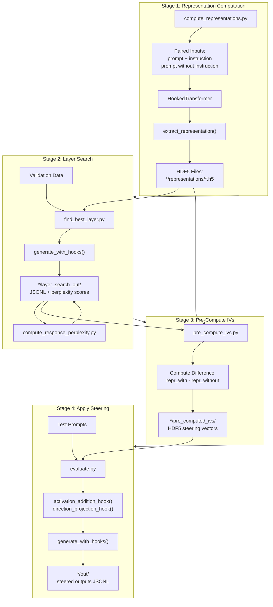
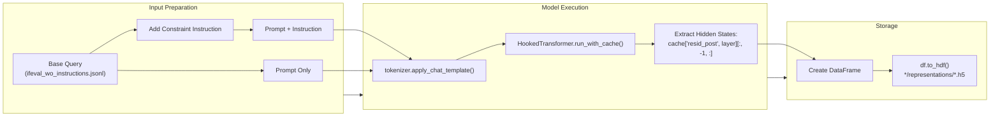
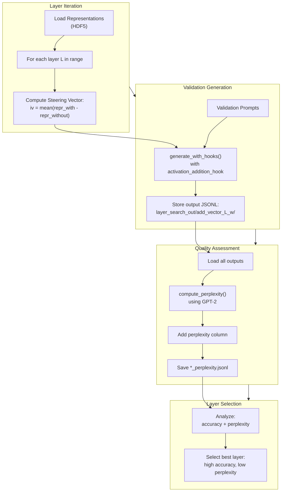
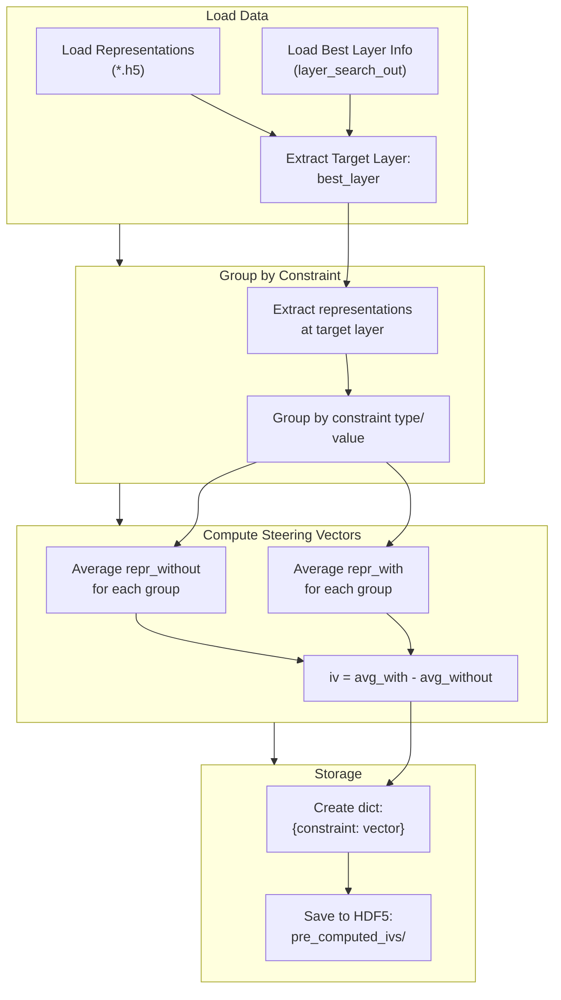
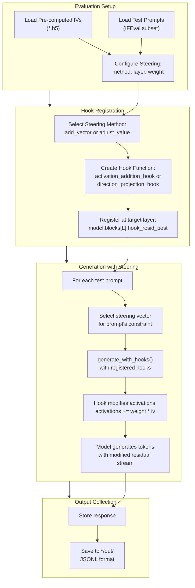
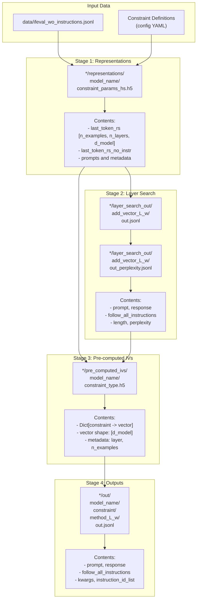
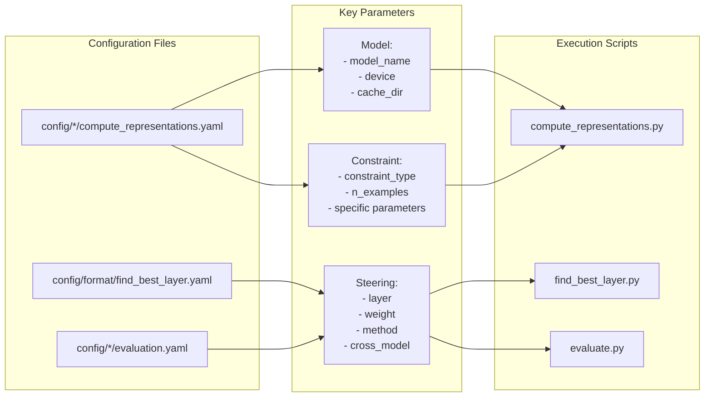

<!-- source: DeepWiki mcp.deepwiki.com · repo microsoft/llm-steer-instruct · page 4 Steering Vector Pipeline · fetched 2026-10-26 -->

# Steering Vector Pipeline

<details>
<summary>Relevant source files</summary>

The following files were used as context for generating this wiki page:

- [README.md](README.md)
- [config/keywords/compute_representations.yaml](config/keywords/compute_representations.yaml)
- [config/length/compute_representations.yaml](config/length/compute_representations.yaml)
- [ifeval_scripts/README.md](ifeval_scripts/README.md)
- [keywords/compute_representations.py](keywords/compute_representations.py)
- [keywords/compute_response_perplexity.py](keywords/compute_response_perplexity.py)
- [keywords/load_results.py](keywords/load_results.py)
- [length/compute_representations.py](length/compute_representations.py)

</details>


## Purpose and Scope

This document describes the complete pipeline for computing and applying steering vectors to improve instruction-following behavior in language models. The pipeline transforms paired inputs (with and without instructions) into steering vectors that can be injected into the model's residual stream during inference.

This page provides an overview of the entire pipeline and its stages. For detailed information about specific components:
- For model loading and generation utilities used by the pipeline, see [Infrastructure and Utilities](#3)
- For instruction-specific implementations (format, length, keywords), see [Instruction Type Modules](#5)
- For evaluation and metrics, see [Data and Evaluation](#6)

---

## Pipeline Overview

The steering vector pipeline consists of four main stages that transform instruction data into improved model behavior:

1. **Representation Computation**: Extract hidden states from paired inputs (with and without instructions)
2. **Layer Search and Optimization**: Identify optimal layers for steering using validation data
3. **Pre-Computing Instruction Vectors**: Compute steering vectors from representations and store for reuse
4. **Applying Steering During Inference**: Inject steering vectors into model residual stream via forward hooks



**Sources:** [README.md:60-82](), [README.md:84-92](), [README.md:95-106]()

---

## Stage-by-Stage Workflow

### Stage 1: Representation Computation

The first stage extracts hidden states from the model by running it on paired inputs. For each training example, the pipeline generates two representations:

| Input Type | Description | Example |
|------------|-------------|---------|
| **With Instruction** | Base prompt + constraint instruction | "What is Paris? Answer using 1 sentence." |
| **Without Instruction** | Base prompt only | "What is Paris?" |

The `compute_representations.py` script processes these pairs and stores the hidden states at each layer for the final token(s) of the input.

**Key Functions:**
- `load_model_from_tl_name()`: Loads model as `HookedTransformer` ([utils/model_utils.py]())
- `extract_representation()`: Extracts hidden states from specified token positions ([utils/generation_utils.py]())
- `generate()`: Generates output to verify instruction following ([utils/generation_utils.py]())

**Storage Format:**
Representations are stored as HDF5 files in the `*/representations/` directory with structure:
- `last_token_rs`: Array of shape `[n_layers, d_model]` containing hidden states
- `last_token_rs_no_instr`: Corresponding hidden states without instruction
- Metadata columns: `prompt_with_constraint`, `prompt_no_instr`, constraint parameters



**Configuration Parameters:**
- `model_name`: Model identifier (e.g., "phi-3", "gemma-2-9b-it")
- `n_examples`: Number of base queries to process
- `num_final_tokens`: Number of final tokens to extract (typically 1)
- `constraint_type`: Type of constraint (e.g., "sentences", "high-level", "include")

**Sources:** [length/compute_representations.py:1-131](), [keywords/compute_representations.py:1-124](), [config/length/compute_representations.yaml:1-19](), [config/keywords/compute_representations.yaml:1-21]()

---

### Stage 2: Layer Search and Optimization

The second stage identifies which layer(s) produce the most effective steering vectors. This is critical because different layers capture different types of information, and optimal steering layers vary by instruction type.

**Process:**
1. Load pre-computed representations from Stage 1
2. For each layer, compute steering vector as difference: `repr_with - repr_without`
3. Apply steering at each layer to validation data
4. Generate outputs and compute perplexity scores
5. Select best layer based on instruction adherence and quality metrics

**Scripts:**
- `find_best_layer.py`: Runs steering experiments across layers ([format/find_best_layer.py]())
- `compute_response_perplexity.py`: Computes GPT-2 perplexity as quality proxy ([keywords/compute_response_perplexity.py](), [format/compute_response_perplexity.py]())



**Validation Metrics:**

| Metric | Description | Purpose |
|--------|-------------|---------|
| `follow_all_instructions` | Boolean indicating instruction adherence | Primary success measure |
| `perplexity` | GPT-2 perplexity of response | Quality proxy (lower is better) |
| `length` | Token count of response | Secondary quality indicator |

**Layer Selection Strategy:**
The optimal layer balances instruction adherence with response quality. Typically:
- Lower layers: More semantic information, but may degrade quality
- Middle layers: Often optimal balance
- Upper layers: Better quality preservation, but weaker steering

**Sources:** [README.md:68-71](), [keywords/compute_response_perplexity.py:1-108](), [keywords/load_results.py:15-54]()

---

### Stage 3: Pre-Computing Instruction Vectors

Once the optimal layer is identified, Stage 3 computes the final steering vectors for efficient inference. This stage averages representations across multiple examples to create robust steering vectors.

**Computation:**
```
For each constraint c:
    repr_with = average of all representations with constraint c
    repr_without = average of all representations without constraint
    steering_vector[c] = repr_with - repr_without
```

**Script:** `pre_compute_ivs.py` ([format/pre_compute_ivs.py]())



**Storage Structure:**
Pre-computed steering vectors are stored in `*/pre_computed_ivs/` as HDF5 files with:
- Keys: Constraint identifiers (e.g., format types, sentence counts)
- Values: Steering vectors of shape `[d_model]`
- Metadata: Layer number, model name, number of examples averaged

**Benefits of Pre-Computation:**
1. **Efficiency**: Compute once, reuse for all test examples
2. **Consistency**: Same steering vector applied across experiments
3. **Scalability**: Fast inference without repeated representation extraction
4. **Composability**: Multiple vectors can be loaded and combined (see [Multi-Instruction Composition](#5.4))

**Sources:** [README.md:75-77]()

---

### Stage 4: Applying Steering During Inference

The final stage applies pre-computed steering vectors during model generation using forward hooks that modify the residual stream.

**Steering Methods:**

The system supports three steering methods controlled via configuration:

| Method | Function | Formula | Use Case |
|--------|----------|---------|----------|
| **No Steering** | Baseline | `activations` (unchanged) | Baseline comparison |
| **Activation Addition** | `activation_addition_hook` | `activations + weight * direction` | Standard steering, scales vector |
| **Direction Projection** | `direction_projection_hook` | Adjust projection onto `direction` | Fine-grained control of target value |



**Activation Addition Implementation:**
The `activation_addition_hook` function ([utils/generation_utils.py]()) modifies the residual stream:

```
def activation_addition_hook(activations, hook, direction, weight):
    """Add scaled steering vector to residual stream"""
    return activations + weight * direction
```

**Direction Projection Implementation:**
The `direction_projection_hook` function adjusts the component along the steering direction to a target value:

```
def direction_projection_hook(activations, hook, direction, target_value):
    """Adjust projection onto direction to target value"""
    current_proj = (activations @ direction) / (direction @ direction)
    adjustment = (target_value - current_proj) * direction
    return activations + adjustment
```

**Cross-Model Experiments:**
The pipeline supports transferring steering vectors from instruction-tuned models to base models:
- Set `cross_model: true` in configuration
- Compute representations using instruction-tuned model (e.g., "gemma-2-9b-it")
- Apply to base model during evaluation (e.g., "gemma-2-9b")

**Sources:** [README.md:78-81](), [keywords/load_results.py:15-54]()

---

## Data Flow and Artifacts

The pipeline creates a series of intermediate artifacts that enable caching and reproducibility:



**Artifact Details:**

| Artifact | Location | Format | Key Fields | Size Considerations |
|----------|----------|--------|------------|---------------------|
| Representations | `*/representations/` | HDF5 | `last_token_rs`, `last_token_rs_no_instr` | Large (GB scale for many examples) |
| Layer Search | `*/layer_search_out/` | JSONL | `follow_all_instructions`, `perplexity` | Medium (MB scale) |
| Pre-computed IVs | `*/pre_computed_ivs/` | HDF5 | Dict of steering vectors | Small (MB scale) |
| Final Outputs | `*/out/` | JSONL | `response`, `follow_all_instructions` | Medium (MB scale) |

**Caching Strategy:**
The HDF5-based storage enables efficient caching:
- Representations can be reused across multiple layer search runs
- Pre-computed IVs enable fast evaluation without recomputing
- Old versions preserved in `*_old/` directories for comparison

**Sources:** [README.md:16-48](), [length/compute_representations.py:115-126](), [keywords/compute_representations.py:112-119]()

---

## Module-Specific Variations

While all instruction types follow the four-stage pipeline, they differ in implementation details:

### Format Instructions (5-Stage Pipeline)

The format module implements all four stages with an explicit layer search stage:
1. `compute_representations.py` - Extract representations
2. `find_best_layer.py` - Search for optimal layer
3. `compute_response_perplexity.py` - Add quality metrics
4. `pre_compute_ivs.py` - Pre-compute steering vectors
5. `evaluate.py` - Apply steering and evaluate

**Sources:** [README.md:62-82]()

### Length Instructions (2-Stage Pipeline)

The length module simplifies the pipeline by computing steering vectors on-the-fly:
1. `compute_representations.py` - Extract representations
2. `evaluate.py` - Compute and apply steering vectors during evaluation

No explicit layer search or pre-computation stage. Steering vectors are computed from representations at evaluation time.

**Sources:** [README.md:84-92](), [length/compute_representations.py:1-131]()

### Keyword Instructions (3-Stage Pipeline)

The keywords module includes layer search but skips pre-computation:
1. `compute_representations.py` - Extract representations for keyword constraints
2. `compute_response_perplexity.py` - Compute quality metrics
3. `evaluate.py` - Compute and apply steering vectors during evaluation

**Sources:** [README.md:95-106](), [keywords/compute_representations.py:1-124](), [keywords/compute_response_perplexity.py:1-108]()

### Multi-Instruction Composition

The composition module combines pre-computed steering vectors from multiple instruction types:
- Loads format steering vectors from `format/pre_computed_ivs/`
- Loads length representations from `length/representations/`
- Computes length steering vectors on-the-fly
- Applies both vectors simultaneously at different layers

See [Multi-Instruction Composition](#5.4) for details.

**Sources:** [README.md:109-114]()

---

## Configuration and Execution

Each stage is configured via Hydra YAML files in the `config/` directory:



**Common Configuration Parameters:**

| Parameter | Stage | Description | Example Values |
|-----------|-------|-------------|----------------|
| `model_name` | All | Model identifier | "phi-3", "gemma-2-9b-it" |
| `device` | All | Computation device | "cuda", "cpu" |
| `n_examples` | 1 | Number of training examples | 50, 100, 500 |
| `num_final_tokens` | 1 | Tokens to extract representations from | 1 (typical) |
| `layer` | 2,4 | Target steering layer | 15, 20, 26 |
| `weight` | 2,4 | Steering strength multiplier | 10, 20, 40 |
| `cross_model` | 4 | Enable cross-model transfer | true, false |

**Execution Example:**
```bash
# Stage 1: Compute representations
python format/compute_representations.py

# Stage 2: Find best layer
python format/find_best_layer.py

# Stage 3: Compute perplexity
python format/compute_response_perplexity.py

# Stage 4: Pre-compute IVs
python format/pre_compute_ivs.py

# Stage 5: Evaluate
python format/evaluate.py
```

**Sources:** [config/keywords/compute_representations.yaml:1-21](), [config/length/compute_representations.yaml:1-19](), [README.md:60-115]()

---

