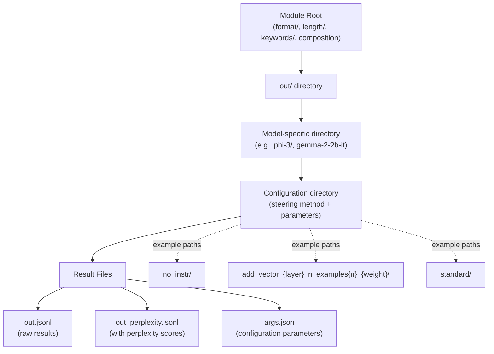
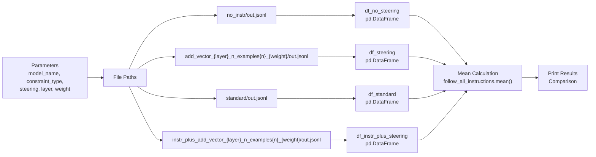
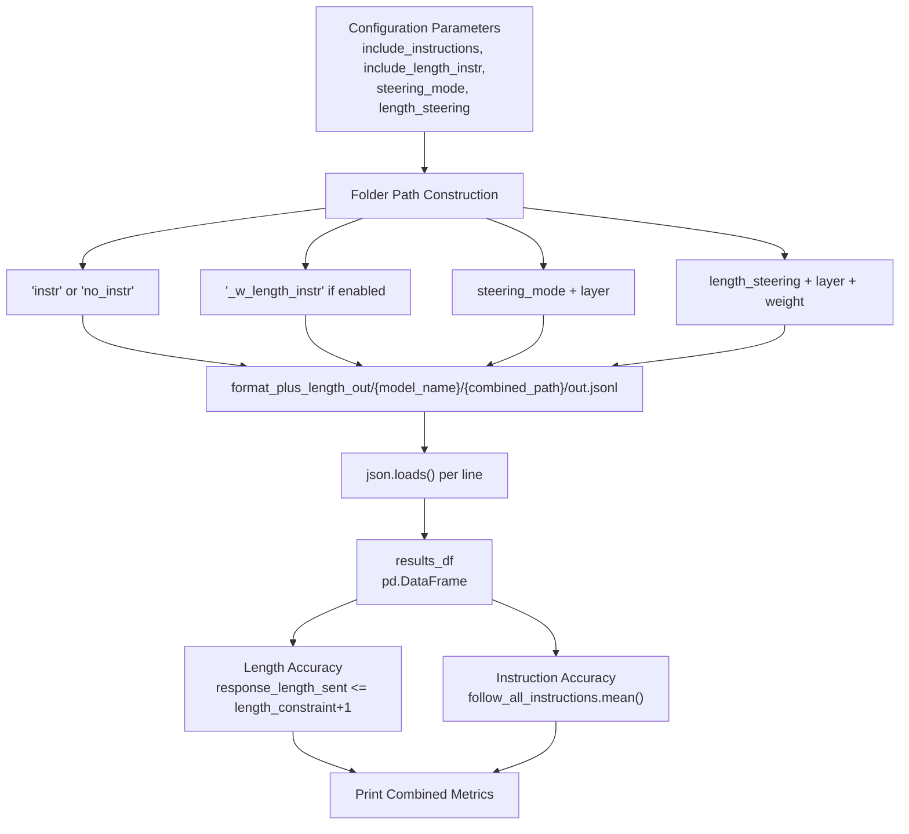
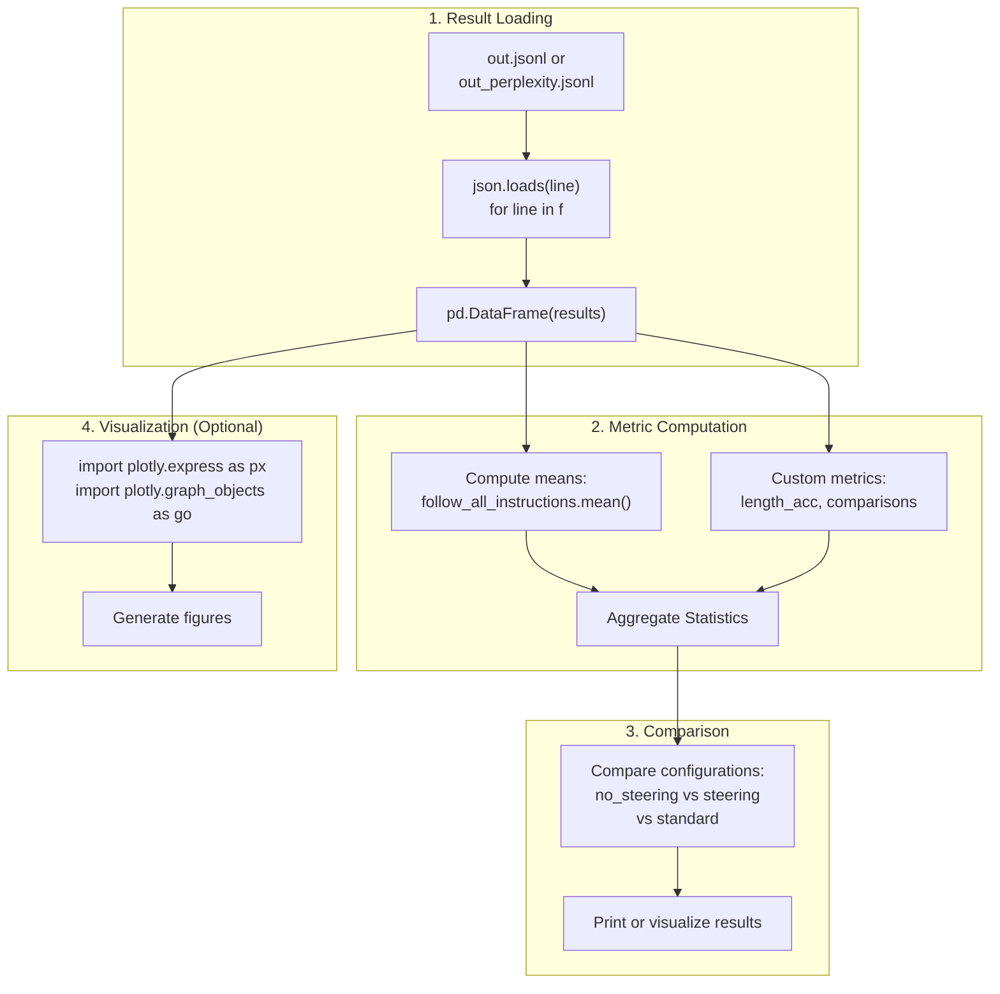

<!-- source: DeepWiki mcp.deepwiki.com · repo microsoft/llm-steer-instruct · page 6.3 Results Analysis and Metrics · fetched 2026-10-26 -->

# Results Analysis and Metrics

<details>
<summary>Relevant source files</summary>

The following files were used as context for generating this wiki page:

- [composition/evaluate_format_plus_length.py](composition/evaluate_format_plus_length.py)
- [composition/load_results.py](composition/load_results.py)
- [config/composition/evaluation.yaml](config/composition/evaluation.yaml)
- [config/keywords/compute_representations.yaml](config/keywords/compute_representations.yaml)
- [config/length/compute_representations.yaml](config/length/compute_representations.yaml)
- [keywords/compute_representations.py](keywords/compute_representations.py)
- [keywords/compute_response_perplexity.py](keywords/compute_response_perplexity.py)
- [keywords/load_results.py](keywords/load_results.py)
- [length/compute_representations.py](length/compute_representations.py)
- [requirements.txt](requirements.txt)

</details>


This page documents the results analysis infrastructure used to evaluate activation steering experiments. It covers the `load_results.py` scripts, the metrics computed during and after evaluation, and the analysis workflow for comparing different configurations. For information about the IFEval evaluation framework itself, see [IFEval Framework Integration](#6.2). For perplexity computation details, see [Perplexity-Based Quality Assessment](#6.4).

## Purpose and Scope

After running experiments that generate model outputs (see [Steering Vector Pipeline](#4) and [Instruction Type Modules](#5)), the system provides utilities to:
- Load results from JSONL output files
- Compute and aggregate performance metrics
- Compare different steering configurations
- Analyze length and accuracy trade-offs
- Visualize results using plotly

## Results File Structure

Each experiment produces output files stored in module-specific directory hierarchies. The outputs are stored as JSONL (JSON Lines) files where each line represents one example's results.

### Output Directory Organization



**Sources:** [keywords/load_results.py:15-23](), [composition/load_results.py:23-41](), [composition/evaluate_format_plus_length.py:189-212]()

### JSONL Record Structure

Each line in the output JSONL files contains a dictionary with the following fields:

| Field | Type | Description | Source |
|-------|------|-------------|--------|
| `prompt` | string | Original prompt with instruction | Input data |
| `prompt_without_instruction` | string | Base query without constraint | Input data |
| `response` | string | Model-generated output | Generation |
| `follow_all_instructions` | boolean | Whether all instructions were followed | IFEval |
| `response_length_sent` | integer | Number of sentences in response | nltk.sent_tokenize |
| `response_length_words` | integer | Number of words in response | split() |
| `length_constraint` | integer | Target length constraint (if applicable) | Input data |
| `perplexity` | float | GPT-2 perplexity score (if computed) | Perplexity computation |
| `length` | integer | Token count (if computed) | Tokenizer |
| `instruction_id_list_for_eval` | list | Instruction IDs for evaluation | Input data |

**Sources:** [composition/evaluate_format_plus_length.py:173-183](), [keywords/compute_response_perplexity.py:87-98]()

## Results Loading Infrastructure

Each instruction module provides a `load_results.py` script that loads experiment outputs and computes aggregate metrics. These scripts use pandas DataFrames for analysis.

### Keywords Module Load Results

The keywords module's loader supports comparing four configurations:



**Sources:** [keywords/load_results.py:1-56]()

The script workflow:
1. Define experiment parameters (model, constraint type, steering method, layer, weight)
2. Construct file paths based on directory structure [keywords/load_results.py:15-48]()
3. Load each JSONL file into a pandas DataFrame [keywords/load_results.py:24-48]()
4. Compute mean metrics for comparison [keywords/load_results.py:50-53]()

### Composition Module Load Results

The composition module's loader handles combined format and length steering:



**Sources:** [composition/load_results.py:1-52]()

Key differences from keywords loader:
- More complex folder path construction [composition/load_results.py:23-39]()
- Computes custom length accuracy metric [composition/load_results.py:47]()
- Handles dual steering parameters (format + length) [composition/load_results.py:16-21]()

## Core Metrics

### Instruction Following Accuracy

The primary metric for evaluating steering effectiveness is `follow_all_instructions`, computed by the IFEval framework.

**Computation:**
```python
# Called during evaluation (from composition/evaluate_format_plus_length.py:175-179)
from ifeval_scripts.evaluation_main import test_instruction_following_loose

prompt_to_response = {row['prompt']: row['response']}
output = test_instruction_following_loose(r, prompt_to_response)
row['follow_all_instructions'] = output.follow_all_instructions
```

This boolean metric indicates whether the model's response satisfies all specified constraints. The IFEval framework performs constraint-specific validation. See [IFEval Framework Integration](#6.2) for details.

**Sources:** [composition/evaluate_format_plus_length.py:175-179]()

### Response Length Metrics

Two length metrics are computed for each response:

**Sentence Count:**
```python
# From composition/evaluate_format_plus_length.py:182
import nltk
row['response_length_sent'] = len(nltk.sent_tokenize(row['response']))
```

**Word Count:**
```python
# From composition/evaluate_format_plus_length.py:183
row['response_length_words'] = len(row['response'].split())
```

**Length Accuracy:**
For length constraint experiments, custom accuracy is computed:
```python
# From composition/load_results.py:47
length_acc = results_df.response_length_sent <= results_df.length_constraint + 1
```

**Sources:** [composition/evaluate_format_plus_length.py:182-183](), [composition/load_results.py:47]()

### Token-Based Metrics

When perplexity is computed, token length is also recorded:

```python
# From keywords/compute_response_perplexity.py:89-90
tokens = tokenizer.tokenize(response)
lengths.append(len(tokens))
```

**Sources:** [keywords/compute_response_perplexity.py:87-100]()

## Analysis Workflow

### Standard Analysis Pipeline



**Sources:** [keywords/load_results.py:24-53](), [composition/load_results.py:41-49]()

### Multi-Configuration Comparison

The typical analysis workflow compares multiple experimental conditions:

**Example from Keywords Module:**
```python
# Load and compare four configurations
df_no_steering       # Baseline without instructions
df_steering          # Steering only
df_standard          # Standard prompting with instructions
df_instr_plus_steering  # Instructions + steering combined

# Print comparison
print(f'No steering: {df_no_steering.follow_all_instructions.mean()}')
print(f'Steering: {df_steering.follow_all_instructions.mean()}')
print(f'Standard: {df_standard.follow_all_instructions.mean()}')
print(f'Instr + steering: {df_instr_plus_steering.follow_all_instructions.mean()}')
```

**Sources:** [keywords/load_results.py:27-53]()

### Parameter Sweep Analysis

For layer search and weight tuning, results across multiple parameter values can be loaded:

```python
# From keywords/compute_response_perplexity.py:26-50
result_dict = {}
paths_dict = {}
for subfolder in subfolders:
    if subfolder == 'no_instr':
        layer = -1
        weight = -1
    else:
        layer = subfolder.split('_')[4]
        weight = subfolder.split('_')[-1]
    
    # Load results
    results_df = pd.DataFrame(results)
    result_dict[(int(layer), int(weight))] = results_df
```

This enables analysis across hyperparameter grids to identify optimal configurations.

**Sources:** [keywords/compute_response_perplexity.py:20-50]()

## Folder Naming Conventions

Understanding the folder naming scheme is crucial for loading results:

### Keywords Module

```
out/{model_name}/{constraint_type}/{steering_mode}/out.jsonl
```

Examples:
- `out/phi-3/existence/no_instr/out.jsonl` - No steering baseline
- `out/phi-3/existence/add_vector_26_n_examples7_40/out.jsonl` - Add vector at layer 26, weight 40
- `out/phi-3/existence/standard/out.jsonl` - Standard prompting

**Sources:** [keywords/load_results.py:15-40]()

### Composition Module

```
format_plus_length_out/{model_name}/{instr_flag}/{steering_flag}_{length_flag}/out.jsonl
```

Components:
- `instr_flag`: `instr` or `no_instr` (with optional `_w_length_instr`)
- `steering_flag`: `{steering_mode}_{layer}` (with optional `_perplexity`)
- `length_flag`: `{length_steering}_L{layer}_w{weight}` or `no_length_steering`

Example:
```
format_plus_length_out/phi-3/no_instr/adjust_rs_-1_perplexity_conciseness_L12_w40/out.jsonl
```

**Sources:** [composition/load_results.py:23-41](), [composition/evaluate_format_plus_length.py:189-210]()

## Visualization Capabilities

The system imports plotly for visualization, though specific plotting code is implemented per experiment:

```python
# From keywords/load_results.py:5-6
import plotly.express as px
import plotly.graph_objects as go
```

Typical visualizations include:
- Accuracy vs. steering weight curves
- Layer performance comparisons
- Length distribution histograms
- Perplexity vs. accuracy scatter plots

**Sources:** [keywords/load_results.py:5-6](), [requirements.txt:9]()

## Metrics Summary Table

| Metric | Type | Computation | Module | Purpose |
|--------|------|-------------|--------|---------|
| `follow_all_instructions` | boolean | IFEval framework | All | Primary accuracy metric |
| `response_length_sent` | integer | `len(nltk.sent_tokenize())` | Composition, Length | Sentence count |
| `response_length_words` | integer | `len(response.split())` | Composition | Word count |
| `length` | integer | `len(tokenizer.tokenize())` | Keywords (with perplexity) | Token count |
| `perplexity` | float | `compute_perplexity()` with GPT-2 | Keywords, Format | Quality proxy (see [6.4](#6.4)) |
| `length_acc` | boolean | `response_length_sent <= constraint + 1` | Composition | Length constraint satisfaction |

## Configuration Storage

Each experiment stores its configuration alongside results:

```python
# From composition/evaluate_format_plus_length.py:214-216
with open(f'{folder}/args.json', 'w') as f:
    f.write(OmegaConf.to_yaml(args))
```

This ensures reproducibility by recording:
- Model name and parameters
- Steering configuration (method, layer, weight)
- Data paths and constraints
- Generation parameters

**Sources:** [composition/evaluate_format_plus_length.py:214-216]()

## Dependencies

The results analysis infrastructure relies on:

- **pandas** (v2.2.3): DataFrame-based analysis [requirements.txt:8]()
- **plotly** (v5.22.0): Visualization [requirements.txt:9]()
- **nltk** (v3.8.1): Sentence tokenization [requirements.txt:5]()
- **numpy** (v2.2.4): Numerical operations [requirements.txt:6]()

**Sources:** [requirements.txt:5-9]()

---

