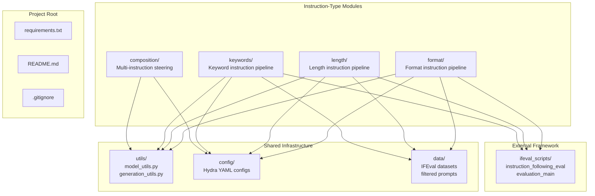
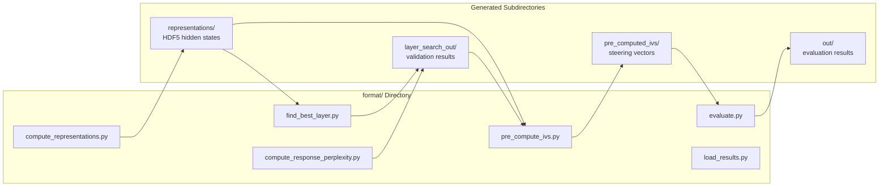
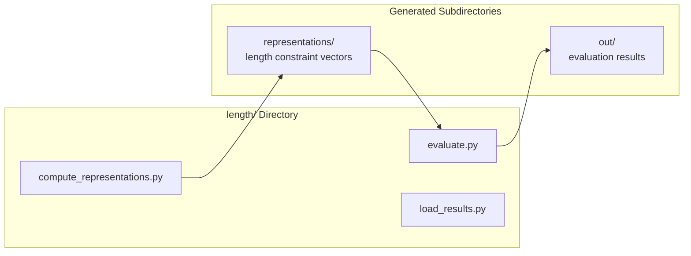
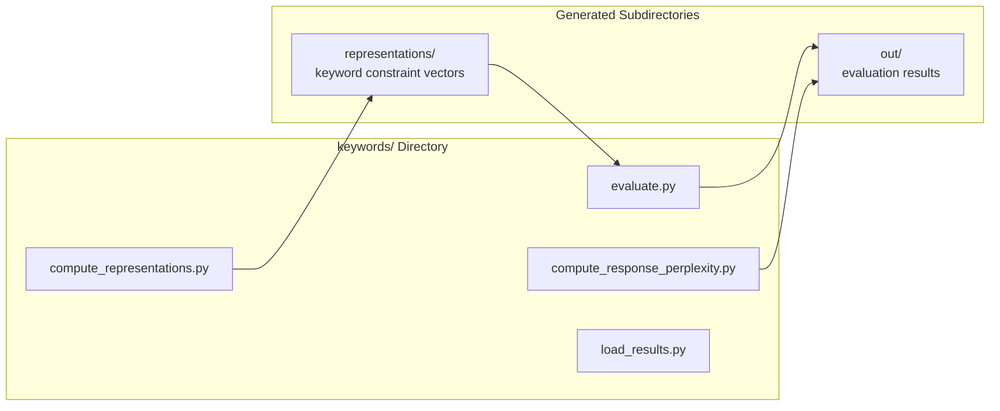
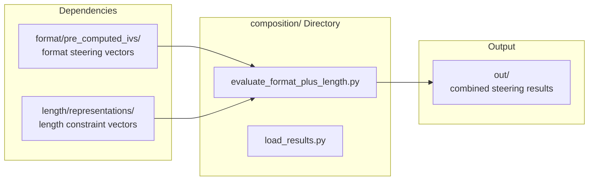
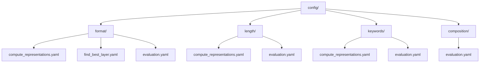
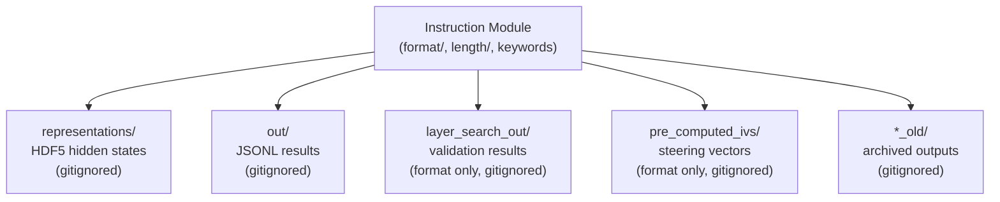

<!-- source: DeepWiki mcp.deepwiki.com · repo microsoft/llm-steer-instruct · page 8.1 Directory Organization · fetched 2026-10-26 -->

# Directory Organization

Relevant source files

The following files were used as context for generating this wiki page:

- [.gitignore](.gitignore)
- [README.md](README.md)
- [ifeval_scripts/README.md](ifeval_scripts/README.md)

## Purpose and Scope

This document explains the modular directory structure of the llm-steer-instruct repository, focusing on the organization of source code, configuration files, and data directories. The repository follows a modular design where each instruction type (format, length, keywords) has its own dedicated directory containing a complete pipeline implementation. For information about the output artifacts and caching strategies within these directories, see [Output Artifacts and Caching](#8.2).

---

## Top-Level Directory Structure

The repository is organized around a clear separation between instruction-type modules, shared infrastructure, and external dependencies. Each top-level directory serves a specific purpose in the activation steering pipeline.

### High-Level Organization

**Sources:** [README.md:22-48]()

### Directory Structure Table

| Directory | Purpose | Key Contents |
|-----------|---------|--------------|
| `format/` | Format instruction pipeline | Complete 5-stage pipeline for detectable_format constraints |
| `length/` | Length instruction pipeline | 2-stage pipeline for length_constraints |
| `keywords/` | Keyword instruction pipeline | 3-stage pipeline for forbidden_words and keyword_frequency |
| `composition/` | Multi-instruction steering | Scripts for combining format and length steering |
| `utils/` | Shared infrastructure | `model_utils.py`, `generation_utils.py` |
| `config/` | Hydra configuration | YAML files organized by module |
| `data/` | Dataset files | IFEval data, filtered prompts, keyword lists |
| `ifeval_scripts/` | External evaluation framework | Official IFEval evaluation code |

**Sources:** [README.md:22-48]()

---

## Instruction-Type Module Directories

Each instruction-type module follows a consistent pattern with variations based on the complexity of the instruction type. The `format/` directory contains the most complete pipeline, while `length/` and `keywords/` have simplified versions.

### Format Instructions Module (`format/`)

The format directory implements the complete 5-stage pipeline for handling detectable_format constraints (JSON, bullets, sections, etc.).

**Pipeline Stages:**

1. **`compute_representations.py`** - Extracts hidden states from paired inputs (with/without instructions) and stores in `representations/`
2. **`find_best_layer.py`** - Performs layer search on validation data, outputs to `layer_search_out/`
3. **`compute_response_perplexity.py`** - Adds perplexity scores to validation results using GPT-2
4. **`pre_compute_ivs.py`** - Computes optimal steering vectors and stores in `pre_computed_ivs/`
5. **`evaluate.py`** - Applies steering during evaluation and saves results to `out/`
6. **`load_results.py`** - Post-processing and metrics calculation (see [Results Analysis and Metrics](#6.3))

**Sources:** [README.md:62-82](), [README.md:25-31]()

### Length Instructions Module (`length/`)

The length directory has a simplified 2-stage pipeline since length constraints don't require layer search optimization.

**Pipeline Stages:**

1. **`compute_representations.py`** - Computes representations for length constraints (sentences, words, paragraphs)
2. **`evaluate.py`** - Applies steering during generation and evaluates against IFEval
3. **`load_results.py`** - Analysis of results

**Sources:** [README.md:84-92](), [README.md:32-36]()

### Keywords Instructions Module (`keywords/`)

The keywords directory implements a 3-stage pipeline for word inclusion/exclusion constraints.

**Pipeline Stages:**

1. **`compute_representations.py`** - Computes representations for keyword constraints using base queries from `data/ifeval_wo_instructions.jsonl`
2. **`compute_response_perplexity.py`** - Adds perplexity scores to validation results
3. **`evaluate.py`** - Evaluates keyword inclusion/exclusion with configurable `specific_constraint` parameter
4. **`load_results.py`** - Results analysis

**Sources:** [README.md:95-107](), [README.md:32-36]()

### Composition Module (`composition/`)

The composition directory contains scripts for multi-instruction steering experiments.

**Key Scripts:**

- **`evaluate_format_plus_length.py`** - Applies both format and length steering simultaneously by combining vectors from both modules
- **`load_results.py`** - Analysis of multi-instruction results

**Sources:** [README.md:109-114](), [README.md:41-43]()

---

## Shared Infrastructure Directories

### Utils Directory (`utils/`)

Contains core shared utilities used across all instruction-type modules. See [Infrastructure and Utilities](#3) for detailed documentation of these components.

**Key Files:**
- `model_utils.py` - Model loading functions (`load_model_from_tl_name`)
- `generation_utils.py` - Generation functions with steering hooks (`generate`, `generate_with_hooks`, `activation_addition_hook`, `direction_projection_hook`)

**Sources:** [README.md:44]()

### Config Directory (`config/`)

Organized hierarchically by module, containing Hydra YAML configuration files.

**Configuration Structure:**

| Module | Config Files | Purpose |
|--------|--------------|---------|
| `config/format/` | `compute_representations.yaml`, `find_best_layer.yaml`, `evaluation.yaml` | Controls all 5 pipeline stages |
| `config/length/` | `compute_representations.yaml`, `evaluation.yaml` | Length constraint parameters |
| `config/keywords/` | `compute_representations.yaml`, `evaluation.yaml` | Keyword constraint parameters |
| `config/composition/` | `evaluation.yaml` | Multi-instruction steering parameters |

For details on configuration management, see [Configuration Management with Hydra](#3.3).

**Sources:** [README.md:18](), [README.md:66-81]()

### Data Directory (`data/`)

Contains IFEval dataset files and derived data products.

**Key Data Files:**
- Base IFEval dataset files
- `all_base_x_all_instructions_filtered.jsonl` - Filtered prompts with instruction metadata (see [Prompt Transformation System](#2.3))
- `ifeval_wo_instructions.jsonl` - Base queries without instructions
- `ifeval_keywords_*.txt` - Keyword lists for inclusion/exclusion experiments

**Sources:** [README.md:99]()

### IFEval Scripts Directory (`ifeval_scripts/`)

Contains the official IFEval evaluation framework from Google Research.

**Key Component:**
- `evaluation_main` - Entry point for instruction-following evaluation

This external framework is invoked by the evaluation scripts in each instruction-type module to compute standardized metrics. See [IFEval Framework Integration](#6.2) for usage details.

**Sources:** [ifeval_scripts/README.md:1-44](), [README.md:18]()

---

## Generated Output Directories

Each instruction-type module creates subdirectories for intermediate and final outputs. These directories are excluded from version control via `.gitignore`.

### Output Directory Pattern

### Gitignored Directories

The following directories are generated during execution and excluded from version control:

| Pattern | Purpose | Location |
|---------|---------|----------|
| `*/representations/` | Stores HDF5 files containing hidden states | `format/`, `length/`, `keywords/` |
| `*/out/` | Stores JSONL evaluation results | All modules |
| `*/layer_search_out/` | Stores layer search validation results | `format/` only |
| `*/pre_computed_ivs/` | Stores pre-computed steering vectors | `format/` only |
| `*/representations_old/` | Archived representations | All modules with representations |
| `*/out_old/` | Archived outputs | All modules |
| `*/layer_search_out_old/` | Archived layer search results | `format/` only |

**Sources:** [.gitignore:1-16]()

### Additional Ignored Items

- `stored_hs/` - Legacy storage location for hidden states
- `__pycache__/` - Python bytecode cache
- `*.pyc` - Compiled Python files
- `hf_token.txt` - HuggingFace authentication token

**Sources:** [.gitignore:1-16]()

---

## Directory Organization Principles

The repository follows several organizational principles that make the codebase maintainable and extensible:

### 1. Modular by Instruction Type

Each instruction type is self-contained in its own directory with a complete pipeline implementation. This allows:
- Independent development of each instruction type
- Easy addition of new instruction types by following the established pattern
- Clear separation of concerns

### 2. Consistent Naming Conventions

Script names are consistent across modules:
- `compute_representations.py` - Always the first stage
- `evaluate.py` - Always the final evaluation stage
- `load_results.py` - Always the post-processing stage

### 3. Configuration Co-location

Each module has its configuration files in `config/{module}/`, mirroring the source directory structure. This makes it easy to find the configuration for any script.

### 4. Shared Infrastructure Separation

Common utilities (`utils/`) are factored out to avoid duplication, while module-specific code remains in module directories.

### 5. External Dependency Isolation

The external IFEval framework is kept in its own directory (`ifeval_scripts/`) without modification, making it easy to update from upstream.

### 6. Output Directory Generation

Output directories are created automatically during execution and excluded from version control, keeping the repository clean while preserving the ability to version control analysis scripts.

**Sources:** [README.md:16-48]()

---

