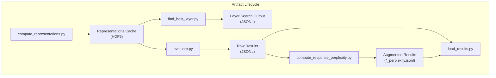
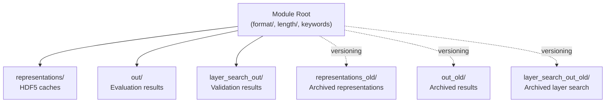
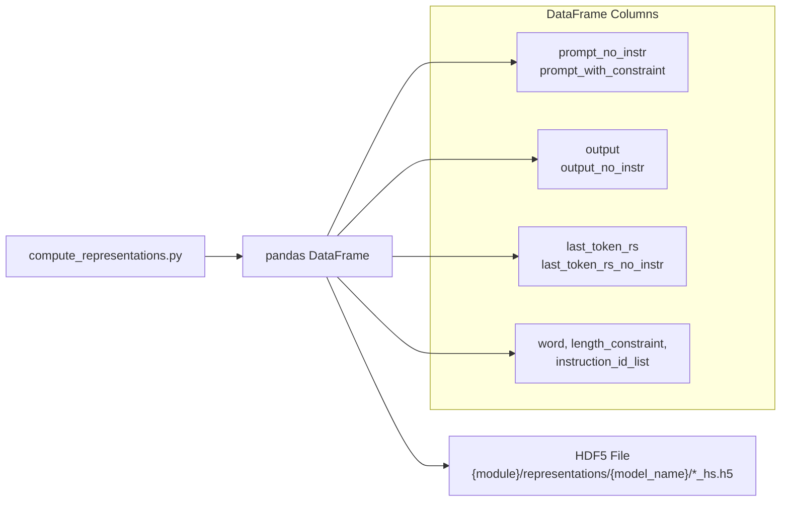
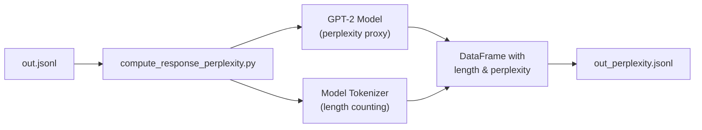
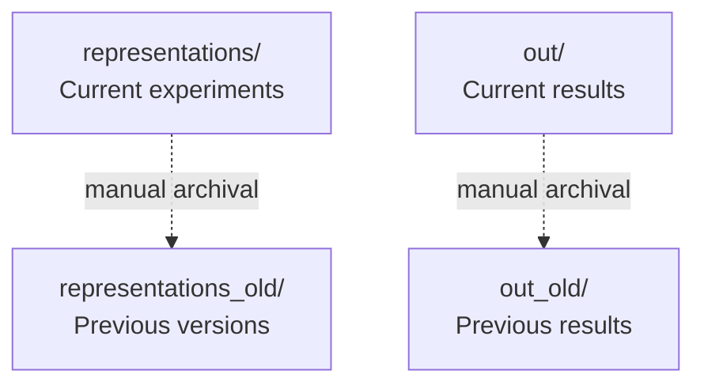
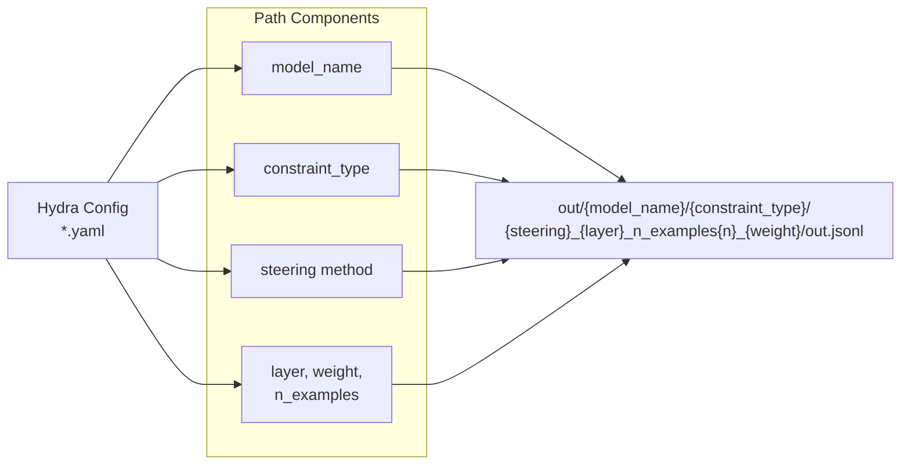
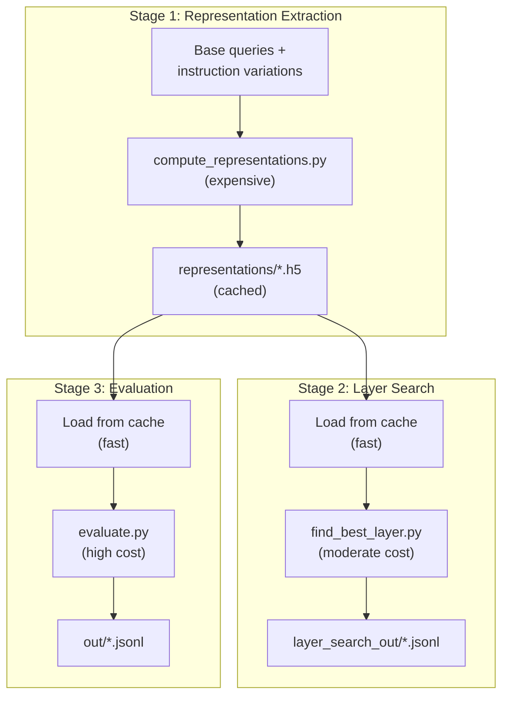

<!-- source: DeepWiki mcp.deepwiki.com · repo microsoft/llm-steer-instruct · page 8.2 Output Artifacts and Caching · fetched 2026-10-26 -->

# Output Artifacts and Caching

<details>
<summary>Relevant source files</summary>

The following files were used as context for generating this wiki page:

- [.gitignore](.gitignore)
- [config/keywords/compute_representations.yaml](config/keywords/compute_representations.yaml)
- [config/length/compute_representations.yaml](config/length/compute_representations.yaml)
- [keywords/compute_representations.py](keywords/compute_representations.py)
- [keywords/compute_response_perplexity.py](keywords/compute_response_perplexity.py)
- [keywords/load_results.py](keywords/load_results.py)
- [length/compute_representations.py](length/compute_representations.py)

</details>


This document describes the output artifact management and caching strategies used throughout the llm-steer-instruct codebase. It covers the directory structure for storing intermediate and final results, the HDF5-based caching mechanism for representations, JSONL output formats, and version management practices.

For information about how these artifacts are analyzed and visualized, see [Results Analysis and Metrics](#6.3). For details on the steering vector pipeline that generates these artifacts, see [Steering Vector Pipeline](#4).

## Overview

The codebase implements a comprehensive caching and artifact management system designed to avoid redundant computation of expensive operations (primarily model inference for representation extraction). The system uses:

- **HDF5 files** for caching intermediate representations (hidden states)
- **JSONL files** for storing evaluation results and metrics
- **Hierarchical directory structures** organized by model, constraint type, and hyperparameters
- **Version management directories** (`_old` suffix) for maintaining historical results



**Sources:** [.gitignore:1-16](), [keywords/load_results.py:1-56](), [length/compute_representations.py:1-131]()

## Directory Structure

Each instruction type module (`format/`, `length/`, `keywords/`, `composition/`) maintains three primary output directories that are gitignored to avoid committing large binary artifacts.



### Directory Hierarchy

| Directory | Purpose | Format | Gitignored |
|-----------|---------|--------|------------|
| `*/representations/` | Cached hidden states from paired inputs | HDF5 | Yes |
| `*/out/` | Evaluation results with metrics | JSONL | Yes |
| `*/layer_search_out/` | Layer optimization results | JSONL + args.json | Yes |
| `*/representations_old/` | Archived representation files | HDF5 | Yes |
| `*/out_old/` | Archived evaluation results | JSONL | Yes |
| `*/layer_search_out_old/` | Archived layer search results | JSONL | Yes |
| `stored_hs/` | Legacy storage location | HDF5 | Yes |

**Sources:** [.gitignore:1-16]()

## Representation Caching with HDF5

Representations (hidden states) are the most computationally expensive artifacts to generate, as they require full model inference on paired inputs (with and without instructions). The system uses HDF5 files via pandas DataFrame serialization to cache these representations for reuse across experiments.

### HDF5 File Structure



### Storage Format

Representations are stored as pandas DataFrames with the following key columns:

| Column | Type | Description |
|--------|------|-------------|
| `prompt_no_instr` | str | Base query without instruction |
| `prompt_with_constraint` | str | Query with instruction appended |
| `output` | str | Model output with instruction |
| `output_no_instr` | str | Model output without instruction |
| `last_token_rs` | array | Hidden states (last tokens) with instruction |
| `last_token_rs_no_instr` | array | Hidden states (last tokens) without instruction |
| `word` / `length_constraint` | varies | Constraint-specific metadata |

### File Naming Conventions

The file naming follows predictable patterns that encode experimental parameters:

**Length Module:**
- Sentences: `{model_name}/{n_sent_max}sentences_{n_examples}examples_hs.h5`
- High-level: `{model_name}/high_level_{n_examples}examples_hs.h5`

**Keywords Module:**
- `{model_name}/{constraint_type}_{keyword_set}_{n_examples}examples_hs.h5`
- Example: `phi-3/include_ifeval_include_1examples_hs.h5`

**Format Module:**
- Similar patterns specific to format constraints

### Writing HDF5 Files

```python
# From length/compute_representations.py:116-126
folder = f'{script_dir}/representations/{model_name}'
os.makedirs(folder, exist_ok=True)

if args.constraint_type == 'sentences':
    out_file = f'{folder}/{args.n_sent_max}sentences_{args.n_examples}examples_hs.h5'
elif args.constraint_type == 'high-level':
    out_file = f'{folder}/high_level_{args.n_examples}examples_hs.h5'

df.to_hdf(out_file, key='df', mode='w')
```

### Reading HDF5 Files

HDF5 files are read back using pandas `read_hdf()` in downstream scripts like `find_best_layer.py` and `evaluate.py`:

```python
# Typical reading pattern
df = pd.read_hdf(representations_file, key='df')
```

**Sources:** [length/compute_representations.py:115-127](), [keywords/compute_representations.py:113-119]()

## Output Results Format (JSONL)

Evaluation results are stored in JSONL (JSON Lines) format, where each line is a complete JSON object representing one test example's results. This format is chosen for its ease of incremental writing and line-by-line reading.

### Directory Structure for Results

Results are organized in a hierarchical directory structure encoding experimental parameters:

```
{module}/out/{model_name}/{constraint_type}/{steering_config}/out.jsonl
```

For example:
```
keywords/out/phi-3/existence/add_vector_26_n_examples7_40/out.jsonl
keywords/out/phi-3/existence/no_instr/out.jsonl
keywords/out/phi-3/existence/standard/out.jsonl
```

### JSONL Record Structure

Each line in `out.jsonl` contains a JSON object with evaluation results:

```json
{
  "prompt": "original prompt text",
  "response": "model generated response",
  "follow_all_instructions": true,
  "instruction_id_list": ["detectable_format:json_format"],
  "kwargs": [{"num_placeholders": 3}],
  ...additional constraint-specific fields
}
```

### Loading Results

The `load_results.py` scripts demonstrate the standard pattern for loading JSONL results:

```python
# From keywords/load_results.py:23-26
file = f'{folder}/{model_name}/{constraint_type}/{steering}_{layer}_n_examples{n_examples}_{weight}/out.jsonl'
with open(file, 'r') as f:
    results = [json.loads(line) for line in f]

df_steering = pd.DataFrame(results)
```

This pattern is used to:
1. Load results from multiple experimental conditions
2. Compare different steering configurations
3. Compute aggregate metrics like mean accuracy

**Sources:** [keywords/load_results.py:14-54]()

## Perplexity Augmentation

After initial evaluation, results can be augmented with perplexity scores and response length metrics. This creates an extended version of the results file with the suffix `_perplexity.jsonl`.



### Augmentation Process

The `compute_response_perplexity.py` script:

1. Loads existing `out.jsonl` files from validation directories
2. Computes perplexity using GPT-2 for each response
3. Computes response length using the model's tokenizer
4. Adds `length` and `perplexity` columns to the DataFrame
5. Saves the augmented results with `_perplexity.jsonl` suffix

```python
# From keywords/compute_response_perplexity.py:79-105
for key, value in list(result_dict.items()):
    # Check if already computed
    if 'perplexity' in value.columns:
        continue
    
    lengths = []
    perplexities = []
    for i, row in value.iterrows():
        response = row['response']
        tokens = tokenizer.tokenize(response)
        lengths.append(len(tokens))
        perplexities.append(compute_perplexity(response, device, perplexity_model, perplexity_tokenizer))
    
    value['length'] = lengths
    value['perplexity'] = perplexities
    
    # Store with new suffix
    new_path = paths_dict[key].replace('.jsonl', '_perplexity.jsonl')
    value.to_json(new_path, orient='records', lines=True)
```

### Perplexity File Usage

The augmented files are used for:
- Layer selection based on quality-accuracy tradeoffs
- Analysis of response quality degradation from steering
- Filtering experiments that produce low-quality outputs

**Sources:** [keywords/compute_response_perplexity.py:52-106]()

## Layer Search Output

The `find_best_layer.py` scripts generate specialized output for layer optimization experiments, stored in `layer_search_out/` directories.

### Layer Search Directory Structure

```
{module}/layer_search_out/{model_name}/
├── out.jsonl                    # Evaluation results
├── args.json                    # Experiment configuration
└── {constraint_type}/
    └── {steering_config}/
        ├── out.jsonl
        └── args.json
```

### Contents

1. **out.jsonl**: Similar to regular evaluation results but includes results from multiple layers
2. **args.json**: Stores the experimental configuration including:
   - Model name
   - Layer range tested
   - Steering weights
   - Number of validation examples
   - Constraint type

This allows layer search results to be reproduced and analyzed systematically.

**Sources:** [keywords/compute_response_perplexity.py:22-50]()

## Version Management with _old Directories

The codebase uses `_old` suffix directories for version management of experimental artifacts. When regenerating artifacts with different parameters or fixing bugs, old versions are moved to these archived directories rather than deleted.



### Benefits

- **Comparison**: Easy comparison between old and new experimental results
- **Rollback**: Ability to revert to previous versions if needed
- **History**: Maintains experimental history without cluttering git
- **Safety**: Prevents accidental overwriting of valuable results

### Gitignore Configuration

All artifact directories, including `_old` versions, are gitignored:

```
# From .gitignore:11-15
*/layer_search_out_old
*/out_old
*/out
*/representations
*/representations_old/
```

**Sources:** [.gitignore:11-15]()

## Configuration-Driven Output Paths

Output paths are constructed programmatically based on Hydra configuration parameters, ensuring consistent organization and making it easy to locate artifacts for specific experimental conditions.

### Path Construction Pattern



### Configuration Parameters

Key parameters that determine output paths:

| Parameter | Source | Example Values |
|-----------|--------|----------------|
| `model_name` | config YAML | `phi-3`, `gemma-2-2b-it` |
| `constraint_type` | config YAML | `existence`, `sentences`, `high-level` |
| `steering` | runtime logic | `add_vector`, `adjust_value`, `no_instr`, `standard` |
| `layer` | config YAML | `26`, `12` |
| `n_examples` | config YAML | `7`, `50`, `100` |
| `weight` | config YAML | `40`, `20`, `60` |

### Example Configuration

```yaml
# From config/keywords/compute_representations.yaml
model_name: 'phi-3'
constraint_type: 'include'
keyword_set: 'ifeval_include'
n_examples: 1
```

This configuration leads to representation caching at:
```
keywords/representations/phi-3/include_ifeval_include_1examples_hs.h5
```

**Sources:** [config/keywords/compute_representations.yaml:1-21](), [config/length/compute_representations.yaml:1-19]()

## Caching Strategy and Performance

The HDF5 caching system is critical for performance, as representation extraction involves:

1. Loading large language models (billions of parameters)
2. Running inference on paired inputs (with/without instructions)
3. Extracting and storing high-dimensional hidden states

### Computation Stages and Caching



### Benefits

- **Reusability**: Same representations used for layer search and multiple evaluation runs
- **Experiment Speed**: Layer search and evaluation only require loading cached representations
- **Parameter Sweeps**: Easy to test different steering weights/methods without recomputing representations
- **Reproducibility**: Exact same representations used across runs

### Cache Invalidation

Representations must be regenerated when:
- Model changes (different `model_name`)
- Number of examples changes (`n_examples`)
- Constraint type changes
- Input data changes

The file naming convention makes it explicit when cached files match current parameters.

**Sources:** [length/compute_representations.py:72-127](), [keywords/compute_representations.py:79-119]()

---

