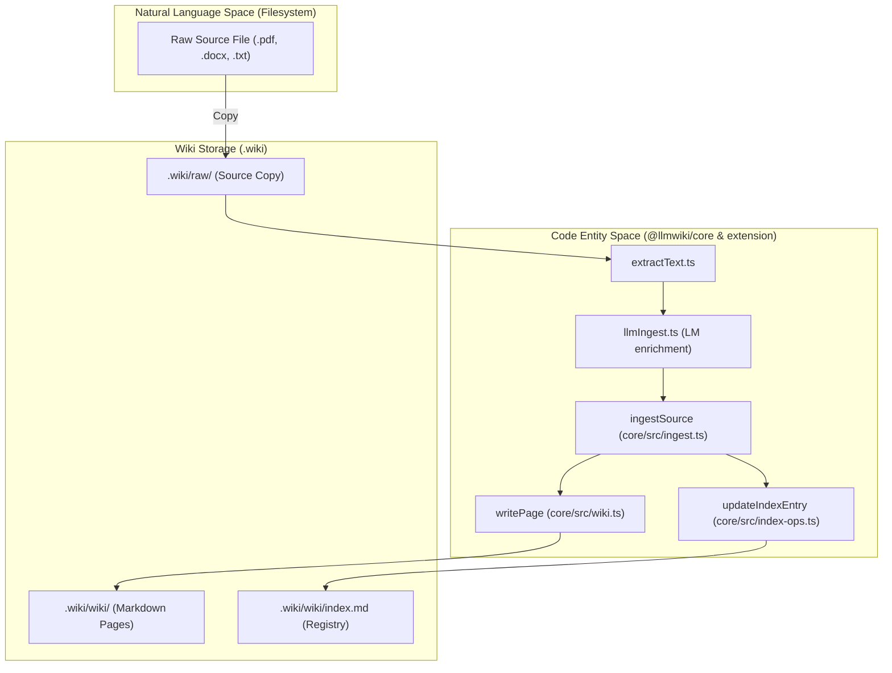
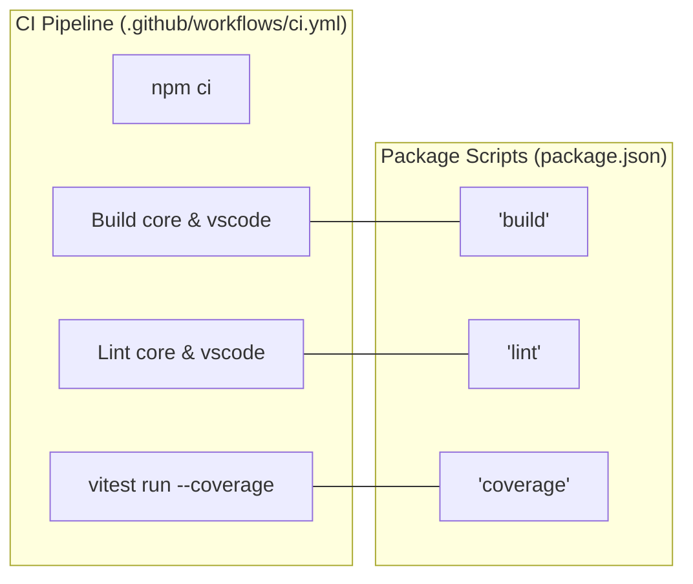

<!-- source: DeepWiki mcp.deepwiki.com · repo microsoft/llmwiki · page 1.1 Getting Started · fetched 2026-10-26 -->

# Getting Started

<details>
<summary>Relevant source files</summary>

The following files were used as context for generating this wiki page:

- [.github/workflows/ci.yml](.github/workflows/ci.yml)
- [.github/workflows/release.yml](.github/workflows/release.yml)
- [.gitignore](.gitignore)
- [.vscode/launch.json](.vscode/launch.json)
- [.vscode/tasks.json](.vscode/tasks.json)
- [package.json](package.json)
- [packages/vscode/README.md](packages/vscode/README.md)
- [vitest.config.ts](vitest.config.ts)

</details>


This guide provides step-by-step instructions for setting up the **LLM Wiki** development environment. It covers prerequisites, repository configuration, workspace initialization, and running the VS Code extension in development mode.

## Prerequisites

Before contributing or running the system from source, ensure your environment meets the following requirements:

| Requirement | Version / Detail |
| :--- | :--- |
| **Node.js** | `v20.x` or later [[package.json:35-37]]() |
| **npm** | Included with Node.js; used for workspace management [[package.json:16-19]]() |
| **VS Code** | `v1.93` or later [[packages/vscode/README.md:91-92]]() |
| **GitHub Copilot** | Required for LLM-powered ingestion and chat features [[packages/vscode/README.md:93-95]]() |

## Repository Setup

LLM Wiki is managed as a monorepo using npm workspaces. The two primary packages are `@llmwiki/core` (the logic engine and MCP server) and `llmwiki` (the VS Code extension) [[package.json:16-19]]().

### 1. Clone the Repository
```bash
git clone https://github.com/microsoft/llmwiki.git
cd llmwiki
```
[[packages/vscode/README.md:27-28]]()

### 2. Install Dependencies
Install all package dependencies from the root directory. This will link the local `@llmwiki/core` package for use by the extension.
```bash
npm ci
```
[[packages/vscode/README.md:29-29]]()

### 3. Build the Monorepo
The core library must be built before the VS Code extension can be bundled, as the extension depends on the compiled output of core [[package.json:21-21]]().
```bash
npm run build
```
[[package.json:21-21]](), [[.github/workflows/ci.yml:28-32]]()

## Development Workflow

### Running the Extension
To debug the extension, use the provided VS Code launch configurations:

1. Open the `llmwiki` root folder in VS Code.
2. Press `F5` or go to the **Run and Debug** view and select **Run Extension** [[.vscode/launch.json:5-18]]().
3. This task executes `preLaunchTask: build-extension` [[.vscode/launch.json:14-14]](), which triggers the build script in `packages/vscode` [[.vscode/tasks.json:5-11]]().
4. A new **Extension Development Host** window will open.

### Initializing a Wiki Workspace
The extension activates when it detects a `.wiki/wiki/` directory or when the initialization command is manually triggered [[packages/vscode/README.md:87-89]]().

1. In the Extension Development Host, open a folder you wish to use as your wiki workspace.
2. Open the Command Palette (`Ctrl+Shift+P`).
3. Run `LLM Wiki: Initialize Wiki` (`llmwiki.init`) [[packages/vscode/README.md:39-39]]().
4. This creates the `.wiki/` directory structure, including the `raw/` and `wiki/` subdirectories.

### Data Flow: From Source to Wiki Entity
The following diagram illustrates the flow from a raw file on disk to a processed wiki entity managed by the extension.

**System Entity Mapping: Ingestion Flow**

Sources: [[packages/vscode/README.md:59-64]](), [[packages/vscode/README.md:97-98]](), [[vitest.config.ts:27-28]]()

## Testing and Quality Control

### Running Unit Tests
Unit tests are powered by Vitest and cover core logic like indexing, linting, and search [[package.json:22-22]]().
```bash
npm test
```
[[package.json:22-22]]()

### Coverage Requirements
The project enforces minimum coverage thresholds for CI to pass:
* **Lines/Functions/Statements**: 60%
* **Branches**: 50%
[[vitest.config.ts:32-37]]()

### CI/CD Pipeline
The GitHub Actions workflow automates the following sequence on every push to `main`:
1. **Linting**: Runs `npm run lint` for both core and vscode [[.github/workflows/ci.yml:34-38]]().
2. **Building**: Compiles TypeScript sources [[.github/workflows/ci.yml:28-32]]().
3. **Testing**: Executes the Vitest suite with coverage reporting [[.github/workflows/ci.yml:40-41]]().

**Code-to-CI Mapping**

Sources: [[.github/workflows/ci.yml:25-41]](), [[package.json:20-26]]()

## Troubleshooting Initialization
* **Extension not activating**: Ensure you are in a trusted workspace and have GitHub Copilot enabled. The extension requires the VS Code Language Model API [[packages/vscode/README.md:93-95]]().
* **Build failures**: Ensure you have run `npm ci` at the root to correctly link the `@llmwiki/core` workspace [[packages/vscode/README.md:29-30]]().
* **Missing .wiki folder**: If the `.wiki` folder is missing, run `llmwiki.init` from the Command Palette [[packages/vscode/README.md:39-39]](). Note that `.wiki/` is ignored by git by default [[.gitignore:10-10]]().

Sources: [[package.json:1-48]](), [[packages/vscode/README.md:1-122]](), [[vitest.config.ts:1-41]](), [[.github/workflows/ci.yml:1-59]](), [[.github/workflows/release.yml:1-58]](), [[.gitignore:1-27]](), [[.vscode/tasks.json:1-21]](), [[.vscode/launch.json:1-19]]()

---

