# Page: Overview

# Overview

<details>
<summary>Relevant source files</summary>

The following files were used as context for generating this wiki page:

- [README.md](README.md)
- [TRANSPARENCY_NOTE.md](TRANSPARENCY_NOTE.md)
- [docs/img/magenticui.jpg](docs/img/magenticui.jpg)
- [docs/img/magenticui_running.png](docs/img/magenticui_running.png)
- [docs/img/magui-actionguard.png](docs/img/magui-actionguard.png)
- [docs/img/magui-coplanning.png](docs/img/magui-coplanning.png)
- [docs/img/magui-cotasking.png](docs/img/magui-cotasking.png)
- [docs/img/magui-landing.png](docs/img/magui-landing.png)
- [pyproject.toml](pyproject.toml)
- [src/magentic_ui/__init__.py](src/magentic_ui/__init__.py)
- [src/magentic_ui/backend/__init__.py](src/magentic_ui/backend/__init__.py)
- [src/magentic_ui/backend/teammanager/teammanager.py](src/magentic_ui/backend/teammanager/teammanager.py)
- [src/magentic_ui/version.py](src/magentic_ui/version.py)
- [uv.lock](uv.lock)

</details>


Magentic-UI is a research prototype for human-centered AI agent systems that automates web and coding tasks while keeping humans in control. Built on the [AutoGen](https://github.com/microsoft/autogen) framework, the system uses a multi-agent architecture where specialized agents collaborate under an orchestrator to handle tasks ranging from simple web queries to long-running monitoring workflows that span minutes to days. [README.md:16-17](), [README.md:131-132]()

For detailed information about specific capabilities, see [Key Features and Capabilities](#1.1). For step-by-step instructions on getting started, see [Installation and Setup](#1.2).

## Design Philosophy

Magentic-UI differentiates itself from black-box agents through three core principles: [README.md:16-17](), [TRANSPARENCY_NOTE.md:5-13]()

*   **Co-Planning**: The system reveals its structured plan before execution, letting users guide actions and modify steps through a dedicated plan editor interface. [README.md:133](), [TRANSPARENCY_NOTE.md:9-10]()
*   **Co-Tasking**: Users can interrupt and guide task execution using the web browser directly (via noVNC) or through the chat interface. The system can also ask for clarifications when needed. [README.md:134]()
*   **Action Guards**: Sensitive or high-risk actions are only executed with explicit user approval, managed by a configurable guard system. [README.md:135](), [src/magentic_ui/approval_guard.py:4-8]()

The system is particularly effective for:
*   Web automation requiring deep navigation through non-indexed sites. [README.md:129]()
*   Tasks combining web data extraction with code execution (e.g., generating charts from online data). [README.md:129]()
*   Long-running monitoring tasks using **"Tell me When"** sentinel steps (e.g., "notify me when a specific event occurs on a website"). [README.md:24]()

**Sources:** [README.md:16-24](), [README.md:131-137](), [TRANSPARENCY_NOTE.md:5-21]()

## System Architecture Overview

Magentic-UI follows a layered architecture separating user interfaces, backend API coordination, multi-agent orchestration, and infrastructure services. The `TeamManager` class serves as the central coordinator managing agent team lifecycle, workspace paths, and execution state. [src/magentic_ui/backend/teammanager/teammanager.py:49-69]()

### Layered Architecture

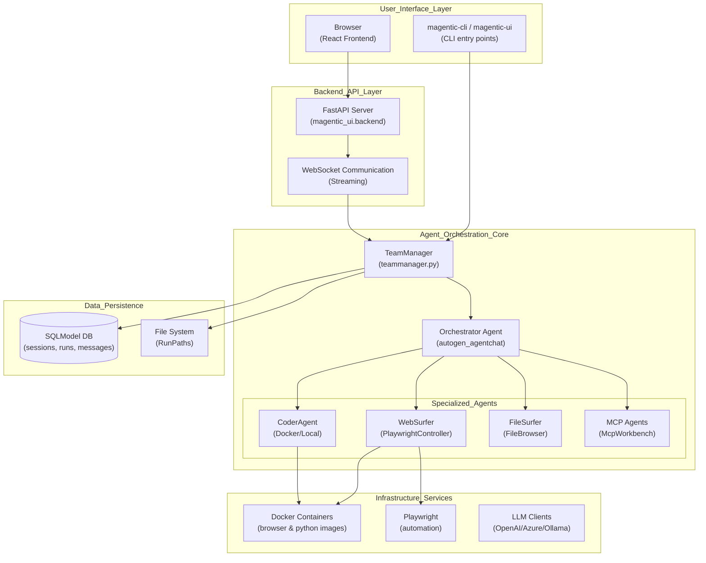

**Key Components:**

| Component | Code Entity | Responsibility |
|-----------|----------|----------------|
| **Orchestrator** | `OrchestratorConfig` | Planning, coordination, and replanning logic. [src/magentic_ui/teams/orchestrator/orchestrator_config.py:2]() |
| **Team Manager** | `TeamManager` | Managing team operations, configs, and workspace paths. [src/magentic_ui/backend/teammanager/teammanager.py:49]() |
| **Workspace** | `RunPaths` | Managing internal/external directory mapping for Docker. [src/magentic_ui/types.py:26]() |
| **Configuration** | `MagenticUIConfig` | Centralized settings for models and agent behavior. [src/magentic_ui/magentic_ui_config.py:10]() |

**Sources:** [src/magentic_ui/backend/teammanager/teammanager.py:49-113](), [src/magentic_ui/__init__.py:1-32](), [pyproject.toml:82-85]()

### Task Execution Flow

The following sequence shows how a user task flows through the system, bridging natural language input to code execution.

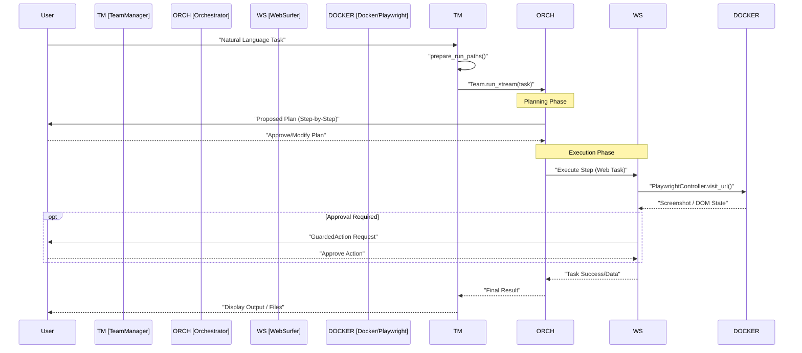

**Key Methods and Classes:**

| Component | Method/Class | Purpose |
|-----------|--------------|---------|
| `TeamManager` | `run_stream` | Entry point for executing tasks with streaming updates. [src/magentic_ui/backend/teammanager/teammanager.py:353]() |
| `TeamManager` | `prepare_run_paths` | Initializes the directory structure for a specific run. [src/magentic_ui/backend/teammanager/teammanager.py:77]() |
| `WebSurfer` | `PlaywrightController` | Manages the actual browser interaction via Playwright. [src/magentic_ui/agents/web_surfer/web_surfer.py:29]() |
| `GuardedAction` | `GuardedAction` | Wraps sensitive actions for human approval. [src/magentic_ui/guarded_action.py:9]() |

**Sources:** [src/magentic_ui/backend/teammanager/teammanager.py:77-113](), [src/magentic_ui/backend/teammanager/teammanager.py:353-365](), [README.md:16-17]()

## Installation and Quick Start

Magentic-UI requires **Python 3.10+** and **Docker**. [README.md:49]()

```bash
# 1. Setup environment
python3 -m venv .venv
source .venv/bin/activate
pip install magentic-ui --upgrade

# 2. Set API key
export OPENAI_API_KEY="your-api-key-here"

# 3. Launch
magentic-ui --port 8081
```

For details on configuration and local model support (Azure, Ollama), see [Installation and Setup](#1.2).

**Sources:** [README.md:34-45](), [pyproject.toml:11]()

## Related Pages

*   [Key Features and Capabilities](#1.1) — Detailed look at co-planning, co-tasking, and monitoring.
*   [Installation and Setup](#1.2) — Detailed instructions for various environments and model providers.

**Sources:** [README.md:19-27](), [README.md:131-137]()

---

# Page: Key Features and Capabilities

# Key Features and Capabilities

<details>
<summary>Relevant source files</summary>

The following files were used as context for generating this wiki page:

- [README.md](README.md)
- [src/magentic_ui/approval_guard.py](src/magentic_ui/approval_guard.py)
- [src/magentic_ui/backend/teammanager/teammanager.py](src/magentic_ui/backend/teammanager/teammanager.py)
- [uv.lock](uv.lock)

</details>


This page documents the core features and capabilities of Magentic-UI, focusing on user-facing functionality and the underlying mechanisms that enable human-centered AI agent workflows. This covers the system's operational modes, interaction patterns, and extensibility points.

For details on the underlying orchestration architecture, see [Multi-Agent Orchestration](#2.2). For specific agent implementations, see [Agent System](#4). For planning mechanisms, see [Planning and Execution](#5).

---

## Overview of Capabilities

Magentic-UI provides five primary capabilities that differentiate it from autonomous-only AI agent systems:

| Feature | Purpose | Implementation |
|---------|---------|----------------|
| **Co-Planning** | Collaborative plan creation and approval | `Orchestrator` planning mode with user review workflow |
| **Co-Tasking** | Real-time guidance during execution | User proxy interruption and clarification requests |
| **Action Guards** | Safety gates for sensitive operations | `ActionGuard` with configurable approval policies |
| **Monitoring Tasks** | Long-running condition-based workflows | `SentinelPlanStep` with periodic condition evaluation |
| **Plan Learning** | Memory-based plan retrieval and reuse | `MemoryControllerProvider` with vector storage |

**Sources:** [README.md:131-137](), [src/magentic_ui/teams/orchestrator/_orchestrator.py:70-111]()

---

## Co-Planning: Collaborative Plan Creation

### Planning Workflow

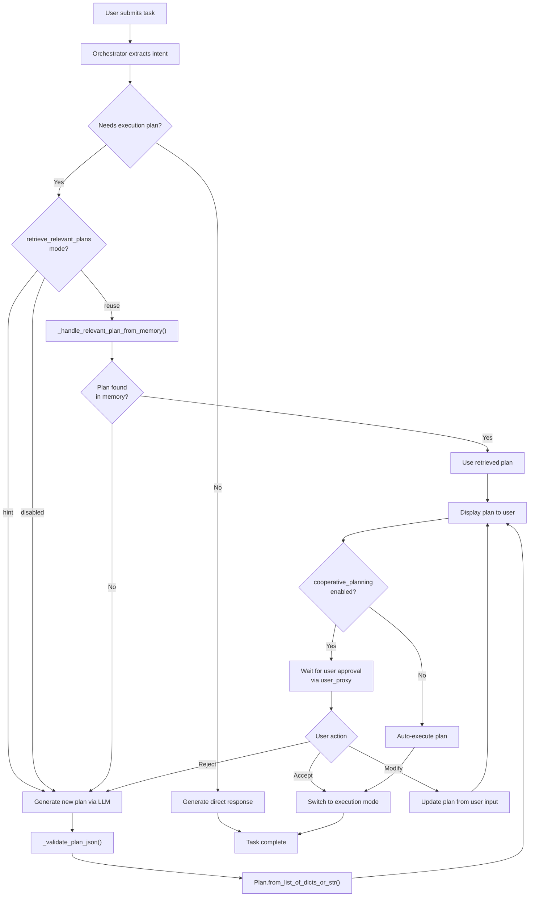

**Co-Planning Architecture: From user task to approved execution plan**

The planning system operates through the `Orchestrator` class's planning mode. When `OrchestratorState.in_planning_mode` is `True`, the orchestrator enters a collaborative planning workflow.

**Sources:** [src/magentic_ui/teams/orchestrator/_orchestrator.py:709-942]()

### Plan Structure and Validation

Plans consist of sequential steps, each with specific agent assignments. The system supports two step types:

1. **PlanStep** - Standard action step
   - `title`: Brief step description
   - `details`: Comprehensive instructions for the assigned agent
   - `agent_name`: Name of agent responsible for execution

2. **SentinelPlanStep** - Monitoring step with condition evaluation
   - All PlanStep fields, plus:
   - `condition`: Termination condition or repetition count
   - `sleep_duration`: Wait time between condition checks (seconds)

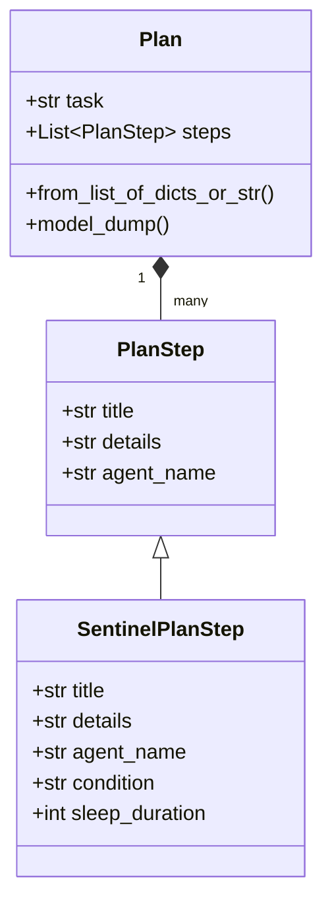

**Plan Type Hierarchy**

Plan validation occurs in `validate_plan_json()` which checks:
- Required fields presence
- Agent name validity against `_agent_execution_names`
- SentinelPlanStep-specific fields when `sentinel_tasks_enabled=True`

**Sources:** [src/magentic_ui/teams/orchestrator/_prompts.py:471-511](), [src/magentic_ui/types.py]()

### Memory-Based Plan Retrieval

The system can retrieve previously successful plans from vector memory:

| Mode | Behavior | Code Path |
|------|----------|-----------|
| `"reuse"` | Automatically use retrieved plan if found | `_handle_relevant_plan_from_memory()` returns plan directly |
| `"hint"` | Provide retrieved plan as context for LLM | Appends plan to context as `UserMessage` |
| Disabled | Generate new plan without memory | Skip memory retrieval |

Configuration: `OrchestratorConfig.retrieve_relevant_plans`

**Sources:** [src/magentic_ui/teams/orchestrator/_orchestrator.py:673-707](), [src/magentic_ui/teams/orchestrator/_orchestrator.py:736-744]()

---

## Co-Tasking: Human-in-the-Loop Execution

### Interruption and Guidance Mechanisms

During execution, users can interrupt the agent workflow through multiple channels:

1. **Direct Chat Input**: User sends messages to `user_proxy` agent
2. **Browser Interaction**: Actions in the shared browser session trigger updates
3. **Plan Modification**: User edits plan steps via Plan Editor UI

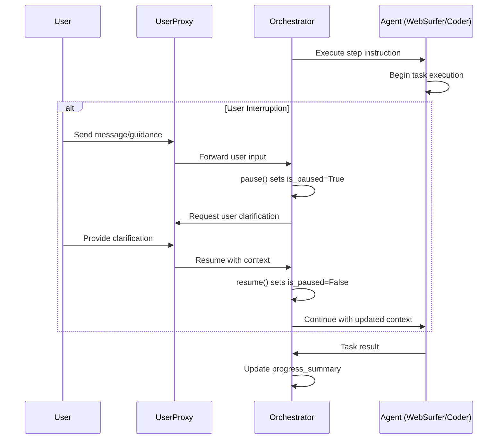

**User Interruption Flow During Execution**

The `OrchestratorState.is_paused` flag controls execution flow. When paused:
- LLM requests are blocked: `if self._state.is_paused: raise ValueError("Operation paused")`
- Next speaker defaults to `user_proxy`: `await self._request_next_speaker(self._user_agent_topic, ...)`

**Sources:** [src/magentic_ui/teams/orchestrator/_orchestrator.py:543-552](), [src/magentic_ui/teams/orchestrator/_orchestrator.py:578-588]()

### Progress Tracking and Status Updates

The orchestrator maintains execution state through the progress ledger:

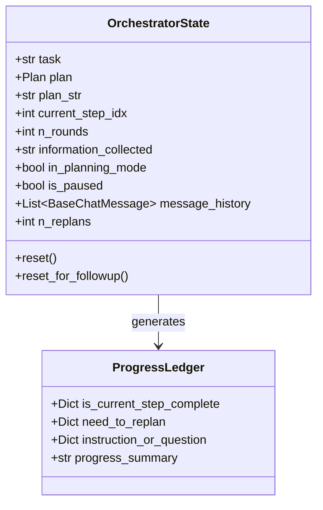

**Orchestrator State Management**

At each step, `_orchestrate_step_execution()` generates a progress ledger via `_get_json_response()` that determines:
- Whether current step is complete
- Whether replanning is needed
- Next instruction for assigned agent
- Progress summary for user visibility

**Sources:** [src/magentic_ui/teams/orchestrator/_orchestrator.py:70-111](), [src/magentic_ui/teams/orchestrator/_orchestrator.py:987-995]()

---

## Action Guards: Approval System

### Approval Policies

The `ApprovalGuard` system implements several approval policies via `ApprovalConfig`:

| Policy | Behavior | Use Case |
|--------|----------|----------|
| `always` | Request approval for all guarded actions | Maximum user control |
| `auto-conservative` | AI risk assessment via `requires_approval()` → conditional approval | Balanced automation |
| `never` | Auto-approve all actions | Autonomous execution |

Configuration: `MagenticUIConfig.approval_policy`

**Sources:** [src/magentic_ui/approval_guard.py:75-80]()

### Guarded Operations

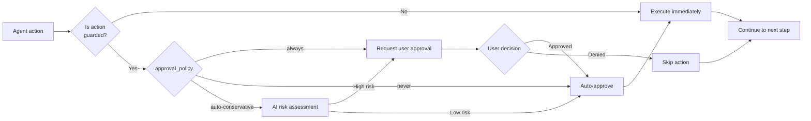

**Action Guard Decision Flow**

Actions requiring approval include:
- **WebSurfer**: Form submissions, sensitive information entry, making purchases.
- **Coder**: Code execution that creates files or potentially leaks system info.

The `ApprovalGuard` uses `ACTION_GUARD_SYSTEM_MESSAGE` to prompt the LLM for risk assessment when using "auto" policies. It checks criteria like real-world consequences, irreversibility, and data integrity.

**Sources:** [src/magentic_ui/approval_guard.py:116-145](), [src/magentic_ui/teams/orchestrator/_orchestrator.py:1378-1450]()

---

## Monitoring Tasks: "Tell me When"

### Sentinel Step Architecture

Sentinel steps enable long-running monitoring workflows through periodic condition evaluation. These are useful for tasks that span minutes to days.

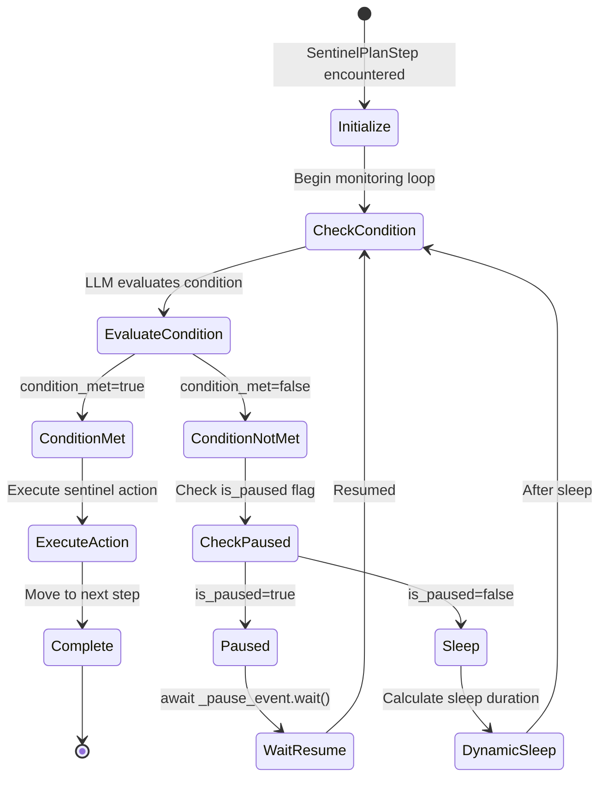

**Sentinel Step Execution Lifecycle**

### Condition Evaluation

The `_execute_sentinel_step()` method orchestrates monitoring:

1. **Gather Context**: Collect current page info via `_get_websurfer_page_info()`.
2. **LLM Evaluation**: Send condition check prompt to model using `SENTINEL_CONDITION_CHECK_PROMPT`.
3. **Decision**: 
   - If `condition_met=true`: Execute action and advance to next step.
   - If `condition_met=false`: Sleep for `sleep_duration` seconds and repeat.

**Sources:** [src/magentic_ui/teams/orchestrator/_orchestrator.py:1344-1495](), [README.md:24]()

---

## File Upload and Tracking

### File Classification

The system distinguishes between uploaded and generated files to ensure only relevant new data is highlighted to the user.

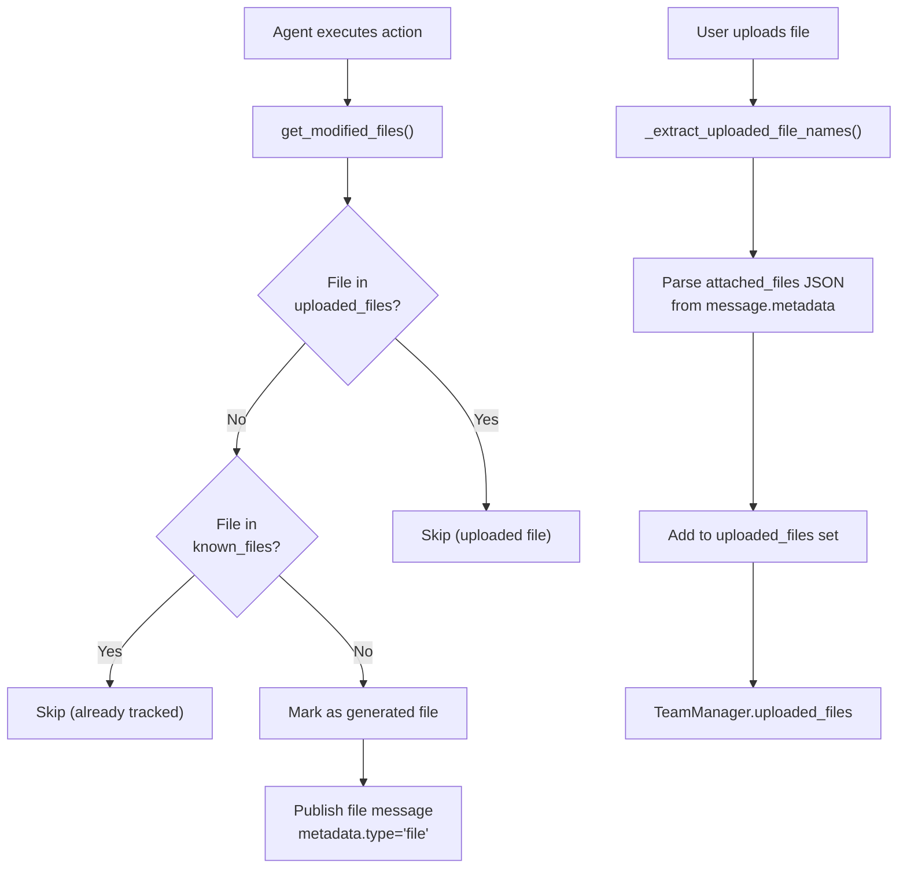

**File Tracking and Classification Logic**

### Implementation Details

`TeamManager` maintains file tracking across the conversation lifecycle:

- `uploaded_files`: Set of file names uploaded by user, extracted in `_extract_uploaded_file_names`.
- Generated files are tracked via `get_modified_files()` which compares current workspace state against known files.

**Sources:** [src/magentic_ui/backend/teammanager/teammanager.py:115-165](), [src/magentic_ui/backend/teammanager/teammanager.py:420-457]()

---

## MCP Agent Integration

### Configuration and Validation

MCP (Model Context Protocol) agents allow Magentic-UI to use external tools via MCP servers.

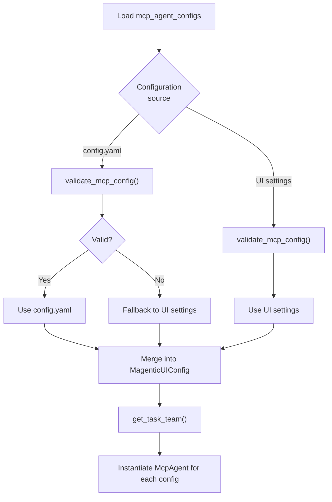

**MCP Agent Configuration Resolution**

### Runtime Integration

Each `McpAgent` is an `AssistantAgent` equipped with tools provided by MCP servers. The `TeamManager` handles the instantiation of these agents during team creation based on the provided `mcp_agent_configs`.

**Sources:** [src/magentic_ui/backend/teammanager/teammanager.py:218-275](), [README.md:26]()

---

## Execution Model: Planning vs Execution

### Mode Switching

The orchestrator operates in two mutually exclusive modes controlled by `OrchestratorState.in_planning_mode`:

| Mode | Purpose | Key Methods |
|------|---------|-------------|
| Planning | Generate and refine execution plan | `_orchestrate_step_planning()` |
| Execution | Execute plan steps sequentially | `_orchestrate_step_execution()` |

**Sources:** [src/magentic_ui/teams/orchestrator/_orchestrator.py:709-942](), [src/magentic_ui/teams/orchestrator/_orchestrator.py:943-1118]()

### Replanning Mechanism

Replanning preserves completed steps while generating new steps for remaining work. This is triggered when the `ProgressLedger` indicates `need_to_replan=true`.

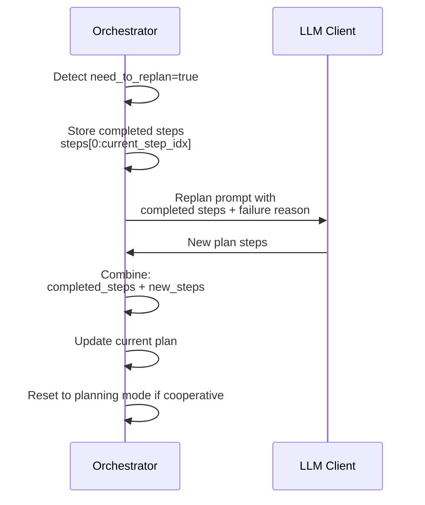

**Sources:** [src/magentic_ui/teams/orchestrator/_orchestrator.py:1119-1195](), [src/magentic_ui/teams/orchestrator/_orchestrator.py:998-1020]()

---

# Page: Installation and Setup

# Installation and Setup

<details>
<summary>Relevant source files</summary>

The following files were used as context for generating this wiki page:

- [CONTRIBUTING.md](CONTRIBUTING.md)
- [README.md](README.md)
- [pyproject.toml](pyproject.toml)
- [src/magentic_ui/__init__.py](src/magentic_ui/__init__.py)
- [src/magentic_ui/backend/__init__.py](src/magentic_ui/backend/__init__.py)
- [src/magentic_ui/backend/teammanager/teammanager.py](src/magentic_ui/backend/teammanager/teammanager.py)
- [src/magentic_ui/version.py](src/magentic_ui/version.py)
- [uv.lock](uv.lock)

</details>


This page provides step-by-step installation instructions for Magentic-UI, covering prerequisites, dependency requirements, and initial configuration. The guide focuses on getting the system operational for first use.

For advanced model configuration and MCP server setup, see page 3.2 (Configuration Files). For Docker deployment details, see page 8 (Docker and Deployment).

## Prerequisites and System Requirements

Magentic-UI requires Docker for containerized agent execution and Python 3.10 or higher for the main application. The system automatically pulls required Docker images on first run.

### Core Requirements

| Component | Requirement | Notes |
|-----------|-------------|-------|
| Python | 3.10, 3.11, 3.12, or 3.13 | Main application runtime [pyproject.toml:11]() |
| Docker | Desktop (Win/Mac) or Engine (Linux) | Required unless using `--run-without-docker` [README.md:49-56]() |
| Operating System | Linux, macOS, Windows (WSL2) | Windows users must use WSL2 [README.md:49]() |
| API Key | OpenAI API key (or alternative) | Required for LLM functionality [README.md:41]() |

### Docker Infrastructure

The system uses two Docker images that are automatically pulled from GitHub Container Registry on first run:

**Docker Image Management**

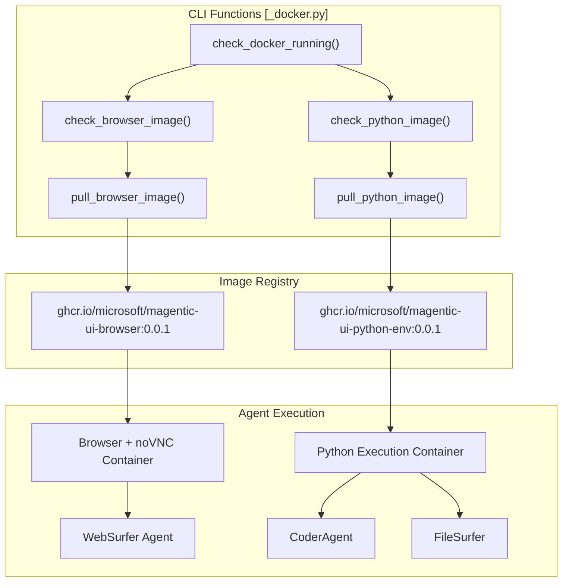

The CLI automatically checks for and pulls missing images during startup as implemented in `_cli.py`.

Sources: [README.md:27](), [README.md:49](), [src/magentic_ui/backend/teammanager/teammanager.py:56-57]()

### Platform-Specific Requirements

**Windows**: WSL2 (Windows Subsystem for Linux) is required for Docker and file path compatibility. Configure Docker Desktop to enable WSL2 integration under Settings > Resources > WSL Integration [README.md:49]().

**macOS**: Use Docker Desktop. Ensure it's running before starting Magentic-UI.

**Linux**: Install Docker Engine and add your user to the `docker` group: `sudo usermod -aG docker $USER` (requires logout/login to take effect).

Sources: [README.md:49](), [pyproject.toml:19]()

## Installation via pip

### Base Installation

The primary installation method uses pip with a virtual environment:

```bash
# 1. Create and activate virtual environment
python3 -m venv .venv
source .venv/bin/activate

# 2. Install magentic-ui
pip install magentic-ui --upgrade
```

The base installation includes support for OpenAI API models via `autogen-ext` [pyproject.toml:30]().

### Optional Dependencies

Additional package extras are available for specific model providers and features:

| Extra | Installation Command | Purpose |
|-------|---------------------|---------|
| Azure | `pip install magentic-ui[azure]` | Azure OpenAI and Azure AI Foundry support [pyproject.toml:65-67]() |
| Ollama | `pip install magentic-ui[ollama]` | Local model execution via Ollama [pyproject.toml:69-71]() |
| FARA | `pip install magentic-ui[fara]` | Microsoft's FARA-7B agentic model [pyproject.toml:73-80]() |
| Eval | `pip install magentic-ui[eval]` | Benchmark and evaluation tools [pyproject.toml:59-63]() |

Multiple extras can be installed together: `pip install magentic-ui[azure,ollama,fara]`.

Sources: [README.md:34-38](), [README.md:63-70](), [pyproject.toml:58-80]()

## Initial Configuration

### API Key Setup

Set your API key before running Magentic-UI:

```bash
# For OpenAI (default provider)
export OPENAI_API_KEY="your-api-key-here"
```

API keys can also be configured through the web UI after startup (Settings > Model Configuration) or via the `MagenticUIConfig` class [src/magentic_ui/magentic_ui_config.py:10]().

### FARA-7B Model Setup

Microsoft's FARA-7B is an efficient agentic model specialized for computer use tasks [README.md:21](). Setup requires serving the model via vLLM:

**1. Install FARA extras:**
```bash
pip install magentic-ui[fara]
```

**2. Serve FARA-7B using vLLM in a separate terminal:**
```bash
vllm serve "microsoft/Fara-7B" --port 5000 --dtype auto
```

**3. Launch with FARA configuration:**
The system uses the `use_fara_agent` flag to toggle the specialized agent [src/magentic_ui/magentic_ui_config.py:116]().

**FARA-7B Configuration Pipeline:**

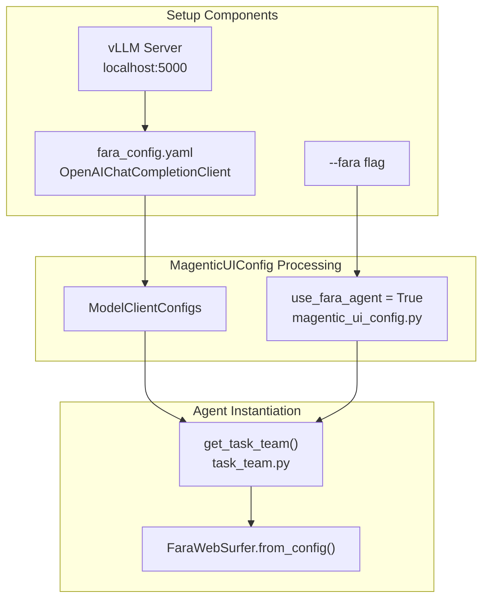

Sources: [README.md:21](), [pyproject.toml:73-80](), [src/magentic_ui/magentic_ui_config.py:116]()

## Running Magentic-UI

### Standard Web UI Mode

Launch the web interface with Docker support:

```bash
magentic-ui --port 8081
```

Once running, access the interface at `http://localhost:8081` [README.md:44-47](). The command triggers the backend CLI entry point defined in [pyproject.toml:84]().

**Startup Sequence:**

```mermaid
sequenceDiagram
    participant User
    participant CLI["magentic-ui CLI<br/>backend/cli.py"]
    participant TeamMgr["TeamManager<br/>teammanager.py"]
    participant FastAPI["FastAPI Server"]
    participant Browser["Web Browser"]
    
    User->>CLI: "magentic-ui --port 8081"
    CLI->>TeamMgr: "Initialize with workspace paths"
    TeamMgr->>TeamMgr: "prepare_run_paths()"
    CLI->>FastAPI: "Start Uvicorn"
    User->>Browser: "Navigate to localhost:8081"
    Browser-->>FastAPI: "Serve UI"
```

The `TeamManager` prepares the internal and external workspace directories for agent file handling [src/magentic_ui/backend/teammanager/teammanager.py:77-113]().

### Alternative Usage Modes

| Mode | Command | Use Case |
|------|---------|----------|
| **Without Docker** | `magentic-ui --run-without-docker --port 8081` | Limited functionality: no code execution [README.md:53-56]() |
| **Command Line Interface** | `magentic-cli --work-dir PATH` | Terminal-based interaction without web UI [README.md:58-61]() |

The `magentic-cli` command maps to the `_cli.py` main function [pyproject.toml:85]().

Sources: [README.md:44-61](), [pyproject.toml:83-85](), [src/magentic_ui/backend/teammanager/teammanager.py:52-69]()

## Verification and Troubleshooting

### System Health Checks

1. **Version Check**: Verify installation with `magentic-ui --version` [src/magentic_ui/version.py:1-2]().
2. **Docker Status**: Ensure Docker is running to allow `TeamManager` to mount volumes for `CoderAgent` and `WebSurfer` [src/magentic_ui/backend/teammanager/teammanager.py:102-105]().
3. **Workspace Access**: Confirm the application has write permissions to the workspace directory for creating run paths [src/magentic_ui/backend/teammanager/teammanager.py:103-105]().

### Common Issues

- **Port Conflict**: If port 8081 is in use, specify a different port using `--port` [README.md:44]().
- **Docker Permission**: On Linux, ensure the user is in the `docker` group to avoid permission errors when `TeamManager` attempts to manage containers.
- **Model Configuration**: If agents fail to initialize, check the `ModelClientConfigs` provided during startup [src/magentic_ui/magentic_ui_config.py:27]().

Sources: [README.md:74](), [src/magentic_ui/version.py:1-4](), [src/magentic_ui/backend/teammanager/teammanager.py:97-113]()

---

# Page: System Architecture

# System Architecture

<details>
<summary>Relevant source files</summary>

The following files were used as context for generating this wiki page:

- [README.md](README.md)
- [pyproject.toml](pyproject.toml)
- [src/magentic_ui/__init__.py](src/magentic_ui/__init__.py)
- [src/magentic_ui/_cli.py](src/magentic_ui/_cli.py)
- [src/magentic_ui/backend/__init__.py](src/magentic_ui/backend/__init__.py)
- [src/magentic_ui/backend/teammanager/teammanager.py](src/magentic_ui/backend/teammanager/teammanager.py)
- [src/magentic_ui/magentic_ui_config.py](src/magentic_ui/magentic_ui_config.py)
- [src/magentic_ui/task_team.py](src/magentic_ui/task_team.py)
- [src/magentic_ui/teams/orchestrator/orchestrator_config.py](src/magentic_ui/teams/orchestrator/orchestrator_config.py)
- [src/magentic_ui/version.py](src/magentic_ui/version.py)
- [uv.lock](uv.lock)

</details>


## Purpose and Scope

This document describes the overall system architecture of Magentic-UI, explaining how components are organized into layers, how they relate to each other, and the flow of execution from user interface to agent execution. For detailed information on specific subsystems, see:
- Configuration details: [Configuration System](#2.1)
- Multi-agent coordination: [Multi-Agent Orchestration](#2.2)
- Team lifecycle management: [Task Team Assembly and Management](#2.3)

**Sources:** [README.md:1-158]()

## Layered Architecture Overview

Magentic-UI follows a layered architecture pattern with clear separation of concerns across four primary layers: User Interface, Backend API, Agent Orchestration, and Infrastructure Services.

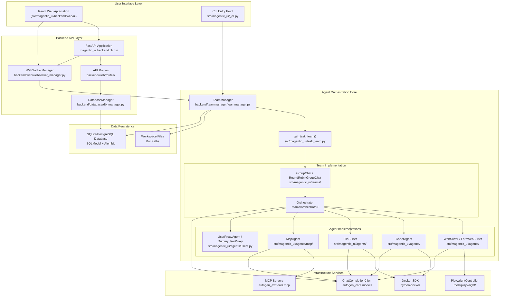

**Sources:** [pyproject.toml:27-51](), [src/magentic_ui/__init__.py:1-33](), [src/magentic_ui/backend/__init__.py:1-7](), [src/magentic_ui/task_team.py:34-49]()

## Core Components

### Component Responsibilities

| Component | Primary Class/Module | Responsibilities |
|-----------|---------------------|------------------|
| **Frontend Application** | `src/magentic_ui/backend/web/ui/` | React-based UI, WebSocket client, session management, plan visualization |
| **API Server** | `FastAPI` (via `magentic-ui` command) | HTTP endpoints, WebSocket handling, request routing [src/magentic_ui/backend/cli.py:84]() |
| **Database Manager** | `DatabaseManager` | Database operations for sessions, runs, messages, settings [src/magentic_ui/backend/__init__.py:1]() |
| **Team Manager** | `TeamManager` | Team creation, run orchestration, file tracking, path preparation [src/magentic_ui/backend/teammanager/teammanager.py:49]() |
| **Task Team Factory** | `get_task_team()` | Agent instantiation, configuration assembly, team composition [src/magentic_ui/task_team.py:34]() |
| **Orchestrator** | `Orchestrator` | Planning, execution coordination, agent selection, replanning [src/magentic_ui/teams/orchestrator/orchestrator_config.py:7]() |
| **Specialized Agents** | `WebSurfer`, `CoderAgent`, `FileSurfer`, `McpAgent` | Domain-specific task execution (web, code, files, MCP tools) [src/magentic_ui/task_team.py:8-15]() |

**Sources:** [src/magentic_ui/backend/teammanager/teammanager.py:49-113](), [src/magentic_ui/task_team.py:34-166]()

### Entry Points and Initialization

The system provides two primary entry points that converge on the same core execution path:

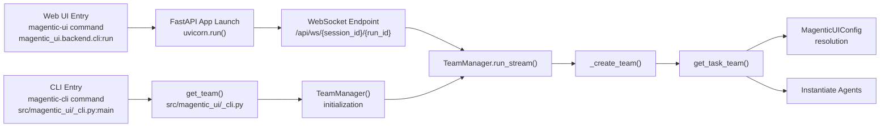

**Sources:** [pyproject.toml:82-86](), [src/magentic_ui/backend/teammanager/teammanager.py:174-185](), [src/magentic_ui/_cli.py:117-145]()

## Execution Flow

### Run Lifecycle: From Request to Completion

The following diagram traces the complete execution flow from a user task submission through agent execution to final result delivery, showing actual method calls and class interactions:

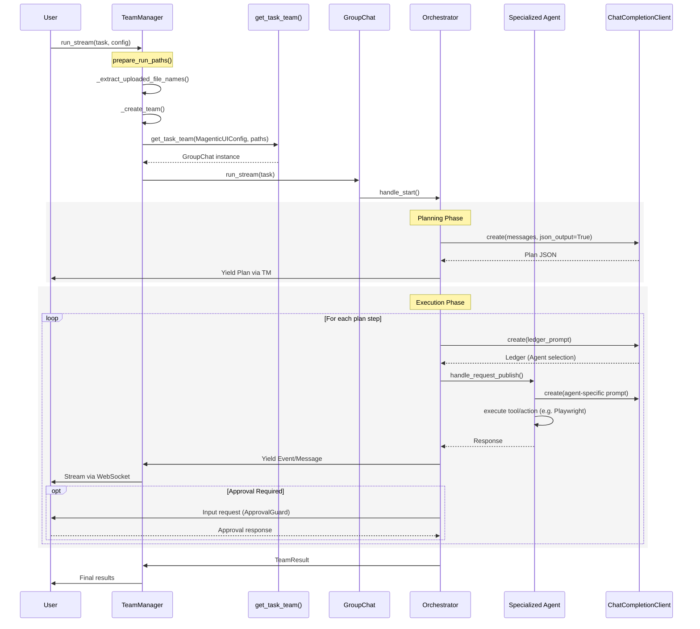

**Sources:** [src/magentic_ui/backend/teammanager/teammanager.py:353-507](), [src/magentic_ui/task_team.py:34-166](), [src/magentic_ui/magentic_ui_config.py:63-130]()

## Infrastructure Integration

### Resource Management Components

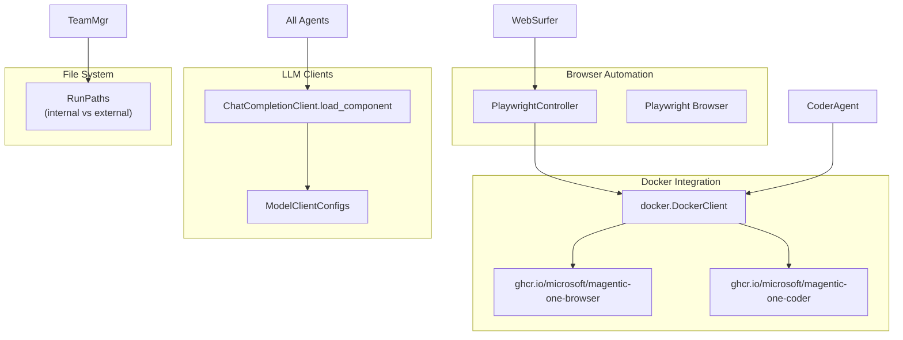

**Sources:** [src/magentic_ui/backend/teammanager/teammanager.py:77-113](), [src/magentic_ui/task_team.py:89-100](), [src/magentic_ui/magentic_ui_config.py:22-61]()

### Docker Configuration Resolution

The system supports multiple execution modes based on Docker availability:

| Mode | Configuration | Behavior |
|------|--------------|----------|
| **Standard** | `run_without_docker=False` | Full Docker integration for browser and code execution [src/magentic_ui/magentic_ui_config.py:97]() |
| **No Docker** | `run_without_docker=True` | Limited functionality: browser/coder agents may be disabled or local [src/magentic_ui/magentic_ui_config.py:97]() |
| **Inside Docker** | `inside_docker=True` | Magentic-UI itself running in container, paths adjusted [src/magentic_ui/magentic_ui_config.py:93]() |

**Sources:** [src/magentic_ui/magentic_ui_config.py:63-130](), [src/magentic_ui/backend/teammanager/teammanager.py:52-68]()

## Configuration Resolution

### Configuration Priority and Assembly

The system resolves configuration from multiple sources with a clear precedence hierarchy:

1. **YAML Config**: Provided via `--config` CLI argument [src/magentic_ui/_cli.py:132]().
2. **UI Settings**: Passed via the backend API during run initiation [src/magentic_ui/backend/teammanager/teammanager.py:180]().
3. **Environment Variables**: Such as `OPENAI_API_KEY` [README.md:41]().
4. **Defaults**: Hardcoded in `MagenticUIConfig` and `ModelClientConfigs` [src/magentic_ui/magentic_ui_config.py:39-52]().

**Sources:** [src/magentic_ui/magentic_ui_config.py:63-130](), [src/magentic_ui/backend/teammanager/teammanager.py:174-351]()

## Workspace and File Management

### Path Resolution System

The system maintains separate internal and external workspace paths to support Docker container execution:

| Path Type | Purpose | Source |
|-----------|---------|--------|
| `internal_run_dir` | Path visible inside Docker containers | `RunPaths.internal_run_dir` |
| `external_run_dir` | Path on host system | `RunPaths.external_run_dir` |
| `run_suffix` | Unique run identifier path | `RunPaths.run_suffix` |

Path structure: `files/user/{user_id}/{session_id}/{run_id}` [src/magentic_ui/backend/teammanager/teammanager.py:85-91]().

**Sources:** [src/magentic_ui/backend/teammanager/teammanager.py:77-113](), [src/magentic_ui/types.py]()

### File Tracking and Generated Files

The `TeamManager` tracks files to distinguish user-uploaded files from agent-generated outputs. This is handled by `_extract_uploaded_file_names` and `add_uploaded_files` to ensure proper metadata attribution in the UI.

**Sources:** [src/magentic_ui/backend/teammanager/teammanager.py:115-165]()

---

# Page: Configuration System

# Configuration System

<details>
<summary>Relevant source files</summary>

The following files were used as context for generating this wiki page:

- [src/magentic_ui/_cli.py](src/magentic_ui/_cli.py)
- [src/magentic_ui/backend/cli.py](src/magentic_ui/backend/cli.py)
- [src/magentic_ui/backend/database/db_manager.py](src/magentic_ui/backend/database/db_manager.py)
- [src/magentic_ui/backend/datamodel/db.py](src/magentic_ui/backend/datamodel/db.py)
- [src/magentic_ui/backend/datamodel/types.py](src/magentic_ui/backend/datamodel/types.py)
- [src/magentic_ui/backend/web/app.py](src/magentic_ui/backend/web/app.py)
- [src/magentic_ui/backend/web/config.py](src/magentic_ui/backend/web/config.py)
- [src/magentic_ui/backend/web/deps.py](src/magentic_ui/backend/web/deps.py)
- [src/magentic_ui/backend/web/managers/connection.py](src/magentic_ui/backend/web/managers/connection.py)
- [src/magentic_ui/backend/web/routes/settingsroute.py](src/magentic_ui/backend/web/routes/settingsroute.py)
- [src/magentic_ui/magentic_ui_config.py](src/magentic_ui/magentic_ui_config.py)
- [src/magentic_ui/task_team.py](src/magentic_ui/task_team.py)
- [src/magentic_ui/teams/orchestrator/orchestrator_config.py](src/magentic_ui/teams/orchestrator/orchestrator_config.py)

</details>


The Configuration System in Magentic-UI manages all runtime parameters that control agent behavior, model selection, planning strategies, and execution policies. It implements a priority-based resolution mechanism that allows configuration to be specified through multiple sources (CLI arguments, YAML files, UI settings, environment variables) with a well-defined precedence order. This page covers the configuration hierarchy, resolution logic, and the core configuration classes that drive the system.

---

## Configuration Sources and Priority

Magentic-UI accepts configuration from four sources, with the following priority order (highest to lowest):

| Priority | Source | Use Case | Scope |
|----------|--------|----------|-------|
| 1 | CLI Arguments | Overriding specific parameters at runtime | Single run |
| 2 | YAML Config File | Complete model client configuration | Per-invocation |
| 3 | UI Settings | User preferences and model clients | Per-user |
| 4 | Environment Variables | API keys and infrastructure paths | System-wide |

**Key Priority Rules:**
- For **model client configurations**: A complete YAML config file (specified via `--config` or found at `config.yaml`) takes precedence over UI settings [src/magentic_ui/backend/web/routes/settingsroute.py:53-75]().
- For **individual parameters**: CLI arguments override YAML config which overrides UI settings [src/magentic_ui/_cli.py:659-715]().
- For **API keys**: Environment variables are the primary source, though they can be defined within the `ComponentModel` config in YAML [src/magentic_ui/magentic_ui_config.py:39-52]().
- For **MCP agent configs**: YAML config takes precedence over UI settings if validation passes [src/magentic_ui/backend/web/app.py:41-64]().

Sources: [src/magentic_ui/_cli.py:659-715](), [src/magentic_ui/backend/web/routes/settingsroute.py:53-75](), [src/magentic_ui/magentic_ui_config.py:39-52]()

---

## Configuration Resolution Flow

Configuration resolution bridges the gap between raw input (CLI/YAML) and the structured `MagenticUIConfig` used by the `get_task_team` factory.

### Resolution Diagram

Title: Configuration Resolution and Data Flow
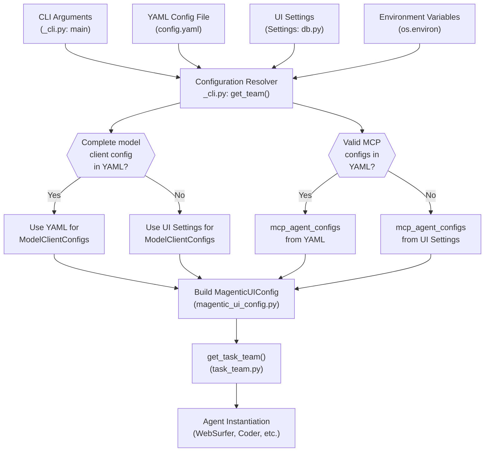

**Configuration Resolution Steps in CLI/Backend:**

1. **Load model client configs from YAML**: [src/magentic_ui/_cli.py:224-243]() checks for `orchestrator_client`, `web_surfer_client`, etc.
2. **Merge settings with priority**: In the CLI, values from `typer.Option` override those loaded from the YAML dictionary [src/magentic_ui/_cli.py:674-715]().
3. **Build MagenticUIConfig**: The `MagenticUIConfig` object is instantiated with the merged parameters [src/magentic_ui/_cli.py:245-270]().
4. **Pass to Team Factory**: The config object is passed to `get_task_team` [src/magentic_ui/task_team.py:34-49]() to assemble the multi-agent system.

Sources: [src/magentic_ui/_cli.py:224-270](), [src/magentic_ui/_cli.py:674-715](), [src/magentic_ui/task_team.py:34-49]()

---

## Core Configuration Classes

### MagenticUIConfig

The `MagenticUIConfig` class is the central configuration object containing all parameters needed to instantiate the agent team.

Title: MagenticUIConfig Entity Relationships
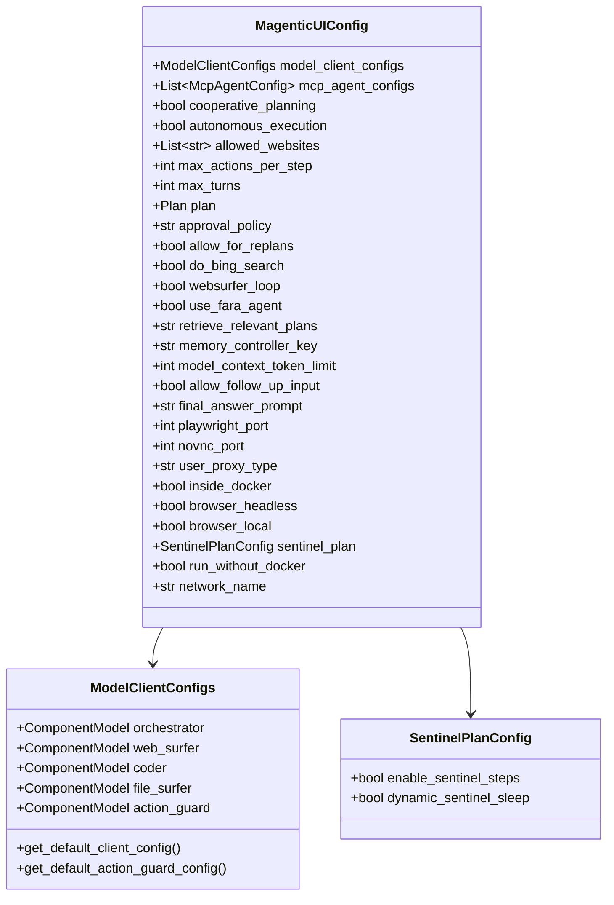

**Key Configuration Groups:**

| Group | Parameters | Purpose |
|-------|-----------|---------|
| **Planning** | `cooperative_planning`, `autonomous_execution`, `plan`, `allow_for_replans`, `retrieve_relevant_plans` | Control plan generation and user interaction [src/magentic_ui/magentic_ui_config.py:103-117](). |
| **Model Clients** | `model_client_configs`, `use_fara_agent`, `model_context_token_limit` | Specify LLM clients for each agent [src/magentic_ui/magentic_ui_config.py:101-119](). |
| **Agent Behavior** | `max_actions_per_step`, `max_turns`, `approval_policy`, `allowed_websites` | Control agent execution constraints [src/magentic_ui/magentic_ui_config.py:105-112](). |
| **Infrastructure** | `inside_docker`, `run_without_docker`, `playwright_port`, `novnc_port`, `browser_headless` | Configure execution environment [src/magentic_ui/magentic_ui_config.py:122-132](). |
| **Monitoring** | `sentinel_plan`, `allow_follow_up_input`, `final_answer_prompt` | Enable long-running tasks and output customization [src/magentic_ui/magentic_ui_config.py:120-131](). |

Sources: [src/magentic_ui/magentic_ui_config.py:63-134]()

---

### ModelClientConfigs

The `ModelClientConfigs` class specifies which LLM client each agent should use. It allows different agents to use different models or providers.

**Structure:**
The class holds `ComponentModel` objects or dictionaries that `ChatCompletionClient.load_component()` can process [src/magentic_ui/magentic_ui_config.py:22-37]().

**Default Configuration:**
All agents default to `gpt-4.1-2025-04-14` via `OpenAIChatCompletionClient`, except the `action_guard` which defaults to `gpt-4.1-nano-2025-04-14` [src/magentic_ui/magentic_ui_config.py:39-52]().

Sources: [src/magentic_ui/magentic_ui_config.py:22-61](), [src/magentic_ui/task_team.py:53-63]()

---

## Configuration Loading in CLI

The CLI (`magentic-cli`) serves as the primary entry point for headless execution and benchmarking.

Title: CLI Configuration Loading Sequence
```mermaid
sequenceDiagram
    participant User
    participant CLI as "magentic_ui._cli: main"
    participant FileSystem as "config.yaml"
    participant Env as "os.environ"
    participant GetTeam as "magentic_ui._cli: get_team"
    participant MagenticConfig as "MagenticUIConfig"
    participant TaskTeam as "magentic_ui.task_team: get_task_team"

    User->>CLI: Execute command with flags
    CLI->>CLI: Parse Typer arguments
    
    alt Config file specified (--config)
        CLI->>FileSystem: Load YAML
        FileSystem-->>CLI: Dict
    else Default config.yaml exists
        CLI->>FileSystem: Load config.yaml
        FileSystem-->>CLI: Dict
    end
    
    CLI->>Env: Read paths & API keys
    Env-->>CLI: Environment values
    
    CLI->>GetTeam: Call with merged args
    GetTeam->>MagenticConfig: Instantiate with ModelClientConfigs
    MagenticConfig-->>GetTeam: Config object
    GetTeam->>TaskTeam: Create team with paths and config
    TaskTeam-->>GetTeam: GroupChat / RoundRobinGroupChat
```

**CLI Configuration Loading Steps:**

1. **Argument Parsing**: Typer parses command line options [src/magentic_ui/_cli.py:439-593]().
2. **YAML Loading**: If a config file exists, it is loaded using `yaml.safe_load` [src/magentic_ui/_cli.py:224-231]().
3. **Model Client Mapping**: YAML keys like `orchestrator_client` are mapped to `ModelClientConfigs` fields [src/magentic_ui/_cli.py:233-243]().
4. **Team Instantiation**: The `get_team` function initializes the `RunPaths` and calls the team factory [src/magentic_ui/_cli.py:245-280]().

Sources: [src/magentic_ui/_cli.py:224-280](), [src/magentic_ui/_cli.py:439-593]()

---

## Configuration in Web UI

The web UI uses a database-backed settings system that persists user preferences and allows for dynamic reconfiguration.

### Settings Database Model

The `Settings` table in the database stores configuration as a JSON blob mapped to a `user_id` [src/magentic_ui/backend/datamodel/db.py:185-199]().

Title: UI Settings Data Model
```mermaid
erDiagram
    Settings {
        int id PK
        datetime created_at
        datetime updated_at
        string user_id UK "Unique identifier"
        string version
        json config "SettingsConfig JSON"
    }
    
    Run {
        int id PK
        int session_id FK
        string status
        json task
        string user_id
    }
    
    Settings ||--o{ Run : "associated by user_id"
```

**Settings Resolution in WebSocket Manager:**

When a run starts via WebSocket, the `WebSocketManager` loads settings and merges them with the execution request [src/magentic_ui/backend/web/managers/connection.py:115-170]().

1. **Load Settings**: Retrieves `Settings` from the database for the current user.
2. **Merge Config**: Combines `team_config` (from UI request) and `settings_config` (from DB) [src/magentic_ui/backend/web/managers/connection.py:119-121]().
3. **Initialize TeamManager**: Passes the merged config to the `TeamManager` which eventually calls the team factory [src/magentic_ui/backend/web/managers/connection.py:138-145]().

Sources: [src/magentic_ui/backend/datamodel/db.py:185-199](), [src/magentic_ui/backend/web/managers/connection.py:115-170]()

---

## OrchestratorConfig

The `OrchestratorConfig` is a specialized subset of configuration used specifically by the Orchestrator agent to manage its internal state and planning logic [src/magentic_ui/teams/orchestrator/orchestrator_config.py:7-29]().

**Key Attributes:**
- `cooperative_planning`: Whether to involve the user in plan approval [src/magentic_ui/teams/orchestrator/orchestrator_config.py:31]().
- `autonomous_execution`: If true, suppresses human-in-the-loop during step execution [src/magentic_ui/teams/orchestrator/orchestrator_config.py:32]().
- `max_turns`: Limit on the number of turns before termination [src/magentic_ui/teams/orchestrator/orchestrator_config.py:35]().
- `sentinel_plan`: Configuration for periodic monitoring tasks [src/magentic_ui/teams/orchestrator/orchestrator_config.py:47]().

Sources: [src/magentic_ui/teams/orchestrator/orchestrator_config.py:7-48](), [src/magentic_ui/task_team.py:102-114]()

---

## Environment Variables

Environment variables are handled during the application lifespan and CLI startup.

| Variable | Purpose | Location |
|----------|---------|----------|
| `INTERNAL_WORKSPACE_ROOT` | Container path for workspace | [src/magentic_ui/_cli.py:165-170]() |
| `EXTERNAL_WORKSPACE_ROOT` | Host path for workspace | [src/magentic_ui/_cli.py:171-176]() |
| `_CONFIG` | Path to the YAML configuration file | [src/magentic_ui/backend/web/app.py:43-47]() |
| `FARA_AGENT` | Flag to use the FARA-flavored web surfer | [src/magentic_ui/backend/web/app.py:51-52]() |
| `MAGENTIC_UI_DATABASE_URI` | Database connection string | [src/magentic_ui/backend/web/config.py:7-15]() |

Sources: [src/magentic_ui/_cli.py:165-176](), [src/magentic_ui/backend/web/app.py:41-52](), [src/magentic_ui/backend/web/config.py:6-18]()

---

# Page: Multi-Agent Orchestration

# Multi-Agent Orchestration

<details>
<summary>Relevant source files</summary>

The following files were used as context for generating this wiki page:

- [src/magentic_ui/_cli.py](src/magentic_ui/_cli.py)
- [src/magentic_ui/magentic_ui_config.py](src/magentic_ui/magentic_ui_config.py)
- [src/magentic_ui/task_team.py](src/magentic_ui/task_team.py)
- [src/magentic_ui/teams/orchestrator/_group_chat.py](src/magentic_ui/teams/orchestrator/_group_chat.py)
- [src/magentic_ui/teams/orchestrator/_orchestrator.py](src/magentic_ui/teams/orchestrator/_orchestrator.py)
- [src/magentic_ui/teams/orchestrator/_prompts.py](src/magentic_ui/teams/orchestrator/_prompts.py)
- [src/magentic_ui/teams/orchestrator/orchestrator_config.py](src/magentic_ui/teams/orchestrator/orchestrator_config.py)

</details>


The `Orchestrator` is the central coordination agent in Magentic-UI that manages conversation flow between specialized agents, decomposes user tasks into executable plans, and orchestrates step-by-step execution. It acts as a group chat manager that selects appropriate agents for each task step and maintains execution state throughout the conversation.

The orchestrator operates within the multi-agent system layer (see [System Architecture](2)) and is instantiated by the `TeamManager` (see [Task Team Assembly and Management](2.3)). Individual agent capabilities are documented in [Agent System](4), while configuration options are covered in [Configuration System](2.1).

## Overview

The `Orchestrator` class extends `BaseGroupChatManager` from AutoGen and serves as the primary decision-maker in the agent team. It coordinates multiple specialized agents by operating in two distinct modes:

- **Planning Mode**: Decomposes user requests into structured plans with discrete steps.
- **Execution Mode**: Routes each plan step to the appropriate agent and tracks progress.

Key capabilities include:
- **Cooperative Planning**: Allows users to review and modify AI-generated plans before execution [src/magentic_ui/magentic_ui_config.py:70-71]().
- **Autonomous Execution**: Executes plans without user intervention when configured [src/magentic_ui/magentic_ui_config.py:71-72]().
- **Dynamic Replanning**: Regenerates plans when the current approach fails [src/magentic_ui/teams/orchestrator/_orchestrator.py:1119-1121]().
- **Sentinel Steps**: Supports long-running monitoring tasks that check conditions periodically [src/magentic_ui/teams/orchestrator/_orchestrator.py:1270-1272]().
- **Memory Integration**: Learns from previous tasks to suggest relevant plans [src/magentic_ui/teams/orchestrator/_orchestrator.py:171-187]().

Sources: [src/magentic_ui/teams/orchestrator/_orchestrator.py:113-189](), [src/magentic_ui/magentic_ui_config.py:63-99]()

## Core Architecture

### Orchestrator Class Hierarchy

The `Orchestrator` inherits from AutoGen's `BaseGroupChatManager` and adds planning, execution, and memory capabilities:

```mermaid
classDiagram
    class BaseGroupChatManager {
        <<autogen_agentchat>>
        #_participant_names: List[str]
        #_participant_topic_types: List[str]
        #_output_message_queue: asyncio.Queue
        +handle_start(GroupChatStart)*
        +handle_agent_response(GroupChatAgentResponse)*
        +select_speaker(thread)*
    }

    class Orchestrator {
        -_model_client: ChatCompletionClient
        -_model_context: TokenLimitedChatCompletionContext
        -_config: OrchestratorConfig
        -_state: OrchestratorState
        -_memory_controller: MemoryController
        -_agent_execution_names: List[str]
        -_team_description: str
        -_pause_event: asyncio.Event
        +handle_start(GroupChatStart)
        +handle_agent_response(GroupChatAgentResponse)
        +pause()
        +resume()
        -_orchestrate_step(CancellationToken)
        -_orchestrate_step_planning(CancellationToken)
        -_orchestrate_step_execution(CancellationToken)
        -_get_json_response(messages, validate_json, CancellationToken)
        -_request_next_speaker(next_speaker, CancellationToken)
        -_replan(reason, CancellationToken)
        -_execute_sentinel_step(step, progress_ledger, CancellationToken, sentinel_step_id)
        -_prepare_final_answer(reason, CancellationToken)
    }

    class OrchestratorState {
        +task: str
        +plan_str: str
        +plan: Plan | None
        +current_step_idx: int
        +n_rounds: int
        +n_replans: int
        +in_planning_mode: bool
        +is_paused: bool
        +information_collected: str
        +message_history: List[BaseChatMessage | BaseAgentEvent]
        +reset()
        +reset_for_followup()
    }

    class TokenLimitedChatCompletionContext {
        <<autogen_core>>
        +add_message(LLMMessage)
        +get_messages()
        +clear()
    }

    Orchestrator --|> BaseGroupChatManager
    Orchestrator *-- OrchestratorState
    Orchestrator --> TokenLimitedChatCompletionContext
```

Sources: [src/magentic_ui/teams/orchestrator/_orchestrator.py:70-194]()

### Key Components

| Component | Type | Purpose |
|-----------|------|---------|
| `_model_client` | `ChatCompletionClient` | LLM client for planning and decision-making [src/magentic_ui/teams/orchestrator/_orchestrator.py:155]() |
| `_model_context` | `TokenLimitedChatCompletionContext` | Manages conversation history within token limits [src/magentic_ui/teams/orchestrator/_orchestrator.py:156-158]() |
| `_state` | `OrchestratorState` | Maintains execution state (plan, progress, mode) [src/magentic_ui/teams/orchestrator/_orchestrator.py:199]() |
| `_memory_controller` | `MemoryController | None` | Optional memory system for plan learning [src/magentic_ui/teams/orchestrator/_orchestrator.py:171-187]() |
| `_agent_execution_names` | `List[str]` | Filtered list of agents available for execution [src/magentic_ui/teams/orchestrator/_orchestrator.py:202]() |
| `_output_message_queue` | `asyncio.Queue` | Queue for streaming messages to frontend [src/magentic_ui/teams/orchestrator/_orchestrator.py:150]() |
| `_pause_event` | `asyncio.Event` | Synchronization primitive for pause/resume [src/magentic_ui/teams/orchestrator/_orchestrator.py:193]() |

Sources: [src/magentic_ui/teams/orchestrator/_orchestrator.py:125-194]()

## Conversation Flow Management

The orchestrator manages conversation flow through event-driven message passing using AutoGen's group chat primitives.

### Message Flow Architecture

```mermaid
graph TB
    subgraph "WebSocket Layer"
        WSManager["WebSocketManager (Backend)"]
    end
    
    subgraph "Orchestrator Event Handlers"
        handle_start["Orchestrator.handle_start()"]
        handle_agent_response["Orchestrator.handle_agent_response()"]
        orchestrate_step["Orchestrator._orchestrate_step()"]
    end
    
    subgraph "Message Types"
        GroupChatStart["GroupChatStart"]
        GroupChatMessage["GroupChatMessage"]
        GroupChatRequestPublish["GroupChatRequestPublish"]
        GroupChatAgentResponse["GroupChatAgentResponse"]
        GroupChatTermination["GroupChatTermination"]
    end
    
    subgraph "Agent Participants"
        WebSurfer["WebSurfer"]
        CoderAgent["CoderAgent"]
        FileSurfer["FileSurfer"]
        UserProxy["UserProxyAgent"]
    end
    
    WSManager -->|"publish_message()"| handle_start
    handle_start -->|"GroupChatStart"| orchestrate_step
    
    orchestrate_step -->|"Planning Mode"| GroupChatMessage
    orchestrate_step -->|"Execution Mode"| GroupChatRequestPublish
    
    GroupChatMessage -->|"Stream to UI"| WSManager
    
    GroupChatRequestPublish -->|"Topic routing"| WebSurfer
    GroupChatRequestPublish -->|"Topic routing"| CoderAgent
    GroupChatRequestPublish -->|"Topic routing"| FileSurfer
    GroupChatRequestPublish -->|"Topic routing"| UserProxy
    
    WebSurfer -->|"publish_message()"| handle_agent_response
    CoderAgent -->|"publish_message()"| handle_agent_response
    FileSurfer -->|"publish_message()"| handle_agent_response
    UserProxy -->|"publish_message()"| handle_agent_response
    
    handle_agent_response -->|"Update state"| orchestrate_step
    orchestrate_step -->|"Task complete"| GroupChatTermination
    GroupChatTermination --> WSManager
```

Sources: [src/magentic_ui/teams/orchestrator/_orchestrator.py:514-576](), [src/magentic_ui/task_team.py:102-166]()

### Topic-Based Agent Routing

The orchestrator uses AutoGen's topic-based routing to coordinate agents:

| Method | Message Type | Purpose |
|--------|-------------|---------|
| `publish_message(GroupChatStart)` | Broadcast | Initializes all agents with task context [src/magentic_ui/teams/orchestrator/_orchestrator.py:514-523]() |
| `publish_message(GroupChatRequestPublish)` | Targeted | Requests specific agent to perform action [src/magentic_ui/teams/orchestrator/_orchestrator.py:486-501]() |
| `publish_message(GroupChatMessage)` | Broadcast | Shares information with all participants [src/magentic_ui/teams/orchestrator/_orchestrator.py:525-542]() |
| `publish_message(GroupChatAgentResponse)` | Internal | Propagates agent responses back to orchestrator [src/magentic_ui/teams/orchestrator/_orchestrator.py:544-576]() |

Sources: [src/magentic_ui/teams/orchestrator/_orchestrator.py:418-432]()

### State Transitions

```mermaid
stateDiagram-v2
    [*] --> PlanningMode: handle_start()
    
    state PlanningMode {
        [*] --> GeneratePlan
        GeneratePlan --> WaitUserApproval: cooperative_planning=True
        GeneratePlan --> SwitchToExecution: cooperative_planning=False
        WaitUserApproval --> GeneratePlan: User modifies
        WaitUserApproval --> SwitchToExecution: User approves
    }
    
    PlanningMode --> ExecutionMode: in_planning_mode=False
    
    state ExecutionMode {
        [*] --> UpdateProgressLedger
        UpdateProgressLedger --> CheckReplan
        CheckReplan --> Replanning: need_to_replan=True
        CheckReplan --> SelectAgent: need_to_replan=False
        
        state SelectAgent {
            [*] --> DetermineStepType
            DetermineStepType --> ExecuteSentinel: SentinelPlanStep
            DetermineStepType --> RequestAgent: PlanStep
            ExecuteSentinel --> WaitAgentResponse
            RequestAgent --> WaitAgentResponse
        }
        
        WaitAgentResponse --> UpdateProgressLedger: Step incomplete
        WaitAgentResponse --> CheckCompletion: Step complete
        CheckCompletion --> UpdateProgressLedger: More steps
        CheckCompletion --> FinalAnswer: Plan complete
    }
    
    ExecutionMode --> Replanning: Replan triggered
    Replanning --> PlanningMode: cooperative_planning=True
    Replanning --> ExecutionMode: cooperative_planning=False
    
    ExecutionMode --> [*]: FinalAnswer generated
```

Sources: [src/magentic_ui/teams/orchestrator/_orchestrator.py:709-941](), [src/magentic_ui/teams/orchestrator/_orchestrator.py:943-1117]()

## Planning System

### Plan Types and Structure

The orchestrator supports two types of plan steps with different execution characteristics [src/magentic_ui/types.py:45]():

| Step Type | Duration | Use Cases | Required Fields |
|-----------|----------|-----------|-----------------|
| `PlanStep` | Immediate | File operations, web navigation, code execution | `title`, `details`, `agent_name` |
| `SentinelPlanStep` | Long-running | Monitoring, periodic checks, condition waiting | `title`, `details`, `agent_name`, `sleep_duration`, `condition` |

### Planning Process Flow

```mermaid
flowchart TD
    user_task["User Task Input"] --> task_analysis["Task Analysis"]
    task_analysis --> need_plan_check{"Needs Plan?"}
    
    need_plan_check -->|No| direct_response["Direct Response"]
    need_plan_check -->|Yes| memory_check{"Memory Integration?"}
    
    memory_check -->|Reuse| retrieve_plan["MemoryController.retrieve_relevant_memos()"]
    memory_check -->|Hint| add_context["Add Relevant Plan Context"]
    memory_check -->|None| plan_generation
    
    retrieve_plan --> use_existing["Use Existing Plan"]
    add_context --> plan_generation["_get_json_response()"]
    
    plan_generation --> bing_search{"Bing Search Enabled?"}
    bing_search -->|Yes| do_bing_search["get_bing_search_results()"]
    bing_search -->|No| llm_planning
    do_bing_search --> llm_planning["_get_json_response()"]
    
    llm_planning --> plan_validation["validate_plan_json()"]
    plan_validation --> cooperative_check{"cooperative_planning?"}
    
    cooperative_check -->|Yes| user_review["User Review (UserProxyAgent)"]
    cooperative_check -->|No| switch_execution["Switch to Execution Mode"]
    
    user_review --> user_decision{"User Decision"}
    user_decision -->|Accept| switch_execution
    user_decision -->|Modify| plan_generation
    
    use_existing --> cooperative_check
    direct_response --> End
    switch_execution --> End
```

Sources: [src/magentic_ui/teams/orchestrator/_orchestrator.py:678-905](), [src/magentic_ui/teams/orchestrator/_orchestrator.py:559-583]()

## Memory Integration

The orchestrator integrates with a memory system to reuse previous plans [src/magentic_ui/teams/orchestrator/_orchestrator.py:171-187]().

### Memory Controller Initialization

```mermaid
graph TB
    subgraph "Configuration Sources"
        config["OrchestratorConfig"]
        memory_key["memory_controller_key"]
        retrieve_mode["retrieve_relevant_plans"]
    end
    
    subgraph "Memory Provider"
        provider["MemoryControllerProvider"]
        get_controller["get_memory_controller()"]
    end
    
    subgraph "Orchestrator Memory"
        memory_controller["_memory_controller"]
    end
    
    config --> memory_key
    config --> retrieve_mode
    
    memory_key -->|"If set"| provider
    provider --> get_controller
    get_controller --> memory_controller
```

Sources: [src/magentic_ui/teams/orchestrator/_orchestrator.py:171-187]()

### Memory Retrieval Modes

| Mode | Behavior | Use Case |
|------|----------|----------|
| `"reuse"` | Replaces entire plan with most relevant stored plan | Exact task repetition [src/magentic_ui/teams/orchestrator/_orchestrator.py:696-697]() |
| `"hint"` | Adds relevant plan as context in LLM prompt | Similar but not identical tasks [src/magentic_ui/teams/orchestrator/_orchestrator.py:698-702]() |
| `"never"` | No memory integration | Default behavior [src/magentic_ui/teams/orchestrator/orchestrator_config.py:43]() |

Sources: [src/magentic_ui/teams/orchestrator/_orchestrator.py:673-707]()

## Execution System

### Step Execution Coordination

The execution system manages step-by-step task completion with progress tracking.

```mermaid
sequenceDiagram
    participant O as "Orchestrator"
    participant TLC as "TokenLimitedChatCompletionContext"
    participant LLM as "LLM"
    participant AG as "Selected Agent"
    
    Note over O: _orchestrate_step_execution()
    
    O->>O: "Build Progress Ledger Prompt"
    O->>TLC: "clear() + add_message()"
    O->>LLM: "_get_json_response()"
    LLM-->>O: "progress_ledger"
    
    alt need_to_replan == True
        O->>O: "_replan(reason)"
    end
    
    alt is_current_step_complete
        O->>O: "current_step_idx += 1"
    end
    
    alt Plan complete
        O->>O: "_prepare_final_answer()"
    else More steps
        alt SentinelPlanStep
            O->>O: "_execute_sentinel_step()"
        else Regular PlanStep
            O->>AG: "GroupChatRequestPublish"
            AG-->>O: "handle_agent_response()"
        end
    end
```

Sources: [src/magentic_ui/teams/orchestrator/_orchestrator.py:943-1117]()

### Progress Ledger System

The orchestrator uses a **progress ledger** JSON structure to track execution state [src/magentic_ui/teams/orchestrator/_prompts.py:427-468]().

**Ledger Generation Process:**
1. **Build Context**: Compile `_thread_to_context()` with history [src/magentic_ui/teams/orchestrator/_orchestrator.py:288-316]().
2. **LLM Query**: Call `_get_json_response()` with `validate_ledger_json()` [src/magentic_ui/teams/orchestrator/_orchestrator.py:968-984]().
3. **Parse Response**: Extract `is_current_step_complete` and `need_to_replan` [src/magentic_ui/teams/orchestrator/_orchestrator.py:986-1002]().

Sources: [src/magentic_ui/teams/orchestrator/_prompts.py:356-424]()

## Agent Selection and Coordination

### Agent List Management

The orchestrator filters the participant list based on configuration.

```mermaid
graph TB
    subgraph "Initialization"
        names["_participant_names"]
        desc["_participant_descriptions"]
    end
    
    subgraph "Execution Context Filtering"
        auto_check{"autonomous_execution?"}
        filter_user["Remove 'user_proxy'"]
        add_no_action["Append 'no_action_agent'"]
    end
    
    names --> auto_check
    auto_check -->|"True"| filter_user
    filter_user --> add_no_action
    auto_check -->|"False"| add_no_action
```

Sources: [src/magentic_ui/teams/orchestrator/_orchestrator.py:195-232]()

### Agent Selection During Execution

The orchestrator selects agents through LLM-generated JSON specifying the `agent_name` field [src/magentic_ui/teams/orchestrator/_prompts.py:461]().

**Agent Instruction Format:**
Instructions are formatted using `INSTRUCTION_AGENT_FORMAT` to include step context [src/magentic_ui/teams/orchestrator/_prompts.py:36-42]().

Sources: [src/magentic_ui/teams/orchestrator/_orchestrator.py:324-333]()

## Advanced Features

### Sentinel Step Execution

Sentinel steps enable long-running monitoring [src/magentic_ui/teams/orchestrator/_orchestrator.py:1270-1421]().

```mermaid
flowchart TD
    iteration_loop["Iteration Loop"] --> execute_instruction["agent.on_messages_stream()"]
    execute_instruction --> condition_check{"Evaluate Condition"}
    
    condition_check -->|Integer| count_check{"iteration >= condition?"}
    condition_check -->|String| llm_check["LLM Condition Check"]
    
    count_check -->|Yes| complete["Step Complete"]
    llm_check -->|Condition met| complete
    
    count_check -->|No| sleep_wait["Sleep sleep_duration"]
    llm_check -->|Not met| sleep_wait
    
    sleep_wait --> iteration_loop
```

Sources: [src/magentic_ui/teams/orchestrator/_orchestrator.py:1270-1421]()

### Replanning System

The orchestrator supports dynamic replanning when failures occur [src/magentic_ui/teams/orchestrator/_orchestrator.py:1119-1194]().

**Replan Process:**
1. **Preserve History**: Keep `completed_steps` [src/magentic_ui/teams/orchestrator/_orchestrator.py:1131-1135]().
2. **Generate New Steps**: Call LLM with replan prompt [src/magentic_ui/teams/orchestrator/_orchestrator.py:1152-1158]().
3. **Combine Plans**: Append new steps to completed ones [src/magentic_ui/teams/orchestrator/_orchestrator.py:1162-1166]().

Sources: [src/magentic_ui/teams/orchestrator/_orchestrator.py:1119-1194](), [src/magentic_ui/teams/orchestrator/_prompts.py:336-353]()

---

# Page: Task Team Assembly and Management

# Task Team Assembly and Management

<details>
<summary>Relevant source files</summary>

The following files were used as context for generating this wiki page:

- [README.md](README.md)
- [pyproject.toml](pyproject.toml)
- [src/magentic_ui/__init__.py](src/magentic_ui/__init__.py)
- [src/magentic_ui/_cli.py](src/magentic_ui/_cli.py)
- [src/magentic_ui/backend/__init__.py](src/magentic_ui/backend/__init__.py)
- [src/magentic_ui/backend/teammanager/teammanager.py](src/magentic_ui/backend/teammanager/teammanager.py)
- [src/magentic_ui/magentic_ui_config.py](src/magentic_ui/magentic_ui_config.py)
- [src/magentic_ui/task_team.py](src/magentic_ui/task_team.py)
- [src/magentic_ui/teams/orchestrator/orchestrator_config.py](src/magentic_ui/teams/orchestrator/orchestrator_config.py)
- [src/magentic_ui/version.py](src/magentic_ui/version.py)
- [uv.lock](uv.lock)

</details>


## Purpose and Scope

This page describes how the `TeamManager` class creates and manages multi-agent teams in Magentic-UI. It covers the team assembly process, agent instantiation logic, configuration precedence rules, and lifecycle management. For details on how the orchestrator coordinates agents after team creation, see [Multi-Agent Orchestration](2.2). For configuration file format details, see [Configuration System](2.1).

---

## TeamManager Overview

The `TeamManager` class is responsible for creating agent teams, managing their lifecycle, and handling workspace paths. It serves as the primary interface between the backend server and the multi-agent system. [src/magentic_ui/backend/teammanager/teammanager.py:49-50]()

### Core Responsibilities

| Responsibility | Description |
|---------------|-------------|
| **Team Creation** | Instantiates `Team` objects with appropriate agent configurations. [src/magentic_ui/backend/teammanager/teammanager.py:174-184]() |
| **Configuration Resolution** | Merges config file settings with UI settings according to precedence rules. [src/magentic_ui/backend/teammanager/teammanager.py:194-213]() |
| **Path Management** | Creates and manages internal/external workspace directories via `prepare_run_paths`. [src/magentic_ui/backend/teammanager/teammanager.py:77-113]() |
| **State Persistence** | Coordinates team state loading and saving. [src/magentic_ui/backend/teammanager/teammanager.py:328-346]() |
| **File Tracking** | Monitors workspace for generated files and distinguishes them from uploaded files. [src/magentic_ui/backend/teammanager/teammanager.py:115-166]() |
| **Lifecycle Management** | Handles team initialization, execution, and cleanup. [src/magentic_ui/backend/teammanager/teammanager.py:353-507]() |

### Initialization Parameters

```python
TeamManager(
    internal_workspace_root: Path,     # Docker-visible workspace path
    external_workspace_root: Path,     # Host-visible workspace path
    run_without_docker: bool,          # Disable Docker-dependent agents
    inside_docker: bool = True,        # Whether backend runs in Docker
    config: dict[str, Any] = {}        # Configuration from config.yaml
)
```

**Sources:** [src/magentic_ui/backend/teammanager/teammanager.py:52-69]()

---

## Team Assembly Architecture

### High-Level Assembly Flow

```mermaid
flowchart TD
    Start["run_stream called"] --> PrepPaths["prepare_run_paths<br/>(create directories)"]
    PrepPaths --> CheckTeam{"self.team<br/>exists?"}
    CheckTeam -->|No| CreateTeam["_create_team"]
    CheckTeam -->|Yes| RunStream["team.run_stream"]
    
    CreateTeam --> ResolveConfig["Resolve Configuration<br/>(config file vs UI)"]
    ResolveConfig --> CreatePaths["Create RunPaths<br/>(internal/external dirs)"]
    CreatePaths --> GetBrowserPorts["get_browser_resource_config<br/>(allocate ports)"]
    GetBrowserPorts --> BuildMagenticConfig["MagenticUIConfig<br/>(unified config)"]
    BuildMagenticConfig --> CallGetTaskTeam["get_task_team<br/>(instantiate agents)"]
    CallGetTaskTeam --> LoadState{"state<br/>provided?"}
    LoadState -->|Yes| TeamLoadState["team.load_state"]
    LoadState -->|No| ReturnTeam["Return Team"]
    TeamLoadState --> ReturnTeam
    ReturnTeam --> RunStream
    RunStream --> StreamEvents["Yield events<br/>(messages, files)"]
    StreamEvents --> Cleanup["team.close()"]
```

**Sources:** [src/magentic_ui/backend/teammanager/teammanager.py:174-352](), [src/magentic_ui/backend/teammanager/teammanager.py:353-507]()

---

## Configuration Precedence Rules

The system resolves configuration from multiple sources with a well-defined precedence order.

### Model Client Configuration Precedence

The system validates completeness by checking if all required client configurations are provided in the config file. [src/magentic_ui/backend/teammanager/teammanager.py:194-213]()

```mermaid
flowchart LR
    ConfigFile["config.yaml<br/>(orchestrator_client, web_surfer_client, etc.)"] -->|Priority 1| Check{"All clients<br/>defined?"}
    Check -->|Yes| UseConfig["Use config file clients"]
    Check -->|No| UseUI["Use UI settings clients"]
    UISettings["UI Settings<br/>(from frontend)"] -->|Priority 2| UseUI
    UseConfig --> Result["ModelClientConfigs"]
    UseUI --> Result
```

**Sources:** [src/magentic_ui/backend/teammanager/teammanager.py:194-213](), [src/magentic_ui/magentic_ui_config.py:22-38]()

### MCP Agent Configuration Precedence

Validation logic ensures MCP configurations are well-formed before accepting them from the config file. [src/magentic_ui/backend/teammanager/teammanager.py:214-275]()

```mermaid
flowchart LR
    ConfigFile["config.yaml<br/>(mcp_agent_configs)"] -->|Priority 1| Validate{"Valid<br/>config?"}
    Validate -->|Yes| UseConfig["Use config file"]
    Validate -->|No| UseUI["Use UI settings"]
    UISettings["UI Settings<br/>(mcp_agent_configs)"] -->|Priority 2| UseUI
    UseConfig --> Result["mcp_agent_configs"]
    UseUI --> Result
    
    subgraph Validation
        Validate --> CheckServers["mcp_servers is<br/>non-empty list?"]
        CheckServers --> CheckName["name is<br/>alphanumeric?"]
        CheckName --> CheckDesc["description<br/>is string?"]
        CheckDesc --> CheckServerName["server_name is<br/>alphanumeric?"]
    end
```

**Sources:** [src/magentic_ui/backend/teammanager/teammanager.py:214-275]()

### Other Configuration Parameters

| Parameter | Priority 1 (Highest) | Priority 2 | Default |
|-----------|---------------------|-----------|---------|
| `use_fara_agent` | UI settings | CLI `--fara` flag | `False`. [src/magentic_ui/magentic_ui_config.py:81]() |
| `run_without_docker` | CLI flag | UI settings | `False`. [src/magentic_ui/magentic_ui_config.py:97]() |
| `browser_headless` | UI settings | CLI flag | `False`. [src/magentic_ui/magentic_ui_config.py:94]() |
| `approval_policy` | UI settings | CLI flag | `"auto-conservative"`. [src/magentic_ui/magentic_ui_config.py:110-112]() |

**Sources:** [src/magentic_ui/backend/teammanager/teammanager.py:277-313](), [src/magentic_ui/magentic_ui_config.py:63-128]()

---

## Agent Instantiation Process

The `get_task_team` function in `src/magentic_ui/task_team.py` orchestrates agent creation. [src/magentic_ui/task_team.py:34-49]()

### Agent Creation Sequence

```mermaid
sequenceDiagram
    participant GTT as get_task_team
    participant Config as MagenticUIConfig
    participant GBC as get_browser_resource_config
    participant Agents as Agent Constructors
    participant Team as GroupChat/RoundRobinGroupChat
    
    GTT->>Config: Read configuration
    GTT->>GBC: Allocate browser ports
    GBC-->>GTT: browser_resource_config, ports
    
    Note over GTT: Load Model Clients
    GTT->>GTT: get_model_client(orchestrator)
    GTT->>GTT: get_model_client(coder)
    GTT->>GTT: get_model_client(file_surfer)
    GTT->>GTT: get_model_client(web_surfer)
    GTT->>GTT: get_model_client(action_guard)
    
    Note over GTT: Create Approval Guard
    GTT->>Agents: ApprovalGuard(input_func, model_client)
    
    Note over GTT: Instantiate User Proxy
    alt user_proxy_type == "dummy"
        GTT->>Agents: DummyUserProxy()
    else user_proxy_type == "metadata"
        GTT->>Agents: MetadataUserProxy(task, hints, answer)
    else default
        GTT->>Agents: UserProxyAgent(input_func)
    end
    
    Note over GTT: Instantiate WebSurfer
    alt use_fara_agent
        GTT->>Agents: FaraWebSurfer.from_config(websurfer_config)
    else
        GTT->>Agents: WebSurfer.from_config(websurfer_config)
    end
    
    alt websurfer_loop_team
        GTT->>Team: RoundRobinGroupChat([web_surfer, user_proxy])
        Team-->>GTT: Return simplified team
    else normal mode
        Note over GTT: Instantiate Additional Agents
        alt not run_without_docker
            GTT->>Agents: CoderAgent(work_dir, bind_dir)
            GTT->>Agents: FileSurfer(work_dir, bind_dir)
        end
        
        GTT->>Agents: McpAgent._from_config(config)<br/>(for each MCP config)
        
        GTT->>Team: GroupChat(participants, orchestrator_config)
        Team-->>GTT: Return full team
    end
```

**Sources:** [src/magentic_ui/task_team.py:50-267]()

### Agent Type Selection Logic

```mermaid
flowchart TD
    Start["Agent Selection"] --> CheckLoop{"websurfer_loop?"}
    CheckLoop -->|Yes| SimpleTeam["RoundRobinGroupChat<br/>[WebSurfer, UserProxy]"]
    CheckLoop -->|No| CheckUserProxy{"user_proxy_type"}
    
    CheckUserProxy -->|"dummy"| DummyProxy["DummyUserProxy"]
    CheckUserProxy -->|"metadata"| MetadataProxy["MetadataUserProxy<br/>(task, hints, answer)"]
    CheckUserProxy -->|None| StandardProxy["UserProxyAgent<br/>(input_func)"]
    
    DummyProxy --> CheckWebSurfer
    MetadataProxy --> CheckWebSurfer
    StandardProxy --> CheckWebSurfer
    
    CheckWebSurfer{"use_fara_agent?"} -->|Yes| FaraWeb["FaraWebSurfer"]
    CheckWebSurfer -->|No| StandardWeb["WebSurfer"]
    
    FaraWeb --> CheckDocker
    StandardWeb --> CheckDocker
    
    CheckDocker{"run_without_docker?"} -->|No| AddCoder["+ CoderAgent<br/>+ FileSurfer"]
    CheckDocker -->|Yes| SkipDocker["(Skip Docker agents)"]
    
    AddCoder --> AddMCP
    SkipDocker --> AddMCP
    
    AddMCP["+ McpAgent(s)<br/>(from mcp_agent_configs)"] --> FullTeam["GroupChat<br/>(all participants)"]
```

**Sources:** [src/magentic_ui/task_team.py:137-267]()

---

## Agent Configuration Details

### WebSurfer Configuration

The `WebSurfer` or `FaraWebSurfer` agent requires extensive configuration via `WebSurferConfig`. [src/magentic_ui/task_team.py:118-135]()

| Configuration Field | Source | Description |
|--------------------|--------|-------------|
| `model_client` | `model_client_configs.web_surfer` | LLM for web navigation. [src/magentic_ui/task_team.py:115-117]() |
| `browser` | `get_browser_resource_config()` | Browser connection details. [src/magentic_ui/task_team.py:89-100]() |
| `url_statuses` | `allowed_websites` | Pre-approved URLs. [src/magentic_ui/task_team.py:124-126]() |
| `url_block_list` | `get_internal_urls()` | Internal URLs to block. [src/magentic_ui/task_team.py:127]() |
| `downloads_folder` | `paths.internal_run_dir` | File download location. [src/magentic_ui/task_team.py:129]() |
| `debug_dir` | `paths.internal_run_dir` | Debug artifacts location. [src/magentic_ui/task_team.py:130]() |

### CoderAgent and FileSurfer Configuration

The `CoderAgent` and `FileSurfer` are only instantiated when Docker is available. [src/magentic_ui/task_team.py:209-228]()

```python
if not magentic_ui_config.run_without_docker:
    coder_agent = CoderAgent(
        name="coder_agent",
        model_client=model_client_coder,
        work_dir=paths.internal_run_dir,      # Docker-visible path
        bind_dir=paths.external_run_dir,      # Host-visible path
        # ...
    )
    file_surfer = FileSurfer(
        name="file_surfer",
        model_client=model_client_file_surfer,
        work_dir=paths.internal_run_dir,
        bind_dir=paths.external_run_dir,
        # ...
    )
```

**Sources:** [src/magentic_ui/task_team.py:209-228]()

---

## Workspace Path Management

### RunPaths Structure

The `RunPaths` dataclass encapsulates all workspace path information. [src/magentic_ui/types.py]() (referred in [src/magentic_ui/backend/teammanager/teammanager.py:26]())

### Path Creation Logic

`TeamManager.prepare_run_paths` calculates and creates the directory structure for a specific run. [src/magentic_ui/backend/teammanager/teammanager.py:77-113]()

```mermaid
flowchart TD
    Start["prepare_run_paths"] --> CheckRun{"run provided?"}
    CheckRun -->|Yes| BuildSuffix["run_suffix =<br/>'files/user/{user_id}/{session_id}/{run_id}'"]
    CheckRun -->|No| DefaultSuffix["run_suffix =<br/>'files/user/unknown_user/unknown_session/unknown_run'"]
    
    BuildSuffix --> ComputePaths
    DefaultSuffix --> ComputePaths
    
    ComputePaths["internal_run_dir = internal_root / suffix<br/>external_run_dir = external_root / suffix"] --> CheckDocker{"inside_docker?"}
    
    CheckDocker -->|Yes| MkdirInternal["internal_run_dir.mkdir<br/>(parents=True, exist_ok=True)"]
    CheckDocker -->|No| MkdirExternal["external_run_dir.mkdir<br/>(parents=True, exist_ok=True)"]
    
    MkdirInternal --> Return["Return RunPaths"]
    MkdirExternal --> Return
```

**Sources:** [src/magentic_ui/backend/teammanager/teammanager.py:77-113]()

---

## Team Lifecycle Management

### State Loading and Saving

When resuming a session, `TeamManager` loads the team state from a provided dictionary or JSON string. [src/magentic_ui/backend/teammanager/teammanager.py:328-346]()

### File Tracking During Execution

The `TeamManager` tracks generated files to distinguish them from uploaded files during the `run_stream` loop. [src/magentic_ui/backend/teammanager/teammanager.py:376-496]()

```mermaid
flowchart TD
    Start["Start run_stream"] --> InitFiles["Get initial files<br/>(known_files set)"]
    InitFiles --> AddUploaded["Add uploaded files<br/>to known_files"]
    AddUploaded --> Loop["For each message"]
    
    Loop --> GetCurrent["Get current files<br/>(modified_files)"]
    GetCurrent --> Compare["new_files =<br/>current - known - uploaded"]
    Compare --> CheckNew{"new_files<br/>not empty?"}
    
    CheckNew -->|Yes| FilterTmp["Filter tmp_code*<br/>and supervisord.pid"]
    FilterTmp --> YieldFile["Yield TextMessage<br/>(type='file')"]
    YieldFile --> UpdateKnown
    CheckNew -->|No| UpdateKnown["known_files = current"]
    
    UpdateKnown --> YieldMsg["Yield agent message"]
    YieldMsg --> CheckFinal{"Final answer?"}
    CheckFinal -->|Yes| YieldAllFiles["Yield all generated files<br/>(deduplicated)"]
    CheckFinal -->|No| Loop
    YieldAllFiles --> Done["End run_stream"]
```

**Sources:** [src/magentic_ui/backend/teammanager/teammanager.py:115-166](), [src/magentic_ui/backend/teammanager/teammanager.py:376-496]()

### Cleanup Process

Cleanup is handled by the `close()` method and ensured via `finally` blocks in `run_stream`. [src/magentic_ui/backend/teammanager/teammanager.py:497-517]()

---

## CLI Integration

The CLI interface uses the same team assembly mechanism through direct calls to `get_task_team` in `src/magentic_ui/_cli.py`. [src/magentic_ui/_cli.py:117-289]()

The CLI creates a consistent workspace structure for file exchange: [src/magentic_ui/_cli.py:186-222]()

```python
cli_files_path = os.path.join(internal_workspace_root, "cli_files")
paths = RunPaths(
    internal_root_dir=Path(internal_workspace_root),
    external_root_dir=Path(external_workspace_root),
    run_suffix="run",
    internal_run_dir=Path(cli_files_path),
    external_run_dir=Path(os.path.join(external_workspace_root, "cli_files")),
)
```

**Sources:** [src/magentic_ui/_cli.py:117-289]()

---

# Page: Command Line Interface

# Command Line Interface

<details>
<summary>Relevant source files</summary>

The following files were used as context for generating this wiki page:

- [src/magentic_ui/_cli.py](src/magentic_ui/_cli.py)
- [src/magentic_ui/backend/cli.py](src/magentic_ui/backend/cli.py)
- [src/magentic_ui/backend/web/app.py](src/magentic_ui/backend/web/app.py)
- [src/magentic_ui/magentic_ui_config.py](src/magentic_ui/magentic_ui_config.py)
- [src/magentic_ui/task_team.py](src/magentic_ui/task_team.py)
- [src/magentic_ui/teams/orchestrator/orchestrator_config.py](src/magentic_ui/teams/orchestrator/orchestrator_config.py)

</details>


The Command Line Interface provides a direct, terminal-based method for running Magentic-UI tasks without the web browser interface. The CLI bypasses the web server and WebSocket infrastructure, invoking the multi-agent system directly through the `TeamManager` or the `get_task_team` utility.

This page covers the CLI architecture, execution flow, and console display system. For detailed command-line options and flags, see [CLI Usage and Options](#3.1). For information about configuration file structure, see [Configuration Files](#3.2). For the web-based interface, see [Frontend Interface](#6).

## Architecture Overview

The CLI operates as a standalone interface that directly instantiates and manages agent teams:

```mermaid
graph TB
    subgraph "CLI Layer"
        Entry["CLI Entry Points<br/>magentic-ui / magentic-cli"]
        CliMain["cli_main()<br/>_cli.py:440-831"]
        GetTeam["get_team()<br/>_cli.py:117-422"]
    end
    
    subgraph "Configuration Layer"
        ConfigYAML["config.yaml<br/>Client configs & MCP servers"]
        MagenticUIConfig["MagenticUIConfig<br/>magentic_ui_config.py:63-134"]
        ModelClientConfigs["ModelClientConfigs<br/>magentic_ui_config.py:22-61"]
        OrchestratorConfig["OrchestratorConfig<br/>orchestrator_config.py:7-48"]
    end
    
    subgraph "Team Creation"
        GetTaskTeam["get_task_team()<br/>task_team.py:34-266"]
        RunPaths["RunPaths<br/>types.py"]
    end
    
    subgraph "Execution Layer"
        GroupChat["GroupChat / RoundRobinGroupChat<br/>teams/"]
        Agents["Agent Team<br/>Orchestrator, WebSurfer, etc."]
    end
    
    subgraph "Display Layer"
        Console["Console<br/>cli/console.py"]
        PrettyConsole["PrettyConsole<br/>cli/pretty_console.py"]
    end
    
    subgraph "State Management"
        StateFile[".magentic_ui_state.json<br/>Session persistence"]
    end
    
    Entry --> CliMain
    CliMain --> ConfigYAML
    CliMain --> GetTeam
    
    ConfigYAML --> ModelClientConfigs
    ModelClientConfigs --> MagenticUIConfig
    MagenticUIConfig --> OrchestratorConfig
    
    GetTeam --> MagenticUIConfig
    GetTeam --> RunPaths
    GetTeam --> GetTaskTeam
    
    GetTaskTeam --> GroupChat
    GroupChat --> Agents
    
    GetTeam --> Console
    GetTeam --> PrettyConsole
    
    Agents --> Console
    Agents --> PrettyConsole
    
    GetTeam --> StateFile
    StateFile --> GroupChat
```

**Sources:** [src/magentic_ui/_cli.py:1-843](), [src/magentic_ui/task_team.py:34-266](), [src/magentic_ui/magentic_ui_config.py:63-134]()

## Command Entry Points

Magentic-UI provides two primary CLI entry points with distinct purposes:

| Command | Purpose | Main Function | Implementation File |
|---------|---------|---------------|---------------------|
| `magentic-ui` | Launches FastAPI web server & UI | `main()` | [src/magentic_ui/backend/cli.py:53-102]() |
| `magentic-cli` | Direct agent execution in terminal | `cli_main()` | [src/magentic_ui/_cli.py:439-831]() |

The `magentic-ui` command (aliased as `ui` in subcommands) initializes the backend environment, checks Docker status, and starts the Uvicorn server at [src/magentic_ui/backend/cli.py:122-134]().

The `magentic-cli` command is built using the Typer framework at [src/magentic_ui/_cli.py:44]() and provides a purely terminal-driven experience for running tasks, ideal for benchmarks and headless environments.

**Sources:** [src/magentic_ui/_cli.py:43-44](), [src/magentic_ui/backend/cli.py:24-119](), [src/magentic_ui/backend/cli.py:157-185]()

## Execution Flow

The `magentic-cli` execution follows a sequential flow from argument parsing through team creation to task streaming:

```mermaid
sequenceDiagram
    participant User
    participant CliMain as "cli_main()<br/>_cli.py:440"
    participant GetTeam as "get_team()<br/>_cli.py:117"
    participant GetTaskTeam as "get_task_team()<br/>task_team.py:34"
    participant Team as "GroupChat"
    participant Console as "Console/PrettyConsole"
    participant StateFile as ".magentic_ui_state.json"
    
    User->>CliMain: Execute magentic-cli --work-dir PATH
    
    CliMain->>CliMain: Parse arguments via Typer
    CliMain->>CliMain: Validate options
    CliMain->>CliMain: Check Docker images
    
    CliMain->>GetTeam: asyncio.run(get_team(...))
    
    GetTeam->>GetTeam: Create RunPaths
    GetTeam->>GetTeam: Load config.yaml if present
    GetTeam->>GetTeam: Build MagenticUIConfig
    
    GetTeam->>GetTaskTeam: await get_task_team(config, input_func, paths)
    GetTaskTeam->>GetTaskTeam: Load model clients
    GetTaskTeam->>GetTaskTeam: Create agents
    GetTaskTeam->>Team: Return GroupChat instance
    
    opt State file exists and not reset
        GetTeam->>StateFile: Read state JSON
        GetTeam->>Team: await team.load_state(state)
    end
    
    alt Task not provided
        GetTeam->>User: Display prompt
        User->>GetTeam: Enter task
    end
    
    GetTeam->>Team: stream = team.run_stream(task)
    
    GetTeam->>Console: await PrettyConsole(stream) or Console(stream)
    
    loop Stream events
        Team->>Console: Yield AgentEvent/ChatMessage
        Console->>User: Display formatted output
    end
    
    Team->>Console: TaskResult
    Console->>User: Display final answer
    
    GetTeam->>Team: state = await team.save_state()
    GetTeam->>StateFile: Write state JSON
    
    GetTeam->>Team: await team.close()
```

**Sources:** [src/magentic_ui/_cli.py:440-831](), [src/magentic_ui/_cli.py:117-422](), [src/magentic_ui/task_team.py:34-266]()

## Configuration Resolution

The CLI uses a hierarchical configuration system that merges CLI arguments, environment variables, and YAML configuration files:

```mermaid
graph TB
    subgraph "Configuration Sources (Priority Order)"
        CLIArgs["CLI Arguments<br/>--autonomous, --debug, etc."]
        ConfigFile["config.yaml<br/>Model clients & MCP servers"]
        DefaultConfig["Default Configuration<br/>ModelClientConfigs.default_client_config"]
    end
    
    subgraph "Parsing and Validation"
        Typer["Typer Framework<br/>cli_main() decorators"]
        ArgValidation["Argument Validation<br/>_cli.py:621-652"]
    end
    
    subgraph "Configuration Objects"
        ModelClientConfigs["ModelClientConfigs<br/>orchestrator, web_surfer, coder, etc."]
        McpAgentConfigs["List[McpAgentConfig]<br/>MCP agent definitions"]
        MagenticUIConfig["MagenticUIConfig<br/>Unified configuration"]
    end
    
    subgraph "Configuration Loading"
        YAMLLoad["yaml.safe_load()<br/>_cli.py:228"]
        ClientDict["client_config_dict<br/>_cli.py:224"]
    end
    
    CLIArgs --> Typer
    Typer --> ArgValidation
    
    ConfigFile --> YAMLLoad
    YAMLLoad --> ClientDict
    
    ClientDict --> ModelClientConfigs
    ArgValidation --> ModelClientConfigs
    DefaultConfig --> ModelClientConfigs
    
    ConfigFile --> McpAgentConfigs
    
    ModelClientConfigs --> MagenticUIConfig
    McpAgentConfigs --> MagenticUIConfig
    ArgValidation --> MagenticUIConfig
```

The configuration resolution follows these rules:

1. **Model Client Configs**: `config.yaml` values are loaded at [src/magentic_ui/_cli.py:224-240]() and override defaults defined in `ModelClientConfigs` at [src/magentic_ui/magentic_ui_config.py:39-52]().
2. **Planning/Execution Modes**: CLI arguments for `cooperative-planning` and `autonomous-execution` override file-based settings at [src/magentic_ui/_cli.py:245-270]().
3. **Approval Policy**: The `--action-policy` flag (Literal: always, never, auto-conservative, auto-permissive) is mapped to the `MagenticUIConfig` at [src/magentic_ui/_cli.py:566-569]().
4. **Docker Settings**: The `--run-without-docker` flag determines if agents requiring Docker (Coder, FileSurfer) are instantiated at [src/magentic_ui/task_team.py:214-230]().

**Sources:** [src/magentic_ui/_cli.py:224-270](), [src/magentic_ui/magentic_ui_config.py:63-134](), [src/magentic_ui/magentic_ui_config.py:22-61](), [src/magentic_ui/task_team.py:214-230]()

## Working Directory and Paths

The CLI uses a `RunPaths` structure to manage file locations across Docker and non-Docker environments.

```mermaid
graph TB
    subgraph "CLI Invocation"
        WorkDir["--work-dir argument<br/>User-specified path"]
        InsideDocker["--inside-docker flag<br/>Container mode"]
    end
    
    subgraph "Path Resolution (_cli.py:162-222)"
        CheckDocker{Inside Docker?}
        DockerPaths["Use INTERNAL_WORKSPACE_ROOT<br/>and EXTERNAL_WORKSPACE_ROOT"]
        LocalPaths["Use work_dir for both<br/>internal and external"]
    end
    
    subgraph "RunPaths Structure"
        InternalRoot["internal_root_dir<br/>Path visible to agents"]
        ExternalRoot["external_root_dir<br/>Host filesystem path"]
        InternalRun["internal_run_dir<br/>.../cli_files"]
        ExternalRun["external_run_dir<br/>.../cli_files"]
        RunSuffix["run_suffix<br/>'run'"]
    end
    
    subgraph "Directory Creation"
        MakeCliFiles["os.makedirs(cli_files_path)<br/>_cli.py:186-212"]
    end
    
    WorkDir --> CheckDocker
    InsideDocker --> CheckDocker
    
    CheckDocker -->|Yes| DockerPaths
    CheckDocker -->|No| LocalPaths
    
    DockerPaths --> InternalRoot
    DockerPaths --> ExternalRoot
    LocalPaths --> InternalRoot
    LocalPaths --> ExternalRoot
    
    InternalRoot --> InternalRun
    ExternalRoot --> ExternalRun
    
    InternalRun --> MakeCliFiles
```

Unlike the web UI which creates unique folders per session, the CLI uses a consistent `cli_files` directory to facilitate input file placement for benchmarks at [src/magentic_ui/_cli.py:183-196]().

**Sources:** [src/magentic_ui/_cli.py:162-222](), [src/magentic_ui/types.py:20-26]()

## Console Display System

The CLI provides two display modes for streaming agent output, controlled by the `--pretty-cli` flag at [src/magentic_ui/_cli.py:576-582]().

### Display Mode Selection

| Mode | Class | Features |
|------|-------|----------|
| **Pretty** | `PrettyConsole` | Rich terminal formatting, colored boxes, and logo display at [src/magentic_ui/_cli.py:424-436](). |
| **Old** | `Console` | Minimalist text-only stream processing. |

### Console Initialization Flow

Both console implementations consume the async stream from `team.run_stream()` at [src/magentic_ui/_cli.py:393]() and display events as they occur. The `PrettyConsole` specifically uses helpers like `display_initial_user_task` and `display_orchestrator_welcome` to structure the terminal output.

**Sources:** [src/magentic_ui/_cli.py:139](), [src/magentic_ui/_cli.py:290-404](), [src/magentic_ui/_cli.py:424-436]()

## State Persistence

The CLI maintains session state across runs using a JSON file, typically `.magentic_ui_state.json`.

```mermaid
graph TB
    subgraph "State File Management"
        StateFile[".magentic_ui_state.json<br/>Default filename"]
        ResetFlag["--use-state flag<br/>_cli.py:477-483"]
        DeleteState["os.remove(state_file)<br/>_cli.py:156-160"]
    end
    
    subgraph "State Loading (get_team:295-305)"
        CheckExists{State file exists<br/>and not reset?}
        LoadJSON["json.load(f)<br/>_cli.py:300"]
        LoadState["await team.load_state(state)<br/>_cli.py:304"]
    end
    
    subgraph "State Saving (get_team:408-415)"
        SaveState["state = await team.save_state()<br/>_cli.py:409"]
        WriteJSON["json.dump(state, f, indent=2)<br/>_cli.py:414"]
    end
    
    subgraph "Team State"
        ConversationHistory["Agent conversation history"]
        BrowserState["Browser tabs and state"]
        PlanState["Current plan and progress"]
        OrchestratorState["Orchestrator mode and context"]
    end
    
    ResetFlag -->|False| CheckExists
    ResetFlag -->|True| DeleteState
    
    CheckExists -->|Yes| LoadJSON
    LoadJSON --> LoadState
    LoadState --> ConversationHistory
    LoadState --> BrowserState
    LoadState --> PlanState
    LoadState --> OrchestratorState
    
    ConversationHistory --> SaveState
    BrowserState --> SaveState
    PlanState --> SaveState
    OrchestratorState --> SaveState
    
    SaveState --> WriteJSON
    WriteJSON --> StateFile
```

State is automatically saved after the stream completes at [src/magentic_ui/_cli.py:408-415](). Users can resume the previous state by omitting the `--reset` flag or using the state-related arguments.

**Sources:** [src/magentic_ui/_cli.py:156-160](), [src/magentic_ui/_cli.py:295-305](), [src/magentic_ui/_cli.py:408-415]()

## Input Handling

The CLI implements a `cancellable_input` mechanism at [src/magentic_ui/_cli.py:63-96]() that allows standard terminal input to be interrupted by the `CancellationToken` system.

### Task Input Methods
1. **Interactive Prompt**: Prompt user if no task is provided via CLI arguments at [src/magentic_ui/_cli.py:307-391]().
2. **CLI Argument**: Direct task string via `--task` at [src/magentic_ui/_cli.py:503-507]().
3. **File Input**: Read from file if the task argument is a path to an existing file at [src/magentic_ui/_cli.py:684-691]().
4. **Stdin**: Read from stdin if the task argument is `-` at [src/magentic_ui/_cli.py:677-683]().

**Sources:** [src/magentic_ui/_cli.py:63-96](), [src/magentic_ui/_cli.py:307-391](), [src/magentic_ui/_cli.py:677-698]()

## Logging and Debugging

The CLI provides debug logging and LLM call tracking capabilities.

### Debug Mode
The `--debug` flag enables verbose output through the `log_debug()` helper at [src/magentic_ui/_cli.py:49-53](). This includes tracing configuration resolution and team initialization.

### LLM Call Logging
The `setup_llm_logging` function at [src/magentic_ui/_cli.py:99-114]() configures a file handler that filters for `LLMCallFilter` events. This captures every prompt and response exchanged with the LLM providers in a timestamped log file.

**Sources:** [src/magentic_ui/_cli.py:49-53](), [src/magentic_ui/_cli.py:99-114](), [src/magentic_ui/utils.py]()

## Docker Integration

The CLI performs pre-flight checks on Docker status and required images at [src/magentic_ui/_cli.py:700-735]().

- **`check_docker_running`**: Verifies the Docker daemon is active.
- **`check_browser_image` / `check_python_image`**: Ensures Playwright and Python execution images are present.
- **`pull_browser_image` / `pull_python_image`**: Automatically pulls missing images unless disabled.

If `--run-without-docker` is used, these checks are bypassed, and the system removes the Coder and FileSurfer agents from the team assembly at [src/magentic_ui/task_team.py:214-230]().

**Sources:** [src/magentic_ui/_cli.py:700-735](), [src/magentic_ui/_docker.py](), [src/magentic_ui/task_team.py:214-230]()

---

# Page: CLI Usage and Options

# CLI Usage and Options

<details>
<summary>Relevant source files</summary>

The following files were used as context for generating this wiki page:

- [src/magentic_ui/_cli.py](src/magentic_ui/_cli.py)
- [src/magentic_ui/magentic_ui_config.py](src/magentic_ui/magentic_ui_config.py)
- [src/magentic_ui/task_team.py](src/magentic_ui/task_team.py)
- [src/magentic_ui/teams/orchestrator/orchestrator_config.py](src/magentic_ui/teams/orchestrator/orchestrator_config.py)

</details>


This page documents the command-line interface for Magentic-UI, including all available CLI flags, their purposes, and how they configure the agent execution system. For information about configuration file formats, see [Configuration Files](#3.2). For details about the underlying agent orchestration, see [Multi-Agent Orchestration](#2.2).

## Overview

The Magentic-UI CLI is implemented using the Typer framework and provides a `magentic-cli` command that launches multi-agent task execution from the terminal. The CLI supports two primary interaction modes: an interactive mode where the user is prompted for input during planning and execution, and an autonomous mode where the agents execute tasks without human intervention.

The main entry point is defined in `src/magentic_ui/_cli.py` and invokes the Typer application defined at [src/magentic_ui/_cli.py:44]().

**Sources:** [src/magentic_ui/_cli.py:44](), [src/magentic_ui/_cli.py:440-593](), [src/magentic_ui/_cli.py:833-838]()

## CLI Invocation Flow

The following diagram illustrates how CLI arguments flow through the system to configure agent teams:

```mermaid
flowchart TD
    CLI["magentic-cli command<br/>(cli_main function)"]
    Validate["Argument Validation<br/>Lines 620-652"]
    Config["Configuration Assembly"]
    
    subgraph "Configuration Objects"
        ModelClientConfigs["ModelClientConfigs<br/>(orchestrator, web_surfer, etc.)"]
        MagenticUIConfig["MagenticUIConfig<br/>Central configuration"]
        OrchestratorConfig["OrchestratorConfig<br/>Planning settings"]
        SentinelPlanConfig["SentinelPlanConfig<br/>Monitoring settings"]
    end
    
    GetTeam["get_team function<br/>Lines 117-422"]
    TaskTeam["get_task_team function<br/>Creates agent instances"]
    RunStream["team.run_stream(task)<br/>Execute task"]
    Console["Console / PrettyConsole<br/>Display output"]
    
    CLI --> Validate
    Validate --> Config
    Config --> ModelClientConfigs
    Config --> MagenticUIConfig
    Config --> OrchestratorConfig
    Config --> SentinelPlanConfig
    
    ModelClientConfigs --> MagenticUIConfig
    OrchestratorConfig --> MagenticUIConfig
    SentinelPlanConfig --> MagenticUIConfig
    
    MagenticUIConfig --> GetTeam
    GetTeam --> TaskTeam
    TaskTeam --> RunStream
    RunStream --> Console
```

**Sources:** [src/magentic_ui/_cli.py:440-830](), [src/magentic_ui/_cli.py:117-422](), [src/magentic_ui/magentic_ui_config.py:63-134]()

## Required Arguments

### `--work-dir`

The working directory path where the team stores its state and files. This is the only required argument.

```bash
magentic-cli --work-dir ./my_workspace
```

The working directory structure is managed through the `RunPaths` class defined in [src/magentic_ui/types.py]():
- In non-Docker mode: Both internal and external paths point to `work_dir/cli_files` [src/magentic_ui/_cli.py:204-213]().
- In Docker mode: Uses separate internal and external workspace roots provided via environment variables or arguments [src/magentic_ui/_cli.py:162-181]().

**Implementation:** [src/magentic_ui/_cli.py:442-446](), [src/magentic_ui/_cli.py:186-222]()

**Sources:** [src/magentic_ui/_cli.py:442-446](), [src/magentic_ui/_cli.py:200-222]()

## Configuration Options

| Flag | Type | Default | Description |
|------|------|---------|-------------|
| `--config` | `str` | `config.yaml` (if exists) | Path to YAML configuration file for model clients [src/magentic_ui/_cli.py:448-452]() |
| `--mcp-agents-file` | `str` | `None` | Path to YAML file containing MCP agent configurations [src/magentic_ui/_cli.py:571-575]() |
| `--run-without-docker` | `bool` | `False` | Disable Docker; removes coder and file_surfer agents [src/magentic_ui/_cli.py:453-457]() |
| `--headless` | `bool` | `False` | Run browser in headless mode without GUI [src/magentic_ui/_cli.py:458-464]() |
| `--local-browser` | `bool` | `False` | Run browser locally instead of in Docker container [src/magentic_ui/_cli.py:465-471]() |

### Configuration File Loading

The CLI implements a fallback mechanism for configuration files:

```mermaid
flowchart LR
    Check1{"--config<br/>specified?"}
    Check2{"config.yaml<br/>exists?"}
    LoadConfig["Load specified config"]
    LoadDefault["Load config.yaml"]
    UseDefaults["Use default settings"]
    
    Check1 -->|Yes| LoadConfig
    Check1 -->|No| Check2
    Check2 -->|Yes| LoadDefault
    Check2 -->|No| UseDefaults
```

The configuration is loaded at [src/magentic_ui/_cli.py:660-671]() and parsed into `ModelClientConfigs` at [src/magentic_ui/_cli.py:224-241]().

**Sources:** [src/magentic_ui/_cli.py:448-452](), [src/magentic_ui/_cli.py:571-575](), [src/magentic_ui/_cli.py:660-671](), [src/magentic_ui/_cli.py:224-241]()

## Planning and Execution Modes

These options control how the Orchestrator interacts with users during task execution:

| Flag | Type | Default | Description |
|------|------|---------|-------------|
| `--enable-planning` / `--disable-planning` | `bool` | `True` | Enable cooperative planning mode where users review plans [src/magentic_ui/_cli.py:485-491]() |
| `--autonomous-execution` | `bool` | `False` | Execute tasks without user input during execution phase [src/magentic_ui/_cli.py:492-496]() |
| `--autonomous` | `bool` | `False` | Shorthand for `--disable-planning --autonomous-execution` [src/magentic_ui/_cli.py:497-501]() |

### Mode Combinations

The `--autonomous` flag is a convenience option that sets both planning and execution to autonomous mode:

```python
if autonomous:
    autonomous_execution = True
    cooperative_planning = False
```

Implementation at [src/magentic_ui/_cli.py:760-766]().

These flags are passed to `MagenticUIConfig` at [src/magentic_ui/_cli.py:248-249]() and then to `OrchestratorConfig` at [src/magentic_ui/task_team.py:102-104]().

**Sources:** [src/magentic_ui/_cli.py:485-501](), [src/magentic_ui/_cli.py:760-766](), [src/magentic_ui/_cli.py:248-249](), [src/magentic_ui/magentic_ui_config.py:103-104]()

## Task Input Options

### `--task`

Specifies the initial task for the agents. Supports three input methods:

1. **Plain string**: Use the argument value directly as the task
2. **File path**: Read task from a file
3. **stdin**: Use `--task -` to read from stdin

```bash
# Direct task
magentic-cli --work-dir ./workspace --task "Search for Python tutorials"

# From file
magentic-cli --work-dir ./workspace --task task.txt

# From stdin
echo "Find the weather" | magentic-cli --work-dir ./workspace --task -
```

If no `--task` is provided, the CLI prompts the user interactively at [src/magentic_ui/_cli.py:307-374]().

**Task Processing Logic:**

```mermaid
flowchart TD
    TaskArg{"--task provided?"}
    CheckStdin{"task == '-'?"}
    CheckFile{"File exists?"}
    
    ReadStdin["Read from sys.stdin"]
    ReadFile["Read from file"]
    UseArg["Use argument value"]
    PromptUser["Prompt user for input"]
    
    TaskArg -->|No| PromptUser
    TaskArg -->|Yes| CheckStdin
    CheckStdin -->|Yes| ReadStdin
    CheckStdin -->|No| CheckFile
    CheckFile -->|Yes| ReadFile
    CheckFile -->|No| UseArg
```

Implementation at [src/magentic_ui/_cli.py:674-698]().

### `--final-answer-prompt`

Overrides the default final answer prompt used by the Orchestrator to summarize results. Supports the same input methods as `--task` (string, file, or stdin). [src/magentic_ui/_cli.py:508-512]()

**Sources:** [src/magentic_ui/_cli.py:503-512](), [src/magentic_ui/_cli.py:674-698](), [src/magentic_ui/_cli.py:737-757]()

## Action Approval Policy

### `--action-policy`

Controls how action approvals are handled through the approval guard system:

| Policy | Behavior |
|--------|----------|
| `always` | Request approval for all actions |
| `never` | Never request approval (auto-approve all) |
| `auto-conservative` | LLM determines approval; conservative bias |
| `auto-permissive` | LLM determines approval; permissive bias |

Default: `auto-conservative` in `MagenticUIConfig` [src/magentic_ui/magentic_ui_config.py:112](), but CLI defaults to `never` [src/magentic_ui/_cli.py:570]().

```bash
magentic-cli --work-dir ./workspace --action-policy auto-conservative
```

The policy is validated at [src/magentic_ui/_cli.py:636-645]() and passed to `MagenticUIConfig` at [src/magentic_ui/_cli.py:250](), which creates an `ApprovalGuard` instance in [src/magentic_ui/task_team.py:177-196]().

**Sources:** [src/magentic_ui/_cli.py:566-570](), [src/magentic_ui/_cli.py:636-645](), [src/magentic_ui/_cli.py:250](), [src/magentic_ui/magentic_ui_config.py:110-112]()

## User Proxy Configuration

These options configure simulated user interactions for testing and benchmarking:

| Flag | Type | Default | Description |
|------|------|---------|-------------|
| `--user-proxy-type` | `str` | `None` | User proxy type: `dummy`, `metadata`, or `None` [src/magentic_ui/_cli.py:540-544]() |
| `--metadata-task` | `str` | `None` | Task description for metadata proxy [src/magentic_ui/_cli.py:545-549]() |
| `--metadata-hints` | `str` | `None` | Task hints for metadata proxy [src/magentic_ui/_cli.py:550-554]() |
| `--metadata-answer` | `str` | `None` | Expected task answer for metadata proxy [src/magentic_ui/_cli.py:555-559]() |

### User Proxy Types

1. **None (default)**: Standard `UserProxyAgent` with interactive input [src/magentic_ui/task_team.py:159-165]().
2. **`dummy`**: Auto-approves all requests without actual user input [src/magentic_ui/task_team.py:140]().
3. **`metadata`**: LLM-based user proxy that simulates user responses using task metadata [src/magentic_ui/task_team.py:151-158]().

The metadata proxy requires all three metadata parameters and is validated at [src/magentic_ui/_cli.py:628-633]().

User proxy instantiation occurs in [src/magentic_ui/task_team.py:137-165]().

**Sources:** [src/magentic_ui/_cli.py:540-559](), [src/magentic_ui/_cli.py:620-633](), [src/magentic_ui/task_team.py:137-165]()

## Debugging and Logging Options

### `--debug`

Enables detailed debug logging throughout execution:

```bash
magentic-cli --work-dir ./workspace --debug
```

When enabled, debug messages are output using `log_debug()` at [src/magentic_ui/_cli.py:49-53](). Debug output includes:
- Argument parsing details [src/magentic_ui/_cli.py:621-651]()
- Configuration loading steps [src/magentic_ui/_cli.py:224-241]()
- Team creation progress [src/magentic_ui/_cli.py:146-154]()
- State management operations [src/magentic_ui/_cli.py:156-160]()

### `--llmlog-dir`

Saves all LLM API calls to timestamped log files in the specified directory:

```bash
magentic-cli --work-dir ./workspace --llmlog-dir ./llm_logs
```

LLM logging is configured at [src/magentic_ui/_cli.py:99-114]() using a custom `LLMCallFilter` [src/magentic_ui/_cli.py:110]() that captures only LLM-related events.

**Sources:** [src/magentic_ui/_cli.py:472-476](), [src/magentic_ui/_cli.py:49-53](), [src/magentic_ui/_cli.py:561-565](), [src/magentic_ui/_cli.py:99-114]()

## Console Display Options

### `--pretty-cli` / `--old-cli`

Controls terminal output formatting:

```bash
# Use modern formatted output (default)
magentic-cli --work-dir ./workspace --pretty-cli

# Use legacy simple output
magentic-cli --work-dir ./workspace --old-cli
```

- `--pretty-cli` (default): Uses `PrettyConsole` with formatted message boxes and colored output [src/magentic_ui/_cli.py:402]().
- `--old-cli`: Uses basic `Console` with minimal formatting [src/magentic_ui/_cli.py:404]().

The selection occurs at [src/magentic_ui/_cli.py:399-404]().

**Sources:** [src/magentic_ui/_cli.py:576-582](), [src/magentic_ui/_cli.py:399-404]()

## State Management

### `--use-state`

Controls whether the CLI persists and reuses team state between runs:

```bash
# Save and reuse state (resume previous execution)
magentic-cli --work-dir ./workspace --use-state

# Start fresh each time (default)
magentic-cli --work-dir ./workspace
```

When `--use-state` is enabled:
1. State is loaded from `.magentic_ui_state.json` at [src/magentic_ui/_cli.py:295-305]().
2. State is saved after execution at [src/magentic_ui/_cli.py:408-415]().

The logic is inverted internally: `reset=not use_state` at [src/magentic_ui/_cli.py:803]().

**Sources:** [src/magentic_ui/_cli.py:477-483](), [src/magentic_ui/_cli.py:156-160](), [src/magentic_ui/_cli.py:295-305](), [src/magentic_ui/_cli.py:408-415]()

## Sentinel Task Options

Sentinel tasks enable long-running monitoring behaviors like "tell me when Bitcoin drops 5%":

| Flag | Type | Default | Description |
|------|------|---------|-------------|
| `--sentinel-tasks` | `bool` | `False` | Enable sentinel plan steps for monitoring [src/magentic_ui/_cli.py:583-587]() |
| `--dynamic-sentinel-sleep` | `bool` | `False` | Adapt sleep duration dynamically (requires `--sentinel-tasks`) [src/magentic_ui/_cli.py:588-592]() |

```bash
magentic-cli --work-dir ./workspace \
  --sentinel-tasks \
  --dynamic-sentinel-sleep
```

These options are validated at [src/magentic_ui/_cli.py:648-652]() and configured in `SentinelPlanConfig` at [src/magentic_ui/_cli.py:263-266]().

**Sources:** [src/magentic_ui/_cli.py:583-592](), [src/magentic_ui/_cli.py:648-652](), [src/magentic_ui/_cli.py:263-266](), [src/magentic_ui/magentic_ui_config.py:10-20]()

## Infrastructure Options

### Docker Configuration

| Flag | Type | Default | Description |
|------|------|---------|-------------|
| `--playwright-port` | `int` | `-1` | Port for Playwright browser (auto-assign if -1) [src/magentic_ui/_cli.py:524-528]() |
| `--novnc-port` | `int` | `-1` | Port for noVNC server (auto-assign if -1) [src/magentic_ui/_cli.py:529-533]() |

### Deprecated Docker Options

The following options are marked as deprecated but still supported:

| Flag | Type | Default | Description |
|------|------|---------|-------------|
| `--inside-docker` | `bool` | `False` | Indicates running inside Docker container [src/magentic_ui/_cli.py:534-538]() |
| `--internal-root` | `str` | `None` | Internal workspace root directory path [src/magentic_ui/_cli.py:514-518]() |
| `--external-root` | `str` | `None` | External workspace root directory path [src/magentic_ui/_cli.py:519-523]() |

These were used for Docker-in-Docker scenarios but are now handled automatically via environment variable fallbacks [src/magentic_ui/_cli.py:165-176]().

**Sources:** [src/magentic_ui/_cli.py:514-538](), [src/magentic_ui/_cli.py:165-176]()

## Docker Image Management

When not running with `--run-without-docker`, the CLI automatically checks and pulls required Docker images:

```mermaid
sequenceDiagram
    participant CLI as cli_main
    participant Docker as Docker Daemon
    participant Images as Image Registry
    
    CLI->>Docker: check_docker_running()
    Docker-->>CLI: Running status
    
    alt Docker not running
        CLI->>CLI: Exit with error
    end
    
    CLI->>Docker: check_browser_image()
    Docker-->>CLI: Image status
    
    alt Image missing
        CLI->>Images: pull_browser_image()
        Images-->>CLI: Browser image
    end
    
    CLI->>Docker: check_python_image()
    Docker-->>CLI: Image status
    
    alt Image missing
        CLI->>Images: pull_python_image()
        Images-->>CLI: Python image
    end
```

Docker checking and pulling logic is implemented using functions from `src/magentic_ui/_docker.py` at [src/magentic_ui/_cli.py:700-735]().

**Sources:** [src/magentic_ui/_cli.py:700-735](), [src/magentic_ui/_docker.py:1-36]()

## Complete CLI Options Reference

The following table summarizes all CLI options with their implementation references:

| Category | Flag | Line Reference |
|----------|------|----------------|
| **Required** | `--work-dir` | [442-446]() |
| **Configuration** | `--config` | [448-452]() |
| | `--mcp-agents-file` | [571-575]() |
| | `--run-without-docker` | [453-457]() |
| | `--headless` | [458-464]() |
| | `--local-browser` | [465-471]() |
| **Planning** | `--enable-planning` / `--disable-planning` | [485-491]() |
| | `--autonomous-execution` | [492-496]() |
| | `--autonomous` | [497-501]() |
| **Task Input** | `--task` | [503-507]() |
| | `--final-answer-prompt` | [508-512]() |
| **Approval** | `--action-policy` | [566-570]() |
| **User Proxy** | `--user-proxy-type` | [540-544]() |
| | `--metadata-task` | [545-549]() |
| | `--metadata-hints` | [550-554]() |
| | `--metadata-answer` | [555-559]() |
| **Debugging** | `--debug` | [472-476]() |
| | `--llmlog-dir` | [561-565]() |
| **Display** | `--pretty-cli` / `--old-cli` | [576-582]() |
| **State** | `--use-state` | [477-483]() |
| **Sentinel** | `--sentinel-tasks` | [583-587]() |
| | `--dynamic-sentinel-sleep` | [588-592]() |
| **Infrastructure** | `--playwright-port` | [524-528]() |
| | `--novnc-port` | [529-533]() |
| | `--inside-docker` (deprecated) | [534-538]() |
| | `--internal-root` (deprecated) | [514-518]() |
| | `--external-root` (deprecated) | [519-523]() |

**Sources:** [src/magentic_ui/_cli.py:440-593]()

## Configuration Object Assembly

The following diagram shows how CLI arguments are assembled into configuration objects:

```mermaid
flowchart TB
    subgraph "CLI Arguments"
        WorkDir["--work-dir"]
        ConfigFile["--config"]
        Planning["--disable-planning<br/>--autonomous-execution<br/>--autonomous"]
        ActionPolicy["--action-policy"]
        Task["--task<br/>--final-answer-prompt"]
        Sentinel["--sentinel-tasks<br/>--dynamic-sentinel-sleep"]
        Docker["--run-without-docker<br/>--headless<br/>--local-browser"]
        Ports["--playwright-port<br/>--novnc-port"]
    end
    
    subgraph "Configuration Assembly"
        LoadYAML["Load YAML config<br/>Lines 224-231"]
        
        ModelClientConfigs_obj["ModelClientConfigs<br/>orchestrator, web_surfer,<br/>coder, file_surfer,<br/>action_guard"]
        
        SentinelConfig["SentinelPlanConfig<br/>enable_sentinel_steps<br/>dynamic_sentinel_sleep"]
        
        MagenticConfig["MagenticUIConfig<br/>Lines 245-270"]
    end
    
    subgraph "Team Creation"
        GetTeam["get_team()<br/>Lines 117-422"]
        RunPaths["RunPaths<br/>internal/external dirs"]
        GetTaskTeam["get_task_team()<br/>src/magentic_ui/task_team.py"]
        OrchestratorConf["OrchestratorConfig<br/>task_team.py:102-114"]
    end
    
    WorkDir --> RunPaths
    ConfigFile --> LoadYAML
    LoadYAML --> ModelClientConfigs_obj
    
    Planning --> MagenticConfig
    ActionPolicy --> MagenticConfig
    Task --> MagenticConfig
    Docker --> MagenticConfig
    Ports --> MagenticConfig
    
    Sentinel --> SentinelConfig
    SentinelConfig --> MagenticConfig
    ModelClientConfigs_obj --> MagenticConfig
    
    MagenticConfig --> GetTeam
    RunPaths --> GetTeam
    GetTeam --> GetTaskTeam
    MagenticConfig --> OrchestratorConf
    OrchestratorConf --> GetTaskTeam
```

**Sources:** [src/magentic_ui/_cli.py:224-270](), [src/magentic_ui/_cli.py:798-829](), [src/magentic_ui/task_team.py:34-266](), [src/magentic_ui/task_team.py:102-114]()

---

# Page: Configuration Files

# Configuration Files

<details>
<summary>Relevant source files</summary>

The following files were used as context for generating this wiki page:

- [experiments/endpoint_configs/config_template.yaml](experiments/endpoint_configs/config_template.yaml)
- [experiments/eval/README.md](experiments/eval/README.md)
- [samples/README.md](samples/README.md)
- [samples/sample_azure_agent.py](samples/sample_azure_agent.py)
- [samples/sample_coder.py](samples/sample_coder.py)
- [samples/sample_file_surfer.py](samples/sample_file_surfer.py)
- [samples/sample_web_surfer.py](samples/sample_web_surfer.py)
- [src/magentic_ui/_cli.py](src/magentic_ui/_cli.py)
- [src/magentic_ui/magentic_ui_config.py](src/magentic_ui/magentic_ui_config.py)
- [src/magentic_ui/task_team.py](src/magentic_ui/task_team.py)
- [src/magentic_ui/teams/orchestrator/orchestrator_config.py](src/magentic_ui/teams/orchestrator/orchestrator_config.py)

</details>


Configuration files allow you to customize Magentic-UI's behavior, specify which LLM providers to use for different agents, and integrate custom MCP (Model Context Protocol) servers. This page explains the structure and usage of the `config.yaml` file.

For information about CLI arguments and runtime flags, see [CLI Usage and Options](#3.1). For details on how configurations are resolved and prioritized across different sources (CLI, config file, UI settings), see [Configuration System](#2.1).

---

## Configuration File Location and Usage

The primary configuration file is `config.yaml`, which can be passed to both the CLI and web UI:

**Command Line:**
```bash
magentic-cli --work-dir /path/to/workspace --config config.yaml
magentic-ui --port 8081 --config config.yaml
```

**Default Behavior:**
- If no `--config` argument is provided, the system looks for `config.yaml` in the current working directory.
- If no config file is found, default OpenAI settings defined in `ModelClientConfigs` are used `[src/magentic_ui/magentic_ui_config.py:39-52]()`.
- UI settings can override config file values for most parameters depending on the completeness of the file `[src/magentic_ui/_cli.py:224-241]()`.

Sources: `[src/magentic_ui/_cli.py:132-145]()`, `[src/magentic_ui/magentic_ui_config.py:39-52]()`, `[experiments/eval/README.md:15-21]()`

---

## Configuration File Structure

The `config.yaml` file uses YAML format with two main sections:

1. **Model Client Configurations** - Define LLM providers for each agent.
2. **MCP Agent Configurations** - Define custom tool integrations via MCP servers.

### Basic Structure

Title: Configuration Data Flow
```mermaid
graph TB
    subgraph "Natural Language Space"
        UserIntent["User defines config.yaml"]
    end

    subgraph "Code Entity Space"
        ConfigFile["config.yaml"]
        MagenticUIConfig["class MagenticUIConfig"]
        ModelClientConfigs["class ModelClientConfigs"]
        McpAgentConfig["class McpAgentConfig"]
        GetTaskTeam["function get_task_team"]
        
        UserIntent --> ConfigFile
        ConfigFile --> MagenticUIConfig
        MagenticUIConfig --> ModelClientConfigs
        MagenticUIConfig --> McpAgentConfig
        
        ModelClientConfigs --> GetTaskTeam
        McpAgentConfig --> GetTaskTeam
    end

    subgraph "Agent Instantiation"
        Orchestrator["OrchestratorAgent"]
        WebSurfer["WebSurfer"]
        Coder["CoderAgent"]
        FileSurfer["FileSurfer"]
    end

    GetTaskTeam --> Orchestrator
    GetTaskTeam --> WebSurfer
    GetTaskTeam --> Coder
    GetTaskTeam --> FileSurfer
```

**Configuration Loading Flow**

Sources: `[src/magentic_ui/magentic_ui_config.py:63-102]()`, `[src/magentic_ui/task_team.py:34-49]()`, `[src/magentic_ui/_cli.py:224-241]()`

---

## Model Client Configuration

Model client configurations specify which LLM provider and model to use for each agent in the system. Each agent can have a different model configuration.

### Configuration Keys

| Agent | Config Key | Purpose |
|-------|------------|---------|
| Orchestrator | `orchestrator_client` | Plans and coordinates tasks `[src/magentic_ui/magentic_ui_config.py:33-33]()` |
| WebSurfer | `web_surfer_client` | Browser automation and web navigation `[src/magentic_ui/magentic_ui_config.py:34-34]()` |
| Coder | `coder_client` | Code generation and execution `[src/magentic_ui/magentic_ui_config.py:35-35]()` |
| FileSurfer | `file_surfer_client` | File operations and document analysis `[src/magentic_ui/magentic_ui_config.py:36-36]()` |
| ActionGuard | `action_guard_client` | Risk assessment for approvals `[src/magentic_ui/magentic_ui_config.py:37-37]()` |

### Model Client Schema

Each client configuration follows the `ComponentModel` structure from `autogen_core` `[src/magentic_ui/magentic_ui_config.py:3-4]()`:

```yaml
client_name: &anchor_name
  provider: <ProviderClassName>
  config:
    model: <model_identifier>
    api_key: <api_key_or_null>
    base_url: <endpoint_or_null>
  max_retries: <integer>
```

**Provider Options:**
- `OpenAIChatCompletionClient` - OpenAI API
- `AzureOpenAIChatCompletionClient` - Azure OpenAI Service
- `OllamaChatCompletionClient` - Local Ollama models

Sources: `[src/magentic_ui/magentic_ui_config.py:22-37]()`, `[experiments/endpoint_configs/config_template.yaml:3-7]()`

---

## Model Client Examples

### OpenAI Configuration

```yaml
gpt4o_client: &gpt4o_client
  provider: OpenAIChatCompletionClient
  config:
    model: gpt-4o-2024-08-06
  max_retries: 5

orchestrator_client: *gpt4o_client
coder_client: *gpt4o_client
web_surfer_client: *gpt4o_client
file_surfer_client: *gpt4o_client
action_guard_client: *gpt4o_client
```

**YAML Anchors:** The `&gpt4o_client` creates an anchor that can be referenced with `*gpt4o_client`, allowing configuration reuse across agents as seen in the experimental templates `[experiments/endpoint_configs/config_template.yaml:3-15]()`.

Sources: `[experiments/endpoint_configs/config_template.yaml:1-15]()`

### Azure OpenAI Configuration

Azure integration allows using models hosted on Azure AI Foundry.

```yaml
azure_client: &azure_client
  provider: AzureOpenAIChatCompletionClient
  config:
    model: gpt-4o
    azure_endpoint: https://your-resource.openai.azure.com/
    api_version: "2024-02-15-preview"
    azure_deployment: your-deployment-name
  max_retries: 5

orchestrator_client: *azure_client
web_surfer_client: *azure_client
```

**Code Reference:** The system uses `AzureAIAgent` and `AIProjectClient` for specialized Azure workflows `[samples/sample_azure_agent.py:4-5]()`.

Sources: `[samples/sample_azure_agent.py:43-50]()`, `[src/magentic_ui/task_team.py:70-72]()`

### Mixed Configuration (Different Models per Agent)

It is common to use stronger models for the Orchestrator and specialized models for sub-agents.

```yaml
strong_model: &strong_model
  provider: OpenAIChatCompletionClient
  config:
    model: gpt-4o
  max_retries: 5

fast_model: &fast_model
  provider: OpenAIChatCompletionClient
  config:
    model: gpt-4o-mini
  max_retries: 10

orchestrator_client: *strong_model
action_guard_client: *fast_model
```

The `ModelClientConfigs` class manages these mappings and provides defaults if specific keys are missing `[src/magentic_ui/magentic_ui_config.py:33-37]()`.

Sources: `[src/magentic_ui/magentic_ui_config.py:39-60]()`, `[src/magentic_ui/task_team.py:85-88]()`

---

## MCP Server Configuration

MCP (Model Context Protocol) agents extend Magentic-UI with custom tools and integrations. Each MCP agent configuration defines an agent that has access to one or more MCP servers.

### MCP Configuration Mapping

Title: MCP Configuration to Code Entities
```mermaid
graph LR
    subgraph "Configuration Space"
        YamlMcp["mcp_agent_configs (YAML)"]
    end

    subgraph "Code Entity Space"
        McpConfigClass["class McpAgentConfig"]
        McpAgentClass["class McpAgent"]
        GetTaskTeam["function get_task_team"]
        
        YamlMcp --> McpConfigClass
        McpConfigClass --> GetTaskTeam
        GetTaskTeam --> McpAgentClass
    end

    subgraph "Execution Space"
        McpServer["MCP Server (Stdio/SSE)"]
        Tools["Tools Registration"]
        
        McpAgentClass --> McpServer
        McpServer --> Tools
    end
```

**How it Works:**
1. The `McpAgentConfig` stores the server parameters (type, command, args) `[src/magentic_ui/magentic_ui_config.py:6-6]()`.
2. `get_task_team` iterates through `magentic_ui_config.mcp_agent_configs` to instantiate `McpAgent` instances `[src/magentic_ui/task_team.py:204-210]()`.
3. These agents are added as participants to the `GroupChat` or `RoundRobinGroupChat` `[src/magentic_ui/task_team.py:214-216]()`.

Sources: `[src/magentic_ui/task_team.py:15-15]()`, `[src/magentic_ui/magentic_ui_config.py:101-102]()`, `[src/magentic_ui/task_team.py:204-216]()`

---

## Configuration Priority Resolution

Magentic-UI uses a hierarchical configuration system where multiple sources are merged into a single `MagenticUIConfig` object.

### Resolution Logic in `get_task_team`

When `get_task_team` is called, it prioritizes the passed `magentic_ui_config`. If none is provided, it initializes a default `MagenticUIConfig` `[src/magentic_ui/task_team.py:50-51]()`.

| Priority | Source | Implementation Detail |
|----------|--------|-----------------------|
| 1 (Highest) | Function Arguments | Arguments passed to `get_task_team` or CLI flags `[src/magentic_ui/_cli.py:117-145]()` |
| 2 | `config.yaml` | Loaded via `yaml.safe_load` and mapped to `ModelClientConfigs` `[src/magentic_ui/_cli.py:224-241]()` |
| 3 | Environment Variables | Fallback for workspace roots (e.g., `INTERNAL_WORKSPACE_ROOT`) `[src/magentic_ui/_cli.py:165-176]()` |
| 4 (Lowest) | `MagenticUIConfig` Defaults | Hardcoded defaults in the Pydantic model `[src/magentic_ui/magentic_ui_config.py:103-128]()` |

### Behavioral Settings

The `MagenticUIConfig` class defines several behavioral flags that can be set in the configuration file:

- `cooperative_planning`: (bool) User involved in planning `[src/magentic_ui/magentic_ui_config.py:103-103]()`.
- `autonomous_execution`: (bool) No human input during execution `[src/magentic_ui/magentic_ui_config.py:104-104]()`.
- `approval_policy`: (Literal) Policies like `auto-conservative` or `always` `[src/magentic_ui/magentic_ui_config.py:110-112]()`.
- `sentinel_plan`: Configuration for monitoring tasks and dynamic sleep `[src/magentic_ui/magentic_ui_config.py:10-20]()`.

Sources: `[src/magentic_ui/magentic_ui_config.py:63-128]()`, `[src/magentic_ui/task_team.py:102-114]()`, `[src/magentic_ui/_cli.py:224-241]()`

---

## Default Model Configurations

If no configuration is provided, Magentic-UI falls back to the following defaults defined in `ModelClientConfigs` `[src/magentic_ui/magentic_ui_config.py:39-52]()`:

```python
# Default for Orchestrator, WebSurfer, Coder, FileSurfer
default_client_config = {
    "provider": "OpenAIChatCompletionClient",
    "config": {
        "model": "gpt-4.1-2025-04-14",
    },
    "max_retries": 10,
}

# Default for ActionGuard (Security/Approval layer)
default_action_guard_config = {
    "provider": "OpenAIChatCompletionClient",
    "config": {
        "model": "gpt-4.1-nano-2025-04-14",
    },
    "max_retries": 10,
}
```

These defaults are loaded via `ChatCompletionClient.load_component` within the `get_model_client` helper function `[src/magentic_ui/task_team.py:53-63]()`.

Sources: `[src/magentic_ui/magentic_ui_config.py:39-60]()`, `[src/magentic_ui/task_team.py:53-63]()`

---

# Page: Agent System

# Agent System

<details>
<summary>Relevant source files</summary>

The following files were used as context for generating this wiki page:

- [pyproject.toml](pyproject.toml)
- [src/magentic_ui/__init__.py](src/magentic_ui/__init__.py)
- [src/magentic_ui/_cli.py](src/magentic_ui/_cli.py)
- [src/magentic_ui/backend/__init__.py](src/magentic_ui/backend/__init__.py)
- [src/magentic_ui/magentic_ui_config.py](src/magentic_ui/magentic_ui_config.py)
- [src/magentic_ui/task_team.py](src/magentic_ui/task_team.py)
- [src/magentic_ui/teams/orchestrator/orchestrator_config.py](src/magentic_ui/teams/orchestrator/orchestrator_config.py)
- [src/magentic_ui/version.py](src/magentic_ui/version.py)

</details>


## Purpose and Scope

This document provides an overview of the multi-agent architecture in Magentic-UI, including the specialized agent types, their roles, and coordination mechanisms. The agent system is built on the AutoGen framework and uses a group chat pattern where an Orchestrator coordinates execution across specialized agents.

For detailed information about specific agents, see:
- Orchestrator's planning and execution logic: [Orchestrator Agent](#4.1)
- Web browsing automation: [WebSurfer Agent](#4.2)
- Code generation and execution: [Coder Agent](#4.3)
- File system operations: [FileSurfer Agent](#4.4)
- Custom tool integrations: [MCP Agents](#4.5)
- Human-in-the-loop patterns: [User Proxy and Human Interaction](#4.6)

For how planning and execution work, see [Planning and Execution](#5).

---

## Agent Architecture Overview

The Magentic-UI agent system employs a **coordinator-worker pattern** where a central Orchestrator agent manages task execution by delegating subtasks to specialized worker agents. This architecture is implemented using AutoGen's `BaseGroupChatManager` and group chat messaging patterns.

### Core Architecture Components

```mermaid
graph TB
    subgraph "Agent Team Instantiation"
        TaskTeam["get_task_team()"]
        TeamMgr["TeamManager"]
        Config["MagenticUIConfig"]
    end
    
    subgraph "Agent Coordination Layer"
        Orch["Orchestrator<br/>(BaseGroupChatManager)"]
        State["OrchestratorState"]
        ModelContext["TokenLimitedChatCompletionContext"]
    end
    
    subgraph "Specialized Worker Agents"
        WS["WebSurfer<br/>(MultimodalWebSurfer)"]
        Coder["CoderAgent<br/>(AssistantAgent)"]
        FS["FileSurfer<br/>(MultimodalFileSurfer)"]
        MCP["McpAgent<br/>(AssistantAgent)"]
        User["UserProxyAgent<br/>(Various types)"]
    end
    
    subgraph "Communication Infrastructure"
        GroupChat["GroupChat Message Bus"]
        Queue["output_message_queue"]
        Topics["Topic-based Routing"]
    end
    
    subgraph "External Services"
        LLM["ChatCompletionClient"]
        Memory["MemoryControllerProvider"]
        Docker["Docker Containers"]
    end
    
    TaskTeam --> TeamMgr
    TeamMgr --> Config
    Config --> Orch
    Config --> WS
    Config --> Coder
    Config --> FS
    Config --> MCP
    Config --> User
    
    Orch --> State
    Orch --> ModelContext
    Orch --> LLM
    Orch --> Memory
    
    Orch -.->|"GroupChatRequestPublish"| GroupChat
    GroupChat -.->|"GroupChatAgentResponse"| Orch
    
    WS --> GroupChat
    Coder --> GroupChat
    FS --> GroupChat
    MCP --> GroupChat
    User --> GroupChat
    
    GroupChat --> Queue
    
    Orch --> Topics
    WS --> Topics
    Coder --> Topics
    
    WS --> Docker
    Coder --> Docker
```

**Sources:** [src/magentic_ui/task_team.py:34-49](), [src/magentic_ui/magentic_ui_config.py:63-128](), [src/magentic_ui/backend/teammanager.py:3-6]()

---

## Agent Types and Responsibilities

The system includes five primary agent types, each with specialized capabilities:

| Agent Type | Base Class | Primary Responsibility | Key Tools/Capabilities |
|------------|-----------|------------------------|------------------------|
| **Orchestrator** | `BaseGroupChatManager` | Task planning and coordination | LLM-based planning, progress tracking, replanning |
| **WebSurfer** | `MultimodalWebSurfer` | Web browsing and automation | Playwright browser control, screenshot capture, web interaction |
| **Coder** | `AssistantAgent` | Code execution | Python execution in Docker, debugging, code generation |
| **FileSurfer** | `MultimodalFileSurfer` | File system operations | File navigation, document conversion, content extraction |
| **McpAgent** | `AssistantAgent` | Custom tool integration | MCP server connections, tool execution |
| **UserProxy** | Various implementations | Human interaction | Input collection, approval requests, plan modification |

### Agent Instantiation Pattern

```mermaid
graph LR
    subgraph "Configuration Phase"
        MC["MagenticUIConfig"]
        MCC["ModelClientConfigs"]
        MCPA["mcp_agent_configs"]
    end
    
    subgraph "Team Assembly (get_task_team)"
        GTT["get_task_team()"]
        
        CreateOrch["Create Orchestrator"]
        CreateWS["Create WebSurfer"]
        CreateCoder["Create CoderAgent"]
        CreateFS["Create FileSurfer"]
        CreateMCP["Create McpAgent(s)"]
        CreateUser["Create UserProxyAgent"]
    end
    
    subgraph "Agent Team"
        RunnableTeam["GroupChat"]
        Participants["_participants list"]
    end
    
    MC --> MCC
    MC --> MCPA
    
    MCC --> GTT
    MCPA --> GTT
    
    GTT --> CreateOrch
    GTT --> CreateWS
    GTT --> CreateCoder
    GTT --> CreateFS
    GTT --> CreateMCP
    GTT --> CreateUser
    
    CreateOrch --> Participants
    CreateWS --> Participants
    CreateCoder --> Participants
    CreateFS --> Participants
    CreateMCP --> Participants
    CreateUser --> Participants
    
    Participants --> RunnableTeam
```

**Sources:** [src/magentic_ui/task_team.py:34-215](), [src/magentic_ui/magentic_ui_config.py:22-61](), [src/magentic_ui/magentic_ui_config.py:63-128]()

---

## Orchestrator Coordination Mechanism

The Orchestrator implements a state machine that controls task execution flow. It maintains conversation context, manages plan execution, and routes work to appropriate agents.

### Orchestrator Configuration

The `OrchestratorConfig` class [src/magentic_ui/teams/orchestrator/orchestrator_config.py:7-48]() tracks:

```python
class OrchestratorConfig(BaseModel):
    cooperative_planning: bool = True
    autonomous_execution: bool = False
    allow_follow_up_input: bool = True
    plan: Optional[Plan] = None
    max_turns: Optional[int] = 20
    allow_for_replans: bool = True
    max_json_retries: int = 3
    allowed_websites: Optional[List[str]] = None
    do_bing_search: bool = False
    final_answer_prompt: Optional[str] = None
    model_context_token_limit: Optional[int] = None
    retrieve_relevant_plans: Literal["never", "hint", "reuse"] = "never"
    max_replans: Union[int, None] = 3
    sentinel_plan: SentinelPlanConfig = Field(default_factory=SentinelPlanConfig)
```

### Agent Selection and Routing

The Orchestrator uses LLM-based decision making to select the next agent for each plan step. It builds a progress ledger context including the current task, plan status, and available team members to determine the next action.

**Sources:** [src/magentic_ui/teams/orchestrator/orchestrator_config.py:7-48](), [src/magentic_ui/task_team.py:102-114]()

---

## Team Lifecycle Management

The `get_task_team` function [src/magentic_ui/task_team.py:34-215]() handles the instantiation and assembly of the agent group.

### Team Creation Flow

```mermaid
sequenceDiagram
    participant UI as "UI/CLI"
    participant GTT as "get_task_team()"
    participant Config as "MagenticUIConfig"
    participant Agents as "Agent Instances"
    
    UI->>GTT: await get_task_team(config, paths)
    
    GTT->>Config: Validate model_client_configs
    
    GTT->>Agents: Create WebSurfer (with Playwright)
    GTT->>Agents: Create CoderAgent (with Docker)
    GTT->>Agents: Create FileSurfer
    GTT->>Agents: Create McpAgents (if configured)
    GTT->>Agents: Create UserProxy (Dummy/Metadata/Standard)
    
    Agents-->>GTT: Agent list
    
    GTT->>GTT: Assemble GroupChat
    
    GTT-->>UI: GroupChat team
```

**Sources:** [src/magentic_ui/task_team.py:34-215](), [src/magentic_ui/magentic_ui_config.py:63-128]()

---

## Agent Autonomy Levels

Agents operate with different levels of autonomy based on configuration defined in `MagenticUIConfig` [src/magentic_ui/magentic_ui_config.py:103-112]():

| Configuration | Orchestrator Behavior | User Proxy Role |
|--------------|----------------------|-----------------|
| `cooperative_planning=True` | Requests user approval for plans | Active participant |
| `cooperative_planning=False` | Executes plans autonomously | Passive observer |
| `autonomous_execution=True` | Excludes user from agent selection | Not available during execution |
| `autonomous_execution=False` | Can request user input during execution | Active participant |

**Sources:** [src/magentic_ui/magentic_ui_config.py:103-112](), [src/magentic_ui/teams/orchestrator/orchestrator_config.py:31-32]()

---

## Memory and Plan Retrieval

The Orchestrator can leverage task-centric memory for plan reuse and hints, controlled by the `retrieve_relevant_plans` setting [src/magentic_ui/magentic_ui_config.py:117]():

- **`reuse`**: Uses the most relevant plan directly from memory, skipping new plan generation.
- **`hint`**: Retrieves relevant plans to provide as context (hints) to the LLM during new plan generation.
- **`never`**: Standard planning without memory retrieval.

**Sources:** [src/magentic_ui/magentic_ui_config.py:117-118](), [src/magentic_ui/teams/orchestrator/orchestrator_config.py:43-44]()

---

## Summary

The Magentic-UI agent system implements a coordinator-worker architecture where:

1. **Orchestrator** acts as the central coordinator using AutoGen's `GroupChat` management patterns.
2. **Specialized agents** (WebSurfer, Coder, FileSurfer, MCP) handle specific task domains like browsing or coding.
3. **get_task_team** handles team assembly based on `MagenticUIConfig` and `RunPaths`.
4. **Configurable autonomy** allows both human-in-the-loop (cooperative) and fully autonomous modes.
5. **Memory integration** enables plan reuse and learning from past executions.

The subsequent pages in this section provide detailed documentation for each agent type and their specific capabilities.

---

# Page: Orchestrator Agent

# Orchestrator Agent

<details>
<summary>Relevant source files</summary>

The following files were used as context for generating this wiki page:

- [frontend/src/components/views/chat/rendersentinelstep.tsx](frontend/src/components/views/chat/rendersentinelstep.tsx)
- [frontend/src/components/views/chat/sampletasks.tsx](frontend/src/components/views/chat/sampletasks.tsx)
- [frontend/src/components/views/statusicon.tsx](frontend/src/components/views/statusicon.tsx)
- [src/magentic_ui/teams/orchestrator/_group_chat.py](src/magentic_ui/teams/orchestrator/_group_chat.py)
- [src/magentic_ui/teams/orchestrator/_orchestrator.py](src/magentic_ui/teams/orchestrator/_orchestrator.py)
- [src/magentic_ui/teams/orchestrator/_prompts.py](src/magentic_ui/teams/orchestrator/_prompts.py)
- [src/magentic_ui/teams/orchestrator/_sentinel_prompts.py](src/magentic_ui/teams/orchestrator/_sentinel_prompts.py)

</details>


## Purpose and Scope

The Orchestrator Agent is the central coordinator in Magentic-UI's multi-agent system. It manages task execution through a two-phase workflow: generating and refining execution plans, then coordinating specialized agents to carry out those plans. The Orchestrator maintains conversation state, handles dynamic replanning, routes instructions to appropriate agents, and manages long-running monitoring tasks through sentinel steps.

For information about the specialized agents that the Orchestrator coordinates, see [WebSurfer Agent](#4.2), [Coder Agent](#4.3), [FileSurfer Agent](#4.4), and [MCP Agents](#4.5). For details on the planning system itself, see [Planning System](#5.1). For user interaction patterns, see [User Proxy and Human Interaction](#4.6).

---

## Architecture and Core Components

The Orchestrator is implemented as a subclass of `BaseGroupChatManager` from the AutoGen framework, extending it with planning capabilities, state management, and agent coordination logic.

### Class Structure

```mermaid
classDiagram
    class BaseGroupChatManager {
        +handle_start()
        +handle_agent_response()
        +select_speaker()
    }
    
    class Orchestrator {
        -_model_client: ChatCompletionClient
        -_model_context: TokenLimitedChatCompletionContext
        -_config: OrchestratorConfig
        -_state: OrchestratorState
        -_memory_controller: MemoryController
        -_pause_event: asyncio.Event
        +handle_start()
        +handle_agent_response()
        +pause()
        +resume()
        +save_state()
        +load_state()
        -_orchestrate_step()
        -_orchestrate_step_planning()
        -_orchestrate_step_execution()
        -_replan()
        -_prepare_final_answer()
        -_execute_sentinel_step()
        -_get_json_response()
    }
    
    class OrchestratorState {
        +task: str
        +plan_str: str
        +plan: Plan
        +n_rounds: int
        +current_step_idx: int
        +information_collected: str
        +in_planning_mode: bool
        +is_paused: bool
        +message_history: List
        +n_replans: int
        +reset()
        +reset_for_followup()
    }
    
    class OrchestratorConfig {
        +autonomous_execution: bool
        +cooperative_planning: bool
        +allow_for_replans: bool
        +max_replans: int
        +max_turns: int
        +plan: Plan
        +retrieve_relevant_plans: str
        +sentinel_plan: SentinelPlanConfig
    }
    
    BaseGroupChatManager <|-- Orchestrator
    Orchestrator --> OrchestratorState
    Orchestrator --> OrchestratorConfig
```

**Sources:** [src/magentic_ui/teams/orchestrator/_orchestrator.py:113-191]()

### Key Components

| Component | Type | Purpose |
|-----------|------|---------|
| `Orchestrator` | Class | Main orchestration logic, inherits from `BaseGroupChatManager` [src/magentic_ui/teams/orchestrator/_orchestrator.py:113-123]() |
| `OrchestratorState` | State Object | Tracks task, plan, execution progress, and message history [src/magentic_ui/teams/orchestrator/_orchestrator.py:70-86]() |
| `OrchestratorConfig` | Configuration | Controls planning behavior, replanning, autonomous execution [src/magentic_ui/teams/orchestrator/_orchestrator.py:48-48]() |
| `_model_client` | ChatCompletionClient | LLM interface for plan generation and decision-making [src/magentic_ui/teams/orchestrator/_orchestrator.py:155-155]() |
| `_model_context` | TokenLimitedChatCompletionContext | Manages conversation context within token limits [src/magentic_ui/teams/orchestrator/_orchestrator.py:156-158]() |
| `_memory_controller` | MemoryController | Retrieves relevant plans from vector memory (optional) [src/magentic_ui/teams/orchestrator/_orchestrator.py:171-187]() |

**Sources:** [src/magentic_ui/teams/orchestrator/_orchestrator.py:70-111](), [src/magentic_ui/teams/orchestrator/_orchestrator.py:125-191]()

---

## Two-Phase Execution Model

The Orchestrator operates in two distinct modes, controlled by the `in_planning_mode` flag in `OrchestratorState`.

### Execution Flow

```mermaid
stateDiagram-v2
    [*] --> PlanningMode: User task received
    
    state PlanningMode {
        [*] --> CheckForExistingPlan
        CheckForExistingPlan --> UsePredefinedPlan: config.plan exists
        CheckForExistingPlan --> CheckMemory: No predefined plan
        CheckMemory --> UseCachedPlan: retrieve_relevant_plans="reuse"
        CheckMemory --> GeneratePlan: No cached plan or mode="hint"
        GeneratePlan --> LLMPlanGeneration
        LLMPlanGeneration --> ValidatePlanJSON
        ValidatePlanJSON --> LLMPlanGeneration: Invalid JSON
        ValidatePlanJSON --> CheckCooperative: Valid plan
        UsePredefinedPlan --> CheckCooperative
        UseCachedPlan --> CheckCooperative
        CheckCooperative --> WaitForUserApproval: cooperative_planning=true
        CheckCooperative --> ExecutionMode: autonomous
        WaitForUserApproval --> UserModifiesPlan: User edits plan
        UserModifiesPlan --> GeneratePlan
        WaitForUserApproval --> ExecutionMode: User approves
    }
    
    state ExecutionMode {
        [*] --> LoadProgressLedger
        LoadProgressLedger --> CheckStepType
        CheckStepType --> StandardStep: PlanStep
        CheckStepType --> SentinelStep: SentinelPlanStep
        StandardStep --> RouteToAgent
        RouteToAgent --> AgentExecution
        AgentExecution --> UpdateProgressLedger
        SentinelStep --> ExecuteSentinelLoop
        ExecuteSentinelLoop --> UpdateProgressLedger
        UpdateProgressLedger --> CheckReplan: Step complete
        CheckReplan --> PlanningMode: need_to_replan=true
        CheckReplan --> CheckCompletion: Continue
        CheckCompletion --> LoadProgressLedger: More steps
        CheckCompletion --> FinalAnswer: All steps complete
    }
    
    PlanningMode --> ExecutionMode
    ExecutionMode --> FinalAnswer
    FinalAnswer --> [*]: Task complete
    FinalAnswer --> PlanningMode: allow_follow_up_input=true
```

**Sources:** [src/magentic_ui/teams/orchestrator/_orchestrator.py:578-589](), [src/magentic_ui/teams/orchestrator/_orchestrator.py:709-941](), [src/magentic_ui/teams/orchestrator/_orchestrator.py:943-1117]()

### Mode Transition Logic

The `_orchestrate_step` method routes control to either planning or execution:

```python
async def _orchestrate_step(self, cancellation_token: CancellationToken) -> None:
    if self._state.is_paused:
        await self._request_next_speaker(self._user_agent_topic, cancellation_token)
        return
    
    if self._state.in_planning_mode:
        await self._orchestrate_step_planning(cancellation_token)
    else:
        await self._orchestrate_step_execution(cancellation_token)
```

**Sources:** [src/magentic_ui/teams/orchestrator/_orchestrator.py:578-589]()

---

## Planning Mode

Planning mode generates a structured execution plan by interacting with the LLM using system messages and prompts tailored for plan generation.

### System Message Construction

The Orchestrator uses different system messages depending on configuration:

```mermaid
graph TD
    GetSystemMessage["get_system_message_planning()"]
    CheckAutonomous{"config.autonomous_execution?"}
    CheckSentinel{"config.sentinel_plan.enable_sentinel_steps?"}
    
    AutonomousBase["get_orchestrator_system_message_planning_autonomous()"]
    StandardBase["get_orchestrator_system_message_planning()"]
    
    AddSentinelDocs["Add SentinelPlanStep types and examples"]
    AddStandardDocs["Add standard PlanStep documentation"]
    
    FinalMessage["System message with team description"]
    
    GetSystemMessage --> CheckAutonomous
    CheckAutonomous -->|Yes| AutonomousBase
    CheckAutonomous -->|No| StandardBase
    
    AutonomousBase --> CheckSentinel
    StandardBase --> CheckSentinel
    
    CheckSentinel -->|Yes| AddSentinelDocs
    CheckSentinel -->|No| AddStandardDocs
    
    AddSentinelDocs --> FinalMessage
    AddStandardDocs --> FinalMessage
```

The system messages are formatted with:
- Current date
- Team member descriptions (`_team_description`)
- Examples of plan structure [src/magentic_ui/teams/orchestrator/_prompts.py:60-101]()
- Instructions for when to plan vs. answer directly [src/magentic_ui/teams/orchestrator/_prompts.py:132-143]()

**Sources:** [src/magentic_ui/teams/orchestrator/_orchestrator.py:234-251](), [src/magentic_ui/teams/orchestrator/_prompts.py:114-233]()

### Plan Generation Process

```mermaid
sequenceDiagram
    participant User
    participant Orch as Orchestrator
    participant Memory as MemoryController
    participant LLM as Model Client
    
    User->>Orch: Initial task message
    
    alt Predefined Plan Exists
        Orch->>Orch: Use config.plan
        Orch->>User: Display plan (if cooperative)
    else Retrieve from Memory
        Orch->>Memory: retrieve_relevant_memos(task)
        Memory-->>Orch: Cached plan (if mode="reuse")
        Orch->>Orch: Convert to Plan object
        Orch->>User: Display plan (if cooperative)
    else Generate New Plan
        Orch->>Orch: Build context with message history
        
        opt do_bing_search=true
            Orch->>Orch: do_bing_search(task)
            Orch->>Orch: Append results to context
        end
        
        opt retrieve_relevant_plans="hint"
            Orch->>Memory: retrieve_relevant_memos(task)
            Memory-->>Orch: Similar plan
            Orch->>Orch: Append as hint in context
        end
        
        Orch->>Orch: Add plan prompt to context
        Orch->>LLM: _get_json_response(context, validate_plan_json)
        
        loop Retry on invalid JSON (max_json_retries)
            LLM-->>Orch: JSON response
            Orch->>Orch: Parse and validate
            alt Invalid
                Orch->>LLM: Error message + retry
            else Valid
                Orch->>Orch: Convert to Plan object
            end
        end
        
        Orch->>User: Display plan (if cooperative)
    end
    
    alt cooperative_planning=true
        User->>Orch: Approve or modify plan
        alt Modified
            Orch->>LLM: Generate new plan with feedback
        else Approved
            Orch->>Orch: Switch to execution mode
        end
    else autonomous
        Orch->>Orch: Switch to execution mode immediately
    end
```

**Sources:** [src/magentic_ui/teams/orchestrator/_orchestrator.py:709-941](), [src/magentic_ui/teams/orchestrator/_orchestrator.py:673-707]()

### Plan JSON Schema

The LLM must return a JSON object matching this structure:

| Field | Type | Description |
|-------|------|-------------|
| `task` | string | Complete description of the user's task |
| `plan_summary` | string | High-level summary of the plan |
| `needs_plan` | boolean | Whether a plan is needed (false if direct answer suffices) |
| `response` | string | Direct response if `needs_plan=false` |
| `steps` | array | List of `PlanStep` or `SentinelPlanStep` objects |

Each step in the `steps` array contains:
- `title`: Short description (one sentence)
- `details`: Detailed instructions for the agent
- `agent_name`: Which agent should execute this step
- For `SentinelPlanStep` only:
  - `step_type`: `"SentinelPlanStep"` [src/magentic_ui/teams/orchestrator/_sentinel_prompts.py:73-73]()
  - `condition`: Completion condition (int for iteration count, string for LLM-evaluated condition) [src/magentic_ui/teams/orchestrator/_sentinel_prompts.py:127-127]()
  - `sleep_duration`: Seconds to wait between checks [src/magentic_ui/teams/orchestrator/_sentinel_prompts.py:121-121]()

**Sources:** [src/magentic_ui/teams/orchestrator/_prompts.py:235-334](), [src/magentic_ui/teams/orchestrator/_prompts.py:471-512](), [src/magentic_ui/teams/orchestrator/_sentinel_prompts.py:60-143]()

### Cooperative Planning

When `cooperative_planning=true`, the Orchestrator waits for user approval before execution:

1. Generate plan and display to user [src/magentic_ui/teams/orchestrator/_orchestrator.py:769-779]()
2. Route to `user_proxy` agent [src/magentic_ui/teams/orchestrator/_orchestrator.py:838-850]()
3. User can:
   - Accept plan (triggers execution mode) [src/magentic_ui/teams/orchestrator/_orchestrator.py:863-868]()
   - Modify plan (regenerates with LLM incorporating feedback) [src/magentic_ui/teams/orchestrator/_orchestrator.py:880-888]()

**Sources:** [src/magentic_ui/teams/orchestrator/_orchestrator.py:769-779](), [src/magentic_ui/teams/orchestrator/_orchestrator.py:838-850]()

---

## Execution Mode

Execution mode steps through the plan, using the LLM to generate instructions for each step and route to appropriate agents.

### Progress Ledger System

For each step, the Orchestrator generates a "progress ledger" by querying the LLM:

```mermaid
graph TD
    StartStep["Enter execution mode"]
    
    BuildContext["Build LLM context:<br/>- System message (execution)<br/>- Message history<br/>- Task ledger<br/>- Current step info"]
    
    GenerateLedger["Query LLM with progress_ledger_prompt"]
    
    LedgerSchema["Parse JSON response:<br/>{<br/>  is_current_step_complete: {reason, answer},<br/>  need_to_replan: {reason, answer},<br/>  instruction_or_question: {answer, agent_name},<br/>  progress_summary: string<br/>}"]
    
    CheckReplan{"need_to_replan?"}
    Replan["Trigger _replan()"]
    
    CheckComplete{"is_current_step_complete?"}
    IncrementStep["Increment current_step_idx"]
    
    CheckAllDone{"current_step_idx >= len(plan)?"}
    FinalAnswer["_prepare_final_answer()"]
    
    RouteAgent["Route to agent_name"]
    
    StartStep --> BuildContext
    BuildContext --> GenerateLedger
    GenerateLedger --> LedgerSchema
    LedgerSchema --> CheckReplan
    
    CheckReplan -->|Yes| Replan
    CheckReplan -->|No| CheckComplete
    
    CheckComplete -->|Yes| IncrementStep
    CheckComplete -->|No| RouteAgent
    
    IncrementStep --> CheckAllDone
    CheckAllDone -->|Yes| FinalAnswer
    CheckAllDone -->|No| RouteAgent
    
    RouteAgent --> AgentExecutes["Agent executes step"]
    AgentExecutes --> StartStep
```

**Sources:** [src/magentic_ui/teams/orchestrator/_orchestrator.py:943-1117](), [src/magentic_ui/teams/orchestrator/_prompts.py:356-424]()

### Step Execution Workflow

The execution loop at [src/magentic_ui/teams/orchestrator/_orchestrator.py:943-1117]():

1. **First step initialization** (`first_step=True`):
   - Clear non-user messages from history [src/magentic_ui/teams/orchestrator/_orchestrator.py:953-955]()
   - Add task ledger with full task, team, and plan context [src/magentic_ui/teams/orchestrator/_orchestrator.py:960-971]()
   
2. **Generate progress ledger**:
   - Build context from message history [src/magentic_ui/teams/orchestrator/_orchestrator.py:981-981]()
   - Query LLM with `get_progress_ledger_prompt` [src/magentic_ui/teams/orchestrator/_orchestrator.py:982-996]()
   - Validate JSON response with `validate_ledger_json` [src/magentic_ui/teams/orchestrator/_orchestrator.py:982-982]()
   
3. **Check for replanning** (not first step):
   - If `need_to_replan["answer"]=true` and `allow_for_replans=true` [src/magentic_ui/teams/orchestrator/_orchestrator.py:1003-1004]()
   - Call `_replan()` to generate new plan [src/magentic_ui/teams/orchestrator/_orchestrator.py:1016-1016]()
   
4. **Update step index**:
   - If `is_current_step_complete["answer"]=true` [src/magentic_ui/teams/orchestrator/_orchestrator.py:1022-1022]()
   - Increment `current_step_idx` [src/magentic_ui/teams/orchestrator/_orchestrator.py:1025-1025]()
   
5. **Check step type**:
   - Standard `PlanStep`: Route to agent via `_request_next_speaker()` [src/magentic_ui/teams/orchestrator/_orchestrator.py:1034-1035]()
   - `SentinelPlanStep`: Execute via `_execute_sentinel_step()` [src/magentic_ui/teams/orchestrator/_orchestrator.py:1041-1041]()
   
6. **Broadcast step execution**:
   - Send `step_execution` message with metadata to frontend [src/magentic_ui/teams/orchestrator/_orchestrator.py:1064-1077]()

**Sources:** [src/magentic_ui/teams/orchestrator/_orchestrator.py:943-1117]()

### Agent Routing

The Orchestrator maintains filtered agent lists for execution:

```python
self._agent_execution_names = self._participant_names.copy()
self._agent_execution_descriptions = self._participant_descriptions.copy()

if self._config.autonomous_execution:
    # Remove user_proxy from execution list
    user_indices = [i for i, name in enumerate(self._agent_execution_names) 
                    if name == self._user_agent_topic]
    if user_indices:
        self._agent_execution_names.pop(user_indices[0])
        self._agent_execution_descriptions.pop(user_indices[0])

# Add no-op agent for steps requiring no action
self._agent_execution_names.append("no_action_agent")
```

Routing logic at [src/magentic_ui/teams/orchestrator/_orchestrator.py:418-432]():
- If `next_speaker="no_action_agent"`: Skip and continue orchestration [src/magentic_ui/teams/orchestrator/_orchestrator.py:421-422]()
- Otherwise: Publish `GroupChatRequestPublish` to agent's topic [src/magentic_ui/teams/orchestrator/_orchestrator.py:430-432]()

**Sources:** [src/magentic_ui/teams/orchestrator/_orchestrator.py:195-231](), [src/magentic_ui/teams/orchestrator/_orchestrator.py:418-432]()

---

## Replanning

When the current plan fails or the user provides new instructions incompatible with the current approach, the Orchestrator can generate a new plan while preserving completed steps.

### Replan Trigger Conditions

Replanning occurs when:
1. `need_to_replan["answer"]=true` from progress ledger [src/magentic_ui/teams/orchestrator/_orchestrator.py:1003-1003]()
2. `config.allow_for_replans=true` [src/magentic_ui/teams/orchestrator/_orchestrator.py:1004-1004]()
3. `n_replans < config.max_replans` (if `max_replans` is set) [src/magentic_ui/teams/orchestrator/_orchestrator.py:1005-1005]()

**Sources:** [src/magentic_ui/teams/orchestrator/_orchestrator.py:998-1020]()

### Replan Process

```mermaid
sequenceDiagram
    participant Orch as Orchestrator
    participant LLM as Model Client
    participant User
    
    Orch->>Orch: need_to_replan detected
    Orch->>Orch: Extract completed steps [0:current_step_idx]
    Orch->>Orch: Format as "COMPLETED STEP N: ..."
    
    Orch->>Orch: Build context with message history
    Orch->>Orch: Add replan prompt with completed steps + previous plan
    
    Orch->>LLM: _get_json_response(context, validate_plan_json)
    LLM-->>Orch: New plan JSON (only new steps)
    
    Orch->>Orch: Combine: completed_steps + new_plan.steps
    Orch->>Orch: Update state.plan with combined steps
    Orch->>Orch: Increment n_replans
    
    Orch->>User: Publish plan_message with "Replanning: ..." prefix
    
    alt cooperative_planning=true
        Orch->>User: Wait for approval
        User->>Orch: Approve/modify
    else autonomous
        Orch->>Orch: Continue execution immediately
    end
```

**Sources:** [src/magentic_ui/teams/orchestrator/_orchestrator.py:1119-1194]()

The replan preserves context by:
1. Storing completed steps: `list(self._state.plan.steps[:self._state.current_step_idx])` [src/magentic_ui/teams/orchestrator/_orchestrator.py:1130-1132]()
2. Generating only new steps via LLM [src/magentic_ui/teams/orchestrator/_orchestrator.py:1152-1163]()
3. Combining: `Plan(task=task, steps=completed_steps + new_plan.steps)` [src/magentic_ui/teams/orchestrator/_orchestrator.py:1174-1176]()

This ensures `current_step_idx` remains valid and execution can continue from where it left off.

**Sources:** [src/magentic_ui/teams/orchestrator/_orchestrator.py:1128-1176]()

---

## Sentinel Steps

Sentinel steps enable monitoring and periodic checking of conditions, useful for tasks like waiting for data to appear or tracking long-running processes.

### Sentinel Step Structure

A `SentinelPlanStep` extends `PlanStep` with:

| Field | Type | Purpose |
|-------|------|---------|
| `condition` | int or str | Iteration count (int) or LLM-evaluated condition (str) [src/magentic_ui/teams/orchestrator/_sentinel_prompts.py:127-127]() |
| `sleep_duration` | int | Seconds to wait between condition checks [src/magentic_ui/teams/orchestrator/_sentinel_prompts.py:121-121]() |
| `step_type` | str | Always `"SentinelPlanStep"` to distinguish from standard steps [src/magentic_ui/teams/orchestrator/_sentinel_prompts.py:119-119]() |

**Sources:** [src/magentic_ui/teams/orchestrator/_orchestrator.py:1037-1040](), [src/magentic_ui/teams/orchestrator/_sentinel_prompts.py:60-143]()

### Sentinel Execution Loop

```mermaid
sequenceDiagram
    participant Orch as Orchestrator
    participant Agent
    participant LLM as Model Client
    
    Orch->>Orch: Detect SentinelPlanStep
    Orch->>Orch: Generate sentinel_step_id
    Orch->>Orch: Publish sentinel_start message
    
    loop Until condition met or error
        Orch->>Orch: Check is_paused (return if paused)
        Orch->>Orch: Increment iteration count
        Orch->>Orch: Publish sentinel_status (checking)
        
        opt iteration == 1 and agent supports save_state
            Orch->>Agent: save_state()
            Agent-->>Orch: initial_agent_state
        end
        
        opt iteration > 1 and state saved
            Orch->>Agent: load_state(initial_agent_state)
        end
        
        Orch->>Orch: Build instruction message
        Orch->>Agent: on_messages_stream(instruction)
        
        loop Agent responses
            Agent-->>Orch: Response (with sentinel_id metadata)
            Orch->>Orch: Publish to frontend
        end
        
        alt condition is int
            Orch->>Orch: Check iteration >= condition
        else condition is string
            Orch->>Orch: Build context with progress + last agent message
            Orch->>LLM: Evaluate condition with sentinel_condition_check_prompt
            LLM-->>Orch: {condition_met, reason, error_encountered, sleep_duration, ...}
            
            alt error_encountered
                Orch->>Orch: Increment num_errors_encountered
                alt num_errors >= MAX_ERRORS
                    Orch->>Orch: Abort sentinel step
                end
            end
        end
        
        alt condition_met
            Orch->>Orch: Publish sentinel_complete
            Orch->>Orch: Append completion message to history
            Orch->>Orch: Return true
        else condition not met
            Orch->>Orch: Determine sleep_duration (dynamic or fixed)
            Orch->>Orch: Publish sentinel_sleeping
            Orch->>Orch: Sleep with pause monitoring
        end
    end
```

**Sources:** [src/magentic_ui/teams/orchestrator/_orchestrator.py:1344-1768]()

### Key Sentinel Features

**Agent State Persistence**: On the first iteration, the Orchestrator saves the agent's state (if supported). On subsequent iterations, it reloads this state to ensure consistent starting conditions for each check [src/magentic_ui/teams/orchestrator/_orchestrator.py:1400-1457](). This prevents state accumulation across iterations.

```python
if iteration == 1 and can_save_load:
    initial_agent_state = await agent.save_state()

# Later iterations
if can_save_load and initial_agent_state is not None:
    if agent_name == self._web_agent_topic:
        await agent.load_state(initial_agent_state, load_browser=False)
    else:
        await agent.load_state(initial_agent_state)
```

**Dynamic Sleep Duration**: When `config.sentinel_plan.dynamic_sentinel_sleep=true`, the LLM can suggest sleep durations based on the task's progress and expected timing [src/magentic_ui/teams/orchestrator/_sentinel_prompts.py:32-45]().

**Error Handling**: The system tracks errors during condition checks. After 3 consecutive errors (`MAX_SENTINEL_STEP_ERRORS_ALLOWED`), the sentinel step aborts [src/magentic_ui/teams/orchestrator/_orchestrator.py:1646-1649]().

**Pause Support**: At multiple points in the loop, the Orchestrator checks `_state.is_paused` and returns `False` if paused, allowing graceful suspension of long-running sentinels [src/magentic_ui/teams/orchestrator/_orchestrator.py:1385-1387]().

**Sources:** [src/magentic_ui/teams/orchestrator/_orchestrator.py:1400-1457](), [src/magentic_ui/teams/orchestrator/_orchestrator.py:1566-1567](), [src/magentic_ui/teams/orchestrator/_orchestrator.py:1627-1649](), [src/magentic_ui/teams/orchestrator/_orchestrator.py:1708-1714]()

---

## LLM Interaction Patterns

The Orchestrator uses structured LLM interactions for planning and decision-making.

### JSON Response Pattern

The `_get_json_response` method handles all LLM queries requiring structured output:

```mermaid
graph TD
    Start["_get_json_response(messages, validate_fn)"]
    InitRetries["retries = 0"]
    
    CheckPaused{"is_paused?"}
    RaisePaused["Raise ValueError('Operation paused')"]
    
    ClearContext["Clear model_context"]
    AddMessages["Add messages to context (respects token limit)"]
    
    CallLLM["model_client.create(messages, json_output=true/false)"]
    
    ParseJSON["json.loads(response.content)"]
    
    ValidateJSON{"validate_fn(json)?"}
    
    ExtractJSON["Try extract_json_from_string()"]
    ValidateExtracted{"validate_fn(extracted)?"}
    
    ReturnJSON["Return json_response"]
    
    IncrementRetries["retries++"]
    CheckMaxRetries{"retries < max_json_retries?"}
    
    RaiseError["Raise ValueError with details"]
    
    Start --> InitRetries
    InitRetries --> CheckPaused
    CheckPaused -->|Paused| RaisePaused
    CheckPaused -->|Not paused| ClearContext
    
    ClearContext --> AddMessages
    AddMessages --> CallLLM
    CallLLM --> ParseJSON
    
    ParseJSON -->|Success| ValidateJSON
    ParseJSON -->|JSONDecodeError| ExtractJSON
    
    ValidateJSON -->|Valid| ReturnJSON
    ValidateJSON -->|Invalid| IncrementRetries
    
    ExtractJSON --> ValidateExtracted
    ValidateExtracted -->|Valid| ReturnJSON
    ValidateExtracted -->|Invalid| IncrementRetries
    
    IncrementRetries --> CheckMaxRetries
    CheckMaxRetries -->|Yes| CheckPaused
    CheckMaxRetries -->|No| RaiseError
```

**Sources:** [src/magentic_ui/teams/orchestrator/_orchestrator.py:434-512]()

### Token Management

The Orchestrator uses `TokenLimitedChatCompletionContext` to manage conversation history:

1. **Context initialization**: `TokenLimitedChatCompletionContext(model_client, token_limit=config.model_context_token_limit)` [src/magentic_ui/teams/orchestrator/_orchestrator.py:156-158]()
2. **Message addition**: Messages added via `add_message()` are automatically truncated if they exceed token limits [src/magentic_ui/teams/orchestrator/_orchestrator.py:463-465]()
3. **Context retrieval**: `get_messages()` returns the token-limited message list [src/magentic_ui/teams/orchestrator/_orchestrator.py:467-468]()

For final answer generation, the context is explicitly rebuilt to ensure the most recent information fits [src/magentic_ui/teams/orchestrator/_orchestrator.py:1225-1229]().

**Sources:** [src/magentic_ui/teams/orchestrator/_orchestrator.py:156-158](), [src/magentic_ui/teams/orchestrator/_orchestrator.py:460-468](), [src/magentic_ui/teams/orchestrator/_orchestrator.py:1225-1229]()

### Context Building

The `_thread_to_context` method converts message history to LLM-compatible format:

1. **System message**: Varies by mode (planning vs execution) [src/magentic_ui/teams/orchestrator/_orchestrator.py:1268-1271]()
2. **Message history**: Converted via `thread_to_context()` utility [src/magentic_ui/teams/orchestrator/_orchestrator.py:1274-1274]()
3. **Multimodal support**: If `model_client.model_info["vision"]=true`, images are included [src/magentic_ui/teams/orchestrator/_orchestrator.py:1282-1282]()

**Sources:** [src/magentic_ui/teams/orchestrator/_orchestrator.py:1262-1297]()

---

## State Management

The Orchestrator maintains state through `OrchestratorState` and provides serialization for session persistence.

### OrchestratorState Fields

| Field | Type | Purpose |
|-------|------|---------|
| `task` | str | Current task description |
| `plan_str` | str | String representation of plan |
| `plan` | Plan &#124; None | Parsed Plan object |
| `n_rounds` | int | Number of execution rounds |
| `current_step_idx` | int | Index of current step in plan |
| `information_collected` | str | Accumulated progress summaries |
| `in_planning_mode` | bool | Whether in planning (true) or execution (false) mode |
| `is_paused` | bool | Pause flag for sentinel steps and user interruption |
| `message_history` | List | All messages exchanged in the session |
| `n_replans` | int | Number of replans performed |

**Sources:** [src/magentic_ui/teams/orchestrator/_orchestrator.py:70-111]()

### State Lifecycle

```mermaid
stateDiagram-v2
    [*] --> Fresh: Orchestrator created
    Fresh --> Planning: handle_start() called
    Planning --> Execution: Plan approved/generated
    Execution --> Execution: Step-by-step execution
    Execution --> Planning: Replanning triggered
    Execution --> FollowUp: Final answer + allow_follow_up_input
    Execution --> Complete: Final answer + no follow-up
    FollowUp --> Planning: New task from user
    Complete --> [*]
    
    note right of Fresh
        reset() called:
        - Clear all fields
        - Empty message_history
    end note
    
    note right of FollowUp
        reset_for_followup() called:
        - Clear task, plan, step_idx
        - Keep message_history
    end note
```

**Sources:** [src/magentic_ui/teams/orchestrator/_orchestrator.py:88-111](), [src/magentic_ui/teams/orchestrator/_orchestrator.py:1249-1253]()

### Serialization

The `save_state` and `load_state` methods enable session persistence:

**Saving State** ([src/magentic_ui/teams/orchestrator/_orchestrator.py:1299-1317]()):
```python
async def save_state(self) -> Mapping[str, Any]:
    data = self._state.model_dump(exclude={"is_paused"})
    data["message_history"] = [message.dump() for message in self._state.message_history]
    if self._state.plan is not None:
        data["plan"] = self._state.plan.model_dump()
    return data
```

**Loading State** ([src/magentic_ui/teams/orchestrator/_orchestrator.py:1319-1342]()):
```python
async def load_state(self, state: Mapping[str, Any]) -> None:
    new_state = OrchestratorState()
    for key, value in state.items():
        if key == "message_history":
            new_state.message_history = [self._message_factory.create(message) for message in value]
        elif key == "plan" and value is not None:
            new_state.plan = Plan(**value)
        elif key != "is_paused" and hasattr(new_state, key):
            setattr(new_state, key, value)
    self._state = new_state
```

Note that `is_paused` is excluded from serialization, ensuring sessions always resume in an unpaused state.

**Sources:** [src/magentic_ui/teams/orchestrator/_orchestrator.py:1299-1342]()

---

## Pause and Resume

The Orchestrator supports pausing execution, particularly useful for sentinel steps and user interruptions.

### Pause Mechanism

```mermaid
graph TD
    PauseCall["pause() called"]
    SetFlag["Set _state.is_paused = true"]
    SetEvent["Set _pause_event"]
    
    CheckPoints["Pause check points:<br/>- _orchestrate_step entry<br/>- _get_json_response<br/>- _execute_sentinel_step loop<br/>- Sentinel sleep"]
    
    DetectPause{"is_paused?"}
    StopExecution["Stop execution, route to user_proxy"]
    
    PauseCall --> SetFlag
    SetFlag --> SetEvent
    CheckPoints --> DetectPause
    DetectPause -->|Yes| StopExecution
    
    ResumeCall["resume() called"]
    ClearFlag["Set _state.is_paused = false"]
    ClearEvent["Clear _pause_event"]
    ContinueExec["Execution resumes at next orchestration"]
    
    ResumeCall --> ClearFlag
    ClearFlag --> ClearEvent
    ClearEvent --> ContinueExec
```

**Sources:** [src/magentic_ui/teams/orchestrator/_orchestrator.py:543-552](), [src/magentic_ui/teams/orchestrator/_orchestrator.py:580-583](), [src/magentic_ui/teams/orchestrator/_orchestrator.py:453-458]()

The `_pause_event` is specifically used in sentinel step sleep to allow immediate wake-up:

```python
sleep_task = asyncio.create_task(asyncio.sleep(sleep_duration))
pause_task = asyncio.create_task(self._pause_event.wait())

_, pending = await asyncio.wait([sleep_task, pause_task], return_when=asyncio.FIRST_COMPLETED)

for task in pending:
    task.cancel()
```

**Sources:** [src/magentic_ui/teams/orchestrator/_orchestrator.py:1741-1753]()

---

## Integration Points

### Message Publishing

The Orchestrator publishes messages through two channels:

1. **Group chat messages** (`GroupChatMessage`): Published to `_output_topic_type`, distributed to all participants [src/magentic_ui/teams/orchestrator/_orchestrator.py:363-388]()
2. **Output queue**: Messages added to `_output_message_queue` for external consumption (e.g., WebSocket streaming) [src/magentic_ui/teams/orchestrator/_orchestrator.py:390-416]()

**Sources:** [src/magentic_ui/teams/orchestrator/_orchestrator.py:363-388](), [src/magentic_ui/teams/orchestrator/_orchestrator.py:390-416]()

### Event Handling

The Orchestrator responds to two primary events:

1. **`handle_start`** (RPC): Initiates orchestration with initial messages, broadcasts `GroupChatStart` to all agents [src/magentic_ui/teams/orchestrator/_orchestrator.py:514-541]()
2. **`handle_agent_response`** (Event): Processes agent responses, checks termination conditions, continues orchestration [src/magentic_ui/teams/orchestrator/_orchestrator.py:553-576]()

**Sources:** [src/magentic_ui/teams/orchestrator/_orchestrator.py:514-541](), [src/magentic_ui/teams/orchestrator/_orchestrator.py:553-576]()

### Memory Integration

When configured with `memory_controller_key` and `retrieve_relevant_plans`, the Orchestrator queries vector memory:

```python
if self._memory_controller:
    memos = await self._memory_controller.retrieve_relevant_memos(task=task)
    if len(memos) > 0:
        most_relevant_plan = memos[0].insight
        if mode == "reuse":
            return most_relevant_plan  # Use directly
        elif mode == "hint":
            context.append(UserMessage(content="Relevant plan:\n " + most_relevant_plan))
```

**Sources:** [src/magentic_ui/teams/orchestrator/_orchestrator.py:673-707]()

---

## Configuration Options

The `OrchestratorConfig` class controls orchestrator behavior:

| Config Field | Type | Purpose |
|--------------|------|---------|
| `autonomous_execution` | bool | If true, removes user_proxy from execution agent list [src/magentic_ui/teams/orchestrator/_orchestrator.py:164-165]() |
| `cooperative_planning` | bool | If true, waits for user approval before executing plans [src/magentic_ui/teams/orchestrator/_orchestrator.py:769-769]() |
| `allow_for_replans` | bool | Enables replanning when current plan fails [src/magentic_ui/teams/orchestrator/_orchestrator.py:1004-1004]() |
| `max_replans` | int &#124; None | Maximum number of replans allowed [src/magentic_ui/teams/orchestrator/_orchestrator.py:1005-1005]() |
| `max_turns` | int &#124; None | Maximum execution rounds before forcing completion [src/magentic_ui/teams/orchestrator/_orchestrator.py:139-139]() |
| `plan` | Plan &#124; None | Predefined plan to use instead of generating one [src/magentic_ui/teams/orchestrator/_orchestrator.py:716-716]() |
| `do_bing_search` | bool | Perform web search during planning [src/magentic_ui/teams/orchestrator/_orchestrator.py:741-741]() |
| `retrieve_relevant_plans` | str | Mode for memory retrieval: "reuse", "hint", or disabled [src/magentic_ui/teams/orchestrator/_orchestrator.py:177-177]() |
| `sentinel_plan.enable_sentinel_steps` | bool | Enable SentinelPlanStep support [src/magentic_ui/teams/orchestrator/_orchestrator.py:241-241]() |
| `sentinel_plan.dynamic_sentinel_sleep` | bool | Allow LLM to adjust sleep durations [src/magentic_ui/teams/orchestrator/_orchestrator.py:1566-1567]() |
| `model_context_token_limit` | int | Token limit for conversation context [src/magentic_ui/teams/orchestrator/_orchestrator.py:157-157]() |
| `max_json_retries` | int | Maximum retries for invalid JSON responses [src/magentic_ui/teams/orchestrator/_orchestrator.py:441-441]() |
| `final_answer_prompt` | str &#124; None | Custom prompt for final answer generation [src/magentic_ui/teams/orchestrator/_orchestrator.py:1218-1218]() |
| `allow_follow_up_input` | bool | Keep session active for follow-up questions [src/magentic_ui/teams/orchestrator/_orchestrator.py:165-165]() |

**Sources:** [src/magentic_ui/teams/orchestrator/_orchestrator.py:159](), [src/magentic_ui/teams/orchestrator/_orchestrator.py:162-169](), [src/magentic_ui/teams/orchestrator/_orchestrator.py:205-215](), [src/magentic_ui/teams/orchestrator/_orchestrator.py:255-273](), [src/magentic_ui/teams/orchestrator/_orchestrator.py:318-322]()

---

# Page: WebSurfer Agent

# WebSurfer Agent

<details>
<summary>Relevant source files</summary>

The following files were used as context for generating this wiki page:

- [frontend/src/components/settings/tabs/agentSettings/modelSelector/ModelSelector.tsx](frontend/src/components/settings/tabs/agentSettings/modelSelector/ModelSelector.tsx)
- [src/magentic_ui/agents/file_surfer/_tool_definitions.py](src/magentic_ui/agents/file_surfer/_tool_definitions.py)
- [src/magentic_ui/agents/web_surfer/_prompts.py](src/magentic_ui/agents/web_surfer/_prompts.py)
- [src/magentic_ui/agents/web_surfer/_tool_definitions.py](src/magentic_ui/agents/web_surfer/_tool_definitions.py)
- [src/magentic_ui/agents/web_surfer/_web_surfer.py](src/magentic_ui/agents/web_surfer/_web_surfer.py)
- [src/magentic_ui/agents/web_surfer/fara/_fara_web_surfer.py](src/magentic_ui/agents/web_surfer/fara/_fara_web_surfer.py)
- [src/magentic_ui/tools/playwright/browser/headless_docker_playwright_browser.py](src/magentic_ui/tools/playwright/browser/headless_docker_playwright_browser.py)
- [src/magentic_ui/tools/playwright/browser/vnc_docker_playwright_browser.py](src/magentic_ui/tools/playwright/browser/vnc_docker_playwright_browser.py)
- [src/magentic_ui/tools/playwright/playwright_controller.py](src/magentic_ui/tools/playwright/playwright_controller.py)
- [src/magentic_ui/tools/playwright/utils/animation_utils.py](src/magentic_ui/tools/playwright/utils/animation_utils.py)
- [src/magentic_ui/types.py](src/magentic_ui/types.py)
- [tests/test_playwright_controller.py](tests/test_playwright_controller.py)

</details>


This document describes the **WebSurfer Agent**, a specialized agent that performs web browser automation using Playwright. The WebSurfer can navigate websites, interact with web pages, fill forms, click elements, and extract information. It uses vision-capable LLMs to understand page content from screenshots and decide what actions to take.

For information about how WebSurfer fits into the overall agent orchestration, see [Multi-Agent Orchestration](#2.2). For details about action approval mechanisms, see [Action Guards and Approval Policies](#5.3). For browser state persistence, see [State Management and Persistence](#9.2).

---

## Overview

The WebSurfer agent (`WebSurfer` class) provides automated web browsing capabilities through Playwright browser control. It operates as a `BaseChatAgent` that receives tasks, captures screenshots of web pages, analyzes them using multimodal LLMs, and executes browser actions to complete objectives.

**Key Capabilities:**
- Visit URLs and perform web searches [src/magentic_ui/agents/web_surfer/_web_surfer.py:167]()
- Click links and buttons, fill in forms, and type text [src/magentic_ui/agents/web_surfer/_web_surfer.py:168-169]()
- Scroll and hover over elements [src/magentic_ui/agents/web_surfer/_web_surfer.py:170]()
- Read and extract content from pages [src/magentic_ui/agents/web_surfer/_web_surfer.py:171]()
- Take screenshots and handle downloads [src/magentic_ui/agents/web_surfer/_web_surfer.py:172]()
- Manage multiple browser tabs [src/magentic_ui/agents/web_surfer/_web_surfer.py:173]()

The WebSurfer delegates low-level browser interactions to `PlaywrightController`, which handles the actual Playwright API calls, animations, and page state management.

**Sources:** [src/magentic_ui/agents/web_surfer/_web_surfer.py:160-226](), [src/magentic_ui/tools/playwright/playwright_controller.py:72-145]()

---

## Architecture and Core Components

The WebSurfer architecture consists of three main layers: the agent layer (WebSurfer), the controller layer (PlaywrightController), and the browser layer (Playwright).

### WebSurfer Agent Architecture

```mermaid
graph TB
    subgraph "WebSurfer Agent Layer"
        WebSurfer["WebSurfer<br/>(BaseChatAgent)"]
        WebSurferConfig["WebSurferConfig<br/>Configuration"]
        WebSurferState["WebSurferState<br/>State persistence"]
    end
    
    subgraph "Controller Layer"
        PC["PlaywrightController<br/>Browser interaction"]
        AnimUtils["AnimationUtilsPlaywright<br/>Cursor animations"]
        TextUtils["WebpageTextUtilsPlaywright<br/>Content extraction"]
        UrlMgr["UrlStatusManager<br/>URL validation"]
    end
    
    subgraph "Browser Layer"
        Browser["PlaywrightBrowser<br/>Browser resource"]
        Context["BrowserContext<br/>Isolated session"]
        Page["Page<br/>Active tab"]
    end
    
    subgraph "External Dependencies"
        LLM["ChatCompletionClient<br/>Model inference"]
        Guard["BaseApprovalGuard<br/>Action approval"]
    end
    
    WebSurfer --> WebSurferConfig
    WebSurfer --> WebSurferState
    WebSurfer --> PC
    WebSurfer --> LLM
    WebSurfer --> Guard
    
    PC --> AnimUtils
    PC --> TextUtils
    PC --> UrlMgr
    PC --> Context
    
    Context --> Page
    Browser --> Context
    
    WebSurfer -.->|"lazy_init()"| Browser
```

**Sources:** [src/magentic_ui/agents/web_surfer/_web_surfer.py:120-143, 160-309](), [src/magentic_ui/tools/playwright/playwright_controller.py:90-145]()

### Core Classes

| Class | Purpose | Key Attributes |
|-------|---------|----------------|
| `WebSurfer` | Main agent implementation | `_model_client`, `_browser`, `_page`, `_playwright_controller` [src/magentic_ui/agents/web_surfer/_web_surfer.py:235-309]() |
| `WebSurferConfig` | Configuration schema | `model_client`, `browser`, `viewport_width`, `viewport_height`, `url_statuses` [src/magentic_ui/agents/web_surfer/_web_surfer.py:120-143]() |
| `WebSurferState` | State serialization | `chat_history`, `browser_state` [src/magentic_ui/agents/web_surfer/_web_surfer.py:145-158]() |
| `PlaywrightController` | Browser interaction abstraction | `animate_actions`, `viewport_width`, `viewport_height`, `url_status_manager` [src/magentic_ui/tools/playwright/playwright_controller.py:90-129]() |

**Sources:** [src/magentic_ui/agents/web_surfer/_web_surfer.py:120-158, 235-309]()

---

## Browser Initialization and Lifecycle

The WebSurfer uses lazy initialization to defer browser startup until first use. This approach reduces resource consumption when the agent is instantiated but not yet active.

### Lazy Initialization Flow

```mermaid
sequenceDiagram
    participant Agent as "WebSurfer"
    participant Browser as "PlaywrightBrowser"
    participant Context as "BrowserContext"
    participant Page as "Page"
    participant Controller as "PlaywrightController"
    
    Note over Agent: First on_messages() call
    Agent->>Agent: lazy_init()
    
    alt not did_lazy_init
        Agent->>Browser: __aenter__()
        Browser-->>Agent: Browser started
        
        Agent->>Browser: Get browser_context
        Browser-->>Agent: BrowserContext
        
        Agent->>Context: new_page()
        Context-->>Agent: Page
        
        Agent->>Controller: on_new_page(page)
        Controller->>Page: set_viewport_size()
        Controller->>Page: add_init_script()
        Controller->>Page: wait_for_load_state()
        
        Agent->>Controller: visit_page(start_page)
        Controller->>Page: goto(url)
        
        Agent->>Agent: _set_debug_dir()
        Agent->>Agent: did_lazy_init = True
    end
```

**Key Methods:**
- `lazy_init()` [src/magentic_ui/agents/web_surfer/_web_surfer.py:402-459]() - Initializes browser on first use.
- `close()` [src/magentic_ui/agents/web_surfer/_web_surfer.py:475-487]() - Cleans up browser resources.
- `on_reset()` [src/magentic_ui/agents/web_surfer/_web_surfer.py:500-515]() - Resets agent state to start page.

**Sources:** [src/magentic_ui/agents/web_surfer/_web_surfer.py:402-459](), [src/magentic_ui/tools/playwright/playwright_controller.py:146-213]()

---

## Tool System and Action Execution

The WebSurfer exposes browser capabilities through a tool-based interface. The LLM invokes tools as function calls, which the agent executes and returns observations.

### Available Tools

The default tool set is defined in `_tool_definitions.py` and referenced in the agent:

| Tool Name | Purpose | Key Arguments |
|-----------|---------|---------------|
| `stop_action` | Finish task and return answer | `answer` [src/magentic_ui/agents/web_surfer/_tool_definitions.py:270-288]() |
| `visit_url` | Navigate to URL | `url` [src/magentic_ui/agents/web_surfer/_tool_definitions.py:17-42]() |
| `web_search` | Perform search query | `query` [src/magentic_ui/agents/web_surfer/_tool_definitions.py:44-69]() |
| `click` | Click element | `target_id` [src/magentic_ui/agents/web_surfer/_tool_definitions.py:206-224]() |
| `input_text` | Type text in field | `input_field_id`, `text_value` [src/magentic_ui/agents/web_surfer/_tool_definitions.py:226-250]() |
| `answer_question` | Extract page content to answer | `question` [src/magentic_ui/agents/web_surfer/_tool_definitions.py:117-136]() |
| `sleep` | Wait for page to load | `duration` [src/magentic_ui/agents/web_surfer/_tool_definitions.py:138-158]() |
| `hover` | Hover over element | `target_id` [src/magentic_ui/agents/web_surfer/_tool_definitions.py:252-268]() |
| `history_back` | Navigate back | None [src/magentic_ui/agents/web_surfer/_tool_definitions.py:71-92]() |
| `keypress` | Press keyboard keys | `key_sequence` [src/magentic_ui/agents/web_surfer/_tool_definitions.py:312-331]() |
| `refresh_page` | Reload current page | None [src/magentic_ui/agents/web_surfer/_tool_definitions.py:94-115]() |
| `scroll_down` | Scroll down | `explanation` [src/magentic_ui/agents/web_surfer/_tool_definitions.py:159-183]() |
| `scroll_up` | Scroll up | `explanation` [src/magentic_ui/agents/web_surfer/_tool_definitions.py:185-204]() |
| `select_option` | Select dropdown option | `target_id` [src/magentic_ui/agents/web_surfer/_tool_definitions.py:290-310]() |

Dynamic tools are added based on page state:
- `create_tab`: Always available when not in `single_tab_mode` [src/magentic_ui/agents/web_surfer/_web_surfer.py:1085-1087]()
- `switch_tab`: Available when multiple tabs exist [src/magentic_ui/agents/web_surfer/_web_surfer.py:1090-1091]()

**Sources:** [src/magentic_ui/agents/web_surfer/_web_surfer.py:343-358, 1082-1108](), [src/magentic_ui/agents/web_surfer/_tool_definitions.py]()

### Tool Execution Flow

```mermaid
sequenceDiagram
    participant LLM as "ChatCompletionClient"
    participant WS as "WebSurfer"
    participant Guard as "ApprovalGuard"
    participant PC as "PlaywrightController"
    participant Page as "Playwright Page"
    
    WS->>WS: _get_llm_response()
    WS->>LLM: create(messages, tools)
    LLM-->>WS: FunctionCall[]
    
    loop for each tool call
        WS->>WS: Parse tool arguments
        
        alt use_action_guard
            WS->>Guard: requires_approval()
            Guard-->>WS: True/False
            
            alt requires approval
                WS->>Guard: get_approval(request_message)
                alt preview_action
                    WS->>PC: preview_action(page, element_id)
                    PC->>Page: Animate cursor & highlight
                end
                Guard-->>WS: approved/denied
                
                alt denied
                    WS->>WS: Break execution loop
                end
            end
        end
        
        WS->>WS: _execute_tool(tool_call)
        WS->>PC: Delegate to controller method
        PC->>Page: Execute Playwright action
        Page-->>PC: Action result
        PC-->>WS: Action description
        
        WS->>PC: get_screenshot()
        PC-->>WS: Screenshot bytes
        
        WS->>WS: Yield Response(screenshot + result)
    end
```

**Sources:** [src/magentic_ui/agents/web_surfer/_web_surfer.py:614-902, 995-1294]()

---

## URL Validation and Approval System

The WebSurfer implements a URL validation system to control which domains the agent can access. This provides security by preventing access to unauthorized sites.

### URL Status Manager

The `UrlStatusManager` [src/magentic_ui/tools/url_status_manager.py]() tracks states for URLs:

| Status | Meaning | Access Allowed |
|--------|---------|----------------|
| `URL_ALLOWED` | Domain is whitelisted | Yes [src/magentic_ui/tools/url_status_manager.py:114]() |
| `URL_REJECTED` | User denied access | No [src/magentic_ui/tools/url_status_manager.py:115]() |

### URL Validation Workflow

```mermaid
flowchart TD
    Start["visit_url(url)"] --> ExtractDomain["Extract domain<br/>using tldextract"]
    ExtractDomain --> CheckBlocked{"is_url_blocked()?"}
    
    CheckBlocked -->|Yes| ReturnBlocked["Return: URL blocked"]
    CheckBlocked -->|No| CheckAllowed{"is_url_allowed()?"}
    
    CheckAllowed -->|Yes| Navigate["Navigate to URL"]
    CheckAllowed -->|No| CheckRejected{"is_url_rejected()?"}
    
    CheckRejected -->|Yes| ReturnRejected["Return: User declined"]
    CheckRejected -->|No| RequestApproval["Request user approval<br/>via ApprovalGuard"]
    
    RequestApproval --> UserResponds{"User approves?"}
    UserResponds -->|Yes| SetAllowed["set_url_status(domain, ALLOWED)"]
    UserResponds -->|No| SetRejected["set_url_status(domain, REJECTED)"]
    
    SetAllowed --> Navigate
    SetRejected --> ReturnRejected
    
    Navigate --> ExecuteNavigation["PlaywrightController.visit_page()"]
```

**Key Methods:**
- `_check_url_and_generate_msg()` [src/magentic_ui/agents/web_surfer/_web_surfer.py:1296-1342]() - Validates URL and requests approval if needed.
- `_get_search_url()` [src/magentic_ui/agents/web_surfer/_web_surfer.py:371-400]() - Resolves search engine URLs.

**Sources:** [src/magentic_ui/agents/web_surfer/_web_surfer.py:292-317, 371-400, 1296-1342](), [src/magentic_ui/tools/url_status_manager.py]()

---

## Screenshot Capture and Set-of-Mark System

The WebSurfer uses a "set-of-mark" (SoM) system to help the LLM understand and interact with web pages. Interactive elements are labeled with numeric IDs overlaid on screenshots.

### Set-of-Mark Process

```mermaid
flowchart LR
    subgraph "Page Analysis"
        Page["Playwright Page"] --> Script["Execute page_script.js"]
        Script --> Rects["getInteractiveRects()"]
        Rects --> Elements["Interactive elements<br/>with coordinates"]
    end
    
    subgraph "Screenshot Generation"
        Elements --> Screenshot["capture screenshot()"]
        Screenshot --> Raw["Raw screenshot bytes"]
        Raw --> SoM["add_set_of_mark()"]
        SoM --> Labeled["Screenshot with<br/>numeric labels"]
    end
    
    subgraph "Element Mapping"
        Elements --> IDMap["element_id_mapping<br/>{new_id: original_id}"]
        IDMap --> Tools["Tool execution<br/>uses original IDs"]
    end
    
    Labeled --> LLM["Send to LLM with<br/>visible_targets list"]
    LLM --> ToolCall["LLM calls tool<br/>with target_id"]
    ToolCall --> Tools
```

**Key Components:**
- `add_set_of_mark()` [src/magentic_ui/agents/web_surfer/_set_of_mark.py:11-131]() - Adds numeric labels to screenshot.
- `get_interactive_rects()` [src/magentic_ui/tools/playwright/playwright_controller.py:279-307]() - Extracts interactive elements.
- `page_script.js` [src/magentic_ui/tools/playwright/playwright_controller.py:135-141]() - JavaScript injected into page to identify elements.

**Sources:** [src/magentic_ui/agents/web_surfer/_web_surfer.py:1050-1073](), [src/magentic_ui/agents/web_surfer/_set_of_mark.py](), [src/magentic_ui/tools/playwright/playwright_controller.py:279-307]()

---

## LLM Interaction and Prompting

The WebSurfer constructs rich prompts that include screenshots, page text, interactive element descriptions, and tool schemas.

### LLM Request Construction

```mermaid
flowchart TB
    Start["_get_llm_response()"] --> History["Build message history"]
    History --> System["Add WEB_SURFER_SYSTEM_MESSAGE"]
    
    System --> Filter["Filter chat_history<br/>Keep images from user messages<br/>Remove images from agent messages"]
    
    Filter --> GetPage["Get page state"]
    GetPage --> Rects["get_interactive_rects()"]
    GetPage --> Screenshot["get_screenshot()"]
    
    Rects --> SoM["add_set_of_mark()<br/>Label elements"]
    Screenshot --> SoM
    
    SoM --> Elements["Format visible_targets:<br/>JSON list of elements"]
    Elements --> Tabs["Get tabs_information"]
    Tabs --> Text["get_visible_text()"]
    
    Text --> Prompt["Build WEB_SURFER_TOOL_PROMPT"]
    
    Prompt --> MultiModal{"is_multimodal?"}
    MultiModal -->|Yes| AddImages["Add SoM screenshot<br/>and raw screenshot"]
    MultiModal -->|No| TextOnly["Text-only prompt"]
    
    AddImages --> Context["TokenLimitedChatCompletionContext"]
    TextOnly --> Context
    
    Context --> Truncate["Truncate to token limit"]
    Truncate --> LLMCall["model_client.create()"]
    
    LLMCall --> Response["FunctionCall[] or str"]
```

**Prompt Templates:**
- `WEB_SURFER_SYSTEM_MESSAGE` [src/magentic_ui/agents/web_surfer/_prompts.py:1-68]() - System message defining agent role.
- `WEB_SURFER_TOOL_PROMPT` [src/magentic_ui/agents/web_surfer/_prompts.py:71-86]() - Main prompt with page context.
- `WEB_SURFER_QA_PROMPT` [src/magentic_ui/agents/web_surfer/_prompts.py:138-144]() - Prompt for read_page_and_answer tool.

**Sources:** [src/magentic_ui/agents/web_surfer/_web_surfer.py:995-1294](), [src/magentic_ui/agents/web_surfer/_prompts.py]()

---

## PlaywrightController: Browser Interaction Layer

The `PlaywrightController` class abstracts Playwright operations and provides a consistent interface for browser automation.

### Controller Architecture

| Responsibility | Methods | Purpose |
|----------------|---------|---------|
| Page Navigation | `visit_page()`, `go_back()`, `refresh_page()` | Navigate between pages [src/magentic_ui/tools/playwright/playwright_controller.py:417-535]() |
| Element Interaction | `click_id()`, `hover_id()`, `fill_id()`, `select_option()` | Interact with elements [src/magentic_ui/tools/playwright/playwright_controller.py:595-1042]() |
| Viewport Control | `scroll_mousewheel()`, `page_up()`, `page_down()` | Scroll page [src/magentic_ui/tools/playwright/playwright_controller.py:1172-1271]() |
| Content Extraction | `get_visible_text()`, `get_page_markdown()`, `describe_page()` | Extract page content [src/magentic_ui/tools/playwright/playwright_controller.py:1335-1477]() |
| Tab Management | `create_new_tab()`, `switch_tab()`, `close_tab()` | Manage browser tabs [src/magentic_ui/tools/playwright/playwright_controller.py:1044-1170]() |
| Animation | `add_cursor_box()`, `gradual_cursor_animation()` | Visual feedback [src/magentic_ui/tools/playwright/utils/animation_utils.py:14-128]() |

**Sources:** [src/magentic_ui/tools/playwright/playwright_controller.py:72-1477](), [src/magentic_ui/tools/playwright/utils/animation_utils.py]()

---

## Animation System

When `animate_actions=True`, the WebSurfer displays visual feedback for actions:

### Animation Features

```mermaid
flowchart LR
    subgraph "Cursor Animation"
        Start["Start position"] --> Gradual["gradual_cursor_animation()"]
        Gradual --> Steps["Interpolate in steps"]
        Steps --> Update["Update cursor position<br/>in DOM"]
        Update --> End["End position"]
    end
    
    subgraph "Element Highlighting"
        Target["Target element"] --> AddBox["add_cursor_box()"]
        AddBox --> Highlight["Add red border overlay"]
        Highlight --> Action["Perform action"]
        Action --> RemoveBox["remove_cursor_box()"]
        RemoveBox --> Clean["Remove overlay"]
    end
```

**Animation Methods:**
- `gradual_cursor_animation()` [src/magentic_ui/tools/playwright/utils/animation_utils.py:66-128]() - Smoothly moves cursor.
- `add_cursor_box()` [src/magentic_ui/tools/playwright/utils/animation_utils.py:14-62]() - Highlights target element.
- `remove_cursor_box()` [src/magentic_ui/tools/playwright/utils/animation_utils.py:129-157]() - Removes highlight.
- `cleanup_animations()` [src/magentic_ui/tools/playwright/utils/animation_utils.py:158-190]() - Clears all animations.

**Sources:** [src/magentic_ui/tools/playwright/playwright_controller.py:1479-1541](), [src/magentic_ui/tools/playwright/utils/animation_utils.py]()

---

## Tab Management

The WebSurfer supports multi-tab browsing when `single_tab_mode=False`:

### Tab Operations

| Operation | Method | Description |
|-----------|--------|-------------|
| Get tabs info | `get_tabs_information()` | Returns list of tabs with title, URL, index, is_active [src/magentic_ui/tools/playwright/playwright_controller.py:1127-1170]() |
| Create tab | `create_new_tab()` | Opens new tab and navigates to URL [src/magentic_ui/tools/playwright/playwright_controller.py:1044-1077]() |
| Switch tab | `switch_tab()` | Brings specified tab to foreground [src/magentic_ui/tools/playwright/playwright_controller.py:1079-1100]() |
| Close tab | `close_tab()` | Closes tab and switches to adjacent one [src/magentic_ui/tools/playwright/playwright_controller.py:1102-1125]() |

**Sources:** [src/magentic_ui/agents/web_surfer/_web_surfer.py:278](), [src/magentic_ui/tools/playwright/playwright_controller.py:1044-1170]()

---

## State Management

The WebSurfer supports state serialization for pause/resume and session persistence.

### State Serialization

```mermaid
flowchart TB
    subgraph "Save State"
        Agent["WebSurfer"] --> GetHistory["Get _chat_history"]
        GetHistory --> GetBrowser["save_browser_state()"]
        GetBrowser --> BrowserState["BrowserState:<br/>tabs, active_page_index"]
        BrowserState --> State["WebSurferState"]
        GetHistory --> State
        State --> Serialize["model_dump()"]
    end
    
    subgraph "Load State"
        Data["Serialized data"] --> Deserialize["WebSurferState.model_validate()"]
        Deserialize --> Restore["load_browser_state()"]
        Restore --> RestoreTabs["Recreate tabs"]
        RestoreTabs --> RestoreActive["Switch to active tab"]
        Deserialize --> RestoreHistory["Restore _chat_history"]
    end
```

**WebSurferState Structure:**
```python
class WebSurferState(BaseState):
    chat_history: List[LLMMessage]
    type: str = Field(default="WebSurferState")
    browser_state: BrowserState | None = None
```
[src/magentic_ui/agents/web_surfer/_web_surfer.py:145-158]()

**Sources:** [src/magentic_ui/agents/web_surfer/_web_surfer.py:145-158](), [src/magentic_ui/tools/playwright/playwright_state.py]()

---

## Configuration Options

The `WebSurferConfig` class defines all configurable parameters:

### Configuration Parameters

| Parameter | Type | Default | Description |
|-----------|------|---------|-------------|
| `name` | str | Required | Agent name |
| `model_client` | ComponentModel | Required | LLM client configuration |
| `browser` | ComponentModel | Required | Browser resource configuration |
| `animate_actions` | bool | False | Enable visual animations |
| `single_tab_mode` | bool | False | Disable multi-tab |
| `viewport_height` | int | 900 | Viewport height in pixels |
| `viewport_width` | int | 1440 | Viewport width in pixels |
| `use_action_guard` | bool | False | Enable approval guards |
| `search_engine` | str | "duckduckgo" | Default search engine |

[src/magentic_ui/agents/web_surfer/_web_surfer.py:120-143]()

**Sources:** [src/magentic_ui/agents/web_surfer/_web_surfer.py:120-143, 235-288]()

---

## Integration with Action Guards

When `use_action_guard=True`, the WebSurfer integrates with the approval guard system:

### Approval Integration Flow

```mermaid
flowchart TD
    ToolCall["Tool call from LLM"] --> GetSchema["Get ToolSchema"]
    GetSchema --> GetMetadata["get_tool_metadata()"]
    GetMetadata --> Baseline["baseline_needs_approval"]
    
    Baseline --> CheckArg{"'require_approval'<br/>in tool args?"}
    CheckArg -->|Yes| LLMGuess["Use LLM's guess<br/>(always/never)"]
    CheckArg -->|No| DefaultGuess["Use baseline"]
    
    LLMGuess --> Guard["action_guard.requires_approval()"]
    DefaultGuess --> Guard
    
    Guard --> Needed{"Approval needed?"}
    Needed -->|No| Execute["Execute action"]
    Needed -->|Yes| Preview["preview_action()<br/>if applicable"]
    
    Preview --> Request["action_guard.get_approval()"]
    Request --> UserDecision{"User approves?"}
    
    UserDecision -->|Yes| Execute
    UserDecision -->|No| Skip["Skip action<br/>Continue to next"]
```

**Sources:** [src/magentic_ui/agents/web_surfer/_web_surfer.py:363-365, 688-822](), [src/magentic_ui/tools/tool_metadata.py]()

---

# Page: Coder Agent

# Coder Agent

<details>
<summary>Relevant source files</summary>

The following files were used as context for generating this wiki page:

- [frontend/src/components/views/api.ts](frontend/src/components/views/api.ts)
- [src/magentic_ui/agents/_coder.py](src/magentic_ui/agents/_coder.py)
- [src/magentic_ui/agents/file_surfer/_file_surfer.py](src/magentic_ui/agents/file_surfer/_file_surfer.py)
- [src/magentic_ui/backend/utils/utils.py](src/magentic_ui/backend/utils/utils.py)

</details>


## Purpose and Scope

The **CoderAgent** is a specialized agent within the Magentic-UI system designed to generate, execute, and debug code to solve complex tasks. It primarily handles Python and shell scripts, executing them in isolated environments (typically Docker) and performing iterative debugging when errors occur. It integrates with the system's approval guard to ensure user consent before any code is run on the host or in a container.

Key capabilities include:
- **Code Generation**: Writing scripts based on natural language requirements.
- **Isolated Execution**: Running code in a `DockerCommandLineCodeExecutor` or `LocalCommandLineCodeExecutor`.
- **Iterative Debugging**: Capturing `stdout`, `stderr`, and exit codes to automatically fix scripts.
- **Human-in-the-Loop**: Requesting approval via `BaseApprovalGuard` before execution.

---

## Architecture Overview

The CoderAgent implements a **generate-execute-debug** loop. It acts as a wrapper around an LLM and a code execution engine, managing the state of the conversation and the lifecycle of the execution environment.

### CoderAgent Component Structure

```mermaid
graph TB
    CoderAgent["CoderAgent<br/>(BaseChatAgent)"]
    
    CoderAgent --> ModelClient["ChatCompletionClient<br/>LLM for code generation"]
    CoderAgent --> CodeExecutor["CodeExecutor<br/>(Docker or Local)"]
    CoderAgent --> ModelContext["TokenLimitedChatCompletionContext<br/>Message history management"]
    CoderAgent --> ApprovalGuard["BaseApprovalGuard<br/>Approval mechanism"]
    CoderAgent --> ChatHistory["_chat_history: List[BaseChatMessage]<br/>Conversation state"]
    
    CodeExecutor --> Docker["DockerCommandLineCodeExecutor<br/>Isolated container execution"]
    CodeExecutor --> Local["LocalCommandLineCodeExecutor<br/>Direct host execution"]
    
    Docker --> PythonImage["PYTHON_IMAGE<br/>Pre-configured container"]
    
    CoderAgent --> Config["CoderAgentConfig<br/>name, model_client, max_debug_rounds"]
    CoderAgent --> State["CoderAgentState<br/>chat_history for persistence"]
    
    CoderAgent --> Functions["Core Functions"]
    Functions --> CodingDebug["_coding_and_debug()<br/>Main execution loop"]
    Functions --> SummarizeCoding["_summarize_coding()<br/>Generate summary"]
    Functions --> ExtractBlocks["_extract_markdown_code_blocks()<br/>Parse code from LLM"]
    Functions --> InvokeGuard["_invoke_action_guard()<br/>Request approval"]
```

**Sources:** [src/magentic_ui/agents/_coder.py:1-649]()

---

## Code Execution Environment

The CoderAgent supports two execution modes, configured during the `__init__` phase [src/magentic_ui/agents/_coder.py:357-416]().

| Execution Mode | Implementation | Use Case |
|----------------|----------------|----------|
| **Docker** (default) | `DockerCommandLineCodeExecutor` | Isolated, safe execution in a container. |
| **Local** | `LocalCommandLineCodeExecutor` | Direct host execution (useful for local development). |

### Executor Initialization Flow

The agent performs a "lazy initialization" of the executor to ensure resources are only allocated when needed [src/magentic_ui/agents/_coder.py:418-431]().

```mermaid
sequenceDiagram
    participant Init as "__init__()"
    participant Agent as CoderAgent
    participant Executor as CodeExecutor
    participant Docker as DockerCommandLineCodeExecutor
    participant Local as LocalCommandLineCodeExecutor
    
    Init->>Agent: Create agent
    
    alt code_executor provided
        Agent->>Executor: Use custom executor
    else use_local_executor=True
        Agent->>Local: Create LocalCommandLineCodeExecutor
        Local->>Local: work_dir = Path(work_dir)
    else Default Docker mode
        Agent->>Docker: Create DockerCommandLineCodeExecutor
        Docker->>Docker: container_name = f"{name}-{uuid.uuid4()}"
        Docker->>Docker: image = PYTHON_IMAGE
        Docker->>Docker: work_dir, bind_dir, delete_tmp_files=True
    end
    
    Note over Agent: lazy_init() called later
    Agent->>Executor: executor.start() if has start method
```

**Sources:** [src/magentic_ui/agents/_coder.py:357-431]()

### Docker Configuration
The `DockerCommandLineCodeExecutor` is patched with `exec_command_umask_patched` to ensure correct file permissions within the container [src/magentic_ui/agents/_coder.py:40-45](). It uses a `PYTHON_IMAGE` that includes standard data science libraries like `pandas`, `numpy`, and `matplotlib` [src/magentic_ui/agents/_coder.py:344-345]().

---

## Code Generation and Debugging Loop

The core logic resides in `_coding_and_debug()`. This function orchestrates the iterative process of generating code, seeking approval, and handling execution results [src/magentic_ui/agents/_coder.py:92-102]().

### Generate-Execute-Debug Flow

```mermaid
flowchart TB
    Start["on_messages_stream()"] --> LazyInit["lazy_init()<br/>Start executor if needed"]
    LazyInit --> AppendHistory["Append messages to _chat_history"]
    AppendHistory --> SetupToken["Create code_execution_token<br/>Monitor cancellation & pause"]
    
    SetupToken --> DebugLoop["_coding_and_debug()<br/>max_debug_rounds iterations"]
    
    DebugLoop --> BuildContext["Build context:<br/>system + thread + delta + system_prompt"]
    BuildContext --> TokenLimit["Apply token limit via<br/>TokenLimitedChatCompletionContext"]
    TokenLimit --> LLMCall["model_client.create()<br/>Generate code"]
    
    LLMCall --> ExtractCode["_extract_markdown_code_blocks()<br/>Parse markdown code"]
    
    ExtractCode --> CheckCode{Has code blocks?}
    CheckCode -->|No| FinishNoCode["Break loop<br/>No code to execute"]
    CheckCode -->|Yes| RequestApproval["_invoke_action_guard()<br/>Get user approval"]
    
    RequestApproval --> ApprovalCheck{Approved?}
    ApprovalCheck -->|Denied| ThrowDenied["Raise ApprovalDeniedError"]
    ApprovalCheck -->|Approved| ExecuteBlocks["Execute each code block"]
    
    ExecuteBlocks --> BlockLoop["For each code_block:"]
    BlockLoop --> ExecuteOne["code_executor.execute_code_blocks()"]
    ExecuteOne --> CheckResult{Exit code?}
    
    CheckResult -->|0 Success| RecordSuccess["Record output"]
    CheckResult -->|Non-zero| RecordError["Record error + exit code"]
    CheckResult -->|Exception| RecordException["Record exception"]
    
    RecordSuccess --> NextBlock{More blocks?}
    RecordError --> NextBlock
    RecordException --> NextBlock
    
    NextBlock -->|Yes| BlockLoop
    NextBlock -->|No| AppendExecutor["Append executor message to delta"]
    
    AppendExecutor --> AllSuccess{All exit codes = 0?}
    AllSuccess -->|Yes| FinishSuccess["Break loop<br/>Success"]
    AllSuccess -->|No| MoreRounds{More debug rounds?}
    
    MoreRounds -->|Yes| BuildContext
    MoreRounds -->|No| FinishMaxRounds["Break loop<br/>Max rounds reached"]
    
    FinishNoCode --> Summarize
    FinishSuccess --> Summarize
    FinishMaxRounds --> Summarize
    
    Summarize --> SummarizeCheck{summarize_output<br/>& executed_code?}
    SummarizeCheck -->|Yes| CallSummarize["_summarize_coding()<br/>LLM generates summary"]
    SummarizeCheck -->|No| CombineOutput["Combine all inner_messages"]
    
    CallSummarize --> ReturnResponse["Return Response with summary"]
    CombineOutput --> ReturnResponse
    
    ThrowDenied --> CatchDenied["Catch ApprovalDeniedError<br/>Return denial message"]
```

**Sources:** [src/magentic_ui/agents/_coder.py:92-251](), [src/magentic_ui/agents/_coder.py:475-601]()

### Execution Results and Error Handling

The agent interprets `CodeResult` objects from the executor [src/magentic_ui/agents/_coder.py:35](). 

| Condition | Output Format |
|-----------|---------------|
| **Success (exit_code=0)** | Raw output or a message indicating no console output was produced [src/magentic_ui/agents/_coder.py:218-223](). |
| **Error (exit_code≠0)** | Includes the POSIX exit code and the captured output for the LLM to analyze [src/magentic_ui/agents/_coder.py:224-229](). |
| **Exception** | Returns the exception message directly to the LLM context [src/magentic_ui/agents/_coder.py:236-239](). |

---

## Approval Mechanism

The CoderAgent uses a `TrivialGuardedAction` named `"coding"` to interface with the `BaseApprovalGuard` [src/magentic_ui/agents/_coder.py:70]().

### Approval Flow

```mermaid
sequenceDiagram
    participant Loop as _coding_and_debug()
    participant Guard as _invoke_action_guard()
    participant Action as TrivialGuardedAction
    participant Context as Thread Context
    participant User as ApprovalGuard
    
    Loop->>Loop: Extract code blocks from LLM response
    Loop->>Loop: Check: len(code_blocks) > 0?
    
    alt Has code blocks & approval_guard exists
        Loop->>Guard: _invoke_action_guard(thread, delta, code_msg)
        
        Guard->>Action: Create TrivialGuardedAction("coding", baseline_override="maybe")
        Guard->>Context: thread_to_context(thread, agent_name)
        
        Guard->>Action: invoke_with_approval(code_message, context, approval_guard)
        
        Action->>User: Request approval with action description
        User-->>Action: User approves/denies
        
        alt Approved
            Action-->>Guard: Continue
            Guard-->>Loop: Continue execution
        else Denied
            Action-->>Guard: Raise ApprovalDeniedError
            Guard-->>Loop: Raise ApprovalDeniedError
            Loop->>Loop: Catch and return denial message
        end
    else No approval guard or no code
        Loop->>Loop: Execute directly
    end
```

**Sources:** [src/magentic_ui/agents/_coder.py:59-90](), [src/magentic_ui/agents/_coder.py:178-186]()

---

## State Management and Persistence

CoderAgent state is encapsulated in the `CoderAgentState` class, which primarily persists the `chat_history` [src/magentic_ui/agents/_coder.py:311-314]().

### State Operations

| Method | Role |
|--------|------|
| `save_state()` | Dumps the `_chat_history` list into a serializable format [src/magentic_ui/agents/_coder.py:630-633](). |
| `load_state()` | Reconstructs `_chat_history` using the `MessageFactory` [src/magentic_ui/agents/_coder.py:635-649](). |

### Pause and Cancellation
The agent monitors a `_paused` asyncio event. If the agent is paused during code execution, it triggers a cancellation of the current LLM or executor task via a `CancellationToken` [src/magentic_ui/agents/_coder.py:449-457](), [src/magentic_ui/agents/_coder.py:500-505]().

---

## Summary of Configuration

### CoderAgentConfig Schema
The agent is configured using a Pydantic model that defines its behavior and resource limits [src/magentic_ui/agents/_coder.py:298-309]().

| Parameter | Type | Default | Description |
|-----------|------|---------|-------------|
| `name` | `str` | - | Unique identifier for the agent. |
| `model_client` | `ComponentModel` | - | The LLM configuration. |
| `max_debug_rounds` | `int` | `3` | Iterations allowed to fix code errors [src/magentic_ui/agents/_coder.py:117](). |
| `summarize_output` | `bool` | `False` | Whether to provide a final text summary after execution [src/magentic_ui/agents/_coder.py:308](). |

**Sources:** [src/magentic_ui/agents/_coder.py:298-309](), [src/magentic_ui/agents/_coder.py:607-628]()

---

# Page: FileSurfer Agent

# FileSurfer Agent

<details>
<summary>Relevant source files</summary>

The following files were used as context for generating this wiki page:

- [frontend/src/components/views/api.ts](frontend/src/components/views/api.ts)
- [src/magentic_ui/agents/_coder.py](src/magentic_ui/agents/_coder.py)
- [src/magentic_ui/agents/file_surfer/_code_markdown_file_browser.py](src/magentic_ui/agents/file_surfer/_code_markdown_file_browser.py)
- [src/magentic_ui/agents/file_surfer/_file_surfer.py](src/magentic_ui/agents/file_surfer/_file_surfer.py)
- [src/magentic_ui/backend/utils/utils.py](src/magentic_ui/backend/utils/utils.py)

</details>


The FileSurfer Agent is a specialized agent for file system interaction and document analysis. It provides controlled access to local files and directories through an LLM-powered tool interface that converts various file formats (including audio, images, PDFs, spreadsheets) to markdown-formatted text for analysis using the `markitdown` library.

The agent operates within Docker containers for security isolation by default and implements an approval guard system for sensitive file operations. It maintains a viewport-based pagination system to handle large files efficiently within LLM token limits.

**Related Pages:** [WebSurfer Agent (4.2)]() for web content, [Coder Agent (4.3)]() for file manipulation, [Orchestrator Agent (4.1)]() for coordination, [Action Guards (5.3)]() for approval policies.

## Core Architecture

The `FileSurfer` class extends `BaseChatAgent` and implements `Component[FileSurferConfig]` for serialization support [src/magentic_ui/agents/file_surfer/_file_surfer.py:94-94](). It combines LLM-based tool selection with a file browser that converts arbitrary file formats to markdown.

### Component Structure Diagram

```mermaid
graph TB
    FileSurfer["FileSurfer<br/>(BaseChatAgent)"]
    Config["FileSurferConfig<br/>name: str<br/>model_client: ComponentModel<br/>code_executor: ComponentModel"]
    State["FileSurferState<br/>chat_history: List[LLMMessage]<br/>browser_path: str<br/>viewport_current_page: int<br/>approved_files: List[str]"]
    
    ModelClient["_model_client<br/>(ChatCompletionClient)"]
    ModelContext["_model_context<br/>(TokenLimitedChatCompletionContext)"]
    
    Browser["_browser<br/>(CodeExecutorMarkdownFileBrowser)"]
    Executor["_code_executor<br/>(DockerCommandLineCodeExecutor<br/>OR LocalCommandLineCodeExecutor)"]
    
    ApprovalGuard["_approval_guard<br/>(BaseApprovalGuard)"]
    ApprovedFiles["_approved_files<br/>(set[str])"]
    
    FileSurfer --> Config
    FileSurfer --> State
    FileSurfer --> ModelClient
    FileSurfer --> ModelContext
    FileSurfer --> Browser
    FileSurfer --> Executor
    FileSurfer --> ApprovalGuard
    FileSurfer --> ApprovedFiles
    
    Browser --> Executor
```
**Sources:** [src/magentic_ui/agents/file_surfer/_file_surfer.py:55-108](), [src/magentic_ui/agents/file_surfer/_file_surfer.py:149-206]()

### Key Class Attributes

| Attribute | Type | Purpose |
|-----------|------|---------|
| `_model_client` | `ChatCompletionClient` | LLM for tool selection and text analysis [src/magentic_ui/agents/file_surfer/_file_surfer.py:163-163]() |
| `_model_context` | `TokenLimitedChatCompletionContext` | Token-limited context with tool schemas [src/magentic_ui/agents/file_surfer/_file_surfer.py:175-175]() |
| `_browser` | `CodeExecutorMarkdownFileBrowser` | File navigation and markdown conversion [src/magentic_ui/agents/file_surfer/_file_surfer.py:199-203]() |
| `_code_executor` | `CodeExecutor` | Docker or local file system access [src/magentic_ui/agents/file_surfer/_file_surfer.py:184-198]() |
| `_approval_guard` | `BaseApprovalGuard` | Safety policy for file operations [src/magentic_ui/agents/file_surfer/_file_surfer.py:159-159]() |
| `_approved_files` | `set[str]` | Tracks previously approved file paths [src/magentic_ui/agents/file_surfer/_file_surfer.py:164-164]() |

**Sources:** [src/magentic_ui/agents/file_surfer/_file_surfer.py:149-206]()

## Tool System and File Operations

The FileSurfer uses seven tool schemas passed to the LLM via `_model_client.create()`. The LLM returns `FunctionCall` objects which are dispatched through a pattern-matching system in `on_messages_stream`.

### Tool Execution Flow Diagram

```mermaid
sequenceDiagram
    participant User
    participant LLM as "_model_client.create()"
    participant FileSurfer as "on_messages_stream()"
    participant GuardedAction
    participant Browser as "_browser"
    
    User->>FileSurfer: "BaseChatMessage (task)"
    FileSurfer->>LLM: "create(messages, tools=TOOL_*)"
    
    alt "String response (no tools)"
        LLM->>FileSurfer: "create_result.content: str"
        FileSurfer->>User: "TextMessage (direct answer)"
    else "Tool call response"
        LLM->>FileSurfer: "create_result.content: List[FunctionCall]"
        
        alt "open_path tool"
            FileSurfer->>GuardedAction: "invoke_with_approval(approval_guard)"
            GuardedAction->>Browser: "await browser.set_path(path)"
            Browser->>FileSurfer: "markdown content"
        else "page_up/page_down (no guard)"
            FileSurfer->>Browser: "browser.page_up() or page_down()"
        end
        
        FileSurfer->>FileSurfer: "_get_browser_state()"
        FileSurfer->>User: "TextMessage or MultiModalMessage"
    end
```
**Sources:** [src/magentic_ui/agents/file_surfer/_file_surfer.py:252-559](), [src/magentic_ui/agents/file_surfer/_file_surfer.py:405-506]()

### Tool Catalog

| Tool Constant | Function Name | Arguments | Guarded | Implementation |
|---------------|---------------|-----------|---------|----------------|
| `TOOL_OPEN_PATH` | `open_path` | `path: str`, `explanation: str` | Yes | `browser.set_path(path)` [src/magentic_ui/agents/file_surfer/_file_surfer.py:406-429]() |
| `TOOL_LIST_CURRENT_DIRECTORY` | `list_current_directory` | `explanation: str` | Yes | `browser.set_path(".")` [src/magentic_ui/agents/file_surfer/_file_surfer.py:431-448]() |
| `TOOL_PAGE_DOWN` | `page_down` | `explanation: str` | No | `browser.page_down()` [src/magentic_ui/agents/file_surfer/_file_surfer.py:453-454]() |
| `TOOL_PAGE_UP` | `page_up` | `explanation: str` | No | `browser.page_up()` [src/magentic_ui/agents/file_surfer/_file_surfer.py:450-451]() |
| `TOOL_FIND_ON_PAGE_CTRL_F` | `find_on_page_ctrl_f` | `search_string: str`, `explanation: str` | No | `browser.find_on_page(search_string)` [src/magentic_ui/agents/file_surfer/_file_surfer.py:456-458]() |
| `TOOL_FIND_NEXT` | `find_next` | `explanation: str` | No | `browser.find_next()` [src/magentic_ui/agents/file_surfer/_file_surfer.py:460-461]() |
| `TOOL_FIND_FILE` | `find_file` | `query: str`, `explanation: str` | Yes | `browser.find_files(query)` [src/magentic_ui/agents/file_surfer/_file_surfer.py:463-503]() |

**Sources:** [src/magentic_ui/agents/file_surfer/_file_surfer.py:166-174](), [src/magentic_ui/agents/file_surfer/_tool_definitions.py]()

## File Browser and Markdown Conversion

The `CodeExecutorMarkdownFileBrowser` class provides file navigation with automatic format conversion. It converts diverse file types (PDFs, DOCX, XLSX, images, audio) to markdown text, then chunks the output into viewport pages.

### Viewport Pagination System

The browser uses `viewport_size` (default 8192 characters) to chunk large files [src/magentic_ui/agents/file_surfer/_code_markdown_file_browser.py:31-39](). The `_get_browser_state()` method returns the current viewport content with context headers [src/magentic_ui/agents/file_surfer/_file_surfer.py:611-631]().

```python
# Example state returned to LLM
Path: /workspace/data/report.pdf
Title: report.pdf
Viewport position: Showing page 3 of 12.
[Markdown Content...]
```

### Markitdown Conversion Process

When `set_path(path)` is called, the browser executes helper code in the code executor to perform validation and conversion [src/magentic_ui/agents/file_surfer/_code_markdown_file_browser.py:73-84](). For image files, the agent returns a `MultiModalMessage` containing the image content [src/magentic_ui/agents/file_surfer/_file_surfer.py:527-544]().

**Sources:** [src/magentic_ui/agents/file_surfer/_code_markdown_file_browser.py:10-16](), [src/magentic_ui/agents/file_surfer/_file_surfer.py:527-544]()

## Code Executor Integration

FileSurfer initializes its code executor in `__init__` [src/magentic_ui/agents/file_surfer/_file_surfer.py:184-198](). The agent applies a umask patch to `DockerCommandLineCodeExecutor._execute_command` to ensure correct file permissions [src/magentic_ui/agents/file_surfer/_file_surfer.py:52-52]().

### Executor Initialization Logic

```mermaid
graph TD
    Init["FileSurfer.__init__"]
    CustomCheck{"Custom executor<br/>provided?"}
    LocalCheck{"use_local_executor<br/>is True?"}
    
    Custom["self._code_executor = code_executor"]
    Local["LocalCommandLineCodeExecutor"]
    Docker["DockerCommandLineCodeExecutor"]
    
    Init --> CustomCheck
    CustomCheck -->|Yes| Custom
    CustomCheck -->|No| LocalCheck
    LocalCheck -->|Yes| Local
    LocalCheck -->|No| Docker
```
**Sources:** [src/magentic_ui/agents/file_surfer/_file_surfer.py:184-198]()

## Safety and Approval System

FileSurfer implements `GuardedAction` for sensitive operations like opening new files or listing directories.

### Guarded vs Unguarded Operations

1.  **Guarded**: `open_path`, `list_current_directory`, `find_file`. These use `GuardedAction.invoke_with_approval()` [src/magentic_ui/agents/file_surfer/_file_surfer.py:508-525]().
2.  **Unguarded**: Navigation and search on the current page (`page_up`, `page_down`, `find_on_page_ctrl_f`, `find_next`).

The `_approved_files` set tracks paths the user has already permitted [src/magentic_ui/agents/file_surfer/_file_surfer.py:164-164](). If a file is in this set, the agent bypasses the approval request for subsequent opens [src/magentic_ui/agents/file_surfer/_file_surfer.py:410-420]().

**Sources:** [src/magentic_ui/agents/file_surfer/_file_surfer.py:406-525](), [src/magentic_ui/agents/file_surfer/_file_surfer.py:560-576]()

---

# Page: MCP Agents

# MCP Agents

<details>
<summary>Relevant source files</summary>

The following files were used as context for generating this wiki page:

- [src/magentic_ui/agents/mcp/_agent.py](src/magentic_ui/agents/mcp/_agent.py)
- [src/magentic_ui/agents/mcp/_config.py](src/magentic_ui/agents/mcp/_config.py)
- [src/magentic_ui/tools/mcp/__init__.py](src/magentic_ui/tools/mcp/__init__.py)
- [src/magentic_ui/tools/mcp/_aggregate_workbench.py](src/magentic_ui/tools/mcp/_aggregate_workbench.py)

</details>


## Purpose and Scope

This document explains how Magentic-UI integrates with the Model Context Protocol (MCP) to extend agent capabilities with external tools. MCP Agents allow you to dynamically add custom functionality to the multi-agent team by connecting to MCP servers that provide specialized tools and APIs.

For information about the overall agent system and specialized agents, see [Agent System](). For details on how the Orchestrator coordinates these agents, see [Orchestrator Agent]().

---

## What are MCP Agents?

MCP Agents are dynamically configured agents that expose external tools through the Model Context Protocol. Unlike the built-in specialized agents (WebSurfer, Coder, FileSurfer), MCP Agents can be customized by users to access virtually any service or API that provides an MCP server implementation.

**Key Characteristics:**
- Each MCP Agent is implemented as an `McpAgent` class, which is a thin wrapper around `autogen_agentchat.agents.AssistantAgent` [src/magentic_ui/agents/mcp/_agent.py:20-23]().
- Tools are exposed via an `AggregateMcpWorkbench` [src/magentic_ui/tools/mcp/_aggregate_workbench.py:55-60]().
- Tools from multiple servers are namespaced to prevent collisions (e.g., `server_name-tool_name`) [src/magentic_ui/tools/mcp/_aggregate_workbench.py:131-141]().
- Agents can be configured per-deployment (via YAML) or selected per-session (via UI).

**Sources:** [src/magentic_ui/agents/mcp/_agent.py:20-54](), [src/magentic_ui/tools/mcp/_aggregate_workbench.py:55-97]()

---

## Architecture and Implementation

### MCP Agent Structure

The `McpAgent` class handles the lifecycle of MCP tool integration. It uses an `AggregateMcpWorkbench` to manage connections to one or more MCP servers simultaneously.

```mermaid
graph TB
    subgraph "Code Entity Space: Magentic-UI MCP"
        McpAgent["class McpAgent(AssistantAgent)<br/>src/magentic_ui/agents/mcp/_agent.py"]
        McpConfig["class McpAgentConfig(AssistantAgentConfig)<br/>src/magentic_ui/agents/mcp/_config.py"]
        AggWorkbench["class AggregateMcpWorkbench(Workbench)<br/>src/magentic_ui/tools/mcp/_aggregate_workbench.py"]
    end
    
    subgraph "External MCP Space"
        McpWorkbench["autogen_ext.tools.mcp.McpWorkbench"]
        StdioParams["McpServerParams (Stdio/Sse)"]
    end
    
    McpConfig -->|defines| McpAgent
    McpAgent -->|uses| AggWorkbench
    AggWorkbench -->|aggregates| McpWorkbench
    McpWorkbench -->|connects via| StdioParams
```

**Sources:** [src/magentic_ui/agents/mcp/_agent.py:20-54](), [src/magentic_ui/agents/mcp/_config.py:8-13](), [src/magentic_ui/tools/mcp/_aggregate_workbench.py:55-120]()

### Tool Namespacing and Execution

To support multiple MCP servers within a single agent without tool name collisions, Magentic-UI implements an aggregation and namespacing logic in `AggregateMcpWorkbench`.

| Component | Logic | Code Reference |
|-----------|-------|----------------|
| **Namespacing** | Joins `server_name` and `tool_name` with `-` | [src/magentic_ui/tools/mcp/_aggregate_workbench.py:136-138]() |
| **Escaping** | Replaces existing `-` in tool names with `:` to avoid ambiguity | [src/magentic_ui/tools/mcp/_aggregate_workbench.py:24-35]() |
| **Routing** | Splits incoming tool calls by `-` to find the correct sub-workbench | [src/magentic_ui/tools/mcp/_aggregate_workbench.py:150-169]() |

**Sources:** [src/magentic_ui/tools/mcp/_aggregate_workbench.py:19-35](), [src/magentic_ui/tools/mcp/_aggregate_workbench.py:130-169]()

---

## Configuration

### McpAgentConfig

The configuration for an MCP agent extends the standard `AssistantAgentConfig`. It requires a list of `mcp_servers` and allows for specific tool-use reflection settings.

| Field | Type | Description |
|-------|------|-------------|
| `mcp_servers` | `List[NamedMcpServerParams]` | List of servers this agent can access |
| `reflect_on_tool_use` | `bool` | If true, agent reasons about tool output before responding |
| `tool_call_summary_format` | `str` | Template for summarizing tool execution results |

**Sources:** [src/magentic_ui/agents/mcp/_config.py:8-13]()

### YAML Configuration Example

Configuration can be provided in the main `config.yaml` or a dedicated MCP agents file.

```yaml
mcp_agent_configs:
  - name: "github_assistant"
    description: "Agent with access to GitHub repositories."
    model_client: 
      provider: "OpenAIChatCompletionClient"
      config:
        model: "gpt-4o"
    system_message: "You are a GitHub expert."
    mcp_servers:
      - server_name: "github"
        server_params:
          type: "StdioServerParams"
          command: "npx"
          args: ["-y", "@modelcontextprotocol/server-github"]
```

---

## Data Flow: Tool Call Resolution

When the Orchestrator requests a tool call from an `McpAgent`, the request flows through the `AggregateMcpWorkbench` to the specific server.

```mermaid
sequenceDiagram
    participant A as McpAgent
    participant W as AggregateMcpWorkbench
    participant S as McpWorkbench (Specific Server)
    
    A->>W: call_tool("github-get_repo_issues", args)
    Note over W: split("github-get_repo_issues") [Line 151]
    Note over W: unescape("get_repo_issues") [Line 153]
    W->>S: call_tool("get_repo_issues", args) [Line 167]
    S-->>W: ToolResult
    W-->>A: ToolResult
```

**Sources:** [src/magentic_ui/tools/mcp/_aggregate_workbench.py:143-169]()

---

## Implementation Details

### Message Streaming and UI Metadata

The `McpAgent` overrides `on_messages_stream` to ensure that tool calls and progress messages are correctly flagged for display in the Magentic-UI frontend. It injects metadata into events to set `"internal": "no"` and `"type": "progress_message"`.

**Sources:** [src/magentic_ui/agents/mcp/_agent.py:56-81]()

### Server Parameter Models

The system uses `NamedMcpServerParams` to associate a unique name with standard MCP connection parameters.

```python
class NamedMcpServerParams(BaseModel):
    server_name: str
    server_params: McpServerParams # StdioServerParams or SseServerParams
```

**Sources:** [src/magentic_ui/tools/mcp/_aggregate_workbench.py:38-44]()

### Factory Method

The `_from_config` class method in `McpAgent` handles the conversion of a configuration object into a live agent by initializing the `AggregateMcpWorkbench` and dumping its component state for persistence.

**Sources:** [src/magentic_ui/agents/mcp/_agent.py:83-95]()

---

## Summary of Key Classes

| Class | File | Responsibility |
|-------|------|----------------|
| `McpAgent` | `src/magentic_ui/agents/mcp/_agent.py` | Main agent class that integrates MCP tools into the chat team. |
| `AggregateMcpWorkbench` | `src/magentic_ui/tools/mcp/_aggregate_workbench.py` | Orchestrates multiple MCP servers and handles tool namespacing. |
| `McpAgentConfig` | `src/magentic_ui/agents/mcp/_config.py` | Pydantic model for defining MCP agent settings. |
| `NamedMcpServerParams` | `src/magentic_ui/tools/mcp/_aggregate_workbench.py` | Pairs a server identifier with its connection parameters. |

**Sources:** [src/magentic_ui/agents/mcp/_agent.py:20-23](), [src/magentic_ui/tools/mcp/_aggregate_workbench.py:55-60](), [src/magentic_ui/agents/mcp/_config.py:8-9]()

---

# Page: User Proxy and Human Interaction

# User Proxy and Human Interaction

<details>
<summary>Relevant source files</summary>

The following files were used as context for generating this wiki page:

- [src/magentic_ui/agents/_user_proxy.py](src/magentic_ui/agents/_user_proxy.py)
- [src/magentic_ui/agents/users/_metadata_user_proxy.py](src/magentic_ui/agents/users/_metadata_user_proxy.py)
- [src/magentic_ui/approval_guard.py](src/magentic_ui/approval_guard.py)
- [src/magentic_ui/eval/benchmark.py](src/magentic_ui/eval/benchmark.py)
- [src/magentic_ui/eval/benchmarks/webvoyager/webvoyager.py](src/magentic_ui/eval/benchmarks/webvoyager/webvoyager.py)
- [src/magentic_ui/teams/orchestrator/_utils.py](src/magentic_ui/teams/orchestrator/_utils.py)

</details>


This document describes the user proxy agent system in Magentic-UI and how human interaction is integrated into the multi-agent workflow. It covers the three types of user proxy agents (standard, dummy, and metadata), the input function mechanism, and the human-in-the-loop patterns used throughout execution.

For information about action approval mechanisms and guarded actions, see [Action Guards and Approval Policies](#5.3).

---

## Overview

The user proxy agent serves as the interface between the human user and the multi-agent system. It is responsible for:

- Requesting input from the user during task execution.
- Relaying user responses back to the orchestrator.
- Enabling cooperative planning through plan review and modification. [src/magentic_ui/teams/orchestrator/_utils.py:6-27]()
- Supporting different execution modes (interactive, automated, benchmark evaluation). [src/magentic_ui/eval/benchmark.py:11-32]()

The user proxy is always part of the agent team and is referenced by name `"user_proxy"` in agent conversations. The orchestrator directs input requests to the user proxy when human feedback is needed. [src/magentic_ui/agents/_user_proxy.py:1-8]()

---

## User Proxy Types

Magentic-UI supports three distinct user proxy implementations, selected via the `user_proxy_type` configuration parameter:

| Type | Value | Use Case | Input Source |
|------|-------|----------|--------------|
| Standard | `None` (default) | Interactive use via CLI or web UI | Human user |
| Dummy | `"dummy"` | Automated testing without human input | Auto-approves all requests |
| Metadata | `"metadata"` | Benchmark evaluation with ground truth | LLM simulates user with task metadata |

### Standard User Proxy (UserProxyAgent)

The standard user proxy uses AutoGen's `UserProxyAgent` class with a custom `input_func` to collect input from the actual human user.

**Natural Language Space to Code Entity Space: Standard Interaction**
```mermaid
graph TB
    Orch["Orchestrator Agent"] -->|"Request input"| UserProxy["autogen_agentchat.agents.UserProxyAgent"]
    UserProxy -->|"Call input_func"| InputFunc["InputFuncType"]
    InputFunc -->|"Prompt user"| User["Human User"]
    User -->|"Provide response"| InputFunc
    InputFunc -->|"Return response"| UserProxy
    UserProxy -->|"Reply with input"| Orch
    
    InputFunc -.->|CLI| CancellableInput["magentic_ui._cli.cancellable_input"]
    InputFunc -.->|Web UI| WSManager["magentic_ui.server.websocket_manager"]
```

**Sources:** [src/magentic_ui/agents/_user_proxy.py:1-8](), [src/magentic_ui/approval_guard.py:156-172]()

### Dummy User Proxy

The dummy user proxy automatically approves all requests without human intervention. It is used for testing and fully autonomous execution. When a dummy user proxy is used, the approval guard also uses an `always_yes_input` function that automatically returns `"yes"` for all approval requests. [src/magentic_ui/approval_guard.py:75-78]()

### Metadata User Proxy

The `MetadataUserProxy` uses an LLM to simulate realistic user behavior for benchmark evaluation. It has access to ground truth information about the task. [src/magentic_ui/agents/users/_metadata_user_proxy.py:148-164]()

**Simulation Phases:**
- **Planning Phase**: The agent reviews the AI's plan and provides feedback based on `helpful_task_hints`. [src/magentic_ui/agents/users/_metadata_user_proxy.py:21-43]()
- **Execution Phase**: The agent answers questions from the AI using the provided `task_answer`. [src/magentic_ui/agents/users/_metadata_user_proxy.py:73-92]()

**Helpfulness Levels:**
- `strict`: Simulated user does not have access to answer and rewrites hints to remove answer. [src/magentic_ui/agents/users/_metadata_user_proxy.py:21-43]()
- `soft`: Simulated user has access to answer and helpful hints. [src/magentic_ui/agents/users/_metadata_user_proxy.py:46-70]()
- `no_hints`: Simulated user does not have access to hints or answer. [src/magentic_ui/agents/users/_metadata_user_proxy.py:114-130]()

**Sources:** [src/magentic_ui/agents/users/_metadata_user_proxy.py:148-185]()

---

## Input Function System

The input function (`input_func`) is the bridge between the agent system and the user interface. It defines how input is collected from the user.

### InputFuncType Definition

```mermaid
graph LR
    InputFuncType["InputFuncType"] -->|"async function"| Signature["(prompt: str,\ncancellation_token: CancellationToken,\ninput_type: str) -> str"]
    
    Signature -->|input_type| TextInput["'text_input'\n(free-form response)"]
    Signature -->|input_type| Approval["'approval'\n(yes/no/deny)"]
```

The input function must be async and support cancellation through a `CancellationToken`. The `input_type` parameter distinguishes between different kinds of input requests. [src/magentic_ui/approval_guard.py:1-12]()

**Sources:** [src/magentic_ui/approval_guard.py:173-192]()

---

## Human-in-the-Loop Workflows

### Approval Requests

Approval requests are handled by the `ApprovalGuard` system for sensitive actions. The `ApprovalGuard` evaluates if an action requires human intervention based on its `approval_policy`. [src/magentic_ui/approval_guard.py:75-78]()

**Action Evaluation Logic:**
1. **Always**: Tool is marked as always requiring approval. [src/magentic_ui/approval_guard.py:44-46]()
2. **Maybe**: The `ApprovalGuard` uses an LLM with the `ACTION_GUARD_SYSTEM_MESSAGE` to determine if the specific context requires approval. [src/magentic_ui/approval_guard.py:116-145]()
3. **Never**: The action is executed without checking. [src/magentic_ui/approval_guard.py:76-78]()

**Natural Language Space to Code Entity Space: Approval Guard Workflow**
```mermaid
graph TB
    Agent["Agent (Coder/WebSurfer)"] -->|"Propose Action"| AG["magentic_ui.approval_guard.ApprovalGuard"]
    AG -->|"Evaluate Context"| LLM["LLM (ACTION_GUARD_SYSTEM_MESSAGE)"]
    LLM -->|"Decision: YES"| Prompt["IRREVERSIBLE_CHECK_PROMPT_TEMPLATE"]
    Prompt -->|"Call input_func"| UI["Frontend / CLI"]
    UI -->|"User Input"| Resp["UserInputResponse"]
    Resp -->|"accepted: True"| Exec["Execute Action"]
    Resp -->|"accepted: False"| Stop["Block Action"]
```

**Sources:** [src/magentic_ui/approval_guard.py:49-65](), [src/magentic_ui/approval_guard.py:147-153]()

### Plan Acceptance

When cooperative planning is enabled, the orchestrator generates a plan and requests user feedback. The system checks if the user's string response constitutes an acceptance using `is_accepted_str`. [src/magentic_ui/teams/orchestrator/_utils.py:6-27]()

**Accepted Strings include:**
- "accept", "accepted"
- "run", "execute plan"
- "looks good", "do it"
- "i don't know. use your best judgment." [src/magentic_ui/teams/orchestrator/_utils.py:7-22]()

If the user provides feedback instead of acceptance, the orchestrator may use `extract_json_from_string` to parse structured modifications from the response. [src/magentic_ui/teams/orchestrator/_utils.py:30-42]()

**Sources:** [src/magentic_ui/teams/orchestrator/_utils.py:1-42]()

---

## Evaluation Integration

The user proxy system is critical for automated benchmarks like **WebVoyager**. In these scenarios, the `WebVoyagerBenchmark` class uses an evaluator to compare the agent's final result (and screenshots) against ground truth, effectively acting as a "perfect" user proxy for scoring. [src/magentic_ui/eval/benchmarks/webvoyager/webvoyager.py:49-82]()

The evaluator uses a specific `SYSTEM_PROMPT` to assess:
- If actions taken align with instructions. [src/magentic_ui/eval/benchmarks/webvoyager/webvoyager.py:30-31]()
- Discrepancies between text responses and visual screenshots. [src/magentic_ui/eval/benchmarks/webvoyager/webvoyager.py:32-33]()

**Sources:** [src/magentic_ui/eval/benchmarks/webvoyager/webvoyager.py:20-35](), [src/magentic_ui/eval/benchmark.py:50-55]()

---

# Page: Planning and Execution

# Planning and Execution

<details>
<summary>Relevant source files</summary>

The following files were used as context for generating this wiki page:

- [src/magentic_ui/agents/web_surfer/_web_surfer.py](src/magentic_ui/agents/web_surfer/_web_surfer.py)
- [src/magentic_ui/teams/orchestrator/_orchestrator.py](src/magentic_ui/teams/orchestrator/_orchestrator.py)
- [src/magentic_ui/teams/orchestrator/_prompts.py](src/magentic_ui/teams/orchestrator/_prompts.py)
- [src/magentic_ui/tools/playwright/playwright_controller.py](src/magentic_ui/tools/playwright/playwright_controller.py)
- [src/magentic_ui/types.py](src/magentic_ui/types.py)

</details>


This document explains the plan-centric execution model at the core of Magentic-UI. The system organizes all task execution around structured **Plans** that are generated by the `Orchestrator` agent, validated, optionally reviewed by users, and then executed step-by-step. This page provides an overview of plan generation, validation, execution flow, and state management.

For detailed information about planning modes and memory retrieval, see [Planning System](#5.1). For long-running monitoring tasks, see [Sentinel Steps and Monitoring](#5.2). For security controls during execution, see [Action Guards and Approval Policies](#5.3).

---

## The Plan-Centric Execution Model

The `Orchestrator` agent operates on a **plan-centric model** where every task is first converted into a structured plan before execution begins. This approach provides several benefits:

1. **Transparency**: Users can review and modify plans before execution [src/magentic_ui/teams/orchestrator/_orchestrator.py:848-868]().
2. **Resumability**: Plans capture execution state for pause/resume operations [src/magentic_ui/teams/orchestrator/_orchestrator.py:82-83]().
3. **Learning**: Successful plans can be stored and reused for similar tasks [src/magentic_ui/teams/orchestrator/_orchestrator.py:673-707]().
4. **Coordination**: Plans explicitly specify which agent performs each step [src/magentic_ui/types.py:29-41]().

The planning and execution cycle follows a two-phase pattern:

**Execution Logic Overview**
```mermaid
graph TB
    Task["User Task"] --> PlanPhase{"Planning Phase"}
    PlanPhase --> Generate["Generate Plan via LLM<br/>(get_orchestrator_plan_prompt_json)"]
    Generate --> Validate["Validate Plan Structure<br/>(validate_plan_json)"]
    Validate --> CoopMode{"Cooperative<br/>Planning?"}
    CoopMode -->|Yes| UserReview["User Review & Approval"]
    CoopMode -->|No| ExecPhase
    UserReview --> Modified{"Plan<br/>Modified?"}
    Modified -->|Yes| Generate
    Modified -->|No, Accepted| ExecPhase["Execution Phase"]
    ExecPhase --> SelectStep["Select Current Step"]
    SelectStep --> ProgressLedger["Generate Progress Ledger<br/>(get_orchestrator_progress_ledger_prompt)"]
    ProgressLedger --> SelectAgent["Select Agent for Step"]
    SelectAgent --> ExecuteStep["Agent Executes Step"]
    ExecuteStep --> CheckComplete{"Step<br/>Complete?"}
    CheckComplete -->|No| SelectAgent
    CheckComplete -->|Yes| MoreSteps{"More<br/>Steps?"}
    MoreSteps -->|Yes| SelectStep
    MoreSteps -->|No| FinalAnswer["Generate Final Answer"]
    
    ExecuteStep --> NeedReplan{"Need to<br/>Replan?"}
    NeedReplan -->|Yes| PlanPhase
    NeedReplan -->|No| CheckComplete
```

**Sources:** [src/magentic_ui/teams/orchestrator/_orchestrator.py:709-1029](), [src/magentic_ui/teams/orchestrator/_prompts.py:114-151]()

---

## Plan Structure and Types

Plans are represented by the `Plan` class [src/magentic_ui/types.py:62-78](), which contains a task description and a sequence of steps. There are two types of steps:

### Plan Data Model

| Component | Type | Description |
|-----------|------|-------------|
| **Plan** | `BaseModel` | Contains `task` (string) and `steps` (Sequence of `PlanStep` or `SentinelPlanStep`) [src/magentic_ui/types.py:62-78]() |
| **PlanStep** | `BaseModel` | Standard step for immediate, one-time actions [src/magentic_ui/types.py:29-41]() |
| **SentinelPlanStep** | `PlanStep` | Special step for long-running monitoring tasks [src/magentic_ui/types.py:44-59]() |

### PlanStep Structure

A standard `PlanStep` has three required fields:

```json
{
  "title": "Short one-sentence description of the step",
  "details": "Detailed instruction for the agent to perform.",
  "agent_name": "web_surfer"
}
```

| Field | Type | Description |
|-------|------|-------------|
| `title` | string | One-sentence summary of what the step accomplishes [src/magentic_ui/types.py:39]() |
| `details` | string | Complete instruction with all context needed for the agent [src/magentic_ui/types.py:40]() |
| `agent_name` | string | Name of the agent that should execute this step [src/magentic_ui/types.py:41]() |

### SentinelPlanStep Structure

A `SentinelPlanStep` extends `PlanStep` with monitoring capabilities:

| Field | Type | Description |
|-------|------|-------------|
| `sleep_duration` | integer | Seconds to wait between checks [src/magentic_ui/types.py:58]() |
| `condition` | string or int | Iteration count or description of completion condition [src/magentic_ui/types.py:59]() |

**Sources:** [src/magentic_ui/types.py:29-139](), [src/magentic_ui/teams/orchestrator/_prompts.py:60-101]()

---

## Orchestrator State Management

The `Orchestrator` maintains execution state through the `OrchestratorState` class [src/magentic_ui/teams/orchestrator/_orchestrator.py:70-111]():

**State Entity Relationship**
```mermaid
classDiagram
    class OrchestratorState {
        +string task
        +string plan_str
        +Plan plan
        +int n_rounds
        +int current_step_idx
        +string information_collected
        +bool in_planning_mode
        +bool is_paused
        +List message_history
        +int n_replans
        +reset()
        +reset_for_followup()
    }
    OrchestratorState "1" -- "1" Plan : contains
    Plan "1" -- "*" PlanStep : contains
```

### State Fields

| Field | Type | Purpose |
|-------|------|---------|
| `task` | string | The original user request [src/magentic_ui/teams/orchestrator/_orchestrator.py:75]() |
| `plan` | `Plan \| None` | The current plan being executed [src/magentic_ui/teams/orchestrator/_orchestrator.py:77]() |
| `current_step_idx` | int | Index of the currently executing step [src/magentic_ui/teams/orchestrator/_orchestrator.py:79]() |
| `in_planning_mode` | bool | `True` during planning, `False` during execution [src/magentic_ui/teams/orchestrator/_orchestrator.py:81]() |
| `message_history` | List | Complete conversation history [src/magentic_ui/teams/orchestrator/_orchestrator.py:84]() |

**Sources:** [src/magentic_ui/teams/orchestrator/_orchestrator.py:70-111]()

---

## Planning Phase

The planning phase is orchestrated by the `_orchestrate_step_planning()` method [src/magentic_ui/teams/orchestrator/_orchestrator.py:709-905](), which generates a plan using LLM reasoning.

### Planning Process Flow

```mermaid
graph TB
    Start["User Message Received"] --> FirstTime{"First Time?"}
    FirstTime -->|Yes| CheckMemory{"Memory Retrieval?"}
    
    CheckMemory -->|Yes| Retrieve["retrieve_relevant_plans()<br/>Search MemoryController"]
    CheckMemory -->|No| NeedSearch{"Bing Search?"}
    
    Retrieve --> BuildContext["Build LLM Context"]
    NeedSearch -->|Yes| BingSearch["do_bing_search()"]
    BingSearch --> BuildContext
    
    BuildContext --> LLMGenerate["_get_json_response()<br/>LLM generates plan JSON"]
    LLMGenerate --> ValidatePlan["validate_plan_json()"]
    ValidatePlan --> CreatePlan["Plan.from_list_of_dicts_or_str()"]
    
    CreatePlan --> CooperativeCheck{"Cooperative?"}
    CooperativeCheck -->|Yes| UserReview["Present Plan to User"]
    CooperativeCheck -->|No| StartExecution["Start Execution"]
```

### Key Methods and Prompts

| Method/Prompt | Purpose | Location |
|---------------|---------|----------|
| `_orchestrate_step_planning()` | Main planning loop coordinator | [src/magentic_ui/teams/orchestrator/_orchestrator.py:709-905]() |
| `get_orchestrator_system_message_planning()` | System message explaining planning capabilities | [src/magentic_ui/teams/orchestrator/_prompts.py:114-181]() |
| `get_orchestrator_plan_prompt_json()` | Prompt for generating plan JSON | [src/magentic_ui/teams/orchestrator/_prompts.py:235-333]() |
| `validate_plan_json()` | Validates plan structure and required fields | [src/magentic_ui/teams/orchestrator/_prompts.py:471-511]() |

**Sources:** [src/magentic_ui/teams/orchestrator/_orchestrator.py:709-905](), [src/magentic_ui/teams/orchestrator/_prompts.py:114-333]()

---

## Execution Phase

Once a plan is accepted, the `Orchestrator` switches to execution mode (`in_planning_mode = False`) and begins executing steps sequentially through `_orchestrate_step_execution()` [src/magentic_ui/teams/orchestrator/_orchestrator.py:931-1101].

### Progress Ledger JSON Schema

At each execution step, the `Orchestrator` generates a "progress ledger" to assess the state [src/magentic_ui/teams/orchestrator/_prompts.py:410-424]():

| Field | Type | Purpose |
|-------|------|---------|
| `is_current_step_complete` | object | Assessment if current step objectives are met [src/magentic_ui/teams/orchestrator/_prompts.py:412]() |
| `need_to_replan` | object | Whether current plan is still viable [src/magentic_ui/teams/orchestrator/_prompts.py:416]() |
| `instruction_or_question` | object | Detailed instruction for the next agent [src/magentic_ui/teams/orchestrator/_prompts.py:420]() |
| `progress_summary` | string | User-facing summary of progress [src/magentic_ui/teams/orchestrator/_prompts.py:424]() |

**Sources:** [src/magentic_ui/teams/orchestrator/_orchestrator.py:931-1101](), [src/magentic_ui/teams/orchestrator/_prompts.py:356-424]()

---

## Replanning

Replanning occurs via the `_replan()` method [src/magentic_ui/teams/orchestrator/_orchestrator.py:1103-1176] when the current plan cannot make progress.

### Replanning Triggers
1. **Agent Failure**: The agent is unable to complete the instruction [src/magentic_ui/teams/orchestrator/_prompts.py:341-344]().
2. **Context Change**: New information renders the old plan obsolete [src/magentic_ui/teams/orchestrator/_prompts.py:345-348]().
3. **User Input**: The user provides new instructions that conflict with the plan [src/magentic_ui/teams/orchestrator/_orchestrator.py:870-892]().

The replanning process uses `get_orchestrator_plan_replan_json()` to generate a new sequence of steps while considering the failed plan as context [src/magentic_ui/teams/orchestrator/_prompts.py:336-353]().

**Sources:** [src/magentic_ui/teams/orchestrator/_orchestrator.py:1103-1176](), [src/magentic_ui/teams/orchestrator/_prompts.py:336-353]()

---

## Memory Integration and Plan Learning

The `Orchestrator` can integrate with a `MemoryController` to store and retrieve successful plans [src/magentic_ui/teams/orchestrator/_orchestrator.py:172-188]().

### Memory Configuration

| Config Field | Value | Behavior |
|--------------|-------|----------|
| `retrieve_relevant_plans` | `"reuse"` | Retrieve and use most relevant plan directly [src/magentic_ui/teams/orchestrator/_orchestrator.py:734-754]() |
| `retrieve_relevant_plans` | `"hint"` | Include retrieved plan as a context hint [src/magentic_ui/teams/orchestrator/_orchestrator.py:763-780]() |

**Sources:** [src/magentic_ui/teams/orchestrator/_orchestrator.py:172-188](), [src/magentic_ui/teams/orchestrator/_orchestrator.py:673-707]()

---

## Configuration and Prompts

The planning and execution behavior is configured via `OrchestratorConfig` [src/magentic_ui/teams/orchestrator/orchestrator_config.py]().

### Prompt Templates

| Prompt Function | Purpose | Location |
|-----------------|---------|----------|
| `get_orchestrator_system_message_planning()` | System message for planning phase | [src/magentic_ui/teams/orchestrator/_prompts.py:114-181]() |
| `get_orchestrator_plan_prompt_json()` | Request plan generation in JSON | [src/magentic_ui/teams/orchestrator/_prompts.py:235-333]() |
| `get_orchestrator_progress_ledger_prompt()` | Request execution decision | [src/magentic_ui/teams/orchestrator/_prompts.py:356-424]() |
| `ORCHESTRATOR_FINAL_ANSWER_PROMPT` | Synthesis of final response | [src/magentic_ui/teams/orchestrator/_prompts.py:18-33]() |

**Sources:** [src/magentic_ui/teams/orchestrator/_prompts.py:8-424]()

---

# Page: Planning System

# Planning System

<details>
<summary>Relevant source files</summary>

The following files were used as context for generating this wiki page:

- [frontend/src/components/views/chat/plan.tsx](frontend/src/components/views/chat/plan.tsx)
- [frontend/src/components/views/chat/rendermessage.tsx](frontend/src/components/views/chat/rendermessage.tsx)
- [src/magentic_ui/learning/learner.py](src/magentic_ui/learning/learner.py)
- [src/magentic_ui/teams/orchestrator/_orchestrator.py](src/magentic_ui/teams/orchestrator/_orchestrator.py)
- [src/magentic_ui/teams/orchestrator/_prompts.py](src/magentic_ui/teams/orchestrator/_prompts.py)

</details>


## Purpose and Scope

The Planning System is responsible for generating, validating, modifying, and executing structured plans that break down user tasks into actionable steps. Each plan consists of an ordered sequence of steps assigned to specialized agents. The system supports both autonomous planning (where plans execute immediately) and cooperative planning (where users can review and modify plans before execution).

For information about how sentinel steps enable long-running monitoring tasks within plans, see [Sentinel Steps and Monitoring](#5.2). For details on the approval mechanisms that control step execution, see [Action Guards and Approval Policies](#5.3).

---

## Plan Data Structures

### PlanStep

A `PlanStep` represents a standard action to be performed by an agent. The structure is defined in `src/magentic_ui/types.py` and contains:

| Field | Type | Description |
|-------|------|-------------|
| `title` | `str` | Short one-sentence description of the step |
| `details` | `str` | Detailed instructions for the agent |
| `agent_name` | `str` | Name of agent assigned to execute this step |
| `enabled` | `bool` | Whether this step is active (default: `True`) |

### SentinelPlanStep

A `SentinelPlanStep` extends `PlanStep` with fields for monitoring tasks (see [Sentinel Steps and Monitoring](#5.2)):

| Field | Type | Description |
|-------|------|-------------|
| `sleep_duration` | `int` | Seconds to wait between condition checks |
| `condition` | `int \| str` | Number of iterations or completion condition |

### Plan Container

```mermaid
graph TB
    Plan["Plan (src/magentic_ui/types.py)"]
    Plan --> task["task: str"]
    Plan --> steps["steps: List[PlanStep | SentinelPlanStep]"]
    
    steps --> PlanStep1["PlanStep"]
    steps --> SentinelStep["SentinelPlanStep"]
    steps --> PlanStep2["PlanStep"]
    
    PlanStep1 --> title1["title"]
    PlanStep1 --> details1["details"]
    PlanStep1 --> agent1["agent_name"]
    
    SentinelStep --> title2["title"]
    SentinelStep --> details2["details"]
    SentinelStep --> agent2["agent_name"]
    SentinelStep --> sleep["sleep_duration"]
    SentinelStep --> condition["condition"]
```

**Sources:** [src/magentic_ui/types.py:1-100](), [src/magentic_ui/teams/orchestrator/_orchestrator.py:70-111]()

---

## Planning Workflow

### Planning vs Execution Modes

The `Orchestrator` operates in two distinct phases controlled by the `in_planning_mode` flag in `OrchestratorState`:

```mermaid
stateDiagram-v2
    [*] --> PlanningMode
    
    PlanningMode --> CheckNeedsPlan: User submits task
    
    CheckNeedsPlan --> DirectResponse: No plan needed (needs_plan=False)
    CheckNeedsPlan --> GeneratePlan: Plan required
    
    GeneratePlan --> CooperativeCheck: Plan generated
    
    CooperativeCheck --> WaitApproval: Cooperative planning enabled
    CooperativeCheck --> ExecutionMode: Autonomous mode
    
    WaitApproval --> ModifyPlan: User requests changes
    WaitApproval --> ExecutionMode: User approves (accepted=True)
    
    ModifyPlan --> GeneratePlan
    
    DirectResponse --> [*]
    ExecutionMode --> ExecuteSteps: Orchestrator._orchestrate_step_execution()
    ExecuteSteps --> CheckReplan: Step fails / Replan requested
    CheckReplan --> GeneratePlan: Replan allowed
    CheckReplan --> FinalAnswer: Max replans reached
    ExecuteSteps --> FinalAnswer: All steps complete
    FinalAnswer --> [*]
```

**Sources:** [src/magentic_ui/teams/orchestrator/_orchestrator.py:70-111](), [src/magentic_ui/teams/orchestrator/_orchestrator.py:709-942](), [src/magentic_ui/teams/orchestrator/_orchestrator.py:943-1118]()

---

## Plan Generation Process

### Initial Plan Creation

When a user submits a task, the Orchestrator determines whether a plan is needed by examining the request complexity and available context. The process is handled in `_orchestrate_step_planning`:

```mermaid
sequenceDiagram
    participant User
    participant Orchestrator as Orchestrator (_orchestrator.py)
    participant LLM as ChatCompletionClient
    participant MemoryController as MemoryController (memory_provider.py)
    participant Validation as validate_plan_json (_prompts.py)
    
    User->>Orchestrator: Submit task
    
    opt Memory retrieval enabled
        Orchestrator->>MemoryController: retrieve_relevant_memos(task)
        MemoryController-->>Orchestrator: Relevant past plans
        
        alt Mode: "reuse"
            Orchestrator->>Orchestrator: Use retrieved plan directly
        else Mode: "hint"
            Orchestrator->>Orchestrator: Append plan as context hint
        end
    end
    
    alt Bing search enabled
        Orchestrator->>Orchestrator: get_bing_search_results(task)
    end
    
    Orchestrator->>LLM: create(messages, response_format=Plan)
    Note over LLM: Uses get_orchestrator_system_message_planning<br/>and get_orchestrator_plan_prompt_json
    
    LLM-->>Orchestrator: JSON plan response
    
    Orchestrator->>Validation: validate_plan_json(response)
    
    alt Validation fails
        Validation-->>Orchestrator: False
        Orchestrator->>LLM: Retry with error message
    else Validation succeeds
        Validation-->>Orchestrator: True
        Orchestrator->>Orchestrator: Convert to Plan object
    end
    
    alt Cooperative planning
        Orchestrator->>User: Display plan for approval
    else Autonomous mode
        Orchestrator->>Orchestrator: Switch to execution mode
    end
```

**Sources:** [src/magentic_ui/teams/orchestrator/_orchestrator.py:673-708](), [src/magentic_ui/teams/orchestrator/_orchestrator.py:709-942](), [src/magentic_ui/teams/orchestrator/_prompts.py:471-512]()

### LLM Prompt Construction

The system constructs different prompts depending on the planning context:

**Planning System Message** ([src/magentic_ui/teams/orchestrator/_prompts.py:114-181]()):
- Describes Magentic-UI's capabilities.
- Lists available team members and their expertise.
- Provides examples of good vs bad plans (e.g., direct answers for simple queries).
- Includes current date for temporal context.

**Plan Prompt JSON** ([src/magentic_ui/teams/orchestrator/_prompts.py:235-334]()):
- Specifies JSON output schema using `Plan.model_json_schema()`.
- Enforces agent name constraints.
- Includes sentinel step schema if `sentinel_tasks_enabled` is True.

```mermaid
graph LR
    SystemMsg["get_orchestrator_system_message_planning"] --> Context["Context Assembly"]
    TeamDesc["Team Descriptions"] --> Context
    Examples["PLAN_EXAMPLES"] --> Context
    SentinelConfig["Sentinel Config"] --> Context
    
    Context --> LLMInput["LLM Input"]
    
    UserTask["User Task"] --> LLMInput
    BingResults["Bing Search Results"] --> LLMInput
    MemoryHints["Memory Hints"] --> LLMInput
    TaskLedger["get_orchestrator_plan_prompt_json"] --> LLMInput
    
    LLMInput --> LLM["ChatCompletionClient"]
    LLM --> JSONResponse["JSON Plan Response"]
```

**Sources:** [src/magentic_ui/teams/orchestrator/_prompts.py:114-233](), [src/magentic_ui/teams/orchestrator/_orchestrator.py:234-281]()

---

## Cooperative Planning

When `cooperative_planning` is enabled in `OrchestratorConfig`, users can review and modify plans before execution.

### User Approval Workflow

```mermaid
sequenceDiagram
    participant Orchestrator
    participant Frontend as PlanView (plan.tsx)
    participant User
    
    Orchestrator->>Frontend: Publish plan_message
    Note over Frontend: Metadata: type="plan_message"
    
    Frontend->>User: Display PlanView component
    
    User->>Frontend: Review plan
    
    alt User accepts plan
        User->>Frontend: Send acceptance
        Frontend->>Orchestrator: HumanInputFormat(accepted=True)
        Orchestrator->>Orchestrator: Switch to execution mode
    else User modifies plan
        User->>Frontend: Edit steps (drag, add, delete, modify)
        Frontend->>Orchestrator: HumanInputFormat(plan=modified_plan)
        Orchestrator->>Orchestrator: Update state.plan
        Orchestrator->>Orchestrator: Continue to execution
    else User provides text feedback
        User->>Frontend: Type modification request
        Frontend->>Orchestrator: User message (TextMessage)
        Orchestrator->>Orchestrator: Regenerate plan with feedback
    end
```

The Orchestrator checks for user acceptance by parsing the `HumanInputFormat` from the last user message or checking string content via `is_accepted_str`.

**Sources:** [src/magentic_ui/teams/orchestrator/_orchestrator.py:709-942](), [src/magentic_ui/teams/orchestrator/_utils.py:1-20](), [frontend/src/components/views/chat/plan.tsx:86-496]()

### Frontend Plan Editor

The `PlanView` component ([frontend/src/components/views/chat/plan.tsx]()) provides rich editing capabilities:

| Feature | Implementation |
|---------|---------------|
| Drag-and-drop reordering | `react-beautiful-dnd` with `onDragEnd` handler [plan.tsx:191-199]() |
| Add/delete steps | `addLocalPlan()` and `deleteLocalPlan()` [plan.tsx:173-189]() |
| Edit step details | `AutoResizeTextarea` with `updateDetails()` [plan.tsx:150-158]() |
| Agent assignment | Visual icons mapped via `getAgentIcon()` [plan.tsx:201-212]() |
| Sentinel step editing | `updateSentinelField()` for `sleep_duration` and `condition` [plan.tsx:160-171]() |
| Auto-save | Debounced save with 1-second delay via `useDebounce` [plan.tsx:30-53]() |

**Sentinel Step Rendering:**
The frontend distinguishes sentinel steps using the `isSentinelStep()` helper which checks for `sleep_duration` and `condition` fields [frontend/src/components/views/chat/plan.tsx:55-57]().

---

## Memory-Based Plan Retrieval and Learning

The system can retrieve plans from memory or learn new plans from conversation history.

### Retrieval Modes

The `retrieve_relevant_plans` config option controls how memory is used:

| Mode | Behavior |
|------|----------|
| `"reuse"` | Directly uses most relevant past plan if found [src/magentic_ui/teams/orchestrator/_orchestrator.py:733-744]() |
| `"hint"` | Appends relevant plan as context for LLM [src/magentic_ui/teams/orchestrator/_orchestrator.py:745-758]() |

### Plan Learning

The `learn_plan_from_messages` function allows the system to extract an efficient plan from a completed conversation history.

```mermaid
graph LR
    History["Chat Messages"] --> Learner["learn_plan_from_messages (learner.py)"]
    Learner --> Instruction["Efficiency Guidelines"]
    Instruction --> LLM["ChatCompletionClient"]
    LLM --> StructuredPlan["Learned Plan Object"]
```

**Sources:** [src/magentic_ui/learning/learner.py:27-111](), [src/magentic_ui/learning/learner.py:114-154]()

---

## Replanning

The system can generate new plans when the current plan fails or becomes inadequate.

### Replan Triggers

During step execution, the Orchestrator evaluates `need_to_replan` after each step via the progress ledger JSON response [src/magentic_ui/teams/orchestrator/_orchestrator.py:997-1020]().

### Replan Process

```mermaid
sequenceDiagram
    participant Orchestrator
    participant LLM
    participant State
    
    Orchestrator->>State: Check n_replans
    
    alt max_replans not reached
        Orchestrator->>State: n_replans += 1
        Orchestrator->>LLM: get_orchestrator_plan_replan_json
        Note over LLM: Includes current plan and failure reason
        LLM-->>Orchestrator: New plan JSON
        Orchestrator->>State: Update plan, reset current_step_idx=0
    else max_replans reached
        Orchestrator->>Orchestrator: prepare_final_answer("Max replan attempts reached")
    end
```

**Sources:** [src/magentic_ui/teams/orchestrator/_orchestrator.py:1119-1159](), [src/magentic_ui/teams/orchestrator/_prompts.py:336-354]()

---

## Plan Execution State Management

### Progress Ledger

For each step, the Orchestrator generates a progress ledger that determines completion and next actions:

```mermaid
graph TB
    ProgressLedger["Progress Ledger JSON (_prompts.py)"] --> IsComplete{"is_current_step_complete"}
    ProgressLedger --> NeedReplan{"need_to_replan"}
    ProgressLedger --> Instruction["instruction_or_question"]
    ProgressLedger --> AgentName["agent_name"]
    
    IsComplete -->|True| IncrementIdx["current_step_idx++"]
    IsComplete -->|False| SameIdx["Keep same index"]
    
    NeedReplan -->|True| DoReplan["_replan()"]
    
    Instruction --> RequestPublish["GroupChatRequestPublish"]
    AgentName --> RequestPublish
```

**Sources:** [src/magentic_ui/teams/orchestrator/_orchestrator.py:943-1118](), [src/magentic_ui/teams/orchestrator/_prompts.py:356-424]()

---

## Configuration Options

The Planning System is configured through `OrchestratorConfig`:

| Option | Type | Default | Description |
|--------|------|---------|-------------|
| `cooperative_planning` | `bool` | `True` | Enable user review before execution |
| `allow_for_replans` | `bool` | `True` | Allow plan regeneration on failure |
| `max_replans` | `int \| None` | `None` | Maximum replan attempts |
| `retrieve_relevant_plans` | `str \| None` | `None` | Memory retrieval mode ("reuse", "hint") |
| `do_bing_search` | `bool` | `False` | Perform web search during planning |

**Sources:** [src/magentic_ui/teams/orchestrator/orchestrator_config.py:1-100]()

---

# Page: Sentinel Steps and Monitoring

# Sentinel Steps and Monitoring

<details>
<summary>Relevant source files</summary>

The following files were used as context for generating this wiki page:

- [frontend/src/components/views/chat/plan.tsx](frontend/src/components/views/chat/plan.tsx)
- [frontend/src/components/views/chat/rendermessage.tsx](frontend/src/components/views/chat/rendermessage.tsx)
- [frontend/src/components/views/chat/rendersentinelstep.tsx](frontend/src/components/views/chat/rendersentinelstep.tsx)
- [frontend/src/components/views/chat/sampletasks.tsx](frontend/src/components/views/chat/sampletasks.tsx)
- [frontend/src/components/views/statusicon.tsx](frontend/src/components/views/statusicon.tsx)
- [src/magentic_ui/teams/orchestrator/_orchestrator.py](src/magentic_ui/teams/orchestrator/_orchestrator.py)
- [src/magentic_ui/teams/orchestrator/_prompts.py](src/magentic_ui/teams/orchestrator/_prompts.py)
- [src/magentic_ui/teams/orchestrator/_sentinel_prompts.py](src/magentic_ui/teams/orchestrator/_sentinel_prompts.py)

</details>


## Purpose and Scope

This document describes **Sentinel Steps** (`SentinelPlanStep`), a specialized plan step type designed for long-running monitoring tasks that require periodic execution over extended time periods. Sentinel steps enable "Tell me when" functionality, allowing users to set up continuous monitoring for conditions like "tell me when Bitcoin drops 5%" or "notify me when there's a new issue in the repository." [src/magentic_ui/teams/orchestrator/_sentinel_prompts.py:60-139](), [src/magentic_ui/teams/orchestrator/_orchestrator.py:45]().

---

## Sentinel Step vs Regular Step

The system supports two types of plan steps with fundamentally different execution patterns:

| Aspect | **PlanStep** | **SentinelPlanStep** |
|--------|-------------|---------------------|
| **Execution Pattern** | Single execution, then complete | Repeated execution until condition met |
| **Use Case** | Immediate tasks (send email, search web) | Long-running monitoring (wait for event, periodic checks) |
| **Duration** | Seconds to minutes | Minutes to days or indefinite |
| **Fields** | `title`, `details`, `agent_name` | `title`, `details`, `agent_name`, `step_type`, `condition`, `sleep_duration` |
| **Completion** | After agent responds once | After condition evaluation returns true |
| **State** | Checking → Complete | Checking → Sleeping → Checking → ... → Complete |

Sources: [src/magentic_ui/teams/orchestrator/_sentinel_prompts.py:60-100](), [src/magentic_ui/types.py]()

---

## Sentinel Step Structure

### Required Fields

A `SentinelPlanStep` extends the base plan step structure with monitoring-specific fields: [src/magentic_ui/types.py]().

```python
class SentinelPlanStep:
    title: str              # Short description of the monitoring task
    details: str            # Single instruction the agent executes each check
    agent_name: str         # Which agent performs the checks
    step_type: str          # Must be "SentinelPlanStep"
    condition: int | str    # Completion condition (count or LLM-evaluated string)
    sleep_duration: int     # Seconds to wait between checks
```

**Critical Design Rule**: The `details` field contains ONLY the action to perform on each check, without any mention of monitoring, waiting, or repetition. The system handles the loop logic automatically. [src/magentic_ui/teams/orchestrator/_sentinel_prompts.py:110-114]().

**Example**:
- ✅ Good: `"check the number of stars of https://github.com/magentic-ai/magentic-ui repo"` [src/magentic_ui/teams/orchestrator/_sentinel_prompts.py:112-112]().
- ❌ Bad: `"Monitor the repo every 5 minutes until it reaches 7k stars"` [src/magentic_ui/teams/orchestrator/_sentinel_prompts.py:114-114]().

### Condition Field

The `condition` field determines when the sentinel step completes:

**Integer Condition**: Fixed number of iterations.
```json
{
  "condition": 5,
  "details": "Visit the magentic-ui GitHub repository and record the star count"
}
```
Executes exactly 5 times, regardless of results. [src/magentic_ui/teams/orchestrator/_sentinel_prompts.py:84-88]().

**String Condition**: Natural language description evaluated by LLM. [src/magentic_ui/teams/orchestrator/_sentinel_prompts.py:128-136]().
```json
{
  "condition": "a new genuine (non-spam) issue is found",
  "details": "Check for new open issues in the microsoft/magentic-ui GitHub repository"
}
```

### Sleep Duration Field

The `sleep_duration` field (in seconds) controls the interval between checks. The orchestrator can dynamically adjust this value based on progress observations. [src/magentic_ui/teams/orchestrator/_sentinel_prompts.py:121-127]().

**Common Patterns**:
- Explicit timing: "every 5 seconds" → 5, "check hourly" → 3600. [src/magentic_ui/teams/orchestrator/_sentinel_prompts.py:122-122]().
- Social media monitoring: Based on frequency of poster. [src/magentic_ui/teams/orchestrator/_sentinel_prompts.py:125-125]().
- Countdown timers: Sleep for roughly 80-90% of the remaining time. [src/magentic_ui/teams/orchestrator/_sentinel_prompts.py:35-35]().
- Default (no context): 60 or 300 seconds. [src/magentic_ui/teams/orchestrator/_sentinel_prompts.py:43-43]().

---

## Planning with Sentinel Steps

### LLM Prompt Configuration

When `sentinel_tasks_enabled` is true, the planning system prompt includes sentinel step types and examples. [src/magentic_ui/teams/orchestrator/_prompts.py:114-153]().

**Planning Prompt Assembly**
```mermaid
graph TB
    PlanRequest["Plan Request from User"]
    EnableFlag{"sentinel_tasks_enabled"}
    
    BasePrompt["Base Planning Prompt<br/>(task, team, etc.)"]
    
    StepTypes_Regular["Step Types:<br/>PlanStep only"]
    StepTypes_Sentinel["Step Types:<br/>PlanStep + SentinelPlanStep"]
    
    Examples_Regular["PLAN_EXAMPLES"]
    Examples_Sentinel["PLAN_EXAMPLES +<br/>SENTINEL_STEP_EXAMPLES"]
    
    Hints_Regular["HELPFUL_HINTS_FOR_PLANNING"]
    Hints_Sentinel["HELPFUL_HINTS_FOR_PLANNING +<br/>HELPFUL_HINTS_FOR_PLANNING_SENTINEL"]
    
    FinalPrompt["Final Planning Prompt"]
    
    LLM["LLM"]
    Plan["Plan with mixed<br/>PlanStep & SentinelPlanStep"]
    
    PlanRequest --> EnableFlag
    
    EnableFlag -->|False| StepTypes_Regular
    EnableFlag -->|True| StepTypes_Sentinel
    
    StepTypes_Regular --> BasePrompt
    StepTypes_Sentinel --> BasePrompt
    
    EnableFlag -->|False| Examples_Regular
    EnableFlag -->|True| Examples_Sentinel
    
    EnableFlag -->|False| Hints_Regular
    EnableFlag -->|True| Hints_Sentinel
    
    BasePrompt --> FinalPrompt
    Examples_Regular --> FinalPrompt
    Examples_Sentinel --> FinalPrompt
    Hints_Regular --> FinalPrompt
    Hints_Sentinel --> FinalPrompt
    
    FinalPrompt --> LLM
    LLM --> Plan
```
Sources: [src/magentic_ui/teams/orchestrator/_prompts.py:114-181](), [src/magentic_ui/teams/orchestrator/_prompts.py:235-287]().

### Plan Validation

The `validate_plan_json()` function checks step structure differently based on sentinel mode. [src/magentic_ui/teams/orchestrator/_prompts.py:471-511]().

**Validation Logic Flow**
```mermaid
graph TD
    Input["JSON Plan Response"]
    CheckMode{"sentinel_tasks_enabled?"}
    
    CheckKeys["Verify required keys:<br/>task, steps, needs_plan,<br/>response, plan_summary"]
    
    IterateSteps["For each step in plan"]
    
    CheckStepType{"Has 'step_type' field?"}
    IsSentinel{"step_type ==<br/>'SentinelPlanStep'?"}
    
    ValidateRegular["Validate PlanStep:<br/>title, details, agent_name"]
    ValidateSentinel["Validate SentinelPlanStep:<br/>title, details, agent_name,<br/>sleep_duration, condition"]
    
    Success["Return True"]
    Failure["Return False"]
    
    Input --> CheckKeys
    CheckKeys -->|Missing| Failure
    CheckKeys -->|OK| CheckMode
    
    CheckMode -->|False| ValidateRegular
    CheckMode -->|True| IterateSteps
    
    IterateSteps --> CheckStepType
    
    CheckStepType -->|No| ValidateRegular
    CheckStepType -->|Yes| IsSentinel
    
    IsSentinel -->|Yes| ValidateSentinel
    IsSentinel -->|No| ValidateRegular
    
    ValidateRegular -->|OK| Success
    ValidateRegular -->|Missing fields| Failure
    
    ValidateSentinel -->|OK| Success
    ValidateSentinel -->|Missing fields| Failure
```
Sources: [src/magentic_ui/teams/orchestrator/_prompts.py:471-511]().

---

## Sentinel Execution Loop

### Orchestrator Execution Flow

When the `Orchestrator` encounters a `SentinelPlanStep` during execution, it enters a specialized monitoring loop distinct from regular step execution. [src/magentic_ui/teams/orchestrator/_orchestrator.py:920-1098]().

**Sentinel Step Execution Flow**
```mermaid
stateDiagram-v2
    [*] --> CheckStepType
    
    CheckStepType: Orchestrator._orchestrate_step_execution()
    
    state "Step Type Check" as CheckStepType {
        [*] --> IsSentinel
        IsSentinel: isinstance(step, SentinelPlanStep)?
        IsSentinel --> RegularExecution: No
        IsSentinel --> SentinelExecution: Yes
    }
    
    state "Regular Step Execution" as RegularExecution {
        [*] --> ExecuteOnce
        ExecuteOnce: Request agent action
        ExecuteOnce --> WaitResponse
        WaitResponse: Await agent response
        WaitResponse --> StepComplete
        StepComplete: Mark step complete
        StepComplete --> [*]
    }
    
    state "Sentinel Step Execution" as SentinelExecution {
        [*] --> InitSentinel
        InitSentinel: Initialize sentinel tracking
        InitSentinel --> CheckLoop
        
        state "Sentinel Loop" as CheckLoop {
            [*] --> RequestAgent
            RequestAgent: Dispatch agent with<br/>current check_number
            RequestAgent --> WaitAgent
            WaitAgent: Collect agent response
            WaitAgent --> EvaluateCondition
            
            state "Condition Evaluation" as EvaluateCondition {
                [*] --> IntOrString
                IntOrString: Integer or String condition?
                IntOrString --> CountCheck: Integer
                IntOrString --> LLMEval: String
                
                CountCheck: checks_done >= condition?
                CountCheck --> CondMet: Yes
                CountCheck --> CondNotMet: No
                
                LLMEval: Call _evaluate_sentinel_condition()
                LLMEval --> CondMet: condition_met=true
                LLMEval --> CondNotMet: condition_met=false
                LLMEval --> ErrorState: error_encountered=true
            }
            
            EvaluateCondition --> CondMet: Condition satisfied
            EvaluateCondition --> CondNotMet: Continue monitoring
            EvaluateCondition --> ErrorState: Error
            
            CondNotMet --> SleepPhase
            SleepPhase: asyncio.sleep(sleep_duration)
            SleepPhase --> PauseCheck
            PauseCheck: Check if paused
            PauseCheck --> RequestAgent: Continue
            PauseCheck --> [*]: Paused
            
            CondMet --> [*]
            ErrorState --> [*]
        }
        
        CheckLoop --> SentinelComplete
        SentinelComplete: Log completion, move to next step
        SentinelComplete --> [*]
    }
    
    RegularExecution --> [*]
    SentinelExecution --> [*]
```
Sources: [src/magentic_ui/teams/orchestrator/_orchestrator.py:920-1098]().

### Key Implementation Details

*   **Check Number Tracking**: Each iteration increments `checks_done` and tags messages with `sentinel_id` and `check_number` metadata. [src/magentic_ui/teams/orchestrator/_orchestrator.py:920-950]().
*   **Pause Handling**: The loop checks `self._state.is_paused` and `self._pause_event` before iterations. [src/magentic_ui/teams/orchestrator/_orchestrator.py:1089-1091]().
*   **Dynamic Sleep Adjustment**: LLM evaluation can override the initial `sleep_duration` for subsequent checks. [src/magentic_ui/teams/orchestrator/_orchestrator.py:1056-1065]().
*   **Message Streaming**: The orchestrator emits `sentinel_start`, `sentinel_status`, `sentinel_check`, `sentinel_sleeping`, and `sentinel_complete`. [src/magentic_ui/teams/orchestrator/_orchestrator.py:920-1098]().

---

## LLM-Based Condition Evaluation

### Evaluation Prompt

When the condition is a string, `_evaluate_sentinel_condition()` uses `ORCHESTRATOR_SENTINEL_CONDITION_CHECK_PROMPT`. [src/magentic_ui/teams/orchestrator/_sentinel_prompts.py:3-58]().

**Condition Evaluation Result Processing**
```mermaid
graph TB
    AgentResponse["Agent completes check<br/>(messages in thread)"]
    
    ConditionType{"Condition Type?"}
    
    IntegerCheck["Integer Condition<br/>checks_done >= condition?"]
    IntegerResult{"Result"}
    
    LLMEval["_evaluate_sentinel_condition()"]
    BuildContext["Build LLM context:<br/>step description, timing,<br/>agent messages"]
    SendPrompt["Send SENTINEL_CONDITION_CHECK_PROMPT"]
    ParseJSON["Parse JSON response"]
    ValidateJSON["validate_sentinel_condition_check_json()"]
    
    CheckError{"error_encountered?"}
    CheckMet{"condition_met?"}
    
    UpdateSleep["Update sleep_duration<br/>from LLM response"]
    
    LogCheck["Log sentinel_check message"]
    LogSleeping["Log sentinel_sleeping message<br/>with timestamp"]
    
    CompleteStep["Log sentinel_complete<br/>Move to next step"]
    ErrorStop["Log error<br/>Move to next step"]
    
    SleepWait["asyncio.sleep(sleep_duration)"]
    NextIteration["Increment checks_done<br/>Start next check"]
    
    AgentResponse --> ConditionType
    
    ConditionType -->|Integer| IntegerCheck
    ConditionType -->|String| LLMEval
    
    IntegerCheck --> IntegerResult
    IntegerResult -->|True| CompleteStep
    IntegerResult -->|False| LogCheck
    
    LLMEval --> BuildContext
    BuildContext --> SendPrompt
    SendPrompt --> ParseJSON
    ParseJSON --> ValidateJSON
    
    ValidateJSON -->|Valid| CheckError
    ValidateJSON -->|Invalid| ErrorStop
    
    CheckError -->|True| ErrorStop
    CheckError -->|False| CheckMet
    
    CheckMet -->|True| CompleteStep
    CheckMet -->|False| UpdateSleep
    
    UpdateSleep --> LogCheck
    LogCheck --> LogSleeping
    LogSleeping --> SleepWait
    SleepWait --> NextIteration
    NextIteration --> AgentResponse
```
Sources: [src/magentic_ui/teams/orchestrator/_orchestrator.py:1013-1098]().

---

## Frontend Visualization

### RenderSentinelStep Component

The frontend displays sentinel steps using a specialized component in `rendersentinelstep.tsx` that groups messages by check number. [frontend/src/components/views/chat/rendersentinelstep.tsx:23-32]().

**Component Logic**
```mermaid
graph TB
    AllMessages["allMessages array<br/>from run"]
    FilterMessages["Filter messages with<br/>sentinel_id match"]
    
    GroupChecks["Group by check_number<br/>into SentinelCheck objects"]
    
    SentinelCheck["SentinelCheck {<br/>checkNumber,<br/>messages,<br/>reason,<br/>nextCheckIn<br/>}"]
    
    LatestStatus["Find latest status message:<br/>sentinel_status<br/>sentinel_sleeping<br/>sentinel_complete"]
    
    DetermineState{"Determine<br/>currentStatus"}
    
    StatusChecking["currentStatus: 'checking'"]
    StatusSleeping["currentStatus: 'sleeping'<br/>Start countdown timer"]
    StatusComplete["currentStatus: 'complete'"]
    
    MainBox["Main Sentinel Box:<br/>Title, Total Checks, Runtime"]
    HistoryBox["Check History Box:<br/>Paginated check details"]
    
    Countdown["Countdown Timer Effect:<br/>Compute from sleep_start_timestamp"]
    
    AllMessages --> FilterMessages
    FilterMessages --> GroupChecks
    GroupChecks --> SentinelCheck
    
    FilterMessages --> LatestStatus
    LatestStatus --> DetermineState
    
    DetermineState -->|sentinel_status| StatusChecking
    DetermineState -->|sentinel_sleeping| StatusSleeping
    DetermineState -->|sentinel_complete| StatusComplete
    
    StatusChecking --> MainBox
    StatusSleeping --> MainBox
    StatusSleeping --> Countdown
    StatusComplete --> MainBox
    
    MainBox --> HistoryBox
    
    SentinelCheck --> HistoryBox
```
Sources: [frontend/src/components/views/chat/rendersentinelstep.tsx:43-154]().

### Status Indicators

The frontend uses `getStatusIcon` to show a blue `Clock` and "Sleeping" text when `isSentinelSleeping` is true. [frontend/src/components/views/statusicon.tsx:24-33]().

**Countdown Calculation**:
```typescript
const sleepStart = new Date(sleepStartTimestamp).getTime();
const now = Date.now();
const elapsed = Math.floor((now - sleepStart) / 1000);
const remaining = Math.max(0, sleepDurationSeconds - elapsed);
```
Sources: [frontend/src/components/views/chat/rendersentinelstep.tsx:163-167]().

---

## Example: Complete Sentinel Step Flow

### User Request
```
"Tell me when Bitcoin price drops 5% below its current value"
```
Sources: [frontend/src/components/views/chat/sampletasks.tsx:11]().

### Execution Timeline
```mermaid
sequenceDiagram
    participant O as Orchestrator
    participant WS as WebSurfer
    participant LLM as LLM (Condition Check)
    participant UI as Frontend
    
    Note over O,UI: Step 1: Regular Step
    O->>WS: Get current Bitcoin price
    WS-->>O: $42,000
    O->>UI: sentinel_start (id: sent_123)
    
    Note over O,UI: Step 2: Sentinel Loop Begins
    
    rect rgb(240, 240, 240)
        Note over O,LLM: Check #1
        O->>UI: sentinel_status (check_number: 1)
        O->>WS: Check Bitcoin price (check_number: 1)
        WS-->>O: Current: $41,500
        O->>LLM: Evaluate: "price is 5% below $42,000"
        LLM-->>O: {"condition_met": false, "sleep_duration": 300, "reason": "Price is $41,500 (1.2% drop, need 5%)"}
        O->>UI: sentinel_check (reason, next_check_in: 300)
        O->>UI: sentinel_sleeping (timestamp, sleep_duration: 300)
        Note over O: Sleep 300 seconds
    end
    
    rect rgb(240, 240, 240)
        Note over O,LLM: Check #2 (5 min later)
        O->>UI: sentinel_status (check_number: 2)
        O->>WS: Check Bitcoin price (check_number: 2)
        WS-->>O: Current: $39,800
        O->>LLM: Evaluate: "price is 5% below $42,000"
        LLM-->>O: {"condition_met": true, "reason": "Price is $39,800 (5.2% drop from $42,000)"}
        O->>UI: sentinel_check (reason: "Condition met")
        O->>UI: sentinel_complete
    end
    
    Note over O,UI: Move to next step or complete
```
Sources: [src/magentic_ui/teams/orchestrator/_orchestrator.py:920-1098]().

---

# Page: Action Guards and Approval Policies

# Action Guards and Approval Policies

<details>
<summary>Relevant source files</summary>

The following files were used as context for generating this wiki page:

- [frontend/src/components/views/api.ts](frontend/src/components/views/api.ts)
- [src/magentic_ui/agents/_coder.py](src/magentic_ui/agents/_coder.py)
- [src/magentic_ui/agents/file_surfer/_file_surfer.py](src/magentic_ui/agents/file_surfer/_file_surfer.py)
- [src/magentic_ui/agents/web_surfer/_web_surfer.py](src/magentic_ui/agents/web_surfer/_web_surfer.py)
- [src/magentic_ui/approval_guard.py](src/magentic_ui/approval_guard.py)
- [src/magentic_ui/backend/utils/utils.py](src/magentic_ui/backend/utils/utils.py)
- [src/magentic_ui/tools/playwright/playwright_controller.py](src/magentic_ui/tools/playwright/playwright_controller.py)
- [src/magentic_ui/types.py](src/magentic_ui/types.py)

</details>


This document covers the action guard and approval policy system in Magentic-UI, which provides human oversight and control over agent actions. The system allows users to configure when explicit approval is required before agents execute potentially sensitive operations, such as running code or submitting web forms.

## Overview

The action guard system is a safety mechanism that intercepts agent actions and determines whether human approval is required before execution. While primarily integrated into the `WebSurfer` and `Coder` agents, it uses a standardized protocol to handle different levels of risk.

The system consists of:
- **Approval Guards**: Classes implementing `BaseApprovalGuard` [src/magentic_ui/approval_guard.py:49-65]() that manage the logic for determining and requesting approval.
- **Approval Policies**: High-level configurations (`always`, `never`, `auto-conservative`) [src/magentic_ui/approval_guard.py:75-79]() that define the default stance on autonomy.
- **Guarded Actions**: Wrapper classes like `GuardedAction` [src/magentic_ui/guarded_action.py:118]() and `TrivialGuardedAction` [src/magentic_ui/guarded_action.py:236]() that encapsulate specific tool calls.

### System Architecture: Natural Language to Code Entities
The following diagram illustrates how high-level concepts map to specific code structures and classes.

**Action Guard System Mapping**
```mermaid
graph TD
    subgraph "Natural Language Concepts"
        Policy["Approval Policy"]
        SafetyCheck["Safety Check"]
        UserConsent["User Consent"]
    end

    subgraph "Code Entity Space"
        ApprovalConfig["ApprovalConfig class<br/>(approval_guard.py)"]
        BaseApprovalGuard["BaseApprovalGuard Protocol<br/>(approval_guard.py)"]
        GuardedAction["GuardedAction class<br/>(guarded_action.py)"]
        PlaywrightController["PlaywrightController<br/>(playwright_controller.py)"]
    end

    Policy -.-> ApprovalConfig
    SafetyCheck -.-> BaseApprovalGuard
    UserConsent -.-> GuardedAction
    
    ApprovalConfig --> BaseApprovalGuard
    BaseApprovalGuard --> GuardedAction
    GuardedAction --> PlaywrightController
```
Sources: [src/magentic_ui/approval_guard.py:49-79](), [src/magentic_ui/guarded_action.py:118-236](), [src/magentic_ui/tools/playwright/playwright_controller.py:72-105]()

## Approval Policies

The system supports several policies defined in `ApprovalConfig` [src/magentic_ui/approval_guard.py:75-79]():

| Policy | Description | Implementation Detail |
|--------|-------------|-----------------------|
| `never` | No approval required for any actions. | Default policy in many configurations. |
| `always` | Every action requires explicit user approval. | Forces `get_approval` for every intercepted tool. |
| `auto-conservative` | Uses an LLM to judge if an action is risky. | Calls `requires_approval` with `ACTION_GUARD_SYSTEM_MESSAGE`. |
| `auto-permissive` | Similar to conservative but errs on the side of autonomy. | Influences the `llm_guess` logic. |

The `ACTION_GUARD_SYSTEM_MESSAGE` [src/magentic_ui/approval_guard.py:116-145]() provides the LLM with criteria for "harmful" or "impactful" actions, such as submitting forms, sending emails, or making purchases.

Sources: [src/magentic_ui/approval_guard.py:75-79](), [src/magic_ui/approval_guard.py:116-145]()

## Agent Integration Patterns

### WebSurfer URL Validation
The `WebSurfer` agent utilizes a specialized form of guard for navigation. The `PlaywrightController` includes a `url_validation_callback` [src/magentic_ui/tools/playwright/playwright_controller.py:102-104]() and uses a `UrlStatusManager` [src/magentic_ui/tools/playwright/playwright_controller.py:125]() to track allowed and rejected domains.

When a new page is loaded, the controller checks the `UrlStatusManager`. If a site is not whitelisted, it aborts the request and triggers a validation callback to ask the user for permission [src/magentic_ui/tools/playwright/playwright_controller.py:158-174]().

### Coder Action Guards
The `Coder` agent implements guards during the code-debug loop. Before executing generated code blocks, it invokes `_invoke_action_guard` [src/magentic_ui/agents/_coder.py:59-66](). It uses a `TrivialGuardedAction` with a baseline override of "maybe" [src/magentic_ui/agents/_coder.py:70](), prompting the user: "Do you want to execute the code above?" [src/magentic_ui/agents/_coder.py:82-85]().

**Code Execution Approval Flow**
```mermaid
graph TD
    LLM["Coder LLM"] -- "Generates Code" --> Extract["_extract_markdown_code_blocks"]
    Extract --> GuardCheck{"Approval Guard exists?"}
    GuardCheck -- "Yes" --> InvokeGuard["_invoke_action_guard"]
    InvokeGuard --> UserPrompt["guarded_action.invoke_with_approval"]
    UserPrompt -- "Approved" --> Executor["CodeExecutor.execute"]
    UserPrompt -- "Denied" --> Error["ApprovalDeniedError"]
    GuardCheck -- "No" --> Executor
```
Sources: [src/magentic_ui/agents/_coder.py:59-90](), [src/magentic_ui/agents/_coder.py:178-185]()

## Guarded Action Implementation

The `GuardedAction` class [src/magentic_ui/guarded_action.py:118]() is the primary engine for executing tools with safety checks. 

### Data Flow for Tool Execution
1. **Metadata Retrieval**: The system fetches `ToolMetadata` to determine the `baseline_needs_approval` (`always`, `maybe`, or `never`) [src/magentic_ui/guarded_action.py:350-362]().
2. **LLM Guessing**: If the policy is `auto-conservative`, the `ApprovalGuard` uses an LLM to evaluate the specific action context against the `ACTION_GUARD_SYSTEM_MESSAGE` [src/magentic_ui/approval_guard.py:116-145]().
3. **User Interaction**: If approval is required, the `input_func` (typically a WebSocket-linked function) is called to wait for a `UserInputResponse` [src/magentic_ui/approval_guard.py:69-72]().

### URL Validation Logic
In the `WebSurfer`, the `TOOL_VISIT_URL` and `TOOL_WEB_SEARCH` tools are explicitly guarded. The `UrlStatusManager` maintains a dictionary of `UrlStatus` (either `URL_ALLOWED` or `URL_REJECTED`) [src/magentic_ui/tools/url_status_manager.py:11-15]().

**URL Safety Data Flow**
```mermaid
graph LR
    Agent["WebSurfer Agent"] --> Tool["TOOL_VISIT_URL"]
    Tool --> Controller["PlaywrightController.visit_url"]
    Controller --> StatusManager["UrlStatusManager.is_url_allowed"]
    StatusManager -- "Not in list" --> Callback["url_validation_callback"]
    Callback -- "User Input" --> Update["UrlStatusManager.set_url_status"]
```
Sources: [src/magentic_ui/agents/web_surfer/_web_surfer.py:111-116](), [src/magentic_ui/tools/playwright/playwright_controller.py:158-174]()

## Key Classes and Functions

| Entity | File Path | Role |
|--------|-----------|------|
| `BaseApprovalGuard` | [src/magentic_ui/approval_guard.py:49]() | Protocol defining `requires_approval` and `get_approval`. |
| `ApprovalGuardContext` | [src/magentic_ui/approval_guard.py:84]() | Static class providing context management for guards via `ContextVar`. |
| `TrivialGuardedAction` | [src/magentic_ui/guarded_action.py:236]() | Simplified guard for actions without complex tool schemas (e.g., coding). |
| `exec_command_umask_patched` | [src/magentic_ui/agents/_utils.py:40]() | Patched Docker command execution used by Coder and FileSurfer for secure file creation. |

Sources: [src/magentic_ui/approval_guard.py:49-115](), [src/magentic_ui/guarded_action.py:236](), [src/magentic_ui/agents/_coder.py:40-45]()

---

# Page: Frontend Interface

# Frontend Interface

<details>
<summary>Relevant source files</summary>

The following files were used as context for generating this wiki page:

- [frontend/src/assets/logo.svg](frontend/src/assets/logo.svg)
- [frontend/src/components/contentheader.tsx](frontend/src/components/contentheader.tsx)
- [frontend/src/components/features/Plans/PlanCard.tsx](frontend/src/components/features/Plans/PlanCard.tsx)
- [frontend/src/components/features/Plans/PlanList.tsx](frontend/src/components/features/Plans/PlanList.tsx)
- [frontend/src/components/settings/tabs/GeneralSettings/GeneralSettings.tsx](frontend/src/components/settings/tabs/GeneralSettings/GeneralSettings.tsx)
- [frontend/src/components/signin.tsx](frontend/src/components/signin.tsx)
- [frontend/src/components/store.tsx](frontend/src/components/store.tsx)
- [frontend/src/components/types/plan.ts](frontend/src/components/types/plan.ts)
- [frontend/src/components/views/manager.tsx](frontend/src/components/views/manager.tsx)
- [frontend/src/components/views/sidebar.tsx](frontend/src/components/views/sidebar.tsx)
- [frontend/src/images/icon.png](frontend/src/images/icon.png)
- [frontend/src/styles/global.css](frontend/src/styles/global.css)

</details>


This document provides an overview of the React-based web interface for Magentic-UI. It covers the component architecture, state management, WebSocket integration, and user interaction patterns that enable real-time communication with the multi-agent backend system.

For detailed information about specific subsystems:
- Session lifecycle and routing: see [Session Management](#6.1)
- User input and file handling: see [Chat Interface and Task Input](#6.2)
- Plan creation and editing: see [Plan Editor and Visualization](#6.3)
- Configuration UI: see [Settings Management](#6.4)

For backend WebSocket implementation: see [Web API and WebSocket Communication](#7.1)

## Component Architecture

The frontend is built using React and TypeScript, organized as a single-page application with real-time streaming capabilities. The `SessionManager` component serves as the root orchestrator, managing the overall application state and routing between different views.

### Component Hierarchy

```mermaid
graph TB
    SessionManager["SessionManager<br/>(manager.tsx)"]
    ContentHeader["ContentHeader<br/>Header with navigation"]
    Sidebar["Sidebar<br/>(sidebar.tsx)"]
    ChatView["ChatView<br/>(chat.tsx)"]
    PlanList["PlanList<br/>(PlanList.tsx)"]
    McpServersList["McpServersList<br/>MCP configuration"]
    SessionEditor["SessionEditor<br/>Session settings dialog"]
    
    RunView["RunView<br/>(runview.tsx)"]
    ChatInput["ChatInput<br/>(chatinput.tsx)"]
    RenderMessage["RenderMessage<br/>(rendermessage.tsx)"]
    DetailViewer["DetailViewer<br/>(detail_viewer.tsx)"]
    ApprovalButtons["ApprovalButtons<br/>User approval UI"]
    ProgressBar["ProgressBar<br/>Step execution progress"]
    
    McpServerSelector["McpServerSelector<br/>Tool selection dropdown"]
    RelevantPlans["RelevantPlans<br/>Plan search results"]
    PlanView["PlanView<br/>Plan editor widget"]
    
    SessionManager --> ContentHeader
    SessionManager --> Sidebar
    SessionManager --> ChatView
    SessionManager --> PlanList
    SessionManager --> McpServersList
    SessionManager --> SessionEditor
    
    ChatView --> RunView
    ChatView --> ProgressBar
    
    RunView --> RenderMessage
    RunView --> ChatInput
    RunView --> DetailViewer
    RunView --> ApprovalButtons
    
    ChatInput --> McpServerSelector
    ChatInput --> RelevantPlans
    ChatInput --> PlanView
```

**Sources:** [frontend/src/components/views/manager.tsx:31-548](), [frontend/src/components/views/chat/chat.tsx:1-1321](), [frontend/src/components/views/chat/runview.tsx:1-779]()

### Component File Mapping

```mermaid
graph LR
    subgraph "Core Views"
        manager["manager.tsx<br/>SessionManager"]
        chat["chat.tsx<br/>ChatView"]
        runview["runview.tsx<br/>RunView"]
    end
    
    subgraph "Navigation"
        sidebar["sidebar.tsx<br/>Sidebar"]
        contentheader["contentheader.tsx<br/>ContentHeader"]
    end
    
    subgraph "Input Components"
        chatinput["chatinput.tsx<br/>ChatInput"]
        mcpselector["McpServerSelector<br/>Tool selection"]
        relevantplans["relevant_plans<br/>Plan suggestions"]
    end
    
    subgraph "Display Components"
        rendermessage["rendermessage.tsx<br/>RenderMessage"]
        detailviewer["detail_viewer.tsx<br/>DetailViewer"]
        approvalbuttons["approval_buttons<br/>ApprovalButtons"]
    end
    
    subgraph "Features"
        planlist["PlanList.tsx<br/>Saved plans view"]
        plancard["PlanCard.tsx<br/>Individual plan"]
        mcpserverslist["McpServersList<br/>MCP config"]
    end
    
    manager -->|"contains"| sidebar
    manager -->|"contains"| contentheader
    manager -->|"routes to"| chat
    manager -->|"routes to"| planlist
    manager -->|"routes to"| mcpserverslist
    
    chat -->|"renders"| runview
    runview -->|"uses"| chatinput
    runview -->|"displays"| rendermessage
    runview -->|"shows"| detailviewer
    runview -->|"shows"| approvalbuttons
    
    chatinput -->|"includes"| mcpselector
    chatinput -->|"suggests"| relevantplans
```

**Sources:** [frontend/src/components/views/manager.tsx:11-20](), [frontend/src/components/views/chat/chat.tsx:1-29](), [frontend/src/components/views/chat/runview.tsx:1-12]()

## SessionManager: Application Root

The `SessionManager` component ([frontend/src/components/views/manager.tsx:31-547]()) serves as the application's main orchestrator, responsible for session lifecycle and view routing.

### Core Responsibilities

| Responsibility | Implementation | Key State |
|---------------|---------------|-----------|
| Session CRUD operations | `sessionAPI` calls | `sessions`, `session` |
| WebSocket lifecycle | `setupWebSocket()`, `getSessionSocket()` | `sessionSockets` |
| View routing | Conditional rendering based on `activeSubMenuItem` | `activeSubMenuItem` |
| Sidebar state | Persist to `localStorage` | `isSidebarOpen` |
| Run status tracking | Per-session status updates | `sessionRunStatuses` |

**Sources:** [frontend/src/components/views/manager.tsx:31-47](), [frontend/src/components/views/manager.tsx:59-230]()

### WebSocket Management

The `SessionManager` maintains a mapping of active WebSocket connections per session using the `SessionWebSockets` type [frontend/src/components/views/manager.tsx:22-29](). Connections are established to `${serverUrl}/api/ws/runs/${runId}` [frontend/src/components/views/manager.tsx:275-319]().

### Session Lifecycle Flow

```mermaid
sequenceDiagram
    participant User
    participant SessionManager
    participant sessionAPI
    participant WebSocket
    participant ChatView
    
    User->>SessionManager: Open application
    SessionManager->>sessionAPI: listSessions(user.email)
    sessionAPI-->>SessionManager: List of sessions
    
    alt URL has sessionId param
        SessionManager->>sessionAPI: getSession(sessionId)
        sessionAPI-->>SessionManager: Session data
    else No sessionId in URL
        SessionManager->>SessionManager: Select first session or<br/>create default
    end
    
    SessionManager->>WebSocket: setupWebSocket(runId)
    WebSocket-->>SessionManager: Connection established
    
    SessionManager->>ChatView: Render with session
```

**Sources:** [frontend/src/components/views/manager.tsx:59-230](), [frontend/src/components/views/manager.tsx:275-319]()

## Navigation and Sidebar

The `Sidebar` ([frontend/src/components/views/sidebar.tsx:37-330]()) and `ContentHeader` ([frontend/src/components/contentheader.tsx:20-125]()) provide the primary navigation framework.

### Sidebar Features
- **Session Grouping**: Sessions are grouped by time (Today, Yesterday, Last 7 Days, etc.) using `groupSessions` [frontend/src/components/views/sidebar.tsx:52-84]().
- **Status Indicators**: `SessionRunStatusIndicator` displays the real-time execution state (active, awaiting_input, complete) for each session [frontend/src/components/views/sidebar.tsx:132-136]().
- **Sub-Menu Navigation**: Access to "MCP Servers" and "Saved Plans" via `SubMenu` [frontend/src/components/views/sidebar.tsx:213-229]().

### Content Header Features
- **Sidebar Toggle**: Controls `isSidebarOpen` state [frontend/src/components/contentheader.tsx:36-50]().
- **User Profile**: Managed via `SignInModal` [frontend/src/components/contentheader.tsx:112-115]().
- **Settings Access**: Opens `SettingsModal` for global configuration [frontend/src/components/contentheader.tsx:116-119]().

**Sources:** [frontend/src/components/views/sidebar.tsx:52-229](), [frontend/src/components/contentheader.tsx:31-125]()

## State Management Patterns

The frontend uses a combination of local state, context, and global stores to manage data.

### Zustand Global Stores
- **`useConfigStore`**: Manages active session data and the list of available sessions [frontend/src/components/views/manager.tsx:51]().
- **`useSettingsStore`**: Manages the `GeneralConfig` including model client configurations and agent behavior settings like `approval_policy` [frontend/src/components/store.tsx:72-79]().

### Local and Context State
- **`appContext`**: Stores user authentication info (email, name, avatar) [frontend/src/components/contentheader.tsx:25]().
- **URL Parameters**: The `sessionId` is synchronized with the browser URL using `window.history.pushState` to support direct linking and navigation [frontend/src/components/views/manager.tsx:217]().

**Sources:** [frontend/src/components/store.tsx:5-79](), [frontend/src/components/views/manager.tsx:51-217](), [frontend/src/components/contentheader.tsx:25]()

## Theming and Styles

Magentic-UI supports both Light and Dark modes. Theming is implemented via CSS variables defined in `frontend/src/styles/global.css`.

| Mode | Background Variable | Text Variable | Border Variable |
|------|---------------------|---------------|-----------------|
| Dark | `--color-bg-primary: #1a1a1a` | `--color-text-primary: #ffffff` | `--color-border-primary: #ffffff30` |
| Light | `--color-bg-primary: #ffffff` | `--color-text-primary: #000000` | `--color-border-primary: #e2e8f0` |

**Sources:** [frontend/src/styles/global.css:1-63](), [frontend/src/components/settings/tabs/GeneralSettings/GeneralSettings.tsx:21-35]()

## Feature Overviews

### Saved Plans
Users can browse and manage reusable agent plans in the `PlanList` [frontend/src/components/features/Plans/PlanList.tsx:49-381](). Plans can be exported as JSON or used to create new sessions [frontend/src/components/features/Plans/PlanCard.tsx:132-154]().

### Settings Management
The `SettingsModal` provides a tabbed interface for:
- **General Settings**: Dark mode, approval policies, and website allow-lists [frontend/src/components/settings/tabs/GeneralSettings/GeneralSettings.tsx:13-145]().
- **Model Configuration**: Setup for OpenAI, Azure, and other providers [frontend/src/components/store.tsx:54-63]().
- **MCP Servers**: Management of Model Context Protocol server integrations.

**Sources:** [frontend/src/components/features/Plans/PlanList.tsx:49-381](), [frontend/src/components/settings/tabs/GeneralSettings/GeneralSettings.tsx:13-145](), [frontend/src/components/store.tsx:5-63]()

---

# Page: Session Management

# Session Management

<details>
<summary>Relevant source files</summary>

The following files were used as context for generating this wiki page:

- [frontend/src/components/features/Plans/PlanList.tsx](frontend/src/components/features/Plans/PlanList.tsx)
- [frontend/src/components/settings/tabs/GeneralSettings/GeneralSettings.tsx](frontend/src/components/settings/tabs/GeneralSettings/GeneralSettings.tsx)
- [frontend/src/components/store.tsx](frontend/src/components/store.tsx)
- [frontend/src/components/types/plan.ts](frontend/src/components/types/plan.ts)
- [frontend/src/components/views/manager.tsx](frontend/src/components/views/manager.tsx)
- [frontend/src/components/views/sidebar.tsx](frontend/src/components/views/sidebar.tsx)

</details>


## Purpose and Scope

This document describes the frontend session management system in Magentic-UI, which handles the lifecycle of user conversation sessions, including creation, selection, deletion, and WebSocket connection management. The `SessionManager` component coordinates session state, UI navigation, and real-time communication channels.

For information about the backend database schema and persistence layer, see [Database Schema and Persistence](#7.2). For details on WebSocket message streaming protocols, see [Web API and WebSocket Communication](#7.1). For the chat interface within a session, see [Chat Interface and Task Input](#6.2).

---

## Session Lifecycle Overview

Sessions represent isolated conversation contexts where users interact with the multi-agent system. Each session maintains its own message history, run state, and configuration.

**Session Lifecycle States**

```mermaid
stateDiagram-v2
    [*] --> Created: "createSession()"
    Created --> Selected: "handleSelectSession()"
    Selected --> Active: "User submits task"
    Active --> Completed: "Task finishes"
    Active --> Stopped: "User cancels"
    Completed --> Selected: "View results"
    Stopped --> Selected: "View partial results"
    Selected --> Editing: "onEditSession()"
    Editing --> Selected: "Save changes"
    Selected --> Deleted: "handleDeleteSession()"
    Deleted --> [*]
```

**Sources:** [frontend/src/components/views/manager.tsx:110-154](), [frontend/src/components/views/manager.tsx:168-196](), [frontend/src/components/views/manager.tsx:198-230]()

---

## Core Components and Architecture

The session management system consists of three primary components that work together to provide session orchestration.

**Component Relationships**

```mermaid
graph TB
    SessionManager["SessionManager<br/>(manager.tsx)"]
    Sidebar["Sidebar<br/>(sidebar.tsx)"]
    ChatView["ChatView<br/>(chat.tsx)"]
    SessionEditor["SessionEditor<br/>(session_editor.tsx)"]
    
    SessionManager -->|"manages sessions[]"| ConfigStore["useConfigStore<br/>sessions, session"]
    SessionManager -->|"renders"| Sidebar
    SessionManager -->|"renders per session"| ChatView
    SessionManager -->|"opens modal"| SessionEditor
    
    Sidebar -->|"onSelectSession()"| SessionManager
    Sidebar -->|"onDeleteSession()"| SessionManager
    Sidebar -->|"onEditSession()"| SessionManager
    
    ChatView -->|"getSessionSocket()"| SessionManager
    ChatView -->|"onSessionNameChange()"| SessionManager
    ChatView -->|"onRunStatusChange()"| SessionManager
    
    SessionEditor -->|"onSave()"| SessionManager
    
    SessionManager -->|"sessionAPI calls"| BackendAPI["Backend REST API<br/>/api/sessions"]
    SessionManager -->|"WebSocket mgmt"| WebSocketState["sessionSockets<br/>{sessionId: {socket, runId}}"]
```

**Sources:** [frontend/src/components/views/manager.tsx:31-51](), [frontend/src/components/views/sidebar.tsx:22-35]()

---

## Session State Management

The `SessionManager` component maintains several state variables to track sessions and their execution status.

**State Variables**

| State Variable | Type | Purpose |
|---------------|------|---------|
| `sessions` | `Session[]` | All sessions for the current user |
| `session` | `Session \| null` | Currently selected session |
| `sessionSockets` | `SessionWebSockets` | Active WebSocket connections per session |
| `sessionRunStatuses` | `{[sessionId: number]: RunStatus}` | Current execution status per session |
| `isEditorOpen` | `boolean` | Controls session editor modal visibility |
| `editingSession` | `Session \| undefined` | Session being edited |
| `isSidebarOpen` | `boolean` | Sidebar visibility state (persisted to localStorage) |

**Sources:** [frontend/src/components/views/manager.tsx:32-48]()

**Session Data Model**

The `Session` type represents a conversation context with associated metadata:

```typescript
interface Session {
  id: number;
  user_id: string;
  team_id?: number;
  name: string;
  selected_mcp_configs?: string[];
  created_at: string;
}
```

**Sources:** [frontend/src/components/views/manager.tsx:13]()

---

## WebSocket Connection Management

Each active session maintains its own WebSocket connection for real-time streaming of agent actions and results. The `SessionManager` handles connection lifecycle, reuse, and cleanup.

**WebSocket Management Architecture**

```mermaid
sequenceDiagram
    participant User
    participant ChatView
    participant SM as SessionManager
    participant WSMap as sessionSockets
    participant WS as WebSocket
    participant Backend
    
    User->>ChatView: "Submit task"
    ChatView->>SM: "getSessionSocket(sessionId, runId)"
    
    alt Socket exists and open
        SM->>WSMap: "Check sessionSockets[sessionId]"
        WSMap-->>SM: "{socket, runId}"
        alt Same runId
            SM-->>ChatView: "Return existing socket"
        else Different runId
            SM->>WS: "close()"
            SM->>SM: "setupWebSocket(sessionId, runId)"
            SM->>WS: "new WebSocket(wsUrl)"
            SM->>WSMap: "Store {socket, runId}"
            SM-->>ChatView: "Return new socket"
        end
    else No socket or closed
        SM->>SM: "setupWebSocket(sessionId, runId)"
        SM->>WS: "new WebSocket(wsUrl)"
        SM->>WSMap: "Store {socket, runId}"
        SM-->>ChatView: "Return new socket"
    end
    
    WS->>Backend: "Connect to /api/ws/runs/{runId}"
    Backend-->>WS: "Connection established"
```

**Sources:** [frontend/src/components/views/manager.tsx:275-295](), [frontend/src/components/views/manager.tsx:297-319]()

**WebSocket State Tracking**

The `SessionWebSocket` interface tracks both the WebSocket instance and the associated run ID:

```typescript
interface SessionWebSocket {
  socket: WebSocket;
  runId: string;
}

type SessionWebSockets = {
  [sessionId: number]: SessionWebSocket;
};
```

**Sources:** [frontend/src/components/views/manager.tsx:22-29]()

**getSessionSocket Function Signature**

The `getSessionSocket` function provides flexible WebSocket retrieval with three modes:

```typescript
getSessionSocket(
  sessionId: number,
  runId: string,
  fresh_socket: boolean = false,
  only_retrieve_existing_socket: boolean = false
): WebSocket | null
```

- `fresh_socket=true`: Forces creation of a new WebSocket, closing any existing one [frontend/src/components/views/manager.tsx:304-309]()
- `only_retrieve_existing_socket=true`: Returns existing socket or null, never creates new [frontend/src/components/views/manager.tsx:302-303]()
- Default behavior: Returns existing socket if it matches the runId, otherwise creates new [frontend/src/components/views/manager.tsx:311-318]()

**Sources:** [frontend/src/components/views/manager.tsx:297-319]()

**WebSocket URL Construction**

The WebSocket URL is constructed from the server URL, using `ws:` or `wss:` protocol based on the page protocol:

```typescript
const serverUrl = getServerUrl();
const baseUrl = getBaseUrl(serverUrl);
const wsProtocol = window.location.protocol === "https:" ? "wss:" : "ws:";
const wsUrl = `${wsProtocol}//${baseUrl}/api/ws/runs/${runId}`;
```

**Sources:** [frontend/src/components/views/manager.tsx:281-284]()

---

## Session CRUD Operations

The `SessionManager` uses the `sessionAPI` client to perform CRUD operations against the backend REST API.

**Session API Operations Flow**

```mermaid
graph LR
    User["User Action"]
    
    User -->|"New Session"| Create["handleEditSession()<br/>→ handleSaveSession()<br/>→ sessionAPI.createSession()"]
    User -->|"Select"| Select["handleSelectSession()<br/>→ sessionAPI.getSession()"]
    User -->|"Edit"| Update["handleEditSession()<br/>→ handleSaveSession()<br/>→ sessionAPI.updateSession()"]
    User -->|"Delete"| Delete["handleDeleteSession()<br/>→ sessionAPI.deleteSession()"]
    
    Create -->|"POST /api/sessions"| Backend["Backend API"]
    Select -->|"GET /api/sessions/{id}"| Backend
    Update -->|"PUT /api/sessions/{id}"| Backend
    Delete -->|"DELETE /api/sessions/{id}"| Backend
    
    Backend -->|"Session data"| State["Update sessions[]<br/>setSession()<br/>setSessions()"]
    State -->|"Triggers re-render"| UI["UI Components"]
```

**Sources:** [frontend/src/components/views/manager.tsx:110-154](), [frontend/src/components/views/manager.tsx:168-196](), [frontend/src/components/views/manager.tsx:198-230]()

**Creating Sessions**

Session creation follows two paths:

1. **Explicit creation**: User clicks "New Session" button, opens editor, saves [frontend/src/components/views/manager.tsx:156-166]()
2. **Automatic creation**: On first load if no sessions exist [frontend/src/components/views/manager.tsx:73-75]()

```typescript
// Explicit creation via editor
const handleEditSession = (session?: Session) => {
  if (session) {
    setEditingSession(session);
    setIsEditorOpen(true);
  } else {
    // Create new session with default name
    handleSaveSession({});
  }
};

// Automatic default session creation
const createDefaultSession = async () => {
  const defaultName = `Default Session - ${new Date().toLocaleDateString(...)}`;
  const created = await sessionAPI.createSession({ name: defaultName }, user.email);
  setSessions([created, ...sessions]);
  setSession(created);
  window.history.pushState({}, "", `?sessionId=${created.id}`);
};
```

**Sources:** [frontend/src/components/views/manager.tsx:156-166](), [frontend/src/components/views/manager.tsx:332-364]()

**Session Deletion and Cleanup**

When deleting a session, the manager performs cleanup operations:

1. Close and remove associated WebSocket connection [frontend/src/components/views/manager.tsx:174-181]()
2. Delete session via API [frontend/src/components/views/manager.tsx:183]()
3. Update local state [frontend/src/components/views/manager.tsx:184-186]()
4. Select another session if the deleted one was active [frontend/src/components/views/manager.tsx:186]()
5. Clear URL parameters [frontend/src/components/views/manager.tsx:187]()

**Sources:** [frontend/src/components/views/manager.tsx:168-196]()

---

## URL-Based Navigation and Deep Linking

Sessions support URL-based navigation through `sessionId` query parameters, enabling direct links to specific sessions and browser back/forward navigation.

**URL Navigation Flow**

```mermaid
stateDiagram-v2
    [*] --> CheckURL: "Page load"
    CheckURL --> HasSessionId: "?sessionId=123"
    CheckURL --> NoSessionId: "No query param"
    
    HasSessionId --> LoadSession: "handleSelectSession()"
    LoadSession --> SessionFound: "API returns session"
    LoadSession --> SessionNotFound: "404 or error"
    
    SessionFound --> UpdateURL: "Loaded"
    SessionNotFound --> ClearURL: "pushState('/')"
    ClearURL --> FallbackFirst: "setSession(sessions[0])"
    
    NoSessionId --> FirstSession: "Set first session"
    FirstSession --> [*]
    
    UpdateURL --> ListenPopState: "Setup popstate listener"
    ListenPopState --> HandleBackForward: "User navigates"
    HandleBackForward --> CheckURL
```

**Sources:** [frontend/src/components/views/manager.tsx:85-108](), [frontend/src/components/views/manager.tsx:198-230]()

**Initial URL Parameter Handling**

On component mount, the manager checks for a `sessionId` query parameter and loads that session:

```typescript
useEffect(() => {
  const params = new URLSearchParams(window.location.search);
  const sessionId = params.get("sessionId");
  
  if (sessionId && !session) {
    handleSelectSession({ id: parseInt(sessionId) } as Session);
  }
}, []);
```

**Sources:** [frontend/src/components/views/manager.tsx:86-93]()

**Browser Back/Forward Navigation**

A `popstate` event listener handles browser navigation:

```typescript
useEffect(() => {
  const handleLocationChange = () => {
    const params = new URLSearchParams(window.location.search);
    const sessionId = params.get("sessionId");
    
    if (!sessionId && session) {
      setSession(null);
    }
  };
  
  window.addEventListener("popstate", handleLocationChange);
  return () => window.removeEventListener("popstate", handleLocationChange);
}, [session]);
```

**Sources:** [frontend/src/components/views/manager.tsx:96-108]()

**URL Updates on Session Selection**

When a user selects a session, the URL is updated without a page reload:

```typescript
setSession(data);
window.history.pushState({}, "", `?sessionId=${selectedSession.id}`);
```

**Sources:** [frontend/src/components/views/manager.tsx:216-217]()

---

## Session Organization and Grouping

The `Sidebar` component organizes sessions into time-based groups for easier navigation.

**Time-Based Grouping Logic**

Sessions are grouped into five categories based on their `created_at` timestamp:

| Group | Time Range | Description |
|-------|-----------|-------------|
| Today | ≥ start of today | Sessions created today [frontend/src/components/views/sidebar.tsx:63-66]() |
| Yesterday | ≥ start of yesterday, < start of today | Sessions from yesterday [frontend/src/components/views/sidebar.tsx:67-70]() |
| Last 7 Days | ≥ 7 days ago, < yesterday | Sessions from the past week [frontend/src/components/views/sidebar.tsx:71-74]() |
| Last 30 Days | ≥ 30 days ago, < 7 days ago | Sessions from the past month [frontend/src/components/views/sidebar.tsx:75-78]() |
| Older | < 30 days ago | Sessions older than 30 days [frontend/src/components/views/sidebar.tsx:79-82]() |

**Sources:** [frontend/src/components/views/sidebar.tsx:52-84]()

**Session Sorting**

Sessions are sorted in descending order by creation date (most recent first):

```typescript
const sortedSessions = useMemo(
  () => [...sessions].sort((a, b) => {
    return new Date(b.created_at || "").getTime() - 
           new Date(a.created_at || "").getTime();
  }),
  [sessions]
);
```

**Sources:** [frontend/src/components/views/sidebar.tsx:87-96]()

**Grouping Implementation**

```mermaid
graph TD
    AllSessions["All Sessions<br/>(sortedSessions)"]
    
    AllSessions --> Filter["Filter by created_at"]
    
    Filter --> Today["Today Group"]
    Filter --> Yesterday["Yesterday Group"]
    Filter --> Last7["Last 7 Days Group"]
    Filter --> Last30["Last 30 Days Group"]
    Filter --> Older["Older Group"]
    
    Today --> Render["renderSessionGroup()"]
    Yesterday --> Render
    Last7 --> Render
    Last30 --> Render
    Older --> Render
    
    Render --> SidebarUI["Sidebar UI<br/>with section headers"]
```

**Sources:** [frontend/src/components/views/sidebar.tsx:52-101](), [frontend/src/components/views/sidebar.tsx:104-203]()

---

## Run Status Tracking

Each session can have an associated run status that indicates the current execution state. The `SessionManager` tracks these statuses and propagates them to child components.

**RunStatus Enumeration**

The `RunStatus` type is used to track session states such as `active`, `awaiting_input`, `pausing`, `paused`, `stopped`, `complete`, or `error`.

**Sources:** [frontend/src/components/views/manager.tsx:17](), [frontend/src/components/views/sidebar.tsx:16]()

**Status Update Flow**

```mermaid
sequenceDiagram
    participant CV as ChatView
    participant SM as SessionManager
    participant Sidebar
    participant StatusIndicator
    
    CV->>CV: "Receive WebSocket message"
    CV->>CV: "Parse run status from message"
    CV->>SM: "onRunStatusChange(sessionId, status)"
    SM->>SM: "setSessionRunStatuses(prev => ({...prev, [sessionId]: status}))"
    SM->>Sidebar: "Pass sessionRunStatuses prop"
    Sidebar->>StatusIndicator: "Render status for each session"
    StatusIndicator->>User: "Display status icon/indicator"
```

**Sources:** [frontend/src/components/views/manager.tsx:325-330](), [frontend/src/components/views/manager.tsx:393]()

**Status-Based Session Visibility**

Sessions are kept in memory (not unmounted) if they have an active status:

```typescript
const isSessionPotentiallyActive = [
  "active",
  "awaiting_input", 
  "pausing",
  "paused",
].includes(status);

if (!isSessionPotentiallyActive && session?.id !== s.id) return null;
```

This ensures that active sessions maintain their WebSocket connections and component state even when not visible.

**Sources:** [frontend/src/components/views/manager.tsx:369-376]()

**Status Indicator Component**

The `SessionRunStatusIndicator` component displays a visual indicator based on the run status:

```typescript
<SessionRunStatusIndicator status={sessionRunStatuses[s.id]} />
```

**Sources:** [frontend/src/components/views/sidebar.tsx:133-135]()

---

## Stopping Active Sessions

Users can stop active sessions through the sidebar menu. This sends a stop message through the WebSocket and updates the session status.

**Session Stop Flow**

```mermaid
sequenceDiagram
    participant User
    participant Sidebar
    participant SM as SessionManager
    participant WS as WebSocket
    participant Backend
    
    User->>Sidebar: "Click Stop/Disconnect"
    Sidebar->>SM: "onStopSession(sessionId)"
    
    SM->>SM: "Get sessionSockets[sessionId]"
    
    alt WebSocket is open
        SM->>WS: "send({type: 'stop', reason: '...'})"
        SM->>WS: "close()"
        WS->>Backend: "Stop message + close connection"
        Backend->>Backend: "Cancel agent execution"
    end
    
    SM->>SM: "setSessionRunStatuses({[sessionId]: 'stopped'})"
    SM->>Sidebar: "Update status"
    Sidebar->>User: "Show stopped state"
```

**Sources:** [frontend/src/components/views/sidebar.tsx:154-159](), [frontend/src/components/views/manager.tsx:486-504]()

**Stop Implementation**

The stop handler in `SessionManager`:

```typescript
onStopSession={(sessionId: number) => {
  if (sessionId === undefined || sessionId === null) return;
  const id = Number(sessionId);
  
  const ws = sessionSockets[id]?.socket;
  if (ws && ws.readyState === WebSocket.OPEN) {
    ws.send(JSON.stringify({
      type: "stop",
      reason: "Cancelled by user (sidebar)",
    }));
    ws.close();
  }
  
  setSessionRunStatuses((prev) => ({
    ...prev,
    [id]: "stopped",
  }));
}}
```

**Sources:** [frontend/src/components/views/manager.tsx:486-504]()

---

## Session Cleanup and Resource Management

The `SessionManager` implements cleanup handlers to properly close WebSocket connections when the page is unloaded, the browser goes offline, or the component unmounts.

**Cleanup Event Handlers**

```mermaid
graph TB
    EventTriggers["Event Triggers"]
    CloseAll["closeAllSockets()"]
    
    EventTriggers -->|"beforeunload"| CloseAll
    EventTriggers -->|"offline"| CloseAll
    EventTriggers -->|"component unmount"| CloseAll
    
    CloseAll --> Iterate["Iterate sessionSockets"]
    Iterate --> CloseSocket["socket.close()"]
    CloseSocket --> CatchError["Catch/log errors"]
```

**Sources:** [frontend/src/components/views/manager.tsx:410-432]()

**Cleanup Implementation**

```typescript
useEffect(() => {
  const closeAllSockets = () => {
    Object.values(sessionSockets).forEach(({ socket }) => {
      try {
        socket.close();
      } catch (error) {
        console.error("Error closing socket:", error);
      }
    });
  };
  
  window.addEventListener("beforeunload", closeAllSockets);
  window.addEventListener("offline", closeAllSockets);
  
  return () => {
    window.removeEventListener("beforeunload", closeAllSockets);
    window.removeEventListener("offline", closeAllSockets);
    closeAllSockets();
  };
}, []);
```

**Sources:** [frontend/src/components/views/manager.tsx:410-432]()

---

## Session Name Auto-Update

The `SessionManager` can automatically update session names based on the task content. This occurs when a session has the default naming pattern and the first message is sent.

**Auto-Update Logic**

The `handleSessionName` function only updates sessions with names starting with `"Default Session - "`:

```typescript
const handleSessionName = async (sessionData: Partial<Session>) => {
  const currentSession = sessions.find((s) => s.id === sessionData.id);
  if (!currentSession) return;
  
  // Only update if it starts with "Default Session - "
  if (currentSession.name.startsWith("Default Session - ")) {
    const updated = await sessionAPI.updateSession(
      sessionData.id,
      sessionData,
      user.email
    );
    setSessions(sessions.map((s) => (s.id === updated.id ? updated : s)));
    if (session?.id === updated.id) {
      setSession(updated);
    }
  }
};
```

**Sources:** [frontend/src/components/views/manager.tsx:232-256]()

This function is called from `ChatView` when processing the first user message, allowing the session name to be derived from the task content.

**Sources:** [frontend/src/components/views/manager.tsx:390]()

---

## Integration with Plans

The `SessionManager` supports creating sessions from saved plans. When a plan is selected for use, a new session is created and the plan data is dispatched to the `ChatView`.

**Plan-to-Session Flow**

```mermaid
sequenceDiagram
    participant PlanList
    participant SM as SessionManager
    participant API as sessionAPI
    participant ChatView
    
    PlanList->>SM: "onCreateSessionFromPlan(sessionId, name, plan)"
    SM->>SM: "handleSelectSession({id: sessionId})"
    
    par Session Selection
        SM->>API: "getSession(sessionId)"
        API-->>SM: "Session data"
        SM->>SM: "setSession(data)"
    end
    
    SM->>SM: "setTimeout 2000ms"
    Note over SM: "Wait for session to load"
    
    SM->>Window: "dispatchEvent('planReady', {planData, sessionId})"
    Window->>ChatView: "Event delivered"
    ChatView->>ChatView: "Load plan into chat input"
```

**Sources:** [frontend/src/components/views/manager.tsx:434-454](), [frontend/src/components/features/Plans/PlanList.tsx:110-135]()

**Event Dispatch Implementation**

```typescript
const handleCreateSessionFromPlan = (
  sessionId: number,
  sessionName: string,
  planData: any
) => {
  // First select the session
  handleSelectSession({ id: sessionId } as Session);
  
  // Then dispatch the plan data to the chat component
  setTimeout(() => {
    window.dispatchEvent(
      new CustomEvent("planReady", {
        detail: {
          planData: planData,
          sessionId: sessionId,
          messageId: `plan_${Date.now()}`,
        },
      })
    );
  }, 2000); // Give time for session selection to complete
};
```

**Sources:** [frontend/src/components/views/manager.tsx:434-454]()

---

## Sidebar State Persistence

The sidebar open/closed state is persisted to `localStorage` to maintain user preferences across page reloads.

**Persistence Implementation**

```typescript
// Initialize from localStorage
const [isSidebarOpen, setIsSidebarOpen] = useState(() => {
  if (typeof window !== "undefined") {
    const stored = localStorage.getItem("sessionSidebar");
    return stored !== null ? JSON.parse(stored) : true;
  }
  return true;
});

// Save to localStorage on change
useEffect(() => {
  if (typeof window !== "undefined") {
    localStorage.setItem("sessionSidebar", JSON.stringify(isSidebarOpen));
  }
}, [isSidebarOpen]);
```

**Sources:** [frontend/src/components/views/manager.tsx:35-57]()

---

## Conditional Rendering and Performance

The `SessionManager` uses conditional rendering to optimize performance, only rendering `ChatView` components for sessions that are either currently selected or have an active run status.

**Rendering Strategy**

```mermaid
graph TD
    AllSessions["sessions[]"]
    
    AllSessions --> Map["map each session"]
    
    Map --> CheckStatus{Session Status}
    
    CheckStatus -->|"active, awaiting_input,<br/>pausing, paused"| Render["Render ChatView<br/>(hidden if not selected)"]
    CheckStatus -->|"Other status"| CheckSelected{Is Selected?}
    
    CheckSelected -->|"Yes"| Render
    CheckSelected -->|"No"| Skip["Return null<br/>(don't render)"]
    
    Render --> ShowHide{session?.id === s.id}
    ShowHide -->|"True"| Show["className: 'block'"]
    ShowHide -->|"False"| Hide["className: 'hidden'"]
```

**Sources:** [frontend/src/components/views/manager.tsx:366-408]()

**Implementation**

```typescript
const chatViews = useMemo(() => {
  return sessions.map((s: Session) => {
    const status = (s.id ? sessionRunStatuses[s.id] : undefined) as RunStatus;
    const isSessionPotentiallyActive = [
      "active",
      "awaiting_input",
      "pausing",
      "paused",
    ].includes(status);
    
    // Don't render if not active and not selected
    if (!isSessionPotentiallyActive && session?.id !== s.id) return null;
    
    return (
      <div
        key={s.id}
        className={`${session?.id === s.id ? "block" : "hidden"} relative`}
      >
        <ChatView
          session={s}
          onSessionNameChange={handleSessionName}
          getSessionSocket={getSessionSocket}
          visible={session?.id === s.id}
          onRunStatusChange={updateSessionRunStatus}
          onSubMenuChange={setActiveSubMenuItem}
        />
      </div>
    );
  });
}, [sessions, session?.id, sessionRunStatuses]);
```

This approach ensures that:
- Active sessions maintain their WebSocket connections even when not visible.
- Inactive sessions don't consume resources by being unmounted.
- The currently selected session is always rendered and visible.

**Sources:** [frontend/src/components/views/manager.tsx:366-408]()

---

# Page: Chat Interface and Task Input

# Chat Interface and Task Input

<details>
<summary>Relevant source files</summary>

The following files were used as context for generating this wiki page:

- [frontend/src/components/common/AutoResizeTextarea.tsx](frontend/src/components/common/AutoResizeTextarea.tsx)
- [frontend/src/components/common/Button.tsx](frontend/src/components/common/Button.tsx)
- [frontend/src/components/common/filerenderer.tsx](frontend/src/components/common/filerenderer.tsx)
- [frontend/src/components/common/markdownrender.tsx](frontend/src/components/common/markdownrender.tsx)
- [frontend/src/components/views/chat/DetailViewer/browser_iframe.tsx](frontend/src/components/views/chat/DetailViewer/browser_iframe.tsx)
- [frontend/src/components/views/chat/DetailViewer/fullscreen_overlay.tsx](frontend/src/components/views/chat/DetailViewer/fullscreen_overlay.tsx)
- [frontend/src/components/views/chat/chat.tsx](frontend/src/components/views/chat/chat.tsx)
- [frontend/src/components/views/chat/chatinput.tsx](frontend/src/components/views/chat/chatinput.tsx)
- [frontend/src/components/views/chat/detail_viewer.tsx](frontend/src/components/views/chat/detail_viewer.tsx)
- [frontend/src/components/views/chat/runview.tsx](frontend/src/components/views/chat/runview.tsx)
- [src/magentic_ui/backend/web/routes/plans.py](src/magentic_ui/backend/web/routes/plans.py)
- [src/magentic_ui/backend/web/routes/runs.py](src/magentic_ui/backend/web/routes/runs.py)
- [src/magentic_ui/tools/playwright/browser/utils.py](src/magentic_ui/tools/playwright/browser/utils.py)

</details>


This page documents the chat interface components for user input, file uploads, plan attachment, and MCP server selection. The core components are `ChatInput` (user input widget), `ChatView` (orchestrator and WebSocket handler), and `RunView` (message thread container). For message rendering details, see [Plan Editor and Visualization](#6.3). For session lifecycle, see [Session Management](#6.1).

---

## Component Architecture

The chat interface uses three React components with hierarchical data flow:

Title: Chat Component Architecture
```mermaid
graph TB
    subgraph ChatView["ChatView Component (chat.tsx)"]
        runTask["runTask()"]
        handleInputResponse["handleInputResponse()"]
        setupWebSocket["setupWebSocket()"]
        processFiles["processFiles()"]
        uploadFiles["uploadFiles()"]
        handleWebSocketMessage["handleWebSocketMessage()"]
    end
    
    subgraph RunView["RunView Component (runview.tsx)"]
        messageThread["Message thread (RenderMessage loop)"]
        detailViewer["DetailViewer (browser/screenshots)"]
        chatInputSlot["ChatInput slot (sticky bottom)"]
    end
    
    subgraph ChatInput["ChatInput Component (chatinput.tsx)"]
        textAreaRef["textAreaRef (auto-resize textarea)"]
        fileList["fileList: UploadFile[]"]
        attachedPlan["attachedPlan: IPlan"]
        selectedMcpServers["selectedMcpServers: string[]"]
        handleSubmit["handleSubmit()"]
        handlePaste["handlePaste()"]
        searchPlans["searchPlans()"]
    end
    
    ChatView -->|"props"| RunView
    RunView -->|"props + callbacks"| chatInputSlot
    chatInputSlot -.->|"renders"| ChatInput
    
    handleSubmit -->|"onSubmit(text, files, plan)"| handleInputResponse
    handleSubmit -->|"onSubmit(text, files, plan)"| runTask
    
    runTask --> processFiles
    processFiles --> uploadFiles
    uploadFiles -->|"POST /runs/{runId}/upload"| BackendAPI["/runs/{runId}/upload (FastAPI)"]
    
    runTask --> setupWebSocket
    setupWebSocket -->|"getSessionSocket()"| SessionManager["SessionManager (WebSocket factory)"]
    
    setupWebSocket -->|"onmessage handler"| handleWebSocketMessage
    handleWebSocketMessage -->|"setCurrentRun()"| RunState["currentRun: Run"]
    RunState -->|"re-render"| messageThread
```

Sources: [frontend/src/components/views/chat/chat.tsx:73-320](), [frontend/src/components/views/chat/runview.tsx:45-68](), [frontend/src/components/views/chat/chatinput.tsx:61-80]()

---

## ChatInput Component

The `ChatInput` component is the primary user input interface, providing a feature-rich textarea with support for file attachments, plan selection, and MCP server configuration.

### Core Input Interface

| Feature | Implementation | File Reference |
|---------|---------------|----------------|
| Auto-resizing textarea | `useEffect` adjusts `textAreaRef.current.style.height` based on `scrollHeight` | [frontend/src/components/views/chat/chatinput.tsx:109-120]() |
| Enter to submit | `handleKeyDown`: Enter submits, Shift+Enter adds newline | [frontend/src/components/views/chat/chatinput.tsx:443-448]() |
| Input states | `isInputDisabled` computed from `runStatus` and `inputRequest.input_type` | [frontend/src/components/views/chat/chatinput.tsx:102-106]() |
| Focus management | `useImperativeHandle` exposes `focus()` method via `ref` | [frontend/src/components/views/chat/chatinput.tsx:450-455]() |

### Input Props Interface

```typescript
interface ChatInputProps {
  onSubmit: (text: string, files: RcFile[], accepted?: boolean, plan?: IPlan) => void;
  error: IStatus | null;
  disabled?: boolean;
  onCancel?: () => void;
  runStatus?: string;
  inputRequest?: InputRequest;
  isPlanMessage?: boolean;
  onPause?: () => void;
  enable_upload?: boolean;
  onExecutePlan?: (plan: IPlan) => void;
  onSubMenuChange: React.Dispatch<React.SetStateAction<string>>;
  mcpSelectorDisabled: boolean;
  selectedMcpServers: string[];
  onSelectedMcpServersChange: (servers: string[]) => void;
}
```

Sources: [frontend/src/components/views/chat/chatinput.tsx:39-59]()

---

## File Upload System

The file upload system supports three distinct methods of attachment: manual upload, drag-and-drop, and clipboard paste. All methods converge on a unified file processing pipeline.

Title: File Upload Processing Pipeline
```mermaid
graph TD
    subgraph UploadMethods["Upload Methods"]
        uploadPropsBeforeUpload["uploadProps.beforeUpload (Ant Design Upload)"]
        handleDrop["handleDrop() (drag & drop)"]
        handlePaste["handlePaste() (clipboard)"]
    end
    
    subgraph FileProcessing["File Processing (chatinput.tsx)"]
        handleFileAdd["handleFileAdd(file) Creates UploadFile object"]
        fileListState["fileList: UploadFile[] (useState)"]
        getFileIcon["getFileIcon(file) Returns icon based on type"]
    end
    
    subgraph BackendUpload["Backend Upload (chat.tsx)"]
        processFiles["processFiles(files, runId)"]
        uploadFiles["uploadFiles(files, runId)"]
        FormData["FormData.append('files')"]
        HTTP["POST /runs/{runId}/upload"]
    end
    
    subgraph Response["Upload Response"]
        ImageFiles["Images: convertFilesToBase64()"]
        OtherFiles["Other files: [FILE_UPLOADED: path]"]
    end
    
    uploadPropsBeforeUpload --> handleFileAdd
    handleDrop --> handleFileAdd
    handlePaste --> handleFileAdd
    
    handleFileAdd --> fileListState
    fileListState --> getFileIcon
    
    fileListState -->|"On handleSubmit()"| processFiles
    processFiles --> uploadFiles
    uploadFiles --> FormData
    FormData --> HTTP
    
    HTTP --> ImageFiles
    HTTP --> OtherFiles
```

### Manual Upload

The manual upload interface uses Ant Design's `Upload` component with custom handling. The `beforeUpload` callback prevents automatic upload and instead adds files to `fileList` state for preview.

Sources: [frontend/src/components/views/chat/chatinput.tsx:474-492](), [frontend/src/components/views/chat/chatinput.tsx:806-856]()

### Drag and Drop

The textarea container acts as a drop zone with event handlers:

| Event Handler | Purpose | Implementation | Reference |
|---------------|---------|----------------|-----------|
| `handleDragOver` | Prevent browser default, set `dragOver` state | `e.preventDefault(); setDragOver(true)` | [frontend/src/components/views/chat/chatinput.tsx:523-529]() |
| `handleDragLeave` | Clear drag state | `setDragOver(false)` | [frontend/src/components/views/chat/chatinput.tsx:531-535]() |
| `handleDrop` | Extract files, call `handleFileAdd` | `Array.from(e.dataTransfer.files).forEach(handleFileAdd)` | [frontend/src/components/views/chat/chatinput.tsx:538-547]() |

Sources: [frontend/src/components/views/chat/chatinput.tsx:85](), [frontend/src/components/views/chat/chatinput.tsx:738-742]()

### Clipboard Paste

The paste handler intelligently processes both images and large text content:

**Image Paste Processing:**
1. Detect image items in clipboard data [frontend/src/components/views/chat/chatinput.tsx:187-194]().
2. Create a named file with timestamp [frontend/src/components/views/chat/chatinput.tsx:203-208]().
3. Convert to `UploadFile` format and add to list [frontend/src/components/views/chat/chatinput.tsx:211-230]().

**Large Text Conversion:**
- Text exceeding `LARGE_TEXT_THRESHOLD` (1500 characters) is automatically converted to a `.txt` file [frontend/src/components/views/chat/chatinput.tsx:37](), [frontend/src/components/views/chat/chatinput.tsx:264-280]().
- Original paste into textarea is prevented via `e.preventDefault()` [frontend/src/components/views/chat/chatinput.tsx:274]().

Sources: [frontend/src/components/views/chat/chatinput.tsx:183-297]()

### Backend File Upload

The `uploadFiles` function in `ChatView` sends files to the backend via `FormData` [frontend/src/components/views/chat/chat.tsx:457-485]().

**Request:**
- Endpoint: `POST ${serverUrl}/runs/${runId}/upload` [frontend/src/components/views/chat/chat.tsx:466]().
- Body: `FormData` with multiple files appended under `"files"` key [frontend/src/components/views/chat/chat.tsx:461-464]().

**Backend Implementation:**
- The FastAPI router `upload_files` in `runs.py` receives the files [src/magentic_ui/backend/web/routes/runs.py:94-100]().
- It uses `TeamManager.prepare_run_paths` to create directories [src/magentic_ui/backend/web/routes/runs.py:119]().
- Files are saved to the internal run directory [src/magentic_ui/backend/web/routes/runs.py:138-146]().

Sources: [frontend/src/components/views/chat/chat.tsx:457-485](), [src/magentic_ui/backend/web/routes/runs.py:94-171]()

---

## Plan Attachment System

The plan attachment system enables users to attach pre-existing plans to their tasks, supporting both search-based discovery and manual selection.

Title: Plan Search and Attachment Flow
```mermaid
graph TB
    subgraph PlanDiscovery["Plan Discovery (chatinput.tsx)"]
        handleTextChange["handleTextChange(event) (textarea onChange)"]
        searchPlansDebounced["searchPlans() (lodash debounce 1000ms)"]
        searchableDataMemo["searchableData (useMemo preprocessing)"]
    end
    
    subgraph PlanStorage["Plan Storage"]
        fetchAllPlans["useEffect: fetchAllPlans()"]
        planAPIListPlans["planAPI.listPlans(userId)"]
        allPlansState["allPlans: IPlan[]"]
    end
    
    subgraph PlanDisplay["Plan Display"]
        RelevantPlansComponent["RelevantPlans Component"]
        relevantPlansState["relevantPlans: IPlan[] (top 5 matches)"]
        PlanViewModal["PlanView Modal (plan visualization)"]
    end
    
    subgraph AttachmentState["Attachment State"]
        attachedPlanState["attachedPlan: IPlan | null"]
        PlanPreviewPill["Plan preview pill (with X button)"]
        submitInternal["submitInternal() (sends plan to onSubmit)"]
    end
    
    handleTextChange --> searchPlansDebounced
    searchPlansDebounced --> searchableDataMemo
    
    fetchAllPlans --> planAPIListPlans
    planAPIListPlans --> allPlansState
    allPlansState --> searchableDataMemo
    
    searchableDataMemo --> relevantPlansState
    relevantPlansState --> RelevantPlansComponent
    
    RelevantPlansComponent -->|"handleUsePlan(plan)"| attachedPlanState
    attachedPlanState --> PlanPreviewPill
    PlanPreviewPill -->|"onClick"| PlanViewModal
    attachedPlanState --> submitInternal
```

### Plan Search Algorithm

The `searchableData` memo preprocesses plans by lowercasing fields for efficient matching [frontend/src/components/views/chat/chatinput.tsx:313-332]().

**Matching Algorithm (searchPlans debounced function):**
1. Split query into search terms [frontend/src/components/views/chat/chatinput.tsx:343]().
2. Match if all terms appear in `taskLower` OR all terms appear in any `stepTexts` entry [frontend/src/components/views/chat/chatinput.tsx:345-364]().
3. Sort matches by `created_at` (newest first) [frontend/src/components/views/chat/chatinput.tsx:366-371]().
4. Return top 5 matches [frontend/src/components/views/chat/chatinput.tsx:373]().

Sources: [frontend/src/components/views/chat/chatinput.tsx:313-380]()

---

## MCP Server Selection

The MCP (Model Context Protocol) server selection system allows users to choose which external tool servers to enable for a task.

Title: MCP Server Selection and Persistence Flow
```mermaid
graph TB
    subgraph MCPConfiguration["MCP Configuration (chatinput.tsx)"]
        fetchMCPServers["useEffect: fetchMCPServers()"]
        settingsAPIGetSettings["settingsAPI.getSettings(email)"]
        extractMcpServers["extractMcpServers() (MCPAgentConfig[] → MCPServerInfo[])"]
        mcpServersState["mcpServers: MCPServerInfo[]"]
        McpServerSelector["McpServerSelector Component"]
    end
    
    subgraph SessionPersistence["Session Persistence (chat.tsx)"]
        selectedMcpServersState["selectedMcpServers: string[] (lifted to ChatView)"]
        filterConfigs["Filter currentSettings.mcp_agent_configs by selectedMcpServers"]
        sessionAPIUpdateSession["sessionAPI.updateSession() (saves selected_mcp_configs)"]
    end
    
    subgraph TaskSubmission["Task Submission (chat.tsx)"]
        runTaskFunction["runTask(query, files, plan)"]
        filteredSettings["currentSettings with filtered mcp_agent_configs"]
        socketSendStart["socket.send({type: 'start', settings_config: ...})"]
    end
    
    fetchMCPServers --> settingsAPIGetSettings
    settingsAPIGetSettings --> extractMcpServers
    extractMcpServers --> mcpServersState
    mcpServersState --> McpServerSelector
    
    McpServerSelector -->|"onChange"| selectedMcpServersState
    selectedMcpServersState --> filterConfigs
    filterConfigs --> sessionAPIUpdateSession
    
    sessionAPIUpdateSession -->|"Restored on session load"| selectedMcpServersState
    
    selectedMcpServersState --> runTaskFunction
    runTaskFunction --> filterConfigs
    filterConfigs --> filteredSettings
    filteredSettings --> socketSendStart
```

### Server List Retrieval

The `fetchMCPServers` function in `ChatInput` loads servers from user settings [frontend/src/components/views/chat/chatinput.tsx:156-180](). It calls `settingsAPI.getSettings` [frontend/src/components/views/chat/chatinput.tsx:167]() and uses `extractMcpServers` to process the configurations [frontend/src/components/views/chat/chatinput.tsx:169]().

### Session Persistence

**On Task Submission:**
The `runTask` function filters `currentSettings.mcp_agent_configs` to include only selected servers, then saves the full config objects to the session via `sessionAPI.updateSession()` [frontend/src/components/views/chat/chat.tsx:746-777]().

**On Session Load:**
The `useEffect` in `ChatView` restores the selection by extracting server names from `session.selected_mcp_configs` [frontend/src/components/views/chat/chat.tsx:174-182]().

Sources: [frontend/src/components/views/chat/chat.tsx:174-182](), [frontend/src/components/views/chat/chat.tsx:746-777](), [frontend/src/components/views/chat/chatinput.tsx:156-180]()

---

## Detail Viewer and Browser Interaction

The `DetailViewer` component provides a split view for browser screenshots and a live browser session via noVNC.

### Detail Viewer Architecture

Title: Detail Viewer Interaction Space
```mermaid
graph LR
    subgraph DetailViewer["DetailViewer (detail_viewer.tsx)"]
        tabs["Tabs: Live vs Screenshots"]
        liveTab["Live Tab (noVNC)"]
        screenshotTab["Screenshot Tab"]
        maximize["Maximize Action"]
    end
    
    subgraph Browser["Browser Components"]
        iframe["BrowserIframe (browser_iframe.tsx)"]
        modal["BrowserModal (browser_modal.tsx)"]
        vnc["VncScreen (react-vnc)"]
    end
    
    subgraph Interaction["Human-in-the-loop"]
        takeControl["Take Control Overlay"]
        fullscreen["FullscreenOverlay"]
        feedback["FeedbackForm"]
    end
    
    liveTab --> iframe
    iframe --> takeControl
    takeControl -->|"onClick"| fullscreen
    fullscreen --> feedback
    maximize --> modal
    modal --> vnc
```

### Live Browser (noVNC)

The `DetailViewer` receives a `novncPort` from the run messages [frontend/src/components/views/chat/runview.tsx:130-146](). It renders `BrowserIframe`, which constructs a URL to the VNC server [frontend/src/components/views/chat/DetailViewer/browser_iframe.tsx:78-82]().

**Take Control Mode:**
- When a user hovers over the live view during an active run, a "Take Control" overlay appears [frontend/src/components/views/chat/DetailViewer/browser_iframe.tsx:120-130]().
- Clicking this triggers `onPause` and `onTakeControl` [frontend/src/components/views/chat/DetailViewer/browser_iframe.tsx:55-67]().
- The `FullscreenOverlay` then captures all browser events to prevent accidental interactions while providing a `FeedbackForm` to resume or provide instructions [frontend/src/components/views/chat/DetailViewer/fullscreen_overlay.tsx:33-102]().

Sources: [frontend/src/components/views/chat/detail_viewer.tsx:183-215](), [frontend/src/components/views/chat/DetailViewer/browser_iframe.tsx:20-134](), [frontend/src/components/views/chat/DetailViewer/fullscreen_overlay.tsx:6-158]()

---

## WebSocket Message Handling

The `ChatView` component manages WebSocket communication with the backend, handling various message types for real-time updates.

Title: WebSocket Message Processing Flow
```mermaid
graph TB
    subgraph WebSocketSetup["WebSocket Setup (chat.tsx)"]
        setupWebSocketFunc["setupWebSocket(runId, fresh_socket, only_retrieve)"]
        getSessionSocket["getSessionSocket() (from SessionManager)"]
        socketOnMessage["socket.onmessage = handler"]
        activeSocketRef["activeSocketRef.current"]
    end
    
    subgraph MessageProcessing["Message Processing"]
        handleWebSocketMessage["handleWebSocketMessage(msg)"]
        msgTypeSwitch{msg.type}
        
        errorCase["case 'error': clear, close"]
        messageCase["case 'message': createMessage()"]
        inputRequestCase["case 'input_request': update status"]
        systemCase["case 'system': update status"]
        resultCase["case 'result'/'completion': close"]
    end
    
    subgraph StateUpdates["State Updates"]
        setCurrentRun["setCurrentRun()"]
        createMessageFunc["createMessage()"]
        appendMessage["messages: [...messages, newMsg]"]
    end
    
    setupWebSocketFunc --> getSessionSocket
    getSessionSocket --> socketOnMessage
    socketOnMessage --> activeSocketRef
    
    activeSocketRef -->|"receives message"| handleWebSocketMessage
    handleWebSocketMessage --> msgTypeSwitch
    
    msgTypeSwitch --> errorCase
    msgTypeSwitch --> messageCase
    msgTypeSwitch --> inputRequestCase
    msgTypeSwitch --> systemCase
    msgTypeSwitch --> resultCase
    
    messageCase --> createMessageFunc
    createMessageFunc --> appendMessage
    appendMessage --> setCurrentRun
```

Sources: [frontend/src/components/views/chat/chat.tsx:336-443](), [frontend/src/components/views/chat/chat.tsx:133-144]()

---

# Page: Plan Editor and Visualization

# Plan Editor and Visualization

<details>
<summary>Relevant source files</summary>

The following files were used as context for generating this wiki page:

- [frontend/src/components/features/Plans/PlanList.tsx](frontend/src/components/features/Plans/PlanList.tsx)
- [frontend/src/components/views/chat/chat.tsx](frontend/src/components/views/chat/chat.tsx)
- [frontend/src/components/views/chat/chatinput.tsx](frontend/src/components/views/chat/chatinput.tsx)
- [frontend/src/components/views/chat/plan.tsx](frontend/src/components/views/chat/plan.tsx)
- [frontend/src/components/views/chat/rendermessage.tsx](frontend/src/components/views/chat/rendermessage.tsx)
- [frontend/src/components/views/chat/runview.tsx](frontend/src/components/views/chat/runview.tsx)
- [frontend/src/components/views/manager.tsx](frontend/src/components/views/manager.tsx)
- [frontend/src/components/views/sidebar.tsx](frontend/src/components/views/sidebar.tsx)

</details>


## Purpose and Scope

This document details the frontend components responsible for displaying, editing, and visualizing execution plans in the Magentic-UI interface. The primary components covered are `PlanView` for interactive plan editing, `RenderMessage` for displaying plan messages in the chat interface, and `RenderSentinelStep` for visualizing long-running monitoring tasks.

For information about how plans are created and structured by the backend Orchestrator, see [Planning System](#5.1). For details about sentinel step execution logic and condition evaluation, see [Sentinel Steps and Monitoring](#5.2).

## Plan Data Structure

Plans in Magentic-UI consist of an array of steps, where each step can be either a regular immediate task or a sentinel monitoring task.

### IPlanStep Interface

The `IPlanStep` interface defines the structure of a plan step:

| Field | Type | Required | Description |
|-------|------|----------|-------------|
| `title` | `string` | Yes | Short one-sentence description of the step |
| `details` | `string` | Yes | Detailed instruction for the agent |
| `enabled` | `boolean` | Yes | Whether the step is active |
| `agent_name` | `string` | Yes | Name of the agent to execute this step (e.g., `"web_surfer"`, `"coder_agent"`) |
| `sleep_duration` | `number` | No | For sentinel steps: seconds to wait between checks |
| `condition` | `number \| string` | No | For sentinel steps: iteration count (number) or LLM-evaluated condition (string) |

**Sources:** [frontend/src/components/views/chat/plan.tsx:19](), [frontend/src/components/views/chat/plan.tsx:55-57]()

### Step Type Classification

The system distinguishes between two step types based on the presence of sentinel-specific fields:

```typescript
// Utility function to identify sentinel steps
const isSentinelStep = (step: IPlanStep): boolean => {
  return step.sleep_duration !== undefined && step.condition !== undefined;
};
```

- **Regular PlanStep**: Immediate, one-time execution tasks. Contains only `title`, `details`, `enabled`, and `agent_name`.
- **SentinelPlanStep**: Long-running monitoring tasks. Additionally includes `sleep_duration` and `condition` fields for periodic execution control.

**Sources:** [frontend/src/components/views/chat/plan.tsx:55-57]()

## PlanView Component Architecture

The `PlanView` component [frontend/src/components/views/chat/plan.tsx:98]() provides the primary interface for displaying and editing plans. It supports both interactive editing mode and read-only view mode.

### Component Overview Diagram

```mermaid
graph TB
    PlanView["PlanView Component<br/>(plan.tsx)"]
    
    subgraph "State Management"
        LocalPlan["localPlan: IPlanStep[]"]
        IsCollapsed["isCollapsed: boolean"]
        SaveStatus["saveStatus: 'saved'|'saving'|'error'"]
        HoveredIndex["hoveredIndex: number | null"]
    end
    
    subgraph "Child Components"
        DragDropContext["DragDropContext<br/>(@hello-pangea/dnd)"]
        Droppable["Droppable"]
        Draggable["Draggable"]
        AutoResizeTextarea["AutoResizeTextarea"]
    end
    
    subgraph "Rendering Functions"
        RenderRegularStep["renderRegularStep()"]
        RenderSentinelStep["renderSentinelStep()"]
        GetAgentIcon["getAgentIcon()"]
        FormatDuration["formatDuration()"]
    end
    
    PlanView --> LocalPlan
    PlanView --> IsCollapsed
    PlanView --> SaveStatus
    PlanView --> HoveredIndex
    
    PlanView --> DragDropContext
    DragDropContext --> Droppable
    Droppable --> Draggable
    
    Draggable --> RenderRegularStep
    Draggable --> RenderSentinelStep
    
    RenderRegularStep --> AutoResizeTextarea
    RenderRegularStep --> GetAgentIcon
    RenderSentinelStep --> AutoResizeTextarea
    RenderSentinelStep --> GetAgentIcon
    RenderSentinelStep --> FormatDuration
```

**Sources:** [frontend/src/components/views/chat/plan.tsx:1-496]()

### Key Props and Callbacks

```typescript
interface PlanProps {
  task: string;                      // Task description
  fromMemory?: boolean;              // Whether plan was retrieved from memory
  plan: IPlanStep[];                 // The plan steps
  setPlan: Dispatch<SetStateAction<IPlanStep[]>>;  // Update parent state
  viewOnly?: boolean;                // Read-only mode toggle
  onSavePlan?: (plan: IPlanStep[]) => void;        // Save callback
  onRegeneratePlan?: () => void;     // Regenerate plan callback
  isCollapsed?: boolean;             // Initial collapsed state
  forceCollapsed?: boolean;          // Force collapsed state
}
```

**Sources:** [frontend/src/components/views/chat/plan.tsx:86-96]()

## Interactive Plan Editing Features

### Debounced Auto-Save

The component implements a debounced save mechanism using the `useDebounce` hook [frontend/src/components/views/chat/plan.tsx:30-53]() to avoid excessive updates during rapid user edits:

```mermaid
sequenceDiagram
    participant User
    participant PlanView
    participant Debouncer["useDebounce Hook"]
    participant Parent["Parent Component"]
    participant Backend["Backend API"]
    
    User->>PlanView: "Edit step details"
    PlanView->>PlanView: "updateDetails(index, value)"
    PlanView->>PlanView: "setLocalPlan(newPlan)"
    PlanView->>PlanView: "setSaveStatus('saving')"
    PlanView->>Debouncer: "debouncedSave(newPlan)"
    
    Note over Debouncer: "Waits 1000ms"
    
    User->>PlanView: "Edit again (within 1s)"
    PlanView->>Debouncer: "debouncedSave(newPlan)"
    Note over Debouncer: "Resets timer"
    
    Note over Debouncer: "1000ms passes"
    
    Debouncer->>Parent: "setPlan(newPlan)"
    Debouncer->>Parent: "onSavePlan(newPlan)"
    Debouncer->>PlanView: "setSaveStatus('saved')"
    
    Parent->>Backend: "Save plan (WebSocket message)"
```

The debounce delay is set to 1000ms (1 second) [frontend/src/components/views/chat/plan.tsx:134](), balancing responsiveness with performance.

**Sources:** [frontend/src/components/views/chat/plan.tsx:30-53](), [frontend/src/components/views/chat/plan.tsx:127-148]()

### Drag-and-Drop Reordering

Plans can be reordered using drag-and-drop, implemented via `@hello-pangea/dnd` in the `onDragEnd` function [frontend/src/components/views/chat/plan.tsx:191-199]():

```typescript
const onDragEnd = (result: DropResult) => {
  if (!result.destination) return;
  
  const items = Array.from(localPlan);
  const [reorderedItem] = items.splice(result.source.index, 1);
  items.splice(result.destination.index, 0, reorderedItem);
  
  handlePlanChange(items);
};
```

**Sources:** [frontend/src/components/views/chat/plan.tsx:191-199]()

### Step Operations

| Operation | Function | Description |
|-----------|----------|-------------|
| Update Details | `updateDetails(index, value)` | Modifies step details and title [frontend/src/components/views/chat/plan.tsx:150-158]() |
| Update Sentinel Field | `updateSentinelField(index, field, value)` | Modifies `sleep_duration` or `condition` [frontend/src/components/views/chat/plan.tsx:160-171]() |
| Delete Step | `deleteLocalPlan(index)` | Removes step from plan [frontend/src/components/views/chat/plan.tsx:173-176]() |
| Add Step | `addLocalPlan()` | Appends new empty step [frontend/src/components/views/chat/plan.tsx:178-189]() |

**Sources:** [frontend/src/components/views/chat/plan.tsx:150-189]()

## Regular Step Rendering

Regular steps display as compact cards with step number, agent icon, and editable details field via `renderRegularStep` [frontend/src/components/views/chat/plan.tsx:226]().

### Regular Step Layout

```mermaid
graph LR
    Container["Step Container<br/>(border on hover)"]
    
    subgraph "Left Section"
        StepLabel["'Step N'"]
        AgentIcon["Agent Icon<br/>(Coder/WebSurfer/etc)"]
    end
    
    subgraph "Middle Section"
        TextArea["AutoResizeTextarea<br/>(details field)"]
    end
    
    subgraph "Right Section"
        DeleteBtn["Trash Icon<br/>(visible on hover)"]
    end
    
    Container --> StepLabel
    Container --> AgentIcon
    Container --> TextArea
    Container --> DeleteBtn
```

**Sources:** [frontend/src/components/views/chat/plan.tsx:226-276]()

### Agent Icon Mapping

The component maps agent names to visual icons in `getAgentIcon` [frontend/src/components/views/chat/plan.tsx:201]():

```typescript
const getAgentIcon = (agentName: string | undefined): JSX.Element | null => {
  const lowerCaseName = (agentName || "").toLowerCase();
  if (lowerCaseName === "coder_agent") return <CoderIcon tooltip="Coder" />;
  if (lowerCaseName === "web_surfer") return <WebSurferIcon tooltip="WebSurfer" />;
  if (lowerCaseName === "file_surfer") return <FileSurferIcon tooltip="FileSurfer" />;
  if (lowerCaseName === "user_proxy") return <UserIcon tooltip="User" />;
  if (lowerCaseName === "no_action_agent") return <AgentIcon tooltip="Self-Reflection" />;
  return <AgentIcon tooltip="Agent" />;
};
```

**Sources:** [frontend/src/components/views/chat/plan.tsx:201-222]()

## Sentinel Step Rendering

Sentinel steps have a distinct visual treatment with a clock icon and specialized fields for monitoring parameters, rendered via `renderSentinelStep` [frontend/src/components/views/chat/plan.tsx:278]().

### Sentinel Step Layout (Edit Mode)

```mermaid
graph TB
    Container["Sentinel Step Container"]
    
    subgraph "Header"
        ClockIcon["Clock Icon"]
        StepLabel["'Step N'"]
        AgentIcon["Agent Icon"]
    end
    
    subgraph "Content Box (colored background)"
        Details["Details TextArea<br/>(what to check)"]
        
        subgraph "Timing Controls"
            EveryLine["'Every' + sleep_duration input + 'seconds'"]
            ConditionLine["'Until/For' + condition input"]
        end
    end
    
    subgraph "Actions"
        DeleteBtn["Trash Icon<br/>(visible on hover)"]
    end
    
    Container --> ClockIcon
    Container --> StepLabel
    Container --> AgentIcon
    Container --> Details
    Container --> EveryLine
    Container --> ConditionLine
    Container --> DeleteBtn
```

**Sources:** [frontend/src/components/views/chat/plan.tsx:278-408]()

### View Mode Sentinel Rendering

In view-only mode, sentinel steps display as a single read-only text area combining all fields using the `formatDuration` utility [frontend/src/components/views/chat/plan.tsx:59-83]().

Examples:
- `"Check Bitcoin price EVERY 5 minutes FOR 10 times"`
- `"Monitor repository stars EVERY 1 hour UNTIL star count reaches 2000"`

**Sources:** [frontend/src/components/views/chat/plan.tsx:59-83](), [frontend/src/components/views/chat/plan.tsx:319-334]()

## Plan Message Rendering in Chat

Plans appear in the chat interface through the `RenderMessage` component [frontend/src/components/views/chat/rendermessage.tsx:497](), which delegates to `RenderPlan` [frontend/src/components/views/chat/rendermessage.tsx:319]() for plan-specific rendering.

### Message Type Detection Flow

```mermaid
graph TD
    RenderMessage["RenderMessage Component"]
    
    CheckType{"Check message.metadata.type"}
    
    IsPlanMsg{"type === 'plan_message'?"}
    IsStepExec{"type === 'step_execution'?"}
    IsSentinelStart{"type === 'sentinel_start'?"}
    IsFinalAnswer{"type === 'final_answer'?"}
    
    RenderPlan["RenderPlan<br/>(editable or view-only)"]
    RenderStepExecution["RenderStepExecution<br/>(collapsible step card)"]
    RenderSentinelStep["RenderSentinelStep<br/>(sentinel visualization)"]
    RenderFinalAnswer["RenderFinalAnswer<br/>(final answer card)"]
    DefaultRender["Default Message Rendering"]
    
    RenderMessage --> CheckType
    CheckType --> IsPlanMsg
    IsPlanMsg -->|Yes| RenderPlan
    IsPlanMsg -->|No| IsStepExec
    
    IsStepExec -->|Yes| RenderStepExecution
    IsStepExec -->|No| IsSentinelStart
    
    IsSentinelStart -->|Yes| RenderSentinelStep
    IsSentinelStart -->|No| IsFinalAnswer
    
    IsFinalAnswer -->|Yes| RenderFinalAnswer
    IsFinalAnswer -->|No| DefaultRender
```

**Sources:** [frontend/src/components/views/chat/rendermessage.tsx:497-600](), [frontend/src/components/views/chat/rendermessage.tsx:769-824]()

## Sentinel Step Execution Visualization

The `RenderSentinelStep` component [frontend/src/components/views/chat/rendersentinelstep.tsx:28]() provides real-time visualization of long-running sentinel steps during execution.

### Component Architecture

```mermaid
graph TB
    RenderSentinelStep["RenderSentinelStep Component"]
    
    subgraph "Props (from sentinel_start message)"
        SentinelId["sentinelId: string"]
        Title["title: string"]
        Condition["condition: string | number"]
        SleepDuration["sleepDuration: number"]
        AllMessages["allMessages: Message[]"]
        CurrentIndex["currentMessageIndex: number"]
    end
    
    subgraph "State Management"
        Checks["checks: SentinelCheck[]"]
        CurrentCheckIndex["currentCheckIndex: number"]
        TotalChecks["totalChecks: number"]
        Runtime["runtime: number"]
        CurrentStatus["currentStatus: 'checking'|'sleeping'|'complete'"]
        Countdown["countdown: number"]
    end
    
    subgraph "UI Sections"
        MainCard["Main Status Card<br/>(title, status, total checks, runtime)"]
        HistoryCard["Check History Card<br/>(navigation, current check details)"]
    end
    
    RenderSentinelStep --> SentinelId
    RenderSentinelStep --> AllMessages
    
    AllMessages --> Checks
    Checks --> CurrentCheckIndex
    
    RenderSentinelStep --> MainCard
    RenderSentinelStep --> HistoryCard
    
    MainCard --> CurrentStatus
    MainCard --> TotalChecks
    MainCard --> Runtime
    
    HistoryCard --> CurrentCheckIndex
    HistoryCard --> Checks
```

**Sources:** [frontend/src/components/views/chat/rendersentinelstep.tsx:1-345]()

### Message Grouping by Check Number

The component groups related messages by their `check_number` metadata in a `useEffect` hook [frontend/src/components/views/chat/rendersentinelstep.tsx:43-154]():

```mermaid
sequenceDiagram
    participant Component as RenderSentinelStep
    participant Filter as Message Filter
    participant GroupBy as Check Grouping
    participant State as Component State
    
    Component->>Filter: "Filter messages by sentinel_id"
    Filter-->>Component: "sentinelMessages[]"
    
    Component->>GroupBy: "Group by check_number"
    
    loop For each sentinel message
        alt "metadata.type === 'sentinel_check'"
            GroupBy->>GroupBy: "Extract reason, next_check_in"
        else "metadata.type === 'sentinel_sleeping'"
            GroupBy->>GroupBy: "Extract reason, sleep_duration"
        else "Agent message with check_number"
            GroupBy->>GroupBy: "Add to check.messages[]"
        end
    end
    
    GroupBy-->>State: "checks: SentinelCheck[]"
    State->>State: "setCurrentCheckIndex(checks.length - 1)"
```

**Sources:** [frontend/src/components/views/chat/rendersentinelstep.tsx:43-154]()

### Real-Time Countdown Timer

For sleeping status, the component implements a timestamp-based countdown in a `useEffect` hook [frontend/src/components/views/chat/rendersentinelstep.tsx:157-177](). The countdown is computed from the `sleep_start_timestamp` provided by the backend.

**Sources:** [frontend/src/components/views/chat/rendersentinelstep.tsx:157-177]()

## Plan-to-Session Integration

The `PlanList` component [frontend/src/components/features/Plans/PlanList.tsx:49]() manages saved plans and allows creating new sessions from them via `handleUsePlan` [frontend/src/components/features/Plans/PlanList.tsx:110]():

1.  **Selection**: User selects a plan from the list.
2.  **Creation**: `PlanList` calls `sessionAPI.createSession` [frontend/src/components/features/Plans/PlanList.tsx:117]().
3.  **Initialization**: Once the session is created, the UI triggers `onCreateSessionFromPlan` [frontend/src/components/features/Plans/PlanList.tsx:126](), which passes the plan data to the new session's orchestrator.

**Sources:** [frontend/src/components/features/Plans/PlanList.tsx:110-135]()

---

# Page: Settings Management

# Settings Management

<details>
<summary>Relevant source files</summary>

The following files were used as context for generating this wiki page:

- [frontend/package.json](frontend/package.json)
- [frontend/src/components/features/McpServerSelector/McpServerSelector.css](frontend/src/components/features/McpServerSelector/McpServerSelector.css)
- [frontend/src/components/features/McpServerSelector/McpServerSelector.tsx](frontend/src/components/features/McpServerSelector/McpServerSelector.tsx)
- [frontend/src/components/features/McpServersConfig/McpConfigModal.tsx](frontend/src/components/features/McpServersConfig/McpConfigModal.tsx)
- [frontend/src/components/features/McpServersConfig/McpServerCard.tsx](frontend/src/components/features/McpServersConfig/McpServerCard.tsx)
- [frontend/src/components/features/McpServersConfig/McpServersList.tsx](frontend/src/components/features/McpServersConfig/McpServersList.tsx)
- [frontend/src/components/features/McpServersConfig/configForms/JsonForm.tsx](frontend/src/components/features/McpServersConfig/configForms/JsonForm.tsx)
- [frontend/src/components/features/McpServersConfig/configForms/SseServerForm.tsx](frontend/src/components/features/McpServersConfig/configForms/SseServerForm.tsx)
- [frontend/src/components/features/McpServersConfig/configForms/StdioServerForm.tsx](frontend/src/components/features/McpServersConfig/configForms/StdioServerForm.tsx)
- [frontend/src/components/features/McpServersConfig/types.ts](frontend/src/components/features/McpServersConfig/types.ts)
- [frontend/src/components/settings/SettingsModal.tsx](frontend/src/components/settings/SettingsModal.tsx)
- [frontend/src/components/settings/hooks/useDefaultModel.ts](frontend/src/components/settings/hooks/useDefaultModel.ts)
- [frontend/src/components/settings/tabs/GeneralSettings/AllowedWebsitesList.tsx](frontend/src/components/settings/tabs/GeneralSettings/AllowedWebsitesList.tsx)
- [frontend/src/components/settings/tabs/advancedSetings/AdvancedSettings.tsx](frontend/src/components/settings/tabs/advancedSetings/AdvancedSettings.tsx)
- [frontend/src/components/settings/tabs/agentSettings/AgentSettingsTab.tsx](frontend/src/components/settings/tabs/agentSettings/AgentSettingsTab.tsx)
- [frontend/src/components/settings/tabs/agentSettings/modelSelector/modelConfigForms/AzureModelConfigForm.tsx](frontend/src/components/settings/tabs/agentSettings/modelSelector/modelConfigForms/AzureModelConfigForm.tsx)
- [frontend/src/components/settings/tabs/agentSettings/modelSelector/modelConfigForms/OllamaModelConfigForm.tsx](frontend/src/components/settings/tabs/agentSettings/modelSelector/modelConfigForms/OllamaModelConfigForm.tsx)
- [frontend/src/components/settings/tabs/agentSettings/modelSelector/modelConfigForms/OpenAIModelConfigForm.tsx](frontend/src/components/settings/tabs/agentSettings/modelSelector/modelConfigForms/OpenAIModelConfigForm.tsx)
- [frontend/src/components/settings/tabs/agentSettings/modelSelector/modelConfigForms/types.tsx](frontend/src/components/settings/tabs/agentSettings/modelSelector/modelConfigForms/types.tsx)
- [frontend/src/components/types/datamodel.ts](frontend/src/components/types/datamodel.ts)
- [src/magentic_ui/backend/datamodel/db.py](src/magentic_ui/backend/datamodel/db.py)
- [src/magentic_ui/backend/datamodel/types.py](src/magentic_ui/backend/datamodel/types.py)
- [src/magentic_ui/backend/web/deps.py](src/magentic_ui/backend/web/deps.py)
- [src/magentic_ui/backend/web/managers/connection.py](src/magentic_ui/backend/web/managers/connection.py)
- [src/magentic_ui/backend/web/routes/settingsroute.py](src/magentic_ui/backend/web/routes/settingsroute.py)
- [src/magentic_ui/cli/pretty_console.py](src/magentic_ui/cli/pretty_console.py)

</details>


## Purpose and Scope

Settings Management provides the user interface and persistence mechanisms for configuring Magentic-UI's runtime behavior, including model client configurations, MCP server integrations, and general system preferences. This page details the implementation of the settings UI, the underlying data models, and the flow of configuration from the frontend to the backend execution environment.

**Sources:** [frontend/src/components/settings/SettingsModal.tsx:1-25](), [src/magentic_ui/backend/web/routes/settingsroute.py:1-11]()

---

## Settings Architecture Overview

The settings system follows a multi-tier architecture. Configurations are defined in the frontend via React components, managed globally using a Zustand store (`useSettingsStore`), and persisted in a SQLite database via a FastAPI REST API.

### Code-to-System Mapping

The following diagram maps UI components to their corresponding backend data models and persistence logic.

```mermaid
graph TD
    subgraph "Frontend (React/Zustand)"
        Modal["SettingsModal.tsx"]
        Store["useSettingsStore"]
        AgentTab["AgentSettingsTab.tsx"]
        GeneralTab["GeneralSettings.tsx"]
        ModelSelector["ModelSelector.tsx"]
    end

    subgraph "Backend (FastAPI/SQLModel)"
        Route["settingsroute.py"]
        DBModel["Settings (db.py)"]
        ConfigModel["SettingsConfig (types.py)"]
        DBMgr["DatabaseManager"]
    end

    Modal -->|"Load/Save"| Route
    Route -->|"CRUD"| DBMgr
    DBMgr -->|"Serialize"| DBModel
    DBModel -->|"Contains"| ConfigModel
    
    AgentTab -->|"Updates"| Store
    GeneralTab -->|"Updates"| Store
    ModelSelector -->|"Configures"| AgentTab
```

**Diagram: Settings Component Mapping**

**Sources:** [frontend/src/components/settings/SettingsModal.tsx:33-51](), [src/magentic_ui/backend/datamodel/db.py:185-200](), [src/magentic_ui/backend/web/routes/settingsroute.py:29-51]()

---

## Data Persistence and Schema

Settings are stored in the `settings` table. Unlike sessions or messages, settings are unique per user (`user_id`).

### Settings Model Implementation
The `Settings` class in `src/magentic_ui/backend/datamodel/db.py` defines the structure:
- `user_id`: Unique identifier for the user [src/magentic_ui/backend/datamodel/db.py:195]().
- `config`: A JSON column storing the `SettingsConfig` [src/magentic_ui/backend/datamodel/db.py:197-199]().

### API Interaction
The backend provides endpoints for retrieving and updating these settings:
- `GET /api/settings/`: Fetches settings for a `user_id`. If none exist, it creates default settings using `_get_or_create_settings` [src/magentic_ui/backend/web/routes/settingsroute.py:14-35]().
- `PUT /api/settings/`: Updates the configuration. It preserves the existing ID to perform an upsert [src/magentic_ui/backend/web/routes/settingsroute.py:38-50]().

**Sources:** [src/magentic_ui/backend/datamodel/db.py:185-202](), [src/magentic_ui/backend/web/routes/settingsroute.py:14-51]()

---

## Model Client Configuration

The `AgentSettingsTab` allows users to configure which LLM provider and model each agent uses. This can be done in "Basic" mode (one model for all) or "Advanced" mode (specific models for specific agents) [frontend/src/components/settings/tabs/agentSettings/AgentSettingsTab.tsx:84-173]().

### Model Configuration Forms
The system uses specialized forms for different providers to ensure valid configuration:
- **OpenAI**: Configures `model`, `api_key`, `base_url`, and advanced toggles like `vision` or `structured_output` [frontend/src/components/settings/tabs/agentSettings/modelSelector/modelConfigForms/OpenAIModelConfigForm.tsx:74-108]().
- **Azure**: Includes Azure-specific fields like `azure_endpoint`, `azure_deployment`, and `api_version` [frontend/src/components/settings/tabs/agentSettings/modelSelector/modelConfigForms/AzureModelConfigForm.tsx:70-86]().

### Configuration Overrides
If the application is started with a YAML config file (indicated by the `_CONFIG` environment variable), the UI displays a warning that manual settings will be ignored [frontend/src/components/settings/tabs/agentSettings/AgentSettingsTab.tsx:90-130](). The `get_config_info` endpoint provides this state to the frontend [src/magentic_ui/backend/web/routes/settingsroute.py:53-75]().

**Sources:** [frontend/src/components/settings/tabs/agentSettings/AgentSettingsTab.tsx:24-59](), [frontend/src/components/settings/tabs/agentSettings/modelSelector/modelConfigForms/OpenAIModelConfigForm.tsx:5-35](), [src/magentic_ui/backend/web/routes/settingsroute.py:53-75]()

---

## MCP Server Management

MCP (Model Context Protocol) integration allows agents to use external tools. Management is split between global configuration and per-session selection.

### Global Configuration
Users manage their MCP servers in the `McpServersList` component. Servers are grouped under "MCP Agents" [frontend/src/components/features/McpServersConfig/McpServersList.tsx:32-52]().
- **Addition**: New servers are added via `McpConfigModal` [frontend/src/components/features/McpServersConfig/McpServersList.tsx:153-156]().
- **Persistence**: Updates are saved to the user's global settings under `mcp_agent_configs` [frontend/src/components/features/McpServersConfig/McpServersList.tsx:162-186]().

### Runtime Selection
In the chat interface, the `McpServerSelector` allows users to pick which of their configured servers to enable for a specific session [frontend/src/components/features/McpServerSelector/McpServerSelector.tsx:19-53]().

```mermaid
sequenceDiagram
    participant UI as McpServerSelector
    participant State as SessionState
    participant WS as WebSocketManager
    participant TM as TeamManager

    UI->>State: Select Servers (string[])
    State->>WS: start_stream(run_id, task, settings_config)
    WS->>TM: __init__(config, settings_config)
    Note over TM: Configures agents with selected MCP tools
```

**Diagram: MCP Configuration Flow**

**Sources:** [frontend/src/components/features/McpServersConfig/McpServersList.tsx:54-141](), [frontend/src/components/features/McpServerSelector/McpServerSelector.tsx:9-53](), [src/magentic_ui/backend/web/managers/connection.py:115-145]()

---

## Runtime Settings Application

When a run starts, settings are transmitted via WebSocket to the backend. The `WebSocketManager` receives these in `start_stream` [src/magentic_ui/backend/web/managers/connection.py:115-122]().

1. **Initialization**: A `TeamManager` is created or retrieved for the `run_id` [src/magentic_ui/backend/web/managers/connection.py:137-148]().
2. **Context Injection**: The `settings_config` (containing model clients and MCP choices) is used to instantiate the agent team [src/magentic_ui/backend/web/managers/connection.py:120-132]().
3. **Execution**: The `TeamManager` uses these settings to determine which LLM clients to initialize and which MCP tools to attach to the agents.

**Sources:** [src/magentic_ui/backend/web/managers/connection.py:115-150](), [src/magentic_ui/backend/datamodel/db.py:104-147]()

---

# Page: Backend Infrastructure

# Backend Infrastructure

<details>
<summary>Relevant source files</summary>

The following files were used as context for generating this wiki page:

- [src/magentic_ui/backend/cli.py](src/magentic_ui/backend/cli.py)
- [src/magentic_ui/backend/datamodel/db.py](src/magentic_ui/backend/datamodel/db.py)
- [src/magentic_ui/backend/datamodel/types.py](src/magentic_ui/backend/datamodel/types.py)
- [src/magentic_ui/backend/web/app.py](src/magentic_ui/backend/web/app.py)
- [src/magentic_ui/backend/web/deps.py](src/magentic_ui/backend/web/deps.py)
- [src/magentic_ui/backend/web/managers/connection.py](src/magentic_ui/backend/web/managers/connection.py)
- [src/magentic_ui/backend/web/routes/settingsroute.py](src/magentic_ui/backend/web/routes/settingsroute.py)

</details>


## Purpose and Scope

This page provides an overview of the Magentic-UI backend infrastructure, which is built on FastAPI and handles HTTP/WebSocket APIs, database persistence, and workspace management. The backend serves as the bridge between the frontend interface and the agent orchestration system.

For detailed information about specific subsystems:
- **Web API and WebSocket Communication**: see [Web API and WebSocket Communication](#7.1)
- **Database Schema and Persistence**: see [Database Schema and Persistence](#7.2)
- **File and Workspace Management**: see [File and Workspace Management](#7.3)

## FastAPI Application Architecture

The backend is a FastAPI application that provides both HTTP REST endpoints and WebSocket connections for real-time agent execution streaming. The application is initialized with dependency injection to manage global instances of core services.

**Core Backend Components:**

| Component | Class | Purpose |
|-----------|-------|---------|
| Web Server | `FastAPI` | HTTP/WebSocket server [src/magentic_ui/backend/web/app.py:87-101]() |
| Database | `DatabaseManager` | SQLModel-based database operations [src/magentic_ui/backend/database.py]() |
| WebSocket Handler | `WebSocketManager` | Real-time message streaming [src/magentic_ui/backend/web/managers/connection.py:40-73]() |
| Session Manager | N/A (routes) | CRUD for sessions and runs [src/magentic_ui/backend/web/routes/sessions.py]() |
| Settings Manager | N/A (routes) | User configuration persistence [src/magentic_ui/backend/web/routes/settingsroute.py]() |

**Backend Service Initialization Flow:**

```mermaid
graph TB
    Start["Application Startup"]
    InitManagers["init_managers()"]
    CreateDB["DatabaseManager(engine_uri)"]
    InitDB["initialize_database()"]
    CreateWS["WebSocketManager(db_manager, paths, config)"]
    Ready["Backend Ready"]
    
    Start --> InitManagers
    InitManagers --> CreateDB
    CreateDB --> InitDB
    InitDB --> CreateWS
    CreateWS --> Ready
    
    subgraph "Dependency Injection"
        GetDB["get_db()"]
        GetWS["get_websocket_manager()"]
    end
    
    Ready --> GetDB
    Ready --> GetWS
```

The initialization sequence ensures proper dependency order: the database must be ready before the `WebSocketManager`, which needs database access to persist messages and run state.

**Sources:** [src/magentic_ui/backend/web/deps.py:65-99](), [src/magentic_ui/backend/web/app.py:34-75]()

## Core Manager Components

### DatabaseManager

The `DatabaseManager` handles all database operations using SQLModel. It provides a unified interface for CRUD operations across all data models and manages the database connection lifecycle.

```mermaid
graph LR
    Routes["API Routes"]
    WSM["WebSocketManager"]
    DB["DatabaseManager"]
    SQLite["SQLite DB"]
    
    Routes --> |"get_db()"| DB
    WSM --> |"self.db_manager"| DB
    DB --> |"SQLModel"| SQLite
    
    subgraph "Operations"
        Get["get()"]
        Upsert["upsert()"]
        Delete["delete()"]
    end
    
    DB --> Get
    DB --> Upsert
    DB --> Delete
```

**Sources:** [src/magentic_ui/backend/web/deps.py:42-49](), [src/magentic_ui/backend/web/managers/connection.py:53-67](), [src/magentic_ui/backend/web/deps.py:82-83]()

### WebSocketManager

The `WebSocketManager` is a critical backend component, orchestrating real-time communication between the frontend and the agent execution system. It maintains active WebSocket connections, manages `TeamManager` instances per run, and handles input/response queues.

**Key Responsibilities:**
- WebSocket connection lifecycle (`connect`, `disconnect`) [src/magentic_ui/backend/web/managers/connection.py:93-113]()
- Message streaming from agents to frontend [src/magentic_ui/backend/web/managers/connection.py:115-151]()
- Input request/response handling for human-in-the-loop [src/magentic_ui/backend/web/managers/connection.py:494-520]()
- Run state transitions (CREATED → ACTIVE → COMPLETE/ERROR/STOPPED) [src/magentic_ui/backend/web/managers/connection.py:164-170]()
- Cancellation token management [src/magentic_ui/backend/web/managers/connection.py:149-150]()
- Team manager lifecycle per run [src/magentic_ui/backend/web/managers/connection.py:137-148]()

**Internal State Tracking:**

The `WebSocketManager` maintains several dictionaries to track active runs:

| Dictionary | Type | Purpose |
|------------|------|---------|
| `_connections` | `Dict[int, WebSocket]` | Maps `run_id` to `WebSocket` |
| `_cancellation_tokens` | `Dict[int, CancellationToken]` | Cancellation control per run |
| `_closed_connections` | `set[int]` | Explicitly closed connections |
| `_input_responses` | `Dict[int, asyncio.Queue[str]]` | Input response queues |
| `_team_managers` | `Dict[int, TeamManager]` | Active `TeamManager` per run |

**Sources:** [src/magentic_ui/backend/web/managers/connection.py:68-73](), [src/magentic_ui/backend/web/managers/connection.py:115-292]()

## Backend Initialization and Lifecycle

### Startup Sequence

The backend initialization follows this sequence in `init_managers()`:

1. **Database Initialization:** Create `DatabaseManager` with engine URI [src/magentic_ui/backend/web/deps.py:82]()
2. **Database Schema Setup:** Call `initialize_database(auto_upgrade=True)` [src/magentic_ui/backend/web/deps.py:83]()
3. **WebSocket Manager Creation:** Instantiate with workspace paths and config [src/magentic_ui/backend/web/deps.py:86-93]()
4. **Dependency Injection Setup:** Make managers available via FastAPI dependencies [src/magentic_ui/backend/web/deps.py:42-59]()

```python
# From src/magentic_ui/backend/web/deps.py
async def init_managers(
    database_uri: str,
    config_dir: Path,
    app_root: Path,
    internal_workspace_root: str,
    external_workspace_root: str,
    inside_docker: bool,
    config: Dict[str, Any],
    run_without_docker: bool,
) -> None:
```

**Workspace Path Configuration:**

The backend manages two workspace root paths:
- **Internal Workspace Root:** Path used within Docker containers (e.g., `/workspace`)
- **External Workspace Root:** Path on host machine where files are actually stored

This dual-path system enables Docker isolation while maintaining persistent file storage.

**Sources:** [src/magentic_ui/backend/web/deps.py:65-99](), [src/magentic_ui/backend/web/app.py:54-64]()

### Shutdown and Cleanup

The `cleanup_managers()` function ensures graceful shutdown:

1. **WebSocketManager cleanup:** Disconnects all active WebSockets, updates runs to STOPPED status [src/magentic_ui/backend/web/deps.py:109-115]()
2. **TeamManager cleanup:** Handled implicitly by `WebSocketManager`.
3. **DatabaseManager cleanup:** Closes database connections [src/magentic_ui/backend/web/deps.py:121-128]()

The cleanup sequence is important: `WebSocketManager` must close before `DatabaseManager` to ensure all final database writes complete.

**Sources:** [src/magentic_ui/backend/web/deps.py:102-129]()

## API Route Structure

The backend exposes several REST API route groups through a nested FastAPI instance mounted at `/api` [src/magentic_ui/backend/web/app.py:104-110]():

| Route Prefix | Module | Purpose |
|--------------|--------|---------|
| `/sessions/` | `sessions.py` | Session and Run CRUD [src/magentic_ui/backend/web/app.py:113-118]() |
| `/teams/` | `teams.py` | Team configuration management [src/magentic_ui/backend/web/app.py:134-139]() |
| `/settings/` | `settingsroute.py` | User settings persistence [src/magentic_ui/backend/web/app.py:156-161]() |
| `/plans/` | `plans.py` | Plan storage and learning [src/magentic_ui/backend/web/app.py:120-125]() |
| `/mcp/` | `mcp.py` | MCP server testing [src/magentic_ui/backend/web/app.py:163-167]() |
| `/ws/` | `ws.py` | WebSocket endpoint [src/magentic_ui/backend/web/app.py:142-147]() |

### Settings API Example

The settings API demonstrates the typical pattern of using the `DatabaseManager` for persistence:

```mermaid
graph LR
    Frontend["Frontend UI"]
    Route["settingsroute.py"]
    GetDB["get_db()"]
    DB["DatabaseManager"]
    Model["Settings SQLModel"]
    
    Frontend -->|"GET /settings/?user_id=X"| Route
    Route -->|"Depends(get_db)"| GetDB
    GetDB --> DB
    Route -->|"db.get(Settings, filters={})"| DB
    DB -->|"Query"| Model
    Model -->|"Response"| Frontend
```

The settings route uses the `get_db()` dependency to obtain the `DatabaseManager` instance, then performs database operations. The `_get_or_create_settings()` helper ensures every user has a settings record [src/magentic_ui/backend/web/routes/settingsroute.py:14-26]().

**Sources:** [src/magentic_ui/backend/web/routes/settingsroute.py:29-50](), [src/magentic_ui/backend/web/app.py:156-161]()

## Data Flow: Task Execution

The complete data flow for executing a task through the backend:

```mermaid
sequenceDiagram
    participant FE as "Frontend"
    participant WS as "WebSocket Endpoint"
    participant WSM as "WebSocketManager"
    participant TM as "TeamManager"
    participant DB as "DatabaseManager"
    
    FE->>WS: connect(run_id)
    WS->>WSM: connect(websocket, run_id)
    WSM->>DB: get(Run, {id: run_id})
    WSM->>FE: {"type": "system", "status": "connected"}
    
    FE->>WS: {"type": "start", "task": "...", "config": {...}}
    WS->>WSM: start_stream(run_id, task, config)
    
    WSM->>DB: upsert(Run) # status=ACTIVE
    WSM->>TM: run_stream(task, config)
    
    loop Agent Execution
        TM->>WSM: yield message
        WSM->>DB: upsert(Message)
        WSM->>FE: {"type": "message", "data": {...}}
    end
    
    opt Input Request
        TM->>WSM: yield InputRequest
        WSM->>DB: upsert(Run) # status=AWAITING_INPUT
        WSM->>FE: {"type": "input_request", "prompt": "..."}
        FE->>WS: {"type": "input_response", "response": "..."}
        WS->>WSM: handle_input_response(run_id, response)
        WSM->>TM: _input_responses[run_id].put(response)
        WSM->>DB: upsert(Run) # status=ACTIVE
    end
    
    TM->>WSM: yield TeamResult
    WSM->>DB: upsert(Run) # status=COMPLETE, team_result
    WSM->>FE: {"type": "result", "status": "complete"}
```

**Key State Transitions:**

The `Run` model transitions through these states [src/magentic_ui/backend/datamodel/db.py:89-96]():
- **CREATED** → **ACTIVE**: When `start_stream()` begins execution [src/magentic_ui/backend/web/managers/connection.py:166-169]()
- **ACTIVE** → **AWAITING_INPUT**: When agent requests user input [src/magentic_ui/backend/web/managers/connection.py:494-500]()
- **AWAITING_INPUT** → **ACTIVE**: After user provides input.
- **ACTIVE** → **COMPLETE**: On successful completion [src/magentic_ui/backend/web/managers/connection.py:265-273]()
- **ACTIVE** → **ERROR**: On exception during execution [src/magentic_ui/backend/web/managers/connection.py:284-292]()
- **ACTIVE** → **STOPPED**: On user cancellation [src/magentic_ui/backend/web/managers/connection.py:465-475]()

**Sources:** [src/magentic_ui/backend/web/managers/connection.py:115-292](), [src/magentic_ui/backend/datamodel/db.py:104-147]()

## Configuration and Environment

The backend accepts configuration through multiple sources, coordinated by the `AppInitializer` [src/magentic_ui/backend/web/app.py:30]() and CLI [src/magentic_ui/backend/cli.py:54-93]():

1. **Environment Variables:** API keys, database URI, and workspace roots.
2. **Config Files:** `config.yaml` for model clients and MCP servers [src/magentic_ui/backend/web/app.py:43-50]().
3. **Settings Database:** User-specific settings stored in the `Settings` table [src/magentic_ui/backend/datamodel/db.py:185-199]().
4. **Runtime Arguments:** Command-line flags for Docker mode, debug settings, and port selection [src/magentic_ui/backend/cli.py:56-92]().

**Sources:** [src/magentic_ui/backend/cli.py:122-151](), [src/magentic_ui/backend/web/app.py:41-64]()

## Message Formatting and Serialization

The `_format_message()` method in `WebSocketManager` converts agent messages to WebSocket-compatible JSON format [src/magentic_ui/backend/web/managers/connection.py:554-615]():

| Message Type | Formatted As | Special Handling |
|--------------|--------------|------------------|
| `MultiModalMessage` | `{"type": "message", "data": {...}}` | Images converted to base64 data URLs |
| `TeamResult` | `{"type": "result", "status": "complete"}` | Includes task result and usage stats |
| `ModelClientStreamingChunkEvent` | `{"type": "message_chunk"}` | Streaming token output |
| `TextMessage` | `{"type": "message", "data": {...}}` | Standard text message |
| `ToolCallRequestEvent` | `{"type": "message", "data": {...}}` | Tool call request |
| `ToolCallExecutionEvent` | `{"type": "message", "data": {...}}` | Tool execution result |

**Sources:** [src/magentic_ui/backend/web/managers/connection.py:554-615](), [src/magentic_ui/backend/datamodel/types.py:11-27]()

---

# Page: Web API and WebSocket Communication

# Web API and WebSocket Communication

<details>
<summary>Relevant source files</summary>

The following files were used as context for generating this wiki page:

- [frontend/src/components/views/chat/DetailViewer/browser_iframe.tsx](frontend/src/components/views/chat/DetailViewer/browser_iframe.tsx)
- [frontend/src/components/views/chat/DetailViewer/fullscreen_overlay.tsx](frontend/src/components/views/chat/DetailViewer/fullscreen_overlay.tsx)
- [frontend/src/components/views/chat/detail_viewer.tsx](frontend/src/components/views/chat/detail_viewer.tsx)
- [src/magentic_ui/backend/cli.py](src/magentic_ui/backend/cli.py)
- [src/magentic_ui/backend/datamodel/db.py](src/magentic_ui/backend/datamodel/db.py)
- [src/magentic_ui/backend/datamodel/types.py](src/magentic_ui/backend/datamodel/types.py)
- [src/magentic_ui/backend/web/app.py](src/magentic_ui/backend/web/app.py)
- [src/magentic_ui/backend/web/deps.py](src/magentic_ui/backend/web/deps.py)
- [src/magentic_ui/backend/web/managers/connection.py](src/magentic_ui/backend/web/managers/connection.py)
- [src/magentic_ui/backend/web/routes/mcp.py](src/magentic_ui/backend/web/routes/mcp.py)
- [src/magentic_ui/backend/web/routes/plans.py](src/magentic_ui/backend/web/routes/plans.py)
- [src/magentic_ui/backend/web/routes/runs.py](src/magentic_ui/backend/web/routes/runs.py)
- [src/magentic_ui/backend/web/routes/settingsroute.py](src/magentic_ui/backend/web/routes/settingsroute.py)
- [src/magentic_ui/tools/playwright/browser/utils.py](src/magentic_ui/tools/playwright/browser/utils.py)

</details>


## Purpose and Scope

This page documents the backend communication infrastructure that enables real-time bidirectional interaction between the web frontend and agent execution system. It covers the `WebSocketManager` class, the WebSocket protocol and message types, HTTP API endpoints for settings and runs, message streaming patterns, and the input request/response mechanism that enables human-in-the-loop interactions.

For information about frontend WebSocket handling and session management, see [Session Management](6.1). For details about the agent execution that generates messages streamed through WebSockets, see [Multi-Agent Orchestration](2.2) and [Task Team Assembly and Management](2.3).

---

## WebSocketManager Architecture

The `WebSocketManager` class is the central component managing WebSocket connections, message streaming, and coordinating communication between the web frontend and the `TeamManager` that executes agent tasks.

### Core Responsibilities

The `WebSocketManager` [src/magentic_ui/backend/web/managers/connection.py:40-82]():

- **Connection Management**: Accepts WebSocket connections and tracks active connections per run ID.
- **Message Streaming**: Formats and streams agent messages, events, and LLM chunks to clients in real-time.
- **Input Handling**: Manages asynchronous input queues for human-in-the-loop interactions using `asyncio.Queue`.
- **Run Lifecycle**: Coordinates run status transitions and database persistence via `DatabaseManager`.
- **Resource Cleanup**: Handles `CancellationToken` management and cleans up resources on disconnect or server shutdown.

### Initialization and State

```mermaid
graph TB
    subgraph "WebSocketManager_State [src/magentic_ui/backend/web/managers/connection.py]"
        connections["_connections<br/>Dict[int, WebSocket]"]
        tokens["_cancellation_tokens<br/>Dict[int, CancellationToken]"]
        closed["_closed_connections<br/>set[int]"]
        queues["_input_responses<br/>Dict[int, asyncio.Queue[str]]"]
        managers["_team_managers<br/>Dict[int, TeamManager]"]
    end
    
    subgraph "Code_Entity_Space"
        db["DatabaseManager<br/>src/magentic_ui/backend/database.py"]
        tm["TeamManager<br/>src/magentic_ui/backend/teammanager.py"]
        ws["WebSocket<br/>fastapi.WebSocket"]
    end
    
    db --> connections
    tm --> managers
    ws --> connections
    
    connections --> tokens
    connections --> queues
    connections --> closed
```

**WebSocketManager State and Code Entities**

The manager maintains several dictionaries indexed by `run_id` [src/magentic_ui/backend/web/managers/connection.py:68-73]():

| Data Structure | Type | Purpose |
|---|---|---|
| `_connections` | `Dict[int, WebSocket]` | Maps run IDs to active WebSocket connections |
| `_cancellation_tokens` | `Dict[int, CancellationToken]` | Tokens used to cancel long-running agent tasks |
| `_closed_connections` | `set[int]` | Tracks explicitly closed connections to prevent message sending |
| `_input_responses` | `Dict[int, asyncio.Queue[str]]` | Async queues for handling user input responses |
| `_team_managers` | `Dict[int, TeamManager]` | Active TeamManager instances per run |

**Sources**: [src/magentic_ui/backend/web/managers/connection.py:40-82](), [src/magentic_ui/backend/web/deps.py:86-94]()

---

## WebSocket Message Protocol

### Message Types

The WebSocket protocol defines several message types for different communication patterns:

```mermaid
graph LR
    subgraph "Client_to_Server [frontend/src/components/store/session.ts]"
        input_response["'input_response'<br/>User input"]
        pause["'pause'<br/>Pause execution"]
        stop["'stop'<br/>Stop execution"]
    end
    
    subgraph "Server_to_Client [src/magentic_ui/backend/web/managers/connection.py]"
        system["'system'<br/>Status updates"]
        message["'message'<br/>Agent outputs"]
        message_chunk["'message_chunk'<br/>LLM streaming"]
        input_request["'input_request'<br/>Request user input"]
        result["'result'<br/>Final results"]
        completion["'completion'<br/>Run completion"]
    end
    
    system --> message
    message --> input_request
    input_request --> input_response
    input_response --> message
    message --> result
    result --> completion
```

**WebSocket Message Flow**

### Message Type Reference

| Message Type | Direction | Purpose | Key Fields |
|---|---|---|---|
| `system` | Server → Client | Status updates (connected, active, paused) | `status`, `timestamp` |
| `message` | Server → Client | Agent chat messages (TextMessage, MultiModalMessage) | `data` (formatted message) |
| `message_chunk` | Server → Client | Streaming LLM tokens | `data` (ModelClientStreamingChunkEvent) |
| `input_request` | Server → Client | Request user input or approval | `input_type`, `prompt`, `data` |
| `input_response` | Client → Server | User's input response | `response` (string) |
| `result` | Server → Client | Task execution result | `data` (TeamResult model) |
| `completion` | Server → Client | Run completion/cancellation | `status`, `data` (TeamResult) |

**Sources**: [src/magentic_ui/backend/web/managers/connection.py:554-615](), [src/magentic_ui/backend/datamodel/types.py:103-107]()

---

## WebSocket Connection Lifecycle

### Connection Flow

The lifecycle begins when a client connects to the `/ws/{run_id}` endpoint [src/magentic_ui/backend/web/app.py:143-147]().

```mermaid
sequenceDiagram
    participant Client as "Frontend (SessionStore)"
    participant WSM as "WebSocketManager"
    participant DB as "DatabaseManager"
    participant TM as "TeamManager"
    
    Client->>WSM: connect(websocket, run_id)
    WSM->>WSM: Store connection & init Queue
    WSM->>Client: {"type": "system", "status": "connected"}
    
    Client->>WSM: start_stream(run_id, task, config)
    WSM->>TM: TeamManager.run_stream()
    WSM->>DB: Update Run status to ACTIVE
    
    loop Stream execution
        TM-->>WSM: yield ChatMessage
        WSM->>WSM: _format_message()
        WSM->>Client: {"type": "message", "data": ...}
        WSM->>DB: _save_message()
    end
    
    TM-->>WSM: return TeamResult
    WSM->>Client: {"type": "result", "data": ...}
    WSM->>DB: Update Run status to COMPLETE
    WSM->>Client: {"type": "completion", "status": "complete"}
```

**Complete WebSocket Connection and Message Streaming Lifecycle**

### Key Methods

#### `connect(websocket: WebSocket, run_id: int)`
Accepts a WebSocket connection and initializes per-run resources [src/magentic_ui/backend/web/managers/connection.py:93-113]():
1. Accept the WebSocket connection.
2. Store connection in `_connections[run_id]`.
3. Initialize input response queue in `_input_responses[run_id]`.
4. Send a "connected" system message.

#### `start_stream(run_id, task, team_config, settings_config)`
Orchestrates task execution and real-time streaming [src/magentic_ui/backend/web/managers/connection.py:115-292]():
1. **Team Manager Setup**: Creates a new `TeamManager` or reuses an existing one for the run [src/magentic_ui/backend/web/managers/connection.py:137-148]().
2. **Status Update**: Updates the `Run` status in the database to `ACTIVE` [src/magentic_ui/backend/web/managers/connection.py:166-169]().
3. **Stream Loop**: Iterates through the `TeamManager.run_stream()` async generator.
4. **Formatting**: Each yielded message is formatted via `_format_message()` and sent via the WebSocket [src/magentic_ui/backend/web/managers/connection.py:214-220]().
5. **Persistence**: Messages are saved to the database via `_save_message()` [src/magentic_ui/backend/web/managers/connection.py:221-223]().

**Sources**: [src/magentic_ui/backend/web/managers/connection.py:93-292](), [src/magentic_ui/backend/web/deps.py:65-94]()

---

## Message Formatting and Streaming

### Message Transformation
The `_format_message()` method transforms internal agent objects into client-ready JSON [src/magentic_ui/backend/web/managers/connection.py:554-615]():

- **MultiModalMessage**: Extracts base64 image data and converts it into data URLs (e.g., `data:image/png;base64,...`) for direct rendering in the browser [src/magentic_ui/backend/web/managers/connection.py:565-581]().
- **ModelClientStreamingChunkEvent**: Formats as a `message_chunk` for real-time token display [src/magentic_ui/backend/web/managers/connection.py:592-595]().
- **TeamResult**: Formats as a `result` message containing final usage statistics and duration [src/magentic_ui/backend/web/managers/connection.py:603-606]().

### Message Persistence
Messages are persisted to the database via the `Message` model [src/magentic_ui/backend/datamodel/db.py:38-64]().
- **Filtering**: Internal messages (marked with `metadata.internal == "yes"`) are excluded from both streaming and persistence [src/magentic_ui/backend/web/managers/connection.py:189-191]().
- **Storage**: The `config` field of the `Message` object stores the serialized `MessageConfig` [src/magentic_ui/backend/datamodel/db.py:50-53]().

**Sources**: [src/magentic_ui/backend/web/managers/connection.py:554-615](), [src/magentic_ui/backend/datamodel/db.py:38-64]()

---

## Input Request/Response Mechanism

The system supports synchronous-style human-in-the-loop interactions over asynchronous WebSockets using a per-run queue.

### Input Function Implementation
The `create_input_func()` method returns an async function passed to the `TeamManager` [src/magentic_ui/backend/web/managers/connection.py:341-427]():

1. **Status Change**: Sets `Run.status` to `AWAITING_INPUT` [src/magentic_ui/backend/web/managers/connection.py:358]().
2. **Client Notification**: Sends an `input_request` message to the frontend [src/magentic_ui/backend/web/managers/connection.py:363-370]().
3. **Blocking Wait**: Calls `self._input_responses[run_id].get()` to wait for the user's response [src/magentic_ui/backend/web/managers/connection.py:406]().
4. **Timeout Handling**: If no response is received within the timeout (default 3600s), the run is stopped [src/magentic_ui/backend/web/managers/connection.py:414-419]().

### Input Types
The system supports different input types defined in `InputType` [src/magentic_ui/backend/datamodel/db.py:99-102]():
- `text_input`: Standard text response.
- `approval`: Binary decision (Approve/Deny).

**Sources**: [src/magentic_ui/backend/web/managers/connection.py:341-434](), [src/magentic_ui/backend/datamodel/db.py:99-102]()

---

## HTTP API Endpoints

The backend provides a REST API via FastAPI routers [src/magentic_ui/backend/web/app.py:113-167]().

### Key Routes

| Prefix | File | Purpose |
|---|---|---|
| `/api/sessions` | `sessions.py` | CRUD operations for chat sessions |
| `/api/runs` | `runs.py` | Create runs, upload files, and retrieve run history |
| `/api/settings` | `settingsroute.py` | Manage user configuration and LLM profiles |
| `/api/plans` | `plans.py` | Manage and retrieve generated execution plans |
| `/api/mcp` | `mcp.py` | Manage Model Context Protocol (MCP) server configurations |

### Run Management Endpoints
- **POST `/api/runs/`**: Creates a new run for a session or returns the latest existing run [src/magentic_ui/backend/web/routes/runs.py:22-68]().
- **POST `/api/runs/{run_id}/upload`**: Uploads files to the specific run directory. It uses the `TeamManager.prepare_run_paths` to ensure directories exist before writing [src/magentic_ui/backend/web/routes/runs.py:94-171]().
- **GET `/api/runs/{run_id}/messages`**: Retrieves all persisted messages for a specific run ordered by creation time [src/magentic_ui/backend/web/routes/runs.py:84-91]().

### Settings Endpoints
- **GET `/api/settings/`**: Retrieves settings for a `user_id`, creating defaults if none exist [src/magentic_ui/backend/web/routes/settingsroute.py:29-35]().
- **GET `/api/settings/config-info`**: Checks if the application was started with a YAML config file via the `_CONFIG` environment variable [src/magentic_ui/backend/web/routes/settingsroute.py:53-75]().

**Sources**: [src/magentic_ui/backend/web/app.py:113-167](), [src/magentic_ui/backend/web/routes/runs.py:1-171](), [src/magentic_ui/backend/web/routes/settingsroute.py:1-75]()

---

## Connection Lifecycle and Cleanup

### Error Handling
If an error occurs during streaming, `_handle_stream_error()` is invoked [src/magentic_ui/backend/web/managers/connection.py:522-552]():
1. Captures the exception traceback.
2. Updates the `Run` status to `RunStatus.ERROR`.
3. Sends a `completion` message with the error details to the client.

### Shutdown and Cleanup
The `WebSocketManager.cleanup()` method ensures no orphaned runs remain [src/magentic_ui/backend/web/managers/connection.py:666-717]():
1. Cancels all active `CancellationToken` instances.
2. Updates all active runs to `STOPPED` status in the database.
3. Closes all active WebSocket connections gracefully.

The `cleanup_managers()` utility [src/magentic_ui/backend/web/deps.py:102-130]() is called by the FastAPI lifespan manager to ensure the `DatabaseManager` and `WebSocketManager` are properly shut down.

**Sources**: [src/magentic_ui/backend/web/managers/connection.py:666-717](), [src/magentic_ui/backend/web/deps.py:102-130]()

---

# Page: Database Schema and Persistence

# Database Schema and Persistence

<details>
<summary>Relevant source files</summary>

The following files were used as context for generating this wiki page:

- [src/magentic_ui/backend/database/db_manager.py](src/magentic_ui/backend/database/db_manager.py)
- [src/magentic_ui/backend/datamodel/db.py](src/magentic_ui/backend/datamodel/db.py)
- [src/magentic_ui/backend/datamodel/types.py](src/magentic_ui/backend/datamodel/types.py)
- [src/magentic_ui/backend/web/config.py](src/magentic_ui/backend/web/config.py)
- [src/magentic_ui/backend/web/deps.py](src/magentic_ui/backend/web/deps.py)
- [src/magentic_ui/backend/web/managers/connection.py](src/magentic_ui/backend/web/managers/connection.py)
- [src/magentic_ui/backend/web/routes/settingsroute.py](src/magentic_ui/backend/web/routes/settingsroute.py)

</details>


This document describes the database schema, data models, and persistence mechanisms used by Magentic-UI to store sessions, runs, messages, plans, teams, and settings. The system uses SQLModel (built on SQLAlchemy) with SQLite for persistent storage of all application state.

For information about how state is serialized and checkpointed during agent execution, see [State Management and Persistence](#9.2). For details on the REST API endpoints that interact with these database entities, see [Web API and WebSocket Communication](#7.1).

---

## Overview

Magentic-UI persists all user interactions, agent execution history, and configuration data in a SQLite database. The schema supports multi-user tenancy (via `user_id` fields), hierarchical session organization, and cascade deletion to maintain referential integrity. All database models are defined using SQLModel, which provides both Pydantic validation and SQLAlchemy ORM capabilities.

**Sources:** [src/magentic_ui/backend/datamodel/db.py:1-235]()

---

## Database Technology Stack

The persistence layer uses:

- **SQLite**: Embedded relational database stored in a single file.
- **SQLModel**: Declarative ORM combining SQLAlchemy and Pydantic.
- **SQLAlchemy**: Underlying engine for database operations.
- **DatabaseManager**: Singleton manager for database initialization, connection pooling, and CRUD operations.

The `DatabaseManager` is initialized at application startup via `init_managers` and handles schema creation, auto-migration via `SchemaManager`, and SQLite-specific optimizations like WAL mode and foreign key enforcement.

**Sources:** [src/magentic_ui/backend/web/deps.py:65-99](), [src/magentic_ui/backend/datamodel/db.py:1-10](), [src/magentic_ui/backend/database/db_manager.py:16-95]()

---

## Schema Entity Relationship Diagram

```mermaid
erDiagram
    USER ||--o{ SESSION : "creates (user_id)"
    USER ||--o{ TEAM : "owns (user_id)"
    USER ||--o{ PLAN : "saves (user_id)"
    USER ||--|| SETTINGS : "has (user_id UK)"
    USER ||--o{ GALLERY : "creates (user_id)"
    
    TEAM ||--o{ SESSION : "team_id FK"
    SESSION ||--o{ RUN : "session_id FK CASCADE"
    RUN ||--o{ MESSAGE : "run_id FK CASCADE"
    SESSION ||--o{ MESSAGE : "session_id FK CASCADE"
    
    SESSION {
        int id PK
        string user_id
        int team_id FK
        string name
        list selected_mcp_configs
        datetime created_at
        datetime updated_at
        string version
    }
    
    RUN {
        int id PK
        int session_id FK
        string user_id
        RunStatus status
        MessageConfig task
        TeamResult team_result
        string error_message
        string state
        dict input_request
        datetime created_at
        datetime updated_at
    }
    
    MESSAGE {
        int id PK
        int session_id FK
        int run_id FK
        string user_id
        MessageConfig config
        MessageMeta message_meta
        datetime created_at
        datetime updated_at
    }
    
    TEAM {
        int id PK
        string user_id
        ComponentModel component
        datetime created_at
        datetime updated_at
    }
    
    PLAN {
        int id PK
        string user_id
        string task
        list steps
        int session_id
        datetime created_at
        datetime updated_at
    }
    
    SETTINGS {
        int id PK
        string user_id UK
        SettingsConfig config
        datetime created_at
        datetime updated_at
    }
    
    GALLERY {
        int id PK
        string user_id
        GalleryConfig config
        datetime created_at
        datetime updated_at
    }
```

**Sources:** [src/magentic_ui/backend/datamodel/db.py:23-232]()

---

## Core Database Models

### Session Model

The `Session` model represents a conversation thread that can contain multiple execution runs. Each session is associated with a `Team` configuration and can have selected MCP (Model Context Protocol) configurations.

| Field | Type | Description |
|-------|------|-------------|
| `id` | `int` (PK) | Auto-incrementing primary key |
| `user_id` | `str` | User identifier for multi-tenancy |
| `team_id` | `int` (FK) | Reference to Team configuration |
| `name` | `str` | Session display name |
| `selected_mcp_configs` | `List[dict]` | MCP server configurations selected for this session |
| `created_at` | `datetime` | Timestamp of creation (auto-generated) |
| `updated_at` | `datetime` | Timestamp of last update (auto-updated) |
| `version` | `str` | Schema version (default: "0.0.1") |

**Relationships:**
- Foreign key to `Team(id)` with CASCADE delete.
- One-to-many with `Run` (CASCADE delete).
- One-to-many with `Message` (CASCADE delete).

**Sources:** [src/magentic_ui/backend/datamodel/db.py:67-87]()

---

### Run Model

The `Run` model represents a single execution instance within a session. It tracks the task, execution status, results, and stores serialized agent state for pause/resume functionality.

| Field | Type | Description |
|-------|------|-------------|
| `id` | `int` (PK) | Auto-incrementing primary key |
| `session_id` | `int` (FK, NOT NULL) | Parent session (CASCADE delete) |
| `user_id` | `str` | User identifier |
| `status` | `RunStatus` enum | Current execution status |
| `task` | `MessageConfig` | Original user task/query |
| `team_result` | `TeamResult` | Final execution result with TaskResult |
| `error_message` | `str` | Error details if status is ERROR |
| `state` | `str` | Serialized agent state for checkpointing |
| `input_request` | `dict` | Pending input request details |
| `created_at` | `datetime` | Timestamp of creation |
| `updated_at` | `datetime` | Timestamp of last update |
| `version` | `str` | Schema version |

**RunStatus Enum Values:**
- `CREATED`: Run initialized but not started.
- `ACTIVE`: Currently executing.
- `AWAITING_INPUT`: Paused waiting for user input/approval.
- `PAUSED`: Manually paused by user.
- `COMPLETE`: Successfully finished.
- `STOPPED`: Cancelled by user.
- `ERROR`: Terminated due to error.

**Relationships:**
- Foreign key to `Session(id)` with CASCADE delete (required).
- One-to-many with `Message` (CASCADE delete).

**Sources:** [src/magentic_ui/backend/datamodel/db.py:89-153]()

---

### Message Model

The `Message` model stores individual chat messages, agent events, and tool execution records. Messages are associated with both a session and a specific run.

| Field | Type | Description |
|-------|------|-------------|
| `id` | `int` (PK) | Auto-incrementing primary key |
| `session_id` | `int` (FK) | Parent session (CASCADE delete) |
| `run_id` | `int` (FK) | Associated run (CASCADE delete) |
| `user_id` | `str` | User identifier |
| `config` | `MessageConfig` | Message content and metadata |
| `message_meta` | `MessageMeta` | Additional metadata (task result, usage, logs) |
| `created_at` | `datetime` | Timestamp of creation |
| `updated_at` | `datetime` | Timestamp of last update |
| `version` | `str` | Schema version |

**MessageConfig Fields:**
- `source`: Agent or component that generated the message.
- `content`: Text, multimodal content, or structured message object.
- `message_type`: Type classification (default: "text").

**Sources:** [src/magentic_ui/backend/datamodel/db.py:38-65](), [src/magentic_ui/backend/datamodel/types.py:11-15]()

---

### Team Model

The `Team` model stores reusable agent team configurations as `ComponentModel` objects from the AutoGen framework.

| Field | Type | Description |
|-------|------|-------------|
| `id` | `int` (PK) | Auto-incrementing primary key |
| `user_id` | `str` | Owner user identifier |
| `component` | `ComponentModel` or `dict` | AutoGen team configuration |
| `created_at` | `datetime` | Timestamp of creation |
| `updated_at` | `datetime` | Timestamp of last update |
| `version` | `str` | Schema version |

**Sources:** [src/magentic_ui/backend/datamodel/db.py:23-36]()

---

### Settings Model

The `Settings` model stores user-specific configuration preferences. Each user has exactly one settings record (enforced by unique constraint on `user_id`).

| Field | Type | Description |
|-------|------|-------------|
| `id` | `int` (PK) | Auto-incrementing primary key |
| `user_id` | `str` (UNIQUE) | User identifier (unique constraint) |
| `config` | `SettingsConfig` or `dict` | User preferences and configuration |
| `created_at` | `datetime` | Timestamp of creation |
| `updated_at` | `datetime` | Timestamp of last update |
| `version` | `str` | Schema version |

**Sources:** [src/magentic_ui/backend/datamodel/db.py:185-208](), [src/magentic_ui/backend/web/routes/settingsroute.py:14-50]()

---

### Plan Model

The `Plan` model stores saved execution plans that can be reused across sessions. Plans consist of a task description and a list of step dictionaries.

| Field | Type | Description |
|-------|------|-------------|
| `id` | `int` (PK) | Auto-incrementing primary key |
| `user_id` | `str` | Owner user identifier |
| `task` | `str` | Original task/goal description |
| `steps` | `List[dict]` | Ordered list of plan steps |
| `session_id` | `int` | Optional associated session |
| `created_at` | `datetime` | Timestamp of creation |
| `updated_at` | `datetime` | Timestamp of last update |
| `version` | `str` | Schema version |

**Sources:** [src/magentic_ui/backend/datamodel/db.py:210-232]()

---

### Gallery Model

The `Gallery` model stores shareable component galleries with metadata about authors, versions, and component collections.

| Field | Type | Description |
|-------|------|-------------|
| `id` | `int` (PK) | Auto-incrementing primary key |
| `user_id` | `str` | Creator user identifier |
| `config` | `GalleryConfig` | Gallery configuration including components |
| `created_at` | `datetime` | Timestamp of creation |
| `updated_at` | `datetime` | Timestamp of last update |
| `version` | `str` | Schema version |

**Sources:** [src/magentic_ui/backend/datamodel/db.py:155-183](), [src/magentic_ui/backend/datamodel/types.py:39-73]()

---

## Cascade Deletion Behavior

The schema implements CASCADE deletion to maintain referential integrity:

```mermaid
graph TD
    Session["Session<br/>(parent)"]
    Run["Run<br/>(child, CASCADE)"]
    Message1["Message<br/>(child, CASCADE)"]
    Message2["Message<br/>(child, CASCADE)"]
    Team["Team<br/>(referenced, CASCADE)"]
    
    Session -->|"session_id FK<br/>CASCADE DELETE"| Run
    Session -->|"session_id FK<br/>CASCADE DELETE"| Message1
    Run -->|"run_id FK<br/>CASCADE DELETE"| Message2
    Session -->|"team_id FK<br/>CASCADE DELETE"| Team
    
    Delete["DELETE Session"] -.->|"automatically deletes"| Run
    Delete -.->|"automatically deletes"| Message1
    Run -.->|"automatically deletes"| Message2
```

**Cascade Rules:**
1. Deleting a `Session` automatically deletes all associated `Run` records and all `Message` records with matching `session_id`.
2. Deleting a `Run` automatically deletes all `Message` records with matching `run_id`.
3. Deleting a `Team` cascades to associated `Session` records.

**Sources:** [src/magentic_ui/backend/datamodel/db.py:54-61](), [src/magentic_ui/backend/datamodel/db.py:117-122]()

---

## Message Persistence Flow

The following diagram shows how messages are persisted during a WebSocket streaming session managed by `WebSocketManager`:

```mermaid
sequenceDiagram
    participant Client as "WebSocket Client"
    participant WSM as "WebSocketManager"
    participant DBM as "DatabaseManager"
    participant DB as "SQLite Database"
    participant TM as "TeamManager"
    
    Client->>WSM: "start_stream(run_id, task)"
    WSM->>DBM: "_get_run(run_id)"
    DBM->>DB: "SELECT * FROM run WHERE id=?"
    DB-->>WSM: "Run object"
    
    WSM->>WSM: "Update run.task, run.status=ACTIVE"
    WSM->>DBM: "upsert(run)"
    DBM->>DB: "UPDATE run SET ..."
    
    WSM->>Client: "send TextMessage(task)"
    WSM->>WSM: "_save_message(run_id, TextMessage)"
    WSM->>DBM: "upsert(Message)"
    DBM->>DB: "INSERT INTO message ..."
    
    loop "For each agent message/event"
        TM-->>WSM: "yield ChatMessage/AgentEvent"
        
        alt "Is CheckpointEvent"
            WSM->>WSM: "Extract state from CheckpointEvent"
            WSM->>DBM: "upsert(run) with state"
            DBM->>DB: "UPDATE run SET state=? ..."
        else "Is saveable message type"
            WSM->>Client: "_send_message(formatted)"
            WSM->>WSM: "_save_message(run_id, message)"
            WSM->>DBM: "upsert(Message)"
            DBM->>DB: "INSERT INTO message (session_id, run_id, config) ..."
        end
    end
    
    TM-->>WSM: "yield TeamResult"
    WSM->>WSM: "_update_run(run_id, COMPLETE, team_result)"
    WSM->>DBM: "upsert(run)"
    DBM->>DB: "UPDATE run SET status='complete', team_result=? ..."
```

**Key Persistence Operations:**
- **Task Initialization**: Updates `Run.task` and sets `Run.status` to `ACTIVE` [src/magentic_ui/backend/web/managers/connection.py:165-169]().
- **Message Streaming**: Saves messages like `TextMessage`, `MultiModalMessage`, and `ToolCallRequestEvent` to the database [src/magentic_ui/backend/web/managers/connection.py:240-257]().
- **State Checkpointing**: Extracts state from `CheckpointEvent` and updates `Run.state` [src/magentic_ui/backend/web/managers/connection.py:220-227]().

**Sources:** [src/magentic_ui/backend/web/managers/connection.py:115-293]()

---

## Run Status Updates and Input Handling

The `WebSocketManager` manages run status transitions and persists input request state:

```mermaid
stateDiagram-v2
    [*] --> CREATED: "Run initialized"
    CREATED --> ACTIVE: "start_stream called"
    ACTIVE --> AWAITING_INPUT: "input_handler sends input_request"
    AWAITING_INPUT --> ACTIVE: "Client sends input_response"
    ACTIVE --> PAUSED: "pause_run called"
    PAUSED --> ACTIVE: "resume_run called"
    ACTIVE --> COMPLETE: "Task finished successfully"
    ACTIVE --> ERROR: "Exception during execution"
    ACTIVE --> STOPPED: "stop_run or timeout"
    AWAITING_INPUT --> STOPPED: "Timeout waiting for input"
    
    COMPLETE --> [*]
    ERROR --> [*]
    STOPPED --> [*]
```

**Input Request Persistence:**
When an agent requests user input via the `input_handler`, the system stores the request details in `Run.input_request` [src/magentic_ui/backend/web/managers/connection.py:388-392]().

**Sources:** [src/magentic_ui/backend/web/managers/connection.py:316-425](), [src/magentic_ui/backend/web/managers/connection.py:641-665](), [src/magentic_ui/backend/datamodel/db.py:89-97]()

---

## DatabaseManager Operations

The `DatabaseManager` class provides the primary interface for database operations, including connection pooling and SQLite optimization:

| Method | Purpose | Parameters | Returns |
|--------|---------|------------|---------|
| `initialize_database` | Create tables and apply migrations | `auto_upgrade: bool` | `Response` |
| `get` | Retrieve records with filters | `model_class`, `filters: dict` | `Response` with data list |
| `upsert` | Insert or update record | `model: SQLModel` | `Response` with saved entity |
| `delete` | Remove record(s) | `model_class`, `filters: dict` | `Response` |
| `close` | Cleanup database connections | None | None |

**SQLite Optimization:**
The manager sets critical performance pragmas like `WAL` mode, `foreign_keys=ON`, and `busy_timeout` for concurrent access [src/magentic_ui/backend/database/db_manager.py:73-89]().

**Sources:** [src/magentic_ui/backend/database/db_manager.py:16-149](), [src/magentic_ui/backend/web/deps.py:65-99]()

---

## JSON Field Serialization

Several models use SQLAlchemy's `JSON` column type to store complex objects.

| Model | JSON Field | Stored Type |
|-------|-----------|-------------|
| `Team` | `component` | `ComponentModel` or `dict` |
| `Message` | `config` | `MessageConfig` or `dict` |
| `Message` | `message_meta` | `MessageMeta` or `dict` |
| `Run` | `task` | `MessageConfig` or `dict` |
| `Run` | `team_result` | `TeamResult` or `dict` |
| `Run` | `input_request` | `dict` |
| `Settings` | `config` | `SettingsConfig` or `dict` |

**Sources:** [src/magentic_ui/backend/datamodel/db.py:35](), [src/magentic_ui/backend/datamodel/db.py:50-53](), [src/magentic_ui/backend/datamodel/db.py:126-134](), [src/magentic_ui/backend/datamodel/db.py:197-207]()

---

## Database Initialization and Migration

The database is initialized at application startup through the `init_managers` function:

```mermaid
flowchart TD
    Start["Application Startup"]
    Init["init_managers()"]
    CreateDBM["Create DatabaseManager<br/>(engine_uri, base_dir)"]
    InitDB["db_manager.initialize_database<br/>(auto_upgrade=True)"]
    
    CheckSchema{"Schema<br/>exists?"}
    CreateTables["Create all tables<br/>from SQLModel metadata"]
    CheckVersion{"Auto-upgrade<br/>enabled?"}
    RunMigrations["Run Alembic migrations<br/>(via SchemaManager)"]
    
    CreateWSM["Create WebSocketManager<br/>(with db_manager)"]
    Ready["Application Ready"]
    
    Start --> Init
    Init --> CreateDBM
    CreateDBM --> InitDB
    InitDB --> CheckSchema
    
    CheckSchema -->|"No"| CreateTables
    CheckSchema -->|"Yes"| CheckVersion
    CreateTables --> CreateWSM
    
    CheckVersion -->|"Yes"| RunMigrations
    CheckVersion -->|"No"| CreateWSM
    RunMigrations --> CreateWSM
    
    CreateWSM --> Ready
```

**Sources:** [src/magentic_ui/backend/web/deps.py:65-99](), [src/magentic_ui/backend/database/db_manager.py:104-149]()

---

# Page: File and Workspace Management

# File and Workspace Management

<details>
<summary>Relevant source files</summary>

The following files were used as context for generating this wiki page:

- [README.md](README.md)
- [frontend/src/components/views/api.ts](frontend/src/components/views/api.ts)
- [src/magentic_ui/agents/_coder.py](src/magentic_ui/agents/_coder.py)
- [src/magentic_ui/agents/file_surfer/_file_surfer.py](src/magentic_ui/agents/file_surfer/_file_surfer.py)
- [src/magentic_ui/backend/teammanager/teammanager.py](src/magentic_ui/backend/teammanager/teammanager.py)
- [src/magentic_ui/backend/utils/utils.py](src/magentic_ui/backend/utils/utils.py)
- [src/magentic_ui/utils.py](src/magentic_ui/utils.py)
- [uv.lock](uv.lock)

</details>


This document describes how Magentic-UI manages workspaces, file paths, and file tracking across the system. It covers the directory structure for storing user files, the distinction between uploaded and generated files, path resolution for Docker containers, and the mechanisms for detecting and tracking file changes during task execution.

---

## Purpose and Scope

The file and workspace management system is responsible for:

- Creating isolated workspace directories for each user, session, and run. [src/magentic_ui/backend/teammanager/teammanager.py:77-113]()
- Managing path resolution between the host filesystem and Docker containers. [src/magentic_ui/backend/teammanager/teammanager.py:52-66]()
- Tracking uploaded files separately from agent-generated files. [src/magentic_ui/backend/teammanager/teammanager.py:115-166]()
- Detecting newly created files during task execution via timestamp comparisons. [src/magentic_ui/backend/utils/utils.py:207-263]()
- Classifying files by type (code, image, pdf, etc.) for appropriate UI rendering. [src/magentic_ui/backend/utils/utils.py:117-204]()

---

## Workspace Directory Structure

Magentic-UI organizes files in a hierarchical directory structure under the workspace root. Each run gets its own isolated directory to prevent conflicts and enable clean separation of artifacts.

### Directory Hierarchy

```
workspace_root/
└── files/
    └── user/
        └── {user_id}/
            └── {session_id}/
                └── {run_id}/
                    ├── uploaded_file_1.txt
                    ├── uploaded_file_2.png
                    ├── generated_script.py
                    └── output.csv
```

The path structure follows the pattern: `files/user/{user_id}/{session_id}/{run_id}/`. This ensures user isolation and predictable paths for referencing files consistently across the system. [src/magentic_ui/backend/teammanager/teammanager.py:84-95]()

---

## Path Management and RunPaths

The system maintains two distinct path perspectives: **internal paths** (from the Docker container's view) and **external paths** (from the host filesystem's view). The `RunPaths` type encapsulates this dual perspective. [src/magentic_ui/types.py:26-32]()

### RunPaths Data Flow

```mermaid
graph TB
    subgraph "RunPaths Data Structure [src/magentic_ui/types.py]"
        RP["RunPaths"]
        RP --> IR["internal_root_dir<br/>Default: /workspace"]
        RP --> ER["external_root_dir<br/>Default: ~/.magentic_ui"]
        RP --> RS["run_suffix<br/>files/user/{u_id}/{s_id}/{r_id}"]
        RP --> IRD["internal_run_dir"]
        RP --> ERD["external_run_dir"]
    end
    
    subgraph "Docker Container View"
        ContainerFS["/workspace"]
        ContainerFS --> ContainerRun["internal_run_dir"]
    end
    
    subgraph "Host Filesystem View"
        HostFS["external_root_dir"]
        HostFS --> HostRun["external_run_dir"]
    end
    
    IRD -.->|"Target for Code Execution"| ContainerRun
    ERD -.->|"Target for UI/API Access"| HostRun
    ContainerRun -.->|"Docker Volume Mapping"| HostRun
```

### Path Resolution Logic

The `prepare_run_paths()` method in `TeamManager` constructs the `RunPaths` object by joining the root directories with the generated `run_suffix`. [src/magentic_ui/backend/teammanager/teammanager.py:77-113]()

1. **Suffix Generation**: Creates `files/user/{user_id}/{session_id}/{run_id}`. [src/magentic_ui/backend/teammanager/teammanager.py:85-91]()
2. **Directory Creation**: If `inside_docker` is True, it creates the `internal_run_dir`. Otherwise, it creates the `external_run_dir`. [src/magentic_ui/backend/teammanager/teammanager.py:102-105]()

---

## File Upload Pipeline

Files uploaded through the frontend are processed to make them available to agents either as embedded content or disk references.

### Upload Processing Logic

The `construct_task()` function handles different file types: [src/magentic_ui/backend/utils/utils.py:12-114]()

- **Images**: Decoded from base64 and added as `Image` objects to a `MultiModalMessage`. [src/magentic_ui/backend/utils/utils.py:48-60]()
- **Text Files**: Decoded from base64 and appended to the message text content. [src/magentic_ui/backend/utils/utils.py:61-72]()
- **Uploaded References**: If the file metadata contains `uploaded: true` and a `path`, it is treated as a reference to a file already on the filesystem. [src/magentic_ui/backend/utils/utils.py:35-47]()

The `TeamManager` then extracts these file names using `_extract_uploaded_file_names()` to ensure they are not flagged as "newly generated" files later in the run. [src/magentic_ui/backend/teammanager/teammanager.py:115-159]()

---

## File Tracking and Detection

Magentic-UI tracks files created or modified during a run to report them as outputs to the user.

### File Tracking Flow

```mermaid
flowchart TD
    Start["TeamManager.run_stream()"] --> GetInitial["get_modified_files() at start"]
    GetInitial --> TrackUploaded["_extract_uploaded_file_names() from Task"]
    TrackUploaded --> UpdateSet["Add to self.uploaded_files set"]
    
    UpdateSet --> Loop["Team Loop: async for message in team.run_stream()"]
    
    Loop --> CheckFiles["get_modified_files() at current timestamp"]
    CheckFiles --> Diff["New Files = Current - Initial - Uploaded"]
    
    Diff --> Filter["Filter out: tmp_code*, supervisord.pid, __pycache__"]
    Filter --> Yield["Yield TextMessage(type='file', files=...)"]
    
    Yield --> Final["Final Answer reached?"]
    Final -->|No| Loop
    Final -->|Yes| End["End Run"]
```

### Exclusion Rules

The `get_modified_files()` function and `run_stream()` logic exclude several types of files to avoid cluttering the UI: [src/magentic_ui/backend/utils/utils.py:207-263]()

- **Python Artifacts**: `__pycache__`, `.pyc`, `__init__.py`.
- **System Files**: `supervisord.pid`, `.cache`.
- **Temporary Code**: Files prefixed with `tmp_code` (generated by the `Coder` agent during execution). [src/magentic_ui/backend/teammanager/teammanager.py:440-445]()

**Sources:** [src/magentic_ui/backend/teammanager/teammanager.py:353-501](), [src/magentic_ui/backend/utils/utils.py:207-263]()

---

## File Type Classification

The system uses `get_file_type()` to determine how to render files in the frontend. [src/magentic_ui/backend/utils/utils.py:117-204]()

| Category | Extensions |
| :--- | :--- |
| **Code** | `.py`, `.js`, `.java`, `.cpp`, `.html`, `.json`, `.yaml`, `.md`, `.sh`, `.sql`, etc. |
| **CSV** | `.csv`, `.xlsx` |
| **Image** | `.png`, `.jpg`, `.jpeg`, `.gif`, `.bmp`, `.svg`, `.webp` |
| **Video** | `.mp4`, `.webm`, `.ogg`, `.mov`, `.avi` |
| **PDF** | `.pdf` |

---

## Docker Volume Mapping

Agents that interact with the filesystem (e.g., `Coder`, `FileSurfer`) use `DockerCommandLineCodeExecutor` or `LocalCommandLineCodeExecutor`.

### Agent Workspace Configuration

When `TeamManager` initializes an agent like `FileSurfer`, it passes the workspace paths: [src/magentic_ui/agents/file_surfer/_file_surfer.py:149-161]()

- **`work_dir`**: Set to the `internal_run_dir` (e.g., `/workspace/files/...`). This is the path the agent uses in its system prompt and tool calls.
- **`bind_dir`**: Set to the `external_run_dir`. This is used by the Docker executor to map the host directory to the container.

```mermaid
graph LR
    subgraph "Host Environment"
        ExtDir["external_run_dir<br/>(Physical Storage)"]
    end
    
    subgraph "Docker Container"
        IntDir["internal_run_dir<br/>(Agent View: /workspace/...)"]
    end
    
    subgraph "Agent Logic [src/magentic_ui/agents/file_surfer/_file_surfer.py]"
        FS["FileSurfer Agent"]
        FS -- "uses tools" --> Tool["TOOL_OPEN_PATH"]
        Tool -- "references" --> IntDir
    end
    
    ExtDir <== "Volume Mount" ==> IntDir
```

**Sources:** [src/magentic_ui/agents/file_surfer/_file_surfer.py:94-161](), [src/magentic_ui/agents/_coder.py:366-416]()

---

## Implementation Details

### TeamManager Path Preparation
The `prepare_run_paths` method is the central authority for workspace creation. It handles the logic for `unknown_user` or `unknown_session` fallbacks if a `Run` object is not provided. [src/magentic_ui/backend/teammanager/teammanager.py:77-113]()

### File Tracking Persistence
The `uploaded_files` set in `TeamManager` persists across the entire conversation. This prevents a file uploaded at the start of a session from being incorrectly identified as a "generated output" in subsequent turns. [src/magentic_ui/backend/teammanager/teammanager.py:68-69](), [src/magentic_ui/backend/teammanager/teammanager.py:161-166]()

**Sources:** [src/magentic_ui/backend/teammanager/teammanager.py:1-166](), [src/magentic_ui/backend/utils/utils.py:1-263](), [src/magentic_ui/types.py:26-32]()

---

# Page: Docker and Deployment

# Docker and Deployment

<details>
<summary>Relevant source files</summary>

The following files were used as context for generating this wiki page:

- [.github/workflows/docker-build-push.yml](.github/workflows/docker-build-push.yml)
- [TROUBLESHOOTING.md](TROUBLESHOOTING.md)
- [docker/magentic-ui-browser-docker/build.sh](docker/magentic-ui-browser-docker/build.sh)
- [docker/magentic-ui-browser-docker/playwright-server.js](docker/magentic-ui-browser-docker/playwright-server.js)
- [docker/magentic-ui-browser-docker/supervisord.conf](docker/magentic-ui-browser-docker/supervisord.conf)
- [docker/magentic-ui-browser-docker/x11-setup.sh](docker/magentic-ui-browser-docker/x11-setup.sh)
- [fara_config.yaml](fara_config.yaml)
- [src/magentic_ui/_docker.py](src/magentic_ui/_docker.py)
- [src/magentic_ui/agents/__init__.py](src/magentic_ui/agents/__init__.py)
- [src/magentic_ui/agents/web_surfer/__init__.py](src/magentic_ui/agents/web_surfer/__init__.py)
- [src/magentic_ui/eval/README.md](src/magentic_ui/eval/README.md)

</details>


This document explains Docker integration, container management, and deployment considerations for Magentic-UI. Docker provides isolated execution environments for browser automation (via Playwright) and Python code execution. The system supports both Docker-based and Docker-free deployment modes through the `--run-without-docker` flag.

## Docker Architecture Overview

Magentic-UI uses Docker containers to provide isolated, reproducible execution environments. The system employs two primary container types managed via the `docker` Python SDK [src/magentic_ui/_docker.py:4]().

1.  **Browser Container**: Runs Playwright with a VNC-accessible display for the `WebSurfer` agent [docker/magentic-ui-browser-docker/supervisord.conf:53-63]().
2.  **Python Execution Container**: Provides an isolated Python environment for the `CoderAgent` and `FileSurfer` agents [src/magentic_ui/_docker.py:14-16]().

### Container Architecture

The system uses `supervisord` inside the browser container to manage multiple processes required for visual automation.

```mermaid
graph TB
    subgraph "Host_System" ["Host System"]
        magentic_ui["magentic-ui CLI"]
        Docker_Daemon["Docker Daemon"]
        Host_Network["Host Network<br/>Port 8081"]
    end
    
    subgraph "Browser_Container" ["magentic-ui-browser"]
        supervisord["supervisord"]
        Xvfb["Xvfb Display :99"]
        x11vnc["x11vnc :5900"]
        NoVNC["noVNC Proxy"]
        Playwright_Server["playwright-server.js"]
        Browser_Instance["Chromium Browser"]
    end
    
    subgraph "Python_Container" ["magentic-ui-python-env"]
        Python_Runtime["Python 3.10+ Runtime"]
        Code_Executor["Code Execution Engine"]
        File_System["Workspace /workspace"]
    end
    
    magentic_ui --> Docker_Daemon
    Docker_Daemon --> Browser_Container
    Docker_Daemon --> Python_Container
    
    supervisord --> Xvfb
    supervisord --> x11vnc
    supervisord --> NoVNC
    supervisord --> Playwright_Server
    
    Browser_Instance --> Xvfb
    x11vnc --> Xvfb
    NoVNC --> x11vnc
    Playwright_Server --> Browser_Instance
    
    Host_Network --> NoVNC
    Host_Network --> Playwright_Server
```

**Container Image Sources:**
The default images are hosted on GitHub Container Registry (GHCR):
*   Browser: `ghcr.io/microsoft/magentic-ui-browser:0.0.2` [src/magentic_ui/_docker.py:12]()
*   Python: `ghcr.io/microsoft/magentic-ui-python-env:0.0.1` [src/magentic_ui/_docker.py:15]()

Sources: [src/magentic_ui/_docker.py:10-16](), [docker/magentic-ui-browser-docker/supervisord.conf:1-63](), [docker/magentic-ui-browser-docker/playwright-server.js:1-39]()

### Docker Image Management

The system performs automated checks to ensure the environment is ready.

**Docker Startup Flow**

```mermaid
flowchart TD
    Start["magentic-ui startup"]
    --> CheckDocker["check_docker_running()"]
    
    CheckDocker --> DockerRunning{Docker accessible?}
    DockerRunning -->|No| Error["Error: Cannot access Docker"]
    DockerRunning -->|Yes| CheckBrowserImg["check_browser_image()"]
    
    CheckBrowserImg --> BrowserExists{"Image exists?"}
    BrowserExists -->|No| PullBrowser["pull_browser_image()"]
    BrowserExists -->|Yes| CheckPythonImg["check_python_image()"]
    
    PullBrowser --> CheckPythonImg
    CheckPythonImg --> PythonExists{"Image exists?"}
    PythonExists -->|No| PullPython["pull_python_image()"]
    PythonExists -->|Yes| Ready["System Ready"]
```

**Image Management Logic:**
*   `check_docker_access()` verifies the daemon is reachable via `client.ping()` [src/magentic_ui/_docker.py:54-63]().
*   `pull_browser_image()` and `pull_python_image()` use the Docker SDK to fetch images from GHCR [src/magentic_ui/_docker.py:42-52]().
*   Image names and versions can be overridden using `MAGENTIC_UI_BROWSER_IMAGE` and `MAGENTIC_UI_PYTHON_IMAGE` environment variables [src/magentic_ui/_docker.py:7-16]().

Sources: [src/magentic_ui/_docker.py:19-78]()

## Deployment Scenarios

### Standard Deployment (With Docker)
This is the recommended mode. It ensures that the `CoderAgent` can safely execute generated code in a sandbox and `WebSurfer` has a consistent browser environment.

For details, see [Docker Environment Setup](#8.1).

### Docker-Free Deployment
If Docker is unavailable, the system can run with the `--run-without-docker` flag.
*   **Limitations**: `CoderAgent` and `FileSurfer` are typically disabled or restricted because they rely on the sandbox for safety.
*   **Browser**: Playwright will attempt to run on the host machine's local browser instance.

For details, see [Browser and Code Execution Containers](#8.2).

### Troubleshooting Common Issues
Deployment often encounters issues with Docker socket permissions, port conflicts (specifically 8081), or WSL2 configuration on Windows.

**Common Port Mappings:**
*   `8081`: Web UI [TROUBLESHOOTING.md:31-39]()
*   `5900`: VNC [docker/magentic-ui-browser-docker/supervisord.conf:37]()
*   `37367`: Playwright Server [docker/magentic-ui-browser-docker/playwright-server.js:4]()

For details, see [Troubleshooting](#8.3).

Sources: [TROUBLESHOOTING.md:1-134]()

## Platform Compatibility

| OS | Docker Requirement | Notes |
| :--- | :--- | :--- |
| **Windows** | Docker Desktop + WSL2 | Ensure WSL integration is enabled in Docker settings [TROUBLESHOOTING.md:55-65](). |
| **Linux** | Docker Engine | User must be in the `docker` group to avoid `sudo` requirements [TROUBLESHOOTING.md:26-29](). |
| **macOS** | Docker Desktop / Colima | May require setting `DOCKER_HOST` environment variable [TROUBLESHOOTING.md:17-21](). |

**Important**: Podman is currently **not supported** [TROUBLESHOOTING.md:6-15]().

Sources: [TROUBLESHOOTING.md:6-81]()

## Manual Image Building
Developers can build the images manually using the provided scripts in the `docker/` directory.

```bash
# Example for browser image
cd docker/magentic-ui-browser-docker
./build.sh
```

The build scripts use `docker buildx` to support multi-platform builds (`linux/amd64`, `linux/arm64`) [docker/magentic-ui-browser-docker/build.sh:16-21]().

Sources: [docker/magentic-ui-browser-docker/build.sh:1-22](), [.github/workflows/docker-build-push.yml:47-61]()

---

# Page: Docker Environment Setup

# Docker Environment Setup

<details>
<summary>Relevant source files</summary>

The following files were used as context for generating this wiki page:

- [.github/workflows/docker-build-push.yml](.github/workflows/docker-build-push.yml)
- [docker/build-all.sh](docker/build-all.sh)
- [docker/magentic-ui-browser-docker/Dockerfile](docker/magentic-ui-browser-docker/Dockerfile)
- [docker/magentic-ui-browser-docker/build.sh](docker/magentic-ui-browser-docker/build.sh)
- [docker/magentic-ui-browser-docker/entrypoint.sh](docker/magentic-ui-browser-docker/entrypoint.sh)
- [docker/magentic-ui-browser-docker/openbox-rc.xml](docker/magentic-ui-browser-docker/openbox-rc.xml)
- [docker/magentic-ui-browser-docker/package.json](docker/magentic-ui-browser-docker/package.json)
- [docker/magentic-ui-browser-docker/playwright-server.js](docker/magentic-ui-browser-docker/playwright-server.js)
- [docker/magentic-ui-browser-docker/start.sh](docker/magentic-ui-browser-docker/start.sh)
- [docker/magentic-ui-browser-docker/supervisord.conf](docker/magentic-ui-browser-docker/supervisord.conf)
- [docker/magentic-ui-browser-docker/x11-setup.sh](docker/magentic-ui-browser-docker/x11-setup.sh)
- [docker/magentic-ui-python-env/Dockerfile](docker/magentic-ui-python-env/Dockerfile)
- [fara_config.yaml](fara_config.yaml)
- [src/magentic_ui/agents/__init__.py](src/magentic_ui/agents/__init__.py)
- [src/magentic_ui/agents/web_surfer/__init__.py](src/magentic_ui/agents/web_surfer/__init__.py)

</details>


This page provides technical instructions for Docker installation, image management, and container configuration for Magentic-UI. Docker provides isolated execution environments for the `CoderAgent` and browser automation through containerized Python and Chromium instances. For detailed browser container configuration, see page 8.2. For troubleshooting Docker issues, see page 8.3.

## Docker Installation Requirements

Magentic-UI requires Docker for isolated code execution and browser automation. The system uses standard Docker API calls and does not support alternative container engines like Podman.

### Platform-Specific Installation

| Platform | Requirement | Installation Method |
|----------|-------------|---------------------|
| Windows | Docker Desktop + WSL2 | [Docker Desktop for Windows](https://www.docker.com/products/docker-desktop) |
| macOS | Docker Desktop | [Docker Desktop for Mac](https://www.docker.com/products/docker-desktop) |
| Linux | Docker Engine | [Docker Engine for Linux](https://docs.docker.com/engine/install) |

**Windows WSL2 Configuration:**

Windows users must enable WSL2 integration in Docker Desktop:
1. Open Docker Desktop Settings
2. Navigate to Resources → WSL Integration
3. Enable integration with the development distribution.

**Linux User Permissions:**

On Linux systems, add the user to the `docker` group to run without `sudo`:

```bash
sudo usermod -aG docker $USER
newgrp docker
```

### Docker Verification Functions

**Docker Daemon Connectivity Check**

The `check_docker_running()` function in `src/magentic_ui/_docker.py` validates Docker daemon connectivity by creating a client from the environment and pinging the daemon [src/magentic_ui/_docker.py:19-26](). This function is called during CLI startup to ensure Docker is available before proceeding [src/magentic_ui/_cli.py:705-709]().

**Docker Access Verification**

The `check_docker_access()` function provides detailed error handling for the following scenarios [src/magentic_ui/_docker.py:54-63]():
- Catches `DockerException` for daemon connectivity issues.
- Catches `ConnectionError` for network-level failures.
- Logs errors to help diagnose configuration problems.

Sources: [src/magentic_ui/_docker.py:19-26](), [src/magentic_ui/_docker.py:54-63](), [src/magentic_ui/_cli.py:700-734]()

## Docker Image Management

Magentic-UI uses two pre-built Docker images hosted in the GitHub Container Registry (GHCR). The images are automatically pulled on first run if not present locally.

### Required Docker Images

| Image Type | Default Image Name | Purpose |
|------------|---------------------|---------------|
| Browser | `magentic-ui-browser` | Chromium + Playwright + noVNC server [docker/magentic-ui-browser-docker/Dockerfile:1-74]() |
| Python Execution | `magentic-ui-python-env` | Python runtime for `CoderAgent` [.github/workflows/docker-build-push.yml:28-30]() |

The `DOCKER_REGISTRY` is defined as `ghcr.io/microsoft` [docker/magentic-ui-browser-docker/build.sh:5](). The browser image is currently versioned at `0.0.2` [docker/magentic-ui-browser-docker/build.sh:4]().

### Image Verification and Automatic Pulling

**Verification Flow**

```mermaid
graph TB
    ["CLI_Start"] -- "Check Docker" --> ["CheckDocker"]
    ["CheckDocker"] -- "Success" --> ["CheckBrowser"]
    ["CheckDocker"] -- "Failure" --> ["Error_Exit"]
    
    ["CheckBrowser"] -- "check_docker_image()" --> ["CheckDockerImage"]
    ["CheckDockerImage"] -- "Not Found" --> ["PullBrowser"]
    ["CheckDockerImage"] -- "Found" --> ["CheckPython"]
    
    ["PullBrowser"] -- "split_tag()" --> ["DockerPull"]
    ["DockerPull"] --> ["CheckPython"]
    
    ["CheckPython"] -- "check_docker_image()" --> ["CheckDockerImage_2"]
    ["CheckDockerImage_2"] -- "Not Found" --> ["PullPython"]
    ["CheckDockerImage_2"] -- "Found" --> ["StartSystem"]
    
    ["PullPython"] --> ["DockerPull_2"]
    ["DockerPull_2"] --> ["StartSystem"]
```

**Image Check Implementation**

The `check_docker_image()` function attempts to retrieve image metadata using the Docker client [src/magentic_ui/_docker.py:28-33](). This check is performed for both the browser and python images during CLI initialization [src/magentic_ui/_cli.py:712-726]().

**Image Pulling**

The `pull_browser_image()` and `pull_python_image()` functions handle automatic image retrieval [src/magentic_ui/_docker.py:42-51]():
1. `split_docker_repository_and_tag()` parses the image string into repository and tag components.
2. `docker.images.pull()` downloads the image from the registry.

Sources: [src/magentic_ui/_docker.py:7-51](), [src/magentic_ui/_cli.py:700-734](), [docker/magentic-ui-browser-docker/build.sh:3-5]()

## Image Build System

Magentic-UI provides a structured build system for creating and pushing Docker images to registries.

### Build Architecture

```mermaid
graph LR
    subgraph "Build Scripts"
        ["build-all.sh"] --> ["browser_build.sh"]
        ["build-all.sh"] --> ["python_build.sh"]
    end

    subgraph "Browser Image Entities"
        ["browser_build.sh"] --> ["Dockerfile"]
        ["Dockerfile"] --> ["supervisord.conf"]
        ["Dockerfile"] --> ["playwright-server.js"]
        ["Dockerfile"] --> ["x11-setup.sh"]
    end

    subgraph "Registry"
        ["browser_build.sh"] -- "--push" --> ["GHCR_io"]
    end
```

### Build Scripts
- **build-all.sh**: Orchestrates the parallel building of both the browser and python environment images [docker/build-all.sh:1-19]().
- **build.sh (Browser)**: Uses `docker buildx` to build multi-platform images (`linux/amd64`, `linux/arm64`) [docker/magentic-ui-browser-docker/build.sh:16-21](). It supports a `--push` flag for registry uploads [docker/magentic-ui-browser-docker/build.sh:9-10]().

### CI/CD Integration
The `.github/workflows/docker-build-push.yml` workflow automates the image building process on GitHub Actions [ .github/workflows/docker-build-push.yml:1-31](). It defines a matrix strategy for `magentic-ui-browser` and `magentic-ui-python-env` [ .github/workflows/docker-build-push.yml:23-30]().

Sources: [docker/build-all.sh:1-19](), [docker/magentic-ui-browser-docker/build.sh:1-22](), [.github/workflows/docker-build-push.yml:1-61]()

## Browser Container Configuration

The browser image (`magentic-ui-browser`) is a complex environment designed for remote automation and visual monitoring.

### Core Components
- **Playwright Server**: A Node.js application (`playwright-server.js`) that launches a Chromium instance with remote debugging enabled [docker/magentic-ui-browser-docker/playwright-server.js:1-28]().
- **X11 Environment**: Uses `Xvfb` for a virtual framebuffer, `openbox` as the window manager, and `x11vnc` for VNC access [docker/magentic-ui-browser-docker/supervisord.conf:7-43]().
- **noVNC**: Provides a web-based VNC client on port 6080 [docker/magentic-ui-browser-docker/supervisord.conf:45-51]().
- **Supervisor**: Manages all processes within the container to ensure they restart on failure [docker/magentic-ui-browser-docker/supervisord.conf:1-63]().

### Display and Scaling
The `x11-setup.sh` script configures the display environment for optimal AI interaction, setting the resolution to 1440x900 and DPI to 96 [docker/magentic-ui-browser-docker/x11-setup.sh:1-29](). The `openbox-rc.xml` configuration ensures the browser window is always maximized and fullscreen without decorations [docker/magentic-ui-browser-docker/openbox-rc.xml:13-29]().

Sources: [docker/magentic-ui-browser-docker/Dockerfile:1-74](), [docker/magentic-ui-browser-docker/supervisord.conf:1-63](), [docker/magentic-ui-browser-docker/playwright-server.js:1-40](), [docker/magentic-ui-browser-docker/x11-setup.sh:1-29](), [docker/magentic-ui-browser-docker/openbox-rc.xml:1-30]()

## Workspace and Volume Configuration

Docker containers require volume mounts to access user files and persist agent-generated artifacts.

### Workspace Path Management

The `TeamManager.prepare_run_paths()` method constructs path mappings between the host and container filesystems [src/magentic_ui/backend/teammanager/teammanager.py:77-113]().

**Path Resolution Logic:**
1. If running inside Docker, the system uses `INTERNAL_WORKSPACE_ROOT` and `EXTERNAL_WORKSPACE_ROOT` environment variables.
2. If running outside Docker, the `--work-dir` argument is used for both internal and external paths.
3. Specific run directories are created under `files/user/{user_id}/{session_id}/{run_id}`.

### Container Networking
Containers are connected via a dedicated network (default: `"my-network"`), configured in `MagenticUIConfig` [src/magentic_ui/magentic_ui_config.py:133](). This network facilitates communication between the orchestrator and the specialized agents like `WebSurfer` or `CoderAgent`.

Sources: [src/magentic_ui/backend/teammanager/teammanager.py:77-113](), [src/magentic_ui/magentic_ui_config.py:98-133](), [src/magentic_ui/task_team.py:89-100]()

---

# Page: Browser and Code Execution Containers

# Browser and Code Execution Containers

<details>
<summary>Relevant source files</summary>

The following files were used as context for generating this wiki page:

- [src/magentic_ui/tools/playwright/browser/base_playwright_browser.py](src/magentic_ui/tools/playwright/browser/base_playwright_browser.py)
- [src/magentic_ui/tools/playwright/browser/headless_docker_playwright_browser.py](src/magentic_ui/tools/playwright/browser/headless_docker_playwright_browser.py)
- [src/magentic_ui/tools/playwright/browser/local_playwright_browser.py](src/magentic_ui/tools/playwright/browser/local_playwright_browser.py)
- [src/magentic_ui/tools/playwright/browser/vnc_docker_playwright_browser.py](src/magentic_ui/tools/playwright/browser/vnc_docker_playwright_browser.py)

</details>


## Purpose and Scope

This document describes the Docker container infrastructure used by Magentic-UI for isolated browser automation and code execution. It covers the two primary container types: the **browser container** with Playwright and noVNC for web automation, and the **Python execution container** for running agent-generated code. For general Docker installation and setup, see [8.1 Docker Environment Setup](). For container troubleshooting, see [8.3 Troubleshooting]().

---

## Container Architecture Overview

Magentic-UI uses distinct Docker container types to provide isolated execution environments. The system leverages `autogen_core.Component` to manage these resources as modular units.

### Natural Language to Code Entity Mapping: Containers

The following diagram bridges the conceptual "Containers" with the specific Python classes and images used in the codebase.

```mermaid
graph TB
    subgraph "WebSurfer Agent"
        WS["WebSurfer"]
    end
    
    subgraph "Coder/FileSurfer Agents"
        CA["CoderAgent"]
        FS["FileSurfer"]
    end
    
    subgraph "Browser Container Resource"
        VDB["VncDockerPlaywrightBrowser"]
        HDB["HeadlessDockerPlaywrightBrowser"]
        BIMG["BROWSER_IMAGE"]
        
        VDB -.->|"uses"| BIMG
        HDB -.->|"uses"| PIMG["mcr.microsoft.com/playwright:v1.51.1-noble"]
    end
    
    subgraph "Code Execution Resource"
        DCE["DockerCommandLineCodeExecutor"]
        P_IMG["PYTHON_IMAGE"]
        
        DCE -.->|"uses"| P_IMG
    end
    
    WS --> VDB
    CA --> DCE
    FS --> DCE
    
    style VDB fill:#f9f9f9
    style HDB fill:#f9f9f9
    style DCE fill:#f9f9f9
```

**Sources:** [src/magentic_ui/tools/playwright/browser/vnc_docker_playwright_browser.py:36-38](), [src/magentic_ui/tools/playwright/browser/headless_docker_playwright_browser.py:38-40](), [src/magentic_ui/agents/_coder.py:406-416](), [src/magentic_ui/agents/file_surfer/_file_surfer.py:189-198]()

---

## Browser Container Implementation

The system supports multiple browser backend implementations through an inheritance hierarchy based on `PlaywrightBrowser` and `DockerPlaywrightBrowser`.

### Browser Class Hierarchy

```mermaid
classDiagram
    class PlaywrightBrowser {
        <<abstract>>
        +_start()*
        +_close()*
        +browser_context
    }
    class DockerPlaywrightBrowser {
        <<abstract>>
        +_container: Container
        +create_container()*
        +_generate_new_browser_address()*
    }
    class VncDockerPlaywrightBrowser {
        +novnc_port: int
        +playwright_port: int
        +vnc_address: str
        +create_container()
    }
    class HeadlessDockerPlaywrightBrowser {
        +playwright_port: int
        +create_container()
    }
    class LocalPlaywrightBrowser {
        +headless: bool
        +_start()
    }

    PlaywrightBrowser <|-- DockerPlaywrightBrowser
    DockerPlaywrightBrowser <|-- VncDockerPlaywrightBrowser
    DockerPlaywrightBrowser <|-- HeadlessDockerPlaywrightBrowser
    PlaywrightBrowser <|-- LocalPlaywrightBrowser
```

**Sources:** [src/magentic_ui/tools/playwright/browser/base_playwright_browser.py:41-43](), [src/magentic_ui/tools/playwright/browser/base_playwright_browser.py:103-103](), [src/magentic_ui/tools/playwright/browser/vnc_docker_playwright_browser.py:36-38](), [src/magentic_ui/tools/playwright/browser/headless_docker_playwright_browser.py:38-40](), [src/magentic_ui/tools/playwright/browser/local_playwright_browser.py:31-33]()

### VncDockerPlaywrightBrowser

This is the primary container used in the Web UI. It provides both programmatic control and a visual noVNC interface.

| Feature | Implementation Detail | Source |
| :--- | :--- | :--- |
| **Base Image** | Defined by `BROWSER_IMAGE` constant | [src/magentic_ui/tools/playwright/browser/vnc_docker_playwright_browser.py:15]() |
| **Ports** | Default Playwright: `37367`, noVNC: `6080` | [src/magentic_ui/tools/playwright/browser/vnc_docker_playwright_browser.py:29-30]() |
| **Workspace** | Binds host `bind_dir` to `/workspace` in container | [src/magentic_ui/tools/playwright/browser/vnc_docker_playwright_browser.py:175-177]() |
| **Networking** | Joins `network_name` (default: `my-network`) | [src/magentic_ui/tools/playwright/browser/vnc_docker_playwright_browser.py:33]() |

#### Connection Logic

The `DockerPlaywrightBrowser` base class implements a robust connection loop in `_start()`:
1. Calls `create_container()` to define the Docker instance [src/magentic_ui/tools/playwright/browser/base_playwright_browser.py:169]().
2. Attempts to start the container, retrying up to 3 times on `DockerException` [src/magentic_ui/tools/playwright/browser/base_playwright_browser.py:173-184]().
3. If a port conflict occurs, `_generate_new_browser_address()` is called to find available local ports [src/magentic_ui/tools/playwright/browser/vnc_docker_playwright_browser.py:111-125]().
4. Uses `connect_browser_with_retry()` to establish the WebSocket connection to the Playwright server [src/magentic_ui/tools/playwright/browser/base_playwright_browser.py:190-192]().

### HeadlessDockerPlaywrightBrowser

A lighter implementation using the official Playwright image (`mcr.microsoft.com/playwright:v1.51.1-noble`) without VNC support. It runs the server via `npx playwright run-server` [src/magentic_ui/tools/playwright/browser/headless_docker_playwright_browser.py:135-139]().

---

## Python Execution Container

The Python execution container provides an isolated environment for executing agent-generated code via the `DockerCommandLineCodeExecutor`.

### DockerCommandLineCodeExecutor Configuration

The executor is used by both `CoderAgent` and `FileSurfer`. It is configured to use the `PYTHON_IMAGE` defined in the system's Docker constants.

| Parameter | CoderAgent Usage | FileSurfer Usage |
| :--- | :--- | :--- |
| **Image** | `PYTHON_IMAGE` | `PYTHON_IMAGE` |
| **Container Name** | `{name}-{uuid.uuid4()}` | `{name}-{uuid.uuid4()}` |
| **Work Dir** | Internal `self._work_dir` | Internal `work_dir` |
| **Bind Dir** | Host `bind_dir` | Host `bind_dir` |

**Sources:** [src/magentic_ui/agents/_coder.py:409-416](), [src/magentic_ui/agents/file_surfer/_file_surfer.py:191-198]()

### Workspace and Volume Mapping

The `TeamManager` prepares the directory structure before the container starts. It maps an external host directory to the container's internal workspace.

```mermaid
graph LR
    subgraph "Host (External)"
        EDIR["external_run_dir"]
    end
    subgraph "Docker Container (Internal)"
        IDIR["/workspace"]
    end
    EDIR -- "Bind Mount (rw)" --> IDIR
```

**Sources:** [src/magentic_ui/backend/teammanager/teammanager.py:77-113](), [src/magentic_ui/tools/playwright/browser/vnc_docker_playwright_browser.py:175-177]()

---

## Networking and Port Management

To prevent collisions in multi-session environments, Magentic-UI uses dynamic port discovery.

### Port Discovery Mechanism

The system uses `socket.bind(("127.0.0.1", 0))` to find available ports on the host.

[src/magentic_ui/tools/playwright/browser/vnc_docker_playwright_browser.py:104-108]()
```python
def _get_available_port(self) -> tuple[int, socket.socket]:
    s = socket.socket(socket.AF_INET, socket.SOCK_STREAM)
    s.bind(("127.0.0.1", 0))
    port = s.getsockname()[1]
    return port, s
```

### Addressing Logic

The `browser_address` property determines how the agent connects to the container based on whether the agent itself is running inside a Docker network.

- **Inside Docker:** Connects via the container name/hostname [src/magentic_ui/tools/playwright/browser/vnc_docker_playwright_browser.py:97-101]().
- **Outside Docker:** Connects via `127.0.0.1` and mapped ports [src/magentic_ui/tools/playwright/browser/vnc_docker_playwright_browser.py:100]().

---

## Resource Lifecycle Management

Containers are managed using an asynchronous context manager pattern (`__aenter__` / `__aexit__`) to ensure proper cleanup.

### Lifecycle Flow

```mermaid
sequenceDiagram
    participant Agent
    participant Browser as VncDockerPlaywrightBrowser
    participant Docker as Docker Engine

    Agent->>Browser: lazy_init() / __aenter__()
    Browser->>Docker: create_container()
    Browser->>Docker: container.start()
    Browser->>Browser: connect_browser_with_retry()
    Agent->>Browser: browser_context.new_page()
    Note over Agent, Docker: Task Execution
    Agent->>Browser: __aexit__()
    Browser->>Docker: container.stop(timeout=10)
    Browser->>Docker: container.remove() (via auto_remove=True)
```

**Sources:** [src/magentic_ui/tools/playwright/browser/base_playwright_browser.py:74-82](), [src/magentic_ui/tools/playwright/browser/base_playwright_browser.py:146-161](), [src/magentic_ui/tools/playwright/browser/vnc_docker_playwright_browser.py:169]()

### Cleanup Implementation

The `_close()` method in `DockerPlaywrightBrowser` ensures that the Playwright library, the browser connection, and the Docker container are all terminated.

[src/magentic_ui/tools/playwright/browser/base_playwright_browser.py:146-161]()
```python
async def _close(self) -> None:
    if self._context:
        await self._context.close()
    if self._browser:
        await self._browser.close()
    if self._playwright:
        await self._playwright.stop()
    self._close_container()
```

**Sources:** [src/magentic_ui/tools/playwright/browser/base_playwright_browser.py:141-161]()

---

# Page: Troubleshooting

# Troubleshooting

<details>
<summary>Relevant source files</summary>

The following files were used as context for generating this wiki page:

- [TROUBLESHOOTING.md](TROUBLESHOOTING.md)
- [src/magentic_ui/_docker.py](src/magentic_ui/_docker.py)
- [src/magentic_ui/eval/README.md](src/magentic_ui/eval/README.md)

</details>


This page provides technical solutions for common issues encountered when deploying and running Magentic-UI, specifically focusing on Docker environments, networking, and filesystem integration.

## Docker Connectivity and Initialization

Magentic-UI relies on the `docker` Python SDK to manage the lifecycle of browser and code execution containers. The system performs health checks on the Docker daemon before attempting to provision resources.

### Docker Daemon Not Detected
**Symptoms:**
- CLI Error: `Checking if Docker is running...Failed` [[TROUBLESHOOTING.md:8-10]]()
- Backend logs: `Error: Cannot access Docker.` [[src/magentic_ui/_docker.py:60-61]]()

**Technical Implementation:**
The function `check_docker_running` in `_docker.py` attempts to instantiate a client using `docker.from_env()` and calls `client.ping()`. If a `DockerException` or `ConnectionError` is caught, the system assumes the daemon is unreachable [[src/magentic_ui/_docker.py:19-25]]().

**Solutions:**
*   **Linux/Ubuntu:** Ensure your user is in the `docker` group to avoid permission issues with `/var/run/docker.sock` [[TROUBLESHOOTING.md:26-29]]().
*   **macOS (Colima/Docker Desktop):** If the socket is in a non-standard location, set the `DOCKER_HOST` environment variable:
    ```bash
    export DOCKER_HOST=unix:///home/<your-username>/.docker/desktop/docker.sock
    ```
    [[TROUBLESHOOTING.md:17-22]]()
*   **Windows (WSL2):** Ensure Docker Desktop is configured for WSL2 integration in **Settings > Resources > WSL Integration** [[TROUBLESHOOTING.md:61-64]]().

### Image Pull and Management
The system uses specific images for its agents:
*   **Browser Image:** `ghcr.io/microsoft/magentic-ui-browser:0.0.2` [[src/magentic_ui/_docker.py:11-13]]()
*   **Python Image:** `ghcr.io/microsoft/magentic-ui-python-env:0.0.1` [[src/magentic_ui/_docker.py:14-16]]()

If automatic pulling fails due to network restrictions, images can be built manually:
```bash
cd docker
sh build-all.sh
```
[[TROUBLESHOOTING.md:49-53]]()

**Sources:** [src/magentic_ui/_docker.py:1-78](), [TROUBLESHOOTING.md:6-30](), [TROUBLESHOOTING.md:40-54]()

---

## Network and Port Conflicts

Magentic-UI requires several open ports for the web interface and agent communication.

### UI Port Conflict
By default, the UI attempts to bind to port `8081`. If this fails with `Address already in use`, use the `--port` flag to specify an alternative [[TROUBLESHOOTING.md:31-39]]().

### Container Port Mapping Flow
When a task run starts, the `TeamManager` coordinates with the Docker host to map dynamic ports for the browser container (noVNC and Playwright) [[src/magentic_ui/backend/teammanager/teammanager.py:186-191]]().

**Port Assignment Architecture:**

```mermaid
sequenceDiagram
    participant CLI as "magentic-ui CLI"
    participant TM as "TeamManager"
    participant D as "Docker Daemon"
    
    CLI->>TM: start_session()
    TM->>TM: "prepare_run_paths()"
    TM->>D: "docker.containers.run(image=BROWSER_IMAGE, ...)"
    D-->>TM: Container ID & Assigned Ports
    TM->>TM: "get_browser_resource_config()"
    Note over TM: Maps Host Port to Container 8080 (noVNC)
    Note over TM: Maps Host Port to Container 30000 (Playwright)
    TM-->>CLI: Connection Metadata
```

**Sources:** [TROUBLESHOOTING.md:31-39](), [src/magentic_ui/backend/teammanager/teammanager.py:186-191]()

---

## Volume Mapping and Permissions

The synchronization of files between the host and the agent containers is a common failure point.

### Workspace Path Discrepancy
Magentic-UI distinguishes between `internal_workspace_root` (inside container) and `external_workspace_root` (on host) [[src/magentic_ui/backend/teammanager/teammanager.py:77-113]]().

**Data Flow for File Persistence:**

```mermaid
graph TD
    subgraph "Host OS"
        EXT["external_run_dir"]
        DB["magentic-ui.db"]
    end
    
    subgraph "Docker Container"
        INT["internal_run_dir (/workspace/...)"]
        AGENT["Agent Process (Coder/FileSurfer)"]
    end
    
    EXT <== "Volume Mount" ==> INT
    AGENT -- "Writes File" --> INT
    INT -- "Syncs to" --> EXT
    TM["TeamManager.get_modified_files"] -- "Scans" --> EXT
    TM -- "Update DB" --> DB
```

### Permission Denied (Linux)
Files created inside the Docker container may be owned by `root`. If the host user cannot read them, run:
```bash
sudo chown -R $USER:$USER ~/.magentic-ui/
```
[[TROUBLESHOOTING.md:26-29]]()

**Sources:** [src/magentic_ui/backend/teammanager/teammanager.py:77-113](), [src/magentic_ui/backend/teammanager/teammanager.py:376-411]()

---

## Application and Agent Issues

### "Magentic" Command Not Found
This typically occurs if the Python virtual environment is not active or if the wrong package was installed.
*   **Verification:** Ensure `pip install magentic-ui` was used, not `pip install magentic` [[TROUBLESHOOTING.md:111-118]]().
*   **Fix:** Reactivate the environment:
    ```bash
    source .venv/bin/activate
    ```
    [[TROUBLESHOOTING.md:100-110]]()

### Browser Unresponsive
If the UI loads but the browser window is blank:
1. Verify containers are running: `docker ps` [[TROUBLESHOOTING.md:73]]().
2. Check if the browser image version matches the expected `0.0.2` tag in `_docker.py` [[src/magentic_ui/_docker.py:12]]().
3. Ensure no firewall is blocking the high-range dynamic ports used for noVNC [[TROUBLESHOOTING.md:74]]().

### Code Execution Failures
If the `CoderAgent` fails to run code:
*   Verify the `PYTHON_IMAGE` is present: `ghcr.io/microsoft/magentic-ui-python-env:0.0.1` [[src/magentic_ui/_docker.py:15]]().
*   Check if `--run-without-docker` was accidentally used, which disables the `CoderAgent` capabilities [[src/magentic_ui/backend/teammanager/teammanager.py:304-312]]().

**Sources:** [TROUBLESHOOTING.md:67-76](), [TROUBLESHOOTING.md:91-118](), [src/magentic_ui/_docker.py:11-16](), [src/magentic_ui/backend/teammanager/teammanager.py:304-312]()

---

# Page: Development

# Development

<details>
<summary>Relevant source files</summary>

The following files were used as context for generating this wiki page:

- [.github/workflows/checks.yaml](.github/workflows/checks.yaml)
- [.gitignore](.gitignore)
- [CONTRIBUTING.md](CONTRIBUTING.md)
- [pyproject.toml](pyproject.toml)
- [src/magentic_ui/__init__.py](src/magentic_ui/__init__.py)
- [src/magentic_ui/backend/__init__.py](src/magentic_ui/backend/__init__.py)
- [src/magentic_ui/eval/benchmarks/custom/custom.py](src/magentic_ui/eval/benchmarks/custom/custom.py)
- [src/magentic_ui/teams/roundrobin_orchestrator.py](src/magentic_ui/teams/roundrobin_orchestrator.py)
- [src/magentic_ui/version.py](src/magentic_ui/version.py)

</details>


This document provides guidance for developers contributing to Magentic-UI, covering package organization, build configuration, dependency management, and development workflows. For information about runtime architecture and agent orchestration, see [System Architecture](#2). For deployment instructions, see [Docker and Deployment](#8).

---

## Package Organization

### Directory Structure

The Magentic-UI codebase is organized as a monorepo containing both the Python backend and React frontend:

```
magentic-ui/
├── src/magentic_ui/          # Python package root
│   ├── __init__.py           # Public API exports
│   ├── version.py            # Version management
│   ├── agents/               # Specialized agent implementations
│   ├── backend/              # FastAPI server, database, WebSocket
│   │   ├── cli.py           # Web server entry point
│   │   ├── database/        # SQLModel schemas and migrations
│   │   ├── datamodel/       # Core data models
│   │   ├── teammanager.py   # Agent team lifecycle management
│   │   └── web/             # REST API and WebSocket routes
│   │       └── ui/          # Built frontend assets (generated)
│   ├── teams/               # Team configurations and orchestration
│   ├── tools/               # Playwright controller, Docker utilities
│   ├── docker/              # Docker configurations
│   └── _cli.py             # Direct CLI entry point
├── frontend/                # React/TypeScript UI
│   ├── src/
│   │   ├── components/     # React components
│   │   └── types/          # TypeScript type definitions
│   └── package.json
├── pyproject.toml          # Python package configuration
└── uv.lock                 # Locked dependencies
```

**Sources:** [pyproject.toml:150-171](), [src/magentic_ui/__init__.py:1-33](), [src/magentic_ui/backend/__init__.py:1-7]()

### Package Exports

The main package exports public APIs through `src/magentic_ui/__init__.py`:

| Export | Purpose |
|--------|---------|
| `get_task_team` | Factory function for creating agent teams |
| `OrchestratorConfig` | Configuration for orchestrator agent |
| `AsyncInputFunc`, `SyncInputFunc` | Input handling interfaces |
| `BaseApprovalGuard`, `GuardedAction` | Approval mechanism components |
| `MagenticUIConfig`, `ModelClientConfigs` | Configuration data classes |
| `__version__` | Package version string |

**Sources:** [src/magentic_ui/__init__.py:1-33]()

---

## Build System Configuration

### Hatchling Build Backend

Magentic-UI uses **hatchling** as its build backend, configured in `pyproject.toml`:

```mermaid
graph TB
    subgraph "Build Configuration"
        pyproject["pyproject.toml"]
        version["src/magentic_ui/version.py"]
        hatch["hatchling.build"]
    end
    
    subgraph "Build Artifacts"
        wheel["Wheel Package<br/>.whl"]
        includes["Included Files"]
    end
    
    subgraph "File Inclusion Rules"
        py["**/*.py"]
        yaml["**/*.yaml"]
        json["**/*.json"]
        ui["backend/web/ui/**/*"]
        docker["docker/**/*"]
    end
    
    pyproject -->|"build-backend"| hatch
    pyproject -->|"dynamic version"| version
    hatch -->|"packages=src/magentic_ui"| wheel
    
    py --> includes
    yaml --> includes
    json --> includes
    ui --> includes
    docker --> includes
    
    includes --> wheel
    
    version -->|"VERSION = '0.1.6'"| wheel
```

**Sources:** [pyproject.toml:1-11](), [pyproject.toml:150-171](), [src/magentic_ui/version.py:1-4]()

### Dynamic Versioning

The package version is dynamically read from `src/magentic_ui/version.py` at build time using hatchling's version plugin. This ensures a single source of truth for version information.

**Sources:** [pyproject.toml:154-155](), [src/magentic_ui/version.py:1-4]()

### CLI Entry Points

Three command-line interfaces are registered as console scripts:

| Script Name | Module Path | Purpose |
|-------------|-------------|---------|
| `magentic` | `magentic_ui.backend.cli:run` | Start web server (primary interface) |
| `magentic-ui` | `magentic_ui.backend.cli:run` | Start web server (alias) |
| `magentic-cli` | `magentic_ui._cli:main` | Direct task execution without web UI |

**Sources:** [pyproject.toml:82-85]()

---

## Dependency Management

### Core Dependencies Architecture

```mermaid
graph TB
    subgraph "AutoGen Framework"
        core["autogen-core==0.5.7<br/>Framework foundation"]
        chat["autogen-agentchat==0.5.7<br/>Agent communication"]
        ext["autogen-ext==0.5.7<br/>Extensions hub"]
    end
    
    subgraph "Optional Extensions"
        openai["[openai]"]
        azure["[azure]"]
        ollama["[ollama]"]
        docker["[docker]"]
        websurfer["[web-surfer]"]
        filesurfer["[file-surfer]"]
        magentic["[magentic-one]"]
        memory["[task-centric-memory]"]
        mcp["[mcp]"]
    end
    
    subgraph "Web Framework"
        fastapi["fastapi[standard]"]
        websockets["websockets"]
        aiohttp["aiohttp"]
        aiofiles["aiofiles"]
    end
    
    subgraph "Database Layer"
        sqlmodel["sqlmodel"]
        alembic["alembic"]
        psycopg["psycopg"]
    end
    
    subgraph "Browser Automation"
        playwright["playwright==1.51"]
        tldextract["tldextract"]
    end
    
    subgraph "Configuration"
        pydantic["pydantic"]
        settings["pydantic-settings"]
        dotenv["python-dotenv"]
        yaml["pyyaml"]
    end
    
    chat --> core
    ext --> chat
    ext --> openai
    ext --> azure
    ext --> ollama
    ext --> docker
    ext --> websurfer
    ext --> filesurfer
    ext --> magentic
    ext --> memory
    ext --> mcp
```

**Sources:** [pyproject.toml:27-51]()

### Required Dependencies

All installations include these dependencies:

**AutoGen Framework:**
- `autogen-core==0.5.7` - Core agent runtime and event system
- `autogen-agentchat==0.5.7` - Multi-agent conversation patterns
- `autogen-ext[openai,docker,file-surfer,web-surfer,magentic-one,task-centric-memory,mcp]==0.5.7` - Extension features

**Web Infrastructure:**
- `fastapi[standard]` - REST API server with WebSocket support
- `websockets` - WebSocket protocol implementation
- `aiohttp` - Async HTTP client for external services
- `aiofiles` - Async file I/O operations

**Database:**
- `sqlmodel` - ORM with Pydantic integration
- `alembic` - Database migration framework
- `psycopg` - PostgreSQL adapter (also works with SQLite)

**Browser Automation:**
- `playwright==1.51` - Chromium control for WebSurfer agent
- `tldextract` - URL parsing and domain extraction

**Configuration & Utilities:**
- `pydantic`, `pydantic-settings` - Data validation and settings management
- `python-dotenv` - Environment variable loading
- `pyyaml` - YAML configuration parsing
- `typer` - CLI framework
- `loguru` - Structured logging
- `docker` - Docker container management
- `html2text` - HTML content extraction
- `psutil` - System resource monitoring
- `nest_asyncio` - Nested event loop support
- `aioconsole` - Async console I/O

**Sources:** [pyproject.toml:27-51]()

### Optional Feature Dependencies

Install with pip extras syntax (e.g., `pip install magentic_ui[azure,ollama]`):

| Extra | Dependencies | Purpose |
|-------|-------------|---------|
| `azure` | `autogen-ext[azure]==0.5.7` | Azure OpenAI API integration |
| `ollama` | `autogen-ext[ollama]==0.5.7` | Ollama local LLM support |
| `eval` | `huggingface_hub`, `pandas`, `scipy` | Evaluation benchmarks |
| `fara` | `pillow`, `tenacity`, `browserbase`, `vllm>=0.10.0` | Advanced browser automation features |

**Sources:** [pyproject.toml:58-80]()

### Development Dependencies

Development tools are managed separately in `[tool.uv.dev-dependencies]`:

**Type Checking:**
- `pyright==1.1.401` - Microsoft's static type checker
- `mypy==1.13.0` - Python type checker
- `types-aiofiles`, `types-docker`, `types-PyYaml` - Type stubs

**Code Quality:**
- `ruff==0.4.8` - Fast linter and formatter (replaces black, flake8, isort)

**Testing:**
- `pytest` - Test framework
- `pytest_asyncio` - Async test support
- `pytest-cov` - Coverage reporting

**Documentation:**
- `sphinx` - Documentation generator
- `sphinx-autodoc-typehints` - Type hint documentation
- `sphinx_rtd_theme` - ReadTheDocs theme

**Task Management:**
- `poethepoet` - Task runner

**Sources:** [pyproject.toml:88-102]()

---

## Development Workflows

### Task Runner (Poe the Poet)

The project uses **poethepoet** for task automation. Common development tasks:

| Task | Command | Description |
|------|---------|-------------|
| Format | `poe fmt` | Format code with `ruff format src tests samples` |
| Lint | `poe lint` | Lint code with `ruff check src` |
| Type Check (mypy) | `poe mypy` | Run mypy on `src` |
| Type Check (pyright) | `poe pyright` | Run pyright on `src` |
| Test | `poe test` | Install Playwright, run pytest with coverage |
| Check All | `poe check` | Run fmt, lint, pyright, and test sequentially |

**Sources:** [pyproject.toml:110-122]()

### Code Quality Configuration

#### Ruff Configuration

```toml
[tool.ruff]
exclude = ["src/benchmarks/assistantbench"]
```

Ruff provides fast linting and formatting with sensible defaults. It replaces multiple tools (black, flake8, isort, pyupgrade) with a single Rust-based implementation.

**Sources:** [pyproject.toml:104-105]()

#### Mypy Configuration

```toml
[tool.mypy]
strict = true
python_version = "3.11"
ignore_missing_imports = true
disallow_untyped_defs = true
no_implicit_optional = true
check_untyped_defs = true
warn_return_any = true
show_error_codes = true
warn_unused_ignores = false
disallow_incomplete_defs = true
disallow_untyped_decorators = true
disallow_any_unimported = true
exclude = ["src/magentic_ui/eval"]
```

Strict mode ensures high type safety standards across the codebase. The configuration excludes evaluation benchmarks that may have looser type requirements.

**Sources:** [pyproject.toml:124-140]()

#### Pyright Configuration

```toml
[tool.pyright]
include = ["src", "tests", "samples"]
exclude = [
    "src/magentic_ui/eval/benchmarks/assistantbench/evaluate_utils",
    "src/magentic_ui/agents/web_surfer/_cua_web_surfer.py",
    "src/magentic_ui/backend/web/routes",
    "src/magentic_ui/agents/web_surfer/fara",
    "src/magentic_ui/tools/playwright/playwright_controller_fara.py"
]
typeCheckingMode = "strict"
reportUnnecessaryIsInstance = false
reportMissingTypeStubs = false
```

Pyright provides faster type checking than mypy and is used for CI validation. The exclusion list contains experimental features and external evaluation utilities.

**Sources:** [pyproject.toml:142-147]()

### Testing Configuration

The test task uses a custom environment and sequence:

```toml
[tool.poe.tasks]
test.env = { PYTHONPATH = "src" }
test.sequence = [
    "playwright install",
    "pytest -m \"not npx\" tests --cov=src --cov-report=xml --cov-report=term-missing",
]
test.default_item_type = "cmd"
```

**Test Workflow:**
1. Set `PYTHONPATH` to include `src` directory
2. Install Playwright browsers
3. Run pytest excluding NPX-dependent tests
4. Generate coverage reports in XML and terminal formats

**Sources:** [pyproject.toml:116-121]()

---

## Evaluation Framework

Magentic-UI includes a built-in evaluation system for benchmarking agent performance across various datasets.

### Benchmark Support
The framework supports several standard benchmarks:
- **GAIA**: General AI Assistants benchmark
- **WebVoyager**: Browser automation tasks
- **AssistantBench**: Real-world assistant tasks
- **GPQA/SimpleQA**: Reasoning and fact-checking

### Custom Benchmarks
Developers can implement the `Benchmark` abstract class to add new evaluation sets. The `CustomBenchmark` class provides a reference implementation for loading tasks from CSV or pandas DataFrames.

```python
class CustomBenchmark(Benchmark):
    def load_dataset(self):
        # Implementation for loading CSV/DataFrame into self.tasks
        ...

    def evaluator(self, task: AllTaskTypes, candidate: AllCandidateTypes) -> AllEvalResultTypes:
        # Implementation for scoring results (e.g., LCS for URLs, LLM for answers)
        ...
```

For details, see [Evaluation Framework](#9.3).

**Sources:** [src/magentic_ui/eval/benchmarks/custom/custom.py:18-180]()

---

## Code-to-Concept Mapping

### Development Tool Chain

```mermaid
graph LR
    subgraph "Source Code"
        src["src/magentic_ui/**/*.py"]
        tests["tests/**/*.py"]
    end
    
    subgraph "Quality Tools"
        ruff["ruff<br/>Linter & Formatter"]
        mypy["mypy<br/>Type Checker"]
        pyright["pyright<br/>Type Checker"]
        pytest["pytest<br/>Test Runner"]
    end
    
    subgraph "Build Tools"
        hatchling["hatchling<br/>Build Backend"]
        playwright_install["playwright install<br/>Browser Setup"]
    end
    
    subgraph "Outputs"
        wheel[".whl Package"]
        coverage["coverage.xml"]
    end
    
    src --> ruff
    src --> mypy
    src --> pyright
    tests --> pytest
    
    src --> hatchling
    
    ruff -->|"Format & Lint"| src
    mypy -->|"Type Check"| src
    pyright -->|"Type Check"| src
    pytest -->|"Test Coverage"| coverage
    
    hatchling -->|"Build"| wheel
    
    tests --> playwright_install
    playwright_install --> pytest
```

**Sources:** [pyproject.toml:110-122](), [pyproject.toml:1-11]()

### Package Initialization Flow

```mermaid
graph TB
    init["src/magentic_ui/__init__.py"]
    version["src/magentic_ui/version.py"]
    
    subgraph "Exported Interfaces"
        task_team["get_task_team<br/>from .task_team"]
        orch_config["OrchestratorConfig<br/>from .teams.orchestrator"]
        input_func["InputFuncType interfaces<br/>from .input_func"]
        guard["BaseApprovalGuard<br/>from .approval_guard"]
        action["GuardedAction<br/>from .guarded_action"]
        config["MagenticUIConfig<br/>from .magentic_ui_config"]
    end
    
    subgraph "Backend Exports"
        backend_init["src/magentic_ui/backend/__init__.py"]
        db["DatabaseManager"]
        team_model["Team"]
        team_mgr["TeamManager"]
    end
    
    init --> task_team
    init --> orch_config
    init --> input_func
    init --> guard
    init --> action
    init --> config
    init --> version
    
    backend_init --> db
    backend_init --> team_model
    backend_init --> team_mgr
    backend_init --> version
    
    version -->|"VERSION = '0.1.6'"| init
    version -->|"__version__"| backend_init
```

**Sources:** [src/magentic_ui/__init__.py:1-33](), [src/magentic_ui/backend/__init__.py:1-7](), [src/magentic_ui/version.py:1-4]()

---

## Subsection Preview

For detailed information about specific development topics:
- **Package Structure and Dependencies** - See [Package Structure and Dependencies](#9.1)
- **State Management and Persistence** - See [State Management and Persistence](#9.2)
- **Evaluation Framework** - See [Evaluation Framework](#9.3)

---

# Page: Package Structure and Dependencies

# Package Structure and Dependencies

<details>
<summary>Relevant source files</summary>

The following files were used as context for generating this wiki page:

- [.github/workflows/checks.yaml](.github/workflows/checks.yaml)
- [.gitignore](.gitignore)
- [CONTRIBUTING.md](CONTRIBUTING.md)
- [pyproject.toml](pyproject.toml)
- [pytest.ini](pytest.ini)
- [src/magentic_ui/__init__.py](src/magentic_ui/__init__.py)
- [src/magentic_ui/agents/mcp/__init__.py](src/magentic_ui/agents/mcp/__init__.py)
- [src/magentic_ui/backend/__init__.py](src/magentic_ui/backend/__init__.py)
- [src/magentic_ui/cli/__init__.py](src/magentic_ui/cli/__init__.py)
- [src/magentic_ui/eval/benchmarks/custom/custom.py](src/magentic_ui/eval/benchmarks/custom/custom.py)
- [src/magentic_ui/teams/roundrobin_orchestrator.py](src/magentic_ui/teams/roundrobin_orchestrator.py)
- [src/magentic_ui/version.py](src/magentic_ui/version.py)

</details>


This document provides a technical overview of the Magentic-UI package structure, build system, and dependency architecture. It covers the directory organization, build configuration using Hatchling, core runtime dependencies (AutoGen, Playwright, FastAPI), and optional extras for extended functionality.

For configuration management details, see section 2.1. For agent implementations, see section 4. For backend web services, see section 7.

## Package Directory Structure

Magentic-UI is organized as a Python package named `magentic_ui` with the following directory structure:

**Directory Structure Overview**

```mermaid
graph TD
    subgraph "src/magentic_ui/" [Code Entity Space: src/magentic_ui/]
        RootInit["__init__.py<br/>Public API exports"]
        VersionPy["version.py<br/>VERSION, __version__, APP_NAME"]
        
        subgraph "Core Modules"
            TaskTeam["task_team.py<br/>get_task_team()"]
            Config["magentic_ui_config.py<br/>MagenticUIConfig"]
            InputFunc["input_func.py<br/>AsyncInputFunc"]
            ApprovalGuard["approval_guard.py<br/>BaseApprovalGuard"]
            GuardedAction["guarded_action.py<br/>GuardedAction"]
        end
        
        subgraph "backend/"
            BackendInit["__init__.py"]
            CLI["cli.py<br/>run()"]
            CLIAlt["_cli.py<br/>main()"]
            TeamManager["teammanager.py<br/>TeamManager"]
            Datamodel["datamodel.py<br/>Team"]
            
            subgraph "backend/database/"
                DBManager["db_manager.py<br/>DatabaseManager"]
                Models["models.py"]
                Alembic["alembic/"]
            end
            
            subgraph "backend/web/"
                Main["main.py<br/>FastAPI app"]
                Routes["routes/"]
                UIStatic["ui/<br/>Static frontend"]
            end
        end
        
        subgraph "teams/"
            Orchestrator["orchestrator/"]
            RoundRobin["roundrobin_orchestrator.py<br/>RoundRobinGroupChatManager"]
        end
        
        subgraph "agents/"
            WebSurfer["web_surfer/"]
            Coder["coder/"]
            FileSurfer["file_surfer/"]
            MCP["mcp/<br/>McpAgent"]
        end
        
        subgraph "tools/"
            Playwright["playwright/"]
            Docker["docker_utils/"]
        end
        
        subgraph "docker/"
            Dockerfiles["Dockerfile.*"]
            Configs["docker_compose.yaml"]
        end
    end
```

**Sources:** [pyproject.toml:150-165](), [src/magentic_ui/__init__.py:1-32](), [src/magentic_ui/backend/__init__.py:1-6](), [src/magentic_ui/version.py:1-3](), [src/magentic_ui/teams/roundrobin_orchestrator.py:58-60]()

## Build System Configuration

Magentic-UI uses **Hatchling** as its build backend, as defined in the project's build-system requirements.

### Build System Declaration

```toml
[build-system]
requires = ["hatchling"]
build-backend = "hatchling.build"
```

### Version Management

The package version is centrally managed in `version.py` and dynamically sourced by the build system.

| Code Entity | File Path | Value |
|-------------|-----------|-------|
| `VERSION` | `src/magentic_ui/version.py:1` | `"0.1.6"` |
| `APP_NAME` | `src/magentic_ui/version.py:3` | `"Magentic-UI"` |

The build configuration references this file via `tool.hatch.version` [pyproject.toml:154-155]().

### Package Inclusion Patterns

The Hatchling build target specifies which files to include in the distribution wheel. It specifically includes non-Python assets required for the UI and containerization.

**File Patterns Included**

| Pattern | Purpose |
|---------|---------|
| `src/magentic_ui/**/*.py` | Python source code |
| `src/magentic_ui/**/*.yaml` | Configuration templates |
| `src/magentic_ui/**/*.json` | JSON configuration and schemas |
| `src/magentic_ui/**/*.js` | JavaScript logic |
| `src/magentic_ui/backend/web/ui/**/*` | Static frontend assets |
| `src/magentic_ui/docker/**/*` | Dockerfiles and compose configs |

**File Patterns Excluded**
The build excludes test suites, byte-code caches, and temporary swap files [pyproject.toml:166-170]().

**Sources:** [pyproject.toml:1-3](), [pyproject.toml:150-171](), [src/magentic_ui/version.py:1-3]()

## Command Line Entry Points

The package provides three primary command-line entry points. These bridge the "Natural Language" command intent to specific Python functions.

**Entry Points Mapping**

```mermaid
graph LR
    subgraph "Natural Language Command Space"
        CmdMagentic["'magentic' / 'magentic-ui'"]
        CmdCLI["'magentic-cli'"]
    end
    
    subgraph "Code Entity Space"
        BackendCLI["magentic_ui.backend.cli:run"]
        AltCLI["magentic_ui._cli:main"]
    end
    
    CmdMagentic -- "Starts FastAPI Backend" --> BackendCLI
    CmdCLI -- "Starts Pure Terminal Interface" --> AltCLI
```

| Command | Module Entry Point | Purpose |
|---------|-------------------|---------|
| `magentic` | `magentic_ui.backend.cli:run` | Web UI server (primary interface) |
| `magentic-ui` | `magentic_ui.backend.cli:run` | Alias for `magentic` |
| `magentic-cli` | `magentic_ui._cli:main` | Pure CLI interface for terminal-only execution |

**Sources:** [pyproject.toml:82-85]()

## Public API Exports

The package exposes a curated public API through its root `__init__.py`. This allows external consumers to import core functionality directly from `magentic_ui`.

**Primary Exports**

| Export | Source Module | Purpose |
|--------|---------------|---------|
| `get_task_team` | `task_team.py` | Factory function for creating agent teams [src/magentic_ui/__init__.py:1]() |
| `MagenticUIConfig` | `magentic_ui_config.py` | Main configuration class [src/magentic_ui/__init__.py:10]() |
| `ModelClientConfigs` | `magentic_ui_config.py` | LLM client configuration [src/magentic_ui/__init__.py:10]() |
| `OrchestratorConfig` | `teams.orchestrator.orchestrator_config` | Orchestrator settings [src/magentic_ui/__init__.py:2]() |
| `GuardedAction` | `guarded_action.py` | Approval-protected action wrapper [src/magentic_ui/__init__.py:9]() |
| `BaseApprovalGuard` | `approval_guard.py` | Base class for approval guards [src/magentic_ui/__init__.py:5]() |
| `__version__` | `version.py` | Package version string [src/magentic_ui/__init__.py:12]() |

The backend subpackage also exports management utilities: `DatabaseManager`, `Team`, and `TeamManager` [src/magentic_ui/backend/__init__.py:1-6]().

**Sources:** [src/magentic_ui/__init__.py:1-32](), [src/magentic_ui/backend/__init__.py:1-6]()

## Dependency Architecture

Magentic-UI manages dependencies using `uv` (evidenced by `uv.lock` and `tool.uv` sections) and categorizes them into core, optional, and development sets.

### Core Dependencies
The system relies heavily on the AutoGen ecosystem for multi-agent logic and standard web frameworks for the interface.

| Category | Dependencies | Purpose |
|----------|--------------|---------|
| **Multi-Agent Framework** | `autogen-agentchat`, `autogen-core`, `autogen-ext` | Foundation for agent coordination and specialized capabilities (MCP, WebSurfer, etc.) [pyproject.toml:28-30]() |
| **Automation** | `playwright`, `docker` | Browser control and secure code execution [pyproject.toml:33-35]() |
| **Web Infrastructure** | `fastapi[standard]`, `websockets`, `aiohttp` | REST API, real-time streaming, and HTTP clients [pyproject.toml:34-44]() |
| **Persistence** | `sqlmodel`, `alembic`, `psycopg` | Database schema management and migrations [pyproject.toml:45-47]() |
| **Utilities** | `pydantic`, `pyyaml`, `loguru` | Validation, configuration, and logging [pyproject.toml:37-48]() |

### Optional Dependencies (Extras)
Optional features are available for specific environments or tasks:

- **eval**: Adds `huggingface_hub`, `pandas`, and `scipy` for running benchmarks [pyproject.toml:59-63]().
- **azure**: Pulls in Azure-specific AutoGen extensions [pyproject.toml:65-67]().
- **ollama**: Pulls in Ollama-specific AutoGen extensions [pyproject.toml:69-71]().
- **fara**: Includes vision-related dependencies like `pillow` and `vllm` [pyproject.toml:73-80]().

### Development and Quality Control
The project uses `poethepoet` to manage development tasks and strict type checking.

**Dev Workflow Tools**

```mermaid
graph TD
    subgraph "Development Tasks (Poe)"
        PoeCheck["'poe check'"]
        PoeTest["'poe test'"]
        PoeLint["'poe lint'"]
    end
    
    subgraph "Tools"
        Ruff["ruff (Lint/Fmt)"]
        MyPy["mypy (Type Check)"]
        Pyright["pyright (Type Check)"]
        Pytest["pytest (Testing)"]
    end
    
    PoeCheck --> PoeLint
    PoeCheck --> Pyright
    PoeCheck --> PoeTest
    PoeLint --> Ruff
    Pyright --> MyPy
    PoeTest --> Pytest
```

**Sources:** [pyproject.toml:87-102](), [pyproject.toml:110-122](), [.github/workflows/checks.yaml:17-94]()

---

# Page: State Management and Persistence

# State Management and Persistence

<details>
<summary>Relevant source files</summary>

The following files were used as context for generating this wiki page:

- [src/magentic_ui/agents/web_surfer/_web_surfer.py](src/magentic_ui/agents/web_surfer/_web_surfer.py)
- [src/magentic_ui/learning/learner.py](src/magentic_ui/learning/learner.py)
- [src/magentic_ui/teams/orchestrator/_orchestrator.py](src/magentic_ui/teams/orchestrator/_orchestrator.py)
- [src/magentic_ui/teams/orchestrator/_prompts.py](src/magentic_ui/teams/orchestrator/_prompts.py)
- [src/magentic_ui/tools/playwright/playwright_controller.py](src/magentic_ui/tools/playwright/playwright_controller.py)
- [src/magentic_ui/types.py](src/magentic_ui/types.py)

</details>


This document covers the state management and persistence mechanisms in Magentic-UI, focusing on how agent state, browser state, and session state are serialized, saved, and restored. This enables features like session resumption, crash recovery, and tracking execution progress.

---

## Overview

Magentic-UI implements a multi-layered state management system:

1.  **Agent State**: In-memory state objects for orchestrator and agents (e.g., `OrchestratorState`, `WebSurferState`).
2.  **Browser State**: Playwright browser context including tabs, cookies, and page state.
3.  **Session State**: Persistent storage of runs, messages, and agent state in the database.
4.  **Frontend State**: React state management for UI sessions and WebSocket connections.

State persistence enables session resumption from the last checkpoint, debugging of agent state at any point in execution, and complete audit trails of agent actions.

---

## Agent State Classes

### State Class Hierarchy

Agent state classes inherit from `BaseState` or `BaseGroupChatManagerState` (provided by `autogen-agentchat`), which defines the interface for state serialization.

**Natural Language to Code Entity Space: State Hierarchy**
```mermaid
graph TB
    BaseState["BaseState<br/>(autogen_agentchat.state)"]
    OrchestratorState["OrchestratorState<br/>src/magentic_ui/teams/orchestrator/_orchestrator.py"]
    WebSurferState["WebSurferState<br/>src/magentic_ui/agents/web_surfer/_web_surfer.py"]
    BaseGroupChatManagerState["BaseGroupChatManagerState<br/>(autogen_agentchat.state)"]
    
    BaseState --> BaseGroupChatManagerState
    BaseGroupChatManagerState --> OrchestratorState
    BaseState --> WebSurferState
    
    OrchestratorState --> task["task: str"]
    OrchestratorState --> plan["plan: Plan | None"]
    OrchestratorState --> current_step_idx["current_step_idx: int"]
    OrchestratorState --> message_history["message_history: List[BaseChatMessage]"]
    OrchestratorState --> in_planning_mode["in_planning_mode: bool"]
    OrchestratorState --> is_paused["is_paused: bool"]
    OrchestratorState --> n_replans["n_replans: int"]
    
    WebSurferState --> chat_history["chat_history: List[LLMMessage]"]
    WebSurferState --> browser_state["browser_state: BrowserState | None"]
```
**Sources:** [src/magentic_ui/teams/orchestrator/_orchestrator.py:70-87](), [src/magentic_ui/agents/web_surfer/_web_surfer.py:145-158]()

### OrchestratorState

The `OrchestratorState` class maintains the execution state of the orchestrator agent during task execution [src/magentic_ui/teams/orchestrator/_orchestrator.py:70-87]().

| Field | Type | Purpose |
|-------|------|---------|
| `task` | `str` | Current task description |
| `plan` | `Plan \| None` | Structured plan object with steps [src/magentic_ui/types.py:62-79]() |
| `n_rounds` | `int` | Number of execution rounds completed |
| `current_step_idx` | `int` | Index of current step being executed |
| `in_planning_mode` | `bool` | Whether agent is in planning vs execution mode |
| `is_paused` | `bool` | Whether execution is currently paused |
| `message_history` | `List[BaseChatMessage]` | Complete conversation history |
| `n_replans` | `int` | Number of times plan has been regenerated |

**Key State Transition Methods:**
*   `reset()`: Completely resets all state fields to initial values [src/magentic_ui/teams/orchestrator/_orchestrator.py:88-98]().
*   `reset_for_followup()`: Partial reset that preserves `message_history` to allow for follow-up questions [src/magentic_ui/teams/orchestrator/_orchestrator.py:102-110]().

**Sources:** [src/magentic_ui/teams/orchestrator/_orchestrator.py:70-111]()

### WebSurferState

The `WebSurferState` class captures the state of the web browsing agent, specifically focusing on the interaction history and the underlying browser context [src/magentic_ui/agents/web_surfer/_web_surfer.py:145-158]().

| Field | Type | Purpose |
|-------|------|---------|
| `chat_history` | `List[LLMMessage]` | LLM conversation history for context |
| `browser_state` | `BrowserState \| None` | Browser context state including tabs and cookies |

**Sources:** [src/magentic_ui/agents/web_surfer/_web_surfer.py:145-158]()

---

## State Serialization and Checkpoints

### Checkpoint Event Mechanism

State changes are communicated through `CheckpointEvent` objects. This event is a specialized `BaseAgentEvent` that carries a serialized string representation of the agent's current state [src/magentic_ui/types.py:191-198]().

**Checkpoint Data Flow**
```mermaid
graph LR
    Agent["Agent<br/>(Orchestrator/WebSurfer)"]
    CheckpointEvent["CheckpointEvent<br/>src/magentic_ui/types.py"]
    WSManager["WebSocketManager<br/>(Backend)"]
    Database["SQLModel DB<br/>(runs table)"]
    Frontend["React UI<br/>(SessionManager)"]
    
    Agent -->|"Yields"| CheckpointEvent
    CheckpointEvent -->|"Serialized JSON"| WSManager
    WSManager -->|"Persists"| Database
    WSManager -->|"Streams"| Frontend
```
**Sources:** [src/magentic_ui/types.py:191-198]()

---

## Browser State Management

### BrowserState Structure

The `BrowserState` captures the complete state of a Playwright browser context, managed by the `PlaywrightController` [src/magentic_ui/tools/playwright/playwright_controller.py:72-145]().

**Browser State Persistence Logic**
```mermaid
graph TB
    BrowserState["BrowserState<br/>(playwright_state.py)"]
    
    BrowserState --> tabs["tabs: List[TabState]"]
    BrowserState --> active_tab_idx["active_tab_index: int"]
    BrowserState --> context_state["context_state: Dict"]
    
    tabs --> TabState["TabState"]
    TabState --> url["url: str"]
    TabState --> title["title: str"]
    TabState --> cookies["cookies: List[Cookie]"]
```
**Sources:** [src/magentic_ui/agents/web_surfer/_web_surfer.py:106-110](), [src/magentic_ui/tools/playwright/playwright_controller.py:146-190]()

### Save and Load Functions

The browser state persistence is handled by dedicated utility functions imported into the `WebSurfer` agent [src/magentic_ui/agents/web_surfer/_web_surfer.py:108-109]():

*   `save_browser_state(context: BrowserContext)`: Captures current browser context including all tabs, cookies, and storage.
*   `load_browser_state(context: BrowserContext, state: BrowserState)`: Restores the captured state into a new or existing Playwright context.

**Sources:** [src/magentic_ui/agents/web_surfer/_web_surfer.py:106-110]()

---

## Session State Persistence

### Database State Storage

Session state is persisted in the database through the `runs` table. The `state` field in this table stores the JSON-serialized agent state, allowing a run to be resumed even after a system restart.

**State Persistence Flow**
```mermaid
sequenceDiagram
    participant TM as TeamManager
    participant Orch as Orchestrator
    participant Agent as Agent (WebSurfer)
    participant DB as SQLModel Database
    
    TM->>Orch: run_stream(task)
    Orch->>Orch: Initialize OrchestratorState
    
    loop Execution
        Orch->>Agent: Execute Step
        Agent-->>Orch: Result + CheckpointEvent
        Orch->>DB: UPDATE runs SET state = JSON
    end
```
**Sources:** [src/magentic_ui/teams/orchestrator/_orchestrator.py:199](), [src/magentic_ui/types.py:191-198]()

---

## Plan Management and Adaptation

Plans are core to the Magentic-UI state. They are represented by the `Plan` class, which consists of a sequence of `PlanStep` or `SentinelPlanStep` objects [src/magentic_ui/types.py:62-79]().

### Plan Learning and Adaptation

The `learner.py` module provides utilities to generate or modify plans based on conversation history:

*   `learn_plan_from_messages()`: Uses a `ChatCompletionClient` to extract a structured `Plan` from a list of `TextMessage` or `MultiModalMessage` [src/magentic_ui/learning/learner.py:27-30]().
*   `adapt_plan()`: Takes an existing `Plan` and adapts it to a new `task` string [src/magentic_ui/learning/learner.py:114-117]().

**Sources:** [src/magentic_ui/learning/learner.py:27-155](), [src/magentic_ui/types.py:29-84]()

---

## Frontend State Management

### Session and Run Status Tracking

The frontend `SessionManager` tracks the lifecycle of active sessions and their associated WebSocket connections.

**Key Status Types:**
The `RunStatus` (tracked in the frontend) reflects the backend state:
*   `active`: The orchestrator is currently processing.
*   `awaiting_input`: The system is waiting for user approval or clarification [src/magentic_ui/teams/orchestrator/_orchestrator.py:160-170]().
*   `paused`: Execution is suspended via the `_pause_event` [src/magentic_ui/teams/orchestrator/_orchestrator.py:193]().

**Sources:** [src/magentic_ui/teams/orchestrator/_orchestrator.py:193](), [src/magentic_ui/types.py:142-154]()

---

# Page: Evaluation Framework

# Evaluation Framework

<details>
<summary>Relevant source files</summary>

The following files were used as context for generating this wiki page:

- [docs/tutorials/web_agent_tutorial_full.ipynb](docs/tutorials/web_agent_tutorial_full.ipynb)
- [experiments/endpoint_configs/.gitignore](experiments/endpoint_configs/.gitignore)
- [experiments/endpoint_configs/config_template.yaml](experiments/endpoint_configs/config_template.yaml)
- [experiments/endpoint_configs/test_client.py](experiments/endpoint_configs/test_client.py)
- [experiments/eval/.gitignore](experiments/eval/.gitignore)
- [experiments/eval/README.md](experiments/eval/README.md)
- [experiments/eval/analyze_sim_user.py](experiments/eval/analyze_sim_user.py)
- [experiments/eval/explore_results.py](experiments/eval/explore_results.py)
- [experiments/eval/plot_results.py](experiments/eval/plot_results.py)
- [experiments/eval/prepare_for_submission.py](experiments/eval/prepare_for_submission.py)
- [experiments/eval/run.py](experiments/eval/run.py)
- [experiments/eval/sample_eval_systems.py](experiments/eval/sample_eval_systems.py)
- [experiments/eval/systems/__init__.py](experiments/eval/systems/__init__.py)
- [experiments/eval/systems/magentic_one_system.py](experiments/eval/systems/magentic_one_system.py)
- [experiments/eval/systems/magentic_ui_sim_user_system.py](experiments/eval/systems/magentic_ui_sim_user_system.py)
- [experiments/eval/systems/magentic_ui_system.py](experiments/eval/systems/magentic_ui_system.py)
- [src/magentic_ui/agents/_user_proxy.py](src/magentic_ui/agents/_user_proxy.py)
- [src/magentic_ui/agents/users/_metadata_user_proxy.py](src/magentic_ui/agents/users/_metadata_user_proxy.py)
- [src/magentic_ui/eval/benchmark.py](src/magentic_ui/eval/benchmark.py)
- [src/magentic_ui/eval/benchmarks/__init__.py](src/magentic_ui/eval/benchmarks/__init__.py)
- [src/magentic_ui/eval/benchmarks/baseqa.py](src/magentic_ui/eval/benchmarks/baseqa.py)
- [src/magentic_ui/eval/benchmarks/gpqa/README.md](src/magentic_ui/eval/benchmarks/gpqa/README.md)
- [src/magentic_ui/eval/benchmarks/gpqa/__init__.py](src/magentic_ui/eval/benchmarks/gpqa/__init__.py)
- [src/magentic_ui/eval/benchmarks/gpqa/gpqa.py](src/magentic_ui/eval/benchmarks/gpqa/gpqa.py)
- [src/magentic_ui/eval/benchmarks/simpleqa/README.md](src/magentic_ui/eval/benchmarks/simpleqa/README.md)
- [src/magentic_ui/eval/benchmarks/simpleqa/__init__.py](src/magentic_ui/eval/benchmarks/simpleqa/__init__.py)
- [src/magentic_ui/eval/benchmarks/simpleqa/prompts.py](src/magentic_ui/eval/benchmarks/simpleqa/prompts.py)
- [src/magentic_ui/eval/benchmarks/simpleqa/simpleqa.py](src/magentic_ui/eval/benchmarks/simpleqa/simpleqa.py)
- [src/magentic_ui/eval/benchmarks/webvoyager/webvoyager.py](src/magentic_ui/eval/benchmarks/webvoyager/webvoyager.py)
- [src/magentic_ui/eval/core.py](src/magentic_ui/eval/core.py)
- [src/magentic_ui/eval/models.py](src/magentic_ui/eval/models.py)
- [src/magentic_ui/eval/utils.py](src/magentic_ui/eval/utils.py)
- [src/magentic_ui/teams/orchestrator/_utils.py](src/magentic_ui/teams/orchestrator/_utils.py)

</details>


The Magentic-UI Evaluation Framework is a comprehensive system designed to benchmark AI agent performance across diverse tasks, including web navigation, code execution, and fact-gathering. It supports standardized datasets like GAIA, WebVoyager, and AssistantBench, providing automated runners, simulated user interactions, and detailed metrics collection [src/magentic_ui/eval/core.py:19-67]().

## System Architecture

The evaluation system is built around three core components: the **Benchmark**, the **System**, and the **Eval Runner**.

### Core Components and Data Flow

The framework uses a decoupled architecture where the benchmark defines the "what" (tasks and evaluation logic) and the system defines the "how" (agent logic).

| Component | Responsibility | Key Class/Function |
| :--- | :--- | :--- |
| **Benchmark** | Dataset loading, task management, and success evaluation. | `Benchmark` [src/magentic_ui/eval/benchmark.py:11-32]() |
| **System** | The agent implementation being tested (e.g., Magentic-UI, MagenticOne). | `BaseSystem` [src/magentic_ui/eval/basesystem.py]() |
| **Eval Runner** | Orchestrates the execution of tasks across systems, handles parallelism, and logging. | `run_evaluate_benchmark_func` [src/magentic_ui/eval/core.py:388-410]() |

#### Evaluation Process Diagram
This diagram bridges the natural language task space to the code entities responsible for execution.

```mermaid
graph TD
    subgraph "Natural Language Space"
        Task["Task Question (Natural Language)"]
        Truth["Ground Truth / Reference Answer"]
    end

    subgraph "Code Entity Space"
        Runner["run_single_task (core.py)"]
        Bench["Benchmark Instance (benchmark.py)"]
        Sys["BaseSystem Implementation"]
        Eval["Benchmark.evaluator()"]
    end

    Task --> Bench
    Bench -- "load_task_by_id()" --> Runner
    Runner -- "get_answer()" --> Sys
    Sys -- "BaseCandidate" --> Runner
    Runner -- "evaluate" --> Eval
    Truth --> Eval
    Eval -- "AllEvalResultTypes" --> Runner
```
Sources: [src/magentic_ui/eval/core.py:85-118](), [src/magentic_ui/eval/benchmark.py:11-55](), [src/magentic_ui/eval/models.py:11-18]()

## Supported Benchmarks

The framework includes built-in support for several high-stakes agentic benchmarks:

*   **GAIA**: Tasks requiring tool-use and multi-step reasoning [src/magentic_ui/eval/benchmarks/webvoyager/webvoyager.py:9-10]().
*   **WebVoyager**: End-to-end web navigation tasks. Supports both `exact_match` and `gpt_eval` (multimodal evaluation using screenshots) [src/magentic_ui/eval/benchmarks/webvoyager/webvoyager.py:49-76]().
*   **AssistantBench**: Complex assistant tasks often requiring web and file access [experiments/eval/README.md:71-75]().
*   **WebGames**: Interactive web-based challenges [experiments/eval/README.md:17-21]().
*   **GPQA / SimpleQA**: Factuality and high-difficulty science questions [src/magentic_ui/eval/benchmarks/simpleqa/simpleqa.py:49-55]().

## Evaluation Runner (`run.py`)

The primary entry point for experiments is `experiments/eval/run.py`. It handles configuration loading, system instantiation, and result persistence [experiments/eval/run.py:185-197]().

### Key Arguments
*   `--mode`: `run` (execute tasks) or `eval` (score existing results) [experiments/eval/run.py:194-196]().
*   `--dataset`: The benchmark name (e.g., `Gaia`, `WebVoyager`) [experiments/eval/run.py:100-120]().
*   `--parallel`: Number of concurrent processes for task execution [src/magentic_ui/eval/core.py:302-315]().
*   `--simulated-user-type`: Configures human-in-the-loop simulation [experiments/eval/systems/magentic_ui_sim_user_system.py:108-114]().

### Simulated User Systems
Magentic-UI allows testing "Co-operative AI" by simulating different human behaviors via `MagenticUISimUserSystem` [experiments/eval/systems/magentic_ui_sim_user_system.py:69-87]():
1.  **Co-planning**: User interacts only during the planning phase.
2.  **Co-execution**: User provides feedback during step execution.
3.  **Metadata User**: A specialized `MetadataUserProxy` that provides "hints" derived from dataset metadata (e.g., GAIA intermediate steps) to test agent recovery [src/magentic_ui/agents/users/_metadata_user_proxy.py]().

## Reproducing Results

To reproduce experimental results, use the provided configuration templates and the `run.py` script.

### Configuration Setup
Copy `experiments/endpoint_configs/config_template.yaml` to `config.yaml` and define your LLM providers [experiments/endpoint_configs/config_template.yaml:1-15]().

### Execution Example (WebVoyager)
```bash
python experiments/eval/run.py \
  --current-dir . \
  --dataset WebVoyager \
  --split webvoyager \
  --run-id 1 \
  --simulated-user-type none \
  --parallel 1 \
  --config experiments/endpoint_configs/config.yaml \
  --web-surfer-only true \
  --mode run
```
Sources: [experiments/eval/README.md:23-27](), [experiments/eval/run.py:151-182]()

## Implementation Details

### Result Persistence
For every task execution, the runner creates a structured directory:
`runs/[SYSTEM]/[DATASET]/[SPLIT]/[RUN_ID]/[TASK_ID]/`

It persists the following:
*   `[TASK_ID]_messages.json`: Full conversation history [experiments/eval/README.md:12]().
*   `times.json`: Duration of the run [src/magentic_ui/eval/core.py:153-156]().
*   `score.json`: The output of the `Benchmark.evaluator` [experiments/eval/README.md:12]().
*   `screenshots/`: Raw and Annotated (SOM) images from `WebSurfer` [experiments/eval/systems/magentic_ui_system.py:98-102]().

### Parallel Execution Logic
The framework uses `multiprocessing` to run tasks in parallel. Each process instantiates its own `BaseSystem` to ensure isolation, particularly for browser-based tasks where Playwright requires dedicated ports [src/magentic_ui/eval/core.py:302-340]().

```mermaid
graph LR
    subgraph "Core Eval Runner (core.py)"
        Main["run_evaluate_benchmark_func"]
        Pool["multiprocessing.Pool"]
    end

    subgraph "Worker Process"
        Worker["_run_single_task"]
        SysInst["MagenticUIAutonomousSystem"]
        Browser["VncDockerPlaywrightBrowser"]
    end

    Main --> Pool
    Pool -- "Task ID 1" --> Worker
    Worker --> SysInst
    SysInst -- "launch" --> Browser
```
Sources: [src/magentic_ui/eval/core.py:320-335](), [experiments/eval/systems/magentic_ui_system.py:159-163](), [src/magentic_ui/tools/playwright/browser/utils.py:27]()

---

# Page: Glossary

# Glossary

<details>
<summary>Relevant source files</summary>

The following files were used as context for generating this wiki page:

- [README.md](README.md)
- [frontend/src/components/views/api.ts](frontend/src/components/views/api.ts)
- [src/magentic_ui/_cli.py](src/magentic_ui/_cli.py)
- [src/magentic_ui/agents/_coder.py](src/magentic_ui/agents/_coder.py)
- [src/magentic_ui/agents/file_surfer/_file_surfer.py](src/magentic_ui/agents/file_surfer/_file_surfer.py)
- [src/magentic_ui/agents/web_surfer/_web_surfer.py](src/magentic_ui/agents/web_surfer/_web_surfer.py)
- [src/magentic_ui/approval_guard.py](src/magentic_ui/approval_guard.py)
- [src/magentic_ui/backend/datamodel/db.py](src/magentic_ui/backend/datamodel/db.py)
- [src/magentic_ui/backend/datamodel/types.py](src/magentic_ui/backend/datamodel/types.py)
- [src/magentic_ui/backend/teammanager/teammanager.py](src/magentic_ui/backend/teammanager/teammanager.py)
- [src/magentic_ui/backend/utils/utils.py](src/magentic_ui/backend/utils/utils.py)
- [src/magentic_ui/backend/web/deps.py](src/magentic_ui/backend/web/deps.py)
- [src/magentic_ui/backend/web/managers/connection.py](src/magentic_ui/backend/web/managers/connection.py)
- [src/magentic_ui/backend/web/routes/settingsroute.py](src/magentic_ui/backend/web/routes/settingsroute.py)
- [src/magentic_ui/magentic_ui_config.py](src/magentic_ui/magentic_ui_config.py)
- [src/magentic_ui/task_team.py](src/magentic_ui/task_team.py)
- [src/magentic_ui/teams/orchestrator/_orchestrator.py](src/magentic_ui/teams/orchestrator/_orchestrator.py)
- [src/magentic_ui/teams/orchestrator/_prompts.py](src/magentic_ui/teams/orchestrator/_prompts.py)
- [src/magentic_ui/teams/orchestrator/orchestrator_config.py](src/magentic_ui/teams/orchestrator/orchestrator_config.py)
- [src/magentic_ui/tools/playwright/playwright_controller.py](src/magentic_ui/tools/playwright/playwright_controller.py)
- [src/magentic_ui/types.py](src/magentic_ui/types.py)
- [uv.lock](uv.lock)

</details>


This glossary provides definitions for codebase-specific terms, jargon, and domain concepts used within Magentic-UI. It is intended to help onboarding engineers navigate the multi-agent orchestration, state management, and UI-to-backend communication patterns.

## Core Agent Roles

The system uses a multi-agent architecture where specialized agents collaborate to solve tasks.

| Term | Definition | Code Pointer |
| :--- | :--- | :--- |
| **Orchestrator** | The central manager that handles planning, replanning, and agent dispatching. It operates in two modes: `planning` and `execution`. | [`src/magentic_ui/teams/orchestrator/_orchestrator.py:113-123`]() |
| **WebSurfer** | An agent capable of browser automation using Playwright. It can click, type, scroll, and extract information from websites. | [`src/magentic_ui/agents/web_surfer/_web_surfer.py:160-180`]() |
| **CoderAgent** | An agent that generates and executes Python code, typically within a Docker container, to perform data analysis or automation. | [`src/magentic_ui/agents/_coder.py:21-34`]() |
| **FileSurfer** | A specialized agent for navigating local file systems and converting various file formats to Markdown for LLM consumption. | [`src/magentic_ui/agents/file_surfer/_file_surfer.py:94-108`]() |
| **UserProxy** | An agent that represents the human user. It can be a `DummyUserProxy` (always approves), `MetadataUserProxy` (automated for evals), or a standard proxy that prompts for real input. | [`src/magentic_ui/task_team.py:137-165`]() |

**Sources:** [`src/magentic_ui/teams/orchestrator/_orchestrator.py`](), [`src/magentic_ui/agents/web_surfer/_web_surfer.py`](), [`src/magentic_ui/agents/_coder.py`](), [`src/magentic_ui/agents/file_surfer/_file_surfer.py`](), [`src/magentic_ui/task_team.py`]()

## System Components & Architecture

### 1. Orchestration Flow
The following diagram bridges the high-level concept of "Planning" to the specific code entities that manage the lifecycle of a task.

**Orchestrator Task Lifecycle**
```mermaid
graph TD
    subgraph "Natural Language Space"
        UserTask["'Book a flight to Paris'"]
    end

    subgraph "Code Entity Space"
        TM["TeamManager"]
        ORC["Orchestrator"]
        OS["OrchestratorState"]
        PC["Plan"]
        
        TM -- "create_team()" --> ORC
        ORC -- "generates" --> PC
        ORC -- "updates" --> OS
        OS -- "current_step_idx" --> PC
    end

    UserTask --> TM
    PC -- "Step 1: Search Flights" --> WS["WebSurfer"]
```
**Sources:** [`src/magentic_ui/backend/teammanager/teammanager.py:174-183`](), [`src/magentic_ui/teams/orchestrator/_orchestrator.py:70-86`]()

### 2. Execution Environment
| Term | Definition | Code Pointer |
| :--- | :--- | :--- |
| **Workspace Root** | The base directory where all user files, session data, and run outputs are stored. It is split into `internal` (inside Docker) and `external` (host machine) paths. | [`src/magentic_ui/backend/teammanager/teammanager.py:54-55`]() |
| **RunPaths** | A data structure that encapsulates the directory hierarchy for a specific execution run, ensuring consistency between host and container. | [`src/magentic_ui/types.py:26-31`]() |
| **Action Guard** | A security layer that intercepts sensitive agent actions (like clicking a "Buy" button) and requires explicit user approval based on an `ApprovalPolicy`. | [`src/magentic_ui/approval_guard.py:18-23`]() |
| **MCP Agent** | An agent configured to use the Model Context Protocol (MCP) to interact with external tools and servers. | [`src/magentic_ui/agents/mcp/_config.py:26-30`]() |

**Sources:** [`src/magentic_ui/backend/teammanager/teammanager.py`](), [`src/magentic_ui/magentic_ui_config.py:110-112`]()

## Data Models & Configuration

### MagenticUIConfig
The primary configuration object used to initialize the system. It handles everything from model selection to Docker settings.

*   **`cooperative_planning`**: If `True`, the Orchestrator stops to let the user review and edit the plan before execution. [`src/magentic_ui/magentic_ui_config.py:70-70`]()
*   **`autonomous_execution`**: If `True`, the system attempts to complete the entire plan without asking for step-by-step approval (unless an Action Guard is triggered). [`src/magentic_ui/magentic_ui_config.py:71-71`]()
*   **`approval_policy`**: Defines the threshold for Action Guards (e.g., `always`, `never`, `auto-conservative`). [`src/magentic_ui/magentic_ui_config.py:110-112`]()

### Sentinel Steps
Specialized plan steps used for long-running monitoring tasks.
*   **`SentinelPlanStep`**: A plan step that includes a `sentinel_condition` (e.g., "Check if price < $500") and a `sleep_seconds` interval. [`src/magentic_ui/types.py:45-45`]()
*   **`dynamic_sentinel_sleep`**: A feature where the Orchestrator adjusts the wait time between checks based on the agent's progress. [`src/magentic_ui/magentic_ui_config.py:15-19`]()

**Sources:** [`src/magentic_ui/magentic_ui_config.py`](), [`src/magentic_ui/types.py`]()

## Web & UI Concepts

### 1. Browser Interaction
The **WebSurfer** interacts with the browser via a `PlaywrightController`.

**Code-to-Browser Mapping**
```mermaid
graph LR
    subgraph "Code Entity Space"
        WS["WebSurfer"]
        PC["PlaywrightController"]
        AU["AnimationUtils"]
        SOM["SetOfMark"]
    end

    subgraph "Browser Space"
        Page["Playwright Page"]
        VNC["noVNC Stream"]
        Elements["Interactive Elements"]
    end

    WS -- "calls tools" --> PC
    PC -- "injects" --> SOM
    PC -- "moves cursor" --> AU
    AU -- "renders on" --> Page
    Page -- "streamed via" --> VNC
```
**Sources:** [`src/magentic_ui/agents/web_surfer/_web_surfer.py:105-105`](), [`src/magentic_ui/tools/playwright/playwright_controller.py:131-133`]()

### 2. Session Persistence
*   **`Run`**: A single execution attempt of a task within a session. Persisted in the DB. [`src/magentic_ui/backend/datamodel/db.py:32-32`]()
*   **`LLMCallEvent`**: A logging event captured whenever an LLM is queried, allowing the UI to show token usage and raw prompts. [`src/magentic_ui/backend/teammanager/teammanager.py:45-46`]()
*   **`BrowserState`**: A serialized snapshot of the browser (cookies, storage, open tabs) used to resume sessions. [`src/magentic_ui/tools/playwright/playwright_state.py:107-109`]()

**Sources:** [`src/magentic_ui/backend/teammanager/teammanager.py`](), [`src/magentic_ui/tools/playwright/playwright_state.py`]()

## Abbreviations & Jargon

| Abbreviation | Full Term | Context |
| :--- | :--- | :--- |
| **SOM** | Set-of-Mark | A visual prompting technique where interactive elements on a webpage are labeled with numbers for the LLM. |
| **MCP** | Model Context Protocol | A protocol for agents to communicate with external tools/servers. |
| **vNC** | Virtual Network Computing | Used to stream the Dockerized browser's visual output to the frontend. |
| **uv** | UV Package Manager | The fast Python package installer used for dependency resolution in `uv.lock`. |

**Sources:** [`README.md:26-26`](), [`uv.lock:1-1`](), [`src/magentic_ui/agents/web_surfer/_set_of_mark.py:78-78`]()