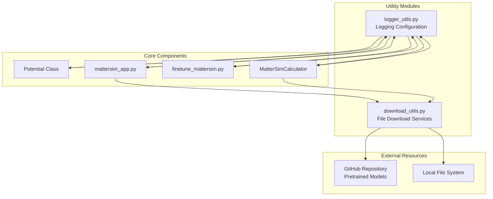
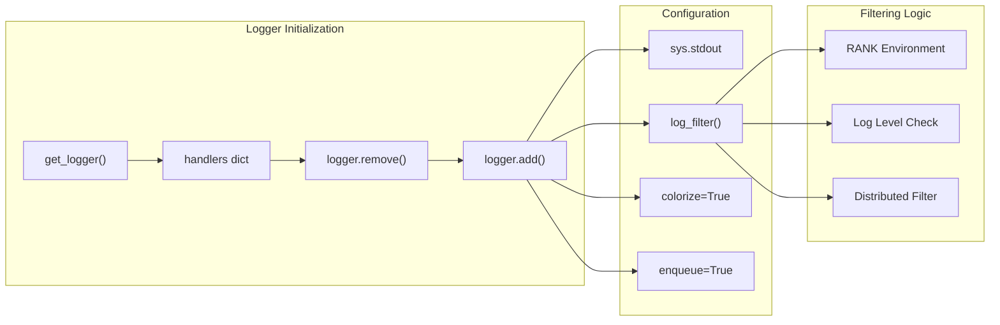
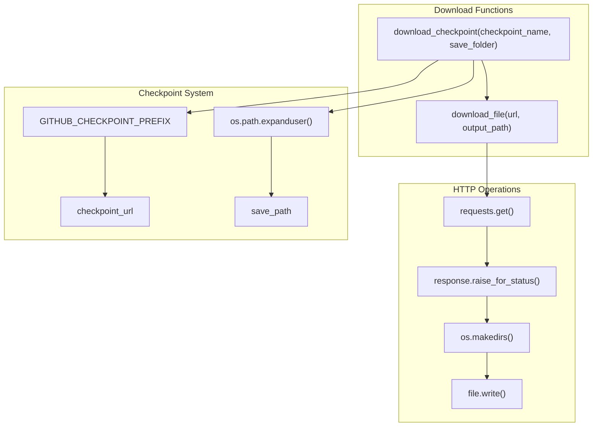
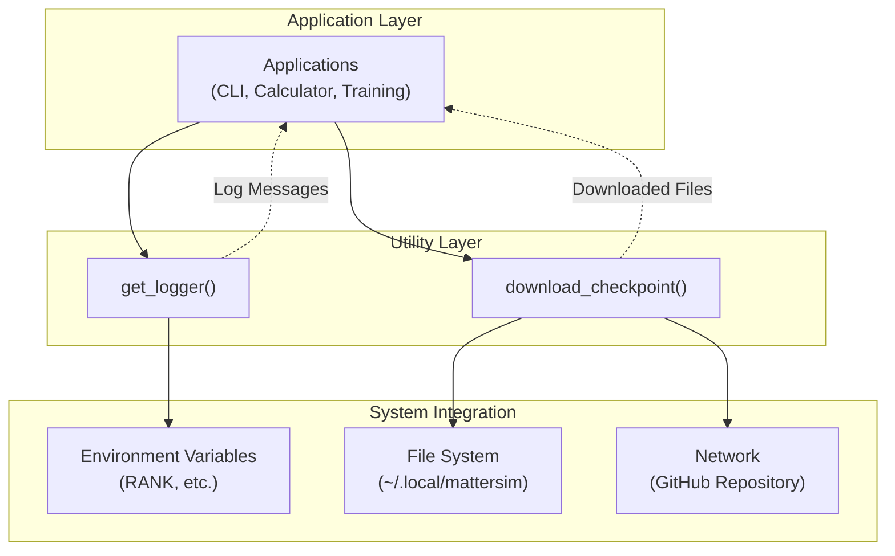

<!-- source: DeepWiki mcp.deepwiki.com · repo microsoft/mattersim · page 9 Utility Functions · fetched 2026-10-26 -->

# Utility Functions

<details>
<summary>Relevant source files</summary>

The following files were used as context for generating this wiki page:

- [MANIFEST.in](MANIFEST.in)
- [pretrained_models/mattersim-v1.0.0-1M.pth](pretrained_models/mattersim-v1.0.0-1M.pth)
- [pretrained_models/mattersim-v1.0.0-5M.pth](pretrained_models/mattersim-v1.0.0-5M.pth)
- [src/mattersim/utils/download_utils.py](src/mattersim/utils/download_utils.py)
- [src/mattersim/utils/logger_utils.py](src/mattersim/utils/logger_utils.py)

</details>


This page documents the utility functions and helper modules that provide supporting functionality across the MatterSim codebase. These utilities handle cross-cutting concerns including logging configuration, file downloads, and data processing operations that are shared by multiple components.

For information about data processing pipelines specific to training and inference, see [Data Processing Pipeline](#2.4). For build and deployment utilities, see [Build System & CI/CD](#7.1).

## Overview

The MatterSim utility functions are organized into focused modules that provide essential supporting services:



Sources: [src/mattersim/utils/logger_utils.py:1-31](), [src/mattersim/utils/download_utils.py:1-48]()

## Logging Utilities

The logging system provides centralized log management with support for distributed training environments. The `logger_utils` module configures and manages loguru-based logging.

### Logger Configuration

The primary interface is the `get_logger()` function which returns a configured logger instance:



The logger configuration includes:
- **Single Instance Pattern**: Uses a global `handlers` dictionary to ensure logger is configured only once
- **Console Output**: Logs are directed to `sys.stdout` with color formatting enabled
- **Asynchronous Processing**: `enqueue=True` enables non-blocking log processing
- **Distributed Training Support**: Custom filtering for multi-process environments

Sources: [src/mattersim/utils/logger_utils.py:10-20]()

### Distributed Training Log Filtering

The `log_filter()` function implements specialized filtering logic for distributed training scenarios:

| Condition | Behavior | Purpose |
|-----------|----------|---------|
| `level != "INFO"` | Always pass through | Ensure warnings/errors are visible |
| `RANK` not set | Pass through INFO logs | Single process mode |
| `RANK == 0` | Pass through INFO logs | Primary process logging |
| `RANK > 0` | Filter out INFO logs | Avoid duplicate logs from workers |

This filtering prevents log pollution in distributed training where multiple processes would otherwise generate identical INFO-level messages.

Sources: [src/mattersim/utils/logger_utils.py:23-31]()

## Download Utilities

The download system provides robust file downloading capabilities with specific support for MatterSim model checkpoints. The `download_utils` module handles HTTP downloads and checkpoint management.

### File Download Infrastructure



Sources: [src/mattersim/utils/download_utils.py:11-27]()

### Core Download Function

The `download_file()` function provides the base downloading capability with error handling and directory management:

- **HTTP Request Handling**: Uses `requests.get()` with automatic status checking via `raise_for_status()`
- **Directory Creation**: Automatically creates parent directories using `os.makedirs(exist_ok=True)`
- **Progress Logging**: Provides informational logging for download start and completion
- **Binary File Handling**: Writes content in binary mode to preserve file integrity

Sources: [src/mattersim/utils/download_utils.py:11-27]()

### Checkpoint Download System

The `download_checkpoint()` function specializes in downloading pre-trained MatterSim models:

| Parameter | Default Value | Purpose |
|-----------|---------------|---------|
| `checkpoint_name` | Required | Filename of the checkpoint to download |
| `save_folder` | `~/.local/mattersim/pretrained_models/` | Local storage location |

The function constructs URLs using the hardcoded GitHub repository prefix and handles path expansion for user directories. The default save location follows XDG conventions for user-local data storage.

**URL Construction Pattern**:
```
https://raw.githubusercontent.com/microsoft/mattersim/main/pretrained_models/{checkpoint_name}
```

Sources: [src/mattersim/utils/download_utils.py:29-48]()

## Integration Patterns

The utility functions integrate with the broader MatterSim system through standardized patterns:



### Usage Patterns

**Logging Integration**: Components throughout the system import and use the logger:
```python
from mattersim.utils.logger_utils import get_logger
logger = get_logger()
```

**Checkpoint Management**: Model loading components use the download utilities:
```python
from mattersim.utils.download_utils import download_checkpoint
download_checkpoint("mattersim-v1.0.0-1M.pth")
```

**Distributed Training**: The logging system automatically adapts to distributed environments by detecting the `RANK` environment variable set by distributed training frameworks.

Sources: [src/mattersim/utils/logger_utils.py:1-31](), [src/mattersim/utils/download_utils.py:1-48]()

## Error Handling and Reliability

The utility functions implement robust error handling strategies:

- **HTTP Errors**: Download functions use `raise_for_status()` to convert HTTP errors into Python exceptions
- **File System Errors**: Directory creation uses `exist_ok=True` to handle concurrent access scenarios
- **Environment Handling**: Logger filtering gracefully handles missing environment variables
- **Resource Management**: File handles are properly managed using context managers (`with` statements)

This error handling ensures that utility failures propagate appropriately to calling code while maintaining system stability.

Sources: [src/mattersim/utils/download_utils.py:22-26](), [src/mattersim/utils/logger_utils.py:27-30]()