# Page: Overview

# Overview

<details>
<summary>Relevant source files</summary>

The following files were used as context for generating this wiki page:

- [MODEL_CARD.md](MODEL_CARD.md)
- [README.md](README.md)

</details>


MatterSim is a deep learning atomistic model designed for simulating materials across different elements, temperatures, and pressures. This document provides a high-level introduction to the MatterSim system, its architecture, capabilities, and use cases.

MatterSim enables efficient atomistic simulations at the first-principles level and accurate prediction of material properties across the periodic table, supporting temperature ranges from 0 to 5000K and pressures up to 1000 GPa. It serves as a machine learning force field that can predict ground-state material structures, energetics, and simulate material behavior under realistic conditions.

For detailed installation instructions, see [Installation & Setup](#3). For usage examples, see [Usage](#4). For information about training and fine-tuning, see [Training & Fine-tuning](#5).

Sources: [README.md:17-17](), [MODEL_CARD.md:22-22]()

## System Architecture

### Core MatterSim Components

MatterSim implements a modular deep learning architecture centered around the M3GNet neural network for atomistic simulations. The system bridges machine learning models with established computational chemistry interfaces.

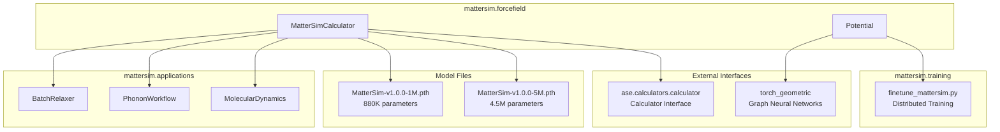

### Key Code Entities

| Component | Location | Purpose |
|-----------|----------|---------|
| `MatterSimCalculator` | `mattersim.forcefield` | ASE calculator interface for single structures |
| `Potential` | `mattersim.potential` | Batch processing and training wrapper |
| `finetune_mattersim.py` | `src/mattersim/training/` | Distributed fine-tuning script |
| `BatchRelaxer` | `mattersim.applications.relaxation` | Structure optimization |
| `PhononWorkflow` | `mattersim.applications.phonon` | Vibrational property calculations |

Sources: [README.md:75-80](), [README.md:96-120]()

### Integration Layer Architecture

MatterSim implements standardized interfaces to computational chemistry and machine learning ecosystems through specific adapter patterns:

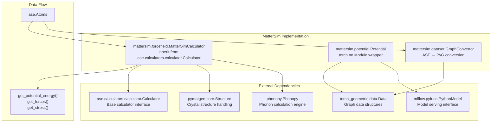

Sources: [README.md:96-120]()

## Pre-trained Models

MatterSim currently offers two pre-trained models based on the M3GNet architecture:

| Model | Parameters | Description | Use Case |
|-------|------------|-------------|----------|
| MatterSim-v1.0.0-1M | ~880K | Smaller, faster model | Quick simulations, larger systems |
| MatterSim-v1.0.0-5M | ~4.5M | Larger, more accurate model | Higher accuracy requirements |

These models have been trained on datasets containing millions of atomic configurations across different elements, temperatures, and pressures. The models can predict energies, forces, and stresses for a wide range of materials.

Sources: [README.md:75-80](), [MODEL_CARD.md:38-42]()

## Performance and Capabilities

MatterSim demonstrates strong performance across various test datasets:

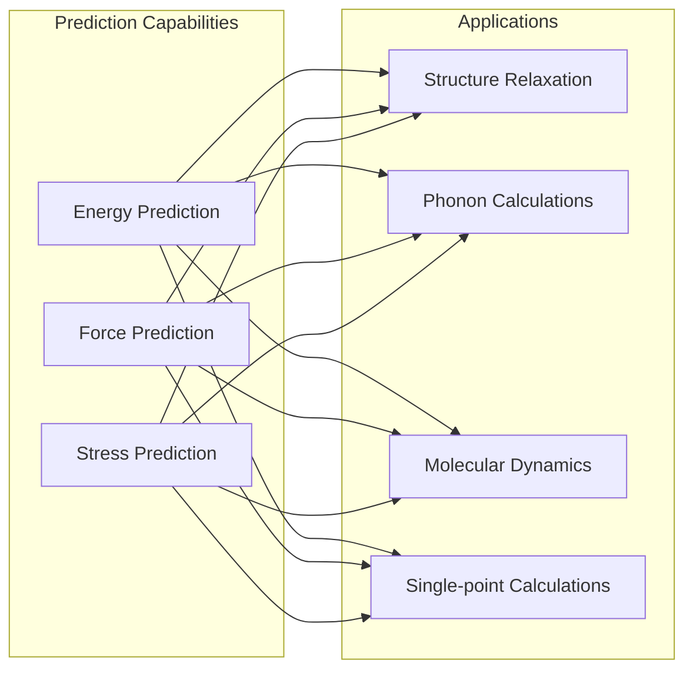

Performance metrics on benchmark datasets show that the 5M parameter model generally outperforms the 1M model, with energy prediction errors as low as 0.016 eV/atom on the Alexandria-1k dataset.

Sources: [MODEL_CARD.md:102-121]()

## Basic Usage Pattern

MatterSim follows the ASE `Calculator` interface pattern, allowing seamless integration with existing atomistic simulation workflows:

**Core Calculator Interface:**
```python
from mattersim.forcefield import MatterSimCalculator
from ase.build import bulk

# Initialize calculator with specific model checkpoint
calc = MatterSimCalculator(
    load_path="MatterSim-v1.0.0-5M.pth",  # Model selection
    device="cuda"                          # Hardware target
)

# Attach to ASE Atoms object
atoms = bulk("Si", "diamond", a=5.43)
atoms.calc = calc

# Standard ASE property methods
energy = atoms.get_potential_energy()     # Returns float [eV]
forces = atoms.get_forces()               # Returns ndarray [eV/Å]  
stress = atoms.get_stress(voigt=False)    # Returns 3x3 tensor [eV/ų]
```

**Model Selection:**
- Default: `MatterSim-v1.0.0-1M.pth` (faster inference)
- High accuracy: `MatterSim-v1.0.0-5M.pth` (better predictions)

Sources: [README.md:96-120]()

## Training and Customization Pipeline

MatterSim implements a distributed fine-tuning system using `torch.distributed` for domain-specific model adaptation:

### Fine-tuning Workflow

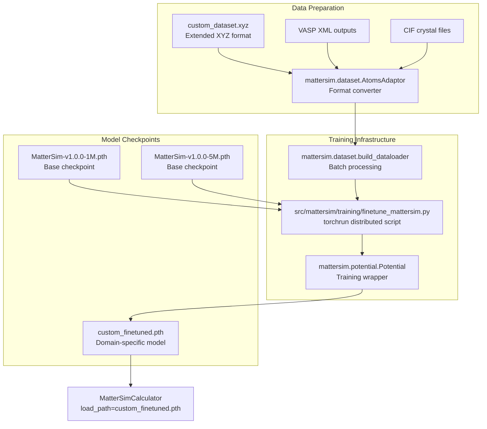

### Distributed Training Command

```bash
# Multi-GPU fine-tuning
torchrun --nproc_per_node=4 \
    src/mattersim/training/finetune_mattersim.py \
    --load_model_path mattersim-v1.0.0-1m \
    --train_data_path custom_dataset.xyz \
    --batch_size 32 \
    --learning_rate 1e-4
```

Sources: [README.md:122-131]()

## Limitations

MatterSim has several limitations to be aware of:

1. **Application Scope**: Designed specifically for bulk materials; applications involving surfaces, interfaces, or long-range interactions may require fine-tuning.
2. **Accuracy Trade-offs**: While fast, accuracy is inferior to more computationally expensive methods.
3. **Theoretical Basis**: Trained on PBE Density Functional Theory, which has known limitations for highly-correlated systems.
4. **Material Types**: Lower accuracy for organic polymeric systems.

For quantitative results in specialized applications, fine-tuning on domain-specific data is recommended.

Sources: [README.md:156-157](), [MODEL_CARD.md:164-173]()

## Citation and References

When using MatterSim, please cite the following paper:

```
@article{yang2024mattersim,
      title={MatterSim: A Deep Learning Atomistic Model Across Elements, Temperatures and Pressures},
      author={Han Yang and Chenxi Hu and Yichi Zhou and Xixian Liu and Yu Shi and Jielan Li and Guanzhi Li and Zekun Chen and Shuizhou Chen and Claudio Zeni and Matthew Horton and Robert Pinsler and Andrew Fowler and Daniel Zügner and Tian Xie and Jake Smith and Lixin Sun and Qian Wang and Lingyu Kong and Chang Liu and Hongxia Hao and Ziheng Lu},
      year={2024},
      eprint={2405.04967},
      archivePrefix={arXiv},
      primaryClass={cond-mat.mtrl-sci},
      url={https://arxiv.org/abs/2405.04967},
      journal={arXiv preprint arXiv:2405.04967}
}
```

When reporting results, please specify the exact model version used (e.g., MatterSim-v1.0.0-1M) to ensure reproducibility.

Sources: [README.md:138-149](), [README.md:152-153]()

---

# Page: Core Components

# Core Components

<details>
<summary>Relevant source files</summary>

The following files were used as context for generating this wiki page:

- [src/mattersim/forcefield/__init__.py](src/mattersim/forcefield/__init__.py)
- [src/mattersim/forcefield/potential.py](src/mattersim/forcefield/potential.py)

</details>


This document provides an overview of the fundamental building blocks that comprise the MatterSim deep learning atomistic model. The core components include the `Potential` class for model operations, calculator interfaces for ASE integration, pre-trained models, and data processing utilities that enable materials simulation workflows.

For detailed usage examples and practical guides, see [Usage](#4). For information about training and customizing these components, see [Training & Fine-tuning](#5).

## Architecture Overview

The MatterSim core components form a layered architecture that separates model operations, interface layers, and data processing:

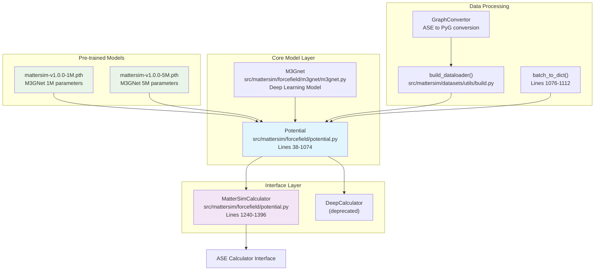

Sources: [src/mattersim/forcefield/potential.py:1-1396](), [src/mattersim/forcefield/__init__.py:1-4]()

## Component Overview

### Potential Class

The `Potential` class is the central wrapper that encapsulates force field models and provides comprehensive functionality for training, inference, and model management. It serves as the primary interface for all model operations including forward passes, gradient computation, and checkpoint handling.

Key capabilities:
- **Model Operations**: Forward inference with automatic differentiation for forces and stresses [src/mattersim/forcefield/potential.py:725-825]()
- **Training Support**: Complete training loop with validation, early stopping, and distributed training [src/mattersim/forcefield/potential.py:186-356]()
- **Checkpoint Management**: Loading pre-trained models and saving custom checkpoints [src/mattersim/forcefield/potential.py:848-956]()
- **Fine-tuning**: Layer freezing and custom head support for transfer learning [src/mattersim/forcefield/potential.py:158-184]()

For comprehensive documentation, see [Potential Class](#2.1).

### MatterSimCalculator

The `MatterSimCalculator` class provides seamless integration with the Atomic Simulation Environment (ASE) framework, enabling MatterSim to be used as a standard ASE calculator for single structure calculations.

Key features:
- **ASE Compatibility**: Implements standard ASE calculator interface with `energy`, `forces`, and `stress` properties [src/mattersim/forcefield/potential.py:1245]()
- **Automatic Setup**: Default initialization with pre-trained models [src/mattersim/forcefield/potential.py:1264-1267]()
- **Flexible Configuration**: Customizable stress computation and device selection [src/mattersim/forcefield/potential.py:1251-1252]()

For usage examples and detailed configuration, see [MatterSimCalculator](#2.2).

### Pre-trained Models

MatterSim provides two pre-trained M3GNet model variants that are automatically downloaded and cached locally:

| Model | Parameters | File | Description |
|-------|------------|------|-------------|
| 1M | ~1 million | `mattersim-v1.0.0-1M.pth` | Compact model for faster inference |
| 5M | ~5 million | `mattersim-v1.0.0-5M.pth` | Larger model with higher accuracy |

Both models are trained on extensive materials datasets and support energy, force, and stress predictions. For detailed model specifications and performance characteristics, see [Pre-trained Models](#2.3).

### Data Processing Pipeline

The data processing components handle conversion between different atomic structure representations and prepare data for model consumption:

- **`build_dataloader()`**: Converts ASE `Atoms` objects to PyTorch Geometric `DataLoader` instances [src/mattersim/datasets/utils/build.py]()
- **`batch_to_dict()`**: Transforms PyG batch objects into input dictionaries for model forward passes [src/mattersim/forcefield/potential.py:1076-1112]()
- **Graph Construction**: Automatic neighbor finding, periodic boundary handling, and three-body interaction computation

For implementation details and custom data preparation, see [Data Processing Pipeline](#2.4).

## Component Interactions

The following diagram illustrates how the core components interact during a typical prediction workflow:

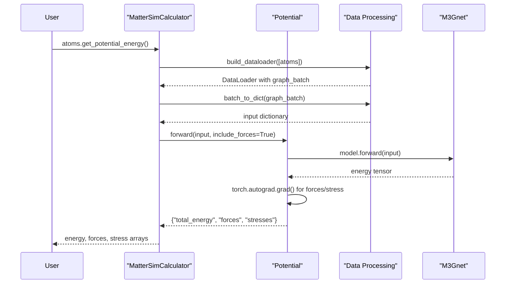

Sources: [src/mattersim/forcefield/potential.py:1313-1395](), [src/mattersim/forcefield/potential.py:725-825]()

## Usage Patterns

The core components support several common usage patterns:

**Single Structure Calculation**:
```python
from mattersim import MatterSimCalculator
calc = MatterSimCalculator()
atoms.calc = calc
energy = atoms.get_potential_energy()
```

**Batch Processing**:
```python
from mattersim import Potential
potential = Potential.from_checkpoint()
energies, forces, stresses = potential.predict_properties(dataloader)
```

**Custom Model Loading**:
```python
potential = Potential.from_checkpoint("path/to/custom/model.pth")
calc = MatterSimCalculator.from_potential(potential)
```

Sources: [src/mattersim/forcefield/potential.py:1273-1276](), [src/mattersim/forcefield/potential.py:474-518](), [src/mattersim/forcefield/potential.py:1278-1280]()

---

# Page: Potential Class

# Potential Class

<details>
<summary>Relevant source files</summary>

The following files were used as context for generating this wiki page:

- [src/mattersim/forcefield/__init__.py](src/mattersim/forcefield/__init__.py)
- [src/mattersim/forcefield/potential.py](src/mattersim/forcefield/potential.py)

</details>


The `Potential` class serves as the primary wrapper and interface for deep learning force field models in MatterSim. This class handles training, inference, fine-tuning, and model management for atomistic property predictions including energies, forces, and stresses. It provides both low-level batch processing capabilities for training workflows and high-level inference methods for applications.

For single-structure calculations using ASE interfaces, see [MatterSimCalculator](#2.2). For information about pre-trained model variants and loading, see [Pre-trained Models](#2.3).

## Architecture Overview

The `Potential` class extends `torch.nn.Module` and acts as a comprehensive wrapper around the underlying neural network models (primarily M3GNet). It integrates training infrastructure, optimization components, and inference capabilities into a unified interface.

**Potential Class Architecture**
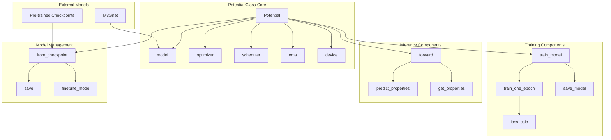

Sources: [src/mattersim/forcefield/potential.py:38-111]()

## Core Components

### Initialization Parameters

The `Potential` class accepts several key initialization parameters that configure the training and inference behavior:

| Parameter | Type | Default | Description |
|-----------|------|---------|-------------|
| `model` | `nn.Module` | Required | The underlying neural network model |
| `optimizer` | `torch.optim.Optimizer` | `Adam` | Optimizer for training |
| `scheduler` | `str` or `torch.optim.lr_scheduler` | `"StepLR"` | Learning rate scheduler |
| `ema` | `ExponentialMovingAverage` | Auto-created | Exponential moving average for stability |
| `device` | `str` | Auto-detected | Computation device (cuda/cpu) |
| `allow_tf32` | `bool` | `False` | Enable TensorFloat-32 for performance |

Sources: [src/mattersim/forcefield/potential.py:43-111]()

### Training Infrastructure

The class includes comprehensive training infrastructure with support for distributed training, early stopping, and model checkpointing:

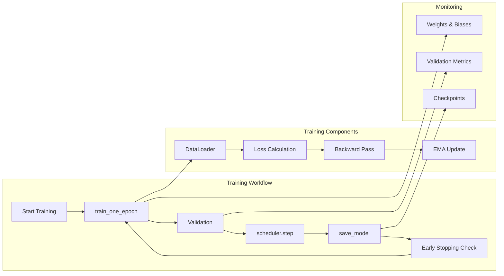

Sources: [src/mattersim/forcefield/potential.py:186-357]()

## Key Functionality

### Model Loading and Checkpointing

The `from_checkpoint` class method provides a unified interface for loading both pre-trained and custom models:

**Model Loading Workflow**
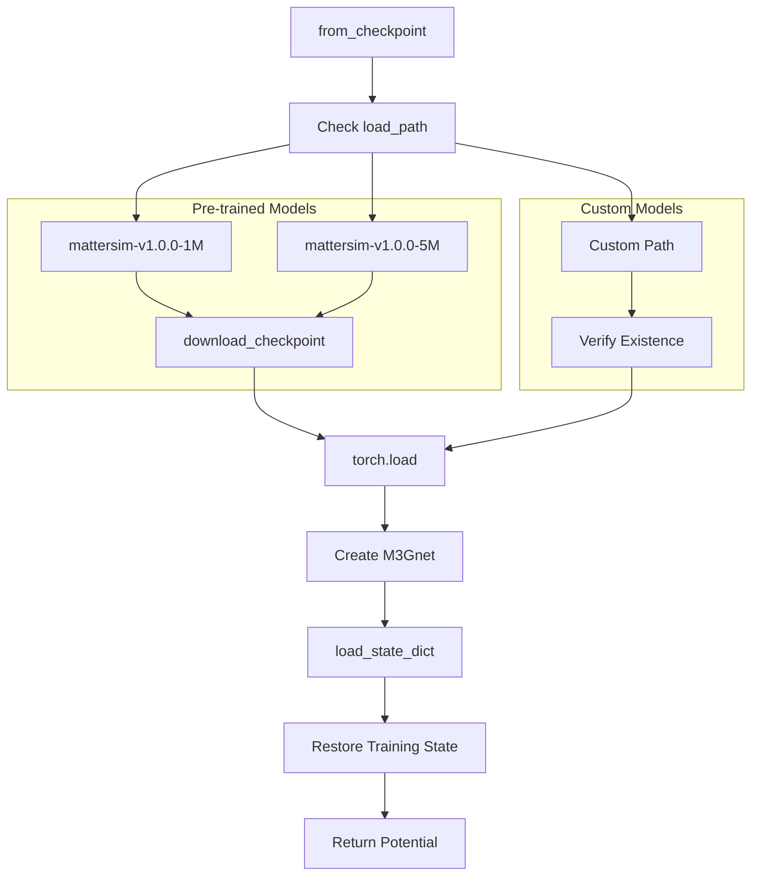

Sources: [src/mattersim/forcefield/potential.py:848-956]()

### Forward Pass and Property Prediction

The `forward` method handles the core computation logic for predicting energies, forces, and stresses:

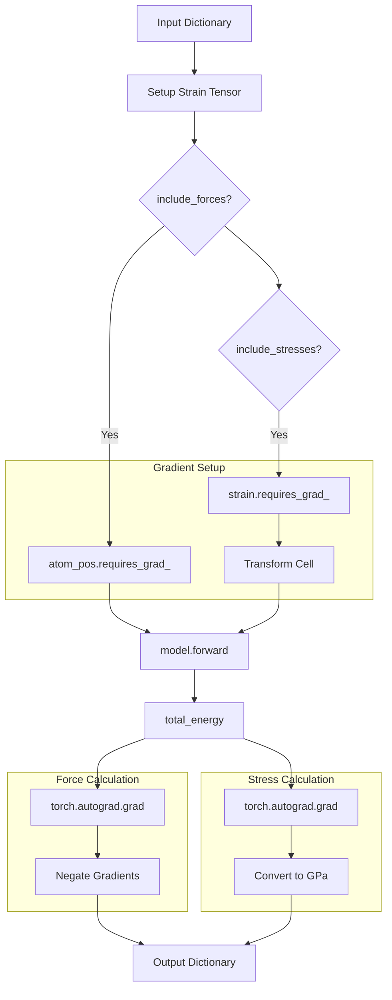

Sources: [src/mattersim/forcefield/potential.py:725-825]()

### Fine-tuning Support

The class provides specialized fine-tuning capabilities with layer freezing and custom head support:

| Fine-tuning Parameter | Description |
|----------------------|-------------|
| `finetune_layers` | Number of layers to fine-tune (-1 for all layers) |
| `finetune_head` | Custom head for fine-tuning tasks |
| `reset_head_for_finetune` | Whether to reset the original head |
| `finetune_task_mean/std` | Task-specific normalization parameters |

The `freeze_reset_model` method selectively freezes model parameters based on the specified fine-tuning configuration.

Sources: [src/mattersim/forcefield/potential.py:158-184]()

## Integration with MatterSim Ecosystem

The `Potential` class integrates with several other MatterSim components:

**Potential Integration Map**
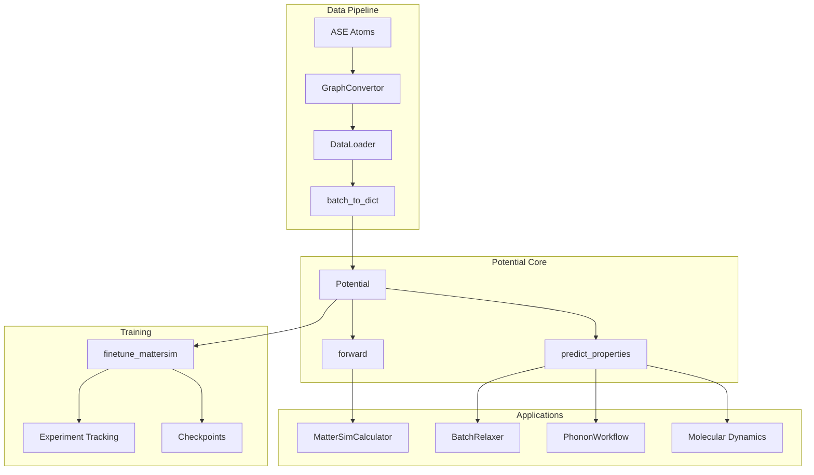

Sources: [src/mattersim/forcefield/potential.py:1076-1112](), [src/mattersim/forcefield/__init__.py:1-5]()

## Utility Functions

### Batch Processing Helper

The `batch_to_dict` function converts PyTorch Geometric batch objects into input dictionaries compatible with the model forward pass:

```python
def batch_to_dict(graph_batch, model_type="m3gnet", device="cuda")
```

This function extracts key tensors including `atom_pos`, `cell`, `pbc_offsets`, `atom_attr`, `edge_index`, and `three_body_indices` from the graph batch and assembles them into the expected input format.

Sources: [src/mattersim/forcefield/potential.py:1076-1112]()

### Calculator Classes

The file also includes `MatterSimCalculator` and the deprecated `DeepCalculator` classes that wrap the `Potential` class to provide ASE-compatible interfaces for single-structure calculations.

Sources: [src/mattersim/forcefield/potential.py:1240-1396]()

---

# Page: MatterSimCalculator

# MatterSimCalculator

<details>
<summary>Relevant source files</summary>

The following files were used as context for generating this wiki page:

- [docs/user_guide/getting_started.rst](docs/user_guide/getting_started.rst)
- [src/mattersim/forcefield/__init__.py](src/mattersim/forcefield/__init__.py)
- [src/mattersim/forcefield/potential.py](src/mattersim/forcefield/potential.py)

</details>


The `MatterSimCalculator` class provides an ASE (Atomic Simulation Environment) compatible interface for performing single-structure calculations using MatterSim's deep learning models. It serves as the primary entry point for users who want to integrate MatterSim with ASE-based workflows and tools.

For batch processing of multiple structures, see [Batch Processing](#4.2). For information about the underlying computational engine, see [Potential Class](#2.1). For practical usage examples, see [Basic Usage with ASE](#4.1).

## Architecture Overview

The `MatterSimCalculator` acts as an adapter between ASE's calculator interface and MatterSim's `Potential` class, enabling seamless integration with the broader ASE ecosystem.

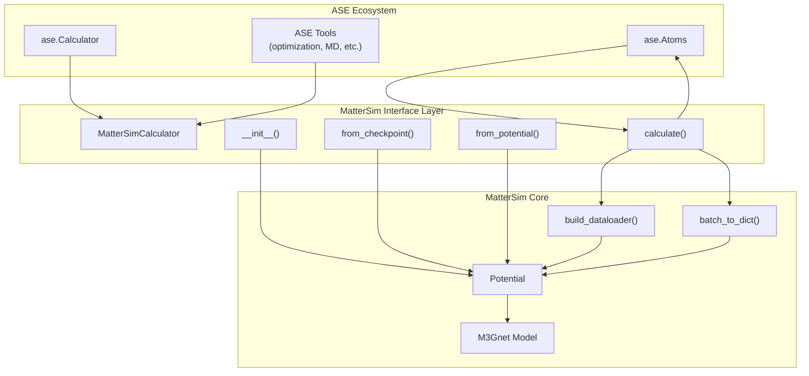

**Sources:** [src/mattersim/forcefield/potential.py:1240-1396](), [docs/user_guide/getting_started.rst:4-33]()

## Class Structure and Properties

The `MatterSimCalculator` implements the standard ASE calculator interface with support for energy, force, and stress calculations.

| Property | Type | Description |
|----------|------|-------------|
| `implemented_properties` | `list` | `["energy", "free_energy", "forces", "stress"]` |
| `potential` | `Potential` | The underlying MatterSim potential object |
| `compute_stress` | `bool` | Whether to calculate stress tensors |
| `stress_weight` | `float` | Stress scaling factor (default: `GPa`) |
| `device` | `str` | Compute device (`"cuda"` or `"cpu"`) |
| `args_dict` | `dict` | Additional arguments for data processing |

**Sources:** [src/mattersim/forcefield/potential.py:1245-1272]()

## Initialization and Factory Methods

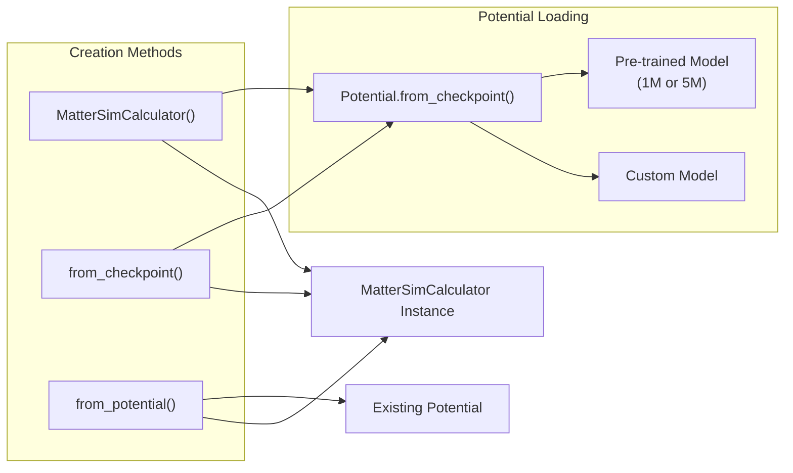

The calculator can be initialized in three ways:

1. **Direct constructor**: Creates a default potential if none provided
2. **`from_checkpoint()`**: Loads a specific model checkpoint
3. **`from_potential()`**: Uses an existing `Potential` instance

**Sources:** [src/mattersim/forcefield/potential.py:1247-1281]()

## Calculation Workflow

The `calculate()` method implements the core ASE calculator interface, converting ASE `Atoms` objects to MatterSim's internal representation and computing the requested properties.

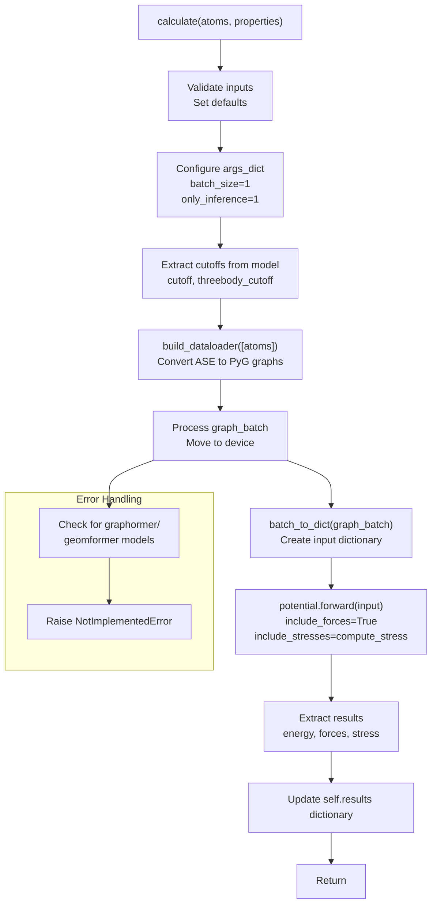

**Sources:** [src/mattersim/forcefield/potential.py:1313-1396]()

## Data Flow and Type Conversions

The calculator performs several key data transformations during computation:

| Step | Input Type | Output Type | Function |
|------|------------|-------------|----------|
| 1 | `ase.Atoms` | `list[ase.Atoms]` | Wrap in list |
| 2 | `list[ase.Atoms]` | `DataLoader` | `build_dataloader()` |
| 3 | `DataLoader` | `graph_batch` | PyTorch Geometric batch |
| 4 | `graph_batch` | `dict` | `batch_to_dict()` |
| 5 | `dict` | `dict` | `potential.forward()` |
| 6 | `dict` | ASE results | Extract and convert units |

**Sources:** [src/mattersim/forcefield/potential.py:1344-1396](), [src/mattersim/forcefield/potential.py:1076-1112]()

## Stress Tensor Handling

The calculator includes sophisticated stress tensor processing with unit conversions:

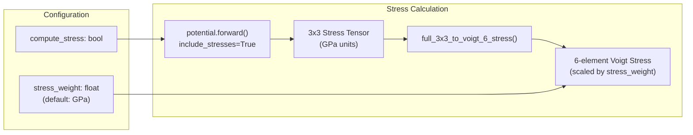

The default `stress_weight` is set to `GPa` (from ASE units), which converts from the internal GPa units to ASE's stress units (eV/ų).

**Sources:** [src/mattersim/forcefield/potential.py:1389-1395](), [src/mattersim/forcefield/potential.py:1252]()

## Integration with ASE Ecosystem

The `MatterSimCalculator` seamlessly integrates with ASE tools through the standard calculator interface:

```python
# Standard ASE usage pattern
atoms.calc = MatterSimCalculator(device="cuda")
energy = atoms.get_potential_energy()
forces = atoms.get_forces()
stress = atoms.get_stress()
```

This enables direct use with ASE optimization algorithms, molecular dynamics drivers, and analysis tools without modification.

**Sources:** [docs/user_guide/getting_started.rst:21-27]()

## Performance Considerations

The `MatterSimCalculator` is optimized for single-structure calculations but has some inherent limitations:

- **Batch size**: Fixed at 1 for ASE compatibility
- **GPU utilization**: Suboptimal for large-scale calculations
- **Memory overhead**: Creates dataloader for each calculation

For high-throughput scenarios, consider using the `Potential` class directly with `predict_properties()` method, as described in [Batch Processing](#4.2).

**Sources:** [docs/user_guide/getting_started.rst:30-33]()

---

# Page: Pre-trained Models

# Pre-trained Models

<details>
<summary>Relevant source files</summary>

The following files were used as context for generating this wiki page:

- [MANIFEST.in](MANIFEST.in)
- [README.md](README.md)
- [pretrained_models/mattersim-v1.0.0-1M.pth](pretrained_models/mattersim-v1.0.0-1M.pth)
- [pretrained_models/mattersim-v1.0.0-5M.pth](pretrained_models/mattersim-v1.0.0-5M.pth)
- [src/mattersim/utils/download_utils.py](src/mattersim/utils/download_utils.py)

</details>


This document describes the available pre-trained models in MatterSim, their specifications, storage mechanisms, and how to load and use them for materials simulation tasks. For information about training custom models, see [Fine-tuning Process](#5.2). For details about the calculator interface that uses these models, see [MatterSimCalculator](#2.2).

## Available Models

MatterSim provides two pre-trained **MatterSim-v1** models based on the **M3GNet** architecture:

| Model Name | Description | Use Case |
|------------|-------------|----------|
| `MatterSim-v1.0.0-1M` | Mini version with 1M parameters | Faster inference, lower memory usage |
| `MatterSim-v1.0.0-5M` | Larger version with 5M parameters | Higher accuracy, more comprehensive predictions |

Both models are trained using data generated through workflows described in the MatterSim manuscript and support energy, force, and stress calculations for bulk materials across various elements, temperatures, and pressures.

Sources: [README.md:74-87]()

## Model Architecture and Format

### M3GNet Architecture
The pre-trained models implement the M3GNet (Materials 3-body Graph Network) architecture, which uses graph neural networks to represent atomic structures and predict material properties through multi-body interactions.

### Model Storage Format
Models are stored as PyTorch checkpoint files (`.pth` format) containing:
- Model state dictionary with neural network weights
- Model architecture parameters (`num_blocks`, `units`, `max_l`, `max_n`, `cutoff`, `max_z`, `threebody_cutoff`)
- Normalization parameters (`scaler`, `shift`)
- Training metadata and optimizer state

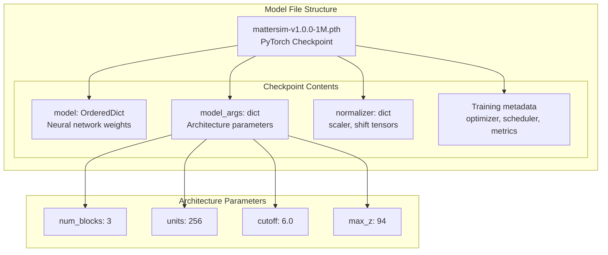

Sources: [pretrained_models/mattersim-v1.0.0-1M.pth:1-50]()

## Model Loading and Usage

### Default Model Loading
By default, `MatterSimCalculator` loads the 1M parameter model:

```python
from mattersim.forcefield import MatterSimCalculator

# Loads MatterSim-v1.0.0-1M.pth by default
calc = MatterSimCalculator(device="cuda")
```

### Loading Specific Models
To use the 5M parameter model, specify the `load_path` parameter:

```python
# Load the larger 5M model
calc = MatterSimCalculator(
    load_path="MatterSim-v1.0.0-5M.pth", 
    device="cuda"
)
```

### Model Integration Flow

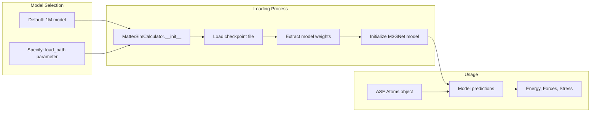

Sources: [README.md:114-119]()

## Download and Storage System

### Automatic Download
Models are automatically downloaded when first accessed if not found locally. The download system uses GitHub as the source repository.

### Download Utilities
The `download_utils` module provides functions for retrieving model checkpoints:

```python
def download_checkpoint(
    checkpoint_name: str, 
    save_folder: str = "~/.local/mattersim/pretrained_models/"
)
```

### Storage Location
- **Default local path**: `~/.local/mattersim/pretrained_models/`
- **Repository source**: `https://raw.githubusercontent.com/microsoft/mattersim/main/pretrained_models/`
- **Supported formats**: `.pth` PyTorch checkpoint files

### Download Workflow

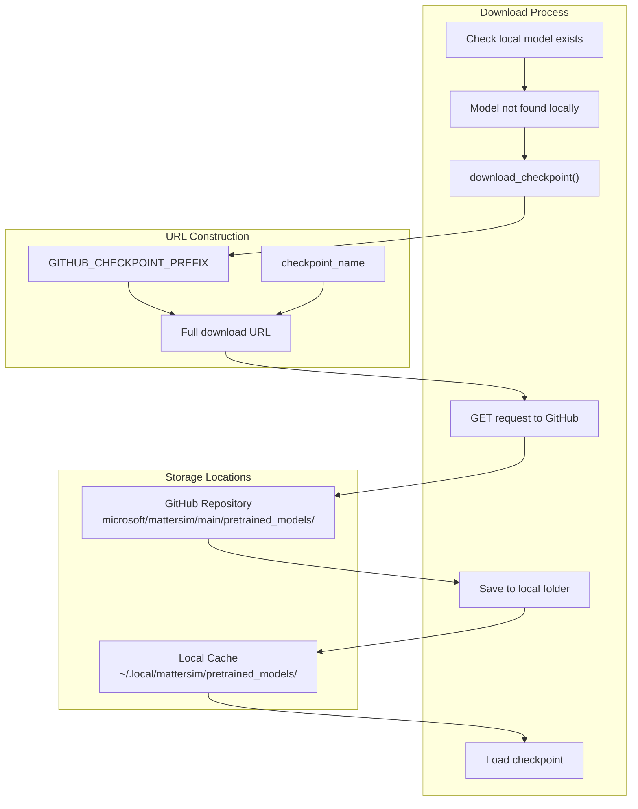

Sources: [src/mattersim/utils/download_utils.py:29-48]()

## Model Specifications

### Performance Characteristics

| Aspect | MatterSim-v1.0.0-1M | MatterSim-v1.0.0-5M |
|--------|----------------------|----------------------|
| Parameters | ~1M | ~5M |
| Inference Speed | Faster | Slower |
| Memory Usage | Lower | Higher |
| Accuracy | Good | Better |
| Recommended Use | Quick calculations, prototyping | Production, high-accuracy needs |

### Training Data Coverage
Both models are trained on data covering:
- Multiple chemical elements across the periodic table
- Various temperature and pressure conditions
- Bulk material structures
- Energy, force, and stress properties

### Limitations
- **Scope**: Designed specifically for bulk materials
- **Surfaces and interfaces**: Results may be qualitatively accurate but not suitable for quantitative analysis
- **Long-range interactions**: Properties influenced by long-range interactions should be used with caution
- **Fine-tuning recommended**: For specialized applications beyond bulk materials

Sources: [README.md:154-157]()

---

# Page: Data Processing Pipeline

# Data Processing Pipeline

<details>
<summary>Relevant source files</summary>

The following files were used as context for generating this wiki page:

- [.gitignore](.gitignore)
- [setup.py](setup.py)
- [src/mattersim/datasets/utils/convertor.py](src/mattersim/datasets/utils/convertor.py)
- [src/mattersim/datasets/utils/regressor.py](src/mattersim/datasets/utils/regressor.py)
- [src/mattersim/datasets/utils/setup.py](src/mattersim/datasets/utils/setup.py)
- [src/mattersim/datasets/utils/threebody_indices.pyx](src/mattersim/datasets/utils/threebody_indices.pyx)

</details>


This document describes MatterSim's data processing pipeline that converts atomic structures into graph representations suitable for deep learning models. The pipeline transforms ASE `Atoms` objects into PyTorch Geometric `Data` objects containing node features, edge connectivity, and three-body angular information required by the M3GNet architecture.

For information about loading and using pre-trained models with processed data, see [Pre-trained Models](#2.3). For details about the training workflow that consumes this processed data, see [Fine-tuning Process](#5.2).

## Pipeline Overview

The data processing pipeline consists of three main stages: structure normalization, graph construction, and feature extraction. The pipeline handles both periodic and non-periodic systems, automatically detecting boundary conditions and applying appropriate neighbor-finding algorithms.

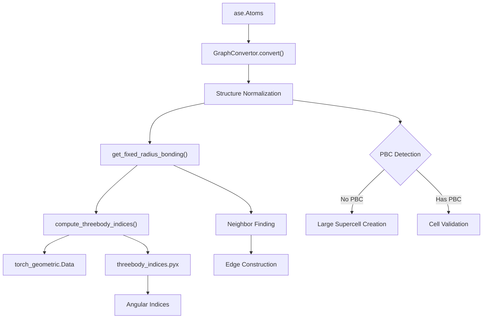

Sources: [src/mattersim/datasets/utils/convertor.py:154-291]()

## Core Components

### GraphConvertor Class

The `GraphConvertor` class serves as the main interface for structure-to-graph conversion. It supports configurable cutoff radii for two-body and three-body interactions and handles M3GNet-specific graph construction.

| Parameter | Default | Description |
|-----------|---------|-------------|
| `model_type` | "m3gnet" | Target model architecture |
| `twobody_cutoff` | 5.0 | Cutoff radius for edge detection (Å) |
| `threebody_cutoff` | 4.0 | Cutoff radius for angular interactions (Å) |
| `has_threebody` | True | Enable three-body angle computation |

The `convert()` method processes input structures through several stages:

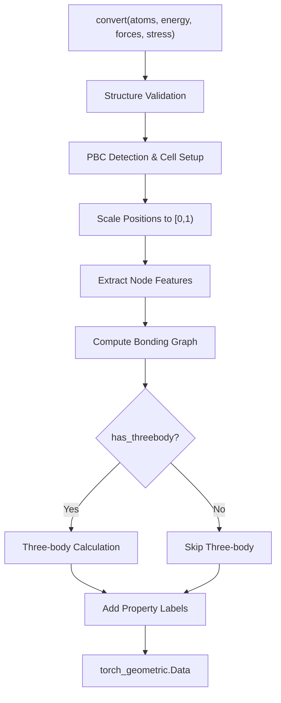

Sources: [src/mattersim/datasets/utils/convertor.py:154-184](), [src/mattersim/datasets/utils/convertor.py:227-283]()

### Neighbor Finding Algorithm

The `get_fixed_radius_bonding()` function implements efficient neighbor detection using periodic boundary conditions. It leverages pymatgen's optimized spatial algorithms for scalable neighbor finding in crystalline systems.

```mermaid
graph LR
    STRUCT["ase.Atoms"] --> COORDS["Extract Coordinates"]
    COORDS --> LATTICE["Get Lattice Matrix"]
    LATTICE --> SPHERE["find_points_in_spheres()"]
    SPHERE --> FILTER["Exclude Self-interactions"]
    FILTER --> INDICES["Return: center_indices, neighbor_indices, images, distances"]
```

The function handles both periodic and non-periodic systems by detecting PBC flags and applying appropriate spatial algorithms. For non-periodic systems, a large supercell is automatically created to accommodate the cutoff radius.

Sources: [src/mattersim/datasets/utils/convertor.py:101-151](), [src/mattersim/datasets/utils/convertor.py:117-138]()

### Three-body Index Computation

Three-body angular interactions are computed using an optimized Cython implementation in `threebody_indices.pyx`. The algorithm identifies all angular triplets (i-j-k) where atom j is the central atom and both i-k bonds are within the three-body cutoff.

```mermaid
graph TD
    BONDS["bond_atom_indices"] --> COUNT["Count Bonds per Atom"]
    COUNT --> TRIPLETS["Generate All Triplets"]
    TRIPLETS --> FILTER["Filter by Cutoff"]
    FILTER --> INDICES["triple_bond_indices"]
    
    COUNT --> STATS["Compute Statistics"]
    STATS --> N_IJ["n_triple_ij: angles per bond"]
    STATS --> N_I["n_triple_i: angles per atom"]
    STATS --> N_S["n_triple_s: angles per structure"]
```

The Cython implementation provides significant performance improvements for large systems by avoiding Python loops and utilizing efficient memory management.

Sources: [src/mattersim/datasets/utils/convertor.py:46-98](), [src/mattersim/datasets/utils/threebody_indices.pyx:16-91]()

## Data Flow Architecture

The complete data processing pipeline transforms atomic structures through multiple representation layers:

```mermaid
flowchart TD
    subgraph "Input Formats"
        VASP["VASP XML"]
        XYZ["XYZ Files"]
        CIF["CIF Files"]
        ASE_ATOMS["ase.Atoms"]
    end
    
    subgraph "GraphConvertor Processing"
        NORMALIZE["Structure Normalization"]
        BONDING["get_fixed_radius_bonding()"]
        THREEBODY["compute_threebody_indices()"]
    end
    
    subgraph "Graph Representation"
        NODES["Node Features (atom_attr, atom_pos)"]
        EDGES["Edge Features (edge_index, pbc_offsets)"]
        ANGLES["Angular Features (three_body_indices)"]
    end
    
    subgraph "PyTorch Geometric Data"
        DATA_OBJ["Data(num_nodes, edge_index, atom_attr, ...)"]
    end
    
    VASP --> ASE_ATOMS
    XYZ --> ASE_ATOMS
    CIF --> ASE_ATOMS
    
    ASE_ATOMS --> NORMALIZE
    NORMALIZE --> BONDING
    BONDING --> THREEBODY
    
    NORMALIZE --> NODES
    BONDING --> EDGES
    THREEBODY --> ANGLES
    
    NODES --> DATA_OBJ
    EDGES --> DATA_OBJ
    ANGLES --> DATA_OBJ
```

Sources: [src/mattersim/datasets/utils/convertor.py:17-39](), [src/mattersim/datasets/utils/convertor.py:227-283]()

## Supported Properties

The pipeline generates comprehensive graph representations containing both structural and property information:

| Property | Type | Description |
|----------|------|-------------|
| `num_nodes` | int | Number of atoms in structure |
| `num_edges` | int | Number of bonds within cutoff |
| `atom_attr` | Tensor[N,1] | Atomic numbers |
| `atom_pos` | Tensor[N,3] | Atomic coordinates |
| `edge_index` | Tensor[2,E] | Bond connectivity matrix |
| `pbc_offsets` | Tensor[E,3] | Periodic image vectors |
| `three_body_indices` | Tensor[T,2] | Angular triplet indices |
| `energy` | float | Total energy (if provided) |
| `forces` | Tensor[N,3] | Atomic forces (if provided) |
| `stress` | Tensor[3,3] | Stress tensor (if provided) |

Sources: [src/mattersim/datasets/utils/convertor.py:17-39](), [src/mattersim/datasets/utils/convertor.py:277-283]()

## Performance Optimizations

### Cython Implementation

Critical computational bottlenecks are implemented in Cython for optimal performance. The `threebody_indices.pyx` module provides C-speed computation of angular indices with manual memory management:

```mermaid
graph LR
    PYTHON["Python Interface"] --> CYTHON["Cython compute_threebody()"]
    CYTHON --> MALLOC["malloc() Memory Allocation"]
    MALLOC --> COMPUTE["C-speed Loop Computation"]
    COMPUTE --> ARRAYS["NumPy Array Creation"]
    ARRAYS --> FREE["free() Memory Cleanup"]
    FREE --> RETURN["Return Results"]
```

The Cython implementation eliminates Python overhead for nested loops and array operations, providing substantial speedups for large molecular systems.

Sources: [src/mattersim/datasets/utils/threebody_indices.pyx:16-91](), [setup.py:5-12]()

### Build Integration

The Cython extensions are automatically compiled during package installation through setuptools integration. The build system handles platform-specific compilation flags and NumPy API compatibility.

Sources: [setup.py:1-16](), [src/mattersim/datasets/utils/setup.py:1-16]()

---

# Page: Installation & Setup

# Installation & Setup

<details>
<summary>Relevant source files</summary>

The following files were used as context for generating this wiki page:

- [docs/_static/mattersim.png](docs/_static/mattersim.png)
- [docs/conf.py](docs/conf.py)
- [docs/user_guide/installation.rst](docs/user_guide/installation.rst)
- [environment.yaml](environment.yaml)
- [pyproject.toml](pyproject.toml)

</details>


This document provides comprehensive installation instructions for MatterSim, covering all supported installation methods from simple PyPI installation to development setup from source. It includes system requirements, dependency management, and environment configuration needed to run MatterSim for materials simulation tasks.

For information about using MatterSim after installation, see [Basic Usage with ASE](#4.1). For training and fine-tuning setup, see [Training & Fine-tuning](#5).

## Prerequisites

MatterSim requires Python 3.10 or higher and has specific hardware and software dependencies for optimal performance.

### System Requirements

| Component | Requirement |
|-----------|-------------|
| Python Version | >=3.10 |
| Operating System | Linux (recommended), macOS, Windows |
| Memory | 8GB+ RAM (16GB+ for training) |
| GPU | CUDA-compatible GPU (optional, for acceleration) |
| Disk Space | 2GB+ free space |

### Core Dependencies

MatterSim depends on several key scientific computing libraries as defined in [pyproject.toml:28-55]():

- **PyTorch ecosystem**: `torch>=2.2.0`, `torch_geometric>=2.5.3`, `torchvision>=0.17.0`
- **Materials science**: `ase>=3.23.0`, `pymatgen`, `phonopy` 
- **Machine learning**: `e3nn>=0.5.0`, `scikit-learn`, `torch-ema>=0.3`
- **Cloud integration**: `azure-identity`, `azure-storage-blob`

**Installation Methods Overview**

```mermaid
flowchart TD
    USER["User"] --> CHOICE{"Installation Method?"}
    
    CHOICE --> PYPI["PyPI Installation"]
    CHOICE --> CONDA["Conda Environment"]  
    CHOICE --> SOURCE["Source Installation"]
    
    PYPI --> PIP_CMD["pip install mattersim"]
    PIP_CMD --> VERIFY["Verify Installation"]
    
    CONDA --> ENV_CREATE["conda env create -f environment.yaml"]
    ENV_CREATE --> ACTIVATE["conda activate mattersim"] 
    ACTIVATE --> PIP_INSTALL["pip install -e ."]
    PIP_INSTALL --> BUILD_EXT["python setup.py build_ext --inplace"]
    BUILD_EXT --> VERIFY
    
    SOURCE --> CLONE["git clone repository"]
    CLONE --> ENV_CREATE
    
    VERIFY --> DONE["Ready to Use"]
    
    PIP_CMD --> MODELS["Download Pre-trained Models"]
    BUILD_EXT --> MODELS
    MODELS --> DONE
```

*Sources: [pyproject.toml:1-100](), [environment.yaml:1-13](), [docs/user_guide/installation.rst:1-51]()*

## PyPI Installation

The simplest installation method for end users who want to use MatterSim for simulations without modifying the source code.

### Standard Installation

```bash
pip install mattersim
```

### Latest Development Version

To install the latest version directly from the GitHub repository:

```bash
pip install git+https://github.com/microsoft/mattersim.git
```

This method automatically handles dependency resolution and installs all required packages defined in [pyproject.toml:28-55]().

*Sources: [docs/user_guide/installation.rst:5-18](), [pyproject.toml:28-55]()*

## Conda Environment Installation

Recommended for users who prefer conda package management or need reproducible environments. This method provides better control over the Python environment and dependencies.

### Using Conda

```bash
conda env create -f environment.yaml
conda activate mattersim
pip install mattersim
```

### Using Mamba (Faster Alternative)

For significantly faster installation, use mamba or micromamba:

```bash
mamba env create -f environment.yaml
mamba activate mattersim  
pip install mattersim
```

The [environment.yaml:1-13]() file specifies:
- Python 3.10 as the base version
- Essential build tools: `cython>=0.29.32`, `setuptools>=45`, `wheel`
- `uv` package manager for faster pip operations

*Sources: [environment.yaml:1-13](), [docs/user_guide/installation.rst:36-45]()*

## Source Installation

Required for developers who want to modify MatterSim code, contribute to the project, or access the latest unreleased features.

**Development Installation Workflow**

```mermaid
flowchart LR
    CLONE["git clone"] --> ENV_CREATE["conda env create -f environment.yaml"]
    ENV_CREATE --> ACTIVATE["conda activate mattersim"]
    ACTIVATE --> EDITABLE["pip install -e ."]
    EDITABLE --> BUILD_EXT["python setup.py build_ext --inplace"]
    BUILD_EXT --> READY["Development Ready"]
    
    OPTIONAL["Optional: Use uv/mamba"] --> FASTER["Faster Installation"]
    FASTER --> EDITABLE
```

*Sources: [docs/user_guide/installation.rst:20-46]()*

### Step-by-Step Development Setup

1. **Clone the repository**:
   ```bash
   git clone https://github.com/microsoft/mattersim.git
   cd mattersim
   ```

2. **Create conda environment**:
   ```bash
   conda env create -f environment.yaml
   conda activate mattersim
   ```

3. **Install in editable mode**:
   ```bash
   pip install -e .
   ```

4. **Build Cython extensions**:
   ```bash
   python setup.py build_ext --inplace
   ```

### Accelerated Development Setup

For faster installation using mamba and uv:

```bash
mamba env create -f environment.yaml
mamba activate mattersim
uv pip install -e .
python setup.py build_ext --inplace
```

The build process compiles Cython extensions as specified in the build system configuration [pyproject.toml:1-9]().

*Sources: [docs/user_guide/installation.rst:20-46](), [pyproject.toml:1-9]()*

## Dependency Management

MatterSim uses a sophisticated dependency management system to handle version compatibility across different Python versions and optional features.

**Dependency Structure**

```mermaid
graph TB
    CORE["Core Dependencies"] --> TORCH["PyTorch Stack"]
    CORE --> MATERIALS["Materials Science"]
    CORE --> ML["Machine Learning"]
    CORE --> CLOUD["Cloud Integration"]
    
    TORCH --> torch["torch>=2.2.0"]
    TORCH --> torch_geo["torch_geometric>=2.5.3"] 
    TORCH --> torchvision["torchvision>=0.17.0"]
    TORCH --> torchaudio["torchaudio>=2.2.0"]
    
    MATERIALS --> ase["ase>=3.23.0"]
    MATERIALS --> pymatgen["pymatgen"]
    MATERIALS --> phonopy["phonopy"]
    MATERIALS --> atomate2["atomate2"]
    
    ML --> e3nn["e3nn>=0.5.0"]
    ML --> sklearn["scikit-learn"]
    ML --> torch_ema["torch-ema>=0.3"]
    ML --> wandb["wandb"]
    
    CLOUD --> azure_id["azure-identity"]  
    CLOUD --> azure_blob["azure-storage-blob"]
    
    OPTIONAL["Optional Dependencies"] --> DEV["dev"]
    OPTIONAL --> DOCS["docs"]
    
    DEV --> pytest["pytest"]
    DEV --> precommit["pre-commit"]
    
    DOCS --> sphinx["sphinx"]
    DOCS --> nbsphinx["nbsphinx"]
```

*Sources: [pyproject.toml:28-55](), [pyproject.toml:57-76]()*

### Version-Specific Dependencies

The dependency specification in [pyproject.toml:28-55]() includes Python version-specific requirements:

- **NumPy**: `>=2.0.0` for Python >=3.10, `<2.0.0` for Python <3.10
- **Emmet-core**: `>=0.84` for Python >=3.10, `<0.84` for Python <3.10

### Optional Dependencies

Install development tools:
```bash
pip install mattersim[dev]
```

Install documentation tools:
```bash
pip install mattersim[docs]  
```

*Sources: [pyproject.toml:57-76]()*

## Model Checkpoints

MatterSim requires pre-trained model checkpoints for operation. These are automatically downloaded when first using the models.

### Available Models

The pre-trained models are located in the repository at `src/mattersim/pretrained_models/` and include:

- **MatterSim-v1.0.0-1M**: Smaller, faster model variant
- **MatterSim-v1.0.0-5M**: Larger, more accurate model variant

Models are downloaded automatically on first use, but you can also manually download them from the [GitHub repository](https://github.com/microsoft/mattersim/tree/main/src/mattersim/pretrained_models).

*Sources: [docs/user_guide/installation.rst:47-51]()*

## Installation Verification

After installation, verify that MatterSim is working correctly:

### Basic Import Test

```python
import mattersim
from mattersim import MatterSimCalculator

# Check version
print(mattersim.__version__)
```

### Calculator Functionality Test

```python
from ase import Atoms
from mattersim import MatterSimCalculator

# Create a simple structure
atoms = Atoms('H2', positions=[[0, 0, 0], [0, 0, 0.74]])

# Initialize calculator
calc = MatterSimCalculator()
atoms.calc = calc

# Test energy calculation
energy = atoms.get_potential_energy()
print(f"Energy: {energy} eV")
```

### Command Line Interface Test

```bash
# Test CLI availability
mattersim --help

# Test single-point calculation
mattersim singlepoint --help
```

## Troubleshooting

### Common Installation Issues

| Issue | Solution |
|-------|----------|
| `ImportError: No module named 'torch'` | Ensure PyTorch is installed: `pip install torch>=2.2.0` |
| `ModuleNotFoundError: No module named '_C'` | Run Cython build: `python setup.py build_ext --inplace` |
| CUDA compatibility issues | Install CUDA-compatible PyTorch version |
| Permission errors during pip install | Use `--user` flag or virtual environment |
| Slow conda installation | Use `mamba` instead of `conda` |

### GPU Setup

For GPU acceleration, ensure CUDA-compatible PyTorch is installed:

```bash
# For CUDA 11.8
pip install torch torchvision torchaudio --index-url https://download.pytorch.org/whl/cu118

# For CUDA 12.1  
pip install torch torchvision torchaudio --index-url https://download.pytorch.org/whl/cu121
```

### Memory Requirements

If encountering memory issues:
- Use the 1M parameter model instead of 5M for lower memory usage
- Reduce batch sizes in batch processing operations
- Close other applications to free system memory

*Sources: [pyproject.toml:28-55](), [docs/user_guide/installation.rst:35-38]()*

---

# Page: Usage

# Usage

<details>
<summary>Relevant source files</summary>

The following files were used as context for generating this wiki page:

- [docs/user_guide/getting_started.rst](docs/user_guide/getting_started.rst)

</details>


This page provides an overview of the different interfaces and workflows for using MatterSim to perform materials simulations. It covers the primary usage patterns and helps users select the appropriate interface for their specific needs.

For detailed guides on specific interfaces, see [Basic Usage with ASE](#4.1), [Batch Processing](#4.2), and [Command Line Interface](#4.3). For information about model training and fine-tuning, see [Training & Fine-tuning](#5). For specific simulation applications, see [Applications](#6).

## Interface Options

MatterSim provides three primary interfaces for different use cases:

| Interface | Best For | Key Classes | Performance |
|-----------|----------|-------------|-------------|
| ASE Calculator | Single structures, ASE ecosystem integration | `MatterSimCalculator` | Lower GPU utilization |
| Batch Processing | Multiple structures, high-throughput | `Potential` | Optimized GPU utilization |
| Command Line | Scripts, simple workflows | CLI commands | Varies by command |

## Usage Flow Architecture

### Single Structure Workflow
```mermaid
graph TD
    A["User Structure"] --> B["MatterSimCalculator"]
    B --> C["from_checkpoint()"]
    C --> D["ASE Methods"]
    D --> E["get_potential_energy()"]
    D --> F["get_forces()"]
    D --> G["get_stress()"]
    E --> H["Single Results"]
    F --> H
    G --> H
```

### Batch Processing Workflow  
```mermaid
graph TD
    A["List of Structures"] --> B["build_dataloader()"]
    B --> C["DataLoader"]
    C --> D["Potential.from_checkpoint()"]
    D --> E["predict_properties()"]
    E --> F["Batch Results"]
    F --> G["energies, forces, stresses"]
```

Sources: [docs/user_guide/getting_started.rst:1-80]()

## Interface Selection Guide

### Use MatterSimCalculator When:
- Working with single structures
- Integrating with existing ASE workflows
- Performing structure optimization or molecular dynamics through ASE
- Learning or prototyping with small systems

### Use Potential Class When:
- Processing multiple structures simultaneously
- Maximizing GPU utilization for high-throughput calculations
- Working with large datasets
- Performance is critical

### Use Command Line Interface When:
- Running standard simulation tasks (relax, phonon, MD)
- Scripting workflows
- Quick calculations without Python programming
- Batch job submission on clusters

Sources: [docs/user_guide/getting_started.rst:30-35]()

## Core Usage Patterns

### ASE Interface Pattern
The `MatterSimCalculator` implements the standard ASE calculator interface:

```python
from mattersim.forcefield import MatterSimCalculator
si.calc = MatterSimCalculator(device=device)
energy = si.get_potential_energy()
forces = si.get_forces()
stress = si.get_stress()
```

### Batch Processing Pattern  
The `Potential` class enables efficient batch predictions:

```python
from mattersim.forcefield.potential import Potential
potential = Potential.from_checkpoint(device=device)
predictions = potential.predict_properties(dataloader, 
                                         include_forces=True, 
                                         include_stresses=True)
```

### Data Preparation Pattern
Converting structures to MatterSim format:

```python
from mattersim.datasets.utils.build import build_dataloader
dataloader = build_dataloader(structures, only_inference=True)
```

Sources: [docs/user_guide/getting_started.rst:10-28](), [docs/user_guide/getting_started.rst:43-75]()

## Model Loading and Device Management

```mermaid
graph LR
    A["torch.cuda.is_available()"] --> B["Device Selection"]
    B --> C["CPU"] 
    B --> D["CUDA"]
    C --> E["Potential.from_checkpoint(device='cpu')"]
    D --> F["Potential.from_checkpoint(device='cuda')"]
    E --> G["Model Ready"]
    F --> G
```

Both interfaces support automatic model loading from pre-trained checkpoints using the `from_checkpoint()` method. Device selection (CPU/GPU) is handled through the `device` parameter.

Sources: [docs/user_guide/getting_started.rst:18-22](), [docs/user_guide/getting_started.rst:60-62]()

## Output Format Considerations

### Stress Tensor Units
MatterSim outputs stress tensors in different units depending on the interface:
- `Potential.predict_properties()`: Returns stress in **GPa**
- `MatterSimCalculator.get_stress()`: Returns stress in **eV/ų**

To convert from GPa to eV/ų, multiply by the `GPa` conversion factor from `ase.units`.

### Result Structure
- **Single structure**: Direct property values (float, array)  
- **Batch processing**: Lists or arrays of properties for all structures
- **CLI interface**: Files written to specified output paths

Sources: [docs/user_guide/getting_started.rst:76-80](), [docs/user_guide/getting_started.rst:23-27](), [docs/user_guide/getting_started.rst:71-74]()

---

# Page: Basic Usage with ASE

# Basic Usage with ASE

<details>
<summary>Relevant source files</summary>

The following files were used as context for generating this wiki page:

- [docs/user_guide/getting_started.rst](docs/user_guide/getting_started.rst)

</details>


This document explains how to use MatterSim with the Atomic Simulation Environment (ASE) for calculating materials properties such as energy, forces, and stress. For batch processing of multiple structures, see [Batch Processing](#4.2).

## Overview

The Atomic Simulation Environment (ASE) is a widely used Python library for setting up, manipulating, and analyzing atomistic simulations. MatterSim integrates with ASE through the `MatterSimCalculator` class, which implements ASE's calculator interface. This integration allows you to leverage MatterSim's deep learning potential while using ASE's familiar workflow.

```mermaid
flowchart LR
    subgraph "ASE Interface"
        A["ase.Atoms"] -- "attach calculator" --> M["MatterSimCalculator"]
        M <-- "uses" --> P["Potential"]
        A -- "calls" --> G["get_potential_energy()\nget_forces()\nget_stress()"]
    end
    subgraph "MatterSim Core"
        P -- "loads" --> PM["Pre-trained Models"]
        P -- "wraps" --> MOD["M3GNet Model"]
    end
```

Sources: [src/mattersim/forcefield/potential.py:1240-1395]()

## Setting Up the Calculator

### Basic Configuration

To use MatterSim with ASE, you need to:
1. Create an ASE `Atoms` object
2. Initialize a `MatterSimCalculator`
3. Attach the calculator to the atoms object
4. Call ASE methods to calculate properties

Here's how to set up and use the calculator:

```python
from ase.build import bulk
from mattersim.forcefield import MatterSimCalculator

# Create an ASE Atoms object
si = bulk("Si", "diamond", a=5.43)

# Initialize and attach calculator
si.calc = MatterSimCalculator(device="cuda")

# Calculate properties
energy = si.get_potential_energy()
forces = si.get_forces()
stress = si.get_stress()
```

Sources: [docs/user_guide/getting_started.rst:4-33]()

### Calculator Initialization Options

The `MatterSimCalculator` can be initialized in several ways:

1. **Default initialization** - Uses the default pre-trained model:
   ```python
   calc = MatterSimCalculator(device="cuda")
   ```

2. **From a checkpoint** - Loads a specific model:
   ```python
   calc = MatterSimCalculator.from_checkpoint("mattersim-v1.0.0-5M", device="cuda")
   ```

3. **From an existing potential** - Uses a previously created `Potential` object:
   ```python
   potential = Potential.from_checkpoint(device="cuda")
   calc = MatterSimCalculator.from_potential(potential)
   ```

```mermaid
flowchart TD
    subgraph "MatterSimCalculator Initialization"
        D["Default\nMatterSimCalculator()"] --> |"Uses pre-trained\nmodel (1M)"| C
        CP["from_checkpoint(path)"] --> |"Loads specific\nmodel"| C
        P["from_potential(potential)"] --> |"Uses existing\nPotential"| C
        C["Calculator Instance"]
    end
    C --> |"atoms.calc ="| ASE["ASE Atoms\nWorkflow"]
```

Sources: [src/mattersim/forcefield/potential.py:1247-1280]()

## Calculating Properties

Once the calculator is attached to your atoms object, you can calculate various properties:

### Energy Calculations

```python
# Total energy (eV)
energy = atoms.get_potential_energy()

# Energy per atom (eV/atom)
energy_per_atom = atoms.get_potential_energy() / len(atoms)
```

### Force Calculations

```python
# All atomic forces (eV/Å)
forces = atoms.get_forces()

# Force on a specific atom
force_atom_0 = atoms.get_forces()[0]
```

### Stress Calculations

```python
# Stress tensor (eV/ų)
stress_tensor = atoms.get_stress(voigt=False)

# Stress in GPa
from ase.units import GPa
stress_gpa = atoms.get_stress(voigt=False) / GPa
```

Sources: [docs/user_guide/getting_started.rst:13-27]()

## Under the Hood

When you call methods like `get_potential_energy()` on an ASE atoms object with an attached `MatterSimCalculator`, the following process occurs:

```mermaid
sequenceDiagram
    participant A as "ASE Atoms"
    participant MSC as "MatterSimCalculator"
    participant P as "Potential"
    participant M as "M3GNet Model"
    participant DL as "build_dataloader"
    
    A->>MSC: get_potential_energy()
    MSC->>MSC: calculate(atoms)
    MSC->>DL: build_dataloader([atoms])
    DL->>MSC: dataloader
    MSC->>P: forward(input, include_forces, include_stresses)
    P->>M: forward(input)
    M->>P: energy, forces, stress
    P->>MSC: result dictionary
    MSC->>A: energy, forces, stress
```

The `calculate` method in `MatterSimCalculator` is responsible for:
1. Converting the ASE `Atoms` object to a format suitable for MatterSim using `build_dataloader`
2. Calling the `forward` method of the `Potential` class to calculate properties
3. Storing the results in the `self.results` dictionary, which ASE methods like `get_potential_energy()` access

Sources: [src/mattersim/forcefield/potential.py:1313-1395]()

## Available Pre-trained Models

MatterSim comes with pre-trained models that can be used with the ASE calculator:

| Model Name | Description | Parameters | Usage |
|------------|-------------|------------|-------|
| mattersim-v1.0.0-1M | Default model | ~1 million | `MatterSimCalculator()` |
| mattersim-v1.0.0-5M | Larger model | ~5 million | `MatterSimCalculator.from_checkpoint("mattersim-v1.0.0-5M")` |

When not explicitly specified, the calculator uses the 1M parameter model by default.

Sources: [src/mattersim/forcefield/potential.py:848-892]()

## Complete Example

Here's a complete example showing how to use MatterSim with ASE to calculate properties of a silicon crystal:

```python
import torch
from ase.build import bulk
from ase.units import GPa
from mattersim.forcefield import MatterSimCalculator

# Set device (GPU if available)
device = "cuda" if torch.cuda.is_available() else "cpu"
print(f"Running MatterSim on {device}")

# Create silicon bulk structure
si = bulk("Si", "diamond", a=5.43)

# Initialize and attach calculator
si.calc = MatterSimCalculator(device=device)

# Calculate and print properties
print(f"Energy (eV)                 = {si.get_potential_energy()}")
print(f"Energy per atom (eV/atom)   = {si.get_potential_energy()/len(si)}")
print(f"Forces of first atom (eV/Å) = {si.get_forces()[0]}")
print(f"Stress[0][0] (eV/ų)        = {si.get_stress(voigt=False)[0][0]}")
print(f"Stress[0][0] (GPa)          = {si.get_stress(voigt=False)[0][0] / GPa}")
```

Sources: [docs/user_guide/getting_started.rst:10-27]()

## Performance Considerations

The `MatterSimCalculator` is designed to calculate properties for a single structure at a time. While convenient for standard ASE workflows, this approach doesn't fully utilize GPU capabilities for multiple structures.

For calculations involving multiple structures where batch processing would be more efficient, consider using the `Potential` class directly with its `predict_properties` method, as described in [Batch Processing](#4.2).

```mermaid
flowchart LR
    subgraph "Single Structure"
        A["ASE Atoms"] --> MSC["MatterSimCalculator"]
        MSC --> |"Sequential Processing"| P1["Properties"]
    end
    
    subgraph "Multiple Structures"
        S["[Atoms1, Atoms2, ...]"] --> DL["build_dataloader()"]
        DL --> POT["Potential.predict_properties()"]
        POT --> |"Batch Processing"| P2["Properties"]
    end
```

Sources: [docs/user_guide/getting_started.rst:30-35]()

## Common Issues and Tips

1. **Device Selection**: Always specify the device explicitly when creating a calculator to ensure optimal performance.
   ```python
   calc = MatterSimCalculator(device="cuda" if torch.cuda.is_available() else "cpu")
   ```

2. **Stress Units**: By default, ASE reports stress in eV/ų, while MatterSim's `predict_properties` method returns stress in GPa. Use the `GPa` constant from `ase.units` for conversion when needed.

3. **Periodic Boundary Conditions**: MatterSim works with both periodic and non-periodic structures. When using ASE, make sure to set appropriate boundary conditions in your `Atoms` object.

Sources: [src/mattersim/forcefield/potential.py:1247-1255](), [docs/user_guide/getting_started.rst:76-79]()

---

# Page: Batch Processing

# Batch Processing

<details>
<summary>Relevant source files</summary>

The following files were used as context for generating this wiki page:

- [docs/user_guide/getting_started.rst](docs/user_guide/getting_started.rst)
- [src/mattersim/applications/batch_relax.py](src/mattersim/applications/batch_relax.py)
- [src/mattersim/datasets/utils/build.py](src/mattersim/datasets/utils/build.py)

</details>


## Introduction

Batch processing in MatterSim enables efficient computation of material properties for multiple atomic structures simultaneously. This approach offers significant performance benefits compared to processing structures one at a time, especially when utilizing GPU acceleration. While the `MatterSimCalculator` (described in [MatterSimCalculator](#2.2)) processes single structures through the ASE interface, batch processing provides a more direct and efficient pathway for handling collections of structures.

This page covers the core components of batch processing, how to perform batch predictions of materials properties, and how to leverage batch operations for structure relaxation.

Sources: [docs/user_guide/getting_started.rst:30-33]()

## Core Components

The batch processing system in MatterSim consists of several key components:

```mermaid
graph TB
    subgraph "Batch Processing System"
        P["Potential"]
        BD["build_dataloader()"]
        BR["BatchRelaxer"]
        
        BD -->|"prepares data for"| P
        P -->|"used by"| BR
    end
    
    subgraph "Input"
        AL["atoms_list (List[Atoms])"]
        AL -->|"converted to dataloader"| BD
    end
    
    subgraph "Output"
        PP["Predicted Properties"]
        RT["Relaxation Trajectories"]
        
        P -->|"predict_properties()"| PP
        BR -->|"relax()"| RT
    end
```

**Diagram: Batch Processing Core Components**

- **`Potential` class**: The core component that manages the machine learning model and provides methods for batch prediction of material properties.
- **`build_dataloader` function**: Converts atomic structures to a format suitable for efficient batch processing.
- **`BatchRelaxer` class**: Facilitates batch structural relaxation, efficiently processing multiple structures in parallel.

Sources: [src/mattersim/forcefield/potential.py](), [src/mattersim/datasets/utils/build.py:13-28](), [src/mattersim/applications/batch_relax.py:35-38]()

## Batch Prediction Workflow

The batch prediction workflow uses the `Potential` class to efficiently predict properties of multiple structures:

```mermaid
sequenceDiagram
    participant User
    participant Potential
    participant build_dataloader
    participant M3GNet as "M3GNet Model"
    
    User->>Potential: from_checkpoint()
    User->>build_dataloader: build_dataloader(structures, only_inference=True)
    build_dataloader-->>User: dataloader
    User->>Potential: predict_properties(dataloader, include_forces=True, include_stresses=True)
    Potential->>M3GNet: Forward Pass
    M3GNet-->>Potential: Raw Predictions
    Potential-->>User: (energies, forces, stresses)
```

**Diagram: Batch Prediction Process Flow**

### Using the Potential Class for Batch Prediction

To use batch prediction:

1. **Load the pre-trained model** using `Potential.from_checkpoint()`
2. **Convert structures to a dataloader** using `build_dataloader()`
3. **Predict properties** using `predict_properties()`

```python
# Example usage pattern (not actual code):
potential = Potential.from_checkpoint(device=device)
dataloader = build_dataloader(structures, only_inference=True)
energies, forces, stresses = potential.predict_properties(
    dataloader, include_forces=True, include_stresses=True
)
```

The `predict_properties` method returns:
- A list of total energies (in eV)
- A list of forces (in eV/Å)
- A list of stress tensors (in GPa)

> **Note**: Stress tensors are returned in GPa by default. To convert to eV/ų, multiply by the conversion factor `GPa` from ASE units.

Sources: [docs/user_guide/getting_started.rst:35-74](), [src/mattersim/datasets/utils/build.py:13-123]()

## Batch Relaxation

The `BatchRelaxer` class enables efficient structure optimization for multiple atomic structures:

```mermaid
flowchart TB
    subgraph "BatchRelaxer Process"
        direction TB
        Init["Initialize BatchRelaxer"]
        Insert["Insert structures into batch"]
        Predict["Predict properties in batch"]
        Update["Update atomic positions"]
        Check["Check convergence"]
        
        Init --> Insert
        Insert --> Predict
        Predict --> Update
        Update --> Check
        Check -->|"Not converged"| Predict
        Check -->|"Converged"| Done["Return trajectories"]
    end
    
    subgraph "Components"
        direction TB
        potential["Potential"]
        optimizer["Optimizer (BFGS, FIRE)"]
        filter["Filter (ExpCellFilter, FrechetCellFilter)"]
    end
    
    potential -->|"provides predictions"| Predict
    optimizer -->|"updates positions"| Update
    filter -->|"handles cell relaxation"| Update
```

**Diagram: Batch Relaxation Workflow**

### Key Features of BatchRelaxer

- **Efficient batch processing**: Processes multiple structures in parallel to utilize GPU resources effectively
- **Supported optimizers**: BFGS and FIRE algorithms
- **Supported filters**: ExpCellFilter and FrechetCellFilter for cell optimization
- **Trajectory tracking**: Records the relaxation trajectory for each structure

### Using BatchRelaxer

```python
# Example usage pattern (not actual code):
potential = Potential.from_checkpoint()
relaxer = BatchRelaxer(
    potential, 
    fmax=0.01,                 # Force convergence criterion
    filter="EXPCELLFILTER",    # For cell relaxation
    optimizer="FIRE"           # Optimization algorithm
)
relaxation_trajectories = relaxer.relax(atoms_list)
```

The `relax()` method returns a dictionary mapping structure indices to their relaxation trajectories. Each trajectory is a list of `Atoms` objects representing the structure at each optimization step.

Sources: [src/mattersim/applications/batch_relax.py:35-171](), [docs/examples/batch_relaxation_example.rst:1-66]()

## Implementation Details

```mermaid
classDiagram
    class Potential {
        +device: str
        +model: M3GNet
        +from_checkpoint(device): Potential
        +predict_properties(dataloader): tuple
    }
    
    class BatchRelaxer {
        +potential: Potential
        +optimizer: type[Optimizer]
        +filter: type[Filter]
        +fmax: float
        +max_natoms_per_batch: int
        +insert(atoms): void
        +step_batch(): void
        +relax(atoms_list): dict
    }
    
    class build_dataloader {
        <<function>>
    }
    
    class DummyBatchCalculator {
        +calculate(): void
        +get_potential_energy(atoms): float
        +get_forces(atoms): ndarray
        +get_stress(atoms): ndarray
    }
    
    Potential <-- BatchRelaxer
    build_dataloader <-- Potential: uses
    DummyBatchCalculator <-- BatchRelaxer: uses internally
```

**Diagram: Batch Processing Classes and Relationships**

### Internal BatchRelaxer Workflow

1. The `relax()` method processes structures in batches, respecting the `max_natoms_per_batch` limit.
2. For each structure, a `DummyBatchCalculator` is assigned to store predicted properties.
3. For each batch step:
   - Structures are collected into a dataloader
   - The `Potential` predicts properties for all structures at once
   - Properties are assigned to the respective structures
   - The optimizer applies updates to atomic positions
   - Convergence is checked for each structure
4. Converged structures are removed from the active batch, and new structures are added if available.
5. The process continues until all structures are converged or reach the maximum step limit.

Sources: [src/mattersim/applications/batch_relax.py:18-33](), [src/mattersim/applications/batch_relax.py:141-171]()

## Best Practices and Performance Considerations

### Optimizing Batch Size

- **Memory limitations**: The optimal batch size depends on GPU memory. For complex structures, reduce batch size to avoid out-of-memory errors.
- **Processing efficiency**: Larger batches generally improve GPU utilization, but there are diminishing returns above certain sizes.
- **Structure size**: The `max_natoms_per_batch` parameter in `BatchRelaxer` can be adjusted to control maximum atoms per batch.

### Device Selection

```python
# Setting the device for batch processing
device = "cuda" if torch.cuda.is_available() else "cpu"
potential = Potential.from_checkpoint(device=device)
```

GPU-based batch processing provides significant speedups compared to CPU processing, especially for large batches.

### Monitoring Resource Usage

- Watch GPU memory usage during batch processing
- For very large datasets, consider processing in chunks to avoid memory issues

Sources: [docs/user_guide/getting_started.rst:59-62](), [src/mattersim/applications/batch_relax.py:52-53]()

## Example Use Cases

1. **High-throughput screening**: Process thousands of candidate structures efficiently
2. **Ensemble relaxation**: Relax multiple perturbations of the same structure to find global minima
3. **Parameter sweeps**: Evaluate the same structure across different conditions
4. **Dataset generation**: Create datasets for training custom models

Sources: [docs/examples/batch_relaxation_example.rst:1-66]()

---

# Page: Command Line Interface

# Command Line Interface

<details>
<summary>Relevant source files</summary>

The following files were used as context for generating this wiki page:

- [src/mattersim/cli/mattersim_app.py](src/mattersim/cli/mattersim_app.py)
- [tests/data/mp-149_Si2.cif](tests/data/mp-149_Si2.cif)
- [tests/data/mp-2998_BaTiO3.cif](tests/data/mp-2998_BaTiO3.cif)

</details>


The MatterSim Command Line Interface (CLI) provides a unified command-line tool for performing materials simulation tasks including single-point calculations, structure relaxation, phonon analysis, and molecular dynamics simulations. The CLI is implemented as a Python console script that serves as a convenient wrapper around MatterSim's core functionality.

For detailed information about the underlying calculation methods, see [Basic Usage with ASE](#4.1) and [Batch Processing](#4.2). For information about the individual simulation applications, see [Applications](#6).

## CLI Architecture Overview

The CLI follows a subcommand architecture where each major simulation type is implemented as a separate subcommand with its own specific arguments while sharing common configuration options.

```mermaid
graph TD
    CLI["mattersim (main CLI entry point)"]
    
    CLI --> SP["singlepoint"]
    CLI --> RELAX["relax"] 
    CLI --> PHONON["phonon"]
    CLI --> MD["moldyn"]
    
    SP --> SP_APP["singlepoint()"]
    RELAX --> RELAX_APP["relax()"]
    PHONON --> PHONON_APP["phonon()"]
    MD --> MD_APP["moldyn()"]
    
    SP_APP --> CALC["MatterSimCalculator"]
    RELAX_APP --> CALC
    PHONON_APP --> CALC
    MD_APP --> CALC
    
    FILES["Structure Files<br/>(CIF, XYZ, VASP)"] --> CLI
    ARGS["Command Arguments"] --> CLI
    
    CLI --> OUTPUT["CSV Results<br/>Trajectory Files<br/>Log Files"]
```

Sources: [src/mattersim/cli/mattersim_app.py:296-350](), [src/mattersim/cli/mattersim_app.py:10-14]()

## Installation and Basic Usage

The CLI is automatically installed as a console script named `mattersim` when MatterSim is installed via pip or conda. The basic syntax is:

```bash
mattersim <subcommand> [arguments]
```

To see available subcommands:
```bash
mattersim --help
```

To see help for a specific subcommand:
```bash
mattersim <subcommand> --help
```

## Available Commands

### singlepoint

Performs single-point energy, force, and stress calculations on one or more atomic structures.

```bash
mattersim singlepoint --structure-file structure.cif
```

### relax

Performs structural optimization to find the minimum energy configuration.

```bash
mattersim relax --structure-file structure.cif --fmax 0.01 --steps 500
```

### phonon

Calculates phonon dispersion and vibrational properties using finite differences.

```bash
mattersim phonon --structure-file structure.cif --find-prim --enable-relax
```

### moldyn

Runs molecular dynamics simulations at specified temperature and ensemble.

```bash
mattersim moldyn --structure-file structure.cif --temperature 300 --steps 1000
```

Sources: [src/mattersim/cli/mattersim_app.py:304-336]()

## Argument Processing Flow

The CLI processes arguments through a systematic workflow that separates common configuration from command-specific parameters:

```mermaid
graph LR
    INPUT["Command Line Input"] --> PARSER["ArgumentParser"]
    PARSER --> COMMON["add_common_args()"]
    PARSER --> SPECIFIC["add_*_args()"]
    
    COMMON --> STRUCT["--structure-file"]
    COMMON --> MODEL["--mattersim-model"] 
    COMMON --> DEVICE["--device"]
    COMMON --> WORK["--work-dir"]
    COMMON --> CSV["--save-csv"]
    
    SPECIFIC --> RELAX_ARGS["add_relax_args()"]
    SPECIFIC --> PHONON_ARGS["add_phonon_args()"]
    SPECIFIC --> MD_ARGS["add_moldyn_args()"]
    
    PARSER --> WRAPPER["CLI Wrapper Functions"]
    WRAPPER --> PARSE["parse_atoms_list()"]
    WRAPPER --> APP["Application Functions"]
    
    PARSE --> CALC["MatterSimCalculator"]
    APP --> RESULTS["Output Files"]
```

Sources: [src/mattersim/cli/mattersim_app.py:105-140](), [src/mattersim/cli/mattersim_app.py:142-277](), [src/mattersim/cli/mattersim_app.py:279-293]()

## Common Arguments

All subcommands share these fundamental configuration options:

| Argument | Type | Default | Description |
|----------|------|---------|-------------|
| `--structure-file` | str+ | Required | Path to structure file(s) (CIF, XYZ, VASP, etc.) |
| `--mattersim-model` | str | `mattersim-v1.0.0-1m` | Pre-trained model choice (`1m` or `5m`) |
| `--device` | str | `cpu` | Computation device (`cpu` or `cuda`) |
| `--work-dir` | str | Auto-generated | Working directory for calculation files |
| `--save-csv` | str | `results.csv.gz` | Output CSV file for results |

The CLI automatically generates unique working directories using timestamps and UUIDs when not specified, ensuring that concurrent runs don't interfere with each other.

Sources: [src/mattersim/cli/mattersim_app.py:105-140]()

## Command-Specific Arguments

### Relaxation Arguments

Used by both `relax` and `phonon` commands:

| Argument | Type | Default | Description |
|----------|------|---------|-------------|
| `--optimizer` | str | `FIRE` | ASE optimizer algorithm |
| `--filter` | str | `None` | Constraint filter to apply |
| `--constrain-symmetry` | flag | `False` | Maintain crystallographic symmetry |
| `--fix-axis` | bool+ | `False` | Fix specific cell axes |
| `--pressure-in-GPa` | float | `None` | External pressure for NPT relaxation |
| `--fmax` | float | `0.01` | Force convergence criterion (eV/Å) |
| `--steps` | int | `500` | Maximum optimization steps |

### Phonon-Specific Arguments

Additional options for phonon calculations:

| Argument | Type | Default | Description |
|----------|------|---------|-------------|
| `--find-prim` | flag | `False` | Use primitive cell for calculations |
| `--amplitude` | float | `0.01` | Finite difference displacement (Å) |
| `--supercell-matrix` | int[3] | Auto | Supercell dimensions |
| `--qpoints-mesh` | int[3] | Auto | k-point mesh for Brillouin zone integration |
| `--max-atoms` | int | `None` | Maximum atoms in supercell |
| `--enable-relax` | flag | `False` | Pre-relax structure before phonon calculation |

### Molecular Dynamics Arguments

Parameters for MD simulations:

| Argument | Type | Default | Description |
|----------|------|---------|-------------|
| `--temperature` | float | `300` | Target temperature (K) |
| `--timestep` | float | `1` | Integration timestep (fs) |
| `--steps` | int | `1000` | Total simulation steps |
| `--ensemble` | str | `nvt_nose_hoover` | Statistical ensemble |
| `--logfile` | str | `md.log` | Simulation log file |
| `--loginterval` | int | `10` | Logging frequency |
| `--trajectory` | str | `md.traj` | Trajectory output file |
| `--taut` | float | `None` | Nose-Hoover thermostat coupling (fs) |

Sources: [src/mattersim/cli/mattersim_app.py:142-277]()

## Structure File Processing

The CLI handles multiple input formats and can process multiple structures in a single command:

```mermaid
graph TD
    FILES["Input Structure Files"] --> PARSE["parse_atoms_list()"]
    
    PARSE --> READ["ase_read(file, index=':')"]
    READ --> ATOMS["List[Atoms]"]
    
    CALC_INIT["MatterSimCalculator(load_path, device)"] --> CALC_OBJ["Calculator Instance"]
    CALC_OBJ --> ATOMS
    
    ATOMS --> WRAPPER["CLI Wrapper Function"]
    WRAPPER --> APP["Application Function"]
    
    APP --> CSV["results.csv.gz"]
    APP --> TRAJ["Trajectory Files"]
    APP --> LOGS["Log Files"]
    
    subgraph "Supported Formats"
        CIF["CIF Files"]
        XYZ["XYZ Files"] 
        VASP["VASP POSCAR/CONTCAR"]
        ASE["Any ASE-supported format"]
    end
    
    CIF --> FILES
    XYZ --> FILES
    VASP --> FILES
    ASE --> FILES
```

The `parse_atoms_list()` function automatically handles:
- Single or multiple structure files
- Any format supported by ASE's `read()` function
- Assignment of the MatterSim calculator to all structures
- Loading of the specified pre-trained model

Sources: [src/mattersim/cli/mattersim_app.py:279-293]()

## Output and File Management

Each CLI run creates a structured working directory containing all outputs:

```
work-dir/
├── results.csv.gz          # Tabular results (energies, forces, etc.)
├── relaxed_structures/     # Optimized structures (relax command)
├── phonon_results/         # Phonon dispersion data (phonon command)
├── md.traj                 # MD trajectory (moldyn command)
├── md.log                  # MD simulation log (moldyn command)
└── calculation_logs/       # Detailed calculation logs
```

The CLI automatically handles:
- Unique working directory generation to prevent conflicts
- Compressed CSV output for efficient storage
- Structured organization of output files by calculation type
- Preservation of input parameters in metadata

Sources: [src/mattersim/cli/mattersim_app.py:126-139]()

## Example Usage Patterns

### Single Structure Calculation
```bash
mattersim singlepoint --structure-file mp-149_Si2.cif --mattersim-model mattersim-v1.0.0-5m
```

### Batch Structure Relaxation
```bash
mattersim relax --structure-file *.cif --fmax 0.005 --steps 1000 --work-dir batch_relax
```

### Phonon Analysis with Pre-relaxation
```bash
mattersim phonon --structure-file BaTiO3.cif --find-prim --enable-relax --amplitude 0.02
```

### GPU-Accelerated Molecular Dynamics
```bash
mattersim moldyn --structure-file structure.cif --device cuda --temperature 500 --steps 10000
```

Sources: [src/mattersim/cli/mattersim_app.py:17-102](), [tests/data/mp-2998_BaTiO3.cif:1-36](), [tests/data/mp-149_Si2.cif:1-28]()

---

# Page: Training & Fine-tuning

# Training & Fine-tuning

<details>
<summary>Relevant source files</summary>

The following files were used as context for generating this wiki page:

- [docs/index.rst](docs/index.rst)
- [docs/user_guide/finetune.rst](docs/user_guide/finetune.rst)
- [src/mattersim/training/finetune_mattersim.py](src/mattersim/training/finetune_mattersim.py)
- [src/mattersim/utils/vasprun_to_xyz.py](src/mattersim/utils/vasprun_to_xyz.py)
- [tests/data/high_level_water.xyz](tests/data/high_level_water.xyz)

</details>


This document covers the comprehensive training and fine-tuning capabilities of MatterSim, including the workflow for adapting pre-trained models to custom datasets, distributed training setup, and integration with experiment tracking tools. The content focuses on the core training infrastructure and orchestration components.

For detailed data preparation workflows, see [Data Preparation](#5.1). For step-by-step fine-tuning procedures, see [Fine-tuning Process](#5.2). For model evaluation and validation, see [Model Evaluation](#5.3).

## Overview

MatterSim provides a complete training infrastructure built around distributed PyTorch training with support for multi-GPU setups, experiment tracking via Weights & Biases, and flexible data processing pipelines. The system is designed to fine-tune pre-trained M3GNet-based models on custom materials datasets.

The training system supports:
- Fine-tuning of pre-trained MatterSim models (`mattersim-v1.0.0-1m`, `mattersim-v1.0.0-5m`)
- Distributed training across multiple GPUs using `torch.distributed`
- Energy, force, and stress prediction with customizable loss ratios
- Automatic energy/force normalization via `AtomScaling`
- Integration with external experiment tracking and cloud storage

Sources: [src/mattersim/training/finetune_mattersim.py:1-254](), [docs/user_guide/finetune.rst:1-99]()

## Training Architecture

The MatterSim training system is built around several key components that work together to provide a complete model training pipeline:

```mermaid
graph TB
    subgraph "Training Script Layer"
        FINETUNE["finetune_mattersim.py"]
    end
    
    subgraph "Model Management"
        POTENTIAL["Potential.from_checkpoint()"]
        MODEL["M3GNet Model"]
        SCALING["AtomScaling"]
    end
    
    subgraph "Data Pipeline"
        ADAPTOR["AtomsAdaptor.from_file()"]
        DATALOADER["build_dataloader()"]
        DIST_DATA["DistributedSampler"]
    end
    
    subgraph "Training Infrastructure"
        DDP["DistributedDataParallel"]
        OPTIMIZER["torch.optim"]
        SCHEDULER["StepLR"]
        LOSS["HuberLoss"]
    end
    
    subgraph "Monitoring & Storage"
        WANDB["wandb"]
        CHECKPOINT["Checkpoint Saving"]
    end
    
    FINETUNE --> POTENTIAL
    FINETUNE --> ADAPTOR
    FINETUNE --> WANDB
    
    POTENTIAL --> MODEL
    POTENTIAL --> SCALING
    
    ADAPTOR --> DATALOADER
    DATALOADER --> DIST_DATA
    
    MODEL --> DDP
    DDP --> OPTIMIZER
    OPTIMIZER --> SCHEDULER
    SCHEDULER --> LOSS
    
    LOSS --> CHECKPOINT
    LOSS --> WANDB
```

Sources: [src/mattersim/training/finetune_mattersim.py:23-147]()

## Core Training Components

### Potential Class Integration
The training system leverages the `Potential` class as the primary interface for model management and training orchestration. The `Potential.from_checkpoint()` method loads pre-trained models, while `Potential.train_model()` handles the actual training loop with distributed support.

### Data Processing Pipeline
Training data flows through several processing stages:
1. `AtomsAdaptor.from_file()` loads atomic structures from various formats (XYZ, VASP XML, CIF, PKL)
2. Energy, force, and stress extraction from ASE `Atoms` objects
3. `build_dataloader()` creates PyTorch dataloaders with distributed sampling
4. Graph conversion for M3GNet architecture consumption

### Distributed Training Setup
The system supports multi-GPU distributed training using PyTorch's `DistributedDataParallel`:
- Backend selection: NCCL for CUDA, Gloo for CPU
- Automatic local rank detection via `LOCAL_RANK` environment variable
- Distributed barrier synchronization for coordinated initialization

Sources: [src/mattersim/training/finetune_mattersim.py:24-48](), [src/mattersim/training/finetune_mattersim.py:132-142]()

## Training Workflow

The training process follows a structured workflow from initialization to model saving:

```mermaid
flowchart TD
    START["Training Start"] --> INIT_DIST["torch.distributed.init_process_group()"]
    INIT_DIST --> SETUP_WANDB["wandb.init() (if enabled)"]
    SETUP_WANDB --> SEED["Set random seeds"]
    SEED --> LOAD_DATA["Load training data via AtomsAdaptor"]
    
    LOAD_DATA --> EXTRACT["Extract energies/forces/stresses"]
    EXTRACT --> BUILD_LOADER["build_dataloader() with distributed=True"]
    
    BUILD_LOADER --> LOAD_MODEL["Potential.from_checkpoint()"]
    LOAD_MODEL --> NORMALIZE{"re_normalize enabled?"}
    
    NORMALIZE -->|Yes| SCALING["AtomScaling.fit()"]
    NORMALIZE -->|No| WRAP_DDP["Wrap model in DistributedDataParallel"]
    SCALING --> WRAP_DDP
    
    WRAP_DDP --> TRAIN["potential.train_model()"]
    TRAIN --> SAVE_CKPT["Save checkpoint (local_rank=0)"]
    SAVE_CKPT --> END["Training Complete"]
    
    subgraph "Validation Loop (Optional)"
        VAL_DATA["Load validation data"]
        VAL_LOADER["build validation dataloader"]
        VAL_EVAL["Evaluate during training"]
    end
    
    BUILD_LOADER --> VAL_DATA
    VAL_DATA --> VAL_LOADER
    VAL_LOADER --> TRAIN
    TRAIN --> VAL_EVAL
```

Sources: [src/mattersim/training/finetune_mattersim.py:48-147]()

## Configuration Parameters

The fine-tuning system accepts comprehensive configuration through command-line arguments organized into several categories:

| Category | Parameters | Purpose |
|----------|------------|---------|
| **Path Configuration** | `train_data_path`, `valid_data_path`, `load_model_path`, `save_path` | Data and model file locations |
| **Model Architecture** | `cutoff`, `threebody_cutoff` | Graph construction parameters |
| **Training Hyperparameters** | `epochs`, `batch_size`, `lr`, `step_size` | Core training settings |
| **Loss Configuration** | `include_forces`, `include_stresses`, `force_loss_ratio`, `stress_loss_ratio` | Multi-target loss weighting |
| **Normalization** | `re_normalize`, `scale_key`, `shift_key`, `trainable_scale`, `trainable_shift` | Energy/force scaling |
| **Experiment Tracking** | `wandb`, `wandb_project`, `wandb_api_key` | External monitoring integration |

Sources: [src/mattersim/training/finetune_mattersim.py:149-252](), [docs/user_guide/finetune.rst:13-78]()

## Data Format Support

The training system supports multiple input data formats through the `AtomsAdaptor` interface:

```mermaid
graph LR
    subgraph "Input Formats"
        XYZ["XYZ Files"]
        VASP["VASP XML"]
        CIF["CIF Files"] 
        PKL["Pickle Files"]
    end
    
    subgraph "Processing Pipeline"
        ADAPTOR["AtomsAdaptor.from_file()"]
        ATOMS["ASE Atoms Objects"]
        EXTRACT["Property Extraction"]
    end
    
    subgraph "Training Properties"
        ENERGY["Potential Energy"]
        FORCES["Atomic Forces"]
        STRESS["Stress Tensor"]
    end
    
    XYZ --> ADAPTOR
    VASP --> ADAPTOR
    CIF --> ADAPTOR
    PKL --> ADAPTOR
    
    ADAPTOR --> ATOMS
    ATOMS --> EXTRACT
    
    EXTRACT --> ENERGY
    EXTRACT --> FORCES
    EXTRACT --> STRESS
```

The system includes utilities for data format conversion, particularly `vasprun_to_xyz.py` for converting VASP calculation outputs to XYZ format suitable for training.

Sources: [src/mattersim/training/finetune_mattersim.py:57-72](), [src/mattersim/utils/vasprun_to_xyz.py:11-54]()

## Experiment Tracking Integration

MatterSim integrates with Weights & Biases for comprehensive experiment tracking:

- Automatic configuration logging via `wandb.init(config=args)`
- Model checkpoint upload using `wandb.save()`
- Distributed-aware logging (only rank 0 performs logging operations)
- Support for custom project names and API key configuration

The integration ensures reproducible experiments while maintaining compatibility with distributed training setups.

Sources: [src/mattersim/training/finetune_mattersim.py:29-46](), [src/mattersim/training/finetune_mattersim.py:144-146]()

## Energy and Force Normalization

The `AtomScaling` component provides automatic normalization of energies and forces based on training dataset statistics:

- **Energy Scaling**: Per-species energy mean calculation via linear regression
- **Force Scaling**: RMS force calculation per atomic species
- **Configurable Keys**: `per_species_forces_rms`, `per_species_energy_mean_linear_reg`
- **Trainable Parameters**: Optional learnable scaling and shifting parameters

This normalization improves training stability and convergence, especially when fine-tuning on datasets with different energy/force scales than the original training data.

Sources: [src/mattersim/training/finetune_mattersim.py:86-94](), [src/mattersim/training/finetune_mattersim.py:129-131]()

---

# Page: Data Preparation

# Data Preparation

<details>
<summary>Relevant source files</summary>

The following files were used as context for generating this wiki page:

- [data/benchmarks/alexandria-random-1k.xyz](data/benchmarks/alexandria-random-1k.xyz)
- [data/benchmarks/mpf-TP.xyz](data/benchmarks/mpf-TP.xyz)
- [data/benchmarks/mpf-alkali-TP.xyz](data/benchmarks/mpf-alkali-TP.xyz)
- [src/mattersim/training/finetune_mattersim.py](src/mattersim/training/finetune_mattersim.py)
- [src/mattersim/utils/vasprun_to_xyz.py](src/mattersim/utils/vasprun_to_xyz.py)

</details>


This page outlines the process of preparing atomic structure data for training and fine-tuning MatterSim models. Proper data preparation is essential for effective model training and accurate predictions of material properties. For information about the actual fine-tuning process, see [Fine-tuning Process](#5.2).

## Data Formats and Requirements

MatterSim supports several common atomic structure formats for training data:

| Format | Description | Support |
|--------|-------------|---------|
| XYZ/Extended XYZ | Simple text file format with atomic coordinates and optional properties | Recommended for training |
| VASP XML | XML output from VASP calculations containing energy, forces, and stress | Convertible via built-in tools |
| CIF | Crystallographic Information File | Supported via ASE |
| Pickle (.pkl) | Serialized Python objects containing ASE Atoms | For efficient data storage |

The training data must include atomic structures and, depending on the training objectives, one or more of the following properties:

- Energy (required)
- Forces (optional, but recommended)
- Stress tensors (optional)

Sources: [src/mattersim/training/finetune_mattersim.py:57-71](), [src/mattersim/training/finetune_mattersim.py:96-110]()

## Data Preparation Workflow

The process of preparing data for training MatterSim models involves several steps, from data collection to final preprocessing.

### Overall Data Preparation Workflow

```mermaid
flowchart TD
    subgraph "Data Sources"
        VASP["VASP calculations (.xml)"]
        CIF["CIF files"]
        XYZ["XYZ files"]
        DFT["Other DFT outputs"]
    end
    
    subgraph "Conversion"
        CONV["vasprun_to_xyz.py"]
        ASE["AtomsAdaptor"]
    end
    
    subgraph "Preprocessing"
        SPLIT["Train/Val/Test split"]
        NORM["Energy/Force normalization"]
    end
    
    subgraph "Training Ready Data"
        TRAIN["train.xyz"]
        VAL["valid.xyz"]
        TEST["test.xyz"]
    end
    
    VASP --> CONV
    CIF --> ASE
    XYZ --> ASE
    DFT --> ASE
    
    CONV --> SPLIT
    ASE --> SPLIT
    
    SPLIT --> NORM
    NORM --> TRAIN & VAL & TEST
```

Sources: [src/mattersim/utils/vasprun_to_xyz.py:11-53](), [src/mattersim/training/finetune_mattersim.py:57-71]()

## Converting VASP Data

MatterSim provides a utility script to convert VASP XML output files to the XYZ format required for training. This tool handles the extraction of energies, forces, and stresses from VASP calculations and formats them for MatterSim training.

### VASP Conversion Workflow

```mermaid
flowchart TD
    subgraph "Input"
        VXML["VASPRUN.xml files"]
    end
    
    subgraph "Processing"
        LOAD["Load VASP files"]
        EXTRACT["Extract structures and properties"]
        SPLIT["Split into train/valid/test sets"]
        SAVE["Save to XYZ files"]
    end
    
    subgraph "Output"
        TRAIN["train.xyz"]
        VALID["valid.xyz"]
        TEST["test.xyz"]
    end
    
    VXML --> LOAD
    LOAD --> EXTRACT
    EXTRACT --> SPLIT
    SPLIT --> SAVE
    SAVE --> TRAIN & VALID & TEST
```

You can convert VASP data using the `vasprun_to_xyz.py` script:

```
python -m mattersim.utils.vasprun_to_xyz --data_path /path/to/vasp/files --save_path ./xyz_files
```

The script recursively searches for all `.xml` files in the specified directory, converts them to ASE Atoms objects, and splits them into training, validation, and test sets according to specified ratios (default: 80% training, 10% validation, 10% testing).

Sources: [src/mattersim/utils/vasprun_to_xyz.py:11-78]()

## Graph Representation

MatterSim uses a graph-based neural network (M3GNet) to represent atomic structures. During training, atomic structures are converted to graph representations using the `GraphConvertor` class.

### Graph Conversion Process

```mermaid
flowchart TD
    subgraph "Input"
        ATOMS["ASE Atoms"]
        EN["Energy"]
        FC["Forces"]
        STR["Stress"]
    end
    
    subgraph "Graph Creation Steps"
        PBC["Handle PBC"]
        BOND["Calculate two-body interactions\n(cutoff radius)"]
        THREE["Calculate three-body interactions\n(optional)"]
        ATTR["Add atomic attributes"]
        PROPS["Add energy/forces/stress"]
    end
    
    subgraph "Graph Data"
        DATA["torch_geometric.Data\nwith properties:\n- atom_attr\n- atom_pos\n- edge_index\n- three_body_indices\n- energy/forces/stress"]
    end
    
    ATOMS --> PBC
    PBC --> BOND
    BOND --> THREE
    THREE --> ATTR
    ATTR --> PROPS
    
    EN --> PROPS
    FC --> PROPS
    STR --> PROPS
    
    PROPS --> DATA
```

The graph representation includes:

1. **Nodes**: Atoms with their atomic numbers as attributes
2. **Edges**: Connections between atoms within a cutoff radius (two-body interactions)
3. **Three-body terms**: Angular interactions between triplets of atoms (optional)
4. **Properties**: Energy, forces, and stress as training targets

The conversion is handled automatically during data loading but can be configured through parameters to the `GraphConvertor` class.

Sources: [src/mattersim/datasets/utils/convertor.py:154-290]()

## Data Loading

The data loading process prepares atomic structures for training by converting them to graph representations and organizing them into batches. This is handled by the `build_dataloader` function.

### Data Loading Pipeline

```mermaid
flowchart TD
    subgraph "Input Files"
        XYZ["XYZ files/Atoms objects"]
    end
    
    subgraph "Data Loading"
        READ["Read atomic structures"]
        PROP["Extract properties\n(energy/forces/stress)"]
        BUILD["build_dataloader()"]
        GRAPH["GraphConvertor.convert()"]
        SCALE["Energy/Force normalization\n(optional)"]
        BATCH["Batch processing"]
    end
    
    subgraph "Output"
        LOADER["PyTorch DataLoader\nwith graph batches"]
    end
    
    XYZ --> READ
    READ --> PROP
    PROP --> BUILD
    BUILD --> GRAPH
    GRAPH --> SCALE
    SCALE --> BATCH
    BATCH --> LOADER
```

The data loading process includes:
1. Reading atomic structures from files (typically XYZ format)
2. Extracting energy, forces, and stress values
3. Converting structures to graph representations
4. (Optional) Normalizing energies and forces 
5. Batching for efficient training

Sources: [src/mattersim/training/finetune_mattersim.py:73-82](), [src/mattersim/training/finetune_mattersim.py:111-121]()

## Graph Conversion Details

The `GraphConvertor` class is responsible for transforming atomic structures into graph representations that can be processed by the neural network model.

### Property Mapping

| Atomic Structure Property | Graph Property | Description |
|---------------------------|---------------|-------------|
| Atomic numbers | `atom_attr` | Element identity as a numerical feature |
| Atomic positions | `atom_pos` | 3D coordinates of each atom |
| Two-body interactions | `edge_index` | Pairs of atoms within cutoff radius |
| Three-body interactions | `three_body_indices` | Triplets of atoms forming angles |
| Energy | `energy` | Total energy of the structure |
| Forces | `forces` | Forces on each atom |
| Stress | `stress` | Stress tensor of the structure |

Key parameters for graph conversion include:
- `twobody_cutoff`: Radius for two-body interactions (default: 5.0 Å)
- `threebody_cutoff`: Radius for three-body interactions (default: 4.0 Å)
- `has_threebody`: Whether to include three-body terms (default: True)

Sources: [src/mattersim/datasets/utils/convertor.py:17-39](), [src/mattersim/datasets/utils/convertor.py:161-172]()

## Normalization and Scaling

MatterSim supports normalization of energies and forces during training to improve numerical stability and model convergence.

### Normalization Options

| Scaling Method | Description | Parameter |
|----------------|-------------|-----------|
| `per_species_energy_mean_linear_reg` | Energy normalization per atomic species using linear regression | `--shift_key` |
| `per_species_forces_rms` | Force scaling based on RMS of forces per species | `--scale_key` |
| Custom values | Manually specified scaling values | `--init_scale`, `--init_shift` |

To enable re-normalization based on your training data, use the `--re_normalize` flag when running the fine-tuning script. This is particularly useful when your dataset has significantly different energy or force scales compared to the pre-training data.

Sources: [src/mattersim/training/finetune_mattersim.py:86-93](), [src/mattersim/training/finetune_mattersim.py:222-246]()

## Best Practices

### Dataset Composition
- Include diverse atomic structures that cover the space of configurations you expect to predict
- For accurate forces, include structures with atoms in various non-equilibrium positions
- For stress prediction, include structures with various cell parameters/deformations

### Dataset Size
- Minimum: 50-100 structures for fine-tuning on similar materials
- Recommended: 500+ structures for general-purpose model adaptation
- Large-scale: 5000+ structures for training from scratch or highly accurate models

### Data Splitting
- Training set: 70-80% of data
- Validation set: 10-15% of data
- Test set: 10-15% of data

### Energy and Force Scales
- For consistent training, energies should be in eV
- Forces should be in eV/Å
- Stresses should be in GPa (automatically converted from ASE's default units)

Sources: [src/mattersim/training/finetune_mattersim.py:71](), [src/mattersim/training/finetune_mattersim.py:110]()

---

# Page: Fine-tuning Process

# Fine-tuning Process

<details>
<summary>Relevant source files</summary>

The following files were used as context for generating this wiki page:

- [docs/index.rst](docs/index.rst)
- [docs/user_guide/finetune.rst](docs/user_guide/finetune.rst)
- [src/mattersim/training/finetune_mattersim.py](src/mattersim/training/finetune_mattersim.py)
- [src/mattersim/utils/vasprun_to_xyz.py](src/mattersim/utils/vasprun_to_xyz.py)
- [tests/data/high_level_water.xyz](tests/data/high_level_water.xyz)

</details>


## Purpose and Scope

This document covers the process of fine-tuning pre-trained MatterSim models on custom datasets using the distributed training framework. It details the workflow from data preparation through model training, including parameter configuration, distributed training setup, and model checkpointing.

For information about data preparation from various file formats, see [Data Preparation](#5.1). For model evaluation techniques and benchmarking, see [Model Evaluation](#5.3).

## Fine-tuning Workflow Overview

The fine-tuning process in MatterSim follows a structured workflow that transforms raw atomistic data into a custom-trained model through distributed training.

### High-Level Process Flow

```mermaid
flowchart TD
    INPUT["Raw Data<br/>(VASP XML, XYZ, CIF, PKL)"] --> PREP["Data Preparation<br/>AtomsAdaptor.from_file()"]
    PREP --> LOADER["DataLoader Creation<br/>build_dataloader()"]
    LOADER --> MODEL["Pre-trained Model Loading<br/>Potential.from_checkpoint()"]
    MODEL --> SCALE["Optional Normalization<br/>AtomScaling"]
    SCALE --> DIST["Distributed Training Setup<br/>DistributedDataParallel"]
    DIST --> TRAIN["Training Execution<br/>potential.train_model()"]
    TRAIN --> SAVE["Model Checkpointing<br/>best_model.pth"]
    
    WANDB["Weights & Biases<br/>Experiment Tracking"] --> TRAIN
    VALID["Validation Data<br/>Optional"] --> TRAIN
```

Sources: [src/mattersim/training/finetune_mattersim.py:23-146]()

## Data Preparation and Loading

The fine-tuning process begins with loading and processing atomistic data from various file formats. The system supports both structured data files and pickled atom objects.

### Data Processing Pipeline

```mermaid
flowchart LR
    subgraph "Input_Formats" ["Input Formats"]
        VASP["VASP XML<br/>.xml files"]
        XYZ["Extended XYZ<br/>.xyz files"] 
        PKL["Pickled Data<br/>.pkl files"]
        OTHER["Other ASE Formats<br/>.cif, .traj, etc."]
    end
    
    subgraph "Processing" ["Data Processing"]
        ADAPTOR["AtomsAdaptor.from_file()<br/>File Format Detection"]
        EXTRACT["Property Extraction<br/>energies, forces, stresses"]
        CONVERT["Unit Conversion<br/>stress → GPa"]
    end
    
    subgraph "DataLoader" ["DataLoader Creation"]
        BUILD["build_dataloader()<br/>Batch Processing"]
        DIST_LOADER["Distributed Sampling<br/>Multi-GPU Support"]
    end
    
    VASP --> ADAPTOR
    XYZ --> ADAPTOR
    PKL --> ADAPTOR
    OTHER --> ADAPTOR
    
    ADAPTOR --> EXTRACT
    EXTRACT --> CONVERT
    CONVERT --> BUILD
    BUILD --> DIST_LOADER
```

The data loading process extracts three key properties from atomic structures:

| Property | Extraction Method | Units | Required |
|----------|------------------|--------|----------|
| Energy | `atoms.get_potential_energy()` | eV | Yes |
| Forces | `atoms.get_forces()` | eV/Å | Optional (`--include_forces`) |
| Stress | `atoms.get_stress(voigt=False) / GPa` | GPa | Optional (`--include_stresses`) |

Sources: [src/mattersim/training/finetune_mattersim.py:57-82](), [src/mattersim/utils/atoms_utils.py]()

## Training Configuration Parameters

The fine-tuning script accepts comprehensive configuration through command-line arguments, organized into functional categories.

### Core Training Parameters

```mermaid
graph TD
    subgraph "Path_Config" ["Path Configuration"]
        TRAIN_PATH["--train_data_path<br/>Training dataset location"]
        VALID_PATH["--valid_data_path<br/>Validation dataset (optional)"]
        LOAD_PATH["--load_model_path<br/>Pre-trained model checkpoint"]
        SAVE_PATH["--save_path<br/>Output directory"]
    end
    
    subgraph "Model_Config" ["Model Parameters"]
        CUTOFF["--cutoff<br/>Interaction radius (5.0 Å)"]
        THREEBODY["--threebody_cutoff<br/>3-body radius (4.0 Å)"]
        DEVICE["--device<br/>cuda/cpu"]
    end
    
    subgraph "Training_Config" ["Training Parameters"]
        EPOCHS["--epochs<br/>Training iterations (1000)"]
        BATCH_SIZE["--batch_size<br/>Batch size (16)"]
        LR["--lr<br/>Learning rate (2e-4)"]
        STEP_SIZE["--step_size<br/>LR scheduler step (10)"]
    end
    
    subgraph "Loss_Config" ["Loss Configuration"]
        FORCES["--include_forces<br/>Force training (True)"]
        STRESS["--include_stresses<br/>Stress training (False)"]
        FORCE_RATIO["--force_loss_ratio<br/>Force weight (1.0)"]
        STRESS_RATIO["--stress_loss_ratio<br/>Stress weight (0.1)"]
    end
```

### Advanced Configuration Options

The fine-tuning script provides additional options for normalization, monitoring, and checkpointing:

| Parameter Category | Key Parameters | Purpose |
|-------------------|----------------|---------|
| **Normalization** | `--re_normalize`, `--scale_key`, `--shift_key` | Adapt energy/force scaling to new dataset |
| **Monitoring** | `--wandb`, `--wandb_project`, `--wandb_api_key` | Experiment tracking and logging |
| **Checkpointing** | `--save_checkpoint`, `--ckpt_interval` | Model saving and recovery |
| **Regularization** | `--early_stop_patience`, `--seed` | Training stability and reproducibility |

Sources: [src/mattersim/training/finetune_mattersim.py:149-253](), [docs/user_guide/finetune.rst:13-78]()

## Distributed Training Architecture

MatterSim implements distributed training using PyTorch's `DistributedDataParallel` to support multi-GPU training across nodes.

### Distributed Training Setup

```mermaid
sequenceDiagram
    participant Main as "Main Process"
    participant DDP as "torch.distributed"
    participant Model as "Potential Model"
    participant WANDB as "wandb Logger"
    
    Main->>DDP: init_process_group(backend)
    Note over DDP: nccl for CUDA, gloo for CPU
    
    Main->>Main: Set random seeds
    Note over Main: Reproducibility across ranks
    
    Main->>Model: Potential.from_checkpoint()
    Main->>Model: DistributedDataParallel(model)
    
    alt local_rank == 0
        Main->>WANDB: wandb.init()
        Note over WANDB: Only rank 0 logs to wandb
    end
    
    Main->>DDP: barrier()
    Note over DDP: Synchronize all processes
    
    Main->>Model: train_model()
    Note over Model: Distributed training loop
```

The distributed training setup follows these key steps:

1. **Process Group Initialization**: [src/mattersim/training/finetune_mattersim.py:24-27]()
2. **Random Seed Synchronization**: [src/mattersim/training/finetune_mattersim.py:49-55]()
3. **Model Wrapping**: [src/mattersim/training/finetune_mattersim.py:132-134]()
4. **Rank-based Logging**: [src/mattersim/training/finetune_mattersim.py:29-46]()

Sources: [src/mattersim/training/finetune_mattersim.py:20-47](), [src/mattersim/training/finetune_mattersim.py:132-135]()

## Model Loading and Normalization

The fine-tuning process begins with loading a pre-trained MatterSim model and optionally applying dataset-specific normalization.

### Model Initialization Flow

```mermaid
flowchart TD
    CHECKPOINT["Pre-trained Checkpoint<br/>mattersim-v1.0.0-1m/5m"] --> POTENTIAL["Potential.from_checkpoint()<br/>load_training_state=False"]
    
    ATOMS_DATA["Training Atoms<br/>atoms_train"] --> SCALING_CHECK{"--re_normalize<br/>enabled?"}
    ENERGIES["Training Energies<br/>energies"] --> SCALING_CHECK
    FORCES["Training Forces<br/>forces (optional)"] --> SCALING_CHECK
    
    SCALING_CHECK -->|Yes| ATOM_SCALING["AtomScaling()<br/>per_species normalization"]
    SCALING_CHECK -->|No| SET_MODEL["potential.model"]
    
    ATOM_SCALING --> SET_NORMALIZER["potential.model.set_normalizer(scale)"]
    SET_NORMALIZER --> SET_MODEL
    
    SET_MODEL --> DDP_WRAP["DistributedDataParallel<br/>Multi-GPU wrapper"]
```

### Normalization Strategies

When `--re_normalize` is enabled, the system uses `AtomScaling` to adapt the pre-trained model to the new dataset's energy and force distributions:

| Scaling Parameter | Default Value | Purpose |
|------------------|---------------|---------|
| `scale_key` | `"per_species_forces_rms"` | Force magnitude normalization |
| `shift_key` | `"per_species_energy_mean_linear_reg"` | Energy reference adjustment |
| `trainable_scale` | `False` | Whether scaling factors are learnable |
| `trainable_shift` | `False` | Whether shift parameters are learnable |

Sources: [src/mattersim/training/finetune_mattersim.py:86-94](), [src/mattersim/training/finetune_mattersim.py:123-134](), [src/mattersim/forcefield/m3gnet/scaling.py]()

## Training Execution and Loss Function

The training process uses the `Potential.train_model()` method with a configurable loss function and validation monitoring.

### Training Components

```mermaid
graph TB
    subgraph "Loss_Function" ["Loss Configuration"]
        HUBER["HuberLoss(delta=0.01)<br/>Robust to outliers"]
        ENERGY_LOSS["Energy Loss<br/>Primary component"]
        FORCE_LOSS["Force Loss<br/>force_loss_ratio * forces"]
        STRESS_LOSS["Stress Loss<br/>stress_loss_ratio * stresses"]
    end
    
    subgraph "Training_Loop" ["Training Process"]
        TRAIN_DATA["train_dataloader<br/>Distributed sampling"]
        VAL_DATA["val_dataloader<br/>Optional validation"]
        OPTIMIZER["AdamW Optimizer<br/>lr, step_size scheduling"]
        EARLY_STOP["Early Stopping<br/>early_stop_patience"]
    end
    
    subgraph "Monitoring" ["Progress Tracking"]
        WANDB_LOG["wandb logging<br/>Rank 0 only"]
        CHECKPOINT["Model checkpoints<br/>ckpt_interval epochs"]
        BEST_MODEL["best_model.pth<br/>Lowest validation loss"]
    end
    
    TRAIN_DATA --> HUBER
    VAL_DATA --> HUBER
    HUBER --> OPTIMIZER
    OPTIMIZER --> EARLY_STOP
    
    OPTIMIZER --> WANDB_LOG
    OPTIMIZER --> CHECKPOINT
    EARLY_STOP --> BEST_MODEL
```

The training execution combines multiple loss components:
- **Energy Loss**: Primary prediction target
- **Force Loss**: Weighted by `force_loss_ratio` (default: 1.0)
- **Stress Loss**: Weighted by `stress_loss_ratio` (default: 0.1)

Sources: [src/mattersim/training/finetune_mattersim.py:136-145](), [src/mattersim/forcefield/potential.py]()

## Command-Line Usage Examples

### Basic Fine-tuning Command

```bash
torchrun --nproc_per_node=1 src/mattersim/training/finetune_mattersim.py \
    --load_model_path mattersim-v1.0.0-1m \
    --train_data_path xyz_files/train.xyz \
    --valid_data_path xyz_files/valid.xyz \
    --batch_size 16 \
    --lr 2e-4 \
    --epochs 200 \
    --save_path ./finetune_result \
    --save_checkpoint \
    --include_forces \
    --include_stresses
```

### Multi-GPU Distributed Training

```bash
torchrun --nproc_per_node=4 src/mattersim/training/finetune_mattersim.py \
    --load_model_path mattersim-v1.0.0-5m \
    --train_data_path datasets/train.pkl \
    --batch_size 32 \
    --re_normalize \
    --wandb \
    --wandb_project mattersim_finetuning
```

### Data Format Conversion

For VASP XML data, use the conversion utility first:

```bash
python src/mattersim/utils/vasprun_to_xyz.py \
    --data_path /path/to/vasp/calculations \
    --save_path ./xyz_files \
    --train_ratio 0.8 \
    --validation_ratio 0.1
```

Sources: [docs/user_guide/finetune.rst:81-98](), [src/mattersim/utils/vasprun_to_xyz.py:56-78]()

## Model Output and Checkpointing

The fine-tuning process generates several output files for model deployment and analysis:

| Output File | Location | Purpose |
|------------|----------|---------|
| `best_model.pth` | `{save_path}/` | Best performing model checkpoint |
| `checkpoint_{epoch}.pth` | `{save_path}/` | Periodic training checkpoints |
| `wandb` artifacts | W&B project | Training metrics and model artifacts |

The checkpointing system saves models at regular intervals and preserves the best-performing model based on validation loss. When using Weights & Biases integration, model artifacts are automatically uploaded for experiment tracking.

Sources: [src/mattersim/training/finetune_mattersim.py:144-146](), [src/mattersim/training/finetune_mattersim.py:172-182]()

---

# Page: Model Evaluation

# Model Evaluation

<details>
<summary>Relevant source files</summary>

The following files were used as context for generating this wiki page:

- [data/benchmarks/mptrj-highest-stress-1k.xyz](data/benchmarks/mptrj-highest-stress-1k.xyz)
- [data/benchmarks/mptrj-random-1k.xyz](data/benchmarks/mptrj-random-1k.xyz)
- [data/benchmarks/random-TP.xyz](data/benchmarks/random-TP.xyz)
- [src/mattersim/training/finetune_mattersim.py](src/mattersim/training/finetune_mattersim.py)
- [src/mattersim/utils/vasprun_to_xyz.py](src/mattersim/utils/vasprun_to_xyz.py)

</details>


This document describes methods and practices for evaluating MatterSim model performance. It covers benchmark datasets included with MatterSim, evaluation workflows, metrics, and how to interpret results when assessing model quality. For information about training new models, see [Fine-tuning Process](#5.2), and for preparing custom evaluation datasets, see [Data Preparation](#5.1).

## Benchmark Datasets

MatterSim includes several benchmark datasets for evaluating model performance across different material types, compositions, and physical conditions. These datasets can be found in the `data/benchmarks/` directory.

### Available Benchmark Datasets

| Dataset | Description | Size | Properties |
|---------|-------------|------|------------|
| mpf-alkali-TP.xyz | Materials Project Foundation alkali dataset | ~20 structures | Energy, forces, stress |
| mpf-TP.xyz | Materials Project Foundation general dataset | ~20 structures | Energy, forces, stress |
| alexandria-random-1k.xyz | Alexandria dataset with random structures | 1000 structures | Energy, forces, stress |
| mptrj-highest-stress-1k.xyz | Materials Project trajectory dataset with high-stress configurations | 1000 structures | Energy, forces, stress |
| random-TP.xyz | Random temperature and pressure dataset | ~20 structures | Energy, forces, stress |

These benchmark datasets are stored in extended XYZ format with lattice information, atomic positions, forces, energy, and stress values. Each dataset covers different material compositions and structural configurations to test model robustness across various scenarios.

Sources: [data/benchmarks/mpf-alkali-TP.xyz](), [data/benchmarks/mpf-TP.xyz](), [data/benchmarks/alexandria-random-1k.xyz](), [data/benchmarks/mptrj-highest-stress-1k.xyz](), [data/benchmarks/random-TP.xyz]()

## Evaluation Workflow

### Model Evaluation Workflow

```mermaid
flowchart TD
    subgraph "Benchmark Datasets"
        BD1["mpf-alkali-TP.xyz"]
        BD2["mpf-TP.xyz"]
        BD3["alexandria-random-1k.xyz"]
        BD4["mptrj-highest-stress-1k.xyz"]
        BD5["random-TP.xyz"]
    end

    subgraph "Evaluation Process"
        Load["Load Structures"]
        Convert["Convert to Graphs"]
        Predict["Generate Predictions"]
        Compute["Compute Metrics"]
        Analyze["Analyze Results"]
    end

    subgraph "Metrics"
        MAE_E["Energy MAE"]
        RMSE_E["Energy RMSE"]
        MAE_F["Force MAE"]
        RMSE_F["Force RMSE"]
        MAE_S["Stress MAE"]
        RMSE_S["Stress RMSE"]
    end

    BD1 & BD2 & BD3 & BD4 & BD5 --> Load
    Load --> Convert
    Convert --> Predict
    Predict --> Compute
    Compute --> MAE_E & RMSE_E & MAE_F & RMSE_F & MAE_S & RMSE_S
    MAE_E & RMSE_E & MAE_F & RMSE_F & MAE_S & RMSE_S --> Analyze

    classDef process fill:#f9f9f9,stroke:#333,stroke-width:1px;
    classDef metric fill:#f9f9f9,stroke:#333,stroke-width:1px;
    classDef dataset fill:#f9f9f9,stroke:#333,stroke-width:1px;
    
    class BD1,BD2,BD3,BD4,BD5 dataset;
    class Load,Convert,Predict,Compute,Analyze process;
    class MAE_E,RMSE_E,MAE_F,RMSE_F,MAE_S,RMSE_S metric;
```

Sources: [src/mattersim/training/finetune_mattersim.py:95-121]()

### Evaluation During Training

The `finetune_mattersim.py` script implements automatic validation evaluation when `--valid_data_path` is provided. The validation process mirrors the training data preparation pipeline:

**Validation Data Processing**:
1. **Load validation structures**: Uses `AtomsAdaptor.from_file()` to read validation dataset (lines 96-100)
2. **Extract reference properties**: Processes energies, forces, and stresses from validation structures (lines 101-110) 
3. **Create validation dataloader**: Calls `build_dataloader()` with validation data, using distributed sampling if enabled (lines 111-119)
4. **Pass to training**: Validation dataloader is provided to `potential.train_model()` alongside training data (lines 136-142)

**Training-Time Evaluation**:
- Validation evaluation occurs automatically during `potential.train_model()` execution
- Uses `torch.nn.HuberLoss(delta=0.01)` for consistent loss computation across training and validation
- Early stopping monitors validation metrics based on `--early_stop_patience` parameter
- Optional wandb integration logs validation metrics for tracking (lines 144-145)

```bash
python -m mattersim.training.finetune_mattersim \
    --train_data_path ./train.xyz \
    --valid_data_path ./valid.xyz \
    --load_model_path mattersim-v1.0.0-1m \
    --early_stop_patience 10 \
    --include_forces --include_stresses
```

The validation process ensures identical data preprocessing and normalization (`AtomScaling`) as training data for fair evaluation.

Sources: [src/mattersim/training/finetune_mattersim.py:95-121](), [src/mattersim/training/finetune_mattersim.py:136-142](), [src/mattersim/training/finetune_mattersim.py:144-145]()

### Post-Training Evaluation

To evaluate a trained model on a benchmark dataset, the process follows the same data loading and preprocessing steps as training, but focuses on generating predictions rather than updating model parameters:

1. **Load test dataset**: Use `AtomsAdaptor.from_file()` to load structures from benchmark files
2. **Extract properties**: Process atomic structures to extract energies, forces, and stresses for reference values
3. **Create dataloader**: Use `build_dataloader()` to prepare batches for efficient evaluation
4. **Load trained model**: Load the model checkpoint using `Potential.from_checkpoint()`
5. **Generate predictions**: Use the model's forward pass through the same training pipeline
6. **Compute evaluation metrics**: Calculate MAE, RMSE, and other metrics by comparing predictions to reference values

The evaluation process reuses the same data processing pipeline as training, ensuring consistency between training and evaluation data formats.

```python
# Example evaluation workflow
atoms_test = AtomsAdaptor.from_file(filename="test_data.xyz")
test_dataloader = build_dataloader(atoms_test, energies, forces, stresses, shuffle=False)
potential = Potential.from_checkpoint(load_path="trained_model.pth")
# Use same forward pass as training for predictions
```

Sources: [src/mattersim/training/finetune_mattersim.py:96-100](), [src/mattersim/training/finetune_mattersim.py:111-119](), [src/mattersim/training/finetune_mattersim.py:123-127]()

## Evaluation Implementation Details

### Model Evaluation Code Architecture

```mermaid
flowchart TD
    subgraph "Data Loading"
        AtomsAdaptor["AtomsAdaptor.from_file()"]
        ProcessProps["Extract energies, forces, stresses"]
        BuildDataLoader["build_dataloader()"]
    end
    
    subgraph "Model Setup"
        LoadModel["Potential.from_checkpoint()"]
        AtomScaling["AtomScaling (optional)"]
        SetNormalizer["potential.model.set_normalizer()"]
    end
    
    subgraph "Evaluation Execution"
        TrainModel["potential.train_model()"]
        ValidationStep["Validation evaluation during training"]
        HuberLoss["torch.nn.HuberLoss(delta=0.01)"]
    end
    
    subgraph "Metrics & Results"
        EnergyMAE["Energy MAE/RMSE"]
        ForceMAE["Force MAE/RMSE"]
        StressMAE["Stress MAE/RMSE"]
        WandBLog["wandb logging (optional)"]
    end
    
    AtomsAdaptor --> ProcessProps
    ProcessProps --> BuildDataLoader
    
    LoadModel --> AtomScaling
    AtomScaling --> SetNormalizer
    
    BuildDataLoader --> TrainModel
    SetNormalizer --> TrainModel
    TrainModel --> ValidationStep
    HuberLoss --> TrainModel
    
    ValidationStep --> EnergyMAE
    ValidationStep --> ForceMAE  
    ValidationStep --> StressMAE
    ValidationStep --> WandBLog
```

Sources: [src/mattersim/training/finetune_mattersim.py:13-17](), [src/mattersim/training/finetune_mattersim.py:73-82](), [src/mattersim/training/finetune_mattersim.py:123-142]()

## Evaluation Metrics

MatterSim evaluates model performance using several key metrics:

### Energy Metrics
- **Mean Absolute Error (MAE)**: Average absolute difference between predicted and reference energies
- **Root Mean Square Error (RMSE)**: Square root of the average squared differences

### Force Metrics
- **Force MAE**: Average absolute difference in force components
- **Force RMSE**: Root mean square error of force components

### Stress Metrics
- **Stress MAE**: Average absolute difference in stress components
- **Stress RMSE**: Root mean square error of stress components

During training, these metrics are calculated on the validation set if provided. The primary loss used for optimization is typically a Huber loss function, which combines properties of L1 (MAE) and L2 (MSE) losses:

```python
potential.train_model(
    dataloader,
    val_dataloader,
    loss=torch.nn.HuberLoss(delta=0.01),
    is_distributed=True,
    **args_dict,
)
```

The Huber loss with a small delta parameter (0.01) helps provide stable gradients while being less sensitive to outliers.

Sources: [src/mattersim/training/finetune_mattersim.py:136-142]()

## Preparing Evaluation Data

### Data Preparation Workflow

```mermaid
flowchart LR
    subgraph "Data Sources"
        VASP["VASP XML Files"]
        XYZ["XYZ Files"]
        CIF["CIF Files"]
    end
    
    subgraph "Data Processing"
        Convert["vasprun_to_xyz"]
        Split["Train/Valid/Test Split"]
    end
    
    subgraph "Evaluation Data"
        Train["train.xyz"]
        Valid["valid.xyz"]
        Test["test.xyz"]
    end
    
    VASP --> Convert
    Convert --> Split
    XYZ --> Split
    CIF --> Split
    
    Split --> Train
    Split --> Valid
    Split --> Test
    
    Valid & Test --> Eval["Model Evaluation"]
```

When using VASP XML files for evaluation, they can be converted to the required XYZ format using the `vasprun_to_xyz.py` utility. This tool splits the dataset into training, validation, and test sets based on specified ratios.

```
python -m mattersim.utils.vasprun_to_xyz \
    --data_path /path/to/vasp/files \
    --train_ratio 0.8 \
    --validation_ratio 0.1 \
    --save_path ./xyz_files
```

By default, this creates an 80/10/10 split for training, validation, and test data.

Sources: [src/mattersim/utils/vasprun_to_xyz.py:11-53]()

## Best Practices for Model Evaluation

1. **Use diverse benchmark datasets**: Evaluate on both included benchmarks and domain-specific data relevant to your research
2. **Report multiple metrics**: Include MAE and RMSE for energy, forces, and stresses
3. **Compare against baseline models**: Always compare performance against the pre-trained models
4. **Consider application requirements**: Different applications have different accuracy requirements for energy, forces, and stresses
5. **Validate across length scales**: Test performance on systems of different sizes to ensure transferability

### Common Evaluation Pitfalls

- **Overfitting to validation data**: If early stopping is based on validation metrics, the model might still overfit if validation data is too similar to training data
- **Unit mismatches**: Ensure consistent units between predictions and reference values
- **Imbalanced test sets**: Ensure benchmark datasets represent the material space of interest
- **Missing evaluation of forces/stresses**: Some applications require accurate forces or stresses, not just energies

## Tracking and Visualizing Evaluation Results

MatterSim includes optional Weights & Biases (wandb) integration for tracking model training and evaluation metrics. To enable this feature, provide the following parameters to the fine-tuning script:

```
python -m mattersim.training.finetune_mattersim \
    --train_data_path ./train.xyz \
    --valid_data_path ./valid.xyz \
    --load_model_path mattersim-v1.0.0-1m \
    --wandb \
    --wandb_project your_project_name
```

This will log training and validation metrics, allowing you to visualize model performance over time and compare different models.

Sources: [src/mattersim/training/finetune_mattersim.py:29-42](), [src/mattersim/training/finetune_mattersim.py:144-145]()

## Conclusion

Model evaluation is a critical step in the MatterSim workflow, providing insights into model performance and helping identify areas for improvement. By using the benchmark datasets and evaluation workflows described in this document, you can assess model accuracy across different materials and conditions, enabling more confident application of MatterSim models to real-world problems.

For more specific workflows like structure relaxation or molecular dynamics, additional evaluation metrics may be relevant. See the [Applications](#6) section for guidance on application-specific evaluation.

---

# Page: Applications

# Applications

<details>
<summary>Relevant source files</summary>

The following files were used as context for generating this wiki page:

- [src/mattersim/applications/batch_relax.py](src/mattersim/applications/batch_relax.py)
- [src/mattersim/datasets/utils/build.py](src/mattersim/datasets/utils/build.py)

</details>


This document covers the simulation applications built on top of the MatterSim framework. These applications provide high-level interfaces for common materials simulation tasks including structure relaxation, phonon calculations, molecular dynamics, and single-point energy calculations.

The applications layer sits above the core MatterSim components and provides both single-structure and batch processing capabilities. For information about the underlying calculator interfaces, see [Core Components](#2). For training and fine-tuning workflows, see [Training & Fine-tuning](#5).

## Application Architecture

The MatterSim applications are built on a layered architecture that enables efficient batch processing and seamless integration with existing computational workflows:

```mermaid
graph TB
    subgraph "Applications Layer"
        BatchRelax["BatchRelaxer<br/>batch_relax.py"]
        Phonon["PhononWorkflow<br/>phonon calculations"]
        MD["Molecular Dynamics<br/>simulation workflows"]
        SinglePoint["Single Point<br/>energy calculations"]
    end
    
    subgraph "Processing Layer"  
        DataLoader["build_dataloader<br/>datasets.utils.build"]
        GraphConv["GraphConvertor<br/>ASE to PyG conversion"]
        DummyCalc["DummyBatchCalculator<br/>ASE interface adapter"]
    end
    
    subgraph "Core Components"
        Potential["Potential<br/>forcefield.potential"]
        Calculator["MatterSimCalculator<br/>ASE calculator"]
        Models["Pre-trained Models<br/>M3GNet checkpoints"]
    end
    
    subgraph "External Libraries"
        ASE["ASE<br/>Atoms, Optimizers, Filters"]
        PyG["PyTorch Geometric<br/>Graph Neural Networks"]
    end
    
    BatchRelax --> DataLoader
    BatchRelax --> DummyCalc
    Phonon --> Calculator
    MD --> Calculator  
    SinglePoint --> Calculator
    
    DataLoader --> GraphConv
    DataLoader --> Potential
    DummyCalc --> ASE
    
    Calculator --> Potential
    Potential --> Models
    
    GraphConv --> PyG
    Calculator --> ASE
    
    style BatchRelax fill:#e8f5e8
    style DataLoader fill:#f3e5f5
    style Potential fill:#e1f5fe
```

Sources: [src/mattersim/applications/batch_relax.py:1-174](), [src/mattersim/datasets/utils/build.py:13-46]()

## Batch Processing Framework

The applications leverage a sophisticated batch processing framework that optimizes computational efficiency for large-scale simulations:

```mermaid
flowchart TD
    Input["List of Atoms Objects<br/>ASE structures"]
    
    subgraph "Batch Processing Pipeline"
        Insert["BatchRelaxer.insert()<br/>Add structures to batch"]
        Build["build_dataloader()<br/>Convert to PyG graphs"]
        Predict["Potential.predict_properties()<br/>Batch inference"]
        Update["Update structure properties<br/>energy, forces, stress"]
        Step["Optimizer.step()<br/>Individual structure updates"]
        Check["Convergence Check<br/>fmax threshold"]
    end
    
    subgraph "Memory Management"
        BatchSize["max_natoms_per_batch<br/>Memory constraint"]
        Active["is_active_instance<br/>Track running optimizers"]
        Remove["Remove converged<br/>structures"]
    end
    
    Output["Relaxed Structures<br/>Trajectory dictionaries"]
    
    Input --> Insert
    Insert --> Build
    Build --> Predict
    Predict --> Update
    Update --> Step
    Step --> Check
    Check --> BatchSize
    BatchSize --> Active
    Active --> Remove
    Remove --> Output
    
    Check --> Insert
```

Sources: [src/mattersim/applications/batch_relax.py:91-142](), [src/mattersim/datasets/utils/build.py:13-123]()

## Structure Relaxation

Structure relaxation applications implement both individual and batch optimization workflows using ASE-compatible optimizers and filters.

### BatchRelaxer Implementation

The `BatchRelaxer` class provides efficient batch structural optimization with the following key components:

| Component | Purpose | Supported Options |
|-----------|---------|-------------------|
| Optimizers | Geometric optimization algorithms | `BFGS`, `FIRE` |
| Filters | Cell constraint handling | `ExpCellFilter`, `FrechetCellFilter`, `None` |
| Convergence | Force-based stopping criteria | `fmax` threshold in eV/Å |
| Memory Management | Batch size control | `max_natoms_per_batch` |

The relaxation workflow processes structures in dynamic batches, automatically managing memory constraints and convergence tracking:

```mermaid
stateDiagram-v2
    [*] --> Initialize
    Initialize --> InsertStructures: "Add Atoms to batch"
    InsertStructures --> CheckBatchSize: "Within memory limit?"
    CheckBatchSize --> InsertStructures: "Yes, add more"
    CheckBatchSize --> BatchPredict: "No, process batch"
    BatchPredict --> UpdateProperties: "Set energy, forces, stress"
    UpdateProperties --> OptimizeStep: "Individual optimizer steps"
    OptimizeStep --> CheckConvergence: "Test fmax criteria"
    CheckConvergence --> RemoveConverged: "Remove finished"
    RemoveConverged --> InsertStructures: "More structures pending"
    CheckConvergence --> Complete: "All converged"
    RemoveConverged --> Complete: "No pending structures"
    Complete --> [*]
```

Sources: [src/mattersim/applications/batch_relax.py:35-80](), [src/mattersim/applications/batch_relax.py:143-173]()

### DummyBatchCalculator Interface

The `DummyBatchCalculator` provides ASE compatibility by implementing the calculator interface while delegating actual computation to the batch processing pipeline:

- `get_potential_energy()`: Returns `atoms.info["total_energy"]` [src/mattersim/applications/batch_relax.py:25-26]()
- `get_forces()`: Returns `atoms.arrays["forces"]` [src/mattersim/applications/batch_relax.py:28-29]()  
- `get_stress()`: Returns `atoms.info["stress"]` converted to GPa [src/mattersim/applications/batch_relax.py:31-32]()

Sources: [src/mattersim/applications/batch_relax.py:18-33]()

## Data Processing Pipeline

The applications rely on a robust data processing pipeline that converts ASE structures to graph representations suitable for the M3GNet architecture:

### build_dataloader Function

The `build_dataloader` function serves as the primary interface between applications and the neural network inference:

```python
# Key parameters for application usage
build_dataloader(
    atoms: list[Atoms],           # Input structures
    batch_size: int = 64,         # Batch processing size  
    only_inference: bool = False, # Skip training labels
    cutoff: float = 5.0,         # Graph connectivity radius
    threebody_cutoff: float = 4.0 # Three-body interaction radius
)
```

The function handles:
- **Graph Conversion**: ASE Atoms → PyTorch Geometric Data via `GraphConvertor` [src/mattersim/datasets/utils/build.py:48]()
- **Batch Assembly**: Dynamic batching with memory considerations [src/mattersim/datasets/utils/build.py:117-123]()
- **Device Management**: GPU/CPU tensor placement and memory pinning [src/mattersim/datasets/utils/build.py:24-25]()

Sources: [src/mattersim/datasets/utils/build.py:13-46](), [src/mattersim/datasets/utils/build.py:71-123]()

## Application Integration Patterns

Applications follow consistent integration patterns that enable seamless interoperability with existing computational workflows:

```mermaid
classDiagram
    class BatchRelaxer {
        +Potential potential
        +str optimizer
        +Filter filter  
        +float fmax
        +int max_natoms_per_batch
        +insert(atoms: Atoms)
        +step_batch()
        +relax(atoms_list: List[Atoms])
    }
    
    class DummyBatchCalculator {
        +calculate()
        +get_potential_energy()
        +get_forces()
        +get_stress()
    }
    
    class build_dataloader {
        +atoms: List[Atoms]
        +batch_size: int
        +only_inference: bool
        +cutoff: float
        +DataLoader_pyg
    }
    
    class Potential {
        +predict_properties()
        +device
    }
    
    class ASE_Atoms {
        +info: dict
        +arrays: dict
        +calc: Calculator
    }
    
    BatchRelaxer --> DummyBatchCalculator
    BatchRelaxer --> build_dataloader  
    BatchRelaxer --> Potential
    DummyBatchCalculator --> ASE_Atoms
    build_dataloader --> Potential
```

This architecture ensures that applications can leverage the full computational power of the MatterSim models while maintaining compatibility with existing ASE-based workflows and providing efficient batch processing capabilities for high-throughput simulations.

Sources: [src/mattersim/applications/batch_relax.py:35-142](), [src/mattersim/datasets/utils/build.py:13-123]()

---

# Page: Structure Relaxation

# Structure Relaxation

<details>
<summary>Relevant source files</summary>

The following files were used as context for generating this wiki page:

- [docs/examples/batch_relaxation_example.rst](docs/examples/batch_relaxation_example.rst)
- [docs/examples/examples.rst](docs/examples/examples.rst)
- [src/mattersim/applications/batch_relax.py](src/mattersim/applications/batch_relax.py)
- [src/mattersim/applications/relax.py](src/mattersim/applications/relax.py)
- [src/mattersim/datasets/utils/build.py](src/mattersim/datasets/utils/build.py)
- [tests/applications/test_batch_relax.py](tests/applications/test_batch_relax.py)

</details>


## Purpose and Scope

This document covers how to use MatterSim for structural relaxation and optimization of atomic structures. Structure relaxation is the process of finding the minimum energy configuration of atoms in a material. MatterSim provides two implementations for structure relaxation: single-structure relaxation via the `Relaxer` class and efficient batch relaxation via the `BatchRelaxer` class. For information about running molecular dynamics simulations, see [Molecular Dynamics](#6.3).

## Overview

Structure relaxation in MatterSim leverages the Atomic Simulation Environment (ASE) optimization algorithms combined with MatterSim's machine learning potentials. The system supports both atomic position relaxation and unit cell optimization.

```mermaid
flowchart TD
    subgraph "Structure Relaxation Components"
        R["Relaxer Class"] --> |"Uses"| ASE["ASE Optimizers"]
        BR["BatchRelaxer Class"] --> |"Uses"| ASE
        R --> |"Uses"| P["Potential"]
        BR --> |"Uses"| P
        ASE --> |"Includes"| OPT["BFGS/FIRE Optimizers"]
        ASE --> |"Includes"| CF["ExpCellFilter/FrechetCellFilter"]
    end
    
    subgraph "Input/Output"
        I["Input Structures"] --> R
        I --> BR
        R --> O["Relaxed Structure"]
        BR --> BO["Multiple Relaxed Structures"]
    end
```

Sources: [src/mattersim/applications/relax.py:14-169](), [src/mattersim/applications/batch_relax.py:35-171]()

## Single Structure Relaxation

The `Relaxer` class handles optimization of individual structures with optional cell relaxation capabilities.

### Class Overview

```mermaid
classDiagram
    class Relaxer {
        +SUPPORTED_OPTIMIZERS
        +SUPPORTED_FILTERS
        +__init__(optimizer, filter, constrain_symmetry, fix_axis)
        +relax(atoms, steps, fmax, params_filter, **kwargs)
    }
    
    class ASE_Optimizer {
        +run(fmax, steps)
    }
    
    class ASE_Filter {
        +apply(atoms)
    }
    
    Relaxer --> ASE_Optimizer: uses
    Relaxer --> ASE_Filter: uses for cell relaxation
```

Sources: [src/mattersim/applications/relax.py:14-109]()

### Using the Relaxer

To use the `Relaxer` class, you need:
1. An ASE `Atoms` object with a calculator attached (usually a `MatterSimCalculator`)
2. Optimizer selection (BFGS or FIRE)
3. Optional cell filter for unit cell optimization

The main parameters for the `Relaxer` constructor are:

| Parameter | Description | Default |
|-----------|-------------|---------|
| `optimizer` | Optimizer to use ("BFGS" or "FIRE") | "FIRE" |
| `filter` | Cell filter for relaxation ("EXPCELLFILTER" or "FRECHETCELLFILTER") | None |
| `constrain_symmetry` | Whether to constrain symmetry during relaxation | True |
| `fix_axis` | Which cell axes to fix (Boolean or list of 6 Booleans) | False |

For the `relax` method:

| Parameter | Description | Default |
|-----------|-------------|---------|
| `atoms` | ASE Atoms object to relax | Required |
| `steps` | Maximum number of optimization steps | 500 |
| `fmax` | Force convergence criterion (eV/Å) | 0.01 |
| `params_filter` | Parameters for the cell filter | {} |

Sources: [src/mattersim/applications/relax.py:23-102]()

## Batch Structure Relaxation

The `BatchRelaxer` class provides an efficient way to relax multiple structures at once, which is significantly faster than relaxing them one by one.

### Class Overview

```mermaid
classDiagram
    class BatchRelaxer {
        +SUPPORTED_OPTIMIZERS
        +SUPPORTED_FILTERS
        +__init__(potential, optimizer, filter, fmax, max_natoms_per_batch, max_n_steps)
        +insert(atoms)
        +step_batch()
        +relax(atoms_list)
    }
    
    class DummyBatchCalculator {
        +calculate(atoms, properties, system_changes)
        +get_potential_energy(atoms)
        +get_forces(atoms)
        +get_stress(atoms)
    }
    
    class Potential {
        +predict_properties(dataloader, include_forces, include_stresses)
    }
    
    BatchRelaxer --> DummyBatchCalculator: creates
    BatchRelaxer --> Potential: uses
    BatchRelaxer ..> "build_dataloader()": uses
```

Sources: [src/mattersim/applications/batch_relax.py:18-171]()

### How Batch Relaxation Works

The batch relaxation process uses an efficient batching strategy:

1. Structures are added to a batch until a size limit is reached
2. The `Potential` predicts energies, forces, and stresses for all structures in one batch
3. Each structure takes one optimization step based on those predictions
4. Converged structures are removed from the batch
5. New structures are added to the batch
6. The process repeats until all structures are relaxed

```mermaid
sequenceDiagram
    participant User
    participant BR as "BatchRelaxer"
    participant P as "Potential"
    participant BDL as "build_dataloader()"
    participant ASE as "ASE Optimizers"
    
    User->>BR: relax(atoms_list)
    loop until all structures relaxed
        BR->>BR: Insert atoms to batch
        BR->>BDL: build_dataloader(atoms_batch)
        BDL->>BR: dataloader
        BR->>P: predict_properties(dataloader)
        P->>BR: energy_batch, forces_batch, stress_batch
        loop for each structure in batch
            BR->>ASE: step()
            BR->>BR: Check convergence
        end
        BR->>BR: Remove converged structures
    end
    BR->>User: return trajectories
```

Sources: [src/mattersim/applications/batch_relax.py:90-168]()

### Key Parameters for BatchRelaxer

| Parameter | Description | Default |
|-----------|-------------|---------|
| `potential` | The `Potential` instance to use for calculations | Required |
| `optimizer` | Optimizer to use ("BFGS" or "FIRE") | "FIRE" |
| `filter` | Cell filter for relaxation | None |
| `fmax` | Force convergence criterion (eV/Å) | 0.05 |
| `max_natoms_per_batch` | Maximum number of atoms in a batch | 512 |
| `max_n_steps` | Maximum number of optimization steps per structure | 1,000,000 |

Sources: [src/mattersim/applications/batch_relax.py:45-79]()

## Usage Examples

### Example: Batch Structure Relaxation

```python
# Import required modules
from ase.build import bulk
from mattersim.applications.batch_relax import BatchRelaxer
from mattersim.forcefield.potential import Potential

# Initialize the default MatterSim Potential
potential = Potential.from_checkpoint()

# Create a batch relaxer with cell optimization
relaxer = BatchRelaxer(
    potential,
    optimizer="FIRE",
    filter="EXPCELLFILTER",
    fmax=0.01
)

# Create a list of structures to relax
atoms_list = [bulk("C"), bulk("Si"), bulk("Mg")]

# Perturb the structures to create non-equilibrium configurations
for atoms in atoms_list:
    atoms.rattle(stdev=0.1)

# Perform batch relaxation
relaxation_trajectories = relaxer.relax(atoms_list)

# Extract relaxed structures
relaxed_structures = [traj[-1] for traj in relaxation_trajectories.values()]
```

Sources: [docs/examples/batch_relaxation_example.rst:1-66]()

## Implementation Details

### Relaxation Process

MatterSim's structure relaxation implementations utilize ASE's optimization algorithms but provide enhancements for efficiency when working with machine learning potentials.

```mermaid
flowchart TD
    subgraph "Single Structure Relaxation"
        direction LR
        A1["ASE Atoms"] --> |"Add calculator"| C1["MatterSimCalculator"]
        C1 --> R1["Relaxer"]
        R1 --> |"Optional"| F1["Cell Filter"]
        R1 --> |"Uses"| O1["ASE Optimizer"]
        O1 --> E1["Relaxed Structure"]
    end
    
    subgraph "Batch Structure Relaxation"
        direction LR
        A2["ASE Atoms List"] --> BR["BatchRelaxer"]
        BR --> B["Structure Batch"]
        B --> |"Create dataloader"| DL["PyTorch Dataloader"]
        DL --> POT["Potential.predict_properties()"]
        POT --> |"Return"| PRED["Energies, Forces, Stresses"]
        PRED --> |"Feed to"| DC["DummyBatchCalculator"]
        DC --> |"Used by"| OPT["Optimizer.step()"]
        OPT --> |"Check"| CONV["Convergence"]
        CONV --> |"If not converged"| B
        CONV --> |"If converged"| OUT["Output Trajectories"]
    end
```

Sources: [src/mattersim/applications/batch_relax.py:90-140](), [src/mattersim/applications/relax.py:52-109]()

### BatchRelaxer Internal Workflow

The `BatchRelaxer` class manages multiple optimization processes simultaneously and efficiently computes energies and forces in batches:

1. The `insert` method adds a new structure to the batch with a `DummyBatchCalculator`
2. The `step_batch` method:
   - Collects all active structures
   - Creates a dataloader with `build_dataloader`
   - Runs a single prediction for all structures using the `Potential`
   - Updates each structure with its predicted properties
   - Calls `step()` on each optimizer instance
   - Checks for convergence and removes converged structures
3. The `relax` method orchestrates the overall process

Sources: [src/mattersim/applications/batch_relax.py:81-171]()

## Performance Considerations

When relaxing many structures, `BatchRelaxer` is significantly more efficient than running individual relaxations because:

1. It processes multiple structures in parallel within a single batch
2. It leverages GPU acceleration effectively through batched predictions
3. It dynamically manages the batch to maintain optimal GPU utilization

The key parameter affecting performance is `max_natoms_per_batch`, which should be adjusted based on available GPU memory. For larger structures, reducing this value may be necessary. For simple structures, increasing it can improve throughput.

Sources: [src/mattersim/applications/batch_relax.py:35-38](), [src/mattersim/applications/batch_relax.py:73-74]()

---

# Page: Phonon Calculations

# Phonon Calculations

<details>
<summary>Relevant source files</summary>

The following files were used as context for generating this wiki page:

- [docs/_static/phonon_dispersion.png](docs/_static/phonon_dispersion.png)
- [docs/examples/phonon_example.rst](docs/examples/phonon_example.rst)
- [notebooks/Si2_LA_between_Gamma_and_X.gif](notebooks/Si2_LA_between_Gamma_and_X.gif)
- [notebooks/Si2_highest_freq_at_X.gif](notebooks/Si2_highest_freq_at_X.gif)
- [notebooks/foundry-mattersim-phonon.ipynb](notebooks/foundry-mattersim-phonon.ipynb)
- [src/mattersim/applications/phonon.py](src/mattersim/applications/phonon.py)

</details>


This document covers the phonon calculation functionality in MatterSim, which enables the prediction of dynamical properties of materials. Phonon calculations help assess the dynamical stability of materials and provide insights into thermal, mechanical, and other physical properties.

## Purpose and Scope

The phonon calculation system in MatterSim implements the "frozen phonon" method to compute:
- Phonon dispersion relations
- Phonon density of states (DOS)
- Dynamical stability assessment via identification of imaginary frequencies

This functionality is specifically implemented through the `PhononWorkflow` class, which interfaces with the MatterSim calculator and uses the Phonopy library for post-processing and visualization.

## Theoretical Background

Phonons are quantized vibrational modes in crystalline materials. They represent the collective oscillation of atoms around their equilibrium positions. In a quantum mechanical description, phonons are quasi-particles associated with lattice vibrations.

Computing phonons involves calculating the dynamical matrices (D) of materials:

```
D_{I\alpha,J\beta} = \frac{1}{M_I M_J} \frac{\partial^2 E}{\partial R_{I\alpha} \partial R_{J\beta}}
```

where:
- I and J are atom indices
- α and β are Cartesian coordinate indices
- R represents atom coordinates
- M denotes atom masses
- E is the system's potential energy

Phonon calculations provide vital information about a material's:
- Dynamical stability (absence of imaginary frequencies)
- Thermal properties
- Heat capacity
- Thermal conductivity
- Sound velocity
- Elastic properties

Sources: [notebooks/foundry-mattersim-phonon.ipynb:45-56](), [docs/examples/phonon_example.rst:1-11]()

## PhononWorkflow Architecture

The phonon calculation system is built around the `PhononWorkflow` class which coordinates the entire calculation process.

```mermaid
flowchart TD
    subgraph "Input Components"
        atoms["ASE atoms object"]
        calc["MatterSimCalculator"]
        config["Configuration Parameters:
        - find_prim
        - amplitude
        - supercell_matrix
        - qpoints_mesh
        - max_atoms
        - calc_spec"]
    end

    subgraph "PhononWorkflow Class"
        init["PhononWorkflow.__init__()"]
        run["PhononWorkflow.run()"]
        force_calc["compute_force_constants()"]
        spectrum["compute_phonon_spectrum_dos()"]
        check_imag["check_imaginary_freq()"]
    end

    subgraph "Results"
        force_constants["Force Constants Matrix"]
        disp_data["Phonon Dispersion Data"]
        dos_data["Phonon DOS Data"]
        stability["Dynamical Stability Assessment"]
        plots["Dispersion and DOS Plots"]
    end

    atoms --> init
    calc --> atoms
    config --> init
    init --> run
    run --> force_calc
    force_calc --> force_constants
    force_constants --> spectrum
    spectrum --> disp_data
    spectrum --> dos_data
    disp_data --> check_imag
    check_imag --> stability
    spectrum --> plots
```

Sources: [src/mattersim/applications/phonon.py:19-95]()

## Key Components and Parameters

The `PhononWorkflow` class is initialized with the following key parameters:

| Parameter | Type | Description | Default |
|-----------|------|-------------|---------|
| `atoms` | `Atoms` | ASE atoms object with structure and calculator | Required |
| `find_prim` | `bool` | Whether to find primitive cell | `False` |
| `work_dir` | `str` | Directory to store results | Date-formula-phonon |
| `amplitude` | `float` | Displacement magnitude (Å) | `0.01` |
| `supercell_matrix` | `np.ndarray` | Matrix for supercell construction | `None` |
| `qpoints_mesh` | `np.ndarray` | Mesh for BZ integration | `None` |
| `max_atoms` | `int` | Maximum atoms in supercell | `None` |
| `calc_spec` | `bool` | Whether to calculate spectrum | `True` |

The workflow requires an ASE atoms object with an attached calculator (typically `MatterSimCalculator`).

Sources: [src/mattersim/applications/phonon.py:25-57]()

## Workflow Execution Process

The phonon calculation process follows these steps:

```mermaid
sequenceDiagram
    participant User
    participant Workflow as PhononWorkflow
    participant Phonopy
    participant Calculator as MatterSimCalculator
    
    User->>Workflow: Initialize with atoms and config
    User->>Workflow: Call run()
    
    Workflow->>Workflow: Generate supercell parameters
    
    Workflow->>Phonopy: Create Phonopy object
    Phonopy->>Phonopy: Generate displacements
    
    loop For each displaced supercell
        Workflow->>Calculator: Calculate forces
        Calculator-->>Workflow: Return forces
    end
    
    Workflow->>Phonopy: Produce force constants
    Phonopy->>Phonopy: Symmetrize force constants
    
    alt If calc_spec is True
        Workflow->>Phonopy: Run mesh calculation
        Workflow->>Phonopy: Generate band structure
        Workflow->>Phonopy: Generate DOS
        Workflow->>Workflow: Check for imaginary frequencies
    end
    
    Workflow-->>User: Return has_imaginary and phonon object
```

Sources: [src/mattersim/applications/phonon.py:188-236]()

## Implementation Details

### 1. Force Constants Calculation

The force constants calculation is implemented in the `compute_force_constants` method:

1. A Phonopy object is created based on the input structure
2. Atomic displacements are generated 
3. The MatterSim calculator computes forces for each displacement
4. Force constants are produced and symmetrized

```python
# Pseudocode representing the force constants calculation
phonon = Phonopy(structure, supercell_matrix)
phonon.generate_displacements(distance=amplitude)
displacements = phonon.supercells_with_displacements

for disp in displacements:
    calculate_forces(disp)
    
phonon.produce_force_constants()
phonon.symmetrize_force_constants()
```

Sources: [src/mattersim/applications/phonon.py:96-131]()

### 2. Phonon Spectrum and DOS Calculation

Once force constants are available, the spectrum and DOS are calculated:

1. Brillouin zone mesh is created
2. Band structure is computed along high-symmetry paths
3. Density of states is calculated
4. Results are visualized and saved

Sources: [src/mattersim/applications/phonon.py:134-166]()

### 3. Imaginary Frequency Check

The `check_imaginary_freq` method determines whether the material is dynamically stable:

1. Frequencies from the band structure are extracted
2. If any frequency is below -0.299 (a threshold for numerical noise), the material has imaginary frequencies
3. Imaginary frequencies indicate dynamical instability

Sources: [src/mattersim/applications/phonon.py:168-186]()

## Integration with MatterSim

The phonon calculation system integrates with the broader MatterSim architecture:

```mermaid
graph TD
    subgraph "Input Preparation"
        structure["Crystal Structure"]
        atoms["ASE Atoms Object"]
    end
    
    subgraph "Core MatterSim Components"
        msc["MatterSimCalculator"]
        pot["Potential"]
        m3g["M3GNet Architecture"]
    end
    
    subgraph "Phonon Calculation System"
        phwf["PhononWorkflow"]
        phutil["Phonon Utilities"]
        scutil["Supercell Utilities"]
    end
    
    subgraph "External Libraries"
        ase["ASE"]
        phonopy["Phonopy"]
    end
    
    subgraph "Results and Analysis"
        fc["Force Constants"]
        disp["Dispersion Relations"]
        dos["Density of States"]
        stab["Stability Assessment"]
    end
    
    structure --> atoms
    atoms --> msc
    pot --> msc
    m3g --> pot
    
    atoms --> phwf
    msc --> phwf
    phutil --> phwf
    scutil --> phwf
    
    ase --> atoms
    phonopy --> phwf
    
    phwf --> fc
    fc --> disp
    fc --> dos
    disp --> stab
```

The system works with the core MatterSim components:
- Uses `MatterSimCalculator` to calculate forces
- Employs `Potential` class for energy predictions
- Leverages the M3GNet architecture for accurate force predictions

It also interfaces with external libraries:
- ASE for structure manipulation
- Phonopy for phonon calculations and visualization

Sources: [docs/examples/phonon_example.rst:15-33]()

## Usage Example

Here's a typical usage example of the `PhononWorkflow`:

```python
# Import necessary modules
from ase.build import bulk
from mattersim.forcefield.potential import MatterSimCalculator
from mattersim.applications.phonon import PhononWorkflow
import numpy as np

# Create structure and attach calculator
si = bulk("Si")
si.calc = MatterSimCalculator()

# Set up the phonon workflow
ph = PhononWorkflow(
    atoms=si,
    find_prim=False,
    work_dir="phonon_results",
    amplitude=0.01,
    supercell_matrix=np.diag([4, 4, 4])
)

# Run the workflow
has_imag, phonons = ph.run()

# Check stability
if not has_imag:
    print("The material is dynamically stable.")
else:
    print("The material has imaginary frequencies and is dynamically unstable.")
```

This will:
1. Create a silicon structure using ASE
2. Attach the MatterSim calculator
3. Configure the PhononWorkflow with a 4×4×4 supercell
4. Run the workflow
5. Check if the material is dynamically stable

The results will be saved in the specified directory, including:
- Phonon dispersion plots
- Phonon DOS plots
- Force constants data

Sources: [docs/examples/phonon_example.rst:24-57]()

## Example Output

A successful phonon calculation produces:

1. **Phonon dispersion plot**: Shows phonon band structure along high-symmetry paths in the Brillouin zone
2. **Phonon DOS plot**: Shows the density of vibrational states
3. **Stability assessment**: Indicates whether the material is dynamically stable
4. **Force constants data**: Contains the complete set of interatomic force constants

The phonon dispersion plot typically looks like this for silicon:


Sources: [docs/examples/phonon_example.rst:58-68]()

## Advanced Configuration

### Supercell Configuration

The supercell size greatly affects calculation accuracy and computational cost. There are three ways to specify it:

1. **Directly** via `supercell_matrix`:
   - 3×3 matrix for general transformations
   - 3-element array for diagonal transformations (e.g., `[4, 4, 4]`)

2. **Via q-point mesh** using `qpoints_mesh`:
   - Specifies the density of q-points in the Brillouin zone
   - Higher density means better accuracy

3. **Via atom limit** using `max_atoms`:
   - System automatically determines supercell size based on maximum atom count
   - Useful for balancing accuracy and computational cost

The supercell parameters are generated by `get_supercell_parameters()` from the `supercell_utils` module.

Sources: [src/mattersim/applications/phonon.py:75-91](), [src/mattersim/applications/phonon.py:202-203]()

### Primitive Cell Finding

Setting `find_prim=True` makes the workflow first find the primitive cell of the structure:

```python
if find_prim:
    self.atoms = get_primitive_cell(atoms)
    self.atoms.calc = atoms.calc
else:
    self.atoms = atoms
```

This can significantly reduce computational cost for structures with large conventional cells.

Sources: [src/mattersim/applications/phonon.py:61-65]()

## Performance Considerations

Phonon calculations can be computationally intensive. Key factors affecting performance:

1. **Structure size**: More atoms means longer calculation time
2. **Supercell size**: Larger supercells increase accuracy but require more calculations
3. **Displacement amplitude**: Smaller displacements may require higher numerical precision
4. **Symmetry**: The system uses symmetry to reduce the number of required force calculations

To optimize performance:
- Use primitive cells when possible
- Start with smaller supercells and increase as needed
- Set reasonable `max_atoms` limits

Sources: [src/mattersim/applications/phonon.py:122-125]()

## Common Issues and Troubleshooting

### Imaginary Frequencies

Imaginary frequencies (shown as negative values) can indicate:
- Genuine dynamical instability
- Insufficient supercell size
- Numerical issues

If unexpected imaginary frequencies appear:
- Try a larger supercell
- Check structure optimization
- Verify force calculation accuracy

### Calculation Errors

The workflow has error handling with specific messages for each stage:
- Supercell parameter generation
- Force constant calculation
- Phonon spectrum calculation

Check the error messages for clues about the issue.

Sources: [src/mattersim/applications/phonon.py:205-224]()

## Conclusion

The phonon calculation system in MatterSim provides a powerful tool for analyzing material stability and vibrational properties. By using the `PhononWorkflow` class, users can:

1. Calculate phonon dispersion relations
2. Determine phonon density of states
3. Assess dynamical stability
4. Predict thermal and mechanical properties

This functionality integrates seamlessly with the rest of the MatterSim ecosystem, leveraging its accurate force predictions to provide reliable phonon calculations.

---

# Page: Molecular Dynamics

# Molecular Dynamics

<details>
<summary>Relevant source files</summary>

The following files were used as context for generating this wiki page:

- [src/mattersim/cli/mattersim_app.py](src/mattersim/cli/mattersim_app.py)
- [tests/data/mp-149_Si2.cif](tests/data/mp-149_Si2.cif)
- [tests/data/mp-2998_BaTiO3.cif](tests/data/mp-2998_BaTiO3.cif)

</details>


## Purpose and Scope

This document provides technical documentation for running molecular dynamics (MD) simulations using MatterSim. It covers how to use the molecular dynamics capability through both the Python API and command-line interface. Molecular dynamics simulations allow for studying the time evolution of atomic systems, including thermal properties and dynamic behavior of materials.

For information about other applications like structure relaxation, see [Structure Relaxation](#6.1), and for phonon calculations, see [Phonon Calculations](#6.2).

## Overview of Molecular Dynamics in MatterSim

MatterSim provides an implementation of molecular dynamics that uses the MatterSim potential for efficient and accurate force calculations. The implementation supports NVT ensemble simulations with different thermostat options.

```mermaid
flowchart TD
    subgraph "Molecular Dynamics Workflow"
        A["Initial Structure"] --> B["Set up MatterSimCalculator"]
        B --> C["Configure MolecularDynamics"]
        C --> D["Run Simulation"]
        D --> E["Analyze Trajectory"]
    end
    
    subgraph "Simulation Parameters"
        P1["Temperature (K)"]
        P2["Timestep (fs)"]
        P3["Number of Steps"]
        P4["Ensemble Type"]
        P5["Thermostat Parameters"]
    end
    
    P1 & P2 & P3 & P4 & P5 --> C
```

Sources: [src/mattersim/cli/applications/moldyn.py:16-93]()

## Architecture and Components

The molecular dynamics functionality in MatterSim is implemented through several interconnected components:

```mermaid
graph TD
    subgraph "User Interfaces"
        CLI["Command-line Interface"]
        API["Python API"]
    end
    
    subgraph "Application Layer"
        MDAPP["moldyn() function"]
        MDCLI["moldyn_cli() function"]
    end
    
    subgraph "Core Implementation"
        MD["MolecularDynamics class"]
        MSC["MatterSimCalculator"]
        ASE["ASE MD Modules"]
    end
    
    CLI --> MDCLI
    MDCLI --> MDAPP
    API --> MDAPP
    MDAPP --> MD
    MD --> MSC
    MD --> ASE
```

Sources: [src/mattersim/cli/mattersim_app.py:81-102](), [src/mattersim/cli/applications/moldyn.py:16-93]()

## Using MolecularDynamics

### Python API

The primary class for running molecular dynamics simulations is `MolecularDynamics`. This class is instantiated with an `Atoms` object that has a `MatterSimCalculator` assigned to it.

Key parameters for configuring a molecular dynamics simulation:

| Parameter | Type | Default | Description |
|-----------|------|---------|-------------|
| `temperature` | float | 300 | Simulation temperature in Kelvin |
| `timestep` | float | 1 | Time between steps in femtoseconds |
| `steps` | int | 1000 | Total number of simulation steps |
| `ensemble` | str | "nvt_nose_hoover" | Simulation ensemble type |
| `loginterval` | int | 10 | Interval between log entries |
| `logfile` | str | "md.log" | File to write simulation data |
| `trajectory` | str | "md.traj" | File to save atomic trajectories |
| `taut` | float | None | Time constant for Nose-Hoover thermostat |

Sources: [src/mattersim/cli/applications/moldyn.py:83-93]()

### Supported Ensembles

MatterSim molecular dynamics currently supports NVT (canonical) ensemble with two thermostat options:

1. **Nose-Hoover thermostat** (`nvt_nose_hoover`): Provides proper canonical sampling with adjustable time constant
2. **Berendsen thermostat** (`nvt_berendsen`): Simple and efficient temperature control, but doesn't strictly sample the canonical ensemble

Sources: [src/mattersim/cli/mattersim_app.py:247-251]()

### Cell Handling

The molecular dynamics implementation has special handling for simulation cells:

- Checks for non-zero values in the lower triangle of the cell matrix
- Automatically rotates and permutes the cell to upper triangular form if needed
- Sets exact zeros in the lower triangle to avoid numerical issues

This ensures stable simulations even with complex cell geometries.

Sources: [src/mattersim/cli/applications/moldyn.py:41-72]()

## Command-Line Interface

MatterSim provides a convenient command-line interface for running molecular dynamics simulations without writing Python code.

```mermaid
flowchart LR
    subgraph "Command Line Arguments"
        A["mattersim moldyn"]
        A --> B["--structure-file"]
        A --> C["--temperature"]
        A --> D["--timestep"]
        A --> E["--steps"]
        A --> F["--ensemble"]
        A --> G["--trajectory"]
        A --> H["--logfile"]
        A --> I["--loginterval"]
        A --> J["--mattersim-model"]
        A --> K["--device"]
    end
    
    subgraph "Execution Flow"
        CMD["CLI Command"] --> PARSE["Parse Arguments"]
        PARSE --> LOAD["Load Structure"]
        LOAD --> SETUP["Setup Calculator"]
        SETUP --> RUN["Run Simulation"]
        RUN --> ANALYZE["Parse Output"]
        ANALYZE --> SAVE["Save Results"]
    end
```

Sources: [src/mattersim/cli/mattersim_app.py:227-277](), [src/mattersim/cli/mattersim_app.py:330-336]()

### Command-line Arguments

The following arguments are available for the `moldyn` subcommand:

| Argument | Description | Default |
|----------|-------------|---------|
| `--structure-file` | Path to the atoms structure file(s) | Required |
| `--temperature` | Temperature in Kelvin | 300 |
| `--timestep` | Timestep in femtoseconds | 1 |
| `--steps` | Number of steps | 1000 |
| `--ensemble` | Simulation ensemble | "nvt_nose_hoover" |
| `--logfile` | Logfile to write output | "md.log" |
| `--loginterval` | Log interval | 10 |
| `--trajectory` | Path to trajectory file | "md.traj" |
| `--taut` | Taut for Nose-Hoover thermostat | None |
| `--mattersim-model` | Model to use | "mattersim-v1.0.0-1m" |
| `--device` | Device for computation | "cpu" |
| `--work-dir` | Working directory | Auto-generated |
| `--save-csv` | Save results to CSV | "results.csv.gz" |

Sources: [src/mattersim/cli/mattersim_app.py:227-277](), [src/mattersim/cli/mattersim_app.py:106-139]()

## Implementation Details

### Simulation Execution Process

The molecular dynamics implementation follows these steps:

1. Validate input (currently only one structure is supported)
2. Prepare cell geometry by ensuring upper triangular form
3. Create necessary directories and prepare output files
4. Instantiate the `MolecularDynamics` class with the provided parameters
5. Run the simulation for the specified number of steps
6. Parse the logfile and trajectory into a pandas DataFrame
7. Save results to a compressed CSV file

Sources: [src/mattersim/cli/applications/moldyn.py:16-121]()

### Output Processing

After a simulation completes, MatterSim:

1. Reads the logfile into a pandas DataFrame
2. Parses the trajectory file into a list of structures
3. Adds the structures to the DataFrame as JSON strings
4. Saves the DataFrame as a compressed CSV file

This makes it easy to analyze the simulation results using standard data analysis tools.

Sources: [src/mattersim/cli/applications/moldyn.py:96-119]()

## Limitations and Considerations

- The current implementation only supports running one structure at a time
- Cell handling includes special processing for non-standard cell orientations
- Only the NVT ensemble with Nose-Hoover or Berendsen thermostats is supported
- There's automatic validation to ensure the cell is in upper triangular form

Sources: [src/mattersim/cli/applications/moldyn.py:31-32](), [src/mattersim/cli/applications/moldyn.py:41-72]()

## Example Usage

### Command-Line Example

```bash
mattersim moldyn --structure-file structure.xyz --temperature 300 --timestep 0.5 --steps 2000 --ensemble nvt_nose_hoover --loginterval 20 --work-dir md_results
```

### Python API Example

```python
from ase.io import read
from mattersim.forcefield import MatterSimCalculator
from mattersim.applications.moldyn import MolecularDynamics

# Load structure and set up calculator
atoms = read('structure.xyz')
atoms.calc = MatterSimCalculator(load_path="mattersim-v1.0.0-1m")

# Configure and run MD simulation
md = MolecularDynamics(
    atoms,
    temperature=300,
    timestep=0.5,
    ensemble="nvt_nose_hoover",
    logfile="md.log",
    trajectory="md.traj",
    loginterval=20
)
md.run(2000)
```

Sources: [src/mattersim/cli/applications/moldyn.py:83-93]()

---

# Page: Single-point Calculations

# Single-point Calculations

<details>
<summary>Relevant source files</summary>

The following files were used as context for generating this wiki page:

- [src/mattersim/cli/mattersim_app.py](src/mattersim/cli/mattersim_app.py)
- [tests/data/mp-149_Si2.cif](tests/data/mp-149_Si2.cif)
- [tests/data/mp-2998_BaTiO3.cif](tests/data/mp-2998_BaTiO3.cif)

</details>


## Purpose and Overview

Single-point calculations represent one of the fundamental operations in atomistic modeling, allowing users to calculate energy, forces, and stress for a given atomic structure without modifying its geometry. This document explains how to perform single-point calculations using MatterSim, detailing both command-line and programmatic approaches.

For more complex operations that involve structural changes, refer to [Structure Relaxation](#6.1) or [Molecular Dynamics](#6.3).

```mermaid
flowchart TD
    subgraph "Single-point Calculation Process"
        INPUT["Input Structure"] --> CALC["MatterSimCalculator"]
        CALC --> PROPS["Calculate Properties"]
        PROPS --> |"Energy"| E["Potential Energy"]
        PROPS --> |"Forces"| F["Atomic Forces"]
        PROPS --> |"Stress"| S["Stress Tensor"]
        E & F & S --> OUTPUT["Output Results"]
    end
```

Sources: [src/mattersim/cli/applications/singlepoint.py:14-46]()

## Command-Line Interface

MatterSim provides a convenient command-line interface for performing single-point calculations on atomic structures.

### Basic Usage

```
mattersim singlepoint --structure-file your_structure.xyz --mattersim-model mattersim-v1.0.0-1m
```

### Command-Line Options

The singlepoint command accepts several arguments:

| Argument | Description | Default Value |
|----------|-------------|---------------|
| `--structure-file` | Path to structure file(s) (supports multiple files) | Required |
| `--mattersim-model` | MatterSim model to use: "mattersim-v1.0.0-1m" or "mattersim-v1.0.0-5m" | mattersim-v1.0.0-1m |
| `--device` | Computation device: "cpu" or "cuda" | cpu |
| `--work-dir` | Working directory for calculation outputs | Timestamp-UUID |
| `--save-csv` | Filename for saving results | results.csv.gz |

```mermaid
flowchart TD
    subgraph "CLI Workflow"
        CMD["mattersim singlepoint"] --> ARGS["Parse Arguments"]
        ARGS --> READ["Read Structure Files"]
        READ --> CALC["Apply MatterSimCalculator"]
        CALC --> PRED["Predict Properties"]
        PRED --> SAVE["Save Results to CSV"]
    end
```

Sources: [src/mattersim/cli/mattersim_app.py:17-36](), [src/mattersim/cli/mattersim_app.py:305-309]()

## Programmatic Usage

You can also perform single-point calculations programmatically using the MatterSim API.

### Direct Method with ASE

```python
from ase.io import read
from mattersim.forcefield import MatterSimCalculator

# Load structure
atoms = read("your_structure.xyz")

# Create and attach calculator
calc = MatterSimCalculator()
atoms.calc = calc

# Calculate properties
energy = atoms.get_potential_energy()
forces = atoms.get_forces()
stress = atoms.get_stress()
```

### Using the Singlepoint Function

For batch processing of multiple structures:

```python
from ase.io import read
from mattersim.cli.applications.singlepoint import singlepoint

# Load structures
atoms_list = read("your_structures.xyz", index=":")

# Calculate properties for all structures
results = singlepoint(atoms_list, work_dir="output_directory")
```

Sources: [src/mattersim/cli/applications/singlepoint.py:14-46]()

## Implementation Details

The single-point calculation functionality is implemented in the `singlepoint` function in the MatterSim codebase.

```mermaid
flowchart LR
    subgraph "singlepoint() Implementation"
        INIT["Initialize Results Dictionary"] --> LOOP["Loop Through Atoms List"]
        LOOP --> CALC["Calculate Properties"]
        CALC --> |"store"| DICT["predicted_properties Dictionary"]
        DICT --> DF["Convert to DataFrame"]
        DF --> SAVE["Save to CSV"]
    end
```

For each atomic structure, the following properties are calculated:

1. Structure (converted to a pymatgen Structure object)
2. Total energy
3. Energy per atom
4. Atomic forces
5. Stress tensor (in both native units and GPa)

The implementation creates a default dictionary to store these properties, processes each structure in the input list, and saves the results to a compressed CSV file.

Sources: [src/mattersim/cli/applications/singlepoint.py:14-46]()

## Data Processing and Output

The results from single-point calculations are organized in a pandas DataFrame with the following columns:

| Column | Description |
|--------|-------------|
| structure | The atomic structure in pymatgen format |
| energy | Total potential energy of the system |
| energy_per_atom | Energy normalized by number of atoms |
| forces | 3D array of forces on each atom |
| stress | Full 3×3 stress tensor |
| stress_GPa | Stress tensor in GPa units |

All results are saved to a compressed CSV file, which can be further processed or analyzed using standard data analysis tools.

```mermaid
flowchart TD
    subgraph "Data Flow"
        INPUT["Input Structure"] --> CALCULATOR["MatterSimCalculator"]
        CALCULATOR --> PROPERTIES["Property Calculation"]
        PROPERTIES --> DF["Pandas DataFrame"]
        DF --> CSV["Compressed CSV File"]
        CSV --> |"Load for analysis"| ANALYSIS["Further Analysis"]
    end
```

Sources: [src/mattersim/cli/applications/singlepoint.py:24-45]()

## Integration with Other Workflows

Single-point calculations can serve as the foundation for more complex workflows in materials simulation. The properties calculated (energy, forces, stress) can be used for:

1. Material property evaluation
2. Initial assessment before structure relaxation
3. Comparison between different structures
4. Validation of simulation parameters

Single-point calculations are usually the fastest type of calculation you can perform with MatterSim, making them ideal for rapid screening of materials or initial analysis before more computationally intensive workflows.

Sources: [src/mattersim/cli/mattersim_app.py:305-309](), [src/mattersim/cli/applications/singlepoint.py:14-46]()

---

# Page: Development

# Development

<details>
<summary>Relevant source files</summary>

The following files were used as context for generating this wiki page:

- [.github/workflows/build.yaml](.github/workflows/build.yaml)
- [.github/workflows/codeql.yaml](.github/workflows/codeql.yaml)
- [.github/workflows/python-publish.yaml](.github/workflows/python-publish.yaml)

</details>


This page provides essential information for developers contributing to MatterSim, including build system architecture, CI/CD pipelines, and deployment processes. It covers the technical infrastructure that supports the development workflow, from local setup to production deployment.

## Development Environment Setup

Setting up a proper development environment is the first step for contributing to MatterSim. The recommended approach is to use a dedicated conda environment.

```mermaid
flowchart TD
    subgraph "Development Environment Setup"
        A["Clone Repository"] --> B["Create Conda Environment"]
        B --> C["Install Dependencies"]
        C --> D["Install MatterSim in Development Mode"]
        D --> E["Run Tests"]
    end
```

### Clone the Repository

Start by cloning the MatterSim repository:

```bash
git clone git@github.com:microsoft/mattersim.git
cd mattersim
```

### Create and Configure the Development Environment

MatterSim strongly recommends using mamba or micromamba for dependency management, as conda can be slower when resolving dependencies.

```bash
mamba env create -f environment.yaml
mamba activate mattersim
uv pip install -e .
```

To install development dependencies:

```bash
uv pip install -e ".[dev]"
```

Sources: [README.md:54-73]()

## Project Structure

MatterSim follows a modular architecture with clear separation of concerns. Understanding this structure is important for developers who want to contribute effectively.

```mermaid
graph TD
    subgraph "MatterSim Project Structure"
        ROOT["mattersim/"] --> SRC["src/"]
        SRC --> MSIM["mattersim/"]
        MSIM --> CORE["Core Components"]
        MSIM --> APPS["Applications"]
        MSIM --> TRAIN["Training"]
        
        CORE --> POT["forcefield/"]
        CORE --> GRAPH["graphs/"]
        CORE --> MODEL["models/"]
        
        APPS --> RELAX["relaxer/"]
        APPS --> PHON["phonons/"]
        APPS --> MD["md/"]
        
        TRAIN --> FT["finetune_mattersim.py"]
        TRAIN --> DATA["data_processing/"]
        
        ROOT --> TESTS["tests/"]
        ROOT --> DOCS["docs/"]
        ROOT --> CI[".github/workflows/"]
    end
```

### Key Directories

- **src/mattersim/**: Main source code
  - **forcefield/**: Core potential and calculator implementations
  - **graphs/**: Graph conversion utilities for atomic structures
  - **models/**: Neural network model architectures
  - **relaxer/**: Structure relaxation workflows
  - **phonons/**: Phonon calculation utilities
  - **md/**: Molecular dynamics implementations
  - **training/**: Fine-tuning and training pipelines

- **tests/**: Test suite for the project
- **docs/**: Documentation source
- **.github/workflows/**: CI/CD pipeline configurations

## Continuous Integration and Deployment

MatterSim uses GitHub Actions for automated building, testing, and deployment. Understanding these workflows is essential for contributors.

```mermaid
flowchart TD
    subgraph "CI/CD Pipelines"
        PR["Pull Request"] --> BUILD["Build Workflow"]
        BUILD --> TEST["Test Workflow"]
        TEST --> CODEQL["CodeQL Analysis"]
        
        RELEASE["Release Tag"] --> PUBLISH["Python Package Publication"]
        PUBLISH --> PYPI["PyPI Repository"]
    end
```

### Build and Test Workflow

The build workflow ensures that MatterSim can be built successfully across different operating systems and Python versions. It uses micromamba to set up the environment and runs the test suite.

```mermaid
flowchart LR
    subgraph "Build and Test Matrix"
        direction LR
        OS1["Ubuntu Latest"] --> |"Python 3.9-3.13"| BUILD1["Build"]
        OS2["macOS Latest"] --> |"Python 3.9-3.13"| BUILD2["Build"]
        BUILD1 --> TEST1["Test"]
        BUILD2 --> TEST2["Test"]
    end
```

The build and test workflows run on both Ubuntu and macOS with Python versions 3.9, 3.10, 3.11, 3.12, and 3.13.

Sources: [.github/workflows/build.yaml:1-99]()

### Release Process

When a new release is created on GitHub, the python-publish workflow automatically builds and publishes the package to PyPI.

```mermaid
flowchart TD
    subgraph "Release Process"
        RELEASE["GitHub Release"] --> BUILD_SDIST["Build Source Distribution"]
        RELEASE --> BUILD_WHEELS["Build Wheels"]
        
        BUILD_WHEELS --> |"Ubuntu"| WHEELS_LINUX["Linux Wheels"]
        BUILD_WHEELS --> |"macOS"| WHEELS_MAC["macOS Wheels"]
        
        WHEELS_LINUX --> PUBLISH["Publish to PyPI"]
        WHEELS_MAC --> PUBLISH
        BUILD_SDIST --> PUBLISH
    end
```

The release workflow builds wheels for multiple Python versions and platforms, ensuring broad compatibility.

Sources: [.github/workflows/python-publish.yaml:1-113]()

### Code Quality

MatterSim uses CodeQL for static code analysis to identify vulnerabilities and maintain code quality.

Sources: [.github/workflows/codeql.yaml:1-93]()

## Development Workflow

The recommended workflow for contributing to MatterSim follows standard GitHub practices:

```mermaid
flowchart LR
    subgraph "Development Workflow"
        direction TB
        FORK["Fork Repository"] --> CLONE["Clone Fork"]
        CLONE --> BRANCH["Create Branch"]
        BRANCH --> CODE["Make Changes"]
        CODE --> TEST["Run Tests"]
        TEST --> PUSH["Push Changes"]
        PUSH --> PR["Create Pull Request"]
        PR --> REVIEW["Code Review"]
        REVIEW --> MERGE["Merge"]
    end
```

### Testing

Before submitting a pull request, make sure to run the test suite to ensure your changes don't break existing functionality:

```bash
pytest -s tests
```

Sources: [.github/workflows/build.yaml:95-98]()

## Extending MatterSim

Developers can extend MatterSim by adding new features to the core components or by developing new applications on top of them.

```mermaid
graph TD
    subgraph "MatterSim Extension Points"
        CORE["Core Components"] --> |"Extend"| NEW_POT["New Potential Types"]
        CORE --> |"Extend"| NEW_NN["New Neural Network Architectures"]
        CORE --> |"Extend"| NEW_FEA["New Featurization Methods"]
        
        APP["Applications"] --> |"Build On"| NEW_RELAX["Custom Relaxation Workflows"]
        APP --> |"Build On"| NEW_MD["Custom MD Simulations"]
        APP --> |"Build On"| NEW_PHON["New Phonon Calculations"]
        
        TRAIN["Training"] --> |"Extend"| NEW_TRAIN["Custom Training Loops"]
        TRAIN --> |"Extend"| NEW_DATA["New Data Processing Methods"]
    end
```

### Fine-tuning Pipeline

The fine-tuning pipeline is a key extension point for developers who want to adapt MatterSim to specific use cases or materials. The pipeline can be customized through command-line arguments.

Example usage:

```bash
torchrun --nproc_per_node=1 src/mattersim/training/finetune_mattersim.py --load_model_path mattersim-v1.0.0-1m --train_data_path your_custom_data.xyz
```

Sources: [README.md:123-131]()

## Contact and Support

For research interests, contributions, or issues, developers can reach out to the MatterSim team at ai4s-materials@microsoft.com.

Sources: [README.md:171-172]()

## Version Control and Releases

When reporting results or referencing MatterSim in academic papers or technical reports, always specify the exact model version and checkpoint (e.g., MatterSim-v1.0.0-1M) rather than generically referring to the model as MatterSim.

Sources: [README.md:152-153]()

---

# Page: Build System & CI/CD

# Build System & CI/CD

<details>
<summary>Relevant source files</summary>

The following files were used as context for generating this wiki page:

- [.github/workflows/build.yaml](.github/workflows/build.yaml)
- [.github/workflows/codeql.yaml](.github/workflows/codeql.yaml)
- [.github/workflows/python-publish.yaml](.github/workflows/python-publish.yaml)
- [pyproject.toml](pyproject.toml)

</details>


This document covers the automated build system, testing framework, and continuous integration/deployment pipeline for MatterSim. It details the GitHub Actions workflows, build configuration, dependency management, and package publishing processes.

For information about documentation building and deployment, see [Documentation System](#8). For MLflow-based model deployment, see [MLflow Integration](#7.2).

## Overview

MatterSim uses a modern Python build system based on `pyproject.toml` with setuptools and setuptools_scm for version management. The CI/CD pipeline consists of three main GitHub Actions workflows that handle building, testing, security scanning, and package publication to PyPI.

```mermaid
graph TB
    subgraph "Build Configuration"
        PT["pyproject.toml<br/>Build System Config"]
        ENV["environment.yaml<br/>Conda Dependencies"]
        SETUP["setup.py<br/>Legacy Setup"]
    end
    
    subgraph "CI/CD Workflows"
        BUILD["build.yaml<br/>Build & Test"]
        PUBLISH["python-publish.yaml<br/>PyPI Publishing"]
        CODEQL["codeql.yaml<br/>Security Scanning"]
    end
    
    subgraph "Triggers"
        PUSH["Push to main"]
        PR["Pull Request"]
        REL["Release Published"]
        SCHED["Weekly Schedule"]
    end
    
    subgraph "Outputs"
        WHEELS["Python Wheels"]
        SDIST["Source Distribution"]
        PYPI["PyPI Package"]
        REPORTS["Test Reports"]
    end
    
    PT --> BUILD
    PT --> PUBLISH
    ENV --> BUILD
    
    PUSH --> BUILD
    PR --> BUILD
    REL --> PUBLISH
    SCHED --> CODEQL
    
    BUILD --> REPORTS
    PUBLISH --> WHEELS
    PUBLISH --> SDIST
    PUBLISH --> PYPI
```

Sources: [pyproject.toml:1-100](), [.github/workflows/build.yaml:1-99](), [.github/workflows/python-publish.yaml:1-113](), [.github/workflows/codeql.yaml:1-93]()

## Build System Configuration

The build system is configured through `pyproject.toml` using modern Python packaging standards with setuptools as the build backend and setuptools_scm for automatic versioning.

### Build Backend and Dependencies

The build system requires specific tools for compilation and packaging:

| Component | Purpose | Version Requirement |
|-----------|---------|-------------------|
| Cython | C extension compilation | ≥0.29.32 |
| numpy | Numerical computing headers | ≥2.0.0 |
| setuptools | Build backend | ≥45 |
| setuptools_scm | Version management | Latest |
| wheel | Wheel building | Latest |

### Package Structure

MatterSim uses a src-layout structure with packages located under the `src/` directory:

```mermaid
graph LR
    subgraph "Source Layout"
        SRC["src/"]
        PKG["mattersim/"]
        SUBPKG["mattersim.*/"]
    end
    
    subgraph "Build Config"
        SETUP["setuptools.packages.find"]
        WHERE["where = ['src']"]
        INC["include = ['mattersim', 'mattersim.*']"]
    end
    
    SRC --> PKG
    PKG --> SUBPKG
    SETUP --> WHERE
    SETUP --> INC
```

Sources: [pyproject.toml:82-88]()

### Dependency Management

The project defines dependencies in several categories:

#### Core Dependencies
Essential packages required for MatterSim functionality, including PyTorch ecosystem, ASE, pymatgen, and Azure storage components. Key dependencies include:

- `torch>=2.2.0`, `torch_geometric>=2.5.3` - Deep learning framework
- `ase>=3.23.0` - Atomic simulation environment
- `pymatgen` - Materials analysis library
- `azure-identity`, `azure-storage-blob` - Cloud storage integration

#### Optional Dependencies
- `dev`: Development tools including `pytest`, `pre-commit`, `ipykernel`
- `docs`: Documentation building tools including `sphinx`, `nbsphinx`

Sources: [pyproject.toml:28-76]()

## CI/CD Pipeline Architecture

The CI/CD system consists of three coordinated workflows that handle different aspects of the development lifecycle.

```mermaid
graph TB
    subgraph "Continuous Integration"
        subgraph "build.yaml"
            B1["build job<br/>Multi-OS Build"]
            B2["test job<br/>pytest Execution"]
        end
        
        subgraph "codeql.yaml"
            C1["analyze job<br/>Security Scan"]
        end
    end
    
    subgraph "Continuous Deployment"
        subgraph "python-publish.yaml"
            P1["build_sdist job<br/>Source Distribution"]
            P2["build_wheels job<br/>Binary Wheels"]
            P3["pypi-publish job<br/>Package Upload"]
        end
    end
    
    subgraph "Matrix Strategy"
        M1["ubuntu-latest<br/>macos-latest"]
        M2["Python 3.10-3.13"]
    end
    
    B1 --> B2
    P1 --> P3
    P2 --> P3
    
    M1 --> B1
    M1 --> P2
    M2 --> B1
    M2 --> P2
```

Sources: [.github/workflows/build.yaml:12-60](), [.github/workflows/python-publish.yaml:24-70](), [.github/workflows/codeql.yaml:22-47]()

## Build and Test Workflow

The `build.yaml` workflow provides comprehensive testing across multiple platforms and Python versions.

### Build Strategy Matrix

The workflow tests against all supported combinations:

| Operating System | Python Versions |
|-----------------|----------------|
| ubuntu-latest | 3.10, 3.11, 3.12, 3.13 |
| macos-latest | 3.10, 3.11, 3.12, 3.13 |

### Environment Setup

The build process uses Micromamba for fast environment creation and management:

1. **Environment Configuration**: Dynamic Python version substitution in `environment.yaml`
2. **Micromamba Setup**: Uses `mamba-org/setup-micromamba@v1` action
3. **Dependency Installation**: Uses `uv pip install` for fast package installation
4. **Caching**: Caches both pip cache and micromamba environments

### Test Execution

Tests run using pytest with the following configuration:
- Test discovery in `tests/` directory
- Verbose output with `-s` flag
- Development dependencies installed via `.[dev]` extra

Sources: [.github/workflows/build.yaml:19-99]()

## Package Publishing Workflow

The `python-publish.yaml` workflow handles building and distributing packages to PyPI.

### Build Jobs

```mermaid
graph LR
    subgraph "build_sdist"
        S1["Checkout<br/>fetch-depth: 0"]
        S2["Python Setup<br/>3.x"]
        S3["Build Source<br/>python -m build --sdist"]
        S4["Upload Artifact<br/>dist-sdist"]
    end
    
    subgraph "build_wheels"
        W1["Checkout<br/>fetch-depth: 0"]
        W2["cibuildwheel<br/>v2.22.0"]
        W3["Matrix Strategy<br/>OS + Python"]
        W4["Upload Artifacts<br/>dist-{os}-{python}"]
    end
    
    S1 --> S2 --> S3 --> S4
    W1 --> W2 --> W3 --> W4
```

### Wheel Building Configuration

The workflow uses `cibuildwheel` with specific configuration from `pyproject.toml`:

| Parameter | Value | Purpose |
|-----------|--------|---------|
| `build` | `cp3{10,11,12,13}-*` | Python 3.10-3.13 |
| `manylinux-x86_64-image` | `manylinux2014` | Linux compatibility |
| `skip` | `pp*,*win*,*macos*` | Skip PyPy and some platforms |

### Publishing Process

The `pypi-publish` job coordinates artifact collection and publication:

1. **Artifact Collection**: Downloads all build artifacts using `pattern: dist-*`
2. **Trusted Publishing**: Uses OIDC token-based authentication
3. **Target Selection**: Supports both PyPI and TestPyPI via workflow dispatch
4. **Environment Protection**: Uses GitHub environments for security

Sources: [.github/workflows/python-publish.yaml:25-113](), [pyproject.toml:93-100]()

## Security and Code Quality

### CodeQL Analysis

The `codeql.yaml` workflow provides automated security scanning:

**Schedule**: Runs on push, pull request, and weekly (`0 0 * * 5`)  
**Language**: Python with `build-mode: none`  
**Analysis**: Uses `github/codeql-action` for static analysis

### Build Security Features

- **Trusted Publishing**: OIDC-based PyPI authentication without API keys
- **Environment Protection**: GitHub environments with deployment rules
- **Dependency Scanning**: Automated vulnerability detection via CodeQL
- **Artifact Verification**: Checksums and signatures for built packages

Sources: [.github/workflows/codeql.yaml:14-93](), [.github/workflows/python-publish.yaml:76-90]()

## Configuration Management

### Version Management

MatterSim uses `setuptools_scm` for automatic version determination:

```toml
[tool.setuptools_scm]
version_scheme = "guess-next-dev"
local_scheme = "dirty-tag"
```

This generates versions based on git tags with development suffixes for unreleased commits.

### Environment Synchronization

The build system maintains consistency between development and CI environments:

- **Base Environment**: `environment.yaml` defines conda dependencies
- **Dynamic Python**: CI workflows modify Python version in environment file
- **Pip Integration**: Uses `uv pip` for fast installation of project and extras
- **Caching Strategy**: Comprehensive caching of environments and pip cache

Sources: [pyproject.toml:89-92](), [.github/workflows/build.yaml:23-51]()

---

# Page: MLflow Integration

# MLflow Integration

<details>
<summary>Relevant source files</summary>

The following files were used as context for generating this wiki page:

- [src/mattersim/utils/mlflow_utils.py](src/mattersim/utils/mlflow_utils.py)

</details>


This document covers MatterSim's integration with MLflow for model serving and deployment in production environments. The MLflow integration provides a standardized interface for serving MatterSim models through MLflow's PyFunc model format, enabling scalable deployment of materials simulation workflows.

For information about the underlying CLI applications used by the MLflow wrapper, see [Command Line Interface](#4.3). For details about model training and evaluation workflows, see [Training & Fine-tuning](#5).

## Purpose and Architecture

The MLflow integration wraps MatterSim's core simulation capabilities into a deployable model service that can be consumed through standard MLflow serving endpoints. The integration supports all major MatterSim workflows including single-point calculations, structure relaxation, phonon calculations, and molecular dynamics simulations.

### MLflow Integration Architecture

```mermaid
graph TB
    subgraph "MLflow Service Layer"
        MLFLOW["mlflow.pyfunc.PythonModel"]
        WRAPPER["MatterSimModelWrapper"]
        PREDICT["predict()"]
    end
    
    subgraph "MatterSim CLI Applications"
        SP["singlepoint()"]
        RELAX["relax()"]
        PHONON["phonon()"] 
        MD["moldyn()"]
    end
    
    subgraph "Core MatterSim Components"
        CALC["MatterSimCalculator"]
        MODELS["Pre-trained Models<br/>1M & 5M variants"]
    end
    
    subgraph "Input/Output Processing"
        JSON_IN["JSON Input<br/>workflow + structure_data"]
        CIF_READ["ase_read(StringIO, 'cif')"]
        JSON_OUT["JSON Output<br/>Pandas DataFrame"]
    end
    
    MLFLOW --> WRAPPER
    WRAPPER --> PREDICT
    
    PREDICT --> SP
    PREDICT --> RELAX
    PREDICT --> PHONON
    PREDICT --> MD
    
    SP --> CALC
    RELAX --> CALC
    PHONON --> CALC
    MD --> CALC
    
    CALC --> MODELS
    
    JSON_IN --> PREDICT
    PREDICT --> CIF_READ
    PREDICT --> JSON_OUT
```

Sources: [src/mattersim/utils/mlflow_utils.py:23-89]()

### Data Flow and Processing Pipeline

```mermaid
graph LR
    subgraph "Input Processing"
        INPUT["JSON Input"]
        PARSE["json.loads()"]
        WORKFLOW["data['workflow']"]
        STRUCTURES["data['structure_data']"]
    end
    
    subgraph "Workflow Dispatch"
        WRAPPERS["wrappers dict"]
        SP_W["singlepoint_wrapper"]
        RELAX_W["relax_wrapper"] 
        PHONON_W["phonon_wrapper"]
        MD_W["moldyn_wrapper"]
    end
    
    subgraph "Structure Preparation"
        ASE_READ["ase_read(StringIO, 'cif')"]
        ATOMS_LIST["atoms_list"]
        SET_CALC["atoms.calc = calc"]
    end
    
    subgraph "Output Processing"
        DATAFRAME["pd.DataFrame(results)"]
        JSON_OUT["df.to_json(orient='records')"]
        RETURN["json.loads(output)"]
    end
    
    INPUT --> PARSE
    PARSE --> WORKFLOW
    PARSE --> STRUCTURES
    
    WORKFLOW --> WRAPPERS
    WRAPPERS --> SP_W
    WRAPPERS --> RELAX_W
    WRAPPERS --> PHONON_W
    WRAPPERS --> MD_W
    
    STRUCTURES --> ASE_READ
    ASE_READ --> ATOMS_LIST
    ATOMS_LIST --> SET_CALC
    
    SET_CALC --> DATAFRAME
    DATAFRAME --> JSON_OUT
    JSON_OUT --> RETURN
```

Sources: [src/mattersim/utils/mlflow_utils.py:57-89]()

## MatterSimModelWrapper Implementation

The core MLflow integration is implemented through the `MatterSimModelWrapper` class, which extends `mlflow.pyfunc.PythonModel` to provide a standardized interface for MatterSim workflows.

### Wrapper Methods

The wrapper provides four main simulation methods, each corresponding to a MatterSim CLI application:

| Method | CLI Function | Purpose | Output Processing |
|--------|--------------|---------|-------------------|
| `singlepoint_wrapper` | `singlepoint()` | Energy, force, stress calculations | Direct DataFrame conversion |
| `relax_wrapper` | `relax()` | Structure optimization | Direct DataFrame conversion |
| `phonon_wrapper` | `phonon()` | Phonon dispersion and DOS | Base64 encoding of plot images |
| `moldyn_wrapper` | `moldyn()` | Molecular dynamics simulations | Trajectory and log file handling |

Sources: [src/mattersim/utils/mlflow_utils.py:27-55]()

### Input Format and Processing

The MLflow wrapper expects JSON input with the following structure:

```json
{
  "workflow": "singlepoint|relax_structure|phonon|molecular_dynamics",
  "structure_data": ["cif_string_1", "cif_string_2", ...],
  "work_dir": "temporary_directory_path",
  // additional workflow-specific parameters
}
```

The `predict` method processes this input by:

1. Parsing the JSON data from the model input
2. Selecting the appropriate wrapper function based on `workflow` parameter
3. Converting CIF structure strings to ASE `Atoms` objects using `ase_read(StringIO(structure_data), format="cif")`
4. Initializing `MatterSimCalculator` with the 1M model variant
5. Executing the selected workflow in a temporary directory
6. Converting results to JSON format via Pandas DataFrame

Sources: [src/mattersim/utils/mlflow_utils.py:57-89]()

## Model Artifacts and Dependencies

### Pre-trained Model Artifacts

The MLflow model includes artifacts pointing to MatterSim's pre-trained models:

```python
artifacts = {
    "checkpoint-1M": "pretrained_models/mattersim-v1.0.0-1M.pth",
    "checkpoint-5M": "pretrained_models/mattersim-v1.0.0-5M.pth",
}
```

The wrapper currently uses the 1M model variant by default (`mattersim-v1.0.0-1m`), though both variants are available as artifacts.

Sources: [src/mattersim/utils/mlflow_utils.py:17-20](), [src/mattersim/utils/mlflow_utils.py:77-78]()

### Environment Configuration

The MLflow model defines a complete conda environment specification for deployment:

| Component | Version | Purpose |
|-----------|---------|---------|
| Python | 3.9 | Runtime environment |
| MLflow | 2.19.0 | Model serving framework |
| MatterSim | Latest from git | Core simulation capabilities |
| PyTorch | 2.4.1 | Deep learning backend |
| Phonopy | 2.33.4 | Phonon calculations |
| Pandas | 2.2.3 | Data processing |
| NumPy | 1.26.4 | Numerical computing |

The environment installs MatterSim directly from the GitHub repository using a specific commit hash to ensure reproducibility.

Sources: [src/mattersim/utils/mlflow_utils.py:97-122]()

## Deployment Process

### Model Packaging and Storage

```mermaid
graph TB
    subgraph "Model Creation"
        WRAPPER["MatterSimModelWrapper()"]
        ARTIFACTS["artifacts dict"]
        CONDA_ENV["conda_env specification"]
    end
    
    subgraph "MLflow Packaging"
        SAVE_MODEL["mlflow.pyfunc.save_model()"]
        MODEL_PATH["./mattersim_mlflow_pyfunc"]
    end
    
    subgraph "Model Components"
        PYTHON_MODEL["python_model"]
        MODEL_ARTIFACTS["model artifacts"]
        ENVIRONMENT["conda environment"]
    end
    
    subgraph "Deployment Targets"
        LOCAL["Local Serving"]
        CLOUD["Cloud Deployment"]
        API["REST API Endpoints"]
    end
    
    WRAPPER --> SAVE_MODEL
    ARTIFACTS --> SAVE_MODEL
    CONDA_ENV --> SAVE_MODEL
    
    SAVE_MODEL --> MODEL_PATH
    SAVE_MODEL --> PYTHON_MODEL
    SAVE_MODEL --> MODEL_ARTIFACTS
    SAVE_MODEL --> ENVIRONMENT
    
    MODEL_PATH --> LOCAL
    MODEL_PATH --> CLOUD
    MODEL_PATH --> API
```

The model is saved using `mlflow.pyfunc.save_model()` with the following components:

- **Python Model**: `MatterSimModelWrapper` instance
- **Artifacts**: Pre-trained model checkpoints
- **Environment**: Complete conda environment specification
- **Path**: `./mattersim_mlflow_pyfunc` directory

Sources: [src/mattersim/utils/mlflow_utils.py:92-122]()

## Usage Patterns and Integration

### Workflow Selection

The wrapper supports four distinct workflow types through the `wrappers` dictionary:

```python
wrappers = {
    "molecular_dynamics": self.moldyn_wrapper,
    "phonon": self.phonon_wrapper,
    "relax_structure": self.relax_wrapper,
    "singlepoint": self.singlepoint_wrapper,
}
```

Invalid workflow specifications return an error response: `dict(error="Invalid workflow selected")`.

Sources: [src/mattersim/utils/mlflow_utils.py:61-71]()

### Special Output Handling

The phonon workflow includes special processing for visualization outputs:

- Plot images (`phonon_band_plot`, `phonon_dos_plot`) are base64-encoded for JSON serialization
- This enables embedding of matplotlib plots directly in API responses
- The encoding process reads generated plot files and converts them to base64 strings

Sources: [src/mattersim/utils/mlflow_utils.py:38-44]()

### Temporary Directory Management

All workflows execute within temporary directories created by `tempfile.TemporaryDirectory()`, ensuring clean execution environments and automatic cleanup of intermediate files.

Sources: [src/mattersim/utils/mlflow_utils.py:82-85]()

The MLflow integration provides a production-ready deployment path for MatterSim models, enabling scalable materials simulation services through standardized MLflow serving infrastructure.

---

# Page: Extending MatterSim

# Extending MatterSim

<details>
<summary>Relevant source files</summary>

The following files were used as context for generating this wiki page:

- [.gitignore](.gitignore)
- [setup.py](setup.py)
- [src/mattersim/datasets/utils/threebody_indices.pyx](src/mattersim/datasets/utils/threebody_indices.pyx)
- [src/mattersim/jit_compile_tools/jit.py](src/mattersim/jit_compile_tools/jit.py)
- [src/mattersim/utils/supercell_utils.py](src/mattersim/utils/supercell_utils.py)

</details>


This document covers the technical framework and utilities for extending MatterSim functionality, including JIT compilation tools, Cython extensions for performance-critical operations, and patterns for developing custom applications. For information about contributing to the core codebase, see [Contributing Guidelines](#7.4). For MLflow integration and model deployment, see [MLflow Integration](#7.2).

## Extension Architecture Overview

MatterSim provides several extension points and utilities for developers to add custom functionality while maintaining performance and compatibility with the core system.

```mermaid
graph TB
    subgraph "Core MatterSim"
        MS["MatterSim Models<br/>(M3GNet)"]
        CALC["MatterSimCalculator<br/>(ASE Interface)"]
        POT["Potential Class<br/>(Batch Processing)"]
    end
    
    subgraph "Extension Framework"
        JIT["JIT Compilation Tools<br/>src/mattersim/jit_compile_tools/jit.py"]
        CYTHON["Cython Extensions<br/>setup.py, threebody_indices.pyx"]
        UTILS["Utility Libraries<br/>supercell_utils.py"]
    end
    
    subgraph "Custom Extensions"
        CUSTOM_APP["Custom Applications<br/>(User Defined)"]
        CUSTOM_CALC["Custom Calculators<br/>(ASE Compatible)"]
        CUSTOM_UTILS["Custom Utilities<br/>(Performance Optimized)"]
    end
    
    subgraph "Performance Optimization"
        TORCH_JIT["torch.jit.script<br/>torch.jit.trace"]
        CYTHON_COMP["Cython Compilation<br/>C Extension Modules"]
        OPT_EINSUM["opt_einsum_fx<br/>Graph Optimization"]
    end
    
    MS --> CALC
    MS --> POT
    
    JIT --> TORCH_JIT
    JIT --> OPT_EINSUM
    CYTHON --> CYTHON_COMP
    
    CALC --> CUSTOM_CALC
    POT --> CUSTOM_APP
    UTILS --> CUSTOM_UTILS
    
    JIT --> CUSTOM_APP
    CYTHON --> CUSTOM_UTILS
```

**Extension Points in MatterSim**

| Component | Extension Type | Use Case | Performance Benefit |
|-----------|----------------|----------|-------------------|
| `Potential` class | Subclassing | Custom force fields | Batch processing optimization |
| `MatterSimCalculator` | ASE Calculator interface | Custom simulation workflows | ASE ecosystem integration |
| JIT compilation | `@compile_mode` decorators | PyTorch module optimization | 2-10x speedup |
| Cython extensions | `.pyx` modules | Computational kernels | 10-100x speedup |
| Utility functions | Python modules | Helper operations | Code reusability |

Sources: [setup.py:1-16](), [src/mattersim/jit_compile_tools/jit.py:1-338](), [src/mattersim/utils/supercell_utils.py:1-202]()

## JIT Compilation System

The JIT compilation framework enables performance optimization of PyTorch modules through decorators and automated compilation utilities.

### Compilation Modes

The system supports three compilation modes through the `@compile_mode` decorator:

```mermaid
graph LR
    subgraph "Compilation Modes"
        SCRIPT["@compile_mode('script')<br/>torch.jit.script"]
        TRACE["@compile_mode('trace')<br/>torch.jit.trace"]
        UNSUPPORTED["@compile_mode('unsupported')<br/>No compilation"]
        NONE["No decorator<br/>Unaffected"]
    end
    
    subgraph "Compilation Process"
        COMPILE["compile() function<br/>Recursive compilation"]
        GET_MODE["get_compile_mode()<br/>Mode detection"]
        TRACING_INPUTS["get_tracing_inputs()<br/>Input generation"]
    end
    
    subgraph "Output"
        SCRIPTED["ScriptModule<br/>Static graph"]
        TRACED["TracedModule<br/>Dynamic graph"]
        OPTIMIZED["opt_einsum_fx<br/>Graph optimization"]
    end
    
    SCRIPT --> COMPILE
    TRACE --> COMPILE
    COMPILE --> GET_MODE
    COMPILE --> TRACING_INPUTS
    
    COMPILE --> SCRIPTED
    COMPILE --> TRACED
    SCRIPTED --> OPTIMIZED
    TRACED --> OPTIMIZED
```

**Core JIT Functions**

| Function | Purpose | Key Parameters |
|----------|---------|----------------|
| `compile_mode(mode)` | Decorator to set compilation mode | `'script'`, `'trace'`, `'unsupported'` |
| `compile(mod, ...)` | Recursively compile module | `n_trace_checks`, `script_options`, `trace_options` |
| `get_compile_mode(mod)` | Retrieve module compilation mode | Returns mode string |
| `get_tracing_inputs(mod, n)` | Generate random tracing inputs | `device`, `dtype` for input generation |

### Usage Example

The JIT system automatically detects and compiles modules based on their decorators:

- **Script compilation**: [src/mattersim/jit_compile_tools/jit.py:131-134]() - Uses `torch.jit.script` for static graph optimization
- **Trace compilation**: [src/mattersim/jit_compile_tools/jit.py:135-149]() - Uses `torch.jit.trace_module` with automatic input generation
- **Recursive compilation**: [src/mattersim/jit_compile_tools/jit.py:117-129]() - Compiles all submodules according to their individual decorators

Sources: [src/mattersim/jit_compile_tools/jit.py:20-338]()

## Cython Extensions

MatterSim uses Cython for performance-critical computational kernels that require C-level performance.

### Extension Build System

The build system automatically compiles Cython extensions during package installation:

```mermaid
graph TD
    subgraph "Build Configuration"
        SETUP["setup.py<br/>Extension definition"]
        PYX["threebody_indices.pyx<br/>Cython source"]
        NUMPY["numpy headers<br/>C API integration"]
    end
    
    subgraph "Compilation Process"
        CYTHONIZE["cythonize()<br/>Cython → C conversion"]
        EXTENSION["Extension()<br/>Build configuration"]
        COMPILE["C compiler<br/>Binary generation"]
    end
    
    subgraph "Output"
        SO["threebody_indices.so<br/>Compiled extension"]
        IMPORT["Python import<br/>Native performance"]
    end
    
    SETUP --> EXTENSION
    PYX --> CYTHONIZE
    NUMPY --> EXTENSION
    
    EXTENSION --> CYTHONIZE
    CYTHONIZE --> COMPILE
    COMPILE --> SO
    SO --> IMPORT
```

**Cython Extension Configuration**

The extension is configured in [setup.py:5-12]() with the following key settings:

| Setting | Value | Purpose |
|---------|-------|---------|
| `name` | `"mattersim.datasets.utils.threebody_indices"` | Python module path |
| `sources` | `["src/mattersim/datasets/utils/threebody_indices.pyx"]` | Cython source file |
| `include_dirs` | `[np.get_include()]` | NumPy C API headers |
| `define_macros` | `NPY_NO_DEPRECATED_API` | NumPy compatibility |

### Three-body Indices Computation

The `threebody_indices.pyx` module implements high-performance computation of three-body bond indices:

**Core Function**: `compute_threebody`
- **Input**: [src/mattersim/datasets/utils/threebody_indices.pyx:16-17]() - Bond atom indices and atom counts
- **Output**: [src/mattersim/datasets/utils/threebody_indices.pyx:24-28]() - Triple bond indices and counts
- **Performance**: C-level loops with memory management [src/mattersim/datasets/utils/threebody_indices.pyx:37-91]()

**Memory Management Pattern**:
- Dynamic allocation: [src/mattersim/datasets/utils/threebody_indices.pyx:37-45]() - `malloc` for temporary arrays
- Efficient computation: [src/mattersim/datasets/utils/threebody_indices.pyx:49-73]() - C loops for index calculation  
- Cleanup: [src/mattersim/datasets/utils/threebody_indices.pyx:87-90]() - `free` for all allocated memory

Sources: [setup.py:1-16](), [src/mattersim/datasets/utils/threebody_indices.pyx:1-92]()

## Custom Utilities and Applications

MatterSim provides utility functions and patterns for developing custom applications with optimized performance.

### Supercell Utilities

The `supercell_utils.py` module demonstrates patterns for creating high-level utility functions:

```mermaid
graph TB
    subgraph "Input Processing"
        ATOMS["ASE Atoms object<br/>Crystal structure"]
        PARAMS["Parameters<br/>max_atoms, ratios"]
    end
    
    subgraph "Analysis Functions"
        AUTO_GRID["auto_grid_detection()<br/>Optimal replication"]
        GET_PARAMS["get_supercell_parameters()<br/>Complete setup"]
        SYMMETRY["check_symmetry()<br/>Validation"]
    end
    
    subgraph "Output Generation"
        REPLICATION["Replication tuple<br/>(nx, ny, nz)"]
        KPOINTS["K-point mesh<br/>Brillouin zone sampling"]
        SUPERCELL["Supercell structure<br/>Expanded unit cell"]
    end
    
    ATOMS --> AUTO_GRID
    ATOMS --> GET_PARAMS
    PARAMS --> AUTO_GRID
    
    AUTO_GRID --> SYMMETRY
    AUTO_GRID --> REPLICATION
    GET_PARAMS --> KPOINTS
    
    REPLICATION --> SUPERCELL
    KPOINTS --> SUPERCELL
```

**Key Utility Functions**

| Function | Purpose | Key Logic |
|----------|---------|-----------|
| `auto_grid_detection` | Determine optimal supercell dimensions | Lattice vector analysis [src/mattersim/utils/supercell_utils.py:33-90]() |
| `get_supercell_parameters` | Complete supercell setup | Symmetry-based parameter selection [src/mattersim/utils/supercell_utils.py:130-201]() |

**Algorithm Pattern**: 
1. **Lattice analysis**: [src/mattersim/utils/supercell_utils.py:33-40]() - Compare vector lengths and ratios
2. **Replication calculation**: [src/mattersim/utils/supercell_utils.py:41-90]() - Determine optimal grid based on atom count limits
3. **Symmetry validation**: [src/mattersim/utils/supercell_utils.py:102-120]() - Ensure preserved crystal symmetry
4. **K-point generation**: [src/mattersim/utils/supercell_utils.py:160-201]() - Set appropriate Brillouin zone sampling

Sources: [src/mattersim/utils/supercell_utils.py:1-202]()

## Development Patterns

### Performance Optimization Strategy

```mermaid
graph TD
    subgraph "Performance Bottleneck Identification"
        PROFILE["Profiling<br/>Identify hot paths"]
        MEASURE["Benchmarking<br/>Quantify impact"]
    end
    
    subgraph "Optimization Techniques"
        PYTHON["Pure Python<br/>Readable prototype"]
        JIT_OPT["JIT Compilation<br/>@compile_mode"]
        CYTHON_OPT["Cython Extension<br/>.pyx modules"]
        NUMPY["NumPy Vectorization<br/>Array operations"]
    end
    
    subgraph "Integration"
        TEST["Testing<br/>Correctness validation"]
        BUILD["Build System<br/>setup.py integration"]
        DEPLOY["Distribution<br/>Package inclusion"]
    end
    
    PROFILE --> MEASURE
    MEASURE --> PYTHON
    
    PYTHON --> JIT_OPT
    PYTHON --> CYTHON_OPT
    PYTHON --> NUMPY
    
    JIT_OPT --> TEST
    CYTHON_OPT --> BUILD
    NUMPY --> TEST
    
    TEST --> DEPLOY
    BUILD --> DEPLOY
```

**Optimization Decision Matrix**

| Scenario | Recommended Approach | Expected Speedup | Development Effort |
|----------|---------------------|------------------|-------------------|
| PyTorch model inference | JIT compilation (`@compile_mode`) | 2-10x | Low |
| Graph/tensor operations | `opt_einsum_fx` optimization | 2-5x | Low |
| Nested loops with NumPy | Cython extension | 10-100x | High |
| Mathematical kernels | Cython with C libraries | 50-500x | Very High |
| Utility functions | Pure Python + NumPy | Baseline | Low |

### Extension Development Workflow

1. **Prototype in Python**: Develop and test functionality using pure Python with NumPy
2. **Add JIT compilation**: Apply `@compile_mode` decorators for PyTorch modules
3. **Create Cython extensions**: Convert performance-critical loops to Cython
4. **Update build system**: Add extensions to [setup.py:5-12]() configuration
5. **Validate correctness**: Ensure identical results across implementations
6. **Integration testing**: Test within MatterSim ecosystem

**File Organization Pattern**:
- Core extensions: `src/mattersim/{module}/` 
- Utilities: `src/mattersim/utils/`
- JIT tools: `src/mattersim/jit_compile_tools/`
- Build config: `setup.py` root level

Sources: [setup.py:1-16](), [src/mattersim/jit_compile_tools/jit.py:1-338](), [src/mattersim/utils/supercell_utils.py:1-202](), [.gitignore:8-9]()

---

# Page: Contributing Guidelines

# Contributing Guidelines

<details>
<summary>Relevant source files</summary>

The following files were used as context for generating this wiki page:

- [.git_archival.txt](.git_archival.txt)
- [.gitattributes](.gitattributes)
- [.github/ISSUE_TEMPLATE/01-bug-report.yml](.github/ISSUE_TEMPLATE/01-bug-report.yml)
- [.github/ISSUE_TEMPLATE/02-feature-request.yml](.github/ISSUE_TEMPLATE/02-feature-request.yml)
- [.github/ISSUE_TEMPLATE/config.yml](.github/ISSUE_TEMPLATE/config.yml)
- [docs/_static/mattersim-with-name.png](docs/_static/mattersim-with-name.png)

</details>


This document provides comprehensive information for contributors to the MatterSim project, covering issue reporting, development workflow, code submission process, and integration with the project's CI/CD infrastructure. For information about the build system and deployment processes, see [Build System & CI/CD](#7.1). For details on extending MatterSim functionality, see [Extending MatterSim](#7.3).

## Issue Reporting Process

### Bug Reports

The project uses structured issue templates to ensure consistent bug reporting. Bug reports should be submitted using the GitHub issue template system.

```mermaid
graph TB
    subgraph "Bug Reporting Workflow"
        USER[User Encounters Bug] --> TEMPLATE[Bug Report Template]
        TEMPLATE --> DETAILS[Required Information]
        DETAILS --> VALIDATION[Template Validation]
        VALIDATION --> SUBMISSION[Issue Creation]
    end
    
    subgraph "Required Information"
        VERSION["MatterSim Version"]
        PYTHON["Python Version"]  
        REPRO["Reproduction Steps"]
        EXPECTED["Expected Behavior"]
        ACTUAL["Actual Behavior"]
        LOGS["Error Logs"]
    end
    
    TEMPLATE --> VERSION
    TEMPLATE --> PYTHON
    TEMPLATE --> REPRO
    TEMPLATE --> EXPECTED
    TEMPLATE --> ACTUAL
    TEMPLATE --> LOGS
    
    SUBMISSION --> TRIAGE[Issue Triage]
    TRIAGE --> ASSIGNMENT[Developer Assignment]
```

**Sources:** [.github/ISSUE_TEMPLATE/01-bug-report.yml:1-91]()

The bug report template requires the following mandatory information:

| Field | Description | Required |
|-------|-------------|----------|
| Bug Description | Clear description of the issue | Yes |
| MatterSim Version | Specific version being used | Yes |
| Python Version | Python environment version | Yes |
| Reproduction Steps | Detailed steps to recreate the bug | Yes |
| Expected Behavior | What should happen | Yes |
| Actual Behavior | What actually happened | Yes |
| Error Logs | Stack traces and error messages | No |
| Contact Details | Communication method | No |

### Feature Requests

Feature requests follow a structured template to capture requirements and implementation details.

```mermaid
graph LR
    subgraph "Feature Request Process"
        IDEA[Feature Idea] --> DESC[Feature Description]
        DESC --> MOTIVATION[Motivation & Use Case]
        MOTIVATION --> SOLUTION[Proposed Solution]
        SOLUTION --> CONTRIBUTION[Contribution Interest]
        CONTRIBUTION --> REVIEW[Community Review]
    end
    
    subgraph "Contribution Options"
        IMPLEMENT["I can implement"]
        GUIDE["I can provide guidance"]
        SUGGEST["Suggestion only"]
    end
    
    CONTRIBUTION --> IMPLEMENT
    CONTRIBUTION --> GUIDE
    CONTRIBUTION --> SUGGEST
```

**Sources:** [.github/ISSUE_TEMPLATE/02-feature-request.yml:1-62]()

## Development Environment Setup

### Repository Structure Integration

Contributors should understand how their changes integrate with the overall MatterSim architecture:

```mermaid
graph TB
    subgraph "Development Integration Points"
        CORE["Core Components<br/>mattersim.potential<br/>mattersim.calculator"]
        APPS["Applications<br/>relax, phonon, moldyn"]
        CLI["CLI Interface<br/>mattersim_app.py"]
        TESTS["Test Suite<br/>pytest framework"]
    end
    
    subgraph "CI/CD Integration"
        BUILD["Build Workflow<br/>.github/workflows/build.yml"]
        PUBLISH["Publish Workflow<br/>.github/workflows/publish.yml"] 
        DOCS["Documentation<br/>Sphinx + GitHub Pages"]
        CODEQL["Security Scanning<br/>CodeQL Analysis"]
    end
    
    CORE --> BUILD
    APPS --> BUILD
    CLI --> BUILD
    TESTS --> BUILD
    
    BUILD --> PUBLISH
    BUILD --> DOCS
    BUILD --> CODEQL
```

**Sources:** Based on architecture diagrams and CI/CD workflow patterns

### Issue Template Configuration

The project uses GitHub's issue template system with blank issues disabled to ensure structured communication:

**Sources:** [.github/ISSUE_TEMPLATE/config.yml:1-1]()

```yaml
blank_issues_enabled: false
```

This configuration forces contributors to use the structured templates, improving issue quality and maintainer efficiency.

## Code Contribution Workflow

### Development Process

```mermaid
flowchart TD
    START[Start Development] --> FORK[Fork Repository]
    FORK --> CLONE[Clone Fork]
    CLONE --> BRANCH[Create Feature Branch]
    BRANCH --> DEVELOP[Write Code]
    DEVELOP --> TEST[Run Tests]
    TEST --> COMMIT[Commit Changes]
    COMMIT --> PUSH[Push to Fork]
    PUSH --> PR[Create Pull Request]
    
    subgraph "CI/CD Validation"
        PR --> BUILDS[Automated Builds]
        PR --> SECURITY[Security Scans]
        PR --> DOCS[Documentation Checks]
    end
    
    BUILDS --> REVIEW[Code Review]
    SECURITY --> REVIEW
    DOCS --> REVIEW
    REVIEW --> MERGE[Merge to Main]
```

### Integration with Build System

Contributors must ensure their changes integrate properly with the existing build and deployment infrastructure. The project uses several key integration points:

| Component | Purpose | Integration Point |
|-----------|---------|-------------------|
| `pyproject.toml` | Dependencies and metadata | Package configuration |
| `setup.py` | Cython extensions | Native code compilation |
| `environment.yaml` | Conda environment | Development setup |

**Sources:** Based on development ecosystem architecture

## Testing and Validation

### Automated Validation Pipeline

```mermaid
graph LR
    subgraph "Pre-merge Validation"
        COMMIT[Code Commit] --> MULTI[Multi-OS Testing]
        MULTI --> SECURITY[Security Scanning]
        SECURITY --> DOCS[Documentation Build]
        DOCS --> PACKAGE[Package Build]
    end
    
    subgraph "Test Environments"
        LINUX[Linux Build]
        WINDOWS[Windows Build] 
        MACOS[macOS Build]
    end
    
    MULTI --> LINUX
    MULTI --> WINDOWS
    MULTI --> MACOS
    
    PACKAGE --> PYPI[PyPI Validation]
```

**Sources:** Based on CI/CD architecture patterns

### Code Quality Standards

Contributors must adhere to code quality standards enforced by the automated pipeline:

- **Security Scanning**: CodeQL analysis for security vulnerabilities
- **Multi-platform Testing**: Linux, Windows, and macOS compatibility
- **Documentation Integration**: Sphinx documentation build validation
- **Package Integrity**: PyPI package build verification

## Documentation Contributions

### Documentation Architecture

```mermaid
graph TB
    subgraph "Documentation Ecosystem"
        SOURCE[Source Documentation] --> SPHINX[Sphinx Build]
        EXAMPLES[Usage Examples] --> SPHINX
        API[API Documentation] --> SPHINX
        SPHINX --> GHPAGES[GitHub Pages]
    end
    
    subgraph "Documentation Types"
        USAGE[User Guides]
        TUTORIALS[Tutorials] 
        REFERENCE[API Reference]
        EXAMPLES_NB[Jupyter Notebooks]
    end
    
    SOURCE --> USAGE
    SOURCE --> TUTORIALS
    API --> REFERENCE
    EXAMPLES --> EXAMPLES_NB
```

**Sources:** Based on documentation system architecture

Contributors should ensure documentation changes integrate with:
- Sphinx documentation build system
- GitHub Pages automatic deployment
- Jupyter notebook examples
- API documentation generation

## Code of Conduct Compliance

Both bug reports and feature requests require explicit agreement to follow the project's Code of Conduct:

**Sources:** [.github/ISSUE_TEMPLATE/01-bug-report.yml:84-91](), [.github/ISSUE_TEMPLATE/02-feature-request.yml:55-62]()

```yaml
- type: checkboxes
  id: terms
  attributes:
    label: Code of Conduct
    description: By submitting this issue, you agree to follow our Code of Conduct
    options:
      - label: I agree to follow the project's Code of Conduct
        required: true
```

## Community Interaction

### Contribution Interest Levels

The project recognizes different levels of community engagement:

```mermaid
graph LR
    subgraph "Contribution Levels"
        IMPLEMENT["Full Implementation<br/>Write and test code"]
        GUIDE["Technical Guidance<br/>Design and review"]
        SUGGEST["Feature Suggestion<br/>Ideas and requirements"]
    end
    
    IMPLEMENT --> COLLAB[Active Collaboration]
    GUIDE --> COLLAB
    SUGGEST --> FEEDBACK[Community Feedback]
```

**Sources:** [.github/ISSUE_TEMPLATE/02-feature-request.yml:45-53]()

This tiered approach allows contributors to participate at their comfort level while providing clear expectations for maintainers.

## Repository Metadata

### Git Configuration

The repository uses Git archival for release management:

**Sources:** [.git_archival.txt:1-4](), [.gitattributes:1-2]()

```
node: $Format:%H$
node-date: $Format:%cI$
describe-name: $Format:%(describe:tags=true,match=*[0-9]*)$
```

This configuration enables automatic version tagging and release artifact generation through the CI/CD pipeline.

---

# Page: Documentation System

# Documentation System

<details>
<summary>Relevant source files</summary>

The following files were used as context for generating this wiki page:

- [.github/workflows/gh-pages.yaml](.github/workflows/gh-pages.yaml)
- [.nojekyll](.nojekyll)
- [docs/Makefile](docs/Makefile)
- [docs/README.md](docs/README.md)
- [docs/_static/mattersim.png](docs/_static/mattersim.png)
- [docs/conf.py](docs/conf.py)
- [docs/make.bat](docs/make.bat)
- [docs/user_guide/installation.rst](docs/user_guide/installation.rst)

</details>


## Purpose and Scope

This documentation system manages the build process, automated deployment, and local development workflows for MatterSim's technical documentation. It uses Sphinx as the documentation generator with GitHub Pages for hosting and GitHub Actions for continuous deployment. For information about contributing to the documentation content itself, see [Contributing Guidelines](#7.4).

## Architecture Overview

The documentation system follows a modern static site generation approach with automated deployment:

```mermaid
graph TB
    subgraph "Documentation Sources"
        RST["RST Files<br/>docs/user_guide/*.rst"]
        MD["Markdown Files<br/>*.md"]
        NB["Jupyter Notebooks<br/>*.ipynb"]
        STATIC["Static Assets<br/>docs/_static/*"]
    end
    
    subgraph "Build System"
        CONF["docs/conf.py<br/>Sphinx Configuration"]
        MAKE["docs/Makefile<br/>Build Commands"]
        BAT["docs/make.bat<br/>Windows Build"]
    end
    
    subgraph "GitHub Actions Pipeline"
        TRIGGER["Push/PR Trigger<br/>main branch"]
        BUILD["sphinx-build<br/>Generate HTML"]
        DEPLOY["peaceiris/actions-gh-pages<br/>Deploy to GitHub Pages"]
    end
    
    subgraph "Output"
        HTML["docs/_build/html/<br/>Generated Site"]
        PAGES["GitHub Pages<br/>Hosted Documentation"]
    end
    
    RST --> BUILD
    MD --> BUILD
    NB --> BUILD
    STATIC --> BUILD
    
    CONF --> BUILD
    MAKE --> BUILD
    
    TRIGGER --> BUILD
    BUILD --> HTML
    BUILD --> DEPLOY
    DEPLOY --> PAGES
    
    CONF -.-> MAKE
    CONF -.-> BAT
```

Sources: [docs/conf.py](), [docs/Makefile](), [docs/make.bat](), [.github/workflows/gh-pages.yaml]()

## Sphinx Configuration

The documentation system is built on Sphinx with a comprehensive set of extensions and configurations:

### Core Configuration

| Component | Configuration | Purpose |
|-----------|---------------|---------|
| **Extensions** | `sphinx.ext.autodoc` | Auto-generate API documentation |
| | `sphinx.ext.napoleon` | Google/NumPy docstring support |
| | `sphinx_autodoc_typehints` | Type hint documentation |
| | `sphinx.ext.mathjax` | Mathematical notation |
| | `sphinx_copybutton` | Copy code button |
| | `nbsphinx` | Jupyter notebook support |
| **Theme** | `sphinx_book_theme` | Modern book-style theme |
| **Formats** | `.rst`, `.md` | Multiple markup format support |

The main configuration is defined in `docs/conf.py`:

```mermaid
graph LR
    subgraph "Sphinx Extensions"
        AUTODOC["sphinx.ext.autodoc<br/>API Documentation"]
        NAPOLEON["sphinx.ext.napoleon<br/>Docstring Processing"]
        HINTS["sphinx_autodoc_typehints<br/>Type Documentation"]
        MATHJAX["sphinx.ext.mathjax<br/>Math Rendering"]
        COPY["sphinx_copybutton<br/>Code Copying"]
        NB["nbsphinx<br/>Notebook Support"]
    end
    
    subgraph "Source Processing"
        RST_PROC["ReStructuredText<br/>Parser"]
        MD_PROC["CommonMark<br/>Markdown Parser"]
        NB_PROC["Jupyter Notebook<br/>Processor"]
    end
    
    subgraph "Theme System"
        BOOK["sphinx_book_theme<br/>Modern UI"]
        STATIC_FILES["_static/<br/>CSS, Images, JS"]
        LOGO["mattersim-with-name.png<br/>Site Logo"]
    end
    
    AUTODOC --> RST_PROC
    NAPOLEON --> RST_PROC
    HINTS --> RST_PROC
    
    MD_PROC --> BOOK
    RST_PROC --> BOOK
    NB_PROC --> BOOK
    
    STATIC_FILES --> BOOK
    LOGO --> BOOK
```

Sources: [docs/conf.py:16-24](), [docs/conf.py:33-38](), [docs/conf.py:46]()

## GitHub Pages Deployment

The automated deployment pipeline uses GitHub Actions to build and publish documentation:

### Deployment Workflow

```mermaid
graph TB
    subgraph "Triggers"
        PUSH["Push to main<br/>branch"]
        PR["Pull Request<br/>to main"]
    end
    
    subgraph "Build Environment Setup"
        CHECKOUT["actions/checkout@v3<br/>Get Repository"]
        PYTHON["actions/setup-python@v4<br/>Python 3.9"]
        PANDOC["apt-get install<br/>pandoc"]
    end
    
    subgraph "Dependency Installation"
        SPHINX_DEPS["sphinx sphinx-autodoc-typehints<br/>sphinx_book_theme sphinx-copybutton"]
        NB_DEPS["nbsphinx recommonmark<br/>Pygments pandoc"]
    end
    
    subgraph "Build Process"
        CD_DOCS["cd docs/"]
        MAKE_HTML["make html"]
        BUILD_OUTPUT["docs/_build/html/"]
    end
    
    subgraph "Deployment"
        CONDITION["Check: main branch<br/>& microsoft/mattersim"]
        DEPLOY_ACTION["peaceiris/actions-gh-pages@v3<br/>GitHub Token Auth"]
        PUBLISH["Publish to<br/>gh-pages branch"]
    end
    
    PUSH --> CHECKOUT
    PR --> CHECKOUT
    
    CHECKOUT --> PYTHON
    PYTHON --> PANDOC
    PANDOC --> SPHINX_DEPS
    SPHINX_DEPS --> NB_DEPS
    
    NB_DEPS --> CD_DOCS
    CD_DOCS --> MAKE_HTML
    MAKE_HTML --> BUILD_OUTPUT
    
    BUILD_OUTPUT --> CONDITION
    CONDITION --> DEPLOY_ACTION
    DEPLOY_ACTION --> PUBLISH
```

Sources: [.github/workflows/gh-pages.yaml:3-11](), [.github/workflows/gh-pages.yaml:28-38](), [.github/workflows/gh-pages.yaml:39-42](), [.github/workflows/gh-pages.yaml:44-49]()

### Deployment Configuration

The deployment workflow includes several key features:

| Feature | Configuration | Purpose |
|---------|---------------|---------|
| **Triggers** | `push` to main, `pull_request` to main | Automatic builds on changes |
| **Permissions** | `contents: write` | Allow deployment to gh-pages |
| **Conditional Deploy** | Repository and branch checks | Prevent unauthorized deployments |
| **Token Auth** | `${{ secrets.GITHUB_TOKEN }}` | Secure deployment authorization |

Sources: [.github/workflows/gh-pages.yaml:12-13](), [.github/workflows/gh-pages.yaml:45]()

## Local Development Setup

### Prerequisites and Installation

Developers can build documentation locally using the provided tooling:

```mermaid
graph TB
    subgraph "Prerequisites"
        SPHINX_CORE["sphinx sphinx-autodoc-typehints<br/>sphinx_book_theme sphinx-copybutton"]
        MARKDOWN["recommonmark<br/>Markdown Support"]
        NOTEBOOK["nbsphinx nbconvert<br/>Jupyter Notebook Support"]
        PANDOC_PKG["pandoc<br/>Document Converter"]
    end
    
    subgraph "Build Commands"
        MAKEFILE["make html<br/>Unix/Linux/macOS"]
        BATCH["make.bat html<br/>Windows"]
        DIRECT["sphinx-build -b html docs docs/_build<br/>Direct Command"]
    end
    
    subgraph "Local Server"
        HTTP_SERVER["python3 -m http.server<br/>--directory docs/_build 8000"]
        BROWSER["http://localhost:8000<br/>View Documentation"]
    end
    
    SPHINX_CORE --> MAKEFILE
    MARKDOWN --> MAKEFILE
    NOTEBOOK --> MAKEFILE
    PANDOC_PKG --> MAKEFILE
    
    SPHINX_CORE --> BATCH
    MARKDOWN --> BATCH
    NOTEBOOK --> BATCH
    PANDOC_PKG --> BATCH
    
    SPHINX_CORE --> DIRECT
    
    MAKEFILE --> HTTP_SERVER
    BATCH --> HTTP_SERVER
    DIRECT --> HTTP_SERVER
    
    HTTP_SERVER --> BROWSER
```

Sources: [docs/README.md:4-18](), [docs/README.md:20-30]()

### Build System Structure

The build system provides multiple interfaces for different environments:

| File | Platform | Purpose |
|------|----------|---------|
| `docs/Makefile` | Unix/Linux/macOS | Standard make-based builds |
| `docs/make.bat` | Windows | Batch file for Windows builds |
| `docs/README.md` | All | Developer setup instructions |

The build process uses Sphinx's standard directory structure:
- **Source Directory**: `.` (docs root)
- **Build Directory**: `_build`
- **Output Directory**: `_build/html`

Sources: [docs/Makefile:7-9](), [docs/make.bat:10-11](), [docs/README.md:22-24]()

## Documentation Assets and Structure

### Static Assets Management

The documentation system manages static assets through a dedicated directory structure:

```mermaid
graph LR
    subgraph "Asset Types"
        LOGO["mattersim-with-name.png<br/>Site Logo"]
        IMAGES["*.png, *.jpg<br/>Documentation Images"]
        CSS["*.css<br/>Custom Styling"]
        JS["*.js<br/>Custom Scripts"]
    end
    
    subgraph "Asset Processing"
        STATIC_PATH["html_static_path = ['_static']"]
        LOGO_CONFIG["html_logo = '_static/mattersim-with-name.png'"]
        COPY_PROCESS["Sphinx Static File Copying"]
    end
    
    subgraph "Output Integration"
        BUILD_STATIC["_build/html/_static/"]
        HTML_REFS["HTML Template References"]
        THEME_INTEGRATION["sphinx_book_theme Integration"]
    end
    
    LOGO --> STATIC_PATH
    IMAGES --> STATIC_PATH
    CSS --> STATIC_PATH
    JS --> STATIC_PATH
    
    STATIC_PATH --> LOGO_CONFIG
    STATIC_PATH --> COPY_PROCESS
    
    LOGO_CONFIG --> BUILD_STATIC
    COPY_PROCESS --> BUILD_STATIC
    
    BUILD_STATIC --> HTML_REFS
    BUILD_STATIC --> THEME_INTEGRATION
```

Sources: [docs/conf.py:44](), [docs/conf.py:46](), [docs/_static/mattersim.png]()

### GitHub Pages Configuration

The system includes GitHub Pages-specific configuration:

| File | Purpose |
|------|---------|
| `.nojekyll` | Disables Jekyll processing for GitHub Pages |
| `gh-pages` branch | Deployment target for generated HTML |

The `.nojekyll` file ensures that Sphinx-generated files with underscores (like `_static/`) are properly served by GitHub Pages.

Sources: [.nojekyll]()

## Documentation Source Formats

The system supports multiple documentation source formats through Sphinx extensions:

### Supported Formats

```mermaid
graph TB
    subgraph "Input Formats"
        RST["ReStructuredText<br/>.rst files"]
        MD["Markdown<br/>.md files"]
        IPYNB["Jupyter Notebooks<br/>.ipynb files"]
        PY["Python Docstrings<br/>.py files"]
    end
    
    subgraph "Processing Extensions"
        RST_PARSER["Native Sphinx<br/>ReStructuredText Parser"]
        MD_PARSER["recommonmark<br/>CommonMark Parser"]
        NB_PROCESSOR["nbsphinx<br/>Notebook Processor"]
        AUTODOC["sphinx.ext.autodoc<br/>Python Docstring Extractor"]
    end
    
    subgraph "Output Processing"
        HTML_GEN["HTML Generation"]
        MATHJAX["MathJax Rendering"]
        CODE_HIGHLIGHT["Pygments Syntax Highlighting"]
        COPY_BUTTONS["sphinx-copybutton Integration"]
    end
    
    RST --> RST_PARSER
    MD --> MD_PARSER
    IPYNB --> NB_PROCESSOR
    PY --> AUTODOC
    
    RST_PARSER --> HTML_GEN
    MD_PARSER --> HTML_GEN
    NB_PROCESSOR --> HTML_GEN
    AUTODOC --> HTML_GEN
    
    HTML_GEN --> MATHJAX
    HTML_GEN --> CODE_HIGHLIGHT
    HTML_GEN --> COPY_BUTTONS
```

Sources: [docs/conf.py:16-24](), [docs/conf.py:26-29](), [docs/conf.py:48-50]()

### Configuration Details

The format support is configured through the `source_suffix` dictionary and extension list:

- **ReStructuredText**: Native Sphinx support with full feature set
- **Markdown**: CommonMark parsing via `recommonmark` extension
- **Jupyter Notebooks**: Execution control via `nbsphinx_execute = "never"`
- **Python Code**: Automatic API documentation via `sphinx.ext.autodoc`

The system prevents notebook execution during build (`nbsphinx_execute = "never"`) while allowing error tolerance (`nbsphinx_allow_errors = True`) for robust builds.

Sources: [docs/conf.py:26-29](), [docs/conf.py:49-50]()

---

# Page: Utility Functions

# Utility Functions

<details>
<summary>Relevant source files</summary>

The following files were used as context for generating this wiki page:

- [MANIFEST.in](MANIFEST.in)
- [pretrained_models/mattersim-v1.0.0-1M.pth](pretrained_models/mattersim-v1.0.0-1M.pth)
- [pretrained_models/mattersim-v1.0.0-5M.pth](pretrained_models/mattersim-v1.0.0-5M.pth)
- [src/mattersim/utils/download_utils.py](src/mattersim/utils/download_utils.py)
- [src/mattersim/utils/logger_utils.py](src/mattersim/utils/logger_utils.py)

</details>


This page documents the utility functions and helper modules that provide supporting functionality across the MatterSim codebase. These utilities handle cross-cutting concerns including logging configuration, file downloads, and data processing operations that are shared by multiple components.

For information about data processing pipelines specific to training and inference, see [Data Processing Pipeline](#2.4). For build and deployment utilities, see [Build System & CI/CD](#7.1).

## Overview

The MatterSim utility functions are organized into focused modules that provide essential supporting services:

```mermaid
graph TD
    subgraph "Utility Modules"
        LU["logger_utils.py<br/>Logging Configuration"]
        DU["download_utils.py<br/>File Download Services"]
    end
    
    subgraph "Core Components"
        POT["Potential Class"]
        CALC["MatterSimCalculator"] 
        TRAIN["finetune_mattersim.py"]
        CLI["mattersim_app.py"]
    end
    
    subgraph "External Resources"
        GITHUB["GitHub Repository<br/>Pretrained Models"]
        FILES["Local File System"]
    end
    
    LU --> POT
    LU --> CALC
    LU --> TRAIN
    LU --> CLI
    
    DU --> GITHUB
    DU --> FILES
    
    POT --> LU
    CALC --> LU
    TRAIN --> LU
    CLI --> LU
    
    CLI --> DU
    CALC --> DU
```

Sources: [src/mattersim/utils/logger_utils.py:1-31](), [src/mattersim/utils/download_utils.py:1-48]()

## Logging Utilities

The logging system provides centralized log management with support for distributed training environments. The `logger_utils` module configures and manages loguru-based logging.

### Logger Configuration

The primary interface is the `get_logger()` function which returns a configured logger instance:

```mermaid
graph LR
    subgraph "Logger Initialization"
        GL["get_logger()"]
        H["handlers dict"]
        LR["logger.remove()"]
        LA["logger.add()"]
    end
    
    subgraph "Configuration"
        SO["sys.stdout"]
        LF["log_filter()"]
        CO["colorize=True"]
        EN["enqueue=True"]
    end
    
    subgraph "Filtering Logic"
        RF["RANK Environment"]
        LL["Log Level Check"]
        DF["Distributed Filter"]
    end
    
    GL --> H
    H --> LR
    LR --> LA
    
    LA --> SO
    LA --> LF
    LA --> CO
    LA --> EN
    
    LF --> RF
    LF --> LL
    LF --> DF
```

The logger configuration includes:
- **Single Instance Pattern**: Uses a global `handlers` dictionary to ensure logger is configured only once
- **Console Output**: Logs are directed to `sys.stdout` with color formatting enabled
- **Asynchronous Processing**: `enqueue=True` enables non-blocking log processing
- **Distributed Training Support**: Custom filtering for multi-process environments

Sources: [src/mattersim/utils/logger_utils.py:10-20]()

### Distributed Training Log Filtering

The `log_filter()` function implements specialized filtering logic for distributed training scenarios:

| Condition | Behavior | Purpose |
|-----------|----------|---------|
| `level != "INFO"` | Always pass through | Ensure warnings/errors are visible |
| `RANK` not set | Pass through INFO logs | Single process mode |
| `RANK == 0` | Pass through INFO logs | Primary process logging |
| `RANK > 0` | Filter out INFO logs | Avoid duplicate logs from workers |

This filtering prevents log pollution in distributed training where multiple processes would otherwise generate identical INFO-level messages.

Sources: [src/mattersim/utils/logger_utils.py:23-31]()

## Download Utilities

The download system provides robust file downloading capabilities with specific support for MatterSim model checkpoints. The `download_utils` module handles HTTP downloads and checkpoint management.

### File Download Infrastructure

```mermaid
graph TD
    subgraph "Download Functions"
        DF["download_file(url, output_path)"]
        DC["download_checkpoint(checkpoint_name, save_folder)"]
    end
    
    subgraph "HTTP Operations"
        RG["requests.get()"]
        RH["response.raise_for_status()"]
        OM["os.makedirs()"]
        FW["file.write()"]
    end
    
    subgraph "Checkpoint System"
        GP["GITHUB_CHECKPOINT_PREFIX"]
        CU["checkpoint_url"]
        SP["save_path"]
        EP["os.path.expanduser()"]
    end
    
    DF --> RG
    RG --> RH
    RH --> OM
    OM --> FW
    
    DC --> GP
    GP --> CU
    DC --> EP
    EP --> SP
    
    DC --> DF
```

Sources: [src/mattersim/utils/download_utils.py:11-27]()

### Core Download Function

The `download_file()` function provides the base downloading capability with error handling and directory management:

- **HTTP Request Handling**: Uses `requests.get()` with automatic status checking via `raise_for_status()`
- **Directory Creation**: Automatically creates parent directories using `os.makedirs(exist_ok=True)`
- **Progress Logging**: Provides informational logging for download start and completion
- **Binary File Handling**: Writes content in binary mode to preserve file integrity

Sources: [src/mattersim/utils/download_utils.py:11-27]()

### Checkpoint Download System

The `download_checkpoint()` function specializes in downloading pre-trained MatterSim models:

| Parameter | Default Value | Purpose |
|-----------|---------------|---------|
| `checkpoint_name` | Required | Filename of the checkpoint to download |
| `save_folder` | `~/.local/mattersim/pretrained_models/` | Local storage location |

The function constructs URLs using the hardcoded GitHub repository prefix and handles path expansion for user directories. The default save location follows XDG conventions for user-local data storage.

**URL Construction Pattern**:
```
https://raw.githubusercontent.com/microsoft/mattersim/main/pretrained_models/{checkpoint_name}
```

Sources: [src/mattersim/utils/download_utils.py:29-48]()

## Integration Patterns

The utility functions integrate with the broader MatterSim system through standardized patterns:

```mermaid
graph TB
    subgraph "Application Layer"
        APP["Applications<br/>(CLI, Calculator, Training)"]
    end
    
    subgraph "Utility Layer"
        LOG["get_logger()"]
        DOWN["download_checkpoint()"]
    end
    
    subgraph "System Integration"
        ENV["Environment Variables<br/>(RANK, etc.)"]
        FS["File System<br/>(~/.local/mattersim)"]
        NET["Network<br/>(GitHub Repository)"]
    end
    
    APP --> LOG
    APP --> DOWN
    
    LOG --> ENV
    DOWN --> FS
    DOWN --> NET
    
    LOG -.-> |"Log Messages"| APP
    DOWN -.-> |"Downloaded Files"| APP
```

### Usage Patterns

**Logging Integration**: Components throughout the system import and use the logger:
```python
from mattersim.utils.logger_utils import get_logger
logger = get_logger()
```

**Checkpoint Management**: Model loading components use the download utilities:
```python
from mattersim.utils.download_utils import download_checkpoint
download_checkpoint("mattersim-v1.0.0-1M.pth")
```

**Distributed Training**: The logging system automatically adapts to distributed environments by detecting the `RANK` environment variable set by distributed training frameworks.

Sources: [src/mattersim/utils/logger_utils.py:1-31](), [src/mattersim/utils/download_utils.py:1-48]()

## Error Handling and Reliability

The utility functions implement robust error handling strategies:

- **HTTP Errors**: Download functions use `raise_for_status()` to convert HTTP errors into Python exceptions
- **File System Errors**: Directory creation uses `exist_ok=True` to handle concurrent access scenarios
- **Environment Handling**: Logger filtering gracefully handles missing environment variables
- **Resource Management**: File handles are properly managed using context managers (`with` statements)

This error handling ensures that utility failures propagate appropriately to calling code while maintaining system stability.

Sources: [src/mattersim/utils/download_utils.py:22-26](), [src/mattersim/utils/logger_utils.py:27-30]()