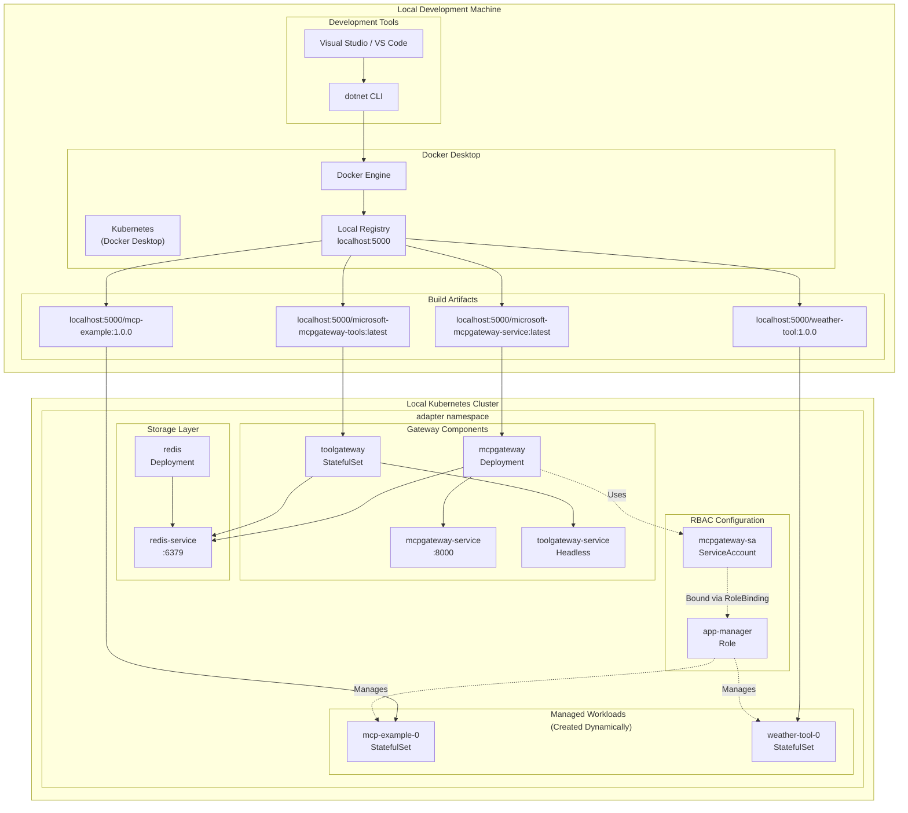
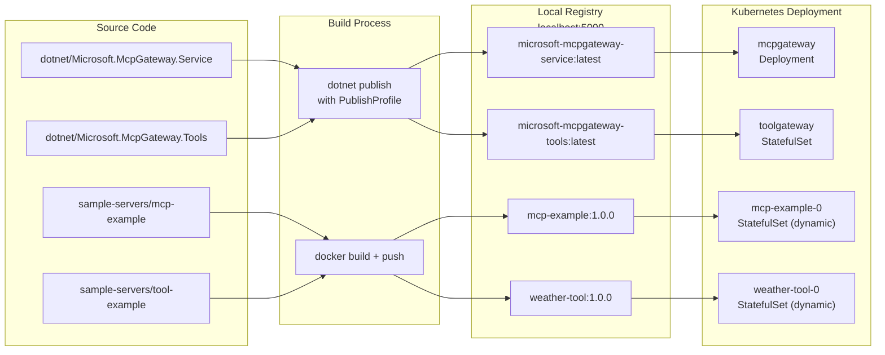
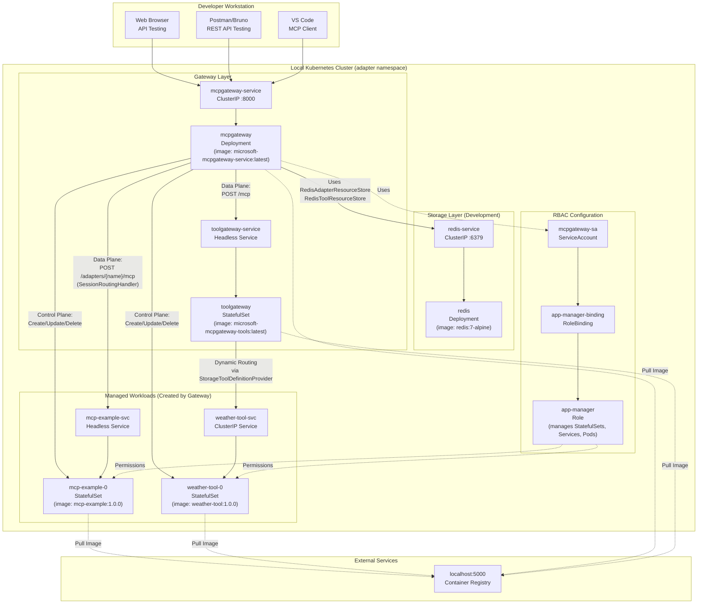

<!-- source: DeepWiki mcp.deepwiki.com · repo microsoft/mcp-gateway · page 6.1 Getting Started · fetched 2026-10-26 -->

# Getting Started

<details>
<summary>Relevant source files</summary>

The following files were used as context for generating this wiki page:

- [README.md](README.md)
- [deployment/k8s/local-deployment.yml](deployment/k8s/local-deployment.yml)

</details>


This guide provides step-by-step instructions for setting up a local development environment for the MCP Gateway project. It covers the installation of prerequisites, configuration of local infrastructure, and deployment of both the gateway service and tool gateway router for development and testing purposes.

For information about the overall system architecture, see [System Architecture](#2). For cloud deployment instructions, see [Azure Infrastructure](#3.1). For details about external dependencies and NuGet packages, see [Dependencies and Packages](#6.2).

## Purpose and Scope

This guide enables developers to:
- Set up a complete local development environment with Kubernetes
- Build and deploy MCP Gateway service and Tool Gateway Router locally
- Test adapter management functionality through REST APIs
- Test tool registration and dynamic routing capabilities
- Develop and debug MCP server integrations

The setup creates a local development cluster that mirrors the production environment architecture while using simplified storage (Redis) and authentication (development bypass) configurations suitable for development.
</thinking>

Sources: [README.md:11-21](), [README.md:190-195]()

## Prerequisites

### Required Software Components

The MCP Gateway requires several infrastructure components for local development:

| Component | Version | Purpose |
|-----------|---------|---------|
| .NET SDK | 8.0+ | Building and running C# applications ([Download](https://dotnet.microsoft.com/en-us/download/dotnet/8.0)) |
| Docker Desktop | Latest | Container runtime and local Kubernetes ([Download](https://docs.docker.com/desktop)) |
| Kubernetes | Enabled in Docker Desktop | Container orchestration platform |
| Local Registry | 2.7+ | Container image storage (`registry:2.7`) |

Sources: [README.md:193-195]()

### Development Environment Architecture



**Local Development Infrastructure Setup**

Sources: [deployment/k8s/local-deployment.yml:1-180](), [README.md:193-232]()

## Environment Setup Process

### Step 1: Install Prerequisites

Install the required development tools in the following order:

1. **Install .NET 8 SDK**
   - Download from https://dotnet.microsoft.com/en-us/download/dotnet/8.0
   - Verify installation: `dotnet --version`

2. **Install Docker Desktop**
   - Download from https://docs.docker.com/desktop/
   - Enable Kubernetes: Settings → Kubernetes → Enable Kubernetes
   - Verify Docker: `docker --version`
   - Verify Kubernetes: `kubectl version --client`

3. **Start Local Container Registry**
   ```bash
   docker run -d -p 5000:5000 --name registry registry:2.7
   ```

   This registry runs on `localhost:5000` and is referenced in the publish profiles and deployment manifests.

Sources: [README.md:193-200]()

### Step 2: Build Development Images

The local development setup requires building three main components: the MCP Gateway service, the Tool Gateway Router, and example MCP servers (both adapters and tools):



**Development Build and Deployment Flow**

#### Build Sample MCP Server Images

Build and push example adapter and tool server images:

```bash
# Build example adapter server
docker build -f sample-servers/mcp-example/Dockerfile sample-servers/mcp-example -t localhost:5000/mcp-example:1.0.0
docker push localhost:5000/mcp-example:1.0.0

# Build example tool server
docker build -f sample-servers/tool-example/Dockerfile sample-servers/tool-example -t localhost:5000/weather-tool:1.0.0
docker push localhost:5000/weather-tool:1.0.0
```

#### Build MCP Gateway Service

Option 1 - Using Visual Studio:
- Open [dotnet/Microsoft.McpGateway.sln]()
- Right-click `Microsoft.McpGateway.Service` project
- Select "Publish" with `localhost_5000.pubxml` profile

Option 2 - Using CLI:
```bash
dotnet publish dotnet/Microsoft.McpGateway.Service/src/Microsoft.McpGateway.Service.csproj -c Release /p:PublishProfile=localhost_5000.pubxml
```

This publishes the gateway service image as `localhost:5000/microsoft-mcpgateway-service:latest` to the local registry.

#### Build Tool Gateway Router

Build and publish the Tool Gateway Router:

```bash
dotnet publish dotnet/Microsoft.McpGateway.Tools/src/Microsoft.McpGateway.Tools.csproj -c Release /p:PublishProfile=localhost_5000.pubxml
```

This publishes the tool gateway router image as `localhost:5000/microsoft-mcpgateway-tools:latest` to the local registry.

Sources: [README.md:203-220](), [deployment/k8s/local-deployment.yml:24](), [deployment/k8s/local-deployment.yml:106]()

### Step 3: Deploy to Kubernetes

Apply the Kubernetes deployment manifests to create the gateway infrastructure:

```bash
kubectl apply -f deployment/k8s/local-deployment.yml
```

This creates the following Kubernetes resources in the `adapter` namespace:

| Resource Type | Resource Name | Purpose |
|--------------|---------------|---------|
| Namespace | `adapter` | Isolation boundary for all gateway components |
| Deployment | `mcpgateway` | Main gateway service pods |
| Service | `mcpgateway-service` | Gateway service endpoint (ClusterIP, port 8000) |
| StatefulSet | `toolgateway` | Tool Gateway Router pods |
| Service | `toolgateway-service` | Headless service for tool gateway router |
| Deployment | `redis` | Redis cache for development storage |
| Service | `redis-service` | Redis service endpoint (port 6379) |
| ServiceAccount | `mcpgateway-sa` | Service account for gateway pods |
| ServiceAccount | `workload-sa` | Service account for dynamically created workloads |
| Role | `app-manager` | RBAC permissions for managing StatefulSets and Services |
| RoleBinding | `app-manager-binding` | Binds `app-manager` role to `mcpgateway-sa` |

The deployment uses environment variable `ASPNETCORE_ENVIRONMENT=Development` to enable development-specific configurations like `DevelopmentAuthenticationHandler` (no auth required) and `RedisAdapterResourceStore` (Redis-based storage).

Sources: [deployment/k8s/local-deployment.yml:1-180](), [README.md:222-226]()

### Step 4: Enable Local Access

Forward the gateway service port to enable local API access:

```bash
kubectl port-forward -n adapter svc/mcpgateway-service 8000:8000
```

This exposes the MCP Gateway APIs at `http://localhost:8000`. All control plane (management) and data plane (MCP routing) endpoints are now accessible locally.

Sources: [README.md:228-232]()

## Development Verification

### API Testing Setup

The MCP Gateway provides an OpenAPI specification for testing the management APIs:

1. **Import OpenAPI Specification**
   - Location: [openapi/mcp-gateway.openapi.json]()
   - Compatible tools: Postman, Bruno, Swagger Editor

### Test Adapter Management and Routing

#### Create an Adapter

Create a new adapter using the management API:

```http
POST http://localhost:8000/adapters
Content-Type: application/json

{
  "name": "mcp-example",
  "imageName": "mcp-example", 
  "imageVersion": "1.0.0",
  "description": "test"
}
```

This triggers the `KubernetesAdapterDeploymentManager` to create a StatefulSet and headless Service for the adapter in the `adapter` namespace.

#### Check Adapter Status

Monitor the deployment status:

```http
GET http://localhost:8000/adapters/mcp-example/status
```

#### Access Adapter via MCP Protocol

Connect an MCP client (like VS Code) to the deployed adapter:

- Endpoint: `http://localhost:8000/adapters/mcp-example/mcp` (Streamable HTTP)

Sample VS Code MCP configuration ([`.vscode/mcp.json`]()):
```json
{
  "servers": {
    "mcp-example": {
      "url": "http://localhost:8000/adapters/mcp-example/mcp"
    }
  }
}
```

The gateway's `SessionRoutingHandler` ensures session-aware routing to the correct adapter pod instance.

Sources: [README.md:234-267]()

### Test Tool Registration and Dynamic Routing

#### Register a Tool

Register a tool with its MCP tool definition:

```http
POST http://localhost:8000/tools
Content-Type: application/json

{
  "name": "weather",
  "imageName": "weather-tool",
  "imageVersion": "1.0.0",
  "description": "Weather tool for getting current weather information",
  "toolDefinition": {
    "tool": {
      "name": "weather",
      "title": "Weather Information",
      "description": "Gets the current weather for a specified location.",
      "type": "http",
      "inputSchema": {
        "type": "object",
        "properties": {
          "location": {
            "type": "string",
            "description": "The city and state, e.g. San Francisco, CA"
          }
        },
        "required": ["location"]
      }
    },
    "port": 8000
  }
}
```

This triggers the deployment of a tool server StatefulSet and registers the tool definition in the `StorageToolDefinitionProvider`.

#### Check Tool Status

Monitor the tool deployment status:

```http
GET http://localhost:8000/tools/weather/status
```

#### Access Tools via Tool Gateway Router

Connect an MCP client to the tool gateway router, which dynamically routes to registered tools:

Sample VS Code MCP configuration:
```json
{
  "servers": {
    "tool-gateway": {
      "url": "http://localhost:8000/mcp"
    }
  }
}
```

When you call a tool through this endpoint, the `ToolGatewayRouter` (hosted at `toolgateway` StatefulSet) analyzes the tool name in the request and forwards it to the appropriate tool server based on the registered tool definition.

Sources: [README.md:272-339]()

### Development API Endpoints

The local development environment exposes these key endpoints:

#### Control Plane - Adapter Management

| Endpoint Pattern | Purpose | Controller Method |
|------------------|---------|------------------|
| `POST /adapters` | Create new adapter | Creates StatefulSet via `KubernetesAdapterDeploymentManager` |
| `GET /adapters` | List all adapters | Queries `IAdapterResourceStore` |
| `GET /adapters/{name}` | Get adapter metadata | Retrieves `AdapterResource` from store |
| `GET /adapters/{name}/status` | Check deployment status | Calls Kubernetes API for pod status |
| `GET /adapters/{name}/logs` | Access server logs | Fetches logs from Kubernetes pods |
| `PUT /adapters/{name}` | Update adapter | Updates StatefulSet configuration |
| `DELETE /adapters/{name}` | Remove adapter | Deletes StatefulSet and Service |

#### Control Plane - Tool Management

| Endpoint Pattern | Purpose | Controller Method |
|------------------|---------|------------------|
| `POST /tools` | Register tool | Creates StatefulSet and stores tool definition |
| `GET /tools` | List all tools | Queries `IToolResourceStore` |
| `GET /tools/{name}` | Get tool metadata | Retrieves `ToolResource` from store |
| `GET /tools/{name}/status` | Check tool status | Calls Kubernetes API for pod status |
| `GET /tools/{name}/logs` | Access tool logs | Fetches logs from Kubernetes pods |
| `PUT /tools/{name}` | Update tool | Updates StatefulSet and tool definition |
| `DELETE /tools/{name}` | Remove tool | Deletes StatefulSet and Service |

#### Data Plane - MCP Routing

| Endpoint Pattern | Purpose | Routing Handler |
|------------------|---------|----------------|
| `POST /adapters/{name}/mcp` | Direct adapter access | `SessionRoutingHandler` routes to adapter pods |
| `POST /mcp` | Tool gateway router | Routes to `toolgateway` pods, which dispatch to tools |

Sources: [README.md:119-149]()

## Local Development Runtime Architecture



**Local Development Runtime Architecture**

This diagram shows the complete runtime architecture in the local development environment. The `mcpgateway` service acts as both a control plane (managing resources via Kubernetes API) and data plane (routing MCP traffic). In development mode:

- Authentication uses `DevelopmentAuthenticationHandler` (no auth required)
- Storage uses Redis-based implementations (`RedisAdapterResourceStore`, `RedisToolResourceStore`)
- The gateway dynamically creates StatefulSets and Services for adapters and tools
- Session routing maintains stateful connections to specific pod instances
- Tool routing goes through the `toolgateway` StatefulSet, which dynamically dispatches to registered tools

Sources: [deployment/k8s/local-deployment.yml:1-180](), [README.md:190-339]()

## Next Steps

After completing the setup:

1. **Explore the Management APIs** - Use the OpenAPI specification to test all CRUD operations
2. **Review System Architecture** - See [System Architecture](#2) for understanding the production deployment
3. **Understand Core Components** - See [Core Components](#3) for detailed component documentation  
4. **Set up CI/CD** - See [Build and CI](#5.3) for continuous integration setup

The local development environment provides a complete sandbox for developing and testing MCP Gateway functionality before deploying to production Kubernetes clusters.

---

