# Page: Overview

# Overview

<details>
<summary>Relevant source files</summary>

The following files were used as context for generating this wiki page:

- [README.md](README.md)

</details>


## Purpose and Scope

This document provides a high-level introduction to the MCP Gateway system, explaining its purpose, core concepts, architecture, and capabilities. It serves as the starting point for understanding how the system functions as both a reverse proxy and management layer for Model Context Protocol (MCP) servers.

For detailed architectural documentation including control plane and data plane components, see [System Architecture](#2). For authentication and authorization mechanisms, see [Security and Authentication](#7). For deployment procedures, see [Deployment](#3). For complete API documentation, see [API Reference](#5).

**Sources:** [README.md:1-21]()

## What is MCP Gateway

MCP Gateway is a Kubernetes-native reverse proxy and management layer for Model Context Protocol servers. It provides enterprise-ready capabilities for deploying, managing, and routing traffic to MCP servers at scale. The system operates as a gateway service that sits between MCP clients (such as VS Code, Azure CLI, or custom applications) and backend MCP server instances.

The gateway serves two primary functions:

- **Control Plane**: Provides RESTful APIs for managing the lifecycle of MCP servers and tools, including deployment, updates, status monitoring, and log retrieval
- **Data Plane**: Routes MCP protocol traffic to backend server instances with session affinity, ensuring stateful connections are maintained

**Sources:** [README.md:14-21]()

## Key Concepts

### MCP Servers and Adapters

An **MCP Server** is a server implementation of the Model Context Protocol, typically exposed as a streamable HTTP endpoint. In the MCP Gateway system, MCP servers are represented as **adapters** - logical resources that encapsulate server deployment metadata and configuration.

Adapters are managed under the `/adapters` scope and are designed to coexist with other resource types in a unified AI development platform. Each adapter corresponds to a Kubernetes StatefulSet deployment with an associated headless Service for pod-specific routing.

### Tools and Tool Definitions

**Tools** are registered resources that include MCP tool definitions describing their purpose, input schema, and execution endpoint. Unlike adapters which provide direct access to MCP servers, tools are accessed through an intermediary routing layer that dynamically dispatches requests based on tool definitions.

A tool registration includes:
- Tool metadata (name, description)
- Container image information
- MCP tool definition (input schema, annotations)
- Execution endpoint configuration (port, path, HTTP method)

### Tool Gateway Router

The **Tool Gateway Router** is a specialized MCP server that acts as an intelligent routing layer for registered tools. Key characteristics:

- Runs as multiple instances behind the gateway for high availability and session affinity
- Maintains awareness of all registered tool definitions through the tool definition registry
- Dynamically routes `tools/call` requests to appropriate tool servers based on tool names in the request payload
- Accessed via the `POST /mcp` endpoint (without adapter name specification)

### Session-Aware Stateful Routing

The gateway implements session-aware routing to ensure that all requests containing a specific `session_id` are consistently routed to the same backend MCP server instance. This maintains stateful connections and preserves context across multiple requests within a session.

Session routing is implemented through:
- Distributed session store (Cosmos DB in production, Redis in development)
- Session-to-pod mapping maintained by the routing layer
- Headless Kubernetes services for direct pod addressing

**Sources:** [README.md:22-29](), [README.md:166-189]()

## Core Capabilities

### Control Plane Operations

The control plane provides RESTful management APIs for adapter and tool lifecycle operations:

| Operation Category | Endpoints | Purpose |
|-------------------|-----------|---------|
| **Adapter Management** | `POST /adapters`, `GET /adapters`, `GET /adapters/{name}`, `PUT /adapters/{name}`, `DELETE /adapters/{name}` | Create, list, retrieve, update, and delete adapter resources |
| **Adapter Observability** | `GET /adapters/{name}/status`, `GET /adapters/{name}/logs` | Monitor deployment status and access runtime logs |
| **Tool Management** | `POST /tools`, `GET /tools`, `GET /tools/{name}`, `PUT /tools/{name}`, `DELETE /tools/{name}` | Register, list, retrieve, update, and delete tool resources |
| **Tool Observability** | `GET /tools/{name}/status`, `GET /tools/{name}/logs` | Monitor tool deployment status and access runtime logs |

Control plane operations interact with:
- Kubernetes API to create/update/delete StatefulSets and Services
- Metadata store (Cosmos DB or Redis) to persist resource configurations
- Deployment manager to orchestrate Kubernetes resources

**Sources:** [README.md:119-139]()

### Data Plane Operations

The data plane handles runtime traffic routing for MCP protocol requests:

| Routing Type | Endpoint | Target | Purpose |
|-------------|----------|--------|---------|
| **Direct Adapter Access** | `POST /adapters/{name}/mcp` | Specific adapter StatefulSet | Establish streamable HTTP connection to a named MCP server with session affinity |
| **Tool Gateway Routing** | `POST /mcp` | Tool Gateway Router instances | Route to tool gateway router, which dynamically dispatches to registered tools based on tool definitions |

Data plane operations utilize:
- Session store for session affinity mapping
- Reverse proxy controller for request forwarding
- Authentication and authorization middleware for access control

**Sources:** [README.md:141-149]()

## High-Level Architecture

The following diagram illustrates the overall system architecture, showing how external clients interact with the control and data planes, and how the gateway manages Kubernetes workloads:

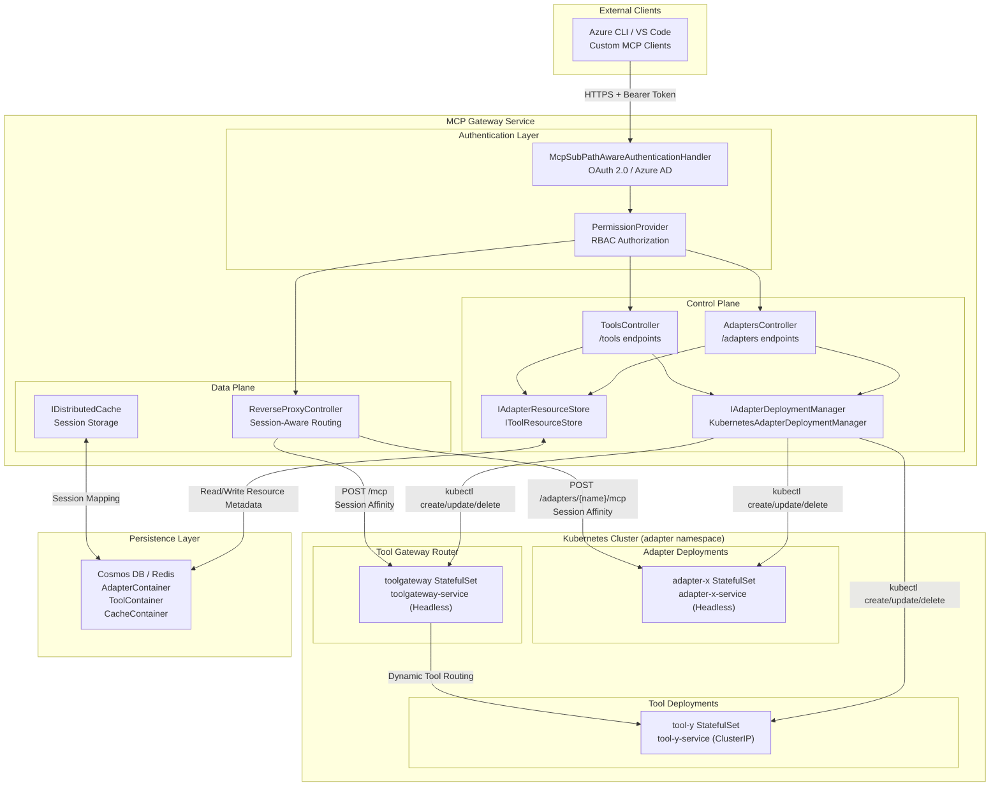

**Architecture Components:**

1. **External Clients**: MCP protocol clients (Azure CLI, VS Code, custom applications) that communicate with the gateway via HTTPS with bearer token authentication
2. **Authentication Layer**: Handles OAuth 2.0 authentication with Azure AD and RBAC-based authorization
3. **Control Plane**: RESTful API controllers and backend services for managing adapter and tool lifecycles
4. **Data Plane**: Session-aware reverse proxy that routes MCP traffic to backend servers
5. **Kubernetes Cluster**: Hosts adapter StatefulSets, tool gateway router StatefulSets, and tool StatefulSets
6. **Persistence Layer**: Cosmos DB (production) or Redis (development) for metadata storage and session caching

**Sources:** [README.md:30-115]()

## Component Overview

### Gateway Service Components

The following table maps high-level system functions to their implementing code components:

| Component | Code Entity | Location | Purpose |
|-----------|-------------|----------|---------|
| **Adapter Management** | `AdaptersController` | [dotnet/Microsoft.McpGateway.Service/src/Controllers/AdaptersController.cs]() | REST API endpoints for adapter CRUD and observability |
| **Tool Management** | `ToolsController` | [dotnet/Microsoft.McpGateway.Service/src/Controllers/ToolsController.cs]() | REST API endpoints for tool CRUD and observability |
| **Reverse Proxy** | `ReverseProxyController` | [dotnet/Microsoft.McpGateway.Service/src/Controllers/ReverseProxyController.cs]() | Session-aware routing for MCP traffic |
| **Deployment Manager** | `KubernetesAdapterDeploymentManager` | [dotnet/Microsoft.McpGateway.Service/src/Services/KubernetesAdapterDeploymentManager.cs]() | Creates and manages Kubernetes StatefulSets and Services |
| **Metadata Storage (Cosmos)** | `CosmosAdapterResourceStore`, `CosmosToolResourceStore` | [dotnet/Microsoft.McpGateway.Service/src/Services/]() | Persists adapter and tool metadata to Cosmos DB |
| **Metadata Storage (Redis)** | `RedisAdapterResourceStore`, `RedisToolResourceStore` | [dotnet/Microsoft.McpGateway.Service/src/Services/]() | Persists adapter and tool metadata to Redis for development |
| **Authentication** | `McpSubPathAwareAuthenticationHandler` | [dotnet/Microsoft.McpGateway.Service/src/Authentication/]() | OAuth 2.0 authentication with sub-path awareness |
| **Authorization** | `PermissionProvider` | [dotnet/Microsoft.McpGateway.Service/src/Services/PermissionProvider.cs]() | RBAC-based access control for resources |

### Tool Gateway Router Components

| Component | Code Entity | Location | Purpose |
|-----------|-------------|----------|---------|
| **Tool Router** | `ToolGatewayRouter` | [dotnet/Microsoft.McpGateway.Tools/src/]() | Routes MCP tool calls to registered tool servers |
| **Tool Registry** | `StorageToolDefinitionProvider` | [dotnet/Microsoft.McpGateway.Tools/src/Services/]() | Provides tool definitions from storage backend |
| **Tool Executor** | `HttpToolExecutor` | [dotnet/Microsoft.McpGateway.Tools/src/Services/]() | Executes tool calls via HTTP requests to tool servers |

**Sources:** File paths listed in table

## Deployment Environments

The MCP Gateway supports three deployment environments with different characteristics:

### Development Environment

- **Runtime**: Direct execution with `dotnet run` on localhost:8000
- **Authentication**: `DevelopmentAuthenticationHandler` (bypasses authentication)
- **Storage**: Redis for all caching and metadata storage
- **Cache**: `StackExchangeRedisCache` connected to localhost:6379
- **Use Case**: Rapid local development and debugging

### Local Kubernetes

- **Runtime**: Kubernetes cluster (Kind, Minikube, Docker Desktop)
- **Deployment**: `deployment/k8s/local-deployment.yml`
- **Container Registry**: localhost:5000 for local images
- **Storage**: Redis deployment in Kubernetes
- **Use Case**: Integration testing and Kubernetes behavior validation

### Azure Production

- **Runtime**: Azure Kubernetes Service (AKS) with workload identity
- **Infrastructure**: Provisioned via Bicep templates in `deployment/infra/azure-deployment.bicep`
- **Authentication**: Azure AD (Entra ID) with OAuth 2.0
- **Storage**: Cosmos DB for production-grade persistence
- **Networking**: Virtual Network with Application Gateway for ingress
- **Observability**: Application Insights for telemetry
- **Use Case**: Production deployments with enterprise security and scalability

**Sources:** [README.md:190-346](), [README.md:347-591]()

## Authentication and Authorization

The gateway implements a multi-layered security model:

### Authentication

- **Production**: OAuth 2.0 with Azure AD (Entra ID) using bearer tokens
- **Development**: Simplified authentication handler that bypasses token validation
- **MCP Protocol Support**: Implements OAuth 2.0 Protected Resource Metadata specification
- **Token Validation**: JWT token validation against Azure AD

### Authorization

Access control is enforced through the `PermissionProvider` service using role-based rules:

| Operation | Access Rule |
|-----------|-------------|
| **Read Access** | Granted to: resource creator, users with `requiredRoles`, users with `mcp.admin` role |
| **Write Access** | Granted to: resource creator, users with `mcp.admin` role |

Authorization checks are performed at the API level before forwarding requests to backend services or MCP servers.

**Sources:** [README.md:151-158]()

## Related Documentation

For more detailed information on specific aspects of the system:

- **Architecture Deep Dive**: See [System Architecture](#2) for detailed component interactions
- **Control Plane Details**: See [Control Plane](#2.3) for adapter and tool management internals
- **Data Plane Details**: See [Data Plane](#2.2) for routing and session management
- **Tool System**: See [Tool Gateway System](#2.4) for tool registration and dynamic routing
- **Azure Deployment**: See [Azure Infrastructure](#3.1) for Bicep templates and infrastructure setup
- **API Documentation**: See [REST API Endpoints](#5.1) for complete endpoint specifications
- **Security Details**: See [Authentication Flow](#7.1) and [Authorization and RBAC](#7.2)
- **Development Setup**: See [Getting Started](#6.1) for local development instructions

**Sources:** Table of contents structure provided in prompt

---

# Page: System Architecture

# System Architecture

<details>
<summary>Relevant source files</summary>

The following files were used as context for generating this wiki page:

- [README.md](README.md)
- [dotnet/Microsoft.McpGateway.Service/src/McpSubPathAwareAuthenticationHandler.cs](dotnet/Microsoft.McpGateway.Service/src/McpSubPathAwareAuthenticationHandler.cs)
- [dotnet/Microsoft.McpGateway.Service/src/Program.cs](dotnet/Microsoft.McpGateway.Service/src/Program.cs)

</details>


This document describes the overall system architecture of the MCP Gateway, covering its dual-plane design, core components, and infrastructure integration patterns. The architecture follows a clean separation between runtime data processing and administrative control operations.

For detailed information about individual components, see [Core Components](#3). For API specifications and data contracts, see [API Reference](#4).

## Architectural Overview

The MCP Gateway implements a dual-plane architecture that separates concerns between runtime traffic routing (Data Plane) and administrative operations (Control Plane). The system manages two types of MCP resources: **Adapters** (direct MCP servers) and **Tools** (registered MCP tools with definitions that route through a Tool Gateway Router).

### Dual-Plane Architecture with Adapters and Tools

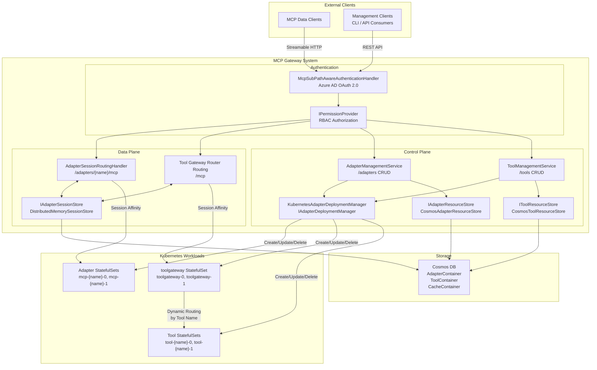

The architecture maintains strict separation between the Data Plane (runtime routing) and Control Plane (lifecycle management), with shared authentication/authorization infrastructure.

**Sources:** [README.md:22-29](), [dotnet/Microsoft.McpGateway.Service/src/Program.cs:21-137]()

## Data Plane Architecture

The Data Plane handles runtime traffic routing with two distinct routing mechanisms: **Direct Adapter Routing** for accessing specific MCP servers, and **Tool Gateway Routing** for dynamic tool execution through the Tool Gateway Router.

### Data Plane Routing Architecture

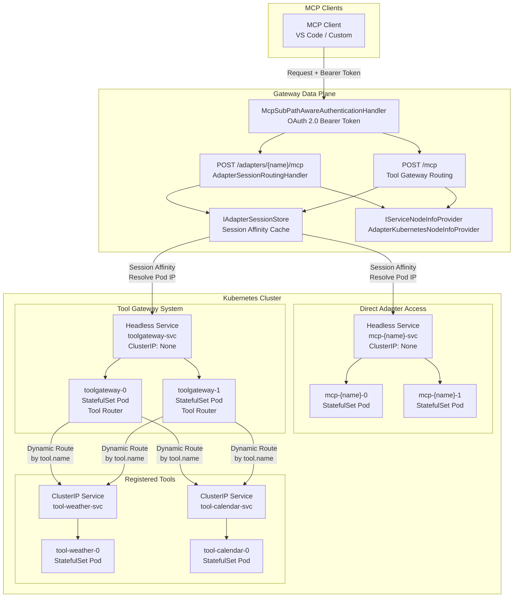

### Session-Aware Routing Mechanism

The Data Plane implements session affinity using a three-layer routing strategy:

| Component | Responsibility | Implementation |
|-----------|---------------|----------------|
| `AdapterSessionRoutingHandler` | Extracts `session_id` from MCP requests | [dotnet/Microsoft.McpGateway.Service/src/Routing/]() |
| `IAdapterSessionStore` | Maps `session_id` to specific pod instances | `DistributedMemorySessionStore` backed by Cosmos or Redis |
| `IServiceNodeInfoProvider` | Resolves Kubernetes pod IPs for routing | `AdapterKubernetesNodeInfoProvider` queries K8s API |

When a client sends a request:
1. The gateway extracts the `session_id` from the MCP protocol request
2. Session store returns the assigned pod instance (or creates new assignment)
3. Node info provider resolves the pod's cluster IP
4. Request is forwarded directly to the specific pod, bypassing load balancing

This ensures stateful MCP conversations are routed to the same backend instance throughout their lifecycle.

**Sources:** [README.md:141-149](), [dotnet/Microsoft.McpGateway.Service/src/Program.cs:28-30]()

## Control Plane Architecture

The Control Plane manages the complete lifecycle of both adapters and tools through RESTful APIs. It orchestrates Kubernetes deployments, persists metadata, and provides status/logging capabilities.

### Control Plane Service Layer

```mermaid
graph TB
    subgraph "REST API Controllers"
        AdaptersAPI["AdaptersController<br/>POST/GET/PUT/DELETE /adapters<br/>GET /adapters/{name}/status<br/>GET /adapters/{name}/logs"]
        ToolsAPI["ToolsController<br/>POST/GET/PUT/DELETE /tools<br/>GET /tools/{name}/status<br/>GET /tools/{name}/logs"]
    end
    
    subgraph "Management Services"
        AdapterMgmtSvc["AdapterManagementService<br/>IAdapterManagementService"]
        ToolMgmtSvc["ToolManagementService<br/>IToolManagementService"]
        RichResultProvider["AdapterRichResultProvider<br/>IAdapterRichResultProvider"]
    end
    
    subgraph "Deployment Layer"
        IDeploymentMgr["IAdapterDeploymentManager"]
        K8sDeploymentMgr["KubernetesAdapterDeploymentManager<br/>StatefulSet & Service Creation"]
    end
    
    subgraph "Storage Layer"
        IAdapterStore["IAdapterResourceStore"]
        IToolStore["IToolResourceStore"]
        CosmosAdapterStore["CosmosAdapterResourceStore<br/>AdapterContainer"]
        CosmosToolStore["CosmosToolResourceStore<br/>ToolContainer"]
        RedisAdapterStore["RedisAdapterResourceStore<br/>Dev Environment"]
        RedisToolStore["RedisToolResourceStore<br/>Dev Environment"]
    end
    
    subgraph "Kubernetes Abstraction"
        IKubeWrapper["IKubeClientWrapper"]
        KubeClient["KubeClient<br/>Namespace: adapter"]
        K8sClientFactory["IKubernetesClientFactory<br/>LocalKubernetesClientFactory"]
    end
    
    subgraph "Authorization"
        PermProvider["IPermissionProvider<br/>SimplePermissionProvider<br/>Resource Creator + RBAC"]
    end
    
    subgraph "External Systems"
        K8sCluster["Kubernetes Cluster<br/>StatefulSets<br/>Headless Services<br/>ClusterIP Services"]
        CosmosDB["Cosmos DB<br/>McpGatewayDb"]
        RedisCache["Redis<br/>Dev Cache"]
    end
    
    AdaptersAPI --> PermProvider
    ToolsAPI --> PermProvider
    
    PermProvider --> AdapterMgmtSvc
    PermProvider --> ToolMgmtSvc
    PermProvider --> RichResultProvider
    
    AdapterMgmtSvc --> IDeploymentMgr
    AdapterMgmtSvc --> IAdapterStore
    ToolMgmtSvc --> IDeploymentMgr
    ToolMgmtSvc --> IToolStore
    RichResultProvider --> IDeploymentMgr
    
    IDeploymentMgr <|.. K8sDeploymentMgr
    IAdapterStore <|.. CosmosAdapterStore
    IAdapterStore <|.. RedisAdapterStore
    IToolStore <|.. CosmosToolStore
    IToolStore <|.. RedisToolStore
    
    K8sDeploymentMgr --> IKubeWrapper
    IKubeWrapper <|.. KubeClient
    KubeClient --> K8sClientFactory
    
    K8sDeploymentMgr --> K8sCluster
    CosmosAdapterStore --> CosmosDB
    CosmosToolStore --> CosmosDB
    RedisAdapterStore --> RedisCache
    RedisToolStore --> RedisCache
```

### Control Plane Operations

The Control Plane exposes two parallel API surfaces for managing adapters and tools:

| API Endpoint | Purpose | Service Implementation |
|--------------|---------|------------------------|
| `POST /adapters` | Create new adapter | `AdapterManagementService.CreateAdapterAsync()` |
| `GET /adapters` | List adapters | `AdapterManagementService.GetAdaptersAsync()` |
| `GET /adapters/{name}` | Get adapter metadata | `AdapterManagementService.GetAdapterAsync()` |
| `PUT /adapters/{name}` | Update adapter | `AdapterManagementService.UpdateAdapterAsync()` |
| `DELETE /adapters/{name}` | Delete adapter | `AdapterManagementService.DeleteAdapterAsync()` |
| `GET /adapters/{name}/status` | Get deployment status | `AdapterRichResultProvider` + `KubernetesAdapterDeploymentManager` |
| `GET /adapters/{name}/logs` | Get pod logs | `AdapterRichResultProvider` + `KubernetesAdapterDeploymentManager` |
| `POST /tools` | Register new tool | `ToolManagementService.CreateToolAsync()` |
| `GET /tools` | List tools | `ToolManagementService.GetToolsAsync()` |
| `GET /tools/{name}` | Get tool definition | `ToolManagementService.GetToolAsync()` |
| `PUT /tools/{name}` | Update tool | `ToolManagementService.UpdateToolAsync()` |
| `DELETE /tools/{name}` | Delete tool | `ToolManagementService.DeleteToolAsync()` |
| `GET /tools/{name}/status` | Get tool deployment status | Similar to adapters |
| `GET /tools/{name}/logs` | Get tool pod logs | Similar to adapters |

**Sources:** [README.md:119-139](), [dotnet/Microsoft.McpGateway.Service/src/Program.cs:112-120]()

## Tool Gateway System

The Tool Gateway System enables dynamic tool registration and execution through a specialized routing layer. Tools are registered with MCP tool definitions, and the Tool Gateway Router acts as an intelligent dispatcher.

### Tool Gateway Router Architecture

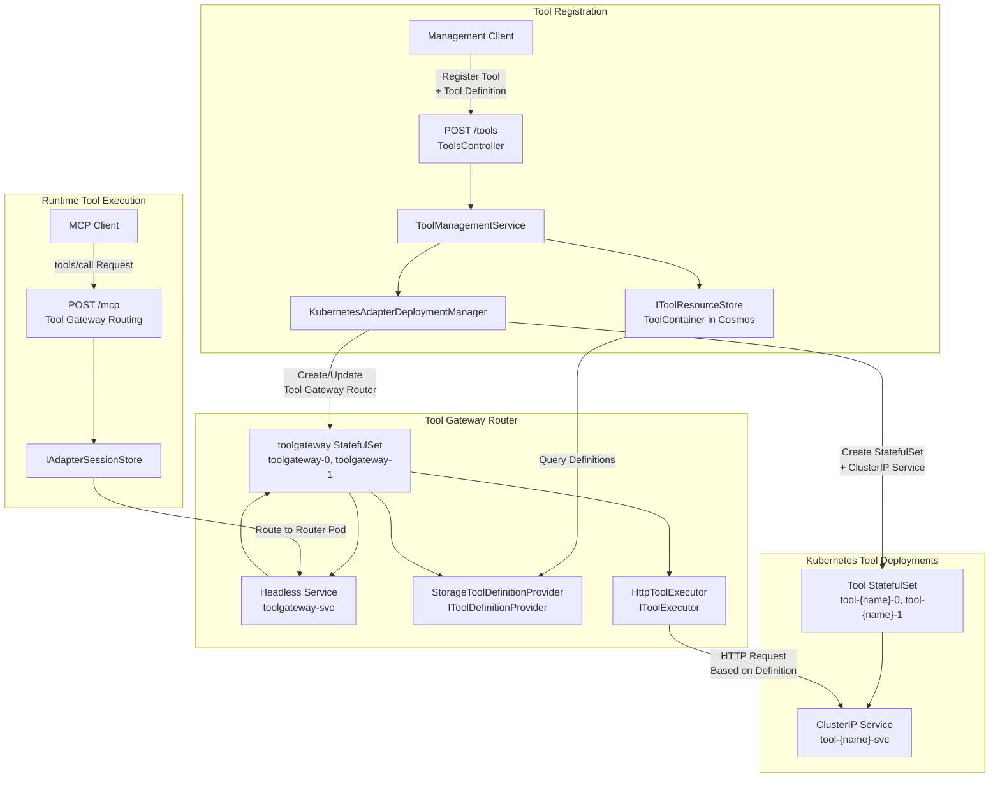

### Tool Definition Structure

Each registered tool includes metadata that defines its execution characteristics:

| Field | Type | Purpose |
|-------|------|---------|
| `name` | string | Unique tool identifier used in MCP `tools/call` requests |
| `description` | string | Human-readable description of tool capabilities |
| `inputSchema` | JSON Schema | Defines expected input structure for validation |
| `port` | integer | TCP port where tool server listens (default: 8000) |
| `path` | string | HTTP path for tool execution endpoint (optional) |
| `method` | string | HTTP method (GET, POST, etc.) (optional) |

The `StorageToolDefinitionProvider` loads these definitions from `IToolResourceStore` and makes them available to the Tool Gateway Router at runtime.

### Dynamic Routing Process

1. **Client Request**: MCP client sends `tools/call` request to `POST /mcp`
2. **Session Routing**: Gateway routes to a Tool Gateway Router pod using session affinity
3. **Definition Lookup**: Router queries `StorageToolDefinitionProvider` for tool definition by name
4. **Request Construction**: `HttpToolExecutor` constructs HTTP request using:
   - Service name: `http://tool-{name}-svc:{port}{path}`
   - HTTP method from definition
   - Request body from `tools/call` arguments
5. **Execution**: Router forwards request to target tool server
6. **Response**: Tool result returns through router to gateway to client

This architecture decouples tool discovery from tool execution, enabling hot-swapping tools without gateway restarts.

**Sources:** [README.md:165-189](), [README.md:272-340]()

## Infrastructure Integration

The MCP Gateway integrates with Azure and Kubernetes services to provide enterprise capabilities. The architecture supports both development (local Kubernetes + Redis) and production (AKS + Cosmos DB) environments.

### Kubernetes Resource Topology

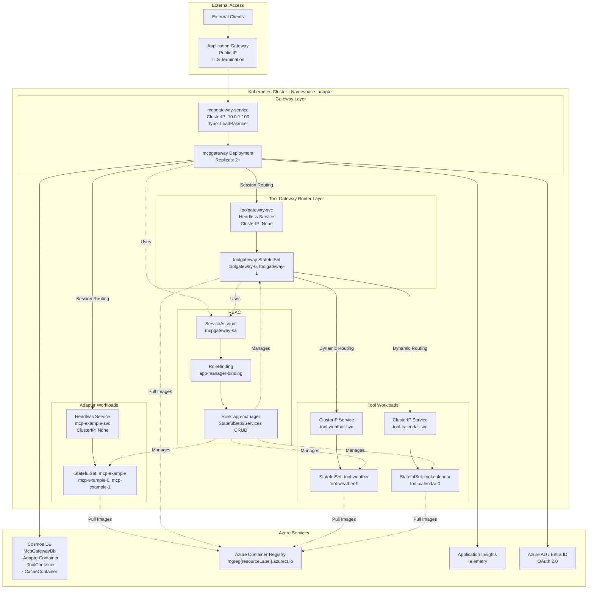

### Service Types and Routing Strategy

The system uses different Kubernetes service types to optimize routing patterns:

| Service Type | Use Case | Example | Routing Behavior |
|--------------|----------|---------|------------------|
| **LoadBalancer** | External gateway access | `mcpgateway-service` | Azure App Gateway backend pool |
| **Headless (ClusterIP: None)** | Session-affinity StatefulSets | `mcp-example-svc`, `toolgateway-svc` | Direct pod IP addressing for sticky sessions |
| **ClusterIP** | Stateless load-balanced tools | `tool-weather-svc`, `tool-calendar-svc` | Round-robin load balancing within cluster |

The gateway has RBAC permissions via `ServiceAccount` + `Role` + `RoleBinding` to dynamically create/update/delete StatefulSets and Services in the `adapter` namespace, enabling meta-orchestration capabilities.

**Sources:** [README.md:349-425](), [dotnet/Microsoft.McpGateway.Service/src/Program.cs:73-105]()

## Component Interaction Patterns

The system implements several key architectural patterns that ensure scalability, maintainability, and operational excellence.

| Pattern | Implementation | Purpose |
|---------|----------------|---------|
| **Session Affinity** | Distributed routing with session store | Ensures request consistency for stateful MCP conversations |
| **Adapter Pattern** | `IAdapterDeploymentManager`, `IAdapterResourceStore` | Abstracts deployment and storage implementations |
| **Factory Pattern** | `IKubernetesClientFactory` | Manages Kubernetes client lifecycle |
| **Dependency Injection** | Interface-based service registration | Enables testing and configuration flexibility |
| **Stateless Design** | Distributed session store separation | Supports horizontal scaling and fault tolerance |

### Authentication and Authorization Flow

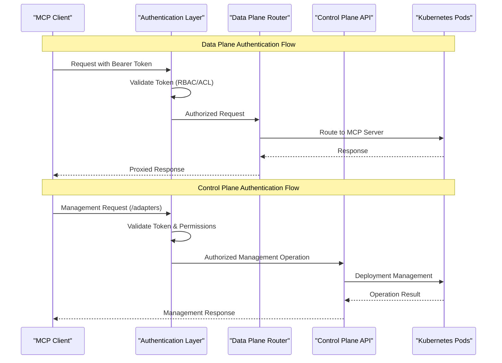

The dual authentication layers enable independent security policies for runtime data access versus administrative operations, supporting different permission models and audit requirements.

**Sources:** [README.md:37-42](), [README.md:79-80]()

---

# Page: Overall Architecture

# Overall Architecture

<details>
<summary>Relevant source files</summary>

The following files were used as context for generating this wiki page:

- [README.md](README.md)
- [deployment/k8s/cloud-deployment-template.yml](deployment/k8s/cloud-deployment-template.yml)
- [dotnet/Microsoft.McpGateway.Service/src/McpSubPathAwareAuthenticationHandler.cs](dotnet/Microsoft.McpGateway.Service/src/McpSubPathAwareAuthenticationHandler.cs)
- [dotnet/Microsoft.McpGateway.Service/src/Program.cs](dotnet/Microsoft.McpGateway.Service/src/Program.cs)

</details>


## Purpose and Scope

This document provides comprehensive architectural documentation for the MCP Gateway system, covering its high-level design, major components, and their interactions. It describes the overall system structure including the control plane for lifecycle management, the data plane for request routing, and the backend services that orchestrate deployments.

For detailed information about specific subsystems:
- Data plane routing mechanisms: see [Data Plane](#2.2)
- Control plane management APIs: see [Control Plane](#2.3)
- Tool gateway routing system: see [Tool Gateway System](#2.4)
- Authentication and authorization details: see [Authentication Flow](#7.1)
- Deployment configurations: see [Azure Infrastructure](#3.1) and [Kubernetes Configuration](#3.2)

---

## System Overview

The MCP Gateway is a Kubernetes-native reverse proxy and management layer for Model Context Protocol (MCP) servers. It provides both control plane capabilities (CRUD operations for adapter and tool resources) and data plane capabilities (session-aware routing of MCP protocol traffic).

### Core Architectural Principles

| Principle | Implementation |
|-----------|----------------|
| **Separation of Concerns** | Control plane (`/adapters`, `/tools` REST APIs) and data plane (`/adapters/{name}/mcp`, `/mcp` routing endpoints) are logically separated |
| **Kubernetes-Native** | Dynamically provisions and manages StatefulSets and Services via Kubernetes API |
| **Session Affinity** | Maintains stateful connections by routing requests with the same `session_id` to the same pod instance |
| **Multi-Tenancy** | Resource-level authorization with creator ownership and role-based access control (RBAC) |
| **Cloud-Ready** | Supports both local development (Redis) and production (Cosmos DB, Azure AD, Application Insights) |

**Sources:** [README.md:1-30](), [README.md:117-165]()

---

## High-Level Architecture Diagram

The following diagram illustrates the complete system architecture, mapping components to their implementation artifacts:

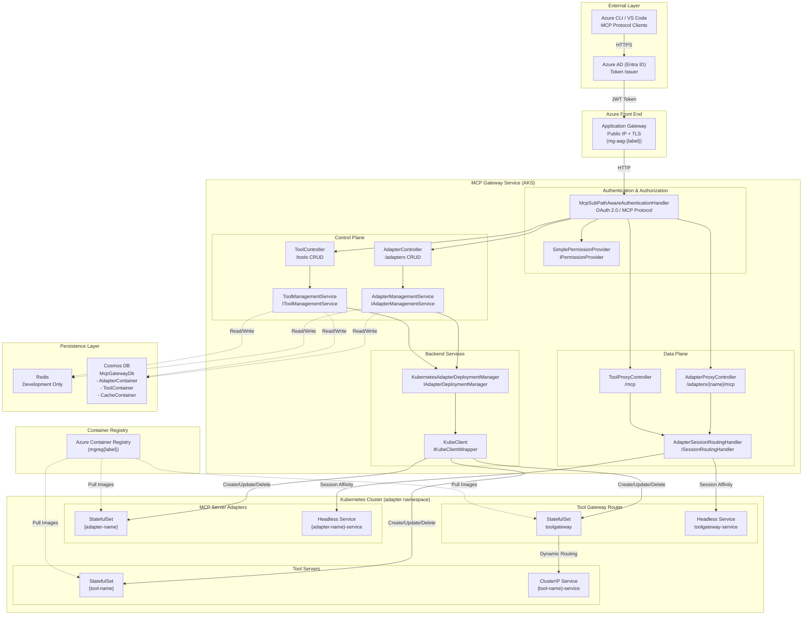

**Sources:** [README.md:30-115](), [dotnet/Microsoft.McpGateway.Service/src/Program.cs:1-137](), [deployment/k8s/cloud-deployment-template.yml:1-176]()

---

## Architectural Layers

### Control Plane

The control plane provides REST APIs for managing the lifecycle of adapter and tool resources. It is implemented through ASP.NET Core controllers and backing services.

**Key Components:**

| Component | Implementation | Responsibility |
|-----------|---------------|----------------|
| **Adapter Management API** | `AdapterController` | Exposes `/adapters` endpoints for CRUD operations |
| **Tool Management API** | `ToolController` | Exposes `/tools` endpoints for CRUD operations |
| **Adapter Service** | `AdapterManagementService` implementing `IAdapterManagementService` | Business logic for adapter lifecycle |
| **Tool Service** | `ToolManagementService` implementing `IToolManagementService` | Business logic for tool lifecycle |
| **Deployment Manager** | `KubernetesAdapterDeploymentManager` implementing `IAdapterDeploymentManager` | Creates/updates/deletes Kubernetes resources |
| **Metadata Store** | `IAdapterResourceStore`, `IToolResourceStore` | Persists resource metadata |

**Control Plane API Endpoints:**

```
POST   /adapters                 - Deploy new MCP server
GET    /adapters                 - List adapters
GET    /adapters/{name}          - Get adapter metadata
PUT    /adapters/{name}          - Update adapter
DELETE /adapters/{name}          - Remove adapter
GET    /adapters/{name}/status   - Check deployment status
GET    /adapters/{name}/logs     - Retrieve logs

POST   /tools                    - Register new tool
GET    /tools                    - List tools
GET    /tools/{name}             - Get tool metadata
PUT    /tools/{name}             - Update tool
DELETE /tools/{name}             - Remove tool
GET    /tools/{name}/status      - Check deployment status
GET    /tools/{name}/logs        - Retrieve logs
```

**Sources:** [README.md:119-139](), [dotnet/Microsoft.McpGateway.Service/src/Program.cs:113-120]()

### Data Plane

The data plane handles runtime request routing, forwarding MCP protocol traffic to deployed adapter and tool instances with session affinity.

**Key Components:**

| Component | Implementation | Responsibility |
|-----------|---------------|----------------|
| **Adapter Proxy** | `AdapterProxyController` | Routes `/adapters/{name}/mcp` to adapter pods |
| **Tool Proxy** | `ToolProxyController` | Routes `/mcp` to tool gateway router pods |
| **Session Routing** | `AdapterSessionRoutingHandler` implementing `ISessionRoutingHandler` | Maintains session-to-pod affinity |
| **Session Store** | `DistributedMemorySessionStore` implementing `IAdapterSessionStore` | Tracks session-to-pod mappings |
| **Node Info Provider** | `AdapterKubernetesNodeInfoProvider` implementing `IServiceNodeInfoProvider` | Discovers available pod endpoints |

**Data Plane Endpoints:**

```
POST /adapters/{name}/mcp    - Direct access to specific adapter instance
POST /mcp                    - Access to tool gateway router
```

**Sources:** [README.md:141-149](), [dotnet/Microsoft.McpGateway.Service/src/Program.cs:28-30]()

### Backend Services

Backend services orchestrate Kubernetes resources and manage storage operations.

**Kubernetes Integration:**

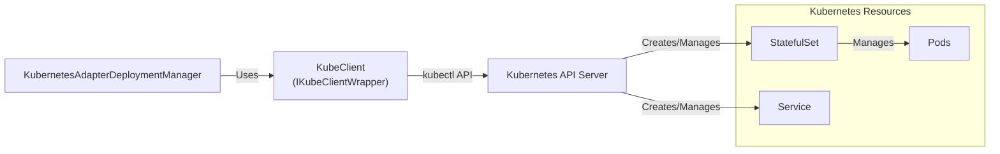

The `KubernetesAdapterDeploymentManager` uses `IKubeClientWrapper` to:
- Create StatefulSets with replicas, resource limits, and environment variables
- Create headless Services (ClusterIP: None) for adapter instances
- Create ClusterIP Services for tool instances
- Query pod status and retrieve logs

**Sources:** [dotnet/Microsoft.McpGateway.Service/src/Program.cs:107-117]()

### Storage Layer

The system uses different storage implementations based on environment:

| Environment | Adapter Store | Tool Store | Cache |
|-------------|--------------|------------|-------|
| **Development** | `RedisAdapterResourceStore` | `RedisToolResourceStore` | `StackExchangeRedisCache` |
| **Production** | `CosmosAdapterResourceStore` | `CosmosToolResourceStore` | `CosmosCache` |

**Development Configuration:**
[dotnet/Microsoft.McpGateway.Service/src/Program.cs:32-49]()

**Production Configuration:**
[dotnet/Microsoft.McpGateway.Service/src/Program.cs:52-105]()

**Sources:** [dotnet/Microsoft.McpGateway.Service/src/Program.cs:32-105]()

---

## Kubernetes Resource Topology

The gateway deploys resources into the `adapter` namespace with a specific topology designed for scalability and isolation.

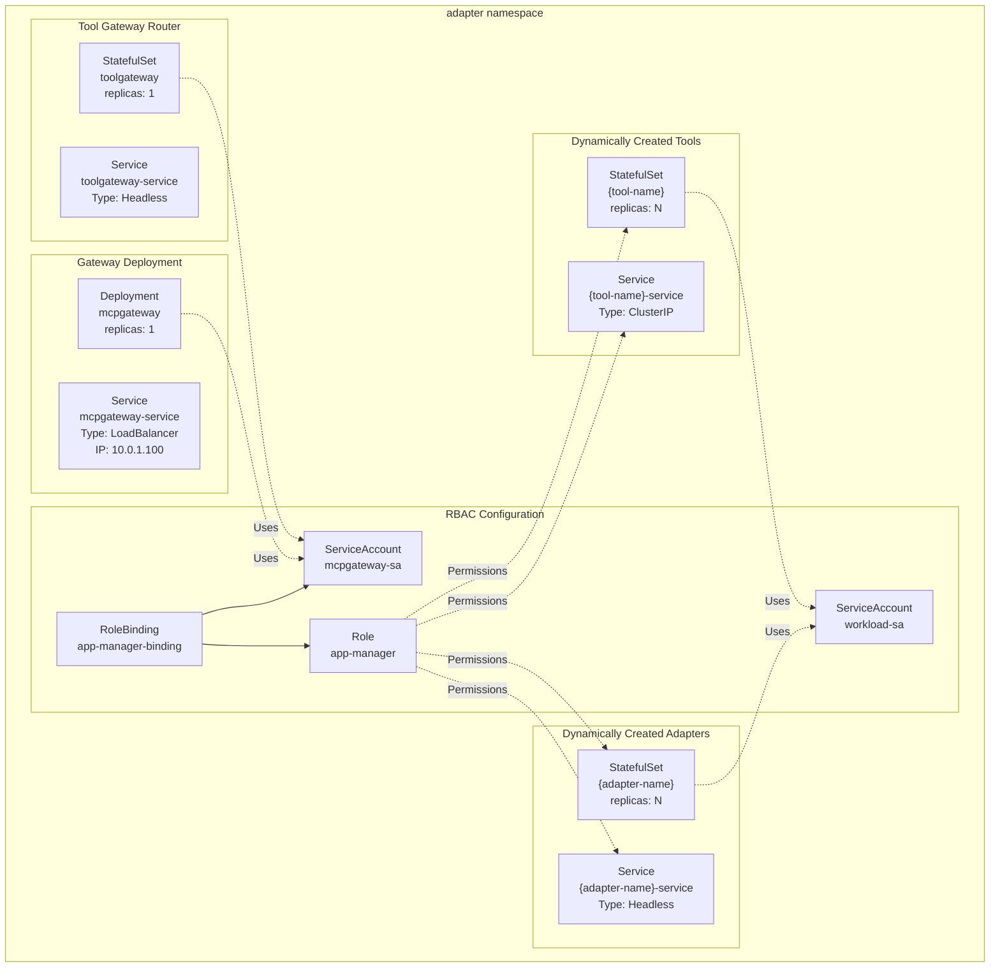

**RBAC Permissions:**

The `app-manager` Role grants the gateway service account permissions to:
- `["get", "list", "create", "update", "delete", "patch", "watch"]` on `statefulsets`
- `["get", "list", "create", "update", "delete", "watch"]` on `services` and `pods`
- `["get", "watch"]` on `pods/log`

This allows the gateway to act as a meta-orchestrator, dynamically provisioning workloads on behalf of users.

**Service Types:**

| Resource Type | Service Type | Purpose |
|---------------|--------------|---------|
| Gateway | LoadBalancer | External access via fixed IP (10.0.1.100) |
| Tool Gateway Router | Headless (ClusterIP: None) | Direct pod addressing for session affinity |
| Adapters | Headless (ClusterIP: None) | Direct pod addressing for session affinity |
| Tools | ClusterIP | Load-balanced access (stateless) |

**Sources:** [deployment/k8s/cloud-deployment-template.yml:1-176]()

---

## Authentication and Authorization Flow

The system implements a multi-layered security model combining OAuth 2.0, MCP protocol authentication, and RBAC.

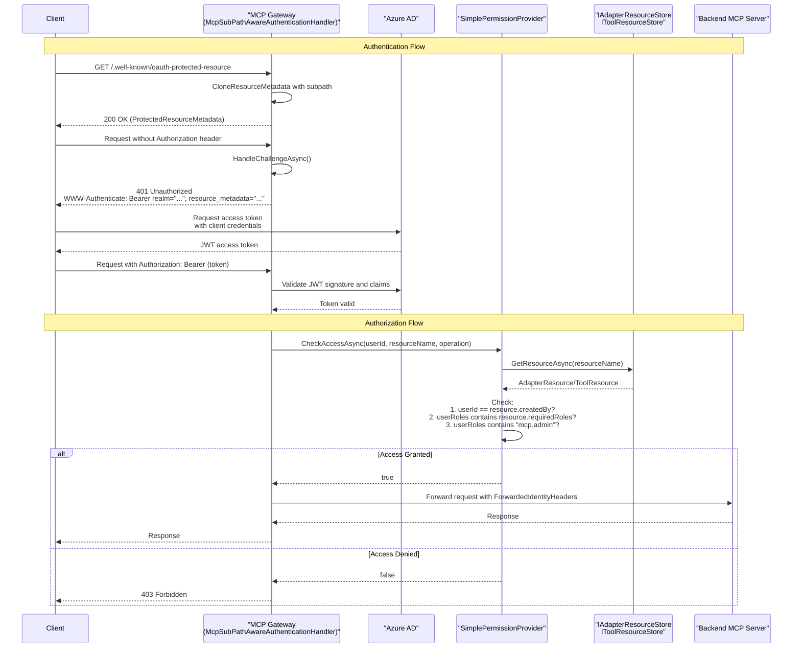

**Authentication Handler:**

The `McpSubPathAwareAuthenticationHandler` extends standard JWT Bearer authentication with MCP protocol-specific features:
- Serves OAuth 2.0 Protected Resource Metadata at `/.well-known/oauth-protected-resource` and sub-paths
- Adds `resource_metadata` parameter to WWW-Authenticate challenge headers
- Supports dynamic resource metadata based on request path

[dotnet/Microsoft.McpGateway.Service/src/McpSubPathAwareAuthenticationHandler.cs:1-182]()

**Authorization Rules:**

| Operation | Access Granted To |
|-----------|------------------|
| **Read** | Resource creator, users with `requiredRoles`, users with `mcp.admin` role |
| **Write** | Resource creator, users with `mcp.admin` role |

**Sources:** [dotnet/Microsoft.McpGateway.Service/src/Program.cs:52-72](), [dotnet/Microsoft.McpGateway.Service/src/McpSubPathAwareAuthenticationHandler.cs:1-182](), [README.md:151-158]()

---

## Session Routing Architecture

The data plane implements session-aware routing to maintain stateful connections between clients and MCP server instances.

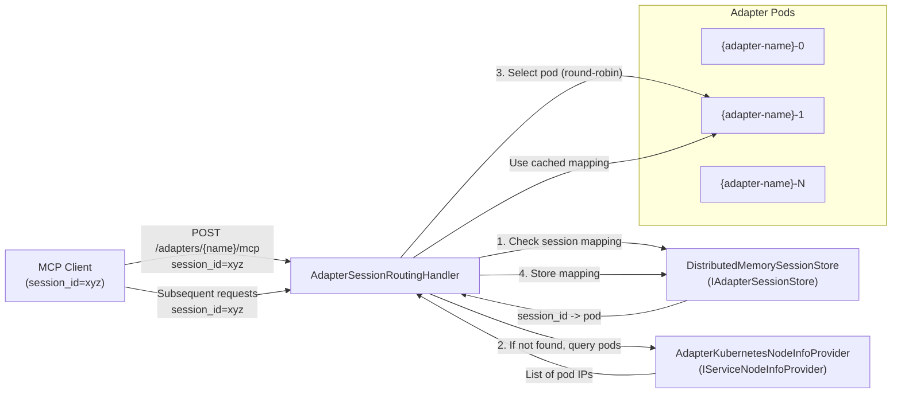

**Session Store Implementations:**

- **Development:** `DistributedMemorySessionStore` with in-memory cache
- **Production:** `DistributedMemorySessionStore` with distributed cache (Cosmos DB or Redis)

The session store persists mappings of `(session_id, adapter_name) -> pod_endpoint`, ensuring that all requests with the same session ID are routed to the same pod instance, maintaining MCP protocol state.

**Sources:** [dotnet/Microsoft.McpGateway.Service/src/Program.cs:28-30]()

---

## Tool Gateway Router System

The tool gateway router is a specialized MCP server that dynamically routes tool execution requests to registered tool servers.

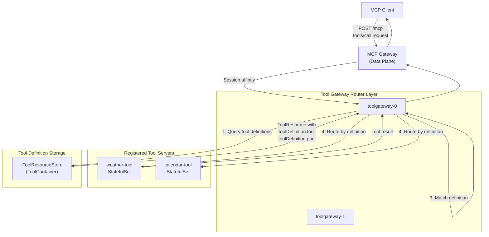

**Tool Definition Structure:**

Tools are registered with a `toolDefinition` object containing:
```json
{
  "tool": {
    "name": "weather",
    "description": "Gets weather info",
    "inputSchema": { /* JSON Schema */ }
  },
  "port": 8000,
  "path": "/execute"  // optional
}
```

The router uses this metadata to construct the target URL: `http://{tool-name}-service:{port}{path}`

**Sources:** [README.md:166-189](), [deployment/k8s/cloud-deployment-template.yml:125-176]()

---

## Environment Configurations

The system supports three deployment environments with different architectural characteristics:

### Development Environment

```
┌─────────────────────────────┐
│ dotnet run                  │
│ localhost:8000              │
├─────────────────────────────┤
│ DevelopmentAuthenticationHandler │
│ (No auth validation)        │
├─────────────────────────────┤
│ Redis (localhost:6379)      │
│ - RedisAdapterResourceStore │
│ - RedisToolResourceStore    │
│ - StackExchangeRedisCache   │
└─────────────────────────────┘
```

**Configuration:** [dotnet/Microsoft.McpGateway.Service/src/Program.cs:32-49]()

### Local Kubernetes Environment

```
┌─────────────────────────────┐
│ kubectl apply -f            │
│ local-deployment.yml        │
├─────────────────────────────┤
│ Local registry              │
│ (localhost:5000)            │
├─────────────────────────────┤
│ Redis pod                   │
│ (redis:7-alpine)            │
└─────────────────────────────┘
```

### Azure Production Environment

```
┌─────────────────────────────┐
│ Application Gateway         │
│ (mg-aag-{label})            │
│ Public IP + TLS             │
├─────────────────────────────┤
│ AKS Cluster                 │
│ (mg-aks-{label})            │
│ - Workload Identity enabled │
├─────────────────────────────┤
│ Azure AD Authentication     │
│ (McpSubPathAwareAuthenticationHandler) │
├─────────────────────────────┤
│ Cosmos DB                   │
│ (mg-storage-{label})        │
│ - CosmosAdapterResourceStore│
│ - CosmosToolResourceStore   │
│ - CosmosCache               │
├─────────────────────────────┤
│ Azure Container Registry    │
│ (mgreg{label})              │
├─────────────────────────────┤
│ Application Insights        │
│ (mg-ai-{label})             │
└─────────────────────────────┘
```

**Configuration:** [dotnet/Microsoft.McpGateway.Service/src/Program.cs:52-105](), [deployment/k8s/cloud-deployment-template.yml:1-176]()

**Sources:** [README.md:190-232](), [README.md:347-573]()

---

## Dependency Injection Configuration

The gateway's service registration in `Program.cs` demonstrates the architectural composition:

**Core Services:**
```
IKubernetesClientFactory → LocalKubernetesClientFactory
IAdapterSessionStore → DistributedMemorySessionStore
IServiceNodeInfoProvider → AdapterKubernetesNodeInfoProvider
ISessionRoutingHandler → AdapterSessionRoutingHandler
```

**Backend Services:**
```
IKubeClientWrapper → KubeClient
IPermissionProvider → SimplePermissionProvider
IAdapterDeploymentManager → KubernetesAdapterDeploymentManager
IAdapterManagementService → AdapterManagementService
IToolManagementService → ToolManagementService
IAdapterRichResultProvider → AdapterRichResultProvider
```

**Environment-Specific Services:**
```
Development:
  IAdapterResourceStore → RedisAdapterResourceStore
  IToolResourceStore → RedisToolResourceStore

Production:
  IAdapterResourceStore → CosmosAdapterResourceStore
  IToolResourceStore → CosmosToolResourceStore
```

[dotnet/Microsoft.McpGateway.Service/src/Program.cs:27-121]()

**Sources:** [dotnet/Microsoft.McpGateway.Service/src/Program.cs:21-137]()

---

# Page: Data Plane

# Data Plane

<details>
<summary>Relevant source files</summary>

The following files were used as context for generating this wiki page:

- [README.md](README.md)
- [dotnet/Microsoft.McpGateway.Management/src/Extensions/IdentityExtensions.cs](dotnet/Microsoft.McpGateway.Management/src/Extensions/IdentityExtensions.cs)
- [dotnet/Microsoft.McpGateway.Service/src/Controllers/AdapterReverseProxyController.cs](dotnet/Microsoft.McpGateway.Service/src/Controllers/AdapterReverseProxyController.cs)
- [dotnet/Microsoft.McpGateway.Service/src/Controllers/ManagementController.cs](dotnet/Microsoft.McpGateway.Service/src/Controllers/ManagementController.cs)
- [dotnet/Microsoft.McpGateway.Service/src/HttpProxy.cs](dotnet/Microsoft.McpGateway.Service/src/HttpProxy.cs)

</details>


## Purpose and Scope

The Data Plane is responsible for routing runtime MCP (Model Context Protocol) traffic to deployed adapters and tool gateway routers. It handles session-aware request proxying, authentication/authorization enforcement, and identity forwarding to backend services. This page documents the request routing mechanisms, session management, and HTTP proxying infrastructure.

For information about managing adapter and tool lifecycles (CRUD operations), see the Control Plane [2.3](#2.3). For details on the Tool Gateway Router's internal routing logic, see [2.4](#2.4).

## Data Plane Architecture

The data plane operates as a reverse proxy layer that sits between external MCP clients and backend Kubernetes workloads. It provides two primary routing endpoints:

| Endpoint | Purpose | Target |
|----------|---------|--------|
| `POST /adapters/{name}/mcp` | Direct adapter access | Specific adapter StatefulSet instances |
| `POST /mcp` | Tool gateway routing | Tool Gateway Router StatefulSet instances |

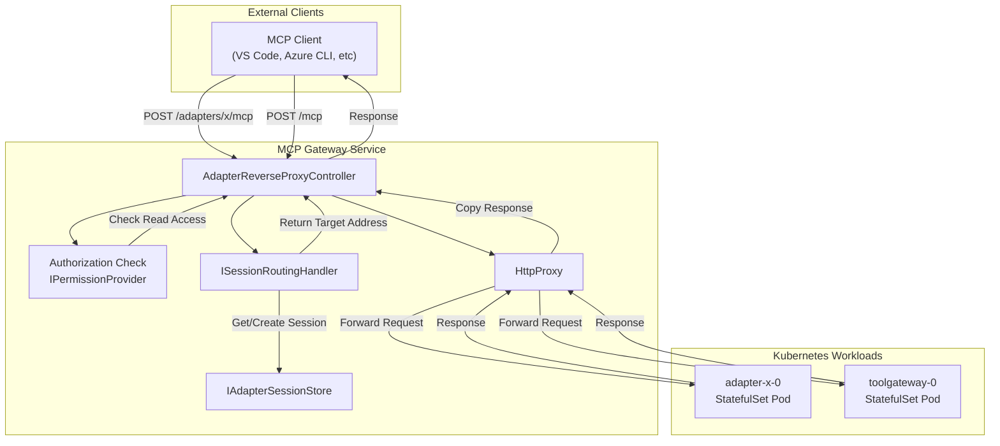

**Sources:** [dotnet/Microsoft.McpGateway.Service/src/Controllers/AdapterReverseProxyController.cs:1-115](), [README.md:141-149]()

## Request Routing Flow

### Controller Entry Point

The `AdapterReverseProxyController` class serves as the entry point for all data plane requests. It handles both adapter-specific routes and tool gateway routes through a single method:

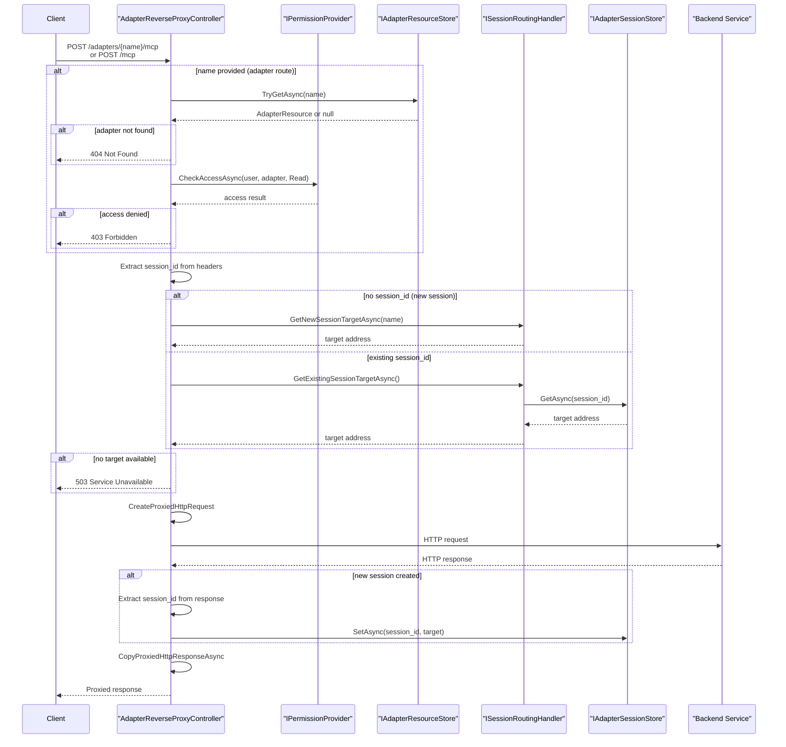

**Sources:** [dotnet/Microsoft.McpGateway.Service/src/Controllers/AdapterReverseProxyController.cs:30-66]()

### Route Handling Logic

The controller method `ForwardStreamableHttpRequest` handles both routing patterns by using an optional `name` parameter:

- **Adapter Route** (`POST /adapters/{name}/mcp`): The `name` parameter identifies the target adapter
- **Tool Gateway Route** (`POST /mcp`): The `name` parameter is null/empty, defaults to `"toolgateway"`

**Sources:** [dotnet/Microsoft.McpGateway.Service/src/Controllers/AdapterReverseProxyController.cs:33-44]()

### Authorization Enforcement

For adapter routes, the controller enforces read access before proxying:

1. Retrieves the adapter resource from `IAdapterResourceStore`
2. Checks access using `IPermissionProvider.CheckAccessAsync(user, adapter, Operation.Read)`
3. Returns 404 if adapter not found, 403 if access denied

Tool gateway routes (`POST /mcp`) bypass this check since the route doesn't reference a specific named resource.

**Sources:** [dotnet/Microsoft.McpGateway.Service/src/Controllers/AdapterReverseProxyController.cs:68-91]()

## Session Management

### Session Affinity Strategy

The data plane maintains session affinity to ensure all requests with the same `session_id` route to the same backend pod instance. This is critical for stateful MCP protocol connections.

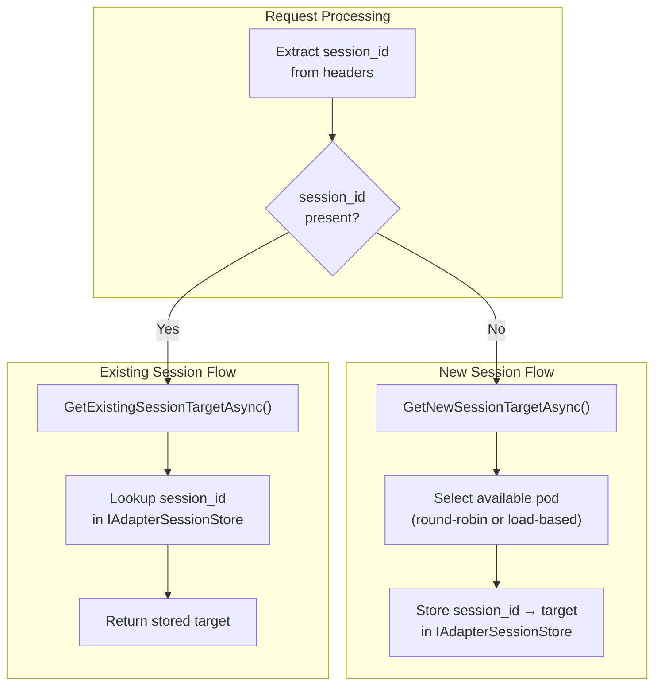

**Sources:** [dotnet/Microsoft.McpGateway.Service/src/Controllers/AdapterReverseProxyController.cs:40-62]()

### Session Store Interface

The `IAdapterSessionStore` interface abstracts session storage, supporting both Redis (development) and Cosmos DB (production) backends:

- `GetAsync(string sessionId, CancellationToken)`: Retrieves the target address for a session
- `SetAsync(string sessionId, string targetAddress, CancellationToken)`: Stores session-to-target mapping

Session IDs are extracted from MCP protocol headers using `AdapterSessionRoutingHandler.GetSessionId()`.

**Sources:** [dotnet/Microsoft.McpGateway.Service/src/Controllers/AdapterReverseProxyController.cs:24](), [dotnet/Microsoft.McpGateway.Service/src/Controllers/AdapterReverseProxyController.cs:40-62]()

### Session Routing Handler

The `ISessionRoutingHandler` interface provides higher-level routing logic:

- `GetNewSessionTargetAsync(string resourceName, HttpContext, CancellationToken)`: Selects a target pod for new sessions
- `GetExistingSessionTargetAsync(HttpContext, CancellationToken)`: Retrieves the target for existing sessions

This abstraction handles the coordination between session extraction, target selection, and session storage.

**Sources:** [dotnet/Microsoft.McpGateway.Service/src/Controllers/AdapterReverseProxyController.cs:25](), [dotnet/Microsoft.McpGateway.Service/src/Controllers/AdapterReverseProxyController.cs:43-45]()

## HTTP Proxying

### Request Transformation

The `HttpProxy.CreateProxiedHttpRequest()` method transforms incoming ASP.NET Core requests into `HttpRequestMessage` objects for forwarding:

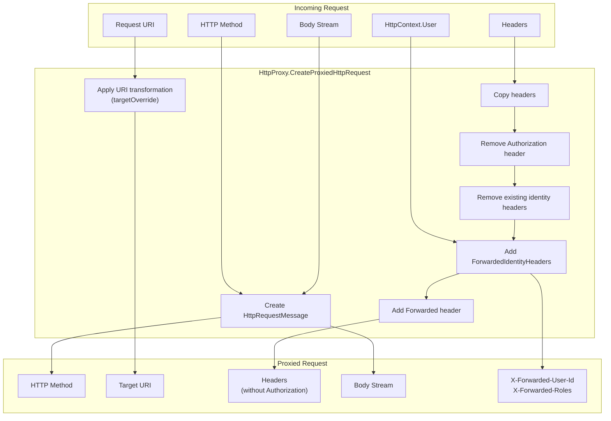

**Sources:** [dotnet/Microsoft.McpGateway.Service/src/HttpProxy.cs:13-56]()

### URI Transformation

When proxying requests, the controller provides a URI transformation function `ReplaceUriAddress()` that:

1. Extracts path segments after `/adapters/{name}/` or `/mcp/`
2. Combines them with the target pod's base address
3. Preserves query strings and fragments
4. Adds trailing slash for `/messages` paths (MCP protocol requirement)

**Sources:** [dotnet/Microsoft.McpGateway.Service/src/Controllers/AdapterReverseProxyController.cs:93-113]()

### Response Copying

The `HttpProxy.CopyProxiedHttpResponseAsync()` method streams the backend response to the client:

1. Copies HTTP status code
2. Copies response headers (both `HttpResponseMessage.Headers` and `Content.Headers`)
3. Removes `Transfer-Encoding` header (handled by ASP.NET Core)
4. Streams response body using `CopyToAsync()`

This approach supports streaming responses without buffering, crucial for MCP's streamable HTTP connections.

**Sources:** [dotnet/Microsoft.McpGateway.Service/src/HttpProxy.cs:58-70]()

## Identity Forwarding

### Forwarded Identity Headers

The data plane forwards authenticated user identity to backend services via custom HTTP headers:

| Header Name | Source | Purpose |
|-------------|--------|---------|
| `X-Forwarded-User-Id` | `ClaimsPrincipal.GetUserId()` | User's unique identifier (oid or NameIdentifier) |
| `X-Forwarded-Roles` | `ClaimsPrincipal.GetUserRoles()` | Comma-separated list of user roles |

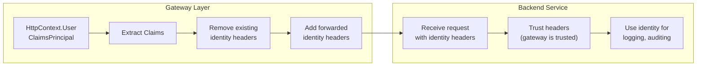

**Sources:** [dotnet/Microsoft.McpGateway.Service/src/HttpProxy.cs:32-52]()

### Header Sanitization

To prevent header injection attacks, the proxy:

1. **Strips inbound `Authorization` header**: Prevents backends from seeing the gateway's auth token
2. **Removes any existing forwarded identity headers**: Ensures only gateway-added headers are present
3. **Adds sanitized identity headers**: Based on authenticated `ClaimsPrincipal`

This ensures backend services receive only trusted identity information from the gateway.

**Sources:** [dotnet/Microsoft.McpGateway.Service/src/HttpProxy.cs:24-38]()

### Identity Extraction Logic

The `IdentityExtensions` class provides claims extraction:

- `GetUserId()`: Checks `ClaimTypes.NameIdentifier` then `"oid"` claim
- `GetUserRoles()`: Aggregates claims from `ClaimTypes.Role`, `"roles"`, and `"role"` claim types

**Sources:** [dotnet/Microsoft.McpGateway.Management/src/Extensions/IdentityExtensions.cs:10-32]()

## HTTP Client Configuration

The data plane uses a named `HttpClient` for backend communication:

- **Client Name**: `Constants.HttpClientNames.AdapterProxyClient`
- **Usage**: Created via `IHttpClientFactory.CreateClient()`
- **Configuration**: Set up during service registration to support long-lived streaming connections

**Sources:** [dotnet/Microsoft.McpGateway.Service/src/Controllers/AdapterReverseProxyController.cs:55]()

## Error Handling

The data plane returns specific HTTP status codes for different error conditions:

| Status Code | Condition | Triggered By |
|-------------|-----------|--------------|
| 404 Not Found | Adapter resource not found | `IAdapterResourceStore.TryGetAsync()` returns null |
| 403 Forbidden | User lacks read access to adapter | `IPermissionProvider.CheckAccessAsync()` returns false |
| 503 Service Unavailable | No target pod available | `ISessionRoutingHandler` returns null |

For adapter routes, authorization is checked before proxying. For tool gateway routes, authentication is still enforced (via `[Authorize]` attribute), but per-resource authorization is not applicable since no specific resource is referenced.

**Sources:** [dotnet/Microsoft.McpGateway.Service/src/Controllers/AdapterReverseProxyController.cs:47-51](), [dotnet/Microsoft.McpGateway.Service/src/Controllers/AdapterReverseProxyController.cs:76-88]()

## Data Plane Component Dependencies

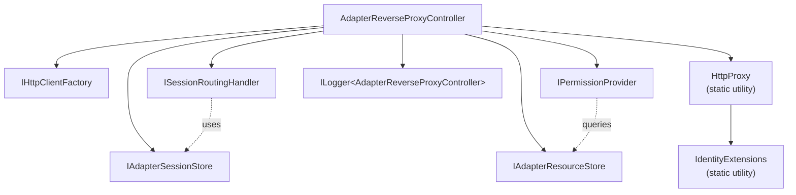

**Sources:** [dotnet/Microsoft.McpGateway.Service/src/Controllers/AdapterReverseProxyController.cs:14-28]()

---

# Page: Control Plane

# Control Plane

<details>
<summary>Relevant source files</summary>

The following files were used as context for generating this wiki page:

- [README.md](README.md)
- [dotnet/Microsoft.McpGateway.Management/src/Extensions/IdentityExtensions.cs](dotnet/Microsoft.McpGateway.Management/src/Extensions/IdentityExtensions.cs)
- [dotnet/Microsoft.McpGateway.Management/src/Store/CosmosAdapterResourceStore.cs](dotnet/Microsoft.McpGateway.Management/src/Store/CosmosAdapterResourceStore.cs)
- [dotnet/Microsoft.McpGateway.Service/src/Controllers/ManagementController.cs](dotnet/Microsoft.McpGateway.Service/src/Controllers/ManagementController.cs)
- [dotnet/Microsoft.McpGateway.Service/src/HttpProxy.cs](dotnet/Microsoft.McpGateway.Service/src/HttpProxy.cs)
- [dotnet/Microsoft.McpGateway.Service/src/appsettings.json](dotnet/Microsoft.McpGateway.Service/src/appsettings.json)
- [openapi/mcp-gateway.openapi.json](openapi/mcp-gateway.openapi.json)

</details>


The Control Plane is responsible for managing the complete lifecycle of MCP server adapters, including deployment, configuration, monitoring, and removal. It provides RESTful APIs for adapter management operations and orchestrates the underlying Kubernetes resources and metadata storage.

For information about the runtime routing and session management aspects, see [Data Plane](#2.1). For detailed implementation of individual service components, see [Core Components](#3).

## Purpose and Responsibilities

The Control Plane handles all administrative operations for MCP server adapters through a layered service architecture:

- **Adapter Lifecycle Management**: Create, read, update, and delete operations for adapter resources
- **Deployment Orchestration**: Kubernetes StatefulSet and Service management for MCP server containers
- **Metadata Persistence**: Storage and retrieval of adapter configuration and state information
- **Operational Monitoring**: Status checking and log retrieval for deployed adapters

Sources: [README.md:61-69](), [dotnet/Microsoft.McpGateway.Management/test/AdapterManagementServiceTests.cs:16-31]()

## Control Plane Architecture

```mermaid
graph TB
    subgraph "Management API"
        API["/adapters REST API"]
    end
    
    subgraph "Service Layer"
        AMS["AdapterManagementService"]
        RichProvider["AdapterRichResultProvider"]
    end
    
    subgraph "Abstraction Layer"
        IDeploymentMgr["IAdapterDeploymentManager"]
        IResourceStore["IAdapterResourceStore"]
    end
    
    subgraph "Implementation Layer"
        K8sDeployMgr["KubernetesAdapterDeploymentManager"]
        CosmosStore["CosmosAdapterResourceStore"]
        InMemoryStore["InMemoryAdapterResourceStore"]
    end
    
    subgraph "External Systems"
        K8sCluster["Kubernetes Cluster"]
        CosmosDB["Azure Cosmos DB"]
    end
    
    API --> AMS
    API --> RichProvider
    AMS --> IDeploymentMgr
    AMS --> IResourceStore
    RichProvider --> IDeploymentMgr
    
    IDeploymentMgr <|.. K8sDeployMgr
    IResourceStore <|.. CosmosStore
    IResourceStore <|.. InMemoryStore
    
    K8sDeployMgr --> K8sCluster
    CosmosStore --> CosmosDB
```

The Control Plane follows a clean architecture pattern with clear separation between API layer, business logic, and infrastructure concerns. The `AdapterManagementService` serves as the primary orchestrator, coordinating between deployment and storage operations.

Sources: [dotnet/Microsoft.McpGateway.Management/test/AdapterManagementServiceTests.cs:16-31](), [README.md:32-42]()

## Core Operations Flow

```mermaid
sequenceDiagram
    participant Client
    participant API as "/adapters API"
    participant AMS as "AdapterManagementService"
    participant DeployMgr as "IAdapterDeploymentManager"
    participant Store as "IAdapterResourceStore"
    participant K8s as "Kubernetes"
    participant Cosmos as "Storage"
    
    Note over Client,Cosmos: Adapter Creation Flow
    Client->>API: "POST /adapters"
    API->>AMS: "CreateAsync(AdapterData)"
    AMS->>Store: "TryGetAsync(name)"
    Store->>Cosmos: "Query by name"
    Cosmos-->>Store: "null (not exists)"
    Store-->>AMS: "null"
    
    AMS->>DeployMgr: "CreateDeploymentAsync(AdapterData)"
    DeployMgr->>K8s: "Create StatefulSet + Service"
    K8s-->>DeployMgr: "Resources created"
    DeployMgr-->>AMS: "Success"
    
    AMS->>Store: "UpsertAsync(AdapterResource)"
    Store->>Cosmos: "Persist metadata"
    Cosmos-->>Store: "Stored"
    Store-->>AMS: "AdapterResource"
    AMS-->>API: "AdapterResource"
    API-->>Client: "201 Created"
    
    Note over Client,Cosmos: Status Check Flow
    Client->>API: "GET /adapters/{name}/status"
    API->>AMS: "GetStatusAsync(name)"
    AMS->>DeployMgr: "GetDeploymentStatusAsync(name)"
    DeployMgr->>K8s: "Query StatefulSet status"
    K8s-->>DeployMgr: "Pod status, replicas"
    DeployMgr-->>AMS: "AdapterStatus"
    AMS-->>API: "AdapterStatus"
    API-->>Client: "Status response"
```

This sequence demonstrates the coordination between service layers during typical Control Plane operations. The `AdapterManagementService` orchestrates both deployment and storage operations to maintain consistency.

Sources: [dotnet/Microsoft.McpGateway.Management/test/AdapterManagementServiceTests.cs:34-44](), [dotnet/Microsoft.McpGateway.Management/test/AdapterManagementServiceTests.cs:47-55]()

## API Endpoints and Operations

The Control Plane exposes the following REST API endpoints for adapter management:

| Method | Endpoint | Purpose | Key Service Methods |
|--------|----------|---------|---------------------|
| `POST` | `/adapters` | Deploy new MCP server adapter | `AdapterManagementService.CreateAsync()` |
| `GET` | `/adapters` | List all accessible adapters | `AdapterManagementService.ListAsync()` |
| `GET` | `/adapters/{name}` | Get adapter metadata | `AdapterManagementService.GetAsync()` |
| `GET` | `/adapters/{name}/status` | Check deployment status | `AdapterManagementService.GetStatusAsync()` |
| `GET` | `/adapters/{name}/logs` | Retrieve adapter logs | `AdapterRichResultProvider.GetLogsAsync()` |
| `PUT` | `/adapters/{name}` | Update adapter deployment | `AdapterManagementService.UpdateAsync()` |
| `DELETE` | `/adapters/{name}` | Remove adapter | `AdapterManagementService.DeleteAsync()` |

Each endpoint corresponds to specific CRUD operations implemented in the `AdapterManagementService` class, which coordinates between deployment management and resource storage.

Sources: [README.md:61-69](), [dotnet/Microsoft.McpGateway.Management/test/AdapterManagementServiceTests.cs:34-96]()

## Service Layer Components

```mermaid
graph LR
    subgraph "Core Services"
        AMS["AdapterManagementService<br/>Primary Orchestrator"]
        RichProvider["AdapterRichResultProvider<br/>Operational Data"]
    end
    
    subgraph "Service Dependencies"
        IDeployMgr["IAdapterDeploymentManager<br/>Deployment Interface"]
        IResourceStore["IAdapterResourceStore<br/>Storage Interface"]
        ILogger["ILogger<br/>Logging Interface"]
    end
    
    subgraph "Data Contracts"
        AdapterData["AdapterData<br/>Input DTO"]
        AdapterResource["AdapterResource<br/>Entity Model"]
        AdapterStatus["AdapterStatus<br/>Status DTO"]
    end
    
    AMS --> IDeployMgr
    AMS --> IResourceStore
    AMS --> ILogger
    RichProvider --> IDeployMgr
    
    AdapterData -.-> AdapterResource
    AdapterResource -.-> AdapterStatus
```

The service layer implements the core business logic for adapter management. The `AdapterManagementService` acts as the primary coordinator, handling all CRUD operations and ensuring proper sequencing of deployment and storage operations.

Sources: [dotnet/Microsoft.McpGateway.Management/test/AdapterManagementServiceTests.cs:16-31]()

## Deployment Management

The Control Plane manages Kubernetes deployments through the `IAdapterDeploymentManager` interface, which abstracts deployment operations:

- **Resource Creation**: Creates StatefulSets and headless Services for MCP server pods
- **Status Monitoring**: Queries Kubernetes API for deployment and pod status
- **Resource Updates**: Handles rolling updates and configuration changes
- **Resource Cleanup**: Removes Kubernetes resources during adapter deletion

The primary implementation `KubernetesAdapterDeploymentManager` uses Kubernetes StatefulSets to ensure stable network identities and persistent storage for MCP server instances.

Sources: [dotnet/Microsoft.McpGateway.Management/test/AdapterManagementServiceTests.cs:18](), [dotnet/Microsoft.McpGateway.Management/test/AdapterManagementServiceTests.cs:42]()

## Metadata Management

Adapter metadata is managed through the `IAdapterResourceStore` interface, which provides:

- **Resource Persistence**: Stores `AdapterResource` entities with configuration and metadata
- **Query Operations**: Retrieves adapter information by name or lists all resources
- **Consistency Management**: Ensures metadata consistency with deployment state

Two implementations are available:
- `CosmosAdapterResourceStore` for production Azure Cosmos DB storage
- `InMemoryAdapterResourceStore` for development and testing scenarios

Sources: [dotnet/Microsoft.McpGateway.Management/test/AdapterManagementServiceTests.cs:19](), [dotnet/Microsoft.McpGateway.Management/test/AdapterManagementServiceTests.cs:37]()

## CRUD Operations Implementation

The `AdapterManagementService` implements the complete CRUD lifecycle:

### Create Operation
1. Validates adapter name uniqueness via `TryGetAsync()`
2. Invokes `CreateDeploymentAsync()` to provision Kubernetes resources
3. Calls `UpsertAsync()` to persist adapter metadata
4. Returns created `AdapterResource`

### Read Operations
- `GetAsync()` retrieves individual adapter metadata
- `ListAsync()` returns all accessible adapters
- `GetStatusAsync()` queries deployment status from Kubernetes

### Update Operation
1. Retrieves existing adapter via `TryGetAsync()`
2. Updates deployment through `UpdateDeploymentAsync()`
3. Persists updated metadata via `UpsertAsync()`

### Delete Operation
1. Removes adapter metadata via `DeleteAsync()`
2. Deletes Kubernetes resources through `DeleteDeploymentAsync()`

Sources: [dotnet/Microsoft.McpGateway.Management/test/AdapterManagementServiceTests.cs:34-81]()

---

# Page: Tool Gateway System

# Tool Gateway System

<details>
<summary>Relevant source files</summary>

The following files were used as context for generating this wiki page:

- [README.md](README.md)
- [dotnet/Microsoft.McpGateway.Tools/src/Program.cs](dotnet/Microsoft.McpGateway.Tools/src/Program.cs)
- [dotnet/Microsoft.McpGateway.Tools/src/Services/HttpToolExecutor.cs](dotnet/Microsoft.McpGateway.Tools/src/Services/HttpToolExecutor.cs)
- [dotnet/Microsoft.McpGateway.Tools/src/Services/StorageToolDefinitionProvider.cs](dotnet/Microsoft.McpGateway.Tools/src/Services/StorageToolDefinitionProvider.cs)
- [dotnet/Microsoft.McpGateway.Tools/test/StorageToolDefinitionProviderTests.cs](dotnet/Microsoft.McpGateway.Tools/test/StorageToolDefinitionProviderTests.cs)

</details>


## Purpose and Scope

This document describes the **Tool Gateway System**, which enables dynamic routing and execution of MCP tools through an intelligent router layer. The Tool Gateway Router is a specialized MCP server that routes tool execution requests to the appropriate registered tool servers based on tool definitions stored in the system.

For information about the control plane APIs used to register and manage tools, see [Control Plane](#2.3). For details about the overall data plane routing architecture, see [Data Plane](#2.2). For adapter management, see [Adapter Management Service](#4.2).

---

## Architecture Overview

The Tool Gateway System consists of three primary components: the Tool Gateway Router service, the tool definition provider, and the tool executor. Together, these components enable clients to invoke tools dynamically without needing to know the specific tool server endpoints.

```mermaid
graph TB
    subgraph "Client Layer"
        McpClient["MCP Client<br/>(VS Code, CLI)"]
    end
    
    subgraph "Gateway Layer"
        Gateway["MCP Gateway Service<br/>/mcp endpoint"]
        SessionStore["Session Store<br/>Session Affinity"]
    end
    
    subgraph "Tool Router Layer"
        Router1["toolgateway-0<br/>StatefulSet Pod"]
        Router2["toolgateway-1<br/>StatefulSet Pod"]
        RouterService["toolgateway-service<br/>Headless Service"]
    end
    
    subgraph "Tool Definition System"
        Provider["StorageToolDefinitionProvider<br/>IToolDefinitionProvider"]
        Executor["HttpToolExecutor<br/>IToolExecutor"]
        Store["IToolResourceStore<br/>(Redis/Cosmos)"]
    end
    
    subgraph "Registered Tool Servers"
        Tool1["weather-tool-0<br/>StatefulSet Pod"]
        Tool1Svc["weather-tool-service<br/>ClusterIP Service"]
        Tool2["calendar-tool-0<br/>StatefulSet Pod"]
        Tool2Svc["calendar-tool-service<br/>ClusterIP Service"]
    end
    
    McpClient -->|"POST /mcp<br/>tools/call request"| Gateway
    Gateway -->|"Session Affinity"| SessionStore
    SessionStore -->|"Route to same pod"| RouterService
    RouterService --> Router1
    RouterService --> Router2
    
    Router1 --> Provider
    Router2 --> Provider
    Router1 --> Executor
    Router2 --> Executor
    
    Provider -->|"Load tool definitions"| Store
    
    Executor -->|"http://weather-tool-service<br/>.adapter.svc.cluster.local:8000/score"| Tool1Svc
    Executor -->|"http://calendar-tool-service<br/>.adapter.svc.cluster.local:8000/execute"| Tool2Svc
    
    Tool1Svc --> Tool1
    Tool2Svc --> Tool2
```

**Sources**: [README.md:22-28](), [README.md:166-189]()

---

## Two-Phase Operation Model

The Tool Gateway System operates in two distinct phases: a registration phase where tools are deployed to Kubernetes, and a runtime phase where tool invocations are dynamically routed.

```mermaid
sequenceDiagram
    participant Dev as Developer
    participant API as Management API<br/>/tools
    participant DeployMgr as Deployment Manager
    participant K8s as Kubernetes API
    participant Store as IToolResourceStore
    
    Note over Dev,Store: Registration Phase
    Dev->>API: POST /tools<br/>{name, image, toolDefinition}
    API->>Store: Store tool metadata
    Store-->>API: Stored
    API->>DeployMgr: Deploy tool
    DeployMgr->>K8s: Create StatefulSet + Service
    K8s-->>DeployMgr: Resources created
    DeployMgr-->>API: Deployment complete
    API-->>Dev: 201 Created
    
    Note over Dev,Store: Tool is now available for invocation
```

```mermaid
sequenceDiagram
    participant Client as MCP Client
    participant Gateway as Gateway<br/>/mcp
    participant Router as Tool Gateway Router
    participant Provider as StorageToolDefinitionProvider
    participant Executor as HttpToolExecutor
    participant ToolSvc as Tool Server
    
    Note over Client,ToolSvc: Runtime Phase
    Client->>Gateway: POST /mcp<br/>tools/call {name: "weather"}
    Gateway->>Router: Route with session affinity
    Router->>Provider: ListToolsAsync()
    Provider-->>Router: [Tool definitions]
    Router->>Executor: ExecuteToolAsync()
    Executor->>Provider: GetToolDefinitionAsync("weather")
    Provider-->>Executor: ToolDefinition {port: 8000, path: "/score"}
    Executor->>ToolSvc: POST http://weather-tool-service<br/>.adapter.svc.cluster.local:8000/score
    ToolSvc-->>Executor: Tool result
    Executor-->>Router: CallToolResult
    Router-->>Gateway: Response
    Gateway-->>Client: Tool execution result
```

**Sources**: [README.md:170-189](), [dotnet/Microsoft.McpGateway.Tools/src/Services/HttpToolExecutor.cs:36-154]()

---

## Tool Gateway Router Service

The Tool Gateway Router is an MCP server that implements the Model Context Protocol with specialized `tools/list` and `tools/call` handlers. It runs as a StatefulSet in Kubernetes with multiple replicas for high availability.

### Service Configuration

The router service is configured in [dotnet/Microsoft.McpGateway.Tools/src/Program.cs]():

| Configuration Aspect | Development | Production |
|---------------------|-------------|------------|
| **Storage Backend** | Redis (`localhost:6379`) | Cosmos DB |
| **Store Implementation** | `RedisToolResourceStore` | `CosmosToolResourceStore` |
| **Authentication** | Development bypass | Forwarded identity headers |
| **Port** | 8000 | 8000 |
| **Log Level** | Debug | Information |

The service registers the MCP server with two key handlers:

```
.WithListToolsHandler() -> IToolDefinitionProvider.ListToolsAsync()
.WithCallToolHandler() -> IToolExecutor.ExecuteToolAsync()
```

**Sources**: [dotnet/Microsoft.McpGateway.Tools/src/Program.cs:15-136]()

### Identity Forwarding Middleware

The router receives authenticated user identity from the gateway via custom HTTP headers:

| Header | Purpose |
|--------|---------|
| `X-Forwarded-UserId` | User identifier from Azure AD |
| `X-Forwarded-Roles` | Comma-separated list of user roles |

The middleware reconstructs the `ClaimsPrincipal` from these headers:

[dotnet/Microsoft.McpGateway.Tools/src/Program.cs:93-117]()

This enables the router to perform authorization checks when listing or executing tools.

**Sources**: [dotnet/Microsoft.McpGateway.Tools/src/Program.cs:93-134]()

---

## Tool Definition Provider

The `StorageToolDefinitionProvider` implements `IToolDefinitionProvider` and is responsible for loading tool definitions from the resource store and filtering them based on user permissions.

### Component Diagram

```mermaid
graph LR
    Provider["StorageToolDefinitionProvider"]
    Store["IToolResourceStore"]
    PermProvider["IPermissionProvider"]
    HttpContext["IHttpContextAccessor"]
    Cache["In-Memory Cache<br/>5 minute TTL"]
    
    Provider -->|"ListAsync()"| Store
    Provider -->|"TryGetAsync(toolName)"| Store
    Provider -->|"CheckAccessAsync()"| PermProvider
    Provider -->|"Get User Claims"| HttpContext
    Provider -->|"Read/Write"| Cache
```

### Key Methods

**GetToolDefinitionsAsync()**

Loads all tool definitions from storage with a 5-minute cache:

[dotnet/Microsoft.McpGateway.Tools/src/Services/StorageToolDefinitionProvider.cs:49-75]()

**GetToolDefinitionAsync(string toolName)**

Retrieves a single tool definition by name, checking permissions:

[dotnet/Microsoft.McpGateway.Tools/src/Services/StorageToolDefinitionProvider.cs:77-107]()

**ListToolsAsync(RequestContext)**

MCP protocol handler that returns tools visible to the authenticated user:

[dotnet/Microsoft.McpGateway.Tools/src/Services/StorageToolDefinitionProvider.cs:109-126]()

### Permission Filtering

Tool definitions are filtered based on the current user's permissions using `IPermissionProvider.CheckAccessAsync()` with `Operation.Read`:

[dotnet/Microsoft.McpGateway.Tools/src/Services/StorageToolDefinitionProvider.cs:128-142]()

This ensures users only see tools they have permission to access.

**Sources**: [dotnet/Microsoft.McpGateway.Tools/src/Services/StorageToolDefinitionProvider.cs:16-144](), [dotnet/Microsoft.McpGateway.Tools/test/StorageToolDefinitionProviderTests.cs:1-622]()

---

## Tool Executor

The `HttpToolExecutor` implements `IToolExecutor` and is responsible for forwarding tool execution requests to the appropriate tool server endpoint.

### Execution Flow

```mermaid
graph TB
    Start["ExecuteToolAsync()"]
    Validate["Validate tool name"]
    CheckAuth["Check user context exists"]
    LoadResource["Load ToolResource from store"]
    CheckPerm["CheckAccessAsync(user, tool, Read)"]
    GetDef["Extract ToolDefinition"]
    BuildUrl["Build execution endpoint URL"]
    SendRequest["POST to tool server"]
    HandleResponse["Parse response"]
    ReturnResult["Return CallToolResult"]
    
    Start --> Validate
    Validate -->|"Missing"| ReturnResult
    Validate -->|"Valid"| CheckAuth
    CheckAuth -->|"Missing"| ReturnResult
    CheckAuth -->|"Present"| LoadResource
    LoadResource -->|"Not found"| ReturnResult
    LoadResource -->|"Found"| CheckPerm
    CheckPerm -->|"Denied"| ReturnResult
    CheckPerm -->|"Allowed"| GetDef
    GetDef -->|"Missing"| ReturnResult
    GetDef -->|"Present"| BuildUrl
    BuildUrl --> SendRequest
    SendRequest --> HandleResponse
    HandleResponse --> ReturnResult
```

### Endpoint URL Construction

The executor constructs the tool server endpoint using Kubernetes DNS:

```
http://{toolName}-service.adapter.svc.cluster.local:{port}{path}
```

Where:
- `{toolName}` is the registered tool name
- `{port}` is from `ToolDefinition.Port`
- `{path}` is from `ToolDefinition.Path`

Example: For a tool named `weather` with port `8000` and path `/score`:
```
http://weather-service.adapter.svc.cluster.local:8000/score
```

[dotnet/Microsoft.McpGateway.Tools/src/Services/HttpToolExecutor.cs:88-95]()

### Request and Response Handling

The executor:
1. Serializes `CallToolRequestParams.Arguments` to JSON
2. Sends POST request with `Content-Type: application/json`
3. Handles HTTP error responses
4. Returns result as `CallToolResult` with `TextContentBlock`

[dotnet/Microsoft.McpGateway.Tools/src/Services/HttpToolExecutor.cs:98-142]()

### Error Handling

The executor implements comprehensive error handling:

| Error Condition | Behavior |
|----------------|----------|
| Missing tool name | Return error with message |
| Missing user context | Return permission error |
| Tool not found | Return tool not found error |
| Permission denied | Return permission error |
| Missing tool definition | Return unavailable error |
| HTTP request failure | Return connection error |
| Non-success HTTP status | Return server error with status code |
| Unexpected exception | Return error with exception message |

[dotnet/Microsoft.McpGateway.Tools/src/Services/HttpToolExecutor.cs:144-154]()

**Sources**: [dotnet/Microsoft.McpGateway.Tools/src/Services/HttpToolExecutor.cs:14-165]()

---

## Tool Definition Structure

Tool definitions include the MCP tool metadata and execution endpoint information:

```mermaid
graph TB
    ToolDef["ToolDefinition"]
    Tool["Tool<br/>(MCP Protocol)"]
    Port["Port: int"]
    Path["Path: string"]
    
    ToolDef --> Tool
    ToolDef --> Port
    ToolDef --> Path
    
    Tool --> Name["name: string"]
    Tool --> Title["title: string"]
    Tool --> Desc["description: string"]
    Tool --> Type["type: 'http'"]
    Tool --> Schema["inputSchema: JsonElement"]
    Tool --> Annotations["annotations: object"]
```

### Example Tool Definition

From the README examples, a weather tool definition:

```json
{
  "tool": {
    "name": "weather",
    "title": "Weather Information",
    "description": "Gets the current weather for a specified location.",
    "type": "http",
    "inputSchema": {
      "type": "object",
      "properties": {
        "location": {
          "type": "string",
          "description": "The city and state, e.g. San Francisco, CA"
        }
      },
      "required": ["location"]
    },
    "annotations": {
      "readOnly": true
    }
  },
  "port": 8000,
  "path": "/score"
}
```

**Sources**: [README.md:295-315](), [README.md:517-539]()

---

## Kubernetes Deployment

The Tool Gateway Router is deployed as a StatefulSet with a headless service for session affinity.

### Deployment Resources

```mermaid
graph TB
    subgraph "adapter namespace"
        SS["toolgateway StatefulSet<br/>Replicas: 2"]
        Svc["toolgateway-service<br/>Headless Service<br/>ClusterIP: None"]
        CM["app-config ConfigMap"]
        
        Pod0["toolgateway-0<br/>Pod"]
        Pod1["toolgateway-1<br/>Pod"]
        
        SS -.->|"Creates"| Pod0
        SS -.->|"Creates"| Pod1
        
        Svc -.->|"Selects"| Pod0
        Svc -.->|"Selects"| Pod1
        
        Pod0 -->|"Reads config"| CM
        Pod1 -->|"Reads config"| CM
    end
    
    Gateway["MCP Gateway"]
    SessionStore["Session Store"]
    
    Gateway -->|"Session-aware routing"| SessionStore
    SessionStore -->|"Route to specific pod"| Svc
```

### Service Account Permissions

The Tool Gateway Router uses the `mcpgateway-sa` ServiceAccount with the `app-manager` Role, which provides permissions to:
- Read Pods and Services
- Access ConfigMaps and Secrets

The router does NOT create or modify Kubernetes resources; tool deployment is handled by the gateway's Deployment Manager.

**Sources**: [README.md:77-89](), [README.md:178-182]()

---

## Session Affinity

Session affinity ensures that all requests from a specific MCP client session are routed to the same Tool Gateway Router instance, maintaining stateful MCP connections.

### Session Routing Flow

```mermaid
sequenceDiagram
    participant Client
    participant Gateway
    participant SessionStore
    participant Router0 as toolgateway-0
    participant Router1 as toolgateway-1
    
    Note over Client,Router1: First request establishes session
    Client->>Gateway: POST /mcp (session_id: abc123)
    Gateway->>SessionStore: Get route for session abc123
    SessionStore-->>Gateway: No existing route
    Gateway->>SessionStore: Store route: abc123 -> toolgateway-0
    Gateway->>Router0: Forward request
    Router0-->>Gateway: Response
    Gateway-->>Client: Response
    
    Note over Client,Router1: Subsequent requests use same pod
    Client->>Gateway: POST /mcp (session_id: abc123)
    Gateway->>SessionStore: Get route for session abc123
    SessionStore-->>Gateway: toolgateway-0
    Gateway->>Router0: Forward request
    Router0-->>Gateway: Response
    Gateway-->>Client: Response
```

The session store maps session IDs to specific pod instances, enabling stateful protocol handling.

**Sources**: [README.md:28](), [README.md:105-106]()

---

## Integration with Tool Management API

The Tool Gateway System integrates with the control plane's tool management API to respond to tool lifecycle events:

| API Operation | Tool Gateway Impact |
|---------------|---------------------|
| `POST /tools` | New tool becomes available after deployment completes |
| `PUT /tools/{name}` | Tool definition updated, cache refreshed on next list |
| `DELETE /tools/{name}` | Tool removed from available tools |
| `GET /tools/{name}/status` | No direct impact; router queries store |

The `StorageToolDefinitionProvider` uses a 5-minute cache, so changes propagate within that window. Calling `GetToolDefinitionAsync()` explicitly refreshes the cache for a specific tool:

[dotnet/Microsoft.McpGateway.Tools/src/Services/HttpToolExecutor.cs:85-86]()

**Sources**: [README.md:131-139](), [dotnet/Microsoft.McpGateway.Tools/src/Services/StorageToolDefinitionProvider.cs:18]()

---

## Development vs Production Configuration

The Tool Gateway Router supports different configurations for development and production environments:

### Development Environment

[dotnet/Microsoft.McpGateway.Tools/src/Program.cs:26-40]()

- **Storage**: Redis at `localhost:6379`
- **Authentication**: Development identity bypass (user: "dev", role: "mcp.dev")
- **Logging**: Console output with Debug level
- **Image Registry**: `localhost:5000`

### Production Environment

[dotnet/Microsoft.McpGateway.Tools/src/Program.cs:41-64]()

- **Storage**: Cosmos DB with workload identity authentication
- **Authentication**: Forwarded identity headers from gateway
- **Logging**: Standard logging with Information level
- **Image Registry**: Azure Container Registry

**Sources**: [dotnet/Microsoft.McpGateway.Tools/src/Program.cs:26-64](), [dotnet/Microsoft.McpGateway.Tools/src/Program.cs:119-134]()

---

## Security and Authorization

The Tool Gateway Router enforces fine-grained access control for tool operations:

### Authorization Checks

| Operation | Authorization Logic |
|-----------|-------------------|
| `tools/list` | Returns only tools where user has `Read` permission |
| `tools/call` | Requires `Read` permission on the tool being executed |

### Permission Model

Permissions are checked via `IPermissionProvider.CheckAccessAsync()`:
- User is the tool creator, OR
- User has one of the tool's `requiredRoles`, OR  
- User has the `mcp.admin` role

[dotnet/Microsoft.McpGateway.Tools/src/Services/HttpToolExecutor.cs:58-76]()

### Identity Propagation

User identity flows through the system:

```mermaid
graph LR
    Client["MCP Client<br/>Bearer Token"]
    Gateway["Gateway<br/>Validates Token"]
    Router["Tool Router<br/>Receives Headers"]
    ToolServer["Tool Server<br/>(Optional)"]
    
    Client -->|"Authorization: Bearer"| Gateway
    Gateway -->|"X-Forwarded-UserId<br/>X-Forwarded-Roles"| Router
    Router -->|"(Can forward headers)"| ToolServer
```

For more details on the authentication flow, see [Authentication Flow](#7.1).

**Sources**: [dotnet/Microsoft.McpGateway.Tools/src/Services/HttpToolExecutor.cs:58-76](), [dotnet/Microsoft.McpGateway.Tools/src/Services/StorageToolDefinitionProvider.cs:128-142]()

---

# Page: Deployment

# Deployment

<details>
<summary>Relevant source files</summary>

The following files were used as context for generating this wiki page:

- [deployment/infra/azure-deployment.bicep](deployment/infra/azure-deployment.bicep)
- [deployment/k8s/cloud-deployment-template.yml](deployment/k8s/cloud-deployment-template.yml)

</details>


This document provides an overview of the MCP Gateway deployment architecture and processes. It covers the deployment options available, the infrastructure components involved, and how they are orchestrated across different environments.

**Scope**: This page provides a high-level overview of deployment strategies and infrastructure. For detailed deployment procedures, see:
- Azure infrastructure provisioning: [Azure Infrastructure](#3.1)
- Kubernetes resource configuration: [Kubernetes Configuration](#3.2)
- Local development setup: [Local Development Setup](#3.3)

## Deployment Options

The MCP Gateway supports three deployment configurations, each optimized for different use cases:

| Environment | Infrastructure | Storage Backend | Authentication | Use Case |
|-------------|---------------|-----------------|----------------|----------|
| **Azure Production** | AKS + Cosmos DB + App Gateway | Cosmos DB | Azure AD (Entra ID) | Production workloads with full security and scalability |
| **Local Kubernetes** | Kind/Minikube + Redis | Redis | Development bypass | Integration testing and local validation |
| **Direct Local** | .NET runtime | Redis | Development bypass | Rapid development iteration |

Sources: [deployment/infra/azure-deployment.bicep:1-602](), [deployment/k8s/cloud-deployment-template.yml:1-176]()

## Azure Production Deployment Architecture

The Azure production deployment provisions a complete cloud infrastructure using Infrastructure-as-Code (Bicep templates) and deploys Kubernetes workloads to Azure Kubernetes Service (AKS).

### Azure Resource Topology

```mermaid
graph TB
    subgraph AzureSubscription["Azure Subscription"]
        subgraph ResourceGroup["Resource Group"]
            subgraph VNet["Virtual Network (mg-vnet-*)"]
                AKSSubnet["AKS Subnet<br/>10.0.1.0/24<br/>(mg-aks-subnet-*)"]
                AppGWSubnet["App Gateway Subnet<br/>10.0.2.0/24<br/>(mg-aag-subnet-*)"]
                PESubnet["Private Endpoint Subnet<br/>10.0.3.0/24<br/>(mg-pe-subnet-*)"]
            end
            
            subgraph AKS["AKS Cluster (mg-aks-*)"]
                SystemIdentity["System-Assigned<br/>Managed Identity"]
                KubeletIdentity["Kubelet Identity"]
                OIDCIssuer["OIDC Issuer Profile"]
                WorkloadIdentity["Workload Identity<br/>Enabled"]
            end
            
            ACR["Container Registry<br/>(mgreg*)"]
            
            subgraph CosmosDB["Cosmos DB Account<br/>(mg-storage-*)"]
                McpGatewayDb["Database:<br/>McpGatewayDb"]
                AdapterContainer["Container:<br/>AdapterContainer"]
                ToolContainer["Container:<br/>ToolContainer"]
                CacheContainer["Container:<br/>CacheContainer"]
            end
            
            subgraph Identities["User-Assigned Managed Identities"]
                UAI["mg-identity-*<br/>(Gateway Identity)"]
                UAIAdmin["mg-identity-*-admin<br/>(Admin Identity)"]
                UAIWorkload["mg-identity-*-workload<br/>(Workload Identity)"]
            end
            
            PublicIP["Public IP Address<br/>(mg-pip-*)"]
            
            subgraph AppGW["Application Gateway<br/>(mg-aag-*)"]
                FrontendIP["Frontend IP"]
                BackendPool["Backend Pool<br/>IP: 10.0.1.100"]
                HttpListener["HTTP Listener<br/>Port: 80"]
                HealthProbe["Health Probe<br/>/ping"]
            end
            
            AppInsights["Application Insights<br/>(mg-ai-*)"]
            
            DeployScript["Deployment Script<br/>kubernetesDeployment"]
            
            PrivateDNS["Private DNS Zone<br/>privatelink.documents.azure.com"]
            PrivateEndpoint["Private Endpoint<br/>(pe-mg-storage-*)"]
        end
    end
    
    PublicIP --> FrontendIP
    FrontendIP --> HttpListener
    HttpListener --> BackendPool
    BackendPool --> AKSSubnet
    
    AppGW --> AppGWSubnet
    AKS --> AKSSubnet
    
    SystemIdentity -.->|"Network Contributor"| VNet
    KubeletIdentity -.->|"AcrPull"| ACR
    
    UAI -.->|"Cosmos DB Data Contributor"| CosmosDB
    UAIAdmin -.->|"AKS Contributor + RBAC Admin"| AKS
    
    OIDCIssuer -.->|"Federated Credential"| UAI
    OIDCIssuer -.->|"Federated Credential"| UAIWorkload
    
    DeployScript -.->|"Uses"| UAIAdmin
    DeployScript -.->|"kubectl apply"| AKS
    
    PrivateEndpoint --> PESubnet
    PrivateEndpoint -.->|"Private Link"| CosmosDB
    PrivateDNS -.->|"DNS Resolution"| PrivateEndpoint
    
    McpGatewayDb --> AdapterContainer
    McpGatewayDb --> ToolContainer
    McpGatewayDb --> CacheContainer
    
    style AKS fill:#f0f0f0
    style CosmosDB fill:#f0f0f0
    style AppGW fill:#f0f0f0
```

**Diagram: Azure Infrastructure Resources and Relationships**

This diagram shows the concrete Azure resources created by the Bicep template, using the actual naming conventions from the code. The `*` placeholder represents the `resourceLabel` parameter (defaults to resource group name).

Sources: [deployment/infra/azure-deployment.bicep:16-55](), [deployment/infra/azure-deployment.bicep:60-91](), [deployment/infra/azure-deployment.bicep:104-122](), [deployment/infra/azure-deployment.bicep:125-169](), [deployment/infra/azure-deployment.bicep:199-316](), [deployment/infra/azure-deployment.bicep:320-335](), [deployment/infra/azure-deployment.bicep:384-457]()

### Infrastructure Provisioning Flow

The Azure deployment follows a multi-stage process that provisions infrastructure and then deploys workloads:

```mermaid
sequenceDiagram
    participant User
    participant Bicep as azure-deployment.bicep
    participant Azure as Azure Resource Manager
    participant AKS as AKS Cluster
    participant DeployScript as Deployment Script
    participant GitHub
    
    User->>Bicep: "az deployment group create"
    Bicep->>Azure: "Create VNet with 3 subnets"
    Azure-->>Bicep: "VNet created"
    
    Bicep->>Azure: "Create AKS with OIDC + Workload Identity"
    Azure-->>Bicep: "AKS created"
    
    Bicep->>Azure: "Create ACR"
    Azure-->>Bicep: "ACR created"
    
    Bicep->>Azure: "Create Cosmos DB + Database + Containers"
    Note over Azure: AdapterContainer, ToolContainer, CacheContainer
    Azure-->>Bicep: "Cosmos DB created"
    
    Bicep->>Azure: "Create UAI, UAI-Admin, UAI-Workload"
    Azure-->>Bicep: "Identities created"
    
    Bicep->>Azure: "Create Federated Credentials"
    Note over Azure: Link OIDC issuer to UAI for ServiceAccounts
    Azure-->>Bicep: "Federated credentials created"
    
    Bicep->>Azure: "Assign RBAC roles"
    Note over Azure: Network Contributor, AcrPull, AKS Contributor, etc.
    Azure-->>Bicep: "Roles assigned"
    
    Bicep->>Azure: "Create Application Gateway + Public IP"
    Azure-->>Bicep: "App Gateway created"
    
    Bicep->>Azure: "Create Application Insights"
    Azure-->>Bicep: "App Insights created"
    
    alt enablePrivateEndpoints = true
        Bicep->>Azure: "Create Private DNS Zone + Private Endpoint"
        Azure-->>Bicep: "Private networking configured"
    end
    
    Bicep->>Azure: "Execute deploymentScripts resource"
    Azure->>DeployScript: "Run AzureCLI script with UAI-Admin"
    DeployScript->>GitHub: "Fetch cloud-deployment-template.yml"
    GitHub-->>DeployScript: "Template retrieved"
    DeployScript->>DeployScript: "sed - inject env variables"
    Note over DeployScript: CLIENT_ID, AZURE_CLIENT_ID, TENANT_ID, etc.
    DeployScript->>AKS: "az aks command invoke --command kubectl apply"
    AKS-->>DeployScript: "Resources applied"
    DeployScript-->>Azure: "Script execution complete"
    Azure-->>Bicep: "Deployment complete"
    Bicep-->>User: "All resources provisioned"
```

**Diagram: Azure Infrastructure Deployment Flow**

Sources: [deployment/infra/azure-deployment.bicep:537-601]()

### Key Bicep Parameters

The Bicep template accepts the following parameters to customize the deployment:

| Parameter | Type | Description | Default |
|-----------|------|-------------|---------|
| `clientId` | string | Entra ID client ID for authentication | *Required* |
| `resourceLabel` | string | Suffix for resource naming and DNS label | Resource group name |
| `location` | string | Azure region for deployment | Resource group location |
| `enablePrivateEndpoints` | bool | Enable private endpoints for ACR and Cosmos DB | `false` |

**Resource Naming Convention**: All resources use the pattern `mg-<type>-${resourceLabel}` where `resourceLabel` is converted to lowercase. Examples:
- AKS: `mg-aks-myproject`
- Cosmos DB: `mg-storage-myproject`
- ACR: `mgregmyproject` (no hyphens, alphanumeric only)

Sources: [deployment/infra/azure-deployment.bicep:1-55]()

## Kubernetes Workload Deployment

After Azure infrastructure is provisioned, the deployment script applies Kubernetes manifests to create the gateway and tool gateway services within the AKS cluster.

### Kubernetes Resource Structure

```mermaid
graph TB
    subgraph Namespace["Namespace: adapter"]
        subgraph ServiceAccounts["Service Accounts"]
            MCPSA["mcpgateway-sa"]
            WorkloadSA["workload-sa"]
        end
        
        subgraph RBAC["RBAC"]
            Role["Role: app-manager"]
            RoleBinding["RoleBinding: app-manager-binding"]
        end
        
        subgraph ConfigMaps["Configuration"]
            AppConfig["ConfigMap: app-config"]
        end
        
        subgraph Gateway["Gateway Deployment"]
            MCPDeploy["Deployment: mcpgateway<br/>Replicas: 1"]
            MCPPod["Pod: mcpgateway-*"]
            MCPContainer["Container: mcpgateway-container<br/>Image: ghcr.io/microsoft/mcp-gateway:latest"]
            MCPService["Service: mcpgateway-service<br/>Type: LoadBalancer<br/>IP: 10.0.1.100"]
        end
        
        subgraph ToolGateway["Tool Gateway"]
            ToolSS["StatefulSet: toolgateway<br/>Replicas: 1"]
            ToolPod["Pod: toolgateway-0"]
            ToolContainer["Container: toolgateway-container<br/>Image: ghcr.io/microsoft/tool-gateway:latest"]
            ToolService["Service: toolgateway-service<br/>ClusterIP: None (Headless)"]
        end
        
        subgraph DynamicWorkloads["Dynamic Workloads (Created by Gateway)"]
            AdapterSS["StatefulSets: adapter-*"]
            ToolServerSS["StatefulSets: tool-*"]
            Services["Services: adapter-*-service, tool-*-service"]
        end
    end
    
    subgraph AzureIdentity["Azure Workload Identity"]
        UAIBinding["UAI: mg-identity-*"]
        WorkloadBinding["UAI: mg-identity-*-workload"]
    end
    
    MCPSA -.->|"Annotated with"| UAIBinding
    WorkloadSA -.->|"Annotated with"| WorkloadBinding
    
    RoleBinding -->|"Binds"| MCPSA
    RoleBinding -->|"To"| Role
    
    MCPDeploy --> MCPPod
    MCPPod --> MCPContainer
    MCPPod -.->|"Uses"| MCPSA
    MCPContainer -.->|"Reads"| AppConfig
    MCPService -->|"Routes to"| MCPPod
    
    ToolSS --> ToolPod
    ToolPod --> ToolContainer
    ToolPod -.->|"Uses"| MCPSA
    ToolContainer -.->|"Reads"| AppConfig
    ToolService -->|"Routes to"| ToolPod
    
    Role -.->|"Permissions: create/update/delete"| AdapterSS
    Role -.->|"Permissions: create/update/delete"| ToolServerSS
    Role -.->|"Permissions: create/update/delete"| Services
    
    style MCPDeploy fill:#f0f0f0
    style ToolSS fill:#f0f0f0
    style Role fill:#f0f0f0
```

**Diagram: Kubernetes Resources in cloud-deployment-template.yml**

Sources: [deployment/k8s/cloud-deployment-template.yml:1-176]()

### Kubernetes Resource Definitions

The `cloud-deployment-template.yml` manifest creates the following resources in the `adapter` namespace:

**Core Gateway Resources**:
- **Deployment** `mcpgateway`: Runs the main gateway service with 1 replica
  - Container: `mcpgateway-container` from `ghcr.io/microsoft/mcp-gateway:latest`
  - Resources: 256Mi-512Mi memory, 250m-500m CPU
  - Service account: `mcpgateway-sa`
  - Environment: `ASPNETCORE_ENVIRONMENT=Production`
- **Service** `mcpgateway-service`: LoadBalancer type at `10.0.1.100:8000`
  - Internal load balancer (not exposed externally)
  - Target: `mcpgateway` deployment pods

**Tool Gateway Resources**:
- **StatefulSet** `toolgateway`: Runs the tool routing service with 1 replica
  - Container: `toolgateway-container` from `ghcr.io/microsoft/tool-gateway:latest`
  - Resources: Same as gateway
  - Service account: `mcpgateway-sa`
  - Label: `adapter/type: "mcp"`
- **Service** `toolgateway-service`: Headless service (`ClusterIP: None`)
  - Enables direct pod addressing for session affinity

**Security Resources**:
- **ServiceAccount** `mcpgateway-sa`: Gateway identity with Workload Identity annotation
  - Annotation: `azure.workload.identity/client-id: "${AZURE_CLIENT_ID}"`
- **ServiceAccount** `workload-sa`: Identity for adapter/tool workloads
  - Annotation: `azure.workload.identity/client-id: "${WORKLOAD_CLIENT_ID}"`
- **Role** `app-manager`: Grants permissions to manage dynamic workloads
  - Verbs: `get`, `list`, `create`, `update`, `delete`, `patch`, `watch`
  - Resources: `statefulsets`, `services`, `pods`, `pods/log`
- **RoleBinding** `app-manager-binding`: Binds role to `mcpgateway-sa`

**Configuration**:
- **ConfigMap** `app-config`: Environment variables for gateway and tool gateway
  - Azure AD settings: `TenantId`, `ClientId`, `Audience`
  - Cosmos DB endpoint: `https://mg-storage-${IDENTIFIER}.documents.azure.com:443/`
  - Application Insights connection string
  - Container registry endpoint: `mgreg${IDENTIFIER}.azurecr.io`
  - Public origin: `http://${IDENTIFIER}.${REGION}.cloudapp.azure.com/`

Sources: [deployment/k8s/cloud-deployment-template.yml:6-123](), [deployment/k8s/cloud-deployment-template.yml:125-176]()

### Variable Substitution

The deployment script performs `sed` substitutions on the template before applying it:

| Template Variable | Replaced With | Source |
|-------------------|---------------|--------|
| `${AZURE_CLIENT_ID}` | User-assigned identity client ID | `uai.properties.clientId` |
| `${WORKLOAD_CLIENT_ID}` | Workload identity client ID | `uaiWorkload.properties.clientId` |
| `${TENANT_ID}` | Azure tenant ID | `tenant().tenantId` |
| `${CLIENT_ID}` | Entra ID application client ID | `clientId` parameter |
| `${APPINSIGHTS_CONNECTION_STRING}` | Application Insights connection | `appInsights.properties.ConnectionString` |
| `${IDENTIFIER}` | Resource label | `resourceLabel` parameter |
| `${REGION}` | Azure region | `location` parameter |

Sources: [deployment/infra/azure-deployment.bicep:551-598]()

## Deployment Execution

### Azure Production Deployment

```bash
# Set parameters
CLIENT_ID="your-entra-app-client-id"
RESOURCE_GROUP="my-mcp-gateway"
LOCATION="eastus"

# Create resource group
az group create --name $RESOURCE_GROUP --location $LOCATION

# Deploy infrastructure
az deployment group create \
  --resource-group $RESOURCE_GROUP \
  --template-file deployment/infra/azure-deployment.bicep \
  --parameters clientId=$CLIENT_ID resourceLabel=$RESOURCE_GROUP
```

The Bicep deployment automatically:
1. Provisions all Azure infrastructure resources
2. Configures networking, identities, and RBAC
3. Executes the deployment script to apply Kubernetes manifests
4. Deploys gateway and tool gateway pods to AKS

The gateway is accessible via the Application Gateway public IP at `http://${RESOURCE_GROUP}.${LOCATION}.cloudapp.azure.com/`

Sources: [deployment/infra/azure-deployment.bicep:1-602]()

### Private Endpoint Deployment

For enhanced security, enable private endpoints to isolate Azure resources from the public internet:

```bash
az deployment group create \
  --resource-group $RESOURCE_GROUP \
  --template-file deployment/infra/azure-deployment.bicep \
  --parameters clientId=$CLIENT_ID \
               resourceLabel=$RESOURCE_GROUP \
               enablePrivateEndpoints=true
```

When enabled, this:
- Sets `publicNetworkAccess: 'Disabled'` on Cosmos DB
- Creates a Private Endpoint for Cosmos DB in the `mg-pe-subnet-*` subnet
- Creates a Private DNS Zone `privatelink.documents.azure.com`
- Links the DNS zone to the VNet for private resolution

Sources: [deployment/infra/azure-deployment.bicep:13-14](), [deployment/infra/azure-deployment.bicep:401](), [deployment/infra/azure-deployment.bicep:471-525]()

## Environment-Specific Configurations

The deployment architecture varies by environment:

| Component | Azure Production | Local Kubernetes | Local Dev |
|-----------|------------------|------------------|-----------|
| **Gateway Image** | `ghcr.io/microsoft/mcp-gateway:latest` | `localhost:5000/mcpgateway:latest` | N/A (runs directly) |
| **Tool Gateway Image** | `ghcr.io/microsoft/tool-gateway:latest` | `localhost:5000/toolgateway:latest` | N/A |
| **Namespace** | `adapter` | `adapter` | N/A |
| **Service Type** | LoadBalancer (internal) | LoadBalancer or NodePort | N/A |
| **Storage Backend** | Cosmos DB via Workload Identity | Redis | Redis |
| **Configuration Source** | ConfigMap `app-config` | ConfigMap | `appsettings.Development.json` |
| **Authentication** | Azure AD (Entra ID) | Development bypass | Development bypass |
| **Port** | 8000 | 8000 or 5000 | 8000 (default) |

For detailed setup instructions for each environment, see:
- **Azure Production**: [Azure Infrastructure](#3.1)
- **Local Kubernetes**: [Kubernetes Configuration](#3.2)
- **Local Development**: [Local Development Setup](#3.3)

Sources: [deployment/k8s/cloud-deployment-template.yml:1-176]()

## Post-Deployment Verification

After deployment, verify the gateway is running:

```bash
# Check pod status
kubectl get pods -n adapter

# Check service endpoints
kubectl get services -n adapter

# Test health endpoint
curl http://<gateway-ip>:8000/ping
```

Expected output:
- Pods: `mcpgateway-*` and `toolgateway-0` should be in `Running` state
- Services: `mcpgateway-service` should have an external IP (or `10.0.1.100` for Azure)
- Health check: Should return `200 OK` with `pong` response

Sources: [deployment/infra/azure-deployment.bicep:294-313]()

---

# Page: Azure Infrastructure

# Azure Infrastructure

<details>
<summary>Relevant source files</summary>

The following files were used as context for generating this wiki page:

- [deployment/infra/azure-deployment.bicep](deployment/infra/azure-deployment.bicep)
- [deployment/infra/azure-deployment.json](deployment/infra/azure-deployment.json)

</details>


## Purpose and Scope

This document describes the Azure infrastructure deployment for the MCP Gateway system, defined using Bicep templates. It covers the Azure resources provisioned for production deployment, including AKS, Cosmos DB, Application Gateway, networking configuration, and managed identity setup.

For Kubernetes-level configuration deployed on top of this infrastructure, see [Kubernetes Configuration](#3.2). For local development environments that do not use Azure infrastructure, see [Local Development Setup](#3.3).

## Infrastructure Overview

The MCP Gateway Azure deployment is defined in a single Bicep template that provisions a complete, production-ready infrastructure. The template creates approximately 20+ Azure resources across networking, compute, storage, and identity services.

**Primary Infrastructure File**: [deployment/infra/azure-deployment.bicep:1-602]()

The deployment follows an infrastructure-as-code approach where all resources are declaratively defined and can be deployed to any Azure subscription. The template supports customization through parameters and includes optional private endpoint configuration for enhanced security.

```mermaid
graph TB
    subgraph "External Access"
        Internet["Internet Clients"]
        PublicIP["Public IP Address<br/>mg-pip-{label}<br/>Static IP + DNS"]
    end
    
    subgraph "Azure Virtual Network<br/>mg-vnet-{label}<br/>10.0.0.0/16"
        subgraph "AKS Subnet<br/>10.0.1.0/24"
            AKS["AKS Cluster<br/>mg-aks-{label}<br/>System + Workload Identity"]
        end
        
        subgraph "App Gateway Subnet<br/>10.0.2.0/24"
            AppGW["Application Gateway<br/>mg-aag-{label}<br/>Standard_v2"]
        end
        
        subgraph "Private Endpoint Subnet<br/>10.0.3.0/24"
            PE["Private Endpoints<br/>(optional)"]
        end
    end
    
    subgraph "Data & Storage"
        Cosmos["Cosmos DB<br/>mg-storage-{label}<br/>McpGatewayDb"]
        ACR["Container Registry<br/>mgreg{label}<br/>Standard SKU"]
    end
    
    subgraph "Identity & Security"
        UAI["User-Assigned Identity<br/>mg-identity-{label}"]
        UAIAdmin["Admin Identity<br/>mg-identity-{label}-admin"]
        UAIWorkload["Workload Identity<br/>mg-identity-{label}-workload"]
        FedCred["Federated Credentials<br/>OIDC Token Exchange"]
    end
    
    subgraph "Monitoring"
        AppInsights["Application Insights<br/>mg-ai-{label}"]
    end
    
    Internet -->|"HTTPS (port 80)"| PublicIP
    PublicIP --> AppGW
    AppGW -->|"HTTP:8000<br/>to 10.0.1.100"| AKS
    
    AKS -->|"Pull images"| ACR
    AKS -->|"Read/Write"| Cosmos
    AKS -->|"Telemetry"| AppInsights
    
    UAI -->|"Cosmos DB Data Contributor"| Cosmos
    UAIAdmin -->|"AKS RBAC Admin"| AKS
    
    FedCred -.->|"Links"| UAI
    FedCred -.->|"Links"| UAIWorkload
    AKS -.->|"OIDC Issuer"| FedCred
    
    PE -.->|"Private access<br/>(if enabled)"| Cosmos
```

**Sources**: [deployment/infra/azure-deployment.bicep:1-602]()

## Deployment Parameters

The Bicep template accepts the following parameters for customization:

| Parameter | Type | Default | Description |
|-----------|------|---------|-------------|
| `clientId` | string | (required) | Entra ID client ID for authentication |
| `resourceLabel` | string | Resource group name | Suffix for naming resources and DNS label (3-30 chars, alphanumeric lowercase) |
| `location` | string | Resource group location | Azure region for deployment |
| `enablePrivateEndpoints` | bool | `false` | Enable private endpoints for ACR and Cosmos DB |

**Sources**: [deployment/infra/azure-deployment.bicep:1-14]()

## Resource Naming Convention

All Azure resources use a consistent naming pattern based on the `resourceLabel` parameter. Names are truncated to meet Azure service-specific length limits:

```mermaid
graph LR
    Label["resourceLabel parameter"]
    
    Label --> AKS["mg-aks-{label}<br/>max 63 chars"]
    Label --> ACR["mgreg{label}<br/>max 50 chars"]
    Label --> Cosmos["mg-storage-{label}<br/>max 44 chars"]
    Label --> UAI["mg-identity-{label}<br/>max 128 chars"]
    Label --> AI["mg-ai-{label}<br/>max 260 chars"]
    Label --> VNet["mg-vnet-{label}<br/>max 64 chars"]
    Label --> AppGW["mg-aag-{label}<br/>max 80 chars"]
    Label --> PIP["mg-pip-{label}<br/>max 80 chars"]
```

**Sources**: [deployment/infra/azure-deployment.bicep:16-54]()

## Networking Infrastructure

### Virtual Network and Subnets

The deployment creates a single VNet with three subnets, each serving a specific purpose:

```mermaid
graph TB
    VNet["Virtual Network<br/>mg-vnet-{label}<br/>Address Space: 10.0.0.0/16"]
    
    VNet --> AKSSub["AKS Subnet<br/>mg-aks-subnet-{label}<br/>10.0.1.0/24<br/>256 addresses"]
    VNet --> AppGWSub["App Gateway Subnet<br/>mg-aag-subnet-{label}<br/>10.0.2.0/24<br/>256 addresses"]
    VNet --> PESub["Private Endpoint Subnet<br/>mg-pe-subnet-{label}<br/>10.0.3.0/24<br/>privateEndpointNetworkPolicies: Disabled"]
    
    AKSSub --> AKSNodes["AKS Node VMs<br/>Standard_D4ds_v5"]
    AppGWSub --> AppGWInstance["Application Gateway<br/>Instance"]
    PESub --> CosmosEP["Cosmos DB<br/>Private Endpoint"]
```

**VNet Resource**: [deployment/infra/azure-deployment.bicep:60-91]()

The VNet configuration:
- **Address space**: `10.0.0.0/16` providing 65,536 IP addresses
- **AKS subnet**: `10.0.1.0/24` for Kubernetes nodes
- **App Gateway subnet**: `10.0.2.0/24` for Application Gateway instance
- **Private endpoint subnet**: `10.0.3.0/24` with disabled network policies to support private endpoints

**Sources**: [deployment/infra/azure-deployment.bicep:60-91]()

### Network RBAC

The AKS cluster's system-assigned managed identity is granted Network Contributor role on the VNet to manage load balancers and networking resources:

**Role Assignment**: [deployment/infra/azure-deployment.bicep:93-101]()

**Sources**: [deployment/infra/azure-deployment.bicep:93-101]()

## Azure Kubernetes Service (AKS)

### Cluster Configuration

The AKS cluster is configured with security and identity features required for the MCP Gateway:

```mermaid
graph TB
    AKS["AKS Cluster<br/>mg-aks-{label}"]
    
    subgraph "Identity & Security"
        SystemMI["System-Assigned<br/>Managed Identity"]
        AAD["Azure AD Integration<br/>managed: true<br/>enableAzureRBAC: true"]
        OIDC["OIDC Issuer<br/>enabled: true"]
        WorkloadID["Workload Identity<br/>enabled: true"]
    end
    
    subgraph "Node Pool"
        NodePool["nodepool1<br/>count: 2<br/>vmSize: Standard_D4ds_v5<br/>osType: Linux<br/>mode: System"]
    end
    
    subgraph "Network Configuration"
        Plugin["networkPlugin: azure"]
        LB["loadBalancerSku: standard"]
        ServiceCIDR["serviceCidr: 192.168.0.0/16"]
        DNS["dnsServiceIP: 192.168.0.10"]
    end
    
    AKS --> SystemMI
    AKS --> AAD
    AKS --> OIDC
    AKS --> WorkloadID
    AKS --> NodePool
    AKS --> Plugin
    AKS --> LB
    AKS --> ServiceCIDR
    AKS --> DNS
    
    NodePool -.->|"deployed in"| Subnet["VNet Subnet<br/>10.0.1.0/24"]
```

**AKS Resource**: [deployment/infra/azure-deployment.bicep:125-169]()

**Key Configuration Details**:

| Setting | Value | Purpose |
|---------|-------|---------|
| Identity Type | SystemAssigned | Automatic identity management |
| Node Count | 2 | High availability |
| VM Size | Standard_D4ds_v5 | 4 vCPU, 16 GB RAM per node |
| Network Plugin | azure | CNI networking with VNet integration |
| RBAC | Enabled | Kubernetes RBAC enabled |
| AAD Integration | Managed with Azure RBAC | Unified identity management |
| OIDC Issuer | Enabled | Required for workload identity |
| Workload Identity | Enabled | Pod-level Azure authentication |
| Private Cluster | Disabled | Public API server access |

**Sources**: [deployment/infra/azure-deployment.bicep:125-169]()

## Container Registry (ACR)

The deployment creates an Azure Container Registry for storing container images:

**ACR Resource**: [deployment/infra/azure-deployment.bicep:104-122]()

**Configuration**:
- **SKU**: Standard
- **Admin user**: Disabled (uses RBAC)
- **Anonymous pull**: Disabled
- **Public network access**: Enabled
- **Network bypass**: AzureServices

The AKS cluster's kubelet identity is granted the `AcrPull` role to pull images:

**ACR Role Assignment**: [deployment/infra/azure-deployment.bicep:173-181]()

**Sources**: [deployment/infra/azure-deployment.bicep:104-122](), [deployment/infra/azure-deployment.bicep:173-181]()

## Application Gateway

### Gateway Configuration

The Application Gateway serves as the public-facing entry point with Layer 7 load balancing:

```mermaid
graph LR
    PublicIP["Public IP<br/>mg-pip-{label}<br/>Static Standard<br/>DNS: {label}.region.cloudapp.azure.com"]
    
    subgraph "Application Gateway<br/>mg-aag-{label}"
        Frontend["Frontend IP Config<br/>appGwFrontendIP"]
        Listener["HTTP Listener<br/>httpListener<br/>Port: 80"]
        Rule["Routing Rule<br/>rule1<br/>Priority: 100"]
        BackendSettings["Backend HTTP Settings<br/>httpSettings<br/>Port: 8000<br/>Protocol: HTTP"]
        BackendPool["Backend Pool<br/>aksBackendPool<br/>IP: 10.0.1.100"]
        Probe["Health Probe<br/>mcpgateway-probe<br/>Path: /ping<br/>Interval: 30s"]
    end
    
    PublicIP --> Frontend
    Frontend --> Listener
    Listener --> Rule
    Rule --> BackendSettings
    Rule --> BackendPool
    BackendSettings -.->|"health check"| Probe
    Probe -.->|"checks"| BackendPool
```

**Application Gateway Resource**: [deployment/infra/azure-deployment.bicep:199-316]()

**Sources**: [deployment/infra/azure-deployment.bicep:184-196](), [deployment/infra/azure-deployment.bicep:199-316]()

### Routing Configuration

**Backend Address**: The Application Gateway routes traffic to a fixed IP `10.0.1.100` in the AKS subnet. This IP should correspond to the Kubernetes Service exposing the MCP Gateway pods (as defined in the Kubernetes deployment configuration).

**Backend Pool**: [deployment/infra/azure-deployment.bicep:236-246]()

**Backend HTTP Settings**: [deployment/infra/azure-deployment.bicep:248-260]()
- Protocol: HTTP
- Port: 8000
- Request timeout: 20 seconds

**Health Probe Configuration**: [deployment/infra/azure-deployment.bicep:294-313]()
- Protocol: HTTP
- Host: 10.0.1.100
- Path: `/ping`
- Interval: 30 seconds
- Timeout: 30 seconds
- Unhealthy threshold: 3 failures
- Success status codes: 200-399

**Sources**: [deployment/infra/azure-deployment.bicep:236-313]()

## Managed Identities and Workload Identity

### Identity Architecture

The deployment creates three user-assigned managed identities for different purposes:

```mermaid
graph TB
    subgraph "User-Assigned Identities"
        UAI["mg-identity-{label}<br/>Gateway Runtime Identity"]
        UAIAdmin["mg-identity-{label}-admin<br/>Deployment Identity"]
        UAIWorkload["mg-identity-{label}-workload<br/>Adapter Workload Identity"]
    end
    
    subgraph "Federated Identity Credentials"
        FedCred["mg-sa-federation-{label}<br/>Subject: system:serviceaccount:adapter:mcpgateway-sa<br/>Audience: api://AzureADTokenExchange"]
        FedCredWorkload["mg-sa-federation-{label}-workload<br/>Subject: system:serviceaccount:adapter:workload-sa"]
    end
    
    subgraph "AKS Cluster"
        OIDC["OIDC Issuer"]
        MCPSA["ServiceAccount<br/>mcpgateway-sa<br/>namespace: adapter"]
        WorkloadSA["ServiceAccount<br/>workload-sa<br/>namespace: adapter"]
    end
    
    subgraph "Azure Resources"
        AKS["AKS Cluster<br/>Contributor + RBAC Admin"]
        Cosmos["Cosmos DB<br/>Data Contributor"]
    end
    
    UAI --> FedCred
    UAIWorkload --> FedCredWorkload
    
    OIDC -->|"issues tokens for"| MCPSA
    OIDC -->|"issues tokens for"| WorkloadSA
    
    FedCred -.->|"trusts"| OIDC
    FedCredWorkload -.->|"trusts"| OIDC
    
    MCPSA -.->|"exchanges token for"| UAI
    WorkloadSA -.->|"exchanges token for"| UAIWorkload
    
    UAIAdmin -->|"manages"| AKS
    UAI -->|"accesses"| Cosmos
```

**Sources**: [deployment/infra/azure-deployment.bicep:320-381]()

### Identity Purposes

**1. Gateway Runtime Identity** (`mg-identity-{label}`)
- **Purpose**: Used by MCP Gateway pods to access Cosmos DB
- **Permissions**: Cosmos DB Data Contributor role
- **Federated with**: `system:serviceaccount:adapter:mcpgateway-sa`

**Identity Resource**: [deployment/infra/azure-deployment.bicep:320-323]()

**Federated Credential**: [deployment/infra/azure-deployment.bicep:358-368]()

**Cosmos DB Role Assignment**: [deployment/infra/azure-deployment.bicep:460-468]()

**2. Admin Identity** (`mg-identity-{label}-admin`)
- **Purpose**: Used by deployment scripts to configure AKS
- **Permissions**: AKS Contributor and AKS RBAC Cluster Admin roles
- **Usage**: Executes the Kubernetes deployment script

**Identity Resource**: [deployment/infra/azure-deployment.bicep:326-329]()

**AKS Contributor Role**: [deployment/infra/azure-deployment.bicep:337-345]()

**AKS RBAC Admin Role**: [deployment/infra/azure-deployment.bicep:347-355]()

**3. Workload Identity** (`mg-identity-{label}-workload`)
- **Purpose**: Used by adapter/tool workload pods
- **Federated with**: `system:serviceaccount:adapter:workload-sa`
- **Usage**: Allows dynamically deployed adapters to authenticate to Azure services

**Identity Resource**: [deployment/infra/azure-deployment.bicep:332-335]()

**Federated Credential**: [deployment/infra/azure-deployment.bicep:371-381]()

**Sources**: [deployment/infra/azure-deployment.bicep:320-381](), [deployment/infra/azure-deployment.bicep:337-355](), [deployment/infra/azure-deployment.bicep:460-468]()

### Workload Identity Federation Flow

The federated identity credentials enable Kubernetes pods to authenticate as Azure managed identities without storing credentials:

1. AKS OIDC issuer signs JWT tokens for ServiceAccounts
2. Pod requests token from AKS OIDC issuer
3. Pod exchanges Kubernetes token for Azure AD token using federated credential
4. Pod uses Azure AD token to access Azure resources

**Federated Credential Configuration**:
- **Audience**: `api://AzureADTokenExchange` (standard for workload identity)
- **Issuer**: AKS OIDC issuer URL (e.g., `https://oidc.prod-aks.azure.com/...`)
- **Subject**: Kubernetes ServiceAccount in format `system:serviceaccount:{namespace}:{serviceAccountName}`

**Sources**: [deployment/infra/azure-deployment.bicep:358-381]()

## Cosmos DB

### Database Account Configuration

```mermaid
graph TB
    Account["Cosmos DB Account<br/>mg-storage-{label}<br/>Kind: GlobalDocumentDB"]
    
    subgraph "Database: McpGatewayDb"
        DB["McpGatewayDb"]
        
        subgraph "Containers"
            AdapterContainer["AdapterContainer<br/>partitionKey: /id"]
            ToolContainer["ToolContainer<br/>partitionKey: /id"]
            CacheContainer["CacheContainer<br/>partitionKey: /id"]
        end
    end
    
    subgraph "Access Configuration"
        PublicAccess["publicNetworkAccess<br/>Enabled (default)<br/>Disabled (if enablePrivateEndpoints=true)"]
    end
    
    subgraph "Private Endpoint Configuration"
        PrivateDNS["Private DNS Zone<br/>privatelink.documents.azure.com"]
        PrivateEndpoint["Private Endpoint<br/>pe-{cosmosDbAccountName}<br/>Group: Sql"]
        DNSLink["VNet DNS Link"]
    end
    
    Account --> DB
    DB --> AdapterContainer
    DB --> ToolContainer
    DB --> CacheContainer
    Account --> PublicAccess
    
    PrivateEndpoint -.->|"optional"| Account
    PrivateDNS -.-> DNSLink
    PrivateEndpoint -.-> PrivateDNS
```

**Cosmos DB Account**: [deployment/infra/azure-deployment.bicep:384-403]()

**Configuration Details**:
- **Offer type**: Standard
- **Consistency level**: Session (default)
- **Free tier**: Disabled
- **Public network access**: Controlled by `enablePrivateEndpoints` parameter
- **Location**: Single region (same as resource group)

**Sources**: [deployment/infra/azure-deployment.bicep:384-403]()

### Database and Containers

**Database**: `McpGatewayDb`
[deployment/infra/azure-deployment.bicep:406-414]()

**Containers**:

1. **AdapterContainer**: Stores adapter metadata and configuration
   - Partition key: `/id`
   - [deployment/infra/azure-deployment.bicep:417-429]()

2. **CacheContainer**: Stores session and cache data
   - Partition key: `/id`
   - [deployment/infra/azure-deployment.bicep:431-443]()

3. **ToolContainer**: Stores tool definitions and metadata
   - Partition key: `/id`
   - [deployment/infra/azure-deployment.bicep:445-457]()

**Sources**: [deployment/infra/azure-deployment.bicep:406-457]()

### Private Endpoint Configuration

When `enablePrivateEndpoints` is set to `true`, Cosmos DB is configured with private endpoints for secure VNet-only access:

**Private DNS Zone**: [deployment/infra/azure-deployment.bicep:471-474]()
- Zone name: `privatelink.documents.azure.com`

**VNet DNS Link**: [deployment/infra/azure-deployment.bicep:477-487]()
- Links the private DNS zone to the VNet for DNS resolution

**Private Endpoint**: [deployment/infra/azure-deployment.bicep:490-510]()
- Deployed in the private endpoint subnet (`10.0.3.0/24`)
- Connection group: `Sql` (for Cosmos DB SQL API)

**DNS Zone Group**: [deployment/infra/azure-deployment.bicep:512-525]()
- Associates the private endpoint with the private DNS zone for automatic DNS record management

**Sources**: [deployment/infra/azure-deployment.bicep:471-525]()

## Application Insights

Application Insights is deployed for telemetry and monitoring:

**Resource**: [deployment/infra/azure-deployment.bicep:528-535]()

**Configuration**:
- **Kind**: web
- **Application type**: web

The connection string is passed to the Kubernetes deployment via environment variables for the gateway pods to send telemetry.

**Sources**: [deployment/infra/azure-deployment.bicep:528-535]()

## Automated Kubernetes Deployment

### Deployment Script Resource

The Bicep template includes a deployment script that automatically configures Kubernetes resources after the infrastructure is provisioned:

```mermaid
graph TB
    Script["Deployment Script Resource<br/>kubernetesDeployment<br/>Kind: AzureCLI<br/>Version: 2.60.0"]
    
    subgraph "Script Identity"
        UAIAdmin["User-Assigned Identity<br/>mg-identity-{label}-admin<br/>(has AKS admin permissions)"]
    end
    
    subgraph "Script Content"
        Download["Download template from GitHub<br/>cloud-deployment-template.yml"]
        SedReplace["sed commands<br/>Replace template variables:<br/>- AZURE_CLIENT_ID<br/>- WORKLOAD_CLIENT_ID<br/>- TENANT_ID<br/>- CLIENT_ID<br/>- APPINSIGHTS_CONNECTION_STRING<br/>- IDENTIFIER<br/>- REGION"]
        AzCommand["az aks command invoke<br/>kubectl apply -f cloud-deployment-template.yml"]
    end
    
    subgraph "Environment Variables"
        Vars["- REGION (location)<br/>- CLIENT_ID (clientId param)<br/>- AZURE_CLIENT_ID (UAI clientId)<br/>- WORKLOAD_CLIENT_ID (workload UAI clientId)<br/>- APPINSIGHTS_CONNECTION_STRING<br/>- ResourceGroupName<br/>- IDENTIFIER (resourceLabel)<br/>- TENANT_ID"]
    end
    
    Script --> UAIAdmin
    Script --> Download
    Download --> SedReplace
    SedReplace --> AzCommand
    Script --> Vars
    Vars -.->|"injected into"| SedReplace
```

**Deployment Script Resource**: [deployment/infra/azure-deployment.bicep:537-601]()

**Sources**: [deployment/infra/azure-deployment.bicep:537-601]()

### Script Execution Flow

1. **Identity**: Runs with `mg-identity-{label}-admin` managed identity that has AKS admin permissions

2. **Template Download**: Fetches `cloud-deployment-template.yml` from GitHub repository:
   ```
   https://raw.githubusercontent.com/microsoft/mcp-gateway/refs/heads/main/deployment/k8s/cloud-deployment-template.yml
   ```
   [deployment/infra/azure-deployment.bicep:563-564]()

3. **Variable Substitution**: Uses `sed` to replace template placeholders with actual values:
   [deployment/infra/azure-deployment.bicep:551-559]()

4. **Kubernetes Apply**: Executes `az aks command invoke` to apply the modified template to the AKS cluster:
   ```bash
   az aks command invoke -g $ResourceGroupName -n mg-aks-"$ResourceGroupName" \
     --command "kubectl apply -f cloud-deployment-template.yml" \
     --file cloud-deployment-template.yml
   ```
   [deployment/infra/azure-deployment.bicep:560]()

**Environment Variables Injected**: [deployment/infra/azure-deployment.bicep:565-598]()

| Variable | Source | Purpose |
|----------|--------|---------|
| `REGION` | `location` parameter | Azure region |
| `CLIENT_ID` | `clientId` parameter | Entra ID client ID for auth |
| `AZURE_CLIENT_ID` | Gateway UAI client ID | Workload identity for gateway pods |
| `WORKLOAD_CLIENT_ID` | Workload UAI client ID | Workload identity for adapter pods |
| `APPINSIGHTS_CONNECTION_STRING` | App Insights connection string | Telemetry configuration |
| `ResourceGroupName` | Resource group name | AKS cluster identification |
| `IDENTIFIER` | `resourceLabel` parameter | Resource naming suffix |
| `TENANT_ID` | Azure tenant ID | Authentication configuration |

**Sources**: [deployment/infra/azure-deployment.bicep:537-601]()

### Script Configuration

**Execution Settings**:
- **Timeout**: 30 minutes (`PT30M`)
- **Retention**: 1 day (`P1D`)
- **CLI Version**: 2.60.0

The deployment script resource ensures that Kubernetes configuration is applied atomically with the infrastructure deployment, eliminating manual configuration steps.

**Sources**: [deployment/infra/azure-deployment.bicep:548-550]()

## Complete Resource Dependency Graph

```mermaid
graph TB
    VNet["VirtualNetwork<br/>mg-vnet-{label}"]
    AKS["AKS Cluster<br/>mg-aks-{label}"]
    ACR["Container Registry<br/>mgreg{label}"]
    PublicIP["Public IP<br/>mg-pip-{label}"]
    AppGW["Application Gateway<br/>mg-aag-{label}"]
    UAI["User-Assigned Identity<br/>mg-identity-{label}"]
    UAIAdmin["Admin Identity<br/>mg-identity-{label}-admin"]
    UAIWorkload["Workload Identity<br/>mg-identity-{label}-workload"]
    FedCred["Federated Credential<br/>mcpgateway-sa"]
    FedCredWorkload["Federated Credential<br/>workload-sa"]
    Cosmos["Cosmos DB<br/>mg-storage-{label}"]
    CosmosDB["Database<br/>McpGatewayDb"]
    AdapterContainer["AdapterContainer"]
    ToolContainer["ToolContainer"]
    CacheContainer["CacheContainer"]
    CosmosRole["Cosmos DB Role Assignment"]
    PrivateDNS["Private DNS Zone"]
    DNSLink["VNet DNS Link"]
    PrivateEndpoint["Private Endpoint"]
    DNSGroup["DNS Zone Group"]
    AppInsights["Application Insights<br/>mg-ai-{label}"]
    DeployScript["Deployment Script<br/>kubernetesDeployment"]
    NetworkRole["Network Contributor Role"]
    ACRRole["ACR Pull Role"]
    AKSContribRole["AKS Contributor Role"]
    AKSRBACRole["AKS RBAC Admin Role"]
    
    VNet --> AKS
    VNet --> AppGW
    VNet --> NetworkRole
    VNet --> DNSLink
    VNet --> PrivateEndpoint
    
    AKS --> NetworkRole
    AKS --> ACRRole
    AKS --> FedCred
    AKS --> FedCredWorkload
    AKS --> AKSContribRole
    AKS --> AKSRBACRole
    AKS --> DeployScript
    
    ACR --> ACRRole
    
    PublicIP --> AppGW
    
    UAI --> FedCred
    UAI --> CosmosRole
    UAI --> DeployScript
    
    UAIAdmin --> AKSContribRole
    UAIAdmin --> AKSRBACRole
    UAIAdmin --> DeployScript
    
    UAIWorkload --> FedCredWorkload
    UAIWorkload --> DeployScript
    
    Cosmos --> CosmosDB
    Cosmos --> CosmosRole
    Cosmos --> PrivateEndpoint
    
    CosmosDB --> AdapterContainer
    CosmosDB --> ToolContainer
    CosmosDB --> CacheContainer
    
    PrivateDNS --> DNSLink
    PrivateDNS --> DNSGroup
    
    PrivateEndpoint --> DNSGroup
    
    AppInsights --> DeployScript
```

**Sources**: [deployment/infra/azure-deployment.bicep:1-602]()

## Deployment Command

To deploy the infrastructure, use the Azure CLI with the Bicep template:

```bash
az group create --name <resource-group-name> --location <region>

az deployment group create \
  --resource-group <resource-group-name> \
  --template-file deployment/infra/azure-deployment.bicep \
  --parameters clientId=<entra-id-client-id> \
               resourceLabel=<custom-label> \
               enablePrivateEndpoints=false
```

The `clientId` parameter is required and should be the Entra ID (Azure AD) application client ID configured for MCP Gateway authentication. The deployment typically takes 15-30 minutes to complete, including the automated Kubernetes configuration.

**Sources**: [deployment/infra/azure-deployment.bicep:1-14]()

---

# Page: Kubernetes Configuration

# Kubernetes Configuration

<details>
<summary>Relevant source files</summary>

The following files were used as context for generating this wiki page:

- [deployment/k8s/cloud-deployment-template.yml](deployment/k8s/cloud-deployment-template.yml)
- [deployment/k8s/local-deployment.yml](deployment/k8s/local-deployment.yml)

</details>


## Purpose and Scope

This document describes the Kubernetes deployment configurations for the MCP Gateway system. It covers both cloud (Azure) and local development Kubernetes deployments, including resource definitions for Deployments, StatefulSets, Services, RBAC policies, and ConfigMaps. For information about the underlying Azure infrastructure provisioning, see [Azure Infrastructure](#3.1). For local development setup outside of Kubernetes, see [Local Development Setup](#3.3).

## Deployment Environments Overview

The MCP Gateway provides two Kubernetes deployment configurations:

| Configuration | File Path | Purpose | Container Registry |
|--------------|-----------|---------|-------------------|
| Cloud/Azure | `deployment/k8s/cloud-deployment-template.yml` | Production deployment on Azure Kubernetes Service (AKS) | GitHub Container Registry (`ghcr.io/microsoft`) |
| Local | `deployment/k8s/local-deployment.yml` | Local development on Kind/Minikube | Local registry (`localhost:5000`) |

Both configurations deploy resources into the `adapter` namespace and include the core gateway services, RBAC policies, and tool gateway infrastructure. The cloud configuration includes Azure-specific features like Workload Identity, Application Insights integration, and ConfigMap-based configuration. The local configuration includes a Redis deployment for development storage.

**Sources:** [deployment/k8s/cloud-deployment-template.yml:1-176](), [deployment/k8s/local-deployment.yml:1-180]()

## Namespace and Resource Organization

```mermaid
graph TB
    subgraph "adapter namespace"
        subgraph "Gateway Layer"
            GWDeploy["mcpgateway<br/>(Deployment)"]
            GWSvc["mcpgateway-service<br/>(LoadBalancer/ClusterIP)"]
        end
        
        subgraph "Tool Gateway Layer"
            TGWSSet["toolgateway<br/>(StatefulSet)"]
            TGWSvc["toolgateway-service<br/>(Headless Service)"]
        end
        
        subgraph "RBAC Resources"
            GWSA["mcpgateway-sa<br/>(ServiceAccount)"]
            WorkloadSA["workload-sa<br/>(ServiceAccount)"]
            AppMgrRole["app-manager<br/>(Role)"]
            AppMgrBinding["app-manager-binding<br/>(RoleBinding)"]
        end
        
        subgraph "Configuration"
            AppConfig["app-config<br/>(ConfigMap)"]
        end
        
        subgraph "Local Only"
            RedisDeploy["redis<br/>(Deployment)"]
            RedisSvc["redis-service<br/>(ClusterIP)"]
        end
    end
    
    GWDeploy -->|"uses"| GWSA
    TGWSSet -->|"uses"| GWSA
    GWDeploy -->|"reads from"| AppConfig
    TGWSSet -->|"reads from"| AppConfig
    
    GWSA -->|"bound to"| AppMgrBinding
    AppMgrBinding -->|"grants"| AppMgrRole
    
    GWDeploy -->|"manages"| TGWSSet
    GWDeploy -.->|"creates dynamically"| AdapterSS["adapter-*<br/>(StatefulSets)"]
    GWDeploy -.->|"creates dynamically"| ToolSS["tool-*<br/>(StatefulSets)"]
    
    AppMgrRole -->|"permissions on"| AdapterSS
    AppMgrRole -->|"permissions on"| ToolSS
```

**Namespace Structure:** All MCP Gateway resources are deployed in the `adapter` namespace. This namespace contains the gateway deployment, tool gateway, RBAC resources, and serves as the target namespace for dynamically provisioned adapter and tool workloads.

**Sources:** [deployment/k8s/cloud-deployment-template.yml:1-5](), [deployment/k8s/local-deployment.yml:1-5]()

## Gateway Deployment

### mcpgateway Deployment

The main gateway service is deployed as a Kubernetes `Deployment` (not a StatefulSet), allowing for stateless scaling and rolling updates.

```yaml
# Cloud configuration structure
apiVersion: apps/v1
kind: Deployment
metadata:
  name: mcpgateway
  namespace: adapter
spec:
  replicas: 1
  selector:
    matchLabels:
      app: mcpgateway
```

**Deployment Configuration:**

| Property | Cloud Value | Local Value |
|----------|------------|-------------|
| Name | `mcpgateway` | `mcpgateway` |
| Replicas | 1 | 1 |
| Container Image | `ghcr.io/microsoft/mcp-gateway:latest` | `localhost:5000/microsoft-mcpgateway-service:latest` |
| Container Port | 8000 | 8000 |
| ASPNETCORE_ENVIRONMENT | Production | Development |
| Service Account | `mcpgateway-sa` | `mcpgateway-sa` |

**Resource Limits (Cloud Only):**
- Memory: Request 256Mi, Limit 512Mi
- CPU: Request 250m, Limit 500m

**Azure Workload Identity Labels (Cloud Only):**
The cloud deployment includes the label `azure.workload.identity/use: "true"` on pod templates, enabling Azure Workload Identity integration for secure access to Azure resources without storing credentials.

**Sources:** [deployment/k8s/cloud-deployment-template.yml:6-41](), [deployment/k8s/local-deployment.yml:6-30]()

### mcpgateway-service Service

```mermaid
graph LR
    subgraph "Cloud (Azure)"
        AppGW["Application Gateway<br/>(Public IP)"]
        CloudSvc["mcpgateway-service<br/>type: LoadBalancer<br/>loadBalancerIP: 10.0.1.100<br/>annotation: azure-load-balancer-internal"]
        CloudPods["mcpgateway-*<br/>pods"]
    end
    
    subgraph "Local (Kubernetes)"
        LocalSvc["mcpgateway-service<br/>type: ClusterIP"]
        LocalPods["mcpgateway-*<br/>pods"]
    end
    
    AppGW -->|"routes to"| CloudSvc
    CloudSvc -->|"load balances"| CloudPods
    LocalSvc -->|"routes to"| LocalPods
```

**Cloud Service Configuration:**
- Type: `LoadBalancer` (internal Azure Load Balancer)
- Fixed IP: `10.0.1.100` (coordinates with Application Gateway backend pool)
- Annotation: `service.beta.kubernetes.io/azure-load-balancer-internal: "true"` (creates internal load balancer)
- Port: TCP 8000 → 8000

**Local Service Configuration:**
- Type: `ClusterIP` (cluster-internal only)
- Port: TCP 8000 → 8000
- No fixed IP assignment

The cloud configuration uses an internal load balancer with a fixed IP address that the Azure Application Gateway routes traffic to, while the local configuration uses a simple ClusterIP service for cluster-internal access.

**Sources:** [deployment/k8s/cloud-deployment-template.yml:42-58](), [deployment/k8s/local-deployment.yml:31-43]()

## Tool Gateway StatefulSet

### toolgateway StatefulSet

The tool gateway router is deployed as a `StatefulSet` to enable session affinity routing to specific pod instances.

```mermaid
graph TB
    subgraph "toolgateway StatefulSet"
        direction LR
        TGW0["toolgateway-0"]
        TGW1["toolgateway-1"]
        TGWN["toolgateway-N"]
    end
    
    subgraph "Pod Configuration"
        Container["toolgateway-container<br/>port: 8000<br/>image: ghcr.io/microsoft/tool-gateway"]
        Labels["labels:<br/>app: toolgateway<br/>adapter/type: mcp<br/>azure.workload.identity/use: true"]
        SA["serviceAccount:<br/>mcpgateway-sa"]
        ConfigRef["envFrom:<br/>configMapRef: app-config"]
    end
    
    TGW0 & TGW1 & TGWN -.->|"spec"| Container
    TGW0 & TGW1 & TGWN -.->|"labels"| Labels
    TGW0 & TGW1 & TGWN -.->|"uses"| SA
    TGW0 & TGW1 & TGWN -.->|"reads"| ConfigRef
    
    HeadlessSvc["toolgateway-service<br/>(Headless Service)<br/>clusterIP: None"]
    
    HeadlessSvc -->|"direct routing to"| TGW0
    HeadlessSvc -->|"direct routing to"| TGW1
    HeadlessSvc -->|"direct routing to"| TGWN
```

**StatefulSet Configuration:**

| Property | Cloud Value | Local Value |
|----------|------------|-------------|
| Name | `toolgateway` | `toolgateway` |
| Service Name | `toolgateway-service` | `toolgateway-service` |
| Replicas | 1 | 1 |
| Container Image | `ghcr.io/microsoft/tool-gateway:latest` | `localhost:5000/microsoft-mcpgateway-tools:latest` |
| Container Port | 8000 | 8000 |
| ASPNETCORE_ENVIRONMENT | Production | Development |

**Pod Labels:**
- `app: toolgateway` - selector label
- `adapter/type: "mcp"` - identifies this as an MCP protocol adapter
- `azure.workload.identity/use: "true"` - enables Azure Workload Identity (cloud only)

**Sources:** [deployment/k8s/cloud-deployment-template.yml:125-162](), [deployment/k8s/local-deployment.yml:86-112]()

### toolgateway-service Headless Service

The tool gateway service is configured as a **headless service** (`clusterIP: None`) to enable direct pod-level routing required for session affinity.

```yaml
apiVersion: v1
kind: Service
metadata:
  name: toolgateway-service
  namespace: adapter
spec:
  clusterIP: "None"  # Headless service
  selector:
    app: toolgateway
  ports:
    - protocol: TCP
      port: 8000
      targetPort: 8000
```

**Headless Service Behavior:**
- DNS returns individual pod IPs instead of a cluster IP
- Enables direct addressing like `toolgateway-0.toolgateway-service.adapter.svc.cluster.local`
- Required for session routing logic in the gateway's reverse proxy controller

**Sources:** [deployment/k8s/cloud-deployment-template.yml:163-176](), [deployment/k8s/local-deployment.yml:113-126]()

## RBAC Configuration

### Service Accounts

```mermaid
graph TB
    subgraph "Service Accounts"
        GWSA["mcpgateway-sa"]
        WorkloadSA["workload-sa"]
    end
    
    subgraph "Azure Workload Identity Annotations (Cloud)"
        GWAnnotation["azure.workload.identity/client-id:<br/>${AZURE_CLIENT_ID}"]
        WorkloadAnnotation["azure.workload.identity/client-id:<br/>${WORKLOAD_CLIENT_ID}"]
    end
    
    subgraph "Used By"
        GWPods["mcpgateway pods"]
        TGWPods["toolgateway pods"]
        AdapterPods["Dynamically created<br/>adapter workloads"]
    end
    
    GWSA -.->|"cloud only"| GWAnnotation
    WorkloadSA -.->|"cloud only"| WorkloadAnnotation
    
    GWPods -->|"uses"| GWSA
    TGWPods -->|"uses"| GWSA
    AdapterPods -->|"may use"| WorkloadSA
```

**mcpgateway-sa:** Primary service account used by the gateway and tool gateway pods. In cloud deployments, annotated with `azure.workload.identity/client-id` to enable federated authentication to Azure services (Cosmos DB, Application Insights, etc.).

**workload-sa:** Service account intended for dynamically provisioned adapter and tool workloads. Can be configured with separate Azure permissions for workload isolation.

**Sources:** [deployment/k8s/cloud-deployment-template.yml:59-74](), [deployment/k8s/local-deployment.yml:44-55]()

### app-manager Role

The `app-manager` Role grants the gateway permission to dynamically create and manage adapter and tool workloads within the `adapter` namespace.

**Permissions Table:**

| API Group | Resources | Verbs |
|-----------|-----------|-------|
| `apps` | `statefulsets` | `get`, `list`, `create`, `update`, `delete`, `patch`, `watch` |
| `""` (core) | `services`, `pods` | `get`, `list`, `create`, `update`, `delete`, `watch` |
| `""` (core) | `pods/log` | `get`, `watch` |

**Permission Analysis:**
- **StatefulSet Management:** Full CRUD operations for creating adapter and tool deployments
- **Service Management:** Create ClusterIP and headless services for routing to workloads
- **Pod Operations:** Query pod status for health checks and status endpoints
- **Log Access:** Retrieve pod logs for the `/adapters/{name}/logs` and `/tools/{name}/logs` API endpoints

**Note on `patch` verb:** The cloud configuration includes `patch` for StatefulSets ([deployment/k8s/cloud-deployment-template.yml:83]()), while the local configuration does not ([deployment/k8s/local-deployment.yml:64]()). This allows in-place updates to StatefulSet specifications in production.

**Sources:** [deployment/k8s/cloud-deployment-template.yml:75-90](), [deployment/k8s/local-deployment.yml:56-71]()

### app-manager-binding RoleBinding

```yaml
apiVersion: rbac.authorization.k8s.io/v1
kind: RoleBinding
metadata:
  name: app-manager-binding
  namespace: adapter
subjects:
  - kind: ServiceAccount
    name: mcpgateway-sa
    namespace: adapter
roleRef:
  kind: Role
  name: app-manager
  apiGroup: rbac.authorization.k8s.io
```

Binds the `app-manager` Role to the `mcpgateway-sa` ServiceAccount, granting the gateway deployment the permissions to orchestrate adapter and tool workloads.

**Sources:** [deployment/k8s/cloud-deployment-template.yml:91-104](), [deployment/k8s/local-deployment.yml:72-85]()

## ConfigMap Configuration (Cloud)

### app-config ConfigMap

The cloud deployment uses a ConfigMap to inject environment-specific configuration into pods. Values are parameterized with template variables (e.g., `${IDENTIFIER}`, `${TENANT_ID}`) that are substituted during deployment by the Bicep deployment script.

```mermaid
graph TB
    ConfigMap["app-config ConfigMap"]
    
    subgraph "Azure AD Configuration"
        AADInstance["AzureAd__Instance"]
        AADTenant["AzureAd__TenantId"]
        AADClient["AzureAd__ClientId"]
        AADAudience["AzureAd__Audience"]
    end
    
    subgraph "Cosmos DB Configuration"
        CosmosEndpoint["CosmosSettings__AccountEndpoint"]
        CosmosDB["CosmosSettings__DatabaseName"]
    end
    
    subgraph "Observability"
        AppInsights["ApplicationInsights__ConnectionString"]
    end
    
    subgraph "Container Registry"
        ACREndpoint["ContainerRegistrySettings__Endpoint"]
    end
    
    subgraph "Public Endpoint"
        PublicOrigin["PublicOrigin"]
    end
    
    ConfigMap -->|"contains"| AADInstance
    ConfigMap -->|"contains"| AADTenant
    ConfigMap -->|"contains"| AADClient
    ConfigMap -->|"contains"| AADAudience
    ConfigMap -->|"contains"| CosmosEndpoint
    ConfigMap -->|"contains"| CosmosDB
    ConfigMap -->|"contains"| AppInsights
    ConfigMap -->|"contains"| ACREndpoint
    ConfigMap -->|"contains"| PublicOrigin
    
    GWPods["mcpgateway pods"]
    TGWPods["toolgateway pods"]
    
    GWPods -->|"envFrom"| ConfigMap
    TGWPods -->|"envFrom"| ConfigMap
```

**Configuration Keys:**

| Key | Description | Example Value |
|-----|-------------|---------------|
| `AzureAd__Instance` | Azure AD login endpoint | `https://login.microsoftonline.com/` |
| `AzureAd__TenantId` | Azure AD tenant ID | `${TENANT_ID}` (substituted) |
| `AzureAd__ClientId` | Application registration client ID | `${CLIENT_ID}` (substituted) |
| `AzureAd__Audience` | Expected JWT audience | Same as `ClientId` |
| `CosmosSettings__AccountEndpoint` | Cosmos DB account URL | `https://mg-storage-${IDENTIFIER}.documents.azure.com:443/` |
| `CosmosSettings__DatabaseName` | Cosmos DB database name | `McpGatewayDb` |
| `ApplicationInsights__ConnectionString` | Application Insights connection string | `${APPINSIGHTS_CONNECTION_STRING}` (substituted) |
| `ContainerRegistrySettings__Endpoint` | Azure Container Registry endpoint | `mgreg${IDENTIFIER}.azurecr.io` |
| `PublicOrigin` | Public-facing gateway URL | `http://${IDENTIFIER}.${REGION}.cloudapp.azure.com/` |

**Configuration Injection:** Pods reference the ConfigMap using `envFrom` with `configMapRef`, which exposes all ConfigMap keys as environment variables in the container.

**Sources:** [deployment/k8s/cloud-deployment-template.yml:105-124]()

## Local Environment: Redis Deployment

The local deployment includes a Redis instance for development storage and caching, replacing Cosmos DB used in production.

### redis Deployment and Service

```yaml
# Redis Deployment
apiVersion: apps/v1
kind: Deployment
metadata:
  name: redis
  namespace: adapter
spec:
  replicas: 1
  selector:
    matchLabels:
      app: redis
  template:
    spec:
      containers:
        - name: redis
          image: redis:7-alpine
          ports:
            - containerPort: 6379
```

**Redis Configuration:**

| Property | Value |
|----------|-------|
| Image | `redis:7-alpine` |
| Port | 6379 |
| Memory Request | 128Mi |
| Memory Limit | 512Mi |
| CPU Request | 100m |
| CPU Limit | 500m |

**Health Probes:**
- **Liveness Probe:** TCP socket check on port 6379, initial delay 30s, period 10s
- **Readiness Probe:** `redis-cli ping` command, initial delay 5s, period 5s

**Redis Service:**
- Name: `redis-service`
- Type: `ClusterIP`
- Port: TCP 6379 → 6379
- Selector: `app: redis`

The gateway and tool gateway connect to Redis at `redis-service.adapter.svc.cluster.local:6379` when `ASPNETCORE_ENVIRONMENT` is set to `Development`.

**Sources:** [deployment/k8s/local-deployment.yml:127-180]()

## Deployment Configuration Comparison

### Key Differences Between Cloud and Local

```mermaid
graph TB
    subgraph "Cloud Deployment"
        CloudFeatures["Features"]
        CloudFeatures --> CF1["Workload Identity labels"]
        CloudFeatures --> CF2["Azure-specific annotations"]
        CloudFeatures --> CF3["LoadBalancer service with fixed IP"]
        CloudFeatures --> CF4["ConfigMap for configuration"]
        CloudFeatures --> CF5["Resource limits defined"]
        CloudFeatures --> CF6["GitHub container registry"]
        CloudFeatures --> CF7["Production environment"]
    end
    
    subgraph "Local Deployment"
        LocalFeatures["Features"]
        LocalFeatures --> LF1["No Workload Identity"]
        LocalFeatures --> LF2["ClusterIP services only"]
        LocalFeatures --> LF3["No ConfigMap"]
        LocalFeatures --> LF4["No resource limits"]
        LocalFeatures --> LF5["Local container registry"]
        LocalFeatures --> LF6["Redis deployment included"]
        LocalFeatures --> LF7["Development environment"]
    end
```

| Aspect | Cloud Configuration | Local Configuration |
|--------|-------------------|-------------------|
| **Authentication** | Azure AD via Workload Identity | Development authentication handler (bypass) |
| **Storage** | Cosmos DB (via ConfigMap) | Redis (`redis-service`) |
| **Service Type** | `LoadBalancer` with fixed IP | `ClusterIP` |
| **Container Registry** | `ghcr.io/microsoft` | `localhost:5000` |
| **Configuration** | ConfigMap with Azure-specific values | Environment variables only |
| **Resource Limits** | Defined (256Mi-512Mi memory, 250m-500m CPU) | Not defined |
| **Monitoring** | Application Insights (via ConfigMap) | Not configured |
| **Environment Variable** | `ASPNETCORE_ENVIRONMENT=Production` | `ASPNETCORE_ENVIRONMENT=Development` |
| **Additional Components** | None (external dependencies) | Redis deployment |

**Sources:** [deployment/k8s/cloud-deployment-template.yml:1-176](), [deployment/k8s/local-deployment.yml:1-180]()

## Template Variable Substitution (Cloud)

The cloud deployment template uses placeholder variables that are substituted during deployment:

| Variable | Usage | Example |
|----------|-------|---------|
| `${AZURE_CLIENT_ID}` | Gateway service account client ID | Workload identity federation |
| `${WORKLOAD_CLIENT_ID}` | Workload service account client ID | Adapter/tool workload identity |
| `${TENANT_ID}` | Azure AD tenant | Authentication configuration |
| `${CLIENT_ID}` | Application client ID | Authentication configuration |
| `${APPINSIGHTS_CONNECTION_STRING}` | Application Insights | Telemetry configuration |
| `${IDENTIFIER}` | Deployment-unique identifier | Resource naming |
| `${REGION}` | Azure region | Public endpoint URL |

These variables are replaced by the deployment script (typically invoked from the Bicep deployment) using environment variable substitution before applying the manifest to the cluster.

**Sources:** [deployment/k8s/cloud-deployment-template.yml:65-123]()

## Resource Naming Conventions

The following naming conventions are used across both deployments:

| Resource Type | Naming Pattern | Example |
|--------------|----------------|---------|
| Namespace | Fixed name | `adapter` |
| Gateway Deployment | Fixed name | `mcpgateway` |
| Gateway Service | Fixed name | `mcpgateway-service` |
| Tool Gateway StatefulSet | Fixed name | `toolgateway` |
| Tool Gateway Service | Fixed name | `toolgateway-service` |
| Gateway Service Account | Fixed name | `mcpgateway-sa` |
| Workload Service Account | Fixed name | `workload-sa` |
| RBAC Role | Fixed name | `app-manager` |
| RBAC RoleBinding | Fixed name | `app-manager-binding` |
| ConfigMap | Fixed name | `app-config` |
| Adapter StatefulSets | User-provided | `{adapter-name}` (created dynamically) |
| Adapter Services | User-provided with suffix | `{adapter-name}-service` (created dynamically) |
| Tool StatefulSets | User-provided | `{tool-name}` (created dynamically) |
| Tool Services | User-provided with suffix | `{tool-name}-service` (created dynamically) |

**Sources:** [deployment/k8s/cloud-deployment-template.yml:1-176](), [deployment/k8s/local-deployment.yml:1-180]()

---

# Page: Local Development Setup

# Local Development Setup

<details>
<summary>Relevant source files</summary>

The following files were used as context for generating this wiki page:

- [deployment/k8s/local-deployment.yml](deployment/k8s/local-deployment.yml)
- [dotnet/Microsoft.McpGateway.Service/src/McpSubPathAwareAuthenticationHandler.cs](dotnet/Microsoft.McpGateway.Service/src/McpSubPathAwareAuthenticationHandler.cs)
- [dotnet/Microsoft.McpGateway.Service/src/Program.cs](dotnet/Microsoft.McpGateway.Service/src/Program.cs)
- [dotnet/Microsoft.McpGateway.Tools/src/Properties/PublishProfiles/github.pubxml](dotnet/Microsoft.McpGateway.Tools/src/Properties/PublishProfiles/github.pubxml)
- [dotnet/Microsoft.McpGateway.Tools/src/Properties/PublishProfiles/localhost_5000.pubxml](dotnet/Microsoft.McpGateway.Tools/src/Properties/PublishProfiles/localhost_5000.pubxml)
- [dotnet/Microsoft.McpGateway.Tools/src/Properties/launchSettings.json](dotnet/Microsoft.McpGateway.Tools/src/Properties/launchSettings.json)

</details>


This page provides guidance for setting up a local development environment for the MCP Gateway service. It covers both direct execution via `dotnet run` and local Kubernetes deployment options.

For production Azure deployment, see [Azure Infrastructure](#3.1). For Kubernetes configuration details and cloud deployment, see [Kubernetes Configuration](#3.2). For general configuration options, see [Configuration](#6.4).

## Development Environment Options

The MCP Gateway supports two local development approaches:

1. **Direct Execution**: Run the service directly with `dotnet run`, using Redis for storage and simplified authentication
2. **Local Kubernetes**: Deploy to a local Kubernetes cluster (Kind/Minikube) to simulate the production environment

Both approaches use development-specific configurations that differ from production:

| Aspect | Development | Production |
|--------|------------|------------|
| Authentication | `DevelopmentAuthenticationHandler` (bypass) | Azure AD + JWT Bearer |
| Storage | Redis (`RedisAdapterResourceStore`, `RedisToolResourceStore`) | Cosmos DB (`CosmosAdapterResourceStore`, `CosmosToolResourceStore`) |
| Cache | `StackExchangeRedisCache` | Cosmos DB Cache (`AddCosmosCache`) |
| Port | 8000 | 8000 |
| Environment Variable | `ASPNETCORE_ENVIRONMENT=Development` | Not set (defaults to Production) |

Sources: [dotnet/Microsoft.McpGateway.Service/src/Program.cs:32-105]()

## Prerequisites

### For Direct Execution
- .NET 8.0 SDK or later
- Redis server (localhost:6379 or custom connection string)
- Docker (optional, for running Redis in a container)

### For Local Kubernetes
- Docker Desktop with Kubernetes enabled, or
- Kind (Kubernetes in Docker), or
- Minikube
- kubectl CLI tool
- Local container registry (e.g., `localhost:5000`)

Sources: [dotnet/Microsoft.McpGateway.Service/src/Program.cs:38](), [deployment/k8s/local-deployment.yml:24]()

## Direct Execution Setup

### Architecture

```mermaid
graph TB
    subgraph "Development Host (localhost)"
        DotNetRun["dotnet run<br/>Port 8000"]
        
        subgraph "Program.cs Configuration"
            DevAuthHandler["DevelopmentAuthenticationHandler<br/>(Line 35)"]
            RedisCache["StackExchangeRedisCache<br/>(Lines 39-43)"]
            RedisAdapterStore["RedisAdapterResourceStore<br/>(Line 45)"]
            RedisToolStore["RedisToolResourceStore<br/>(Line 46)"]
        end
        
        subgraph "Core Services"
            KubeClientFactory["LocalKubernetesClientFactory<br/>(Line 27)"]
            SessionStore["DistributedMemorySessionStore<br/>(Line 28)"]
            AdapterMgmtService["AdapterManagementService<br/>(Line 118)"]
            ToolMgmtService["ToolManagementService<br/>(Line 119)"]
        end
        
        RedisServer["Redis Server<br/>localhost:6379"]
    end
    
    DotNetRun -->|"Uses"| DevAuthHandler
    DotNetRun -->|"Configures"| RedisCache
    DotNetRun -->|"Registers"| RedisAdapterStore
    DotNetRun -->|"Registers"| RedisToolStore
    
    RedisCache -->|"Connects to"| RedisServer
    RedisAdapterStore -->|"Connects to"| RedisServer
    RedisToolStore -->|"Connects to"| RedisServer
    
    DotNetRun -->|"Registers"| KubeClientFactory
    DotNetRun -->|"Registers"| SessionStore
    DotNetRun -->|"Registers"| AdapterMgmtService
    DotNetRun -->|"Registers"| ToolMgmtService
    
    SessionStore -->|"Uses"| RedisCache
```

Sources: [dotnet/Microsoft.McpGateway.Service/src/Program.cs:21-137]()

### Step 1: Start Redis

**Option A: Docker Container**
```bash
docker run -d -p 6379:6379 --name redis-dev redis:7-alpine
```

**Option B: Native Redis Installation**
```bash
# On macOS with Homebrew
brew install redis
brew services start redis

# On Ubuntu/Debian
sudo apt-get install redis-server
sudo systemctl start redis-server

# On Windows
# Download from https://github.com/microsoftarchive/redis/releases
```

**Verify Redis is running:**
```bash
redis-cli ping
# Expected output: PONG
```

Sources: [deployment/k8s/local-deployment.yml:157-179]()

### Step 2: Configure Redis Connection

The default connection string is `localhost:6379`. To override, set the configuration in `appsettings.Development.json` or via environment variable:

**appsettings.Development.json:**
```json
{
  "Redis": {
    "ConnectionString": "localhost:6379"
  }
}
```

**Environment Variable:**
```bash
export Redis__ConnectionString="your-redis-connection-string"
```

Sources: [dotnet/Microsoft.McpGateway.Service/src/Program.cs:38]()

### Step 3: Run the Gateway Service

Navigate to the service directory and run:

```bash
cd dotnet/Microsoft.McpGateway.Service/src
dotnet run
```

The service will start on port 8000 with `ASPNETCORE_ENVIRONMENT=Development`. You should see output similar to:

```
info: Microsoft.Hosting.Lifetime[14]
      Now listening on: http://[::]:8000
info: Microsoft.Hosting.Lifetime[0]
      Application started. Press Ctrl+C to shut down.
```

Sources: [dotnet/Microsoft.McpGateway.Service/src/Program.cs:126-137]()

### Step 4: Verify the Service

Test the service is running:

```bash
# Health check (adapter list endpoint)
curl -X GET http://localhost:8000/adapters

# Expected: 200 OK with JSON array (may be empty)
```

Sources: [dotnet/Microsoft.McpGateway.Service/src/Program.cs:123-136]()

## Local Kubernetes Setup

### Architecture

```mermaid
graph TB
    subgraph "Local Kubernetes Cluster"
        subgraph "adapter namespace"
            MCPGateway["mcpgateway<br/>Deployment<br/>(Line 8)"]
            ToolGateway["toolgateway<br/>StatefulSet<br/>(Line 87)"]
            Redis["redis<br/>Deployment<br/>(Line 142)"]
            
            MCPSvc["mcpgateway-service<br/>Service:8000<br/>(Line 31)"]
            ToolSvc["toolgateway-service<br/>Headless Service<br/>(Line 114)"]
            RedisSvc["redis-service<br/>ClusterIP:6379<br/>(Line 128)"]
            
            MCPSA["mcpgateway-sa<br/>ServiceAccount<br/>(Line 47)"]
            WorkloadSA["workload-sa<br/>ServiceAccount<br/>(Line 52)"]
            
            AppMgrRole["app-manager<br/>Role<br/>(Line 58)"]
            RoleBinding["app-manager-binding<br/>RoleBinding<br/>(Line 73)"]
        end
    end
    
    subgraph "Local Container Registry"
        Registry["localhost:5000"]
        GatewayImage["microsoft-mcpgateway-service:latest<br/>(Line 24)"]
        ToolsImage["microsoft-mcpgateway-tools:latest<br/>(Line 106)"]
    end
    
    subgraph "Host Machine"
        DockerBuild["docker build / dotnet publish"]
    end
    
    DockerBuild -->|"Pushes"| Registry
    Registry -->|"Stores"| GatewayImage
    Registry -->|"Stores"| ToolsImage
    
    MCPGateway -->|"Pulls from"| GatewayImage
    ToolGateway -->|"Pulls from"| ToolsImage
    
    MCPGateway -->|"Exposes"| MCPSvc
    ToolGateway -->|"Exposes"| ToolSvc
    Redis -->|"Exposes"| RedisSvc
    
    MCPGateway -->|"Uses"| MCPSA
    ToolGateway -->|"Uses"| MCPSA
    
    MCPSA -->|"Bound by"| RoleBinding
    RoleBinding -->|"Grants"| AppMgrRole
    
    AppMgrRole -->|"Can create/manage<br/>StatefulSets/Services"| MCPGateway
```

Sources: [deployment/k8s/local-deployment.yml:1-180]()

### Step 1: Set Up Local Container Registry

Start a local container registry on port 5000:

```bash
docker run -d -p 5000:5000 --restart=always --name registry registry:2
```

**For Kind clusters**, add registry configuration:

```bash
# Create a Kind cluster with registry
cat <<EOF | kind create cluster --config=-
kind: Cluster
apiVersion: kind.x-k8s.io/v1alpha4
containerdConfigPatches:
- |-
  [plugins."io.containerd.grpc.v1.cri".registry.mirrors."localhost:5000"]
    endpoint = ["http://registry:5000"]
EOF

# Connect the registry to the Kind network
docker network connect "kind" registry || true
```

Sources: [deployment/k8s/local-deployment.yml:24](), [dotnet/Microsoft.McpGateway.Tools/src/Properties/PublishProfiles/localhost_5000.pubxml:7]()

### Step 2: Build and Publish Container Images

**Gateway Service:**
```bash
cd dotnet/Microsoft.McpGateway.Service/src

# Build and publish to local registry
dotnet publish /p:PublishProfile=localhost_5000

# Or build with Docker
docker build -t localhost:5000/microsoft-mcpgateway-service:latest .
docker push localhost:5000/microsoft-mcpgateway-service:latest
```

**Tool Gateway:**
```bash
cd dotnet/Microsoft.McpGateway.Tools/src

# Build and publish to local registry
dotnet publish /p:PublishProfile=localhost_5000

# Or build with Docker
docker build -t localhost:5000/microsoft-mcpgateway-tools:latest .
docker push localhost:5000/microsoft-mcpgateway-tools:latest
```

Sources: [dotnet/Microsoft.McpGateway.Tools/src/Properties/PublishProfiles/localhost_5000.pubxml:1-16]()

### Step 3: Deploy to Kubernetes

Apply the local deployment manifest:

```bash
kubectl apply -f deployment/k8s/local-deployment.yml
```

This creates:
- **Namespace**: `adapter`
- **Deployments**: `mcpgateway` (1 replica), `redis` (1 replica)
- **StatefulSet**: `toolgateway` (1 replica)
- **Services**: `mcpgateway-service`, `toolgateway-service`, `redis-service`
- **ServiceAccounts**: `mcpgateway-sa`, `workload-sa`
- **RBAC**: `app-manager` Role and `app-manager-binding` RoleBinding

Sources: [deployment/k8s/local-deployment.yml:1-180]()

### Step 4: Verify Deployment

Check pod status:

```bash
kubectl get pods -n adapter

# Expected output:
# NAME                          READY   STATUS    RESTARTS   AGE
# mcpgateway-xxxxx-xxxxx        1/1     Running   0          30s
# toolgateway-0                 1/1     Running   0          30s
# redis-xxxxx-xxxxx             1/1     Running   0          30s
```

Check service endpoints:

```bash
kubectl get services -n adapter

# Expected output:
# NAME                   TYPE        CLUSTER-IP     PORT(S)
# mcpgateway-service     ClusterIP   10.x.x.x       8000/TCP
# toolgateway-service    ClusterIP   None           8000/TCP
# redis-service          ClusterIP   10.x.x.x       6379/TCP
```

Sources: [deployment/k8s/local-deployment.yml:31-42, 114-125, 128-139]()

### Step 5: Access the Service

**Option A: Port Forwarding**
```bash
kubectl port-forward -n adapter service/mcpgateway-service 8000:8000

# Access at http://localhost:8000
curl http://localhost:8000/adapters
```

**Option B: NodePort Service (if using Minikube/Kind)**
```bash
# Edit the service to use NodePort
kubectl patch service mcpgateway-service -n adapter -p '{"spec":{"type":"NodePort"}}'

# Get the NodePort
kubectl get service mcpgateway-service -n adapter

# Access via NodePort (or use minikube service)
minikube service mcpgateway-service -n adapter
```

Sources: [deployment/k8s/local-deployment.yml:31-42]()

## Configuration Reference

### Environment-Specific Service Registration

The following table shows how services are registered differently based on the environment:

| Service Type | Development Implementation | Production Implementation |
|--------------|---------------------------|---------------------------|
| Authentication | `DevelopmentAuthenticationHandler` | `McpSubPathAwareAuthenticationHandler` + `AddMicrosoftIdentityWebApi` |
| Adapter Store | `RedisAdapterResourceStore` | `CosmosAdapterResourceStore` |
| Tool Store | `RedisToolResourceStore` | `CosmosToolResourceStore` |
| Cache | `StackExchangeRedisCache` (Redis) | `AddCosmosCache` (Cosmos DB) |
| Logging | Console with Debug level | Application Insights |

**Environment Detection Logic:**
```csharp
// Line 32: Check if running in Development environment
if (builder.Environment.IsDevelopment())
{
    // Development-specific registrations (lines 34-49)
}
else
{
    // Production-specific registrations (lines 52-105)
}
```

Sources: [dotnet/Microsoft.McpGateway.Service/src/Program.cs:32-105]()

### Development Authentication Flow

```mermaid
sequenceDiagram
    participant Client
    participant Gateway as "MCP Gateway<br/>(Development)"
    participant DevAuth as "DevelopmentAuthenticationHandler<br/>(Line 35)"
    participant Backend as "Backend Services"
    
    Note over Gateway,DevAuth: ASPNETCORE_ENVIRONMENT=Development
    
    Client->>Gateway: "Request (no auth header)"
    Gateway->>DevAuth: "Authenticate()"
    DevAuth->>DevAuth: "Bypass authentication"
    DevAuth-->>Gateway: "AuthenticateResult.Success()"
    
    Gateway->>Backend: "Forward request"
    Backend-->>Gateway: "Response"
    Gateway-->>Client: "200 OK"
    
    Note over Client,Backend: No Azure AD validation in development
```

Sources: [dotnet/Microsoft.McpGateway.Service/src/Program.cs:34-36]()

### Redis Configuration in Development

The development environment uses three Redis-backed components:

**1. StackExchangeRedisCache (Session Cache)**
```csharp
// Lines 39-43: Distributed cache configuration
builder.Services.AddStackExchangeRedisCache(options =>
{
    options.Configuration = "localhost:6379"; // Default from config
    options.InstanceName = "mcpgateway:";      // Key prefix
});
```

**2. RedisAdapterResourceStore**
```csharp
// Line 45: Adapter metadata storage
builder.Services.AddSingleton<IAdapterResourceStore, RedisAdapterResourceStore>();
```

**3. RedisToolResourceStore**
```csharp
// Line 46: Tool definition storage
builder.Services.AddSingleton<IToolResourceStore, RedisToolResourceStore>();
```

Sources: [dotnet/Microsoft.McpGateway.Service/src/Program.cs:38-46]()

### Kubernetes Environment Variables

The local deployment sets critical environment variables in pod specifications:

**Gateway Service Environment:**
```yaml
# Lines 27-29
env:
  - name: ASPNETCORE_ENVIRONMENT
    value: "Development"
```

**Tool Gateway Environment:**
```yaml
# Lines 109-111
env:
  - name: ASPNETCORE_ENVIRONMENT
    value: "Development"
```

These environment variables trigger the development configuration branch in `Program.cs`.

Sources: [deployment/k8s/local-deployment.yml:27-29, 109-111]()

## RBAC Permissions for Local Development

The `mcpgateway-sa` ServiceAccount requires specific permissions to manage adapter and tool workloads:

```mermaid
graph LR
    MCPSA["mcpgateway-sa<br/>ServiceAccount"]
    Binding["app-manager-binding<br/>RoleBinding"]
    Role["app-manager<br/>Role"]
    
    subgraph "Permissions"
        StatefulSets["StatefulSets<br/>(get, list, create,<br/>update, delete, watch)"]
        Services["Services<br/>(get, list, create,<br/>update, delete, watch)"]
        Pods["Pods<br/>(get, list, create,<br/>update, delete, watch)"]
        Logs["Pods/log<br/>(get, watch)"]
    end
    
    MCPSA -->|"Bound by"| Binding
    Binding -->|"Grants"| Role
    Role -->|"Allows"| StatefulSets
    Role -->|"Allows"| Services
    Role -->|"Allows"| Pods
    Role -->|"Allows"| Logs
```

**Role Definition:**
```yaml
# Lines 58-70
rules:
  - apiGroups: ["apps"]
    resources: ["statefulsets"]
    verbs: ["get", "list", "create", "update", "delete", "watch"]
  - apiGroups: [""]
    resources: ["services", "pods"]
    verbs: ["get", "list", "create", "update", "delete", "watch"]
  - apiGroups: [""]
    resources: ["pods/log"]
    verbs: ["get", "watch"]
```

Sources: [deployment/k8s/local-deployment.yml:56-84]()

## Tool Gateway Development

The Tool Gateway service has its own launch configuration for local development:

**Launch Settings:**
```json
// Microsoft.McpGateway.Tools/src/Properties/launchSettings.json
{
  "profiles": {
    "http": {
      "commandName": "Project",
      "applicationUrl": "http://localhost:5280",
      "environmentVariables": {
        "ASPNETCORE_ENVIRONMENT": "Development"
      }
    }
  }
}
```

**Running Locally:**
```bash
cd dotnet/Microsoft.McpGateway.Tools/src
dotnet run

# Tool Gateway runs on port 5280
curl http://localhost:5280
```

Sources: [dotnet/Microsoft.McpGateway.Tools/src/Properties/launchSettings.json:1-14]()

## Container Publishing Profiles

The solution includes publish profiles for different container registries:

**Local Registry (localhost:5000):**
```xml
<!-- Lines 3-16: localhost_5000.pubxml -->
<PropertyGroup>
  <WebPublishMethod>Container</WebPublishMethod>
  <ContainerPublishMethod>NetSdk</ContainerPublishMethod>
  <RegistryUrl>localhost:5000</RegistryUrl>
  <PublishImageTag>latest</PublishImageTag>
  <RuntimeIdentifier>linux-x64</RuntimeIdentifier>
</PropertyGroup>
```

**GitHub Container Registry:**
```xml
<!-- Lines 3-16: github.pubxml -->
<PropertyGroup>
  <ContainerRegistry>ghcr.io</ContainerRegistry>
  <PublishImageTag>latest</PublishImageTag>
  <RuntimeIdentifier>linux-x64</RuntimeIdentifier>
</PropertyGroup>
```

Sources: [dotnet/Microsoft.McpGateway.Tools/src/Properties/PublishProfiles/localhost_5000.pubxml:1-16](), [dotnet/Microsoft.McpGateway.Tools/src/Properties/PublishProfiles/github.pubxml:1-16]()

## Troubleshooting

### Redis Connection Issues

**Symptom:** Service fails to start with Redis connection errors

**Solutions:**
1. Verify Redis is running: `redis-cli ping`
2. Check connection string in configuration
3. Ensure Redis port 6379 is not blocked by firewall
4. If using Docker Redis, verify container is running: `docker ps | grep redis`

### Image Pull Errors in Kubernetes

**Symptom:** Pods stuck in `ImagePullBackOff` or `ErrImagePull`

**Solutions:**
1. Verify local registry is accessible: `curl http://localhost:5000/v2/_catalog`
2. Check image exists: `curl http://localhost:5000/v2/microsoft-mcpgateway-service/tags/list`
3. For Kind, ensure registry is connected to Kind network
4. Rebuild and push images if necessary

### RBAC Permission Denied

**Symptom:** Gateway cannot create StatefulSets/Services

**Solutions:**
1. Verify ServiceAccount is correctly assigned: `kubectl get pods -n adapter -o yaml | grep serviceAccountName`
2. Check RoleBinding: `kubectl get rolebinding -n adapter app-manager-binding -o yaml`
3. Verify Role permissions: `kubectl get role -n adapter app-manager -o yaml`
4. Reapply RBAC resources: `kubectl apply -f deployment/k8s/local-deployment.yml`

### Authentication Handler Issues

**Symptom:** Unexpected authentication behavior in development

**Solutions:**
1. Verify `ASPNETCORE_ENVIRONMENT=Development` is set
2. Check logs for authentication handler registration
3. Ensure no conflicting Azure AD configuration in `appsettings.Development.json`

Sources: [dotnet/Microsoft.McpGateway.Service/src/Program.cs:32-36](), [deployment/k8s/local-deployment.yml:56-84]()

---

# Page: Core Components

# Core Components

<details>
<summary>Relevant source files</summary>

The following files were used as context for generating this wiki page:

- [dotnet/Directory.Packages.props](dotnet/Directory.Packages.props)
- [dotnet/Microsoft.McpGateway.Management/src/Deployment/IAdapterDeploymentManager.cs](dotnet/Microsoft.McpGateway.Management/src/Deployment/IAdapterDeploymentManager.cs)
- [dotnet/Microsoft.McpGateway.Management/src/Store/IAdapterResourceStore.cs](dotnet/Microsoft.McpGateway.Management/src/Store/IAdapterResourceStore.cs)
- [dotnet/Microsoft.McpGateway.Management/src/Store/InMemoryAdapterResourceStore.cs](dotnet/Microsoft.McpGateway.Management/src/Store/InMemoryAdapterResourceStore.cs)
- [dotnet/Microsoft.McpGateway.Management/test/KubernetesAdapterDeploymentManagerTests.cs](dotnet/Microsoft.McpGateway.Management/test/KubernetesAdapterDeploymentManagerTests.cs)
- [dotnet/Microsoft.McpGateway.Service/src/McpSubPathAwareAuthenticationHandler.cs](dotnet/Microsoft.McpGateway.Service/src/McpSubPathAwareAuthenticationHandler.cs)
- [dotnet/Microsoft.McpGateway.Service/src/Program.cs](dotnet/Microsoft.McpGateway.Service/src/Program.cs)

</details>


This document provides an overview of the internal components and services that implement the MCP Gateway system. The gateway is composed of multiple layers: a service layer for business logic, a routing and session management layer for request handling, a deployment management layer for Kubernetes orchestration, and a storage layer for persistence.

For detailed implementation specifics, see the child pages: [Gateway Service](#4.1), [Adapter Management Service](#4.2), [Tool Management Service](#4.3), [Kubernetes Deployment Manager](#4.4), [Storage Layer](#4.5), [Session Management and Routing](#4.6), and [Kubernetes Integration](#4.7).

## System Startup and Dependency Injection

The MCP Gateway application initializes in `Program.cs`, which configures all core components through ASP.NET Core's dependency injection container. The startup process differs based on the environment (Development vs Production).

### Component Registration Overview

The following components are registered during application startup:

| Component Category | Interface | Implementation | Lifecycle |
|-------------------|-----------|----------------|-----------|
| Kubernetes Client | `IKubernetesClientFactory` | `LocalKubernetesClientFactory` | Singleton |
| Session Store | `IAdapterSessionStore` | `DistributedMemorySessionStore` | Singleton |
| Node Info Provider | `IServiceNodeInfoProvider` | `AdapterKubernetesNodeInfoProvider` | Singleton |
| Session Routing | `ISessionRoutingHandler` | `AdapterSessionRoutingHandler` | Singleton |
| Kubernetes Wrapper | `IKubeClientWrapper` | `KubeClient` | Singleton |
| Permission Provider | `IPermissionProvider` | `SimplePermissionProvider` | Singleton |
| Deployment Manager | `IAdapterDeploymentManager` | `KubernetesAdapterDeploymentManager` | Singleton |
| Adapter Management | `IAdapterManagementService` | `AdapterManagementService` | Singleton |
| Tool Management | `IToolManagementService` | `ToolManagementService` | Singleton |
| Rich Result Provider | `IAdapterRichResultProvider` | `AdapterRichResultProvider` | Singleton |

**Sources:** [dotnet/Microsoft.McpGateway.Service/src/Program.cs:27-120]()

### Environment-Specific Configuration

The system uses different implementations for development and production environments:

**Development Environment** (`IsDevelopment()`):
- Authentication: `DevelopmentAuthenticationHandler` (bypasses Azure AD)
- Storage: `RedisAdapterResourceStore` / `RedisToolResourceStore` with local Redis
- Cache: `StackExchangeRedisCache` using localhost:6379
- Logging: Console logging with Debug level

**Production Environment**:
- Authentication: `McpSubPathAwareAuthenticationHandler` with Azure AD and JWT Bearer
- Storage: `CosmosAdapterResourceStore` / `CosmosToolResourceStore` with Azure Cosmos DB
- Cache: `CosmosCache` using Cosmos DB CacheContainer
- Authentication: Azure AD with workload identity using `DefaultAzureCredential`

**Sources:** [dotnet/Microsoft.McpGateway.Service/src/Program.cs:32-105]()

## Component Architecture Overview

The MCP Gateway follows a layered architecture with clear separation between service logic, routing, deployment orchestration, and storage. The system is designed with dependency inversion, using interfaces for all major components to enable testability and environment-specific implementations.

### Title: Core Component Architecture and Dependencies

```mermaid
graph TB
    subgraph "ASP.NET Core Host"
        Program["Program.cs<br/>Startup & DI Configuration"]
        Middleware["Middleware Pipeline<br/>Authentication/Authorization"]
        Controllers["Controllers<br/>API Endpoints"]
    end
    
    subgraph "Service Layer"
        IAdapterMgmt["IAdapterManagementService"]
        AdapterMgmt["AdapterManagementService"]
        IToolMgmt["IToolManagementService"]
        ToolMgmt["ToolManagementService"]
        IRichResult["IAdapterRichResultProvider"]
        RichResult["AdapterRichResultProvider"]
    end
    
    subgraph "Routing & Session Layer"
        ISessionRouting["ISessionRoutingHandler"]
        SessionRouting["AdapterSessionRoutingHandler"]
        ISessionStore["IAdapterSessionStore"]
        SessionStore["DistributedMemorySessionStore"]
        INodeInfo["IServiceNodeInfoProvider"]
        NodeInfo["AdapterKubernetesNodeInfoProvider"]
    end
    
    subgraph "Deployment Layer"
        IDeployMgr["IAdapterDeploymentManager"]
        DeployMgr["KubernetesAdapterDeploymentManager"]
    end
    
    subgraph "Kubernetes Layer"
        IKubeWrapper["IKubeClientWrapper"]
        KubeClient["KubeClient"]
        IKubeFactory["IKubernetesClientFactory"]
        KubeFactory["LocalKubernetesClientFactory"]
    end
    
    subgraph "Storage Layer"
        IAdapterStore["IAdapterResourceStore"]
        IToolStore["IToolResourceStore"]
        CosmosAdapter["CosmosAdapterResourceStore"]
        CosmosTool["CosmosToolResourceStore"]
        RedisAdapter["RedisAdapterResourceStore"]
        RedisTool["RedisToolResourceStore"]
        InMemAdapter["InMemoryAdapterResourceStore"]
    end
    
    subgraph "Authentication Layer"
        IAuthHandler["Authentication Handlers"]
        DevAuth["DevelopmentAuthenticationHandler"]
        McpAuth["McpSubPathAwareAuthenticationHandler"]
        IPermProvider["IPermissionProvider"]
        PermProvider["SimplePermissionProvider"]
    end
    
    subgraph "External Infrastructure"
        K8sAPI["Kubernetes API"]
        CosmosDB["Azure Cosmos DB"]
        Redis["Redis Cache"]
        AzureAD["Azure AD"]
    end
    
    Program --> Middleware
    Program --> Controllers
    Program --> IAdapterMgmt
    Program --> IToolMgmt
    Program --> ISessionRouting
    Program --> IDeployMgr
    Program --> IAdapterStore
    Program --> IToolStore
    Program --> IAuthHandler
    
    IAdapterMgmt -.implements.- AdapterMgmt
    IToolMgmt -.implements.- ToolMgmt
    IRichResult -.implements.- RichResult
    ISessionRouting -.implements.- SessionRouting
    ISessionStore -.implements.- SessionStore
    INodeInfo -.implements.- NodeInfo
    IDeployMgr -.implements.- DeployMgr
    IKubeWrapper -.implements.- KubeClient
    IKubeFactory -.implements.- KubeFactory
    IAdapterStore -.implements.- CosmosAdapter
    IAdapterStore -.implements.- RedisAdapter
    IAdapterStore -.implements.- InMemAdapter
    IToolStore -.implements.- CosmosTool
    IToolStore -.implements.- RedisTool
    IAuthHandler -.implements.- DevAuth
    IAuthHandler -.implements.- McpAuth
    IPermProvider -.implements.- PermProvider
    
    AdapterMgmt --> IDeployMgr
    AdapterMgmt --> IAdapterStore
    ToolMgmt --> IDeployMgr
    ToolMgmt --> IToolStore
    RichResult --> IDeployMgr
    
    SessionRouting --> ISessionStore
    SessionRouting --> INodeInfo
    NodeInfo --> IKubeWrapper
    
    DeployMgr --> IKubeWrapper
    KubeClient --> IKubeFactory
    KubeClient --> K8sAPI
    
    CosmosAdapter --> CosmosDB
    CosmosTool --> CosmosDB
    RedisAdapter --> Redis
    RedisTool --> Redis
    
    McpAuth --> AzureAD
    PermProvider --> IAdapterStore
    PermProvider --> IToolStore
```

**Sources:** [dotnet/Microsoft.McpGateway.Service/src/Program.cs:21-137]()

## Core Component Categories

The MCP Gateway components are organized into several functional categories:

### Service Layer

The service layer contains the primary business logic for managing adapters and tools:

**IAdapterManagementService / AdapterManagementService**
- Orchestrates adapter lifecycle operations (create, read, update, delete, list)
- Validates adapter names and enforces access control
- Coordinates between deployment manager and storage layer
- Detailed documentation: [Adapter Management Service](#4.2)

**IToolManagementService / ToolManagementService**
- Manages tool registration and lifecycle
- Handles tool definitions and metadata
- Integrates with deployment manager for tool server provisioning
- Detailed documentation: [Tool Management Service](#4.3)

**IAdapterRichResultProvider / AdapterRichResultProvider**
- Enriches adapter metadata with runtime information
- Retrieves deployment status and logs
- Provides health and availability metrics

**Sources:** [dotnet/Microsoft.McpGateway.Service/src/Program.cs:118-120]()

### Routing and Session Management

The routing layer handles request forwarding and session affinity:

**ISessionRoutingHandler / AdapterSessionRoutingHandler**
- Routes MCP requests to specific adapter instances
- Maintains session affinity for stateful connections
- Integrates with session store and node info provider

**IAdapterSessionStore / DistributedMemorySessionStore**
- Stores session-to-pod mappings
- Backed by distributed cache (Redis or Cosmos DB)
- Ensures consistent routing across gateway replicas

**IServiceNodeInfoProvider / AdapterKubernetesNodeInfoProvider**
- Provides information about available Kubernetes pods
- Queries Kubernetes API for pod addresses
- Used by routing handler to select target pods

**Detailed documentation:** [Session Management and Routing](#4.6)

**Sources:** [dotnet/Microsoft.McpGateway.Service/src/Program.cs:28-30]()

### Deployment Management

The deployment layer orchestrates Kubernetes resources:

**IAdapterDeploymentManager / KubernetesAdapterDeploymentManager**
- Creates, updates, and deletes StatefulSets and Services
- Configures container images, replicas, and environment variables
- Retrieves deployment status and logs
- Supports both MCP adapters (headless services) and tools (ClusterIP services)

**Detailed documentation:** [Kubernetes Deployment Manager](#4.4)

**Sources:** [dotnet/Microsoft.McpGateway.Service/src/Program.cs:113-117](), [dotnet/Microsoft.McpGateway.Management/src/Deployment/IAdapterDeploymentManager.cs:8-52]()

### Storage Layer

The storage layer persists adapter and tool metadata:

**IAdapterResourceStore**
- Interface for adapter metadata persistence
- Implementations: `CosmosAdapterResourceStore`, `RedisAdapterResourceStore`, `InMemoryAdapterResourceStore`
- Operations: `TryGetAsync()`, `UpsertAsync()`, `DeleteAsync()`, `ListAsync()`

**IToolResourceStore**
- Interface for tool metadata persistence
- Implementations: `CosmosToolResourceStore`, `RedisToolResourceStore`
- Same operations as adapter store

**Detailed documentation:** [Storage Layer](#4.5)

**Sources:** [dotnet/Microsoft.McpGateway.Service/src/Program.cs:45-46](), [dotnet/Microsoft.McpGateway.Service/src/Program.cs:86-96](), [dotnet/Microsoft.McpGateway.Management/src/Store/IAdapterResourceStore.cs:8-42]()

### Kubernetes Integration

The Kubernetes layer provides abstraction over the Kubernetes API:

**IKubeClientWrapper / KubeClient**
- Wraps Kubernetes client operations
- Methods for StatefulSets, Services, and Pod management
- Used by deployment manager and node info provider

**IKubernetesClientFactory / LocalKubernetesClientFactory**
- Factory for creating Kubernetes client instances
- Handles cluster configuration and authentication

**Detailed documentation:** [Kubernetes Integration](#4.7)

**Sources:** [dotnet/Microsoft.McpGateway.Service/src/Program.cs:27](), [dotnet/Microsoft.McpGateway.Service/src/Program.cs:107-111]()

### Authentication and Authorization

The authentication layer secures API access:

**McpSubPathAwareAuthenticationHandler**
- Implements MCP protocol authentication with OAuth 2.0
- Serves OAuth Protected Resource Metadata at `/.well-known/oauth-protected-resource`
- Integrates with Azure AD for JWT token validation
- Handles authentication challenges with WWW-Authenticate headers

**DevelopmentAuthenticationHandler**
- Development-only authentication bypass
- Used for local testing without Azure AD

**IPermissionProvider / SimplePermissionProvider**
- Enforces role-based access control (RBAC)
- Checks user permissions for read/write operations
- Validates resource ownership

**Detailed documentation:** [Authentication Flow](#7.1) and [Authorization and RBAC](#7.2)

**Sources:** [dotnet/Microsoft.McpGateway.Service/src/Program.cs:34-71](), [dotnet/Microsoft.McpGateway.Service/src/Program.cs:112](), [dotnet/Microsoft.McpGateway.Service/src/McpSubPathAwareAuthenticationHandler.cs:15-181]()

## Key Interfaces and Contracts

### Service Layer Interfaces

| Interface | Key Methods | Purpose |
|-----------|-------------|---------|
| `IAdapterManagementService` | `CreateAsync`, `UpdateAsync`, `DeleteAsync`, `GetAsync`, `ListAsync` | Adapter lifecycle management |
| `IToolManagementService` | `CreateAsync`, `UpdateAsync`, `DeleteAsync`, `GetAsync`, `ListAsync` | Tool lifecycle management |
| `IAdapterRichResultProvider` | Methods to enrich adapter data with status and logs | Runtime information enrichment |

### Infrastructure Interfaces

| Interface | Key Methods | Purpose |
|-----------|-------------|---------|
| `IAdapterDeploymentManager` | `CreateDeploymentAsync`, `UpdateDeploymentAsync`, `DeleteDeploymentAsync`, `GetDeploymentStatusAsync`, `GetDeploymentLogsAsync` | Kubernetes resource orchestration |
| `IAdapterResourceStore` | `TryGetAsync`, `UpsertAsync`, `DeleteAsync`, `ListAsync` | Adapter metadata persistence |
| `IToolResourceStore` | `TryGetAsync`, `UpsertAsync`, `DeleteAsync`, `ListAsync` | Tool metadata persistence |
| `IKubeClientWrapper` | `UpsertStatefulSetAsync`, `UpsertServiceAsync`, `DeleteStatefulSetAsync`, `ReadStatefulSetAsync`, `GetContainerLogStream` | Kubernetes API operations |
| `IKubernetesClientFactory` | Factory methods for creating Kubernetes clients | Kubernetes client instantiation |

### Routing and Session Interfaces

| Interface | Key Methods | Purpose |
|-----------|-------------|---------|
| `ISessionRoutingHandler` | Methods for routing requests with session affinity | Request routing logic |
| `IAdapterSessionStore` | Methods for storing and retrieving session mappings | Session state persistence |
| `IServiceNodeInfoProvider` | Methods for querying available pods | Pod discovery |

### Authentication and Authorization Interfaces

| Interface | Key Methods | Purpose |
|-----------|-------------|---------|
| `IPermissionProvider` | `CheckAccessAsync`, permission validation methods | Access control enforcement |

**Sources:** [dotnet/Microsoft.McpGateway.Management/src/Deployment/IAdapterDeploymentManager.cs:8-52](), [dotnet/Microsoft.McpGateway.Management/src/Store/IAdapterResourceStore.cs:8-42]()

## Package Dependencies

The MCP Gateway uses centralized package management via `Directory.Packages.props`. Key dependencies include:

| Package | Version | Purpose |
|---------|---------|---------|
| `KubernetesClient` | 18.0.5 | Kubernetes API client library |
| `Microsoft.Azure.Cosmos` | 3.51.0 | Azure Cosmos DB SDK |
| `Microsoft.Extensions.Caching.Cosmos` | 1.7.0 | Cosmos DB distributed cache |
| `Microsoft.Extensions.Caching.StackExchangeRedis` | 9.0.10 | Redis distributed cache |
| `Microsoft.Identity.Web` | 3.9.1 | Azure AD authentication |
| `Microsoft.ApplicationInsights.AspNetCore` | 2.23.0 | Application telemetry |
| `ModelContextProtocol` | 0.4.0-preview.3 | MCP protocol implementation |
| `ModelContextProtocol.AspNetCore` | 0.4.0-preview.3 | MCP ASP.NET Core integration |

**Sources:** [dotnet/Directory.Packages.props:1-21]()

## Key Interfaces and Contracts

### Core Service Interfaces

| Interface | Purpose | Implementation |
|-----------|---------|----------------|
| `IAdapterManagementService` | Primary service contract | `AdapterManagementService` |
| `IAdapterDeploymentManager` | Deployment operations | `KubernetesAdapterDeploymentManager` |
| `IAdapterResourceStore` | Storage operations | `CosmosAdapterResourceStore`, `InMemoryAdapterResourceStore` |

### Data Contracts

| Contract | Purpose | Usage |
|----------|---------|-------|
| `AdapterData` | Input DTO for adapter operations | Request payload |
| `AdapterResource` | Complete adapter entity | Storage and response |
| `AdapterStatus` | Runtime status information | Status queries |
| `EnvironmentVariable` | Environment configuration | Deployment configuration |

**Sources:** [dotnet/Microsoft.McpGateway.Management/test/AdapterManagementServiceTests.cs:36](), [dotnet/Microsoft.McpGateway.Management/src/Service/AdapterManagementService.cs:36]()

## Access Control and Validation

The `AdapterManagementService` implements access control through `ClaimsPrincipal` validation:

- **Name Validation**: Adapter names must match pattern `^[a-z0-9-]+$`
- **Write Access**: Only the creator can modify or delete adapters
- **Read Access**: Currently allows all authenticated users to read adapters
- **Existence Checks**: Prevents duplicate creation and validates existence for updates

**Sources:** [dotnet/Microsoft.McpGateway.Management/src/Service/AdapterManagementService.cs:26-27](), [dotnet/Microsoft.McpGateway.Management/src/Service/AdapterManagementService.cs:117-133](), [dotnet/Microsoft.McpGateway.Management/src/Service/AdapterManagementService.cs:136-139]()

---

# Page: Gateway Service

# Gateway Service

<details>
<summary>Relevant source files</summary>

The following files were used as context for generating this wiki page:

- [dotnet/Microsoft.McpGateway.Service/src/McpSubPathAwareAuthenticationHandler.cs](dotnet/Microsoft.McpGateway.Service/src/McpSubPathAwareAuthenticationHandler.cs)
- [dotnet/Microsoft.McpGateway.Service/src/Microsoft.McpGateway.Service.csproj](dotnet/Microsoft.McpGateway.Service/src/Microsoft.McpGateway.Service.csproj)
- [dotnet/Microsoft.McpGateway.Service/src/Program.cs](dotnet/Microsoft.McpGateway.Service/src/Program.cs)

</details>


## Purpose and Scope

The Gateway Service is the main ASP.NET Core application that serves as the entry point for the MCP Gateway system. It implements both the control plane (management API) and data plane (request routing) functionality in a single service. This document covers the service initialization, dependency injection configuration, environment-specific setup, and HTTP pipeline configuration.

For detailed information about the management APIs, see [Adapter Management Service](#4.2) and [Tool Management Service](#4.3). For routing implementation details, see [Session Management and Routing](#4.6). For authentication flow details, see [Authentication Flow](#7.1).

## Service Architecture

The Gateway Service is structured as a standard ASP.NET Core Web API application with environment-specific configurations for development (local) and production (Azure) deployments.

```mermaid
graph TB
    subgraph "Gateway Service (Microsoft.McpGateway.Service)"
        Program["Program.cs<br/>Service Initialization"]
        
        subgraph "Configuration"
            DevConfig["Development Config<br/>DevelopmentAuthenticationHandler<br/>Redis Storage"]
            ProdConfig["Production Config<br/>Azure AD + JWT<br/>Cosmos DB Storage"]
        end
        
        subgraph "Core Services"
            AuthN["Authentication Layer<br/>McpSubPathAwareAuthenticationHandler<br/>JwtBearerHandler"]
            AuthZ["Authorization Layer<br/>IPermissionProvider"]
            
            AdapterMgmt["IAdapterManagementService<br/>AdapterManagementService"]
            ToolMgmt["IToolManagementService<br/>ToolManagementService"]
            
            DeployMgr["IAdapterDeploymentManager<br/>KubernetesAdapterDeploymentManager"]
            
            SessionMgmt["IAdapterSessionStore<br/>DistributedMemorySessionStore"]
            Routing["ISessionRoutingHandler<br/>AdapterSessionRoutingHandler"]
        end
        
        subgraph "Storage Layer"
            AdapterStore["IAdapterResourceStore<br/>RedisAdapterResourceStore<br/>CosmosAdapterResourceStore"]
            ToolStore["IToolResourceStore<br/>RedisToolResourceStore<br/>CosmosToolResourceStore"]
        end
        
        subgraph "Kubernetes Integration"
            KubeFactory["IKubernetesClientFactory<br/>LocalKubernetesClientFactory"]
            KubeClient["IKubeClientWrapper<br/>KubeClient"]
        end
        
        subgraph "HTTP Pipeline"
            Controllers["Controllers<br/>/adapters/*<br/>/tools/*<br/>/mcp"]
        end
    end
    
    Program -->|Configure| DevConfig
    Program -->|Configure| ProdConfig
    
    Program -->|Register| AuthN
    Program -->|Register| AuthZ
    Program -->|Register| AdapterMgmt
    Program -->|Register| ToolMgmt
    Program -->|Register| DeployMgr
    Program -->|Register| SessionMgmt
    Program -->|Register| Routing
    Program -->|Register| AdapterStore
    Program -->|Register| ToolStore
    Program -->|Register| KubeFactory
    Program -->|Register| KubeClient
    
    Program -->|Build Pipeline| Controllers
    
    Controllers --> AuthN
    Controllers --> AuthZ
    Controllers --> AdapterMgmt
    Controllers --> ToolMgmt
    Controllers --> Routing
    
    AdapterMgmt --> DeployMgr
    AdapterMgmt --> AdapterStore
    ToolMgmt --> ToolStore
    ToolMgmt --> DeployMgr
    
    DeployMgr --> KubeClient
    KubeClient --> KubeFactory
    
    Routing --> SessionMgmt
```

**Sources:** [dotnet/Microsoft.McpGateway.Service/src/Program.cs:1-138]()

## Service Initialization

The Gateway Service initialization occurs in `Program.cs`, which follows the standard ASP.NET Core minimal hosting model. The initialization sequence configures services, authentication, storage, and the HTTP pipeline.

### Startup Sequence

```mermaid
sequenceDiagram
    participant Main as "Program.cs Main"
    participant Builder as "WebApplicationBuilder"
    participant Services as "IServiceCollection"
    participant App as "WebApplication"
    
    Main->>Builder: WebApplication.CreateBuilder(args)
    Main->>Builder: Create DefaultAzureCredential
    
    Main->>Services: AddApplicationInsightsTelemetry()
    Main->>Services: AddLogging()
    
    alt Development Environment
        Main->>Services: Configure Development Auth
        Main->>Services: Configure Redis Storage
    else Production Environment
        Main->>Services: Configure Azure AD Auth
        Main->>Services: Configure Cosmos DB Storage
    end
    
    Main->>Services: Register Core Services
    Main->>Services: AddAuthorization()
    Main->>Services: AddControllers()
    Main->>Services: AddHttpClient()
    
    Main->>Builder: ConfigureKestrel(port 8000)
    Main->>Builder: Build()
    Builder-->>App: Return WebApplication
    
    Main->>App: UseAuthentication()
    Main->>App: UseAuthorization()
    Main->>App: MapControllers()
    Main->>App: RunAsync()
```

**Sources:** [dotnet/Microsoft.McpGateway.Service/src/Program.cs:21-137]()

### Core Service Registration

The following table summarizes the core services registered in the dependency injection container:

| Service Interface | Implementation | Scope | Purpose |
|------------------|----------------|-------|---------|
| `IKubernetesClientFactory` | `LocalKubernetesClientFactory` | Singleton | Creates Kubernetes API clients |
| `IAdapterSessionStore` | `DistributedMemorySessionStore` | Singleton | Manages session state for stateful routing |
| `IServiceNodeInfoProvider` | `AdapterKubernetesNodeInfoProvider` | Singleton | Provides information about Kubernetes service nodes |
| `ISessionRoutingHandler` | `AdapterSessionRoutingHandler` | Singleton | Handles session-aware request routing |
| `IKubeClientWrapper` | `KubeClient` | Singleton | Wraps Kubernetes API client with namespace configuration |
| `IPermissionProvider` | `SimplePermissionProvider` | Singleton | Implements authorization logic |
| `IAdapterDeploymentManager` | `KubernetesAdapterDeploymentManager` | Singleton | Manages adapter deployments in Kubernetes |
| `IAdapterManagementService` | `AdapterManagementService` | Singleton | Implements adapter lifecycle management |
| `IToolManagementService` | `ToolManagementService` | Singleton | Implements tool lifecycle management |
| `IAdapterRichResultProvider` | `AdapterRichResultProvider` | Singleton | Provides enriched adapter information |

**Sources:** [dotnet/Microsoft.McpGateway.Service/src/Program.cs:27-121]()

## Environment-Specific Configuration

The Gateway Service implements different configurations based on the hosting environment, detected via `builder.Environment.IsDevelopment()`.

### Development Environment

In development mode, the service uses simplified authentication and local storage:

```mermaid
graph LR
    subgraph "Development Configuration"
        Auth["DevelopmentAuthenticationHandler<br/>Bypass Authentication"]
        Redis["Redis Cache<br/>localhost:6379"]
        AdapterStore["RedisAdapterResourceStore"]
        ToolStore["RedisToolResourceStore"]
        Cache["StackExchangeRedisCache"]
        Logging["Console Logging<br/>LogLevel.Debug"]
    end
    
    Auth -->|"Scheme: 'Development'"| Pipeline["HTTP Pipeline"]
    
    Redis --> AdapterStore
    Redis --> ToolStore
    Redis --> Cache
    
    AdapterStore --> Services["Service Collection"]
    ToolStore --> Services
    Cache --> Services
```

Configuration details:

| Component | Configuration | Value |
|-----------|--------------|-------|
| Authentication Scheme | `DevelopmentAuthenticationHandler.SchemeName` | "Development" |
| Redis Connection String | `Redis:ConnectionString` | Default: "localhost:6379" |
| Redis Instance Name | N/A | "mcpgateway:" |
| Adapter Storage | `RedisAdapterResourceStore` | Uses Redis for adapter metadata |
| Tool Storage | `RedisToolResourceStore` | Uses Redis for tool metadata |
| Cache | `StackExchangeRedisCache` | Distributed cache using Redis |
| Logging | Console + Debug level | Full debug output |

**Sources:** [dotnet/Microsoft.McpGateway.Service/src/Program.cs:32-50]()

### Production Environment (Azure)

In production, the service integrates with Azure services for authentication, storage, and caching:

```mermaid
graph TB
    subgraph "Production Configuration"
        subgraph "Authentication"
            McpAuth["McpSubPathAwareAuthenticationHandler<br/>McpAuthenticationDefaults.AuthenticationScheme"]
            JwtAuth["JwtBearerHandler<br/>Microsoft.Identity.Web"]
            AAD["Azure AD<br/>TenantId + ClientId"]
        end
        
        subgraph "Storage"
            CosmosClient["CosmosClient<br/>DefaultAzureCredential"]
            AdapterStore["CosmosAdapterResourceStore<br/>AdapterContainer"]
            ToolStore["CosmosToolResourceStore<br/>ToolContainer"]
            CosmosCache["CosmosCache<br/>CacheContainer"]
        end
        
        subgraph "Monitoring"
            AppInsights["Application Insights"]
        end
    end
    
    AAD --> McpAuth
    AAD --> JwtAuth
    
    CosmosClient --> AdapterStore
    CosmosClient --> ToolStore
    CosmosClient --> CosmosCache
    
    McpAuth --> Pipeline["HTTP Pipeline"]
    JwtAuth --> Pipeline
```

Production configuration sources:

| Component | Configuration Source | Key Properties |
|-----------|---------------------|----------------|
| Azure AD | `AzureAd` section | `TenantId`, `ClientId` |
| Public Origin | `PublicOrigin` | Base URL for resource metadata |
| Cosmos DB | `CosmosSettings` section | `AccountEndpoint`, `DatabaseName` |
| Container Registry | `ContainerRegistrySettings` | `Endpoint` |

**Sources:** [dotnet/Microsoft.McpGateway.Service/src/Program.cs:52-105]()

## Authentication Configuration

The Gateway Service implements two different authentication handlers based on the environment.

### Development Authentication Handler

In development, the `DevelopmentAuthenticationHandler` bypasses authentication for ease of local testing. This handler always returns successful authentication results without validating credentials.

**Sources:** [dotnet/Microsoft.McpGateway.Service/src/Program.cs:34-36]()

### Production Authentication (MCP + JWT)

Production uses a dual authentication scheme combining MCP protocol authentication with Azure AD JWT validation:

```mermaid
graph TB
    subgraph "Authentication Pipeline"
        Request["Incoming Request"]
        
        McpHandler["McpSubPathAwareAuthenticationHandler<br/>Default Challenge Scheme"]
        JwtHandler["JwtBearerHandler<br/>Default Authenticate Scheme"]
        
        subgraph "McpSubPathAwareAuthenticationHandler"
            CheckMetadata["HandleRequestAsync()<br/>Check for metadata endpoint"]
            ServeMetadata["HandleResourceMetadataRequestAsync()<br/>Serve OAuth metadata"]
            Challenge["HandleChallengeAsync()<br/>Add WWW-Authenticate header"]
        end
        
        subgraph "Resource Metadata"
            PRM["ProtectedResourceMetadata"]
            SubPath["CloneResourceMetadata()<br/>Add sub-path to resource URI"]
        end
    end
    
    Request --> McpHandler
    McpHandler --> CheckMetadata
    
    CheckMetadata -->|"Matches /.well-known/oauth-protected-resource"| ServeMetadata
    CheckMetadata -->|"No match"| JwtHandler
    
    ServeMetadata --> SubPath
    SubPath --> PRM
    
    McpHandler -->|"401 Challenge"| Challenge
    Challenge -->|"WWW-Authenticate: Bearer resource_metadata=..."| Response["Client"]
```

The `McpSubPathAwareAuthenticationHandler` extends the standard MCP authentication by making the resource metadata sub-path aware. When serving metadata at `/.well-known/oauth-protected-resource/adapters/my-adapter`, it clones the base metadata and adds the sub-path to the resource URI.

Key configuration in `McpAuthenticationOptions`:

| Property | Value | Purpose |
|----------|-------|---------|
| `ResourceMetadata.Resource` | `PublicOrigin` from config | Base resource URI |
| `ResourceMetadata.AuthorizationServers` | `https://login.microsoftonline.com/{TenantId}/v2.0` | Azure AD token endpoint |
| `ResourceMetadata.ScopesSupported` | `api://{ClientId}/.default` | Required OAuth scope |

**Sources:** 
- [dotnet/Microsoft.McpGateway.Service/src/Program.cs:53-71]()
- [dotnet/Microsoft.McpGateway.Service/src/McpSubPathAwareAuthenticationHandler.cs:1-181]()

### McpSubPathAwareAuthenticationHandler Implementation

The `McpSubPathAwareAuthenticationHandler` class implements three key methods:

| Method | Return Type | Purpose |
|--------|-------------|---------|
| `HandleRequestAsync()` | `Task<bool>` | Intercepts requests to metadata endpoints |
| `HandleAuthenticateAsync()` | `Task<AuthenticateResult>` | Returns `NoResult` (authentication forwarded to JWT handler) |
| `HandleChallengeAsync()` | `Task` | Adds `WWW-Authenticate` header with resource metadata URI |

The handler's `CloneResourceMetadata()` method creates a copy of the base `ProtectedResourceMetadata` with the sub-path appended to the resource URI:

```
Original Resource: https://gateway.example.com
Sub-Path: /adapters/my-adapter
Result Resource: https://gateway.example.com/adapters/my-adapter
```

**Sources:** [dotnet/Microsoft.McpGateway.Service/src/McpSubPathAwareAuthenticationHandler.cs:15-181]()

## Storage Layer Configuration

The Gateway Service uses different storage implementations based on the environment, both implementing the same interfaces for adapters and tools.

### Storage Abstractions

| Interface | Development Implementation | Production Implementation |
|-----------|---------------------------|---------------------------|
| `IAdapterResourceStore` | `RedisAdapterResourceStore` | `CosmosAdapterResourceStore` |
| `IToolResourceStore` | `RedisToolResourceStore` | `CosmosToolResourceStore` |
| `IDistributedCache` | `StackExchangeRedisCache` | `CosmosCache` |

### Development Storage (Redis)

Redis storage configuration uses a connection string from configuration (default: `localhost:6379`) and registers three services:

1. **RedisAdapterResourceStore**: Stores adapter metadata in Redis using JSON serialization
2. **RedisToolResourceStore**: Stores tool definitions in Redis
3. **StackExchangeRedisCache**: Implements `IDistributedCache` for session storage with instance prefix "mcpgateway:"

**Sources:** [dotnet/Microsoft.McpGateway.Service/src/Program.cs:38-46]()

### Production Storage (Cosmos DB)

Cosmos DB storage uses workload identity authentication (`DefaultAzureCredential`) and requires:

```mermaid
graph TB
    subgraph "Cosmos DB Configuration"
        Credential["DefaultAzureCredential"]
        Config["CosmosSettings Section"]
        
        Client["CosmosClient"]
        
        Database["DatabaseName<br/>(from config)"]
        
        subgraph "Containers"
            AdapterContainer["AdapterContainer"]
            ToolContainer["ToolContainer"]
            CacheContainer["CacheContainer"]
        end
    end
    
    Credential --> Client
    Config --> Client
    
    Client --> Database
    
    Database --> AdapterContainer
    Database --> ToolContainer
    Database --> CacheContainer
    
    AdapterContainer --> AdapterStore["CosmosAdapterResourceStore"]
    ToolContainer --> ToolStore["CosmosToolResourceStore"]
    CacheContainer --> CosmosCache["CosmosCache"]
```

The `CosmosClient` is configured with:
- **Authentication**: `DefaultAzureCredential` (managed identity in AKS)
- **Serializer**: `CosmosSystemTextJsonSerializer` with null value ignoring
- **Account Endpoint**: From `CosmosSettings:AccountEndpoint` configuration
- **Database Name**: From `CosmosSettings:DatabaseName` configuration

Container-specific configurations:

| Container | Service | Logger Type |
|-----------|---------|-------------|
| `AdapterContainer` | `CosmosAdapterResourceStore` | `ILogger<CosmosAdapterResourceStore>` |
| `ToolContainer` | `CosmosToolResourceStore` | `ILogger<CosmosToolResourceStore>` |
| `CacheContainer` | `CosmosCache` | Created automatically if not exists |

**Sources:** [dotnet/Microsoft.McpGateway.Service/src/Program.cs:73-104]()

## Kubernetes Client Configuration

The Gateway Service requires Kubernetes API access to manage adapter and tool deployments. The Kubernetes client setup uses a factory pattern with namespace isolation:

```mermaid
graph LR
    Factory["IKubernetesClientFactory<br/>LocalKubernetesClientFactory"]
    Wrapper["IKubeClientWrapper<br/>KubeClient"]
    Namespace["Namespace: 'adapter'"]
    
    Factory --> Wrapper
    Namespace --> Wrapper
    
    Wrapper --> DeploymentMgr["IAdapterDeploymentManager<br/>KubernetesAdapterDeploymentManager"]
```

The `KubeClient` wrapper is initialized with:
- **Factory**: `IKubernetesClientFactory` to create the underlying client
- **Namespace**: Hard-coded to "adapter" for all managed resources

**Sources:** [dotnet/Microsoft.McpGateway.Service/src/Program.cs:107-111]()

## Deployment Manager Configuration

The `KubernetesAdapterDeploymentManager` is responsible for creating and managing Kubernetes resources for adapters and tools:

```mermaid
graph TB
    Config["ContainerRegistrySettings:Endpoint"]
    KubeClient["IKubeClientWrapper"]
    Logger["ILogger<KubernetesAdapterDeploymentManager>"]
    
    Config --> Manager["KubernetesAdapterDeploymentManager"]
    KubeClient --> Manager
    Logger --> Manager
    
    Manager --> Interface["IAdapterDeploymentManager"]
    
    Interface --> AdapterMgmt["AdapterManagementService"]
    Interface --> ToolMgmt["ToolManagementService"]
```

Configuration:
- **Container Registry Endpoint**: From `ContainerRegistrySettings:Endpoint` (e.g., Azure Container Registry URL)
- **Kubernetes Client**: `IKubeClientWrapper` for namespace-scoped operations
- **Logging**: Structured logging for deployment operations

**Sources:** [dotnet/Microsoft.McpGateway.Service/src/Program.cs:113-117]()

## HTTP Pipeline Configuration

The Gateway Service configures a standard ASP.NET Core HTTP pipeline with authentication, authorization, and MVC controllers:

```mermaid
graph LR
    Request["HTTP Request"] --> Kestrel["Kestrel Server<br/>Port 8000"]
    Kestrel --> Auth["UseAuthentication()"]
    Auth --> Authz["UseAuthorization()"]
    Authz --> Controllers["MapControllers()"]
    Controllers --> Response["HTTP Response"]
```

Pipeline components:

| Middleware | Order | Purpose |
|------------|-------|---------|
| `UseAuthentication()` | 1 | Validates authentication tokens and populates `HttpContext.User` |
| `UseAuthorization()` | 2 | Enforces authorization policies |
| `MapControllers()` | 3 | Routes requests to controller endpoints |

### Kestrel Configuration

The service is configured to listen on all interfaces at port 8000:

```
options.ListenAnyIP(8000);
```

This allows the service to accept connections from any network interface, suitable for containerized deployments where the internal IP may change.

**Sources:** [dotnet/Microsoft.McpGateway.Service/src/Program.cs:126-137]()

## Dependencies

The Gateway Service project references several key NuGet packages:

| Package | Purpose |
|---------|---------|
| `KubernetesClient` | Kubernetes API client library |
| `Microsoft.ApplicationInsights.AspNetCore` | Telemetry and monitoring |
| `Microsoft.Extensions.Caching.Cosmos` | Cosmos DB distributed cache |
| `Microsoft.Extensions.Caching.StackExchangeRedis` | Redis distributed cache |
| `Microsoft.Identity.Web` | Azure AD authentication |
| `ModelContextProtocol.AspNetCore` | MCP protocol support |

The service also references the `Microsoft.McpGateway.Management` project, which contains the core management logic for adapters and tools.

**Sources:** [dotnet/Microsoft.McpGateway.Service/src/Microsoft.McpGateway.Service.csproj:1-24]()

## Service Execution Flow

The following diagram shows the complete flow from service startup to request handling:

```mermaid
sequenceDiagram
    participant Kestrel
    participant AuthN as "Authentication Middleware"
    participant AuthZ as "Authorization Middleware"
    participant Controller as "Controllers"
    participant Service as "Management Services"
    participant Storage as "Resource Stores"
    participant K8s as "Kubernetes API"
    
    Note over Kestrel: Service starts on port 8000
    
    Kestrel->>AuthN: Incoming request
    
    alt Metadata endpoint
        AuthN->>AuthN: HandleRequestAsync()
        AuthN->>Controller: Return metadata JSON
    else Authenticated request
        AuthN->>AuthN: Validate JWT token
        AuthN->>AuthZ: Pass authenticated user
        AuthZ->>AuthZ: Check permissions
        AuthZ->>Controller: Forward request
    else Unauthenticated
        AuthN->>Controller: 401 + WWW-Authenticate
    end
    
    Controller->>Service: Call management service
    Service->>Storage: Read/write metadata
    Service->>K8s: Create/update resources
    
    K8s-->>Service: Operation result
    Storage-->>Service: Data result
    Service-->>Controller: Response
    Controller-->>Kestrel: HTTP response
```

**Sources:** [dotnet/Microsoft.McpGateway.Service/src/Program.cs:1-138](), [dotnet/Microsoft.McpGateway.Service/src/McpSubPathAwareAuthenticationHandler.cs:1-181]()

---

# Page: Adapter Management Service

# Adapter Management Service

<details>
<summary>Relevant source files</summary>

The following files were used as context for generating this wiki page:

- [dotnet/Directory.Packages.props](dotnet/Directory.Packages.props)
- [dotnet/Microsoft.McpGateway.Management/src/Deployment/IAdapterDeploymentManager.cs](dotnet/Microsoft.McpGateway.Management/src/Deployment/IAdapterDeploymentManager.cs)
- [dotnet/Microsoft.McpGateway.Management/src/Extensions/IdentityExtensions.cs](dotnet/Microsoft.McpGateway.Management/src/Extensions/IdentityExtensions.cs)
- [dotnet/Microsoft.McpGateway.Management/src/Store/IAdapterResourceStore.cs](dotnet/Microsoft.McpGateway.Management/src/Store/IAdapterResourceStore.cs)
- [dotnet/Microsoft.McpGateway.Management/src/Store/InMemoryAdapterResourceStore.cs](dotnet/Microsoft.McpGateway.Management/src/Store/InMemoryAdapterResourceStore.cs)
- [dotnet/Microsoft.McpGateway.Management/test/KubernetesAdapterDeploymentManagerTests.cs](dotnet/Microsoft.McpGateway.Management/test/KubernetesAdapterDeploymentManagerTests.cs)
- [dotnet/Microsoft.McpGateway.Service/src/Controllers/ManagementController.cs](dotnet/Microsoft.McpGateway.Service/src/Controllers/ManagementController.cs)
- [dotnet/Microsoft.McpGateway.Service/src/HttpProxy.cs](dotnet/Microsoft.McpGateway.Service/src/HttpProxy.cs)

</details>


## Purpose and Scope

The `AdapterManagementService` is the core orchestrator for adapter lifecycle operations within the MCP Gateway's Control Plane. It provides CRUD operations for managing MCP adapter servers, coordinating between deployment management and metadata storage while enforcing security policies and business rules.

This document covers the service's architecture, dependencies, operations, and security model. For information about the underlying deployment mechanisms, see [Deployment Management](#3.2). For storage layer details, see [Storage Layer](#3.4).

## Overview

The `AdapterManagementService` serves as the primary business logic layer for adapter management operations. It implements the `IAdapterManagementService` interface and acts as a facade that coordinates between the deployment management layer and the storage layer while providing security, validation, and audit capabilities.

```mermaid
graph TB
    subgraph "Service Layer"
        AMS["AdapterManagementService"]
        IAMS["IAdapterManagementService"]
    end
    
    subgraph "Dependencies"
        IDM["IAdapterDeploymentManager"]
        IRS["IAdapterResourceStore"] 
        Logger["ILogger&lt;AdapterManagementService&gt;"]
    end
    
    subgraph "Data Contracts"
        AdapterData["AdapterData"]
        AdapterResource["AdapterResource"]
        ClaimsPrincipal["ClaimsPrincipal"]
    end
    
    subgraph "Operations"
        CreateAsync["CreateAsync()"]
        GetAsync["GetAsync()"]
        UpdateAsync["UpdateAsync()"]
        DeleteAsync["DeleteAsync()"]
        ListAsync["ListAsync()"]
    end
    
    AMS -.-> |implements| IAMS
    AMS --> IDM
    AMS --> IRS
    AMS --> Logger
    
    IAMS --> CreateAsync
    IAMS --> GetAsync
    IAMS --> UpdateAsync
    IAMS --> DeleteAsync
    IAMS --> ListAsync
    
    CreateAsync --> AdapterData
    CreateAsync --> AdapterResource
    CreateAsync --> ClaimsPrincipal
```

**Sources:** [dotnet/Microsoft.McpGateway.Management/src/Service/AdapterManagementService.cs:14-19](), [dotnet/Microsoft.McpGateway.Management/src/Service/IAdapterManagementService.cs:13-57]()

## Core Responsibilities

The `AdapterManagementService` handles five primary responsibilities:

| Responsibility | Description | Key Methods |
|----------------|-------------|-------------|
| **Input Validation** | Validates adapter names, configurations, and request data | Name pattern validation [line 26-27]() |
| **Security Enforcement** | Manages access control based on user identity and ownership | `CheckWriteAccessAsync`, `CheckReadAccessAsync` |
| **Business Logic** | Enforces rules like name uniqueness and update restrictions | Existence checks, immutable field validation |
| **Orchestration** | Coordinates between deployment and storage layers | All CRUD operations |
| **Audit Logging** | Provides comprehensive logging for operations and security events | Structured logging throughout |

### Name Validation

The service enforces a strict naming pattern for adapter names using regex validation:

```mermaid
flowchart LR
    Input["Adapter Name Input"] --> Regex["Regex Validation<br/>^[a-z0-9-]+$"]
    Regex --> Valid["Valid:<br/>lowercase, numbers, dashes"]
    Regex --> Invalid["Invalid:<br/>ArgumentException"]
```

**Sources:** [dotnet/Microsoft.McpGateway.Management/src/Service/AdapterManagementService.cs:16](), [dotnet/Microsoft.McpGateway.Management/src/Service/AdapterManagementService.cs:26-27]()

## Service Dependencies

The `AdapterManagementService` uses constructor dependency injection to receive its dependencies:

```mermaid
classDiagram
    class AdapterManagementService {
        -IAdapterDeploymentManager _deploymentManager
        -IAdapterResourceStore _store
        -ILogger _logger
        +CreateAsync(ClaimsPrincipal, AdapterData, CancellationToken)
        +GetAsync(ClaimsPrincipal, string, CancellationToken)
        +UpdateAsync(ClaimsPrincipal, AdapterData, CancellationToken)
        +DeleteAsync(ClaimsPrincipal, string, CancellationToken)
        +ListAsync(ClaimsPrincipal, CancellationToken)
        -CheckWriteAccessAsync(ClaimsPrincipal, string, CancellationToken)
        -CheckReadAccessAsync(ClaimsPrincipal, string, CancellationToken)
    }
    
    class IAdapterDeploymentManager {
        <<interface>>
        +CreateDeploymentAsync()
        +UpdateDeploymentAsync()
        +DeleteDeploymentAsync()
    }
    
    class IAdapterResourceStore {
        <<interface>>
        +TryGetAsync()
        +UpsertAsync()
        +DeleteAsync()
        +ListAsync()
    }
    
    AdapterManagementService --> IAdapterDeploymentManager
    AdapterManagementService --> IAdapterResourceStore
    AdapterManagementService --> "ILogger<AdapterManagementService>"
```

**Sources:** [dotnet/Microsoft.McpGateway.Management/src/Service/AdapterManagementService.cs:14-19]()

## Operation Flows

### Create Operation Flow

The `CreateAsync` method implements a comprehensive creation flow with validation, deployment, and storage:

```mermaid
sequenceDiagram
    participant Client
    participant AMS as "AdapterManagementService"
    participant Store as "IAdapterResourceStore"
    participant Deploy as "IAdapterDeploymentManager"
    
    Client->>AMS: CreateAsync(accessContext, request)
    
    Note over AMS: Input Validation
    AMS->>AMS: Validate name pattern (^[a-z0-9-]+$)
    
    Note over AMS: Existence Check
    AMS->>Store: TryGetAsync(request.Name)
    Store-->>AMS: null (not found)
    
    Note over AMS: Create Resource
    AMS->>AMS: AdapterResource.Create(request, userId, timestamp)
    
    Note over AMS: Deploy to Kubernetes
    AMS->>Deploy: CreateDeploymentAsync(request)
    Deploy-->>AMS: Deployment created
    
    Note over AMS: Persist Metadata
    AMS->>Store: UpsertAsync(adapter)
    Store-->>AMS: Stored successfully
    
    AMS-->>Client: AdapterResource
```

**Sources:** [dotnet/Microsoft.McpGateway.Management/src/Service/AdapterManagementService.cs:21-46]()

### Update Operation Flow

The `UpdateAsync` method includes change detection to minimize unnecessary deployments:

```mermaid
flowchart TD
    Start["UpdateAsync(accessContext, request)"] --> ValidateAccess["CheckWriteAccessAsync()"]
    ValidateAccess --> GetExisting["TryGetAsync(name)"]
    GetExisting --> CheckImmutable["Verify Name Unchanged"]
    CheckImmutable --> DetectChanges["Compare Configuration"]
    
    DetectChanges --> DeploymentChanges{{"Deployment<br/>Configuration<br/>Changed?"}}
    DeploymentChanges -->|Yes| UpdateDeployment["UpdateDeploymentAsync()"]
    DeploymentChanges -->|No| SkipDeployment["Skip Deployment Update"]
    
    UpdateDeployment --> UpdateStore["UpsertAsync(updated)"]
    SkipDeployment --> UpdateStore
    UpdateStore --> Return["Return AdapterResource"]
```

The service checks for changes in: `ReplicaCount`, `ImageName`, `ImageVersion`, and `EnvironmentVariables` before triggering deployment updates.

**Sources:** [dotnet/Microsoft.McpGateway.Management/src/Service/AdapterManagementService.cs:59-89](), [dotnet/Microsoft.McpGateway.Management/src/Service/AdapterManagementService.cs:79-84]()

### Delete Operation Flow

The `DeleteAsync` method follows a specific order: storage deletion first, then deployment cleanup:

```mermaid
sequenceDiagram
    participant Client
    participant AMS as "AdapterManagementService"
    participant Store as "IAdapterResourceStore"
    participant Deploy as "IAdapterDeploymentManager"
    
    Client->>AMS: DeleteAsync(accessContext, name)
    AMS->>AMS: CheckWriteAccessAsync(accessContext, name)
    
    Note over AMS,Store: Delete Storage Record First
    AMS->>Store: DeleteAsync(name)
    Store-->>AMS: Deleted
    
    Note over AMS,Deploy: Then Clean Up Deployment
    AMS->>Deploy: DeleteDeploymentAsync(name)
    Deploy-->>AMS: Deployment deleted
    
    AMS-->>Client: Completed
```

**Sources:** [dotnet/Microsoft.McpGateway.Management/src/Service/AdapterManagementService.cs:91-104]()

## Security Model

The service implements a user-based ownership security model where users can only modify adapters they created, but can read all adapters.

### Access Control Implementation

```mermaid
flowchart TD
    AccessCheck["Access Control Check"] --> ReadOp{{"Read<br/>Operation?"}}
    AccessCheck --> WriteOp{{"Write<br/>Operation?"}}
    
    ReadOp -->|Yes| AllowRead["Allow All Users<br/>(Task.CompletedTask)"]
    
    WriteOp -->|Yes| GetOwner["Get Resource Owner<br/>(existing.CreatedBy)"]
    GetOwner --> GetCurrentUser["Get Current User<br/>(accessContext.GetUserId())"]
    GetCurrentUser --> CompareUsers{{"Owner ==<br/>Current User?"}}
    
    CompareUsers -->|Yes| AllowWrite["Allow Write Operation"]
    CompareUsers -->|No| DenyWrite["UnauthorizedAccessException"]
```

**Key Security Methods:**
- `CheckWriteAccessAsync()` - Validates ownership for create, update, delete operations
- `CheckReadAccessAsync()` - Currently allows all read access (returns `Task.CompletedTask`)

**Sources:** [dotnet/Microsoft.McpGateway.Management/src/Service/AdapterManagementService.cs:117-139]()

## Error Handling and Validation

The service implements comprehensive error handling and validation:

| Validation Type | Implementation | Exception Type |
|----------------|----------------|----------------|
| **Null Checks** | `ArgumentNullException.ThrowIfNull()` | `ArgumentNullException` |
| **Empty Strings** | `ArgumentException.ThrowIfNullOrEmpty()` | `ArgumentException` |
| **Name Pattern** | Regex validation `^[a-z0-9-]+$` | `ArgumentException` |
| **Duplicate Names** | Storage existence check | `ArgumentException` |
| **Non-existent Resources** | Storage lookup with null check | `ArgumentException` |
| **Immutable Fields** | Field comparison (e.g., Name changes) | `ArgumentException` |
| **Access Control** | User ownership validation | `UnauthorizedAccessException` |

**Sources:** [dotnet/Microsoft.McpGateway.Management/src/Service/AdapterManagementService.cs:23-34](), [dotnet/Microsoft.McpGateway.Management/src/Service/AdapterManagementService.cs:67-74](), [dotnet/Microsoft.McpGateway.Management/src/Service/AdapterManagementService.cs:122-130]()

## Testing and Quality Assurance

The service includes comprehensive unit tests covering all major operations and edge cases:

```mermaid
classDiagram
    class AdapterManagementServiceTests {
        -Mock~IAdapterDeploymentManager~ _deploymentManagerMock
        -Mock~IAdapterResourceStore~ _storeMock
        -Mock~ILogger~ _loggerMock
        -AdapterManagementService _service
        -ClaimsPrincipal _accessContext
        
        +CreateAsync_ShouldCreateAdapter_WhenValidRequest()
        +GetAsync_ShouldReturnAdapter_WhenExists()
        +UpdateAsync_ShouldUpdate_WhenValidRequest()
        +DeleteAsync_ShouldDeleteAdapter()
        +ListAsync_ShouldReturnResources()
    }
```

**Test Coverage Areas:**
- **Happy Path Operations** - All CRUD operations with valid inputs
- **Dependency Verification** - Ensures proper calls to `IAdapterDeploymentManager` and `IAdapterResourceStore`
- **Data Transformation** - Validates proper conversion between `AdapterData` and `AdapterResource`
- **Mock Setup** - Uses Moq framework for dependency isolation

**Sources:** [dotnet/Microsoft.McpGateway.Management/test/AdapterManagementServiceTests.cs:14-96]()

---

# Page: Tool Management Service

# Tool Management Service

<details>
<summary>Relevant source files</summary>

The following files were used as context for generating this wiki page:

- [dotnet/Microsoft.McpGateway.Management/src/Store/CosmosAdapterResourceStore.cs](dotnet/Microsoft.McpGateway.Management/src/Store/CosmosAdapterResourceStore.cs)
- [dotnet/Microsoft.McpGateway.Service/src/appsettings.json](dotnet/Microsoft.McpGateway.Service/src/appsettings.json)
- [dotnet/Microsoft.McpGateway.Tools/src/Program.cs](dotnet/Microsoft.McpGateway.Tools/src/Program.cs)
- [dotnet/Microsoft.McpGateway.Tools/src/Services/HttpToolExecutor.cs](dotnet/Microsoft.McpGateway.Tools/src/Services/HttpToolExecutor.cs)
- [dotnet/Microsoft.McpGateway.Tools/src/Services/StorageToolDefinitionProvider.cs](dotnet/Microsoft.McpGateway.Tools/src/Services/StorageToolDefinitionProvider.cs)
- [dotnet/Microsoft.McpGateway.Tools/test/StorageToolDefinitionProviderTests.cs](dotnet/Microsoft.McpGateway.Tools/test/StorageToolDefinitionProviderTests.cs)
- [openapi/mcp-gateway.openapi.json](openapi/mcp-gateway.openapi.json)

</details>


## Purpose and Scope

The Tool Management Service is responsible for registering, storing, discovering, and executing MCP tools within the MCP Gateway system. This service provides the infrastructure for dynamic tool registration, permission-based tool discovery, and HTTP-based tool execution routing. It consists of three primary components: the Tool Gateway Router application that handles MCP tool requests, the storage layer that persists tool definitions, and the executor that forwards tool calls to deployed tool servers.

For information about deploying and managing tool server instances in Kubernetes, see [Kubernetes Deployment Manager](#4.4). For details about tool-related REST API endpoints, see [REST API Endpoints](#5.1). For the broader Tool Gateway System architecture including routing mechanics, see [Tool Gateway System](#2.4).

**Sources:** [dotnet/Microsoft.McpGateway.Tools/src/Program.cs:1-137](), [dotnet/Microsoft.McpGateway.Tools/src/Services/HttpToolExecutor.cs:1-166](), [dotnet/Microsoft.McpGateway.Tools/src/Services/StorageToolDefinitionProvider.cs:1-145]()

---

## Architecture Overview

The Tool Management Service operates as a standalone application (Tool Gateway Router) that implements the MCP Server protocol for tool listing and execution. It integrates with the main gateway's control plane for tool registration and lifecycle management while serving as an MCP protocol endpoint for tool execution.

### Tool Management Components

```mermaid
graph TB
    subgraph "Tool Gateway Router Application"
        Program["Program.cs<br/>Service Configuration"]
        McpServer["MCP Server<br/>Protocol Handler"]
        
        subgraph "Core Services"
            TDP["StorageToolDefinitionProvider<br/>IToolDefinitionProvider"]
            TE["HttpToolExecutor<br/>IToolExecutor"]
            PP["SimplePermissionProvider<br/>IPermissionProvider"]
        end
        
        subgraph "Storage Layer"
            TRS["IToolResourceStore"]
            Redis["RedisToolResourceStore<br/>Development"]
            Cosmos["CosmosToolResourceStore<br/>Production"]
        end
        
        subgraph "Identity"
            FIH["ForwardedIdentityHeaders<br/>Middleware"]
            DevAuth["Development Auth<br/>Bypass"]
        end
    end
    
    subgraph "External Dependencies"
        GatewayAPI["Gateway Management API<br/>Tool Registration"]
        K8sTools["Kubernetes<br/>Tool Server Pods"]
        Storage["Redis / Cosmos DB"]
    end
    
    Program --> McpServer
    Program --> TDP
    Program --> TE
    Program --> PP
    Program --> TRS
    
    TRS -.-> Redis
    TRS -.-> Cosmos
    
    TDP --> TRS
    TDP --> PP
    TE --> TRS
    TE --> PP
    TE --> K8sTools
    
    McpServer --> TDP
    McpServer --> TE
    
    FIH --> McpServer
    DevAuth --> McpServer
    
    GatewayAPI -.->|"Registers Tools"| Storage
    TRS --> Storage
    
    style TDP fill:#e1f5ff
    style TE fill:#e1f5ff
    style TRS fill:#fff4e1
```

**Sources:** [dotnet/Microsoft.McpGateway.Tools/src/Program.cs:15-90](), [dotnet/Microsoft.McpGateway.Tools/src/Services/StorageToolDefinitionProvider.cs:13-45](), [dotnet/Microsoft.McpGateway.Tools/src/Services/HttpToolExecutor.cs:20-33]()

---

## Tool Resource Storage

Tools are stored as `ToolResource` objects that contain both deployment metadata and MCP tool definitions. The storage layer abstracts persistence through the `IToolResourceStore` interface with environment-specific implementations.

### Storage Implementation Matrix

| Environment | Implementation | Connection | Container/Key Prefix |
|-------------|----------------|------------|---------------------|
| Development | `RedisToolResourceStore` | `localhost:6379` | `mcpgateway:tools:` |
| Production | `CosmosToolResourceStore` | Azure Cosmos DB | `ToolContainer` |

### Tool Resource Structure

A `ToolResource` contains:

```
ToolResource
├── Id (string) - Unique identifier
├── Name (string) - Tool name
├── ImageName (string) - Container image
├── ImageVersion (string) - Image tag
├── ToolDefinition (ToolDefinition)
│   ├── Tool (MCP Tool)
│   │   ├── Name (string)
│   │   ├── Description (string)
│   │   └── InputSchema (JsonElement)
│   ├── Port (int) - Service port
│   └── Path (string) - Execution endpoint path
├── EnvironmentVariables (Dictionary)
├── ReplicaCount (int)
├── CreatedBy (string)
├── CreatedAt (DateTimeOffset)
└── LastUpdatedAt (DateTimeOffset)
```

### Storage Configuration

**Development (Redis):**

[dotnet/Microsoft.McpGateway.Tools/src/Program.cs:26-36]()
```csharp
var redisConnection = builder.Configuration.GetValue<string>("Redis:ConnectionString") ?? "localhost:6379";
builder.Services.AddStackExchangeRedisCache(options =>
{
    options.Configuration = redisConnection;
    options.InstanceName = "mcpgateway:";
});
builder.Services.AddSingleton<IToolResourceStore, RedisToolResourceStore>();
```

**Production (Cosmos DB):**

[dotnet/Microsoft.McpGateway.Tools/src/Program.cs:42-63]()
```csharp
var config = builder.Configuration.GetSection("CosmosSettings");
var credential = new DefaultAzureCredential();
var cosmosClient = new CosmosClient(config["AccountEndpoint"], credential, ...);

builder.Services.AddSingleton<IToolResourceStore>(sp =>
{
    var logger = sp.GetRequiredService<ILogger<CosmosToolResourceStore>>();
    return new CosmosToolResourceStore(
        cosmosClient,
        config["DatabaseName"]!,
        "ToolContainer",
        logger);
});
```

**Sources:** [dotnet/Microsoft.McpGateway.Tools/src/Program.cs:26-64](), [dotnet/Microsoft.McpGateway.Service/src/appsettings.json:15-18](), [openapi/mcp-gateway.openapi.json:541-627]()

---

## Tool Definition Provider

The `StorageToolDefinitionProvider` class implements `IToolDefinitionProvider` and is responsible for loading, caching, and filtering tool definitions based on user permissions.

### Tool Discovery Flow

```mermaid
sequenceDiagram
    participant Client as "MCP Client"
    participant Router as "Tool Gateway Router"
    participant Provider as "StorageToolDefinitionProvider"
    participant PermProvider as "IPermissionProvider"
    participant Store as "IToolResourceStore"
    participant Storage as "Redis/Cosmos DB"
    
    Client->>Router: POST /mcp<br/>method: tools/list
    Router->>Provider: ListToolsAsync(context)
    
    Provider->>Provider: Check cache<br/>(5 min TTL)
    
    alt Cache Miss
        Provider->>Store: ListAsync()
        Store->>Storage: Query all tools
        Storage-->>Store: ToolResource[]
        Store-->>Provider: ToolResource[]
        Provider->>Provider: Update cache
    end
    
    Provider->>Provider: Get HttpContext.User
    Provider->>PermProvider: CheckAccessAsync(user, tools, Read)
    PermProvider-->>Provider: Authorized tools
    
    Provider->>Provider: Extract Tool from<br/>ToolResource.ToolDefinition
    Provider-->>Router: ListToolsResult
    Router-->>Client: MCP Response<br/>{ tools: [...] }
```

**Sources:** [dotnet/Microsoft.McpGateway.Tools/src/Services/StorageToolDefinitionProvider.cs:49-126](), [dotnet/Microsoft.McpGateway.Tools/src/Program.cs:72-77]()

### Caching Mechanism

The provider implements a simple time-based cache with a 5-minute expiration:

[dotnet/Microsoft.McpGateway.Tools/src/Services/StorageToolDefinitionProvider.cs:18-25]()
```csharp
private const int CacheExpirationMinutes = 5;
private List<ToolResource>? _cachedToolResources;
private DateTime _lastLoadTime;
```

[dotnet/Microsoft.McpGateway.Tools/src/Services/StorageToolDefinitionProvider.cs:51-57]()
```csharp
var cacheExpiration = TimeSpan.FromMinutes(CacheExpirationMinutes);

if (_cachedToolResources != null && DateTime.UtcNow - _lastLoadTime < cacheExpiration)
{
    return await FilterToolDefinitionsAsync(_cachedToolResources, cancellationToken);
}
```

This caching strategy reduces storage queries while ensuring tool definitions remain reasonably up-to-date. The cache is refreshed on-demand when expired.

### Permission Filtering

Tool definitions are filtered based on user permissions before being returned:

[dotnet/Microsoft.McpGateway.Tools/src/Services/StorageToolDefinitionProvider.cs:128-142]()
```csharp
private async Task<List<ToolDefinition>> FilterToolDefinitionsAsync(
    IEnumerable<ToolResource> toolResources, 
    CancellationToken cancellationToken)
{
    var principal = _httpContextAccessor.HttpContext?.User;
    if (principal == null)
    {
        return [];
    }

    var allowedResources = await _permissionProvider.CheckAccessAsync(
        principal, toolResources, Operation.Read);
    return allowedResources
        .Where(resource => resource.ToolDefinition != null)
        .Select(resource => resource.ToolDefinition!)
        .ToList();
}
```

**Sources:** [dotnet/Microsoft.McpGateway.Tools/src/Services/StorageToolDefinitionProvider.cs:49-142]()

---

## Tool Execution

The `HttpToolExecutor` class implements `IToolExecutor` and handles the actual execution of tool calls by forwarding requests to tool server endpoints running in Kubernetes.

### Tool Execution Flow

```mermaid
sequenceDiagram
    participant Client as "MCP Client"
    participant Router as "Tool Gateway Router"
    participant Executor as "HttpToolExecutor"
    participant Store as "IToolResourceStore"
    participant PermProvider as "IPermissionProvider"
    participant Provider as "IToolDefinitionProvider"
    participant ToolServer as "Tool Server Pod<br/>tool-X-service"
    
    Client->>Router: POST /mcp<br/>method: tools/call<br/>{ name: "weather", arguments: {...} }
    Router->>Executor: ExecuteToolAsync(context)
    
    Executor->>Executor: Extract tool name<br/>from params
    
    Executor->>Executor: Get HttpContext.User
    
    Executor->>Store: TryGetAsync(toolName)
    Store-->>Executor: ToolResource
    
    Executor->>PermProvider: CheckAccessAsync(user, resource, Read)
    PermProvider-->>Executor: true/false
    
    alt Permission Denied
        Executor-->>Router: CallToolResult<br/>{ isError: true }
        Router-->>Client: Error response
    end
    
    Executor->>Provider: GetToolDefinitionAsync(toolName)
    Provider-->>Executor: ToolDefinition
    
    Executor->>Executor: Construct endpoint URL<br/>http://{name}-service.adapter.svc.cluster.local:{port}{path}
    
    Executor->>ToolServer: POST {endpoint}<br/>JSON body: arguments
    ToolServer-->>Executor: HTTP Response
    
    Executor->>Executor: Parse response
    Executor-->>Router: CallToolResult
    Router-->>Client: MCP Response<br/>{ content: [...] }
```

**Sources:** [dotnet/Microsoft.McpGateway.Tools/src/Services/HttpToolExecutor.cs:36-154]()

### Endpoint URL Construction

Tool execution endpoints are constructed using Kubernetes DNS naming conventions:

[dotnet/Microsoft.McpGateway.Tools/src/Services/HttpToolExecutor.cs:88-95]()
```csharp
// Compose the execution endpoint URL
// Format: http://{toolName}-service.adapter.svc.cluster.local:{port}{path}
var executionEndpoint = $"http://{toolName}-service.adapter.svc.cluster.local:{toolDefinition.Port}{toolDefinition.Path}";

this.logger.LogInformation(
    "Forwarding tool {ToolName} to endpoint: {Endpoint}",
    toolName,
    executionEndpoint);
```

This format resolves to the Kubernetes Service created by the Deployment Manager for each tool, allowing the router to reach tool pods within the cluster. The default port is typically `8000` and the default path is often `/score` or tool-specific.

### Request Forwarding

[dotnet/Microsoft.McpGateway.Tools/src/Services/HttpToolExecutor.cs:97-107]()
```csharp
using var client = this.httpClientFactory.CreateClient();
var jsonContent = new StringContent(
    JsonSerializer.Serialize(requestContext.Params?.Arguments),
    Encoding.UTF8,
    "application/json");

var response = await client.PostAsync(
    executionEndpoint,
    jsonContent,
    cancellationToken);
```

The executor serializes the tool arguments from the MCP request and forwards them as JSON to the tool server's HTTP endpoint.

### Error Handling

The executor handles several error scenarios:

| Error Condition | Response |
|----------------|----------|
| Missing tool name | `CallToolResult` with error flag and message |
| Missing user context | Error result with "User context is required" |
| Tool not found in store | Error result with "Tool not found" |
| Permission denied | Error result with "You do not have permission" |
| Missing tool definition | Error result with "Tool definition is unavailable" |
| HTTP error (connection) | Error result with connection details |
| Non-success HTTP status | Error result with status code |
| Unexpected exception | Error result with exception message |

[dotnet/Microsoft.McpGateway.Tools/src/Services/HttpToolExecutor.cs:110-130]()
```csharp
if (!response.IsSuccessStatusCode)
{
    var errorContent = await response.Content.ReadAsStringAsync(cancellationToken);
    this.logger.LogError(
        "Inference server returned error for tool {ToolName}: {StatusCode} - {Error}",
        toolName,
        response.StatusCode,
        errorContent);

    return new CallToolResult
    {
        Content = [new TextContentBlock { Text = $"Error: Inference server returned {response.StatusCode}" }],
        IsError = true
    };
}
```

**Sources:** [dotnet/Microsoft.McpGateway.Tools/src/Services/HttpToolExecutor.cs:36-164]()

---

## Identity and Authentication

The Tool Gateway Router receives authenticated identity information from the main MCP Gateway via forwarded headers. This enables permission checks without requiring direct authentication.

### Forwarded Identity Headers

```mermaid
graph LR
    Gateway["MCP Gateway<br/>Authenticated Request"]
    Middleware["Identity Middleware<br/>Program.cs:93-117"]
    ClaimsPrincipal["ClaimsPrincipal<br/>HttpContext.User"]
    Services["Tool Services<br/>IHttpContextAccessor"]
    
    Gateway -->|"X-User-Id<br/>X-Roles"| Middleware
    Middleware -->|"Parse Headers"| ClaimsPrincipal
    ClaimsPrincipal --> Services
    
    Services -->|"Check Permissions"| PermProvider["IPermissionProvider"]
```

**Sources:** [dotnet/Microsoft.McpGateway.Tools/src/Program.cs:93-117]()

### Identity Middleware Implementation

[dotnet/Microsoft.McpGateway.Tools/src/Program.cs:93-117]()
```csharp
app.Use(async (context, next) =>
{
    if (context.Request.Headers.TryGetValue(ForwardedIdentityHeaders.UserId, out var forwardedUserId) 
        && !string.IsNullOrWhiteSpace(forwardedUserId))
    {
        var userId = forwardedUserId.ToString().Trim();
        if (!string.IsNullOrWhiteSpace(userId))
        {
            var identity = new ClaimsIdentity("Forwarded");
            identity.AddClaim(new Claim(ClaimTypes.NameIdentifier, userId));

            if (context.Request.Headers.TryGetValue(ForwardedIdentityHeaders.Roles, out var forwardedRoles))
            {
                var roles = forwardedRoles.ToString().Split(',', StringSplitOptions.RemoveEmptyEntries | StringSplitOptions.TrimEntries);
                foreach (var role in roles.Where(role => !string.IsNullOrWhiteSpace(role)))
                {
                    identity.AddClaim(new Claim(ClaimTypes.Role, role));
                }
            }

            context.User = new ClaimsPrincipal(identity);
        }
    }

    await next().ConfigureAwait(false);
});
```

This middleware extracts `ForwardedIdentityHeaders.UserId` and `ForwardedIdentityHeaders.Roles` from HTTP headers and constructs a `ClaimsPrincipal` that is available to all downstream services via `IHttpContextAccessor`.

### Development Authentication Bypass

For local development, the router includes a bypass that creates a default development user:

[dotnet/Microsoft.McpGateway.Tools/src/Program.cs:119-134]()
```csharp
if (app.Environment.IsDevelopment())
{
    app.Use(async (context, next) =>
    {
        if (!context.User?.Identities?.Any(identity => identity.IsAuthenticated) ?? true)
        {
            var devIdentity = new ClaimsIdentity("Development");
            devIdentity.AddClaim(new Claim(ClaimTypes.NameIdentifier, "dev"));
            devIdentity.AddClaim(new Claim(ClaimTypes.Name, "dev"));
            devIdentity.AddClaim(new Claim(ClaimTypes.Role, "mcp.dev"));
            context.User = new ClaimsPrincipal(devIdentity);
        }

        await next().ConfigureAwait(false);
    });
}
```

This creates a user with `ClaimTypes.NameIdentifier` of `"dev"` and role `"mcp.dev"` when no authenticated user exists in development mode.

**Sources:** [dotnet/Microsoft.McpGateway.Tools/src/Program.cs:93-134]()

---

## MCP Protocol Integration

The Tool Gateway Router implements the MCP Server protocol using the ModelContextProtocol SDK to handle `tools/list` and `tools/call` requests.

### MCP Server Configuration

[dotnet/Microsoft.McpGateway.Tools/src/Program.cs:72-83]()
```csharp
builder.Services.AddMcpServer()
    .WithListToolsHandler(static (c, ct) =>
    {
        var toolDefinitionProvider = c.Services!.GetRequiredService<IToolDefinitionProvider>();
        return toolDefinitionProvider?.ListToolsAsync(c, ct) 
            ?? throw new InvalidOperationException("Tool registry not properly registered.");
    })
    .WithCallToolHandler(static (c, ct) =>
    {
        var toolExecutor = c.Services!.GetRequiredService<IToolExecutor>();
        return toolExecutor?.ExecuteToolAsync(c, ct) 
            ?? throw new InvalidOperationException("Tool executor not properly registered.");
    })
    .WithHttpTransport();
```

The SDK automatically:
- Parses incoming JSON-RPC requests
- Routes to appropriate handlers based on method names
- Wraps responses in JSON-RPC format
- Provides `RequestContext<TParams>` with typed parameter access

### Supported MCP Methods

| Method | Handler | Purpose |
|--------|---------|---------|
| `tools/list` | `StorageToolDefinitionProvider.ListToolsAsync` | Returns list of available tools with schemas |
| `tools/call` | `HttpToolExecutor.ExecuteToolAsync` | Executes a specific tool with arguments |

### Service Registration

The router registers dependencies in the following order:

[dotnet/Microsoft.McpGateway.Tools/src/Program.cs:17-70]()
```csharp
builder.Services.AddLogging();
builder.Services.AddHttpContextAccessor();
builder.Services.AddSingleton<IPermissionProvider, SimplePermissionProvider>();
builder.Services.AddHttpClient();

// Environment-specific storage (Redis or Cosmos)
// ...

builder.Services.AddSingleton<IToolDefinitionProvider, StorageToolDefinitionProvider>();
builder.Services.AddSingleton<IToolExecutor, HttpToolExecutor>();
```

**Sources:** [dotnet/Microsoft.McpGateway.Tools/src/Program.cs:72-90]()

---

## Tool Registration Workflow

While tool execution happens in the Tool Gateway Router, tool registration is managed through the main MCP Gateway's REST API. The workflow follows this pattern:

### Tool Registration Sequence

```mermaid
sequenceDiagram
    participant User as "User/CLI"
    participant API as "Gateway API<br/>/tools"
    participant Store as "IToolResourceStore"
    participant DeployMgr as "IAdapterDeploymentManager"
    participant K8s as "Kubernetes API"
    participant Storage as "Redis/Cosmos DB"
    
    User->>API: POST /tools<br/>{ name, imageName, toolDefinition, ... }
    
    API->>API: Validate ToolData<br/>Check name matches definition
    
    API->>Store: TryGetAsync(name)
    Store->>Storage: Query tool
    Storage-->>Store: null (not exists)
    Store-->>API: null
    
    API->>API: Create ToolResource<br/>with CreatedBy, CreatedAt
    
    API->>Store: UpsertAsync(toolResource)
    Store->>Storage: Store tool metadata
    Storage-->>Store: Success
    Store-->>API: Success
    
    API->>DeployMgr: DeployAsync(toolResource)
    DeployMgr->>K8s: Create StatefulSet<br/>{name}, image, replicas
    K8s-->>DeployMgr: StatefulSet created
    DeployMgr->>K8s: Create Service<br/>{name}-service
    K8s-->>DeployMgr: Service created
    DeployMgr-->>API: Deployment complete
    
    API-->>User: 201 Created<br/>ToolResource
    
    Note over Storage,K8s: Tool now available for execution
```

**Sources:** [openapi/mcp-gateway.openapi.json:234-263]()

### Tool Definition Validation

When registering a tool, the `ToolDefinition` must include:

1. **Tool** (MCP Tool object):
   - `Name` (string, required) - Must match the top-level tool name
   - `Description` (string, optional) - Human-readable description
   - `InputSchema` (JsonElement, required) - JSON Schema for tool arguments

2. **Port** (int, optional, default: 8000) - HTTP port for the tool server
3. **Path** (string, optional) - Endpoint path for execution

Example tool definition structure:

```json
{
  "name": "weather-tool",
  "imageName": "myregistry.azurecr.io/weather-tool",
  "imageVersion": "v1.0",
  "toolDefinition": {
    "tool": {
      "name": "weather-tool",
      "description": "Get current weather information",
      "inputSchema": {
        "type": "object",
        "properties": {
          "location": {
            "type": "string",
            "description": "City name"
          }
        },
        "required": ["location"]
      }
    },
    "port": 8000,
    "path": "/execute"
  }
}
```

**Sources:** [openapi/mcp-gateway.openapi.json:541-697]()

---

## Configuration Reference

### Application Settings

The Tool Gateway Router uses the following configuration structure:

[dotnet/Microsoft.McpGateway.Service/src/appsettings.json:1-27]()
```json
{
  "Logging": {
    "LogLevel": {
      "Default": "Information",
      "Microsoft.AspNetCore": "Warning"
    }
  },
  "CosmosSettings": {
    "AccountEndpoint": "https://<your-account>.documents.azure.com:443/",
    "DatabaseName": "McpGatewayDb"
  },
  "Redis": {
    "ConnectionString": "localhost:6379"
  }
}
```

### Environment-Specific Configuration

| Setting | Development | Production |
|---------|-------------|------------|
| Storage Provider | `RedisToolResourceStore` | `CosmosToolResourceStore` |
| Storage Connection | `localhost:6379` | Azure Cosmos DB endpoint |
| Authentication | Development bypass | Forwarded headers |
| Logging Level | `Debug` | `Information` |
| Cache Backend | Redis | Cosmos DB CacheContainer |

### Kubernetes Service Port

The Tool Gateway Router listens on port 8000 for MCP protocol requests:

[dotnet/Microsoft.McpGateway.Tools/src/Program.cs:86-89]()
```csharp
builder.WebHost.ConfigureKestrel(options =>
{
    options.ListenAnyIP(8000);
});
```

This port is exposed through the Kubernetes Service and is routed to by the main gateway at the `/mcp` endpoint.

**Sources:** [dotnet/Microsoft.McpGateway.Tools/src/Program.cs:86-89](), [dotnet/Microsoft.McpGateway.Service/src/appsettings.json:1-27]()

---

## Testing

The Tool Management Service includes comprehensive unit tests that verify tool definition loading, caching, permission filtering, and execution logic.

### Key Test Scenarios

**StorageToolDefinitionProvider Tests:**
- Loading tools from storage with caching
- Permission-based filtering of tool lists
- Cache expiration and refresh behavior
- Single tool retrieval with permission checks
- Error handling for missing tools or storage failures
- MCP protocol response formatting

**Test Structure Example:**

[dotnet/Microsoft.McpGateway.Tools/test/StorageToolDefinitionProviderTests.cs:115-137]()
```csharp
[TestMethod]
public async Task GetToolDefinitionsAsync_ShouldReturnToolsFromStore()
{
    // Arrange
    var tools = new List<ToolResource>
    {
        CreateToolResource("tool1", "First tool"),
        CreateToolResource("tool2", "Second tool"),
        CreateToolResource("tool3", "Third tool")
    };

    _toolResourceStoreMock.Setup(x => x.ListAsync(It.IsAny<CancellationToken>()))
        .ReturnsAsync(tools);

    // Act
    var result = await _provider.GetToolDefinitionsAsync(CancellationToken.None);

    // Assert
    result.Should().HaveCount(3);
    result.Should().Contain(td => td.Tool.Name == "tool1" && td.Tool.Description == "First tool");
}
```

### Test Coverage Areas

| Component | Test Focus |
|-----------|-----------|
| `StorageToolDefinitionProvider` | Caching, filtering, MCP response format |
| `HttpToolExecutor` | Permission checks, URL construction, error handling |
| Permission filtering | User context, role-based access |
| Tool definitions | Schema validation, port/path defaults |

**Sources:** [dotnet/Microsoft.McpGateway.Tools/test/StorageToolDefinitionProviderTests.cs:19-620]()

---

## Integration with Main Gateway

The Tool Management Service integrates with the main MCP Gateway through several touchpoints:

```mermaid
graph TB
    subgraph "MCP Gateway (Main)"
        API["Management API<br/>/tools endpoints"]
        Proxy["Reverse Proxy<br/>/mcp endpoint"]
        Auth["Authentication<br/>McpSubPathAwareAuthenticationHandler"]
        Store1["IToolResourceStore<br/>Shared Storage"]
    end
    
    subgraph "Tool Gateway Router"
        Router["MCP Server<br/>tools/list, tools/call"]
        Store2["IToolResourceStore<br/>Read-Only Access"]
        Executor["HttpToolExecutor"]
    end
    
    subgraph "Shared Infrastructure"
        Storage["Redis / Cosmos DB<br/>ToolContainer"]
        K8s["Kubernetes<br/>Tool Server Pods"]
    end
    
    API -->|"Register/Update/Delete"| Store1
    Store1 -->|"Write"| Storage
    
    Proxy -->|"Forward MCP Requests"| Router
    Auth -->|"Attach Identity Headers"| Proxy
    
    Router -->|"Read"| Store2
    Store2 -->|"Query"| Storage
    
    Executor -->|"HTTP POST"| K8s
    
    style Storage fill:#fff4e1
```

**Integration Points:**

1. **Shared Storage**: Both the Gateway API and Tool Router access the same storage backend (Redis or Cosmos DB) but with different roles - the API writes, the router reads.

2. **Identity Forwarding**: The main gateway authenticates requests and forwards user identity via headers (`X-User-Id`, `X-Roles`), which the router uses for permission checks.

3. **Kubernetes Services**: Tool servers deployed by the Gateway's Deployment Manager are accessed by the router using Kubernetes DNS service names.

4. **MCP Protocol**: The main gateway routes `POST /mcp` requests to the tool router, which implements the MCP Server protocol for tool operations.

**Sources:** [dotnet/Microsoft.McpGateway.Tools/src/Program.cs:1-137](), [openapi/mcp-gateway.openapi.json:462-494]()

---

# Page: Kubernetes Deployment Manager

# Kubernetes Deployment Manager

<details>
<summary>Relevant source files</summary>

The following files were used as context for generating this wiki page:

- [dotnet/Directory.Packages.props](dotnet/Directory.Packages.props)
- [dotnet/Microsoft.McpGateway.Management/src/Deployment/IAdapterDeploymentManager.cs](dotnet/Microsoft.McpGateway.Management/src/Deployment/IAdapterDeploymentManager.cs)
- [dotnet/Microsoft.McpGateway.Management/src/Deployment/KubernetesAdapterDeploymentManager.cs](dotnet/Microsoft.McpGateway.Management/src/Deployment/KubernetesAdapterDeploymentManager.cs)
- [dotnet/Microsoft.McpGateway.Management/src/Store/IAdapterResourceStore.cs](dotnet/Microsoft.McpGateway.Management/src/Store/IAdapterResourceStore.cs)
- [dotnet/Microsoft.McpGateway.Management/src/Store/InMemoryAdapterResourceStore.cs](dotnet/Microsoft.McpGateway.Management/src/Store/InMemoryAdapterResourceStore.cs)
- [dotnet/Microsoft.McpGateway.Management/test/KubernetesAdapterDeploymentManagerTests.cs](dotnet/Microsoft.McpGateway.Management/test/KubernetesAdapterDeploymentManagerTests.cs)

</details>


## Purpose and Scope

The `KubernetesAdapterDeploymentManager` implements the `IAdapterDeploymentManager` interface to manage the lifecycle of MCP server adapters and tools in Kubernetes. It creates and manages StatefulSets and Services in the `adapter` namespace, handling both MCP adapters (with stateful routing via headless services) and tools (with stateless routing via ClusterIP services).

This component translates adapter/tool deployment requests into Kubernetes resources with appropriate security contexts, resource limits, and networking configurations. For information about the higher-level orchestration that calls this manager, see page 4.2 (Adapter Management Service) and page 4.3 (Tool Management Service). For details about the Kubernetes client wrapper, see page 4.7 (Kubernetes Integration).

## Architecture and Components

**Title: KubernetesAdapterDeploymentManager Component Architecture**

```mermaid
graph TB
    subgraph "Callers"
        AdapterMgmt["AdapterManagementService"]
        ToolMgmt["ToolManagementService"]
    end
    
    subgraph "Deployment Manager"
        Interface["IAdapterDeploymentManager"]
        K8sImpl["KubernetesAdapterDeploymentManager"]
        
        Interface -.->|implements| K8sImpl
    end
    
    subgraph "Dependencies"
        KubeWrapper["IKubeClientWrapper"]
        Logger["ILogger&lt;KubernetesAdapterDeploymentManager&gt;"]
        ContainerReg["_containerRegistryAddress"]
    end
    
    subgraph "Kubernetes Resources Created"
        StatefulSet["V1StatefulSet<br/>{name}<br/>namespace: adapter"]
        Service["V1Service<br/>{name}-service<br/>namespace: adapter"]
        
        StatefulSet -->|creates| Pods["V1Pod instances<br/>{name}-0, {name}-1, ..."]
        Service -->|selects| Pods
    end
    
    subgraph "Resource Types"
        McpAdapter["ResourceType.Mcp<br/>Headless Service (ClusterIP=None)"]
        ToolResource["ResourceType.Tool<br/>ClusterIP Service"]
    end
    
    AdapterMgmt --> Interface
    ToolMgmt --> Interface
    K8sImpl --> KubeWrapper
    K8sImpl --> Logger
    K8sImpl --> ContainerReg
    K8sImpl -->|creates/updates/deletes| StatefulSet
    K8sImpl -->|creates/updates/deletes| Service
    
    K8sImpl -.->|uses for adapters| McpAdapter
    K8sImpl -.->|uses for tools| ToolResource
```

**Sources:** [dotnet/Microsoft.McpGateway.Management/src/Deployment/IAdapterDeploymentManager.cs:1-53](), [dotnet/Microsoft.McpGateway.Management/src/Deployment/KubernetesAdapterDeploymentManager.cs:14-28]()

### Class Structure

The `KubernetesAdapterDeploymentManager` class is defined with the following structure:

| Component | Type | Purpose |
|-----------|------|---------|
| `AdapterNamespace` | `const string` | Fixed namespace "adapter" for all resources |
| `_kubeClient` | `IKubeClientWrapper` | Kubernetes API client wrapper |
| `_containerRegistryAddress` | `string` | Base URL for container image registry |
| `_logger` | `ILogger<KubernetesAdapterDeploymentManager>` | Structured logging |

**Sources:** [dotnet/Microsoft.McpGateway.Management/src/Deployment/KubernetesAdapterDeploymentManager.cs:14-28]()

## IAdapterDeploymentManager Interface

The `IAdapterDeploymentManager` interface defines the contract for deployment lifecycle management. The `KubernetesAdapterDeploymentManager` implements this interface to provide Kubernetes-specific functionality.

| Method | Parameters | Returns | Description |
|--------|------------|---------|-------------|
| `CreateDeploymentAsync` | `AdapterData request`<br/>`ResourceType resourceType`<br/>`CancellationToken` | `Task` | Creates StatefulSet and Service |
| `UpdateDeploymentAsync` | `AdapterData request`<br/>`ResourceType resourceType`<br/>`CancellationToken` | `Task` | Patches StatefulSet with new configuration |
| `DeleteDeploymentAsync` | `string name`<br/>`CancellationToken` | `Task` | Deletes StatefulSet and Service |
| `GetDeploymentStatusAsync` | `string name`<br/>`CancellationToken` | `Task<AdapterStatus>` | Queries StatefulSet status |
| `GetDeploymentLogsAsync` | `string name`<br/>`int ordinal`<br/>`CancellationToken` | `Task<string>` | Retrieves pod logs by ordinal |

The `ResourceType` enum distinguishes between `Mcp` (adapters with headless services) and `Tool` (tools with ClusterIP services), affecting the service type created.

**Sources:** [dotnet/Microsoft.McpGateway.Management/src/Deployment/IAdapterDeploymentManager.cs:8-52]()

## Resource Creation and Configuration

### StatefulSet Creation

The `CreateDeploymentAsync` method constructs a `V1StatefulSet` with comprehensive configuration including security contexts, resource limits, and pod specifications.

**Title: StatefulSet Resource Structure**

```mermaid
graph TB
    subgraph "V1StatefulSet"
        Metadata["metadata<br/>name: {request.Name}"]
        Spec["spec"]
        
        subgraph "StatefulSet Spec"
            ServiceName["serviceName: {name}-service"]
            Replicas["replicas: {request.ReplicaCount}"]
            Selector["selector.matchLabels"]
            Template["template (V1PodTemplateSpec)"]
        end
        
        subgraph "Pod Template Spec"
            PodMetadata["metadata.labels"]
            PodSpec["spec (V1PodSpec)"]
            
            subgraph "Labels"
                TypeLabel["adapter/type: mcp or tool"]
                NameLabel["adapter/name: {name}"]
                WILabel["azure.workload.identity/use: {UseWorkloadIdentity}"]
            end
            
            subgraph "Pod Spec"
                SA["serviceAccountName: workload-sa"]
                SecCtx["securityContext<br/>runAsUser: 1100<br/>runAsGroup: 1100"]
                Containers["containers[]"]
            end
            
            subgraph "Container Spec"
                CName["name: {name}-container"]
                CImage["image: {registry}/{imageName}:{version}"]
                CPolicy["imagePullPolicy: Always"]
                CPort["ports: [8000/TCP]"]
                CEnv["env: V1EnvVar[]"]
                CSecCtx["securityContext<br/>allowPrivilegeEscalation: false<br/>capabilities.drop: [ALL]"]
                CResources["resources.limits<br/>cpu: 1<br/>memory: 512Mi<br/>ephemeral-storage: 2Gi<br/>resources.requests<br/>cpu: 250m<br/>memory: 256Mi"]
            end
        end
    end
    
    Spec --> ServiceName
    Spec --> Replicas
    Spec --> Selector
    Spec --> Template
    
    Template --> PodMetadata
    Template --> PodSpec
    
    PodMetadata --> TypeLabel
    PodMetadata --> NameLabel
    PodMetadata --> WILabel
    
    PodSpec --> SA
    PodSpec --> SecCtx
    PodSpec --> Containers
    
    Containers --> CName
    Containers --> CImage
    Containers --> CPolicy
    Containers --> CPort
    Containers --> CEnv
    Containers --> CSecCtx
    Containers --> CResources
```

**Sources:** [dotnet/Microsoft.McpGateway.Management/src/Deployment/KubernetesAdapterDeploymentManager.cs:39-98]()

### Label Configuration

The StatefulSet and Service use specific labels for identification and workload identity:

| Label Key | Value | Purpose |
|-----------|-------|---------|
| `adapter/type` | `"mcp"` or `"tool"` | Distinguishes resource type based on `ResourceType` enum |
| `adapter/name` | `{request.Name}` | Resource identifier |
| `azure.workload.identity/use` | `"true"` or `"false"` | Controls Azure Workload Identity enablement |

**Sources:** [dotnet/Microsoft.McpGateway.Management/src/Deployment/KubernetesAdapterDeploymentManager.cs:32-37]()

### Security Context Configuration

The deployment manager enforces security best practices through pod and container security contexts:

**Pod Security Context:**
- `runAsUser: 1100`
- `runAsGroup: 1100`

**Container Security Context:**
- `allowPrivilegeEscalation: false`
- `capabilities.drop: ["ALL"]`

**Sources:** [dotnet/Microsoft.McpGateway.Management/src/Deployment/KubernetesAdapterDeploymentManager.cs:53-78]()

### Resource Limits and Requests

Each container has defined resource limits and requests:

| Resource Type | Limit | Request |
|---------------|-------|---------|
| CPU | 1 core | 250m (0.25 core) |
| Memory | 512Mi | 256Mi |
| Ephemeral Storage | 2Gi | _(none)_ |

**Sources:** [dotnet/Microsoft.McpGateway.Management/src/Deployment/KubernetesAdapterDeploymentManager.cs:79-92]()

### Service Creation

Services are created with different types based on the `ResourceType`:

**Title: Service Type Selection**

```mermaid
graph LR
    ResourceType{ResourceType}
    
    ResourceType -->|ResourceType.Tool| ClusterIP["V1Service<br/>spec.clusterIP: null<br/>(default ClusterIP)<br/>Stateless routing"]
    ResourceType -->|ResourceType.Mcp| Headless["V1Service<br/>spec.clusterIP: None<br/>(headless service)<br/>Stateful routing"]
    
    ClusterIP --> ToolDesc["Tools use load-balanced<br/>ClusterIP services for<br/>stateless requests"]
    Headless --> AdapterDesc["Adapters use headless<br/>services for direct<br/>pod addressing"]
```

**Sources:** [dotnet/Microsoft.McpGateway.Management/src/Deployment/KubernetesAdapterDeploymentManager.cs:100-122]()

The service configuration:
- **Name**: `{name}-service`
- **Namespace**: `adapter`
- **Port**: `8000/TCP`
- **Target Port**: `8000`
- **Selector**: Matches StatefulSet pod labels

**Sources:** [dotnet/Microsoft.McpGateway.Management/src/Deployment/KubernetesAdapterDeploymentManager.cs:102-122]()

## Deployment Lifecycle Operations

### Create Deployment Flow

The `CreateDeploymentAsync` method orchestrates resource creation with conflict handling for idempotency.

**Title: CreateDeploymentAsync Sequence**

```mermaid
sequenceDiagram
    participant Caller
    participant KDM as "KubernetesAdapterDeploymentManager"
    participant KC as "IKubeClientWrapper"
    participant K8s as "Kubernetes API"
    
    Caller->>KDM: "CreateDeploymentAsync(AdapterData, ResourceType)"
    
    Note over KDM: "Build V1StatefulSet with labels,<br/>security context, resources"
    Note over KDM: "Build V1Service with<br/>ClusterIP=None for Mcp<br/>or default for Tool"
    
    KDM->>KC: "UpsertStatefulSetAsync(statefulSet, 'adapter')"
    KC->>K8s: "Create or Update StatefulSet"
    
    alt StatefulSet exists (HTTP 409)
        K8s-->>KC: "HttpOperationException (Conflict)"
        KC-->>KDM: "Exception caught"
        Note over KDM: "Log: 'deployment already exists'"
    else Success
        K8s-->>KC: "StatefulSet created/updated"
        KC-->>KDM: "Success"
        Note over KDM: "Log: 'Submitted deployment'"
    end
    
    KDM->>KC: "UpsertServiceAsync(service, 'adapter')"
    KC->>K8s: "Create or Update Service"
    
    alt Service exists (HTTP 409)
        K8s-->>KC: "HttpOperationException (Conflict)"
        KC-->>KDM: "Exception caught"
        Note over KDM: "Log: 'service already exists'"
    else Success
        K8s-->>KC: "Service created/updated"
        KC-->>KDM: "Success"
        Note over KDM: "Log: 'Submitted service'"
    end
    
    KDM-->>Caller: "Task completed"
```

**Sources:** [dotnet/Microsoft.McpGateway.Management/src/Deployment/KubernetesAdapterDeploymentManager.cs:30-144]()

### Update Deployment Flow

The `UpdateDeploymentAsync` method uses Kubernetes strategic merge patch to update the StatefulSet configuration.

**Title: UpdateDeploymentAsync Patch Structure**

```mermaid
graph TB
    subgraph "Update Process"
        Request["AdapterData<br/>(updated configuration)"]
        
        ReadSS["_kubeClient.ReadStatefulSetAsync<br/>(name, 'adapter')"]
        
        BuildPatch["Build patch object:<br/>{<br/>  spec: {<br/>    replicas: {ReplicaCount},<br/>    template: {<br/>      metadata: { labels: {...} },<br/>      spec: {<br/>        containers: [{<br/>          name: {name}-container,<br/>          image: {registry}/{imageName}:{version},<br/>          env: [{name, value}, ...]<br/>        }]<br/>      }<br/>    }<br/>  }<br/>}"]
        
        SerializePatch["JsonSerializer.Serialize(patch)<br/>V1Patch.PatchType.StrategicMergePatch"]
        
        ApplyPatch["_kubeClient.PatchStatefulSetAsync<br/>(patchContent, name, 'adapter')"]
    end
    
    Request --> ReadSS
    ReadSS --> BuildPatch
    BuildPatch --> SerializePatch
    SerializePatch --> ApplyPatch
```

The patch updates:
- `spec.replicas` - New replica count
- `spec.template.metadata.labels` - Updated labels including resource type
- `spec.template.spec.containers[0].image` - New container image
- `spec.template.spec.containers[0].env` - New environment variables

**Sources:** [dotnet/Microsoft.McpGateway.Management/src/Deployment/KubernetesAdapterDeploymentManager.cs:146-186]()

### Delete Deployment Flow

The `DeleteDeploymentAsync` method removes both StatefulSet and Service resources.

**Title: DeleteDeploymentAsync Sequence**

```mermaid
sequenceDiagram
    participant Caller
    participant KDM as "KubernetesAdapterDeploymentManager"
    participant KC as "IKubeClientWrapper"
    participant K8s as "Kubernetes API"
    
    Caller->>KDM: "DeleteDeploymentAsync(name)"
    
    KDM->>KC: "DeleteStatefulSetAsync(name, 'adapter')"
    KC->>K8s: "DELETE /apis/apps/v1/namespaces/adapter/statefulsets/{name}"
    
    alt StatefulSet not found (HTTP 404)
        K8s-->>KC: "HttpOperationException (NotFound)"
        KC-->>KDM: "Exception caught"
        Note over KDM: "Log warning:<br/>'deployment does not exist'"
    else Success
        K8s-->>KC: "StatefulSet deleted"
        KC-->>KDM: "Success"
        Note over KDM: "Log: 'Submitted deleting deployment'"
        
        KDM->>KC: "DeleteServiceAsync('{name}-service', 'adapter')"
        KC->>K8s: "DELETE /api/v1/namespaces/adapter/services/{name}-service"
        K8s-->>KC: "Service deleted"
        KC-->>KDM: "Success"
        Note over KDM: "Log: 'Submitted deleting service'"
    end
    
    KDM-->>Caller: "Task completed"
```

**Sources:** [dotnet/Microsoft.McpGateway.Management/src/Deployment/KubernetesAdapterDeploymentManager.cs:188-202]()

## Status and Logging

### Deployment Status

The `GetDeploymentStatusAsync` method returns an `AdapterStatus` with replica health information:

| Status Field | Source | Description |
|--------------|--------|-------------|
| `ReadyReplicas` | `statefulSet.Status.ReadyReplicas` | Number of ready replicas |
| `UpdatedReplicas` | `statefulSet.Status.UpdatedReplicas` | Number of updated replicas |
| `AvailableReplicas` | `statefulSet.Status.AvailableReplicas` | Number of available replicas |
| `Image` | `statefulSet.Spec.Template.Spec.Containers[0].Image` | Current container image |
| `ReplicaStatus` | Computed | "Healthy" or "Degraded: {ready}/{total} ready" |

**Sources:** [dotnet/Microsoft.McpGateway.Management/src/Deployment/KubernetesAdapterDeploymentManager.cs:166-183]()

### Log Retrieval

The `GetDeploymentLogsAsync` method retrieves container logs from specific StatefulSet pods using the naming convention `{adapterName}-{ordinal}`:

```mermaid
graph LR
    subgraph "Log Retrieval Flow"
        LogRequest["GetDeploymentLogsAsync<br/>{name}, {ordinal}"]
        PodName["Pod Name<br/>{name}-{ordinal}"]
        LogStream["GetContainerLogStream<br/>tailLines = 1000<br/>namespace = 'adapter'"]
        LogText["StreamReader<br/>ReadToEndAsync()"]
    end
    
    LogRequest --> PodName
    PodName --> LogStream
    LogStream --> LogText
```

**Sources:** [dotnet/Microsoft.McpGateway.Management/src/Deployment/KubernetesAdapterDeploymentManager.cs:185-192]()

---

# Page: Storage Layer

# Storage Layer

<details>
<summary>Relevant source files</summary>

The following files were used as context for generating this wiki page:

- [dotnet/Directory.Packages.props](dotnet/Directory.Packages.props)
- [dotnet/Microsoft.McpGateway.Management/src/Deployment/IAdapterDeploymentManager.cs](dotnet/Microsoft.McpGateway.Management/src/Deployment/IAdapterDeploymentManager.cs)
- [dotnet/Microsoft.McpGateway.Management/src/Store/IAdapterResourceStore.cs](dotnet/Microsoft.McpGateway.Management/src/Store/IAdapterResourceStore.cs)
- [dotnet/Microsoft.McpGateway.Management/src/Store/InMemoryAdapterResourceStore.cs](dotnet/Microsoft.McpGateway.Management/src/Store/InMemoryAdapterResourceStore.cs)
- [dotnet/Microsoft.McpGateway.Management/test/KubernetesAdapterDeploymentManagerTests.cs](dotnet/Microsoft.McpGateway.Management/test/KubernetesAdapterDeploymentManagerTests.cs)
- [dotnet/Microsoft.McpGateway.Service/src/McpSubPathAwareAuthenticationHandler.cs](dotnet/Microsoft.McpGateway.Service/src/McpSubPathAwareAuthenticationHandler.cs)
- [dotnet/Microsoft.McpGateway.Service/src/Program.cs](dotnet/Microsoft.McpGateway.Service/src/Program.cs)

</details>


## Purpose and Scope

The Storage Layer provides abstractions and implementations for persisting adapter and tool metadata in the MCP Gateway. This layer defines storage contracts through interfaces and provides multiple implementations optimized for different deployment environments: Redis for development and Cosmos DB for production.

For information about how stored resources are deployed to Kubernetes, see [Kubernetes Deployment Manager](#4.4). For details on the management APIs that consume this storage layer, see [Adapter Management Service](#4.2) and [Tool Management Service](#4.3).

## Storage Abstractions

The Storage Layer defines two primary interface contracts that abstract resource persistence operations:

### IAdapterResourceStore

The `IAdapterResourceStore` interface defines the contract for storing and retrieving adapter resource metadata.

**Interface Contract:**

| Method | Purpose | Returns |
|--------|---------|---------|
| `TryGetAsync(string name, CancellationToken)` | Retrieves an adapter by name | `AdapterResource?` (null if not found) |
| `UpsertAsync(AdapterResource adapter, CancellationToken)` | Creates or updates an adapter | `Task` |
| `DeleteAsync(string name, CancellationToken)` | Removes an adapter by name | `Task` |
| `ListAsync(CancellationToken)` | Lists all adapters | `IEnumerable<AdapterResource>` |

The interface supports standard CRUD operations with asynchronous execution and cancellation support. All operations are keyed by the adapter name, which serves as the unique identifier.

**Sources:** [dotnet/Microsoft.McpGateway.Management/src/Store/IAdapterResourceStore.cs:1-42]()

### IToolResourceStore

The `IToolResourceStore` interface mirrors `IAdapterResourceStore` but operates on tool resources. It defines the same method signatures but works with `ToolResource` objects instead of `AdapterResource` objects.

**Common Patterns:**

Both storage interfaces follow these design principles:
- **Async-first**: All operations return `Task` or `Task<T>` for non-blocking I/O
- **Cancellation support**: All methods accept `CancellationToken` for cooperative cancellation
- **Nullable return types**: Read operations return nullable types to indicate "not found" scenarios
- **Upsert semantics**: Update operations follow create-or-replace semantics rather than requiring separate create/update methods

## Storage Implementations

### Storage Implementation Architecture

```mermaid
graph TB
    subgraph "Storage Abstractions"
        IAdapterStore["IAdapterResourceStore<br/>(interface)"]
        IToolStore["IToolResourceStore<br/>(interface)"]
    end
    
    subgraph "Development Implementations"
        InMemory["InMemoryAdapterResourceStore"]
        RedisAdapter["RedisAdapterResourceStore"]
        RedisTool["RedisToolResourceStore"]
    end
    
    subgraph "Production Implementations"
        CosmosAdapter["CosmosAdapterResourceStore"]
        CosmosTool["CosmosToolResourceStore"]
    end
    
    subgraph "Backing Stores"
        Memory["ConcurrentDictionary"]
        Redis["Redis<br/>localhost:6379<br/>(dev)"]
        Cosmos["Cosmos DB<br/>McpGatewayDb<br/>- AdapterContainer<br/>- ToolContainer"]
    end
    
    IAdapterStore -.implements.-> InMemory
    IAdapterStore -.implements.-> RedisAdapter
    IAdapterStore -.implements.-> CosmosAdapter
    
    IToolStore -.implements.-> RedisTool
    IToolStore -.implements.-> CosmosTool
    
    InMemory --> Memory
    RedisAdapter --> Redis
    RedisTool --> Redis
    CosmosAdapter --> Cosmos
    CosmosTool --> Cosmos
```

**Sources:** [dotnet/Microsoft.McpGateway.Service/src/Program.cs:32-105](), [dotnet/Microsoft.McpGateway.Management/src/Store/InMemoryAdapterResourceStore.cs:1-37]()

### InMemoryAdapterResourceStore

The in-memory implementation uses a `ConcurrentDictionary<string, AdapterResource>` to store adapter metadata in process memory. This implementation is primarily used for testing scenarios.

**Key characteristics:**
- Thread-safe operations via `ConcurrentDictionary`
- No persistence across process restarts
- Zero external dependencies
- Synchronous operations wrapped in `Task` for interface compatibility

**Implementation details:**
```
TryGetAsync: Calls ConcurrentDictionary.TryGetValue
UpsertAsync: Uses dictionary indexer for insert/update
DeleteAsync: Calls ConcurrentDictionary.TryRemove
ListAsync: Returns all dictionary values
```

**Sources:** [dotnet/Microsoft.McpGateway.Management/src/Store/InMemoryAdapterResourceStore.cs:9-36]()

### RedisAdapterResourceStore and RedisToolResourceStore

Redis implementations provide persistent storage for development environments using a Redis cache server. These stores serialize resources to JSON and use Redis key-value operations for storage.

**Configuration (Development):**
- Connection string: `localhost:6379` (configurable via `Redis:ConnectionString`)
- Instance name prefix: `mcpgateway:`
- All keys are prefixed with the instance name

**Sources:** [dotnet/Microsoft.McpGateway.Service/src/Program.cs:38-46]()

### CosmosAdapterResourceStore and CosmosToolResourceStore

Cosmos DB implementations provide production-grade persistent storage with global distribution, automatic indexing, and high availability.

**Database Structure:**

| Component | Purpose |
|-----------|---------|
| Database | `McpGatewayDb` (configured via `CosmosSettings:DatabaseName`) |
| AdapterContainer | Stores `AdapterResource` documents |
| ToolContainer | Stores `ToolResource` documents |
| CacheContainer | Stores distributed cache entries (see Caching Layer) |

**Authentication:**
- Uses `DefaultAzureCredential` for credential-based authentication
- Supports Managed Identity and Workload Identity in Azure
- No connection strings or secrets in configuration

**Serialization:**
- Uses `CosmosSystemTextJsonSerializer` with System.Text.Json
- Configured to ignore null values during serialization
- JSON serializer options: `JsonIgnoreCondition.WhenWritingNull`

**Sources:** [dotnet/Microsoft.McpGateway.Service/src/Program.cs:73-96]()

## Environment-Specific Configuration

### Configuration Flow

```mermaid
graph TB
    Start[Application Startup]
    EnvCheck{IsDevelopment?}
    
    Start --> EnvCheck
    
    EnvCheck -->|Yes| DevConfig[Development Configuration]
    EnvCheck -->|No| ProdConfig[Production Configuration]
    
    subgraph "Development Path"
        DevConfig --> DevAuth["DevelopmentAuthenticationHandler"]
        DevConfig --> RedisConfig["StackExchangeRedisCache<br/>localhost:6379"]
        DevConfig --> RedisStores["RedisAdapterResourceStore<br/>RedisToolResourceStore"]
    end
    
    subgraph "Production Path"
        ProdConfig --> AzureAuth["Azure AD + JWT Authentication"]
        ProdConfig --> CosmosClient["CosmosClient<br/>+ DefaultAzureCredential"]
        CosmosClient --> CosmosStores["CosmosAdapterResourceStore<br/>CosmosToolResourceStore"]
        CosmosClient --> CosmosCache["CosmosCache<br/>CacheContainer"]
    end
    
    DevAuth --> DI[Dependency Injection Container]
    RedisStores --> DI
    RedisConfig --> DI
    
    AzureAuth --> DI
    CosmosStores --> DI
    CosmosCache --> DI
```

**Sources:** [dotnet/Microsoft.McpGateway.Service/src/Program.cs:32-105]()

### Development Environment Setup

In development mode (`IsDevelopment()` returns true), the system configures:

**Storage:**
```csharp
// Registered as singletons
IAdapterResourceStore -> RedisAdapterResourceStore
IToolResourceStore -> RedisToolResourceStore
```

**Redis Cache Configuration:**
```csharp
Configuration: "localhost:6379" (from Redis:ConnectionString)
InstanceName: "mcpgateway:"
```

**Logging:**
- Console logging enabled
- Minimum level: Debug

**Sources:** [dotnet/Microsoft.McpGateway.Service/src/Program.cs:32-50]()

### Production Environment Setup

In production mode, the system configures:

**Cosmos DB Client Creation:**
```csharp
endpoint: CosmosSettings:AccountEndpoint (from configuration)
credential: DefaultAzureCredential
serializer: CosmosSystemTextJsonSerializer with null-ignoring options
```

**Storage Registration:**
```csharp
IAdapterResourceStore -> CosmosAdapterResourceStore
  - Database: CosmosSettings:DatabaseName
  - Container: "AdapterContainer"

IToolResourceStore -> CosmosToolResourceStore
  - Database: CosmosSettings:DatabaseName
  - Container: "ToolContainer"
```

**Authentication:**
- Azure AD with JWT Bearer tokens
- MCP protocol authentication handler

**Sources:** [dotnet/Microsoft.McpGateway.Service/src/Program.cs:52-105]()

## Caching Layer

The Storage Layer includes a distributed caching layer used for session management and temporary data storage. This cache is separate from the resource stores but uses the same backing infrastructure.

### Cache Configuration by Environment

```mermaid
graph LR
    subgraph "Development"
        DevCache["StackExchangeRedisCache"]
        DevRedis["Redis<br/>localhost:6379<br/>Instance: mcpgateway:"]
        DevCache --> DevRedis
    end
    
    subgraph "Production"
        ProdCache["CosmosCache"]
        ProdCosmos["Cosmos DB<br/>McpGatewayDb<br/>CacheContainer"]
        ProdCache --> ProdCosmos
    end
    
    SessionStore["IAdapterSessionStore<br/>(DistributedMemorySessionStore)"]
    
    SessionStore --> DevCache
    SessionStore --> ProdCache
```

**Sources:** [dotnet/Microsoft.McpGateway.Service/src/Program.cs:38-104]()

### Development Cache (StackExchangeRedisCache)

**Configuration:**
```
Type: Microsoft.Extensions.Caching.StackExchangeRedis
Connection: localhost:6379 (configurable)
Instance Name: "mcpgateway:"
Usage: Session storage, temporary data
```

All cache keys are automatically prefixed with the instance name to avoid collisions with other applications using the same Redis instance.

**Sources:** [dotnet/Microsoft.McpGateway.Service/src/Program.cs:39-43](), [dotnet/Directory.Packages.props:11]()

### Production Cache (CosmosCache)

**Configuration:**
```
Type: Microsoft.Extensions.Caching.Cosmos
Database: CosmosSettings:DatabaseName
Container: "CacheContainer"
CreateIfNotExists: true
Authentication: DefaultAzureCredential via CosmosClientBuilder
```

The Cosmos cache implementation provides:
- Automatic container creation if it doesn't exist
- TTL-based expiration for cache entries
- Consistent authentication with resource stores
- Integration with Azure's global distribution

**Sources:** [dotnet/Microsoft.McpGateway.Service/src/Program.cs:98-104](), [dotnet/Directory.Packages.props:10]()

## Integration with Management Services

### Service Dependency Graph

```mermaid
graph TB
    subgraph "API Controllers"
        AdapterController["Adapter Management Endpoints<br/>(REST API)"]
        ToolController["Tool Management Endpoints<br/>(REST API)"]
    end
    
    subgraph "Management Services"
        AdapterMgmt["AdapterManagementService<br/>(IAdapterManagementService)"]
        ToolMgmt["ToolManagementService<br/>(IToolManagementService)"]
    end
    
    subgraph "Storage Layer"
        AdapterStore["IAdapterResourceStore<br/>(Redis or Cosmos)"]
        ToolStore["IToolResourceStore<br/>(Redis or Cosmos)"]
    end
    
    subgraph "Deployment Layer"
        DeployMgr["KubernetesAdapterDeploymentManager<br/>(IAdapterDeploymentManager)"]
    end
    
    AdapterController --> AdapterMgmt
    ToolController --> ToolMgmt
    
    AdapterMgmt --> AdapterStore
    AdapterMgmt --> DeployMgr
    
    ToolMgmt --> ToolStore
    ToolMgmt --> DeployMgr
    
    DeployMgr -.reads status from.-> K8s["Kubernetes API"]
```

**Sources:** [dotnet/Microsoft.McpGateway.Service/src/Program.cs:107-119]()

### Storage Layer Responsibilities

The Storage Layer is responsible for:

1. **Metadata Persistence**: Storing adapter and tool configuration, including:
   - Container image names and versions
   - Environment variables
   - Replica counts
   - Creator information
   - Required roles for access control

2. **Resource Retrieval**: Providing fast lookup of resources by name for:
   - Authorization checks (via `SimplePermissionProvider`)
   - Status queries
   - Routing decisions
   - Management operations

3. **State Consistency**: Ensuring stored metadata remains synchronized with Kubernetes deployments through:
   - Atomic upsert operations
   - Transactional semantics (where supported by backing store)
   - Idempotent operations

4. **Cross-Environment Portability**: Abstracting storage implementation details so that:
   - The same business logic works in development and production
   - Tests can use in-memory implementations
   - Production can scale independently of application logic

### Transaction Patterns

Storage operations follow these patterns when integrated with management services:

**Create Flow:**
```
1. Validate request (AdapterManagementService)
2. UpsertAsync to storage (persist metadata)
3. CreateDeploymentAsync to Kubernetes (deploy workload)
4. Return success/failure
```

**Update Flow:**
```
1. TryGetAsync from storage (check existence)
2. Validate permissions
3. UpsertAsync to storage (update metadata)
4. UpdateDeploymentAsync to Kubernetes (update workload)
```

**Delete Flow:**
```
1. DeleteDeploymentAsync from Kubernetes (remove workload)
2. DeleteAsync from storage (remove metadata)
```

The storage layer does not enforce ordering constraints or transactions across storage and Kubernetes operations. Management services are responsible for handling partial failure scenarios.

**Sources:** [dotnet/Microsoft.McpGateway.Management/src/Deployment/IAdapterDeploymentManager.cs:1-53]()

## Storage Data Model

### AdapterResource Structure

The `AdapterResource` type represents the persisted metadata for an adapter:

**Key Properties:**
- `Name`: Unique identifier (primary key)
- `ImageName`: Container image name (without registry prefix)
- `ImageVersion`: Container image tag
- `ReplicaCount`: Number of pod replicas
- `EnvironmentVariables`: Key-value pairs for container environment
- `Creator`: User ID of the resource creator
- `RequiredRoles`: Application roles required for access
- `UseWorkloadIdentity`: Boolean flag for Azure Workload Identity integration

This structure is serialized to JSON for storage in both Redis and Cosmos DB implementations. The same data model is used across all storage implementations to ensure portability.

**Sources:** [dotnet/Microsoft.McpGateway.Management/test/KubernetesAdapterDeploymentManagerTests.cs:32-39]()

### ToolResource Structure

The `ToolResource` type follows a similar structure to `AdapterResource` but includes additional tool-specific metadata:

- Tool definition schema
- HTTP endpoint configuration
- Tool-specific labels for Kubernetes resources

Tool resources are stored in separate containers/key spaces from adapter resources to allow independent scaling and management.

## Package Dependencies

The Storage Layer relies on the following NuGet packages:

| Package | Version | Purpose |
|---------|---------|---------|
| `Microsoft.Azure.Cosmos` | 3.51.0 | Cosmos DB client SDK |
| `Microsoft.Extensions.Caching.Cosmos` | 1.7.0 | Cosmos-backed distributed cache |
| `Microsoft.Extensions.Caching.StackExchangeRedis` | 9.0.10 | Redis-backed distributed cache |

**Sources:** [dotnet/Directory.Packages.props:9-11]()

---

# Page: Session Management and Routing

# Session Management and Routing

<details>
<summary>Relevant source files</summary>

The following files were used as context for generating this wiki page:

- [README.md](README.md)
- [dotnet/Microsoft.McpGateway.Service/src/Controllers/AdapterReverseProxyController.cs](dotnet/Microsoft.McpGateway.Service/src/Controllers/AdapterReverseProxyController.cs)

</details>


## Purpose and Scope

This document describes the session management and routing system that enables stateful MCP connections through the gateway. Session management ensures that all requests with the same `session_id` are consistently routed to the same backend MCP server or tool gateway router instance, maintaining conversation context and state.

This page focuses on the session lifecycle, routing mechanisms, and storage abstractions. For information about the overall data plane architecture, see [Data Plane](#2.2). For details about the reverse proxy implementation and HTTP forwarding, see [Gateway Service](#4.1). For storage implementations, see [Storage Layer](#4.5).

Sources: [README.md:1-617](), [dotnet/Microsoft.McpGateway.Service/src/Controllers/AdapterReverseProxyController.cs:1-116]()

---

## Overview

The MCP Gateway implements **session-aware stateful routing** to maintain persistent connections between clients and backend MCP servers. When a client establishes a connection, the gateway assigns that session to a specific backend pod. All subsequent requests with the same session identifier are routed to that same pod, preserving conversation state.

### Key Components

| Component | Interface/Class | Purpose |
|-----------|----------------|---------|
| Session Store | `IAdapterSessionStore` | Persists session-to-target mappings |
| Routing Handler | `ISessionRoutingHandler` | Implements routing logic for new and existing sessions |
| Reverse Proxy Controller | `AdapterReverseProxyController` | HTTP controller that orchestrates session routing and request forwarding |
| Session ID Extractor | `AdapterSessionRoutingHandler` | Extracts session IDs from HTTP requests and responses |

Sources: [dotnet/Microsoft.McpGateway.Service/src/Controllers/AdapterReverseProxyController.cs:14-28]()

---

## Session Routing Architecture

```mermaid
flowchart TB
    Client["MCP Client"]
    
    Controller["AdapterReverseProxyController"]
    
    ExtractSessionId["AdapterSessionRoutingHandler.GetSessionId(HttpContext)"]
    
    CheckSession{"Session ID<br/>exists?"}
    
    GetNew["ISessionRoutingHandler<br/>.GetNewSessionTargetAsync()"]
    GetExisting["ISessionRoutingHandler<br/>.GetExistingSessionTargetAsync()"]
    
    SessionStore["IAdapterSessionStore"]
    
    ProxyRequest["HttpProxy<br/>.CreateProxiedHttpRequest()"]
    
    Backend1["mcp-server-0"]
    Backend2["mcp-server-1"]
    Backend3["mcp-server-2"]
    
    SendRequest["HttpClient.SendAsync()"]
    
    ExtractResponseSessionId["AdapterSessionRoutingHandler.GetSessionId(response)"]
    
    StoreSession["sessionStore.SetAsync(sessionId, targetAddress)"]
    
    ProxyResponse["HttpProxy<br/>.CopyProxiedHttpResponseAsync()"]
    
    Client -->|"POST /adapters/{name}/mcp"| Controller
    Controller --> ExtractSessionId
    ExtractSessionId --> CheckSession
    
    CheckSession -->|"No"| GetNew
    CheckSession -->|"Yes"| GetExisting
    
    GetExisting --> SessionStore
    SessionStore -->|"Return cached<br/>target address"| ProxyRequest
    
    GetNew -->|"Select available<br/>backend pod"| ProxyRequest
    
    ProxyRequest --> SendRequest
    SendRequest --> Backend1
    SendRequest --> Backend2
    SendRequest --> Backend3
    
    Backend1 --> ExtractResponseSessionId
    Backend2 --> ExtractResponseSessionId
    Backend3 --> ExtractResponseSessionId
    
    ExtractResponseSessionId -->|"If new session"| StoreSession
    StoreSession --> SessionStore
    
    ExtractResponseSessionId --> ProxyResponse
    ProxyResponse --> Client
```

**Session Routing Flow**

This diagram shows how the gateway routes requests based on session state. New sessions are assigned to available backends, while existing sessions are routed to their previously assigned pod.

Sources: [dotnet/Microsoft.McpGateway.Service/src/Controllers/AdapterReverseProxyController.cs:35-66]()

---

## Session Lifecycle

```mermaid
sequenceDiagram
    participant C as MCP Client
    participant P as AdapterReverseProxyController
    participant E as AdapterSessionRoutingHandler
    participant R as ISessionRoutingHandler
    participant S as IAdapterSessionStore
    participant B as Backend Pod (mcp-server-0)
    
    Note over C,B: New Session Establishment
    
    C->>P: POST /adapters/example/mcp<br/>(no session_id)
    P->>E: GetSessionId(HttpContext)
    E-->>P: null (no session)
    
    P->>R: GetNewSessionTargetAsync("example", ctx)
    R-->>P: "http://example-0.example-service:8000"
    
    P->>P: CreateProxiedHttpRequest(targetAddress)
    P->>B: Forward HTTP request
    B-->>P: HTTP Response (with session_id header)
    
    P->>E: GetSessionId(response)
    E-->>P: "session-abc-123"
    
    P->>S: SetAsync("session-abc-123", "http://example-0...")
    S-->>P: OK
    
    P->>C: Forward response
    
    Note over C,B: Subsequent Requests with Session
    
    C->>P: POST /adapters/example/mcp<br/>(session_id: session-abc-123)
    P->>E: GetSessionId(HttpContext)
    E-->>P: "session-abc-123"
    
    P->>R: GetExistingSessionTargetAsync(ctx)
    R->>S: Lookup "session-abc-123"
    S-->>R: "http://example-0.example-service:8000"
    R-->>P: "http://example-0.example-service:8000"
    
    P->>P: CreateProxiedHttpRequest(targetAddress)
    P->>B: Forward to same pod
    B-->>P: HTTP Response
    P->>C: Forward response
```

**Session Lifecycle Sequence**

This sequence diagram illustrates the two phases of session management: initial session establishment and subsequent session-based routing.

Sources: [dotnet/Microsoft.McpGateway.Service/src/Controllers/AdapterReverseProxyController.cs:35-66]()

---

## Session Identification

The gateway extracts session identifiers from HTTP requests and responses using the `AdapterSessionRoutingHandler` class.

### Session ID Extraction from Requests

The session ID is extracted from incoming requests by examining HTTP headers or other request metadata. The specific implementation details are in the `AdapterSessionRoutingHandler.GetSessionId(HttpContext)` method.

```csharp
var sessionId = AdapterSessionRoutingHandler.GetSessionId(HttpContext);
```

[dotnet/Microsoft.McpGateway.Service/src/Controllers/AdapterReverseProxyController.cs:40]()

### Session ID Extraction from Responses

When a new session is established, the backend MCP server returns a session identifier in the response. The gateway extracts this to create the session-to-target mapping:

```csharp
sessionId = AdapterSessionRoutingHandler.GetSessionId(response);
if (!string.IsNullOrEmpty(sessionId))
    await sessionStore.SetAsync(sessionId, targetAddress, cancellationToken).ConfigureAwait(false);
```

[dotnet/Microsoft.McpGateway.Service/src/Controllers/AdapterReverseProxyController.cs:60-62]()

Sources: [dotnet/Microsoft.McpGateway.Service/src/Controllers/AdapterReverseProxyController.cs:40-62]()

---

## Routing Handler

The `ISessionRoutingHandler` interface provides methods for determining target addresses for both new and existing sessions.

### New Session Routing

For requests without a session ID, the routing handler selects an available backend pod:

```csharp
targetAddress = await sessionRoutingHandler.GetNewSessionTargetAsync(
    name ?? ToolGateway, 
    HttpContext, 
    cancellationToken
).ConfigureAwait(false);
```

The first parameter is the adapter name (e.g., `"mcp-example"`) or `"toolgateway"` for tool gateway router routing. The handler determines which pod to assign based on availability and load distribution.

[dotnet/Microsoft.McpGateway.Service/src/Controllers/AdapterReverseProxyController.cs:43]()

### Existing Session Routing

For requests with a session ID, the routing handler retrieves the previously assigned target from the session store:

```csharp
targetAddress = await sessionRoutingHandler.GetExistingSessionTargetAsync(
    HttpContext, 
    cancellationToken
).ConfigureAwait(false);
```

[dotnet/Microsoft.McpGateway.Service/src/Controllers/AdapterReverseProxyController.cs:45]()

### Service Unavailable Handling

If no target is available (either no healthy pods for new sessions, or session not found for existing sessions), the controller returns `503 Service Unavailable`:

```csharp
if (targetAddress == null)
{
    HttpContext.Response.StatusCode = StatusCodes.Status503ServiceUnavailable;
    return;
}
```

[dotnet/Microsoft.McpGateway.Service/src/Controllers/AdapterReverseProxyController.cs:47-51]()

Sources: [dotnet/Microsoft.McpGateway.Service/src/Controllers/AdapterReverseProxyController.cs:40-51]()

---

## Session Store

The `IAdapterSessionStore` interface provides session persistence, storing the mapping between session IDs and backend target addresses.

### Storage Operations

| Method | Purpose | Usage |
|--------|---------|-------|
| `SetAsync(sessionId, targetAddress, cancellationToken)` | Store session-to-target mapping | Called after extracting session ID from initial response |
| `GetAsync(sessionId, cancellationToken)` | Retrieve target for session | Called by `ISessionRoutingHandler.GetExistingSessionTargetAsync()` |

### Storage Implementations

The session store has multiple implementations depending on the deployment environment:

| Environment | Implementation | Backing Store |
|-------------|----------------|---------------|
| Development | Redis-based | Local Redis instance |
| Production | Cosmos DB-based | Azure Cosmos DB with distributed cache |

For detailed information about storage implementations, see [Storage Layer](#4.5).

Sources: [dotnet/Microsoft.McpGateway.Service/src/Controllers/AdapterReverseProxyController.cs:16,24,62](), [README.md:163-165]()

---

## Integration with Reverse Proxy

The `AdapterReverseProxyController` orchestrates session management while forwarding HTTP traffic.

### Request Forwarding Workflow

```mermaid
graph TB
    Start["ForwardStreamableHttpRequest()"]
    
    CheckAuth["EnsureAdapterReadAccessAsync()"]
    
    ExtractSession["Extract session_id"]
    
    Route["Determine target address<br/>(new or existing)"]
    
    CreateProxied["HttpProxy.CreateProxiedHttpRequest()"]
    
    Transform["ReplaceUriAddress()<br/>Transform URI to backend"]
    
    Send["HttpClient.SendAsync()<br/>with ResponseHeadersRead"]
    
    StoreSession["Store session mapping<br/>(if new)"]
    
    Copy["HttpProxy.CopyProxiedHttpResponseAsync()"]
    
    Start --> CheckAuth
    CheckAuth -->|"Authorized"| ExtractSession
    CheckAuth -->|"Denied"| Return403["Return 403/404"]
    
    ExtractSession --> Route
    Route --> CreateProxied
    CreateProxied --> Transform
    Transform --> Send
    Send --> StoreSession
    StoreSession --> Copy
```

**Request Forwarding Workflow**

This diagram shows the complete flow of an HTTP request through the reverse proxy, including session management steps.

Sources: [dotnet/Microsoft.McpGateway.Service/src/Controllers/AdapterReverseProxyController.cs:35-66]()

### Controller Endpoints

The controller supports two routing patterns:

| Route | Purpose | Session Target |
|-------|---------|----------------|
| `POST /adapters/{name}/mcp` | Direct adapter access | Specific adapter pods (e.g., `mcp-example-0`) |
| `POST /mcp` | Tool gateway router | Tool gateway router pods (`toolgateway-0`, `toolgateway-1`) |

Both endpoints use the same session routing logic but route to different backend services:

```csharp
[HttpPost("mcp")]
[HttpPost("adapters/{name}/mcp")]
public async Task ForwardStreamableHttpRequest(string? name, CancellationToken cancellationToken)
{
    // When name is null (POST /mcp), routes to "toolgateway"
    targetAddress = await sessionRoutingHandler.GetNewSessionTargetAsync(
        name ?? ToolGateway, 
        HttpContext, 
        cancellationToken
    );
}
```

[dotnet/Microsoft.McpGateway.Service/src/Controllers/AdapterReverseProxyController.cs:33-43]()

Sources: [dotnet/Microsoft.McpGateway.Service/src/Controllers/AdapterReverseProxyController.cs:22,33-43]()

---

## URI Transformation

When forwarding requests to backend pods, the gateway transforms the incoming URI to remove the gateway-specific path segments.

### Transformation Logic

The `ReplaceUriAddress` method performs URI transformation:

1. **Extract base address**: Uses the target address from session routing (e.g., `http://example-0.example-service:8000`)
2. **Remove gateway segments**: Strips `/adapters/{name}` from the path
3. **Preserve remaining path**: Keeps `/mcp/...` and subsequent segments
4. **Handle special cases**: Adds trailing `/` for `/messages` endpoints

```csharp
private static Uri ReplaceUriAddress(Uri originalUri, string newAddress)
{
    var segments = originalUri.AbsolutePath.Split('/', StringSplitOptions.RemoveEmptyEntries);
    var newBaseUri = new Uri(newAddress, UriKind.Absolute);
    var path = '/' + string.Join('/', segments.Skip(2));
    
    if (path.EndsWith("/messages"))
        path += "/";
    
    var newUriBuilder = new UriBuilder(newBaseUri.Scheme, newBaseUri.Host, newBaseUri.Port)
    {
        Path = path,
        Query = originalUri.Query.TrimStart('?'),
        Fragment = originalUri.Fragment.TrimStart('#')
    };
    
    return newUriBuilder.Uri;
}
```

### Example Transformation

| Original URI (gateway) | Target Address | Transformed URI (backend) |
|------------------------|----------------|---------------------------|
| `http://gateway/adapters/example/mcp/messages` | `http://example-0:8000` | `http://example-0:8000/mcp/messages/` |
| `http://gateway/adapters/example/mcp/sse` | `http://example-0:8000` | `http://example-0:8000/mcp/sse` |
| `http://gateway/mcp/messages` | `http://toolgateway-0:8000` | `http://toolgateway-0:8000/mcp/messages/` |

[dotnet/Microsoft.McpGateway.Service/src/Controllers/AdapterReverseProxyController.cs:93-113]()

Sources: [dotnet/Microsoft.McpGateway.Service/src/Controllers/AdapterReverseProxyController.cs:53,93-113]()

---

## Authorization Integration

Session routing integrates with the authorization system to ensure users can only access adapters they have permission to use.

### Permission Check

Before routing requests, the controller verifies read access:

```csharp
private async Task<bool> EnsureAdapterReadAccessAsync(string? name, CancellationToken cancellationToken)
{
    if (string.IsNullOrWhiteSpace(name))
    {
        return true; // Tool gateway route, no specific adapter check
    }
    
    var adapter = await adapterResourceStore.TryGetAsync(name, cancellationToken);
    if (adapter == null)
    {
        HttpContext.Response.StatusCode = StatusCodes.Status404NotFound;
        return false;
    }
    
    if (!await permissionProvider.CheckAccessAsync(HttpContext.User, adapter, Operation.Read))
    {
        HttpContext.Response.StatusCode = StatusCodes.Status403Forbidden;
        return false;
    }
    
    return true;
}
```

### Response Codes

| Scenario | HTTP Status | Description |
|----------|-------------|-------------|
| Adapter not found | 404 Not Found | Requested adapter does not exist |
| Permission denied | 403 Forbidden | User lacks read access to adapter |
| No available backends | 503 Service Unavailable | All backend pods are unavailable |
| Success | 200 OK | Request successfully routed and proxied |

[dotnet/Microsoft.McpGateway.Service/src/Controllers/AdapterReverseProxyController.cs:68-91]()

For more details on authorization, see [Authorization and RBAC](#7.2).

Sources: [dotnet/Microsoft.McpGateway.Service/src/Controllers/AdapterReverseProxyController.cs:37-38,68-91]()

---

## HTTP Client Configuration

The reverse proxy uses a dedicated HTTP client for forwarding requests to backend pods:

```csharp
using var client = httpClientFactory.CreateClient(Constants.HttpClientNames.AdapterProxyClient);
var response = await client.SendAsync(
    proxiedRequest, 
    HttpCompletionOption.ResponseHeadersRead, 
    cancellationToken
);
```

Key configuration aspects:

- **Named HTTP client**: `Constants.HttpClientNames.AdapterProxyClient` enables centralized configuration
- **Response header read mode**: `HttpCompletionOption.ResponseHeadersRead` enables streaming responses without buffering the entire response body
- **Cancellation support**: Respects the request cancellation token for proper cleanup

[dotnet/Microsoft.McpGateway.Service/src/Controllers/AdapterReverseProxyController.cs:55-56]()

Sources: [dotnet/Microsoft.McpGateway.Service/src/Controllers/AdapterReverseProxyController.cs:23,55-56]()

---

## Session Management Benefits

The session management system provides several key benefits:

1. **State Preservation**: Maintains conversation context across multiple requests
2. **Efficient Routing**: Avoids state synchronization overhead between pods
3. **Scalability**: Supports multiple backend instances with session affinity
4. **Reliability**: Graceful handling of session not found and service unavailable scenarios
5. **Flexibility**: Same routing mechanism works for both adapters and tool gateway router

Sources: [README.md:1-29]()

---

# Page: Kubernetes Integration

# Kubernetes Integration

<details>
<summary>Relevant source files</summary>

The following files were used as context for generating this wiki page:

- [deployment/k8s/cloud-deployment-template.yml](deployment/k8s/cloud-deployment-template.yml)
- [dotnet/Directory.Packages.props](dotnet/Directory.Packages.props)
- [dotnet/Microsoft.McpGateway.Management/src/Deployment/IAdapterDeploymentManager.cs](dotnet/Microsoft.McpGateway.Management/src/Deployment/IAdapterDeploymentManager.cs)
- [dotnet/Microsoft.McpGateway.Management/src/Store/IAdapterResourceStore.cs](dotnet/Microsoft.McpGateway.Management/src/Store/IAdapterResourceStore.cs)
- [dotnet/Microsoft.McpGateway.Management/src/Store/InMemoryAdapterResourceStore.cs](dotnet/Microsoft.McpGateway.Management/src/Store/InMemoryAdapterResourceStore.cs)
- [dotnet/Microsoft.McpGateway.Management/test/KubernetesAdapterDeploymentManagerTests.cs](dotnet/Microsoft.McpGateway.Management/test/KubernetesAdapterDeploymentManagerTests.cs)

</details>


## Purpose and Scope

This document describes how the MCP Gateway integrates with the Kubernetes API to dynamically provision and manage workload resources. It covers the abstractions used to interact with Kubernetes, the resource topology created by the gateway, and the lifecycle operations for adapters and tools deployed as Kubernetes workloads.

For information about the overall deployment architecture, see [Kubernetes Configuration](#3.2). For details on the authentication mechanisms used by workloads, see [Workload Identity](#7.3). For the deployment manager's role in adapter lifecycle, see [Adapter Management Service](#4.2).

## Overview

The MCP Gateway functions as a **meta-orchestrator** that programmatically creates and manages Kubernetes resources on behalf of users. When users register adapters or tools through the Management API, the gateway translates these high-level requests into Kubernetes StatefulSets and Services, deploys them into the cluster, and monitors their status.

The integration is built on two key abstractions:
- **`IKubeClientWrapper`** - A wrapper around the KubernetesClient library that provides methods for creating, reading, updating, and deleting Kubernetes resources
- **`IAdapterDeploymentManager`** - A higher-level interface that orchestrates deployment operations and translates `AdapterData` requests into Kubernetes manifests

```mermaid
graph TB
    subgraph "Management Layer"
        AdapterController["AdapterController<br/>(POST /adapters)"]
        ToolController["ToolController<br/>(POST /tools)"]
    end
    
    subgraph "Deployment Abstraction"
        IAdapterDeploymentManager["IAdapterDeploymentManager<br/>CreateDeploymentAsync()<br/>UpdateDeploymentAsync()<br/>DeleteDeploymentAsync()<br/>GetDeploymentStatusAsync()<br/>GetDeploymentLogsAsync()"]
        
        KubernetesImpl["KubernetesAdapterDeploymentManager<br/>Translates AdapterData to K8s manifests"]
    end
    
    subgraph "Kubernetes Client Abstraction"
        IKubeClientWrapper["IKubeClientWrapper<br/>UpsertStatefulSetAsync()<br/>PatchStatefulSetAsync()<br/>DeleteStatefulSetAsync()<br/>ReadStatefulSetAsync()<br/>UpsertServiceAsync()<br/>DeleteServiceAsync()<br/>GetContainerLogStream()"]
        
        KubernetesClient["KubernetesClient<br/>(k8s.io C# library)"]
    end
    
    subgraph "Kubernetes Cluster"
        StatefulSet["V1StatefulSet<br/>adapter-name"]
        Service["V1Service<br/>adapter-name-service"]
        Pods["V1Pod<br/>adapter-name-0, adapter-name-1, ..."]
    end
    
    AdapterController --> IAdapterDeploymentManager
    ToolController --> IAdapterDeploymentManager
    IAdapterDeploymentManager --> KubernetesImpl
    KubernetesImpl --> IKubeClientWrapper
    IKubeClientWrapper --> KubernetesClient
    
    KubernetesClient --> StatefulSet
    KubernetesClient --> Service
    StatefulSet --> Pods
```

**Sources:** [dotnet/Microsoft.McpGateway.Management/src/Deployment/IAdapterDeploymentManager.cs:1-53](), [deployment/k8s/cloud-deployment-template.yml:1-176]()

## Core Abstractions

### IKubeClientWrapper

The `IKubeClientWrapper` interface provides a thin abstraction over the Kubernetes .NET client library. It exposes methods for managing StatefulSets, Services, and retrieving pod logs. This abstraction enables unit testing without requiring an actual Kubernetes cluster.

| Method | Purpose | Return Type |
|--------|---------|-------------|
| `UpsertStatefulSetAsync` | Create or update a StatefulSet | `Task<V1StatefulSet>` |
| `PatchStatefulSetAsync` | Apply a JSON patch to an existing StatefulSet | `Task<V1StatefulSet>` |
| `ReadStatefulSetAsync` | Retrieve a StatefulSet by name | `Task<V1StatefulSet>` |
| `DeleteStatefulSetAsync` | Delete a StatefulSet | `Task` |
| `UpsertServiceAsync` | Create or update a Service | `Task<V1Service>` |
| `DeleteServiceAsync` | Delete a Service | `Task` |
| `GetContainerLogStream` | Retrieve pod logs as a stream | `Task<Stream>` |

The wrapper is used by `KubernetesAdapterDeploymentManager` to perform all Kubernetes operations. The KubernetesClient NuGet package (version 18.0.5) provides the underlying API client.

**Sources:** [dotnet/Microsoft.McpGateway.Management/test/KubernetesAdapterDeploymentManagerTests.cs:18-27](), [dotnet/Directory.Packages.props:7]()

### IAdapterDeploymentManager

The `IAdapterDeploymentManager` interface defines the contract for managing the complete lifecycle of adapter and tool deployments. It operates at a higher abstraction level than the Kubernetes API, accepting `AdapterData` objects and translating them into appropriate Kubernetes resources.

```mermaid
graph LR
    subgraph "Input"
        AdapterData["AdapterData<br/>- Name<br/>- ImageName<br/>- ImageVersion<br/>- ReplicaCount<br/>- EnvironmentVariables<br/>- UseWorkloadIdentity"]
        ResourceType["ResourceType<br/>Mcp | Tool"]
    end
    
    subgraph "IAdapterDeploymentManager Operations"
        Create["CreateDeploymentAsync()<br/>Creates StatefulSet + Service"]
        Update["UpdateDeploymentAsync()<br/>Patches StatefulSet"]
        Delete["DeleteDeploymentAsync()<br/>Deletes StatefulSet + Service"]
        Status["GetDeploymentStatusAsync()<br/>Returns AdapterStatus"]
        Logs["GetDeploymentLogsAsync()<br/>Returns log text"]
    end
    
    subgraph "Output"
        K8sResources["Kubernetes Resources<br/>V1StatefulSet<br/>V1Service"]
        StatusInfo["AdapterStatus<br/>- ReadyReplicas<br/>- UpdatedReplicas<br/>- AvailableReplicas<br/>- Image<br/>- ReplicaStatus"]
        LogText["string<br/>Pod log contents"]
    end
    
    AdapterData --> Create
    ResourceType --> Create
    Create --> K8sResources
    
    AdapterData --> Update
    ResourceType --> Update
    Update --> K8sResources
    
    Status --> StatusInfo
    Logs --> LogText
```

**Sources:** [dotnet/Microsoft.McpGateway.Management/src/Deployment/IAdapterDeploymentManager.cs:1-53]()

## RBAC Configuration

The MCP Gateway requires specific Kubernetes RBAC permissions to manage resources in the `adapter` namespace. These permissions are configured through a `ServiceAccount`, `Role`, and `RoleBinding`.

### ServiceAccount: mcpgateway-sa

The gateway pods run under the `mcpgateway-sa` service account, which is annotated with the Azure Workload Identity client ID for authentication to Azure services.

[deployment/k8s/cloud-deployment-template.yml:60-65]()

### Role: app-manager

The `app-manager` Role defines the permissions granted to the gateway:

| API Group | Resources | Verbs |
|-----------|-----------|-------|
| `apps` | `statefulsets` | `get`, `list`, `create`, `update`, `delete`, `patch`, `watch` |
| `""` (core) | `services`, `pods` | `get`, `list`, `create`, `update`, `delete`, `watch` |
| `""` (core) | `pods/log` | `get`, `watch` |

[deployment/k8s/cloud-deployment-template.yml:75-89]()

### RoleBinding: app-manager-binding

The `app-manager-binding` RoleBinding associates the `mcpgateway-sa` ServiceAccount with the `app-manager` Role, granting the gateway the permissions defined above.

[deployment/k8s/cloud-deployment-template.yml:91-103]()

```mermaid
graph TB
    subgraph "RBAC Configuration"
        SA["ServiceAccount<br/>mcpgateway-sa<br/>azure.workload.identity/client-id"]
        Role["Role<br/>app-manager<br/>- apps/statefulsets: *<br/>- core/services: *<br/>- core/pods: *<br/>- core/pods/log: get"]
        Binding["RoleBinding<br/>app-manager-binding"]
    end
    
    subgraph "Gateway Pods"
        GW["mcpgateway-0<br/>serviceAccountName: mcpgateway-sa"]
    end
    
    subgraph "Managed Resources"
        SS["StatefulSets<br/>adapter-x, tool-y"]
        SVC["Services<br/>adapter-x-service, tool-y-service"]
        PODS["Pods<br/>adapter-x-0, adapter-x-1, ..."]
    end
    
    GW -.->|uses| SA
    SA --> Binding
    Binding --> Role
    
    GW -->|create/update/delete<br/>with permissions from Role| SS
    GW -->|create/update/delete<br/>with permissions from Role| SVC
    GW -->|get logs<br/>with permissions from Role| PODS
```

**Sources:** [deployment/k8s/cloud-deployment-template.yml:60-103]()

## Resource Management

### StatefulSet Configuration

The `KubernetesAdapterDeploymentManager` creates `V1StatefulSet` resources for both adapters and tools. The StatefulSet configuration varies based on the `ResourceType` parameter.

#### Common StatefulSet Properties

All StatefulSets include:
- **Name**: Derived from `AdapterData.Name`
- **Namespace**: `"adapter"`
- **Replicas**: Specified in `AdapterData.ReplicaCount`
- **Image**: Constructed as `{containerRegistry}/{AdapterData.ImageName}:{AdapterData.ImageVersion}`
- **Container Port**: `8000`
- **Environment Variables**: Passed from `AdapterData.EnvironmentVariables`

[dotnet/Microsoft.McpGateway.Management/test/KubernetesAdapterDeploymentManagerTests.cs:30-45]()

#### Resource Type Differences

The `ResourceType` enum (`Mcp` or `Tool`) affects two aspects of the StatefulSet configuration:

1. **Pod Label `adapter/type`**:
   - `ResourceType.Mcp` → `"adapter/type": "mcp"`
   - `ResourceType.Tool` → `"adapter/type": "tool"`

[dotnet/Microsoft.McpGateway.Management/test/KubernetesAdapterDeploymentManagerTests.cs:138-179]()

2. **Azure Workload Identity**:
   - If `AdapterData.UseWorkloadIdentity == true`, the pod is labeled with `"azure.workload.identity/use": "true"` and uses the `workload-sa` ServiceAccount
   - Otherwise, the label is set to `"false"` and uses the default `mcpgateway-sa` ServiceAccount

[dotnet/Microsoft.McpGateway.Management/test/KubernetesAdapterDeploymentManagerTests.cs:92-135]()

```mermaid
graph TB
    subgraph "AdapterData Input"
        AD["AdapterData<br/>Name = 'weather-adapter'<br/>ImageName = 'weather-mcp'<br/>ImageVersion = 'v1.2'<br/>ReplicaCount = 3<br/>UseWorkloadIdentity = true<br/>EnvironmentVariables = {...}"]
        RT["ResourceType = Mcp"]
    end
    
    subgraph "KubernetesAdapterDeploymentManager.CreateDeploymentAsync"
        Build["Build V1StatefulSet"]
    end
    
    subgraph "Generated V1StatefulSet"
        Meta["metadata:<br/>name: 'weather-adapter'<br/>namespace: 'adapter'"]
        Spec["spec:<br/>replicas: 3<br/>serviceName: 'weather-adapter-service'"]
        Template["template.metadata.labels:<br/>app: 'weather-adapter'<br/>adapter/type: 'mcp'<br/>azure.workload.identity/use: 'true'"]
        Container["containers[0]:<br/>image: 'registry.io/weather-mcp:v1.2'<br/>ports: [8000]<br/>env: [...]"]
        SA["serviceAccountName: 'workload-sa'"]
    end
    
    AD --> Build
    RT --> Build
    Build --> Meta
    Build --> Spec
    Build --> Template
    Build --> Container
    Build --> SA
```

**Sources:** [dotnet/Microsoft.McpGateway.Management/test/KubernetesAdapterDeploymentManagerTests.cs:30-201]()

### Service Configuration

The gateway creates a Kubernetes Service for each adapter or tool. The Service type depends on the `ResourceType`:

| ResourceType | Service Type | ClusterIP | Purpose |
|--------------|--------------|-----------|---------|
| `Mcp` (Adapter) | Headless | `"None"` | Enables pod-specific DNS resolution for session affinity |
| `Tool` | ClusterIP | (auto-assigned) | Standard load-balanced service |

#### Headless Services for Adapters

Adapters use headless services (`clusterIP: None`) to enable the gateway to route requests to specific pod instances based on session affinity. This allows stateful connections to be maintained with the same adapter instance.

[dotnet/Microsoft.McpGateway.Management/test/KubernetesAdapterDeploymentManagerTests.cs:69-89]()

#### ClusterIP Services for Tools

Tools use standard ClusterIP services, allowing Kubernetes to load-balance requests across replicas. This is appropriate because tool execution is typically stateless.

[dotnet/Microsoft.McpGateway.Management/test/KubernetesAdapterDeploymentManagerTests.cs:48-67]()

**Example Service Configuration:**

For an adapter named `weather-adapter` with `ResourceType.Mcp`:
```yaml
apiVersion: v1
kind: Service
metadata:
  name: weather-adapter-service
  namespace: adapter
spec:
  clusterIP: None  # Headless service
  selector:
    app: weather-adapter
  ports:
    - protocol: TCP
      port: 8000
      targetPort: 8000
```

**Sources:** [dotnet/Microsoft.McpGateway.Management/test/KubernetesAdapterDeploymentManagerTests.cs:48-89](), [deployment/k8s/cloud-deployment-template.yml:163-175]()

## Deployment Lifecycle

### Creation Flow

When a new adapter or tool is registered via the Management API, the following sequence occurs:

```mermaid
sequenceDiagram
    participant API as Management API
    participant Mgr as KubernetesAdapterDeploymentManager
    participant Wrapper as IKubeClientWrapper
    participant K8s as Kubernetes API
    
    API->>Mgr: CreateDeploymentAsync(AdapterData, ResourceType)
    
    Mgr->>Mgr: Build V1StatefulSet manifest
    Note over Mgr: Configure: name, namespace, replicas<br/>image, labels, env vars
    
    Mgr->>Wrapper: UpsertStatefulSetAsync(V1StatefulSet)
    Wrapper->>K8s: Create StatefulSet
    
    alt StatefulSet already exists
        K8s-->>Wrapper: 409 Conflict
        Wrapper-->>Mgr: HttpOperationException
        Note over Mgr: Log warning, continue
    else Success
        K8s-->>Wrapper: V1StatefulSet
        Wrapper-->>Mgr: V1StatefulSet
    end
    
    Mgr->>Mgr: Build V1Service manifest
    Note over Mgr: Configure: name, selector, ports<br/>ClusterIP based on ResourceType
    
    Mgr->>Wrapper: UpsertServiceAsync(V1Service)
    Wrapper->>K8s: Create Service
    
    alt Service already exists
        K8s-->>Wrapper: 409 Conflict
        Wrapper-->>Mgr: HttpOperationException
        Note over Mgr: Log warning, complete
    else Success
        K8s-->>Wrapper: V1Service
        Wrapper-->>Mgr: V1Service
    end
    
    Mgr-->>API: Task completed
```

The `CreateDeploymentAsync` method handles conflicts gracefully. If a StatefulSet or Service already exists (409 Conflict response), the operation logs a warning and continues, assuming the resource was created by a previous request.

**Sources:** [dotnet/Microsoft.McpGateway.Management/test/KubernetesAdapterDeploymentManagerTests.cs:259-309]()

### Update Flow

When an existing adapter or tool is updated (e.g., image version change, replica count adjustment), the gateway uses Kubernetes patch operations:

```mermaid
sequenceDiagram
    participant API as Management API
    participant Mgr as KubernetesAdapterDeploymentManager
    participant Wrapper as IKubeClientWrapper
    participant K8s as Kubernetes API
    
    API->>Mgr: UpdateDeploymentAsync(AdapterData, ResourceType)
    
    Mgr->>Wrapper: ReadStatefulSetAsync(name)
    Wrapper->>K8s: GET StatefulSet
    K8s-->>Wrapper: V1StatefulSet (current state)
    Wrapper-->>Mgr: V1StatefulSet
    
    Mgr->>Mgr: Build JSON Patch document
    Note over Mgr: Operations:<br/>- Replace /spec/replicas<br/>- Replace /spec/template/spec/containers/0/image<br/>- Replace /spec/template/spec/containers/0/env<br/>- Replace /spec/template/metadata/labels
    
    Mgr->>Wrapper: PatchStatefulSetAsync(V1Patch, name)
    Wrapper->>K8s: PATCH StatefulSet (strategic merge)
    K8s-->>Wrapper: V1StatefulSet (updated)
    Wrapper-->>Mgr: V1StatefulSet
    
    Note over K8s: Kubernetes triggers rolling update<br/>based on StatefulSet update strategy
    
    Mgr-->>API: Task completed
```

The patch operation updates the StatefulSet specification, triggering a rolling update managed by Kubernetes. The Service resource is not updated during this operation, as it remains unchanged.

**Sources:** [dotnet/Microsoft.McpGateway.Management/test/KubernetesAdapterDeploymentManagerTests.cs:312-334]()

### Deletion Flow

When an adapter or tool is deleted, both the StatefulSet and Service are removed:

```mermaid
sequenceDiagram
    participant API as Management API
    participant Mgr as KubernetesAdapterDeploymentManager
    participant Wrapper as IKubeClientWrapper
    participant K8s as Kubernetes API
    
    API->>Mgr: DeleteDeploymentAsync(name)
    
    Mgr->>Wrapper: DeleteStatefulSetAsync(name)
    Wrapper->>K8s: DELETE StatefulSet/{name}
    
    alt StatefulSet exists
        K8s-->>Wrapper: Success
        Note over K8s: Kubernetes deletes pods<br/>managed by StatefulSet
    else StatefulSet not found
        K8s-->>Wrapper: 404 Not Found
        Wrapper-->>Mgr: HttpOperationException
        Note over Mgr: Log warning, continue
    end
    
    Mgr->>Wrapper: DeleteServiceAsync(name + "-service")
    Wrapper->>K8s: DELETE Service/{name}-service
    
    alt Service exists
        K8s-->>Wrapper: Success
    else Service not found
        K8s-->>Wrapper: 404 Not Found
        Wrapper-->>Mgr: HttpOperationException
        Note over Mgr: Log warning, complete
    end
    
    Mgr-->>API: Task completed
```

The deletion operation is idempotent. If resources do not exist (404 Not Found), the operation logs a warning and completes successfully.

**Sources:** [dotnet/Microsoft.McpGateway.Management/test/KubernetesAdapterDeploymentManagerTests.cs:403-427]()

## Status Monitoring

The `GetDeploymentStatusAsync` method retrieves the current status of a deployed adapter or tool by reading the StatefulSet resource and extracting status information.

### Status Response Structure

The method returns an `AdapterStatus` object containing:

| Property | Source | Description |
|----------|--------|-------------|
| `ReadyReplicas` | `statefulSet.Status.ReadyReplicas` | Number of ready pod replicas |
| `UpdatedReplicas` | `statefulSet.Status.UpdatedReplicas` | Number of updated pod replicas |
| `AvailableReplicas` | `statefulSet.Status.AvailableReplicas` | Number of available pod replicas |
| `Image` | `statefulSet.Spec.Template.Spec.Containers[0].Image` | Container image name and tag |
| `ReplicaStatus` | Calculated | `"Healthy"` or `"Degraded: X/Y ready"` |

### Health Determination

The replica status is determined by comparing ready replicas to desired replicas:
- **Healthy**: `readyReplicas == spec.replicas`
- **Degraded**: `readyReplicas < spec.replicas` (format: `"Degraded: {ready}/{desired} ready"`)

[dotnet/Microsoft.McpGateway.Management/test/KubernetesAdapterDeploymentManagerTests.cs:430-538]()

```mermaid
graph TB
    subgraph "Input"
        Name["Adapter Name"]
    end
    
    subgraph "KubernetesAdapterDeploymentManager"
        Read["ReadStatefulSetAsync(name)"]
        Extract["Extract Status Properties"]
        Calculate["Calculate ReplicaStatus"]
    end
    
    subgraph "Kubernetes"
        SS["V1StatefulSet<br/>spec.replicas = 3<br/>status.readyReplicas = 2<br/>status.updatedReplicas = 2<br/>status.availableReplicas = 2"]
    end
    
    subgraph "Output"
        Status["AdapterStatus<br/>ReadyReplicas = 2<br/>UpdatedReplicas = 2<br/>AvailableReplicas = 2<br/>Image = 'registry.io/image:v1'<br/>ReplicaStatus = 'Degraded: 2/3 ready'"]
    end
    
    Name --> Read
    Read --> SS
    SS --> Extract
    Extract --> Calculate
    Calculate --> Status
```

**Sources:** [dotnet/Microsoft.McpGateway.Management/test/KubernetesAdapterDeploymentManagerTests.cs:430-570]()

## Log Retrieval

The `GetDeploymentLogsAsync` method fetches logs from a specific pod instance within a StatefulSet deployment. It uses the pod naming convention `{name}-{ordinal}` to identify the target pod.

### Pod Selection

StatefulSets in Kubernetes name pods using a deterministic pattern: `{statefulset-name}-{ordinal}`. The ordinal parameter allows callers to specify which pod instance's logs to retrieve.

For example, if an adapter named `weather-adapter` has 3 replicas:
- `weather-adapter-0` (ordinal 0)
- `weather-adapter-1` (ordinal 1)
- `weather-adapter-2` (ordinal 2)

[dotnet/Microsoft.McpGateway.Management/test/KubernetesAdapterDeploymentManagerTests.cs:573-603]()

### Log Stream Processing

The method:
1. Constructs the pod name: `{name}-{ordinal}`
2. Calls `IKubeClientWrapper.GetContainerLogStream` with a line limit of 1000
3. Reads the stream to completion
4. Returns the log text as a string

```mermaid
sequenceDiagram
    participant API as Management API
    participant Mgr as KubernetesAdapterDeploymentManager
    participant Wrapper as IKubeClientWrapper
    participant K8s as Kubernetes API
    
    API->>Mgr: GetDeploymentLogsAsync("weather-adapter", ordinal: 1)
    
    Mgr->>Mgr: Construct pod name<br/>"weather-adapter-1"
    
    Mgr->>Wrapper: GetContainerLogStream("weather-adapter-1", 1000)
    Wrapper->>K8s: GET /api/v1/namespaces/adapter/pods/weather-adapter-1/log?tailLines=1000
    K8s-->>Wrapper: Stream (log content)
    Wrapper-->>Mgr: Stream
    
    Mgr->>Mgr: Read stream to string
    
    Mgr-->>API: string (log text)
```

**Sources:** [dotnet/Microsoft.McpGateway.Management/test/KubernetesAdapterDeploymentManagerTests.cs:573-603]()

## Error Handling

The `KubernetesAdapterDeploymentManager` implements defensive error handling for common Kubernetes API scenarios:

### Conflict Handling (409 Conflict)

When creating resources, the manager handles conflicts gracefully:
- **StatefulSet conflict**: Logs a warning and continues to create the Service
- **Service conflict**: Logs a warning and completes the operation

This idempotent behavior allows operations to be retried safely.

[dotnet/Microsoft.McpGateway.Management/test/KubernetesAdapterDeploymentManagerTests.cs:259-309]()

### Not Found Handling (404 Not Found)

When deleting resources, the manager treats "not found" responses as successful:
- **StatefulSet not found**: Logs a warning and continues to delete the Service
- **Service not found**: Logs a warning and completes the operation

This allows deletion operations to be idempotent and safe to retry.

[dotnet/Microsoft.McpGateway.Management/test/KubernetesAdapterDeploymentManagerTests.cs:411-427]()

### Constructor Validation

The manager validates constructor parameters to prevent misuse:

```csharp
// Throws ArgumentException if containerRegistry is null or empty
// Throws ArgumentNullException if kubeClient is null
// Throws ArgumentNullException if logger is null
new KubernetesAdapterDeploymentManager(containerRegistry, kubeClient, logger);
```

[dotnet/Microsoft.McpGateway.Management/test/KubernetesAdapterDeploymentManagerTests.cs:606-635]()

## Configuration

### Container Registry

The `KubernetesAdapterDeploymentManager` is initialized with a container registry endpoint (e.g., `"mgreg{identifier}.azurecr.io"`). This endpoint is prepended to image names when constructing container images:

```
{containerRegistry}/{imageName}:{imageVersion}
```

The registry configuration is provided via the `ContainerRegistrySettings__Endpoint` configuration value, typically set in the ConfigMap.

[deployment/k8s/cloud-deployment-template.yml:121]()

### Namespace

All resources managed by the gateway are created in the `"adapter"` namespace. This namespace is defined in the deployment template and hard-coded in the `KubernetesAdapterDeploymentManager` implementation.

[deployment/k8s/cloud-deployment-template.yml:2-4]()

### Gateway Deployment Configuration

The gateway itself runs as a Deployment in the `adapter` namespace:

| Property | Value | Purpose |
|----------|-------|---------|
| Name | `mcpgateway` | Deployment name |
| Replicas | 1 | Number of gateway instances |
| Image | `ghcr.io/microsoft/mcp-gateway:latest` | Gateway container image |
| Service Account | `mcpgateway-sa` | RBAC identity |
| Service Type | `LoadBalancer` | Exposed via internal Azure Load Balancer |
| Service IP | `10.0.1.100` | Fixed internal IP for Application Gateway backend |

[deployment/k8s/cloud-deployment-template.yml:6-57]()

The gateway pods are labeled with `azure.workload.identity/use: "true"` to enable Azure Workload Identity for authentication to Azure services (Cosmos DB, Container Registry, Application Insights).

**Sources:** [deployment/k8s/cloud-deployment-template.yml:6-123]()

---

# Page: API Reference

# API Reference

<details>
<summary>Relevant source files</summary>

The following files were used as context for generating this wiki page:

- [README.md](README.md)
- [dotnet/Microsoft.McpGateway.Management/src/Store/CosmosAdapterResourceStore.cs](dotnet/Microsoft.McpGateway.Management/src/Store/CosmosAdapterResourceStore.cs)
- [dotnet/Microsoft.McpGateway.Service/src/appsettings.json](dotnet/Microsoft.McpGateway.Service/src/appsettings.json)
- [openapi/mcp-gateway.openapi.json](openapi/mcp-gateway.openapi.json)

</details>


This document provides comprehensive reference documentation for the data contracts, interfaces, and API definitions used throughout the MCP Gateway system. This includes input/output data transfer objects (DTOs), entity models, status contracts, and enumeration definitions that form the core API surface.

For implementation details of the services that use these contracts, see [Core Components](#3). For HTTP API endpoints and routing information, see [System Architecture](#2).

## Data Contracts Overview

The MCP Gateway API is built around three primary data contracts that represent different aspects of adapter management:

```mermaid
classDiagram
    class AdapterData {
        +string Name
        +string ImageName
        +string ImageVersion
        +ServerProtocol Protocol
        +ConnectionType ConnectionType
        +Dictionary~string,string~ EnvironmentVariables
        +int ReplicaCount
        +string Description
        +AdapterData(name, imageName, imageVersion, ...)
    }
    
    class AdapterResource {
        +string Id
        +string CreatedBy
        +DateTimeOffset CreatedAt
        +DateTimeOffset LastUpdatedAt
        +Create(data, createdBy, createdAt)$ AdapterResource
    }
    
    class AdapterStatus {
        +int? ReadyReplicas
        +int? UpdatedReplicas
        +int? AvailableReplicas
        +string? Image
        +string? ReplicaStatus
    }
    
    class ConnectionType {
        <<enumeration>>
        SSE
        StreamableHttp
    }
    
    class ServerProtocol {
        <<enumeration>>
        MCP
    }
    
    AdapterResource --|> AdapterData : "extends"
    AdapterData --> ConnectionType : "uses"
    AdapterData --> ServerProtocol : "uses"
```

**Data Contract Flow:**
AdapterData → AdapterResource → AdapterStatus

Sources: [dotnet/Microsoft.McpGateway.Management/src/Contracts/AdapterData.cs:1-102](), [dotnet/Microsoft.McpGateway.Management/src/Contracts/AdapterResource.cs:1-58](), [dotnet/Microsoft.McpGateway.Management/src/Contracts/AdapterStatus.cs:1-21]()

## Core Data Contracts

### AdapterData

The `AdapterData` class serves as the primary input contract for adapter creation and update operations. It contains all the configuration required to deploy an MCP server adapter.

| Property | Type | Required | Description | Validation |
|----------|------|----------|-------------|------------|
| `Name` | `string` | Yes | Adapter identifier | Must match regex `^[a-z0-9-]+$` |
| `ImageName` | `string` | Yes | Container image name | - |
| `ImageVersion` | `string` | Yes | Container image version/tag | - |
| `Protocol` | `ServerProtocol` | No | Communication protocol | Defaults to `MCP` |
| `ConnectionType` | `ConnectionType` | No | Connection method | Defaults to `StreamableHttp` |
| `EnvironmentVariables` | `Dictionary<string, string>` | No | Environment variables for container | Defaults to empty dictionary |
| `ReplicaCount` | `int` | No | Number of replicas to deploy | Defaults to `1` |
| `Description` | `string` | No | Human-readable description | Defaults to empty string |

**JSON Serialization Order:** Properties are serialized in a specific order using `JsonPropertyOrder` attributes for consistent API responses.

Sources: [dotnet/Microsoft.McpGateway.Management/src/Contracts/AdapterData.cs:12-88]()

### AdapterResource

The `AdapterResource` class extends `AdapterData` and represents the persisted entity with additional metadata fields for tracking and audit purposes.

| Property | Type | Description |
|----------|------|-------------|
| `Id` | `string` | Unique identifier (typically same as `Name`) |
| `CreatedBy` | `string` | User ID who created the adapter |
| `CreatedAt` | `DateTimeOffset` | Creation timestamp |
| `LastUpdatedAt` | `DateTimeOffset` | Last modification timestamp |

**Factory Method:** The static `Create` method provides a convenient way to construct `AdapterResource` instances from `AdapterData`:

```csharp
AdapterResource.Create(AdapterData data, string createdBy, DateTimeOffset createdAt)
```

Sources: [dotnet/Microsoft.McpGateway.Management/src/Contracts/AdapterResource.cs:8-57]()

### AdapterStatus

The `AdapterStatus` class represents the runtime deployment status of an adapter in the Kubernetes cluster.

| Property | Type | Description |
|----------|------|-------------|
| `ReadyReplicas` | `int?` | Number of ready pod replicas |
| `UpdatedReplicas` | `int?` | Number of updated pod replicas |
| `AvailableReplicas` | `int?` | Number of available pod replicas |
| `Image` | `string?` | Currently deployed container image |
| `ReplicaStatus` | `string?` | Overall status description |

All properties are nullable to handle cases where status information is unavailable or still being retrieved from Kubernetes.

Sources: [dotnet/Microsoft.McpGateway.Management/src/Contracts/AdapterStatus.cs:9-20]()

## Enumeration Types

### ConnectionType

Defines the connection method used for communicating with MCP servers:

```mermaid
graph LR
    ConnectionType["ConnectionType Enum"]
    SSE["SSE<br/>(Server-Sent Events)"]
    StreamableHttp["StreamableHttp<br/>(HTTP Streaming)"]
    
    ConnectionType --> SSE
    ConnectionType --> StreamableHttp
```

| Value | Description |
|-------|-------------|
| `SSE` | Server-Sent Events connection |
| `StreamableHttp` | HTTP streaming connection (default) |

Sources: [dotnet/Microsoft.McpGateway.Management/src/Contracts/AdapterData.cs:91-95]()

### ServerProtocol

Defines the communication protocol used by the MCP server:

| Value | Description |
|-------|-------------|
| `MCP` | Model Context Protocol (default and currently only supported protocol) |

Sources: [dotnet/Microsoft.McpGateway.Management/src/Contracts/AdapterData.cs:97-101]()

## Contract Relationships and Usage Patterns

```mermaid
sequenceDiagram
    participant Client as "API Client"
    participant API as "Management API"
    participant Service as "AdapterManagementService"
    participant Store as "IAdapterResourceStore"
    participant Deploy as "IAdapterDeploymentManager"
    
    Note over Client,Deploy: Adapter Creation Flow
    Client->>API: "POST /adapters<br/>{AdapterData}"
    API->>Service: "CreateAsync(AdapterData)"
    Service->>Store: "UpsertAsync(AdapterResource)"
    Service->>Deploy: "CreateDeploymentAsync(AdapterData)"
    Deploy-->>Service: "Deployment Complete"
    Service-->>API: "AdapterResource"
    API-->>Client: "201 Created<br/>{AdapterResource}"
    
    Note over Client,Deploy: Status Check Flow
    Client->>API: "GET /adapters/{name}/status"
    API->>Deploy: "GetDeploymentStatusAsync(name)"
    Deploy-->>API: "AdapterStatus"
    API-->>Client: "200 OK<br/>{AdapterStatus}"
```

**Key Usage Patterns:**

1. **Input Validation:** `AdapterData` includes validation attributes for `Name` property using regular expressions
2. **Entity Persistence:** `AdapterResource` adds audit fields to `AdapterData` for database storage
3. **Status Reporting:** `AdapterStatus` provides runtime information independent of configuration data
4. **JSON Serialization:** All contracts use `System.Text.Json` with custom property ordering

Sources: [dotnet/Microsoft.McpGateway.Management/src/Contracts/AdapterData.cs:17-18](), [dotnet/Microsoft.McpGateway.Management/src/Contracts/AdapterResource.cs:39-54]()

---

# Page: REST API Endpoints

# REST API Endpoints

<details>
<summary>Relevant source files</summary>

The following files were used as context for generating this wiki page:

- [README.md](README.md)
- [dotnet/Microsoft.McpGateway.Management/src/Store/CosmosAdapterResourceStore.cs](dotnet/Microsoft.McpGateway.Management/src/Store/CosmosAdapterResourceStore.cs)
- [dotnet/Microsoft.McpGateway.Service/src/appsettings.json](dotnet/Microsoft.McpGateway.Service/src/appsettings.json)
- [openapi/mcp-gateway.openapi.json](openapi/mcp-gateway.openapi.json)

</details>


This page documents all HTTP REST API endpoints exposed by the MCP Gateway service. These endpoints fall into two main categories: **Control Plane APIs** for managing adapter and tool lifecycles, and **Data Plane APIs** for routing MCP protocol traffic. For information about the data contracts used by these endpoints, see [Data Contracts](#5.2). For service interfaces that implement the backend logic, see [Service Interfaces](#5.3).

## Endpoint Overview

The MCP Gateway exposes three functional groups of endpoints:

| Endpoint Group | Base Path | Purpose | Plane |
|----------------|-----------|---------|-------|
| Adapter Management | `/adapters` | CRUD operations for MCP server adapters | Control Plane |
| Tool Management | `/tools` | CRUD operations for MCP tools with definitions | Control Plane |
| MCP Routing | `/adapters/{name}/mcp`, `/mcp` | Session-aware routing to MCP servers and tool gateway | Data Plane |

All control plane endpoints require authentication and authorization. Data plane endpoints also require authentication when deployed to Azure. For details on authentication mechanisms, see [Authentication Flow](#7.1).

**Sources:** [README.md:119-149](), [openapi/mcp-gateway.openapi.json:18-494]()

## Endpoint Summary Table

| HTTP Method | Path | Description | Returns |
|-------------|------|-------------|---------|
| `POST` | `/adapters` | Deploy and register a new MCP server | `AdapterResource` |
| `GET` | `/adapters` | List all accessible adapters | `AdapterResource[]` |
| `GET` | `/adapters/{name}` | Retrieve adapter metadata | `AdapterResource` |
| `PUT` | `/adapters/{name}` | Update adapter deployment | `AdapterResource` |
| `DELETE` | `/adapters/{name}` | Remove adapter | `204 No Content` |
| `GET` | `/adapters/{name}/status` | Check deployment status | Status object |
| `GET` | `/adapters/{name}/logs` | Fetch server logs | `text/plain` |
| `POST` | `/tools` | Register and deploy a tool | `ToolResource` |
| `GET` | `/tools` | List all accessible tools | `ToolResource[]` |
| `GET` | `/tools/{name}` | Retrieve tool metadata | `ToolResource` |
| `PUT` | `/tools/{name}` | Update tool deployment | `ToolResource` |
| `DELETE` | `/tools/{name}` | Remove tool | `204 No Content` |
| `GET` | `/tools/{name}/status` | Check tool deployment status | Status object |
| `GET` | `/tools/{name}/logs` | Fetch tool server logs | `text/plain` |
| `POST` | `/adapters/{name}/mcp` | Direct MCP server connection | MCP protocol response |
| `POST` | `/mcp` | Tool gateway router connection | MCP protocol response |

**Sources:** [openapi/mcp-gateway.openapi.json:18-494]()

## Request Flow Architecture

```mermaid
flowchart TB
    Client["HTTP Client"]
    
    subgraph Gateway["MCP Gateway Service"]
        Auth["Authentication<br/>McpSubPathAwareAuthenticationHandler"]
        Authz["Authorization<br/>IPermissionProvider"]
        
        subgraph ControlPlane["Control Plane Endpoints"]
            AdapterAPI["Adapter Management<br/>/adapters/*"]
            ToolAPI["Tool Management<br/>/tools/*"]
        end
        
        subgraph DataPlane["Data Plane Endpoints"]
            AdapterMCP["Adapter MCP Routing<br/>/adapters/{name}/mcp"]
            ToolMCP["Tool Gateway Routing<br/>/mcp"]
        end
    end
    
    subgraph Backend["Backend Services"]
        AdapterMgr["IAdapterDeploymentManager"]
        AdapterStore["IAdapterResourceStore"]
        ToolMgr["IToolDeploymentManager"]
        ToolStore["IToolResourceStore"]
        KubeClient["IKubeClientWrapper"]
    end
    
    subgraph K8s["Kubernetes Cluster"]
        AdapterPods["Adapter StatefulSets"]
        ToolPods["Tool StatefulSets"]
        RouterPods["Tool Gateway Router StatefulSets"]
    end
    
    Client -->|"HTTP Request"| Auth
    Auth --> Authz
    
    Authz -->|"Control Plane"| AdapterAPI
    Authz -->|"Control Plane"| ToolAPI
    Authz -->|"Data Plane"| AdapterMCP
    Authz -->|"Data Plane"| ToolMCP
    
    AdapterAPI --> AdapterMgr
    AdapterAPI --> AdapterStore
    ToolAPI --> ToolMgr
    ToolAPI --> ToolStore
    
    AdapterMgr --> KubeClient
    ToolMgr --> KubeClient
    
    KubeClient --> AdapterPods
    KubeClient --> ToolPods
    KubeClient --> RouterPods
    
    AdapterMCP -.->|"Reverse Proxy"| AdapterPods
    ToolMCP -.->|"Reverse Proxy"| RouterPods
    
    AdapterStore -.->|"Persistence"| CosmosDB[("Cosmos DB")]
    ToolStore -.->|"Persistence"| CosmosDB
```

**Sources:** [README.md:30-115](), [openapi/mcp-gateway.openapi.json:1-700]()

## Adapter Management Endpoints

Adapter endpoints manage the lifecycle of MCP server deployments. Each adapter represents a deployed MCP server instance in the Kubernetes cluster.

### POST /adapters

Deploys and registers a new MCP server adapter.

**Request Body:**
```json
{
  "name": "string",
  "imageName": "string",
  "imageVersion": "string",
  "description": "string",
  "environmentVariables": {},
  "replicaCount": 1,
  "useWorkloadIdentity": false,
  "requiredRoles": []
}
```

**Response:** `200 OK` with `AdapterResource` object

**Key Fields:**
- `name`: Unique identifier for the adapter (used in routing path)
- `imageName`: Container image name (pulled from configured registry)
- `imageVersion`: Image tag/version
- `replicaCount`: Number of StatefulSet replicas (default: 1)
- `useWorkloadIdentity`: Enable Azure Workload Identity for the pods
- `requiredRoles`: Application roles required for read access

**Backend Flow:**
1. Validates request data
2. Creates `AdapterResource` with metadata
3. Calls `IAdapterDeploymentManager.DeployAsync()` to create Kubernetes resources
4. Stores adapter metadata via `IAdapterResourceStore.UpsertAsync()`

**Sources:** [openapi/mcp-gateway.openapi.json:19-62](), [README.md:123]()

### GET /adapters

Lists all adapters accessible to the authenticated user based on authorization rules.

**Response:** `200 OK` with array of `AdapterResource` objects

**Authorization Logic:**
- Returns adapters created by the user
- Returns adapters with roles matching the user's assigned roles
- Returns all adapters if user has `mcp.admin` role

**Implementation:** Queries `IAdapterResourceStore.ListAsync()` and filters results through `IPermissionProvider.CheckAccessAsync()`.

**Sources:** [openapi/mcp-gateway.openapi.json:64-81](), [dotnet/Microsoft.McpGateway.Management/src/Store/CosmosAdapterResourceStore.cs:80-92]()

### GET /adapters/{name}

Retrieves metadata for a specific adapter.

**Path Parameters:**
- `name`: Adapter identifier

**Response:** `200 OK` with `AdapterResource` object

**Errors:**
- `404 Not Found`: Adapter does not exist
- `403 Forbidden`: User lacks read access

**Implementation:** Calls `IAdapterResourceStore.TryGetAsync()` followed by authorization check.

**Sources:** [openapi/mcp-gateway.openapi.json:83-107](), [dotnet/Microsoft.McpGateway.Management/src/Store/CosmosAdapterResourceStore.cs:35-51]()

### PUT /adapters/{name}

Updates an existing adapter deployment.

**Path Parameters:**
- `name`: Adapter identifier

**Request Body:** Complete `AdapterResource` object with modifications

**Response:** `200 OK` with updated `AdapterResource`

**Authorization:** Requires write access (creator or `mcp.admin` role)

**Backend Flow:**
1. Validates existing adapter exists
2. Checks write permissions
3. Updates Kubernetes StatefulSet via `IAdapterDeploymentManager.UpdateAsync()`
4. Updates metadata via `IAdapterResourceStore.UpsertAsync()`

**Sources:** [openapi/mcp-gateway.openapi.json:109-142]()

### DELETE /adapters/{name}

Removes an adapter and its associated Kubernetes resources.

**Path Parameters:**
- `name`: Adapter identifier

**Response:** `204 No Content`

**Authorization:** Requires write access

**Backend Flow:**
1. Deletes Kubernetes StatefulSet and Service via `IAdapterDeploymentManager.DeleteAsync()`
2. Removes metadata via `IAdapterResourceStore.DeleteAsync()`

**Sources:** [openapi/mcp-gateway.openapi.json:144-161](), [dotnet/Microsoft.McpGateway.Management/src/Store/CosmosAdapterResourceStore.cs:65-78]()

### GET /adapters/{name}/status

Retrieves the deployment status of an adapter from Kubernetes.

**Path Parameters:**
- `name`: Adapter identifier

**Response:** `200 OK` with status object
```json
{
  "readyReplicas": 1,
  "updatedReplicas": 1,
  "availableReplicas": 1,
  "image": "localhost:5000/mcp-example:1.0.0",
  "replicaStatus": "Ready"
}
```

**Implementation:** Queries Kubernetes StatefulSet status via `IKubeClientWrapper`.

**Sources:** [openapi/mcp-gateway.openapi.json:163-205]()

### GET /adapters/{name}/logs

Fetches runtime logs from the adapter's pod.

**Path Parameters:**
- `name`: Adapter identifier

**Response:** `200 OK` with `text/plain` log output

**Implementation:** Retrieves pod logs from Kubernetes via `IKubeClientWrapper.GetLogsAsync()`.

**Sources:** [openapi/mcp-gateway.openapi.json:207-232]()

## Tool Management Endpoints

Tool endpoints manage registered MCP tools with their definitions. Tools are deployed as separate services and routed through the Tool Gateway Router.

### POST /tools

Registers and deploys a new tool with MCP tool definition metadata.

**Request Body:**
```json
{
  "name": "string",
  "imageName": "string",
  "imageVersion": "string",
  "description": "string",
  "toolDefinition": {
    "tool": {
      "name": "string",
      "title": "string",
      "description": "string",
      "type": "http",
      "inputSchema": {
        "type": "object",
        "properties": {},
        "required": []
      },
      "annotations": {}
    },
    "port": 8000
  },
  "environmentVariables": {},
  "replicaCount": 1,
  "useWorkloadIdentity": false,
  "requiredRoles": []
}
```

**Response:** `201 Created` with `ToolResource` object

**Key Fields:**
- `toolDefinition`: Complete MCP tool definition including execution endpoint
- `toolDefinition.tool.name`: Must match the top-level `name` field
- `toolDefinition.port`: Port where the tool server listens (default: 8000)
- `toolDefinition.tool.inputSchema`: JSON Schema defining tool parameters

**Backend Flow:**
1. Validates tool definition matches tool name
2. Creates `ToolResource` with metadata
3. Deploys tool server via `IToolDeploymentManager.DeployAsync()`
4. Stores tool metadata and definition via `IToolResourceStore.UpsertAsync()`

**Sources:** [openapi/mcp-gateway.openapi.json:234-262](), [README.md:132-139]()

### GET /tools

Lists all tools accessible to the authenticated user.

**Response:** `200 OK` with array of `ToolResource` objects

**Authorization:** Same rules as adapter list endpoint (creator, required roles, or admin).

**Sources:** [openapi/mcp-gateway.openapi.json:264-281]()

### GET /tools/{name}

Retrieves metadata and tool definition for a specific tool.

**Path Parameters:**
- `name`: Tool identifier

**Response:** `200 OK` with `ToolResource` object including full `toolDefinition`

**Errors:**
- `404 Not Found`: Tool does not exist

**Sources:** [openapi/mcp-gateway.openapi.json:283-310]()

### PUT /tools/{name}

Updates a tool deployment and its definition.

**Path Parameters:**
- `name`: Tool identifier

**Request Body:** Complete `ToolData` object with modifications

**Response:** `200 OK` with updated `ToolResource`

**Authorization:** Requires write access

**Backend Flow:**
1. Updates Kubernetes StatefulSet
2. Updates tool definition in storage
3. Tool Gateway Router picks up updated definition automatically

**Sources:** [openapi/mcp-gateway.openapi.json:312-351]()

### DELETE /tools/{name}

Removes a registered tool and its deployment.

**Path Parameters:**
- `name`: Tool identifier

**Response:** `204 No Content`

**Authorization:** Requires write access

**Sources:** [openapi/mcp-gateway.openapi.json:353-373]()

### GET /tools/{name}/status

Checks the deployment status of a tool server.

**Path Parameters:**
- `name`: Tool identifier

**Response:** `200 OK` with status object (same structure as adapter status)

**Sources:** [openapi/mcp-gateway.openapi.json:375-420]()

### GET /tools/{name}/logs

Fetches runtime logs from a tool server pod.

**Path Parameters:**
- `name`: Tool identifier

**Query Parameters:**
- `instance` (optional): Pod instance index (0-based) for multi-replica deployments (default: 0)

**Response:** `200 OK` with `text/plain` log output

**Sources:** [openapi/mcp-gateway.openapi.json:422-460]()

## Data Plane MCP Routing Endpoints

These endpoints handle MCP protocol traffic routing with session affinity.

### POST /adapters/{name}/mcp

Establishes a streamable HTTP connection to a specific MCP server adapter.

**Path Parameters:**
- `name`: Adapter identifier (must exist)

**Request Body:** MCP protocol JSON payload (protocol-specific)

**Response:** MCP protocol response (streaming supported)

**Session Routing:**
- Extracts `session_id` from MCP request
- Routes to same pod instance for subsequent requests with matching `session_id`
- Uses headless Kubernetes service for pod-specific addressing

**Authentication:**
- Azure AD Bearer token required in production
- User identity forwarded to backend via `ForwardedIdentityHeaders`

**Error Codes:**
- `401 Unauthorized`: Missing or invalid token
- `403 Forbidden`: Insufficient permissions
- `404 Not Found`: Adapter does not exist
- `503 Service Unavailable`: No healthy pods available

**Sources:** [README.md:145-146](), [openapi/mcp-gateway.openapi.json:462-494]()

### POST /mcp

Routes requests to the Tool Gateway Router, which dynamically dispatches to registered tools.

**Request Body:** MCP protocol JSON payload

**Response:** MCP protocol response from tool execution

**Routing Flow:**
```mermaid
sequenceDiagram
    participant Client
    participant Gateway as "MCP Gateway"
    participant Router as "Tool Gateway Router"
    participant ToolServer as "Tool Server"
    
    Client->>Gateway: "POST /mcp<br/>{method: tools/call, params: {name: weather, arguments: {...}}}"
    Gateway->>Gateway: "Extract session_id"
    Gateway->>Router: "Route to router pod<br/>(session affinity)"
    Router->>Router: "Parse tool name from request"
    Router->>Router: "Query tool definition<br/>from IStorageToolDefinitionProvider"
    Router->>ToolServer: "HTTP request to tool endpoint<br/>http://tool-weather-service:8000"
    ToolServer->>Router: "Tool execution result"
    Router->>Gateway: "MCP response"
    Gateway->>Client: "MCP response"
```

**Key Characteristics:**
- No adapter name in path (routes to tool gateway router system)
- Router instances maintain tool definition cache
- Dynamic routing based on tool name in MCP `tools/call` requests
- Multiple router instances behind gateway for high availability

**Sources:** [README.md:148-149](), [openapi/mcp-gateway.openapi.json:462-494]()

## Endpoint-to-Code Mapping

```mermaid
flowchart LR
    subgraph API["API Endpoints"]
        direction TB
        POST_Adapters["/adapters<br/>POST"]
        GET_Adapters["/adapters<br/>GET"]
        GET_Adapter["/adapters/{name}<br/>GET"]
        PUT_Adapter["/adapters/{name}<br/>PUT"]
        DELETE_Adapter["/adapters/{name}<br/>DELETE"]
        GET_Status["/adapters/{name}/status<br/>GET"]
        GET_Logs["/adapters/{name}/logs<br/>GET"]
        
        POST_Tools["/tools<br/>POST"]
        GET_Tools["/tools<br/>GET"]
        
        POST_AdapterMCP["/adapters/{name}/mcp<br/>POST"]
        POST_MCP["/mcp<br/>POST"]
    end
    
    subgraph Services["Service Interfaces"]
        IAdapterDeploymentManager["IAdapterDeploymentManager"]
        IAdapterResourceStore["IAdapterResourceStore"]
        IToolDeploymentManager["IToolDeploymentManager"]
        IToolResourceStore["IToolResourceStore"]
        IPermissionProvider["IPermissionProvider"]
        IKubeClientWrapper["IKubeClientWrapper"]
    end
    
    subgraph Storage["Storage Implementations"]
        CosmosAdapterResourceStore["CosmosAdapterResourceStore"]
        CosmosToolResourceStore["CosmosToolResourceStore"]
        RedisAdapterResourceStore["RedisAdapterResourceStore"]
        RedisToolResourceStore["RedisToolResourceStore"]
    end
    
    POST_Adapters --> IAdapterDeploymentManager
    POST_Adapters --> IAdapterResourceStore
    GET_Adapters --> IAdapterResourceStore
    GET_Adapters --> IPermissionProvider
    GET_Adapter --> IAdapterResourceStore
    PUT_Adapter --> IAdapterDeploymentManager
    PUT_Adapter --> IAdapterResourceStore
    DELETE_Adapter --> IAdapterDeploymentManager
    DELETE_Adapter --> IAdapterResourceStore
    GET_Status --> IKubeClientWrapper
    GET_Logs --> IKubeClientWrapper
    
    POST_Tools --> IToolDeploymentManager
    POST_Tools --> IToolResourceStore
    GET_Tools --> IToolResourceStore
    GET_Tools --> IPermissionProvider
    
    IAdapterResourceStore -.->|"Production"| CosmosAdapterResourceStore
    IAdapterResourceStore -.->|"Development"| RedisAdapterResourceStore
    IToolResourceStore -.->|"Production"| CosmosToolResourceStore
    IToolResourceStore -.->|"Development"| RedisToolResourceStore
    
    POST_AdapterMCP -.->|"Reverse Proxy"| K8sAdapters["Adapter Pods<br/>StatefulSet"]
    POST_MCP -.->|"Reverse Proxy"| K8sRouter["Tool Gateway Router<br/>StatefulSet"]
```

**Sources:** [dotnet/Microsoft.McpGateway.Management/src/Store/CosmosAdapterResourceStore.cs:1-95](), [README.md:119-149]()

## Authentication and Authorization

All endpoints require authentication when deployed to Azure. The authentication flow involves:

1. **OAuth 2.0 Protected Resource Metadata Discovery**
   - Endpoints: `GET /.well-known/oauth-protected-resource` (served at gateway root and under each adapter path)
   - Returns metadata document with authorization server information

2. **Bearer Token Validation**
   - Token source: Azure AD (Entra ID)
   - Token validation: JWT signature and claims verification
   - Implementation: `McpSubPathAwareAuthenticationHandler`

3. **Authorization Check**
   - Service: `IPermissionProvider.CheckAccessAsync()`
   - Read access: Creator, users with required roles, or `mcp.admin` role
   - Write access: Creator or `mcp.admin` role

For local development, authentication can be bypassed using `DevelopmentAuthenticationHandler`.

**Sources:** [README.md:152-158](), [dotnet/Microsoft.McpGateway.Service/src/appsettings.json:9-14]()

## Configuration

Base URL configuration varies by environment:

| Environment | Base URL | Configuration Source |
|-------------|----------|---------------------|
| Local Development | `http://localhost:8000` | Port forwarding or direct access |
| Azure Production | `http://<resourceLabel>.<location>.cloudapp.azure.com` | Application Gateway public DNS |

Registry endpoint for container images:

| Environment | Registry Endpoint | Configuration Key |
|-------------|-------------------|-------------------|
| Local | `localhost:5000` | `ContainerRegistrySettings:Endpoint` |
| Azure | `<registry-name>.azurecr.io` | `ContainerRegistrySettings:Endpoint` |

**Sources:** [dotnet/Microsoft.McpGateway.Service/src/appsettings.json:23-26](), [openapi/mcp-gateway.openapi.json:8-16]()

## Error Responses

Standard HTTP error codes are used across all endpoints:

| Status Code | Meaning | Common Causes |
|-------------|---------|---------------|
| `400 Bad Request` | Invalid request data | Missing required fields, invalid JSON, validation errors |
| `401 Unauthorized` | Authentication required | Missing or invalid Bearer token |
| `403 Forbidden` | Insufficient permissions | User lacks required roles or ownership |
| `404 Not Found` | Resource not found | Adapter/tool name does not exist |
| `500 Internal Server Error` | Server-side error | Kubernetes API failure, storage failure |
| `503 Service Unavailable` | Service not ready | No healthy backend pods available |

**Sources:** [openapi/mcp-gateway.openapi.json:18-494]()

---

# Page: Data Contracts

# Data Contracts

<details>
<summary>Relevant source files</summary>

The following files were used as context for generating this wiki page:

- [dotnet/Microsoft.McpGateway.Management/src/Contracts/AdapterData.cs](dotnet/Microsoft.McpGateway.Management/src/Contracts/AdapterData.cs)
- [dotnet/Microsoft.McpGateway.Management/src/Contracts/AdapterResource.cs](dotnet/Microsoft.McpGateway.Management/src/Contracts/AdapterResource.cs)

</details>


## Purpose and Scope

This document defines the data transfer objects (DTOs) and entity models used throughout the MCP Gateway adapter management system. These contracts establish the structure for adapter configuration data, persistence entities, and operational status information.

For information about the service interfaces that consume these contracts, see [Service Interfaces](#4.2). For details about the API endpoints that expose these contracts, see [Control Plane](#2.2).

## Contract Overview

The MCP Gateway uses three primary data contracts that work together to manage the complete adapter lifecycle:

```mermaid
classDiagram
    class AdapterData {
        +string Name
        +string ImageName
        +string ImageVersion
        +ServerProtocol Protocol
        +ConnectionType ConnectionType
        +Dictionary~string,string~ EnvironmentVariables
        +int ReplicaCount
        +string Description
        +AdapterData()
    }
    
    class AdapterResource {
        +string Id
        +string CreatedBy
        +DateTimeOffset CreatedAt
        +DateTimeOffset LastUpdatedAt
        +Create(AdapterData, string, DateTimeOffset)$ AdapterResource
    }
    
    class AdapterStatus {
        +int? ReadyReplicas
        +int? UpdatedReplicas
        +int? AvailableReplicas
        +string? Image
        +string? ReplicaStatus
    }
    
    class ConnectionType {
        <<enumeration>>
        SSE
        StreamableHttp
    }
    
    class ServerProtocol {
        <<enumeration>>
        MCP
    }
    
    AdapterResource --|> AdapterData : "inherits"
    AdapterData --> ConnectionType : "uses"
    AdapterData --> ServerProtocol : "uses"
```

**Sources:** [dotnet/Microsoft.McpGateway.Management/src/Contracts/AdapterData.cs:1-102](), [dotnet/Microsoft.McpGateway.Management/src/Contracts/AdapterResource.cs:1-58](), [dotnet/Microsoft.McpGateway.Management/src/Contracts/AdapterStatus.cs:1-21]()

## AdapterData Contract

The `AdapterData` class serves as the primary input contract for adapter creation and updates. It defines the configuration parameters required to deploy an MCP server adapter.

### Core Properties

| Property | Type | Purpose | Validation |
|----------|------|---------|------------|
| `Name` | `string` | Unique identifier for the adapter | Regex: `^[a-z0-9-]+$` |
| `ImageName` | `string` | Container image name | Required |
| `ImageVersion` | `string` | Container image version/tag | Required |
| `Protocol` | `ServerProtocol` | Communication protocol | Default: `MCP` |
| `ConnectionType` | `ConnectionType` | Connection mechanism | Default: `StreamableHttp` |
| `EnvironmentVariables` | `Dictionary<string,string>` | Container environment variables | Default: empty |
| `ReplicaCount` | `int` | Number of pod replicas | Default: 1 |
| `Description` | `string` | Human-readable description | Default: empty |

### JSON Serialization

The contract uses `JsonPropertyOrder` attributes to ensure consistent serialization order:

```mermaid
graph LR
    subgraph "JSON Property Order"
        A["1: Name"] --> B["2: ImageName"]
        B --> C["3: ImageVersion"] 
        C --> D["4: EnvironmentVariables"]
        D --> E["5: ReplicaCount"]
        E --> F["6: Protocol"]
        F --> G["7: ConnectionType"]
        G --> H["8: Description"]
    end
```

**Sources:** [dotnet/Microsoft.McpGateway.Management/src/Contracts/AdapterData.cs:17-61]()

### Enumeration Types

The contract defines two supporting enumerations with JSON string conversion:

- **ConnectionType**: `SSE`, `StreamableHttp` [dotnet/Microsoft.McpGateway.Management/src/Contracts/AdapterData.cs:91-95]()
- **ServerProtocol**: `MCP` [dotnet/Microsoft.McpGateway.Management/src/Contracts/AdapterData.cs:98-101]()

## AdapterResource Contract

The `AdapterResource` class extends `AdapterData` to represent the persistent entity stored in the resource store. It adds metadata fields required for tracking and auditing.

### Additional Properties

| Property | Type | Purpose |
|----------|------|---------|
| `Id` | `string` | Primary key (same as Name) |
| `CreatedBy` | `string` | User identifier who created the adapter |
| `CreatedAt` | `DateTimeOffset` | Creation timestamp |
| `LastUpdatedAt` | `DateTimeOffset` | Last modification timestamp |

### Factory Method

The static `Create` method provides a convenient way to convert from `AdapterData` to `AdapterResource`:

```mermaid
graph LR
    AdapterData --> Create["Create(data, createdBy, createdAt)"]
    Create --> AdapterResource
    Create --> SetId["Id = data.Name"]
    Create --> SetTimestamp["LastUpdatedAt = DateTime.UtcNow"]
```

**Sources:** [dotnet/Microsoft.McpGateway.Management/src/Contracts/AdapterResource.cs:39-54]()

## AdapterStatus Contract

The `AdapterStatus` class provides operational status information about deployed adapters, typically retrieved from the Kubernetes deployment.

### Status Properties

| Property | Type | Purpose |
|----------|------|---------|
| `ReadyReplicas` | `int?` | Number of ready pod replicas |
| `UpdatedReplicas` | `int?` | Number of updated pod replicas |
| `AvailableReplicas` | `int?` | Number of available pod replicas |
| `Image` | `string?` | Currently deployed container image |
| `ReplicaStatus` | `string?` | Overall replica status description |

All properties are nullable to handle cases where status information is unavailable.

**Sources:** [dotnet/Microsoft.McpGateway.Management/src/Contracts/AdapterStatus.cs:9-20]()

## Data Flow Through System

The contracts flow through the MCP Gateway system following this pattern:

```mermaid
sequenceDiagram
    participant "Client" as client
    participant "API" as api
    participant "AdapterManagementService" as ams
    participant "IAdapterResourceStore" as store
    participant "IAdapterDeploymentManager" as deploy
    
    Note over client,deploy: "Adapter Creation Flow"
    client->>api: "POST /adapters"
    Note right of client: "AdapterData JSON"
    
    api->>ams: "CreateAsync(AdapterData)"
    ams->>store: "TryGetAsync(name)"
    store-->>ams: "AdapterResource | null"
    
    ams->>deploy: "CreateDeploymentAsync(AdapterData)"
    deploy-->>ams: "Deployment Result"
    
    ams->>ams: "AdapterResource.Create(data, user, timestamp)"
    ams->>store: "UpsertAsync(AdapterResource)"
    store-->>ams: "AdapterResource"
    
    ams-->>api: "AdapterResource"
    api-->>client: "201 Created AdapterResource JSON"
    
    Note over client,deploy: "Status Retrieval Flow"
    client->>api: "GET /adapters/{name}/status"
    api->>ams: "GetStatusAsync(name)"
    ams->>deploy: "GetDeploymentStatusAsync(name)"
    deploy-->>ams: "AdapterStatus"
    ams-->>api: "AdapterStatus"
    api-->>client: "AdapterStatus JSON"
```

**Sources:** [dotnet/Microsoft.McpGateway.Management/src/Contracts/AdapterData.cs:1-102](), [dotnet/Microsoft.McpGateway.Management/src/Contracts/AdapterResource.cs:1-58](), [dotnet/Microsoft.McpGateway.Management/src/Contracts/AdapterStatus.cs:1-21]()

## Validation and Constraints

The data contracts implement validation through multiple mechanisms:

### Name Validation
The `Name` property uses a regular expression constraint to ensure Kubernetes compatibility:
- Pattern: `^[a-z0-9-]+$`
- Allows only lowercase letters, numbers, and dashes
- Prevents invalid Kubernetes resource names

### Required Fields
Constructor validation ensures critical fields are not null or empty:
- `Name`: Must not be null or empty
- `ImageName`: Must not be null or empty  
- `ImageVersion`: Must not be null or empty

### Default Values
The contracts provide sensible defaults for optional configuration:
- `ReplicaCount`: Defaults to 1
- `Protocol`: Defaults to `ServerProtocol.MCP`
- `ConnectionType`: Defaults to `ConnectionType.StreamableHttp`
- `EnvironmentVariables`: Defaults to empty dictionary
- `Description`: Defaults to empty string

**Sources:** [dotnet/Microsoft.McpGateway.Management/src/Contracts/AdapterData.cs:17-18](), [dotnet/Microsoft.McpGateway.Management/src/Contracts/AdapterData.cs:73-75]()

---

# Page: Service Interfaces

# Service Interfaces

<details>
<summary>Relevant source files</summary>

The following files were used as context for generating this wiki page:

- [dotnet/Directory.Packages.props](dotnet/Directory.Packages.props)
- [dotnet/Microsoft.McpGateway.Management/src/Deployment/IAdapterDeploymentManager.cs](dotnet/Microsoft.McpGateway.Management/src/Deployment/IAdapterDeploymentManager.cs)
- [dotnet/Microsoft.McpGateway.Management/src/Store/IAdapterResourceStore.cs](dotnet/Microsoft.McpGateway.Management/src/Store/IAdapterResourceStore.cs)
- [dotnet/Microsoft.McpGateway.Management/src/Store/InMemoryAdapterResourceStore.cs](dotnet/Microsoft.McpGateway.Management/src/Store/InMemoryAdapterResourceStore.cs)
- [dotnet/Microsoft.McpGateway.Management/test/KubernetesAdapterDeploymentManagerTests.cs](dotnet/Microsoft.McpGateway.Management/test/KubernetesAdapterDeploymentManagerTests.cs)

</details>


This page documents the key service interfaces that define the contracts for dependency injection and testing within the MCP Gateway system. These interfaces provide abstraction layers that enable clean architecture patterns, testability, and flexible implementation strategies.

For information about the concrete implementations of these interfaces, see [Core Components](#3). For details about the data contracts used by these interfaces, see [Data Contracts](#4.1).

## Interface Overview

The MCP Gateway system is built around three primary service interfaces that form the core abstraction layer:

- **IAdapterManagementService**: Primary orchestration service for adapter lifecycle management
- **IAdapterDeploymentManager**: Abstraction for deployment operations and infrastructure management  
- **IAdapterRichResultProvider**: Service for retrieving operational data such as status and logs

These interfaces enable dependency injection, facilitate unit testing, and provide clear contracts for system integration.

```mermaid
graph TB
    subgraph "Service Interface Layer"
        IAdapterMgmt["IAdapterManagementService<br/>Primary Orchestration"]
        IDeployMgr["IAdapterDeploymentManager<br/>Infrastructure Operations"]  
        IRichProvider["IAdapterRichResultProvider<br/>Operational Data"]
    end
    
    subgraph "Implementation Layer"
        AdapterMgmtSvc["AdapterManagementService<br/>Business Logic"]
        K8sDeployMgr["KubernetesAdapterDeploymentManager<br/>K8s Integration"]
        RichProvider["AdapterRichResultProvider<br/>Status & Logs"]
    end
    
    subgraph "Infrastructure Layer"
        ResourceStore["IAdapterResourceStore<br/>Persistence Abstraction"]
        KubeWrapper["IKubeClientWrapper<br/>K8s Client Abstraction"]
    end
    
    IAdapterMgmt <|.. AdapterMgmtSvc
    IDeployMgr <|.. K8sDeployMgr
    IRichProvider <|.. RichProvider
    
    AdapterMgmtSvc --> IDeployMgr
    AdapterMgmtSvc --> ResourceStore
    RichProvider --> IDeployMgr
    K8sDeployMgr --> KubeWrapper
```

**Interface Abstraction Architecture**

Sources: [dotnet/Microsoft.McpGateway.Management/src/Service/IAdapterManagementService.cs:1-58](), [dotnet/Microsoft.McpGateway.Management/src/Deployment/IAdapterDeploymentManager.cs:1-50](), [dotnet/Microsoft.McpGateway.Management/src/Service/IAdapterRichResultProvider.cs:1-27]()

## Core Service Interface: IAdapterManagementService

The `IAdapterManagementService` interface serves as the primary orchestration service for adapter lifecycle management. It includes comprehensive access control through `ClaimsPrincipal` integration and supports full CRUD operations.

### Interface Contract

| Method | Purpose | Access Control | Return Type |
|--------|---------|----------------|-------------|
| `CreateAsync` | Creates new adapter deployment | ✓ ClaimsPrincipal | `Task<AdapterResource>` |
| `GetAsync` | Retrieves adapter metadata | ✓ ClaimsPrincipal | `Task<AdapterResource?>` |
| `UpdateAsync` | Updates adapter configuration | ✓ ClaimsPrincipal | `Task<AdapterResource>` |
| `DeleteAsync` | Removes adapter deployment | ✓ ClaimsPrincipal | `Task` |
| `ListAsync` | Lists accessible adapters | ✓ ClaimsPrincipal | `Task<IEnumerable<AdapterResource>>` |

### Method Signatures and Responsibilities

```mermaid
graph LR
    subgraph "IAdapterManagementService Methods"
        CreateAsync["CreateAsync<br/>(ClaimsPrincipal, AdapterData)"]
        GetAsync["GetAsync<br/>(ClaimsPrincipal, string name)"]
        UpdateAsync["UpdateAsync<br/>(ClaimsPrincipal, AdapterData)"]  
        DeleteAsync["DeleteAsync<br/>(ClaimsPrincipal, string name)"]
        ListAsync["ListAsync<br/>(ClaimsPrincipal)"]
    end
    
    subgraph "Data Flow"
        AccessContext["ClaimsPrincipal<br/>Access Context"]
        AdapterData["AdapterData<br/>Input Contract"]
        AdapterResource["AdapterResource<br/>Output Contract"]
    end
    
    AccessContext --> CreateAsync
    AccessContext --> GetAsync
    AccessContext --> UpdateAsync
    AccessContext --> DeleteAsync
    AccessContext --> ListAsync
    
    AdapterData --> CreateAsync
    AdapterData --> UpdateAsync
    
    CreateAsync --> AdapterResource
    GetAsync --> AdapterResource
    UpdateAsync --> AdapterResource
```

**IAdapterManagementService Method Contracts**

The interface enforces access control at every operation level, ensuring that all adapter management operations are performed within the context of authenticated and authorized users.

Sources: [dotnet/Microsoft.McpGateway.Management/src/Service/IAdapterManagementService.cs:14-57]()

## Deployment Management Interface: IAdapterDeploymentManager

The `IAdapterDeploymentManager` interface abstracts infrastructure deployment operations, primarily targeting Kubernetes but designed to support multiple deployment strategies through implementation variation.

### Interface Operations

| Method | Purpose | Parameters | Return Type |
|--------|---------|------------|-------------|
| `CreateDeploymentAsync` | Deploy new adapter instance | `AdapterData`, `CancellationToken` | `Task` |
| `DeleteDeploymentAsync` | Remove deployment | `string name`, `CancellationToken` | `Task` |
| `GetDeploymentStatusAsync` | Retrieve deployment status | `string name`, `CancellationToken` | `Task<AdapterStatus>` |
| `GetDeploymentLogsAsync` | Retrieve pod logs | `string name`, `int ordinal`, `CancellationToken` | `Task<string>` |
| `UpdateDeploymentAsync` | Update deployment configuration | `AdapterData`, `CancellationToken` | `Task` |

### Deployment Lifecycle Flow

```mermaid
sequenceDiagram
    participant Client as "Service Consumer"
    participant IDeployMgr as "IAdapterDeploymentManager"
    participant Infrastructure as "Infrastructure Layer"
    
    Note over Client,Infrastructure: Deployment Creation
    Client->>IDeployMgr: CreateDeploymentAsync(AdapterData)
    IDeployMgr->>Infrastructure: Deploy StatefulSet & Service
    Infrastructure-->>IDeployMgr: Deployment Created
    IDeployMgr-->>Client: Task Completed
    
    Note over Client,Infrastructure: Status Monitoring
    Client->>IDeployMgr: GetDeploymentStatusAsync(name)
    IDeployMgr->>Infrastructure: Query Pod Status
    Infrastructure-->>IDeployMgr: AdapterStatus
    IDeployMgr-->>Client: Status Information
    
    Note over Client,Infrastructure: Log Retrieval
    Client->>IDeployMgr: GetDeploymentLogsAsync(name, ordinal)
    IDeployMgr->>Infrastructure: Fetch Pod Logs
    Infrastructure-->>IDeployMgr: Log Content
    IDeployMgr-->>Client: Log String
```

**IAdapterDeploymentManager Operation Flow**

Sources: [dotnet/Microsoft.McpGateway.Management/src/Deployment/IAdapterDeploymentManager.cs:11-49]()

## Rich Result Provider Interface: IAdapterRichResultProvider

The `IAdapterRichResultProvider` interface provides operational data retrieval capabilities, focusing on runtime status and diagnostic information for deployed adapters.

### Interface Methods

The interface exposes two primary operations for operational data access:

- **GetAdapterStatusAsync**: Retrieves current deployment status including pod states, replica counts, and health information
- **GetAdapterLogsAsync**: Retrieves log output from specific adapter instances with support for multi-instance deployments

### Operational Data Access Pattern

```mermaid
graph TB
    subgraph "IAdapterRichResultProvider Interface"
        GetStatus["GetAdapterStatusAsync<br/>(string name)"]
        GetLogs["GetAdapterLogsAsync<br/>(string name, int instance)"]
    end
    
    subgraph "Return Types"
        AdapterStatus["AdapterStatus<br/>Deployment State"]
        LogString["string<br/>Log Content"]
    end
    
    subgraph "Infrastructure Query"
        DeploymentMgr["IAdapterDeploymentManager<br/>Infrastructure Access"]
        K8sCluster["Kubernetes Cluster<br/>Pod Status & Logs"]
    end
    
    GetStatus --> AdapterStatus
    GetLogs --> LogString
    
    GetStatus --> DeploymentMgr
    GetLogs --> DeploymentMgr
    DeploymentMgr --> K8sCluster
```

**Rich Result Provider Data Flow**

The interface design supports instance-specific log retrieval through the `instance` parameter, enabling diagnostic access to individual pods within multi-replica adapter deployments.

Sources: [dotnet/Microsoft.McpGateway.Management/src/Service/IAdapterRichResultProvider.cs:8-26]()

## Interface Dependencies and Relationships

The service interfaces form a layered architecture where higher-level services depend on lower-level abstractions through dependency injection:

### Dependency Graph

```mermaid
graph TB
    subgraph "Application Layer"
        Controllers["REST API Controllers<br/>/adapters endpoints"]
    end
    
    subgraph "Service Layer Interfaces"
        IAdapterMgmt["IAdapterManagementService<br/>Primary Orchestration"]
        IRichProvider["IAdapterRichResultProvider<br/>Operational Queries"]
    end
    
    subgraph "Infrastructure Interfaces"
        IDeployMgr["IAdapterDeploymentManager<br/>Deployment Operations"]
        IResourceStore["IAdapterResourceStore<br/>Persistence Operations"]
    end
    
    subgraph "Infrastructure Implementations"
        K8sManager["KubernetesAdapterDeploymentManager"]
        CosmosStore["CosmosAdapterResourceStore"]
        InMemoryStore["InMemoryAdapterResourceStore"]
    end
    
    Controllers --> IAdapterMgmt
    Controllers --> IRichProvider
    
    IAdapterMgmt --> IDeployMgr
    IAdapterMgmt --> IResourceStore
    IRichProvider --> IDeployMgr
    
    IDeployMgr <|.. K8sManager
    IResourceStore <|.. CosmosStore
    IResourceStore <|.. InMemoryStore
```

**Service Interface Dependency Architecture**

### Dependency Injection Configuration

The interfaces enable flexible dependency injection configurations supporting:

- **Production**: Kubernetes deployment manager with Cosmos DB storage
- **Development**: Kubernetes deployment manager with in-memory storage  
- **Testing**: Mock implementations for all interfaces

This design pattern ensures loose coupling between service layers and enables comprehensive unit testing through interface mocking.

Sources: [dotnet/Microsoft.McpGateway.Management/src/Service/IAdapterManagementService.cs:1-58](), [dotnet/Microsoft.McpGateway.Management/src/Deployment/IAdapterDeploymentManager.cs:1-50](), [dotnet/Microsoft.McpGateway.Management/src/Service/IAdapterRichResultProvider.cs:1-27]()

---

# Page: Development Guide

# Development Guide

<details>
<summary>Relevant source files</summary>

The following files were used as context for generating this wiki page:

- [README.md](README.md)
- [dotnet/Directory.Packages.props](dotnet/Directory.Packages.props)
- [dotnet/Microsoft.McpGateway.Management/src/Deployment/IAdapterDeploymentManager.cs](dotnet/Microsoft.McpGateway.Management/src/Deployment/IAdapterDeploymentManager.cs)
- [dotnet/Microsoft.McpGateway.Management/src/Store/IAdapterResourceStore.cs](dotnet/Microsoft.McpGateway.Management/src/Store/IAdapterResourceStore.cs)
- [dotnet/Microsoft.McpGateway.Management/src/Store/InMemoryAdapterResourceStore.cs](dotnet/Microsoft.McpGateway.Management/src/Store/InMemoryAdapterResourceStore.cs)
- [dotnet/Microsoft.McpGateway.Management/test/KubernetesAdapterDeploymentManagerTests.cs](dotnet/Microsoft.McpGateway.Management/test/KubernetesAdapterDeploymentManagerTests.cs)

</details>


This page provides an overview of development workflows, codebase organization, and common development tasks for the MCP Gateway project. It serves as an entry point for developers who want to contribute to or extend the system.

For detailed setup instructions, see [Getting Started](#6.1). For build and deployment details, see [Build and CI/CD](#6.3). For authentication and authorization implementation details, see [Authentication Flow](#7.1) and [Authorization and RBAC](#7.2).

## Solution Structure

The MCP Gateway codebase is organized as a multi-project .NET 8 solution with clear separation of concerns between management, gateway services, and tooling components.

```mermaid
graph TB
    subgraph "dotnet/"
        Solution["Microsoft.McpGateway.sln"]
        
        subgraph "Core Services"
            Gateway["Microsoft.McpGateway.Service<br/>(Gateway & Control Plane)"]
            ToolGW["Microsoft.McpGateway.Tools<br/>(Tool Gateway Router)"]
        end
        
        subgraph "Libraries"
            Mgmt["Microsoft.McpGateway.Management<br/>(Deployment, Storage, Contracts)"]
            ProxyLib["Microsoft.McpGateway.Proxy<br/>(MCP Proxy Server)"]
        end
        
        subgraph "Tests"
            MgmtTests["Microsoft.McpGateway.Management.Tests"]
        end
        
        subgraph "Package Management"
            DirPackages["Directory.Packages.props<br/>(Centralized Version Management)"]
        end
        
        Solution --> Gateway
        Solution --> ToolGW
        Solution --> Mgmt
        Solution --> ProxyLib
        Solution --> MgmtTests
        
        Gateway --> Mgmt
        ToolGW --> Mgmt
        ProxyLib --> Mgmt
        
        DirPackages -.->|"Manages versions for"| Gateway
        DirPackages -.->|"Manages versions for"| ToolGW
        DirPackages -.->|"Manages versions for"| Mgmt
        DirPackages -.->|"Manages versions for"| ProxyLib
    end
    
    subgraph "Deployment Configurations"
        Local["deployment/k8s/local-deployment.yml"]
        Cloud["deployment/k8s/cloud-deployment-template.yml"]
        Infra["deployment/infra/azure-deployment.bicep"]
    end
    
    subgraph "Sample MCP Servers"
        Example["sample-servers/mcp-example/"]
        ToolExample["sample-servers/tool-example/"]
        Proxy["sample-servers/mcp-proxy/"]
    end
    
    Gateway -.->|"Deploys to"| Local
    Gateway -.->|"Deploys to"| Cloud
    Cloud -.->|"Provisioned by"| Infra
```

**Sources:** [dotnet/Directory.Packages.props:1-22](), [README.md:1-617]()

### Project Descriptions

| Project | Purpose | Key Components |
|---------|---------|----------------|
| `Microsoft.McpGateway.Service` | Main gateway service hosting control plane APIs and data plane routing | Program.cs, Controllers, Authentication handlers |
| `Microsoft.McpGateway.Tools` | Tool gateway router for dynamic tool routing | StorageToolDefinitionProvider, HttpToolExecutor |
| `Microsoft.McpGateway.Management` | Shared library for deployment and resource management | IAdapterDeploymentManager, IAdapterResourceStore, KubeClientWrapper |
| `Microsoft.McpGateway.Proxy` | MCP proxy server implementation | Supports proxying local and remote MCP servers |

**Sources:** [README.md:15-21]()

## Development Environments

The MCP Gateway supports three primary development environments, each with different infrastructure requirements and authentication mechanisms.

```mermaid
graph TB
    subgraph "Local Development<br/>(dotnet run)"
        DevAuth["DevelopmentAuthenticationHandler<br/>(No auth required)"]
        DevRedis["Redis localhost:6379<br/>(Storage & Cache)"]
        DevStore["RedisAdapterResourceStore<br/>RedisToolResourceStore"]
        
        DevAuth --> DevStore
        DevStore --> DevRedis
    end
    
    subgraph "Local Kubernetes<br/>(Kind/Minikube)"
        K8sLocal["local-deployment.yml"]
        LocalReg["localhost:5000<br/>(Local Docker Registry)"]
        LocalRedis["redis:7-alpine<br/>(Deployed in cluster)"]
        
        K8sLocal --> LocalReg
        K8sLocal --> LocalRedis
    end
    
    subgraph "Azure Cloud"
        CloudDeploy["cloud-deployment-template.yml"]
        AzureInfra["azure-deployment.bicep"]
        CosmosDB["Cosmos DB<br/>(Production Storage)"]
        ACR["Azure Container Registry"]
        AAD["Azure AD<br/>(Authentication)"]
        
        AzureInfra --> CosmosDB
        AzureInfra --> ACR
        AzureInfra --> AAD
        CloudDeploy --> CosmosDB
        CloudDeploy --> ACR
    end
    
    Dev["Developer"] -->|"dotnet run"| DevAuth
    Dev -->|"kubectl apply -f"| K8sLocal
    Dev -->|"Deploy to Azure button"| AzureInfra
```

**Sources:** [README.md:191-346](), [README.md:347-573]()

### Environment Comparison

| Feature | Local Development | Local Kubernetes | Azure Cloud |
|---------|------------------|------------------|-------------|
| Authentication | Development handler (bypass) | Optional | Azure AD (required) |
| Storage | Redis (localhost) | Redis (in-cluster) | Cosmos DB |
| Cache | Redis | Redis | Cosmos DB / Redis |
| Container Registry | None (direct run) | localhost:5000 | Azure Container Registry |
| Deployment Tool | `dotnet run` | `kubectl apply` | Bicep + Azure CLI |
| Port | 8000 | 8000 (port-forward) | 80 (via Application Gateway) |

**Sources:** [README.md:191-346](), [deployment/k8s/local-deployment.yml](), [deployment/k8s/cloud-deployment-template.yml](), [deployment/infra/azure-deployment.bicep]()

## Key Development Interfaces

The following interfaces define the contracts for the system's core functionality. Understanding these interfaces is essential for extending or modifying the gateway's behavior.

```mermaid
graph LR
    subgraph "Management Contracts"
        IAdapterDeploymentManager["IAdapterDeploymentManager<br/>CreateDeploymentAsync()<br/>UpdateDeploymentAsync()<br/>DeleteDeploymentAsync()<br/>GetDeploymentStatusAsync()<br/>GetDeploymentLogsAsync()"]
        
        IAdapterResourceStore["IAdapterResourceStore<br/>TryGetAsync()<br/>UpsertAsync()<br/>DeleteAsync()<br/>ListAsync()"]
        
        IToolResourceStore["IToolResourceStore<br/>(Same interface as IAdapterResourceStore)"]
    end
    
    subgraph "Implementations"
        KubeDM["KubernetesAdapterDeploymentManager<br/>(Kubernetes StatefulSets)"]
        
        RedisStore["RedisAdapterResourceStore<br/>RedisToolResourceStore<br/>(Development)"]
        
        CosmosStore["CosmosAdapterResourceStore<br/>CosmosToolResourceStore<br/>(Production)"]
        
        InMemStore["InMemoryAdapterResourceStore<br/>(Testing)"]
    end
    
    IAdapterDeploymentManager -.->|implements| KubeDM
    IAdapterResourceStore -.->|implements| RedisStore
    IAdapterResourceStore -.->|implements| CosmosStore
    IAdapterResourceStore -.->|implements| InMemStore
    IToolResourceStore -.->|implements| RedisStore
    IToolResourceStore -.->|implements| CosmosStore
    
    KubeDM -->|"Uses"| IKubeClientWrapper["IKubeClientWrapper<br/>(Kubernetes API abstraction)"]
```

**Sources:** [dotnet/Microsoft.McpGateway.Management/src/Deployment/IAdapterDeploymentManager.cs:1-54](), [dotnet/Microsoft.McpGateway.Management/src/Store/IAdapterResourceStore.cs:1-43](), [dotnet/Microsoft.McpGateway.Management/src/Store/InMemoryAdapterResourceStore.cs:1-37]()

### IAdapterDeploymentManager

Primary interface for managing the lifecycle of MCP server deployments (both adapters and tools).

**Key Methods:**
- `CreateDeploymentAsync(AdapterData, ResourceType, CancellationToken)` - Creates Kubernetes StatefulSet and Service
- `UpdateDeploymentAsync(AdapterData, ResourceType, CancellationToken)` - Patches existing StatefulSet
- `DeleteDeploymentAsync(string, CancellationToken)` - Removes StatefulSet and Service
- `GetDeploymentStatusAsync(string, CancellationToken)` - Returns AdapterStatus with replica health
- `GetDeploymentLogsAsync(string, int, CancellationToken)` - Fetches logs from specific pod ordinal

**Sources:** [dotnet/Microsoft.McpGateway.Management/src/Deployment/IAdapterDeploymentManager.cs:8-53]()

### IAdapterResourceStore and IToolResourceStore

Storage abstraction for persisting adapter and tool metadata. Both interfaces share the same contract.

**Key Methods:**
- `TryGetAsync(string, CancellationToken)` - Retrieves resource by name
- `UpsertAsync(AdapterResource, CancellationToken)` - Creates or updates resource
- `DeleteAsync(string, CancellationToken)` - Removes resource
- `ListAsync(CancellationToken)` - Returns all resources

**Implementations:**
- `InMemoryAdapterResourceStore` - In-memory dictionary for testing
- `RedisAdapterResourceStore` / `RedisToolResourceStore` - Redis-backed for development
- `CosmosAdapterResourceStore` / `CosmosToolResourceStore` - Cosmos DB for production

**Sources:** [dotnet/Microsoft.McpGateway.Management/src/Store/IAdapterResourceStore.cs:8-42](), [dotnet/Microsoft.McpGateway.Management/src/Store/InMemoryAdapterResourceStore.cs:9-36]()

## Common Development Workflows

### Building and Publishing Container Images

The gateway and tool router are published as container images. For local development with Kubernetes, you need a local registry.

```mermaid
sequenceDiagram
    participant Dev as Developer
    participant Docker as Docker Build
    participant Registry as Container Registry
    participant K8s as Kubernetes Cluster
    
    Note over Dev,K8s: Local Development Workflow
    
    Dev->>Docker: docker run -d -p 5000:5000<br/>--name registry registry:2.7
    Docker->>Registry: Start local registry
    
    Dev->>Docker: dotnet publish<br/>Microsoft.McpGateway.Service.csproj<br/>-c Release<br/>/p:PublishProfile=localhost_5000.pubxml
    Docker->>Registry: Push to localhost:5000/mcpgateway
    
    Dev->>Docker: dotnet publish<br/>Microsoft.McpGateway.Tools.csproj<br/>-c Release<br/>/p:PublishProfile=localhost_5000.pubxml
    Docker->>Registry: Push to localhost:5000/toolgateway
    
    Dev->>K8s: kubectl apply -f<br/>deployment/k8s/local-deployment.yml
    K8s->>Registry: Pull images from localhost:5000
    
    K8s->>K8s: Deploy mcpgateway & toolgateway pods
```

**Sources:** [README.md:198-226]()

#### Local Development Commands

```bash
# Start local Docker registry
docker run -d -p 5000:5000 --name registry registry:2.7

# Build and publish gateway image
dotnet publish dotnet/Microsoft.McpGateway.Service/src/Microsoft.McpGateway.Service.csproj \
  -c Release /p:PublishProfile=localhost_5000.pubxml

# Build and publish tool gateway router image
dotnet publish dotnet/Microsoft.McpGateway.Tools/src/Microsoft.McpGateway.Tools.csproj \
  -c Release /p:PublishProfile=localhost_5000.pubxml

# Deploy to local Kubernetes
kubectl apply -f deployment/k8s/local-deployment.yml

# Enable port forwarding
kubectl port-forward -n adapter svc/mcpgateway-service 8000:8000
```

**Sources:** [README.md:198-232]()

### Testing with Sample MCP Servers

The repository includes sample MCP servers for testing adapter and tool functionality.

```bash
# Build and push sample adapter
docker build -f sample-servers/mcp-example/Dockerfile \
  sample-servers/mcp-example -t localhost:5000/mcp-example:1.0.0
docker push localhost:5000/mcp-example:1.0.0

# Register the adapter via API
POST http://localhost:8000/adapters
Content-Type: application/json

{
  "name": "mcp-example",
  "imageName": "mcp-example",
  "imageVersion": "1.0.0",
  "description": "test"
}

# Build and push sample tool
docker build -f sample-servers/tool-example/Dockerfile \
  sample-servers/tool-example -t localhost:5000/weather-tool:1.0.0
docker push localhost:5000/weather-tool:1.0.0

# Register the tool via API
POST http://localhost:8000/tools
Content-Type: application/json

{
  "name": "weather",
  "imageName": "weather-tool",
  "imageVersion": "1.0.0",
  "toolDefinition": {
    "tool": {
      "name": "weather",
      "description": "Gets weather information",
      "inputSchema": { /* ... */ }
    },
    "port": 8000
  }
}
```

**Sources:** [README.md:202-340]()

## Dependency Management

The solution uses centralized package management via `Directory.Packages.props`, which defines all NuGet package versions in a single location.

### Key Dependencies

| Package | Version | Purpose |
|---------|---------|---------|
| `KubernetesClient` | 18.0.5 | Kubernetes API client for managing StatefulSets and Services |
| `Microsoft.Azure.Cosmos` | 3.51.0 | Cosmos DB storage provider for production |
| `Microsoft.Extensions.Caching.StackExchangeRedis` | 9.0.10 | Redis cache provider for development |
| `Microsoft.Identity.Web` | 3.9.1 | Azure AD authentication integration |
| `ModelContextProtocol` | 0.4.0-preview.3 | Core MCP protocol implementation |
| `ModelContextProtocol.AspNetCore` | 0.4.0-preview.3 | ASP.NET Core integration for MCP |
| `Microsoft.ApplicationInsights.AspNetCore` | 2.23.0 | Telemetry and monitoring |

**Sources:** [dotnet/Directory.Packages.props:1-22]()

### Enabling Centralized Package Management

Projects reference packages without version numbers:

```xml
<ItemGroup>
  <PackageReference Include="KubernetesClient" />
  <PackageReference Include="Microsoft.Azure.Cosmos" />
</ItemGroup>
```

Versions are managed centrally in `Directory.Packages.props`:

```xml
<PropertyGroup>
  <ManagePackageVersionsCentrally>true</ManagePackageVersionsCentrally>
</PropertyGroup>
<ItemGroup>
  <PackageVersion Include="KubernetesClient" Version="18.0.5" />
  <PackageVersion Include="Microsoft.Azure.Cosmos" Version="3.51.0" />
</ItemGroup>
```

**Sources:** [dotnet/Directory.Packages.props:1-22]()

## Testing Strategy

The solution includes unit tests for core functionality, with a focus on testing the Kubernetes deployment manager and storage implementations.

### Test Structure

```mermaid
graph TB
    subgraph "Test Project"
        TestClass["KubernetesAdapterDeploymentManagerTests"]
        
        subgraph "Test Categories"
            Creation["CreateDeploymentAsync Tests<br/>- Service types (Headless vs ClusterIP)<br/>- Workload identity labels<br/>- Resource type labels<br/>- Environment variables"]
            
            Update["UpdateDeploymentAsync Tests<br/>- StatefulSet patching<br/>- Label updates<br/>- Replica changes"]
            
            Delete["DeleteDeploymentAsync Tests<br/>- Resource deletion<br/>- Not found handling"]
            
            Status["GetDeploymentStatusAsync Tests<br/>- Healthy status<br/>- Degraded status<br/>- Image detection"]
            
            Logs["GetDeploymentLogsAsync Tests<br/>- Log retrieval<br/>- Pod ordinal handling"]
        end
        
        TestClass --> Creation
        TestClass --> Update
        TestClass --> Delete
        TestClass --> Status
        TestClass --> Logs
    end
    
    subgraph "Mocking"
        MockKube["Mock<IKubeClientWrapper><br/>- UpsertStatefulSetAsync<br/>- UpsertServiceAsync<br/>- DeleteStatefulSetAsync<br/>- ReadStatefulSetAsync"]
        MockLogger["Mock<ILogger>"]
    end
    
    Creation --> MockKube
    Update --> MockKube
    Delete --> MockKube
    Status --> MockKube
    Logs --> MockKube
    
    TestClass --> MockLogger
```

**Sources:** [dotnet/Microsoft.McpGateway.Management/test/KubernetesAdapterDeploymentManagerTests.cs:1-637]()

### Example Test Pattern

The tests use Moq to mock the Kubernetes client and verify correct API interactions:

```csharp
[TestMethod]
public async Task CreateDeploymentAsync_WithToolResourceType_ShouldCreateClusterIPService()
{
    var request = new AdapterData { /* ... */ };
    
    V1Service? capturedService = null;
    _kubeClientMock
        .Setup(x => x.UpsertServiceAsync(It.IsAny<V1Service>(), "adapter", It.IsAny<CancellationToken>()))
        .Callback<V1Service, string, CancellationToken>((service, ns, ct) => capturedService = service)
        .ReturnsAsync(new V1Service());
    
    await _manager.CreateDeploymentAsync(request, ResourceType.Tool, CancellationToken.None);
    
    capturedService.Should().NotBeNull();
    capturedService!.Spec.ClusterIP.Should().BeNull(); // ClusterIP service (not headless)
}
```

**Key Testing Patterns:**
1. Use `Callback` to capture arguments passed to mocked methods
2. Use `FluentAssertions` for readable assertions
3. Test both success and error paths (e.g., 409 Conflict, 404 Not Found)
4. Verify correct labels and configuration for different resource types (Adapter vs Tool)
5. Test edge cases like null/empty environment variables

**Sources:** [dotnet/Microsoft.McpGateway.Management/test/KubernetesAdapterDeploymentManagerTests.cs:48-89]()

## Configuration Management

The gateway supports environment-specific configuration through `appsettings.json` and environment variables. Configuration is injected via ASP.NET Core's `IConfiguration` interface.

### Key Configuration Areas

```mermaid
graph TB
    subgraph "Configuration Sources"
        AppSettings["appsettings.json<br/>(Base configuration)"]
        EnvSettings["appsettings.Development.json<br/>appsettings.Production.json"]
        EnvVars["Environment Variables<br/>(Override for production)"]
        K8sConfig["Kubernetes ConfigMap<br/>(Mounted as volume)"]
    end
    
    subgraph "Configuration Sections"
        Auth["Authentication<br/>- Azure AD settings<br/>- Client ID<br/>- Tenant ID"]
        
        Storage["Storage<br/>- Redis connection string<br/>- Cosmos DB endpoint<br/>- Database/Container names"]
        
        K8s["Kubernetes<br/>- Namespace<br/>- Container registry<br/>- Service account"]
        
        AppInsights["Application Insights<br/>- Connection string<br/>- Instrumentation key"]
    end
    
    AppSettings --> Auth
    AppSettings --> Storage
    AppSettings --> K8s
    AppSettings --> AppInsights
    
    EnvSettings -.->|"Override"| Auth
    EnvSettings -.->|"Override"| Storage
    
    EnvVars -.->|"Override"| Auth
    EnvVars -.->|"Override"| Storage
    EnvVars -.->|"Override"| K8s
    
    K8sConfig -.->|"Provide"| Auth
    K8sConfig -.->|"Provide"| Storage
```

**Sources:** [README.md:191-232](), [deployment/k8s/local-deployment.yml](), [deployment/k8s/cloud-deployment-template.yml]()

### Development vs Production Configuration

| Setting | Development | Production |
|---------|-------------|------------|
| Authentication | `DevelopmentAuthenticationHandler` | Azure AD / OAuth 2.0 |
| Storage Backend | Redis (localhost:6379) | Cosmos DB |
| Cache | Redis | Cosmos DB or Redis (distributed) |
| Container Registry | localhost:5000 | Azure Container Registry |
| Kubernetes Access | In-cluster or local kubeconfig | Workload Identity |
| Telemetry | Optional / Console | Application Insights |

## Development Tools and IDE Setup

### Prerequisites

- .NET 8 SDK
- Docker Desktop with Kubernetes enabled
- kubectl CLI tool
- Azure CLI (for cloud deployment)
- Visual Studio 2022 or VS Code with C# extension

### Recommended IDE Extensions

For **Visual Studio Code:**
- C# Dev Kit
- Kubernetes
- Docker
- REST Client (for testing APIs)

For **Visual Studio 2022:**
- Built-in Kubernetes tools
- Container Tools

### API Testing

The project includes an OpenAPI specification for testing REST endpoints:

```bash
# Import the OpenAPI spec
openapi/mcp-gateway.openapi.json

# Test with popular tools:
# - Postman
# - Bruno
# - Swagger Editor
# - REST Client (VS Code extension)
```

**Sources:** [README.md:235-242](), [README.md:439-442]()

## Common Development Tasks

### Adding a New Storage Provider

To add a new storage implementation (e.g., Azure Table Storage):

1. Implement `IAdapterResourceStore`:
```csharp
public class TableStorageAdapterResourceStore : IAdapterResourceStore
{
    public Task<AdapterResource?> TryGetAsync(string name, CancellationToken cancellationToken) { /* ... */ }
    public Task UpsertAsync(AdapterResource adapter, CancellationToken cancellationToken) { /* ... */ }
    public Task DeleteAsync(string name, CancellationToken cancellationToken) { /* ... */ }
    public Task<IEnumerable<AdapterResource>> ListAsync(CancellationToken cancellationToken) { /* ... */ }
}
```

2. Register in `Program.cs`:
```csharp
if (builder.Configuration["StorageType"] == "TableStorage")
{
    builder.Services.AddSingleton<IAdapterResourceStore, TableStorageAdapterResourceStore>();
}
```

**Sources:** [dotnet/Microsoft.McpGateway.Management/src/Store/IAdapterResourceStore.cs:8-42](), [dotnet/Microsoft.McpGateway.Management/src/Store/InMemoryAdapterResourceStore.cs:9-36]()

### Extending the Deployment Manager

To customize Kubernetes resource generation, modify `KubernetesAdapterDeploymentManager`:

- StatefulSet creation: Override container image, labels, environment variables
- Service configuration: Change service type (ClusterIP, Headless, LoadBalancer)
- Resource limits: Add CPU/memory limits to container specs
- Workload identity: Configure Azure Workload Identity labels

**Sources:** [dotnet/Microsoft.McpGateway.Management/test/KubernetesAdapterDeploymentManagerTests.cs:29-45]()

### Adding New API Endpoints

1. Create controller in `Microsoft.McpGateway.Service/src/Controllers/`
2. Add route with `[Route("api/[controller]")]` attribute
3. Inject required services via constructor
4. Apply authorization attributes as needed
5. Update OpenAPI specification in `openapi/mcp-gateway.openapi.json`

For detailed API documentation, see [REST API Endpoints](#5.1).

## Next Steps

- [Getting Started](#6.1) - Detailed setup instructions for local and cloud environments
- [Dependencies and Packages](#6.2) - Complete package reference and version management
- [Build and CI/CD](#6.3) - GitHub Actions workflows and container publishing
- [Configuration](#6.4) - Detailed configuration options and environment-specific settings

---

# Page: Getting Started

# Getting Started

<details>
<summary>Relevant source files</summary>

The following files were used as context for generating this wiki page:

- [README.md](README.md)
- [deployment/k8s/local-deployment.yml](deployment/k8s/local-deployment.yml)

</details>


This guide provides step-by-step instructions for setting up a local development environment for the MCP Gateway project. It covers the installation of prerequisites, configuration of local infrastructure, and deployment of both the gateway service and tool gateway router for development and testing purposes.

For information about the overall system architecture, see [System Architecture](#2). For cloud deployment instructions, see [Azure Infrastructure](#3.1). For details about external dependencies and NuGet packages, see [Dependencies and Packages](#6.2).

## Purpose and Scope

This guide enables developers to:
- Set up a complete local development environment with Kubernetes
- Build and deploy MCP Gateway service and Tool Gateway Router locally
- Test adapter management functionality through REST APIs
- Test tool registration and dynamic routing capabilities
- Develop and debug MCP server integrations

The setup creates a local development cluster that mirrors the production environment architecture while using simplified storage (Redis) and authentication (development bypass) configurations suitable for development.
</thinking>

Sources: [README.md:11-21](), [README.md:190-195]()

## Prerequisites

### Required Software Components

The MCP Gateway requires several infrastructure components for local development:

| Component | Version | Purpose |
|-----------|---------|---------|
| .NET SDK | 8.0+ | Building and running C# applications ([Download](https://dotnet.microsoft.com/en-us/download/dotnet/8.0)) |
| Docker Desktop | Latest | Container runtime and local Kubernetes ([Download](https://docs.docker.com/desktop)) |
| Kubernetes | Enabled in Docker Desktop | Container orchestration platform |
| Local Registry | 2.7+ | Container image storage (`registry:2.7`) |

Sources: [README.md:193-195]()

### Development Environment Architecture

```mermaid
graph TB
    subgraph DevMachine["Local Development Machine"]
        subgraph DevTools["Development Tools"]
            IDE["Visual Studio / VS Code"]
            CLI["dotnet CLI"]
        end
        
        subgraph Docker["Docker Desktop"]
            DockerEngine["Docker Engine"]
            K8sLocal["Kubernetes<br/>(Docker Desktop)"]
            LocalReg["Local Registry<br/>localhost:5000"]
        end
        
        subgraph BuildArtifacts["Build Artifacts"]
            GwImage["localhost:5000/microsoft-mcpgateway-service:latest"]
            ToolGwImage["localhost:5000/microsoft-mcpgateway-tools:latest"]
            ServerImage["localhost:5000/mcp-example:1.0.0"]
            ToolServerImage["localhost:5000/weather-tool:1.0.0"]
        end
    end
    
    subgraph K8sCluster["Local Kubernetes Cluster"]
        subgraph AdapterNS["adapter namespace"]
            subgraph Gateway["Gateway Components"]
                GwPod["mcpgateway<br/>Deployment"]
                GwSvc["mcpgateway-service<br/>:8000"]
                ToolGwPod["toolgateway<br/>StatefulSet"]
                ToolGwSvc["toolgateway-service<br/>Headless"]
            end
            
            subgraph Storage["Storage Layer"]
                Redis["redis<br/>Deployment"]
                RedisSvc["redis-service<br/>:6379"]
            end
            
            subgraph RBAC["RBAC Configuration"]
                GwSA["mcpgateway-sa<br/>ServiceAccount"]
                AppMgrRole["app-manager<br/>Role"]
            end
            
            subgraph ManagedWorkloads["Managed Workloads<br/>(Created Dynamically)"]
                ServerPod["mcp-example-0<br/>StatefulSet"]
                ToolPod["weather-tool-0<br/>StatefulSet"]
            end
        end
    end
    
    IDE --> CLI
    CLI --> DockerEngine
    DockerEngine --> LocalReg
    
    LocalReg --> GwImage
    LocalReg --> ToolGwImage
    LocalReg --> ServerImage
    LocalReg --> ToolServerImage
    
    GwImage --> GwPod
    ToolGwImage --> ToolGwPod
    ServerImage --> ServerPod
    ToolServerImage --> ToolPod
    
    GwPod --> GwSvc
    ToolGwPod --> ToolGwSvc
    Redis --> RedisSvc
    
    GwPod -.->|"Uses"| GwSA
    GwSA -.->|"Bound via RoleBinding"| AppMgrRole
    AppMgrRole -.->|"Manages"| ServerPod
    AppMgrRole -.->|"Manages"| ToolPod
    
    GwPod --> RedisSvc
    ToolGwPod --> RedisSvc
```

**Local Development Infrastructure Setup**

Sources: [deployment/k8s/local-deployment.yml:1-180](), [README.md:193-232]()

## Environment Setup Process

### Step 1: Install Prerequisites

Install the required development tools in the following order:

1. **Install .NET 8 SDK**
   - Download from https://dotnet.microsoft.com/en-us/download/dotnet/8.0
   - Verify installation: `dotnet --version`

2. **Install Docker Desktop**
   - Download from https://docs.docker.com/desktop/
   - Enable Kubernetes: Settings → Kubernetes → Enable Kubernetes
   - Verify Docker: `docker --version`
   - Verify Kubernetes: `kubectl version --client`

3. **Start Local Container Registry**
   ```bash
   docker run -d -p 5000:5000 --name registry registry:2.7
   ```

   This registry runs on `localhost:5000` and is referenced in the publish profiles and deployment manifests.

Sources: [README.md:193-200]()

### Step 2: Build Development Images

The local development setup requires building three main components: the MCP Gateway service, the Tool Gateway Router, and example MCP servers (both adapters and tools):

```mermaid
flowchart LR
    subgraph SourceCode["Source Code"]
        GwSrc["dotnet/Microsoft.McpGateway.Service"]
        ToolGwSrc["dotnet/Microsoft.McpGateway.Tools"]
        AdapterSrc["sample-servers/mcp-example"]
        ToolSrc["sample-servers/tool-example"]
    end
    
    subgraph BuildProcess["Build Process"]
        DotnetPub["dotnet publish<br/>with PublishProfile"]
        DockerBuild["docker build + push"]
    end
    
    subgraph LocalRegistry["Local Registry<br/>localhost:5000"]
        GwImg["microsoft-mcpgateway-service:latest"]
        ToolGwImg["microsoft-mcpgateway-tools:latest"]
        AdapterImg["mcp-example:1.0.0"]
        ToolImg["weather-tool:1.0.0"]
    end
    
    subgraph K8sDeploy["Kubernetes Deployment"]
        GwDeploy["mcpgateway<br/>Deployment"]
        ToolGwDeploy["toolgateway<br/>StatefulSet"]
        AdapterDeploy["mcp-example-0<br/>StatefulSet (dynamic)"]
        ToolDeploy["weather-tool-0<br/>StatefulSet (dynamic)"]
    end
    
    GwSrc --> DotnetPub
    ToolGwSrc --> DotnetPub
    AdapterSrc --> DockerBuild
    ToolSrc --> DockerBuild
    
    DotnetPub --> GwImg
    DotnetPub --> ToolGwImg
    DockerBuild --> AdapterImg
    DockerBuild --> ToolImg
    
    GwImg --> GwDeploy
    ToolGwImg --> ToolGwDeploy
    AdapterImg --> AdapterDeploy
    ToolImg --> ToolDeploy
```

**Development Build and Deployment Flow**

#### Build Sample MCP Server Images

Build and push example adapter and tool server images:

```bash
# Build example adapter server
docker build -f sample-servers/mcp-example/Dockerfile sample-servers/mcp-example -t localhost:5000/mcp-example:1.0.0
docker push localhost:5000/mcp-example:1.0.0

# Build example tool server
docker build -f sample-servers/tool-example/Dockerfile sample-servers/tool-example -t localhost:5000/weather-tool:1.0.0
docker push localhost:5000/weather-tool:1.0.0
```

#### Build MCP Gateway Service

Option 1 - Using Visual Studio:
- Open [dotnet/Microsoft.McpGateway.sln]()
- Right-click `Microsoft.McpGateway.Service` project
- Select "Publish" with `localhost_5000.pubxml` profile

Option 2 - Using CLI:
```bash
dotnet publish dotnet/Microsoft.McpGateway.Service/src/Microsoft.McpGateway.Service.csproj -c Release /p:PublishProfile=localhost_5000.pubxml
```

This publishes the gateway service image as `localhost:5000/microsoft-mcpgateway-service:latest` to the local registry.

#### Build Tool Gateway Router

Build and publish the Tool Gateway Router:

```bash
dotnet publish dotnet/Microsoft.McpGateway.Tools/src/Microsoft.McpGateway.Tools.csproj -c Release /p:PublishProfile=localhost_5000.pubxml
```

This publishes the tool gateway router image as `localhost:5000/microsoft-mcpgateway-tools:latest` to the local registry.

Sources: [README.md:203-220](), [deployment/k8s/local-deployment.yml:24](), [deployment/k8s/local-deployment.yml:106]()

### Step 3: Deploy to Kubernetes

Apply the Kubernetes deployment manifests to create the gateway infrastructure:

```bash
kubectl apply -f deployment/k8s/local-deployment.yml
```

This creates the following Kubernetes resources in the `adapter` namespace:

| Resource Type | Resource Name | Purpose |
|--------------|---------------|---------|
| Namespace | `adapter` | Isolation boundary for all gateway components |
| Deployment | `mcpgateway` | Main gateway service pods |
| Service | `mcpgateway-service` | Gateway service endpoint (ClusterIP, port 8000) |
| StatefulSet | `toolgateway` | Tool Gateway Router pods |
| Service | `toolgateway-service` | Headless service for tool gateway router |
| Deployment | `redis` | Redis cache for development storage |
| Service | `redis-service` | Redis service endpoint (port 6379) |
| ServiceAccount | `mcpgateway-sa` | Service account for gateway pods |
| ServiceAccount | `workload-sa` | Service account for dynamically created workloads |
| Role | `app-manager` | RBAC permissions for managing StatefulSets and Services |
| RoleBinding | `app-manager-binding` | Binds `app-manager` role to `mcpgateway-sa` |

The deployment uses environment variable `ASPNETCORE_ENVIRONMENT=Development` to enable development-specific configurations like `DevelopmentAuthenticationHandler` (no auth required) and `RedisAdapterResourceStore` (Redis-based storage).

Sources: [deployment/k8s/local-deployment.yml:1-180](), [README.md:222-226]()

### Step 4: Enable Local Access

Forward the gateway service port to enable local API access:

```bash
kubectl port-forward -n adapter svc/mcpgateway-service 8000:8000
```

This exposes the MCP Gateway APIs at `http://localhost:8000`. All control plane (management) and data plane (MCP routing) endpoints are now accessible locally.

Sources: [README.md:228-232]()

## Development Verification

### API Testing Setup

The MCP Gateway provides an OpenAPI specification for testing the management APIs:

1. **Import OpenAPI Specification**
   - Location: [openapi/mcp-gateway.openapi.json]()
   - Compatible tools: Postman, Bruno, Swagger Editor

### Test Adapter Management and Routing

#### Create an Adapter

Create a new adapter using the management API:

```http
POST http://localhost:8000/adapters
Content-Type: application/json

{
  "name": "mcp-example",
  "imageName": "mcp-example", 
  "imageVersion": "1.0.0",
  "description": "test"
}
```

This triggers the `KubernetesAdapterDeploymentManager` to create a StatefulSet and headless Service for the adapter in the `adapter` namespace.

#### Check Adapter Status

Monitor the deployment status:

```http
GET http://localhost:8000/adapters/mcp-example/status
```

#### Access Adapter via MCP Protocol

Connect an MCP client (like VS Code) to the deployed adapter:

- Endpoint: `http://localhost:8000/adapters/mcp-example/mcp` (Streamable HTTP)

Sample VS Code MCP configuration ([`.vscode/mcp.json`]()):
```json
{
  "servers": {
    "mcp-example": {
      "url": "http://localhost:8000/adapters/mcp-example/mcp"
    }
  }
}
```

The gateway's `SessionRoutingHandler` ensures session-aware routing to the correct adapter pod instance.

Sources: [README.md:234-267]()

### Test Tool Registration and Dynamic Routing

#### Register a Tool

Register a tool with its MCP tool definition:

```http
POST http://localhost:8000/tools
Content-Type: application/json

{
  "name": "weather",
  "imageName": "weather-tool",
  "imageVersion": "1.0.0",
  "description": "Weather tool for getting current weather information",
  "toolDefinition": {
    "tool": {
      "name": "weather",
      "title": "Weather Information",
      "description": "Gets the current weather for a specified location.",
      "type": "http",
      "inputSchema": {
        "type": "object",
        "properties": {
          "location": {
            "type": "string",
            "description": "The city and state, e.g. San Francisco, CA"
          }
        },
        "required": ["location"]
      }
    },
    "port": 8000
  }
}
```

This triggers the deployment of a tool server StatefulSet and registers the tool definition in the `StorageToolDefinitionProvider`.

#### Check Tool Status

Monitor the tool deployment status:

```http
GET http://localhost:8000/tools/weather/status
```

#### Access Tools via Tool Gateway Router

Connect an MCP client to the tool gateway router, which dynamically routes to registered tools:

Sample VS Code MCP configuration:
```json
{
  "servers": {
    "tool-gateway": {
      "url": "http://localhost:8000/mcp"
    }
  }
}
```

When you call a tool through this endpoint, the `ToolGatewayRouter` (hosted at `toolgateway` StatefulSet) analyzes the tool name in the request and forwards it to the appropriate tool server based on the registered tool definition.

Sources: [README.md:272-339]()

### Development API Endpoints

The local development environment exposes these key endpoints:

#### Control Plane - Adapter Management

| Endpoint Pattern | Purpose | Controller Method |
|------------------|---------|------------------|
| `POST /adapters` | Create new adapter | Creates StatefulSet via `KubernetesAdapterDeploymentManager` |
| `GET /adapters` | List all adapters | Queries `IAdapterResourceStore` |
| `GET /adapters/{name}` | Get adapter metadata | Retrieves `AdapterResource` from store |
| `GET /adapters/{name}/status` | Check deployment status | Calls Kubernetes API for pod status |
| `GET /adapters/{name}/logs` | Access server logs | Fetches logs from Kubernetes pods |
| `PUT /adapters/{name}` | Update adapter | Updates StatefulSet configuration |
| `DELETE /adapters/{name}` | Remove adapter | Deletes StatefulSet and Service |

#### Control Plane - Tool Management

| Endpoint Pattern | Purpose | Controller Method |
|------------------|---------|------------------|
| `POST /tools` | Register tool | Creates StatefulSet and stores tool definition |
| `GET /tools` | List all tools | Queries `IToolResourceStore` |
| `GET /tools/{name}` | Get tool metadata | Retrieves `ToolResource` from store |
| `GET /tools/{name}/status` | Check tool status | Calls Kubernetes API for pod status |
| `GET /tools/{name}/logs` | Access tool logs | Fetches logs from Kubernetes pods |
| `PUT /tools/{name}` | Update tool | Updates StatefulSet and tool definition |
| `DELETE /tools/{name}` | Remove tool | Deletes StatefulSet and Service |

#### Data Plane - MCP Routing

| Endpoint Pattern | Purpose | Routing Handler |
|------------------|---------|----------------|
| `POST /adapters/{name}/mcp` | Direct adapter access | `SessionRoutingHandler` routes to adapter pods |
| `POST /mcp` | Tool gateway router | Routes to `toolgateway` pods, which dispatch to tools |

Sources: [README.md:119-149]()

## Local Development Runtime Architecture

```mermaid
graph TB
    subgraph DevWorkstation["Developer Workstation"]
        Browser["Web Browser<br/>API Testing"]
        VSCode["VS Code<br/>MCP Client"]
        ApiClient["Postman/Bruno<br/>REST API Testing"]
    end
    
    subgraph K8sCluster["Local Kubernetes Cluster (adapter namespace)"]
        subgraph GatewayLayer["Gateway Layer"]
            McpGateway["mcpgateway<br/>Deployment<br/>(image: microsoft-mcpgateway-service:latest)"]
            McpGatewaySvc["mcpgateway-service<br/>ClusterIP :8000"]
            
            ToolGateway["toolgateway<br/>StatefulSet<br/>(image: microsoft-mcpgateway-tools:latest)"]
            ToolGatewaySvc["toolgateway-service<br/>Headless Service"]
        end
        
        subgraph StorageLayer["Storage Layer (Development)"]
            Redis["redis<br/>Deployment<br/>(image: redis:7-alpine)"]
            RedisSvc["redis-service<br/>ClusterIP :6379"]
        end
        
        subgraph ManagedWorkloads["Managed Workloads (Created by Gateway)"]
            AdapterSS["mcp-example-0<br/>StatefulSet<br/>(image: mcp-example:1.0.0)"]
            AdapterSvc["mcp-example-svc<br/>Headless Service"]
            
            ToolSS["weather-tool-0<br/>StatefulSet<br/>(image: weather-tool:1.0.0)"]
            ToolSvc["weather-tool-svc<br/>ClusterIP Service"]
        end
        
        subgraph RBACLayer["RBAC Configuration"]
            McpGatewaySA["mcpgateway-sa<br/>ServiceAccount"]
            AppMgrRole["app-manager<br/>Role<br/>(manages StatefulSets, Services, Pods)"]
            Binding["app-manager-binding<br/>RoleBinding"]
        end
    end
    
    subgraph ExtServices["External Services"]
        LocalReg["localhost:5000<br/>Container Registry"]
    end
    
    Browser --> McpGatewaySvc
    ApiClient --> McpGatewaySvc
    VSCode --> McpGatewaySvc
    
    McpGatewaySvc --> McpGateway
    
    McpGateway -->|"Control Plane:<br/>Create/Update/Delete"| AdapterSS
    McpGateway -->|"Control Plane:<br/>Create/Update/Delete"| ToolSS
    McpGateway -->|"Data Plane:<br/>POST /adapters/{name}/mcp<br/>(SessionRoutingHandler)"| AdapterSvc
    McpGateway -->|"Data Plane:<br/>POST /mcp"| ToolGatewaySvc
    
    ToolGatewaySvc --> ToolGateway
    ToolGateway -->|"Dynamic Routing<br/>via StorageToolDefinitionProvider"| ToolSvc
    
    McpGateway -->|"Uses RedisAdapterResourceStore<br/>RedisToolResourceStore"| RedisSvc
    RedisSvc --> Redis
    
    AdapterSvc --> AdapterSS
    ToolSvc --> ToolSS
    
    McpGateway -.->|"Uses"| McpGatewaySA
    McpGatewaySA --> Binding
    Binding --> AppMgrRole
    AppMgrRole -.->|"Permissions"| AdapterSS
    AppMgrRole -.->|"Permissions"| ToolSS
    
    AdapterSS -.->|"Pull Image"| LocalReg
    ToolSS -.->|"Pull Image"| LocalReg
    McpGateway -.->|"Pull Image"| LocalReg
    ToolGateway -.->|"Pull Image"| LocalReg
```

**Local Development Runtime Architecture**

This diagram shows the complete runtime architecture in the local development environment. The `mcpgateway` service acts as both a control plane (managing resources via Kubernetes API) and data plane (routing MCP traffic). In development mode:

- Authentication uses `DevelopmentAuthenticationHandler` (no auth required)
- Storage uses Redis-based implementations (`RedisAdapterResourceStore`, `RedisToolResourceStore`)
- The gateway dynamically creates StatefulSets and Services for adapters and tools
- Session routing maintains stateful connections to specific pod instances
- Tool routing goes through the `toolgateway` StatefulSet, which dynamically dispatches to registered tools

Sources: [deployment/k8s/local-deployment.yml:1-180](), [README.md:190-339]()

## Next Steps

After completing the setup:

1. **Explore the Management APIs** - Use the OpenAPI specification to test all CRUD operations
2. **Review System Architecture** - See [System Architecture](#2) for understanding the production deployment
3. **Understand Core Components** - See [Core Components](#3) for detailed component documentation  
4. **Set up CI/CD** - See [Build and CI](#5.3) for continuous integration setup

The local development environment provides a complete sandbox for developing and testing MCP Gateway functionality before deploying to production Kubernetes clusters.

---

# Page: Dependencies and Packages

# Dependencies and Packages

<details>
<summary>Relevant source files</summary>

The following files were used as context for generating this wiki page:

- [.github/workflows/main.yml](.github/workflows/main.yml)
- [NOTICE](NOTICE)
- [dotnet/Directory.Packages.props](dotnet/Directory.Packages.props)
- [dotnet/Microsoft.McpGateway.Management/src/Deployment/IAdapterDeploymentManager.cs](dotnet/Microsoft.McpGateway.Management/src/Deployment/IAdapterDeploymentManager.cs)
- [dotnet/Microsoft.McpGateway.Management/src/Store/IAdapterResourceStore.cs](dotnet/Microsoft.McpGateway.Management/src/Store/IAdapterResourceStore.cs)
- [dotnet/Microsoft.McpGateway.Management/src/Store/InMemoryAdapterResourceStore.cs](dotnet/Microsoft.McpGateway.Management/src/Store/InMemoryAdapterResourceStore.cs)
- [dotnet/Microsoft.McpGateway.Management/test/KubernetesAdapterDeploymentManagerTests.cs](dotnet/Microsoft.McpGateway.Management/test/KubernetesAdapterDeploymentManagerTests.cs)

</details>


This document provides a comprehensive overview of the external dependencies, NuGet packages, and package management configuration used in the MCP Gateway project. It covers the centralized package management approach, categorizes dependencies by their purpose, and explains how they integrate with the system architecture.

For information about the build and CI process that uses these dependencies, see [Build and CI](#5.3). For development environment setup instructions, see [Getting Started](#5.1).

## Package Management Structure

The MCP Gateway project uses centralized package version management through MSBuild's Central Package Management feature. This approach ensures consistent versioning across all projects in the solution.

### Central Package Management Configuration

The project implements centralized package management using the `Directory.Packages.props` file located at the solution root:

[dotnet/Directory.Packages.props:1-18]()

The configuration enables centralized package version management and defines all package versions in a single location. Individual project files reference packages without specifying versions, inheriting them from the central configuration.

### Project-Level Package References

The main management library project references packages through the centralized system:

[dotnet/Microsoft.McpGateway.Management/src/Microsoft.McpGateway.Management.csproj:16-21]()

**Sources**: [dotnet/Directory.Packages.props:1-18](), [dotnet/Microsoft.McpGateway.Management/src/Microsoft.McpGateway.Management.csproj:16-21]()

## Core Runtime Dependencies

The following packages provide essential runtime functionality for the MCP Gateway system:

### Infrastructure Integration Dependencies

| Package | Version | Purpose |
|---------|---------|---------|
| `KubernetesClient` | 16.0.7 | Kubernetes API client for adapter deployment management |
| `Microsoft.Azure.Cosmos` | 3.51.0 | Azure Cosmos DB client for adapter metadata persistence |
| `Microsoft.Extensions.Caching.Cosmos` | 1.7.0 | Cosmos DB-based distributed caching |

### Identity and Security Dependencies

| Package | Version | Purpose |
|---------|---------|---------|
| `Microsoft.Identity.Web` | 3.9.1 | Microsoft Identity platform integration for authentication |

### Logging and Monitoring Dependencies

| Package | Version | Purpose |
|---------|---------|---------|
| `Microsoft.Extensions.Logging.Abstractions` | 9.0.5 | Logging abstractions for structured logging |
| `Microsoft.ApplicationInsights.AspNetCore` | 2.23.0 | Application Insights telemetry integration |

### Serialization Dependencies

| Package | Version | Purpose |
|---------|---------|---------|
| `Newtonsoft.Json` | 13.0.3 | JSON serialization for API contracts and data persistence |

**Sources**: [dotnet/Directory.Packages.props:5-17]()

## Testing Dependencies

The project includes comprehensive testing infrastructure through dedicated NuGet packages:

### Testing Framework Dependencies

| Package | Version | Purpose |
|---------|---------|---------|
| `Microsoft.NET.Test.Sdk` | 17.12.0 | Core test SDK for .NET test execution |
| `MSTest` | 3.6.4 | MSTest testing framework |
| `Moq` | 4.20.72 | Mocking framework for unit tests |
| `FluentAssertions` | 8.2.0 | Fluent assertion library for readable test assertions |

**Sources**: [dotnet/Directory.Packages.props:6-17]()

## Dependency Architecture

The following diagram shows how external dependencies integrate with the MCP Gateway system components:

```mermaid
graph TB
    subgraph "MCP Gateway System"
        subgraph "AdapterManagementService"
            AMS["AdapterManagementService"]
        end
        
        subgraph "Deployment Layer"
            K8sDeployMgr["KubernetesAdapterDeploymentManager"]
            KubeWrapper["IKubeClientWrapper"]
        end
        
        subgraph "Storage Layer"
            CosmosStore["CosmosAdapterResourceStore"]
            CacheService["Distributed Caching"]
        end
        
        subgraph "API Layer"
            AuthService["Authentication Service"]
            TelemetryService["Telemetry Service"]
            JsonSerialization["JSON Serialization"]
        end
    end
    
    subgraph "External Dependencies"
        KubernetesClient["KubernetesClient<br/>v16.0.7"]
        CosmosDB["Microsoft.Azure.Cosmos<br/>v3.51.0"]
        CosmosCache["Microsoft.Extensions.Caching.Cosmos<br/>v1.7.0"]
        IdentityWeb["Microsoft.Identity.Web<br/>v3.9.1"]
        AppInsights["Microsoft.ApplicationInsights.AspNetCore<br/>v2.23.0"]
        Logging["Microsoft.Extensions.Logging.Abstractions<br/>v9.0.5"]
        NewtonsoftJson["Newtonsoft.Json<br/>v13.0.3"]
    end
    
    K8sDeployMgr --> KubernetesClient
    KubeWrapper --> KubernetesClient
    CosmosStore --> CosmosDB
    CacheService --> CosmosCache
    CacheService --> CosmosDB
    AuthService --> IdentityWeb
    TelemetryService --> AppInsights
    JsonSerialization --> NewtonsoftJson
    AMS --> Logging
    K8sDeployMgr --> Logging
    CosmosStore --> Logging
```

**Sources**: [dotnet/Directory.Packages.props:5-17](), [dotnet/Microsoft.McpGateway.Management/src/Microsoft.McpGateway.Management.csproj:16-21]()

## Package Dependency Relationships

The following diagram illustrates the specific relationships between packages and their roles in the system:

```mermaid
graph LR
    subgraph "Core System Components"
        AdapterMgmt["AdapterManagementService"]
        K8sDeployment["KubernetesAdapterDeploymentManager"]
        CosmosStorage["CosmosAdapterResourceStore"]
        AuthLayer["Authentication Layer"]
        APILayer["API Controllers"]
    end
    
    subgraph "Infrastructure Packages"
        K8sClient["KubernetesClient"]
        CosmosClient["Microsoft.Azure.Cosmos"]
        CosmosCaching["Microsoft.Extensions.Caching.Cosmos"]
    end
    
    subgraph "Platform Packages"
        IdentityWeb["Microsoft.Identity.Web"]
        AppInsights["Microsoft.ApplicationInsights.AspNetCore"]
        LoggingAbs["Microsoft.Extensions.Logging.Abstractions"]
        NewtonsoftJson["Newtonsoft.Json"]
    end
    
    K8sDeployment --> K8sClient
    CosmosStorage --> CosmosClient
    CosmosStorage --> CosmosCaching
    AuthLayer --> IdentityWeb
    APILayer --> AppInsights
    AdapterMgmt --> LoggingAbs
    K8sDeployment --> LoggingAbs
    CosmosStorage --> LoggingAbs
    APILayer --> NewtonsoftJson
    CosmosStorage --> NewtonsoftJson
```

**Sources**: [dotnet/Directory.Packages.props:5-17](), [dotnet/Microsoft.McpGateway.Management/src/Microsoft.McpGateway.Management.csproj:16-21]()

## Project Configuration

### Target Framework and Platform Configuration

The main management library targets .NET 8.0 with the following configuration:

[dotnet/Microsoft.McpGateway.Management/src/Microsoft.McpGateway.Management.csproj:3-8]()

Key configuration settings:
- **Target Framework**: `net8.0` - Latest LTS version of .NET
- **Implicit Usings**: Enabled for simplified using statements
- **Nullable Reference Types**: Enabled for improved null safety
- **Platform Target**: `x64` - 64-bit architecture targeting

### Excluded Components

The project excludes certain components from compilation:

[dotnet/Microsoft.McpGateway.Management/src/Microsoft.McpGateway.Management.csproj:10-14]()

The `Authorization` folder is excluded from the build, indicating that authorization functionality may be implemented separately or is not yet implemented.

**Sources**: [dotnet/Microsoft.McpGateway.Management/src/Microsoft.McpGateway.Management.csproj:3-14]()

## Package Version Management

### Centralized Version Control

The `Directory.Packages.props` file establishes a single source of truth for package versions across the entire solution. This approach provides:

- **Consistency**: All projects use the same version of each package
- **Maintainability**: Version updates require changes in only one location
- **Dependency Resolution**: Eliminates version conflicts between projects

### Version Selection Strategy

The selected package versions follow these principles:

- **Stability**: Uses stable, well-tested versions of critical infrastructure packages
- **Compatibility**: Ensures compatibility with .NET 8.0 target framework
- **Security**: Maintains recent versions to incorporate security updates
- **Feature Completeness**: Selects versions that provide required functionality

**Sources**: [dotnet/Directory.Packages.props:1-18]()

---

# Page: Build and CI/CD

# Build and CI

<details>
<summary>Relevant source files</summary>

The following files were used as context for generating this wiki page:

- [.github/workflows/main.yml](.github/workflows/main.yml)
- [NOTICE](NOTICE)
- [dotnet/Microsoft.McpGateway.Tools/src/Properties/PublishProfiles/github.pubxml](dotnet/Microsoft.McpGateway.Tools/src/Properties/PublishProfiles/github.pubxml)
- [dotnet/Microsoft.McpGateway.Tools/src/Properties/PublishProfiles/localhost_5000.pubxml](dotnet/Microsoft.McpGateway.Tools/src/Properties/PublishProfiles/localhost_5000.pubxml)
- [dotnet/Microsoft.McpGateway.Tools/src/Properties/launchSettings.json](dotnet/Microsoft.McpGateway.Tools/src/Properties/launchSettings.json)

</details>


This document covers the continuous integration (CI) pipeline, build processes, and automated testing for the MCP Gateway project. It details the GitHub Actions workflow configuration, build steps, and testing automation that ensures code quality and system reliability.

For information about development environment setup and local development workflow, see [Getting Started](#5.1). For details about project dependencies and package management, see [Dependencies and Packages](#5.2).

## CI/CD Pipeline Overview

The MCP Gateway project uses GitHub Actions for continuous integration and automated testing. The primary workflow is triggered on push to the main branch, pull requests, and manual workflow dispatch events.

### Workflow Architecture

```mermaid
flowchart TD
    subgraph "Trigger Events"
        Push["push: main branch"]
        PR["pull_request: main branch"]
        Manual["workflow_dispatch"]
    end
    
    subgraph "GitHub Actions Workflow"
        Job["build job<br/>ubuntu-latest"]
    end
    
    subgraph "Build Steps"
        Checkout["actions/checkout@v3<br/>Source Code Retrieval"]
        DotnetSetup["actions/setup-dotnet@v4<br/>.NET SDK 8.x"]
        Restore["dotnet restore<br/>Microsoft.McpGateway.sln"]
        Build["dotnet build<br/>Release Configuration"]
        Test["dotnet test<br/>Release Configuration"]
    end
    
    Push --> Job
    PR --> Job
    Manual --> Job
    
    Job --> Checkout
    Checkout --> DotnetSetup
    DotnetSetup --> Restore
    Restore --> Build
    Build --> Test
```

**Workflow Configuration Details**
- **Runner Environment**: `ubuntu-latest`
- **Trigger Events**: Push to main, pull requests to main, manual dispatch
- **Solution Path**: `dotnet/Microsoft.McpGateway.sln`
- **Build Configuration**: Release
- **Test Verbosity**: Normal

Sources: [.github/workflows/main.yml:1-31]()

## Build Process

The build process follows standard .NET solution compilation practices with dependency restoration, compilation, and testing phases.

### Build Pipeline Steps

```mermaid
sequenceDiagram
    participant GHA as "GitHub Actions Runner"
    participant Repo as "Repository"
    participant DotNet as ".NET SDK 8.x"
    participant Solution as "Microsoft.McpGateway.sln"
    
    GHA->>Repo: "actions/checkout@v3<br/>Clone source code"
    GHA->>DotNet: "actions/setup-dotnet@v4<br/>Install .NET SDK 8.x"
    GHA->>Solution: "dotnet restore<br/>Restore NuGet packages"
    Solution-->>GHA: "Dependencies resolved"
    GHA->>Solution: "dotnet build --configuration Release --no-restore<br/>Compile solution"
    Solution-->>GHA: "Build artifacts generated"
    GHA->>Solution: "dotnet test --configuration Release --verbosity normal<br/>Execute test suite"
    Solution-->>GHA: "Test results"
```

**Build Configuration**
- **Target Framework**: .NET 8.x
- **Build Configuration**: Release mode for CI builds
- **Dependency Management**: NuGet package restoration via `dotnet restore`
- **No-Restore Flag**: Build step uses `--no-restore` to avoid duplicate package downloads

Sources: [.github/workflows/main.yml:14-30]()

## Testing Strategy

The CI pipeline includes automated test execution as part of the build process to ensure code quality and system reliability.

### Test Execution

| Test Phase | Command | Configuration | Output |
|------------|---------|---------------|---------|
| Unit Tests | `dotnet test` | Release | Normal verbosity |
| Solution Scope | `Microsoft.McpGateway.sln` | All projects | Test results |

**Test Configuration Details**
- **Test Framework**: .NET test framework (likely xUnit or MSTest)
- **Execution Mode**: Release configuration for production-like testing
- **Verbosity Level**: Normal output for CI visibility
- **Scope**: Solution-wide test execution

Sources: [.github/workflows/main.yml:29-30]()

## Workflow Configuration

The GitHub Actions workflow is defined in the repository root and provides automated CI/CD capabilities for the MCP Gateway project.

### Workflow Structure

```mermaid
graph TB
    subgraph "Workflow Definition"
        WorkflowFile[".github/workflows/main.yml<br/>Build and Test Solution"]
    end
    
    subgraph "Job Configuration"
        JobName["build"]
        Runner["runs-on: ubuntu-latest"]
    end
    
    subgraph "Steps Implementation"
        Step1["Checkout source<br/>uses: actions/checkout@v3"]
        Step2["Setup .NET SDK<br/>uses: actions/setup-dotnet@v4<br/>dotnet-version: 8.x"]
        Step3["Restore dependencies<br/>run: dotnet restore"]
        Step4["Build<br/>run: dotnet build --configuration Release"]
        Step5["Test<br/>run: dotnet test --configuration Release"]
    end
    
    WorkflowFile --> JobName
    JobName --> Runner
    Runner --> Step1
    Step1 --> Step2
    Step2 --> Step3
    Step3 --> Step4
    Step4 --> Step5
```

**Workflow Triggers**
- **Manual Execution**: `workflow_dispatch` for on-demand builds
- **Branch Protection**: Automatic execution on `main` branch pushes
- **Pull Request Validation**: Automatic execution on pull requests targeting `main`

Sources: [.github/workflows/main.yml:1-31]()

## Build Artifacts and Outputs

The build process generates standard .NET build outputs and test results that can be used for deployment and quality assurance.

### Output Structure

| Artifact Type | Location | Purpose |
|---------------|----------|---------|
| Compiled Assemblies | `bin/Release/` | Application binaries |
| NuGet Packages | Restored packages cache | Dependencies |
| Test Results | Test runner output | Quality validation |
| Build Logs | GitHub Actions logs | Build diagnostics |

**Key Build Characteristics**
- **Solution-Based Build**: Single solution file encompasses all projects
- **Release Optimization**: CI builds use release configuration for performance
- **Dependency Isolation**: `--no-restore` flag prevents redundant package operations
- **Comprehensive Testing**: Solution-wide test execution ensures system-level validation

Sources: [.github/workflows/main.yml:24-30]()

## Future Considerations

The current CI pipeline provides foundational build and test automation. Potential enhancements could include:

- **Artifact Publishing**: Publishing build outputs for deployment scenarios
- **Code Coverage**: Integration with code coverage tools and reporting
- **Security Scanning**: Static analysis and vulnerability scanning
- **Multi-Environment Testing**: Testing against different .NET versions or operating systems
- **Performance Testing**: Automated performance regression testing
- **Deployment Automation**: CD pipeline for automated deployments

Sources: [.github/workflows/main.yml:1-31]()

---

# Page: Configuration

# Configuration

<details>
<summary>Relevant source files</summary>

The following files were used as context for generating this wiki page:

- [deployment/k8s/cloud-deployment-template.yml](deployment/k8s/cloud-deployment-template.yml)
- [dotnet/Microsoft.McpGateway.Management/src/Store/CosmosAdapterResourceStore.cs](dotnet/Microsoft.McpGateway.Management/src/Store/CosmosAdapterResourceStore.cs)
- [dotnet/Microsoft.McpGateway.Service/src/McpSubPathAwareAuthenticationHandler.cs](dotnet/Microsoft.McpGateway.Service/src/McpSubPathAwareAuthenticationHandler.cs)
- [dotnet/Microsoft.McpGateway.Service/src/Program.cs](dotnet/Microsoft.McpGateway.Service/src/Program.cs)
- [dotnet/Microsoft.McpGateway.Service/src/appsettings.json](dotnet/Microsoft.McpGateway.Service/src/appsettings.json)
- [openapi/mcp-gateway.openapi.json](openapi/mcp-gateway.openapi.json)

</details>


This page documents the configuration system for the MCP Gateway, including configuration file structure, environment-specific settings, environment variables, and how configuration is loaded and applied during service startup. For information about deployment infrastructure setup, see [Azure Infrastructure](#3.1). For details about Kubernetes resource configuration, see [Kubernetes Configuration](#3.2).

## Configuration System Overview

The MCP Gateway uses a hierarchical configuration system based on ASP.NET Core's configuration framework. Configuration is loaded from multiple sources with the following precedence (highest to lowest):

1. **Environment variables** (including Kubernetes ConfigMap values)
2. **appsettings.{Environment}.json** files
3. **appsettings.json** base file
4. **Command-line arguments**

The gateway operates in two primary environments: **Development** (local development with simplified dependencies) and **Production** (Azure deployment with full security and scalability features).

**Sources:** [dotnet/Microsoft.McpGateway.Service/src/Program.cs:21-137]()

## Configuration File Structure

### Base Configuration (appsettings.json)

The base configuration file defines default settings and placeholders for environment-specific values:

```json
{
  "Logging": {
    "LogLevel": {
      "Default": "Information",
      "Microsoft.AspNetCore": "Warning"
    }
  },
  "AllowedHosts": "*",
  "AzureAd": {
    "Instance": "https://login.microsoftonline.com/",
    "TenantId": "YOUR_TENANT_ID",
    "ClientId": "YOUR_API_CLIENT_ID",
    "Audience": "YOUR_API_CLIENT_ID"
  },
  "CosmosSettings": {
    "AccountEndpoint": "https://<your-account>.documents.azure.com:443/",
    "ConnectionString": "",
    "DatabaseName": "McpGatewayDb"
  },
  "ApplicationInsights": {
    "ConnectionString": "InstrumentationKey=xxxxxxxx-xxxx-xxxx-xxxx-xxxxxxxxxxxx"
  },
  "ContainerRegistrySettings": {
    "Endpoint": "localhost:5000"
  },
  "PublicOrigin": "http://localhost:8000/"
}
```

**Sources:** [dotnet/Microsoft.McpGateway.Service/src/appsettings.json:1-28]()

### Configuration Sections

| Section | Purpose | Used By |
|---------|---------|---------|
| `Logging` | Controls log levels and output | ASP.NET Core logging infrastructure |
| `AzureAd` | Azure AD authentication settings | `McpSubPathAwareAuthenticationHandler`, `AddMicrosoftIdentityWebApi` |
| `CosmosSettings` | Cosmos DB connection configuration | `CosmosAdapterResourceStore`, `CosmosToolResourceStore`, `AddCosmosCache` |
| `ApplicationInsights` | Telemetry configuration | `AddApplicationInsightsTelemetry` |
| `ContainerRegistrySettings` | Container registry endpoint | `KubernetesAdapterDeploymentManager` |
| `PublicOrigin` | Public-facing URL for OAuth metadata | `McpSubPathAwareAuthenticationHandler` |
| `Redis` (dev only) | Redis connection string | `AddStackExchangeRedisCache`, `RedisAdapterResourceStore` |

**Sources:** [dotnet/Microsoft.McpGateway.Service/src/appsettings.json:1-28](), [dotnet/Microsoft.McpGateway.Service/src/Program.cs:32-105]()

## Environment-Specific Configuration

### Development Environment

In Development mode (`ASPNETCORE_ENVIRONMENT=Development`), the gateway uses simplified dependencies for rapid local development:

```mermaid
graph TB
    subgraph "Development Configuration"
        ConfigSource["appsettings.json<br/>+ Environment Variables"]
        
        ConfigSource --> Auth["DevelopmentAuthenticationHandler<br/>(Bypass authentication)"]
        ConfigSource --> RedisConfig["Redis:ConnectionString<br/>Default: localhost:6379"]
        ConfigSource --> LogConfig["Console Logging<br/>MinimumLevel: Debug"]
        
        RedisConfig --> RedisCache["StackExchangeRedisCache<br/>Instance: mcpgateway:"]
        RedisConfig --> RedisAdapterStore["RedisAdapterResourceStore"]
        RedisConfig --> RedisToolStore["RedisToolResourceStore"]
        
        Auth --> AuthScheme["Default Scheme:<br/>DevelopmentAuthenticationHandler.SchemeName"]
        LogConfig --> Logger["ConsoleLogger"]
    end
    
    style ConfigSource fill:#f9f9f9
    style Auth fill:#ffe6e6
    style RedisConfig fill:#e6f3ff
```

**Key Development Settings:**

- **Authentication:** `DevelopmentAuthenticationHandler` bypasses Azure AD authentication
- **Storage:** `RedisAdapterResourceStore` and `RedisToolResourceStore` use local Redis
- **Cache:** `StackExchangeRedisCache` for distributed caching
- **Logging:** Console output with `Debug` level
- **Container Registry:** `localhost:5000` (local registry)

**Sources:** [dotnet/Microsoft.McpGateway.Service/src/Program.cs:32-50]()

### Production Environment

In Production mode (`ASPNETCORE_ENVIRONMENT=Production`), the gateway uses Azure services with full security:

```mermaid
graph TB
    subgraph "Production Configuration"
        ConfigSource["ConfigMap + Environment Variables"]
        
        ConfigSource --> AzureAdConfig["AzureAd Section:<br/>TenantId, ClientId, Audience"]
        ConfigSource --> CosmosConfig["CosmosSettings:<br/>AccountEndpoint, DatabaseName"]
        ConfigSource --> AppInsights["ApplicationInsights:<br/>ConnectionString"]
        ConfigSource --> Registry["ContainerRegistrySettings:<br/>Endpoint"]
        ConfigSource --> Origin["PublicOrigin"]
        
        AzureAdConfig --> McpAuth["McpSubPathAwareAuthenticationHandler<br/>+ AddMicrosoftIdentityWebApi"]
        CosmosConfig --> Credential["DefaultAzureCredential<br/>(Workload Identity)"]
        Credential --> CosmosClient["CosmosClient<br/>w/ CosmosSystemTextJsonSerializer"]
        CosmosClient --> CosmosStores["CosmosAdapterResourceStore<br/>CosmosToolResourceStore"]
        CosmosClient --> CosmosCache["AddCosmosCache<br/>Container: CacheContainer"]
        
        Origin --> ResourceMetadata["McpAuthenticationOptions<br/>ResourceMetadata.Resource"]
    end
    
    style ConfigSource fill:#f9f9f9
    style AzureAdConfig fill:#90ee90
    style CosmosConfig fill:#fff4e1
```

**Key Production Settings:**

- **Authentication:** `McpSubPathAwareAuthenticationHandler` + `AddMicrosoftIdentityWebApi` for Azure AD
- **Storage:** `CosmosAdapterResourceStore` and `CosmosToolResourceStore` use Cosmos DB
- **Cache:** Cosmos DB-backed cache (`AddCosmosCache`)
- **Credentials:** `DefaultAzureCredential` for managed identity authentication
- **Telemetry:** Application Insights via `AddApplicationInsightsTelemetry`

**Sources:** [dotnet/Microsoft.McpGateway.Service/src/Program.cs:52-105]()

## Kubernetes ConfigMap Configuration

The Kubernetes deployment uses a `ConfigMap` to inject environment-specific values into pods:

### ConfigMap Structure

```yaml
apiVersion: v1
kind: ConfigMap
metadata:
  name: app-config
  namespace: adapter
data:
  AzureAd__Instance: "https://login.microsoftonline.com/"
  AzureAd__TenantId: "${TENANT_ID}"
  AzureAd__ClientId: "${CLIENT_ID}"
  AzureAd__Audience: "${CLIENT_ID}"
  
  CosmosSettings__AccountEndpoint: "https://mg-storage-${IDENTIFIER}.documents.azure.com:443/"
  CosmosSettings__DatabaseName: "McpGatewayDb"
  
  ApplicationInsights__ConnectionString: "${APPINSIGHTS_CONNECTION_STRING}"
  
  ContainerRegistrySettings__Endpoint: "mgreg${IDENTIFIER}.azurecr.io"
  
  PublicOrigin: "http://${IDENTIFIER}.${REGION}.cloudapp.azure.com/"
```

### Configuration Injection

The ConfigMap is injected into pods via `envFrom`:

```yaml
containers:
  - name: mcpgateway-container
    image: ghcr.io/microsoft/mcp-gateway:latest
    env:
      - name: ASPNETCORE_ENVIRONMENT
        value: "Production"
    envFrom:
      - configMapRef:
          name: app-config
```

**Key Points:**

- **Double underscore notation:** `AzureAd__TenantId` maps to nested configuration `AzureAd:TenantId`
- **Variable substitution:** `${TENANT_ID}`, `${IDENTIFIER}`, etc. are replaced during deployment
- **Both gateway and toolgateway** reference the same ConfigMap for consistent configuration

**Sources:** [deployment/k8s/cloud-deployment-template.yml:105-123](), [deployment/k8s/cloud-deployment-template.yml:28-40](), [deployment/k8s/cloud-deployment-template.yml:149-161]()

## Configuration to Service Registration Mapping

The following diagram shows how configuration values flow from sources to registered services:

```mermaid
graph LR
    subgraph "Configuration Sources"
        AppSettings["appsettings.json"]
        EnvVars["Environment Variables"]
        ConfigMap["Kubernetes ConfigMap"]
    end
    
    subgraph "Configuration Sections"
        AzureAdSection["AzureAd:*"]
        CosmosSection["CosmosSettings:*"]
        RedisSection["Redis:ConnectionString"]
        AppInsightsSection["ApplicationInsights:*"]
        RegistrySection["ContainerRegistrySettings:*"]
        OriginSection["PublicOrigin"]
    end
    
    subgraph "Service Registration"
        AuthBuilder["AddAuthentication()<br/>AddMicrosoftIdentityWebApi()"]
        CosmosClient["CosmosClient<br/>(w/ DefaultAzureCredential)"]
        RedisCache["AddStackExchangeRedisCache()"]
        CosmosCache["AddCosmosCache()"]
        AdapterStore["IAdapterResourceStore"]
        ToolStore["IToolResourceStore"]
        DeployMgr["IAdapterDeploymentManager"]
        Telemetry["AddApplicationInsightsTelemetry()"]
    end
    
    AppSettings --> AzureAdSection
    AppSettings --> CosmosSection
    AppSettings --> RedisSection
    AppSettings --> AppInsightsSection
    AppSettings --> RegistrySection
    AppSettings --> OriginSection
    
    EnvVars --> AzureAdSection
    EnvVars --> CosmosSection
    EnvVars --> AppInsightsSection
    
    ConfigMap --> EnvVars
    
    AzureAdSection --> AuthBuilder
    AzureAdSection --> OriginSection
    OriginSection --> AuthBuilder
    CosmosSection --> CosmosClient
    RedisSection --> RedisCache
    CosmosSection --> CosmosCache
    CosmosClient --> AdapterStore
    CosmosClient --> ToolStore
    RedisCache --> AdapterStore
    RedisCache --> ToolStore
    RegistrySection --> DeployMgr
    AppInsightsSection --> Telemetry
```

### Configuration-Driven Service Registration

The `Program.cs` startup configures services based on environment:

| Configuration | Development | Production |
|---------------|-------------|------------|
| `builder.Environment.IsDevelopment()` | `true` | `false` |
| Authentication | `DevelopmentAuthenticationHandler` | `McpSubPathAwareAuthenticationHandler` + JWT |
| Storage | `RedisAdapterResourceStore`, `RedisToolResourceStore` | `CosmosAdapterResourceStore`, `CosmosToolResourceStore` |
| Cache | `AddStackExchangeRedisCache` | `AddCosmosCache` |
| Logging | Console, Debug level | Application Insights |

**Sources:** [dotnet/Microsoft.McpGateway.Service/src/Program.cs:32-105]()

## Critical Configuration Properties

### Azure AD Configuration

Used by `McpSubPathAwareAuthenticationHandler` and `AddMicrosoftIdentityWebApi`:

| Property | Purpose | Example |
|----------|---------|---------|
| `AzureAd:Instance` | Azure AD authority URL | `https://login.microsoftonline.com/` |
| `AzureAd:TenantId` | Azure AD tenant identifier | `xxxxxxxx-xxxx-xxxx-xxxx-xxxxxxxxxxxx` |
| `AzureAd:ClientId` | Application (client) ID | `xxxxxxxx-xxxx-xxxx-xxxx-xxxxxxxxxxxx` |
| `AzureAd:Audience` | Token audience validation | Same as ClientId |

The `PublicOrigin` is combined with `AzureAd:TenantId` and `AzureAd:ClientId` to construct OAuth 2.0 Protected Resource Metadata:

```csharp
options.ResourceMetadata = new()
{
    Resource = new Uri(builder.Configuration.GetValue<string>("PublicOrigin")!),
    AuthorizationServers = { new Uri($"https://login.microsoftonline.com/{azureAdConfig["TenantId"]}/v2.0") },
    ScopesSupported = [$"api://{azureAdConfig["ClientId"]}/.default"]
};
```

**Sources:** [dotnet/Microsoft.McpGateway.Service/src/Program.cs:53-71]()

### Cosmos DB Configuration

Used by `CosmosClient`, `CosmosAdapterResourceStore`, `CosmosToolResourceStore`, and `AddCosmosCache`:

| Property | Purpose | Example |
|----------|---------|---------|
| `CosmosSettings:AccountEndpoint` | Cosmos DB account endpoint URL | `https://mg-storage-xyz.documents.azure.com:443/` |
| `CosmosSettings:DatabaseName` | Database name | `McpGatewayDb` |
| `CosmosSettings:ConnectionString` | (Optional) Connection string for key-based auth | Not used in production |

Cosmos DB uses three containers:
- **AdapterContainer:** Stores `AdapterResource` documents
- **ToolContainer:** Stores `ToolResource` documents
- **CacheContainer:** Stores distributed cache entries

**Sources:** [dotnet/Microsoft.McpGateway.Service/src/Program.cs:74-104](), [dotnet/Microsoft.McpGateway.Management/src/Store/CosmosAdapterResourceStore.cs:15-33]()

### Container Registry Configuration

Used by `KubernetesAdapterDeploymentManager` to construct full image references:

| Property | Purpose | Example |
|----------|---------|---------|
| `ContainerRegistrySettings:Endpoint` | Container registry hostname | `mgreg123.azurecr.io` or `localhost:5000` |

The deployment manager combines this with `imageName` and `imageVersion` from adapter/tool registration requests:

```
{Endpoint}/{imageName}:{imageVersion}
```

**Sources:** [dotnet/Microsoft.McpGateway.Service/src/Program.cs:115-117]()

### Public Origin Configuration

Used by `McpSubPathAwareAuthenticationHandler` to construct OAuth 2.0 resource metadata URIs:

| Property | Purpose | Example |
|----------|---------|---------|
| `PublicOrigin` | Public-facing base URL | `http://example.eastus.cloudapp.azure.com/` |

This value is used as the `Resource` in the Protected Resource Metadata document served at `/.well-known/oauth-protected-resource` endpoints.

**Sources:** [dotnet/Microsoft.McpGateway.Service/src/Program.cs:66](), [dotnet/Microsoft.McpGateway.Service/src/McpSubPathAwareAuthenticationHandler.cs:60-82]()

## Environment Variable Substitution

During Azure deployment, the deployment script performs variable substitution in the Kubernetes template:

```mermaid
graph LR
    subgraph "Deployment Script Variables"
        IDENTIFIER["IDENTIFIER"]
        REGION["REGION"]
        TENANT_ID["TENANT_ID"]
        CLIENT_ID["CLIENT_ID"]
        WORKLOAD_CLIENT_ID["WORKLOAD_CLIENT_ID"]
        APPINSIGHTS["APPINSIGHTS_CONNECTION_STRING"]
    end
    
    subgraph "Template Placeholders"
        T1["${IDENTIFIER}"]
        T2["${REGION}"]
        T3["${TENANT_ID}"]
        T4["${CLIENT_ID}"]
        T5["${WORKLOAD_CLIENT_ID}"]
        T6["${APPINSIGHTS_CONNECTION_STRING}"]
    end
    
    subgraph "Resolved Values"
        R1["CosmosSettings__AccountEndpoint:<br/>https://mg-storage-abc123.documents.azure.com:443/"]
        R2["PublicOrigin:<br/>http://abc123.eastus.cloudapp.azure.com/"]
        R3["AzureAd__TenantId:<br/>xxxxxxxx-xxxx-xxxx-xxxx-xxxxxxxxxxxx"]
    end
    
    IDENTIFIER --> T1
    REGION --> T2
    TENANT_ID --> T3
    CLIENT_ID --> T4
    WORKLOAD_CLIENT_ID --> T5
    APPINSIGHTS --> T6
    
    T1 --> R1
    T1 --> R2
    T2 --> R2
    T3 --> R3
```

**Substituted Values:**

- `${IDENTIFIER}`: Unique deployment identifier (used in resource names)
- `${REGION}`: Azure region (e.g., `eastus`)
- `${TENANT_ID}`: Azure AD tenant ID
- `${CLIENT_ID}`: Gateway application client ID
- `${WORKLOAD_CLIENT_ID}`: Workload identity client ID for pods
- `${APPINSIGHTS_CONNECTION_STRING}`: Application Insights connection string

**Sources:** [deployment/k8s/cloud-deployment-template.yml:111-123]()

## Configuration Loading Precedence

The configuration system loads values in this order (later sources override earlier ones):

```mermaid
graph TB
    Base["1. appsettings.json<br/>(Base defaults)"]
    Env["2. appsettings.{Environment}.json<br/>(Environment-specific overrides)"]
    EnvVars["3. Environment Variables<br/>(Runtime overrides)"]
    ConfigMap["4. Kubernetes ConfigMap<br/>(Injected as env vars)"]
    CmdLine["5. Command-line Arguments<br/>(Highest precedence)"]
    
    Base --> Env
    Env --> EnvVars
    ConfigMap --> EnvVars
    EnvVars --> CmdLine
    
    CmdLine --> FinalConfig["Final Configuration<br/>IConfiguration"]
```

**Example:** If `AzureAd:TenantId` is set in:
1. `appsettings.json` → `"YOUR_TENANT_ID"`
2. ConfigMap → `"xxxxxxxx-xxxx-xxxx-xxxx-xxxxxxxxxxxx"`
3. Environment variable → Not set
4. Command-line → Not provided

Result: The ConfigMap value is used (via environment variable injection).

**Sources:** [dotnet/Microsoft.McpGateway.Service/src/Program.cs:21]()

## Service-Specific Configuration Usage

### Authentication Handler Configuration

`McpSubPathAwareAuthenticationHandler` reads configuration to set up OAuth 2.0 Protected Resource Metadata:

```csharp
var azureAdConfig = builder.Configuration.GetSection("AzureAd");
options.ResourceMetadata = new()
{
    Resource = new Uri(builder.Configuration.GetValue<string>("PublicOrigin")!),
    AuthorizationServers = { new Uri($"https://login.microsoftonline.com/{azureAdConfig["TenantId"]}/v2.0") },
    ScopesSupported = [$"api://{azureAdConfig["ClientId"]}/.default"]
};
```

This metadata is served at `/.well-known/oauth-protected-resource` endpoints for MCP client discovery.

**Sources:** [dotnet/Microsoft.McpGateway.Service/src/Program.cs:59-70]()

### Cosmos Storage Configuration

`CosmosAdapterResourceStore` and `CosmosToolResourceStore` are initialized with Cosmos configuration:

```csharp
var cosmosConfig = builder.Configuration.GetSection("CosmosSettings");
var cosmosClient = new CosmosClient(
    cosmosConfig["AccountEndpoint"], 
    credential, 
    new CosmosClientOptions
    {
        Serializer = new CosmosSystemTextJsonSerializer(new JsonSerializerOptions
        {
            DefaultIgnoreCondition = JsonIgnoreCondition.WhenWritingNull
        })
    });

builder.Services.AddSingleton<IAdapterResourceStore>(sp =>
{
    var logger = sp.GetRequiredService<ILogger<CosmosAdapterResourceStore>>();
    return new CosmosAdapterResourceStore(cosmosClient, cosmosConfig["DatabaseName"]!, "AdapterContainer", logger);
});
```

**Sources:** [dotnet/Microsoft.McpGateway.Service/src/Program.cs:74-96]()

### Deployment Manager Configuration

`KubernetesAdapterDeploymentManager` uses the container registry endpoint:

```csharp
var config = builder.Configuration.GetSection("ContainerRegistrySettings");
return new KubernetesAdapterDeploymentManager(
    config["Endpoint"]!, 
    c.GetRequiredService<IKubeClientWrapper>(), 
    c.GetRequiredService<ILogger<KubernetesAdapterDeploymentManager>>());
```

**Sources:** [dotnet/Microsoft.McpGateway.Service/src/Program.cs:113-117]()

## Summary

The MCP Gateway configuration system provides:

- **Environment-based service selection** (Redis for dev, Cosmos for prod)
- **Hierarchical configuration** with proper override precedence
- **Kubernetes ConfigMap integration** for Azure deployments
- **Type-safe configuration sections** for different services
- **OAuth 2.0 metadata construction** from configuration values
- **Flexible storage backends** configurable at runtime

Configuration is centralized in `appsettings.json` with environment-specific overrides via environment variables and Kubernetes ConfigMaps, enabling the same codebase to run in development and production environments with appropriate backing services.

**Sources:** [dotnet/Microsoft.McpGateway.Service/src/Program.cs:1-138](), [dotnet/Microsoft.McpGateway.Service/src/appsettings.json:1-28](), [deployment/k8s/cloud-deployment-template.yml:105-123]()

---

# Page: Security and Authentication

# Security and Authentication

<details>
<summary>Relevant source files</summary>

The following files were used as context for generating this wiki page:

- [README.md](README.md)
- [dotnet/Microsoft.McpGateway.Service/src/McpSubPathAwareAuthenticationHandler.cs](dotnet/Microsoft.McpGateway.Service/src/McpSubPathAwareAuthenticationHandler.cs)
- [dotnet/Microsoft.McpGateway.Service/src/Program.cs](dotnet/Microsoft.McpGateway.Service/src/Program.cs)

</details>


The MCP Gateway implements a multi-layered security model with OAuth 2.0/Azure AD authentication, role-based access control (RBAC), and environment-specific security configurations. This page provides an overview of the security architecture and authentication mechanisms.

For detailed authentication flows and token validation, see page 7.1. For authorization policies and RBAC implementation, see page 7.2. For Azure Workload Identity integration, see page 7.3. For legal and licensing information, see page 7.4.

## Security Architecture Overview

The MCP Gateway security architecture operates across three layers: authentication, authorization, and infrastructure security. Security is enforced at both the application level (via ASP.NET Core middleware) and infrastructure level (via Kubernetes RBAC).

### High-Level Security Flow

```mermaid
graph TB
    Client["Client<br/>(Azure CLI, VS Code)"]
    Gateway["MCP Gateway<br/>(ASP.NET Core)"]
    AuthHandler["McpSubPathAwareAuthenticationHandler<br/>or DevelopmentAuthenticationHandler"]
    JwtValidation["Microsoft.Identity.Web<br/>JWT Token Validation"]
    PermProvider["SimplePermissionProvider<br/>IPermissionProvider"]
    ResourceStore["CosmosAdapterResourceStore<br/>or RedisAdapterResourceStore"]
    K8sAPI["Kubernetes API<br/>StatefulSet Management"]
    
    Client -->|"HTTP Request + Bearer Token"| Gateway
    Gateway -->|"Authenticate"| AuthHandler
    AuthHandler -->|"Validate JWT (Production)"| JwtValidation
    AuthHandler -->|"Check Permissions"| PermProvider
    PermProvider -->|"Query Resource Metadata"| ResourceStore
    PermProvider -->|"Authorized Request"| K8sAPI
    
    style AuthHandler fill:#e1f5ff
    style PermProvider fill:#ffe1e1
    style ResourceStore fill:#fff4e1
```

**Diagram: Authentication and Authorization Pipeline**

Sources: [dotnet/Microsoft.McpGateway.Service/src/Program.cs:32-122](), [dotnet/Microsoft.McpGateway.Service/src/McpSubPathAwareAuthenticationHandler.cs:1-181]()

### Security Components by Layer

| Layer | Production Components | Development Components |
|-------|----------------------|------------------------|
| **Authentication** | `McpSubPathAwareAuthenticationHandler` (OAuth 2.0)<br/>`Microsoft.Identity.Web` (Azure AD) | `DevelopmentAuthenticationHandler` (bypass) |
| **Authorization** | `SimplePermissionProvider`<br/>`IPermissionProvider` | Same as production |
| **Session Management** | `DistributedMemorySessionStore` (Cosmos DB cache) | `StackExchangeRedisCache` (Redis) |
| **Resource Storage** | `CosmosAdapterResourceStore`<br/>`CosmosToolResourceStore` | `RedisAdapterResourceStore`<br/>`RedisToolResourceStore` |
| **Kubernetes RBAC** | `ServiceAccount` + `Role` + `RoleBinding` | Same as production |

Sources: [dotnet/Microsoft.McpGateway.Service/src/Program.cs:32-105]()

## Authentication Mechanisms

The gateway implements two authentication schemes depending on the deployment environment:

### Production Authentication: OAuth 2.0 with Azure AD

In production environments, the gateway uses `McpSubPathAwareAuthenticationHandler` which implements the MCP protocol's OAuth 2.0 Protected Resource Metadata specification.

```mermaid
sequenceDiagram
    participant Client
    participant Gateway["MCP Gateway"]
    participant McpHandler["McpSubPathAwareAuthenticationHandler"]
    participant AAD["Azure AD"]
    
    Client->>Gateway: "GET /.well-known/oauth-protected-resource"
    Gateway->>McpHandler: "HandleRequestAsync()"
    McpHandler->>McpHandler: "CloneResourceMetadata(metadata, subPath)"
    McpHandler-->>Client: "200 OK + JSON metadata"
    
    Client->>Gateway: "Request without auth"
    Gateway->>McpHandler: "HandleChallengeAsync()"
    McpHandler-->>Client: "401 + WWW-Authenticate header"
    
    Client->>AAD: "Request access token"
    AAD-->>Client: "JWT access token"
    
    Client->>Gateway: "Request + Authorization: Bearer {token}"
    Gateway->>McpHandler: "Validate token"
    McpHandler->>AAD: "Validate JWT signature & claims"
    AAD-->>McpHandler: "Token valid"
    McpHandler-->>Gateway: "AuthenticateResult.Success"
```

**Diagram: OAuth 2.0 Authentication Flow with Azure AD**

The authentication configuration is set up in [dotnet/Microsoft.McpGateway.Service/src/Program.cs:53-71]():

```
Authentication scheme: McpAuthenticationDefaults.AuthenticationScheme
JWT validation: Microsoft.Identity.Web
Protected Resource Metadata: /.well-known/oauth-protected-resource
Authorization Server: https://login.microsoftonline.com/{tenantId}/v2.0
```

Sources: [dotnet/Microsoft.McpGateway.Service/src/Program.cs:53-71](), [dotnet/Microsoft.McpGateway.Service/src/McpSubPathAwareAuthenticationHandler.cs:15-154](), [README.md:152-158]()

### Development Authentication: Bypass Handler

In development environments, the gateway uses `DevelopmentAuthenticationHandler` which bypasses authentication checks:

```mermaid
graph LR
    Client["Client"]
    Gateway["MCP Gateway"]
    DevHandler["DevelopmentAuthenticationHandler"]
    
    Client -->|"Any Request"| Gateway
    Gateway -->|"Authenticate"| DevHandler
    DevHandler -->|"AuthenticateResult.NoResult()"| Gateway
    Gateway -->|"Proceed without validation"| Client
    
    style DevHandler fill:#ffe1e1
```

**Diagram: Development Authentication Bypass**

Configuration in [dotnet/Microsoft.McpGateway.Service/src/Program.cs:32-36]():

```
Authentication scheme: DevelopmentAuthenticationHandler.SchemeName
Behavior: No token validation, all requests authenticated
```

Sources: [dotnet/Microsoft.McpGateway.Service/src/Program.cs:32-36]()

### MCP Protocol Authentication Features

The `McpSubPathAwareAuthenticationHandler` implements MCP protocol-specific features:

| Feature | Implementation | Purpose |
|---------|---------------|---------|
| **Resource Metadata Endpoint** | `/.well-known/oauth-protected-resource` | OAuth 2.0 resource discovery |
| **Sub-Path Awareness** | `CloneResourceMetadata(metadata, subPath)` | Per-adapter metadata URLs |
| **WWW-Authenticate Header** | `Bearer realm="{scheme}", resource_metadata="{uri}"` | OAuth 2.0 challenge response |
| **Token Validation** | `Microsoft.Identity.Web` integration | Azure AD JWT validation |

Sources: [dotnet/Microsoft.McpGateway.Service/src/McpSubPathAwareAuthenticationHandler.cs:29-154]()

## Authorization and Access Control

Authorization is enforced through the `IPermissionProvider` interface, implemented by `SimplePermissionProvider`. The authorization logic checks three conditions for resource access.

### Authorization Rules

| Operation | Resource Creator | `mcp.admin` Role | Required Roles | Other Users |
|-----------|-----------------|------------------|----------------|-------------|
| **Read** (GET) | ✅ Allowed | ✅ Allowed | ✅ Allowed (if in `requiredRoles`) | ❌ Denied |
| **Write** (POST/PUT/DELETE) | ✅ Allowed | ✅ Allowed | ❌ Denied | ❌ Denied |

The authorization provider is configured in [dotnet/Microsoft.McpGateway.Service/src/Program.cs:112]():

```
builder.Services.AddSingleton<IPermissionProvider, SimplePermissionProvider>();
```

### Authorization Check Flow

```mermaid
graph TB
    Request["Incoming Request"]
    PermProvider["SimplePermissionProvider"]
    ResourceStore["IAdapterResourceStore<br/>or IToolResourceStore"]
    Decision["Authorization Decision"]
    
    Request -->|"CheckAccessAsync(userId, resourceName, operation)"| PermProvider
    PermProvider -->|"Query resource metadata"| ResourceStore
    ResourceStore -->|"createdBy, requiredRoles"| PermProvider
    
    PermProvider -->|"Check 1: Is creator?"| Decision
    PermProvider -->|"Check 2: Has mcp.admin role?"| Decision
    PermProvider -->|"Check 3: Has required roles?"| Decision
    
    Decision -->|"Any check passes"| Allowed["✅ Allowed"]
    Decision -->|"All checks fail"| Denied["❌ 403 Forbidden"]
    
    style PermProvider fill:#ffe1e1
    style ResourceStore fill:#fff4e1
```

**Diagram: Authorization Decision Process**

Sources: [README.md:152-158](), [dotnet/Microsoft.McpGateway.Service/src/Program.cs:112]()

### Role Configuration in Azure AD

Roles are configured as App Roles in Azure Entra ID (Azure AD) app registration:

- **`mcp.admin`**: Full administrative access (required)
- **`mcp.engineer`**: Example role for read access (configurable)
- **Custom roles**: Can be defined per resource in `requiredRoles` field

The `requiredRoles` field in adapter/tool definitions restricts read access to users with specific roles:

```json
{
  "name": "mcp-example",
  "requiredRoles": ["mcp.engineer"],
  ...
}
```

Sources: [README.md:152-158]()

## Environment-Specific Security Configurations

Security settings vary significantly between development and production environments to balance security with developer productivity.

### Development Environment Security

Development mode prioritizes ease of use with minimal security overhead:

```mermaid
graph LR
    LocalDev["Local Development"]
    DevAuth["DevelopmentAuthenticationHandler"]
    Redis["Redis<br/>localhost:6379"]
    NoEncryption["No TLS<br/>HTTP Only"]
    
    LocalDev --> DevAuth
    LocalDev --> Redis
    LocalDev --> NoEncryption
    
    style DevAuth fill:#ffe1e1
    style Redis fill:#fff4e1
```

**Diagram: Development Security Configuration**

| Component | Configuration | Location |
|-----------|--------------|----------|
| **Authentication** | `DevelopmentAuthenticationHandler` (bypass) | [dotnet/Microsoft.McpGateway.Service/src/Program.cs:34-36]() |
| **Storage** | Redis (local, unencrypted) | [dotnet/Microsoft.McpGateway.Service/src/Program.cs:38-46]() |
| **Cache** | `StackExchangeRedisCache` | [dotnet/Microsoft.McpGateway.Service/src/Program.cs:39-43]() |
| **Transport** | HTTP (no TLS) | Port 8000 |

Sources: [dotnet/Microsoft.McpGateway.Service/src/Program.cs:32-49]()

### Production Environment Security

Production mode implements comprehensive security controls:

```mermaid
graph TB
    AppGW["Application Gateway<br/>TLS Termination"]
    AAD["Azure AD<br/>OAuth 2.0"]
    Gateway["MCP Gateway<br/>mcpgateway-service"]
    CosmosDB["Cosmos DB<br/>Encrypted Storage"]
    WorkloadId["Workload Identity<br/>Federated Credentials"]
    
    AppGW -->|"HTTPS"| Gateway
    Gateway -->|"JWT Validation"| AAD
    Gateway -->|"Encrypted Connection"| CosmosDB
    Gateway -->|"Service Account"| WorkloadId
    WorkloadId -->|"Token Exchange"| AAD
    
    style Gateway fill:#e1f5ff
    style CosmosDB fill:#fff4e1
```

**Diagram: Production Security Architecture**

| Component | Configuration | Location |
|-----------|--------------|----------|
| **Authentication** | `McpSubPathAwareAuthenticationHandler` + Azure AD | [dotnet/Microsoft.McpGateway.Service/src/Program.cs:54-71]() |
| **Storage** | Cosmos DB (encrypted at rest/transit) | [dotnet/Microsoft.McpGateway.Service/src/Program.cs:74-96]() |
| **Cache** | `CosmosCache` (distributed) | [dotnet/Microsoft.McpGateway.Service/src/Program.cs:98-104]() |
| **Transport** | HTTPS via Application Gateway | Azure infrastructure |
| **Identity** | Azure Workload Identity (credential-less) | See page 7.3 |

Sources: [dotnet/Microsoft.McpGateway.Service/src/Program.cs:52-105]()

### Security Configuration Summary

| Feature | Development | Production |
|---------|------------|------------|
| **Authentication** | Bypassed | OAuth 2.0 + Azure AD |
| **Authorization** | Same as production | Role-based (RBAC) |
| **Data Encryption** | None | TLS 1.2+ (transit)<br/>AES-256 (rest) |
| **Identity Management** | None | Workload Identity |
| **Session Storage** | Redis (local) | Cosmos DB (distributed) |
| **Monitoring** | Console logs | Application Insights |

Sources: [dotnet/Microsoft.McpGateway.Service/src/Program.cs:32-105]()

## Security Policies and Procedures

The MCP Gateway project adheres to Microsoft's comprehensive security policies and procedures. Key security processes include:

- **Coordinated Vulnerability Disclosure**: Following Microsoft's coordinated disclosure principles
- **Security Response Center**: 24-hour response commitment for security issues
- **Bug Bounty Program**: Participation in Microsoft's bug bounty program for security researchers
- **Security Training**: Regular security training for development team members

For complete security policy details, vulnerability reporting procedures, and contact information, see [Security Policy](#6.1).

## Legal and Licensing Compliance

The MCP Gateway project operates under Microsoft's standard open source licensing framework with comprehensive legal compliance measures:

- **Open Source License**: MIT License with clear usage rights and limitations
- **Third-Party Notices**: Complete attribution for all dependencies and libraries
- **Export Control**: Compliance with U.S. export administration regulations
- **Code of Conduct**: Microsoft Open Source Code of Conduct for contributors

For detailed licensing information, third-party notices, and contributor guidelines, see [Legal and Licensing](#6.2).

Sources: [SECURITY.md:35-40](), Microsoft open source policies

---

# Page: Authentication Flow

# Authentication Flow

<details>
<summary>Relevant source files</summary>

The following files were used as context for generating this wiki page:

- [README.md](README.md)
- [deployment/infra/azure-deployment.bicep](deployment/infra/azure-deployment.bicep)
- [dotnet/Microsoft.McpGateway.Service/src/McpSubPathAwareAuthenticationHandler.cs](dotnet/Microsoft.McpGateway.Service/src/McpSubPathAwareAuthenticationHandler.cs)
- [dotnet/Microsoft.McpGateway.Service/src/Program.cs](dotnet/Microsoft.McpGateway.Service/src/Program.cs)

</details>


## Purpose and Scope

This document explains the authentication system in the MCP Gateway, covering how requests are authenticated using Azure Active Directory (Azure AD/Entra ID) in production environments and simplified authentication in development. It focuses on the OAuth 2.0 Protected Resource Metadata discovery mechanism, the `McpSubPathAwareAuthenticationHandler` implementation, and the token validation flow.

For information about authorization policies and role-based access control after authentication, see [Authorization and RBAC](#7.2). For details on how Azure Workload Identity is used by pods to access Azure services, see [Workload Identity](#7.3).

---

## Authentication Architecture Overview

The MCP Gateway implements a dual authentication strategy depending on the deployment environment:

| Environment | Authentication Scheme | Token Source | Purpose |
|-------------|----------------------|--------------|---------|
| **Development** | `DevelopmentAuthenticationHandler` | None (bypass) | Local testing without external dependencies |
| **Production** | `McpSubPathAwareAuthenticationHandler` + JWT Bearer | Azure AD (Entra ID) | Secure authentication with OAuth 2.0 / OpenID Connect |

Both the **Control Plane** (management API) and **Data Plane** (MCP routing) share the same authentication infrastructure, ensuring consistent security across all endpoints.

**Sources:** [dotnet/Microsoft.McpGateway.Service/src/Program.cs:32-72](), [README.md:152-158]()

---

## Environment-Specific Authentication Configuration

### Development Environment

```mermaid
graph LR
    Client["Client Request"]
    DevAuth["DevelopmentAuthenticationHandler"]
    API["API Endpoints"]
    
    Client -->|"No auth header required"| DevAuth
    DevAuth -->|"Always passes"| API
```

**Figure 1: Development Authentication Flow**

In development mode, the gateway uses `DevelopmentAuthenticationHandler`, which bypasses all authentication checks to simplify local testing:

```csharp
// From Program.cs
if (builder.Environment.IsDevelopment())
{
    builder.Services
        .AddAuthentication(DevelopmentAuthenticationHandler.SchemeName)
        .AddScheme<AuthenticationSchemeOptions, DevelopmentAuthenticationHandler>(
            DevelopmentAuthenticationHandler.SchemeName, null);
}
```

This allows developers to test MCP server deployments and API operations without configuring Azure AD or obtaining access tokens.

**Sources:** [dotnet/Microsoft.McpGateway.Service/src/Program.cs:32-36]()

---

### Production Environment

```mermaid
graph TB
    subgraph "Production Authentication Stack"
        ChallengeScheme["Challenge Scheme:<br/>McpAuthenticationDefaults"]
        AuthScheme["Authenticate Scheme:<br/>JwtBearerDefaults"]
        McpHandler["McpSubPathAwareAuthenticationHandler"]
        JwtHandler["Microsoft Identity Web<br/>JWT Bearer Handler"]
    end
    
    subgraph "Azure Infrastructure"
        AzureAD["Azure AD / Entra ID<br/>Tenant + Client ID"]
        AppReg["App Registration<br/>api://{clientId}"]
    end
    
    Client["Client Request"]
    API["API Endpoints"]
    
    Client -->|"Authorization: Bearer token"| ChallengeScheme
    ChallengeScheme --> McpHandler
    McpHandler -->|"Delegates authentication"| AuthScheme
    AuthScheme --> JwtHandler
    JwtHandler <-->|"Validate token"| AzureAD
    JwtHandler -->|"Claims Principal"| API
    
    AppReg -.->|"Provides metadata"| McpHandler
```

**Figure 2: Production Authentication Architecture**

In production, authentication uses a two-handler approach:

1. **Challenge Handler**: `McpSubPathAwareAuthenticationHandler` handles authentication challenges and serves OAuth 2.0 Protected Resource Metadata
2. **Authentication Handler**: Microsoft Identity Web's JWT Bearer handler validates tokens against Azure AD

Configuration is driven by the `AzureAd` configuration section and the `PublicOrigin` setting:

```csharp
// From Program.cs
var azureAdConfig = builder.Configuration.GetSection("AzureAd");
builder.Services.AddAuthentication(options =>
{
    options.DefaultChallengeScheme = McpAuthenticationDefaults.AuthenticationScheme;
    options.DefaultAuthenticateScheme = JwtBearerDefaults.AuthenticationScheme;
})
.AddScheme<McpAuthenticationOptions, McpSubPathAwareAuthenticationHandler>(
    McpAuthenticationDefaults.AuthenticationScheme,
    McpAuthenticationDefaults.DisplayName,
    options =>
    {
        options.ResourceMetadata = new()
        {
            Resource = new Uri(builder.Configuration.GetValue<string>("PublicOrigin")!),
            AuthorizationServers = { new Uri($"https://login.microsoftonline.com/{azureAdConfig["TenantId"]}/v2.0") },
            ScopesSupported = [$"api://{azureAdConfig["ClientId"]}/.default"]
        };
    })
.AddMicrosoftIdentityWebApi(azureAdConfig);
```

**Sources:** [dotnet/Microsoft.McpGateway.Service/src/Program.cs:52-71](), [deployment/infra/azure-deployment.bicep:1-3]()

---

## OAuth 2.0 Protected Resource Metadata

The MCP Gateway implements the [OAuth 2.0 Protected Resource Metadata](https://datatracker.ietf.org/doc/html/rfc8707) specification, allowing clients to discover authentication requirements dynamically.

### Metadata Endpoint Structure

```mermaid
graph TB
    BaseURL["Base URL:<br/>http://gateway.example.com"]
    
    subgraph "Metadata Endpoints (Sub-path Aware)"
        WellKnown["/.well-known/oauth-protected-resource"]
        AdapterMeta["/.well-known/oauth-protected-resource/adapters/{name}/mcp"]
        ToolMeta["/.well-known/oauth-protected-resource/mcp"]
    end
    
    subgraph "Protected Resources"
        AdapterEndpoint["/adapters/{name}/mcp"]
        ToolEndpoint["/mcp"]
    end
    
    BaseURL --> WellKnown
    WellKnown --> AdapterMeta
    WellKnown --> ToolMeta
    
    AdapterMeta -.->|"Describes auth for"| AdapterEndpoint
    ToolMeta -.->|"Describes auth for"| ToolEndpoint
```

**Figure 3: OAuth 2.0 Protected Resource Metadata Endpoints**

The `McpSubPathAwareAuthenticationHandler` serves metadata at `/.well-known/oauth-protected-resource` and all sub-paths beneath it. This allows different MCP endpoints to have distinct resource URIs in their metadata while sharing the same authentication configuration.

**Example Metadata Response:**
```json
{
  "resource": "http://gateway.example.com/adapters/mcp-example/mcp",
  "authorization_servers": ["https://login.microsoftonline.com/{tenantId}/v2.0"],
  "scopes_supported": ["api://{clientId}/.default"]
}
```

**Sources:** [dotnet/Microsoft.McpGateway.Service/src/McpSubPathAwareAuthenticationHandler.cs:28-48](), [README.md:359-395]()

---

## McpSubPathAwareAuthenticationHandler Implementation

```mermaid
graph TB
    IncomingRequest["Incoming HTTP Request"]
    HandleRequestAsync["HandleRequestAsync()"]
    CheckPath{"Request path matches<br/>ResourceMetadataUri?"}
    
    subgraph "Metadata Request Path"
        HandleMetadata["HandleResourceMetadataRequestAsync()"]
        CloneMetadata["CloneResourceMetadata()<br/>(with sub-path)"]
        OnMetadataEvent["Events.OnResourceMetadataRequest"]
        ReturnJSON["Return JSON metadata<br/>200 OK"]
    end
    
    subgraph "Authentication Request Path"
        ContinuePipeline["Continue to next handler"]
        JwtValidation["JWT Bearer Handler<br/>validates token"]
        HandleChallenge["HandleChallengeAsync()"]
        AddWWWAuth["Add WWW-Authenticate header<br/>with resource_metadata URI"]
        Return401["Return 401 Unauthorized"]
    end
    
    IncomingRequest --> HandleRequestAsync
    HandleRequestAsync --> CheckPath
    
    CheckPath -->|"Yes"| HandleMetadata
    HandleMetadata --> CloneMetadata
    CloneMetadata --> OnMetadataEvent
    OnMetadataEvent --> ReturnJSON
    
    CheckPath -->|"No"| ContinuePipeline
    ContinuePipeline --> JwtValidation
    JwtValidation -->|"No token or invalid"| HandleChallenge
    HandleChallenge --> AddWWWAuth
    AddWWWAuth --> Return401
```

**Figure 4: McpSubPathAwareAuthenticationHandler Request Flow**

The `McpSubPathAwareAuthenticationHandler` class implements two key interfaces:

| Interface | Method | Purpose |
|-----------|--------|---------|
| `IAuthenticationRequestHandler` | `HandleRequestAsync()` | Intercepts metadata requests and returns metadata documents |
| `AuthenticationHandler<T>` | `HandleChallengeAsync()` | Adds WWW-Authenticate headers to 401 responses |

### Key Methods

#### 1. HandleRequestAsync

This method intercepts requests to the metadata endpoint before normal authentication occurs:

```csharp
public async Task<bool> HandleRequestAsync()
{
    string requestPath = Request.Path.Value ?? string.Empty;
    string expectedMetadataPath = Options.ResourceMetadataUri?.ToString() ?? string.Empty;
    
    if (!requestPath.StartsWith(expectedMetadataPath, StringComparison.OrdinalIgnoreCase))
    {
        return false; // Let request continue through pipeline
    }
    
    return await HandleResourceMetadataRequestAsync();
}
```

**Sources:** [dotnet/Microsoft.McpGateway.Service/src/McpSubPathAwareAuthenticationHandler.cs:29-48]()

#### 2. CloneResourceMetadata (Sub-path Awareness)

The handler clones the base `ProtectedResourceMetadata` and appends the sub-path to the resource URI, allowing different MCP endpoints to have unique resource identifiers:

```csharp
internal static ProtectedResourceMetadata? CloneResourceMetadata(
    ProtectedResourceMetadata? resourceMetadata, 
    string subPath)
{
    if (resourceMetadata is null) return null;
    
    return new ProtectedResourceMetadata
    {
        Resource = new Uri(resourceMetadata.Resource, subPath),
        AuthorizationServers = [.. resourceMetadata.AuthorizationServers],
        ScopesSupported = [.. resourceMetadata.ScopesSupported],
        // ... other properties copied
    };
}
```

This enables:
- `/adapters/mcp-example/mcp` to have resource URI `http://gateway.com/adapters/mcp-example/mcp`
- `/mcp` to have resource URI `http://gateway.com/mcp`

**Sources:** [dotnet/Microsoft.McpGateway.Service/src/McpSubPathAwareAuthenticationHandler.cs:156-180]()

#### 3. HandleChallengeAsync

When authentication fails, this method adds the OAuth 2.0 compliant `WWW-Authenticate` header:

```csharp
protected override Task HandleChallengeAsync(AuthenticationProperties properties)
{
    string rawPrmDocumentUri = GetAbsoluteResourceMetadataUri();
    properties ??= new AuthenticationProperties();
    properties.Items["resource_metadata"] = rawPrmDocumentUri;
    
    string headerValue = $"Bearer realm=\"{Scheme.Name}\", resource_metadata=\"{rawPrmDocumentUri}\"";
    Response.Headers.Append("WWW-Authenticate", headerValue);
    
    return base.HandleChallengeAsync(properties);
}
```

**Example Header:**
```
WWW-Authenticate: Bearer realm="MCP", resource_metadata="http://gateway.example.com/.well-known/oauth-protected-resource/adapters/mcp-example/mcp"
```

**Sources:** [dotnet/Microsoft.McpGateway.Service/src/McpSubPathAwareAuthenticationHandler.cs:139-154]()

---

## Complete Authentication Flow

```mermaid
sequenceDiagram
    participant Client as "Client<br/>(Azure CLI / VS Code)"
    participant Gateway as "MCP Gateway<br/>McpSubPathAwareAuthenticationHandler"
    participant JwtHandler as "JWT Bearer Handler"
    participant AzureAD as "Azure AD<br/>(Entra ID)"
    participant PermProvider as "IPermissionProvider"
    participant Backend as "MCP Server<br/>(Adapter/Tool)"
    
    Note over Client,Backend: Phase 1: Discovery
    Client->>Gateway: GET /.well-known/oauth-protected-resource/adapters/{name}/mcp
    Gateway->>Gateway: HandleRequestAsync()<br/>matches metadata path
    Gateway->>Gateway: CloneResourceMetadata()<br/>with sub-path
    Gateway-->>Client: 200 OK<br/>{resource, authorization_servers, scopes}
    
    Note over Client,Backend: Phase 2: Challenge
    Client->>Gateway: POST /adapters/{name}/mcp<br/>(no Authorization header)
    Gateway->>Gateway: HandleRequestAsync()<br/>not metadata path
    Gateway->>JwtHandler: Authenticate request
    JwtHandler-->>Gateway: NoResult (no token)
    Gateway->>Gateway: HandleChallengeAsync()
    Gateway-->>Client: 401 Unauthorized<br/>WWW-Authenticate: Bearer resource_metadata="..."
    
    Note over Client,Backend: Phase 3: Token Acquisition
    Client->>AzureAD: POST /token<br/>client_credentials grant<br/>scope: api://{clientId}/.default
    AzureAD-->>Client: JWT access token
    
    Note over Client,Backend: Phase 4: Authenticated Request
    Client->>Gateway: POST /adapters/{name}/mcp<br/>Authorization: Bearer {token}
    Gateway->>Gateway: HandleRequestAsync()<br/>not metadata path
    Gateway->>JwtHandler: Authenticate request
    JwtHandler->>AzureAD: Validate token signature<br/>and claims
    AzureAD-->>JwtHandler: Token valid
    JwtHandler-->>Gateway: ClaimsPrincipal<br/>(userId, roles, etc.)
    Gateway->>PermProvider: CheckAccessAsync()<br/>(user, resource, operation)
    PermProvider-->>Gateway: Access granted
    Gateway->>Gateway: Add identity headers<br/>(X-Forwarded-UserId, X-Forwarded-Roles)
    Gateway->>Backend: Forward request with identity
    Backend-->>Gateway: Response
    Gateway-->>Client: Response
```

**Figure 5: End-to-End Authentication Sequence**

**Sources:** [dotnet/Microsoft.McpGateway.Service/src/Program.cs:52-71](), [dotnet/Microsoft.McpGateway.Service/src/McpSubPathAwareAuthenticationHandler.cs:29-154](), [README.md:441-463]()

---

## Token Validation Process

```mermaid
graph TB
    Token["JWT Access Token"]
    
    subgraph "Microsoft.Identity.Web Validation"
        ExtractToken["Extract from<br/>Authorization header"]
        ValidateSig["Validate signature<br/>against JWKS"]
        ValidateIss["Validate issuer:<br/>login.microsoftonline.com/{tenantId}"]
        ValidateAud["Validate audience:<br/>api://{clientId}"]
        ValidateExp["Validate expiration<br/>(exp claim)"]
        ValidateNbf["Validate not-before<br/>(nbf claim)"]
        ExtractClaims["Extract claims:<br/>- sub (subject/user ID)<br/>- roles (app roles)<br/>- oid (object ID)"]
    end
    
    ClaimsPrincipal["ClaimsPrincipal<br/>with Identity"]
    
    Token --> ExtractToken
    ExtractToken --> ValidateSig
    ValidateSig --> ValidateIss
    ValidateIss --> ValidateAud
    ValidateAud --> ValidateExp
    ValidateExp --> ValidateNbf
    ValidateNbf --> ExtractClaims
    ExtractClaims --> ClaimsPrincipal
```

**Figure 6: JWT Token Validation Steps**

The JWT Bearer handler (added via `.AddMicrosoftIdentityWebApi(azureAdConfig)`) performs comprehensive token validation:

| Validation | Configuration Source | Description |
|------------|---------------------|-------------|
| **Signature** | Azure AD JWKS endpoint | Verifies token was signed by Azure AD |
| **Issuer** | `AzureAd:TenantId` | Ensures token is from correct tenant |
| **Audience** | `AzureAd:ClientId` | Verifies token is intended for this API |
| **Expiration** | `exp` claim | Checks token hasn't expired |
| **Not-Before** | `nbf` claim | Ensures token is already valid |

**Configuration in appsettings.json:**
```json
{
  "AzureAd": {
    "Instance": "https://login.microsoftonline.com/",
    "TenantId": "{tenant-id}",
    "ClientId": "{client-id}"
  }
}
```

**Sources:** [dotnet/Microsoft.McpGateway.Service/src/Program.cs:53-71](), [deployment/infra/azure-deployment.bicep:1-3]()

---

## Identity Forwarding to Backend Services

After successful authentication, the gateway extracts user identity information from the validated token and forwards it to backend MCP servers using custom HTTP headers:

| Header | Source Claim | Purpose |
|--------|-------------|---------|
| `X-Forwarded-UserId` | `sub` or `oid` | Unique user identifier |
| `X-Forwarded-Roles` | `roles` | Application roles assigned to user |

This enables backend MCP servers to:
- Log requests with user context
- Make authorization decisions based on user roles
- Track usage per user

The identity forwarding mechanism is implemented in the routing layer, which operates after authentication completes.

**Sources:** [README.md:152-158]()

---

## Azure AD App Registration Configuration

The production authentication flow requires an Azure AD App Registration configured with:

```mermaid
graph TB
    AppReg["App Registration:<br/>mcp-gateway"]
    
    subgraph "Required Configuration"
        AppIdURI["Application ID URI:<br/>api://{clientId}"]
        Scope["Scope:<br/>access"]
        AuthClients["Authorized Client Applications:<br/>- 04b07795-8ddb-461a-bbee-02f9e1bf7b46 (Azure CLI)<br/>- aebc6443-996d-45c2-90f0-388ff96faa56 (VS Code)"]
        AppRoles["App Roles (optional):<br/>- mcp.admin<br/>- mcp.engineer"]
    end
    
    subgraph "Deployment Parameters"
        ClientId["clientId parameter<br/>(in Bicep template)"]
        EnvVar["CLIENT_ID environment variable<br/>(in Kubernetes)"]
    end
    
    AppReg --> AppIdURI
    AppReg --> Scope
    AppReg --> AuthClients
    AppReg --> AppRoles
    
    AppIdURI -.->|"Used in"| ClientId
    ClientId -.->|"Passed to"| EnvVar
```

**Figure 7: Azure AD App Registration Requirements**

**Setup Steps:**
1. Create app registration in Azure portal
2. Set Application ID URI to `api://{clientId}`
3. Add scope named `access`
4. Add authorized client applications (Azure CLI, VS Code)
5. Optionally define app roles for authorization (see [Authorization and RBAC](#7.2))
6. Use the Client ID in deployment parameters

**Sources:** [README.md:356-398](), [deployment/infra/azure-deployment.bicep:1-3](), [deployment/infra/azure-deployment.bicep:570-573]()

---

## Development vs. Production Authentication Comparison

| Aspect | Development | Production |
|--------|-------------|------------|
| **Handler** | `DevelopmentAuthenticationHandler` | `McpSubPathAwareAuthenticationHandler` + JWT Bearer |
| **Token Required** | No | Yes (Azure AD JWT) |
| **Token Validation** | None | Full validation (signature, issuer, audience, expiration) |
| **Metadata Endpoint** | Not served | Served at `/.well-known/oauth-protected-resource/*` |
| **WWW-Authenticate Header** | Not sent | Sent on 401 with resource_metadata |
| **Claims Extraction** | None | User ID, roles, etc. |
| **Identity Forwarding** | None | X-Forwarded-UserId, X-Forwarded-Roles |
| **Configuration** | None | AzureAd section + PublicOrigin |

**Sources:** [dotnet/Microsoft.McpGateway.Service/src/Program.cs:32-105]()

---

## Summary

The MCP Gateway authentication flow implements a standards-compliant OAuth 2.0 Protected Resource authentication system with the following characteristics:

1. **Environment Awareness**: Uses simplified authentication in development and Azure AD in production
2. **Standards Compliance**: Implements OAuth 2.0 Protected Resource Metadata (RFC 8707)
3. **Sub-path Support**: Allows different MCP endpoints to have unique resource URIs while sharing configuration
4. **Challenge-Response Pattern**: Provides clients with discovery information via WWW-Authenticate headers
5. **JWT Validation**: Leverages Microsoft Identity Web for comprehensive token validation
6. **Identity Propagation**: Forwards authenticated user identity to backend services

After authentication succeeds, the request proceeds to authorization checks (see [Authorization and RBAC](#7.2)) before being routed to the appropriate MCP server.

**Sources:** [dotnet/Microsoft.McpGateway.Service/src/Program.cs](), [dotnet/Microsoft.McpGateway.Service/src/McpSubPathAwareAuthenticationHandler.cs](), [README.md]()

---

# Page: Authorization and RBAC

# Authorization and RBAC

<details>
<summary>Relevant source files</summary>

The following files were used as context for generating this wiki page:

- [README.md](README.md)
- [deployment/k8s/cloud-deployment-template.yml](deployment/k8s/cloud-deployment-template.yml)

</details>


## Purpose and Scope

This document describes the authorization and role-based access control (RBAC) mechanisms in the MCP Gateway system. It covers how access decisions are made for adapter and tool resources, the permission provider system, application-level role enforcement, and Kubernetes RBAC configuration that enables the gateway to manage workloads.

For information about authentication and token validation, see [Authentication Flow](#7.1). For information about Azure Workload Identity used by pods, see [Workload Identity](#7.3).

---

## Authorization Architecture Overview

The MCP Gateway implements a **two-tier authorization model**:

1. **Application-Level Authorization**: Controls which users can access, create, modify, or delete adapter and tool resources through the Management API
2. **Kubernetes RBAC**: Controls what operations the gateway service itself can perform within the Kubernetes cluster to manage workloads

```mermaid
graph TB
    subgraph "Application-Level Authorization"
        User["User with Azure AD Token"]
        AuthZ["Authorization Layer"]
        PermProvider["IPermissionProvider"]
        
        User -->|"Request with JWT"| AuthZ
        AuthZ -->|"CheckAccessAsync"| PermProvider
        
        PermProvider -->|"Check 1"| Creator["Is User Resource Creator?"]
        PermProvider -->|"Check 2"| Roles["Does User Have Required Roles?"]
        PermProvider -->|"Check 3"| Admin["Is User mcp.admin?"]
        
        Creator --> Decision["Access Decision"]
        Roles --> Decision
        Admin --> Decision
        
        Decision -->|"Granted"| API["Allow API Operation"]
        Decision -->|"Denied"| Forbidden["403 Forbidden"]
    end
    
    subgraph "Kubernetes RBAC"
        Gateway["MCP Gateway Pod"]
        SA["ServiceAccount: mcpgateway-sa"]
        Role["Role: app-manager"]
        RoleBinding["RoleBinding: app-manager-binding"]
        K8sAPI["Kubernetes API Server"]
        
        Gateway -->|"Uses"| SA
        SA -->|"Bound via"| RoleBinding
        RoleBinding -->|"References"| Role
        Gateway -->|"Authenticated with"| K8sAPI
        K8sAPI -->|"Enforces permissions from"| Role
    end
    
    Gateway -->|"Creates/Updates/Deletes"| Workloads["StatefulSets & Services"]
```

**Sources:** [README.md:153-158](), [deployment/k8s/cloud-deployment-template.yml:75-103]()

---

## Application-Level Authorization

### Permission Provider System

The authorization system is implemented through the `IPermissionProvider` interface, which evaluates access requests based on multiple criteria including resource ownership, Azure AD roles, and operation types.

#### Authorization Decision Flow

```mermaid
sequenceDiagram
    participant Client
    participant Controller as "API Controller"
    participant PermProvider as "IPermissionProvider"
    participant Store as "Resource Store"
    participant AAD as "Azure AD Token Claims"
    
    Client->>Controller: Request with Bearer Token
    Controller->>PermProvider: CheckAccessAsync(userId, resourceName, operation)
    
    PermProvider->>Store: GetByNameAsync(resourceName)
    Store-->>PermProvider: Resource (with Creator, RequiredRoles)
    
    PermProvider->>AAD: Extract roles from token claims
    AAD-->>PermProvider: User's role list
    
    PermProvider->>PermProvider: Evaluate Access Rules:<br/>1. Creator check<br/>2. RequiredRoles check<br/>3. mcp.admin check
    
    alt Access Granted
        PermProvider-->>Controller: true
        Controller->>Controller: Execute operation
        Controller-->>Client: 200 OK / Resource
    else Access Denied
        PermProvider-->>Controller: false
        Controller-->>Client: 403 Forbidden
    end
```

**Sources:** [README.md:153-158]()

### Access Control Rules

The gateway enforces different access control rules for **read** operations (viewing resources) and **write** operations (creating, modifying, or deleting resources).

#### Read Access Rules

Read access to an adapter or tool resource is granted if **any** of the following conditions are met:

| Condition | Description |
|-----------|-------------|
| **Resource Creator** | The user's identity matches the `Creator` field stored with the resource |
| **Required Roles** | The user possesses at least one role specified in the resource's `RequiredRoles` array |
| **Administrator Role** | The user has the mandatory `mcp.admin` role in their Azure AD token |

#### Write Access Rules

Write access (create, update, delete) is granted if **any** of the following conditions are met:

| Condition | Description |
|-----------|-------------|
| **Resource Creator** | The user's identity matches the `Creator` field (for update/delete operations) |
| **Administrator Role** | The user has the mandatory `mcp.admin` role |

> **Note:** For create operations, the user automatically becomes the creator and can subsequently modify their own resources.

#### Operations and Required Access

| API Operation | Access Type | Authorization Logic |
|--------------|-------------|-------------------|
| `POST /adapters` | Write | User becomes creator; no additional check needed |
| `GET /adapters` | Read | Returns only resources user can read |
| `GET /adapters/{name}` | Read | Creator OR RequiredRoles OR mcp.admin |
| `PUT /adapters/{name}` | Write | Creator OR mcp.admin |
| `DELETE /adapters/{name}` | Write | Creator OR mcp.admin |
| `GET /adapters/{name}/status` | Read | Creator OR RequiredRoles OR mcp.admin |
| `GET /adapters/{name}/logs` | Read | Creator OR RequiredRoles OR mcp.admin |
| `POST /mcp` (Tool Gateway) | Read | Checks access to underlying tools |

**Sources:** [README.md:153-158]()

### Azure AD Application Roles

The gateway integrates with Azure AD (Entra ID) to enforce role-based access control using **Application Roles** defined in the app registration.

#### Role Configuration

Application roles are defined in the Azure AD app registration and included in JWT tokens as claims. The gateway reads these role claims during authorization decisions.

**Key Roles:**

| Role Name | Purpose | Required For |
|-----------|---------|--------------|
| `mcp.admin` | Administrator access | Full read/write access to all resources, regardless of creator or RequiredRoles |
| `mcp.engineer` (example) | Read access role | Read access to resources that include this role in RequiredRoles |
| Custom roles | Domain-specific access | Any roles defined in Azure AD can be used in RequiredRoles |

#### Token Claims Structure

When a user authenticates with Azure AD, their JWT token includes role claims:

```json
{
  "roles": ["mcp.admin", "mcp.engineer"],
  "oid": "user-object-id",
  "preferred_username": "user@domain.com"
}
```

The gateway extracts the `roles` claim array and uses it in authorization decisions.

**Sources:** [README.md:153-158](), [README.md:395-397]()

### Resource-Level Permissions

Each adapter and tool resource includes a `RequiredRoles` field that specifies which Azure AD application roles are required for read access.

#### AdapterResource Schema

```
AdapterResource:
  - Name: string
  - Creator: string (user identity)
  - RequiredRoles: string[] (Azure AD role names)
  - ImageName: string
  - ImageVersion: string
  - Description: string
  - ... (other fields)
```

#### ToolResource Schema

```
ToolResource:
  - Name: string
  - Creator: string (user identity)
  - RequiredRoles: string[] (Azure AD role names)
  - ImageName: string
  - ImageVersion: string
  - ToolDefinition: object
  - ... (other fields)
```

#### Example: Creating an Adapter with Required Roles

When creating an adapter, the user can specify `RequiredRoles` to control who else can read it:

```json
POST /adapters
{
  "name": "sales-data-adapter",
  "imageName": "sales-mcp-server",
  "imageVersion": "1.0.0",
  "description": "Sales data MCP server",
  "requiredRoles": ["mcp.engineer", "sales.analyst"]
}
```

With this configuration:
- The **creator** can always read and modify the adapter
- Users with **mcp.admin** role can read and modify the adapter
- Users with **mcp.engineer** OR **sales.analyst** roles can read the adapter (but not modify it unless they're the creator)

#### Example: Public Access Pattern

To make a resource readable by anyone with a valid token, set `RequiredRoles` to an empty array:

```json
{
  "name": "public-adapter",
  "requiredRoles": []
}
```

However, write access still requires being the creator or having `mcp.admin`.

**Sources:** [README.md:153-158](), [README.md:238-263](), [README.md:448-462]()

---

## Kubernetes RBAC Configuration

The gateway service requires Kubernetes RBAC permissions to dynamically create, update, and delete workloads (StatefulSets and Services) for adapters and tools.

### Service Account and Role Architecture

```mermaid
graph TB
    subgraph "Kubernetes RBAC Resources"
        SA["ServiceAccount<br/>mcpgateway-sa"]
        Role["Role<br/>app-manager"]
        Binding["RoleBinding<br/>app-manager-binding"]
        
        SA -.->|"Bound via"| Binding
        Binding -.->|"Grants permissions from"| Role
    end
    
    subgraph "Gateway Deployment"
        GatewayPod["Pod: mcpgateway-0"]
        
        GatewayPod -->|"spec.serviceAccountName"| SA
    end
    
    subgraph "Managed Resources"
        SS["StatefulSets<br/>(Adapters & Tools)"]
        Svc["Services<br/>(Headless & ClusterIP)"]
        Pods["Pods<br/>(Query & Logs)"]
        PodLogs["Pods/Logs<br/>(Stream Logs)"]
    end
    
    Role -->|"Permissions: get, list, create,<br/>update, delete, patch, watch"| SS
    Role -->|"Permissions: get, list, create,<br/>update, delete, watch"| Svc
    Role -->|"Permissions: get, list, create,<br/>update, delete, watch"| Pods
    Role -->|"Permissions: get, watch"| PodLogs
    
    GatewayPod -->|"Kubernetes API calls"| SS
    GatewayPod -->|"Kubernetes API calls"| Svc
    GatewayPod -->|"Kubernetes API calls"| Pods
    GatewayPod -->|"Kubernetes API calls"| PodLogs
```

**Sources:** [deployment/k8s/cloud-deployment-template.yml:60-103]()

### ServiceAccount: mcpgateway-sa

The gateway deployment uses a dedicated ServiceAccount that provides its Kubernetes identity.

**Definition:**
```yaml
apiVersion: v1
kind: ServiceAccount
metadata:
  name: mcpgateway-sa
  namespace: adapter
  annotations:
    azure.workload.identity/client-id: "${AZURE_CLIENT_ID}"
```

**Key Points:**
- The `azure.workload.identity/client-id` annotation enables Azure Workload Identity integration (see [Workload Identity](#7.3))
- All gateway pods run with this ServiceAccount: `spec.serviceAccountName: mcpgateway-sa`
- This ServiceAccount is bound to the `app-manager` Role via `app-manager-binding`

**Sources:** [deployment/k8s/cloud-deployment-template.yml:60-66](), [deployment/k8s/cloud-deployment-template.yml:22]()

### Role: app-manager

The `app-manager` Role defines the Kubernetes API permissions granted to the gateway service.

**Definition:**
```yaml
apiVersion: rbac.authorization.k8s.io/v1
kind: Role
metadata:
  name: app-manager
  namespace: adapter
rules:
  - apiGroups: ["apps"]
    resources: ["statefulsets"]
    verbs: ["get", "list", "create", "update", "delete", "patch", "watch"]
  - apiGroups: [""]
    resources: ["services", "pods"]
    verbs: ["get", "list", "create", "update", "delete", "watch"]
  - apiGroups: [""]
    resources: ["pods/log"]
    verbs: ["get", "watch"]
```

#### Granted Permissions by Resource Type

| Resource Type | API Group | Allowed Verbs | Purpose |
|--------------|-----------|---------------|---------|
| `statefulsets` | `apps` | get, list, create, update, delete, patch, watch | Create and manage adapter/tool StatefulSets |
| `services` | `` (core) | get, list, create, update, delete, watch | Create headless/ClusterIP services for routing |
| `pods` | `` (core) | get, list, create, update, delete, watch | Query pod status and details |
| `pods/log` | `` (core) | get, watch | Stream logs from adapter/tool pods |

These permissions enable the gateway to:
1. **Deploy workloads**: Create StatefulSets and Services when users register adapters/tools via `POST /adapters` or `POST /tools`
2. **Update workloads**: Modify existing StatefulSets when users update configurations via `PUT /adapters/{name}` or `PUT /tools/{name}`
3. **Delete workloads**: Remove StatefulSets and Services when users delete resources via `DELETE /adapters/{name}` or `DELETE /tools/{name}`
4. **Query status**: Check pod readiness and health for `GET /adapters/{name}/status` endpoints
5. **Stream logs**: Retrieve container logs for `GET /adapters/{name}/logs` endpoints

**Sources:** [deployment/k8s/cloud-deployment-template.yml:75-89]()

### RoleBinding: app-manager-binding

The RoleBinding connects the `mcpgateway-sa` ServiceAccount to the `app-manager` Role.

**Definition:**
```yaml
apiVersion: rbac.authorization.k8s.io/v1
kind: RoleBinding
metadata:
  name: app-manager-binding
  namespace: adapter
subjects:
  - kind: ServiceAccount
    name: mcpgateway-sa
    namespace: adapter
roleRef:
  kind: Role
  name: app-manager
  apiGroup: rbac.authorization.k8s.io
```

**Binding Relationship:**
- **Subject**: `mcpgateway-sa` ServiceAccount in `adapter` namespace
- **Role**: `app-manager` Role in `adapter` namespace
- **Scope**: Limited to the `adapter` namespace only (Role, not ClusterRole)

This means the gateway can only manage resources within the `adapter` namespace, providing namespace-level isolation.

**Sources:** [deployment/k8s/cloud-deployment-template.yml:91-103]()

### Namespace Isolation

All gateway-managed resources are deployed in the `adapter` namespace:

```yaml
apiVersion: v1
kind: Namespace
metadata:
  name: adapter
```

The use of a **Role** (not ClusterRole) and **RoleBinding** (not ClusterRoleBinding) ensures the gateway has no permissions outside this namespace, following the principle of least privilege.

**Sources:** [deployment/k8s/cloud-deployment-template.yml:1-4]()

---

## Authorization Implementation Mapping

### Code-Level Authorization Components

```mermaid
graph TB
    subgraph "API Controllers"
        AdapterCtrl["AdaptersController"]
        ToolCtrl["ToolsController"]
    end
    
    subgraph "Authorization Services"
        PermProvider["IPermissionProvider<br/>(Interface)"]
        PermImpl["CosmosPermissionProvider<br/>OR RedisPermissionProvider"]
    end
    
    subgraph "Storage Layer"
        AdapterStore["IAdapterResourceStore"]
        ToolStore["IToolResourceStore"]
        CosmosStore["CosmosAdapterResourceStore<br/>CosmosToolResourceStore"]
        RedisStore["RedisAdapterResourceStore<br/>RedisToolResourceStore"]
    end
    
    subgraph "Kubernetes Integration"
        DeployMgr["IAdapterDeploymentManager"]
        K8sImpl["KubernetesAdapterDeploymentManager"]
        K8sClient["IKubeClientWrapper"]
    end
    
    AdapterCtrl -->|"CheckAccessAsync"| PermProvider
    ToolCtrl -->|"CheckAccessAsync"| PermProvider
    
    PermProvider -->|"Implemented by"| PermImpl
    PermImpl -->|"Query resource"| AdapterStore
    PermImpl -->|"Query resource"| ToolStore
    
    AdapterStore -->|"Cosmos implementation"| CosmosStore
    AdapterStore -->|"Redis implementation"| RedisStore
    ToolStore -->|"Cosmos implementation"| CosmosStore
    ToolStore -->|"Redis implementation"| RedisStore
    
    AdapterCtrl -->|"Deploy/Update/Delete"| DeployMgr
    ToolCtrl -->|"Deploy/Update/Delete"| DeployMgr
    
    DeployMgr -->|"Implemented by"| K8sImpl
    K8sImpl -->|"Uses mcpgateway-sa permissions"| K8sClient
    
    K8sClient -->|"Create/Update/Delete StatefulSets & Services"| K8sAPI["Kubernetes API<br/>(enforces app-manager Role)"]
```

**Key Code Entities:**

| Component | Type | Purpose | Authorization Role |
|-----------|------|---------|-------------------|
| `IPermissionProvider` | Interface | Defines authorization contract | Application-level access control |
| `IAdapterResourceStore` | Interface | Adapter metadata storage | Stores Creator and RequiredRoles |
| `IToolResourceStore` | Interface | Tool metadata storage | Stores Creator and RequiredRoles |
| `IAdapterDeploymentManager` | Interface | Kubernetes workload management | Uses Kubernetes RBAC permissions |
| `IKubeClientWrapper` | Interface | Kubernetes API client | Authenticates with mcpgateway-sa |

**Sources:** [README.md:153-158](), [deployment/k8s/cloud-deployment-template.yml:75-103]()

---

## Summary

The MCP Gateway implements a comprehensive two-tier RBAC model:

### Application-Level Authorization
- **Permission Provider** evaluates access based on resource creator, Azure AD roles, and the mandatory `mcp.admin` role
- **Read access** granted to: creator, users with required roles, or mcp.admin
- **Write access** restricted to: creator or mcp.admin
- Each resource includes a `RequiredRoles` field for fine-grained access control
- Integrates with Azure AD app roles defined in the Entra ID app registration

### Kubernetes RBAC
- Gateway runs with **mcpgateway-sa** ServiceAccount
- **app-manager** Role grants permissions to manage StatefulSets, Services, Pods, and Pod logs
- **app-manager-binding** RoleBinding connects the ServiceAccount to the Role
- Scoped to **adapter** namespace only for isolation
- Enables dynamic workload provisioning for adapters and tools

This dual authorization model ensures secure access control at both the API level (who can access resources) and the infrastructure level (what the gateway can manage in Kubernetes).

**Sources:** [README.md:153-158](), [deployment/k8s/cloud-deployment-template.yml:60-103]()

---

# Page: Workload Identity

# Workload Identity

<details>
<summary>Relevant source files</summary>

The following files were used as context for generating this wiki page:

- [deployment/infra/azure-deployment.bicep](deployment/infra/azure-deployment.bicep)
- [deployment/k8s/cloud-deployment-template.yml](deployment/k8s/cloud-deployment-template.yml)

</details>


This page documents the Azure Workload Identity integration in the MCP Gateway system. Azure Workload Identity enables Kubernetes pods running in AKS to authenticate to Azure services (such as Cosmos DB and Azure Container Registry) using Azure Active Directory without managing secrets or connection strings.

For information about general authentication flow, see [Authentication Flow](#7.1). For authorization policies, see [Authorization and RBAC](#7.2).

## Overview

Workload Identity is a critical security component that allows the MCP Gateway and its managed workloads to securely access Azure resources. The system uses Azure AD federated identity credentials to establish trust between Kubernetes service accounts and Azure Managed Identities, eliminating the need to store and rotate secrets.

**Key Benefits:**
- **No secret management** - No connection strings or passwords stored in configuration
- **Automatic token rotation** - Azure AD handles token lifecycle
- **Fine-grained access control** - Each workload can have separate Azure identities with specific permissions
- **Audit trail** - All Azure resource access is tied to specific managed identities

## Architecture

The following diagram shows how Workload Identity integrates the Kubernetes and Azure AD identity systems:

```mermaid
graph TB
    subgraph "Azure AD / Entra ID"
        UAI["User Assigned Identity<br/>mg-identity-*"]
        UAIAdmin["User Assigned Identity<br/>mg-identity-*-admin"]
        UAIWorkload["User Assigned Identity<br/>mg-identity-*-workload"]
        
        FedCred["Federated Identity Credential<br/>mg-sa-federation-*"]
        FedCredWorkload["Federated Identity Credential<br/>mg-sa-federation-*-workload"]
    end
    
    subgraph "AKS Cluster"
        OIDC["OIDC Issuer<br/>Enabled on AKS"]
        
        subgraph "adapter namespace"
            SA1["ServiceAccount: mcpgateway-sa<br/>Annotation: azure.workload.identity/client-id"]
            SA2["ServiceAccount: workload-sa<br/>Annotation: azure.workload.identity/client-id"]
            
            Pod1["mcpgateway Pod<br/>Label: azure.workload.identity/use=true"]
            Pod2["Adapter/Tool Pod<br/>Label: azure.workload.identity/use=true"]
        end
    end
    
    subgraph "Azure Resources"
        Cosmos["Cosmos DB<br/>McpGatewayDb"]
        ACR["Azure Container Registry"]
    end
    
    FedCred -->|"Links to"| UAI
    FedCredWorkload -->|"Links to"| UAIWorkload
    
    FedCred -->|"Subject: system:serviceaccount:adapter:mcpgateway-sa"| SA1
    FedCredWorkload -->|"Subject: system:serviceaccount:adapter:workload-sa"| SA2
    
    SA1 -->|"serviceAccountName"| Pod1
    SA2 -->|"serviceAccountName"| Pod2
    
    Pod1 -->|"Requests token from"| OIDC
    OIDC -->|"Issues Kubernetes JWT"| Pod1
    
    Pod1 -->|"Exchanges JWT for AAD token"| UAI
    UAI -->|"AAD Access Token"| Pod1
    
    Pod1 -->|"Authenticates with token"| Cosmos
    
    Pod2 -->|"Token exchange"| UAIWorkload
    UAIWorkload -->|"AAD Access Token"| Pod2
    Pod2 -->|"Access Azure resources"| ACR
    
    UAIAdmin -.->|"Deployment script identity"| OIDC
```

**Sources:**
- [deployment/infra/azure-deployment.bicep:159-166]()
- [deployment/infra/azure-deployment.bicep:358-381]()
- [deployment/k8s/cloud-deployment-template.yml:60-73]()

## Managed Identities

The system creates three User Assigned Managed Identities, each serving a distinct purpose:

### Primary Gateway Identity

The primary gateway identity (`mg-identity-*`) is used by the MCP Gateway service to access Azure resources.

| Property | Value |
|----------|-------|
| Resource Name | `mg-identity-${resourceLabel}` |
| Client ID | Injected as `${AZURE_CLIENT_ID}` |
| Linked ServiceAccount | `mcpgateway-sa` |
| Primary Purpose | Access Cosmos DB for adapter/tool metadata storage |

**Azure Role Assignments:**
- **Cosmos DB Data Contributor** - Read/write access to Cosmos DB containers

**Sources:**
- [deployment/infra/azure-deployment.bicep:320-323]()
- [deployment/infra/azure-deployment.bicep:460-468]()

### Admin Identity

The admin identity is used during infrastructure deployment to configure Kubernetes resources.

| Property | Value |
|----------|-------|
| Resource Name | `mg-identity-${resourceLabel}-admin` |
| Purpose | Execute deployment scripts and manage AKS |
| Used By | Deployment scripts only (not runtime pods) |

**Azure Role Assignments:**
- **AKS Contributor** - Manage AKS cluster resources
- **AKS RBAC Cluster Admin** - Execute kubectl commands via `az aks command invoke`

**Sources:**
- [deployment/infra/azure-deployment.bicep:326-329]()
- [deployment/infra/azure-deployment.bicep:337-355]()

### Workload Identity

The workload identity is intended for adapter and tool pods that need to access Azure resources.

| Property | Value |
|----------|-------|
| Resource Name | `mg-identity-${resourceLabel}-workload` |
| Client ID | Injected as `${WORKLOAD_CLIENT_ID}` |
| Linked ServiceAccount | `workload-sa` |
| Primary Purpose | Allow adapter/tool workloads to access Azure services |

This identity can be used by developers when deploying custom adapters or tools that need to interact with Azure services (e.g., Azure Storage, Key Vault, etc.).

**Sources:**
- [deployment/infra/azure-deployment.bicep:332-335]()
- [deployment/k8s/cloud-deployment-template.yml:68-73]()

## Federated Identity Credentials

Federated Identity Credentials establish the trust relationship between Kubernetes service accounts and Azure Managed Identities. They use the OIDC protocol to validate that a Kubernetes pod is authorized to assume an Azure identity.

### Gateway Federation

```mermaid
graph LR
    FedCred["Federated Identity Credential<br/>mg-sa-federation-*"]
    
    FedCred -->|"audience"| Audience["api://AzureADTokenExchange"]
    FedCred -->|"issuer"| Issuer["AKS OIDC Issuer URL"]
    FedCred -->|"subject"| Subject["system:serviceaccount:adapter:mcpgateway-sa"]
```

The gateway federation links the `mcpgateway-sa` service account to the primary managed identity.

| Field | Value | Description |
|-------|-------|-------------|
| `audiences` | `api://AzureADTokenExchange` | Standard Azure audience for token exchange |
| `issuer` | AKS OIDC Issuer URL | Obtained from `aks.properties.oidcIssuerProfile.issuerURL` |
| `subject` | `system:serviceaccount:adapter:mcpgateway-sa` | Kubernetes service account identifier |

**Sources:**
- [deployment/infra/azure-deployment.bicep:358-368]()

### Workload Federation

The workload federation links the `workload-sa` service account to the workload managed identity.

| Field | Value |
|-------|-------|
| `subject` | `system:serviceaccount:adapter:workload-sa` |

This allows any pod using the `workload-sa` service account to obtain Azure AD tokens scoped to the workload managed identity.

**Sources:**
- [deployment/infra/azure-deployment.bicep:371-381]()

## AKS Configuration

The AKS cluster must be configured to support Workload Identity. This involves enabling OIDC issuer and workload identity features.

### OIDC Issuer Profile

```yaml
oidcIssuerProfile:
  enabled: true
```

The OIDC issuer provides a public endpoint that Azure AD can use to validate Kubernetes-issued tokens. The issuer URL follows the format:

```
https://<region>.oic.prod-aks.azure.com/<tenant-id>/<uuid>/
```

**Sources:**
- [deployment/infra/azure-deployment.bicep:159-161]()

### Security Profile

```yaml
securityProfile:
  workloadIdentity:
    enabled: true
```

This enables the Azure Workload Identity webhook in the cluster, which:
- Injects environment variables into pods with the appropriate labels
- Configures the Azure Identity SDK to use workload identity
- Mounts projected service account tokens into pods

**Sources:**
- [deployment/infra/azure-deployment.bicep:162-165]()

## Kubernetes Service Accounts

Service accounts in Kubernetes are annotated to link them to Azure Managed Identities.

### Gateway Service Account

```yaml
apiVersion: v1
kind: ServiceAccount
metadata:
  name: mcpgateway-sa
  namespace: adapter
  annotations:
    azure.workload.identity/client-id: "${AZURE_CLIENT_ID}"
```

The annotation `azure.workload.identity/client-id` specifies which Azure Managed Identity client ID this service account maps to. During deployment, the Bicep template injects the actual client ID value.

**Sources:**
- [deployment/k8s/cloud-deployment-template.yml:60-65]()

### Workload Service Account

```yaml
apiVersion: v1
kind: ServiceAccount
metadata:
  name: workload-sa
  namespace: adapter
  annotations:
    azure.workload.identity/client-id: "${WORKLOAD_CLIENT_ID}"
```

This service account is available for adapter and tool workloads that need Azure access.

**Sources:**
- [deployment/k8s/cloud-deployment-template.yml:68-73]()

## Pod Configuration

Pods must be properly labeled and configured to use Workload Identity.

### Required Pod Label

```yaml
metadata:
  labels:
    azure.workload.identity/use: "true"
```

This label tells the Workload Identity webhook to inject the necessary environment variables and volume mounts into the pod. Without this label, the pod will not be able to use Workload Identity.

**Sources:**
- [deployment/k8s/cloud-deployment-template.yml:20]()
- [deployment/k8s/cloud-deployment-template.yml:140]()

### Service Account Reference

```yaml
spec:
  serviceAccountName: mcpgateway-sa
```

The pod specification must reference the annotated service account. The combination of the label and service account reference enables the authentication flow.

**Sources:**
- [deployment/k8s/cloud-deployment-template.yml:22]()
- [deployment/k8s/cloud-deployment-template.yml:143]()

### Complete Pod Configuration Example

```mermaid
graph TB
    Pod["Pod Configuration"]
    
    Pod --> Label["Label: azure.workload.identity/use: true"]
    Pod --> SARef["serviceAccountName: mcpgateway-sa"]
    
    SARef --> SA["ServiceAccount: mcpgateway-sa"]
    SA --> Annotation["Annotation: azure.workload.identity/client-id"]
    
    Label --> Webhook["Workload Identity Webhook"]
    Webhook --> EnvVars["Injects Environment Variables<br/>AZURE_CLIENT_ID<br/>AZURE_TENANT_ID<br/>AZURE_FEDERATED_TOKEN_FILE"]
    Webhook --> Volume["Mounts projected SA token<br/>/var/run/secrets/azure/tokens/azure-identity-token"]
```

**Sources:**
- [deployment/k8s/cloud-deployment-template.yml:17-40]()

## Token Exchange Flow

The following sequence diagram shows how a pod obtains an Azure AD token using Workload Identity:

```mermaid
sequenceDiagram
    participant Pod as "mcpgateway Pod"
    participant Webhook as "Workload Identity Webhook"
    participant KubeAPI as "Kubernetes API Server"
    participant SDK as "Azure Identity SDK"
    participant AAD as "Azure AD"
    participant Cosmos as "Cosmos DB"
    
    Note over Pod,Webhook: Pod Creation Phase
    Pod->>Webhook: Pod created with label azure.workload.identity/use=true
    Webhook->>Pod: Inject environment variables<br/>AZURE_CLIENT_ID, AZURE_TENANT_ID,<br/>AZURE_FEDERATED_TOKEN_FILE
    Webhook->>Pod: Mount projected SA token volume
    
    Note over Pod,Cosmos: Runtime Phase
    Pod->>SDK: Initialize DefaultAzureCredential()
    SDK->>Pod: Read AZURE_FEDERATED_TOKEN_FILE
    Pod->>KubeAPI: Request projected service account token
    KubeAPI-->>Pod: Kubernetes JWT (signed by OIDC issuer)
    
    SDK->>AAD: Exchange Kubernetes JWT for AAD token<br/>audience: api://AzureADTokenExchange<br/>client_id: AZURE_CLIENT_ID
    AAD->>AAD: Validate JWT signature using OIDC issuer
    AAD->>AAD: Verify federated credential subject matches
    AAD-->>SDK: AAD access token
    
    Pod->>Cosmos: Request with AAD token in Authorization header
    Cosmos->>AAD: Validate token
    AAD-->>Cosmos: Token valid
    Cosmos-->>Pod: Return data
```

**Key Steps:**

1. **Webhook Injection** - When the pod is created, the Workload Identity webhook injects environment variables and mounts a projected service account token
2. **Token Retrieval** - The Azure Identity SDK reads the projected token file path from `AZURE_FEDERATED_TOKEN_FILE`
3. **JWT Exchange** - The SDK sends the Kubernetes JWT to Azure AD's token endpoint along with the client ID
4. **Validation** - Azure AD validates the JWT signature using the AKS OIDC issuer's public keys and verifies the subject matches the federated credential
5. **AAD Token** - Azure AD issues an access token scoped to the managed identity
6. **Resource Access** - The pod uses the AAD token to authenticate to Azure resources like Cosmos DB

**Sources:**
- [deployment/infra/azure-deployment.bicep:358-368]()
- [deployment/k8s/cloud-deployment-template.yml:20-22]()

## Cosmos DB Access

The primary use case for Workload Identity in the MCP Gateway is to access Cosmos DB without storing connection strings.

### Role Assignment

```bicep
resource cosmosDbRoleAssignment 'Microsoft.DocumentDB/databaseAccounts/sqlRoleAssignments@2022-11-15' = {
  parent: cosmosDb
  name: guid(cosmosDb.name, uai.id, 'data-contributor')
  properties: {
    roleDefinitionId: resourceId('Microsoft.DocumentDB/databaseAccounts/sqlRoleDefinitions', 
                                  cosmosDb.name, 
                                  '00000000-0000-0000-0000-000000000002')
    principalId: uai.properties.principalId
    scope: cosmosDb.id
  }
}
```

The managed identity is granted the **Cosmos DB Built-in Data Contributor** role (ID `00000000-0000-0000-0000-000000000002`), which allows:
- Read and write access to all containers
- Create, update, and delete documents
- Query operations

**Configuration Required:**

The gateway must be configured with only the Cosmos DB endpoint - no keys or connection strings:

```yaml
CosmosSettings__AccountEndpoint: "https://mg-storage-${IDENTIFIER}.documents.azure.com:443/"
CosmosSettings__DatabaseName: "McpGatewayDb"
```

The Azure Cosmos DB SDK automatically uses `DefaultAzureCredential` which detects Workload Identity and obtains tokens.

**Sources:**
- [deployment/infra/azure-deployment.bicep:460-468]()
- [deployment/k8s/cloud-deployment-template.yml:116-117]()

## Deployment Script Identity

The deployment script uses the admin managed identity to execute Kubernetes commands.

```bicep
resource kubernetesDeployment 'Microsoft.Resources/deploymentScripts@2023-08-01' = {
  identity: {
    type: 'UserAssigned'
    userAssignedIdentities: {
      '${uaiAdmin.id}': {}
    }
  }
  // ... script content
}
```

The script identity is assigned:
- **AKS Contributor** role on the AKS cluster
- **AKS RBAC Cluster Admin** role for executing kubectl commands

This allows the deployment script to run `az aks command invoke` to apply the Kubernetes manifests without requiring the user to have kubectl access to the cluster.

**Sources:**
- [deployment/infra/azure-deployment.bicep:537-543]()
- [deployment/infra/azure-deployment.bicep:337-355]()

## Configuration Injection

The deployment process injects the managed identity client IDs into the Kubernetes manifests using environment variable substitution.

```bash
sed -i "s|\${AZURE_CLIENT_ID}|$AZURE_CLIENT_ID|g" cloud-deployment-template.yml
sed -i "s|\${WORKLOAD_CLIENT_ID}|$WORKLOAD_CLIENT_ID|g" cloud-deployment-template.yml
```

The Bicep template provides the client IDs as environment variables to the deployment script:

```bicep
environmentVariables: [
  {
    name: 'AZURE_CLIENT_ID'
    value: uai.properties.clientId
  }
  {
    name: 'WORKLOAD_CLIENT_ID'
    value: uaiWorkload.properties.clientId
  }
]
```

This ensures that the service account annotations contain the correct client IDs that match the federated credentials.

**Sources:**
- [deployment/infra/azure-deployment.bicep:552-553]()
- [deployment/infra/azure-deployment.bicep:575-581]()

## Security Considerations

### No Secret Storage

Workload Identity eliminates the need to store any secrets in Kubernetes or application configuration:

- ❌ No Cosmos DB connection strings with keys
- ❌ No service principal client secrets
- ❌ No certificates to manage
- ✅ All authentication via short-lived tokens

### Token Lifetime

Azure AD access tokens obtained via Workload Identity have a limited lifetime (typically 1 hour). The Azure SDK automatically handles token refresh by:

1. Detecting token expiration
2. Reading a fresh Kubernetes JWT from the projected token file
3. Exchanging it for a new Azure AD token

### Federated Credential Subject Validation

The `subject` field in the federated credential uses a specific format:

```
system:serviceaccount:<namespace>:<serviceaccount-name>
```

Azure AD validates that the Kubernetes JWT's subject claim exactly matches this value. This prevents:
- Pods in other namespaces from using the identity
- Pods using different service accounts from obtaining tokens
- Token theft or replay attacks

**Sources:**
- [deployment/infra/azure-deployment.bicep:366]()
- [deployment/infra/azure-deployment.bicep:379]()

### RBAC Separation

The system uses different managed identities for different purposes:

| Identity | Purpose | Permissions |
|----------|---------|-------------|
| `mg-identity-*` | Gateway runtime | Cosmos DB data access only |
| `mg-identity-*-admin` | Deployment | AKS management (not used at runtime) |
| `mg-identity-*-workload` | Adapter/tool workloads | None by default (configured per use case) |

This separation ensures that if an adapter or tool is compromised, it cannot access the gateway's Cosmos DB data or manage the AKS cluster.

**Sources:**
- [deployment/infra/azure-deployment.bicep:320-335]()

---

# Page: Legal and Licensing

# Legal and Licensing

<details>
<summary>Relevant source files</summary>

The following files were used as context for generating this wiki page:

- [.github/workflows/main.yml](.github/workflows/main.yml)
- [NOTICE](NOTICE)

</details>


This page documents the licensing terms, legal obligations, and compliance requirements for the MCP Gateway project. It covers the main project license, code of conduct guidelines, third-party dependency licenses, and redistribution requirements.

For information about security policies and vulnerability reporting, see [Security Policy](#6.1).

## Project License

The MCP Gateway is licensed under the MIT License, which provides broad permissions for use, modification, and distribution while requiring preservation of copyright and license notices.

### MIT License Terms

The primary license grants the following permissions:
- **Use**: Run the software for any purpose
- **Modify**: Create derivative works and modifications  
- **Distribute**: Share copies of the original or modified software
- **Sublicense**: Include in larger works under different license terms
- **Sell**: Use in commercial applications

The license requires:
- **Copyright Notice**: Include the original copyright notice in all copies
- **License Notice**: Include the license text in all substantial portions
- **No Warranty**: Software is provided "as is" without warranties

```mermaid
graph TD
    MIT["MIT License<br/>Primary Project License"] --> Permissions["Permissions"]
    MIT --> Requirements["Requirements"]
    MIT --> Limitations["Limitations"]
    
    Permissions --> Use["Commercial Use"]
    Permissions --> Modify["Modification"]
    Permissions --> Distribute["Distribution"]
    Permissions --> Private["Private Use"]
    
    Requirements --> Include["Include Copyright"]
    Requirements --> License["Include License"]
    
    Limitations --> Liability["No Liability"]
    Limitations --> Warranty["No Warranty"]
```

**Sources:** [LICENSE:1-22]()

## Code of Conduct

The project follows the Microsoft Open Source Code of Conduct, establishing community standards and reporting mechanisms for inappropriate behavior.

### Community Standards

The code of conduct covers:
- **Respectful Communication**: Professional and inclusive interactions
- **Harassment Prevention**: Zero tolerance for discriminatory behavior
- **Constructive Participation**: Focus on collaborative problem-solving
- **Reporting Mechanisms**: Clear escalation paths for violations

### Enforcement

Violations can be reported to `opencode@microsoft.com` for investigation and appropriate action by Microsoft's community management team.

**Sources:** [CODE_OF_CONDUCT.md:1-10]()

## Third-Party Dependencies

The MCP Gateway incorporates several third-party components, each with their own licensing terms that must be respected in derivative works.

### Dependency License Summary

```mermaid
graph LR
    subgraph "MCP Gateway Dependencies"
        Castle["Castle.Core 5.1.0"]
        K8sClient["KubernetesClient 16.0.7"]
        AspNetCore["Microsoft.AspNetCore.*"]
        Json["Newtonsoft.Json"]
        Cosmos["Microsoft.Azure.Cosmos"]
    end
    
    subgraph "License Types"
        Apache["Apache-2.0 License"]
        MIT_Dep["MIT License"]
    end
    
    Castle --> Apache
    K8sClient --> Apache
    AspNetCore --> Apache
    Json --> MIT_Dep
    Cosmos --> Apache
```

### Major Dependencies

| Component | Version | License | Usage |
|-----------|---------|---------|-------|
| Castle.Core | 5.1.0 | Apache-2.0 | Dependency injection and mocking |
| KubernetesClient | 16.0.7 | Apache-2.0 | Kubernetes API integration |
| Microsoft.AspNetCore.* | 2.1.x | Apache-2.0 | Web hosting and HTTP abstractions |
| Microsoft.Azure.Cosmos | Latest | Apache-2.0 | Azure Cosmos DB client |

**Sources:** [NOTICE:20-21](), [NOTICE:45-46](), [NOTICE:151-152]()

## Third-Party Notices

The `NOTICE` file contains detailed attribution and license text for all incorporated third-party software, as required by Apache-2.0 and other permissive licenses.

### Notice Requirements

When redistributing the MCP Gateway or derivative works, you must:

1. **Include Attribution**: Preserve all copyright notices from third-party components
2. **Provide License Text**: Include complete license texts for Apache-2.0 components
3. **Maintain Notice File**: Distribute the `NOTICE` file or equivalent attribution
4. **Mark Modifications**: Clearly indicate any changes made to third-party code

### Source Code Availability

Microsoft provides access to third-party source code through:
- Online repository: `https://3rdpartysource.microsoft.com`
- Physical request: Source Code Compliance Team with $5.00 fee

**Sources:** [NOTICE:1-17]()

## Compliance Workflow

```mermaid
flowchart TD
    Start["Using MCP Gateway"] --> Question{"Redistributing<br/>or Modifying?"}
    
    Question -->|No| Simple["Include MIT License<br/>Copyright Notice"]
    Question -->|Yes| Complex["Full Compliance Required"]
    
    Complex --> Step1["1. Include MIT License"]
    Step1 --> Step2["2. Preserve Third-Party Notices"]
    Step2 --> Step3["3. Include NOTICE File"]
    Step3 --> Step4["4. Mark Modifications"]
    Step4 --> Step5["5. Provide License Texts"]
    
    Simple --> End["Compliant Use"]
    Step5 --> End
```

**Sources:** [LICENSE:1-22](), [NOTICE:101-111]()

## License Compatibility

The combination of MIT (main project) and Apache-2.0 (dependencies) licenses creates a permissive licensing environment:

### Compatible Usage Scenarios

- **Open Source Projects**: MIT and Apache-2.0 are compatible with most open source licenses
- **Commercial Applications**: Both licenses permit commercial use without royalties
- **Proprietary Integration**: Can be incorporated into closed-source software
- **Cloud Services**: Suitable for SaaS and cloud-based deployments

### Redistribution Requirements

```mermaid
graph TD
    Redistribute["Redistributing MCP Gateway"] --> Format{"Distribution Format"}
    
    Format -->|Source Code| SourceReqs["Source Requirements"]
    Format -->|Binary/Compiled| BinaryReqs["Binary Requirements"]
    
    SourceReqs --> SourceSteps["• Include all license files<br/>• Preserve copyright notices<br/>• Include NOTICE file<br/>• Mark any modifications"]
    
    BinaryReqs --> BinarySteps["• Include license in documentation<br/>• Provide NOTICE content<br/>• Offer source code access<br/>• Include copyright notices"]
```

**Sources:** [LICENSE:10-11](), [NOTICE:103-109]()

## Contact Information

For legal questions regarding the MCP Gateway license:

- **General Licensing**: Review the MIT License terms in the `LICENSE` file
- **Third-Party Concerns**: Contact Source Code Compliance Team for dependency-related issues
- **Code of Conduct**: Report violations to `opencode@microsoft.com`
- **Security Issues**: Follow the security policy documented in [Security Policy](#6.1)

**Sources:** [CODE_OF_CONDUCT.md:9](), [NOTICE:9-13]()