# Page: Overview

# Overview

<details>
<summary>Relevant source files</summary>

The following files were used as context for generating this wiki page:

- [.pre-commit-config.yaml](.pre-commit-config.yaml)
- [README.md](README.md)
- [pyproject.toml](pyproject.toml)
- [src/mcp_interviewer/__init__.py](src/mcp_interviewer/__init__.py)

</details>


**mcp-interviewer** is a Python-based evaluation tool for MCP (Model Context Protocol) servers. It analyzes server implementations to identify compatibility issues, validate tool definitions, test functionality, and generate comprehensive reports. The tool serves as a pre-deployment validation system to catch problems before LLM agents encounter them in production.

This page provides a high-level introduction to mcp-interviewer's architecture, usage modes, and evaluation approach. For detailed capability descriptions, see [Key Capabilities](#1.1). For installation and setup instructions, see [Getting Started](#2).

## Purpose and Scope

The mcp-interviewer tool addresses three primary use cases:

1. **Pre-deployment validation**: Check MCP servers against provider constraints (e.g., OpenAI's 128-tool limit) before integration
2. **Quality assurance**: Evaluate tool definitions, schemas, and functional behavior through automated testing
3. **Documentation generation**: Produce machine-readable and human-readable reports of server capabilities

The tool operates by connecting to an MCP server, inspecting its capabilities, optionally testing its tools, validating against defined constraints, and generating output reports.

Sources: [README.md:1-31](), [pyproject.toml:1-6]()

## System Architecture

The following diagram shows the core components and data flow through mcp-interviewer:

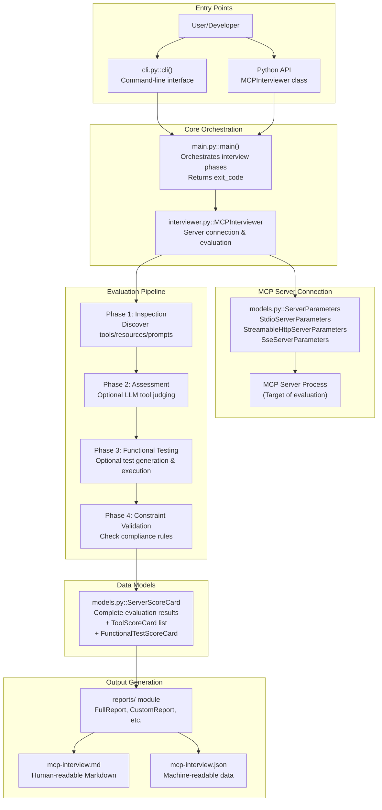

The system follows a pipeline architecture where each phase builds upon the previous one's results. The `MCPInterviewer` class handles server communication, while the `main()` function coordinates the overall evaluation workflow.

Sources: [src/mcp_interviewer/__init__.py:1-13](), [README.md:32-91]()

## Usage Modes

mcp-interviewer supports two primary usage modes with identical capabilities:

### Command-Line Interface

The CLI provides the most straightforward access to mcp-interviewer:

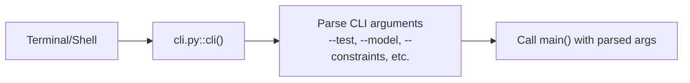

The CLI entry point is defined in [pyproject.toml:23-24]() and implemented in `cli.py`. Users invoke it as:

```bash
mcp-interviewer [OPTIONS] <server_command_or_url>
```

Key CLI flags include:
- `--test`: Enable functional testing
- `--model`: Specify LLM model for test generation and judging
- `--constraints`: Select specific constraints to check
- `--reports`: Customize report sections

For complete CLI reference, see [CLI Options Reference](#6.1).

### Python API

The Python API provides programmatic access through the same core functions:

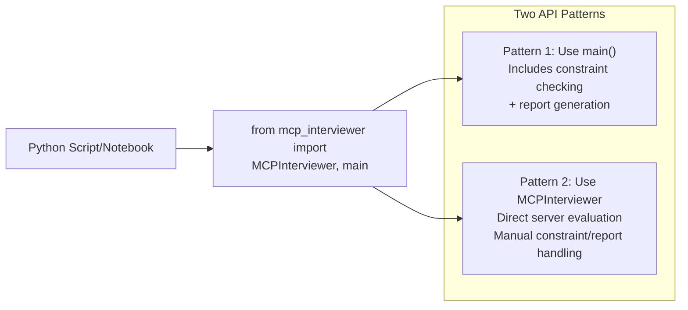

**Pattern 1: Using `main()` function**

The `main()` function ([main.py]()) provides the complete evaluation pipeline including constraint checking and report generation:

```python
from mcp_interviewer import main, StdioServerParameters

params = StdioServerParameters(command="uvx", args=["mcp-server-fetch"])
exit_code = main(client=None, model=None, server_params=params)
```

**Pattern 2: Using `MCPInterviewer` class**

The `MCPInterviewer` class ([interviewer.py]()) provides lower-level control for custom evaluation workflows:

```python
from mcp_interviewer import MCPInterviewer, StdioServerParameters

interviewer = MCPInterviewer(client=None, model=None)
params = StdioServerParameters(command="uvx", args=["mcp-server-fetch"])
scorecard = await interviewer.interview_server(params)
```

For detailed Python API documentation, see [Python API](#3.2).

Sources: [README.md:236-288](), [pyproject.toml:23-24](), [src/mcp_interviewer/__init__.py:1-13]()

## Evaluation Pipeline

The evaluation process consists of four sequential phases:

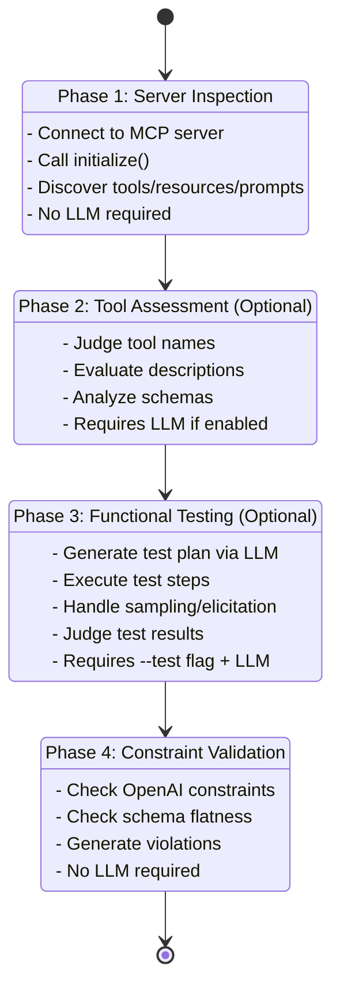

### Phase Descriptions

| Phase | Required | LLM Used | Input | Output |
|-------|----------|----------|-------|--------|
| **1. Inspection** | Yes | No | `ServerParameters` | `Server` object with tools/resources |
| **2. Assessment** | No | Optional | Tool definitions | `ToolScoreCard` list with quality metrics |
| **3. Functional Testing** | No | Yes | Server capabilities | `FunctionalTestScoreCard` with execution results |
| **4. Constraint Validation** | Yes | No | `ServerScoreCard` | `ConstraintViolation` list |

Phases 2 and 3 are optional and require an LLM client. Phase 1 and 4 always execute and require no external dependencies beyond the MCP server itself.

Sources: [README.md:32-91](), Diagram 3 from system architecture diagrams

## Server Connection Types

mcp-interviewer supports three MCP transport protocols:

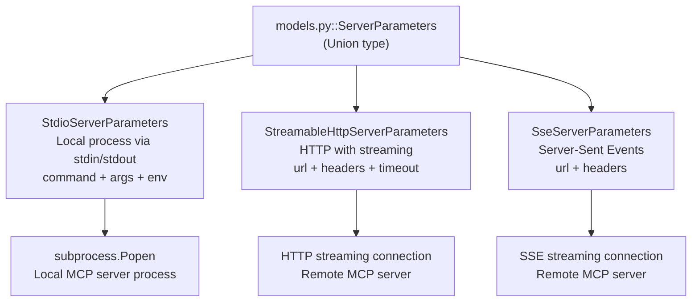

The connection type is automatically detected from the server parameters. For local servers, use `StdioServerParameters`. For remote servers, provide an HTTP/HTTPS URL (automatically uses `StreamableHttpServerParameters` or `SseServerParameters` based on endpoint).

For detailed connection configuration, see [Server Connection Types](#3.3).

Sources: [models.py]() (inferred from ServerParameters types), Diagram 1 from system architecture diagrams

## Key Data Models

The evaluation results are captured in structured data models:

| Model | Location | Purpose |
|-------|----------|---------|
| `ServerScoreCard` | [models.py]() | Root evaluation result containing all server information and scores |
| `ToolScoreCard` | [models.py]() | Per-tool evaluation with name, description, and schema scores |
| `FunctionalTestScoreCard` | [models.py]() | Test plan, step results, and pass/fail evaluations |
| `ConstraintViolation` | [constraints/]() | Individual constraint validation failures |

The `ServerScoreCard` extends the base `Server` class with evaluation results, creating a complete audit trail from server discovery through validation.

For complete data model documentation, see [Data Models Reference](#6.2).

Sources: [src/mcp_interviewer/__init__.py:4-12](), [README.md:1-6]()

## Output Formats

mcp-interviewer generates two complementary outputs:

**Markdown Report (`mcp-interview.md`)**
- Human-readable documentation
- Organized into collapsible sections
- Includes tables, code blocks, and formatted text
- Configurable via `--reports` flag

**JSON Data (`mcp-interview.json`)**
- Machine-readable evaluation results
- Complete `ServerScoreCard` serialization
- Suitable for programmatic analysis and CI/CD integration
- Fixed structure regardless of report customization

Both files are written to the current working directory by default. The Markdown report structure can be customized using the `--reports` flag to include only specific sections. For report interpretation guidance, see [Understanding Reports](#3.7).

Sources: [README.md:67-91](), Diagram 5 from system architecture diagrams

## LLM Integration

LLM integration is **optional** and controlled through configuration:

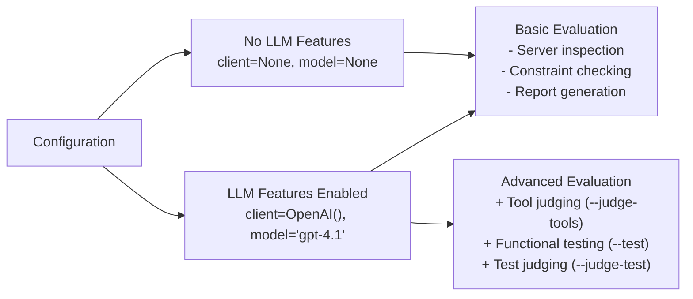

The tool accepts any object compatible with the OpenAI Python SDK's chat completions API. This allows using:
- OpenAI models directly
- Azure OpenAI endpoints
- Local models via Ollama or similar
- Custom LLM wrappers

LLM features are **experimental** and all LLM-generated evaluations should be manually reviewed. For model configuration details, see [Bring Your Own Models](#2.2) and [LLM Evaluation](#3.6).

Sources: [README.md:196-234](), [pyproject.toml:7-12]()

## Exit Codes

When using the CLI or `main()` function, mcp-interviewer returns standard Unix exit codes:

| Exit Code | Condition |
|-----------|-----------|
| `0` | Success (no critical violations) |
| `1` | Failure (critical constraint violations found) |
| `1` | Failure (warnings found with `--fail-on-warnings` enabled) |

Exit codes enable integration with CI/CD pipelines where constraint violations should fail builds.

Sources: [README.md:189-190](), Diagram 3 from system architecture diagrams

---

# Page: Key Capabilities

# Key Capabilities

<details>
<summary>Relevant source files</summary>

The following files were used as context for generating this wiki page:

- [README.md](README.md)
- [src/mcp_interviewer/constraints/tool_schema_flatness.py](src/mcp_interviewer/constraints/tool_schema_flatness.py)
- [src/mcp_interviewer/models.py](src/mcp_interviewer/models.py)
- [src/mcp_interviewer/reports/functional_test/test_step.py](src/mcp_interviewer/reports/functional_test/test_step.py)
- [src/mcp_interviewer/reports/interviewer/constraint_violations.py](src/mcp_interviewer/reports/interviewer/constraint_violations.py)

</details>


This page details the four core capabilities of mcp-interviewer: constraint checking, functional testing, LLM evaluation, and report generation. These capabilities work together to provide comprehensive evaluation of MCP servers. For architectural details on how these capabilities are implemented and orchestrated, see [Core Components](#4.1) and [Interview Execution Flow](#4.2).

---

## Constraint Checking

Constraint checking validates MCP servers against provider-specific requirements and best practices. Constraints can be hard limits (e.g., OpenAI's 128-tool maximum) or recommendations (e.g., flat schemas). The system supports selective constraint execution and produces severity-graded violations.

### Available Constraints

The constraint system is extensible through inheritance from the `Constraint` base class. Currently implemented constraints focus primarily on OpenAI compatibility:

| Code | Name | Severity | Description |
|------|------|----------|-------------|
| `OTC` | OpenAI Tool Count | CRITICAL | Validates ≤128 tools per request |
| `ONL` | OpenAI Name Length | CRITICAL | Validates tool names ≤64 characters |
| `ONP` | OpenAI Name Pattern | CRITICAL | Validates tool names match `[a-zA-Z0-9_-]+` |
| `OTL` | OpenAI Token Length | CRITICAL | Validates tool definitions within token limits |
| `TSF` | Tool Input Schema Flatness | WARNING | Warns against nested objects/arrays in schemas |

Users select constraints via the `--constraints` CLI flag or by passing constraint codes to `get_selected_constraints()`.

**Sources:** [README.md:34-54](), [src/mcp_interviewer/constraints/tool_schema_flatness.py:1-139]()

### Constraint Architecture

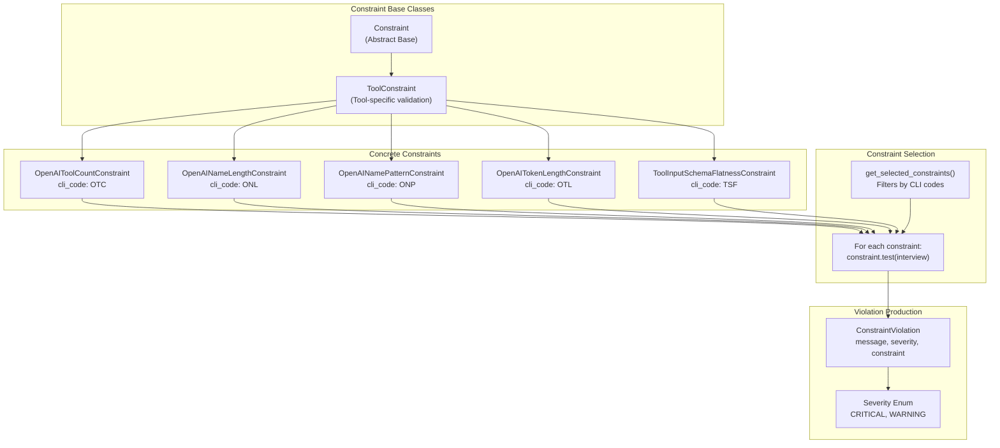

**Sources:** [src/mcp_interviewer/constraints/base.py](), [src/mcp_interviewer/constraints/tool_schema_flatness.py:13-38]()

### Violation Reporting

Constraint violations are categorized by severity and affect exit codes:

- **CRITICAL**: Always causes non-zero exit code
- **WARNING**: Causes non-zero exit code only if `--fail-on-warnings` is enabled

The `ConstraintViolationsReport` class aggregates violations by constraint type and generates summary statistics (❌ Errors, ⚠️ Warnings, ✅ Passes). Each violation includes links to source documentation for remediation guidance.

**Sources:** [src/mcp_interviewer/reports/interviewer/constraint_violations.py:1-86]()

---

## Functional Testing

Functional testing exercises MCP server tools through LLM-generated test plans. This capability requires an LLM client and is enabled via the `--test` CLI flag or the `should_run_functional_test` parameter in the Python API.

### Test Generation and Execution

The functional testing system follows a three-phase process:

1. **Test Plan Generation**: The LLM generates a `FunctionalTest` containing a plan description and a list of `FunctionalTestStep` objects
2. **Test Execution**: Each step invokes the specified tool with the provided arguments, collecting outputs and statistics
3. **Test Evaluation**: Optionally, the LLM judges each step against evaluation rubrics

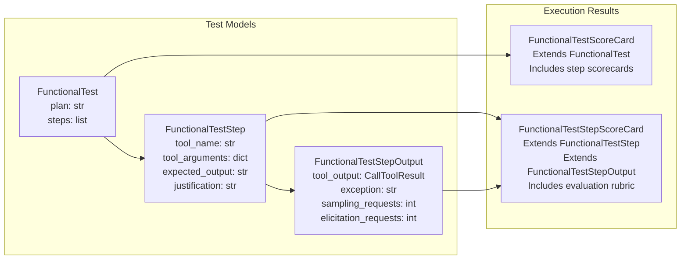

**Sources:** [src/mcp_interviewer/models.py:75-166]()

### MCP Request Handling

During test execution, the server may initiate bidirectional requests to the interviewer:

| Request Type | Handler | Purpose |
|-------------|---------|---------|
| `sampling/createMessage` | Forwards to LLM client | Server requests LLM completion |
| `elicitation/request` | Prompts user for input | Server requests human input |
| `roots/list` | Returns empty list | Server queries root resources |
| `logging/setLevel` | Accepts silently | Server sets logging verbosity |

Request counts are tracked in `FunctionalTestStepOutput` and reported for each test step.

**Sources:** [src/mcp_interviewer/models.py:87-94](), [src/mcp_interviewer/reports/functional_test/test_step.py:170-193]()

### Test Evaluation Rubrics

When `--judge-test` is enabled, each test step is evaluated against seven criteria:

| Criterion | Type | Purpose |
|-----------|------|---------|
| `error_handling` | PassFailNA | Validates error message quality |
| `error_type` | ErrorType | Categorizes error (Authorization, Connection, etc.) |
| `no_silent_error` | PassFailNA | Ensures `isError` flag is set correctly |
| `output_relevance` | PassFailNA | Validates output addresses input |
| `output_quality` | PassFailNA | Validates output accuracy and completeness |
| `schema_compliance` | PassFailNA | Validates output matches declared schema |
| `meets_expectations` | PassFailNA | Compares actual vs. expected output |

**Sources:** [src/mcp_interviewer/models.py:106-121]()

---

## LLM Evaluation

LLM evaluation is an experimental feature that uses an LLM to provide structured quality assessments of server components. This capability requires an LLM client and is controlled by the `--judge`, `--judge-tools`, and `--judge-test` flags.

### Tool Quality Evaluation

When `--judge-tools` is enabled, the LLM evaluates each tool across four dimensions, producing a `ToolScoreCard`:

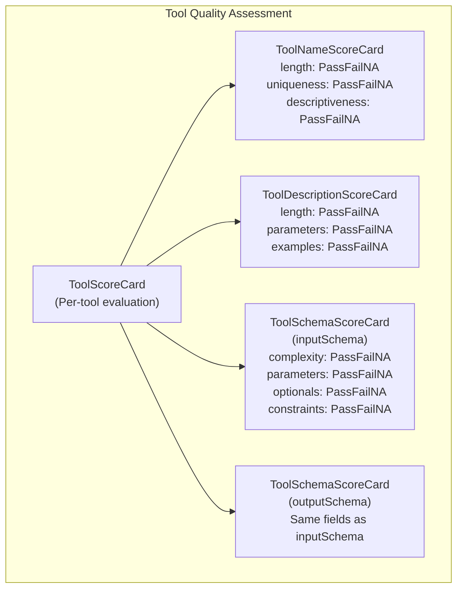

Each dimension includes multiple criteria that receive pass/fail/N/A scores with accompanying justifications generated by the LLM.

**Sources:** [src/mcp_interviewer/models.py:34-73]()

### Test Execution Evaluation

When `--judge-test` is enabled, the LLM evaluates both individual test steps (via `FunctionalTestStepEvaluationRubric`) and the overall test plan (via `FunctionalTestEvaluationRubric`). The step-level evaluation examines error handling, output quality, and expectation matching. The plan-level evaluation provides an overall assessment of whether the test suite adequately exercises server capabilities.

**Sources:** [src/mcp_interviewer/models.py:106-166]()

### Model Configuration

The LLM client can be configured in multiple ways:

1. **Default OpenAI**: Use `OpenAI()` with API key from environment
2. **Custom kwargs**: Use `--client-kwargs` to pass constructor arguments (e.g., `base_url`, `api_key` for Ollama)
3. **Custom client**: Use `--client` to import a custom factory function that returns an OpenAI-compatible client

The model name is specified via the `--model` flag and used in structured output generation.

**Sources:** [README.md:196-234]()

---

## Report Generation

Report generation produces human-readable Markdown and machine-readable JSON outputs summarizing all evaluation results. The system provides both comprehensive and customizable reporting options.

### Report Components

Ten distinct report components can be included in any combination:

| Code | Component | Content |
|------|-----------|---------|
| `II` | Interviewer Info | Model name, parameters, timestamp |
| `SI` | Server Info | Server name, version, protocol version, capabilities |
| `CAP` | Capability Assessment | Supported features (tools, resources, prompts, sampling, etc.) |
| `TS` | Tool Statistics | Tool counts, naming patterns, parameter statistics |
| `TCS` | Tool Call Statistics | Performance metrics from test execution |
| `FT` | Functional Tests | Test plan, steps, outputs, evaluations |
| `CV` | Constraint Violations | Error/warning/pass summary by constraint |
| `T` | Tools | Complete tool schemas with descriptions |
| `R` | Resources | Available resources with URIs and descriptions |
| `P` | Prompts | Available prompts with arguments |

**Sources:** [README.md:67-91]()

### Report Types

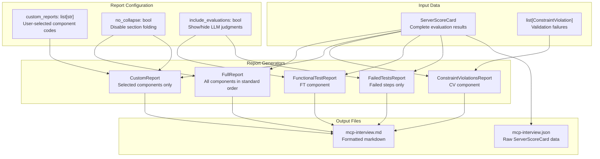

**Sources:** [src/mcp_interviewer/reports/interviewer/constraint_violations.py:9-86](), [src/mcp_interviewer/reports/functional_test/test_step.py:14-305]()

### Report Customization

Users customize reports via the `--reports` CLI flag or the `custom_reports` parameter. The `FullReport` class includes all components in a standardized order, while `CustomReport` allows arbitrary selection. Additional flags control verbosity:

- `--no-collapse`: Disables collapsible sections in Markdown output
- `--include-evaluations`: Shows/hides LLM-generated scores and justifications

The JSON output always contains the complete `ServerScoreCard` regardless of Markdown customization, enabling programmatic access to all evaluation data.

**Sources:** [README.md:72-91](), [src/mcp_interviewer/models.py:206-210]()

---

# Page: System Requirements

# System Requirements

<details>
<summary>Relevant source files</summary>

The following files were used as context for generating this wiki page:

- [.pre-commit-config.yaml](.pre-commit-config.yaml)
- [.python-version](.python-version)
- [pyproject.toml](pyproject.toml)
- [tests/constraints/test_tool_schema_flatness.py](tests/constraints/test_tool_schema_flatness.py)
- [uv.lock](uv.lock)

</details>


This document specifies the technical prerequisites for running and developing mcp-interviewer. It covers Python version requirements, runtime dependencies, optional features, and development tools. For installation instructions and setup procedures, see [Installation](#2.1).

---

## Python Version Requirements

mcp-interviewer requires **Python 3.11 or higher**. This minimum version is enforced at the package level and enables critical language features used throughout the codebase.

| Requirement | Specification | Location |
|-------------|---------------|----------|
| Minimum Python | `>=3.11` | [pyproject.toml:6]() |
| Development Python | `3.13` | [.python-version:1]() |
| Target Version (Ruff) | `py311` | [pyproject.toml:50]() |

**Rationale**: Python 3.11 provides:
- PEP 654 exception groups used in error handling
- Performance improvements for async operations (critical for MCP client interactions)
- Enhanced type hints used extensively with Pydantic models
- Structural pattern matching for constraint checking logic

Sources: [pyproject.toml:6](), [.python-version:1](), [pyproject.toml:50]()

---

## Runtime Dependencies

### Core Dependencies

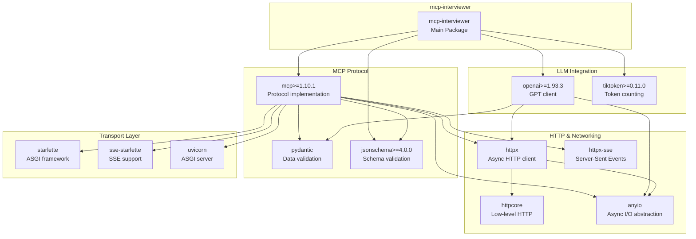

### Dependency Details

| Package | Version | Purpose | Used By |
|---------|---------|---------|---------|
| `mcp` | `>=1.10.1` | MCP protocol client/server implementation | Core interviewing logic, server connections |
| `openai` | `>=1.93.3` | OpenAI API client for GPT models | Tool judging, functional test generation |
| `tiktoken` | `>=0.11.0` | Token counting for OpenAI models | Token limit constraint checking |
| `jsonschema` | `>=4.0.0` | JSON schema validation | Schema flatness constraint, validation |

Sources: [pyproject.toml:7-12](), [pyproject.toml:353-358]()

---

## Feature-Dependency Mapping

The following diagram maps system features to their required dependencies:

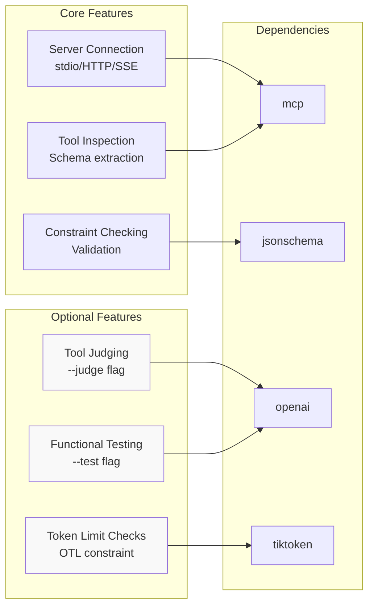

**Key Points**:
- **Core features** (server connection, inspection, constraint checking) work without OpenAI API credentials
- **LLM features** (`--judge` and `--test` flags) require valid OpenAI API key and credits
- **Token counting** (`tiktoken`) is only needed when running OpenAI token limit constraints

Sources: [pyproject.toml:7-12]()

---

## Development Dependencies

Development dependencies are defined in the `dev` dependency group and are required for contributing to the project:

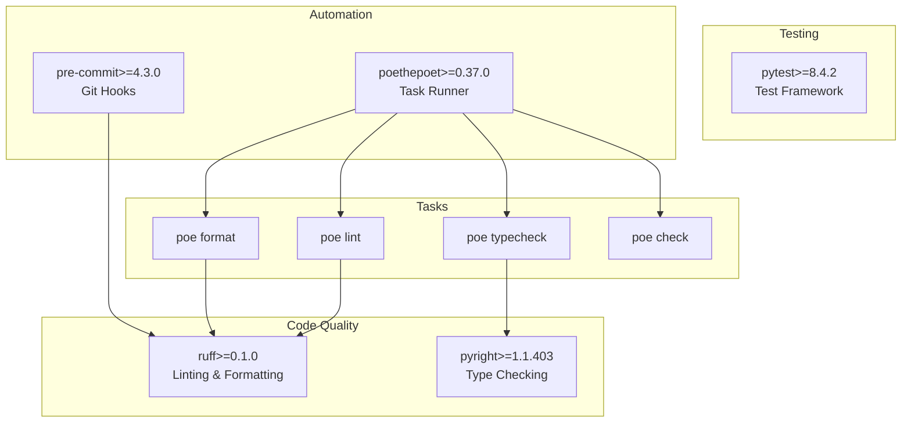

| Tool | Version | Purpose | Invocation |
|------|---------|---------|------------|
| `ruff` | `>=0.1.0` | Fast Python linter and formatter | `poe format`, `poe lint` |
| `pyright` | `>=1.1.403` | Static type checker | `poe typecheck` |
| `poethepoet` | `>=0.37.0` | Task automation | `poe <task>` |
| `pre-commit` | `>=4.3.0` | Git hook management | Automatic on commit |
| `pytest` | `>=8.4.2` | Test framework | Test execution |

**Installation**: Install all development dependencies with:
```bash
pip install -e ".[dev]"
```

Sources: [pyproject.toml:14-21](), [pyproject.toml:360-367](), [pyproject.toml:55-64]()

---

## Dependency Management

### uv Lock File

mcp-interviewer uses `uv` as its package manager with a lock file for reproducible builds:

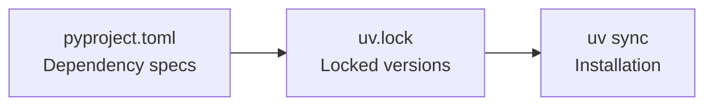

| File | Purpose | Updates |
|------|---------|---------|
| [pyproject.toml]() | Dependency specifications with version constraints | Manual |
| [uv.lock:1-3]() | Exact resolved versions with hashes | Via `uv lock` |

**Lock file format**: The lock file specifies `requires-python = ">=3.11"` and contains full dependency resolution with SHA-256 checksums for security.

Sources: [uv.lock:1-3]()

---

## Platform Compatibility

mcp-interviewer supports all major platforms through its dependencies:

### Supported Platforms

| Platform | Architecture | Status | Notes |
|----------|-------------|--------|-------|
| **Linux** | x86_64 | ✅ Full support | Primary CI platform |
| Linux | aarch64 | ✅ Full support | ARM64 support |
| Linux | i686 | ✅ Full support | 32-bit support |
| **macOS** | x86_64 | ✅ Full support | Intel Macs |
| **macOS** | arm64 | ✅ Full support | Apple Silicon |
| **Windows** | amd64 | ✅ Full support | 64-bit Windows |
| Windows | win32 | ✅ Full support | 32-bit Windows |

**Evidence**: The [uv.lock]() file contains pre-built wheels for all these platforms across multiple packages (e.g., `jiter`, `charset-normalizer`, `httpcore`).

### MCP Server Connection Types

Different connection types have different system requirements:

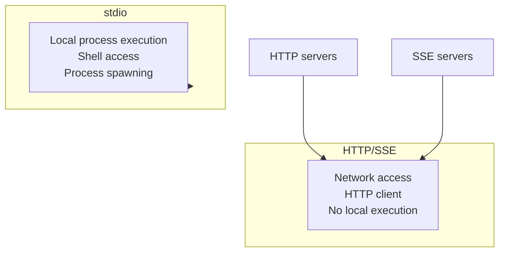

**stdio**: Requires ability to spawn local processes (e.g., `npx`, `python`, Docker commands)
**HTTP/SSE**: Only requires network access, no local process execution needed

Sources: [uv.lock]() (platform wheels evidence)

---

## Build System Requirements

For building from source or developing:

| Component | Requirement | Purpose |
|-----------|-------------|---------|
| Build backend | `hatchling` | Package building |
| Build dependencies | None beyond hatchling | Minimal build requirements |
| Python environment | `>=3.11` | Build-time Python |

Sources: [pyproject.toml:26-28]()

---

## Hardware Requirements

mcp-interviewer has minimal hardware requirements:

| Resource | Minimum | Recommended | Notes |
|----------|---------|-------------|-------|
| **RAM** | 512 MB | 2 GB | Higher for LLM features |
| **Disk** | 100 MB | 500 MB | Includes dependencies |
| **CPU** | 1 core | 2+ cores | For concurrent operations |
| **Network** | - | Required | For OpenAI API, HTTP/SSE servers |

**LLM Operations**: When using `--judge` or `--test` flags:
- Network bandwidth for OpenAI API calls (typically <1 MB per request)
- Additional memory for token processing (typically <100 MB)
- No GPU required (inference is cloud-based)

Sources: General system knowledge, not code-specific

---

## Optional External Dependencies

### OpenAI API Access

| Feature | Required | Configuration |
|---------|----------|---------------|
| Tool judging (`--judge`) | OpenAI API key | `OPENAI_API_KEY` env var |
| Functional testing (`--test`) | OpenAI API key | `OPENAI_API_KEY` env var |
| Constraint checking | Not required | - |
| Server inspection | Not required | - |

**API Key Setup**:
```bash
export OPENAI_API_KEY="sk-..."
```

The system will fail gracefully with clear error messages if API key is missing when LLM features are requested.

### MCP Server Under Test

The target MCP server being interviewed may have its own dependencies:
- For **stdio servers**: May require Node.js, Python, Docker, or other runtimes
- For **HTTP/SSE servers**: Server must be running and accessible

Sources: Context from architecture diagrams

---

## Constraint-Specific Dependencies

Different constraint types have different dependency requirements:

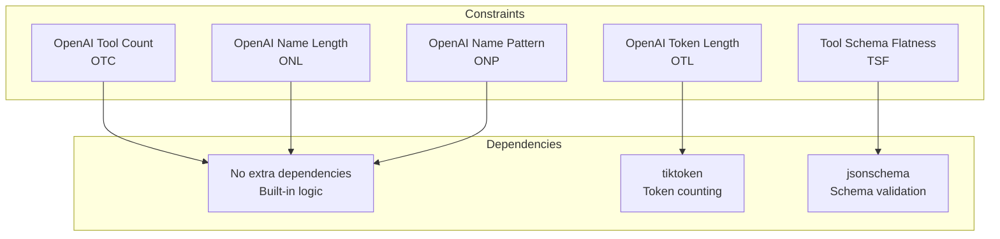

Sources: [tests/constraints/test_tool_schema_flatness.py]() (constraint test file showing jsonschema usage)

---

# Page: Getting Started

# Getting Started

<details>
<summary>Relevant source files</summary>

The following files were used as context for generating this wiki page:

- [.pre-commit-config.yaml](.pre-commit-config.yaml)
- [README.md](README.md)
- [pyproject.toml](pyproject.toml)

</details>


This page provides installation instructions and basic usage patterns to get mcp-interviewer running quickly. It covers both CLI and Python API usage, demonstrates the core workflows, and explains the outputs you'll receive.

For detailed installation instructions including dependency management, see [Installation](#2.1). For a comprehensive walkthrough of a basic example, see [Quick Start Guide](#2.2).

---

## Prerequisites

mcp-interviewer requires Python 3.11 or higher. The system has four core dependencies that are automatically installed:

| Dependency | Minimum Version | Purpose |
|------------|----------------|---------|
| `mcp` | 1.10.1 | MCP server communication |
| `openai` | 1.93.3 | LLM integration (optional features) |
| `tiktoken` | 0.11.0 | Token counting for constraints |
| `jsonschema` | 4.0.0 | Schema validation |

**Sources:** [pyproject.toml:6-12]()

---

## Installation Overview

mcp-interviewer can be installed as a standalone CLI tool or as a Python library dependency.

### CLI Tool Installation

```bash
pip install mcp-interviewer
```

This installs the `mcp-interviewer` command globally, making it available from any terminal:

```bash
mcp-interviewer <server-command>
```

### Python Library Installation

```bash
# Using uv (recommended)
uv add mcp-interviewer

# Using pip
pip install mcp-interviewer
```

This allows you to import and use mcp-interviewer programmatically in your Python code.

For detailed installation instructions including container setups and virtual environments, see [Installation](#2.1).

**Sources:** [README.md:93-120](), [pyproject.toml:23-24]()

---

## Command Execution Flow

The following diagram shows how a user command flows through the codebase to produce results:

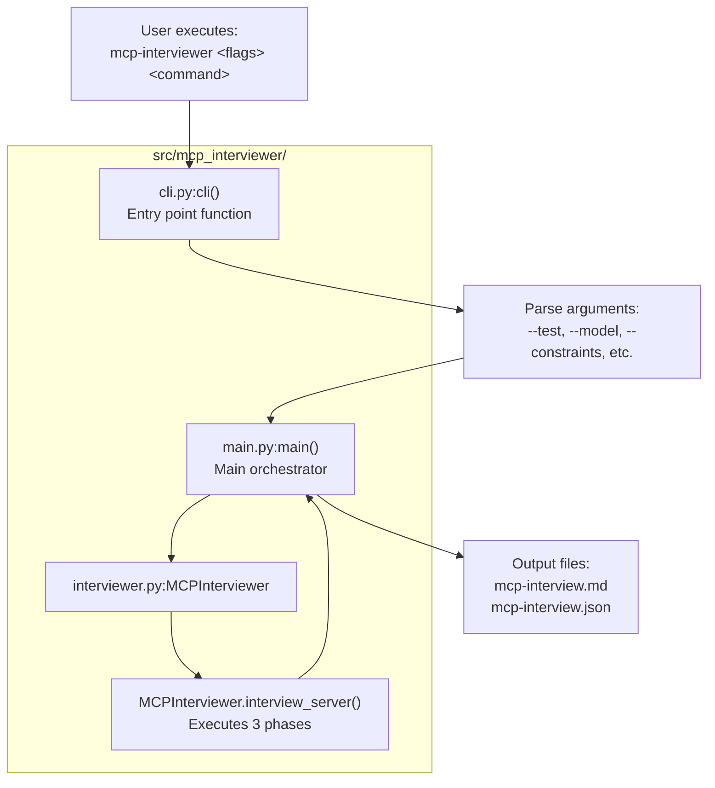

**Sources:** [pyproject.toml:23-24](), [README.md:164-194]()

---

## Basic Usage Patterns

mcp-interviewer operates in two primary modes based on whether you provide an LLM client:

### Mode 1: Constraint Checking Only (No LLM Required)

This mode performs server inspection and constraint validation without requiring an OpenAI API key or model:

```bash
mcp-interviewer "docker run -i --rm node:lts npx -y @modelcontextprotocol/server-everything"
```

**What it does:**
- Connects to the MCP server
- Discovers available tools, resources, and prompts
- Validates against OpenAI constraints (tool count, naming, token limits)
- Generates reports

**Outputs:** `mcp-interview.md`, `mcp-interview.json`

### Mode 2: Full Evaluation (LLM Required)

This mode adds functional testing and LLM-based evaluation:

```bash
mcp-interviewer --test --model gpt-4.1 "docker run -i --rm node:lts npx -y @modelcontextprotocol/server-everything"
```

**What it adds:**
- `--test`: Generates and executes functional tests
- `--judge-tools`: LLM evaluates tool quality
- `--judge-test`: LLM evaluates test results

**Outputs:** Same files with additional test results and LLM evaluations

**Sources:** [README.md:122-149](), [README.md:164-194]()

---

## Usage Mode Comparison

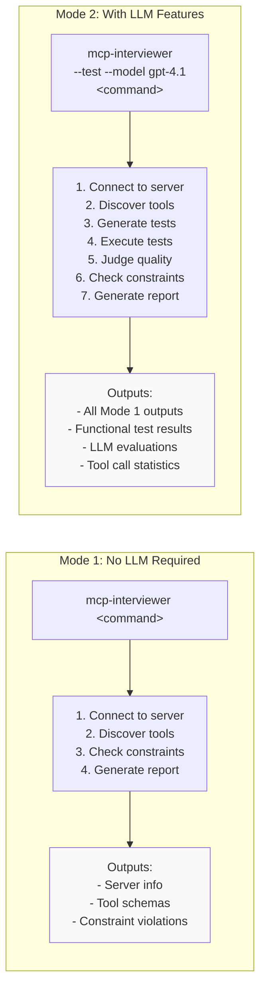

**Sources:** [README.md:32-92](), [README.md:152-194]()

---

## CLI Usage

The CLI entry point is defined in [pyproject.toml:23-24]() as `mcp_interviewer.cli:cli`. The most commonly used flags are:

| Flag | Purpose | Requires `--model` |
|------|---------|-------------------|
| `--test` | Enable functional testing | ✓ |
| `--judge` | Enable all LLM evaluation | ✓ |
| `--judge-tools` | Evaluate tool quality only | ✓ |
| `--judge-test` | Evaluate test results only | ✓ (and `--test`) |
| `--constraints [CODE ...]` | Select specific constraints | ✗ |
| `--reports [CODE ...]` | Select report sections | ✗ |
| `--fail-on-warnings` | Fail CI on warnings | ✗ |

### Examples

```bash
# Basic inspection and constraint checking
mcp-interviewer "uvx mcp-server-fetch"

# Add functional testing
mcp-interviewer --test --model gpt-4.1 "uvx mcp-server-fetch"

# Custom constraints and reports
mcp-interviewer --constraints OTC ONL --reports SI TS CV "uvx mcp-server-fetch"

# CI/CD mode - fail on warnings
mcp-interviewer --fail-on-warnings "uvx mcp-server-fetch"
```

For complete CLI reference, see [CLI Usage](#3.1).

**Sources:** [README.md:152-194]()

---

## Python API Usage

The Python API provides two main entry points: the `MCPInterviewer` class for core functionality and the `main()` function for the complete workflow including report generation.

### Using MCPInterviewer Class

```python
from mcp_interviewer import MCPInterviewer, StdioServerParameters

# Define server parameters
params = StdioServerParameters(
    command="docker",
    args=["run", "-i", "--rm", "node:lts", "npx", "-y", "@modelcontextprotocol/server-everything"]
)

# Mode 1: No LLM required
interviewer = MCPInterviewer(client=None, model=None)
interview = await interviewer.interview_server(params)

# Mode 2: With LLM features
from openai import OpenAI
client = OpenAI()
interviewer = MCPInterviewer(
    client=client,
    model="gpt-4.1",
    should_run_functional_test=True
)
interview = await interviewer.interview_server(params)
```

### Using main() Function

The `main()` function includes constraint checking and report generation:

```python
from mcp_interviewer import main, StdioServerParameters

params = StdioServerParameters(
    command="docker",
    args=["run", "-i", "--rm", "node:lts", "npx", "-y", "@modelcontextprotocol/server-everything"]
)

# Returns exit code: 0 = success, 1 = constraint violations
exit_code = main(client=None, model=None, params=params)

# With LLM features
from openai import OpenAI
exit_code = main(
    client=OpenAI(),
    model="gpt-4.1",
    params=params,
    should_run_functional_test=True
)
```

For detailed Python API documentation, see [Python API](#3.2).

**Sources:** [README.md:236-287]()

---

## Connection Types

mcp-interviewer supports three connection types for communicating with MCP servers:

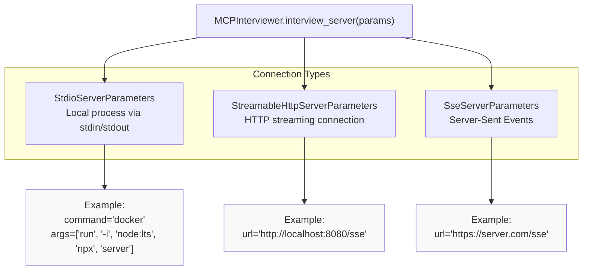

For detailed information on each connection type and when to use them, see [Server Connection Types](#3.3).

**Sources:** [README.md:240-287]()

---

## Output Files

Every interview generates two files in the current directory:

| File | Format | Purpose |
|------|--------|---------|
| `mcp-interview.md` | Markdown | Human-readable report with sections, tables, and collapsible details |
| `mcp-interview.json` | JSON | Machine-readable data with complete `ServerScoreCard` structure |

### Report Sections

The Markdown report includes these sections (customizable via `--reports`):

| Code | Section | Content |
|------|---------|---------|
| `II` | Interviewer Info | Model and parameters used |
| `SI` | Server Info | Name, version, capabilities |
| `CAP` | Capabilities | Supported MCP features |
| `TS` | Tool Statistics | Tool counts and patterns |
| `TCS` | Tool Call Statistics | Performance metrics from tests |
| `FT` | Functional Tests | Test execution results |
| `CV` | Constraint Violations | Errors and warnings |
| `T` | Tools | Detailed tool schemas |
| `R` | Resources | Available resources |
| `P` | Prompts | Available prompts |

For complete report documentation, see [Understanding Reports](#3.7).

**Sources:** [README.md:67-92]()

---

## Security Considerations

⚠️ **Important:** mcp-interviewer executes the provided server command in a child process. Always run MCP servers in isolated containers to protect your host system:

```bash
# ✓ Good - runs in Docker container
mcp-interviewer "docker run -i --rm node:lts npx -y @modelcontextprotocol/server-everything"

# ✓ Good - runs in container via uvx
mcp-interviewer "docker run -i --rm ghcr.io/astral-sh/uv:python3.12-alpine uvx mcp-server-fetch"

# ✗ Risky - runs directly on host
mcp-interviewer "npx -y @modelcontextprotocol/server-everything"
```

When using `--test`, the interviewer will invoke the server's tools, which may perform file operations, network requests, or other actions. Always review the server's capabilities before enabling functional testing.

**Sources:** [README.md:122-124](), [README.md:289-295]()

---

## Next Steps

Now that you understand the basics:

1. See [Quick Start Guide](#2.2) for a complete walkthrough of a basic example
2. Explore [CLI Usage](#3.1) for all available command-line options
3. Learn about [Constraint Checking](#3.4) to understand validation rules
4. Review [Functional Testing](#3.5) to use LLM-based testing effectively
5. Read [Understanding Reports](#3.7) to interpret your results

**Sources:** [README.md:1-305]()

---

# Page: Installation

# Installation

<details>
<summary>Relevant source files</summary>

The following files were used as context for generating this wiki page:

- [.pre-commit-config.yaml](.pre-commit-config.yaml)
- [README.md](README.md)
- [pyproject.toml](pyproject.toml)
- [tests/constraints/test_tool_schema_flatness.py](tests/constraints/test_tool_schema_flatness.py)
- [uv.lock](uv.lock)

</details>


This page provides instructions for installing mcp-interviewer on your system. It covers the required Python version, installation methods for both CLI and library usage, and verification steps.

For information about basic usage after installation, see [Quick Start Guide](#2.2). For comprehensive configuration options, see [CLI Usage](#3.1) and [Python API](#3.2).

---

## System Requirements

mcp-interviewer requires Python 3.11 or higher.

**Python Version Constraint**: The package specifies `requires-python = ">=3.11"` in its configuration.

**Platform Support**: The tool runs on any platform that supports Python 3.11+, including Linux, macOS, and Windows.

Sources: [pyproject.toml:6]()

---

## Installation as CLI Tool

To install mcp-interviewer as a command-line tool, use pip:

```bash
pip install mcp-interviewer
```

This makes the `mcp-interviewer` command available globally in your shell.

### CLI Entry Point Configuration

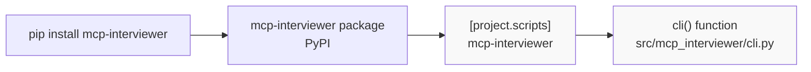

The CLI command is configured via the `[project.scripts]` section in pyproject.toml, which maps the `mcp-interviewer` command to the `cli()` function in the `cli` module.

Sources: [pyproject.toml:23-24](), [README.md:95-104]()

---

## Installation as Python Dependency

### Using pip

Add mcp-interviewer to your project:

```bash
pip install mcp-interviewer
```

This allows you to import and use the library in your Python code:

```python
from mcp_interviewer import MCPInterviewer, StdioServerParameters
```

### Using uv

For projects using the [uv](https://github.com/astral-sh/uv) package manager:

```bash
uv add mcp-interviewer
```

The uv package manager provides faster installation and better dependency resolution. The project itself uses uv for development, as evidenced by the presence of `uv.lock`.

Sources: [README.md:106-120](), [uv.lock:1-4]()

---

## Verifying Installation

After installation, verify that mcp-interviewer is accessible:

### CLI Verification

```bash
mcp-interviewer --help
```

This should display usage information for the command-line interface.

### Python Module Verification

```python
import mcp_interviewer
print(mcp_interviewer.__name__)
```

This verifies that the package can be imported in Python.

Sources: [pyproject.toml:23-24]()

---

## Dependency Overview

### Installation Dependency Tree

```mermaid
graph TB
    mcp-interviewer["mcp-interviewer<br/>v0.0.13"]
    
    mcp["mcp<br/>&gt;=1.10.1"]
    openai["openai<br/>&gt;=1.93.3"]
    tiktoken["tiktoken<br/>&gt;=0.11.0"]
    jsonschema["jsonschema<br/>&gt;=4.0.0"]
    
    anyio["anyio"]
    httpx["httpx"]
    httpx-sse["httpx-sse"]
    pydantic["pydantic"]
    
    distro["distro"]
    jiter["jiter"]
    tqdm["tqdm"]
    
    mcp-interviewer --> mcp
    mcp-interviewer --> openai
    mcp-interviewer --> tiktoken
    mcp-interviewer --> jsonschema
    
    mcp --> anyio
    mcp --> httpx
    mcp --> httpx-sse
    mcp --> pydantic
    
    openai --> anyio
    openai --> httpx
    openai --> pydantic
    openai --> distro
    openai --> jiter
    openai --> tqdm
    
    style mcp-interviewer fill:#f9f9f9
    style mcp fill:#f9f9f9
    style openai fill:#f9f9f9
```

### Core Dependencies

The table below shows the direct dependencies specified in `pyproject.toml`:

| Dependency | Minimum Version | Purpose |
|------------|----------------|---------|
| `mcp` | 1.10.1 | MCP protocol implementation for connecting to servers |
| `openai` | 1.93.3 | OpenAI API client for LLM evaluation features |
| `tiktoken` | 0.11.0 | Token counting for OpenAI constraints |
| `jsonschema` | 4.0.0 | JSON schema validation for tool schemas |

### Transitive Dependencies

The `mcp` and `openai` packages bring in their own dependencies:

- **anyio**: Async I/O library used by both mcp and openai
- **httpx**: HTTP client for MCP's HTTP transport and OpenAI API calls
- **httpx-sse**: Server-Sent Events support for MCP's SSE transport
- **pydantic**: Data validation and settings management used by mcp
- **distro**: Linux distribution detection for OpenAI client
- **jiter**: Fast JSON parsing for OpenAI client
- **tqdm**: Progress bars for OpenAI file operations

### Development Dependencies

Development dependencies are specified in the `[dependency-groups]` section:

| Dependency | Minimum Version | Purpose |
|------------|----------------|---------|
| `ruff` | 0.1.0 | Linting and formatting |
| `pre-commit` | 4.3.0 | Git hook management |
| `pyright` | 1.1.403 | Static type checking |
| `poethepoet` | 0.37.0 | Task runner |
| `pytest` | 8.4.2 | Testing framework |

Development dependencies are not installed by default. To install them for development work, see [Development Workflow](#5.2).

Sources: [pyproject.toml:7-12](), [pyproject.toml:14-21](), [uv.lock:1-3]()

---

## Build System

### Package Build Configuration

```mermaid
graph LR
    source["src/mcp_interviewer/<br/>Python source code"]
    pyproject["pyproject.toml<br/>[build-system]"]
    hatchling["hatchling<br/>Build backend"]
    wheel["mcp-interviewer.whl<br/>Distribution package"]
    tarball["mcp-interviewer.tar.gz<br/>Source distribution"]
    
    source --> pyproject
    pyproject --> hatchling
    hatchling --> wheel
    hatchling --> tarball
    
    style pyproject fill:#f9f9f9
    style hatchling fill:#f9f9f9
```

The package uses **hatchling** as its build backend, specified in the `[build-system]` section. When you install via pip, the following process occurs:

1. pip downloads the source distribution or wheel from PyPI
2. If building from source, hatchling creates the wheel
3. The wheel is installed into your Python environment
4. The CLI entry point is registered in your shell's PATH

### Package Structure

The build configuration specifies:

- **Package location**: `src/mcp_interviewer` (defined in `[tool.hatch.build.targets.wheel]`)
- **Included files**: Source code, LICENSE, README.md
- **Excluded files**: Cache files, bytecode (`.pyc`, `.pyo`), `.DS_Store`

Sources: [pyproject.toml:26-44]()

---

## Lock File

The repository includes a `uv.lock` file that pins all transitive dependencies to specific versions. This ensures reproducible installations across different environments.

**Lock file format**: The file uses uv's lock format version 1, revision 3.

**When the lock file is used**:
- During development with `uv`
- In CI/CD pipelines
- When contributors set up their development environment

**When the lock file is NOT used**:
- When end users install via `pip install mcp-interviewer`
- When the package is used as a dependency in other projects

End users get the versions specified by the minimum version constraints in `pyproject.toml`, not the locked versions.

Sources: [uv.lock:1-3](), [pyproject.toml:7-12]()

---

# Page: Quick Start Guide

# Quick Start Guide

<details>
<summary>Relevant source files</summary>

The following files were used as context for generating this wiki page:

- [README.md](README.md)
- [mcp-interview.md](mcp-interview.md)
- [src/mcp_interviewer/cli.py](src/mcp_interviewer/cli.py)

</details>


This guide walks through the simplest use cases for interviewing an MCP server. It demonstrates basic server inspection and constraint checking without requiring an LLM, then shows how to add functional testing. For detailed information about all CLI options, see [CLI Usage](#3.1). For Python API usage, see [Python API](#3.2).

**Prerequisites:** Ensure you have installed mcp-interviewer as described in [Installation](#2.1).

## Basic Server Interview (No LLM Required)

The simplest way to use mcp-interviewer requires no LLM configuration. This mode performs server inspection and constraint checking only.

### Command Structure

```bash
mcp-interviewer <server_command>
```

The `<server_command>` can be:
- A local command to execute via stdio (e.g., `npx -y @modelcontextprotocol/server-everything`)
- A URL for remote server connection (e.g., `https://my-mcp-server.com/sse`)

### Safety Recommendation

⚠️ **Important:** mcp-interviewer executes the provided command in a child process. Always run MCP servers in isolated containers to protect your host system.

```bash
# Define a container command for safe execution
NPX_CONTAINER="docker run -i --rm node:lts npx"

# Interview the MCP reference server
mcp-interviewer "$NPX_CONTAINER -y @modelcontextprotocol/server-everything"
```

Sources: [README.md:122-138](), [cli.py:8-11]()

### Execution Flow

```mermaid
sequenceDiagram
    participant User
    participant CLI["cli()<br/>cli.py"]
    participant Main["main()<br/>main.py"]
    participant Interviewer["MCPInterviewer<br/>interviewer.py"]
    participant Server["MCP Server"]
    participant Constraints["Constraint System"]
    participant Reports["Report Generator"]
    
    User->>CLI: "mcp-interviewer $NPX_CONTAINER ..."
    CLI->>CLI: "Parse server_params"
    CLI->>CLI: "Create StdioServerParameters"
    
    Note over CLI: "No --model provided, client=None"
    
    CLI->>Main: "main(client=None, model=None, params)"
    Main->>Interviewer: "MCPInterviewer(None, None)"
    Main->>Interviewer: "interview_server(params)"
    
    Interviewer->>Server: "Connect via stdio"
    Server-->>Interviewer: "InitializeResult<br/>(tools, resources, prompts)"
    
    Note over Interviewer: "Skip LLM features<br/>(no client provided)"
    
    Interviewer-->>Main: "ServerScoreCard"
    Main->>Constraints: "get_selected_constraints()"
    Main->>Constraints: "test(scorecard)"
    Constraints-->>Main: "List[ConstraintViolation]"
    
    Main->>Reports: "generate_report(scorecard, violations)"
    Reports-->>Main: "mcp-interview.md<br/>mcp-interview.json"
    
    Main-->>CLI: "exit_code (0 or 1)"
    CLI-->>User: "Exit with code"
```

Sources: [cli.py:95-218](), [src/mcp_interviewer/main.py]()

### What Happens During Basic Interview

| Phase | Description | Requires LLM |
|-------|-------------|--------------|
| **1. Server Connection** | Establishes connection via `StdioServerParameters`, `StreamableHttpServerParameters`, or `SseServerParameters` | ❌ |
| **2. Server Inspection** | Calls `initialize()` on the server, retrieves tools, resources, prompts, and capabilities | ❌ |
| **3. Constraint Checking** | Validates against all enabled constraints (OpenAI limits, schema flatness, etc.) | ❌ |
| **4. Report Generation** | Creates `mcp-interview.md` (Markdown) and `mcp-interview.json` (structured data) | ❌ |

Sources: [README.md:32-55]()

## Understanding the Output

The interview generates two files in the current directory (or path specified by `--out-dir`):

### File: mcp-interview.md

Human-readable Markdown report containing:

| Section | Content |
|---------|---------|
| **Server Information** | Name, version, protocol version, instructions |
| **Interviewer Parameters** | Model used (if any), CLI command, launch parameters |
| **Server Capabilities** | Tools, resources, prompts, logging support with counts |
| **Tool Statistics** | Schema lengths, parameter counts, max depth metrics |
| **Constraint Violations** | Pass/fail/warning status for each constraint |
| **Tools** | Detailed schemas for each tool (input/output) |
| **Resources** | List of available resources with URIs and MIME types |
| **Prompts** | Available prompts with argument specifications |

Sources: [mcp-interview.md:1-72]()

### File: mcp-interview.json

Machine-readable JSON containing the complete `ServerScoreCard` structure:

```mermaid
graph TD
    JSON["mcp-interview.json"]
    ServerScoreCard["ServerScoreCard"]
    Server["Server<br/>(base class)"]
    Tools["tools: list[Tool]"]
    Resources["resources: list[Resource]"]
    Prompts["prompts: list[Prompt]"]
    InitResult["initialize_result: InitializeResult"]
    
    JSON --> ServerScoreCard
    ServerScoreCard --|extends| Server
    Server --> Tools
    Server --> Resources
    Server --> Prompts
    Server --> InitResult
    
    ServerScoreCard --> Model["model: str | None"]
    ServerScoreCard --> ToolScores["tool_scorecards: list[ToolScoreCard]"]
    ServerScoreCard --> FuncTest["functional_test_scorecard: FunctionalTestScoreCard | None"]
    
    style ServerScoreCard fill:#f9f9f9
```

Sources: [src/mcp_interviewer/models.py]()

### Example: Inspecting Constraint Results

```bash
# View constraint violations summary
grep "Constraint Violations" -A 5 mcp-interview.md

# Output shows:
# | ❌ Errors | ⚠️ Warnings | ✅ Passes |
# | --- | --- | --- |
# | 0 | 0 | 5 |
```

Sources: [mcp-interview.md:109-128]()

## Adding Functional Testing

To execute actual tool calls and test server functionality, add the `--test` flag. This requires an LLM model.

### Command with Testing

```bash
mcp-interviewer --test --model gpt-4.1 "$NPX_CONTAINER -y @modelcontextprotocol/server-everything"
```

### Risk Acceptance

When `--test` is enabled, the tool prompts for risk acceptance:

```
🚨 MCP Interviewer will make tool call requests to your MCP server. 
   Depending on the server's capabilities this can lead to 
   irreversible outcomes (e.g. deleting files).
Do you accept this risk? (y|[n]): 
```

Bypass this prompt in automated scenarios with `--accept-risk`.

Sources: [cli.py:163-173]()

### Functional Testing Flow

```mermaid
sequenceDiagram
    participant CLI
    participant Interviewer["MCPInterviewer<br/>(should_run_functional_test=True)"]
    participant LLM["LLM Client<br/>(OpenAI-compatible)"]
    participant Server["MCP Server"]
    
    Note over CLI: "User provided --test --model gpt-4.1"
    
    CLI->>Interviewer: "interview_server(params)"
    
    Note over Interviewer: "Phase 1: Inspection complete"
    
    Interviewer->>LLM: "generate_functional_test(server_info)"
    LLM-->>Interviewer: "FunctionalTest<br/>(plan + steps)"
    
    loop "For each FunctionalTestStep"
        Interviewer->>Server: "tools/call<br/>{tool_name, arguments}"
        Server-->>Interviewer: "CallToolResult"
        
        opt "Server requests sampling"
            Server->>Interviewer: "sampling/createMessage"
            Interviewer->>LLM: "Forward request"
            LLM-->>Interviewer: "Response"
            Interviewer->>Server: "Return sample"
        end
        
        opt "Server requests user input"
            Server->>Interviewer: "elicitation/request"
            Interviewer->>CLI: "Prompt user"
            CLI-->>Interviewer: "User response"
            Interviewer->>Server: "Return elicitation"
        end
    end
    
    Interviewer-->>CLI: "ServerScoreCard with FunctionalTestScoreCard"
```

Sources: [cli.py:152-161]()

### Key Components Involved

| Component | File | Role |
|-----------|------|------|
| `MCPInterviewer` | [src/mcp_interviewer/interviewer.py]() | Orchestrates test execution |
| `FunctionalTest` | [src/mcp_interviewer/models.py]() | Contains test plan and steps |
| `FunctionalTestStep` | [src/mcp_interviewer/models.py]() | Individual tool call with expected output |
| `FunctionalTestStepOutput` | [src/mcp_interviewer/models.py]() | Actual results including exceptions, request counts |
| `FunctionalTestScoreCard` | [src/mcp_interviewer/models.py]() | Complete test results with step evaluations |

Sources: [src/mcp_interviewer/models.py]()

### Functional Test Report Sections

The report includes additional sections when `--test` is enabled:

| Section | Description |
|---------|-------------|
| **Tool Call Statistics** | Counts of attempted calls, errors, output lengths, content block types |
| **Functional Test Results** | Step-by-step execution logs with reasoning, expected vs actual output |
| **MCP Requests** | Counts of sampling requests, elicitation requests, logging requests per step |

Example output structure:

```
## Tool Call Statistics
- Tool calls attempted: 20
- Tool calls returned output: 20
- Sampling requests: 2
- Elicitation requests: 1

## Functional Test Results
### Step 1: echo ✅
**Reasoning (🤖):** Echo is a foundational tool...
**Tool Call (🤖):** {"message": "Hello, MCP!"}
**Expected Output (🤖):** Should return the exact message...
**Actual Output:** Echo: Hello, MCP!
```

Sources: [mcp-interview.md:92-942]()

## Next Steps

### Customize Constraint Checking

```bash
# Check only OpenAI constraints
mcp-interviewer --constraints OA "$NPX_CONTAINER ..."

# Check specific constraints
mcp-interviewer --constraints OTC ONL "$NPX_CONTAINER ..."
```

Sources: [cli.py:75-78](), [README.md:186-187]()

### Customize Report Sections

```bash
# Include only specific report sections
mcp-interviewer --reports SI TS CV "$NPX_CONTAINER ..."

# Available codes: II, SI, CAP, TS, TCS, FT, CV, T, R, RT, P
```

Sources: [cli.py:65-68](), [README.md:183-184]()

### Enable LLM Evaluation

```bash
# Add experimental tool quality evaluation
mcp-interviewer --model gpt-4.1 --judge-tools "$NPX_CONTAINER ..."

# Add test evaluation (requires --test)
mcp-interviewer --model gpt-4.1 --test --judge-test "$NPX_CONTAINER ..."

# Enable all LLM features
mcp-interviewer --model gpt-4.1 --test --judge "$NPX_CONTAINER ..."
```

Sources: [cli.py:50-63](), [README.md:174-181]()

### Connect to Remote Servers

```bash
# HTTP streaming connection (default)
mcp-interviewer "https://my-mcp-server.com/mcp"

# Server-Sent Events connection
mcp-interviewer --remote-connection-type sse "https://my-mcp-server.com/sse"

# With custom headers
mcp-interviewer --headers "Authorization=Bearer TOKEN" "https://my-mcp-server.com/mcp"
```

Sources: [cli.py:13-17](), [cli.py:38-42](), [README.md:193-194]()

### Use in CI/CD Pipelines

```bash
# Fail build on any warnings
mcp-interviewer --fail-on-warnings "$NPX_CONTAINER ..."

# Returns exit code 1 if constraints violated
echo $?  # Check exit code
```

Sources: [cli.py:90-93](), [README.md:189-190]()

## Further Reading

- **Detailed CLI Options:** See [CLI Usage](#3.1) for all available flags and their behaviors
- **Python API:** See [Python API](#3.2) for programmatic usage via `MCPInterviewer` class
- **Server Connection Types:** See [Server Connection Types](#3.3) for stdio, HTTP, and SSE details
- **Constraint System:** See [Constraint Checking](#3.4) for understanding violation severities
- **Report Interpretation:** See [Understanding Reports](#3.7) for detailed report section descriptions

Sources: [README.md:14-30]()

---

# Page: User Guide

# User Guide

<details>
<summary>Relevant source files</summary>

The following files were used as context for generating this wiki page:

- [README.md](README.md)
- [src/mcp_interviewer/cli.py](src/mcp_interviewer/cli.py)

</details>


This guide explains how to use mcp-interviewer to evaluate MCP servers. It covers basic usage patterns, command-line options, Python API usage, and how to interpret results. For installation instructions, see [Getting Started](#2). For detailed architecture and internal design, see [Architecture](#4).

## Overview

mcp-interviewer evaluates MCP servers through four main operations:

1. **Server Inspection** - Connects to the server and discovers its capabilities, tools, resources, and prompts
2. **Constraint Checking** - Validates the server against provider-specific requirements (e.g., OpenAI limits)
3. **Functional Testing** - Optionally tests the server by executing its tools with LLM-generated test plans
4. **Report Generation** - Produces Markdown and JSON reports summarizing all findings

The tool operates in two modes:

| Mode | Client Required | Model Required | Capabilities |
|------|----------------|----------------|--------------|
| **Basic** | No | No | Server inspection, constraint checking, basic reports |
| **LLM-Enhanced** | Yes | Yes | All basic features plus functional testing and LLM-based evaluation |

Sources: [README.md:1-304](), [src/mcp_interviewer/cli.py:1-223]()

## Usage Modes

### CLI Mode

The command-line interface is the primary way to use mcp-interviewer. It accepts a server command or URL and generates report files in the specified output directory.

```bash
# Basic usage - no LLM required
mcp-interviewer <server_command>

# With functional testing - requires --model
mcp-interviewer --model gpt-4.1 --test <server_command>

# Remote server
mcp-interviewer "https://my-server.com/sse"
```

### Python API Mode

The tool can also be imported as a Python library, providing two interfaces:

1. **`MCPInterviewer` class** - Core interviewing logic, returns `ServerScoreCard` ([src/mcp_interviewer/interviewer.py]())
2. **`main()` function** - Complete workflow including constraint checking and report generation ([src/mcp_interviewer/main.py]())

For details on Python API usage, see [Python API](#3.2).

Sources: [README.md:153-288](), [src/mcp_interviewer/cli.py:1-223]()

## Command Structure

The following diagram maps CLI commands to their corresponding code entities:

```mermaid
graph TB
    subgraph "CLI Entry Point"
        CLICommand["mcp-interviewer<br/>[flags] &lt;server_params&gt;"]
    end
    
    subgraph "Argument Parsing - cli.py"
        ArgParser["argparse.ArgumentParser<br/>cli.py:6"]
        ServerParams["server_params<br/>cli.py:9-11"]
        ModelArg["--model<br/>cli.py:19-21"]
        TestArg["--test<br/>cli.py:80-83"]
        JudgeArg["--judge<br/>cli.py:60-63"]
        ReportsArg["--reports<br/>cli.py:65-68"]
        ConstraintsArg["--constraints<br/>cli.py:75-78"]
        ClientArg["--client<br/>cli.py:23-26"]
    end
    
    subgraph "Server Parameter Types - models.py"
        StdioParams["StdioServerParameters<br/>command, args, env"]
        HttpParams["StreamableHttpServerParameters<br/>url, headers, timeout"]
        SseParams["SseServerParameters<br/>url, headers, timeout"]
    end
    
    subgraph "Main Execution - main.py"
        MainFunc["main(client, model, params, ...)<br/>main.py"]
        ExitCode["exit_code: int"]
    end
    
    subgraph "Report Output"
        MarkdownFile["mcp-interview.md"]
        JsonFile["mcp-interview.json"]
    end
    
    CLICommand --> ArgParser
    ArgParser --> ServerParams
    ArgParser --> ModelArg
    ArgParser --> TestArg
    ArgParser --> JudgeArg
    ArgParser --> ReportsArg
    ArgParser --> ConstraintsArg
    ArgParser --> ClientArg
    
    ServerParams -->|"URL"| HttpParams
    ServerParams -->|"URL"| SseParams
    ServerParams -->|"command"| StdioParams
    
    StdioParams --> MainFunc
    HttpParams --> MainFunc
    SseParams --> MainFunc
    ModelArg --> MainFunc
    TestArg --> MainFunc
    JudgeArg --> MainFunc
    ReportsArg --> MainFunc
    ConstraintsArg --> MainFunc
    ClientArg --> MainFunc
    
    MainFunc --> MarkdownFile
    MainFunc --> JsonFile
    MainFunc --> ExitCode
```

Sources: [src/mcp_interviewer/cli.py:5-218]()

## Configuration Options

### Server Connection

mcp-interviewer supports three connection types. The type is automatically determined based on the `server_params` argument:

| Input Format | Detected Type | Parameter Class | Details |
|--------------|---------------|-----------------|---------|
| Command string | `stdio` | `StdioServerParameters` | Executes command as subprocess |
| `http://` or `https://` URL | Remote | `StreamableHttpServerParameters` or `SseServerParameters` | Connects via HTTP/SSE |

Use `--remote-connection-type` to choose between `streamable_http` (default) and `sse` for remote connections. See [Server Connection Types](#3.3) for detailed information.

Sources: [src/mcp_interviewer/cli.py:107-150]()

### LLM Configuration

LLM features require both `--client` and `--model` arguments:

| Flag | Purpose | Code Reference |
|------|---------|----------------|
| `--client` | Import path to OpenAI-compatible client constructor | [cli.py:23-26]() |
| `--client-kwargs` | Keyword arguments for client constructor | [cli.py:27-32]() |
| `--model` | Model name to use for completions | [cli.py:19-21]() |

The client must follow the OpenAI SDK's chat completions API interface. See [LLM Evaluation](#3.6) for details on bring-your-own-model support.

Sources: [src/mcp_interviewer/cli.py:176-201](), [README.md:196-234]()

### Evaluation Options

| Flag | Requires LLM | Purpose |
|------|-------------|---------|
| `--test` | Yes | Enable functional testing with LLM-generated test plans |
| `--judge-tools` | Yes | Enable LLM evaluation of tool quality |
| `--judge-test` | Yes | Enable LLM evaluation of test results (requires `--test`) |
| `--judge` | Yes | Enable all LLM evaluation (equivalent to `--judge-tools --judge-test`) |

The code enforces these requirements in [cli.py:156-161]():

```python
requires_llm = args.test or should_judge_tool or should_judge_functional_test
if requires_llm and not args.model:
    parser.error("--model is required when using --test, --judge, --judge-tools, or --judge-test")
```

For constraint checking details, see [Constraint Checking](#3.4). For functional testing details, see [Functional Testing](#3.5).

Sources: [src/mcp_interviewer/cli.py:49-93](), [src/mcp_interviewer/cli.py:152-161]()

### Report Customization

| Flag | Purpose | Code Reference |
|------|---------|----------------|
| `--reports [CODE ...]` | Select specific report sections | [cli.py:65-68]() |
| `--no-collapse` | Disable collapsible sections in Markdown | [cli.py:70-73]() |
| `--constraints [CODE ...]` | Select specific constraints to check | [cli.py:75-78]() |
| `--fail-on-warnings` | Exit with error code on WARNING-severity violations | [cli.py:90-93]() |

Available report codes: `II`, `SI`, `CAP`, `TS`, `TCS`, `FT`, `CV`, `T`, `R`, `RT`, `P`

Available constraint codes: `OTC`, `ONL`, `ONP`, `OTL`, `TSF`, `OA` (all OpenAI)

See [Understanding Reports](#3.7) for report code meanings and [Constraint Types Reference](#6.3) for constraint code details.

Sources: [src/mcp_interviewer/cli.py:65-93](), [README.md:44-91]()

## Basic Workflow

The following diagram shows how a user command flows through the system to produce output files:

```mermaid
sequenceDiagram
    participant User
    participant CLIFunc as "cli()<br/>cli.py:5"
    participant ArgParse as "ArgumentParser<br/>cli.py:6"
    participant MainFunc as "main()<br/>main.py"
    participant Interviewer as "MCPInterviewer<br/>interviewer.py"
    participant Constraints as "get_selected_constraints()<br/>constraints/__init__.py"
    participant Reports as "FullReport<br/>reports.py"
    participant Files as "File System"
    
    User->>CLIFunc: mcp-interviewer --test ...
    CLIFunc->>ArgParse: parse_args()
    ArgParse-->>CLIFunc: args
    
    CLIFunc->>CLIFunc: Parse server_params<br/>cli.py:107-150
    CLIFunc->>CLIFunc: Initialize client if needed<br/>cli.py:176-200
    
    CLIFunc->>MainFunc: main(client, model, params, ...)
    
    MainFunc->>Interviewer: MCPInterviewer(client, model)
    MainFunc->>Interviewer: interview_server(params)
    Interviewer-->>MainFunc: ServerScoreCard
    
    MainFunc->>Constraints: get_selected_constraints(args)
    Constraints-->>MainFunc: List[Constraint]
    
    loop For each constraint
        MainFunc->>MainFunc: constraint.test(scorecard)
    end
    
    MainFunc->>Reports: FullReport(scorecard, violations)
    Reports->>Reports: to_markdown()
    Reports->>Files: Write mcp-interview.md
    
    MainFunc->>Files: Write mcp-interview.json
    
    MainFunc-->>CLIFunc: exit_code
    CLIFunc->>User: sys.exit(exit_code)
```

Sources: [src/mcp_interviewer/cli.py:5-218]()

## Output Files

mcp-interviewer generates two files in the output directory (specified by `--out-dir`, defaults to current directory):

| File | Format | Purpose | Code Reference |
|------|--------|---------|----------------|
| `mcp-interview.md` | Markdown | Human-readable report with all findings | Generated by report classes in [reports.py]() |
| `mcp-interview.json` | JSON | Machine-readable `ServerScoreCard` data | Serialized from `ServerScoreCard.model_dump()` |

The Markdown report structure varies based on the `--reports` flag:

- **Default**: `FullReport` includes all sections in standard order
- **Custom**: Includes only specified report codes in the order provided

See [Understanding Reports](#3.7) for details on report sections and structure.

Sources: [README.md:67-91]()

## Common Usage Patterns

### Basic Server Inspection

No LLM required. Performs server discovery and constraint checking only:

```bash
mcp-interviewer "docker run -i --rm node:lts npx -y @modelcontextprotocol/server-everything"
```

Generates reports showing server capabilities, tools, resources, prompts, and constraint violations.

### Functional Testing

Requires `--model` flag. Generates and executes test plans:

```bash
mcp-interviewer --model gpt-4.1 --test "docker run -i --rm node:lts npx -y @modelcontextprotocol/server-everything"
```

⚠️ **Risk Warning**: The `--test` flag causes the interviewer to invoke server tools, which may have side effects (file deletion, API calls, etc.). The CLI prompts for confirmation unless `--accept-risk` is provided ([cli.py:163-173]()).

### LLM Evaluation

Requires `--model` flag. Provides structured quality assessments:

```bash
# Evaluate tools only
mcp-interviewer --model gpt-4.1 --judge-tools "server command"

# Evaluate tests only (requires --test)
mcp-interviewer --model gpt-4.1 --test --judge-test "server command"

# Evaluate everything
mcp-interviewer --model gpt-4.1 --test --judge "server command"
```

See [LLM Evaluation](#3.6) for details on the experimental judging features.

### Custom Reports

Select specific report sections:

```bash
mcp-interviewer --reports SI TS CV "server command"
```

This generates a report containing only:
- `SI`: Server Info
- `TS`: Tool Statistics  
- `CV`: Constraint Violations

### CI/CD Pipeline Usage

Exit with non-zero code on any violations:

```bash
mcp-interviewer --fail-on-warnings --constraints OTC ONL "server command"
if [ $? -ne 0 ]; then
  echo "Server failed constraint validation"
  exit 1
fi
```

The `--fail-on-warnings` flag causes `WARNING`-severity violations to fail the build, not just `CRITICAL`-severity violations ([cli.py:90-93]()).

### Remote Server Testing

Connect to HTTP or SSE endpoints:

```bash
# Streamable HTTP (default)
mcp-interviewer "https://my-server.com/mcp"

# Server-Sent Events
mcp-interviewer --remote-connection-type sse "https://my-server.com/sse"

# With custom headers
mcp-interviewer --headers "Authorization=Bearer token" "https://my-server.com/mcp"
```

Sources: [README.md:122-194](), [src/mcp_interviewer/cli.py:38-48](), [src/mcp_interviewer/cli.py:107-141]()

## Exit Codes

The CLI returns exit codes to indicate success or failure:

| Exit Code | Meaning |
|-----------|---------|
| `0` | Success - no CRITICAL violations, and no WARNING violations if `--fail-on-warnings` |
| `1` | Failure - CRITICAL violations found, or WARNING violations found with `--fail-on-warnings` |

Exit code logic is implemented in [main.py]() and returned through [cli.py:217-218]():

```python
exit_code = main(...)
sys.exit(exit_code)
```

Sources: [src/mcp_interviewer/cli.py:217-218]()

## Safety Considerations

⚠️ **Important Security Notes**:

1. **Subprocess Execution**: For `stdio` connections, mcp-interviewer executes arbitrary commands via `StdioServerParameters`. Run servers in isolated containers when possible ([README.md:124]()).

2. **Tool Invocation**: The `--test` flag causes tool calls that may have irreversible side effects. The CLI requires explicit risk acceptance ([cli.py:163-173]()).

3. **Malicious Metadata**: Servers may provide misleading tool descriptions or schemas that could affect LLM-based evaluations. Manually review outputs for signs of manipulation ([README.md:289-296]()).

Sources: [README.md:124-125](), [README.md:163-174](), [README.md:289-296]()

## Next Steps

- For detailed CLI reference, see [CLI Usage](#3.1)
- For Python library usage, see [Python API](#3.2)
- For understanding constraint violations, see [Constraint Checking](#3.4)
- For functional test details, see [Functional Testing](#3.5)
- For report interpretation, see [Understanding Reports](#3.7)

Sources: [README.md:1-304](), [src/mcp_interviewer/cli.py:1-223]()

---

# Page: CLI Usage

# CLI Usage

<details>
<summary>Relevant source files</summary>

The following files were used as context for generating this wiki page:

- [README.md](README.md)
- [src/mcp_interviewer/cli.py](src/mcp_interviewer/cli.py)

</details>


This page provides a complete reference for the `mcp-interviewer` command-line interface. For programmatic usage, see [Python API](#3.2). For detailed information about specific features referenced by CLI flags, see [Server Connection Types](#3.3), [Constraint Checking](#3.4), [Functional Testing](#3.5), [LLM Evaluation](#3.6), and [Understanding Reports](#3.7).

## Overview

The `mcp-interviewer` CLI accepts a server command or URL as a positional argument and provides numerous flags to control evaluation behavior, LLM integration, report generation, and constraint checking. The tool automatically detects whether the server runs locally (via stdio) or remotely (via HTTP/SSE) based on the provided argument format.

**Sources:** [README.md:25-194](), [src/mcp_interviewer/cli.py:1-223]()

## Basic Command Structure

```bash
mcp-interviewer [OPTIONS] <server_command_or_url>
```

The `server_command_or_url` argument determines the connection type:
- **Local stdio**: Any string that doesn't start with `http://` or `https://` is treated as a shell command
- **Remote HTTP/SSE**: Strings starting with `http://` or `https://` are treated as remote URLs

**Sources:** [src/mcp_interviewer/cli.py:8-11](), [src/mcp_interviewer/cli.py:107-150]()

## CLI Argument Processing Flow

```mermaid
flowchart TD
    Start["CLI invocation"] --> Parse["argparse.ArgumentParser<br/>[cli.py:6]"]
    Parse --> ServerParam["Parse server_params<br/>[cli.py:108]"]
    
    ServerParam --> URLCheck{"Starts with<br/>http:// or https://?<br/>[cli.py:111]"}
    
    URLCheck -->|Yes| RemoteType{"remote_connection_type<br/>[cli.py:128]"}
    RemoteType -->|"sse"| SSE["SseServerParameters<br/>[cli.py:129-134]"]
    RemoteType -->|"streamable_http"| HTTP["StreamableHttpServerParameters<br/>[cli.py:136-141]"]
    
    URLCheck -->|No| Shlex["shlex.split<br/>Parse command & args<br/>[cli.py:146]"]
    Shlex --> Stdio["StdioServerParameters<br/>[cli.py:150]"]
    
    SSE --> JudgeCheck
    HTTP --> JudgeCheck
    Stdio --> JudgeCheck
    
    JudgeCheck{"Judge flags set?<br/>[cli.py:153-154]"} --> LLMCheck{"Requires LLM?<br/>test or judge flags<br/>[cli.py:157]"}
    
    LLMCheck -->|Yes| ModelCheck{"Model provided?<br/>[cli.py:158-161]"}
    ModelCheck -->|No| Error["parser.error<br/>Exit with error"]
    ModelCheck -->|Yes| InitClient["Initialize client<br/>Import & instantiate<br/>[cli.py:177-198]"]
    
    LLMCheck -->|No| NoClient["client = None<br/>[cli.py:200]"]
    
    InitClient --> TestRisk
    NoClient --> TestRisk
    
    TestRisk{"--test flag?<br/>[cli.py:163]"} -->|Yes| RiskCheck{"--accept-risk?<br/>[cli.py:167]"}
    RiskCheck -->|No| Prompt["User confirmation<br/>[cli.py:169-173]"]
    Prompt -->|Accept| Main
    Prompt -->|Decline| Exit["sys.exit(1)"]
    RiskCheck -->|Yes| Main
    
    TestRisk -->|No| Main["main() function<br/>[cli.py:204-216]"]
    
    Main --> ExitCode["sys.exit(exit_code)<br/>[cli.py:218]"]
```

**Sources:** [src/mcp_interviewer/cli.py:5-219]()

## Server Connection Arguments

### `server_params` (Positional, Required)

The command to execute (for stdio connections) or URL to connect to (for remote connections).

**Local stdio example:**
```bash
mcp-interviewer "docker run -i --rm node:lts npx -y @modelcontextprotocol/server-everything"
```

**Remote HTTP/SSE example:**
```bash
mcp-interviewer "https://my-mcp-server.com/sse"
```

The argument is parsed using `shlex.split()` for local commands, splitting on whitespace while respecting quotes.

**Sources:** [src/mcp_interviewer/cli.py:8-11](), [src/mcp_interviewer/cli.py:107-150]()

### `--remote-connection-type`

Specifies the protocol for remote MCP servers. Only used when `server_params` is a URL.

| Value | Description |
|-------|-------------|
| `streamable_http` | Uses `StreamableHttpServerParameters` (default) |
| `sse` | Uses `SseServerParameters` for Server-Sent Events |

```bash
mcp-interviewer --remote-connection-type sse "https://example.com/mcp"
```

**Sources:** [src/mcp_interviewer/cli.py:13-17](), [src/mcp_interviewer/cli.py:128-141]()

### `--headers`

HTTP headers for remote connections, specified as `KEY=VALUE` pairs. Can be specified multiple times.

```bash
mcp-interviewer --headers "Authorization=Bearer token" "X-API-Key=abc123" "https://example.com/mcp"
```

Headers are parsed at [cli.py:116-125]() and stored in a dictionary.

**Sources:** [src/mcp_interviewer/cli.py:38-39](), [src/mcp_interviewer/cli.py:116-125]()

### `--timeout`

Connection timeout in seconds for remote MCP servers (default: 5).

```bash
mcp-interviewer --timeout 10 "https://example.com/mcp"
```

**Sources:** [src/mcp_interviewer/cli.py:41-42]()

### `--sse-read-timeout`

Read timeout in seconds for SSE connections (default: 5).

```bash
mcp-interviewer --remote-connection-type sse --sse-read-timeout 30 "https://example.com/mcp"
```

**Sources:** [src/mcp_interviewer/cli.py:44-48]()

## LLM Configuration Arguments

These arguments configure the LLM client used for functional testing and evaluation features.

### `--model`

The model name/identifier for LLM-based features. Required when using `--test`, `--judge`, `--judge-tools`, or `--judge-test`.

```bash
mcp-interviewer --model gpt-4.1 --test "docker run -i --rm node:lts npx -y @modelcontextprotocol/server-everything"
```

The CLI validates model presence at [cli.py:157-161]() and raises an error if missing when LLM features are requested.

**Sources:** [src/mcp_interviewer/cli.py:19-21](), [src/mcp_interviewer/cli.py:157-161]()

### `--client`

Import path to a callable that returns an OpenAI-compatible client object. Default: `openai.OpenAI`.

The format is `module.path.callable_name`, which is dynamically imported at [cli.py:177-181]().

**Example with custom client:**
```python
# my_client.py
from openai import AzureOpenAI

def azure_client():
    return AzureOpenAI(azure_endpoint="https://...", api_version="2024-02-01")
```

```bash
mcp-interviewer --client "my_client.azure_client" --model "gpt-4" --test "..."
```

**Sources:** [src/mcp_interviewer/cli.py:23-26](), [src/mcp_interviewer/cli.py:177-181](), [README.md:216-233]()

### `--client-kwargs`

Keyword arguments passed to the client constructor as `key=value` pairs. Can be specified multiple times.

Values are automatically converted to appropriate Python types:
- `"true"` / `"false"` → boolean
- Numeric strings → int or float
- Other values → string

```bash
mcp-interviewer \
  --client-kwargs "base_url=http://localhost:11434/v1" "api_key=ollama" \
  --model "gpt-oss:20b" \
  --test "..."
```

Parsing occurs at [cli.py:183-196]().

**Sources:** [src/mcp_interviewer/cli.py:28-32](), [src/mcp_interviewer/cli.py:183-196](), [README.md:204-214]()

## Client Initialization Flow

```mermaid
flowchart TD
    RequiresLLM{"LLM features requested?<br/>--test, --judge, --judge-tools, --judge-test<br/>[cli.py:157]"}
    
    RequiresLLM -->|No| NoClient["client = None<br/>[cli.py:200]"]
    RequiresLLM -->|Yes| CheckModel{"--model provided?<br/>[cli.py:158]"}
    
    CheckModel -->|No| Error["parser.error()<br/>Exit with message"]
    CheckModel -->|Yes| Import["Import client callable<br/>module.rsplit('.')<br/>[cli.py:179]"]
    
    Import --> GetModule["importlib.import_module(module)<br/>[cli.py:180]"]
    GetModule --> GetCallable["getattr(module, client)<br/>[cli.py:181]"]
    
    GetCallable --> ParseKwargs["Parse --client-kwargs<br/>[cli.py:183-196]"]
    
    ParseKwargs --> ConvertTypes["Convert values:<br/>true/false → bool<br/>digits → int/float<br/>other → string"]
    
    ConvertTypes --> Instantiate["client = callable(**client_kwargs)<br/>[cli.py:198]"]
    
    Instantiate --> PassToMain["Pass to main(client, model, ...)<br/>[cli.py:204-216]"]
    NoClient --> PassToMain
```

**Sources:** [src/mcp_interviewer/cli.py:157-201]()

## Evaluation Control Flags

### `--test`

Enables functional testing of the MCP server. Requires `--model`. Triggers a risk confirmation prompt unless `--accept-risk` is also provided.

```bash
mcp-interviewer --model gpt-4.1 --test "uvx mcp-server-fetch"
```

When enabled, the CLI displays a warning and prompts for confirmation at [cli.py:164-173]().

**Sources:** [src/mcp_interviewer/cli.py:80-83](), [src/mcp_interviewer/cli.py:163-173]()

### `--accept-risk`

Bypasses the user confirmation prompt for functional testing. Use in CI/CD pipelines or automated workflows.

```bash
mcp-interviewer --model gpt-4.1 --test --accept-risk "uvx mcp-server-fetch"
```

**Sources:** [src/mcp_interviewer/cli.py:85-88](), [src/mcp_interviewer/cli.py:167-173]()

### `--judge-tools`

Enables experimental LLM-based evaluation of tool quality. Requires `--model`.

```bash
mcp-interviewer --model gpt-4.1 --judge-tools "uvx mcp-server-fetch"
```

**Sources:** [src/mcp_interviewer/cli.py:50-53](), [README.md:174-175]()

### `--judge-test`

Enables experimental LLM-based evaluation of functional test results. Requires both `--model` and `--test`.

```bash
mcp-interviewer --model gpt-4.1 --test --judge-test "uvx mcp-server-fetch"
```

**Sources:** [src/mcp_interviewer/cli.py:55-58](), [README.md:177-178]()

### `--judge`

Enables all experimental LLM judging operations. Equivalent to `--judge-tools --judge-test`. Requires `--model` and (implicitly) `--test` for test judging.

```bash
mcp-interviewer --model gpt-4.1 --test --judge "uvx mcp-server-fetch"
```

The flag is processed at [cli.py:153-154]() using boolean OR logic with the individual judge flags.

**Sources:** [src/mcp_interviewer/cli.py:60-63](), [src/mcp_interviewer/cli.py:153-154](), [README.md:180-181]()

## Report Configuration Flags

### `--reports`

Specifies which report sections to include and their order. Accepts both full names and shorthand codes.

**Available report codes:**

| Code | Full Name | Description |
|------|-----------|-------------|
| `II` | `interviewer-info` | Interviewer model and parameters |
| `SI` | `server-info` | Server name, version, capabilities |
| `CAP` | `capabilities` | Supported MCP features |
| `TS` | `tool-statistics` | Tool counts and patterns |
| `TCS` | `tool-call-statistics` | Performance metrics from testing |
| `FT` | `functional-tests` | Test execution results |
| `CV` | `constraint-violations` | Constraint validation results |
| `T` | `tools` | Tool schemas and descriptions |
| `R` | `resources` | Available resources |
| `RT` | `resource-templates` | Resource templates |
| `P` | `prompts` | Available prompts |

```bash
# Include only specific sections
mcp-interviewer --reports SI TS FT CV "uvx mcp-server-fetch"

# Mix full names and codes
mcp-interviewer --reports server-info TS functional-tests "uvx mcp-server-fetch"
```

If not specified, all sections are included in the default order.

**Sources:** [src/mcp_interviewer/cli.py:65-68](), [README.md:74-91]()

### `--no-collapse`

Disables collapsible sections in Markdown reports. By default, reports use HTML `<details>` tags for lengthy sections.

```bash
mcp-interviewer --no-collapse "uvx mcp-server-fetch"
```

**Sources:** [src/mcp_interviewer/cli.py:70-73]()

## Constraint Configuration Flags

### `--constraints`

Specifies which constraints to check. Accepts both full names and shorthand codes. If not specified, all constraints are checked by default.

**Available constraint codes:**

| Code | Full Name | Description |
|------|-----------|-------------|
| `OTC` | `openai-tool-count` | OpenAI tool count limit (≤128 tools) |
| `ONL` | `openai-name-length` | OpenAI name length (≤64 chars) |
| `ONP` | `openai-name-pattern` | OpenAI name pattern (a-zA-Z0-9_-) |
| `OTL` | `openai-token-length` | OpenAI token length limit |
| `TSF` | `tool-schema-flatness` | Tool input schema flatness |
| `OA` | — | All OpenAI constraints (expands to OTC, ONL, ONP, OTL) |

```bash
# Check only specific constraints
mcp-interviewer --constraints OTC ONL "uvx mcp-server-fetch"

# Check all OpenAI constraints
mcp-interviewer --constraints OA "uvx mcp-server-fetch"
```

**Sources:** [src/mcp_interviewer/cli.py:75-78](), [README.md:44-54]()

### `--fail-on-warnings`

Returns a non-zero exit code if any constraint violations with `WARNING` severity are encountered. By default, only `CRITICAL` violations cause failure.

```bash
mcp-interviewer --fail-on-warnings "uvx mcp-server-fetch"
```

**Sources:** [src/mcp_interviewer/cli.py:90-93]()

## Output Configuration Flags

### `--out-dir` / `-o`

Specifies the output directory for generated reports. Default: current directory (`.`).

```bash
mcp-interviewer -o ./reports "uvx mcp-server-fetch"
```

The interviewer generates two files in this directory:
- `mcp-interview.md` - Markdown report
- `mcp-interview.json` - JSON data

**Sources:** [src/mcp_interviewer/cli.py:33]()

### `--log-level`

Controls logging verbosity. Options: `DEBUG`, `INFO`, `WARN`, `ERROR`. Default: `INFO`.

```bash
mcp-interviewer --log-level DEBUG "uvx mcp-server-fetch"
```

Logging is configured via Python's `logging.basicConfig()` at [cli.py:99]().

**Sources:** [src/mcp_interviewer/cli.py:35-36](), [src/mcp_interviewer/cli.py:97-99]()

## Common Usage Patterns

### Basic Inspection (No LLM Required)

```bash
# Local server
mcp-interviewer "uvx mcp-server-fetch"

# Remote server
mcp-interviewer "https://my-server.com/mcp"

# With specific constraints
mcp-interviewer --constraints OTC ONL "uvx mcp-server-fetch"
```

### Functional Testing (Requires LLM)

```bash
# With OpenAI
mcp-interviewer --model gpt-4.1 --test "uvx mcp-server-fetch"

# With local Ollama
mcp-interviewer \
  --client-kwargs "base_url=http://localhost:11434/v1" "api_key=ollama" \
  --model "llama2" \
  --test \
  "uvx mcp-server-fetch"
```

### Full Evaluation Suite

```bash
mcp-interviewer \
  --model gpt-4.1 \
  --test \
  --judge \
  --reports SI CAP TS FT CV \
  --constraints OA TSF \
  --fail-on-warnings \
  -o ./reports \
  "docker run -i --rm node:lts npx -y @modelcontextprotocol/server-everything"
```

### CI/CD Pipeline

```bash
mcp-interviewer \
  --model gpt-4.1 \
  --test \
  --accept-risk \
  --constraints OA \
  --fail-on-warnings \
  --log-level WARN \
  "uvx mcp-server-fetch"
```

**Sources:** [README.md:122-194]()

## Exit Codes

The CLI exits with the following codes:

| Exit Code | Meaning |
|-----------|---------|
| `0` | Success - no critical violations (warnings allowed unless `--fail-on-warnings`) |
| `1` | Failure - critical constraint violations, warnings with `--fail-on-warnings`, or user declined risk |

The exit code is returned from `main()` and passed to `sys.exit()` at [cli.py:218]().

**Sources:** [src/mcp_interviewer/cli.py:218]()

## Flag Dependency Matrix

This table shows which flags require other flags to be set:

| Flag | Required Dependencies | Optional Dependencies |
|------|----------------------|----------------------|
| `--model` | — | — |
| `--test` | `--model` | — |
| `--judge-tools` | `--model` | — |
| `--judge-test` | `--model`, `--test` | — |
| `--judge` | `--model`, `--test` (implicitly) | — |
| `--accept-risk` | `--test` | — |
| `--client-kwargs` | `--client` (uses default if not set) | — |

The dependency validation occurs at [cli.py:157-161]().

**Sources:** [src/mcp_interviewer/cli.py:157-161]()

---

# Page: Python API

# Python API

<details>
<summary>Relevant source files</summary>

The following files were used as context for generating this wiki page:

- [README.md](README.md)
- [src/mcp_interviewer/__init__.py](src/mcp_interviewer/__init__.py)
- [src/mcp_interviewer/interviewer/_interviewer.py](src/mcp_interviewer/interviewer/_interviewer.py)
- [src/mcp_interviewer/main.py](src/mcp_interviewer/main.py)

</details>


This document describes how to use mcp-interviewer as a Python library for programmatic evaluation of MCP servers. It covers the two main API entry points: the `MCPInterviewer` class for fine-grained control over evaluation phases, and the `main()` function for complete end-to-end evaluation with constraint checking and report generation.

For command-line usage, see [CLI Usage](#3.1). For details on report output structures, see [Understanding Reports](#3.7). For architectural details about how these components work internally, see [Core Components](#4.1).

## API Entry Points

The library exposes two primary interfaces for evaluating MCP servers:

| Entry Point | Purpose | Includes Constraints | Includes Reports | Best For |
|------------|---------|---------------------|------------------|----------|
| `MCPInterviewer` | Direct control over evaluation phases | No | No | Custom workflows, integration testing |
| `main()` / `amain()` | Complete evaluation pipeline | Yes | Yes | Standard evaluation, CLI equivalent |

**MCPInterviewer Entry Point**

```mermaid
graph LR
    User["User Code"] --> MCPInterviewer["MCPInterviewer"]
    MCPInterviewer --> interview_server["interview_server()"]
    interview_server --> ServerScoreCard["ServerScoreCard"]
    
    interview_server --> Phase1["Phase 1:<br/>inspect_server()"]
    interview_server --> Phase2["Phase 2:<br/>judge_tool()"]
    interview_server --> Phase3["Phase 3:<br/>generate_functional_test()<br/>execute_functional_test()<br/>judge_functional_test()"]
    
    Phase1 --> Server["Server"]
    Phase2 --> ToolScoreCard["ToolScoreCard"]
    Phase3 --> FunctionalTestScoreCard["FunctionalTestScoreCard"]
    
    Server --> ServerScoreCard
    ToolScoreCard --> ServerScoreCard
    FunctionalTestScoreCard --> ServerScoreCard
```

Sources: [src/mcp_interviewer/__init__.py:1-14](), [src/mcp_interviewer/interviewer/_interviewer.py:52-442]()

**main() Function Entry Point**

```mermaid
graph TB
    User["User Code"] --> main["main()<br/>amain()"]
    main --> MCPInterviewer["MCPInterviewer"]
    MCPInterviewer --> interview_server["interview_server()"]
    interview_server --> ServerScoreCard["ServerScoreCard"]
    
    main --> Constraints["Constraint Checking<br/>get_selected_constraints()"]
    Constraints --> ConstraintViolation["List[ConstraintViolation]"]
    
    ServerScoreCard --> Reports["Report Generation<br/>FullReport / CustomReport"]
    ConstraintViolation --> Reports
    
    Reports --> Markdown["mcp-interview.md"]
    Reports --> JSON["mcp-interview.json"]
    
    main --> ExitCode["Exit Code<br/>(0=success, 1=failure)"]
```

Sources: [src/mcp_interviewer/main.py:16-173]()

## Installation and Imports

After installing `mcp-interviewer` as a dependency, import the required components:

```python
from mcp_interviewer import MCPInterviewer, main, ServerParameters, ServerScoreCard
from mcp_interviewer import Client  # Type alias for OpenAI client
```

For server connection types, import the specific parameter classes:

```python
from mcp_interviewer.models import (
    StdioServerParameters,
    HttpServerParameters,
    SseServerParameters
)
```

Sources: [src/mcp_interviewer/__init__.py:1-14]()

## MCPInterviewer Class

The `MCPInterviewer` class provides programmatic access to individual evaluation phases. Use this when you need fine-grained control over the evaluation process or want to integrate evaluation into custom workflows.

### Constructor

```python
MCPInterviewer(
    client: Client | None,
    model: str | None,
    should_run_functional_test: bool = False,
    should_judge_tool: bool = False,
    should_judge_functional_test: bool = False
)
```

**Parameters:**

| Parameter | Type | Required | Description |
|-----------|------|----------|-------------|
| `client` | `Client \| None` | Conditional | OpenAI-compatible client for LLM features. Required if any LLM features are enabled, otherwise `None` |
| `model` | `str \| None` | Conditional | Model name (e.g., `"gpt-4"`). Required if any LLM features are enabled, otherwise `None` |
| `should_run_functional_test` | `bool` | No | Generate and execute functional tests (default: `False`) |
| `should_judge_tool` | `bool` | No | Use LLM to evaluate tool quality (default: `False`) |
| `should_judge_functional_test` | `bool` | No | Use LLM to evaluate test results (default: `False`) |

Sources: [src/mcp_interviewer/interviewer/_interviewer.py:60-82]()

### Primary Method: interview_server()

The main entry point for server evaluation:

```python
async def interview_server(self, params: ServerParameters) -> ServerScoreCard
```

This method orchestrates the complete evaluation process including server inspection, tool assessment, and optional functional testing. It returns a `ServerScoreCard` containing all evaluation results.

**Execution Phases:**

```mermaid
sequenceDiagram
    participant User
    participant MCPInterviewer
    participant Server
    participant LLM

    User->>MCPInterviewer: interview_server(params)
    
    Note over MCPInterviewer,Server: Phase 1: Server Inspection
    MCPInterviewer->>Server: Connect & Initialize
    Server-->>MCPInterviewer: Capabilities, Tools, Resources
    MCPInterviewer->>MCPInterviewer: inspect_server()
    
    Note over MCPInterviewer,LLM: Phase 2: Tool Quality (if should_judge_tool)
    loop For each tool
        MCPInterviewer->>LLM: judge_tool()
        LLM-->>MCPInterviewer: ToolScoreCard
    end
    
    Note over MCPInterviewer,Server: Phase 3: Functional Testing (if should_run_functional_test)
    MCPInterviewer->>LLM: generate_functional_test()
    LLM-->>MCPInterviewer: FunctionalTest
    MCPInterviewer->>Server: execute_functional_test()
    Server-->>MCPInterviewer: Test Results
    MCPInterviewer->>LLM: judge_functional_test()
    LLM-->>MCPInterviewer: FunctionalTestScoreCard
    
    MCPInterviewer-->>User: ServerScoreCard
```

Sources: [src/mcp_interviewer/interviewer/_interviewer.py:328-442]()

### Auxiliary Methods

The `MCPInterviewer` class exposes individual evaluation methods for advanced use cases:

| Method | Purpose | Requires LLM |
|--------|---------|-------------|
| `inspect_server()` | Discover server capabilities | No |
| `judge_tool()` | Evaluate a single tool | Yes |
| `generate_functional_test()` | Create test plan for server | Yes |
| `execute_functional_test_step()` | Run a single test step | No |
| `execute_functional_test()` | Run complete test | No |
| `judge_functional_test_step()` | Evaluate a test step result | Yes |
| `judge_functional_test()` | Evaluate complete test results | Yes |

Sources: [src/mcp_interviewer/interviewer/_interviewer.py:83-223]()

## main() Function

The `main()` function provides a complete evaluation pipeline including constraint checking and report generation. It is the Python equivalent of the CLI interface.

### Function Signatures

**Synchronous wrapper:**

```python
def main(
    client: Client | None,
    model: str | None,
    params: ServerParameters,
    out_dir: Path = Path("."),
    should_judge_tool: bool = False,
    should_judge_functional_test: bool = False,
    should_run_functional_test: bool = False,
    custom_reports: list[str] | None = None,
    no_collapse: bool = False,
    selected_constraints: list[str] | None = None,
    fail_on_warnings: bool = False,
) -> int
```

**Asynchronous version:**

```python
async def amain(
    # Same parameters as main()
) -> int
```

**Parameters:**

| Parameter | Type | Default | Description |
|-----------|------|---------|-------------|
| `client` | `Client \| None` | Required | OpenAI client or `None` for no LLM features |
| `model` | `str \| None` | Required | Model name or `None` for no LLM features |
| `params` | `ServerParameters` | Required | Server connection parameters |
| `out_dir` | `Path` | `Path(".")` | Output directory for reports |
| `should_judge_tool` | `bool` | `False` | Enable LLM tool evaluation |
| `should_judge_functional_test` | `bool` | `False` | Enable LLM test evaluation |
| `should_run_functional_test` | `bool` | `False` | Enable functional testing |
| `custom_reports` | `list[str] \| None` | `None` | Specific report sections to include |
| `no_collapse` | `bool` | `False` | Disable collapsible sections in report |
| `selected_constraints` | `list[str] \| None` | `None` | Constraint codes to check (all if `None`) |
| `fail_on_warnings` | `bool` | `False` | Return non-zero exit code for warnings |

**Returns:** `int` - Exit code (0 for success, 1 for failure)

**Output Files:**
- `mcp-interview.md` - Markdown report
- `mcp-interview.json` - JSON data dump

Sources: [src/mcp_interviewer/main.py:16-173]()

## Usage Patterns

### Pattern 1: Basic Server Inspection

Inspect a server without LLM features (no client or model required):

```python
from mcp_interviewer import MCPInterviewer
from mcp_interviewer.models import StdioServerParameters

params = StdioServerParameters(
    command="docker",
    args=["run", "-i", "--rm", "node:lts", "npx", "-y", 
          "@modelcontextprotocol/server-everything"]
)

# Create interviewer without LLM client
interviewer = MCPInterviewer(None, None)
scorecard = await interviewer.interview_server(params)

# Access inspection results
print(f"Server: {scorecard.server_info.name}")
print(f"Tools: {len(scorecard.tools)}")
print(f"Resources: {len(scorecard.resources)}")
```

Sources: [README.md:240-251](), [src/mcp_interviewer/interviewer/_interviewer.py:60-82]()

### Pattern 2: LLM-Enhanced Evaluation

Enable functional testing and tool evaluation:

```python
from openai import OpenAI
from mcp_interviewer import MCPInterviewer
from mcp_interviewer.models import StdioServerParameters

client = OpenAI()  # Uses OPENAI_API_KEY environment variable
params = StdioServerParameters(
    command="docker",
    args=["run", "-i", "--rm", "node:lts", "npx", "-y",
          "@modelcontextprotocol/server-everything"]
)

# Enable all LLM features
interviewer = MCPInterviewer(
    client,
    "gpt-4",
    should_run_functional_test=True,
    should_judge_tool=True,
    should_judge_functional_test=True
)

scorecard = await interviewer.interview_server(params)

# Access evaluation results
for tool_card in scorecard.tool_scorecards:
    print(f"Tool: {tool_card.tool_name.score}")

if scorecard.functional_test_scorecard:
    print(f"Test passed: {scorecard.functional_test_scorecard.meets_expectations.score}")
```

Sources: [README.md:254-268](), [src/mcp_interviewer/interviewer/_interviewer.py:60-82]()

### Pattern 3: Complete Pipeline with Reports

Use `main()` for constraint checking and report generation:

```python
from pathlib import Path
from openai import OpenAI
from mcp_interviewer import main
from mcp_interviewer.models import StdioServerParameters

params = StdioServerParameters(
    command="docker",
    args=["run", "-i", "--rm", "node:lts", "npx", "-y",
          "@modelcontextprotocol/server-everything"]
)

# Basic usage - no LLM features
exit_code = main(None, None, params)

# With LLM features
client = OpenAI()
exit_code = main(
    client,
    "gpt-4",
    params,
    out_dir=Path("./output"),
    should_run_functional_test=True,
    should_judge_tool=True,
    selected_constraints=["OTC", "ONL"],  # Only check specific constraints
    fail_on_warnings=True
)

# Check exit code
if exit_code == 0:
    print("Evaluation passed")
else:
    print("Evaluation failed")
```

Sources: [README.md:272-287](), [src/mcp_interviewer/main.py:132-173]()

### Pattern 4: Custom Report Sections

Generate reports with specific sections only:

```python
from mcp_interviewer import main
from mcp_interviewer.models import StdioServerParameters

exit_code = main(
    None,
    None,
    params,
    custom_reports=["SI", "TS", "CV"],  # Server Info, Tool Stats, Violations
    no_collapse=True  # Disable collapsible sections
)
```

Sources: [src/mcp_interviewer/main.py:104-123]()

## Server Connection Types

The `ServerParameters` type is a union of three connection types:

```mermaid
graph TB
    ServerParameters["ServerParameters<br/>(Union Type)"]
    
    ServerParameters --> StdioServerParameters["StdioServerParameters<br/>Local process via stdio"]
    ServerParameters --> HttpServerParameters["StreamableHttpServerParameters<br/>HTTP streaming"]
    ServerParameters --> SseServerParameters["SseServerParameters<br/>Server-Sent Events"]
    
    StdioServerParameters --> command["command: str"]
    StdioServerParameters --> args["args: list[str]"]
    StdioServerParameters --> env["env: dict | None"]
    
    HttpServerParameters --> url1["url: str"]
    HttpServerParameters --> headers["headers: dict | None"]
    HttpServerParameters --> timeout1["timeout: float | None"]
    
    SseServerParameters --> url2["url: str"]
    SseServerParameters --> headers2["headers: dict | None"]
    SseServerParameters --> timeout2["timeout: float | None"]
```

**Example - Stdio Connection:**

```python
from mcp_interviewer.models import StdioServerParameters

params = StdioServerParameters(
    command="uvx",
    args=["mcp-server-fetch"],
    env={"CUSTOM_VAR": "value"}  # Optional environment variables
)
```

**Example - HTTP Connection:**

```python
from mcp_interviewer.models import StreamableHttpServerParameters

params = StreamableHttpServerParameters(
    url="http://localhost:8080/mcp",
    headers={"Authorization": "Bearer token"},
    timeout=30.0
)
```

**Example - SSE Connection:**

```python
from mcp_interviewer.models import SseServerParameters

params = SseServerParameters(
    url="https://my-mcp-server.com/sse",
    headers={"Authorization": "Bearer token"}
)
```

For more details on connection types, see [Server Connection Types](#3.3).

Sources: [src/mcp_interviewer/models/__init__.py]() (inferred from architecture)

## Data Models

### ServerScoreCard

The primary return type containing complete evaluation results:

```mermaid
classDiagram
    class ServerScoreCard {
        +model: str
        +parameters: ServerParameters
        +initialize_result: InitializeResult
        +tools: list[Tool]
        +resources: list[Resource]
        +prompts: list[Prompt]
        +tool_scorecards: list[ToolScoreCard]
        +functional_test_scorecard: FunctionalTestScoreCard | None
    }
    
    class ToolScoreCard {
        +tool_name: ScoreCard
        +tool_description: ScoreCard
        +tool_input_schema: ScoreCard
        +tool_output_schema: ScoreCard
    }
    
    class FunctionalTestScoreCard {
        +plan: str
        +steps: list[FunctionalTestStepScoreCard]
        +meets_expectations: PassFailScoreCard
    }
    
    ServerScoreCard *-- "0..*" ToolScoreCard
    ServerScoreCard *-- "0..1" FunctionalTestScoreCard
```

**Key Attributes:**

| Attribute | Type | Description |
|-----------|------|-------------|
| `model` | `str` | LLM model used for evaluation or `"N/A"` |
| `tools` | `list[Tool]` | All tools discovered from server |
| `tool_scorecards` | `list[ToolScoreCard]` | LLM evaluations of tools (if enabled) |
| `functional_test_scorecard` | `FunctionalTestScoreCard \| None` | Functional test results (if enabled) |

**Accessing Results:**

```python
scorecard = await interviewer.interview_server(params)

# Server metadata
print(f"Server: {scorecard.initialize_result.serverInfo.name}")
print(f"Version: {scorecard.initialize_result.serverInfo.version}")

# Tools
for tool in scorecard.tools:
    print(f"Tool: {tool.name}")
    print(f"Description: {tool.description}")

# Tool evaluations (if should_judge_tool=True)
for tool_card in scorecard.tool_scorecards:
    print(f"Name quality: {tool_card.tool_name.score}")
    print(f"Description quality: {tool_card.tool_description.score}")

# Functional tests (if should_run_functional_test=True)
if scorecard.functional_test_scorecard:
    test = scorecard.functional_test_scorecard
    print(f"Test plan: {test.plan}")
    print(f"Passed: {test.meets_expectations.score}")
```

For complete data model reference, see [Data Models Reference](#6.2).

Sources: [src/mcp_interviewer/interviewer/_interviewer.py:424-432]()

## Advanced Usage

### Custom LLM Client

Any object implementing the OpenAI chat completions API works:

```python
from anthropic import Anthropic
from mcp_interviewer import MCPInterviewer

# Example: Custom wrapper around another LLM provider
class AnthropicClientWrapper:
    def __init__(self):
        self.client = Anthropic()
    
    @property
    def chat(self):
        return self
    
    @property
    def completions(self):
        return self
    
    def create(self, model, messages, **kwargs):
        # Translate to Anthropic API format
        response = self.client.messages.create(
            model=model,
            messages=messages,
            # ... map other parameters
        )
        # Return OpenAI-compatible response
        # ... convert response format
        return response

client = AnthropicClientWrapper()
interviewer = MCPInterviewer(client, "claude-3-opus-20240229")
```

For CLI-based custom client configuration, see [Bring Your Own Models](#2) in the README.

Sources: [README.md:196-234]()

### Asynchronous Workflows

Both entry points support async/await patterns:

```python
import asyncio
from mcp_interviewer import MCPInterviewer, amain
from mcp_interviewer.models import StdioServerParameters

async def evaluate_multiple_servers():
    servers = [
        StdioServerParameters(command="server1", args=[]),
        StdioServerParameters(command="server2", args=[]),
        StdioServerParameters(command="server3", args=[]),
    ]
    
    # Evaluate servers concurrently
    interviewer = MCPInterviewer(None, None)
    scorecards = await asyncio.gather(
        *[interviewer.interview_server(params) for params in servers]
    )
    
    return scorecards

async def evaluate_with_reports():
    params = StdioServerParameters(command="server", args=[])
    
    # Use amain for async execution with reports
    exit_code = await amain(None, None, params)
    
    return exit_code

# Run async functions
asyncio.run(evaluate_multiple_servers())
asyncio.run(evaluate_with_reports())
```

Sources: [src/mcp_interviewer/main.py:16-130](), [src/mcp_interviewer/interviewer/_interviewer.py:328-442]()

### Request Tracking

The `MCPInterviewer` class tracks server requests during evaluation:

```python
interviewer = MCPInterviewer(client, "gpt-4", should_run_functional_test=True)
scorecard = await interviewer.interview_server(params)

# Access request counters
print(f"Sampling requests: {interviewer.sampling_requests}")
print(f"Elicitation requests: {interviewer.elicitation_requests}")
print(f"List roots requests: {interviewer.list_roots_requests}")
print(f"Logging requests: {interviewer.logging_requests}")
```

These counters track how many times the server requested services from the interviewer during functional testing.

Sources: [src/mcp_interviewer/interviewer/_interviewer.py:308-327]()

## Error Handling

Both entry points propagate exceptions for critical failures:

```python
from mcp_interviewer import MCPInterviewer

try:
    interviewer = MCPInterviewer(client, "gpt-4")
    scorecard = await interviewer.interview_server(params)
except ValueError as e:
    # Missing required parameters
    print(f"Configuration error: {e}")
except Exception as e:
    # Server connection or evaluation failure
    print(f"Evaluation failed: {e}")
```

The `main()` function returns exit codes instead of raising exceptions:

```python
from mcp_interviewer import main

exit_code = main(client, model, params)

if exit_code == 0:
    print("Success")
elif exit_code == 1:
    print("Failed: constraint violations or evaluation errors")
```

Sources: [src/mcp_interviewer/main.py:48-96](), [src/mcp_interviewer/interviewer/_interviewer.py:438-442]()

---

# Page: Server Connection Types

# Server Connection Types

<details>
<summary>Relevant source files</summary>

The following files were used as context for generating this wiki page:

- [README.md](README.md)
- [src/mcp_interviewer/cli.py](src/mcp_interviewer/cli.py)
- [src/mcp_interviewer/models.py](src/mcp_interviewer/models.py)
- [src/mcp_interviewer/reports/functional_test/test_step.py](src/mcp_interviewer/reports/functional_test/test_step.py)

</details>


## Purpose and Scope

This page documents the three connection types that mcp-interviewer supports for connecting to MCP servers: stdio (local process), streamable_http (HTTP streaming), and sse (Server-Sent Events). Each connection type is represented by a specific parameter class and used in different deployment scenarios.

For information about how the interview process executes after connection, see [Interview Execution Flow](#4.2). For CLI usage examples, see [CLI Usage](#3.1).

---

## Connection Type Overview

mcp-interviewer supports three distinct connection types for communicating with MCP servers. The connection type is determined either automatically (based on CLI input) or explicitly (via Python API).

| Connection Type | Parameter Class | Use Case | Transport |
|----------------|-----------------|----------|-----------|
| `stdio` | `StdioServerParameters` | Local MCP server running as a subprocess | Standard input/output streams |
| `streamable_http` | `StreamableHttpServerParameters` | Remote MCP server via HTTP with streaming | HTTP with SSE-like streaming responses |
| `sse` | `SseServerParameters` | Remote MCP server via Server-Sent Events | SSE protocol over HTTP |

**Sources:** [src/mcp_interviewer/models.py:169-194]()

---

## Connection Type Architecture

```mermaid
graph TB
    subgraph "CLI Input"
        CLI_Command["CLI argument parsing<br/>cli.py:107-150"]
        URL_Check["URL detection<br/>starts with http:// or https://"]
        Command_Parse["Command parsing<br/>shlex.split()"]
    end
    
    subgraph "Parameter Classes"
        ServerParameters["ServerParameters<br/>Discriminated Union<br/>models.py:191-194"]
        
        StdioParams["StdioServerParameters<br/>connection_type: 'stdio'<br/>models.py:187-188"]
        HttpParams["StreamableHttpServerParameters<br/>connection_type: 'streamable_http'<br/>models.py:178-184"]
        SseParams["SseServerParameters<br/>connection_type: 'sse'<br/>models.py:169-175"]
    end
    
    subgraph "Connection Details"
        StdioFields["command: str<br/>args: list[str]<br/>env: dict | None"]
        HttpFields["url: str<br/>headers: dict | None<br/>timeout: float<br/>sse_read_timeout: float"]
        SseFields["url: str<br/>headers: dict | None<br/>timeout: float<br/>sse_read_timeout: float"]
    end
    
    CLI_Command --> URL_Check
    CLI_Command --> Command_Parse
    
    URL_Check -->|"http:// or https://"| ServerParameters
    Command_Parse -->|"other"| ServerParameters
    
    ServerParameters --> StdioParams
    ServerParameters --> HttpParams
    ServerParameters --> SseParams
    
    StdioParams --> StdioFields
    HttpParams --> HttpFields
    SseParams --> SseFields
```

**Sources:** [src/mcp_interviewer/cli.py:107-150](), [src/mcp_interviewer/models.py:169-194]()

---

## StdioServerParameters (Local Process)

The `StdioServerParameters` class is used for connecting to MCP servers running as local subprocesses. This is the most common connection type for development and testing.

### Data Model

```python
class StdioServerParameters(McpStdioServerParameters):
    connection_type: Literal["stdio"] = "stdio"
```

The class inherits from `mcp.client.stdio.StdioServerParameters` from the MCP Python SDK, which provides:

| Field | Type | Description |
|-------|------|-------------|
| `command` | `str` | Executable command to run (e.g., `"npx"`, `"docker"`) |
| `args` | `list[str]` | Command-line arguments |
| `env` | `dict[str, str] \| None` | Environment variables for the subprocess |

**Sources:** [src/mcp_interviewer/models.py:187-188](), [src/mcp_interviewer/models.py:3]()

### CLI Detection

When the CLI argument does not start with `http://` or `https://`, it is parsed as a stdio command:

```python
# cli.py:142-150
else:
    # Local stdio connection - parse as command and args
    import shlex

    params_list = shlex.split(server_params_str)
    params_command = params_list[0]
    params_args = params_list[1:] if len(params_list) > 1 else []

    params = StdioServerParameters(command=params_command, args=params_args)
```

The CLI uses `shlex.split()` to properly parse shell-style quoted arguments.

**Sources:** [src/mcp_interviewer/cli.py:142-150]()

### Python API Usage

```python
from mcp_interviewer import MCPInterviewer, StdioServerParameters

params = StdioServerParameters(
    command="docker",
    args=["run", "-i", "--rm", "node:lts", "npx", "-y", "@modelcontextprotocol/server-everything"]
)

interviewer = MCPInterviewer(None, None)
interview = await interviewer.interview_server(params)
```

**Sources:** [README.md:239-251]()

### Common Use Cases

- **Containerized servers**: Running MCP servers in Docker containers for isolation
- **Local development**: Testing servers under development
- **NPX-based servers**: JavaScript/TypeScript MCP servers installed via npm
- **Python servers**: Servers installed via pip or uv

**Example CLI commands:**

```bash
# Docker container running npx
mcp-interviewer "docker run -i --rm node:lts npx -y @modelcontextprotocol/server-everything"

# Direct npx execution
mcp-interviewer "npx -y @modelcontextprotocol/server-everything"

# Python server via uvx
mcp-interviewer "uvx mcp-server-fetch"
```

**Sources:** [README.md:128-135](), [README.md:164-173]()

---

## StreamableHttpServerParameters (HTTP Streaming)

The `StreamableHttpServerParameters` class connects to remote MCP servers via HTTP with streaming support. This is the default connection type for remote servers.

### Data Model

```python
class StreamableHttpServerParameters(BaseModel):
    connection_type: Literal["streamable_http"] = "streamable_http"
    
    url: str
    headers: dict[str, Any] | None = None
    timeout: float = 5
    sse_read_timeout: float = 60 * 5
```

| Field | Type | Default | Description |
|-------|------|---------|-------------|
| `url` | `str` | Required | HTTP(S) URL of the MCP server endpoint |
| `headers` | `dict[str, Any] \| None` | `None` | Optional HTTP headers (e.g., authorization) |
| `timeout` | `float` | `5` | Connection timeout in seconds |
| `sse_read_timeout` | `float` | `300` | Streaming read timeout in seconds (5 minutes) |

**Sources:** [src/mcp_interviewer/models.py:178-184]()

### CLI Detection and Configuration

When a URL is detected, the CLI defaults to `streamable_http` unless `--remote-connection-type` specifies otherwise:

```python
# cli.py:111-141
if server_params_str.startswith(("http://", "https://")):
    # Remote connection
    url = server_params_str
    
    # Parse headers if provided
    headers = {}
    if args.headers:
        for header in args.headers:
            if "=" in header:
                key, value = header.split("=", 1)
                headers[key] = value
    
    # Create appropriate remote server parameters
    if args.remote_connection_type == "sse":
        params = SseServerParameters(...)
    else:  # streamable_http
        params = StreamableHttpServerParameters(
            url=url,
            headers=headers if headers else None,
            timeout=args.timeout,
            sse_read_timeout=args.sse_read_timeout,
        )
```

**Sources:** [src/mcp_interviewer/cli.py:111-141]()

### CLI Flags

The following CLI flags control HTTP streaming connections:

| Flag | Type | Default | Description |
|------|------|---------|-------------|
| `--remote-connection-type` | `sse \| streamable_http` | `streamable_http` | Connection protocol for remote servers |
| `--headers` | `KEY=VALUE ...` | None | HTTP headers in `KEY=VALUE` format |
| `--timeout` | `int` | `5` | Connection timeout (seconds) |
| `--sse-read-timeout` | `int` | `5` | Streaming read timeout (seconds) |

**Sources:** [src/mcp_interviewer/cli.py:12-48]()

### Example Usage

```bash
# Basic remote connection (uses streamable_http by default)
mcp-interviewer "https://my-mcp-server.com/api"

# With authentication headers
mcp-interviewer --headers "Authorization=Bearer token123" "https://my-mcp-server.com/api"

# With custom timeout
mcp-interviewer --timeout 10 --sse-read-timeout 600 "https://my-mcp-server.com/api"
```

**Sources:** [README.md:193]()

---

## SseServerParameters (Server-Sent Events)

The `SseServerParameters` class connects to remote MCP servers using the Server-Sent Events (SSE) protocol. This is an alternative to `streamable_http` for servers that implement SSE.

### Data Model

```python
class SseServerParameters(BaseModel):
    connection_type: Literal["sse"] = "sse"
    
    url: str
    headers: dict[str, Any] | None = None
    timeout: float = 5
    sse_read_timeout: float = 60 * 5
```

The field structure is identical to `StreamableHttpServerParameters`:

| Field | Type | Default | Description |
|-------|------|---------|-------------|
| `url` | `str` | Required | HTTP(S) URL of the SSE endpoint |
| `headers` | `dict[str, Any] \| None` | `None` | Optional HTTP headers |
| `timeout` | `float` | `5` | Connection timeout in seconds |
| `sse_read_timeout` | `float` | `300` | SSE event read timeout (5 minutes) |

**Sources:** [src/mcp_interviewer/models.py:169-175]()

### CLI Configuration

To use SSE instead of streamable_http, specify `--remote-connection-type sse`:

```python
# cli.py:128-134
if args.remote_connection_type == "sse":
    params = SseServerParameters(
        url=url,
        headers=headers if headers else None,
        timeout=args.timeout,
        sse_read_timeout=args.sse_read_timeout,
    )
```

**Sources:** [src/mcp_interviewer/cli.py:128-134]()

### Example Usage

```bash
# SSE connection
mcp-interviewer --remote-connection-type sse "https://my-mcp-server.com/sse"

# SSE with headers
mcp-interviewer \
  --remote-connection-type sse \
  --headers "Authorization=Bearer token123" \
  "https://my-mcp-server.com/sse"
```

---

## Connection Type Selection Flow

```mermaid
flowchart TD
    Start["User provides server parameter<br/>CLI or Python API"]
    
    CLI_Check{"Input method?"}
    
    CLI_Parse["Parse CLI argument<br/>cli.py:107"]
    Python_Direct["Direct instantiation<br/>of parameter class"]
    
    URL_Check{"Starts with<br/>http:// or https://?"}
    
    Remote_Type{"--remote-connection-type<br/>flag value?"}
    
    CreateStdio["Create StdioServerParameters<br/>cli.py:150"]
    CreateSSE["Create SseServerParameters<br/>cli.py:129-134"]
    CreateHTTP["Create StreamableHttpServerParameters<br/>cli.py:136-141"]
    
    ToInterviewer["Pass to MCPInterviewer<br/>or main() function"]
    
    Start --> CLI_Check
    
    CLI_Check -->|"CLI"| CLI_Parse
    CLI_Check -->|"Python API"| Python_Direct
    
    CLI_Parse --> URL_Check
    
    URL_Check -->|"Yes"| Remote_Type
    URL_Check -->|"No"| CreateStdio
    
    Remote_Type -->|"sse"| CreateSSE
    Remote_Type -->|"streamable_http<br/>(default)"| CreateHTTP
    
    Python_Direct --> ToInterviewer
    CreateStdio --> ToInterviewer
    CreateSSE --> ToInterviewer
    CreateHTTP --> ToInterviewer
```

**Sources:** [src/mcp_interviewer/cli.py:107-150]()

---

## ServerParameters Union Type

All three parameter classes are unified via a discriminated union type:

```python
# models.py:191-194
ServerParameters = Annotated[
    StdioServerParameters | StreamableHttpServerParameters | SseServerParameters,
    Field(discriminator="connection_type"),
]
```

The `connection_type` field serves as the discriminator, allowing Pydantic to automatically determine which parameter class to use during deserialization. This enables:

1. **Type-safe serialization/deserialization**: The `connection_type` field ensures the correct class is reconstructed from JSON
2. **Validation**: Pydantic validates that all fields for the selected connection type are present
3. **API consistency**: All functions accept `ServerParameters` without needing to specify the concrete type

**Sources:** [src/mcp_interviewer/models.py:191-194]()

### Usage in Server Model

The `Server` model (and its subclass `ServerScoreCard`) stores the connection parameters used for the interview:

```python
# models.py:197-204
class Server(BaseModel):
    parameters: ServerParameters
    initialize_result: InitializeResult
    tools: list[Tool]
    resources: list[Resource]
    resource_templates: list[ResourceTemplate]
    prompts: list[Prompt]
```

This allows reports to display which connection type was used for reproducibility.

**Sources:** [src/mcp_interviewer/models.py:197-204]()

---

## When to Use Each Connection Type

### Use StdioServerParameters When:

- **Local development**: Testing servers during development
- **Security isolation**: Running servers in containers to limit host access
- **Simple deployment**: Single-machine deployments
- **Subprocess management**: Full control over server lifecycle needed
- **Environment variables**: Need to pass custom environment to the server

### Use StreamableHttpServerParameters When:

- **Remote servers**: Connecting to servers deployed on other machines
- **Production deployments**: Servers behind load balancers or proxies
- **Scalability**: Multiple clients connecting to the same server
- **Network boundaries**: Servers in different networks or cloud regions
- **Default choice**: When unsure, this is the default for URLs

### Use SseServerParameters When:

- **SSE protocol required**: Server specifically implements SSE
- **Event streaming**: Server uses SSE-specific features
- **Compatibility**: Server doesn't support streamable_http
- **Explicit requirement**: Server documentation specifies SSE

**Sources:** [src/mcp_interviewer/cli.py:12-17](), [README.md:122-135]()

---

## Security Considerations

### StdioServerParameters Security

The README emphasizes the security implications of executing arbitrary commands:

> ⚠️ ***mcp-interviewer executes the provided MCP server command in a child process. Whenever possible, run your server in a container like in the examples below to isolate the server from your host system.***

**Best practices:**
- Always use containers (Docker) when possible
- Never run untrusted server commands directly on the host
- Review server code before execution
- Use minimal privilege containers

**Sources:** [README.md:124]()

### Remote Connection Security

For HTTP and SSE connections:

- Use `https://` URLs in production, not `http://`
- Provide authentication via `--headers` flag
- Configure appropriate timeouts to prevent hanging connections
- Validate server certificates (handled by underlying HTTP client)

**Example with authentication:**
```bash
mcp-interviewer \
  --headers "Authorization=Bearer secret-token" \
  "https://secure-mcp-server.com/api"
```

**Sources:** [src/mcp_interviewer/cli.py:38-39](), [src/mcp_interviewer/cli.py:116-125]()

---

## Complete Examples

### Stdio Examples

```bash
# NPX in Docker container (recommended)
NPX_CONTAINER="docker run -i --rm node:lts npx"
mcp-interviewer "$NPX_CONTAINER -y @modelcontextprotocol/server-everything"

# Python server via uvx in Docker
UVX_CONTAINER="docker run -i --rm ghcr.io/astral-sh/uv:python3.12-alpine uvx"
mcp-interviewer "$UVX_CONTAINER mcp-server-fetch"

# Direct execution (less secure)
mcp-interviewer "npx -y @modelcontextprotocol/server-everything"
```

**Sources:** [README.md:128-135](), [README.md:164-173]()

### Remote HTTP Examples

```bash
# Basic streamable_http (default)
mcp-interviewer "https://my-mcp-server.com/api"

# With headers and timeout
mcp-interviewer \
  --headers "Authorization=Bearer token" "X-Custom-Header=value" \
  --timeout 10 \
  "https://my-mcp-server.com/api"
```

**Sources:** [README.md:193]()

### SSE Examples

```bash
# SSE connection
mcp-interviewer \
  --remote-connection-type sse \
  "https://my-mcp-server.com/sse"

# SSE with custom read timeout
mcp-interviewer \
  --remote-connection-type sse \
  --sse-read-timeout 600 \
  "https://my-mcp-server.com/sse"
```

**Sources:** [src/mcp_interviewer/cli.py:12-17]()

### Python API Examples

```python
# Stdio connection
from mcp_interviewer import MCPInterviewer, StdioServerParameters

stdio_params = StdioServerParameters(
    command="docker",
    args=["run", "-i", "--rm", "node:lts", "npx", "-y", "@modelcontextprotocol/server-everything"]
)

interviewer = MCPInterviewer(client=None, model=None)
result = await interviewer.interview_server(stdio_params)

# HTTP streaming connection
from mcp_interviewer import StreamableHttpServerParameters

http_params = StreamableHttpServerParameters(
    url="https://my-mcp-server.com/api",
    headers={"Authorization": "Bearer token123"},
    timeout=10,
    sse_read_timeout=600
)

result = await interviewer.interview_server(http_params)

# SSE connection
from mcp_interviewer import SseServerParameters

sse_params = SseServerParameters(
    url="https://my-mcp-server.com/sse",
    headers={"Authorization": "Bearer token123"},
    timeout=10,
    sse_read_timeout=600
)

result = await interviewer.interview_server(sse_params)
```

**Sources:** [README.md:239-268]()

---

# Page: Constraint Checking

# Constraint Checking

<details>
<summary>Relevant source files</summary>

The following files were used as context for generating this wiki page:

- [README.md](README.md)
- [src/mcp_interviewer/constraints/tool_schema_flatness.py](src/mcp_interviewer/constraints/tool_schema_flatness.py)
- [src/mcp_interviewer/reports/interviewer/constraint_violations.py](src/mcp_interviewer/reports/interviewer/constraint_violations.py)
- [tests/constraints/test_tool_schema_flatness.py](tests/constraints/test_tool_schema_flatness.py)
- [uv.lock](uv.lock)

</details>


## Purpose and Scope

Constraint checking validates MCP server compliance against provider-specific requirements and best practices. This system runs automated tests against the server's capabilities (tools, resources, prompts) to detect violations before deployment. The constraint system executes after server inspection and tool evaluation, producing violations that are reported and used to determine exit codes.

For information about the broader interview process, see [Interview Execution Flow](#4.2). For report generation from constraint violations, see [Report Generation Pipeline](#4.5).

**Sources:** [README.md:34-54](), [src/mcp_interviewer/reports/interviewer/constraint_violations.py:1-86]()

## Constraint System Architecture

The constraint validation system uses an inheritance-based plugin architecture that allows easy extension with new constraint types. All constraints inherit from a base class and implement a common testing interface.

```mermaid
graph TB
    subgraph "Base Classes"
        Constraint["Constraint<br/>(Abstract Base)"]
        ToolConstraint["ToolConstraint<br/>validates tools"]
    end
    
    subgraph "OpenAI Constraints"
        OTC["OpenAIToolCount<br/>≤128 tools"]
        ONL["OpenAINameLength<br/>≤64 chars"]
        ONP["OpenAINamePattern<br/>a-zA-Z0-9_-"]
        OTL["OpenAITokenLength<br/>token limits"]
    end
    
    subgraph "Schema Constraints"
        TSF["ToolInputSchemaFlatnessConstraint<br/>no nested objects/arrays"]
    end
    
    subgraph "Core Methods"
        CliName["cli_name() → str"]
        CliCode["cli_code() → str"]
        Sources["sources() → list[SourceUrl]"]
        Test["test() → Generator[ConstraintViolation]"]
    end
    
    subgraph "Violation Output"
        Violation["ConstraintViolation<br/>message, severity, constraint"]
        Severity["Severity enum<br/>CRITICAL | WARNING"]
    end
    
    Constraint --> ToolConstraint
    ToolConstraint --> OTC
    ToolConstraint --> ONL
    ToolConstraint --> ONP
    ToolConstraint --> OTL
    ToolConstraint --> TSF
    
    Constraint --> CliName
    Constraint --> CliCode
    Constraint --> Sources
    Constraint --> Test
    
    Test --> Violation
    Violation --> Severity
```

**Diagram: Constraint class hierarchy and core interfaces**

The `Constraint` base class defines four required methods that all constraints must implement:
- `cli_name()`: Returns the human-readable name
- `cli_code()`: Returns the short code (e.g., "OTC", "TSF") used in CLI arguments
- `sources()`: Returns URLs to documentation explaining the constraint
- `test()`: Executes validation logic and yields violations

**Sources:** [src/mcp_interviewer/constraints/base.py]() (implied), [src/mcp_interviewer/constraints/tool_schema_flatness.py:13-38]()

## Available Constraint Types

The following table lists all currently implemented constraints. Constraints are identified by both a CLI code (short form) and a CLI name (long form).

| CLI Code | CLI Name | Description | Severity | Target |
|----------|----------|-------------|----------|--------|
| `OTC` | openai-tool-count | Validates tool count ≤ 128 | CRITICAL | Server-wide |
| `ONL` | openai-name-length | Validates tool names ≤ 64 characters | CRITICAL | Per-tool |
| `ONP` | openai-name-pattern | Validates tool names match `^[a-zA-Z0-9_-]+$` | CRITICAL | Per-tool |
| `OTL` | openai-token-length | Validates token count within limits | WARNING | Per-tool |
| `TSF` | tool-schema-flatness | Validates no nested objects/arrays in schemas | WARNING | Per-tool |
| `OA` | - | Meta-code selecting all OpenAI constraints | - | - |

**Note:** The `OA` code is a convenience selector that includes `OTC`, `ONL`, `ONP`, and `OTL`.

**Sources:** [README.md:40-54](), [src/mcp_interviewer/constraints/tool_schema_flatness.py:26-33]()

## Constraint Execution Flow

```mermaid
sequenceDiagram
    participant Main as "main()"
    participant GetSelected as "get_selected_constraints()"
    participant Constraints as "Constraint instances"
    participant ScoreCard as "ServerScoreCard"
    participant ViolationList as "list[ConstraintViolation]"
    participant Report as "ConstraintViolationsReport"
    
    Main->>GetSelected: selected_constraints
    GetSelected-->>Main: list[Constraint]
    
    loop For each constraint
        Main->>Constraints: constraint.test(scorecard)
        Constraints->>ScoreCard: Read tools, resources, etc.
        
        alt Violation detected
            Constraints-->>ViolationList: yield ConstraintViolation
        else No violation
            Constraints-->>Main: (no yield)
        end
    end
    
    Main->>ViolationList: Collect all violations
    Main->>Report: ConstraintViolationsReport(scorecard, violations)
    Report->>ViolationList: Group by constraint type
    Report->>Report: Count CRITICAL, WARNING, passes
    Report-->>Main: Markdown report
    
    alt Has CRITICAL violations
        Main->>Main: exit_code = 1
    else Has WARNING + --fail-on-warnings
        Main->>Main: exit_code = 1
    else No failing violations
        Main->>Main: exit_code = 0
    end
```

**Diagram: Constraint validation execution sequence**

The constraint checking process follows these steps:

1. **Selection:** `get_selected_constraints()` filters constraints based on CLI arguments
2. **Testing:** Each constraint's `test()` method is called with the `ServerScoreCard`
3. **Collection:** Violations are yielded as generators and collected into a list
4. **Reporting:** Violations are grouped by constraint type for the report
5. **Exit Code:** Determined based on severity and `--fail-on-warnings` flag

**Sources:** [src/mcp_interviewer/reports/interviewer/constraint_violations.py:29-85]()

## Violation Severity and Handling

Violations are categorized by severity, which affects both reporting and build success:

### Severity Levels

```python
class Severity(Enum):
    CRITICAL  # Always causes build failure
    WARNING   # Fails only if --fail-on-warnings is set
```

### Severity Impact Matrix

| Severity | Report Symbol | Default Behavior | With `--fail-on-warnings` |
|----------|---------------|------------------|---------------------------|
| CRITICAL | ❌ | Exit code 1 | Exit code 1 |
| WARNING | ⚠️ | Exit code 0 | Exit code 1 |
| (none) | ✅ | Exit code 0 | Exit code 0 |

### ConstraintViolation Structure

```mermaid
classDiagram
    class ConstraintViolation {
        +constraint: Constraint
        +message: str
        +severity: Severity
    }
    
    class Severity {
        <<enumeration>>
        CRITICAL
        WARNING
    }
    
    class Constraint {
        <<abstract>>
        +cli_name() str
        +cli_code() str
        +sources() list[SourceUrl]
        +test(scorecard) Generator
    }
    
    ConstraintViolation --> Constraint
    ConstraintViolation --> Severity
```

**Diagram: ConstraintViolation data model**

Each `ConstraintViolation` contains:
- `constraint`: Reference to the constraint that produced the violation
- `message`: Human-readable description of the specific violation
- `severity`: `CRITICAL` or `WARNING` severity level

**Sources:** [src/mcp_interviewer/constraints/base.py]() (implied), [src/mcp_interviewer/reports/interviewer/constraint_violations.py:42-54]()

## Configuration and Selection

### CLI Usage

Constraints are selected via the `--constraints` flag, which accepts space-separated constraint codes:

```bash
# Check all OpenAI constraints
mcp-interviewer --constraints OA <server_command>

# Check specific constraints
mcp-interviewer --constraints OTC ONL TSF <server_command>

# Check only schema flatness
mcp-interviewer --constraints TSF <server_command>

# Fail build on warnings
mcp-interviewer --constraints OA --fail-on-warnings <server_command>
```

### Default Behavior

When `--constraints` is not specified, the system applies a default set of constraints. The selection is controlled by:

```python
selected_constraints = get_selected_constraints(constraint_codes)
# Returns: list[type[Constraint]]
```

This function resolves constraint codes (like "OA") into concrete constraint classes and handles inheritance relationships.

**Sources:** [README.md:156-190](), [src/mcp_interviewer/reports/interviewer/constraint_violations.py:29]()

## Tool Schema Flatness Constraint (TSF)

The `ToolInputSchemaFlatnessConstraint` is a detailed example of constraint implementation. It validates that tool input schemas avoid nested structures that make tools difficult to use.

### Validation Rules

The constraint checks for:
1. **Nested objects:** No `properties` field within another `properties` field
2. **Nested arrays:** No array type within an array's `items`
3. **$ref resolution:** Follows JSON Schema references to check resolved schemas

### Allowed Patterns

```json
// ✅ Flat schema - PASSES
{
  "type": "object",
  "properties": {
    "name": {"type": "string"},
    "age": {"type": "integer"}
  }
}

// ✅ Array of primitives - PASSES
{
  "type": "object",
  "properties": {
    "tags": {
      "type": "array",
      "items": {"type": "string"}
    }
  }
}

// ✅ Union types - PASSES
{
  "type": "object",
  "properties": {
    "value": {
      "oneOf": [
        {"type": "string"},
        {"type": "integer"}
      ]
    }
  }
}
```

### Rejected Patterns

```json
// ❌ Nested object - FAILS
{
  "type": "object",
  "properties": {
    "user": {
      "type": "object",
      "properties": {
        "name": {"type": "string"}
      }
    }
  }
}

// ❌ Nested array - FAILS
{
  "type": "object",
  "properties": {
    "matrix": {
      "type": "array",
      "items": {
        "type": "array",
        "items": {"type": "number"}
      }
    }
  }
}
```

### Implementation Details

The constraint uses recursive descent with these key features:

1. **Depth tracking:** Maintains depth counter to distinguish top-level `properties` from nested ones
2. **$ref resolution:** Uses `jsonschema.RefResolver` to resolve schema references
3. **Circular reference handling:** Tracks visited $ref URLs to prevent infinite loops
4. **Array context:** Tracks when inside an array's `items` to detect nested arrays

**Sources:** [src/mcp_interviewer/constraints/tool_schema_flatness.py:13-139](), [tests/constraints/test_tool_schema_flatness.py:31-53](), [tests/constraints/test_tool_schema_flatness.py:337-363]()

## Constraint Report Generation

Violations are presented in a structured report with three sections:

### Summary Table

| ❌ Errors | ⚠️ Warnings | ✅ Passes |
|-----------|-------------|-----------|
| Count of CRITICAL violations | Count of WARNING violations | Count of constraints with no violations |

### Detailed Violations

Violations are grouped by constraint type and displayed with:
- Severity indicator (❌ for CRITICAL, ⚠️ for WARNING, ✅ for passing)
- Constraint name and code
- Specific violation message
- Documentation links

Example output format:
```
❌ OpenAI Tool Count (OTC): Server has 150 tools but limit is 128 [[1]](https://platform.openai.com/...)

⚠️ Tool Schema Flatness (TSF): Tool 'create_user': inputSchema contains nested structures [[1]](https://composio.dev/...)

✅ OpenAI Name Pattern (ONP) [[1]](https://platform.openai.com/...)
```

### Collapsible Details

The report uses collapsible sections (when `--no-collapse` is not set) to keep the output manageable while preserving full detail.

**Sources:** [src/mcp_interviewer/reports/interviewer/constraint_violations.py:32-85]()

## Creating Custom Constraints

To add a new constraint, create a class inheriting from `Constraint` or `ToolConstraint`:

```python
from mcp_interviewer.constraints.base import (
    ToolConstraint, 
    ConstraintViolation, 
    Severity
)
from mcp import Tool
from collections.abc import Generator

class MyCustomConstraint(ToolConstraint):
    @classmethod
    def cli_name(cls) -> str:
        return "my-custom-constraint"
    
    @classmethod
    def cli_code(cls) -> str:
        return "MCC"
    
    @classmethod
    def sources(cls) -> list[SourceUrl]:
        return [HttpUrl("https://example.com/docs")]
    
    def test_tool(self, tool: Tool) -> Generator[ConstraintViolation, None, None]:
        # Validation logic here
        if some_condition:
            yield ConstraintViolation(
                self,
                f"Tool '{tool.name}' violates constraint",
                severity=Severity.WARNING
            )
```

### Base Classes

| Base Class | Use Case | Must Implement |
|------------|----------|----------------|
| `Constraint` | Server-wide validation | `test(ServerScoreCard)` |
| `ToolConstraint` | Per-tool validation | `test_tool(Tool)` |

The `ToolConstraint` base class automatically iterates over all tools in the server and calls `test_tool()` for each, making per-tool validation simpler.

**Sources:** [src/mcp_interviewer/constraints/tool_schema_flatness.py:13-38]()

---

# Page: Functional Testing

# Functional Testing

<details>
<summary>Relevant source files</summary>

The following files were used as context for generating this wiki page:

- [README.md](README.md)
- [src/mcp_interviewer/models.py](src/mcp_interviewer/models.py)
- [src/mcp_interviewer/reports/functional_test/failed_tests.py](src/mcp_interviewer/reports/functional_test/failed_tests.py)
- [src/mcp_interviewer/reports/functional_test/test.py](src/mcp_interviewer/reports/functional_test/test.py)
- [src/mcp_interviewer/reports/functional_test/test_step.py](src/mcp_interviewer/reports/functional_test/test_step.py)

</details>


## Purpose and Scope

Functional testing exercises an MCP server by generating and executing realistic tool calls, allowing evaluation of server behavior in conditions similar to actual agent usage. This page covers test generation, execution mechanics, bidirectional server requests, evaluation criteria, and result interpretation.

For general LLM evaluation features (judging tool quality, scoring test results), see [LLM Evaluation](#3.6). For generated report formats, see [Understanding Reports](#3.7).

**Sources:** [README.md:56-58]()

## What is Functional Testing

Functional testing uses an LLM to create a test plan that exercises the MCP server's tools with realistic arguments. The interviewer executes each test step by calling the specified tools, capturing outputs, exceptions, and statistics. During execution, the server may make bidirectional requests back to the interviewer (sampling from the LLM, eliciting user input, logging messages). All execution data is collected in a `FunctionalTestScoreCard` for analysis.

**Purpose:**
- Validate that tools execute without errors
- Test tools with realistic, agent-like usage patterns
- Capture statistics about tool behavior (output types, token counts, request patterns)
- Identify errors, warnings, and unexpected behaviors

**Sources:** [README.md:56-58](), [src/mcp_interviewer/models.py:131-166]()

### Functional Testing Data Flow

```mermaid
graph TB
    Enable["--test flag<br/>--model required"]
    Inspect["Server Inspection<br/>tools, resources, capabilities"]
    
    subgraph "Test Generation"
        GenPrompt["LLM Prompt<br/>Generate FunctionalTest"]
        GenOutput["FunctionalTest<br/>plan + steps[]"]
    end
    
    subgraph "Test Execution"
        Loop["For each FunctionalTestStep"]
        ToolCall["MCPInterviewer.call_tool<br/>tool_name, tool_arguments"]
        
        subgraph "Server Response"
            Success["CallToolResult<br/>content[]"]
            Error["Exception<br/>error details"]
        end
        
        subgraph "Bidirectional Requests"
            Sampling["sampling/createMessage<br/>LLM inference"]
            Elicit["elicitation/request<br/>user input"]
            ListRoots["roots/list<br/>directory listing"]
            Logging["logging/setLevel<br/>log messages"]
        end
        
        Collect["Collect FunctionalTestStepOutput<br/>tool_output, exception, request_counts"]
    end
    
    subgraph "Optional Evaluation"
        Judge["--judge-test flag<br/>LLM evaluates results"]
        Rubric["FunctionalTestStepEvaluationRubric<br/>7 pass/fail criteria"]
    end
    
    Output["FunctionalTestScoreCard<br/>plan + steps[] + evaluations"]
    Report["FunctionalTestReport<br/>FailedTestsReport"]
    
    Enable --> Inspect
    Inspect --> GenPrompt
    GenPrompt --> GenOutput
    GenOutput --> Loop
    
    Loop --> ToolCall
    ToolCall --> Success
    ToolCall --> Error
    ToolCall --> Sampling
    ToolCall --> Elicit
    ToolCall --> ListRoots
    ToolCall --> Logging
    
    Success --> Collect
    Error --> Collect
    Sampling --> Collect
    Elicit --> Collect
    ListRoots --> Collect
    Logging --> Collect
    
    Collect --> Judge
    Judge --> Rubric
    Rubric --> Output
    Collect --> Output
    
    Output --> Report
```

**Sources:** [README.md:56-58](), [src/mcp_interviewer/models.py:131-166]()

## Enabling Functional Testing

Functional testing is **disabled by default**. Enable with the `--test` flag. An LLM client and model must be configured for test generation.

### CLI Example

```bash
# Enable functional testing (requires --model)
mcp-interviewer --test --model gpt-4.1 <server_command>

# Test + LLM evaluation of results
mcp-interviewer --test --judge-test --model gpt-4.1 <server_command>

# Test + all LLM features
mcp-interviewer --test --judge --model gpt-4.1 <server_command>
```

### Python API Example

```python
from mcp_interviewer import MCPInterviewer, StdioServerParameters
from openai import OpenAI

client = OpenAI()
params = StdioServerParameters(command="npx", args=["-y", "@modelcontextprotocol/server-everything"])

# Enable functional testing
interviewer = MCPInterviewer(
    client=client,
    model="gpt-4.1",
    should_run_functional_test=True,  # Enable tests
    should_judge_functional_test=False  # Disable LLM evaluation
)

scorecard = await interviewer.interview_server(params)
```

**Sources:** [README.md:157-181](), [README.md:254-268]()

## Test Generation Process

When functional testing is enabled, the interviewer uses the LLM to generate a `FunctionalTest` after server inspection completes. The test plan is based on the server's advertised capabilities (tools, resources, prompts).

### FunctionalTest Structure

```mermaid
classDiagram
    class FunctionalTest {
        +str plan
        +list~FunctionalTestStep~ steps
    }
    
    class FunctionalTestStep {
        +str justification
        +str expected_output
        +str tool_name
        +dict tool_arguments
    }
    
    FunctionalTest *-- "1..*" FunctionalTestStep
```

| Field | Type | Description |
|-------|------|-------------|
| `plan` | `str` | 2-3 sentence overview of testing approach |
| `steps` | `list[FunctionalTestStep]` | Individual test steps to execute |

### FunctionalTestStep Fields

| Field | Type | Description |
|-------|------|-------------|
| `justification` | `str` | Why this step tests the tool effectively |
| `expected_output` | `str` | Expected result from the tool call |
| `tool_name` | `str` | Name of the tool to invoke |
| `tool_arguments` | `dict[str, Any]` | Realistic arguments for the tool |

**Sources:** [src/mcp_interviewer/models.py:131-138](), [src/mcp_interviewer/models.py:76-84]()

## Test Execution

The interviewer executes each `FunctionalTestStep` sequentially by calling `MCPInterviewer._call_tool`. For each step, the system:

1. Invokes `tools/call` with the specified `tool_name` and `tool_arguments`
2. Waits for the server response or exception
3. Handles any bidirectional requests from the server
4. Records the `CallToolResult` or exception
5. Counts sampling, elicitation, list roots, and logging requests
6. Collects output statistics (token counts, content types)

### Execution Flow with Bidirectional Requests

```mermaid
sequenceDiagram
    participant I as MCPInterviewer
    participant S as MCP Server
    participant L as LLM Client
    participant U as User/Terminal
    
    rect rgb(240, 240, 240)
        Note over I,S: Test Step Execution
        I->>S: tools/call<br/>{tool_name, tool_arguments}
        
        alt Normal Response
            S-->>I: CallToolResult<br/>{content[], isError}
        else Exception
            S-->>I: Exception<br/>error details
        end
    end
    
    rect rgb(240, 240, 240)
        Note over S,L: Sampling Request (Optional)
        S->>I: sampling/createMessage<br/>{messages, systemPrompt, ...}
        I->>L: chat.completions.create<br/>forward to LLM
        L-->>I: LLM response
        I->>S: Return message content
    end
    
    rect rgb(240, 240, 240)
        Note over S,U: Elicitation Request (Optional)
        S->>I: elicitation/request<br/>{prompt, secret}
        I->>U: Display prompt<br/>request input
        U-->>I: User input
        I->>S: Return elicitation result
    end
    
    rect rgb(240, 240, 240)
        Note over I,S: Logging Request (Optional)
        S->>I: logging/setLevel<br/>{level, logger}
        I->>I: Update log level
        I->>S: Acknowledge
    end
    
    rect rgb(240, 240, 240)
        Note over I,S: List Roots Request (Optional)
        S->>I: roots/list<br/>{}
        I->>I: Return available roots
        I->>S: Root list
    end
```

**Sources:** [src/mcp_interviewer/models.py:87-93]()

### FunctionalTestStepOutput Structure

After execution, each step produces a `FunctionalTestStepOutput`:

| Field | Type | Description |
|-------|------|-------------|
| `tool_output` | `CallToolResult \| None` | Successful tool response with `content[]` blocks |
| `exception` | `str \| None` | Exception message if tool call failed |
| `sampling_requests` | `int` | Count of `sampling/createMessage` requests |
| `elicitation_requests` | `int` | Count of `elicitation/request` requests |
| `list_roots_requests` | `int` | Count of `roots/list` requests |
| `logging_requests` | `int` | Count of `logging/setLevel` requests |

**Sources:** [src/mcp_interviewer/models.py:87-93]()

### Bidirectional Server Requests

During test execution, the server may issue requests back to the interviewer. These are tracked per test step:

| Request Type | MCP Method | Handler | Purpose |
|--------------|------------|---------|---------|
| **Sampling** | `sampling/createMessage` | Forward to LLM client | Server requests LLM inference |
| **Elicitation** | `elicitation/request` | Prompt user for input | Server needs user input (e.g., API keys) |
| **List Roots** | `roots/list` | Return available roots | Server queries file system roots |
| **Logging** | `logging/setLevel` | Update log configuration | Server adjusts logging verbosity |

**Sources:** [src/mcp_interviewer/models.py:87-93]()

## Test Data and Evaluation

Each executed test step is combined with its output and optional evaluation into a `FunctionalTestStepScoreCard`. This aggregates test definition, execution results, and LLM-based evaluation.

### FunctionalTestStepScoreCard Composition

```mermaid
classDiagram
    class FunctionalTestStep {
        +str justification
        +str expected_output
        +str tool_name
        +dict tool_arguments
    }
    
    class FunctionalTestStepOutput {
        +CallToolResult|None tool_output
        +str|None exception
        +int sampling_requests
        +int elicitation_requests
        +int list_roots_requests
        +int logging_requests
    }
    
    class FunctionalTestStepEvaluationRubric {
        +PassFailScoreCard error_handling
        +ScoreCard~ErrorType~ error_type
        +PassFailScoreCard no_silent_error
        +PassFailScoreCard output_relevance
        +PassFailScoreCard output_quality
        +PassFailScoreCard schema_compliance
        +PassFailScoreCard meets_expectations
    }
    
    class FunctionalTestStepScoreCard {
    }
    
    FunctionalTestStep <|-- FunctionalTestStepScoreCard
    FunctionalTestStepOutput <|-- FunctionalTestStepScoreCard
    FunctionalTestStepEvaluationRubric <|-- FunctionalTestStepScoreCard
```

**Sources:** [src/mcp_interviewer/models.py:123-125]()

### Evaluation Criteria (with --judge-test)

When `--judge-test` is enabled, each test step is evaluated by the LLM across seven criteria. Each produces a `PassFailScoreCard` with a score (`"pass"`, `"fail"`, `"N/A"`) and justification.

| Criterion | Pass | Fail | N/A |
|-----------|------|------|-----|
| **error_handling** | Detailed, actionable error message | No error message or uninformative | No error occurred |
| **error_type** | Categorizes error: Authorization, Connection, Internal Server, Bad Request | - | No error occurred |
| **no_silent_error** | `isError=true` matches error content | `isError=false` but content shows error | No error occurred |
| **output_relevance** | Output directly addresses input | Output unrelated to input | - |
| **output_quality** | Comprehensive, accurate, helpful | Incorrect or misleading | - |
| **schema_compliance** | Output matches declared `outputSchema` | Missing fields or incorrect types | - |
| **meets_expectations** | Output matches expected behavior | Differs significantly from expectations | - |

**Sources:** [src/mcp_interviewer/models.py:106-121]()

### ErrorType Classification

When an error occurs, the LLM classifies it:

| ErrorType | Description | Example |
|-----------|-------------|---------|
| `"Authorization Error"` | Authentication or permission issues | "Missing API key" |
| `"Connection Error"` | Network or transport failures | "Connection/Transport closed" |
| `"Internal Server Error"` | Server-side crashes or bugs | "Unhandled exception in tool handler" |
| `"Bad Request"` | Invalid arguments or parameters | "Invalid city name 'Lond@n'" |
| `"N/A"` | No error occurred | - |

**Sources:** [src/mcp_interviewer/models.py:96-102](), [src/mcp_interviewer/models.py:109-110]()

### Output Statistics

For each test step, the system computes statistics about the tool output:

| Statistic | Description | Source |
|-----------|-------------|--------|
| **Token Count** | Number of tokens in text content (using `gpt-4o` tokenizer) | [src/mcp_interviewer/reports/functional_test/test_step.py:60-78]() |
| **Content Type Distribution** | Count of each content block type (text, image, audio, resource_link, embedded_resource) | [src/mcp_interviewer/reports/functional_test/test_step.py:80-84]() |

**Sources:** [src/mcp_interviewer/reports/functional_test/test_step.py:55-108]()

## Understanding Test Results

Test results are presented in the generated report through multiple report components. The primary reports are `FunctionalTestReport` (complete test details) and `FailedTestsReport` (failures only).

### FunctionalTestReport Structure

```mermaid
graph TB
    TestReport["FunctionalTestReport"]
    Plan["Test Plan (🤖)<br/>2-3 sentence strategy"]
    Overall["Overall Evaluation (🤖)<br/>meets_expectations, error_type"]
    Steps["Test Steps Section"]
    
    subgraph "For Each Test Step"
        StepTitle["Step N: tool_name ✅/⚠️/❌"]
        Score["Score: passes/total"]
        Reasoning["Reasoning (🤖)"]
        ToolCall["Tool Call (🤖)<br/>JSON arguments"]
        Expected["Expected Output (🤖)"]
        Actual["Actual Output<br/>content blocks"]
        Exception["Exception (if any)"]
        Stats["Output Statistics<br/>token_count, content_types"]
        Requests["MCP Requests<br/>sampling, elicitation, etc."]
        Evaluation["Evaluation (🤖)<br/>7 criteria scores"]
    end
    
    TestReport --> Plan
    TestReport --> Overall
    TestReport --> Steps
    
    Steps --> StepTitle
    StepTitle --> Score
    Score --> Reasoning
    Reasoning --> ToolCall
    ToolCall --> Expected
    Expected --> Actual
    Actual --> Exception
    Exception --> Stats
    Stats --> Requests
    Requests --> Evaluation
```

**Sources:** [src/mcp_interviewer/reports/functional_test/test.py:1-80]()

### Report Content

The `FunctionalTestReport` includes:

1. **Test Plan** (if `--include-evaluations`): LLM-generated testing strategy
2. **Overall Evaluation** (if `--judge-test`): High-level assessment of test results
3. **Test Steps**: Individual step details with:
   - Step number, tool name, status indicator (✅/⚠️/❌)
   - Score summary (passes/total criteria)
   - Link to tool details section
   - Reasoning for why this step tests the tool
   - Tool call arguments (JSON)
   - Expected output
   - Actual output (truncated if >500 chars)
   - Exception details (if applicable)
   - Output statistics (token counts, content types)
   - MCP request counts
   - Evaluation scores (7 criteria, if `--judge-test`)

**Sources:** [src/mcp_interviewer/reports/functional_test/test.py:32-79](), [src/mcp_interviewer/reports/functional_test/test_step.py:109-233]()

### Status Indicators

Each test step displays a visual status:

| Indicator | Meaning | Condition |
|-----------|---------|-----------|
| ✅ | Success | No exception, `isError=false` |
| ⚠️ | Warning | No exception, but `isError=true` (tool reported error) |
| ❌ | Failure | Exception occurred during execution |

**Sources:** [src/mcp_interviewer/reports/functional_test/test_step.py:109-118]()

### FailedTestsReport

The `FailedTestsReport` filters test steps to show only those with failed evaluation criteria. It has two modes:

**Summary Mode** (default):
```
Failed Test Steps (🤖)
**Step 1: tool_name** - Failed: Error Handling, Output Quality
**Step 3: another_tool** - Failed: Schema Compliance
```

**Detailed Mode** (`detailed=True`):
Shows full `TestStepReport` for each failed step, including all evaluation criteria and justifications.

**Sources:** [src/mcp_interviewer/reports/functional_test/failed_tests.py:1-93]()

## Risk Acceptance

⚠️ **Functional testing executes tools on the MCP server**, which may:
- Modify files or databases
- Make network requests
- Consume resources (API calls, compute)
- Access sensitive data

**Recommended Precautions:**
1. Run servers in isolated containers (Docker, VM)
2. Use security tools to validate server safety before testing
3. Review generated test arguments before execution
4. Limit server access to host system resources
5. Monitor tool execution for unexpected behavior

**Example: Containerized Testing**
```bash
# Run server in isolated Docker container
NPX_CONTAINER="docker run -i --rm node:lts npx"
mcp-interviewer --test --model gpt-4.1 "$NPX_CONTAINER -y @modelcontextprotocol/server-everything"
```

**Sources:** [README.md:124](), [README.md:289-295]()

### Examining Generated Tests

Before accepting generated tests, review the `tool_arguments` to ensure they're safe:

```python
from mcp_interviewer import MCPInterviewer, StdioServerParameters
from openai import OpenAI

client = OpenAI()
params = StdioServerParameters(command="server_command")

interviewer = MCPInterviewer(client, "gpt-4.1")
# Generate test without executing
test = await interviewer._generate_functional_test(server_info)

# Review test.steps[].tool_arguments before accepting
for step in test.steps:
    print(f"Tool: {step.tool_name}")
    print(f"Arguments: {step.tool_arguments}")
    
# If acceptable, execute
scorecard = await interviewer.interview_server(params, should_run_functional_test=True)
```

**Note:** The current implementation does not provide a built-in "review before execute" mode. Test generation and execution occur atomically. To review tests, you must modify the interviewer code or implement custom test execution logic.

**Sources:** [README.md:289-296]()

## Report Configuration

Control functional test reporting through CLI flags:

| Flag | Effect | Default |
|------|--------|---------|
| `--reports FT` | Include `FunctionalTestReport` | Included in full report |
| `--reports FAIL` | Include `FailedTestsReport` | Not included by default |
| `--include-evaluations` | Show LLM-generated content (plan, reasoning, evaluations) | Enabled |
| `--no-collapse` | Disable collapsible sections for test steps | Collapsed |

**Examples:**

```bash
# Full test report with evaluations
mcp-interviewer --test --judge-test --model gpt-4.1 <server_command>

# Only failed tests, no collapsible sections
mcp-interviewer --test --judge-test --reports FAIL --no-collapse --model gpt-4.1 <server_command>

# Test results without LLM-generated content
mcp-interviewer --test --exclude-evaluations --model gpt-4.1 <server_command>
```

**Sources:** [README.md:71-91](), [src/mcp_interviewer/reports/functional_test/test.py:20-30]()

---

# Page: LLM Evaluation

# LLM Evaluation

<details>
<summary>Relevant source files</summary>

The following files were used as context for generating this wiki page:

- [README.md](README.md)
- [src/mcp_interviewer/cli.py](src/mcp_interviewer/cli.py)
- [src/mcp_interviewer/models.py](src/mcp_interviewer/models.py)
- [src/mcp_interviewer/reports/functional_test/test_step.py](src/mcp_interviewer/reports/functional_test/test_step.py)

</details>


This document describes the experimental LLM-based evaluation features in mcp-interviewer. These features use Large Language Models to provide structured assessments of tool quality and functional test results.

**Purpose and Scope:** This page covers how to enable LLM evaluation, what aspects of MCP servers are evaluated, the scoring rubrics used, and how to interpret results. For information about enabling functional testing (which can be evaluated by LLMs), see [Functional Testing](#3.5). For configuring the LLM client, see [CLI Usage](#3.1) and [Python API](#3.2).

**⚠️ Important:** LLM evaluation is experimental and all generated evaluations should be manually inspected for errors. The LLM may produce incorrect or misleading assessments.

## Overview

LLM evaluation enables two types of assessments:

1. **Tool Evaluation** - Analyzes the quality of tool names, descriptions, and schemas
2. **Functional Test Evaluation** - Assesses whether test outputs meet expectations

Both evaluation types generate structured `PassFailScoreCard` instances containing justifications and pass/fail/N/A scores. Results appear in reports with a 🤖 emoji to indicate LLM-generated content.

```mermaid
graph TB
    subgraph "LLM Evaluation Triggers"
        JudgeTools["--judge-tools flag<br/>or judge=True"]
        JudgeTest["--judge-test flag<br/>or judge=True"]
        ModelRequired["--model required<br/>with client"]
    end
    
    subgraph "MCPInterviewer Execution"
        Interview["interview_server()"]
        InspectPhase["Phase 1: Server Inspection"]
        ToolPhase["Phase 2: Tool Assessment"]
        TestPhase["Phase 3: Functional Testing"]
    end
    
    subgraph "LLM Operations"
        JudgeTool["judge_tool(tool)<br/>Returns ToolScoreCard"]
        JudgeTestStep["judge_functional_test_step()<br/>Returns evaluation rubric"]
        JudgeOverall["judge_functional_test()<br/>Returns overall assessment"]
    end
    
    subgraph "Output Scorecards"
        ToolScoreCard["ToolScoreCard<br/>tool_name, tool_description,<br/>tool_input_schema,<br/>tool_output_schema"]
        FuncTestScoreCard["FunctionalTestScoreCard<br/>steps with evaluations,<br/>meets_expectations"]
    end
    
    JudgeTools --> ModelRequired
    JudgeTest --> ModelRequired
    ModelRequired --> Interview
    
    Interview --> InspectPhase
    InspectPhase --> ToolPhase
    
    JudgeTools -.->|if enabled| ToolPhase
    ToolPhase --> JudgeTool
    JudgeTool --> ToolScoreCard
    
    ToolPhase --> TestPhase
    JudgeTest -.->|if enabled| TestPhase
    TestPhase --> JudgeTestStep
    TestPhase --> JudgeOverall
    
    JudgeTestStep --> FuncTestScoreCard
    JudgeOverall --> FuncTestScoreCard
```

**Sources:** [README.md:60-65](), [cli.py:50-62](), [cli.py:156-161]()

## Enabling LLM Evaluation

### CLI Flags

| Flag | Description | Requirements |
|------|-------------|--------------|
| `--judge-tools` | Enable LLM evaluation of tools | `--model` required |
| `--judge-test` | Enable LLM evaluation of functional tests | `--model` and `--test` required |
| `--judge` | Enable all LLM evaluation | `--model` required; implies `--test` |

```bash
# Evaluate tools only
mcp-interviewer --model gpt-4o --judge-tools <server_command>

# Evaluate functional tests only (requires --test)
mcp-interviewer --model gpt-4o --test --judge-test <server_command>

# Evaluate both tools and tests
mcp-interviewer --model gpt-4o --judge <server_command>
```

**Sources:** [cli.py:50-62](), [cli.py:152-161](), [README.md:160-162]()

### Python API

```python
from mcp_interviewer import MCPInterviewer, StdioServerParameters
from openai import OpenAI

client = OpenAI()
interviewer = MCPInterviewer(
    client=client,
    model="gpt-4o",
    should_judge_tool=True,
    should_judge_functional_test=True,
    should_run_functional_test=True  # Required for test evaluation
)

scorecard = await interviewer.interview_server(params)
```

**Sources:** [README.md:254-268]()

## Tool Evaluation

Tool evaluation assesses four aspects of each tool using structured rubrics. The `judge_tool()` method generates a `ToolScoreCard` containing evaluations for tool name, description, input schema, and output schema.

```mermaid
graph TB
    Tool["Tool metadata<br/>name, description,<br/>inputSchema, outputSchema"]
    
    subgraph "ToolScoreCard Components"
        NameCard["ToolNameScoreCard<br/>length, uniqueness,<br/>descriptiveness"]
        DescCard["ToolDescriptionScoreCard<br/>length, parameters,<br/>examples"]
        InputCard["ToolSchemaScoreCard<br/>(input schema)<br/>complexity, parameters,<br/>optionals, constraints"]
        OutputCard["ToolSchemaScoreCard<br/>(output schema)<br/>complexity, parameters,<br/>optionals, constraints"]
    end
    
    LLM["LLM Client<br/>Structured output generation"]
    
    Tool --> LLM
    LLM --> NameCard
    LLM --> DescCard
    LLM --> InputCard
    LLM --> OutputCard
    
    NameCard --> ToolScoreCard["ToolScoreCard"]
    DescCard --> ToolScoreCard
    InputCard --> ToolScoreCard
    OutputCard --> ToolScoreCard
```

**Sources:** [models.py:66-72]()

### Tool Name Evaluation

The `ToolNameScoreCard` evaluates three criteria:

| Criterion | Pass | Fail |
|-----------|------|------|
| **length** | Optimal length for comprehension (e.g., `getWeatherForecast`) | Too short or excessively long (e.g., `q` or `retrieve_information_about_weather_forecast_and_historical_data_analysis`) |
| **uniqueness** | Clearly unique across the server (e.g., `fetchGoogleSearchResults` vs `queryMySQLDatabase`) | Generic or duplicate names (e.g., multiple tools named `search` or `get_data`) |
| **descriptiveness** | Function immediately clear from name (e.g., `convertJsonToCsv`) | Unclear functionality (e.g., `process` or `handle`) |

**Sources:** [models.py:34-40]()

### Tool Description Evaluation

The `ToolDescriptionScoreCard` evaluates three criteria:

| Criterion | Pass | Fail |
|-----------|------|------|
| **length** | Adequate information, comprehensive yet concise | Too brief (e.g., "Gets data") or verbose (three paragraphs for simple concept) |
| **parameters** | Clear explanation of all parameters with types and requirements | Missing parameter explanations (e.g., just "location: string") |
| **examples** | Helpful, realistic examples showing actual usage | No examples provided |

**Example of pass-level description:**
> "Retrieves current weather data for any global location using either city name or coordinates. Returns temperature, conditions, and forecasts."

**Sources:** [models.py:44-50]()

### Tool Schema Evaluation

The `ToolSchemaScoreCard` evaluates both input and output schemas on four criteria:

| Criterion | Pass | Fail |
|-----------|------|------|
| **complexity** | Simple, intuitive structure with flat or minimal nesting | Overly complex, deeply nested (e.g., 5+ nesting levels) |
| **parameters** | Minimal necessary parameters (1-3 core parameters) | Too many parameters (10+ for a simple function) |
| **optionals** | Well-balanced required vs optional parameters | Too many optional fields with unclear defaults |
| **constraints** | Clear, helpful constraints with validation info | Missing constraints or validation information |

For output schemas without defined structure, all scores are set to N/A.

**Sources:** [models.py:54-62](), [models.py:69-72]()

## Functional Test Evaluation

Functional test evaluation occurs in two stages:
1. **Per-step evaluation** - Assesses each test step's execution
2. **Overall evaluation** - Assesses whether the complete test meets expectations

```mermaid
graph TB
    subgraph "Test Execution"
        Plan["FunctionalTest<br/>plan + steps"]
        Execute["Execute each step<br/>Call tools, collect outputs"]
        StepOutput["FunctionalTestStepOutput<br/>tool_output, exception,<br/>request counts"]
    end
    
    subgraph "Step Evaluation"
        JudgeStep["judge_functional_test_step()"]
        StepRubric["FunctionalTestStepEvaluationRubric<br/>7 criteria:<br/>error_handling, error_type,<br/>no_silent_error, output_relevance,<br/>output_quality, schema_compliance,<br/>meets_expectations"]
    end
    
    subgraph "Overall Evaluation"
        JudgeOverall["judge_functional_test()"]
        OverallRubric["FunctionalTestEvaluationRubric<br/>meets_expectations,<br/>error_type"]
    end
    
    subgraph "Final Scorecard"
        TestScoreCard["FunctionalTestScoreCard<br/>combines:<br/>- FunctionalTest (plan, steps)<br/>- FunctionalTestOutput (request counts)<br/>- Step evaluations<br/>- Overall evaluation"]
    end
    
    Plan --> Execute
    Execute --> StepOutput
    
    StepOutput --> JudgeStep
    JudgeStep --> StepRubric
    
    StepOutput --> JudgeOverall
    JudgeOverall --> OverallRubric
    
    Plan --> TestScoreCard
    StepOutput --> TestScoreCard
    StepRubric --> TestScoreCard
    OverallRubric --> TestScoreCard
```

**Sources:** [models.py:123-126](), [models.py:162-166]()

### Test Step Evaluation Rubric

Each test step is evaluated on seven criteria:

| Criterion | Pass | Fail | N/A |
|-----------|------|------|-----|
| **error_handling** | Detailed, actionable error message | No error message or uninformative (e.g., "Error occurred") | No error occurred |
| **error_type** | Accurate error classification | Content indicates different error type | No error occurred |
| **no_silent_error** | `isError` is true when error occurred | `isError` is false but content shows error | No error occurred |
| **output_relevance** | Output directly addresses input | Output unrelated to input | - |
| **output_quality** | Comprehensive, accurate, helpful | Incorrect or misleading | - |
| **schema_compliance** | Output matches defined schema | Missing required fields or incorrect types | - |
| **meets_expectations** | Output matches expected behavior | Output differs significantly from expectations | - |

Error types are classified as:
- `Authorization Error`
- `Connection Error`
- `Internal Server Error`
- `Bad Request`
- `N/A` (no error)

**Sources:** [models.py:106-121]()

### Overall Test Evaluation

After all steps complete, the entire test receives an overall evaluation:

| Criterion | Description |
|-----------|-------------|
| **meets_expectations** | Pass if the test as a whole demonstrates expected server functionality; Fail if systematic issues or failures indicate server problems |
| **error_type** | Classification of any systemic error pattern across test steps |

**Sources:** [models.py:149-159]()

## LLM Client Configuration

The interviewer supports any Python object implementing the OpenAI chat completions API. Two configuration approaches are available:

### Default OpenAI Client

```bash
# Use OpenAI with API key from environment
export OPENAI_API_KEY="sk-..."
mcp-interviewer --model gpt-4o --judge <server_command>
```

### Custom Client via Keyword Arguments

```bash
# Use Ollama with OpenAI-compatible endpoint
mcp-interviewer \
  --client-kwargs "base_url=http://localhost:11434/v1" "api_key=ollama" \
  --model "gpt-oss:20b" \
  --judge \
  <server_command>
```

**Sources:** [cli.py:27-32](), [cli.py:183-198](), [README.md:196-214]()

### Custom Client via Import Path

Create a callable returning an OpenAI-compatible client:

```python
# my_client.py
from openai import AzureOpenAI

def azure_client():
    return AzureOpenAI(
        azure_endpoint="https://...",
        azure_ad_token_provider=...
    )
```

```bash
mcp-interviewer \
  --client "my_client.azure_client" \
  --model "gpt-4o" \
  --judge \
  <server_command>
```

**Sources:** [cli.py:23-26](), [cli.py:176-182](), [README.md:216-233]()

## Scoring System

All LLM evaluations use the `PassFailScoreCard` model containing a score and justification.

```mermaid
graph LR
    subgraph "ScoreCard Generic Base"
        ScoreCardT["ScoreCard&lt;TScore&gt;<br/>justification: str<br/>score: TScore"]
    end
    
    subgraph "Concrete Types"
        PassFailCard["PassFailScoreCard<br/>score: 'pass' | 'fail' | 'N/A'"]
        ErrorTypeCard["ScoreCard&lt;ErrorType&gt;<br/>score: Authorization Error<br/>| Connection Error<br/>| Internal Server Error<br/>| Bad Request | N/A"]
    end
    
    ScoreCardT -->|TScore = PassFailNA| PassFailCard
    ScoreCardT -->|TScore = ErrorType| ErrorTypeCard
```

### Score Values

| Score | Meaning | Usage |
|-------|---------|-------|
| `pass` | Criterion met successfully | Tool quality is acceptable, test output is correct |
| `fail` | Criterion not met | Tool quality issue detected, test output problematic |
| `N/A` | Not applicable | No error occurred (for error-specific criteria), no output schema defined |

**Sources:** [models.py:20-30]()

### Justification Field

Every score includes a `justification` string explaining the LLM's reasoning. Justifications should be:
- Concise (1-2 sentences)
- Specific to the evaluated content
- Actionable when score is `fail`

Example justification for a failing tool name length:
> "Tool name 'q' is too short to convey its purpose. Consider using a more descriptive name like 'queryDatabase' or 'quickSearch'."

**Sources:** [models.py:21-22]()

## Report Integration

LLM-generated evaluations appear in reports with 🤖 indicators to distinguish them from system-measured metrics.

### Tool Evaluation Display

Tool evaluations appear in the Tools section of reports, showing pass/fail counts for each criterion:

```
## Tool: get_weather

**Tool Quality Assessment (🤖):** 8/12 criteria passed

**Name Evaluation:**
- ✅ length: Optimal length for tool comprehension
- ✅ uniqueness: Name is clearly unique within server
- ❌ descriptiveness: Name could be more specific (e.g., getCurrentWeather)
```

### Test Evaluation Display

Test step evaluations show scores and detailed justifications:

```
#### Step 1: fetch_data ✅

Score (🤖): 6/7

**Evaluation (🤖):**
- ✅ **Meets Expectations**: Output contains all expected fields with correct values
- ✅ **Output Quality**: Response is comprehensive and accurate
- ✅ **Output Relevance**: Output directly addresses the input parameters
```

**Sources:** [reports/functional_test/test_step.py:129-228]()

## Interpretation and Limitations

### Understanding LLM Scores

LLM evaluations are subjective assessments that should complement, not replace, human judgment. Consider:

1. **Context matters** - A "fail" score may be acceptable for certain use cases
2. **Consistency varies** - Different LLMs may score the same content differently
3. **Edge cases** - LLMs may misinterpret unusual but valid patterns
4. **False positives** - The LLM may flag issues that aren't problems in practice

### When Scoring is Disabled

Scoring may be disabled (all scores set to N/A) when:
- The test step encounters an exception before execution
- No LLM client is provided but test execution is enabled
- The `--judge-test` flag is not set

In these cases, the justification will state: "No score generated because scoring was not enabled for this test."

**Sources:** [reports/functional_test/test_step.py:196-203]()

### Best Practices

1. **Always manually review** - Inspect LLM justifications for accuracy
2. **Use multiple data points** - Combine LLM scores with constraint violations and functional test results
3. **Test with your LLM** - Different models (GPT-4o, Claude, etc.) may provide varying quality assessments
4. **Focus on patterns** - Multiple related failures are more significant than isolated issues
5. **Consider your use case** - Tool quality requirements vary by application

**Sources:** [README.md:62-64]()

---

# Page: Understanding Reports

# Understanding Reports

<details>
<summary>Relevant source files</summary>

The following files were used as context for generating this wiki page:

- [README.md](README.md)
- [mcp-interview.json](mcp-interview.json)
- [mcp-interview.md](mcp-interview.md)

</details>


This page explains how to interpret the Markdown and JSON reports generated by mcp-interviewer after evaluating an MCP server. For information about configuring which report sections to include, see the `--reports` flag in [CLI Usage](#3.1). For details about the constraint checking system that produces the violation reports, see [Constraint Checking](#3.4).

## Report Output Files

After running an interview, mcp-interviewer generates two output files in the current directory:

| File | Format | Purpose |
|------|--------|---------|
| `mcp-interview.md` | Markdown | Human-readable report with formatted sections, tables, and collapsible details |
| `mcp-interview.json` | JSON | Machine-readable data containing complete `ServerScoreCard` for programmatic access |

**Sources:** [README.md:69](), [README.md:137-138]()

## Report Generation Pipeline

```mermaid
graph TB
    ServerScoreCard["ServerScoreCard<br/>(Data Model)"]
    Violations["ConstraintViolation[]<br/>(Validation Results)"]
    
    subgraph "Report Configuration"
        ReportCodes["--reports [CODE ...]<br/>Selected components"]
        NoCollapse["--no-collapse<br/>Disable folding"]
        IncludeEval["--include-evaluations<br/>Show LLM content"]
    end
    
    subgraph "Markdown Generation"
        FullReport["FullReport.to_markdown<br/>All sections"]
        CustomReport["CustomReport.to_markdown<br/>Selected sections"]
        ViolationReport["ConstraintViolationsReport<br/>Grouped violations"]
        TestReport["FunctionalTestReport<br/>Test details"]
    end
    
    subgraph "Output Files"
        MD["mcp-interview.md<br/>Formatted Markdown"]
        JSON["mcp-interview.json<br/>Raw ServerScoreCard"]
    end
    
    ServerScoreCard --> FullReport
    ServerScoreCard --> CustomReport
    ServerScoreCard --> TestReport
    ServerScoreCard --> JSON
    
    Violations --> ViolationReport
    
    ReportCodes --> CustomReport
    NoCollapse --> FullReport
    NoCollapse --> CustomReport
    IncludeEval --> TestReport
    
    FullReport --> MD
    CustomReport --> MD
    ViolationReport --> MD
    TestReport --> MD
```

**Sources:** Diagram 5 in system architecture, [README.md:74-91]()

## Report Component Codes

The `--reports` CLI flag accepts component codes to customize output. Each code corresponds to a specific section:

| Code | Section | Content | Always Included |
|------|---------|---------|-----------------|
| `II` | Interviewer Info | Model, parameters, CLI command | Yes |
| `SI` | Server Info | Name, version, protocol, instructions | Yes |
| `CAP` | Capabilities | Supported features (tools, resources, prompts) | No |
| `TS` | Tool Statistics | Token counts, parameter counts, schema depth | No |
| `TCS` | Tool Call Statistics | Performance metrics from functional testing | No |
| `FT` | Functional Tests | Test execution results with step details | No |
| `CV` | Constraint Violations | Errors, warnings, and passes | Yes |
| `T` | Tools | Detailed tool schemas | No |
| `R` | Resources | Resource list with URIs | No |
| `RT` | Resource Templates | URI templates | No |
| `P` | Prompts | Available prompts with arguments | No |

**Example:**
```bash
# Include only server info, tool statistics, and constraint violations
mcp-interviewer --reports SI TS CV <server_command>
```

**Sources:** [README.md:76-91](), [mcp-interview.md:1-2614]()

## Markdown Report Structure

### Section 1: Interviewer Parameters

Located at the top of the report, this section documents the evaluation context:

```markdown
**Date:** 2025-10-11
**mcp-interviewer Version:** 0.0.12
**Evaluation Model:** gpt-4.1
**CLI Command:** mcp-interviewer--test --model gpt-4.1 docker run...
**Server Launch Parameters:**
  **Command:** docker
  **Arguments:** run -i --rm node:lts npx -y @modelcontextprotocol/server-everything
```

This section is always included and provides:
- Evaluation timestamp
- Tool version for reproducibility
- LLM model used (if `--test` or `--judge` enabled)
- Exact CLI command for reproduction
- Server connection parameters (`StdioServerParameters`, `HttpServerParameters`, or `SseServerParameters`)

**Sources:** [mcp-interview.md:46-71]()

### Section 2: Server Information

Displays metadata returned from the server's `initialize` response:

```markdown
**Name:** example-servers/everything
**Version:** 1.0.0
**Protocol Version:** 2025-06-18
**Instructions:** [Server-provided instructions text]
```

The `instructions` field contains guidance the server provides for LLM clients. This is optional and may be absent.

**Sources:** [mcp-interview.md:4-44](), [mcp-interview.json:19-43]()

### Section 3: Server Capabilities

A table summarizing MCP protocol features the server supports:

```markdown
| Feature | Supported | Count | Additional Features |
| --- | --- | --- | --- |
| Tools | ✅ | 12 |  |
| Resources | ✅ | 100 | subscribe |
| Resource Templates | ✅ | 1 |  |
| Prompts | ✅ | 3 |  |
| Logging | ✅ |  |  |
```

- **Supported**: ✅ if the server advertises this capability
- **Count**: Number of items (tools, resources, etc.)
- **Additional Features**: Capability-specific features (e.g., `subscribe` for resources, `listChanged` for dynamic capabilities)

**Sources:** [mcp-interview.md:73-81]()

### Section 4: Tool Statistics

Aggregated metrics about the server's tools, calculated without invoking them:

```markdown
| Metric | Total | Average | Min | Max |
| --- | --- | --- | --- | --- |
| Input schema lengths (gpt-4o tokens) | 589 | 49.1 | 29 | 76 |
| Input schemas parameter count |  | 1.0 | 0 | 2 |
| Input schemas required parameter count |  | 0.6 | 0 | 2 |
| Input schemas optional parameter count |  | 0.4 | 0 | 2 |
| Input schema max depth |  | 1.4 | 0 | 3 |
```

Metrics explained:
- **Input schema lengths**: Total tokens in all tool input schemas (using `gpt-4o` tokenizer). Large schemas may exceed LLM context limits.
- **Parameter counts**: Statistics about tool arguments (required vs. optional)
- **Max depth**: Deepest nesting level in schemas. Deep nesting may violate provider constraints (see [Constraint Checking](#3.4))

**Sources:** [mcp-interview.md:83-91]()

### Section 5: Tool Call Statistics

Performance metrics collected during functional testing (only present when `--test` flag used):

```markdown
| Metric | Total | Average | Min | Max |
| --- | --- | --- | --- | --- |
| Tool calls attempted | 20 |  |  |  |
| Tool calls returned output | 20 |  |  |  |
| Tool call outputs with no error | 20 |  |  |  |
| Tool call outputs with error | 0 |  |  |  |
| Exceptions calling tools | 0 |  |  |  |
| Tool call output lengths (gpt-4o text tokens) | 736 | 36.8 | 3 | 407 |
| Text output content blocks | 24 | 6.0 | 1 | 2 |
| Resource_Link output content blocks | 11 | 2.8 | 0 | 10 |
| Image output content blocks | 2 | 0.5 | 0 | 1 |
| Resource output content blocks | 2 | 0.5 | 0 | 1 |
| Sampling requests | 2 | 0.1 | 0 | 1 |
| Elicitation requests | 1 | 0.1 | 0 | 1 |
| Logging requests | 1 | 0.1 | 0 | 1 |
```

Key metrics:
- **Tool calls attempted vs. returned**: Detects unresponsive tools
- **Error counts**: Tools returning `isError: true`
- **Exceptions**: Python exceptions during tool invocation
- **Output lengths**: Token counts for text content (affects context usage)
- **Content block types**: Counts of text, images, resources, and resource links
- **MCP request counts**: Server-initiated requests (sampling, elicitation, logging)

**Sources:** [mcp-interview.md:92-108]()

### Section 6: Constraint Violations

Summary of validation results with severity indicators:

```markdown
| ❌ Errors | ⚠️ Warnings | ✅ Passes |
| --- | --- | --- |
| 0 | 0 | 5 |

Details:
✅ openai-name-length (ONL) [[1]](https://github.com/...)
✅ openai-name-pattern (ONP) [[1]](https://github.com/...)
❌ openai-tool-count (OTC) [[1]](https://platform.openai.com/...)
   Error: Server has 150 tools but OpenAI allows maximum 128
```

Severity levels:
- **✅ Pass**: Constraint satisfied
- **⚠️ Warning**: Non-critical violation (fails build only with `--fail-on-warnings`)
- **❌ Error**: Critical violation (always fails build with non-zero exit code)

Each constraint links to documentation explaining the requirement. See [Constraint Checking](#3.4) for detailed information about available constraints.

**Sources:** [mcp-interview.md:109-128]()

### Section 7: Functional Test Results

When `--test` is enabled, this section shows the LLM-generated test plan and execution results:

```mermaid
graph TB
    TestPlan["Test Plan<br/>LLM-generated overview"]
    
    subgraph "Test Steps (20 steps shown)"
        Step1["Step 1: echo ✅<br/>Reasoning, arguments, expected output"]
        Step2["Step 2: echo ✅<br/>Edge case test"]
        Step3["Step 3: add ✅"]
        StepN["Step N: startElicitation ✅"]
    end
    
    subgraph "Step Details (collapsible)"
        Reasoning["Reasoning (🤖)<br/>Why this test"]
        Arguments["Tool Call (🤖)<br/>JSON arguments"]
        Expected["Expected Output (🤖)<br/>What should happen"]
        Actual["Actual Output<br/>Tool response content"]
        Stats["Output Statistics<br/>Token counts, block types"]
        MCPReqs["MCP Requests<br/>Sampling/elicitation counts"]
    end
    
    TestPlan --> Step1
    TestPlan --> Step2
    TestPlan --> Step3
    TestPlan --> StepN
    
    Step1 --> Reasoning
    Step1 --> Arguments
    Step1 --> Expected
    Step1 --> Actual
    Step1 --> Stats
    Step1 --> MCPReqs
```

Each test step includes:
- **Status indicator**: ✅ (success) or ❌ (failure)
- **Tool name**: Links to detailed tool schema in Tools section
- **Reasoning (🤖)**: LLM's justification for including this test
- **Tool Call (🤖)**: Arguments passed to the tool
- **Expected Output (🤖)**: LLM's prediction of correct behavior
- **Actual Output**: Content blocks returned by the tool
- **Output Statistics**: Token counts and content block type counts
- **MCP Requests**: Counts of server-initiated requests during execution

Example step:

```markdown
#### Step 8: sampleLLM ✅

**Reasoning (🤖):** Test LLM sampling with a factual prompt and a small token limit.

**Tool Call (🤖):**
```json
{
  "prompt": "What is the capital of France?",
  "maxTokens": 10
}
```

**Expected Output (🤖):** Should return a short LLM-generated response, e.g., 'The capital of France is Paris.'

**Actual Output (1 blocks):**
✅ **No Error**
```
LLM sampling result: Dummy content
```

**MCP Requests:**
| Request Type | Count |
| --- | --- |
| Sampling | 1 |
```

**Legend markers:**
- 🤖 indicates AI-generated content (created by LLM during test generation or evaluation)
- Numbers like `(1 blocks)` show count of content blocks in response

**Sources:** [mcp-interview.md:130-943](), [mcp-interview.json:2392-2940]()

### Section 8: Tools

Detailed schemas for each tool, showing input/output specifications:

```markdown
### echo

**Description:**
```
Echoes back the input
```

**Input Schema:**
```json
{
  "type": "object",
  "properties": {
    "message": {
      "type": "string",
      "description": "Message to echo"
    }
  },
  "required": ["message"],
  "additionalProperties": false,
  "$schema": "http://json-schema.org/draft-07/schema#"
}
```

**Output Schema:**
_No Output Schema_
```

Each tool section includes:
- **Description**: Human-readable explanation of tool purpose
- **Input Schema**: JSON Schema defining required/optional parameters
- **Output Schema**: JSON Schema for structured output (if server provides one)

The `additionalProperties: false` constraint indicates the tool rejects unexpected parameters.

**Sources:** [mcp-interview.md:945-1340](), [mcp-interview.json:45-338]()

### Sections 9-11: Resources, Resource Templates, Prompts

These sections list available server features:

**Resources** (Section 9): Static resources with URIs and MIME types
```markdown
### Resource 1
**URI:** `test://static/resource/1`
**MIME Type:** text/plain
```

**Resource Templates** (Section 10): Dynamic URI patterns
```markdown
### Static Resource
**URI Template:** `test://static/resource/{id}`
**Description:** A static resource with a numeric ID
```

**Prompts** (Section 11): Reusable prompt templates
```markdown
### complex_prompt
**Description:** A prompt with arguments
**Arguments:**
- **temperature**: Temperature setting (Required: ✅)
- **style**: Output style (Required: ❌)
```

**Sources:** [mcp-interview.md:1343-2614](), [mcp-interview.json:340-1595]()

## JSON Report Structure

The `mcp-interview.json` file contains the raw `ServerScoreCard` object with the following top-level structure:

```json
{
  "parameters": { /* StdioServerParameters | HttpServerParameters */ },
  "initialize_result": { /* Server initialization response */ },
  "tools": [ /* Array of Tool objects */ ],
  "resources": [ /* Array of Resource objects */ ],
  "resource_templates": [ /* Array of ResourceTemplate objects */ ],
  "prompts": [ /* Array of Prompt objects */ ],
  "model": "gpt-4.1",
  "tool_scorecards": [ /* Array of ToolScoreCard objects */ ],
  "functional_test_scorecard": { /* FunctionalTestScoreCard object */ }
}
```

### Key JSON Fields

| Field | Type | Description |
|-------|------|-------------|
| `parameters` | `ServerParameters` | Connection parameters used to launch server |
| `initialize_result` | `InitializeResult` | Server capabilities and metadata |
| `tools` | `Tool[]` | Tool definitions with input/output schemas |
| `resources` | `Resource[]` | Available resources (may include `text` or `blob` content) |
| `resource_templates` | `ResourceTemplate[]` | URI templates for dynamic resources |
| `prompts` | `Prompt[]` | Prompt definitions with arguments |
| `model` | `string` | LLM model used for evaluation (if applicable) |
| `tool_scorecards` | `ToolScoreCard[]` | Per-tool quality evaluations (if `--judge-tools` used) |
| `functional_test_scorecard` | `FunctionalTestScoreCard` | Test execution results (if `--test` used) |

### FunctionalTestScoreCard Structure

When functional testing is enabled, the `functional_test_scorecard` field contains:

```json
{
  "meets_expectations": {
    "justification": "No score generated",
    "score": "N/A"
  },
  "error_type": { /* PassFailScoreCard */ },
  "sampling_requests": 2,
  "elicitation_requests": 1,
  "list_roots_requests": 0,
  "logging_requests": 1,
  "plan": "This testing plan systematically exercises...",
  "steps": [
    {
      "justification": "Echo is a foundational tool...",
      "expected_output": "Should return the exact message sent...",
      "tool_name": "echo",
      "tool_arguments": { "message": "Hello, MCP!" },
      "tool_output": { /* CallToolResult */ },
      "exception": null,
      "sampling_requests": 0,
      "elicitation_requests": 0,
      "logging_requests": 1,
      "error_handling": { /* PassFailScoreCard */ },
      "output_relevance": { /* PassFailScoreCard */ }
      /* ... additional evaluation fields ... */
    }
  ]
}
```

Each test step in the `steps` array contains:
- **Test generation fields**: `justification`, `expected_output`, `tool_name`, `tool_arguments`
- **Execution results**: `tool_output`, `exception`
- **MCP request counts**: `sampling_requests`, `elicitation_requests`, `logging_requests`
- **Evaluation fields**: `error_handling`, `output_relevance`, `meets_expectations` (if `--judge-test` enabled)

**Sources:** [mcp-interview.json:1-2940]()

## Interpreting Statistics

### Token Counts

All token counts use the `gpt-4o` tokenizer (cl100k_base) for consistency:

```python
# Example from mcp-interview.json
"Input schema lengths (gpt-4o tokens)": {
  "Total": 589,
  "Average": 49.1,
  "Min": 29,
  "Max": 76
}
```

**Interpretation:**
- **Total > 4096**: May exceed smaller model context limits
- **Max > 1000**: Individual tool schema is verbose, may need simplification
- **Average > 100**: Server may have complex tools requiring detailed schemas

### Schema Depth

The `Input schema max depth` metric measures nesting levels in JSON schemas:

```python
depth_examples = {
  "flat_schema": 1,        # { "type": "object", "properties": { "name": "string" } }
  "nested_schema": 2,      # { "type": "object", "properties": { "user": { "type": "object", ... } } }
  "deeply_nested": 3       # Three levels of object nesting
}
```

**Constraint implications:**
- **Depth > 1**: May violate `tool-schema-flatness` constraint (TSF)
- **Depth > 2**: Increases likelihood of LLM misunderstanding parameter structure

### Content Block Counts

The tool call statistics section shows distribution of content types:

```markdown
| Text output content blocks | 24 | 6.0 | 1 | 2 |
| Resource_Link output content blocks | 11 | 2.8 | 0 | 10 |
| Image output content blocks | 2 | 0.5 | 0 | 1 |
```

**Patterns to observe:**
- **High text block average**: Tools return verbose or multi-part responses
- **Presence of images**: Server supports multi-modal content
- **Resource links**: Server leverages MCP's resource reference feature

**Sources:** [mcp-interview.md:83-108]()

## Customizing Report Output

### Selecting Report Sections

Use the `--reports` flag to include specific sections:

```bash
# Minimal report: just server info and constraint violations
mcp-interviewer --reports SI CV <server_command>

# Focus on tools: include statistics, schemas, and test results
mcp-interviewer --reports TS T FT --test --model gpt-4.1 <server_command>

# Full server inventory: capabilities, tools, resources, prompts
mcp-interviewer --reports CAP T R RT P <server_command>
```

**Note:** Interviewer Info (II) and Constraint Violations (CV) are always included regardless of `--reports` specification.

### Collapsible Sections

By default, most sections are wrapped in `<details>` tags for collapsibility:

```markdown
<details>
<summary>Toggle details</summary>

... section content ...

</details>
```

Use `--no-collapse` to expand all sections:

```bash
mcp-interviewer --no-collapse <server_command>
```

This is useful for searching or reading the full report in text editors.

### Including/Excluding LLM Evaluations

When using `--judge-test`, LLM-generated evaluation scorecards are included by default. To exclude them and show only test execution results:

```bash
mcp-interviewer --test --judge-test --no-include-evaluations <server_command>
```

This reduces report size while preserving test execution data.

**Sources:** [README.md:156-194]()

## Report Generation Code Mapping

```mermaid
graph TB
    subgraph "Data Models (src/mcp_interviewer/interview_types.py)"
        ServerScoreCard["ServerScoreCard<br/>Main container"]
        FuncTestCard["FunctionalTestScoreCard<br/>Test results"]
        ToolScoreCard["ToolScoreCard<br/>Per-tool evaluation"]
    end
    
    subgraph "Report Components (src/mcp_interviewer/reports/*.py)"
        InterviewerInfo["interviewer_info.py<br/>InterviewerInfoReport"]
        ServerInfo["server_info.py<br/>ServerInfoReport"]
        Capabilities["capabilities.py<br/>CapabilitiesReport"]
        ToolStats["tool_statistics.py<br/>ToolStatisticsReport"]
        CallStats["call_statistics.py<br/>CallStatisticsReport"]
        FuncTest["functional_test.py<br/>FunctionalTestReport"]
        Violations["constraint_violations.py<br/>ConstraintViolationsReport"]
        Tools["tools.py<br/>ToolsReport"]
        Resources["resources.py<br/>ResourcesReport"]
        Prompts["prompts.py<br/>PromptsReport"]
    end
    
    subgraph "Report Generators (src/mcp_interviewer/reports)"
        FullReport["full_report.py<br/>FullReport"]
        CustomReport["custom_report.py<br/>CustomReport"]
    end
    
    subgraph "Output (main.py:write_report)"
        MarkdownFile["mcp-interview.md"]
        JSONFile["mcp-interview.json"]
    end
    
    ServerScoreCard --> InterviewerInfo
    ServerScoreCard --> ServerInfo
    ServerScoreCard --> Capabilities
    ServerScoreCard --> ToolStats
    ServerScoreCard --> CallStats
    ServerScoreCard --> Tools
    ServerScoreCard --> Resources
    ServerScoreCard --> Prompts
    
    FuncTestCard --> FuncTest
    ServerScoreCard --> FuncTestCard
    
    InterviewerInfo --> FullReport
    ServerInfo --> FullReport
    Capabilities --> FullReport
    ToolStats --> FullReport
    CallStats --> FullReport
    FuncTest --> FullReport
    Violations --> FullReport
    Tools --> FullReport
    Resources --> FullReport
    Prompts --> FullReport
    
    InterviewerInfo --> CustomReport
    ServerInfo --> CustomReport
    
    FullReport --> MarkdownFile
    CustomReport --> MarkdownFile
    ServerScoreCard --> JSONFile
```

**Key files:**
- [src/mcp_interviewer/interview_types.py](): Defines `ServerScoreCard`, `FunctionalTestScoreCard`, and related data models
- [src/mcp_interviewer/reports/](): Directory containing report component implementations
- [src/mcp_interviewer/main.py](): Orchestrates report generation and file writing

**Sources:** Diagram 5 from system architecture

## Common Patterns and Troubleshooting

### Empty Statistics Sections

If Tool Call Statistics or Functional Test Results are absent:
- **Cause**: `--test` flag not provided
- **Solution**: Re-run with `--test --model <model_name>` to enable functional testing

### Missing Evaluation Fields

If test steps show `"No score generated"` for evaluation fields:
- **Cause**: `--judge-test` flag not provided
- **Solution**: Re-run with `--judge-test` to enable LLM-based test evaluation

### Large Report Files

Reports can grow large (>1MB) with many tools or resources:
- **Use `--reports` flag**: Include only needed sections (e.g., `--reports SI TS CV`)
- **Use `--no-include-evaluations`**: Omit verbose LLM justifications
- **Rely on JSON**: Parse `mcp-interview.json` programmatically instead of reading Markdown

### Constraint Violation Interpretation

If seeing unexpected constraint violations:
- **Check constraint documentation**: Each violation links to source documentation
- **Review OpenAI constraints**: Many constraints reflect OpenAI's function calling limits
- **Consider `--fail-on-warnings`**: Warnings may indicate non-critical issues you can accept

**Sources:** [README.md:156-194](), [README.md:289-298]()

---

# Page: Architecture

# Architecture

<details>
<summary>Relevant source files</summary>

The following files were used as context for generating this wiki page:

- [src/mcp_interviewer/__init__.py](src/mcp_interviewer/__init__.py)
- [src/mcp_interviewer/interviewer/_interviewer.py](src/mcp_interviewer/interviewer/_interviewer.py)
- [src/mcp_interviewer/main.py](src/mcp_interviewer/main.py)

</details>


This document explains the internal architecture and design of mcp-interviewer. It covers the core components, their interactions, data flow, and execution phases. This page is intended for developers who want to understand how the system works internally.

For information about using mcp-interviewer, see [User Guide](#3). For information about contributing to the codebase, see [Development Guide](#5).

## System Overview

The mcp-interviewer system is organized into distinct layers with clear separation of concerns. The architecture follows a pipeline pattern where data flows through multiple phases of evaluation, each producing structured results that feed into the next stage.

```mermaid
graph TB
    subgraph "Entry Points"
        CLI["cli.py<br/>CLI parsing and logging"]
        APIEntry["__init__.py<br/>Python API exports"]
    end
    
    subgraph "Orchestration Layer"
        MainFunc["main.py::main()<br/>Synchronous wrapper"]
        AMainFunc["main.py::amain()<br/>Async orchestrator"]
        Interviewer["interviewer/_interviewer.py<br/>MCPInterviewer class"]
    end
    
    subgraph "Connection Management"
        MCPClient["interviewer/connection.py<br/>mcp_client()"]
        StdioParams["models.py<br/>StdioServerParameters"]
        HTTPParams["models.py<br/>StreamableHttpServerParameters"]
        SSEParams["models.py<br/>SseServerParameters"]
    end
    
    subgraph "Evaluation Modules"
        Inspection["interviewer/inspection.py<br/>inspect_server()"]
        ToolJudging["interviewer/tool_judging.py<br/>judge_tool()"]
        TestGen["interviewer/test_generation.py<br/>generate_functional_test()"]
        TestExec["interviewer/test_execution.py<br/>execute_functional_test()"]
        TestJudge["interviewer/test_judging.py<br/>judge_functional_test()"]
        Callbacks["interviewer/callbacks.py<br/>sampling/elicitation handlers"]
    end
    
    subgraph "Constraint System"
        GetConstraints["constraints/__init__.py<br/>get_selected_constraints()"]
        BaseConstraint["constraints/base.py<br/>Constraint class"]
        ToolConstraints["constraints/tool.py<br/>ToolConstraint subclasses"]
    end
    
    subgraph "Report System"
        ReportBase["reports/base.py<br/>BaseReport"]
        FullReport["reports/__init__.py<br/>FullReport"]
        CustomReport["reports/custom.py<br/>CustomReport"]
        ViolationReport["reports/constraint_violations.py"]
    end
    
    subgraph "Data Models"
        ServerModel["models.py<br/>Server"]
        ScoreCardModel["models.py<br/>ServerScoreCard"]
        ToolScoreCardModel["models.py<br/>ToolScoreCard"]
        FuncTestModel["models.py<br/>FunctionalTestScoreCard"]
    end
    
    CLI --> MainFunc
    APIEntry --> MainFunc
    MainFunc --> AMainFunc
    
    AMainFunc --> Interviewer
    AMainFunc --> GetConstraints
    AMainFunc --> FullReport
    AMainFunc --> CustomReport
    
    Interviewer --> MCPClient
    MCPClient --> StdioParams
    MCPClient --> HTTPParams
    MCPClient --> SSEParams
    
    Interviewer --> Inspection
    Interviewer --> ToolJudging
    Interviewer --> TestGen
    Interviewer --> TestExec
    Interviewer --> TestJudge
    Interviewer --> Callbacks
    
    Inspection --> ServerModel
    ToolJudging --> ToolScoreCardModel
    TestExec --> FuncTestModel
    TestJudge --> FuncTestModel
    
    Interviewer --> ScoreCardModel
    ScoreCardModel --> ServerModel
    ScoreCardModel --> ToolScoreCardModel
    ScoreCardModel --> FuncTestModel
    
    GetConstraints --> BaseConstraint
    GetConstraints --> ToolConstraints
    BaseConstraint --> AMainFunc
    
    ScoreCardModel --> ReportBase
    ReportBase --> FullReport
    ReportBase --> CustomReport
    ReportBase --> ViolationReport
```

**Sources:** [src/mcp_interviewer/__init__.py:1-13](), [src/mcp_interviewer/main.py:1-173](), [src/mcp_interviewer/interviewer/_interviewer.py:1-442]()

## Core Components

The system consists of three primary components that work together to evaluate MCP servers:

### MCPInterviewer Class

The `MCPInterviewer` class [src/mcp_interviewer/interviewer/_interviewer.py:52-442]() is the central evaluation engine. It manages the complete lifecycle of server evaluation including connection management, test execution, and result compilation.

| Component | Type | Purpose |
|-----------|------|---------|
| `_client` | `Client \| None` | OpenAI client for LLM operations |
| `_model` | `str \| None` | Model name (e.g., "gpt-4o") |
| `_should_run_functional_test` | `bool` | Enable functional testing phase |
| `_should_judge_tool` | `bool` | Enable LLM-based tool evaluation |
| `_should_judge_functional_test` | `bool` | Enable LLM-based test evaluation |
| `_request_counters` | `dict` | Tracks sampling/elicitation/logging requests |

Key methods include:

- `interview_server()` [src/mcp_interviewer/interviewer/_interviewer.py:328-442]() - Main orchestration method that coordinates all phases
- `inspect_server()` [src/mcp_interviewer/interviewer/_interviewer.py:224-240]() - Phase 1: Discovery of server capabilities
- `judge_tool()` [src/mcp_interviewer/interviewer/_interviewer.py:83-99]() - Phase 2: Tool quality assessment
- `generate_functional_test()` [src/mcp_interviewer/interviewer/_interviewer.py:101-120]() - Phase 3a: Test generation
- `execute_functional_test()` [src/mcp_interviewer/interviewer/_interviewer.py:139-157]() - Phase 3b: Test execution
- `judge_functional_test()` [src/mcp_interviewer/interviewer/_interviewer.py:189-222]() - Phase 3c: Test evaluation

**Sources:** [src/mcp_interviewer/interviewer/_interviewer.py:52-442]()

### Main Orchestrator

The `main.py` module [src/mcp_interviewer/main.py:1-173]() provides the top-level orchestration that coordinates the interviewer with constraint checking and report generation.

```mermaid
graph TB
    MainEntry["main()<br/>Synchronous entry point"]
    AMainEntry["amain()<br/>Async orchestrator"]
    
    CreateInterviewer["Create MCPInterviewer<br/>with client, model, flags"]
    InterviewCall["interviewer.interview_server(params)<br/>Returns ServerScoreCard"]
    
    ConstraintPhase["PHASE 4: Constraint Checking<br/>get_selected_constraints()"]
    TestConstraints["For each constraint:<br/>constraint.test(interview)"]
    CollectViolations["Collect ConstraintViolation list<br/>Track CRITICAL and WARNING"]
    
    DetermineExitCode["Calculate exit_code<br/>CRITICAL=1, WARNING=1 if fail_on_warnings"]
    
    CreateOptions["Create BaseReportOptions<br/>use_collapsible, score_tools, etc."]
    GenerateReport["Generate FullReport or CustomReport<br/>Write mcp-interview.md"]
    GenerateJSON["Write ServerScoreCard JSON<br/>mcp-interview.json"]
    
    ReturnCode["Return exit_code"]
    
    MainEntry --> AMainEntry
    AMainEntry --> CreateInterviewer
    CreateInterviewer --> InterviewCall
    InterviewCall --> ConstraintPhase
    ConstraintPhase --> TestConstraints
    TestConstraints --> CollectViolations
    CollectViolations --> DetermineExitCode
    DetermineExitCode --> CreateOptions
    CreateOptions --> GenerateReport
    GenerateReport --> GenerateJSON
    GenerateJSON --> ReturnCode
```

The `amain()` function [src/mcp_interviewer/main.py:16-129]() accepts configuration parameters and coordinates:

1. MCPInterviewer instantiation based on enabled features
2. Server evaluation via `interview_server()`
3. Constraint validation (Phase 4)
4. Exit code determination based on violations
5. Report generation (Markdown and JSON)

**Sources:** [src/mcp_interviewer/main.py:16-129]()

### Connection Management

Connection to MCP servers is abstracted through the `mcp_client()` context manager in `interviewer/connection.py`. It supports three connection types defined in `models.py`:

| Parameter Type | Connection Method | Use Case |
|----------------|-------------------|----------|
| `StdioServerParameters` | Local subprocess via stdin/stdout | Development, local servers |
| `StreamableHttpServerParameters` | HTTP streaming | Remote servers, containerized deployments |
| `SseServerParameters` | Server-Sent Events | Alternative streaming protocol |

All connection types yield a `(read, write)` stream pair compatible with `ClientSession` from the `mcp` SDK.

**Sources:** [src/mcp_interviewer/main.py:19]()

## Execution Flow

The evaluation process follows a strict four-phase pipeline. Each phase builds on the results of the previous phase.

```mermaid
sequenceDiagram
    participant Main as "main.py::amain()"
    participant Interviewer as "MCPInterviewer"
    participant Connection as "mcp_client()"
    participant Session as "ClientSession"
    participant Server as "MCP Server"
    participant LLM as "OpenAI Client"
    participant Constraints as "Constraint Classes"
    participant Reports as "Report Generators"
    
    Note over Main,Reports: Initialization
    Main->>Interviewer: MCPInterviewer(client, model, flags)
    Main->>Interviewer: interview_server(params)
    
    Note over Interviewer,Server: PHASE 1: Server Inspection
    Interviewer->>Connection: async with mcp_client(params)
    Connection->>Server: Launch process or connect HTTP/SSE
    Connection-->>Interviewer: (read, write) streams
    Interviewer->>Session: ClientSession(read, write, callbacks)
    Interviewer->>Session: inspect_server(params, session)
    Session->>Server: initialize()
    Server-->>Session: InitializeResult (capabilities)
    Session->>Server: tools/list, resources/list, prompts/list
    Server-->>Session: Tools, Resources, Prompts
    Session-->>Interviewer: Server object
    
    Note over Interviewer,LLM: PHASE 2: Tool Quality Assessment
    loop For each tool
        Interviewer->>LLM: judge_tool(tool)
        LLM-->>Interviewer: ToolScoreCard
    end
    
    Note over Interviewer,LLM: PHASE 3: Functional Testing
    alt --test flag enabled
        Interviewer->>LLM: generate_functional_test(server)
        LLM-->>Interviewer: FunctionalTest with steps
        
        loop For each test step
            Interviewer->>Session: tools/call
            Session->>Server: Execute tool
            
            opt Server requests sampling
                Server->>Session: sampling/createMessage
                Session->>Interviewer: sampling_callback()
                Interviewer->>LLM: Forward request
                LLM-->>Interviewer: Response
                Interviewer-->>Server: Sample result
            end
            
            opt Server requests elicitation
                Server->>Session: elicitation/request
                Session->>Interviewer: elicitation_callback()
                Interviewer-->>Server: Elicitation result (cancel)
            end
            
            Server-->>Session: Tool output
            Session-->>Interviewer: FunctionalTestStepOutput
        end
        
        Interviewer->>LLM: judge_functional_test(test, outputs)
        LLM-->>Interviewer: FunctionalTestScoreCard
    end
    
    Interviewer-->>Main: ServerScoreCard
    
    Note over Main,Reports: PHASE 4: Constraint Checking
    Main->>Constraints: get_selected_constraints()
    Constraints-->>Main: List[Type[Constraint]]
    loop For each constraint
        Main->>Constraints: constraint.test(scorecard)
        Constraints-->>Main: Iterator[ConstraintViolation]
    end
    
    Note over Main,Reports: Report Generation
    Main->>Reports: FullReport/CustomReport(scorecard, violations)
    Reports-->>Main: Markdown content
    Main->>Main: Write mcp-interview.md
    Main->>Main: Write mcp-interview.json
    Main-->>Main: Return exit_code
```

**Sources:** [src/mcp_interviewer/interviewer/_interviewer.py:328-442](), [src/mcp_interviewer/main.py:16-129]()

### Phase 1: Server Inspection

The inspection phase [src/mcp_interviewer/interviewer/_interviewer.py:368-371]() discovers server capabilities without requiring LLM access. The `inspect_server()` function in `interviewer/inspection.py`:

1. Initializes the MCP server connection via `session.initialize()`
2. Reads server capabilities from `InitializeResult`
3. Conditionally lists tools (if `capabilities.tools` is set)
4. Conditionally lists resources (if `capabilities.resources` is set)
5. Conditionally lists prompts (if `capabilities.prompts` is set)
6. Returns a `Server` object containing all discovered features

This phase never fails - if the server doesn't support a capability, that section is simply omitted from results.

**Sources:** [src/mcp_interviewer/interviewer/_interviewer.py:368-371]()

### Phase 2: Tool Quality Assessment

The tool quality assessment phase [src/mcp_interviewer/interviewer/_interviewer.py:374-397]() evaluates each discovered tool. If `should_judge_tool` is `False`, this phase creates scorecards with `N/A` values without LLM calls.

When LLM evaluation is enabled:

1. For each tool, `judge_tool()` sends the tool definition to the LLM
2. The LLM evaluates four aspects: name quality, description quality, input schema quality, output schema quality
3. Results are collected into `ToolScoreCard` objects
4. Errors are logged but don't stop evaluation of other tools

The phase uses `asyncio.gather()` with `return_exceptions=True` to evaluate all tools concurrently while capturing failures.

**Sources:** [src/mcp_interviewer/interviewer/_interviewer.py:374-397]()

### Phase 3: Functional Testing

The functional testing phase [src/mcp_interviewer/interviewer/_interviewer.py:400-422]() is optional and consists of three sub-phases:

**3a. Test Generation**: The `generate_functional_test()` method uses the LLM to create a test plan with multiple steps. Each step specifies a tool to call and expected output.

**3b. Test Execution**: The `execute_functional_test()` method runs each test step sequentially:
- Calls tools via `session.call_tool()`
- Tracks sampling requests (server asking LLM for help)
- Tracks elicitation requests (server asking user for input)
- Tracks logging notifications
- Captures tool outputs and exceptions

**3c. Test Evaluation**: The `judge_functional_test()` method sends execution results to the LLM, which evaluates:
- Error handling quality
- Output relevance to the request
- Output quality and completeness
- Schema compliance
- Whether expectations were met

The result is a `FunctionalTestScoreCard` containing the plan, step-by-step evaluation, and overall assessment.

**Sources:** [src/mcp_interviewer/interviewer/_interviewer.py:400-422]()

### Phase 4: Constraint Checking

Constraint checking [src/mcp_interviewer/main.py:72-95]() runs after the interviewer completes. The `get_selected_constraints()` function returns constraint classes based on user selection (or all constraints if none specified).

For each constraint:

1. Instantiate the constraint class
2. Call `constraint.test(interview)` which yields `ConstraintViolation` objects
3. Collect all violations
4. Determine exit code based on severity:
   - `CRITICAL` violations always cause exit code 1
   - `WARNING` violations cause exit code 1 only if `--fail-on-warnings` is set

Violations are grouped by constraint in the final report.

**Sources:** [src/mcp_interviewer/main.py:72-95]()

## Data Model Architecture

The data models form a hierarchical structure rooted at `ServerScoreCard`. All models are Pydantic classes defined in `models.py`.

```mermaid
classDiagram
    direction TB
    
    class Server {
        +parameters: ServerParameters
        +initialize_result: InitializeResult
        +tools: list[Tool]
        +resources: list[Resource]
        +resource_templates: list[ResourceTemplate]
        +prompts: list[Prompt]
    }
    
    class ServerScoreCard {
        +model: str
        +tool_scorecards: list[ToolScoreCard]
        +functional_test_scorecard: FunctionalTestScoreCard | None
    }
    
    class ToolScoreCard {
        +tool: Tool
        +tool_name: ToolNameScoreCard
        +tool_description: ToolDescriptionScoreCard
        +tool_input_schema: ToolSchemaScoreCard
        +tool_output_schema: ToolSchemaScoreCard
    }
    
    class ScoreCardT {
        <<generic>>
        +justification: str
        +score: TScore
    }
    
    class FunctionalTestScoreCard {
        +plan: str
        +steps: list[FunctionalTestStepScoreCard]
        +meets_expectations: PassFailScoreCard
    }
    
    class FunctionalTestStepScoreCard {
        +justification: str
        +expected_output: str
        +tool_name: str
        +tool_arguments: dict
        +tool_output: CallToolResult | None
        +exception: str | None
        +sampling_requests: int
        +elicitation_requests: int
        +list_roots_requests: int
        +logging_requests: int
        +error_handling: PassFailScoreCard
        +output_relevance: PassFailScoreCard
        +output_quality: PassFailScoreCard
        +output_schema: PassFailScoreCard
        +meets_expectations: PassFailScoreCard
    }
    
    class PassFailScoreCard {
        +justification: str
        +score: PassFailNA
    }
    
    class PassFailNA {
        <<enum>>
        PASS
        FAIL
        NA
    }
    
    Server <|-- ServerScoreCard
    ServerScoreCard *-- "0..*" ToolScoreCard
    ServerScoreCard *-- "0..1" FunctionalTestScoreCard
    
    ToolScoreCard *-- "4" ScoreCardT
    ScoreCardT <|-- PassFailScoreCard
    PassFailScoreCard o-- PassFailNA
    
    FunctionalTestScoreCard *-- "1..*" FunctionalTestStepScoreCard
    FunctionalTestStepScoreCard *-- "5" PassFailScoreCard
```

### Key Model Classes

**`Server`**: Base class containing server discovery results from Phase 1. Includes server parameters, initialization result, and all discovered capabilities (tools, resources, prompts).

**`ServerScoreCard`**: Extends `Server` with evaluation results. Adds the model name used for evaluation, tool scorecards from Phase 2, and optional functional test scorecard from Phase 3.

**`ToolScoreCard`**: Contains evaluation results for a single tool. Includes the original `Tool` object and four specialized scorecards evaluating different aspects.

**`FunctionalTestScoreCard`**: Contains the test plan, individual step results, and overall assessment. Each step includes both input (test definition), output (execution results), and evaluation (LLM judgment).

**`ScoreCard[TScore]`**: Generic base class for all scoring. Contains a justification string and a score of type `TScore`. Specialized versions include `PassFailScoreCard`, `ToolNameScoreCard`, `ToolDescriptionScoreCard`, etc.

**Sources:** [src/mcp_interviewer/models.py]() (referenced but not provided in full)

## Constraint System Architecture

Constraints are defined as classes inheriting from the abstract `Constraint` base class in `constraints/base.py`. The system uses a plugin architecture where new constraints can be added without modifying core code.

```mermaid
graph TB
    subgraph "Constraint Discovery"
        GetSelected["get_selected_constraints()<br/>constraints/__init__.py"]
        AllConstraints["ALL_CONSTRAINTS list<br/>Registry of constraint classes"]
        CLIMatch["Match by cli_code() or cli_name()"]
    end
    
    subgraph "Base Classes"
        BaseConstraint["Constraint<br/>Abstract base class"]
        ToolConstraintBase["ToolConstraint<br/>Base for tool validation"]
    end
    
    subgraph "Concrete Constraints"
        OTC["OpenAIToolCount<br/>≤128 tools"]
        ONL["OpenAINameLength<br/>≤64 chars"]
        ONP["OpenAINamePattern<br/>^[a-zA-Z0-9_-]+$"]
        OTL["OpenAITokenLength<br/>Token limits"]
        TSF["ToolInputSchemaFlatnessConstraint<br/>No nested objects/arrays"]
    end
    
    subgraph "Constraint Execution"
        TestMethod["constraint.test(scorecard)<br/>Yields violations"]
        Violation["ConstraintViolation<br/>message, severity, constraint"]
    end
    
    subgraph "Severity Levels"
        Critical["Severity.CRITICAL<br/>Always fails"]
        Warning["Severity.WARNING<br/>Conditionally fails"]
    end
    
    GetSelected --> AllConstraints
    AllConstraints --> CLIMatch
    CLIMatch --> BaseConstraint
    
    BaseConstraint <|-- ToolConstraintBase
    ToolConstraintBase <|-- OTC
    ToolConstraintBase <|-- ONL
    ToolConstraintBase <|-- ONP
    ToolConstraintBase <|-- OTL
    ToolConstraintBase <|-- TSF
    
    OTC --> TestMethod
    ONL --> TestMethod
    ONP --> TestMethod
    OTL --> TestMethod
    TSF --> TestMethod
    
    TestMethod --> Violation
    Violation --> Critical
    Violation --> Warning
```

### Constraint Base Class

The `Constraint` abstract class defines the interface:

| Method | Return Type | Purpose |
|--------|-------------|---------|
| `cli_name()` | `str` | Human-readable name for CLI help |
| `cli_code()` | `str` | Short code for CLI selection (e.g., "OTC") |
| `sources()` | `list[str]` | Documentation URLs |
| `test(scorecard)` | `Iterator[ConstraintViolation]` | Validation logic |

### ToolConstraint Specialization

The `ToolConstraint` class provides a helper base for constraints that operate on individual tools. It implements `test()` to iterate over all tools in the scorecard and call `test_tool()` for each.

**Sources:** [src/mcp_interviewer/constraints/base.py]() (referenced), [src/mcp_interviewer/main.py:77-80]()

## Report Generation Architecture

Reports are generated from the `ServerScoreCard` and violation list. The system uses a modular component architecture where different report sections can be composed.

```mermaid
graph TB
    subgraph "Input Data"
        ScoreCard["ServerScoreCard<br/>Complete evaluation results"]
        ViolationsList["list[ConstraintViolation]<br/>Validation failures"]
        Options["BaseReportOptions<br/>use_collapsible, score_tools, etc."]
    end
    
    subgraph "Report Base Class"
        BaseReport["BaseReport<br/>reports/base.py"]
        BuildMethod["build() -> str<br/>Generates markdown"]
        ComponentMethod["Component rendering methods"]
    end
    
    subgraph "Report Types"
        FullReportClass["FullReport<br/>All components in fixed order"]
        CustomReportClass["CustomReport<br/>User-selected components"]
    end
    
    subgraph "Report Components"
        InterviewerInfoComp["build_interviewer_info()"]
        ServerInfoComp["build_server_info()"]
        CapabilityComp["build_capability_assessment()"]
        ToolStatsComp["build_tool_statistics()"]
        CallStatsComp["build_tool_call_statistics()"]
        FuncTestComp["build_functional_tests()"]
        ConstraintComp["build_constraint_violations()"]
        ToolsComp["build_tools()"]
        ResourcesComp["build_resources()"]
        PromptsComp["build_prompts()"]
    end
    
    subgraph "Specialized Reports"
        ViolationReportClass["ConstraintViolationsReport<br/>Grouped by constraint"]
        TestReportClass["FunctionalTestReport<br/>Detailed test execution"]
    end
    
    subgraph "Output"
        MarkdownFile["mcp-interview.md<br/>Human-readable"]
        JSONFile["mcp-interview.json<br/>Machine-readable"]
    end
    
    ScoreCard --> BaseReport
    ViolationsList --> BaseReport
    Options --> BaseReport
    
    BaseReport <|-- FullReportClass
    BaseReport <|-- CustomReportClass
    BaseReport <|-- ViolationReportClass
    BaseReport <|-- TestReportClass
    
    BaseReport --> BuildMethod
    BuildMethod --> ComponentMethod
    
    ComponentMethod --> InterviewerInfoComp
    ComponentMethod --> ServerInfoComp
    ComponentMethod --> CapabilityComp
    ComponentMethod --> ToolStatsComp
    ComponentMethod --> CallStatsComp
    ComponentMethod --> FuncTestComp
    ComponentMethod --> ConstraintComp
    ComponentMethod --> ToolsComp
    ComponentMethod --> ResourcesComp
    ComponentMethod --> PromptsComp
    
    FullReportClass --> MarkdownFile
    CustomReportClass --> MarkdownFile
    ViolationReportClass --> MarkdownFile
    TestReportClass --> MarkdownFile
    
    ScoreCard --> JSONFile
```

### Report Component Registry

The `CustomReport` class [src/mcp_interviewer/reports/custom.py]() defines a mapping from component codes to rendering methods:

| Component Code | Method | Content |
|----------------|--------|---------|
| `interviewer_info` | `build_interviewer_info()` | Model used, parameters |
| `server_info` | `build_server_info()` | Server name, version, capabilities |
| `capability_assessment` | `build_capability_assessment()` | Capability matrix |
| `tool_statistics` | `build_tool_statistics()` | Tool counts, patterns |
| `tool_call_statistics` | `build_tool_call_statistics()` | Performance metrics from tests |
| `functional_tests` | `build_functional_tests()` | Test execution results |
| `constraint_violations` | `build_constraint_violations()` | Validation failures |
| `tools` | `build_tools()` | Tool schemas |
| `resources` | `build_resources()` | Resource listings |
| `prompts` | `build_prompts()` | Prompt templates |

The `FullReport` renders all components in the order listed above. The `CustomReport` renders only selected components in the order they appear in the user's `custom_reports` list.

**Sources:** [src/mcp_interviewer/main.py:97-122](), [src/mcp_interviewer/reports/__init__.py:9](), [src/mcp_interviewer/reports/custom.py:11]()

## Callback System

The interviewer implements callbacks for bidirectional communication with MCP servers. These callbacks are registered with the `ClientSession` and track requests during test execution.

```mermaid
graph LR
    subgraph "MCPInterviewer"
        RequestCounters["_request_counters: dict<br/>Shared state"]
        SamplingCB["sampling_callback()"]
        ElicitationCB["elicitation_callback()"]
        ListRootsCB["list_roots_callback()"]
        LoggingCB["logging_callback()"]
    end
    
    subgraph "ClientSession"
        Session["ClientSession<br/>from mcp SDK"]
    end
    
    subgraph "MCP Server"
        ServerSampling["sampling/createMessage request"]
        ServerElicit["elicitation/request"]
        ServerListRoots["roots/list request"]
        ServerLogging["notifications/message"]
    end
    
    subgraph "External Systems"
        LLM["OpenAI Client<br/>For sampling requests"]
        User["User Input<br/>For elicitation (cancelled)"]
    end
    
    ServerSampling --> Session
    ServerElicit --> Session
    ServerListRoots --> Session
    ServerLogging --> Session
    
    Session --> SamplingCB
    Session --> ElicitationCB
    Session --> ListRootsCB
    Session --> LoggingCB
    
    SamplingCB --> RequestCounters
    ElicitationCB --> RequestCounters
    ListRootsCB --> RequestCounters
    LoggingCB --> RequestCounters
    
    SamplingCB --> LLM
    ElicitationCB --> User
```

### Callback Implementations

**`sampling_callback()`** [src/mcp_interviewer/interviewer/_interviewer.py:242-258](): Handles requests from the server to create messages using an LLM. Increments the sampling counter and returns a dummy response.

**`elicitation_callback()`** [src/mcp_interviewer/interviewer/_interviewer.py:260-276](): Handles requests from the server to elicit input from the user. Increments the elicitation counter and returns a cancel action.

**`list_roots_callback()`** [src/mcp_interviewer/interviewer/_interviewer.py:278-292](): Handles requests from the server to list available roots. Increments the list_roots counter and returns a dummy file root.

**`logging_callback()`** [src/mcp_interviewer/interviewer/_interviewer.py:294-305](): Handles logging notifications from the server. Increments the logging counter.

All callbacks are implemented in `interviewer/callbacks.py` and use a shared `request_counters` dictionary that's passed through the call stack during test execution.

**Sources:** [src/mcp_interviewer/interviewer/_interviewer.py:242-305](), [src/mcp_interviewer/interviewer/_interviewer.py:81]()

---

# Page: Core Components

# Core Components

<details>
<summary>Relevant source files</summary>

The following files were used as context for generating this wiki page:

- [src/mcp_interviewer/__init__.py](src/mcp_interviewer/__init__.py)
- [src/mcp_interviewer/cli.py](src/mcp_interviewer/cli.py)
- [src/mcp_interviewer/interviewer/_interviewer.py](src/mcp_interviewer/interviewer/_interviewer.py)
- [src/mcp_interviewer/main.py](src/mcp_interviewer/main.py)

</details>


This document describes the three primary components that form the foundation of mcp-interviewer: the CLI interface, the main orchestrator, and the MCPInterviewer class. Together, these components handle argument parsing, coordinate the evaluation workflow, and execute server inspections.

For information about the specific phases of evaluation execution, see [Interview Execution Flow](#4.2). For details on data structures used throughout the system, see [Data Models](#4.3). For report generation details, see [Report Generation Pipeline](#4.5).

## Component Architecture

The system is organized into three layers that work together to evaluate MCP servers:

```mermaid
graph TB
    subgraph "Entry Points"
        CLI["CLI Interface<br/>cli.py::cli()"]
        API["Python API<br/>MCPInterviewer class<br/>main() function"]
    end
    
    subgraph "Orchestration Layer"
        MainSync["main()<br/>main.py:132-172"]
        MainAsync["amain()<br/>main.py:16-129"]
    end
    
    subgraph "Core Evaluation Engine"
        Interviewer["MCPInterviewer<br/>interviewer/_interviewer.py:52-442"]
        InterviewServer["interview_server()<br/>interviewer/_interviewer.py:328-442"]
    end
    
    subgraph "Supporting Systems"
        Constraints["Constraint System<br/>get_selected_constraints()"]
        Reports["Report Generation<br/>FullReport, CustomReport"]
        Connection["MCP Connection<br/>mcp_client()"]
    end
    
    User["User"] --> CLI
    User --> API
    
    CLI --> MainSync
    API --> MainSync
    MainSync --> MainAsync
    
    MainAsync --> Interviewer
    Interviewer --> InterviewServer
    
    InterviewServer --> Connection
    MainAsync --> Constraints
    MainAsync --> Reports
    
    Reports --> Output["Output Files<br/>mcp-interview.md<br/>mcp-interview.json"]
```

**Sources:** [src/mcp_interviewer/cli.py:1-223](), [src/mcp_interviewer/main.py:1-173](), [src/mcp_interviewer/interviewer/_interviewer.py:1-442](), [src/mcp_interviewer/__init__.py:1-14]()

## CLI Interface

### Purpose and Responsibilities

The CLI interface in `cli.py` serves as the primary entry point for command-line usage. It handles:
- Argument parsing and validation
- Server parameter construction (stdio/HTTP/SSE)
- Client initialization and configuration
- Risk acceptance prompts for functional testing
- Delegation to the main orchestrator

### Argument Processing Flow

```mermaid
flowchart TD
    Start["cli()<br/>cli.py:5"] --> Parse["argparse.ArgumentParser<br/>Parse command-line arguments<br/>cli.py:6-95"]
    
    Parse --> Logging["Configure logging level<br/>cli.py:97-99"]
    
    Logging --> ServerType{"Server parameter<br/>type?"}
    
    ServerType -->|"Starts with http://<br/>or https://"| Remote["Create remote parameters<br/>cli.py:111-141"]
    ServerType -->|"Shell command"| Local["Create StdioServerParameters<br/>cli.py:142-150"]
    
    Remote --> ConnType{"Connection<br/>type?"}
    ConnType -->|"sse"| SSE["SseServerParameters<br/>cli.py:129-134"]
    ConnType -->|"streamable_http"| HTTP["StreamableHttpServerParameters<br/>cli.py:136-141"]
    
    Local --> Flags["Process feature flags<br/>cli.py:152-154"]
    SSE --> Flags
    HTTP --> Flags
    
    Flags --> Risk{"--test flag<br/>enabled?"}
    Risk -->|"Yes"| Prompt["Display risk warning<br/>Prompt for acceptance<br/>cli.py:164-173"]
    Risk -->|"No"| Client
    
    Prompt --> Client{"LLM features<br/>required?"}
    Client -->|"Yes"| InitClient["Initialize client from<br/>--client and --client-kwargs<br/>cli.py:176-198"]
    Client -->|"No"| Main
    InitClient --> Main
    
    Main["Call main()<br/>cli.py:204-216"] --> Exit["sys.exit with exit code<br/>cli.py:218"]
```

**Sources:** [src/mcp_interviewer/cli.py:1-223]()

### Key Configuration Parameters

| Argument | Type | Purpose | Default |
|----------|------|---------|---------|
| `server_params` | `str` | Shell command or URL | Required |
| `--remote-connection-type` | `str` | Connection type for remote servers | `streamable_http` |
| `--model` | `str` | LLM model name | None |
| `--client` | `str` | Import path to OpenAI-compatible client | `openai.OpenAI` |
| `--client-kwargs` | `list[str]` | Client constructor arguments | `[]` |
| `--out-dir` | `str` | Output directory for reports | `.` |
| `--log-level` | `str` | Logging verbosity | `INFO` |
| `--judge-tools` | `bool` | Enable LLM tool evaluation | `False` |
| `--judge-test` | `bool` | Enable LLM test evaluation | `False` |
| `--judge` | `bool` | Enable all LLM evaluation | `False` |
| `--test` | `bool` | Enable functional testing | `False` |
| `--accept-risk` | `bool` | Skip risk confirmation prompt | `False` |
| `--constraints` | `list[str]` | Constraint filters | All enabled |
| `--reports` | `list[str]` | Report components to include | All components |
| `--no-collapse` | `bool` | Disable collapsible sections | `False` |
| `--fail-on-warnings` | `bool` | Exit with error on warnings | `False` |

**Sources:** [src/mcp_interviewer/cli.py:6-93]()

### Server Parameter Construction

The CLI determines the connection type based on the `server_params` argument:

```mermaid
graph LR
    Input["server_params<br/>argument"] --> Check{"Starts with<br/>http:// or https://?"}
    
    Check -->|"Yes"| Remote["Remote Connection"]
    Check -->|"No"| Local["Local Connection"]
    
    Remote --> RemoteType{"--remote-connection-type"}
    RemoteType -->|"sse"| SSE["SseServerParameters<br/>url, headers, timeout,<br/>sse_read_timeout"]
    RemoteType -->|"streamable_http"| HTTP["StreamableHttpServerParameters<br/>url, headers, timeout,<br/>sse_read_timeout"]
    
    Local --> Parse["shlex.split()<br/>Parse command and args"]
    Parse --> Stdio["StdioServerParameters<br/>command, args"]
```

**Sources:** [src/mcp_interviewer/cli.py:107-150]()

## Main Orchestrator

### Overview

The main orchestrator provides both synchronous (`main()`) and asynchronous (`amain()`) entry points that coordinate the complete evaluation workflow. It manages:
- MCPInterviewer instantiation
- Server evaluation execution
- Constraint validation (Phase 4)
- Report generation
- Exit code determination

### Function Signatures

The main orchestrator exposes two functions:

| Function | Location | Purpose |
|----------|----------|---------|
| `main()` | [main.py:132-172]() | Synchronous wrapper that runs `asyncio.run()` |
| `amain()` | [main.py:16-129]() | Asynchronous implementation of orchestration logic |

**Sources:** [src/mcp_interviewer/main.py:1-173]()

### Orchestration Flow

```mermaid
sequenceDiagram
    participant Caller
    participant Main as "main()<br/>main.py:132"
    participant AMain as "amain()<br/>main.py:16"
    participant Interviewer as "MCPInterviewer"
    participant Constraints as "Constraint System"
    participant Reports as "Report System"
    
    Caller->>Main: main(client, model, params, ...)
    Main->>AMain: asyncio.run(amain(...))
    
    alt LLM features required
        AMain->>Interviewer: MCPInterviewer(client, model, flags)
    else Inspection only
        AMain->>Interviewer: MCPInterviewer(None, None, False, False, False)
    end
    
    AMain->>Interviewer: interview_server(params)
    Note over Interviewer: Phases 1-3:<br/>Inspection, Tool Assessment,<br/>Functional Testing
    Interviewer-->>AMain: ServerScoreCard
    
    Note over AMain,Constraints: Phase 4: Constraint Checking
    AMain->>Constraints: get_selected_constraints(selected_constraints)
    Constraints-->>AMain: List of constraint classes
    
    loop For each constraint
        AMain->>AMain: constraint.test(interview)
        AMain->>AMain: Collect violations
    end
    
    AMain->>AMain: Determine exit_code<br/>based on violations
    
    alt Custom reports specified
        AMain->>Reports: CustomReport(interview, custom_reports, ...)
    else Default
        AMain->>Reports: FullReport(interview, violations, ...)
    end
    
    Reports-->>AMain: mcp-interview.md
    AMain->>AMain: Write mcp-interview.json
    
    AMain-->>Main: exit_code
    Main-->>Caller: exit_code
```

**Sources:** [src/mcp_interviewer/main.py:16-173]()

### Constraint Checking Logic

The main orchestrator executes constraint validation after the interview completes:

```mermaid
graph TD
    Start["Phase 4: Constraint Checking<br/>main.py:72-95"] --> GetConstraints["get_selected_constraints()<br/>Filter by user selection"]
    
    GetConstraints --> Loop["For each constraint class"]
    
    Loop --> Instantiate["constraint = constraint_class()"]
    Instantiate --> Test["violations = constraint.test(interview)"]
    
    Test --> CheckSeverity{"Violation<br/>severity?"}
    
    CheckSeverity -->|"CRITICAL"| Critical["exit_code = 1<br/>logger.critical()"]
    CheckSeverity -->|"WARNING"| Warning{"--fail-on-warnings?"}
    CheckSeverity -->|"None (pass)"| NextConstraint
    
    Warning -->|"Yes"| SetExit["exit_code = 1<br/>logger.warning()"]
    Warning -->|"No"| LogWarn["logger.warning()"]
    
    Critical --> NextConstraint["Next constraint"]
    SetExit --> NextConstraint
    LogWarn --> NextConstraint
    
    NextConstraint --> Loop
    
    Loop -->|"All done"| Generate["Generate reports<br/>main.py:97-127"]
```

**Sources:** [src/mcp_interviewer/main.py:72-96]()

### Report Generation Decision

The orchestrator selects the appropriate report type based on configuration:

| Condition | Report Type | File Location |
|-----------|-------------|---------------|
| `custom_reports` is provided | `CustomReport` | [main.py:105-115]() |
| Default | `FullReport` | [main.py:116-122]() |

Both report types write to `mcp-interview.md`. Additionally, the raw JSON data is always written to `mcp-interview.json` [main.py:124-127]().

**Sources:** [src/mcp_interviewer/main.py:97-129]()

## MCPInterviewer Class

### Class Structure

The `MCPInterviewer` class is the core evaluation engine that orchestrates server inspection, tool assessment, and functional testing:

```mermaid
classDiagram
    class MCPInterviewer {
        -_client: Client | None
        -_model: str | None
        -_should_run_functional_test: bool
        -_should_judge_tool: bool
        -_should_judge_functional_test: bool
        -_request_counters: dict
        
        +__init__(client, model, flags)
        +interview_server(params) ServerScoreCard
        
        +judge_tool(tool) ToolScoreCard
        +generate_functional_test(server) FunctionalTest
        +execute_functional_test_step(session, step) FunctionalTestStepOutput
        +execute_functional_test(session, test) tuple
        +judge_functional_test_step(step, output) FunctionalTestStepScoreCard
        +judge_functional_test(test, output, steps) FunctionalTestScoreCard
        +inspect_server(params, session) Server
        
        +sampling_callback(context, params) CreateMessageResult
        +elicitation_callback(context, params) ElicitResult
        +list_roots_callback(context) ListRootsResult
        +logging_callback(params) None
        
        +sampling_requests int
        +elicitation_requests int
        +list_roots_requests int
        +logging_requests int
    }
```

**Sources:** [src/mcp_interviewer/interviewer/_interviewer.py:52-442]()

### Constructor Parameters

The `MCPInterviewer.__init__()` method accepts the following parameters [interviewer/_interviewer.py:60-82]():

| Parameter | Type | Purpose |
|-----------|------|---------|
| `client` | `Client \| None` | OpenAI-compatible client for LLM operations |
| `model` | `str \| None` | Model name (e.g., "gpt-4o") |
| `should_run_functional_test` | `bool` | Enable functional test execution |
| `should_judge_tool` | `bool` | Enable LLM-based tool evaluation |
| `should_judge_functional_test` | `bool` | Enable LLM-based test evaluation |

When `client` and `model` are `None`, the interviewer operates in inspection-only mode.

**Sources:** [src/mcp_interviewer/interviewer/_interviewer.py:60-82]()

### Primary Entry Point: interview_server()

The `interview_server()` method [interviewer/_interviewer.py:328-442]() is the main entry point that executes the complete evaluation:

```mermaid
graph TB
    Start["interview_server(params)<br/>interviewer/_interviewer.py:328"] --> Connect["mcp_client(params)<br/>Establish connection"]
    
    Connect --> Session["ClientSession<br/>with callbacks"]
    
    Session --> Phase1["Phase 1: inspect_server()<br/>Discover capabilities<br/>interviewer/_interviewer.py:371"]
    
    Phase1 --> Phase2["Phase 2: Tool Quality Assessment<br/>interviewer/_interviewer.py:374-397"]
    
    Phase2 --> JudgeTools{"should_judge_tool<br/>enabled?"}
    
    JudgeTools -->|"Yes"| Gather["asyncio.gather()<br/>judge_tool() for each tool<br/>interviewer/_interviewer.py:379-393"]
    JudgeTools -->|"No"| EmptyTools["tool_scorecards = []"]
    
    Gather --> Phase3
    EmptyTools --> Phase3
    
    Phase3["Phase 3: Functional Testing<br/>interviewer/_interviewer.py:400-422"] --> TestEnabled{"should_run_functional_test<br/>enabled?"}
    
    TestEnabled -->|"Yes"| Generate["generate_functional_test(server)<br/>interviewer/_interviewer.py:405"]
    TestEnabled -->|"No"| Skip["functional_test_scorecard = None"]
    
    Generate --> Execute["execute_functional_test(session, test)<br/>interviewer/_interviewer.py:410"]
    Execute --> Judge["judge_functional_test()<br/>interviewer/_interviewer.py:413-417"]
    
    Judge --> Build
    Skip --> Build
    
    Build["Build ServerScoreCard<br/>interviewer/_interviewer.py:426-431"] --> Return["Return scorecard<br/>interviewer/_interviewer.py:437"]
```

**Sources:** [src/mcp_interviewer/interviewer/_interviewer.py:328-442]()

### Tool Evaluation Methods

The class provides methods for evaluating individual tools:

| Method | Location | Returns | Purpose |
|--------|----------|---------|---------|
| `judge_tool()` | [interviewer/_interviewer.py:83-99]() | `ToolScoreCard` | Evaluates tool name, description, and schema quality |
| `generate_functional_test()` | [interviewer/_interviewer.py:101-120]() | `FunctionalTest` | Generates test plan with LLM |
| `execute_functional_test_step()` | [interviewer/_interviewer.py:122-137]() | `FunctionalTestStepOutput` | Executes single test step |
| `execute_functional_test()` | [interviewer/_interviewer.py:139-157]() | `tuple` | Executes complete test suite |
| `judge_functional_test_step()` | [interviewer/_interviewer.py:159-187]() | `FunctionalTestStepScoreCard` | Evaluates step execution |
| `judge_functional_test()` | [interviewer/_interviewer.py:189-222]() | `FunctionalTestScoreCard` | Evaluates overall test results |

**Sources:** [src/mcp_interviewer/interviewer/_interviewer.py:83-222]()

### Callback System

The interviewer implements callbacks for handling bidirectional requests from MCP servers:

```mermaid
graph LR
    MCPServer["MCP Server"] -->|"sampling/createMessage"| SamplingCB["sampling_callback()<br/>interviewer/_interviewer.py:242-258"]
    MCPServer -->|"elicitation/request"| ElicitCB["elicitation_callback()<br/>interviewer/_interviewer.py:260-276"]
    MCPServer -->|"roots/list"| RootsCB["list_roots_callback()<br/>interviewer/_interviewer.py:278-292"]
    MCPServer -->|"logging/message"| LoggingCB["logging_callback()<br/>interviewer/_interviewer.py:294-305"]
    
    SamplingCB --> Counter["_request_counters dict<br/>Track request counts"]
    ElicitCB --> Counter
    RootsCB --> Counter
    LoggingCB --> Counter
    
    Counter --> Props["Properties:<br/>sampling_requests<br/>elicitation_requests<br/>list_roots_requests<br/>logging_requests"]
```

**Sources:** [src/mcp_interviewer/interviewer/_interviewer.py:242-326]()

### Request Counter Properties

The class exposes request counters as read-only properties [interviewer/_interviewer.py:308-326]():

```python
@property
def sampling_requests(self) -> int:
    """Get the current number of sampling requests."""
    return self._request_counters["sampling"]
```

These properties provide backward compatibility while internally using a shared dictionary managed by the callback system.

**Sources:** [src/mcp_interviewer/interviewer/_interviewer.py:308-326]()

## Component Interaction Patterns

### CLI to Main to Interviewer Flow

The three core components interact in a layered fashion:

```mermaid
sequenceDiagram
    participant User
    participant CLI as "cli()<br/>cli.py:5"
    participant Main as "main()<br/>main.py:132"
    participant AMain as "amain()<br/>main.py:16"
    participant Interviewer as "MCPInterviewer<br/>interviewer/_interviewer.py:52"
    
    User->>CLI: Command-line invocation
    
    Note over CLI: Parse arguments<br/>Validate configuration
    CLI->>CLI: Construct ServerParameters
    CLI->>CLI: Initialize client (if needed)
    CLI->>CLI: Risk acceptance prompt (if --test)
    
    CLI->>Main: main(client, model, params, ...)
    Main->>AMain: asyncio.run(amain(...))
    
    Note over AMain: Initialize interviewer
    AMain->>Interviewer: MCPInterviewer(client, model, flags)
    
    Note over AMain: Execute evaluation
    AMain->>Interviewer: interview_server(params)
    
    Note over Interviewer: Phases 1-3
    Interviewer-->>AMain: ServerScoreCard
    
    Note over AMain: Phase 4: Constraint checking
    Note over AMain: Report generation
    Note over AMain: Write output files
    
    AMain-->>Main: exit_code
    Main-->>CLI: exit_code
    CLI->>User: sys.exit(exit_code)
```

**Sources:** [src/mcp_interviewer/cli.py:1-223](), [src/mcp_interviewer/main.py:1-173](), [src/mcp_interviewer/interviewer/_interviewer.py:1-442]()

### Error Handling Flow

Each layer handles errors at the appropriate level:

```mermaid
graph TD
    CLI["CLI Layer<br/>cli.py"] --> ParseError{"Argument<br/>parsing error?"}
    ParseError -->|"Yes"| ParserError["parser.error()<br/>Exit with usage message"]
    ParseError -->|"No"| ClientInit
    
    ClientInit{"Client<br/>initialization error?"} -->|"Yes"| ImportError["Raise ValueError<br/>Invalid import path"]
    ClientInit -->|"No"| CallMain
    
    CallMain["Call main()"] --> MainExec["Main Execution<br/>main.py"]
    
    MainExec --> InterviewError{"interview_server()<br/>raises exception?"}
    InterviewError -->|"Yes"| LogError["logger.error()<br/>Re-raise exception"]
    InterviewError -->|"No"| ConstraintCheck
    
    ConstraintCheck["Constraint checking<br/>main.py:72-95"] --> ReportGen["Report generation<br/>main.py:97-127"]
    
    ReportGen --> ReturnCode["Return exit_code<br/>0 for success<br/>1 for failures/warnings"]
    
    LogError --> Propagate["Exception propagates<br/>to CLI"]
    Propagate --> SysExit["sys.exit(1)"]
    
    ReturnCode --> SysExit
```

**Sources:** [src/mcp_interviewer/cli.py:1-223](), [src/mcp_interviewer/main.py:16-129](), [src/mcp_interviewer/interviewer/_interviewer.py:328-442]()

## Public API Surface

The package exports a minimal public API through `__init__.py` [__init__.py:1-14]():

### Exported Entities

| Symbol | Type | Module | Purpose |
|--------|------|--------|---------|
| `__version__` | `str` | `_version` | Package version string |
| `MCPInterviewer` | `class` | `interviewer` | Main evaluation class |
| `main` | `function` | `main` | Synchronous orchestration entry point |
| `Client` | `type` | `models` | Type alias for OpenAI-compatible clients |
| `ServerParameters` | `type` | `models` | Union type for server connection parameters |
| `ServerScoreCard` | `class` | `models` | Complete evaluation results |

### Usage Example

```python
from mcp_interviewer import MCPInterviewer, ServerScoreCard, StdioServerParameters

# Direct API usage
params = StdioServerParameters(command="node", args=["server.js"])
interviewer = MCPInterviewer(client, "gpt-4o", True, True, True)
scorecard: ServerScoreCard = await interviewer.interview_server(params)
```

Or using the main function:

```python
from mcp_interviewer import main, StdioServerParameters

# Using main orchestrator
params = StdioServerParameters(command="node", args=["server.js"])
exit_code = main(client, "gpt-4o", params, should_run_functional_test=True)
```

**Sources:** [src/mcp_interviewer/__init__.py:1-14]()

### Type Aliases

The `Client` type is defined in `models.py` as:

```python
Client = openai.OpenAI | openai.AsyncOpenAI
```

This allows both synchronous and asynchronous OpenAI clients, as well as compatible third-party implementations.

**Sources:** [src/mcp_interviewer/models/__init__.py]()

## Component Dependencies

The core components have the following dependency relationships:

| Component | Direct Dependencies | Purpose |
|-----------|---------------------|---------|
| `cli.py` | `main`, `models` | Entry point delegation |
| `main.py` | `interviewer`, `models`, `constraints`, `reports` | Orchestration |
| `MCPInterviewer` | `models`, `connection`, `inspection`, `test_*`, `tool_judging` | Evaluation engine |
| `__init__.py` | `_version`, `interviewer`, `main`, `models` | Public API surface |

**Sources:** [src/mcp_interviewer/cli.py:1-223](), [src/mcp_interviewer/main.py:1-173](), [src/mcp_interviewer/interviewer/_interviewer.py:1-442](), [src/mcp_interviewer/__init__.py:1-14]()

---

# Page: Interview Execution Flow

# Interview Execution Flow

<details>
<summary>Relevant source files</summary>

The following files were used as context for generating this wiki page:

- [README.md](README.md)
- [src/mcp_interviewer/cli.py](src/mcp_interviewer/cli.py)
- [src/mcp_interviewer/interviewer/_interviewer.py](src/mcp_interviewer/interviewer/_interviewer.py)
- [src/mcp_interviewer/main.py](src/mcp_interviewer/main.py)

</details>


This document details the four-phase interview process that evaluates MCP servers. For information about the core components that implement this flow, see [Core Components](#4.1). For details on the data structures produced during execution, see [Data Models](#4.3). For constraint validation logic, see [Constraint System](#4.4). For report generation from evaluation results, see [Report Generation Pipeline](#4.5).

## Overview

The interview execution flow orchestrates a complete evaluation of an MCP server through four sequential phases:

1. **Server Inspection** - Discovers server capabilities, tools, resources, and prompts
2. **Tool Quality Assessment** - Evaluates each tool's name, description, and schema quality
3. **Functional Testing** - Generates, executes, and judges functional tests
4. **Constraint Checking** - Validates the server against configured constraints

The flow is implemented across two main entry points: `cli.cli()` for command-line usage and `main.main()` for programmatic access. Both funnel into `main.amain()`, which coordinates with `MCPInterviewer.interview_server()` to execute the first three phases before running constraint validation.

**Sources:** [src/mcp_interviewer/interviewer/_interviewer.py:328-441](), [src/mcp_interviewer/main.py:16-129](), [src/mcp_interviewer/cli.py:5-218]()

## Entry Point Flow

```mermaid
graph TB
    User["User/Developer"]
    
    subgraph "CLI Entry"
        CLI["cli.cli()"]
        ParseArgs["argparse.ArgumentParser<br/>Parse flags and server params"]
        ValidateArgs["Validate LLM requirements<br/>--test, --judge require --model"]
        InitClient["Initialize OpenAI client<br/>via --client and --client-kwargs"]
        RiskPrompt["Risk acceptance prompt<br/>if --test enabled"]
    end
    
    subgraph "API Entry"
        MainSync["main()"]
    end
    
    subgraph "Async Orchestration"
        MainAsync["amain()"]
        CreateInterviewer["Create MCPInterviewer<br/>with client, model, flags"]
        InterviewServer["interviewer.interview_server(params)"]
        ConstraintCheck["Get and test constraints<br/>get_selected_constraints()"]
        GenerateReports["Generate reports<br/>FullReport or CustomReport"]
        ExitCode["Return exit_code<br/>0=success, 1=failure"]
    end
    
    User -->|"mcp-interviewer [flags] <cmd>"| CLI
    User -->|"from mcp_interviewer import main"| MainSync
    
    CLI --> ParseArgs
    ParseArgs --> ValidateArgs
    ValidateArgs --> InitClient
    InitClient --> RiskPrompt
    RiskPrompt -->|"main()"| MainAsync
    
    MainSync -->|"asyncio.run()"| MainAsync
    
    MainAsync --> CreateInterviewer
    CreateInterviewer --> InterviewServer
    InterviewServer -->|"ServerScoreCard"| ConstraintCheck
    ConstraintCheck --> GenerateReports
    GenerateReports --> ExitCode
    ExitCode -->|"sys.exit()"| User
```

**Sources:** [src/mcp_interviewer/cli.py:5-218](), [src/mcp_interviewer/main.py:16-173]()

## Phase Coordination

The `amain()` function coordinates the overall execution flow and manages the boundary between phases. Phases 1-3 execute within `MCPInterviewer.interview_server()`, while Phase 4 executes in `amain()` after receiving the `ServerScoreCard`.

```mermaid
sequenceDiagram
    participant Main as main.amain()
    participant Interviewer as MCPInterviewer
    participant Session as ClientSession
    participant Server as MCP Server
    
    Note over Main: Check if LLM features needed
    Main->>Main: should_run_functional_test<br/>or should_judge_tool<br/>or should_judge_functional_test?
    
    alt LLM features enabled
        Main->>Interviewer: new MCPInterviewer(client, model, flags)
    else No LLM features
        Main->>Interviewer: new MCPInterviewer(None, None, False, False, False)
    end
    
    Main->>Interviewer: interview_server(params)
    
    Note over Interviewer,Server: Phases 1-3 execute inside interview_server()
    
    Interviewer->>Session: Connect via mcp_client(params)
    Session->>Server: Initialize connection
    
    Interviewer->>Interviewer: PHASE 1: inspect_server()
    Interviewer->>Interviewer: PHASE 2: judge_tool() for each tool
    Interviewer->>Interviewer: PHASE 3: generate, execute, judge tests
    
    Interviewer-->>Main: ServerScoreCard
    
    Note over Main: PHASE 4: Constraint Checking
    Main->>Main: get_selected_constraints(selected_constraints)
    loop For each constraint
        Main->>Main: constraint.test(scorecard)
        Main->>Main: Collect violations
    end
    
    Main->>Main: Generate reports<br/>FullReport or CustomReport
    Main-->>Main: Return exit_code
```

**Sources:** [src/mcp_interviewer/main.py:16-129](), [src/mcp_interviewer/interviewer/_interviewer.py:328-441]()

## Phase 1: Server Inspection

Server inspection discovers all capabilities and features without invoking LLM evaluation. The `inspect_server()` method initializes the MCP connection and queries for available tools, resources, resource templates, and prompts.

### Inspection Process

```mermaid
graph TB
    Start["inspect_server(params, session)"]
    
    subgraph "Initialization"
        Init["session.initialize()"]
        InitResult["Store InitializeResult<br/>server_info, capabilities"]
    end
    
    subgraph "Feature Discovery"
        CheckCaps{"Check capabilities<br/>from InitializeResult"}
        
        ListTools["session.list_tools()"]
        StoreTools["Store list[Tool]"]
        
        ListRes["session.list_resources()"]
        StoreRes["Store list[Resource]"]
        
        ListResTpl["session.list_resource_templates()"]
        StoreResTpl["Store list[ResourceTemplate]"]
        
        ListPrompts["session.list_prompts()"]
        StorePrompts["Store list[Prompt]"]
    end
    
    CreateServer["Create Server object<br/>with all discovered features"]
    Return["Return Server"]
    
    Start --> Init
    Init --> InitResult
    InitResult --> CheckCaps
    
    CheckCaps -->|"tools capability"| ListTools
    ListTools --> StoreTools
    
    CheckCaps -->|"resources capability"| ListRes
    ListRes --> StoreRes
    
    CheckCaps -->|"resourceTemplates capability"| ListResTpl
    ListResTpl --> StoreResTpl
    
    CheckCaps -->|"prompts capability"| ListPrompts
    ListPrompts --> StorePrompts
    
    StoreTools --> CreateServer
    StoreRes --> CreateServer
    StoreResTpl --> CreateServer
    StorePrompts --> CreateServer
    
    CreateServer --> Return
```

The inspection phase creates a `Server` object that contains:
- `parameters`: The `ServerParameters` used for connection
- `initialize_result`: The `InitializeResult` from MCP initialization
- `tools`: List of available tools
- `resources`: List of available resources
- `resource_templates`: List of available resource templates
- `prompts`: List of available prompts

**Sources:** [src/mcp_interviewer/interviewer/_interviewer.py:224-240](), [src/mcp_interviewer/interviewer/_interviewer.py:368-371]()

## Phase 2: Tool Quality Assessment

Tool quality assessment optionally evaluates each discovered tool using LLM judging. This phase runs concurrently for all tools using `asyncio.gather()` for performance.

### Tool Judging Flow

| Step | Method | Input | Output | Conditional |
|------|--------|-------|--------|-------------|
| 1 | `judge_tool()` | `Tool` | `ToolScoreCard` | `should_judge_tool=True` |
| 2 | Tool name evaluation | `tool.name` | `ToolNameScoreCard` | LLM enabled |
| 3 | Description evaluation | `tool.description` | `ToolDescriptionScoreCard` | LLM enabled |
| 4 | Input schema evaluation | `tool.inputSchema` | `ToolSchemaScoreCard` | LLM enabled |
| 5 | Output schema evaluation | (inferred) | `ToolSchemaScoreCard` | LLM enabled |

```mermaid
graph TB
    Start["PHASE 2: Tool Quality Assessment"]
    
    CheckTools{"server.tools<br/>empty?"}
    
    subgraph "Parallel Tool Judging"
        Gather["asyncio.gather(<br/>*[judge_tool(tool) for tool in tools],<br/>return_exceptions=True<br/>)"]
        
        JudgeTool1["judge_tool(tool[0])"]
        JudgeTool2["judge_tool(tool[1])"]
        JudgeTool3["judge_tool(tool[...])"]
        JudgeTool4["judge_tool(tool[n])"]
    end
    
    subgraph "Error Handling"
        CheckResults{"Check for<br/>exceptions"}
        LogError["logger.error()<br/>Tool judging failed"]
        KeepSuccess["Keep successful<br/>ToolScoreCards only"]
    end
    
    EmptyList["tool_scorecards = []"]
    StoreCards["Store tool_scorecards"]
    
    Start --> CheckTools
    CheckTools -->|"has tools"| Gather
    CheckTools -->|"no tools"| EmptyList
    
    Gather --> JudgeTool1
    Gather --> JudgeTool2
    Gather --> JudgeTool3
    Gather --> JudgeTool4
    
    JudgeTool1 --> CheckResults
    JudgeTool2 --> CheckResults
    JudgeTool3 --> CheckResults
    JudgeTool4 --> CheckResults
    
    CheckResults -->|"exception"| LogError
    CheckResults -->|"success"| KeepSuccess
    
    LogError --> StoreCards
    KeepSuccess --> StoreCards
    EmptyList --> StoreCards
```

When `should_judge_tool=False`, the `judge_tool()` method still executes but returns placeholder scorecards without performing LLM evaluation. This ensures the data model remains consistent regardless of configuration.

**Sources:** [src/mcp_interviewer/interviewer/_interviewer.py:83-99](), [src/mcp_interviewer/interviewer/_interviewer.py:374-397]()

## Phase 3: Functional Testing

Functional testing comprises three sub-phases: test generation, test execution, and test judging. This phase only executes when `should_run_functional_test=True`.

### Test Generation

```mermaid
graph LR
    Start["generate_functional_test(server)"]
    BuildPrompt["Build system prompt<br/>with server capabilities<br/>and tool schemas"]
    LLMCall["client.chat.completions.create()<br/>with structured output<br/>response_format=FunctionalTest"]
    Parse["Parse response to<br/>FunctionalTest object"]
    Return["Return FunctionalTest<br/>(plan + list[FunctionalTestStep])"]
    
    Start --> BuildPrompt
    BuildPrompt --> LLMCall
    LLMCall --> Parse
    Parse --> Return
```

The generated `FunctionalTest` contains:
- `plan`: Overall test strategy description
- `steps`: List of `FunctionalTestStep` objects, each with:
  - `justification`: Why this step is necessary
  - `expected_output`: What output is expected
  - `tool_name`: Name of tool to call
  - `tool_arguments`: Arguments to pass

**Sources:** [src/mcp_interviewer/interviewer/_interviewer.py:101-120](), [src/mcp_interviewer/interviewer/_interviewer.py:405]()

### Test Execution

Test execution invokes each test step sequentially against the MCP server. The `_request_counters` dictionary tracks all requests made during execution.

```mermaid
sequenceDiagram
    participant Exec as execute_functional_test()
    participant Step as execute_functional_test_step()
    participant Session as ClientSession
    participant Server as MCP Server
    participant Callbacks as Request Callbacks
    
    Exec->>Exec: Reset request counters
    
    loop For each FunctionalTestStep
        Exec->>Step: execute_functional_test_step(session, step)
        Step->>Step: Reset step counters
        
        Step->>Session: call_tool(tool_name, tool_arguments)
        Session->>Server: tools/call
        
        opt Server makes sampling request
            Server->>Callbacks: sampling/createMessage
            Callbacks->>Callbacks: Increment counters["sampling"]
            Callbacks-->>Server: Dummy CreateMessageResult
        end
        
        opt Server makes elicitation request
            Server->>Callbacks: elicitation/request
            Callbacks->>Callbacks: Increment counters["elicitation"]
            Callbacks-->>Server: ElicitResult(action="cancel")
        end
        
        opt Server makes list_roots request
            Server->>Callbacks: roots/list
            Callbacks->>Callbacks: Increment counters["list_roots"]
            Callbacks-->>Server: ListRootsResult
        end
        
        opt Server sends logging notification
            Server->>Callbacks: notifications/message
            Callbacks->>Callbacks: Increment counters["logging"]
        end
        
        Server-->>Session: CallToolResult or exception
        Session-->>Step: FunctionalTestStepOutput
        Step-->>Exec: step_output
        
        Exec->>Exec: Accumulate total request counts
    end
    
    Exec-->>Exec: Return (FunctionalTestOutput, step_outputs)
```

The `FunctionalTestStepOutput` captures:
- `tool_output`: The `CallToolResult` from the server
- `exception`: Any exception message if call failed
- `sampling_requests`: Number of sampling requests during this step
- `elicitation_requests`: Number of elicitation requests during this step
- `list_roots_requests`: Number of list_roots requests during this step
- `logging_requests`: Number of logging notifications during this step

**Sources:** [src/mcp_interviewer/interviewer/_interviewer.py:122-157](), [src/mcp_interviewer/interviewer/_interviewer.py:407-410]()

### Test Judging

After execution, the LLM evaluates both individual steps and overall test results.

```mermaid
graph TB
    Start["judge_functional_test(test, output, step_outputs)"]
    
    subgraph "Step Judging"
        Loop["For each step + output pair"]
        JudgeStep["judge_functional_test_step(step, output)"]
        StepCard["FunctionalTestStepScoreCard<br/>- error_handling<br/>- output_relevance<br/>- output_quality<br/>- meets_expectations"]
    end
    
    subgraph "Overall Judging"
        BuildPrompt["Build prompt with<br/>test plan, all steps, all outputs"]
        LLMCall["LLM evaluation"]
        OverallScore["meets_expectations<br/>PassFailScoreCard"]
    end
    
    Combine["Combine into<br/>FunctionalTestScoreCard"]
    Return["Return scorecard"]
    
    Start --> Loop
    Loop --> JudgeStep
    JudgeStep --> StepCard
    StepCard --> Loop
    
    StepCard --> BuildPrompt
    BuildPrompt --> LLMCall
    LLMCall --> OverallScore
    
    OverallScore --> Combine
    Combine --> Return
```

When `should_judge_functional_test=False`, placeholder scorecards are returned without LLM evaluation.

**Sources:** [src/mcp_interviewer/interviewer/_interviewer.py:159-222](), [src/mcp_interviewer/interviewer/_interviewer.py:413-417]()

## Phase 4: Constraint Checking

Constraint checking validates the `ServerScoreCard` against selected constraints. This phase executes in `main.amain()` after receiving results from `interview_server()`.

### Constraint Validation Process

```mermaid
graph TB
    Start["PHASE 4: Constraint Checking"]
    
    GetConstraints["get_selected_constraints(selected_constraints)"]
    
    subgraph "Constraint Filtering"
        ParseInput["Parse constraint names/codes<br/>e.g., 'OTC', 'openai-tool-count'"]
        MapToClasses["Map to constraint classes<br/>OpenAIToolCountConstraint, etc."]
        ReturnFiltered["Return filtered list<br/>or all constraints if None"]
    end
    
    LoopStart["violations = []"]
    
    subgraph "Test Each Constraint"
        LoopConstraint["For each constraint_class"]
        Instantiate["constraint = constraint_class()"]
        TestConstraint["violations.extend(<br/>constraint.test(interview)<br/>)"]
    end
    
    CheckViolations{"violations<br/>non-empty?"}
    
    subgraph "Process Violations"
        CheckSeverity{"violation.severity"}
        LogWarning["logger.warning()<br/>Set exit_code=1 if fail_on_warnings"]
        LogCritical["logger.critical()<br/>Set exit_code=1"]
    end
    
    LogSuccess["logger.info()<br/>'All constraints passed'"]
    
    ReturnCode["Return exit_code"]
    
    Start --> GetConstraints
    GetConstraints --> ParseInput
    ParseInput --> MapToClasses
    MapToClasses --> ReturnFiltered
    
    ReturnFiltered --> LoopStart
    LoopStart --> LoopConstraint
    LoopConstraint --> Instantiate
    Instantiate --> TestConstraint
    TestConstraint --> LoopConstraint
    
    TestConstraint --> CheckViolations
    CheckViolations -->|"has violations"| CheckSeverity
    CheckViolations -->|"no violations"| LogSuccess
    
    CheckSeverity -->|"WARNING"| LogWarning
    CheckSeverity -->|"CRITICAL"| LogCritical
    
    LogWarning --> ReturnCode
    LogCritical --> ReturnCode
    LogSuccess --> ReturnCode
```

Each constraint implements the `test()` method, which yields `ConstraintViolation` objects. The violation severity determines the impact on exit code:

| Severity | Exit Code Impact | CLI Flag |
|----------|------------------|----------|
| `CRITICAL` | Always sets `exit_code=1` | N/A |
| `WARNING` | Sets `exit_code=1` only if `--fail-on-warnings` | `--fail-on-warnings` |

**Sources:** [src/mcp_interviewer/main.py:73-95](), [src/mcp_interviewer/constraints/__init__.py]()

## Request Tracking System

The interviewer tracks all requests made to and from the MCP server during test execution. Request counters enable analyzing server behavior patterns.

### Counter Implementation

```mermaid
graph TB
    subgraph "Initialization"
        Init["create_request_counters()"]
        Dict["Return dict with keys:<br/>- 'sampling': 0<br/>- 'elicitation': 0<br/>- 'list_roots': 0<br/>- 'logging': 0"]
    end
    
    subgraph "Callback Registration"
        Session["ClientSession(...,<br/>sampling_callback=...,<br/>elicitation_callback=...,<br/>list_roots_callback=...,<br/>logging_callback=...)"]
    end
    
    subgraph "Request Handling"
        SamplingCB["sampling_callback()"]
        ElicitCB["elicitation_callback()"]
        ListRootsCB["list_roots_callback()"]
        LoggingCB["logging_callback()"]
        
        Increment["Increment counter<br/>counters[key] += 1"]
        Return["Return appropriate<br/>response object"]
    end
    
    Init --> Dict
    Dict --> Session
    
    Session --> SamplingCB
    Session --> ElicitCB
    Session --> ListRootsCB
    Session --> LoggingCB
    
    SamplingCB --> Increment
    ElicitCB --> Increment
    ListRootsCB --> Increment
    LoggingCB --> Increment
    
    Increment --> Return
```

The `MCPInterviewer` class exposes counter values through properties:
- `sampling_requests`: Total sampling requests made
- `elicitation_requests`: Total elicitation requests made
- `list_roots_requests`: Total list_roots requests made
- `logging_requests`: Total logging notifications received

**Sources:** [src/mcp_interviewer/interviewer/_interviewer.py:81](), [src/mcp_interviewer/interviewer/_interviewer.py:308-326](), [src/mcp_interviewer/interviewer/_interviewer.py:358-366]()

## Error Handling and Recovery

The interview execution implements multiple layers of error handling to ensure graceful degradation.

### Error Handling Levels

| Level | Location | Strategy | Impact |
|-------|----------|----------|--------|
| Tool Judging | `interview_server()` line 379 | `return_exceptions=True` in `asyncio.gather()` | Failed tools logged; others continue |
| Step Execution | `execute_functional_test_step()` | Exception captured in `FunctionalTestStepOutput.exception` | Test continues to next step |
| Server Connection | `interview_server()` line 438 | Top-level try/except with logging | Evaluation terminates |
| LLM Validation | `amain()` line 51 | Check for `None` client/model | Raises `ValueError` |

### Exception Flow

```mermaid
graph TB
    Start["interview_server(params)"]
    
    TryBlock["try:"]
    Connect["mcp_client(params)"]
    
    Phase1["Phase 1: inspect_server()"]
    Phase1Err{"Exception?"}
    
    Phase2["Phase 2: Tool judging<br/>with return_exceptions=True"]
    Phase2Check["Check for Exception instances"]
    Phase2Log["Log errors, keep successes"]
    
    Phase3["Phase 3: Functional testing"]
    Phase3Err{"Exception?"}
    
    Return["Return ServerScoreCard"]
    
    Except["except Exception as e:"]
    LogError["logger.error(f'Evaluation failed: {e}')<br/>with exc_info=True"]
    Reraise["raise"]
    
    Start --> TryBlock
    TryBlock --> Connect
    Connect --> Phase1
    Phase1 --> Phase1Err
    Phase1Err -->|"propagates"| Except
    Phase1Err -->|"success"| Phase2
    
    Phase2 --> Phase2Check
    Phase2Check --> Phase2Log
    Phase2Log --> Phase3
    
    Phase3 --> Phase3Err
    Phase3Err -->|"propagates"| Except
    Phase3Err -->|"success"| Return
    
    Except --> LogError
    LogError --> Reraise
```

**Sources:** [src/mcp_interviewer/interviewer/_interviewer.py:357-441]()

## Complete Execution Timeline

The following diagram shows the complete timeline of execution from CLI invocation to exit, mapping each phase to specific code locations.

```mermaid
graph TB
    Entry["CLI Entry: cli.cli()"]
    
    subgraph "Argument Processing"
        Parse["argparse.ArgumentParser.parse_args()"]
        Validate["Validate --model required<br/>for --test/--judge flags"]
        RiskCheck["Risk acceptance prompt<br/>if --test enabled"]
    end
    
    subgraph "Client Initialization"
        ClientInit["Import and instantiate<br/>OpenAI client if needed"]
    end
    
    CallMain["main(client, model, params, ...)"]
    CallAmain["amain(...) via asyncio.run()"]
    
    subgraph "Interviewer Setup"
        CreateInt["MCPInterviewer(client, model, flags)"]
    end
    
    subgraph "interview_server()"
        P1["Phase 1: inspect_server()"]
        P2["Phase 2: judge_tool() loop"]
        P3["Phase 3: Functional testing"]
    end
    
    GetCard["Receive ServerScoreCard"]
    
    subgraph "main.amain() Continuation"
        P4["Phase 4: get_selected_constraints()"]
        Test["constraint.test(interview)"]
        CheckExit["Check violations severity"]
    end
    
    subgraph "Report Generation"
        GenReport["FullReport or CustomReport"]
        WriteFiles["Write mcp-interview.md<br/>and mcp-interview.json"]
    end
    
    ExitCode["Return exit_code"]
    SysExit["sys.exit(exit_code)"]
    
    Entry --> Parse
    Parse --> Validate
    Validate --> RiskCheck
    RiskCheck --> ClientInit
    ClientInit --> CallMain
    CallMain --> CallAmain
    CallAmain --> CreateInt
    CreateInt --> P1
    P1 --> P2
    P2 --> P3
    P3 --> GetCard
    GetCard --> P4
    P4 --> Test
    Test --> CheckExit
    CheckExit --> GenReport
    GenReport --> WriteFiles
    WriteFiles --> ExitCode
    ExitCode --> SysExit
```

**Sources:** [src/mcp_interviewer/cli.py:5-218](), [src/mcp_interviewer/main.py:16-172](), [src/mcp_interviewer/interviewer/_interviewer.py:328-441]()

---

# Page: Data Models

# Data Models

<details>
<summary>Relevant source files</summary>

The following files were used as context for generating this wiki page:

- [src/mcp_interviewer/__init__.py](src/mcp_interviewer/__init__.py)
- [src/mcp_interviewer/models.py](src/mcp_interviewer/models.py)
- [src/mcp_interviewer/reports/functional_test/test_step.py](src/mcp_interviewer/reports/functional_test/test_step.py)

</details>


This document provides comprehensive documentation of the data structures used throughout mcp-interviewer. These models are defined using Pydantic and serve as the foundation for server evaluation, scoring, functional testing, and report generation.

For information about how these models are used during interview execution, see [Interview Execution Flow](#4.2). For details on report generation from these models, see [Report Generation Pipeline](#4.5). For a complete API reference of all model fields, see [Data Models Reference](#6.2).

**Sources:** [src/mcp_interviewer/models.py:1-210]()

---

## Data Model Overview

The data model architecture follows a hierarchical composition pattern where `ServerScoreCard` serves as the root container for all evaluation results. Models are organized into four primary categories: scoring abstractions, tool evaluation, functional testing, and server connection parameters.

### Core Type System

```mermaid
graph TB
    subgraph "Type Definitions"
        TScore["TScore (TypeVar)"]
        PassFailNA["PassFailNA = Literal['pass', 'fail', 'N/A']"]
        ErrorType["ErrorType = Literal['Authorization Error', 'Connection Error', ...]"]
        Client["Client = OpenAI | AsyncOpenAI"]
    end
    
    subgraph "Generic Patterns"
        ScoreCard["ScoreCard[TScore]<br/>Generic scoring container"]
        FunctionalTest["FunctionalTest[TFunctionalTestStep]<br/>Generic test container"]
    end
    
    subgraph "Concrete Implementations"
        PassFailScoreCard["PassFailScoreCard<br/>ScoreCard[PassFailNA]"]
        ErrorScoreCard["ScoreCard[ErrorType]"]
    end
    
    TScore -.-> ScoreCard
    PassFailNA -.-> PassFailScoreCard
    ErrorType -.-> ErrorScoreCard
    ScoreCard -.-> PassFailScoreCard
    ScoreCard -.-> ErrorScoreCard
    
    TFunctionalTestStep -.-> FunctionalTest
```

**Diagram: Type System Foundation**

The system uses generic types to provide flexible scoring mechanisms. `ScoreCard[TScore]` is a generic container that can hold any score type, allowing different evaluation criteria to use appropriate scoring schemes (pass/fail, numeric, categorical, etc.).

**Sources:** [src/mcp_interviewer/models.py:15-30]()

---

## Scoring System Architecture

The scoring system uses a generic pattern to represent evaluations across different dimensions. All scores include a justification explaining the assigned value.

### ScoreCard Generic Pattern

```mermaid
classDiagram
    class ScoreCard~TScore~ {
        <<BaseModel>>
        +justification: str
        +score: TScore
    }
    
    class PassFailScoreCard {
        +justification: str
        +score: PassFailNA
    }
    
    class ErrorTypeScoreCard {
        +justification: str
        +score: ErrorType
    }
    
    ScoreCard <|-- PassFailScoreCard
    ScoreCard <|-- ErrorTypeScoreCard
    
    note for ScoreCard "Generic scoring container\nTScore: Any type for the score value"
    note for PassFailScoreCard "Most common scoring type\nUsed for quality evaluations"
    note for ErrorTypeScoreCard "Specialized for error classification\nUsed in functional test evaluation"
```

**Diagram: ScoreCard Pattern**

| Model | Score Type | Usage |
|-------|------------|-------|
| `ScoreCard[TScore]` | Generic `TScore` | Base class for all scoring |
| `PassFailScoreCard` | `PassFailNA` (pass/fail/N/A) | Tool quality evaluation, test step evaluation |
| `ScoreCard[ErrorType]` | 5 error categories + N/A | Error classification in functional tests |

**Sources:** [src/mcp_interviewer/models.py:17-30](), [src/mcp_interviewer/models.py:96-121]()

---

## Tool Evaluation Models

Tool evaluation models represent LLM-generated assessments of tool quality across multiple dimensions. Each tool receives a `ToolScoreCard` containing four sub-scorecards.

### Tool Evaluation Hierarchy

```mermaid
classDiagram
    class ToolScoreCard {
        +tool_name: ToolNameScoreCard
        +tool_description: ToolDescriptionScoreCard
        +tool_input_schema: ToolSchemaScoreCard
        +tool_output_schema: ToolSchemaScoreCard
    }
    
    class ToolNameScoreCard {
        +length: PassFailScoreCard
        +uniqueness: PassFailScoreCard
        +descriptiveness: PassFailScoreCard
    }
    
    class ToolDescriptionScoreCard {
        +length: PassFailScoreCard
        +parameters: PassFailScoreCard
        +examples: PassFailScoreCard
    }
    
    class ToolSchemaScoreCard {
        +complexity: PassFailScoreCard
        +parameters: PassFailScoreCard
        +optionals: PassFailScoreCard
        +constraints: PassFailScoreCard
    }
    
    ToolScoreCard *-- ToolNameScoreCard
    ToolScoreCard *-- ToolDescriptionScoreCard
    ToolScoreCard *-- "2" ToolSchemaScoreCard
    
    ToolNameScoreCard *-- "3" PassFailScoreCard
    ToolDescriptionScoreCard *-- "3" PassFailScoreCard
    ToolSchemaScoreCard *-- "4" PassFailScoreCard
```

**Diagram: Tool Quality Assessment Structure**

### Tool Name Evaluation

The `ToolNameScoreCard` evaluates three aspects of tool naming:

| Field | Pass Criteria | Fail Criteria |
|-------|--------------|---------------|
| `length` | Optimal comprehension length (e.g., "getWeatherForecast") | Too short ("q") or excessively long |
| `uniqueness` | Clearly unique across server | Generic or duplicate names (multiple "search") |
| `descriptiveness` | Function clear from name (e.g., "convertJsonToCsv") | Unclear functionality ("process", "handle") |

**Sources:** [src/mcp_interviewer/models.py:34-41]()

### Tool Description Evaluation

The `ToolDescriptionScoreCard` evaluates documentation quality:

| Field | Pass Criteria | Fail Criteria |
|-------|--------------|---------------|
| `length` | Adequate or comprehensive information | Too brief ("Gets data") or verbose (multiple paragraphs) |
| `parameters` | Clear explanation of all parameters with types/requirements | Missing parameter explanations |
| `examples` | Helpful, realistic usage examples | No examples provided |

**Sources:** [src/mcp_interviewer/models.py:44-51]()

### Tool Schema Evaluation

The `ToolSchemaScoreCard` evaluates both input and output schemas:

| Field | Pass Criteria | Fail Criteria |
|-------|--------------|---------------|
| `complexity` | Simple, intuitive structure | Overly complex, deeply nested (5+ levels) |
| `parameters` | Minimal necessary parameters (1-3 core) | Too many parameters (10+) |
| `optionals` | Well-balanced required vs. optional | Most parameters optional with unclear defaults |
| `constraints` | Clear validation constraints (format, pattern) | Missing constraint information |

**Note:** The `tool_output_schema` field should have all scores set to `N/A` if the tool does not define an output schema.

**Sources:** [src/mcp_interviewer/models.py:54-73]()

---

## Functional Testing Models

Functional testing models represent the complete lifecycle of test generation, execution, and evaluation. These models form a hierarchy where base test definitions are extended with outputs and evaluations.

### Functional Test Model Hierarchy

```mermaid
graph TB
    subgraph "Base Test Definition (LLM Generated)"
        FunctionalTest["FunctionalTest[TFunctionalTestStep]<br/>plan: str<br/>steps: list[TFunctionalTestStep]"]
        FunctionalTestStep["FunctionalTestStep<br/>justification: str<br/>expected_output: str<br/>tool_name: str<br/>tool_arguments: dict"]
    end
    
    subgraph "Execution Results"
        FunctionalTestStepOutput["FunctionalTestStepOutput<br/>tool_output: CallToolResult | None<br/>exception: str | None<br/>sampling_requests: int<br/>elicitation_requests: int<br/>list_roots_requests: int<br/>logging_requests: int"]
        FunctionalTestOutput["FunctionalTestOutput<br/>sampling_requests: int<br/>elicitation_requests: int<br/>list_roots_requests: int<br/>logging_requests: int"]
    end
    
    subgraph "LLM Evaluation"
        FunctionalTestStepEvaluationRubric["FunctionalTestStepEvaluationRubric<br/>error_handling: PassFailScoreCard<br/>error_type: ScoreCard[ErrorType]<br/>no_silent_error: PassFailScoreCard<br/>output_relevance: PassFailScoreCard<br/>output_quality: PassFailScoreCard<br/>schema_compliance: PassFailScoreCard<br/>meets_expectations: PassFailScoreCard"]
        FunctionalTestEvaluationRubric["FunctionalTestEvaluationRubric<br/>meets_expectations: PassFailScoreCard<br/>error_type: ScoreCard[ErrorType]"]
    end
    
    subgraph "Complete Scorecards"
        FunctionalTestStepScoreCard["FunctionalTestStepScoreCard<br/>= FunctionalTestStep<br/>+ FunctionalTestStepOutput<br/>+ FunctionalTestStepEvaluationRubric"]
        FunctionalTestScoreCard["FunctionalTestScoreCard<br/>= FunctionalTest[FunctionalTestStepScoreCard]<br/>+ FunctionalTestOutput<br/>+ FunctionalTestEvaluationRubric"]
    end
    
    FunctionalTest --> FunctionalTestStep
    FunctionalTestStep --> FunctionalTestStepOutput
    FunctionalTestStepOutput --> FunctionalTestStepEvaluationRubric
    
    FunctionalTestStep -.->|inherits| FunctionalTestStepScoreCard
    FunctionalTestStepOutput -.->|inherits| FunctionalTestStepScoreCard
    FunctionalTestStepEvaluationRubric -.->|inherits| FunctionalTestStepScoreCard
    
    FunctionalTest -.->|inherits| FunctionalTestScoreCard
    FunctionalTestOutput -.->|inherits| FunctionalTestScoreCard
    FunctionalTestEvaluationRubric -.->|inherits| FunctionalTestScoreCard
```

**Diagram: Functional Test Model Composition**

The functional testing models use multiple inheritance to compose complete scorecards from base definitions, execution results, and evaluations.

**Sources:** [src/mcp_interviewer/models.py:76-166]()

### FunctionalTestStep (Base Definition)

Generated by the LLM to define a single test action:

```python
class FunctionalTestStep(BaseModel):
    justification: str      # Why this step tests the tool
    expected_output: str    # Expected result description
    tool_name: str          # Tool to call
    tool_arguments: dict    # Realistic test arguments
```

**Sources:** [src/mcp_interviewer/models.py:76-85]()

### FunctionalTestStepOutput (Execution Results)

Added during test execution to capture actual behavior:

```python
class FunctionalTestStepOutput(BaseModel):
    tool_output: CallToolResult | None  # Actual tool response
    exception: str | None                # Exception if execution failed
    sampling_requests: int = 0           # LLM sampling requests during execution
    elicitation_requests: int = 0        # User input requests during execution
    list_roots_requests: int = 0         # Resource root queries
    logging_requests: int = 0            # Logging messages sent
```

The request counters track bidirectional MCP requests made by the server during test execution.

**Sources:** [src/mcp_interviewer/models.py:87-94]()

### FunctionalTestStepEvaluationRubric (LLM Assessment)

Generated by the LLM after test execution to evaluate the results:

| Field | Type | Evaluation Focus |
|-------|------|-----------------|
| `error_handling` | `PassFailScoreCard` | Quality of error messages if error occurred |
| `error_type` | `ScoreCard[ErrorType]` | Classification of error (Authorization, Connection, etc.) |
| `no_silent_error` | `PassFailScoreCard` | Proper error flagging (isError matches content) |
| `output_relevance` | `PassFailScoreCard` | Output addresses the input request |
| `output_quality` | `PassFailScoreCard` | Accuracy and completeness of output |
| `schema_compliance` | `PassFailScoreCard` | Output matches declared schema |
| `meets_expectations` | `PassFailScoreCard` | Output matches expected behavior |

**Sources:** [src/mcp_interviewer/models.py:106-121]()

### FunctionalTestStepScoreCard (Complete Step)

Combines base definition, execution results, and evaluation through multiple inheritance:

```python
class FunctionalTestStepScoreCard(
    FunctionalTestStep,
    FunctionalTestStepOutput,
    FunctionalTestStepEvaluationRubric
): ...
```

This creates a complete record containing the test plan, actual execution details, and LLM evaluation.

**Sources:** [src/mcp_interviewer/models.py:123-126]()

### FunctionalTest (Test Plan Container)

Generic container for a complete test plan:

```python
class FunctionalTest(BaseModel, Generic[TFunctionalTestStep]):
    plan: str                          # 2-3 sentence testing strategy
    steps: list[TFunctionalTestStep]   # Test steps to execute
```

The generic parameter `TFunctionalTestStep` allows the container to hold either base `FunctionalTestStep` instances (during generation) or complete `FunctionalTestStepScoreCard` instances (after execution).

**Sources:** [src/mcp_interviewer/models.py:132-139]()

### FunctionalTestScoreCard (Complete Test Suite)

Final complete test results combining all layers:

```python
class FunctionalTestScoreCard(
    FunctionalTest[FunctionalTestStepScoreCard],  # Contains complete step scorecards
    FunctionalTestOutput,                         # Aggregate request counters
    FunctionalTestEvaluationRubric                # Overall test evaluation
): ...
```

This provides the complete audit trail: what was planned, what was executed, what happened, and how it was evaluated.

**Sources:** [src/mcp_interviewer/models.py:162-166]()

---

## Server Connection Models

Server connection models define how to connect to MCP servers. The system supports three connection types, unified through a discriminated union.

### Connection Type Hierarchy

```mermaid
classDiagram
    class ServerParameters {
        <<Union Type>>
        Discriminator: connection_type
    }
    
    class StdioServerParameters {
        +connection_type: Literal["stdio"] = "stdio"
        +command: str
        +args: list[str]
        +env: dict[str, str] | None
    }
    
    class StreamableHttpServerParameters {
        +connection_type: Literal["streamable_http"]
        +url: str
        +headers: dict[str, Any] | None
        +timeout: float = 5
        +sse_read_timeout: float = 300
    }
    
    class SseServerParameters {
        +connection_type: Literal["sse"] = "sse"
        +url: str
        +headers: dict[str, Any] | None
        +timeout: float = 5
        +sse_read_timeout: float = 300
    }
    
    ServerParameters <|-- StdioServerParameters
    ServerParameters <|-- StreamableHttpServerParameters
    ServerParameters <|-- SseServerParameters
```

**Diagram: Server Connection Parameter Types**

### Connection Type Details

| Model | Discriminator Value | Use Case | Key Fields |
|-------|-------------------|----------|-----------|
| `StdioServerParameters` | `"stdio"` | Local processes via standard I/O | `command`, `args`, `env` |
| `StreamableHttpServerParameters` | `"streamable_http"` | HTTP servers with streaming | `url`, `headers`, `timeout` |
| `SseServerParameters` | `"sse"` | Server-Sent Events connections | `url`, `headers`, `sse_read_timeout` |

### StdioServerParameters

Extends MCP's `StdioServerParameters` with the discriminator field:

```python
class StdioServerParameters(McpStdioServerParameters):
    connection_type: Literal["stdio"] = "stdio"
```

Inherits `command` (executable path), `args` (command arguments), and `env` (environment variables) from the MCP SDK.

**Sources:** [src/mcp_interviewer/models.py:187-189]()

### HTTP-Based Parameters

Both `StreamableHttpServerParameters` and `SseServerParameters` share the same field structure but use different connection types:

```python
class SseServerParameters(BaseModel):
    connection_type: Literal["sse"] = "sse"
    url: str                              # Server endpoint
    headers: dict[str, Any] | None        # HTTP headers
    timeout: float = 5                    # Connection timeout
    sse_read_timeout: float = 60 * 5      # Long-lived connection timeout
```

The `sse_read_timeout` field defaults to 5 minutes to accommodate long-running server operations.

**Sources:** [src/mcp_interviewer/models.py:169-185]()

### ServerParameters Union

The discriminated union uses Pydantic's discriminator pattern:

```python
ServerParameters = Annotated[
    StdioServerParameters | StreamableHttpServerParameters | SseServerParameters,
    Field(discriminator="connection_type"),
]
```

Pydantic automatically selects the correct model based on the `connection_type` field value during deserialization.

**Sources:** [src/mcp_interviewer/models.py:191-194]()

---

## Top-Level Server Models

The top-level models represent the complete server state and evaluation results.

### Server and ServerScoreCard Relationship

```mermaid
classDiagram
    class Server {
        +parameters: ServerParameters
        +initialize_result: InitializeResult
        +tools: list[Tool]
        +resources: list[Resource]
        +resource_templates: list[ResourceTemplate]
        +prompts: list[Prompt]
    }
    
    class ServerScoreCard {
        +model: str
        +tool_scorecards: list[ToolScoreCard]
        +functional_test_scorecard: FunctionalTestScoreCard | None
    }
    
    class InitializeResult {
        <<from mcp.types>>
        +protocolVersion: str
        +capabilities: ServerCapabilities
        +serverInfo: Implementation
    }
    
    class Tool {
        <<from mcp.types>>
        +name: str
        +description: str
        +inputSchema: dict
    }
    
    class ToolScoreCard {
        +tool_name: ToolNameScoreCard
        +tool_description: ToolDescriptionScoreCard
        +tool_input_schema: ToolSchemaScoreCard
        +tool_output_schema: ToolSchemaScoreCard
    }
    
    class FunctionalTestScoreCard {
        +plan: str
        +steps: list[FunctionalTestStepScoreCard]
        +meets_expectations: PassFailScoreCard
    }
    
    Server <|-- ServerScoreCard
    Server *-- ServerParameters
    Server *-- InitializeResult
    Server *-- "0..*" Tool
    Server *-- "0..*" Resource
    Server *-- "0..*" Prompt
    
    ServerScoreCard *-- "0..*" ToolScoreCard
    ServerScoreCard *-- "0..1" FunctionalTestScoreCard
```

**Diagram: Complete Server Evaluation Structure**

### Server (Base Information)

Contains server introspection results:

```python
class Server(BaseModel):
    parameters: ServerParameters          # How to connect
    initialize_result: InitializeResult   # Server capabilities and info
    tools: list[Tool]                     # Available tools
    resources: list[Resource]             # Available resources
    resource_templates: list[ResourceTemplate]  # Dynamic resource templates
    prompts: list[Prompt]                 # Available prompts
```

The MCP types (`InitializeResult`, `Tool`, `Resource`, `Prompt`) are imported from the `mcp.types` module.

**Sources:** [src/mcp_interviewer/models.py:197-204]()

### ServerScoreCard (Complete Evaluation)

Extends `Server` with evaluation results:

```python
class ServerScoreCard(Server):
    model: str                                           # LLM model used for evaluation
    tool_scorecards: list[ToolScoreCard]                # Per-tool quality assessments
    functional_test_scorecard: FunctionalTestScoreCard | None  # Functional test results
```

The `functional_test_scorecard` is `None` when functional testing is disabled via the `--no-test` flag.

**Sources:** [src/mcp_interviewer/models.py:206-210]()

### Data Flow Through Models

```mermaid
sequenceDiagram
    participant Interviewer as MCPInterviewer
    participant MCPServer as MCP Server
    participant LLM as LLM Client
    participant Models as Data Models
    
    Note over Interviewer,MCPServer: Phase 1: Inspection
    Interviewer->>MCPServer: connect & initialize
    MCPServer-->>Interviewer: InitializeResult, tools, resources, prompts
    Interviewer->>Models: Create Server(parameters, initialize_result, tools, ...)
    
    Note over Interviewer,LLM: Phase 2: Tool Evaluation
    loop For each tool
        Interviewer->>LLM: judge_tool(tool)
        LLM-->>Interviewer: ToolScoreCard
        Interviewer->>Models: Append to tool_scorecards list
    end
    
    Note over Interviewer,LLM: Phase 3: Functional Testing
    Interviewer->>LLM: generate_functional_test
    LLM-->>Interviewer: FunctionalTest[FunctionalTestStep]
    
    loop For each step
        Interviewer->>MCPServer: execute step.tool_name(step.tool_arguments)
        MCPServer-->>Interviewer: CallToolResult + request counts
        Interviewer->>Models: Create FunctionalTestStepOutput
    end
    
    Interviewer->>LLM: evaluate test results
    LLM-->>Interviewer: FunctionalTestStepEvaluationRubric for each step
    Interviewer->>Models: Combine into FunctionalTestStepScoreCard
    Interviewer->>Models: Aggregate into FunctionalTestScoreCard
    
    Note over Interviewer,Models: Phase 4: Final Assembly
    Interviewer->>Models: Create ServerScoreCard(Server + tool_scorecards + functional_test_scorecard)
    Models-->>Interviewer: Complete ServerScoreCard
```

**Diagram: Model Usage During Interview Execution**

The models are constructed progressively during the interview process, with each phase adding layers of information to ultimately produce the complete `ServerScoreCard`.

**Sources:** [src/mcp_interviewer/models.py:1-210](), [src/mcp_interviewer/interviewer.py]()

---

## Exported Data Models

The package exports key models for external use:

```python
from mcp_interviewer import (
    Client,                # Type alias: OpenAI | AsyncOpenAI
    ServerParameters,      # Union of connection parameter types
    ServerScoreCard,       # Complete evaluation results
)
```

These exports enable programmatic usage of mcp-interviewer where consumers can construct parameters, receive scorecards, and process results without importing internal modules.

**Sources:** [src/mcp_interviewer/__init__.py:4-13]()

---

## Model Usage in Reports

The report generation system traverses the data model hierarchy to produce structured output. For example, the `TestStepReport` class extracts evaluation data:

```python
# From TestStepReport
passes, total = count_scores(self.step)  # Counts pass/fail scores in step
if self.step.tool_output:
    # Access nested output data
    for content in self.step.tool_output.content:
        if content.type == "text":
            # Process text content
```

The nested structure allows reports to drill down from server-level summaries to individual test step details.

**Sources:** [src/mcp_interviewer/reports/functional_test/test_step.py:40-160]()

---

## Summary

The data model architecture provides a comprehensive type-safe representation of the entire evaluation process:

- **Generic Patterns**: `ScoreCard[TScore]` and `FunctionalTest[TFunctionalTestStep]` enable flexible, reusable abstractions
- **Composition**: Models use multiple inheritance to combine base definitions, execution results, and evaluations
- **Hierarchical Structure**: `ServerScoreCard` aggregates all evaluation aspects into a single root object
- **MCP Integration**: Models incorporate types from the MCP SDK (`Tool`, `Resource`, `InitializeResult`)
- **Discriminated Unions**: `ServerParameters` uses Pydantic's discriminator pattern for type-safe connection configuration

All models are Pydantic `BaseModel` instances, providing automatic validation, serialization to JSON, and IDE-friendly type checking.

**Sources:** [src/mcp_interviewer/models.py:1-210]()

---

# Page: Constraint System

# Constraint System

<details>
<summary>Relevant source files</summary>

The following files were used as context for generating this wiki page:

- [src/mcp_interviewer/constraints/tool_schema_flatness.py](src/mcp_interviewer/constraints/tool_schema_flatness.py)
- [src/mcp_interviewer/reports/interviewer/constraint_violations.py](src/mcp_interviewer/reports/interviewer/constraint_violations.py)
- [tests/constraints/test_tool_schema_flatness.py](tests/constraints/test_tool_schema_flatness.py)
- [uv.lock](uv.lock)

</details>


## Purpose and Scope

This document explains the constraint validation system architecture in mcp-interviewer. The constraint system provides a plugin-based framework for validating MCP server compliance against various standards and best practices. It defines how constraints are implemented, tested against server data, and how violations are collected and reported.

For usage information on running constraint checks, see [Constraint Checking](#3.4). For a complete list of available constraints, see [Constraint Types Reference](#6.3). For information on how violations are displayed, see [Report Generation Pipeline](#4.5).

---

## Architecture Overview

The constraint system uses an abstract base class pattern that enables extensible validation rules. Constraints can be selectively enabled via CLI codes and produce violations of varying severity levels.

```mermaid
classDiagram
    direction TB
    
    class Constraint {
        <<abstract>>
        +cli_name() str
        +cli_code() str
        +sources() list~SourceUrl~
        +test(ServerScoreCard) Generator~ConstraintViolation~
    }
    
    class ToolConstraint {
        <<abstract>>
        +test(ServerScoreCard) Generator~ConstraintViolation~
        +test_tool(Tool) Generator~ConstraintViolation~*
    }
    
    class ConstraintViolation {
        +constraint: Constraint
        +message: str
        +severity: Severity
    }
    
    class Severity {
        <<enumeration>>
        CRITICAL
        WARNING
    }
    
    class OpenAIToolCount {
        +cli_code() "OTC"
        +test_tool(Tool)
    }
    
    class OpenAINameLength {
        +cli_code() "ONL"
        +test_tool(Tool)
    }
    
    class OpenAINamePattern {
        +cli_code() "ONP"
        +test_tool(Tool)
    }
    
    class OpenAITokenLength {
        +cli_code() "OTL"
        +test_tool(Tool)
    }
    
    class ToolInputSchemaFlatnessConstraint {
        +cli_code() "TSF"
        +test_tool(Tool)
    }
    
    Constraint <|-- ToolConstraint
    ToolConstraint <|-- OpenAIToolCount
    ToolConstraint <|-- OpenAINameLength
    ToolConstraint <|-- OpenAINamePattern
    ToolConstraint <|-- OpenAITokenLength
    ToolConstraint <|-- ToolInputSchemaFlatnessConstraint
    
    Constraint --> ConstraintViolation : produces
    ConstraintViolation --> Severity : has
    ConstraintViolation --> Constraint : references
```

**Sources:** [src/mcp_interviewer/constraints/base.py:1-100](), [src/mcp_interviewer/constraints/tool_schema_flatness.py:1-139]()

---

## Base Constraint Classes

### Constraint Base Class

The `Constraint` abstract base class defines the interface that all constraints must implement. Each constraint provides CLI identification, documentation sources, and a test method.

| Method | Return Type | Purpose |
|--------|-------------|---------|
| `cli_name()` | `str` | Human-readable constraint name for CLI display |
| `cli_code()` | `str` | Short code for CLI selection (e.g., "TSF", "OTC") |
| `sources()` | `list[SourceUrl]` | Documentation URLs explaining the constraint rationale |
| `test(scorecard)` | `Generator[ConstraintViolation]` | Validates a `ServerScoreCard` and yields violations |

```mermaid
graph LR
    Constraint["Constraint<br/>(abstract)"]
    
    Constraint -->|"cli_name()"| Name["'tool-schema-flatness'"]
    Constraint -->|"cli_code()"| Code["'TSF'"]
    Constraint -->|"sources()"| Sources["List of HttpUrl"]
    Constraint -->|"test(scorecard)"| Violations["Generator[ConstraintViolation]"]
    
    style Constraint fill:#f9f9f9
```

**Sources:** [src/mcp_interviewer/constraints/base.py:1-50]()

### ToolConstraint Specialization

The `ToolConstraint` class extends `Constraint` for tool-specific validations. It implements the `test()` method by iterating over all tools in the scorecard and delegating to the abstract `test_tool()` method.

```mermaid
sequenceDiagram
    participant Main as main.py
    participant TC as ToolConstraint
    participant SC as ServerScoreCard
    participant Tool as Tool
    
    Main->>TC: test(scorecard)
    TC->>SC: Get tools list
    SC-->>TC: List[Tool]
    
    loop For each tool
        TC->>TC: test_tool(tool)
        TC-->>Main: yield ConstraintViolation
    end
```

The `test_tool()` method must be implemented by concrete constraint classes to define tool-specific validation logic.

**Sources:** [src/mcp_interviewer/constraints/base.py:50-100]()

---

## Violation Model

### ConstraintViolation Structure

Each violation produced by a constraint contains three components:

| Field | Type | Description |
|-------|------|-------------|
| `constraint` | `Constraint` | Reference to the constraint that produced the violation |
| `message` | `str` | Detailed explanation of what failed |
| `severity` | `Severity` | Either `CRITICAL` or `WARNING` |

### Severity Levels

```mermaid
graph TD
    Severity["Severity Enum"]
    
    Severity --> Critical["CRITICAL<br/>Always fails build"]
    Severity --> Warning["WARNING<br/>Fails if --fail-on-warnings"]
    
    Critical --> ExitCode1["Exit code 1"]
    Warning --> ExitCode0["Exit code 0 (default)"]
    Warning --> ExitCode1B["Exit code 1 (with flag)"]
```

The severity level determines the build outcome:
- **CRITICAL**: The build always fails (exit code 1)
- **WARNING**: The build fails only if `--fail-on-warnings` is enabled; otherwise it succeeds with warnings displayed

**Sources:** [src/mcp_interviewer/constraints/base.py:1-30]()

---

## Example: ToolInputSchemaFlatnessConstraint

The `ToolInputSchemaFlatnessConstraint` validates that tool input schemas do not contain nested objects or arrays, as these make tools harder to use with LLM function calling.

```mermaid
graph TB
    subgraph "Schema Validation Flow"
        Start["Tool with inputSchema"]
        Resolver["Create RefResolver<br/>from schema"]
        Check["has_nested_structure()"]
        
        Start --> Resolver
        Resolver --> Check
        
        Check --> CheckProps["Check for nested<br/>'properties' fields"]
        Check --> CheckArrays["Check for nested<br/>array types"]
        Check --> CheckRefs["Resolve and check<br/>$ref references"]
        Check --> CheckUnions["Check oneOf/anyOf/allOf"]
        
        CheckProps --> Result
        CheckArrays --> Result
        CheckRefs --> Result
        CheckUnions --> Result
        
        Result{Nested?}
        Result -->|Yes| Violation["Yield ConstraintViolation<br/>severity=WARNING"]
        Result -->|No| Pass["No violation"]
    end
```

### Key Implementation Details

The constraint uses a recursive algorithm with the following features:

| Feature | Purpose |
|---------|---------|
| Depth tracking | Distinguishes top-level properties from nested ones |
| Array context | Detects nested arrays (arrays of arrays) |
| Reference resolution | Follows `$ref` pointers using `jsonschema.RefResolver` |
| Circular reference detection | Maintains a `visited` set to prevent infinite loops |

**Example violations:**

```python
# ❌ Nested properties (depth > 0 with "properties" field)
{
    "properties": {
        "user": {
            "type": "object",
            "properties": {  # Nested!
                "name": {"type": "string"}
            }
        }
    }
}

# ❌ Nested arrays
{
    "properties": {
        "data": {
            "type": "array",
            "items": {
                "type": "array",  # Nested array!
                "items": {"type": "string"}
            }
        }
    }
}

# ✅ Flat schema with array of primitives
{
    "properties": {
        "tags": {
            "type": "array",
            "items": {"type": "string"}
        }
    }
}
```

**Sources:** [src/mcp_interviewer/constraints/tool_schema_flatness.py:1-139](), [tests/constraints/test_tool_schema_flatness.py:1-394]()

---

## Constraint Selection and Testing

### Selection Mechanism

The `get_selected_constraints()` function in the main orchestrator filters constraints based on CLI input:

```mermaid
graph LR
    Input["CLI constraint codes<br/>or None"]
    GetAll["get_all_constraints()"]
    Filter["Filter by cli_code()"]
    Output["List[type[Constraint]]"]
    
    Input -->|None| GetAll
    Input -->|codes provided| Filter
    GetAll --> Output
    Filter --> Output
```

When no codes are provided, all constraints are selected. When codes are provided (e.g., `["TSF", "OTC"]`), only matching constraints are included.

### Testing Flow

The constraint testing process occurs in Phase 4 of the interview execution:

```mermaid
sequenceDiagram
    participant Main as main()
    participant Get as get_selected_constraints()
    participant Constraint as Constraint instance
    participant SC as ServerScoreCard
    participant Violations as List[ConstraintViolation]
    
    Main->>Get: selected_constraints
    Get-->>Main: List[type[Constraint]]
    
    loop For each constraint type
        Main->>Constraint: Create instance
        Main->>Constraint: test(scorecard)
        Constraint->>SC: Access tools/data
        
        loop For each violation
            Constraint-->>Main: yield ConstraintViolation
            Main->>Violations: Append violation
        end
    end
    
    Main->>Main: Determine exit code<br/>based on severities
```

The violations are collected and passed to the report generation system.

**Sources:** [src/mcp_interviewer/main.py:1-200](), [src/mcp_interviewer/constraints/base.py:1-100]()

---

## Integration with Reporting

### Violation Grouping

The `ConstraintViolationsReport` groups violations by constraint type for organized display:

```mermaid
graph TD
    Violations["List[ConstraintViolation]"]
    
    Violations --> Group["Group by constraint type"]
    
    Group --> Summary["Summary Table<br/>❌ Errors: X<br/>⚠️ Warnings: Y<br/>✅ Passes: Z"]
    
    Group --> Details["Detailed Sections"]
    
    Details --> C1["Constraint 1 (Code)<br/>• Violation 1<br/>• Violation 2"]
    Details --> C2["Constraint 2 (Code)<br/>✅ Pass"]
    Details --> C3["Constraint 3 (Code)<br/>⚠️ Warning 1"]
```

### Report Structure

The report maintains consistent ordering based on CLI codes and includes documentation links:

| Section | Content |
|---------|---------|
| Summary Table | Count of errors, warnings, and passes with emoji indicators |
| Details (collapsible) | Per-constraint sections sorted by CLI code |
| Constraint Header | Format: `{cli_name()} ({cli_code()}) [1] [2]` with numbered source links |
| Violations | Prefixed with ❌ for CRITICAL, ⚠️ for WARNING, ✅ for pass |

**Sources:** [src/mcp_interviewer/reports/interviewer/constraint_violations.py:1-86]()

---

## Extension Points

To add a new constraint to the system:

1. **Create constraint class**: Inherit from `Constraint` or `ToolConstraint`
2. **Implement required methods**:
   - `cli_name()`: Return descriptive name
   - `cli_code()`: Return unique 2-4 letter code
   - `sources()`: Return list of documentation URLs
   - `test()` or `test_tool()`: Implement validation logic
3. **Add to constraint registry**: The constraint is automatically discovered via class hierarchy
4. **Write tests**: Create test file in `tests/constraints/`
5. **Document**: Add entry to constraint types reference

Example skeleton:

```python
class MyNewConstraint(ToolConstraint):
    @classmethod
    def cli_name(cls) -> str:
        return "my-constraint"
    
    @classmethod
    def cli_code(cls) -> str:
        return "MC"
    
    @classmethod
    def sources(cls) -> list[SourceUrl]:
        return [HttpUrl("https://example.com/docs")]
    
    def test_tool(self, tool: Tool) -> Generator[ConstraintViolation, None, None]:
        if self._check_fails(tool):
            yield ConstraintViolation(
                self,
                f"Tool '{tool.name}': specific issue description",
                severity=Severity.WARNING
            )
```

**Sources:** [src/mcp_interviewer/constraints/base.py:1-100](), [src/mcp_interviewer/constraints/tool_schema_flatness.py:1-139]()

---

# Page: Report Generation Pipeline

# Report Generation Pipeline

<details>
<summary>Relevant source files</summary>

The following files were used as context for generating this wiki page:

- [README.md](README.md)
- [src/mcp_interviewer/constraints/tool_schema_flatness.py](src/mcp_interviewer/constraints/tool_schema_flatness.py)
- [src/mcp_interviewer/reports/functional_test/failed_tests.py](src/mcp_interviewer/reports/functional_test/failed_tests.py)
- [src/mcp_interviewer/reports/functional_test/test.py](src/mcp_interviewer/reports/functional_test/test.py)
- [src/mcp_interviewer/reports/interviewer/constraint_violations.py](src/mcp_interviewer/reports/interviewer/constraint_violations.py)

</details>


## Purpose and Scope

The report generation pipeline transforms evaluation results from the interview process into human-readable Markdown and machine-readable JSON formats. This document describes the architecture of the report generation system, including report components, assembly logic, and output formatting.

For information about using the generated reports, see [Understanding Reports](#3.7). For the data models that feed into reports, see [Data Models](#4.3). For the interview execution that produces these data models, see [Interview Execution Flow](#4.2).

---

## System Architecture

The report generation pipeline consists of modular components that consume a `ServerScoreCard` and produce formatted output files.

```mermaid
graph TB
    subgraph "Input Layer"
        SSC["ServerScoreCard<br/>All evaluation data"]
        Violations["List[ConstraintViolation]<br/>Validation failures"]
        Config["Report Configuration<br/>custom_reports<br/>no_collapse<br/>include_evaluations"]
    end
    
    subgraph "Report Component Layer"
        BaseReport["BaseReport<br/>Abstract base class"]
        
        InterviewerInfo["InterviewerInfoReport<br/>cli_code: II"]
        ServerInfo["ServerInfoReport<br/>cli_code: SI"]
        CapAssess["CapabilityAssessmentReport<br/>cli_code: CAP"]
        ToolStats["ToolStatisticsReport<br/>cli_code: TS"]
        CallStats["ToolCallStatisticsReport<br/>cli_code: TCS"]
        FuncTest["FunctionalTestReport<br/>cli_code: FT"]
        ConstViol["ConstraintViolationsReport<br/>cli_code: CV"]
        Tools["ToolsReport<br/>cli_code: T"]
        Resources["ResourcesReport<br/>cli_code: R"]
        ResourceTemplates["ResourceTemplatesReport<br/>cli_code: RT"]
        Prompts["PromptsReport<br/>cli_code: P"]
    end
    
    subgraph "Report Assembler Layer"
        FullReport["FullReport<br/>All components in order"]
        CustomReport["CustomReport<br/>User-selected components"]
    end
    
    subgraph "Specialized Reports"
        ViolationReport["ConstraintViolationsReport<br/>Grouped by constraint"]
        TestReport["FunctionalTestReport<br/>Detailed test results"]
        FailedReport["FailedTestsReport<br/>Only failures"]
        TestStepReport["TestStepReport<br/>Individual step details"]
    end
    
    subgraph "Output Layer"
        MarkdownBuilder["Markdown string builder<br/>Sections, collapsibles, tables"]
        JSONSerializer["JSON serializer<br/>model_dump_json"]
        MDFile["mcp-interview.md"]
        JSONFile["mcp-interview.json"]
    end
    
    SSC --> BaseReport
    Violations --> ConstViol
    Config --> FullReport
    Config --> CustomReport
    
    BaseReport --> InterviewerInfo
    BaseReport --> ServerInfo
    BaseReport --> CapAssess
    BaseReport --> ToolStats
    BaseReport --> CallStats
    BaseReport --> FuncTest
    BaseReport --> ConstViol
    BaseReport --> Tools
    BaseReport --> Resources
    BaseReport --> ResourceTemplates
    BaseReport --> Prompts
    
    InterviewerInfo --> FullReport
    ServerInfo --> FullReport
    CapAssess --> FullReport
    ToolStats --> FullReport
    CallStats --> FullReport
    FuncTest --> FullReport
    ConstViol --> FullReport
    Tools --> FullReport
    Resources --> FullReport
    ResourceTemplates --> FullReport
    Prompts --> FullReport
    
    InterviewerInfo --> CustomReport
    ServerInfo --> CustomReport
    CapAssess --> CustomReport
    ToolStats --> CustomReport
    CallStats --> CustomReport
    FuncTest --> CustomReport
    ConstViol --> CustomReport
    Tools --> CustomReport
    Resources --> CustomReport
    ResourceTemplates --> CustomReport
    Prompts --> CustomReport
    
    FuncTest --> TestReport
    TestReport --> TestStepReport
    FuncTest --> FailedReport
    FailedReport --> TestStepReport
    
    FullReport --> MarkdownBuilder
    CustomReport --> MarkdownBuilder
    ViolationReport --> MarkdownBuilder
    TestReport --> MarkdownBuilder
    FailedReport --> MarkdownBuilder
    
    MarkdownBuilder --> MDFile
    SSC --> JSONSerializer
    JSONSerializer --> JSONFile
```

**Sources:** [README.md:68-91](), [src/mcp_interviewer/reports/interviewer/constraint_violations.py:1-86](), [src/mcp_interviewer/reports/functional_test/test.py:1-80]()

---

## Input Data Flow

The report generation pipeline receives two primary inputs from the interview execution phase:

### ServerScoreCard

The `ServerScoreCard` is the central data structure containing all evaluation results. It extends the `Server` class and includes:

| Field | Type | Description |
|-------|------|-------------|
| `model` | `str` | LLM model identifier used for evaluation |
| `tool_scorecards` | `list[ToolScoreCard]` | Per-tool quality assessments |
| `functional_test_scorecard` | `FunctionalTestScoreCard \| None` | Test execution results and evaluations |
| `initialize_result` | `InitializeResult` | Server capabilities from MCP handshake |
| `tools` | `list[Tool]` | Available tools with schemas |
| `resources` | `list[Resource]` | Available resources |
| `prompts` | `list[Prompt]` | Available prompts |

### Constraint Violations

A separate list of `ConstraintViolation` objects produced by the constraint checking phase. Each violation contains:

| Field | Type | Description |
|-------|------|-------------|
| `constraint` | `Constraint` | The constraint that was violated |
| `message` | `str` | Human-readable violation description |
| `severity` | `Severity` | `CRITICAL` or `WARNING` level |

**Sources:** [src/mcp_interviewer/reports/interviewer/constraint_violations.py:20-30]()

---

## Report Component Architecture

All report components inherit from the `BaseReport` abstract base class and implement a standardized interface.

```mermaid
classDiagram
    class BaseReport {
        <<abstract>>
        +ServerScoreCard _scorecard
        +list~str~ _lines
        +int _collapse_depth
        +cli_name() str
        +cli_code() str
        +add_title(text, level)
        +add_text(text)
        +add_table_header(headers)
        +add_table_row(values)
        +add_code_block(code, lang)
        +start_collapsible(title)
        +end_collapsible()
        +add_report(report)
        +add_blank_line()
        +build() str
    }
    
    class ConstraintViolationsReport {
        +list~ConstraintViolation~ violations
        +list~str~ selected_constraints
        +cli_code() "CV"
        +_build()
    }
    
    class FunctionalTestReport {
        +bool include_evaluations
        +cli_code() "FT"
        +_build()
    }
    
    class FailedTestsReport {
        +bool detailed
        +cli_code() "FAIL"
        +_build(scorecard)
        +_has_failed_tests(scorecard) bool
        +_add_failed_test_steps(scorecard)
        +_add_detailed_failed_test_steps(scorecard)
    }
    
    class TestStepReport {
        +FunctionalTestStepScoreCard step
        +int step_index
        +bool show_only_failures
        +bool include_evaluations
        +bool has_failures
        +_build()
        +_check_has_failures() bool
    }
    
    BaseReport <|-- ConstraintViolationsReport
    BaseReport <|-- FunctionalTestReport
    BaseReport <|-- FailedTestsReport
    BaseReport <|-- TestStepReport
    
    FunctionalTestReport --> TestStepReport : creates
    FailedTestsReport --> TestStepReport : creates
```

**Sources:** [src/mcp_interviewer/reports/interviewer/constraint_violations.py:9-31](), [src/mcp_interviewer/reports/functional_test/test.py:9-31](), [src/mcp_interviewer/reports/functional_test/failed_tests.py:8-23]()

### BaseReport Interface

Each report component implements two class methods for identification:

- `cli_name()`: Returns a human-readable name (e.g., `"constraint-violations"`)
- `cli_code()`: Returns a short code for CLI selection (e.g., `"CV"`)

The `BaseReport` class provides builder methods for constructing Markdown content:

| Method | Purpose |
|--------|---------|
| `add_title(text, level)` | Add a heading (level 1-6) |
| `add_text(text)` | Add paragraph text |
| `add_table_header(headers)` | Start a Markdown table |
| `add_table_row(values)` | Add a table row |
| `add_code_block(code, lang)` | Add fenced code block |
| `start_collapsible(title)` | Begin collapsible section |
| `end_collapsible()` | End collapsible section |
| `add_report(report)` | Nest another report |
| `build()` | Generate final Markdown string |

---

## Report Component Implementations

### ConstraintViolationsReport

The `ConstraintViolationsReport` groups violations by constraint type and displays pass/fail/warning statistics.

```mermaid
graph TB
    Violations["List[ConstraintViolation]<br/>All violations"]
    Group["Group by constraint type<br/>constraint_to_violations dict"]
    Count["Count by severity<br/>errors, warnings, passes"]
    Table["Summary Table<br/>❌ ⚠️ ✅"]
    Details["Collapsible Details<br/>Per-constraint sections"]
    
    Violations --> Group
    Group --> Count
    Count --> Table
    Group --> Details
    
    subgraph "Details Structure"
        ConstraintHeader["Constraint Name Code"]
        Sources["Source URLs"]
        ViolationList["Violation messages<br/>with severity icons"]
    end
    
    Details --> ConstraintHeader
    ConstraintHeader --> Sources
    Sources --> ViolationList
```

**Implementation details:**

1. Groups violations by `type(violation.constraint)` to maintain consistent ordering [src/mcp_interviewer/reports/interviewer/constraint_violations.py:38-49]()
2. Counts violations by severity: `CRITICAL` → errors, `WARNING` → warnings [src/mcp_interviewer/reports/interviewer/constraint_violations.py:42-48]()
3. Calculates passes as constraints with zero violations [src/mcp_interviewer/reports/interviewer/constraint_violations.py:51]()
4. Displays summary table with emoji indicators [src/mcp_interviewer/reports/interviewer/constraint_violations.py:53-55]()
5. Creates collapsible section with per-constraint details [src/mcp_interviewer/reports/interviewer/constraint_violations.py:57-85]()
6. Includes source URLs as numbered references [src/mcp_interviewer/reports/interviewer/constraint_violations.py:64-67]()

**Sources:** [src/mcp_interviewer/reports/interviewer/constraint_violations.py:9-86]()

### FunctionalTestReport

The `FunctionalTestReport` displays test execution results with optional LLM-generated evaluations.

**Structure:**

| Section | Content | Conditional |
|---------|---------|-------------|
| Test Plan | LLM-generated test strategy | `include_evaluations=True` |
| Overall Evaluation | Meets expectations assessment | `include_evaluations=True` |
| Error Type | Classification of any errors | If present |
| Test Steps | Detailed step-by-step results | Always |

The report iterates through `functional_test_scorecard.steps` and creates a `TestStepReport` for each [src/mcp_interviewer/reports/functional_test/test.py:66-74]().

**Sources:** [src/mcp_interviewer/reports/functional_test/test.py:9-80]()

### FailedTestsReport

The `FailedTestsReport` filters to show only test steps with failures, supporting two modes:

1. **Summary mode** (`detailed=False`): Lists failed steps with criterion names [src/mcp_interviewer/reports/functional_test/failed_tests.py:50-73]()
2. **Detailed mode** (`detailed=True`): Shows full `TestStepReport` for each failed step [src/mcp_interviewer/reports/functional_test/failed_tests.py:75-92]()

The report determines failures by checking if any evaluation field has `score == "fail"` [src/mcp_interviewer/reports/functional_test/failed_tests.py:31-35]().

**Sources:** [src/mcp_interviewer/reports/functional_test/failed_tests.py:8-93]()

### TestStepReport

The `TestStepReport` provides detailed information about a single functional test step execution:

```mermaid
graph TB
    StepData["FunctionalTestStepScoreCard<br/>Step execution data"]
    
    subgraph "Conditional Sections"
        Justification["Justification 🤖<br/>Why this step"]
        Expected["Expected Output 🤖<br/>What should happen"]
        ToolCall["Tool Call<br/>name + arguments"]
        Output["Tool Output<br/>Actual result"]
        Exception["Exception<br/>If error occurred"]
        Statistics["Request Statistics<br/>sampling, elicitation, logging"]
        Evaluations["Evaluation Scores 🤖<br/>error_handling<br/>output_relevance<br/>output_quality<br/>meets_expectations"]
    end
    
    StepData --> Justification
    StepData --> Expected
    StepData --> ToolCall
    StepData --> Output
    StepData --> Exception
    StepData --> Statistics
    StepData --> Evaluations
    
    ShowFailures{"show_only_failures?"}
    IncludeEval{"include_evaluations?"}
    
    ShowFailures -->|Yes| FilteredEvaluations["Only show failed scores"]
    ShowFailures -->|No| Evaluations
    
    IncludeEval -->|No| SkipAI["Skip 🤖 sections"]
    IncludeEval -->|Yes| Justification
```

The `show_only_failures` flag controls whether to build the report only when failures exist [src/mcp_interviewer/reports/functional_test/test_step.py]() (file not provided but referenced).

**Sources:** [src/mcp_interviewer/reports/functional_test/test.py:67-74](), [src/mcp_interviewer/reports/functional_test/failed_tests.py:82-90]()

---

## Report Assembly Process

The report assembly process combines individual components into complete reports based on configuration.

### Full Report Assembly

The `FullReport` class assembles all standard components in a fixed order:

```mermaid
graph TB
    Config["Configuration<br/>no_collapse<br/>include_evaluations"]
    SSC["ServerScoreCard"]
    Violations["Constraint Violations"]
    
    subgraph "Fixed Component Order"
        II["1. InterviewerInfoReport"]
        SI["2. ServerInfoReport"]
        CAP["3. CapabilityAssessmentReport"]
        TS["4. ToolStatisticsReport"]
        TCS["5. ToolCallStatisticsReport"]
        FT["6. FunctionalTestReport"]
        CV["7. ConstraintViolationsReport"]
        T["8. ToolsReport"]
        R["9. ResourcesReport"]
        RT["10. ResourceTemplatesReport"]
        P["11. PromptsReport"]
    end
    
    Output["Markdown Output"]
    
    Config --> II
    SSC --> II
    SSC --> SI
    SSC --> CAP
    SSC --> TS
    SSC --> TCS
    SSC --> FT
    Violations --> CV
    SSC --> T
    SSC --> R
    SSC --> RT
    SSC --> P
    
    II --> Output
    SI --> Output
    CAP --> Output
    TS --> Output
    TCS --> Output
    FT --> Output
    CV --> Output
    T --> Output
    R --> Output
    RT --> Output
    P --> Output
```

The `no_collapse` flag controls whether sections use collapsible HTML details elements. When `no_collapse=True`, all content is displayed expanded.

**Sources:** [README.md:76-89]()

### Custom Report Assembly

The `CustomReport` class allows users to select specific components via CLI codes:

| CLI Code | Component | Content |
|----------|-----------|---------|
| `II` | InterviewerInfoReport | Model and parameters |
| `SI` | ServerInfoReport | Server name, version, capabilities |
| `CAP` | CapabilityAssessmentReport | Supported features |
| `TS` | ToolStatisticsReport | Tool counts and patterns |
| `TCS` | ToolCallStatisticsReport | Performance metrics |
| `FT` | FunctionalTestReport | Test execution results |
| `CV` | ConstraintViolationsReport | Validation failures |
| `T` | ToolsReport | Detailed tool schemas |
| `R` | ResourcesReport | Available resources |
| `RT` | ResourceTemplatesReport | Resource templates |
| `P` | PromptsReport | Available prompts |

Users specify components via the `--reports` CLI flag: `--reports SI TS FT CV` [README.md:183-184]().

**Sources:** [README.md:74-91]()

---

## Output Generation

The report generation pipeline produces two output files in the current working directory:

### Markdown Output: mcp-interview.md

The Markdown file is generated by concatenating all report component outputs using the `BaseReport.build()` method. The file includes:

- GitHub-flavored Markdown (GFM) syntax
- Collapsible `<details>` sections (unless `no_collapse=True`)
- Tables for structured data
- Code blocks with syntax highlighting
- Emoji indicators (❌, ⚠️, ✅, 🤖)

The 🤖 emoji marks LLM-generated content, allowing users to distinguish between observed facts and AI interpretations.

### JSON Output: mcp-interview.json

The JSON file is generated by serializing the `ServerScoreCard` using Pydantic's `model_dump_json()` method. This provides:

- Complete evaluation data in machine-readable format
- All tool scorecards with numeric scores
- Functional test execution details
- Request statistics and timing information

The JSON output enables programmatic analysis and integration with other tools.

**Sources:** [README.md:69](), [README.md:137]()

---

## Configuration Options

The report generation pipeline accepts three primary configuration options:

### no_collapse

Controls whether Markdown sections are wrapped in collapsible `<details>` elements.

- **Default:** `False` (sections are collapsible)
- **Effect:** When `True`, all content is displayed expanded
- **Use case:** Generating reports for platforms that don't support HTML details elements

### include_evaluations

Controls whether LLM-generated evaluation content is included in reports.

- **Default:** `True`
- **Effect:** When `False`, hides all sections marked with 🤖, except tool call arguments
- **Use case:** Focusing on observed behavior rather than AI interpretations

Applied in `FunctionalTestReport` [src/mcp_interviewer/reports/functional_test/test.py:20-29]() and propagated to `TestStepReport` [src/mcp_interviewer/reports/functional_test/test.py:72]().

### custom_reports

List of CLI codes specifying which report components to include.

- **Type:** `list[str] | None`
- **Default:** `None` (all components included)
- **Effect:** When set, only specified components are assembled
- **Example:** `["SI", "TS", "FT", "CV"]` includes only server info, tool statistics, functional tests, and constraint violations

**Sources:** [src/mcp_interviewer/reports/functional_test/test.py:20-29](), [README.md:74-91]()

---

## Report Generation Flow

The complete report generation flow from interview completion to file output:

```mermaid
sequenceDiagram
    participant Main as main.py
    participant Interview as ServerScoreCard
    participant Constraints as Constraint System
    participant Reports as Report System
    participant FS as File System
    
    Main->>Interview: Interview complete
    Main->>Constraints: get_selected_constraints()
    
    loop For each constraint
        Main->>Constraints: constraint.test(interview)
        Constraints-->>Main: List[ConstraintViolation]
    end
    
    Main->>Reports: Create report components
    
    alt Full Report
        Reports->>Reports: FullReport(scorecard, violations)
        Reports->>Reports: Add all components in order
    else Custom Report
        Reports->>Reports: CustomReport(scorecard, violations, codes)
        Reports->>Reports: Add selected components
    end
    
    loop For each component
        Reports->>Reports: component._build()
        Reports->>Reports: component.add_title/text/table()
    end
    
    Reports->>Reports: Concatenate all component outputs
    Reports->>FS: Write mcp-interview.md
    
    Main->>Interview: interview.model_dump_json()
    Main->>FS: Write mcp-interview.json
    
    Main-->>Main: Return exit_code
```

The exit code is determined by constraint violations:
- `0`: No critical violations (or only warnings without `--fail-on-warnings`)
- `1`: Critical violations present (or warnings with `--fail-on-warnings`)

**Sources:** [README.md:137-149](), [src/mcp_interviewer/reports/interviewer/constraint_violations.py:32-85]()

---

# Page: Development Guide

# Development Guide

<details>
<summary>Relevant source files</summary>

The following files were used as context for generating this wiki page:

- [.github/workflows/check.yml](.github/workflows/check.yml)
- [.github/workflows/release.yml](.github/workflows/release.yml)
- [.pre-commit-config.yaml](.pre-commit-config.yaml)
- [pyproject.toml](pyproject.toml)

</details>


This page provides guidance for developers who want to contribute to or modify mcp-interviewer. It covers the development environment, tooling, workflows, and processes used to maintain code quality and release new versions.

For detailed information about specific aspects of development:
- **Project organization**: See [Project Structure](#5.1) for directory layout and module responsibilities
- **Day-to-day workflows**: See [Development Workflow](#5.2) for using poe tasks
- **Package management**: See [Dependency Management](#5.3) for working with uv and lock files
- **Testing practices**: See [Testing](#5.4) for running and writing tests
- **Automation**: See [CI/CD Pipeline](#5.5) for GitHub Actions and Azure Pipelines
- **Releasing**: See [Release Process](#5.6) for publishing new versions

## Development Environment Overview

The mcp-interviewer project uses modern Python tooling focused on developer experience and reproducibility:

| Tool | Purpose | Configuration |
|------|---------|---------------|
| **uv** | Fast Python package manager | `pyproject.toml`, `uv.lock` |
| **hatchling** | Build backend for creating distributions | [pyproject.toml:26-44]() |
| **ruff** | Linting and formatting | [pyproject.toml:49-53]() |
| **pyright** | Static type checking | [pyproject.toml:18]() |
| **poethepoet** | Task runner for common commands | [pyproject.toml:55-64]() |
| **pytest** | Test framework | [pyproject.toml:20]() |
| **pre-commit** | Git hooks for quality checks | [.pre-commit-config.yaml:1-10]() |

Sources: [pyproject.toml:1-65]()

## Development Tools Architecture

```mermaid
graph TB
    Developer["Developer"]
    
    subgraph "Package Management"
        UV["uv<br/>Package & environment manager"]
        PyProject["pyproject.toml<br/>Project metadata & dependencies"]
        UVLock["uv.lock<br/>Locked dependency tree"]
    end
    
    subgraph "Task Runner"
        Poe["poethepoet<br/>Task orchestrator"]
        PoeFormat["poe format<br/>ruff format src"]
        PoeLint["poe lint<br/>ruff check src"]
        PoeTypeCheck["poe typecheck<br/>pyright src"]
        PoeCheck["poe check<br/>Runs all checks"]
        PoeFix["poe fix<br/>Auto-fixes issues"]
    end
    
    subgraph "Quality Tools"
        Ruff["ruff<br/>Linting & formatting"]
        Pyright["pyright<br/>Type checking"]
    end
    
    subgraph "Git Integration"
        PreCommit["pre-commit<br/>Git hooks"]
        PreCommitConfig[".pre-commit-config.yaml"]
    end
    
    subgraph "Source Code"
        SrcDir["src/mcp_interviewer/<br/>Main package"]
    end
    
    Developer --> UV
    Developer --> Poe
    Developer --> PreCommit
    
    UV --> PyProject
    PyProject --> UVLock
    UV --> UVLock
    
    Poe --> PyProject
    Poe --> PoeFormat
    Poe --> PoeLint
    Poe --> PoeTypeCheck
    Poe --> PoeCheck
    Poe --> PoeFix
    
    PoeFormat --> Ruff
    PoeLint --> Ruff
    PoeTypeCheck --> Pyright
    PoeCheck --> Ruff
    PoeCheck --> Pyright
    PoeFix --> Ruff
    
    Ruff --> SrcDir
    Pyright --> SrcDir
    
    PreCommit --> PreCommitConfig
    PreCommitConfig --> Poe
    
    UV -.->|"uv sync --group dev"| Ruff
    UV -.->|"uv sync --group dev"| Pyright
    UV -.->|"uv sync --group dev"| Poe
```

**Development Tools Interaction Diagram**

This diagram shows how development tools interact. The `uv` package manager reads `pyproject.toml` and creates/maintains `uv.lock` for reproducible environments. The `poethepoet` task runner provides convenient commands that invoke `ruff` and `pyright` against the source code. Pre-commit hooks integrate with poe tasks to enforce quality standards before commits.

Sources: [pyproject.toml:1-65](), [.pre-commit-config.yaml:1-10]()

## Setting Up the Development Environment

### Prerequisites

- Python 3.11 or higher ([pyproject.toml:6]())
- `uv` package manager (install from https://github.com/astral-sh/uv)

### Installation Steps

1. **Clone the repository**:
   ```bash
   git clone https://github.com/microsoft/mcp-interviewer
   cd mcp-interviewer
   ```

2. **Install dependencies with dev group**:
   ```bash
   uv sync --group dev --all-extras
   ```
   
   This installs:
   - Runtime dependencies: `mcp`, `openai`, `tiktoken`, `jsonschema` ([pyproject.toml:7-12]())
   - Development dependencies: `ruff`, `pre-commit`, `pyright`, `poethepoet`, `pytest` ([pyproject.toml:15-21]())

3. **Set up pre-commit hooks**:
   ```bash
   uv run pre-commit install
   ```
   
   This configures Git to run `poe precommit` before each commit ([.pre-commit-config.yaml:4-9]())

Sources: [pyproject.toml:6-21](), [.pre-commit-config.yaml:1-10]()

## Common Development Tasks

The project uses `poethepoet` (invoked as `poe`) to provide convenient task commands defined in [pyproject.toml:55-64]():

| Task | Command | Purpose |
|------|---------|---------|
| `poe format` | `ruff format src` | Format code with ruff |
| `poe formatcheck` | `ruff format --check src` | Check formatting without changes |
| `poe lint` | `ruff check src` | Run linting checks |
| `poe lintfix` | `ruff check --fix src` | Auto-fix linting issues |
| `poe typecheck` | `pyright src` | Run static type checking |
| `poe check` | Runs: `formatcheck`, `lint`, `typecheck` | Run all quality checks |
| `poe precommit` | Runs: `formatcheck`, `lint` | Pre-commit hook checks |
| `poe fix` | Runs: `format`, `lintfix` | Auto-fix all fixable issues |
| `poe example` | `mcp-interviewer --test --model gpt-4.1 ...` | Run example interview |

**Recommended workflow**:
1. Make code changes
2. Run `uv run poe fix` to auto-format and fix linting issues
3. Run `uv run poe check` to verify all checks pass
4. Commit (pre-commit hooks will run automatically)

Sources: [pyproject.toml:55-64]()

## Code Quality Standards

### Ruff Configuration

Ruff is configured to target Python 3.11+ with specific linting rules ([pyproject.toml:49-53]()):

- **F**: Pyflakes (error detection)
- **I**: isort (import sorting)
- **UP**: pyupgrade (modern Python idioms)

### Type Checking

The project uses `pyright` for static type analysis. All code in `src/` should have proper type annotations. Run `uv run poe typecheck` to verify.

### Pre-commit Hooks

Pre-commit hooks enforce quality standards before commits are created:

```yaml
hooks:
  - id: poe-check
    name: poe check
    language: system
    entry: "poe"
    args: ["precommit"]
    pass_filenames: false
    always_run: true
```

The hook runs `poe precommit`, which executes `formatcheck` and `lint` ([.pre-commit-config.yaml:4-9]()).

Sources: [pyproject.toml:49-53](), [.pre-commit-config.yaml:1-10]()

## Continuous Integration

### GitHub Actions Check Workflow

```mermaid
graph LR
    subgraph "Trigger Events"
        Push["git push<br/>to any branch"]
        PR["Pull Request<br/>to main"]
        Manual["workflow_dispatch<br/>Manual trigger"]
    end
    
    subgraph "Check Workflow"
        Checkout["Checkout repository<br/>actions/checkout@v6"]
        InstallUV["Install uv<br/>astral-sh/setup-uv@v7"]
        SyncDeps["uv sync --group dev --all-extras"]
        RunCheck["uv run poe check"]
    end
    
    subgraph "Quality Gates"
        FormatCheck["ruff format --check"]
        Lint["ruff check"]
        TypeCheck["pyright"]
    end
    
    Push --> Checkout
    PR --> Checkout
    Manual --> Checkout
    
    Checkout --> InstallUV
    InstallUV --> SyncDeps
    SyncDeps --> RunCheck
    
    RunCheck --> FormatCheck
    RunCheck --> Lint
    RunCheck --> TypeCheck
    
    FormatCheck -->|"Pass"| Success["✓ Workflow succeeds"]
    Lint -->|"Pass"| Success
    TypeCheck -->|"Pass"| Success
    
    FormatCheck -->|"Fail"| Failure["✗ Workflow fails"]
    Lint -->|"Fail"| Failure
    TypeCheck -->|"Fail"| Failure
```

**GitHub Actions Check Workflow**

The check workflow runs on:
- Every push to any branch that modifies source files ([.github/workflows/check.yml:6-11]())
- Pull requests to main ([.github/workflows/check.yml:13-17]())
- Manual triggers ([.github/workflows/check.yml:18]())

The workflow installs dependencies and runs `poe check`, which executes formatting checks, linting, and type checking. All must pass for the workflow to succeed.

Sources: [.github/workflows/check.yml:1-35]()

## Build System

The project uses `hatchling` as its build backend ([pyproject.toml:26-28]()):

### Build Configuration

```toml
[build-system]
requires = ["hatchling"]
build-backend = "hatchling.build"

[tool.hatch.build.targets.wheel]
packages = ["src/mcp_interviewer"]

[tool.hatch.build]
include = [
    "src/**/*",
    "LICENSE",
    "README.md",
]
exclude = [
    ".DS_Store",
    "__pycache__",
    "*.pyc",
    "*.pyo",
]
```

### Building Distributions

To build wheel and source distributions:

```bash
uv build
```

This creates:
- `dist/mcp_interviewer-<version>-py3-none-any.whl` (wheel)
- `dist/mcp_interviewer-<version>.tar.gz` (source distribution)

Sources: [pyproject.toml:26-44]()

## Release Workflow

```mermaid
sequenceDiagram
    participant Dev as "Developer"
    participant GH as "GitHub Actions"
    participant Git as "Git Repository"
    participant PyPI as "Python Package Index"
    
    Dev->>GH: "Trigger release workflow<br/>(manual dispatch)"
    
    GH->>Git: "Checkout repository"
    GH->>GH: "Install uv with Python 3.12"
    GH->>GH: "uv build<br/>(create wheel & tarball)"
    GH->>GH: "Upload artifacts"
    
    GH->>GH: "Generate SHA-256 checksums<br/>sha256sum dist/* >> CHECKSUMS"
    
    GH->>Git: "git add CHECKSUMS"
    GH->>Git: "git commit -m 'chore: Add release checksums for vX.Y.Z'"
    GH->>Git: "git tag vX.Y.Z"
    GH->>Git: "git push origin main vX.Y.Z"
    
    GH->>PyPI: "Publish to PyPI<br/>(pypa/gh-action-pypi-publish)"
    
    GH->>GH: "Bump version to next patch<br/>uv version --bump patch"
    GH->>Git: "Update pyproject.toml, uv.lock, _version.py"
    GH->>Git: "git commit -m 'chore: bump version to X.Y.Z+1'"
    GH->>Git: "git push origin main"
    
    Git-->>Dev: "Release complete"
```

**Release Workflow Sequence**

The release workflow is manually triggered and performs these steps ([.github/workflows/release.yml:1-66]()):

1. **Build**: Creates wheel and source distributions using `uv build`
2. **Checksum**: Generates SHA-256 checksums for all distribution files
3. **Tag**: Commits checksums, creates Git tag `vX.Y.Z`, and pushes
4. **Publish**: Uploads to PyPI using trusted publishing (OIDC)
5. **Bump**: Automatically increments patch version for next development cycle

### Version Management

The project version is defined in three places:
- [pyproject.toml:3]() - Primary version source
- `uv.lock` - Updated automatically by uv
- `src/mcp_interviewer/_version.py` - Updated by release workflow

Sources: [.github/workflows/release.yml:1-66](), [pyproject.toml:3]()

## Entry Point Configuration

The CLI entry point is defined in [pyproject.toml:23-24]():

```toml
[project.scripts]
mcp-interviewer = "mcp_interviewer.cli:cli"
```

This makes the `mcp-interviewer` command available after installation, which invokes the `cli()` function in `mcp_interviewer.cli`.

Sources: [pyproject.toml:23-24]()

## Development Dependencies

The dev dependency group ([pyproject.toml:14-21]()) includes:

| Package | Version Constraint | Purpose |
|---------|-------------------|---------|
| `ruff` | `>=0.1.0` | Fast linter and formatter |
| `pre-commit` | `>=4.3.0` | Git hook management |
| `pyright` | `>=1.1.403` | Static type checker |
| `poethepoet` | `>=0.37.0` | Task runner |
| `pytest` | `>=8.4.2` | Test framework |

Install with: `uv sync --group dev`

Sources: [pyproject.toml:14-21]()

## Project Metadata

Key project metadata from [pyproject.toml:1-12]():

| Field | Value |
|-------|-------|
| **Name** | `mcp-interviewer` |
| **Version** | `0.0.13` |
| **Python** | `>=3.11` |
| **Runtime Dependencies** | `mcp>=1.10.1`, `openai>=1.93.3`, `tiktoken>=0.11.0`, `jsonschema>=4.0.0` |

The project uses modern Python features and requires Python 3.11 or higher.

Sources: [pyproject.toml:1-12]()

---

# Page: Project Structure

# Project Structure

<details>
<summary>Relevant source files</summary>

The following files were used as context for generating this wiki page:

- [.pre-commit-config.yaml](.pre-commit-config.yaml)
- [pyproject.toml](pyproject.toml)
- [src/mcp_interviewer/__init__.py](src/mcp_interviewer/__init__.py)

</details>


This page documents the directory layout, package organization, and module responsibilities of the mcp-interviewer codebase. It is intended for developers who need to navigate the source code and understand how the system is organized.

For information about development workflows and tooling, see [Development Workflow](#5.2). For build and distribution configuration details, see [CI/CD Pipeline](#5.5).

---

## Package Organization

The mcp-interviewer project follows a modern Python package structure using the `src/` layout pattern. All source code resides under `src/mcp_interviewer/`, with configuration and tooling files at the repository root.

```
mcp-interviewer/
├── .github/
│   └── workflows/              # GitHub Actions CI/CD workflows
├── .azure-pipelines/           # Azure Pipelines configuration
├── src/
│   └── mcp_interviewer/        # Main package source
│       ├── __init__.py         # Package exports
│       ├── _version.py         # Version constant
│       ├── cli.py              # Command-line interface
│       ├── main.py             # Main orchestration logic
│       ├── interviewer.py      # MCPInterviewer class
│       ├── models.py           # Data models and types
│       ├── constraints/        # Constraint validation system
│       ├── reports/            # Report generation modules
│       └── prompts/            # LLM prompt templates
├── pyproject.toml              # Project metadata and dependencies
├── uv.lock                     # Locked dependency versions
├── README.md                   # Project documentation
├── LICENSE                     # License file
└── .pre-commit-config.yaml     # Pre-commit hook configuration
```

**Sources:** Inferred from [pyproject.toml:30-44](), [src/mcp_interviewer/__init__.py:1-13](), repository structure from high-level diagrams

---

## Core Module Responsibilities

The following diagram maps the high-level system components to their corresponding source code modules:

```mermaid
graph TB
    subgraph "Entry Points"
        CLI["cli.py<br/>CLI entry point<br/>Argument parsing"]
        Init["__init__.py<br/>Public API exports<br/>MCPInterviewer, main, models"]
    end
    
    subgraph "Core Orchestration"
        Main["main.py<br/>main() function<br/>Four-phase interview coordination"]
        Interviewer["interviewer.py<br/>MCPInterviewer class<br/>Server connection & evaluation"]
    end
    
    subgraph "Type System"
        Models["models.py<br/>Pydantic data models<br/>ServerScoreCard, ToolScoreCard, etc."]
        Version["_version.py<br/>__version__ constant"]
    end
    
    subgraph "Validation"
        ConstraintsPkg["constraints/<br/>Package directory"]
        ConstraintBase["constraints/__init__.py<br/>Constraint base classes"]
        OpenAIConstraints["constraints/openai.py<br/>OpenAI-specific constraints"]
        ToolConstraints["constraints/tool.py<br/>Tool validation constraints"]
    end
    
    subgraph "Output Generation"
        ReportsPkg["reports/<br/>Package directory"]
        ReportBase["reports/__init__.py<br/>Report base classes"]
        FullReport["reports/full.py<br/>FullReport implementation"]
        CustomReport["reports/custom.py<br/>CustomReport implementation"]
        ViolationReport["reports/violations.py<br/>ConstraintViolationsReport"]
        TestReport["reports/test.py<br/>FunctionalTestReport"]
    end
    
    subgraph "LLM Integration"
        PromptsPkg["prompts/<br/>Package directory"]
        SystemPrompts["prompts/system.py<br/>System prompt templates"]
        TestPrompts["prompts/test.py<br/>Test generation prompts"]
        JudgePrompts["prompts/judge.py<br/>Judging prompts"]
    end
    
    CLI --> Main
    Init --> Main
    Init --> Interviewer
    Init --> Models
    
    Main --> Interviewer
    Main --> ConstraintBase
    Main --> ReportBase
    
    Interviewer --> Models
    Interviewer --> PromptsPkg
    
    ConstraintBase --> OpenAIConstraints
    ConstraintBase --> ToolConstraints
    
    ReportBase --> FullReport
    ReportBase --> CustomReport
    ReportBase --> ViolationReport
    ReportBase --> TestReport
    
    PromptsPkg --> SystemPrompts
    PromptsPkg --> TestPrompts
    PromptsPkg --> JudgePrompts
```

**Sources:** [src/mcp_interviewer/__init__.py:1-13](), [pyproject.toml:23-24](), inferred from high-level architecture diagrams

---

## Package Entry Points

### CLI Entry Point

The package defines a single command-line entry point via the `project.scripts` section in `pyproject.toml`:

| Entry Point | Target Function | Description |
|-------------|----------------|-------------|
| `mcp-interviewer` | `mcp_interviewer.cli:cli` | Main CLI command |

When users run `mcp-interviewer` from the command line, Python invokes the `cli()` function in [src/mcp_interviewer/cli.py]().

**Sources:** [pyproject.toml:23-24]()

### Python API Entry Point

The package exports its public API through `__init__.py`:

| Export | Module | Type | Purpose |
|--------|--------|------|---------|
| `__version__` | `_version` | `str` | Package version constant |
| `MCPInterviewer` | `interviewer` | `class` | Main interviewer class |
| `main` | `main` | `function` | Orchestration function |
| `Client` | `models` | `type` | OpenAI client type |
| `ServerParameters` | `models` | `type` | Server connection parameters |
| `ServerScoreCard` | `models` | `type` | Interview results data model |

These exports constitute the stable public API for programmatic usage. All other modules are considered internal implementation details.

**Sources:** [src/mcp_interviewer/__init__.py:1-13]()

---

## Build System Configuration

The project uses `hatchling` as its build backend, configured in `pyproject.toml`:

```mermaid
graph LR
    subgraph "Build Configuration"
        PyProject["pyproject.toml"]
        BuildSystem["[build-system]<br/>requires = hatchling"]
        HatchConfig["[tool.hatch.build]"]
    end
    
    subgraph "Source Selection"
        Packages["[tool.hatch.build.targets.wheel]<br/>packages = src/mcp_interviewer"]
        Include["include = src/**, LICENSE, README.md"]
        Exclude["exclude = .DS_Store, __pycache__, *.pyc"]
    end
    
    subgraph "Build Outputs"
        Wheel[".whl file<br/>Binary distribution"]
        SDist[".tar.gz file<br/>Source distribution"]
    end
    
    PyProject --> BuildSystem
    PyProject --> HatchConfig
    HatchConfig --> Packages
    HatchConfig --> Include
    HatchConfig --> Exclude
    
    Packages --> Wheel
    Include --> SDist
    Exclude --> SDist
```

**Key configuration details:**

- **Build backend:** `hatchling` ([pyproject.toml:26-28]())
- **Package location:** `src/mcp_interviewer` ([pyproject.toml:30-31]())
- **Included files:** Source code, LICENSE, README.md ([pyproject.toml:34-38]())
- **Excluded patterns:** `.DS_Store`, `__pycache__`, compiled Python files ([pyproject.toml:39-44]())

**Sources:** [pyproject.toml:26-44]()

---

## Dependency Configuration

Dependencies are organized into two categories:

### Runtime Dependencies

Core dependencies required for package execution:

| Dependency | Version Constraint | Purpose |
|-----------|-------------------|---------|
| `mcp` | `>=1.10.1` | MCP protocol implementation |
| `openai` | `>=1.93.3` | OpenAI API client for LLM features |
| `tiktoken` | `>=0.11.0` | Token counting for OpenAI constraints |
| `jsonschema` | `>=4.0.0` | JSON schema validation |

**Sources:** [pyproject.toml:7-12]()

### Development Dependencies

Development-only dependencies defined in the `[dependency-groups]` section:

| Dependency | Version Constraint | Purpose |
|-----------|-------------------|---------|
| `ruff` | `>=0.1.0` | Linting and formatting |
| `pre-commit` | `>=4.3.0` | Git hook automation |
| `pyright` | `>=1.1.403` | Type checking |
| `poethepoet` | `>=0.37.0` | Task runner (`poe` commands) |
| `pytest` | `>=8.4.2` | Testing framework |

These dependencies are not included when users install `mcp-interviewer` as a package. They are only installed in development environments.

**Sources:** [pyproject.toml:14-21]()

For detailed information about dependency management with `uv` and lock files, see [Dependency Management](#5.3).

---

## Pre-Commit Configuration

The project uses `pre-commit` to enforce code quality standards before commits. The configuration runs the `poe precommit` task:

```mermaid
graph LR
    Git["git commit"]
    PreCommit[".pre-commit-config.yaml<br/>pre-commit hook"]
    PoeTask["poe precommit"]
    
    subgraph "Quality Checks"
        FormatCheck["ruff format --check"]
        Lint["ruff check"]
    end
    
    Git --> PreCommit
    PreCommit --> PoeTask
    PoeTask --> FormatCheck
    PoeTask --> Lint
    
    FormatCheck -->|pass| Success["Commit succeeds"]
    Lint -->|pass| Success
    FormatCheck -->|fail| Reject["Commit rejected"]
    Lint -->|fail| Reject
```

The hook runs two checks:
1. **Format validation:** Ensures code follows formatting standards ([pyproject.toml:57]())
2. **Linting:** Checks for code quality issues ([pyproject.toml:58]())

**Sources:** [.pre-commit-config.yaml:1-10](), [pyproject.toml:55-63]()

---

## Module Dependency Graph

The following diagram shows the import relationships between core modules:

```mermaid
graph TB
    CLI["cli.py"]
    Main["main.py"]
    Interviewer["interviewer.py"]
    Models["models.py"]
    Constraints["constraints/"]
    Reports["reports/"]
    Prompts["prompts/"]
    
    CLI --> Main
    CLI --> Models
    
    Main --> Interviewer
    Main --> Models
    Main --> Constraints
    Main --> Reports
    
    Interviewer --> Models
    Interviewer --> Prompts
    
    Constraints --> Models
    Reports --> Models
    Reports --> Constraints
```

**Key observations:**

- **`models.py`** is a foundational module with no dependencies on other package modules (only external dependencies)
- **`cli.py`** and **`main.py`** orchestrate the system but don't depend on each other
- **`interviewer.py`** focuses on server interaction and relies on `models` and `prompts`
- **`constraints/`** and **`reports/`** both consume `models` but are independent of each other

**Sources:** [src/mcp_interviewer/__init__.py:1-13](), inferred from architecture diagrams

---

## Code Organization Principles

The codebase follows several organizational principles:

1. **Separation of concerns:** Entry points (`cli.py`), orchestration (`main.py`), and server interaction (`interviewer.py`) are distinct modules
2. **Type-first design:** All data structures are defined in `models.py` using Pydantic
3. **Pluggable validation:** Constraints are modular and can be extended via the `constraints/` package
4. **Flexible reporting:** Multiple report types are supported through the `reports/` package
5. **Prompt isolation:** LLM prompts are centralized in the `prompts/` package for easy maintenance

**Sources:** Inferred from [src/mcp_interviewer/__init__.py:1-13](), [pyproject.toml:30-31](), architecture diagrams

---

# Page: Development Workflow

# Development Workflow

<details>
<summary>Relevant source files</summary>

The following files were used as context for generating this wiki page:

- [.github/workflows/check.yml](.github/workflows/check.yml)
- [.github/workflows/release.yml](.github/workflows/release.yml)
- [.pre-commit-config.yaml](.pre-commit-config.yaml)
- [pyproject.toml](pyproject.toml)

</details>


This page documents the daily development workflow for contributors to mcp-interviewer. It covers the poe task runner, code quality tools, pre-commit hooks, and how local development integrates with CI/CD validation. For information about the CI/CD pipeline infrastructure and automated workflows, see [CI/CD Pipeline](#5.5). For dependency management practices, see [Dependency Management](#5.3).

## Overview

The mcp-interviewer project uses a standardized development workflow centered around three core tools:

| Tool | Purpose | Configuration |
|------|---------|---------------|
| **poethepoet** | Task runner orchestrating all development commands | [pyproject.toml:55-64]() |
| **ruff** | Combined linter and formatter for code quality | [pyproject.toml:49-53]() |
| **pyright** | Static type checker for Python code | [pyproject.toml:18]() |

All development tasks are exposed through `poe` commands, eliminating the need to remember specific tool invocations or flags.

**Sources:** [pyproject.toml:14-21](), [pyproject.toml:55-64]()

## Poe Task Reference

The following tasks are available through the poethepoet task runner:

### Code Quality Tasks

```mermaid
graph LR
    subgraph "Formatting Tasks"
        format["poe format<br/>Formats code"]
        formatcheck["poe formatcheck<br/>Checks formatting"]
    end
    
    subgraph "Linting Tasks"
        lint["poe lint<br/>Lints code"]
        lintfix["poe lintfix<br/>Auto-fixes issues"]
    end
    
    subgraph "Type Checking"
        typecheck["poe typecheck<br/>Runs pyright"]
    end
    
    subgraph "Composite Tasks"
        check["poe check<br/>formatcheck + lint + typecheck"]
        precommit["poe precommit<br/>formatcheck + lint"]
        fix["poe fix<br/>format + lintfix"]
    end
    
    format --> ruff_format["ruff format src"]
    formatcheck --> ruff_format_check["ruff format --check src"]
    lint --> ruff_lint["ruff check src"]
    lintfix --> ruff_lint_fix["ruff check --fix src"]
    typecheck --> pyright["pyright src"]
    
    check --> formatcheck
    check --> lint
    check --> typecheck
    
    precommit --> formatcheck
    precommit --> lint
    
    fix --> format
    fix --> lintfix
```

**Task Definitions**

| Task | Command | Purpose |
|------|---------|---------|
| `poe format` | `ruff format src` | Formats all code in `src/` directory using ruff |
| `poe formatcheck` | `ruff format --check src` | Checks if code is formatted without modifying files |
| `poe lint` | `ruff check src` | Runs linter on `src/` directory |
| `poe lintfix` | `ruff check --fix src` | Runs linter and auto-fixes issues where possible |
| `poe typecheck` | `pyright src` | Runs static type checking |
| `poe check` | Composite: `formatcheck`, `lint`, `typecheck` | Runs all validation checks (used in CI) |
| `poe precommit` | Composite: `formatcheck`, `lint` | Runs pre-commit validation (excludes typecheck for speed) |
| `poe fix` | Composite: `format`, `lintfix` | Auto-fixes all auto-fixable issues |

**Sources:** [pyproject.toml:55-64]()

### Example Task

```bash
# Line 64 defines an example command for testing the interviewer
poe example
```

This task runs a complete interview against the `@modelcontextprotocol/server-everything` server using Docker, serving as both a development test and documentation example.

**Sources:** [pyproject.toml:64]()

## Pre-Commit Hooks

Pre-commit hooks provide automatic validation before commits are created. The hook configuration delegates to the `poe precommit` task.

### Pre-Commit Configuration

```mermaid
graph LR
    git_commit["git commit"] --> pre_commit_hook["pre-commit hook"]
    pre_commit_hook --> poe_precommit["poe precommit"]
    
    poe_precommit --> formatcheck["poe formatcheck"]
    poe_precommit --> lint["poe lint"]
    
    formatcheck --> ruff_format["ruff format --check src"]
    lint --> ruff_check["ruff check src"]
    
    ruff_format --> pass_fail{"Pass?"}
    ruff_check --> pass_fail
    
    pass_fail -->|"All pass"| commit_created["Commit created"]
    pass_fail -->|"Any fail"| commit_blocked["Commit blocked"]
```

The pre-commit configuration is minimal, delegating all logic to poe:

```yaml
repos:
  - repo: local
    hooks:
      - id: poe-check
        name: poe check
        language: system
        entry: "poe"
        args: ["precommit"]
        pass_filenames: false
        always_run: true
```

**Key Characteristics:**
- **Local hook**: Runs using the system Python/tools rather than creating isolated environments
- **No file filtering**: `pass_filenames: false` means the hook doesn't receive specific changed files
- **Always runs**: `always_run: true` ensures validation happens even if no Python files changed
- **Excludes typecheck**: Uses `poe precommit` instead of `poe check` for faster feedback

**Installation:**
```bash
# Install pre-commit hooks after cloning
uv run pre-commit install
```

**Sources:** [.pre-commit-config.yaml:1-10](), [pyproject.toml:62]()

## Local Development Workflow

The typical development workflow follows this pattern:

```mermaid
sequenceDiagram
    participant Dev as Developer
    participant Git as Git
    participant Poe as Poe Tasks
    participant Tools as Quality Tools
    participant CI as GitHub Actions
    
    Note over Dev: Make code changes
    
    Dev->>Poe: poe fix
    Poe->>Tools: ruff format src
    Tools-->>Poe: Formatted
    Poe->>Tools: ruff check --fix src
    Tools-->>Poe: Auto-fixed issues
    
    Note over Dev: Review auto-fixes
    
    Dev->>Poe: poe check
    Poe->>Tools: ruff format --check src
    Tools-->>Poe: Check passed
    Poe->>Tools: ruff check src
    Tools-->>Poe: Lint passed
    Poe->>Tools: pyright src
    Tools-->>Poe: Types passed
    
    Dev->>Git: git add .
    Dev->>Git: git commit -m "..."
    
    Git->>Poe: pre-commit hook triggers
    Poe->>Tools: poe precommit
    Tools-->>Poe: Validation passed
    
    Git-->>Dev: Commit created
    
    Dev->>Git: git push
    Git->>CI: Push triggers workflow
    
    CI->>CI: uv sync --group dev
    CI->>Poe: uv run poe check
    Poe->>Tools: formatcheck + lint + typecheck
    Tools-->>CI: All checks passed
```

### Step-by-Step Workflow

1. **Make changes** to code in `src/mcp_interviewer/`

2. **Auto-fix issues** using the fix task:
   ```bash
   uv run poe fix
   ```
   This runs `ruff format` and `ruff check --fix` to automatically correct formatting and fixable lint issues.

3. **Verify all checks pass** before committing:
   ```bash
   uv run poe check
   ```
   This runs the full validation suite: formatting check, linting, and type checking.

4. **Commit changes**:
   ```bash
   git add .
   git commit -m "feat: add new feature"
   ```
   Pre-commit hooks automatically run `poe precommit` to validate the commit.

5. **Push to GitHub**:
   ```bash
   git push origin feature-branch
   ```
   GitHub Actions runs `poe check` on the server to validate the build.

**Sources:** [.github/workflows/check.yml:30-34](), [.pre-commit-config.yaml:1-10]()

## Code Quality Tools

### Ruff Configuration

Ruff serves as both the code formatter and linter. Configuration is minimal, relying on ruff's defaults:

| Setting | Value | Purpose |
|---------|-------|---------|
| `target-version` | `py311` | Ensures compatibility with Python 3.11+ |
| `select` | `["F", "I", "UP"]` | Enables Pyflakes (F), import sorting (I), and pyupgrade (UP) rules |

**Rule Categories:**
- **F (Pyflakes)**: Catches common Python errors like undefined variables, unused imports
- **I (isort)**: Enforces consistent import ordering and grouping
- **UP (pyupgrade)**: Suggests modern Python syntax (e.g., type hints, f-strings)

**Sources:** [pyproject.toml:49-53]()

### Pyright Configuration

Pyright performs static type analysis to catch type errors before runtime. The tool is invoked directly without project-specific configuration:

```bash
pyright src
```

Pyright analyzes:
- Type annotations in function signatures
- Variable type inference
- Type compatibility in assignments and function calls
- Generic type parameters
- Protocol implementations

The project uses Python 3.11+ type hints throughout, particularly in the data models using Pydantic.

**Sources:** [pyproject.toml:60]()

## Integration with CI/CD

The local development workflow mirrors the CI validation process, ensuring that code passing locally will pass in CI.

### CI Check Workflow

The GitHub Actions check workflow validates every push and pull request:

```yaml
# .github/workflows/check.yml
jobs:
  check:
    runs-on: ubuntu-latest
    steps:
      - uses: actions/checkout@v6
      - uses: astral-sh/setup-uv@v7
      - run: uv sync --group dev --all-extras
      - run: uv run poe check
```

**Workflow Characteristics:**
- **Triggered on**: Push to any branch, pull requests to main
- **Path filters**: Only runs when `src/**`, `pyproject.toml`, or `uv.lock` change
- **Validation**: Runs identical `poe check` command as local development
- **Fast feedback**: Typical runtime under 2 minutes

**Sources:** [.github/workflows/check.yml:1-35]()

### Workflow Parity

| Validation | Local Command | CI Command | Match |
|------------|---------------|------------|-------|
| Format check | `poe formatcheck` | `poe check` → `formatcheck` | ✅ |
| Lint check | `poe lint` | `poe check` → `lint` | ✅ |
| Type check | `poe typecheck` | `poe check` → `typecheck` | ✅ |
| Pre-commit | `poe precommit` | N/A (not run in CI) | - |

The pre-commit task (`poe precommit`) intentionally excludes `typecheck` for faster local feedback, while CI always runs the complete `poe check` suite including type checking.

**Sources:** [.github/workflows/check.yml:30-34](), [pyproject.toml:61-62]()

## Troubleshooting

### Common Issues

**Pre-commit hook fails but `poe check` passes locally:**
- Pre-commit uses `poe precommit` which excludes type checking
- Run `poe check` to see the full validation including types
- The pre-commit hook may have stale cache; reinstall with `pre-commit uninstall && pre-commit install`

**Ruff formatting conflicts:**
- Run `poe format` to apply formatting
- Ruff format is deterministic; conflicts usually indicate stale branches
- Rebase on main to resolve

**Type errors in CI but not locally:**
- Ensure pyright version matches between local and CI (defined in dev dependencies)
- Clear pyright cache: `rm -rf .pyright`
- Verify Python version matches (3.11+)

**Import order issues:**
- Ruff handles import sorting automatically
- Run `poe fix` to auto-fix import ordering
- Manual fixes only needed for circular imports or complex cases

**Sources:** [pyproject.toml:14-21](), [pyproject.toml:55-64]()

---

# Page: Dependency Management

# Dependency Management

<details>
<summary>Relevant source files</summary>

The following files were used as context for generating this wiki page:

- [.pre-commit-config.yaml](.pre-commit-config.yaml)
- [pyproject.toml](pyproject.toml)
- [tests/constraints/test_tool_schema_flatness.py](tests/constraints/test_tool_schema_flatness.py)
- [uv.lock](uv.lock)

</details>


This page documents how mcp-interviewer manages its dependencies using `uv` as the primary package manager. It covers dependency declaration, lock file management, and workflows for adding or updating dependencies. For information about the development workflow and poe tasks, see [Development Workflow](#5.2). For build and distribution processes, see [Release Process](#5.6).

---

## Dependency Declaration Structure

Dependencies are declared in `pyproject.toml` following PEP 621 standards. The project separates runtime dependencies from development-only dependencies using dependency groups.

```mermaid
graph TB
    subgraph "pyproject.toml"
        ProjectMeta["[project]<br/>name, version, requires-python"]
        RuntimeDeps["dependencies = [...]<br/>Runtime requirements"]
        DepGroups["[dependency-groups]<br/>dev = [...]"]
        BuildSystem["[build-system]<br/>requires, build-backend"]
    end
    
    subgraph "Runtime Dependencies"
        MCP["mcp>=1.10.1"]
        OpenAI["openai>=1.93.3"]
        Tiktoken["tiktoken>=0.11.0"]
        JSONSchema["jsonschema>=4.0.0"]
    end
    
    subgraph "Development Dependencies"
        Ruff["ruff>=0.1.0"]
        Pyright["pyright>=1.1.403"]
        PreCommit["pre-commit>=4.3.0"]
        Poethepoet["poethepoet>=0.37.0"]
        Pytest["pytest>=8.4.2"]
    end
    
    RuntimeDeps --> MCP
    RuntimeDeps --> OpenAI
    RuntimeDeps --> Tiktoken
    RuntimeDeps --> JSONSchema
    
    DepGroups --> Ruff
    DepGroups --> Pyright
    DepGroups --> PreCommit
    DepGroups --> Poethepoet
    DepGroups --> Pytest
    
    ProjectMeta -.-> RuntimeDeps
    ProjectMeta -.-> DepGroups
    ProjectMeta -.-> BuildSystem
```

**Sources:** [pyproject.toml:1-65]()

### Production Dependencies

Production dependencies are defined in the `dependencies` array and are required for the package to function at runtime:

| Dependency | Version Constraint | Purpose |
|------------|-------------------|---------|
| `mcp` | `>=1.10.1` | Model Context Protocol SDK for server communication |
| `openai` | `>=1.93.3` | OpenAI client for LLM-based evaluation features |
| `tiktoken` | `>=0.11.0` | Token counting for OpenAI constraints |
| `jsonschema` | `>=4.0.0` | JSON Schema validation for tool schemas |

**Sources:** [pyproject.toml:7-12]()

### Development Dependency Groups

Development dependencies are organized in the `[dependency-groups]` section. These are only required for development, testing, and CI/CD:

| Dependency | Version Constraint | Purpose |
|------------|-------------------|---------|
| `ruff` | `>=0.1.0` | Linting and code formatting |
| `pyright` | `>=1.1.403` | Static type checking |
| `pre-commit` | `>=4.3.0` | Git hooks for automated checks |
| `poethepoet` | `>=0.37.0` | Task runner for poe tasks |
| `pytest` | `>=8.4.2` | Test framework |

**Sources:** [pyproject.toml:14-21]()

---

## The uv Package Manager

mcp-interviewer uses `uv` as its primary package and dependency manager. `uv` is a fast Python package installer and resolver written in Rust that provides deterministic dependency resolution and lock file management.

```mermaid
graph LR
    PyProject["pyproject.toml<br/>Dependency specifications"]
    UV["uv<br/>Package manager"]
    LockFile["uv.lock<br/>Resolved dependencies"]
    VirtualEnv["Virtual Environment<br/>.venv/"]
    PyPI["PyPI<br/>Package registry"]
    
    PyProject -->|"uv lock"| UV
    UV -->|"Resolves"| PyPI
    UV -->|"Generates"| LockFile
    LockFile -->|"uv sync"| UV
    UV -->|"Installs to"| VirtualEnv
    
    PyProject -.->|"Read by"| UV
```

**Sources:** [pyproject.toml:1-65](), [uv.lock:1-3]()

### Key Features

- **Fast dependency resolution**: Written in Rust for performance
- **Reproducible builds**: Lock file ensures identical installations across environments
- **Dependency groups**: Native support for optional dependency groups
- **PEP 621 compatible**: Works with standard `pyproject.toml` format

---

## Lock File Management

The `uv.lock` file contains the complete dependency tree with exact versions and hashes for all direct and transitive dependencies. This ensures reproducible installations across different environments and machines.

```mermaid
graph TB
    subgraph "Lock File Structure"
        Header["version = 1<br/>revision = 3<br/>requires-python = '>=3.11'"]
        
        subgraph "Package Entries"
            Pkg1["[[package]]<br/>name, version, source"]
            Deps1["dependencies = [...]"]
            Wheels1["wheels = [...]<br/>URL, hash, size"]
            SDist1["sdist = {...}<br/>URL, hash, size"]
        end
        
        subgraph "Example: mcp"
            MCPPkg["name = 'mcp'<br/>version = '1.10.1'"]
            MCPDeps["dependencies = [<br/>  anyio, httpx, httpx-sse,<br/>  jsonschema, pydantic, ...]"]
            MCPWheels["wheels = [<br/>  url, hash, size,<br/>  upload-time]"]
        end
    end
    
    Header --> Pkg1
    Pkg1 --> Deps1
    Pkg1 --> Wheels1
    Pkg1 --> SDist1
    
    MCPPkg --> MCPDeps
    MCPPkg --> MCPWheels
```

**Sources:** [uv.lock:1-1000]()

### Lock File Contents

The lock file contains:

1. **Metadata**: Format version, revision number, Python version requirement
2. **Package entries**: One per package in the dependency tree
3. **Version information**: Exact version for each package
4. **Source information**: Registry URL or git repository
5. **Distribution artifacts**: Wheel and source distribution URLs with SHA256 hashes
6. **Transitive dependencies**: Complete dependency graph

Example package entry structure:

```
[[package]]
name = "mcp"
version = "1.10.1"
source = { registry = "https://pypi.org/simple" }
dependencies = [
    { name = "anyio" },
    { name = "httpx" },
    { name = "jsonschema" },
    ...
]
sdist = { url = "...", hash = "sha256:...", size = 392969 }
wheels = [
    { url = "...", hash = "sha256:...", size = 150878 }
]
```

**Sources:** [uv.lock:312-330]()

### Reproducibility Guarantees

The lock file provides several guarantees:

- **Exact versions**: No semver resolution at install time
- **Cryptographic hashes**: Verifies package integrity
- **Platform-specific wheels**: Multiple wheel entries for different platforms
- **Transitive closure**: All indirect dependencies are locked

**Sources:** [uv.lock:1-1000]()

---

## Dependency Workflow

```mermaid
sequenceDiagram
    participant Dev as Developer
    participant PyProject as pyproject.toml
    participant UV as uv
    participant Lock as uv.lock
    participant VEnv as .venv/
    participant PyPI as PyPI
    
    Note over Dev,PyPI: Adding a New Dependency
    Dev->>PyProject: Edit dependencies array
    Dev->>UV: uv add <package>
    UV->>PyPI: Fetch package metadata
    UV->>PyPI: Resolve dependency tree
    UV->>Lock: Update lock file
    UV->>VEnv: Install package
    
    Note over Dev,PyPI: Updating Dependencies
    Dev->>UV: uv lock --upgrade
    UV->>PyPI: Fetch latest versions
    UV->>Lock: Update lock file
    Dev->>UV: uv sync
    UV->>VEnv: Update packages
    
    Note over Dev,PyPI: Installing from Lock
    Dev->>UV: uv sync
    UV->>Lock: Read locked versions
    UV->>PyPI: Download packages
    UV->>VEnv: Install exact versions
```

**Sources:** [pyproject.toml:7-21](), [uv.lock:1-3]()

### Adding Dependencies

To add a new production dependency:

```bash
# Add to pyproject.toml and update lock file
uv add <package>

# Or manually edit pyproject.toml, then:
uv lock
uv sync
```

To add a development dependency:

```bash
# Add to dev dependency group
uv add --group dev <package>

# Or manually edit [dependency-groups] section, then:
uv lock
uv sync --group dev
```

**Sources:** [pyproject.toml:7-21]()

### Updating Dependencies

To update all dependencies to their latest compatible versions:

```bash
# Update lock file with latest versions
uv lock --upgrade

# Sync environment with new versions
uv sync
```

To update a specific package:

```bash
# Update specific package
uv lock --upgrade-package <package>
uv sync
```

### Syncing the Environment

To ensure your virtual environment matches the lock file:

```bash
# Install all dependencies including dev
uv sync

# Install only production dependencies
uv sync --no-dev

# Install specific dependency group
uv sync --group dev
```

---

## Integration with Build System

The build system configuration in `pyproject.toml` defines how the package is built for distribution. This is separate from but related to dependency management.

```mermaid
graph TB
    subgraph "Build Configuration"
        BuildSys["[build-system]<br/>requires = ['hatchling']<br/>build-backend = 'hatchling.build'"]
        HatchConfig["[tool.hatch.build]<br/>include/exclude patterns"]
        HatchTargets["[tool.hatch.build.targets.wheel]<br/>packages = ['src/mcp_interviewer']"]
    end
    
    subgraph "Build Process"
        Hatchling["hatchling<br/>Build backend"]
        BuildCmd["python -m build<br/>or<br/>uv build"]
        Wheel["mcp_interviewer-*.whl"]
        SDist["mcp_interviewer-*.tar.gz"]
    end
    
    BuildSys --> Hatchling
    HatchConfig --> Hatchling
    HatchTargets --> Hatchling
    
    Hatchling --> BuildCmd
    BuildCmd --> Wheel
    BuildCmd --> SDist
    
    PyProject["pyproject.toml<br/>dependencies"] -.->|"Embedded in"| Wheel
    PyProject -.->|"Embedded in"| SDist
```

**Sources:** [pyproject.toml:26-44]()

### Build System Dependencies

The `[build-system]` section specifies dependencies required to build the package:

```toml
[build-system]
requires = ["hatchling"]
build-backend = "hatchling.build"
```

- **`requires`**: Build dependencies (hatchling in this case)
- **`build-backend`**: Python module that implements PEP 517 build interface

**Sources:** [pyproject.toml:26-28]()

### Hatchling Configuration

Hatchling is configured to:

1. **Include specific files**: Source code, LICENSE, README
2. **Exclude patterns**: Cache files, compiled Python files
3. **Package location**: `src/mcp_interviewer` directory

```toml
[tool.hatch.build.targets.wheel]
packages = ["src/mcp_interviewer"]

[tool.hatch.build]
include = [
    "src/**/*",
    "LICENSE",
    "README.md",
]
exclude = [
    ".DS_Store",
    "__pycache__",
    "*.pyc",
    "*.pyo",
]
```

**Sources:** [pyproject.toml:30-44]()

### Metadata Configuration

The `[tool.hatch.metadata]` section controls how dependencies are resolved during builds:

```toml
[tool.hatch.metadata]
allow-direct-references = true
```

This allows direct references (e.g., git URLs) in dependencies, though mcp-interviewer currently only uses PyPI packages.

**Sources:** [pyproject.toml:46-47]()

---

## Dependency Version Constraints

The project uses minimum version constraints with `>=` specifiers, allowing dependency updates within compatibility bounds:

| Package | Constraint | Rationale |
|---------|-----------|-----------|
| `mcp>=1.10.1` | Minimum 1.10.1 | Requires specific MCP protocol features |
| `openai>=1.93.3` | Minimum 1.93.3 | Requires recent API features |
| `tiktoken>=0.11.0` | Minimum 0.11.0 | Token counting compatibility |
| `jsonschema>=4.0.0` | Minimum 4.0.0 | Modern JSON Schema support |
| `ruff>=0.1.0` | Minimum 0.1.0 | Stable ruff API |

This strategy balances:
- **Compatibility**: Allows users to satisfy constraints with existing packages
- **Features**: Ensures minimum required functionality is available
- **Flexibility**: Permits updates for bug fixes and improvements
- **Reproducibility**: Lock file pins exact versions for development

**Sources:** [pyproject.toml:7-21]()

---

## Pre-commit Integration

The project uses pre-commit hooks that depend on development dependencies being installed. The configuration ensures code quality checks run before commits.

```mermaid
graph LR
    GitCommit["git commit"]
    PreCommit["pre-commit<br/>Hook framework"]
    PoeCheck["poe precommit<br/>Task runner"]
    
    subgraph "Quality Checks"
        RuffFormat["ruff format --check"]
        RuffLint["ruff check"]
    end
    
    GitCommit --> PreCommit
    PreCommit --> PoeCheck
    PoeCheck --> RuffFormat
    PoeCheck --> RuffLint
    
    RuffFormat -.->|"Requires"| DevDeps["Dev Dependencies<br/>ruff, poethepoet"]
    RuffLint -.->|"Requires"| DevDeps
```

**Sources:** [.pre-commit-config.yaml:1-10](), [pyproject.toml:55-63]()

The pre-commit hook executes `poe precommit`, which runs:
- `ruff format --check` - Verifies code formatting
- `ruff check` - Runs linting checks

Both commands require `ruff` from the dev dependency group to be installed.

**Sources:** [.pre-commit-config.yaml:1-10](), [pyproject.toml:62]()

---

## Python Version Requirement

The project requires Python 3.11 or later, declared in both the project metadata and lock file:

```toml
[project]
requires-python = ">=3.11"
```

```
# uv.lock
version = 1
revision = 3
requires-python = ">=3.11"
```

This requirement ensures:
- Access to Python 3.11+ features and type system improvements
- Compatibility with all dependency packages
- Consistent behavior across development and production environments

**Sources:** [pyproject.toml:6](), [uv.lock:3]()

---

# Page: Testing

# Testing

<details>
<summary>Relevant source files</summary>

The following files were used as context for generating this wiki page:

- [.pre-commit-config.yaml](.pre-commit-config.yaml)
- [pyproject.toml](pyproject.toml)
- [tests/constraints/test_tool_schema_flatness.py](tests/constraints/test_tool_schema_flatness.py)
- [uv.lock](uv.lock)

</details>


This page covers the testing infrastructure and practices for mcp-interviewer. It explains how to run tests locally, the organization of test files, and patterns for writing new tests. For information about CI/CD automation of tests, see [CI/CD Pipeline](#5.5). For development workflow commands including code quality checks, see [Development Workflow](#5.2).

## Test Infrastructure

The mcp-interviewer project uses `pytest` as its test framework. Tests are organized in the `tests/` directory and mirror the structure of the source code.

**Test Framework Configuration:**

| Component | Purpose |
|-----------|---------|
| `pytest` | Primary test runner and assertion framework |
| Test fixtures | Reusable test data and setup |
| Parametrized tests | Run same test logic with multiple inputs |

**Sources:** [pyproject.toml:20]()

```mermaid
graph TB
    subgraph "Test Organization"
        TestsDir["tests/"]
        ConstraintsDir["tests/constraints/"]
        SchemaTest["test_tool_schema_flatness.py"]
    end
    
    subgraph "Source Code"
        SrcDir["src/mcp_interviewer/"]
        ConstraintsSrc["constraints/"]
        SchemaConstraint["tool_schema_flatness.py"]
    end
    
    subgraph "Test Execution"
        Pytest["pytest"]
        Runner["Test Runner"]
        Results["Test Results"]
    end
    
    TestsDir --> ConstraintsDir
    ConstraintsDir --> SchemaTest
    
    SrcDir --> ConstraintsSrc
    ConstraintsSrc --> SchemaConstraint
    
    SchemaTest -.tests.-> SchemaConstraint
    
    Pytest --> Runner
    Runner --> SchemaTest
    Runner --> Results
    
    style SchemaTest fill:#f9f9f9
    style SchemaConstraint fill:#f9f9f9
```

**Sources:** [tests/constraints/test_tool_schema_flatness.py:1-394]()

## Running Tests

Tests are executed using pytest directly. There is no dedicated poe task for running tests, but pytest can be invoked from the command line.

**Basic Test Execution:**

```bash
# Run all tests
pytest

# Run tests with verbose output
pytest -v

# Run specific test file
pytest tests/constraints/test_tool_schema_flatness.py

# Run specific test function
pytest tests/constraints/test_tool_schema_flatness.py::test_flat_schema_passes

# Run tests matching pattern
pytest -k "nested"
```

**Test Output Interpretation:**

| Symbol | Meaning |
|--------|---------|
| `.` | Test passed |
| `F` | Test failed |
| `E` | Test raised an error |
| `s` | Test skipped |
| `x` | Expected failure (xfail) |

**Sources:** [pyproject.toml:20]()

## Test Structure

The test suite is organized by the components being tested. Each test file contains multiple test functions that validate specific behaviors.

```mermaid
graph LR
    subgraph "Test File Structure"
        TestFile["test_tool_schema_flatness.py"]
        
        subgraph "Test Functions"
            PassTests["Passing Cases<br/>test_flat_schema_passes<br/>test_array_of_flat_objects_passes<br/>test_ref_to_primitive_passes"]
            FailTests["Failing Cases<br/>test_nested_properties_fails<br/>test_array_with_nested_properties_fails<br/>test_ref_to_object_with_properties_fails"]
            EdgeCases["Edge Cases<br/>test_circular_ref_handled_gracefully<br/>test_empty_schema_passes<br/>test_complex_schema_with_nested_properties"]
            Parametrized["Parametrized Tests<br/>test_union_with_flat_schemas_passes<br/>test_union_with_nested_properties_fails"]
        end
    end
    
    TestFile --> PassTests
    TestFile --> FailTests
    TestFile --> EdgeCases
    TestFile --> Parametrized
```

**Test Function Naming Convention:**

Test functions follow a clear naming pattern:
- `test_<scenario>_<expected_result>` (e.g., `test_flat_schema_passes`)
- Descriptive docstrings explain the specific behavior being tested

**Sources:** [tests/constraints/test_tool_schema_flatness.py:1-394]()

## Constraint Testing

The primary type of test in the current codebase is constraint validation testing. These tests verify that constraint implementations correctly identify violations and allow valid configurations.

```mermaid
graph TB
    subgraph "Constraint Test Pattern"
        Setup["Create Test Tool<br/>with specific schema"]
        Instantiate["Instantiate Constraint<br/>constraint = ToolInputSchemaFlatnessConstraint()"]
        Execute["Execute Test<br/>violations = list(constraint.test_tool(tool))"]
        Assert["Assert Results<br/>Check violation count and messages"]
    end
    
    Setup --> Instantiate
    Instantiate --> Execute
    Execute --> Assert
    
    subgraph "Test Scenarios"
        Valid["Valid Schemas<br/>Should produce 0 violations"]
        Invalid["Invalid Schemas<br/>Should produce violations"]
        Edge["Edge Cases<br/>Empty schemas, circular refs"]
    end
    
    Assert --> Valid
    Assert --> Invalid
    Assert --> Edge
```

**Sources:** [tests/constraints/test_tool_schema_flatness.py:11-28](), [tests/constraints/test_tool_schema_flatness.py:31-53]()

### Example: Testing Schema Flatness

The `test_tool_schema_flatness.py` file demonstrates comprehensive constraint testing:

**Testing Valid Cases:**
```python
# Test that flat schemas pass validation
tool = Tool(
    name="test_tool",
    description="A test tool",
    inputSchema={
        "type": "object",
        "properties": {
            "name": {"type": "string"},
            "age": {"type": "integer"},
        },
    },
)

constraint = ToolInputSchemaFlatnessConstraint()
violations = list(constraint.test_tool(tool))
assert len(violations) == 0
```

**Testing Invalid Cases:**
```python
# Test that nested schemas fail validation
tool = Tool(
    name="test_tool",
    description="A test tool",
    inputSchema={
        "type": "object",
        "properties": {
            "user": {
                "type": "object",
                "properties": {
                    "name": {"type": "string"},
                },
            },
        },
    },
)

constraint = ToolInputSchemaFlatnessConstraint()
violations = list(constraint.test_tool(tool))
assert len(violations) == 1
assert "nested structures" in violations[0].message
```

**Sources:** [tests/constraints/test_tool_schema_flatness.py:11-28](), [tests/constraints/test_tool_schema_flatness.py:31-53]()

## Parametrized Testing

The test suite uses `pytest.mark.parametrize` to run the same test logic with multiple inputs, reducing code duplication and improving coverage.

**Example:**
```python
@pytest.mark.parametrize("union_keyword", ["oneOf", "anyOf", "allOf"])
def test_union_with_flat_schemas_passes(union_keyword):
    """Test that unions (oneOf/anyOf/allOf) with flat schemas pass."""
    tool = Tool(
        name="test_tool",
        description="A test tool",
        inputSchema={
            "type": "object",
            "properties": {
                "value": {
                    union_keyword: [
                        {"type": "string"},
                        {"type": "integer"},
                    ],
                },
            },
        },
    )
    
    constraint = ToolInputSchemaFlatnessConstraint()
    violations = list(constraint.test_tool(tool))
    assert len(violations) == 0
```

This single test function runs three times with different union keywords, validating all union types efficiently.

**Sources:** [tests/constraints/test_tool_schema_flatness.py:222-243]()

## Test Categories

The existing test suite covers the following categories:

| Category | Description | Example Tests |
|----------|-------------|---------------|
| **Positive Tests** | Valid inputs that should pass | `test_flat_schema_passes` |
| **Negative Tests** | Invalid inputs that should fail | `test_nested_properties_fails` |
| **Edge Cases** | Boundary conditions and special cases | `test_empty_schema_passes`, `test_circular_ref_handled_gracefully` |
| **Complex Scenarios** | Real-world-like test cases | `test_complex_schema_with_nested_properties` |
| **Reference Resolution** | JSON Schema `$ref` handling | `test_ref_to_object_with_properties_fails` |

**Sources:** [tests/constraints/test_tool_schema_flatness.py:11-394]()

## Writing New Tests

When adding new tests to mcp-interviewer, follow these patterns:

```mermaid
graph TB
    subgraph "Test Development Process"
        Identify["Identify Component<br/>to Test"]
        CreateFile["Create Test File<br/>tests/path/test_component.py"]
        WriteTests["Write Test Functions<br/>- Positive cases<br/>- Negative cases<br/>- Edge cases"]
        Verify["Run Tests Locally<br/>pytest tests/path/test_component.py"]
    end
    
    Identify --> CreateFile
    CreateFile --> WriteTests
    WriteTests --> Verify
    
    subgraph "Test Patterns"
        Pattern1["Setup: Create test data"]
        Pattern2["Execute: Call function under test"]
        Pattern3["Assert: Verify expected behavior"]
    end
    
    WriteTests --> Pattern1
    Pattern1 --> Pattern2
    Pattern2 --> Pattern3
```

**Test File Template:**

```python
"""Tests for ComponentName."""

import pytest
from mcp_interviewer.module import ComponentUnderTest


def test_basic_functionality_passes():
    """Test that basic functionality works as expected."""
    # Setup
    component = ComponentUnderTest()
    
    # Execute
    result = component.method()
    
    # Assert
    assert result.is_valid
    assert len(result.errors) == 0


def test_invalid_input_fails():
    """Test that invalid input produces expected errors."""
    # Setup
    component = ComponentUnderTest()
    invalid_input = create_invalid_data()
    
    # Execute
    result = component.method(invalid_input)
    
    # Assert
    assert not result.is_valid
    assert len(result.errors) > 0
    assert "expected error message" in result.errors[0]


@pytest.mark.parametrize("param_value", ["value1", "value2", "value3"])
def test_parametrized_behavior(param_value):
    """Test behavior with multiple parameter values."""
    component = ComponentUnderTest()
    result = component.method(param_value)
    assert result.is_valid
```

**Sources:** [tests/constraints/test_tool_schema_flatness.py:1-394]()

## Test Data Construction

Tests in mcp-interviewer construct data objects directly using the imported classes. For constraint tests, this means creating `Tool` objects with specific schema configurations.

**Test Data Pattern:**

```python
from mcp import Tool

# Construct test tool with inline schema
tool = Tool(
    name="test_tool_name",
    description="Description of the test tool",
    inputSchema={
        "type": "object",
        "properties": {
            "param1": {"type": "string"},
            "param2": {"type": "integer"},
        },
    },
)
```

This approach keeps test data close to the test logic and makes test intent clear.

**Sources:** [tests/constraints/test_tool_schema_flatness.py:13-24]()

## Integration with Development Workflow

Tests integrate with the development workflow through several mechanisms:

```mermaid
graph LR
    subgraph "Pre-Commit"
        Hook[".pre-commit-config.yaml"]
        PoePrecommit["poe precommit"]
        Checks["formatcheck + lint"]
    end
    
    subgraph "Local Development"
        Developer["Developer"]
        RunTests["pytest"]
        PoeCheck["poe check"]
    end
    
    subgraph "CI Pipeline"
        GitHub["GitHub Actions"]
        CheckWorkflow["check.yml"]
        PoeCheckCI["poe check in CI"]
    end
    
    Developer --> RunTests
    Developer --> PoeCheck
    
    Hook --> PoePrecommit
    PoePrecommit --> Checks
    
    GitHub --> CheckWorkflow
    CheckWorkflow --> PoeCheckCI
    
    RunTests -.manual.-> Developer
    Checks -.automated.-> Developer
```

**Note:** The current `poe check` task ([pyproject.toml:61]()) runs format checking, linting, and type checking, but does not include pytest execution. Tests must be run separately using `pytest` directly.

**Sources:** [pyproject.toml:55-64](), [.pre-commit-config.yaml:1-10]()

## Test Assertions

Tests use standard pytest assertions with descriptive failure messages:

| Assertion Pattern | Purpose |
|-------------------|---------|
| `assert len(violations) == 0` | Verify no violations found |
| `assert len(violations) == 1` | Verify specific violation count |
| `assert "text" in message` | Check error message content |
| `assert result.is_valid` | Verify validation passed |

**Assertion Best Practices:**
1. Use specific assertions that clearly indicate what failed
2. Include violation message checks to ensure correct error reporting
3. Test both the count and content of violations

**Sources:** [tests/constraints/test_tool_schema_flatness.py:28](), [tests/constraints/test_tool_schema_flatness.py:52-53]()

## Test Coverage Areas

Current test coverage focuses on constraint validation:

```mermaid
graph TB
    subgraph "Tested Components"
        TSF["ToolInputSchemaFlatnessConstraint"]
    end
    
    subgraph "Test Coverage"
        Basic["Basic Schema Validation<br/>- Flat schemas<br/>- Nested properties"]
        Arrays["Array Handling<br/>- Arrays of primitives<br/>- Arrays of objects<br/>- Nested arrays"]
        Refs["Reference Resolution<br/>- \$ref to primitives<br/>- \$ref to objects<br/>- definitions vs \$defs"]
        Unions["Union Types<br/>- oneOf<br/>- anyOf<br/>- allOf"]
        Edge["Edge Cases<br/>- Empty schemas<br/>- Circular references<br/>- Missing properties"]
    end
    
    TSF --> Basic
    TSF --> Arrays
    TSF --> Refs
    TSF --> Unions
    TSF --> Edge
```

**Future Testing Opportunities:**

Areas that could benefit from additional test coverage:
- Functional test generation logic
- Report generation
- LLM interaction mocking
- Server connection handling
- Other constraint implementations

**Sources:** [tests/constraints/test_tool_schema_flatness.py:1-394]()

---

# Page: CI/CD Pipeline

# CI/CD Pipeline

<details>
<summary>Relevant source files</summary>

The following files were used as context for generating this wiki page:

- [.github/workflows/check.yml](.github/workflows/check.yml)
- [.github/workflows/codeql-advanced.yml](.github/workflows/codeql-advanced.yml)
- [.github/workflows/codeql.yml](.github/workflows/codeql.yml)
- [.github/workflows/release.yml](.github/workflows/release.yml)
- [CHECKSUMS](CHECKSUMS)
- [azure-pipelines.yml](azure-pipelines.yml)

</details>


## Purpose and Scope

This page documents the automated continuous integration and continuous deployment (CI/CD) infrastructure for the mcp-interviewer project. It covers all automated workflows that run on code changes, releases, and scheduled intervals.

The CI/CD pipeline consists of GitHub Actions workflows for quality checks, security scanning, and release management, plus Azure Pipelines for policy compliance. For details on the manual release process and versioning, see [Release Process](#5.6). For information about local development tasks, see [Development Workflow](#5.2).

## Workflow Architecture

The CI/CD pipeline consists of five primary workflows that execute at different stages of the development lifecycle:

```mermaid
graph TB
    subgraph "Continuous Integration"
        Push["Push to any branch<br/>(src/, pyproject.toml, uv.lock)"]
        PR["Pull Request to main<br/>(src/, pyproject.toml, uv.lock)"]
        CheckWorkflow["check.yml<br/>Runs poe check"]
    end
    
    subgraph "Security Scanning"
        MainPush["Push to main"]
        MainPR["PR to main"]
        Schedule["Weekly schedule<br/>(Sunday 6:25 UTC)"]
        CodeQLWorkflow["codeql-advanced.yml<br/>Security analysis"]
    end
    
    subgraph "Release Pipeline"
        Manual["Manual trigger<br/>(workflow_dispatch)"]
        ReleaseWorkflow["release.yml<br/>Build, tag, publish"]
        PyPI["PyPI publication"]
        GitHubRelease["GitHub Release"]
    end
    
    subgraph "Policy Compliance"
        MainPushAzure["Push to main"]
        PoliCheckWorkflow["azure-pipelines.yml<br/>PoliCheck scan"]
    end
    
    Push --> CheckWorkflow
    PR --> CheckWorkflow
    
    MainPush --> CodeQLWorkflow
    MainPR --> CodeQLWorkflow
    Schedule --> CodeQLWorkflow
    
    Manual --> ReleaseWorkflow
    ReleaseWorkflow --> PyPI
    ReleaseWorkflow --> GitHubRelease
    
    MainPushAzure --> PoliCheckWorkflow
    
    CheckWorkflow --> QualityGate["Quality Gate<br/>✓ Linting<br/>✓ Type checking<br/>✓ Formatting"]
    CodeQLWorkflow --> SecurityGate["Security Gate<br/>✓ Python analysis<br/>✓ Actions analysis"]
    PoliCheckWorkflow --> PolicyGate["Policy Gate<br/>✓ Content compliance"]
    ReleaseWorkflow --> Artifacts["Artifacts<br/>• .whl package<br/>• .tar.gz package<br/>• CHECKSUMS file"]
```

**Sources:** [.github/workflows/check.yml](), [.github/workflows/release.yml](), [.github/workflows/codeql-advanced.yml](), [azure-pipelines.yml]()

## GitHub Actions Workflows

### Check Workflow

The `check` workflow enforces code quality standards on every push and pull request.

**File:** [.github/workflows/check.yml:1-35]()

**Trigger Conditions:**
- Pushes to any branch affecting `src/`, `pyproject.toml`, or `uv.lock` [.github/workflows/check.yml:5-11]()
- Pull requests to `main` affecting the same paths [.github/workflows/check.yml:12-17]()
- Manual dispatch [.github/workflows/check.yml:18]()

**Execution Steps:**

| Step | Action | Purpose |
|------|--------|---------|
| Checkout | `actions/checkout@v6` | Retrieves repository code [.github/workflows/check.yml:24-25]() |
| Install uv | `astral-sh/setup-uv@v7` | Sets up the uv package manager [.github/workflows/check.yml:27-28]() |
| Install dependencies | `uv sync --group dev --all-extras` | Installs all dependencies including dev tools [.github/workflows/check.yml:30-31]() |
| Run checks | `uv run poe check` | Executes the unified check task [.github/workflows/check.yml:33-34]() |

The `poe check` command runs three validators in sequence:
1. `ruff check` - Linting
2. `ruff format --check` - Format verification
3. `pyright` - Static type checking

**Permissions:** Read-only access to repository contents [.github/workflows/check.yml:2-3]()

**Runner:** `ubuntu-latest` [.github/workflows/check.yml:22]()

**Sources:** [.github/workflows/check.yml]()

### Release Workflow

The `release` workflow orchestrates the complete release process including building, tagging, publishing, and version bumping.

**File:** [.github/workflows/release.yml:1-66]()

**Trigger:** Manual dispatch only (`workflow_dispatch`) [.github/workflows/release.yml:7-8]()

**Permissions:**
- `contents: write` - Modify repository (commits, tags) [.github/workflows/release.yml:4]()
- `id-token: write` - OIDC token for PyPI publication [.github/workflows/release.yml:5]()

```mermaid
sequenceDiagram
    participant Dev as Developer
    participant GHA as GitHub Actions
    participant Git as Git Repository
    participant Build as Build System
    participant PyPI as PyPI Registry
    
    Dev->>GHA: Trigger release.yml workflow
    GHA->>Git: Checkout with full history
    Note over GHA: fetch-depth: 0
    GHA->>GHA: Install uv package manager
    GHA->>Build: uv build
    Build-->>GHA: dist/*.whl, dist/*.tar.gz
    GHA->>GHA: Upload artifacts to workflow
    GHA->>GHA: Configure Git identity
    Note over GHA: github-actions[bot]
    GHA->>GHA: Generate SHA-256 checksums
    Note over GHA: sha256sum dist/* >> CHECKSUMS
    GHA->>Git: Extract version from pyproject.toml
    Note over GHA: uv version --frozen --short
    GHA->>Git: git add CHECKSUMS
    GHA->>Git: git commit "chore: Add release checksums"
    GHA->>Git: git tag "vX.Y.Z"
    GHA->>Git: git push origin main "vX.Y.Z"
    GHA->>PyPI: Publish packages with OIDC
    Note over GHA,PyPI: pypa/gh-action-pypi-publish@release/v1
    GHA->>GHA: Bump version to next patch
    Note over GHA: uv version --no-sync --bump patch
    GHA->>Git: Update __version__.py, pyproject.toml, uv.lock
    GHA->>Git: git commit "chore: bump version"
    GHA->>Git: git push origin main
    GHA-->>Dev: Release complete
```

**Release Steps in Detail:**

1. **Build Phase** [.github/workflows/release.yml:27-35]()
   - Executes `uv build` to create wheel (`.whl`) and source distribution (`.tar.gz`)
   - Uploads both artifacts to workflow storage using `actions/upload-artifact@v5`

2. **Git Configuration** [.github/workflows/release.yml:37-40]()
   - Configures Git identity as `github-actions[bot]@users.noreply.github.com`
   - Required for automated commits

3. **Checksum Generation** [.github/workflows/release.yml:42-46]()
   - Generates SHA-256 checksums for all distribution files
   - Appends checksums to `CHECKSUMS` file at repository root
   - Example format: `<hash>  dist/mcp_interviewer-0.0.12-py3-none-any.whl`

4. **Tagging and Push** [.github/workflows/release.yml:48-54]()
   - Extracts current version using `uv version --frozen --short`
   - Creates Git commit with checksums
   - Creates annotated tag with format `vX.Y.Z`
   - Pushes both commit and tag to `main` branch

5. **PyPI Publication** [.github/workflows/release.yml:56-57]()
   - Uses trusted publisher authentication (OIDC)
   - Publishes both wheel and source distribution to PyPI
   - No API token required due to OIDC configuration

6. **Version Bump** [.github/workflows/release.yml:59-65]()
   - Bumps patch version using `uv version --no-sync --bump patch`
   - Updates three files:
     - `src/mcp_interviewer/_version.py` with new `__version__` string
     - `pyproject.toml` project version
     - `uv.lock` dependency lock file
   - Commits and pushes changes to `main`

**Sources:** [.github/workflows/release.yml]()

### CodeQL Security Analysis

Two CodeQL workflows provide automated security scanning for vulnerabilities and code quality issues.

**Primary Workflow:** [.github/workflows/codeql-advanced.yml:1-101]()

**Trigger Conditions:**
- Push to `main` branch [.github/workflows/codeql-advanced.yml:15-16]()
- Pull requests to `main` [.github/workflows/codeql-advanced.yml:17-18]()
- Weekly schedule: Sundays at 6:25 UTC [.github/workflows/codeql-advanced.yml:19-20]()

**Languages Analyzed:**
The workflow uses a matrix strategy to analyze two languages in parallel [.github/workflows/codeql-advanced.yml:42-49]():

| Language | Build Mode | Purpose |
|----------|------------|---------|
| `actions` | `none` | Analyzes GitHub Actions workflow files |
| `python` | `none` | Analyzes Python source code |

**Execution Steps:**

1. **Repository Checkout** [.github/workflows/codeql-advanced.yml:59-60]()
   - Uses `actions/checkout@v6`

2. **CodeQL Initialization** [.github/workflows/codeql-advanced.yml:69-73]()
   - Uses `github/codeql-action/init@v4`
   - Configures language and build mode from matrix

3. **CodeQL Analysis** [.github/workflows/codeql-advanced.yml:97-100]()
   - Uses `github/codeql-action/analyze@v4`
   - Results categorized by language

**Permissions Required:**
- `security-events: write` - Submit security findings [.github/workflows/codeql-advanced.yml:33]()
- `packages: read` - Access private CodeQL packs [.github/workflows/codeql-advanced.yml:36]()
- `actions: read`, `contents: read` - Repository access [.github/workflows/codeql-advanced.yml:39-40]()

**Runner:** Language-specific (`ubuntu-latest` for Python and Actions) [.github/workflows/codeql-advanced.yml:30]()

**Sources:** [.github/workflows/codeql-advanced.yml](), [.github/workflows/codeql.yml]()

## Azure Pipelines

### PoliCheck Policy Compliance

The Azure Pipeline runs Microsoft's PoliCheck tool to scan for policy-violating content.

**File:** [azure-pipelines.yml:1-21]()

**Trigger:** Pushes to `main` branch [azure-pipelines.yml:3-5]()

**Platform:** Windows (`windows-latest` VM image) [azure-pipelines.yml:7-8]()

**Steps:**

1. **Repository Checkout** [azure-pipelines.yml:11]()
   - Standard `checkout: self`

2. **PoliCheck Scan** [azure-pipelines.yml:12-15]()
   - Task: `PoliCheck@2`
   - Target: Full source directory (`$(Build.SourcesDirectory)`)
   - Scans all files recursively

3. **Post-Analysis** [azure-pipelines.yml:17-21]()
   - Task: `PostAnalysis@2`
   - Configuration:
     - General tools: Do not break build (`GdnBreakAllTools: false`)
     - PoliCheck: Break on warnings (`GdnBreakGdnToolPoliCheck: true`)
     - Severity threshold: Warning level (`GdnBreakGdnToolPoliCheckSeverity: 'Warning'`)

The pipeline fails if PoliCheck detects any policy violations at warning level or above.

**Sources:** [azure-pipelines.yml]()

## Workflow Trigger Matrix

The following table summarizes when each workflow executes:

| Workflow | Push (Any Branch) | Push (Main) | PR to Main | Schedule | Manual |
|----------|-------------------|-------------|------------|----------|--------|
| `check.yml` | ✓ (src changes) | ✓ (src changes) | ✓ (src changes) | - | ✓ |
| `codeql-advanced.yml` | - | ✓ | ✓ | ✓ (Weekly) | - |
| `release.yml` | - | - | - | - | ✓ |
| `azure-pipelines.yml` | - | ✓ | - | - | - |

**Path Filters for check.yml:**
- `src/**`
- `pyproject.toml`
- `uv.lock`

Changes to other files (e.g., documentation, examples) do not trigger the check workflow.

**Sources:** [.github/workflows/check.yml:8-17](), [.github/workflows/codeql-advanced.yml:14-20](), [.github/workflows/release.yml:7-8](), [azure-pipelines.yml:3-5]()

## Build Artifacts and Distribution

The release workflow generates three types of artifacts:

```mermaid
graph LR
    subgraph "Build Process"
        Source["Source Code<br/>src/mcp_interviewer/"]
        PyProject["pyproject.toml<br/>Package metadata"]
        UVLock["uv.lock<br/>Dependency pins"]
        
        Source --> Hatchling["hatchling<br/>Build backend"]
        PyProject --> Hatchling
        UVLock --> Hatchling
    end
    
    subgraph "Distribution Artifacts"
        Wheel["mcp_interviewer-X.Y.Z-py3-none-any.whl<br/>Universal wheel"]
        Tarball["mcp_interviewer-X.Y.Z.tar.gz<br/>Source distribution"]
        Checksums["CHECKSUMS<br/>SHA-256 hashes"]
        
        Hatchling --> Wheel
        Hatchling --> Tarball
        Wheel --> Checksums
        Tarball --> Checksums
    end
    
    subgraph "Distribution Channels"
        PyPIRegistry["PyPI Registry<br/>pip install mcp-interviewer"]
        GitHubArtifacts["GitHub Actions Artifacts<br/>workflow downloads"]
        GitHubReleases["GitHub Releases<br/>vX.Y.Z tags"]
    end
    
    Wheel --> PyPIRegistry
    Tarball --> PyPIRegistry
    Wheel --> GitHubArtifacts
    Tarball --> GitHubArtifacts
    Checksums --> GitHubReleases
```

### Artifact Types

**1. Wheel Distribution** (`.whl`)
- Universal Python 3 wheel (`py3-none-any`)
- Platform-independent binary distribution
- Preferred installation format for pip
- Example: `mcp_interviewer-0.0.12-py3-none-any.whl`

**2. Source Distribution** (`.tar.gz`)
- Complete source code archive
- Includes `pyproject.toml`, source files, and metadata
- Used for installations from source
- Example: `mcp_interviewer-0.0.12.tar.gz`

**3. Checksums File**
- Repository file: `CHECKSUMS` [CHECKSUMS:1-9]()
- Contains SHA-256 hashes for integrity verification
- Format: `<sha256_hash>  <filename>`
- Accumulates hashes across releases
- Committed to repository with each release

### Checksum Verification Example

Users can verify download integrity using the checksums:

```bash
# Download wheel
pip download mcp-interviewer==0.0.12

# Verify checksum
sha256sum mcp_interviewer-0.0.12-py3-none-any.whl
# Should match: bc107085f60f72f4aadb9219e6454a6b1a013dc996fa5c56a3183c828cbe8ec1
```

**Sources:** [.github/workflows/release.yml:27-35](), [.github/workflows/release.yml:42-46](), [CHECKSUMS:7-8]()

## Integration with Development Workflow

The CI/CD pipeline integrates with local development tasks defined in `pyproject.toml`:

```mermaid
graph TB
    subgraph "Local Development"
        DevFormat["poe format<br/>ruff format src"]
        DevLint["poe lint<br/>ruff check src"]
        DevType["poe typecheck<br/>pyright src"]
        DevCheck["poe check<br/>Combined validation"]
    end
    
    subgraph "Pre-commit Hooks"
        PreCommit["pre-commit<br/>Git hooks"]
        RuffHook["ruff-format<br/>ruff"]
    end
    
    subgraph "GitHub Actions"
        CheckCI["check.yml<br/>uv run poe check"]
    end
    
    subgraph "Quality Gates"
        LocalGate["Local validation"]
        CommitGate["Commit-time validation"]
        CIGate["CI validation"]
    end
    
    DevFormat --> DevCheck
    DevLint --> DevCheck
    DevType --> DevCheck
    DevCheck --> LocalGate
    
    PreCommit --> RuffHook
    RuffHook --> CommitGate
    
    CheckCI --> CIGate
    
    LocalGate -.-> PreCommit
    CommitGate -.-> CheckCI
```

Developers run the same checks locally (`poe check`) that GitHub Actions executes in CI, ensuring consistency between local and remote validation.

**Sources:** [.github/workflows/check.yml:33-34]()

## Failure Handling

Each workflow implements specific failure behaviors:

| Workflow | Failure Condition | Build Status | Remediation |
|----------|-------------------|--------------|-------------|
| `check.yml` | Linting errors, type errors, format violations | ❌ Fails | Run `poe fix` or `poe check` locally |
| `codeql-advanced.yml` | Security vulnerabilities, code quality issues | ⚠️ Warning (security alerts) | Review Security tab in GitHub |
| `release.yml` | Build errors, PyPI upload failures, Git conflicts | ❌ Fails | Check workflow logs, verify permissions |
| `azure-pipelines.yml` | Policy violations (PoliCheck warnings/errors) | ❌ Fails | Review PoliCheck report, remediate content |

The `check` workflow has read-only permissions and cannot modify the repository, ensuring failed checks do not corrupt the codebase.

**Sources:** [.github/workflows/check.yml:2-3](), [azure-pipelines.yml:19-21]()

## Workflow Credentials and Secrets

### GitHub Actions

**Check Workflow:**
- No secrets required
- Uses `GITHUB_TOKEN` (automatic) for checkout

**Release Workflow:**
- Uses `GITHUB_TOKEN` for repository modifications [.github/workflows/release.yml:19]()
- PyPI publication uses OIDC trusted publishing (no manual API token) [.github/workflows/release.yml:56-57]()
- OIDC requires `id-token: write` permission [.github/workflows/release.yml:5]()

**CodeQL Workflow:**
- Uses `GITHUB_TOKEN` (automatic) for security event submission
- No manual secrets required

### Azure Pipelines

**PoliCheck Workflow:**
- Uses Azure DevOps service connection (configured in project settings)
- No explicit secrets in workflow file
- Authenticates via Azure Pipelines service principal

**Sources:** [.github/workflows/release.yml:3-6](), [.github/workflows/release.yml:19](), [.github/workflows/release.yml:56-57]()

---

# Page: Release Process

# Release Process

<details>
<summary>Relevant source files</summary>

The following files were used as context for generating this wiki page:

- [.github/workflows/check.yml](.github/workflows/check.yml)
- [.github/workflows/release.yml](.github/workflows/release.yml)
- [CHECKSUMS](CHECKSUMS)
- [src/mcp_interviewer/_version.py](src/mcp_interviewer/_version.py)

</details>


## Purpose and Scope

This document explains the release process for mcp-interviewer, including how to trigger releases, how versions are managed, and how packages are published to PyPI. This covers the manual release workflow that creates versioned distributions, generates checksums, and publishes to the Python Package Index.

For information about automated CI/CD checks that run on every commit, see [CI/CD Pipeline](#5.5). For general development workflows including testing and linting, see [Development Workflow](#5.2).

---

## Release Workflow Overview

The release process is implemented as a GitHub Actions workflow that is triggered manually and performs the following operations:

1. Build distributable packages (wheel and source tarball)
2. Generate SHA-256 checksums for verification
3. Create and push a version tag
4. Publish to PyPI
5. Automatically bump version for next development cycle

**Release Workflow Sequence**

```mermaid
sequenceDiagram
    participant Dev as Developer
    participant GH as GitHub Actions
    participant Git as Git Repository
    participant Build as uv build
    participant PyPI as Python Package Index
    
    Dev->>GH: Trigger release workflow manually
    GH->>Git: Checkout repository (fetch-depth: 0)
    GH->>Build: Install uv (Python 3.12)
    
    Note over Build: Phase 1: Build
    Build->>Build: uv build
    Build->>Build: Generate .whl and .tar.gz
    GH->>GH: Upload artifacts (dist-python)
    
    Note over GH: Phase 2: Checksums & Tagging
    GH->>GH: Configure git user (github-actions[bot])
    GH->>GH: sha256sum dist/* >> CHECKSUMS
    GH->>Git: uv version --frozen --short
    Git-->>GH: VERSION (e.g., "0.0.12")
    GH->>Git: git add CHECKSUMS
    GH->>Git: git commit -m "chore: Add release checksums for vVERSION"
    GH->>Git: git tag "vVERSION"
    GH->>Git: git push origin main "vVERSION"
    
    Note over PyPI: Phase 3: Publish
    GH->>PyPI: pypa/gh-action-pypi-publish@release/v1
    PyPI-->>GH: Publication successful
    
    Note over GH: Phase 4: Version Bump
    GH->>Build: uv version --no-sync --bump patch
    Build-->>GH: NEW_VERSION (e.g., "0.0.13")
    GH->>GH: Update src/mcp_interviewer/_version.py
    GH->>Git: git add pyproject.toml uv.lock _version.py
    GH->>Git: git commit -m "chore: bump version to NEW_VERSION"
    GH->>Git: git push origin main
    
    GH-->>Dev: Release complete
```

**Sources:** [.github/workflows/release.yml:1-66]()

---

## Triggering a Release

The release workflow is triggered manually through the GitHub Actions interface using the `workflow_dispatch` event. It is not automatically triggered by commits or tags.

### Steps to Trigger a Release

1. Navigate to the GitHub repository's "Actions" tab
2. Select the "Release" workflow from the left sidebar
3. Click "Run workflow" on the right side
4. Select the branch (typically `main`)
5. Click the green "Run workflow" button

### Permissions Required

The workflow requires the following permissions configured in [.github/workflows/release.yml:3-5]():

| Permission | Level | Purpose |
|------------|-------|---------|
| `contents` | `write` | Create commits, tags, and push changes |
| `id-token` | `write` | Authenticate with PyPI using trusted publishing |

**Sources:** [.github/workflows/release.yml:7-8]()

---

## Version Management

Version management in mcp-interviewer follows a dual-location strategy with automatic synchronization.

**Version Storage Locations**

```mermaid
graph LR
    subgraph "Source of Truth"
        PyProject["pyproject.toml<br/>[project] version"]
    end
    
    subgraph "Python Module"
        VersionPy["src/mcp_interviewer/_version.py<br/>__version__ string"]
    end
    
    subgraph "Lock File"
        UVLock["uv.lock<br/>Dependency resolution"]
    end
    
    subgraph "Version Commands"
        UVVersion["uv version<br/>Read/modify version"]
    end
    
    PyProject -->|"Primary source"| UVVersion
    UVVersion -->|"--frozen reads"| PyProject
    UVVersion -->|"--bump modifies"| PyProject
    UVVersion -->|"Updates during bump"| UVLock
    VersionPy -->|"Manually written<br/>after bump"| PyProject
    
    subgraph "Git Tags"
        Tag["vX.Y.Z tag"]
    end
    
    UVVersion -->|"Read for tagging"| Tag
```

### Version File Format

The version is stored in [src/mcp_interviewer/_version.py:1]() as:

```python
__version__ = "0.0.13"
```

This file is automatically updated by the release workflow after each release to prepare for the next development cycle.

### Version Reading

During the release workflow, the current version is read using:

```bash
VERSION=$(uv version --frozen --short)
```

The `--frozen` flag ensures the version is read from `pyproject.toml` without modifying `uv.lock`.

**Sources:** [.github/workflows/release.yml:50](), [src/mcp_interviewer/_version.py:1]()

---

## Build Process

The build process creates two distributable package formats using `uv build`.

**Build Artifact Generation**

```mermaid
graph TB
    subgraph "Input Files"
        Source["src/mcp_interviewer/<br/>Python source code"]
        PyProject["pyproject.toml<br/>Package metadata"]
        UVLock["uv.lock<br/>Locked dependencies"]
    end
    
    subgraph "Build Command"
        UVBuild["uv build"]
    end
    
    subgraph "Output Artifacts"
        Wheel["dist/mcp_interviewer-X.Y.Z-py3-none-any.whl<br/>Binary distribution"]
        Tarball["dist/mcp_interviewer-X.Y.Z.tar.gz<br/>Source distribution"]
    end
    
    subgraph "Build Backend"
        Hatchling["hatchling<br/>[build-system] in pyproject.toml"]
    end
    
    Source --> UVBuild
    PyProject --> UVBuild
    UVLock --> UVBuild
    
    UVBuild --> Hatchling
    Hatchling --> Wheel
    Hatchling --> Tarball
    
    subgraph "Artifact Upload"
        GHArtifacts["GitHub Actions Artifacts<br/>name: dist-python"]
    end
    
    Wheel --> GHArtifacts
    Tarball --> GHArtifacts
```

### Build Command

The build is executed in [.github/workflows/release.yml:28-29]():

```bash
uv build
```

This command:
- Reads package configuration from `pyproject.toml`
- Invokes the `hatchling` build backend
- Creates both wheel (`.whl`) and source distribution (`.tar.gz`) formats
- Outputs to the `dist/` directory

### Artifact Storage

Build artifacts are uploaded to GitHub Actions for reference using [.github/workflows/release.yml:31-35]():

```yaml
uses: actions/upload-artifact@v5
with:
  name: dist-python
  path: dist/*
```

**Sources:** [.github/workflows/release.yml:28-35]()

---

## Tagging and Checksums

After building, the workflow generates integrity checksums and creates a version tag.

### Checksum Generation

SHA-256 checksums are generated for all files in `dist/` and appended to the `CHECKSUMS` file in the repository root:

```bash
shopt -s nullglob
sha256sum dist/* >> CHECKSUMS
```

The `CHECKSUMS` file accumulates checksums across releases. Example content from [CHECKSUMS:1-8]():

```
d2cf46120eb35082c661b07dd02c545d584618e278d0c332a5df5e53433a845f  dist/mcp_interviewer-0.0.9-py3-none-any.whl
3f1e6c76a8c5e55aa920466d5f4497d7147af444e58f3076ac55da8f161c7f09  dist/mcp_interviewer-0.0.9.tar.gz
ecf44fb6f11d72ba5702c25e0887c072d410b0903dbe2c9bd6e52f33f7546eab  dist/mcp_interviewer-0.0.10-py3-none-any.whl
155efd66f04c9a1b8f68f9a094a83154399c910f1ca3a60c2ddebdeeff6c7ab4  dist/mcp_interviewer-0.0.10.tar.gz
```

### Git Configuration

The workflow configures git to use the GitHub Actions bot identity in [.github/workflows/release.yml:37-40]():

```bash
git config --local user.email "github-actions[bot]@users.noreply.github.com"
git config --local user.name "github-actions[bot]"
```

### Tagging Process

**Git Operations Sequence**

```mermaid
sequenceDiagram
    participant WF as Workflow
    participant Git as Git Repository
    participant Remote as GitHub Remote
    
    Note over WF: Read current version
    WF->>Git: uv version --frozen --short
    Git-->>WF: VERSION="0.0.12"
    
    Note over WF: Commit checksums
    WF->>Git: git add CHECKSUMS
    WF->>Git: git commit -m "chore: Add release checksums for v0.0.12"
    
    Note over WF: Create and push tag
    WF->>Git: git tag "v0.0.12"
    WF->>Remote: git push origin main "v0.0.12"
    
    Remote-->>WF: Tag and commit pushed
```

The tagging commands in [.github/workflows/release.yml:48-54]():

```bash
VERSION=$(uv version --frozen --short)
git add CHECKSUMS
git commit -m "chore: Add release checksums for v$VERSION"
git tag "v$VERSION"
git push origin main "v$VERSION"
```

### Tag Format

Tags follow the format `vX.Y.Z`, where:
- `v` is a literal prefix
- `X.Y.Z` is the semantic version from `pyproject.toml`

**Sources:** [.github/workflows/release.yml:37-54](), [CHECKSUMS:1-8]()

---

## PyPI Publication

After tagging, the package is published to the Python Package Index using GitHub's trusted publisher mechanism.

### Publication Action

The workflow uses the official PyPI publish action in [.github/workflows/release.yml:56-57]():

```yaml
- name: Release to PyPi
  uses: pypa/gh-action-pypi-publish@release/v1
```

### Trusted Publishing

Authentication to PyPI uses OpenID Connect (OIDC) trusted publishing rather than API tokens. This requires:

1. The `id-token: write` permission in [.github/workflows/release.yml:5]()
2. Configuration of the trusted publisher on PyPI for the `mcp-interviewer` project
3. No explicit token or password in the workflow

### Published Artifacts

The action publishes both files from `dist/`:
- `mcp_interviewer-X.Y.Z-py3-none-any.whl` (wheel)
- `mcp_interviewer-X.Y.Z.tar.gz` (source distribution)

These become available at `https://pypi.org/project/mcp-interviewer/X.Y.Z/` and can be installed via:

```bash
pip install mcp-interviewer==X.Y.Z
```

**Sources:** [.github/workflows/release.yml:56-57]()

---

## Post-Release Version Bump

After successful publication, the workflow automatically bumps the version number to prepare for the next development cycle.

**Version Bump Process**

```mermaid
graph TB
    subgraph "Version Bump Command"
        BumpCmd["uv version --no-sync --bump patch"]
    end
    
    subgraph "Files Modified"
        PyProject["pyproject.toml<br/>[project] version"]
        UVLock["uv.lock<br/>package.version"]
        VersionPy["src/mcp_interviewer/_version.py<br/>__version__"]
    end
    
    subgraph "Git Operations"
        Add["git add pyproject.toml<br/>uv.lock<br/>_version.py"]
        Commit["git commit -m<br/>chore: bump version to X.Y.Z"]
        Push["git push origin main"]
    end
    
    BumpCmd -->|"Modifies"| PyProject
    BumpCmd -->|"Modifies"| UVLock
    BumpCmd -->|"Returns"| NewVersion["NEW_VERSION<br/>e.g., 0.0.13"]
    
    NewVersion -->|"Write to"| VersionPy
    
    PyProject --> Add
    UVLock --> Add
    VersionPy --> Add
    
    Add --> Commit
    Commit --> Push
```

### Version Bump Command

The version is incremented using [.github/workflows/release.yml:60-61]():

```bash
NEW_VERSION=$(uv version --no-sync --bump patch)
```

The `--no-sync` flag prevents automatic `uv.lock` updates, though the lock file is still modified by the bump operation. The `--bump patch` flag increments the patch version (e.g., `0.0.12` → `0.0.13`).

### Version File Update

The `_version.py` file is rewritten with the new version in [.github/workflows/release.yml:62]():

```bash
echo "__version__ = \"$NEW_VERSION\"" > src/mcp_interviewer/_version.py
```

### Commit and Push

The version bump is committed and pushed in [.github/workflows/release.yml:63-65]():

```bash
git add pyproject.toml uv.lock src/mcp_interviewer/_version.py
git commit -m "chore: bump version to $NEW_VERSION"
git push origin main
```

### Version Bump Strategy

The workflow uses **patch version bumping** exclusively. For minor or major version changes, manual intervention is required:

1. Manually edit `pyproject.toml` to set the desired version
2. Run `uv sync` to update `uv.lock`
3. Update `src/mcp_interviewer/_version.py` to match
4. Commit and push the changes
5. Trigger the release workflow

**Sources:** [.github/workflows/release.yml:59-65]()

---

## Release Workflow Summary

The complete release process follows this sequence:

| Phase | Steps | Commands | Commits |
|-------|-------|----------|---------|
| **1. Build** | Install dependencies, build packages | `uv build` | None |
| **2. Checksum** | Generate SHA-256 hashes | `sha256sum dist/*` | Checksum commit |
| **3. Tag** | Create version tag | `git tag "vX.Y.Z"` | Tag pushed |
| **4. Publish** | Upload to PyPI | `pypa/gh-action-pypi-publish` | None |
| **5. Bump** | Increment patch version | `uv version --bump patch` | Version bump commit |

### Release Artifacts

Each release produces:

1. **Git Tag:** `vX.Y.Z` pointing to the checksum commit
2. **PyPI Package:** `mcp-interviewer==X.Y.Z` available for installation
3. **Checksums:** SHA-256 hashes appended to `CHECKSUMS` file
4. **GitHub Artifacts:** Build outputs stored in Actions (30-day retention)
5. **Version Bump Commit:** Prepares repository for next development cycle

### Automatic vs Manual Steps

| Operation | Automatic | Manual |
|-----------|-----------|--------|
| Triggering release | No | Yes (workflow_dispatch) |
| Building packages | Yes | No |
| Generating checksums | Yes | No |
| Creating tag | Yes | No |
| Publishing to PyPI | Yes | No |
| Bumping patch version | Yes | No |
| Bumping minor/major version | No | Yes |

**Sources:** [.github/workflows/release.yml:1-66]()

---

## Troubleshooting

### Common Issues

**Build Failures**

If `uv build` fails, check:
- Dependencies are correctly specified in `pyproject.toml`
- Lock file is up-to-date (`uv lock`)
- No syntax errors in source code

**Checksum Generation Errors**

The `shopt -s nullglob` command in [.github/workflows/release.yml:45]() prevents errors when `dist/` is empty. If checksums are not generated:
- Verify build step completed successfully
- Check that `dist/` directory contains `.whl` and `.tar.gz` files

**PyPI Publication Failures**

Common causes:
- Version already exists on PyPI (cannot republish)
- Trusted publisher not configured correctly
- `id-token: write` permission missing

**Version Bump Issues**

If version bump fails:
- Ensure `uv.lock` is not corrupted
- Verify write permissions to repository
- Check that git is properly configured

### Recovery Procedures

**Failed Release Mid-Workflow**

If the workflow fails after tagging but before PyPI publication:

1. Delete the local tag: `git tag -d vX.Y.Z`
2. Delete the remote tag: `git push origin :refs/tags/vX.Y.Z`
3. Revert the checksum commit if pushed
4. Fix the underlying issue
5. Re-run the release workflow

**Missing Version Bump**

If the version bump commit is missing after a release:

1. Manually run the bump commands:
   ```bash
   NEW_VERSION=$(uv version --no-sync --bump patch)
   echo "__version__ = \"$NEW_VERSION\"" > src/mcp_interviewer/_version.py
   git add pyproject.toml uv.lock src/mcp_interviewer/_version.py
   git commit -m "chore: bump version to $NEW_VERSION"
   git push origin main
   ```

**Sources:** [.github/workflows/release.yml:42-65]()

---

# Page: Reference

# Reference

<details>
<summary>Relevant source files</summary>

The following files were used as context for generating this wiki page:

- [README.md](README.md)
- [src/mcp_interviewer/cli.py](src/mcp_interviewer/cli.py)

</details>


This page provides comprehensive reference documentation for mcp-interviewer's configuration options, data models, constraints, and report components. Use this section for quick lookup of codes, flags, and model structures.

For step-by-step usage instructions, see the [User Guide](#3). For architectural details about how these components work together, see [Architecture](#4).

## Purpose and Scope

This reference section covers:

- **CLI Options**: All command-line flags and their parameters ([6.1](#6.1))
- **Data Models**: Pydantic models used throughout the system ([6.2](#6.2))
- **Constraint Types**: Available validation constraints with codes ([6.3](#6.3))
- **Report Components**: Report sections with their codes ([6.4](#6.4))
- **Example Analysis**: Complete walkthrough of an analysis ([6.5](#6.5))

## Quick Reference Tables

### Constraint Codes

| Code | Constraint | Description |
|------|-----------|-------------|
| `OTC` | OpenAI Tool Count | Maximum 128 tools per request |
| `ONL` | OpenAI Name Length | Tool names ≤64 characters |
| `ONP` | OpenAI Name Pattern | Tool names match `[a-zA-Z0-9_-]+` |
| `OTL` | OpenAI Token Length | Tool definitions within token limits |
| `TSF` | Tool Schema Flatness | No nested objects/arrays in input schemas |
| `OA` | OpenAI All | All OpenAI constraints combined |

Sources: [README.md:46-53]()

### Report Component Codes

| Code | Component | Description |
|------|----------|-------------|
| `II` | Interviewer Info | Model and parameters used |
| `SI` | Server Info | Name, version, capabilities |
| `CAP` | Capabilities | Supported MCP features |
| `TS` | Tool Statistics | Tool counts and patterns |
| `TCS` | Tool Call Statistics | Performance metrics |
| `FT` | Functional Tests | Test execution results |
| `CV` | Constraint Violations | Validation failures |
| `T` | Tools | Complete tool definitions |
| `R` | Resources | Available resources |
| `RT` | Resource Templates | Resource templates |
| `P` | Prompts | Available prompts |

Sources: [README.md:76-89]()

### Common CLI Flags

| Flag | Type | Description |
|------|------|-------------|
| `--model` | string | Model name for LLM features |
| `--test` | boolean | Enable functional testing |
| `--judge` | boolean | Enable all LLM evaluation |
| `--judge-tools` | boolean | Enable tool evaluation only |
| `--judge-test` | boolean | Enable test evaluation only |
| `--constraints` | list | Constraint codes to check |
| `--reports` | list | Report codes to include |
| `--fail-on-warnings` | boolean | Non-zero exit on warnings |
| `--accept-risk` | boolean | Skip test risk confirmation |
| `--no-collapse` | boolean | Disable collapsible sections |

For complete flag documentation, see [CLI Options Reference](#6.1).

Sources: [src/mcp_interviewer/cli.py:1-219]()

## Reference Architecture

### CLI to Configuration Mapping

```mermaid
graph TB
    subgraph "CLI Layer"
        TestFlag["--test flag"]
        JudgeFlag["--judge flag"]
        JudgeToolsFlag["--judge-tools flag"]
        JudgeTestFlag["--judge-test flag"]
        ConstraintsFlag["--constraints [codes]"]
        ReportsFlag["--reports [codes]"]
        ModelFlag["--model name"]
        ClientFlag["--client path"]
        ServerParam["server_params arg"]
    end
    
    subgraph "Configuration Objects"
        ShouldTest["should_run_functional_test: bool"]
        ShouldJudgeTool["should_judge_tool: bool"]
        ShouldJudgeTest["should_judge_functional_test: bool"]
        SelectedConstraints["selected_constraints: list[str]"]
        CustomReports["custom_reports: list[str]"]
        Model["model: str"]
        Client["client: OpenAI-compatible"]
        ServerParams["ServerParameters union"]
    end
    
    subgraph "Server Parameter Types"
        Stdio["StdioServerParameters"]
        Http["StreamableHttpServerParameters"]
        SSE["SseServerParameters"]
    end
    
    subgraph "Main Function"
        MainFunc["main(client, model, params, ...)"]
    end
    
    TestFlag --> ShouldTest
    JudgeFlag --> ShouldJudgeTool
    JudgeFlag --> ShouldJudgeTest
    JudgeToolsFlag --> ShouldJudgeTool
    JudgeTestFlag --> ShouldJudgeTest
    ConstraintsFlag --> SelectedConstraints
    ReportsFlag --> CustomReports
    ModelFlag --> Model
    ClientFlag --> Client
    ServerParam --> ServerParams
    
    ServerParams --> Stdio
    ServerParams --> Http
    ServerParams --> SSE
    
    ShouldTest --> MainFunc
    ShouldJudgeTool --> MainFunc
    ShouldJudgeTest --> MainFunc
    SelectedConstraints --> MainFunc
    CustomReports --> MainFunc
    Model --> MainFunc
    Client --> MainFunc
    Stdio --> MainFunc
    Http --> MainFunc
    SSE --> MainFunc
```

**CLI to Configuration Mapping Diagram**

This diagram shows how CLI arguments are parsed and transformed into configuration objects that are passed to the `main()` function. Boolean flags control feature enablement, while string flags provide model names and codes. The server parameters undergo conditional parsing based on whether they represent a URL or command.

Sources: [src/mcp_interviewer/cli.py:1-219]()

### Code to Constraint Mapping

```mermaid
graph LR
    subgraph "Constraint Codes"
        OTC["OTC"]
        ONL["ONL"]
        ONP["ONP"]
        OTL["OTL"]
        TSF["TSF"]
        OA["OA"]
    end
    
    subgraph "Constraint Classes"
        OpenAIToolCount["OpenAIToolCountConstraint"]
        OpenAINameLength["OpenAINameLengthConstraint"]
        OpenAINamePattern["OpenAINamePatternConstraint"]
        OpenAITokenLength["OpenAITokenLengthConstraint"]
        SchemaFlatness["ToolInputSchemaFlatnessConstraint"]
        AllOpenAI["All OpenAI constraints"]
    end
    
    subgraph "Constraint Methods"
        CliCode["cli_code() -> str"]
        CliName["cli_name() -> str"]
        Test["test(scorecard) -> list[ConstraintViolation]"]
        Sources["sources() -> list[str]"]
    end
    
    OTC --> OpenAIToolCount
    ONL --> OpenAINameLength
    ONP --> OpenAINamePattern
    OTL --> OpenAITokenLength
    TSF --> SchemaFlatness
    OA --> AllOpenAI
    
    OpenAIToolCount --> CliCode
    OpenAIToolCount --> CliName
    OpenAIToolCount --> Test
    OpenAIToolCount --> Sources
    
    OpenAINameLength --> CliCode
    OpenAINameLength --> CliName
    OpenAINameLength --> Test
    OpenAINameLength --> Sources
    
    OpenAINamePattern --> CliCode
    OpenAINamePattern --> CliName
    OpenAINamePattern --> Test
    OpenAINamePattern --> Sources
    
    OpenAITokenLength --> CliCode
    OpenAITokenLength --> CliName
    OpenAITokenLength --> Test
    OpenAITokenLength --> Sources
    
    SchemaFlatness --> CliCode
    SchemaFlatness --> CliName
    SchemaFlatness --> Test
    SchemaFlatness --> Sources
```

**Constraint Code to Class Mapping Diagram**

This diagram shows how constraint codes (used in `--constraints` flag) map to concrete constraint classes. Each constraint class implements standard methods: `cli_code()` returns the code, `cli_name()` returns the full name, `test()` performs validation, and `sources()` provides documentation URLs.

Sources: [README.md:46-53]()

### Report Code to Component Mapping

```mermaid
graph LR
    subgraph "Report Codes"
        II["II"]
        SI["SI"]
        CAP["CAP"]
        TS["TS"]
        TCS["TCS"]
        FT["FT"]
        CV["CV"]
        T["T"]
        R["R"]
        RT["RT"]
        P["P"]
    end
    
    subgraph "Report Functions"
        InterviewerInfo["InterviewerInfoReport.report()"]
        ServerInfo["ServerInfoReport.report()"]
        CapabilitiesReport["CapabilitiesReport.report()"]
        ToolStatsReport["ToolStatisticsReport.report()"]
        CallStatsReport["ToolCallStatisticsReport.report()"]
        FuncTestReport["FunctionalTestReport.report()"]
        ConstraintReport["ConstraintViolationsReport.report()"]
        ToolsReport["ToolsReport.report()"]
        ResourcesReport["ResourcesReport.report()"]
        ResourceTemplatesReport["ResourceTemplatesReport.report()"]
        PromptsReport["PromptsReport.report()"]
    end
    
    subgraph "Output"
        Markdown["Markdown sections"]
    end
    
    II --> InterviewerInfo
    SI --> ServerInfo
    CAP --> CapabilitiesReport
    TS --> ToolStatsReport
    TCS --> CallStatsReport
    FT --> FuncTestReport
    CV --> ConstraintReport
    T --> ToolsReport
    R --> ResourcesReport
    RT --> ResourceTemplatesReport
    P --> PromptsReport
    
    InterviewerInfo --> Markdown
    ServerInfo --> Markdown
    CapabilitiesReport --> Markdown
    ToolStatsReport --> Markdown
    CallStatsReport --> Markdown
    FuncTestReport --> Markdown
    ConstraintReport --> Markdown
    ToolsReport --> Markdown
    ResourcesReport --> Markdown
    ResourceTemplatesReport --> Markdown
    PromptsReport --> Markdown
```

**Report Code to Component Mapping Diagram**

This diagram shows how report codes (used in `--reports` flag) map to report component classes. Each report class has a `report()` method that generates a Markdown section from the `ServerScoreCard` data.

Sources: [README.md:76-89]()

## Data Model Hierarchy

```mermaid
graph TB
    subgraph "Server Parameters"
        ServerParameters["ServerParameters<br/>(union type)"]
        StdioParams["StdioServerParameters<br/>command, args, env"]
        HttpParams["StreamableHttpServerParameters<br/>url, headers, timeout"]
        SseParams["SseServerParameters<br/>url, headers, timeout"]
    end
    
    subgraph "Evaluation Results"
        ServerScoreCard["ServerScoreCard<br/>Complete evaluation"]
        ToolScoreCard["ToolScoreCard<br/>Per-tool scores"]
        FuncTestScoreCard["FunctionalTestScoreCard<br/>Test execution"]
    end
    
    subgraph "Score Components"
        GenericScore["ScoreCard[TScore]<br/>Generic score wrapper"]
        PassFailScore["PassFailScoreCard<br/>PASS/FAIL/NA"]
        ToolNameScore["ToolNameScoreCard"]
        ToolDescScore["ToolDescriptionScoreCard"]
        ToolSchemaScore["ToolSchemaScoreCard"]
    end
    
    subgraph "Test Structures"
        FuncTest["FunctionalTest<br/>plan, steps"]
        FuncTestStep["FunctionalTestStep<br/>tool_name, arguments"]
        FuncTestStepOutput["FunctionalTestStepOutput<br/>tool_output, stats"]
        FuncTestStepScore["FunctionalTestStepScoreCard<br/>step evaluation"]
    end
    
    subgraph "Validation"
        Constraint["Constraint<br/>Abstract base"]
        ToolConstraint["ToolConstraint"]
        ConstraintViolation["ConstraintViolation<br/>message, severity"]
    end
    
    ServerParameters --> StdioParams
    ServerParameters --> HttpParams
    ServerParameters --> SseParams
    
    ServerScoreCard --> ToolScoreCard
    ServerScoreCard --> FuncTestScoreCard
    
    ToolScoreCard --> ToolNameScore
    ToolScoreCard --> ToolDescScore
    ToolScoreCard --> ToolSchemaScore
    
    GenericScore --> PassFailScore
    GenericScore --> ToolNameScore
    GenericScore --> ToolDescScore
    GenericScore --> ToolSchemaScore
    
    FuncTestScoreCard --> FuncTest
    FuncTestScoreCard --> FuncTestStepScore
    FuncTest --> FuncTestStep
    FuncTestStepScore --> FuncTestStep
    FuncTestStepScore --> FuncTestStepOutput
    FuncTestStepScore --> PassFailScore
    
    Constraint --> ToolConstraint
    ToolConstraint --> ConstraintViolation
```

**Data Model Hierarchy Diagram**

This diagram shows the relationship between major data model types. `ServerParameters` is a union type representing different connection methods. `ServerScoreCard` aggregates all evaluation results. Score components use a generic `ScoreCard[TScore]` pattern for type safety. Functional tests have nested structures tracking plans, steps, outputs, and evaluations.

Sources: [README.md:1-305](), [src/mcp_interviewer/cli.py:101-150]()

## Navigating This Section

### [CLI Options Reference](#6.1)
Complete documentation of all command-line flags, including:
- Flag syntax and types
- Default values
- Required vs optional flags
- Flag interactions (e.g., `--judge` implies `--judge-tools` and `--judge-test`)
- Example usage patterns

### [Data Models Reference](#6.2)
Comprehensive documentation of Pydantic models:
- Field names and types
- Validation rules
- Default values
- Model hierarchies
- JSON serialization format

### [Constraint Types Reference](#6.3)
Detailed constraint documentation:
- Full constraint names
- CLI codes
- Validation logic
- Severity levels
- Documentation sources
- Example violations

### [Report Components Reference](#6.4)
Report section specifications:
- Component codes and full names
- Section content description
- Required data fields
- Conditional inclusion logic
- Formatting options

### [Example Server Analysis](#6.5)
Complete walkthrough analyzing `@modelcontextprotocol/server-everything`:
- Command used
- Generated report sections
- Constraint violations found
- Functional test results
- Interpretation guidance

Sources: [README.md:1-305]()

## Reference Conventions

### Code Notation
- **CLI Codes**: Uppercase acronyms (e.g., `OTC`, `II`, `CAP`)
- **Full Names**: Kebab-case (e.g., `openai-tool-count`, `interviewer-info`)
- **Boolean Flags**: Prefixed with `--` (e.g., `--test`, `--judge`)
- **Value Flags**: Followed by arguments (e.g., `--model gpt-4.1`)
- **List Flags**: Accept multiple values (e.g., `--constraints OTC ONL`)

### Model Notation
- **Classes**: PascalCase (e.g., `ServerScoreCard`, `ToolConstraint`)
- **Fields**: snake_case (e.g., `tool_name`, `should_judge_tool`)
- **Types**: Python type hints (e.g., `list[str]`, `Optional[bool]`)
- **Unions**: Pipe notation (e.g., `StdioServerParameters | HttpServerParameters`)

### Severity Levels
Constraint violations use two severity levels:
- **CRITICAL**: Always causes non-zero exit code
- **WARNING**: Causes non-zero exit code only with `--fail-on-warnings`

### Exit Codes
- **0**: Success (no critical violations)
- **1**: Failure (critical violations or warnings with `--fail-on-warnings`)

Sources: [src/mcp_interviewer/cli.py:1-219]()

---

# Page: CLI Options Reference

# CLI Options Reference

<details>
<summary>Relevant source files</summary>

The following files were used as context for generating this wiki page:

- [README.md](README.md)
- [src/mcp_interviewer/cli.py](src/mcp_interviewer/cli.py)

</details>


This page provides a complete alphabetical reference of all command-line interface options available in `mcp-interviewer`. Each option includes its type, default value, description, and usage examples.

For general CLI usage patterns and workflows, see [CLI Usage](#3.1). For information about using mcp-interviewer as a Python library, see [Python API](#3.2).

## Overview

The `mcp-interviewer` CLI accepts a single positional argument (the server command or URL) and various optional flags to customize the evaluation process. Options are organized into several functional categories: server connection, LLM configuration, evaluation control, output customization, and constraint validation.

## Option Categories

The following diagram shows how CLI options map to internal system components:

```mermaid
graph TB
    subgraph "CLI Arguments"
        ServerParam["server_params<br/>(positional)"]
        RemoteType["--remote-connection-type"]
        Headers["--headers"]
        Timeout["--timeout"]
        SSETimeout["--sse-read-timeout"]
        
        Model["--model"]
        Client["--client"]
        ClientKwargs["--client-kwargs"]
        
        Test["--test"]
        AcceptRisk["--accept-risk"]
        JudgeTools["--judge-tools"]
        JudgeTest["--judge-test"]
        Judge["--judge"]
        
        Reports["--reports"]
        NoCollapse["--no-collapse"]
        Constraints["--constraints"]
        FailWarn["--fail-on-warnings"]
        
        OutDir["--out-dir"]
        LogLevel["--log-level"]
    end
    
    subgraph "ServerParameters Classes"
        StdioParams["StdioServerParameters"]
        HttpParams["StreamableHttpServerParameters"]
        SSEParams["SseServerParameters"]
    end
    
    subgraph "MCPInterviewer Constructor"
        ClientArg["client parameter"]
        ModelArg["model parameter"]
        ShouldJudgeTool["should_judge_tool"]
        ShouldJudgeTest["should_judge_functional_test"]
        ShouldRunTest["should_run_functional_test"]
    end
    
    subgraph "main() Function"
        ParamsArg["params argument"]
        CustomReportsArg["custom_reports"]
        NoCollapseArg["no_collapse"]
        SelectedConstraints["selected_constraints"]
        FailOnWarnings["fail_on_warnings"]
        OutDirArg["out_dir"]
    end
    
    ServerParam --> StdioParams
    ServerParam --> HttpParams
    ServerParam --> SSEParams
    RemoteType --> HttpParams
    RemoteType --> SSEParams
    Headers --> HttpParams
    Headers --> SSEParams
    Timeout --> HttpParams
    Timeout --> SSEParams
    SSETimeout --> SSEParams
    
    Model --> ModelArg
    Client --> ClientArg
    ClientKwargs --> ClientArg
    
    Test --> ShouldRunTest
    JudgeTools --> ShouldJudgeTool
    JudgeTest --> ShouldJudgeTest
    Judge --> ShouldJudgeTool
    Judge --> ShouldJudgeTest
    
    Reports --> CustomReportsArg
    NoCollapse --> NoCollapseArg
    Constraints --> SelectedConstraints
    FailWarn --> FailOnWarnings
    
    OutDir --> OutDirArg
    
    StdioParams --> ParamsArg
    HttpParams --> ParamsArg
    SSEParams --> ParamsArg
    
    ClientArg --> MCPInterviewer["MCPInterviewer instance"]
    ModelArg --> MCPInterviewer
    ShouldJudgeTool --> MCPInterviewer
    ShouldJudgeTest --> MCPInterviewer
    ShouldRunTest --> MCPInterviewer
    
    ParamsArg --> main
    CustomReportsArg --> main
    NoCollapseArg --> main
    SelectedConstraints --> main
    FailOnWarnings --> main
    OutDirArg --> main
```

Sources: [src/mcp_interviewer/cli.py:1-223]()

## Option Dependencies

Some options have dependencies or互斥 relationships:

```mermaid
graph TB
    Model["--model"]
    Test["--test"]
    JudgeTools["--judge-tools"]
    JudgeTest["--judge-test"]
    Judge["--judge"]
    AcceptRisk["--accept-risk"]
    
    Model -->|required by| Test
    Model -->|required by| JudgeTools
    Model -->|required by| JudgeTest
    Model -->|required by| Judge
    
    Judge -->|enables| JudgeTools
    Judge -->|enables| JudgeTest
    
    Test -->|required by| JudgeTest
    Test -->|enables| AcceptRisk
    
    style Model fill:#f9f9f9
    style Test fill:#f9f9f9
```

Sources: [src/mcp_interviewer/cli.py:152-174]()

## Complete Options Table

| Option | Type | Default | Required | Description |
|--------|------|---------|----------|-------------|
| `server_params` | string | - | Yes | Server command or URL |
| `--accept-risk` | flag | `False` | No | Bypass functional test risk confirmation |
| `--client` | string | `"openai.OpenAI"` | No | Import path to OpenAI-compatible client |
| `--client-kwargs` | list | `[]` | No | Keyword arguments for client constructor |
| `--constraints` | list | all | No | Constraint codes to check |
| `--fail-on-warnings` | flag | `False` | No | Exit non-zero on constraint warnings |
| `--headers` | list | `None` | No | Remote connection headers (KEY=VALUE) |
| `--judge` | flag | `False` | No | Enable all LLM judging |
| `--judge-test` | flag | `False` | No | Enable LLM test judging |
| `--judge-tools` | flag | `False` | No | Enable LLM tool judging |
| `--log-level` | choice | `"INFO"` | No | Logging verbosity level |
| `--model` | string | `None` | Conditional | LLM model name |
| `--no-collapse` | flag | `False` | No | Disable collapsible report sections |
| `--out-dir` / `-o` | string | `"."` | No | Output directory for reports |
| `--remote-connection-type` | choice | `"streamable_http"` | No | Remote connection protocol |
| `--reports` | list | all | No | Report section codes to include |
| `--sse-read-timeout` | int | `5` | No | SSE connection read timeout |
| `--test` | flag | `False` | No | Enable functional testing |
| `--timeout` | int | `5` | No | Remote connection timeout |

Sources: [src/mcp_interviewer/cli.py:6-94]()

## Positional Arguments

### `server_params`

**Type:** String (positional, required)

**Description:** Specifies either the shell command to execute a local MCP server via stdio, or the URL to connect to a remote MCP server via HTTP/SSE.

**Parsing Logic:**
- If the value starts with `http://` or `https://`, it is treated as a remote server URL
- Otherwise, it is parsed as a shell command using `shlex.split()` to handle quoted arguments
- For local commands, the first token becomes `command` and remaining tokens become `args` in `StdioServerParameters`
- For remote URLs, the value is used with either `StreamableHttpServerParameters` or `SseServerParameters`

**Examples:**

```bash
# Local server via stdio
mcp-interviewer "uvx mcp-server-fetch"

# Local server with complex args
mcp-interviewer "docker run -i --rm node:lts npx -y @modelcontextprotocol/server-everything"

# Remote server via HTTP
mcp-interviewer "https://my-mcp-server.com/mcp"

# Remote server via SSE
mcp-interviewer --remote-connection-type sse "https://my-mcp-server.com/sse"
```

Sources: [src/mcp_interviewer/cli.py:8-11](), [src/mcp_interviewer/cli.py:107-151]()

## Connection Options

### `--remote-connection-type`

**Type:** Choice (`"sse"` | `"streamable_http"`)  
**Default:** `"streamable_http"`  
**Applies to:** Remote servers only

**Description:** Specifies the protocol to use when connecting to remote MCP servers. This option only applies when `server_params` is a URL.

**Values:**
- `streamable_http`: Uses the streamable HTTP transport protocol, creating a `StreamableHttpServerParameters` instance
- `sse`: Uses Server-Sent Events protocol, creating a `SseServerParameters` instance

**Examples:**

```bash
# Use streamable HTTP (default)
mcp-interviewer "https://example.com/mcp"

# Use SSE explicitly
mcp-interviewer --remote-connection-type sse "https://example.com/sse"
```

Sources: [src/mcp_interviewer/cli.py:13-17](), [src/mcp_interviewer/cli.py:128-141]()

### `--headers`

**Type:** List of strings in `KEY=VALUE` format  
**Default:** `None`  
**Applies to:** Remote servers only

**Description:** Specifies HTTP headers to include in remote MCP server connections. Each header must be in `KEY=VALUE` format. Multiple headers can be specified by repeating the format.

**Parsing:** Headers are split on the first `=` character, with the left side as the key and the right side as the value. Invalid formats raise a `ValueError`.

**Examples:**

```bash
# Single header
mcp-interviewer --headers "Authorization=Bearer token123" "https://example.com/mcp"

# Multiple headers
mcp-interviewer \
  --headers "Authorization=Bearer token123" "X-Custom-Header=value" \
  "https://example.com/mcp"
```

Sources: [src/mcp_interviewer/cli.py:38-39](), [src/mcp_interviewer/cli.py:115-126]()

### `--timeout`

**Type:** Integer (seconds)  
**Default:** `5`  
**Applies to:** Remote servers only

**Description:** Connection timeout in seconds for remote MCP servers. This timeout applies to establishing the initial connection.

**Examples:**

```bash
# Use default 5 second timeout
mcp-interviewer "https://example.com/mcp"

# Increase timeout for slow connections
mcp-interviewer --timeout 30 "https://example.com/mcp"
```

Sources: [src/mcp_interviewer/cli.py:40-42]()

### `--sse-read-timeout`

**Type:** Integer (seconds)  
**Default:** `5`  
**Applies to:** SSE remote servers only

**Description:** Read timeout in seconds for Server-Sent Events connections. This timeout applies to reading data from the SSE stream after connection is established.

**Examples:**

```bash
# Default read timeout
mcp-interviewer --remote-connection-type sse "https://example.com/sse"

# Increase read timeout for slow responses
mcp-interviewer \
  --remote-connection-type sse \
  --sse-read-timeout 30 \
  "https://example.com/sse"
```

Sources: [src/mcp_interviewer/cli.py:43-48]()

## LLM Configuration Options

### `--model`

**Type:** String  
**Default:** `None`  
**Required when:** Using `--test`, `--judge`, `--judge-tools`, or `--judge-test`

**Description:** Specifies the LLM model name to use for test generation and evaluation. The model name is passed to the client's chat completions API. Required for any LLM-dependent features.

**Validation:** The CLI enforces that `--model` must be provided if any LLM features are enabled, otherwise it exits with an error.

**Examples:**

```bash
# OpenAI model
mcp-interviewer --model gpt-4.1 --test "uvx mcp-server-fetch"

# Azure OpenAI model
mcp-interviewer \
  --client "my_client.azure_client" \
  --model "gpt-4.1_2024-11-20" \
  --test "uvx mcp-server-fetch"

# Local Ollama model
mcp-interviewer \
  --client-kwargs "base_url=http://localhost:11434/v1" "api_key=ollama" \
  --model "gpt-oss:20b" \
  --test "uvx mcp-server-fetch"
```

Sources: [src/mcp_interviewer/cli.py:18-21](), [src/mcp_interviewer/cli.py:156-162]()

### `--client`

**Type:** String (import path)  
**Default:** `"openai.OpenAI"`

**Description:** Import path to a callable that returns an OpenAI-compatible client object. The path should be in the format `module.callable` where `callable` is a function or class that takes keyword arguments and returns a client with a chat completions API.

**Parsing:** The path is split on the last `.` to separate module and callable name. The module is imported via `importlib.import_module()` and the callable is retrieved via `getattr()`.

**Examples:**

```bash
# Default OpenAI client
mcp-interviewer --model gpt-4.1 --test "uvx mcp-server-fetch"

# Custom Azure client
mcp-interviewer \
  --client "my_module.azure_client" \
  --model "gpt-4" \
  --test "uvx mcp-server-fetch"

# Custom client from package
mcp-interviewer \
  --client "my_package.clients.custom_client" \
  --model "model-name" \
  --test "uvx mcp-server-fetch"
```

Sources: [src/mcp_interviewer/cli.py:23-26](), [src/mcp_interviewer/cli.py:176-182]()

### `--client-kwargs`

**Type:** List of strings in `key=value` format  
**Default:** `[]` (empty list)

**Description:** Keyword arguments to pass to the client constructor. Each argument must be in `key=value` format. Values are automatically type-converted: `"true"`/`"false"` become booleans, digits become integers, decimal numbers become floats, and everything else remains a string.

**Type Conversion Rules:**
- `"true"` or `"false"` (case-insensitive) → boolean
- All digits → integer
- Digits with single decimal point → float
- Everything else → string

**Examples:**

```bash
# Ollama configuration
mcp-interviewer \
  --client-kwargs "base_url=http://localhost:11434/v1" "api_key=ollama" \
  --model "gpt-oss:20b" \
  --test "uvx mcp-server-fetch"

# Azure configuration with multiple args
mcp-interviewer \
  --client-kwargs \
    "azure_endpoint=https://my-resource.openai.azure.com" \
    "api_version=2024-02-15-preview" \
    "timeout=30" \
  --model "gpt-4" \
  --test "uvx mcp-server-fetch"
```

Sources: [src/mcp_interviewer/cli.py:27-32](), [src/mcp_interviewer/cli.py:183-197]()

## Evaluation Control Options

### `--test`

**Type:** Flag (boolean)  
**Default:** `False`  
**Requires:** `--model`

**Description:** Enables functional testing of the MCP server. When enabled, the interviewer generates a test plan using the LLM, executes tool calls according to the plan, and collects statistics about tool behavior.

**Security Warning:** This option causes mcp-interviewer to invoke the server's tools, which may result in irreversible actions (e.g., file deletion, API calls). The CLI prompts for user confirmation unless `--accept-risk` is provided.

**Examples:**

```bash
# Enable functional testing
mcp-interviewer --model gpt-4.1 --test "uvx mcp-server-fetch"

# With risk acceptance (no prompt)
mcp-interviewer --model gpt-4.1 --test --accept-risk "uvx mcp-server-fetch"
```

Sources: [src/mcp_interviewer/cli.py:80-83](), [src/mcp_interviewer/cli.py:163-174]()

### `--accept-risk`

**Type:** Flag (boolean)  
**Default:** `False`  
**Applies to:** `--test` option

**Description:** Bypasses the interactive user confirmation prompt when using `--test`. Without this flag, the user must manually confirm they accept the risks of functional testing. Useful for CI/CD pipelines or automated scripts.

**Risk Confirmation Prompt:**
```
🚨 MCP Interviewer will make tool call requests to your MCP server. 
Depending on the server's capabilities this can lead to irreversible 
outcomes (e.g. deleting files).
Do you accept this risk? (y|[n]):
```

**Examples:**

```bash
# Interactive mode (prompts user)
mcp-interviewer --model gpt-4.1 --test "uvx mcp-server-fetch"

# Automated mode (no prompt)
mcp-interviewer --model gpt-4.1 --test --accept-risk "uvx mcp-server-fetch"
```

Sources: [src/mcp_interviewer/cli.py:85-88](), [src/mcp_interviewer/cli.py:163-174]()

### `--judge-tools`

**Type:** Flag (boolean)  
**Default:** `False`  
**Requires:** `--model`  
**Experimental:** Yes

**Description:** Enables LLM-based evaluation of tool quality. When enabled, the interviewer uses the LLM to generate structured scores and justifications for each tool's name, description, and input/output schemas.

**Note:** This is an experimental feature. All LLM-generated evaluations should be manually inspected for errors.

**Sets:** `should_judge_tool=True` in `MCPInterviewer` constructor

**Examples:**

```bash
# Enable tool judging only
mcp-interviewer --model gpt-4.1 --judge-tools "uvx mcp-server-fetch"

# Combine with functional testing
mcp-interviewer --model gpt-4.1 --test --judge-tools "uvx mcp-server-fetch"
```

Sources: [src/mcp_interviewer/cli.py:49-53](), [src/mcp_interviewer/cli.py:153-154]()

### `--judge-test`

**Type:** Flag (boolean)  
**Default:** `False`  
**Requires:** `--model` and `--test`  
**Experimental:** Yes

**Description:** Enables LLM-based evaluation of functional test results. When enabled, the interviewer uses the LLM to assess whether test outputs meet expectations, handle errors properly, and are relevant and high-quality.

**Note:** This is an experimental feature. All LLM-generated evaluations should be manually inspected for errors. This option requires `--test` because there must be functional tests to evaluate.

**Sets:** `should_judge_functional_test=True` in `MCPInterviewer` constructor

**Examples:**

```bash
# Enable test judging (requires --test)
mcp-interviewer --model gpt-4.1 --test --judge-test "uvx mcp-server-fetch"
```

Sources: [src/mcp_interviewer/cli.py:54-58](), [src/mcp_interviewer/cli.py:153-154]()

### `--judge`

**Type:** Flag (boolean)  
**Default:** `False`  
**Requires:** `--model`, and `--test` for test judging  
**Experimental:** Yes  
**Equivalent to:** `--judge-tools --judge-test`

**Description:** Convenience flag that enables all experimental LLM judging operations. This is equivalent to specifying both `--judge-tools` and `--judge-test`.

**Sets:**
- `should_judge_tool=True`
- `should_judge_functional_test=True`

**Examples:**

```bash
# Enable all judging features
mcp-interviewer --model gpt-4.1 --test --judge "uvx mcp-server-fetch"

# Equivalent to:
mcp-interviewer --model gpt-4.1 --test --judge-tools --judge-test "uvx mcp-server-fetch"
```

Sources: [src/mcp_interviewer/cli.py:59-63](), [src/mcp_interviewer/cli.py:153-154]()

## Output Customization Options

### `--out-dir` / `-o`

**Type:** String (directory path)  
**Default:** `"."` (current directory)

**Description:** Specifies the output directory for generated reports. The interviewer creates two files in this directory:
- `mcp-interview.md` - Human-readable Markdown report
- `mcp-interview.json` - Machine-readable JSON data

**Examples:**

```bash
# Output to current directory (default)
mcp-interviewer "uvx mcp-server-fetch"

# Output to specific directory
mcp-interviewer --out-dir ./reports "uvx mcp-server-fetch"

# Short form
mcp-interviewer -o ./reports "uvx mcp-server-fetch"
```

Sources: [src/mcp_interviewer/cli.py:33]()

### `--reports`

**Type:** List of strings (report codes or names)  
**Default:** All report sections included

**Description:** Specifies which report sections to include in the output, and in what order. Accepts either full report names (e.g., `interviewer-info`, `server-info`) or shorthand codes (e.g., `II`, `SI`). When specified, only the listed sections appear in the custom report.

**Available Codes:**
- `II` - Interviewer Info (model, parameters)
- `SI` - Server Info (name, version, capabilities)
- `CAP` - Capabilities Assessment
- `TS` - Tool Statistics
- `TCS` - Tool Call Statistics
- `FT` - Functional Tests
- `CV` - Constraint Violations
- `T` - Tools (detailed schemas)
- `R` - Resources
- `RT` - Resource Templates
- `P` - Prompts

**Examples:**

```bash
# Include only specific sections
mcp-interviewer --reports SI TS FT CV "uvx mcp-server-fetch"

# Use full names
mcp-interviewer --reports server-info tool-statistics "uvx mcp-server-fetch"

# Custom order
mcp-interviewer --reports CV FT TS "uvx mcp-server-fetch"
```

Sources: [src/mcp_interviewer/cli.py:65-68](), [README.md:74-91]()

### `--no-collapse`

**Type:** Flag (boolean)  
**Default:** `False`

**Description:** Disables collapsible sections in the Markdown report. By default, many report sections use HTML `<details>` tags to create collapsible content. This flag removes those tags, making all content visible by default.

**Use Cases:**
- Reports that will be converted to other formats where HTML details tags aren't supported
- Printing or archiving reports where collapsed content might be missed
- Automated parsing where collapsed sections cause issues

**Examples:**

```bash
# Default (collapsible sections)
mcp-interviewer "uvx mcp-server-fetch"

# All sections expanded
mcp-interviewer --no-collapse "uvx mcp-server-fetch"
```

Sources: [src/mcp_interviewer/cli.py:69-73]()

## Constraint Validation Options

### `--constraints`

**Type:** List of strings (constraint codes or names)  
**Default:** All constraints enabled

**Description:** Specifies which constraint violations to check. By default, all constraints are enabled. When specified, only the listed constraints are validated. Accepts either full constraint names (e.g., `openai-tool-count`) or shorthand codes (e.g., `OTC`).

**Available Codes:**
- `OTC` - OpenAI Tool Count (≤128 tools)
- `ONL` - OpenAI Name Length (≤64 characters)
- `ONP` - OpenAI Name Pattern (a-zA-Z0-9_- only)
- `OTL` - OpenAI Token Length (token limit)
- `TSF` - Tool Input Schema Flatness (no nested objects/arrays)
- `OA` - All OpenAI constraints (equivalent to `OTC ONL ONP OTL`)

**Examples:**

```bash
# Check only OpenAI tool count and name length
mcp-interviewer --constraints OTC ONL "uvx mcp-server-fetch"

# Check all OpenAI constraints
mcp-interviewer --constraints OA "uvx mcp-server-fetch"

# Use full constraint names
mcp-interviewer --constraints openai-tool-count tool-schema-flatness "uvx mcp-server-fetch"
```

Sources: [src/mcp_interviewer/cli.py:74-78](), [README.md:40-54]()

### `--fail-on-warnings`

**Type:** Flag (boolean)  
**Default:** `False`

**Description:** Changes the exit code behavior for constraint violations with `WARNING` severity. By default, only `CRITICAL` severity violations cause a non-zero exit code. With this flag enabled, both `CRITICAL` and `WARNING` violations cause exit code 1.

**Exit Code Behavior:**

| Constraint Result | Default Exit | With `--fail-on-warnings` |
|------------------|--------------|---------------------------|
| All pass | 0 | 0 |
| Warnings only | 0 | 1 |
| Critical errors | 1 | 1 |

**Use Case:** Ideal for CI/CD pipelines that enforce stricter validation by treating warnings as failures.

**Examples:**

```bash
# Default (warnings don't fail build)
mcp-interviewer "uvx mcp-server-fetch"

# Strict mode (warnings fail build)
mcp-interviewer --fail-on-warnings "uvx mcp-server-fetch"
```

Sources: [src/mcp_interviewer/cli.py:89-93]()

## Logging Options

### `--log-level`

**Type:** Choice (`"DEBUG"` | `"INFO"` | `"WARN"` | `"ERROR"`)  
**Default:** `"INFO"`

**Description:** Controls the verbosity of logging output to console. Uses Python's standard logging levels.

**Logging Levels:**
- `DEBUG` - Detailed diagnostic information, including internal state
- `INFO` - General informational messages about progress
- `WARN` - Warning messages about potential issues
- `ERROR` - Error messages for serious problems

**Examples:**

```bash
# Default info level
mcp-interviewer "uvx mcp-server-fetch"

# Debug output for troubleshooting
mcp-interviewer --log-level DEBUG "uvx mcp-server-fetch"

# Quiet mode (errors only)
mcp-interviewer --log-level ERROR "uvx mcp-server-fetch"
```

Sources: [src/mcp_interviewer/cli.py:35-36](), [src/mcp_interviewer/cli.py:97-99]()

## Complete CLI Syntax

The complete CLI syntax with all options:

```bash
mcp-interviewer [OPTIONS] <server_params>

Positional:
  server_params                Server command or URL

Connection Options:
  --remote-connection-type    {sse,streamable_http} (default: streamable_http)
  --headers                   KEY=VALUE headers for remote connections
  --timeout                   Connection timeout in seconds (default: 5)
  --sse-read-timeout          SSE read timeout in seconds (default: 5)

LLM Configuration:
  --model                     Model name for LLM features
  --client                    Import path to client callable (default: openai.OpenAI)
  --client-kwargs             key=value kwargs for client constructor

Evaluation Control:
  --test                      Enable functional testing
  --accept-risk               Skip functional test risk confirmation
  --judge                     Enable all LLM judging (experimental)
  --judge-tools               Enable LLM tool judging (experimental)
  --judge-test                Enable LLM test judging (experimental, requires --test)

Output Customization:
  --out-dir, -o               Output directory (default: .)
  --reports                   Report section codes to include
  --no-collapse               Disable collapsible sections

Constraint Validation:
  --constraints               Constraint codes to check
  --fail-on-warnings          Exit non-zero on warnings

Logging:
  --log-level                 {DEBUG,INFO,WARN,ERROR} (default: INFO)
```

Sources: [src/mcp_interviewer/cli.py:6-94]()

## Common Usage Patterns

The following table shows common combinations of options:

| Use Case | Options | Notes |
|----------|---------|-------|
| Basic inspection | `server_params` | No LLM needed |
| With constraint checking | `server_params --constraints OTC ONL` | No LLM needed |
| Functional testing | `--model gpt-4.1 --test server_params` | Requires LLM |
| Full evaluation | `--model gpt-4.1 --test --judge server_params` | Requires LLM, experimental |
| Custom report | `--reports SI TS CV server_params` | Select specific sections |
| CI/CD pipeline | `--fail-on-warnings --accept-risk server_params` | Strict validation, no prompts |
| Remote server | `"https://example.com/mcp" --headers "Auth=token"` | HTTP or SSE connection |
| Custom LLM | `--client my.client --client-kwargs "base_url=..." --model name` | Alternative LLM provider |

Sources: [README.md:152-194]()

---

# Page: Data Models Reference

# Data Models Reference

<details>
<summary>Relevant source files</summary>

The following files were used as context for generating this wiki page:

- [src/mcp_interviewer/models.py](src/mcp_interviewer/models.py)
- [src/mcp_interviewer/reports/functional_test/test_step.py](src/mcp_interviewer/reports/functional_test/test_step.py)

</details>


This page provides a complete reference for all Pydantic data models used in mcp-interviewer. These models define the structure of evaluation results, test plans, server configurations, and scoring rubrics.

For information about how these models are used during the interview process, see [Interview Execution Flow](#4.2). For architectural context on the data model hierarchy, see [Data Models](#4.3).

## Model Hierarchy Overview

The data models are organized into several categories based on their purpose in the evaluation pipeline:

```mermaid
graph TB
    subgraph "Scoring Base Classes"
        ScoreCard["ScoreCard&lt;TScore&gt;<br/>Generic scoring container"]
        PassFailScoreCard["PassFailScoreCard<br/>Pass/Fail/N/A scoring"]
    end
    
    subgraph "Tool Evaluation Models"
        ToolNameScoreCard["ToolNameScoreCard<br/>length, uniqueness, descriptiveness"]
        ToolDescriptionScoreCard["ToolDescriptionScoreCard<br/>length, parameters, examples"]
        ToolSchemaScoreCard["ToolSchemaScoreCard<br/>complexity, parameters, optionals, constraints"]
        ToolScoreCard["ToolScoreCard<br/>Aggregates name, description, schemas"]
    end
    
    subgraph "Functional Test Models"
        FunctionalTestStep["FunctionalTestStep<br/>justification, tool_name, tool_arguments"]
        FunctionalTestStepOutput["FunctionalTestStepOutput<br/>tool_output, exception, request_counts"]
        FunctionalTestStepEvaluationRubric["FunctionalTestStepEvaluationRubric<br/>error_handling, output_quality, etc."]
        FunctionalTestStepScoreCard["FunctionalTestStepScoreCard<br/>Combines step + output + evaluation"]
        FunctionalTest["FunctionalTest&lt;TFunctionalTestStep&gt;<br/>plan, steps[]"]
        FunctionalTestOutput["FunctionalTestOutput<br/>request_counts"]
        FunctionalTestEvaluationRubric["FunctionalTestEvaluationRubric<br/>meets_expectations, error_type"]
        FunctionalTestScoreCard["FunctionalTestScoreCard<br/>Combines test + output + evaluation"]
    end
    
    subgraph "Server Connection Models"
        StdioServerParameters["StdioServerParameters<br/>command, args, env"]
        StreamableHttpServerParameters["StreamableHttpServerParameters<br/>url, headers, timeout"]
        SseServerParameters["SseServerParameters<br/>url, headers, timeout"]
        ServerParameters["ServerParameters<br/>Union with discriminator"]
    end
    
    subgraph "Server Models"
        Server["Server<br/>parameters, tools, resources, prompts"]
        ServerScoreCard["ServerScoreCard<br/>Extends Server with scorecards"]
    end
    
    ScoreCard -.->|inherits| PassFailScoreCard
    PassFailScoreCard -.->|used in| ToolNameScoreCard
    PassFailScoreCard -.->|used in| ToolDescriptionScoreCard
    PassFailScoreCard -.->|used in| ToolSchemaScoreCard
    PassFailScoreCard -.->|used in| FunctionalTestStepEvaluationRubric
    PassFailScoreCard -.->|used in| FunctionalTestEvaluationRubric
    ScoreCard -.->|used in| FunctionalTestStepEvaluationRubric
    ScoreCard -.->|used in| FunctionalTestEvaluationRubric
    
    ToolNameScoreCard -->|composes| ToolScoreCard
    ToolDescriptionScoreCard -->|composes| ToolScoreCard
    ToolSchemaScoreCard -->|composes| ToolScoreCard
    
    FunctionalTestStep -.->|inherits| FunctionalTestStepScoreCard
    FunctionalTestStepOutput -.->|inherits| FunctionalTestStepScoreCard
    FunctionalTestStepEvaluationRubric -.->|inherits| FunctionalTestStepScoreCard
    
    FunctionalTest -.->|inherits| FunctionalTestScoreCard
    FunctionalTestOutput -.->|inherits| FunctionalTestScoreCard
    FunctionalTestEvaluationRubric -.->|inherits| FunctionalTestScoreCard
    
    FunctionalTestStep -->|contained in| FunctionalTest
    FunctionalTestStepScoreCard -->|contained in| FunctionalTestScoreCard
    
    StdioServerParameters -->|variant of| ServerParameters
    StreamableHttpServerParameters -->|variant of| ServerParameters
    SseServerParameters -->|variant of| ServerParameters
    
    ServerParameters -->|used in| Server
    Server -.->|inherits| ServerScoreCard
    ToolScoreCard -->|list in| ServerScoreCard
    FunctionalTestScoreCard -->|optional in| ServerScoreCard
```

**Sources:** [src/mcp_interviewer/models.py:1-210]()

## Core Scoring Models

### ScoreCard[TScore]

Generic base class for all scoring models. Uses a type parameter to allow different score types.

| Field | Type | Description |
|-------|------|-------------|
| `justification` | `str` | Brief justification of the assigned score |
| `score` | `TScore` | The score value (type determined by generic parameter) |

**Example instantiation:**
```python
from mcp_interviewer.models import ScoreCard

# With string score
name_score = ScoreCard[str](
    justification="Name is clear and descriptive",
    score="excellent"
)

# With custom enum
error_score = ScoreCard[ErrorType](
    justification="Connection failed during request",
    score="Connection Error"
)
```

**Sources:** [src/mcp_interviewer/models.py:20-24]()

### PassFailScoreCard

Specialized `ScoreCard` using the `PassFailNA` literal type (`"pass"` | `"fail"` | `"N/A"`).

| Field | Type | Description |
|-------|------|-------------|
| `justification` | `str` | Brief justification of the assigned score |
| `score` | `PassFailNA` | One of: `"pass"`, `"fail"`, or `"N/A"` |

This is the most commonly used scoring model throughout the evaluation system. The `"N/A"` value indicates that scoring was not applicable for this criterion.

**Sources:** [src/mcp_interviewer/models.py:27-30]()

## Tool Evaluation Models

These models are generated by an LLM as structured output during the tool quality assessment phase. Each model evaluates a different aspect of a tool's definition.

### ToolNameScoreCard

Evaluates the quality of a tool's name.

| Field | Type | Description |
|-------|------|-------------|
| `length` | `PassFailScoreCard` | **Pass**: Optimal length (e.g., "getWeatherForecast")<br/>**Fail**: Too short ("q") or excessively long ("retrieve_information_about_weather...") |
| `uniqueness` | `PassFailScoreCard` | **Pass**: Clearly unique across the server<br/>**Fail**: Generic or duplicate names (e.g., multiple "search" tools) |
| `descriptiveness` | `PassFailScoreCard` | **Pass**: Function immediately clear from name (e.g., "convertJsonToCsv")<br/>**Fail**: Unclear functionality (e.g., "process" or "handle") |

**Sources:** [src/mcp_interviewer/models.py:34-40]()

### ToolDescriptionScoreCard

Evaluates the quality of a tool's description.

| Field | Type | Description |
|-------|------|-------------|
| `length` | `PassFailScoreCard` | **Pass**: Adequate information without verbosity<br/>**Fail**: Too brief ("Gets data") or verbose (three paragraphs for simple concept) |
| `parameters` | `PassFailScoreCard` | **Pass**: Clear explanation of all parameters with types and requirements<br/>**Fail**: Missing parameter explanations (e.g., "location: string" with no context) |
| `examples` | `PassFailScoreCard` | **Pass**: Helpful, realistic examples showing usage patterns<br/>**Fail**: No examples provided or only trivial examples |

**Sources:** [src/mcp_interviewer/models.py:44-50]()

### ToolSchemaScoreCard

Evaluates the quality of a tool's input or output schema.

| Field | Type | Description |
|-------|------|-------------|
| `complexity` | `PassFailScoreCard` | **Pass**: Simple, intuitive structure (flat with clear property names)<br/>**Fail**: Overly complex, deeply nested (5+ levels of nesting) |
| `parameters` | `PassFailScoreCard` | **Pass**: Minimal necessary parameters (1-3 core parameters)<br/>**Fail**: Too many parameters (10+ parameters for simple function) |
| `optionals` | `PassFailScoreCard` | **Pass**: Well-balanced required vs. optional parameters<br/>**Fail**: Too many optional fields with unclear defaults |
| `constraints` | `PassFailScoreCard` | **Pass**: Clear, helpful constraints (e.g., date format specifications)<br/>**Fail**: Missing constraints or validation info |

**Sources:** [src/mcp_interviewer/models.py:54-62]()

### ToolScoreCard

Aggregates all quality evaluations for a single tool.

| Field | Type | Description |
|-------|------|-------------|
| `tool_name` | `ToolNameScoreCard` | Name quality evaluation |
| `tool_description` | `ToolDescriptionScoreCard` | Description quality evaluation |
| `tool_input_schema` | `ToolSchemaScoreCard` | Input schema quality evaluation |
| `tool_output_schema` | `ToolSchemaScoreCard` | Output schema quality evaluation (all scores set to N/A if no output schema exists) |

**Sources:** [src/mcp_interviewer/models.py:66-72]()

## Functional Testing Models

These models define test plans, execution results, and evaluations. The functional testing system uses multiple inheritance to compose complete scorecards.

```mermaid
graph LR
    FunctionalTestStep["FunctionalTestStep<br/>Plan definition"]
    FunctionalTestStepOutput["FunctionalTestStepOutput<br/>Execution data"]
    FunctionalTestStepEvaluationRubric["FunctionalTestStepEvaluationRubric<br/>Scoring criteria"]
    FunctionalTestStepScoreCard["FunctionalTestStepScoreCard"]
    
    FunctionalTestStep -->|"inherits (1)"| FunctionalTestStepScoreCard
    FunctionalTestStepOutput -->|"inherits (2)"| FunctionalTestStepScoreCard
    FunctionalTestStepEvaluationRubric -->|"inherits (3)"| FunctionalTestStepScoreCard
```

**Sources:** [src/mcp_interviewer/models.py:76-166]()

### FunctionalTestStep

Defines a single step in a functional test plan. Generated by an LLM.

| Field | Type | Description |
|-------|------|-------------|
| `justification` | `str` | Why this step is a good test for this tool |
| `expected_output` | `str` | The expected output from the tool call |
| `tool_name` | `str` | The name of the tool to call |
| `tool_arguments` | `dict[str, Any]` | Realistic arguments to call the tool with |

**Sources:** [src/mcp_interviewer/models.py:76-84]()

### FunctionalTestStepOutput

Captures execution data from running a test step.

| Field | Type | Default | Description |
|-------|------|---------|-------------|
| `tool_output` | `CallToolResult \| None` | - | The actual output from the tool call (MCP type) |
| `exception` | `str \| None` | - | Exception message if the call raised an error |
| `sampling_requests` | `int` | 0 | Count of sampling/createMessage requests during this step |
| `elicitation_requests` | `int` | 0 | Count of elicitation/request calls during this step |
| `list_roots_requests` | `int` | 0 | Count of roots/list requests during this step |
| `logging_requests` | `int` | 0 | Count of logging/setLevel requests during this step |

**Sources:** [src/mcp_interviewer/models.py:87-93]()

### FunctionalTestStepEvaluationRubric

LLM-generated evaluation of a test step's execution. Contains seven scoring criteria.

| Field | Type | Description |
|-------|------|-------------|
| `error_handling` | `PassFailScoreCard` | **N/A**: No error occurred<br/>**Pass**: Detailed, actionable error message<br/>**Fail**: No error message or uninformative |
| `error_type` | `ScoreCard[ErrorType]` | Categorizes the error: Authorization, Connection, Internal Server, Bad Request, or N/A |
| `no_silent_error` | `PassFailScoreCard` | **N/A**: No error occurred<br/>**Pass**: isError is true when error content present<br/>**Fail**: isError is false but content indicates error |
| `output_relevance` | `PassFailScoreCard` | **Pass**: Output directly addresses input<br/>**Fail**: Output unrelated to input |
| `output_quality` | `PassFailScoreCard` | **Pass**: Comprehensive, accurate, and helpful<br/>**Fail**: Incorrect or misleading |
| `schema_compliance` | `PassFailScoreCard` | **Pass**: Output perfectly matches schema<br/>**Fail**: Missing fields or incorrect types |
| `meets_expectations` | `PassFailScoreCard` | **Pass**: Output matches expected behavior<br/>**Fail**: Differs significantly from expectations |

**ErrorType values:** `"Authorization Error"`, `"Connection Error"`, `"Internal Server Error"`, `"Bad Request"`, `"N/A"`

**Sources:** [src/mcp_interviewer/models.py:96-120]()

### FunctionalTestStepScoreCard

Complete record of a test step including plan, execution, and evaluation. Uses multiple inheritance.

```python
class FunctionalTestStepScoreCard(
    FunctionalTestStep,           # Plan: justification, expected_output, tool_name, tool_arguments
    FunctionalTestStepOutput,     # Execution: tool_output, exception, request counts
    FunctionalTestStepEvaluationRubric  # Evaluation: 7 scoring criteria
): ...
```

This model contains all fields from its three parent classes, providing a complete audit trail for each test step.

**Sources:** [src/mcp_interviewer/models.py:123-125]()

### FunctionalTest[TFunctionalTestStep]

Generic test plan container. Generated by an LLM.

| Field | Type | Description |
|-------|------|-------------|
| `plan` | `str` | 2-3 sentence overview of testing approach and strategy |
| `steps` | `list[TFunctionalTestStep]` | The steps of this plan (generic to allow specialization) |

The type parameter allows this to contain either `FunctionalTestStep` (during planning) or `FunctionalTestStepScoreCard` (after execution).

**Sources:** [src/mcp_interviewer/models.py:132-138]()

### FunctionalTestOutput

Aggregate statistics for all test execution.

| Field | Type | Default | Description |
|-------|------|---------|-------------|
| `sampling_requests` | `int` | 0 | Total sampling/createMessage requests across all steps |
| `elicitation_requests` | `int` | 0 | Total elicitation/request calls across all steps |
| `list_roots_requests` | `int` | 0 | Total roots/list requests across all steps |
| `logging_requests` | `int` | 0 | Total logging/setLevel requests across all steps |

**Sources:** [src/mcp_interviewer/models.py:141-145]()

### FunctionalTestEvaluationRubric

LLM-generated overall evaluation of the test suite.

| Field | Type | Description |
|-------|------|-------------|
| `meets_expectations` | `PassFailScoreCard` | Whether the server's behavior across all steps meets expectations |
| `error_type` | `ScoreCard[ErrorType]` | Overall error categorization if test suite encountered errors |

**ErrorType values:** Same as in `FunctionalTestStepEvaluationRubric`

**Sources:** [src/mcp_interviewer/models.py:149-159]()

### FunctionalTestScoreCard

Complete test results including plan, execution, and evaluation.

```python
class FunctionalTestScoreCard(
    FunctionalTest[FunctionalTestStepScoreCard],  # Plan with scored steps
    FunctionalTestOutput,                         # Aggregate request counts
    FunctionalTestEvaluationRubric               # Overall evaluation
): ...
```

This model extends `FunctionalTest` with `FunctionalTestStepScoreCard` as the step type, then adds aggregate statistics and overall evaluation.

**Sources:** [src/mcp_interviewer/models.py:162-166]()

## Server Connection Models

These models define the three supported connection types for MCP servers. They use Pydantic's discriminated union for type-safe connection parameters.

```mermaid
graph TB
    ServerParameters["ServerParameters<br/>Discriminated union"]
    StdioServerParameters["StdioServerParameters<br/>connection_type: 'stdio'"]
    StreamableHttpServerParameters["StreamableHttpServerParameters<br/>connection_type: 'streamable_http'"]
    SseServerParameters["SseServerParameters<br/>connection_type: 'sse'"]
    
    StdioServerParameters -->|variant| ServerParameters
    StreamableHttpServerParameters -->|variant| ServerParameters
    SseServerParameters -->|variant| ServerParameters
```

**Sources:** [src/mcp_interviewer/models.py:169-194]()

### StdioServerParameters

Connection parameters for stdio-based MCP servers (local process).

| Field | Type | Default | Description |
|-------|------|---------|-------------|
| `connection_type` | `Literal["stdio"]` | `"stdio"` | Discriminator field |
| `command` | `str` | - | Executable command to run |
| `args` | `list[str]` | - | Command-line arguments |
| `env` | `dict[str, str] \| None` | - | Environment variables |

Inherits from `mcp.client.stdio.StdioServerParameters` from the MCP SDK.

**Sources:** [src/mcp_interviewer/models.py:187-188]()

### StreamableHttpServerParameters

Connection parameters for HTTP streaming MCP servers.

| Field | Type | Default | Description |
|-------|------|---------|-------------|
| `connection_type` | `Literal["streamable_http"]` | `"streamable_http"` | Discriminator field |
| `url` | `str` | - | HTTP endpoint URL |
| `headers` | `dict[str, Any] \| None` | `None` | HTTP headers to include |
| `timeout` | `float` | 5 | Connection timeout in seconds |
| `sse_read_timeout` | `float` | 300 | SSE read timeout in seconds (5 minutes) |

**Sources:** [src/mcp_interviewer/models.py:178-184]()

### SseServerParameters

Connection parameters for Server-Sent Events (SSE) MCP servers.

| Field | Type | Default | Description |
|-------|------|---------|-------------|
| `connection_type` | `Literal["sse"]` | `"sse"` | Discriminator field |
| `url` | `str` | - | SSE endpoint URL |
| `headers` | `dict[str, Any] \| None` | `None` | HTTP headers to include |
| `timeout` | `float` | 5 | Connection timeout in seconds |
| `sse_read_timeout` | `float` | 300 | SSE read timeout in seconds (5 minutes) |

**Sources:** [src/mcp_interviewer/models.py:169-175]()

### ServerParameters

Discriminated union of all connection types. Pydantic uses the `connection_type` field to determine which variant to parse.

```python
ServerParameters = Annotated[
    StdioServerParameters | StreamableHttpServerParameters | SseServerParameters,
    Field(discriminator="connection_type"),
]
```

**Example usage:**
```python
# Pydantic will automatically detect the correct type
stdio_params = ServerParameters.model_validate({
    "connection_type": "stdio",
    "command": "python",
    "args": ["-m", "my_server"]
})  # Returns StdioServerParameters

http_params = ServerParameters.model_validate({
    "connection_type": "streamable_http",
    "url": "http://localhost:8000"
})  # Returns StreamableHttpServerParameters
```

**Sources:** [src/mcp_interviewer/models.py:191-194]()

## Server Models

These models represent MCP servers and their evaluation results.

### Server

Base model containing server information discovered during initialization.

| Field | Type | Description |
|-------|------|-------------|
| `parameters` | `ServerParameters` | Connection parameters used to reach the server |
| `initialize_result` | `InitializeResult` | Server capabilities and metadata from initialization (MCP type) |
| `tools` | `list[Tool]` | List of tools exposed by the server (MCP type) |
| `resources` | `list[Resource]` | List of resources exposed by the server (MCP type) |
| `resource_templates` | `list[ResourceTemplate]` | List of resource templates exposed by the server (MCP type) |
| `prompts` | `list[Prompt]` | List of prompts exposed by the server (MCP type) |

**Sources:** [src/mcp_interviewer/models.py:197-203]()

### ServerScoreCard

Complete evaluation results for a server. Extends `Server` with evaluation data.

| Field | Type | Description |
|-------|------|-------------|
| *(inherits all Server fields)* | - | All base server information |
| `model` | `str` | LLM model used for evaluation (e.g., "gpt-4o") |
| `tool_scorecards` | `list[ToolScoreCard]` | Quality evaluations for each tool |
| `functional_test_scorecard` | `FunctionalTestScoreCard \| None` | Functional test results (None if `--test` not used) |

This is the primary output model of the interview process. It contains complete server information plus all evaluation results.

**Sources:** [src/mcp_interviewer/models.py:206-209]()

## Type Definitions

### Client

Type alias for OpenAI client types.

```python
Client = OpenAI | AsyncOpenAI
```

Used to accept either synchronous or asynchronous OpenAI clients for LLM interactions.

**Sources:** [src/mcp_interviewer/models.py:15]()

### PassFailNA

Literal type for pass/fail/not-applicable scoring.

```python
PassFailNA = Literal["pass", "fail", "N/A"]
```

The most common scoring type used throughout the system. `"N/A"` indicates that scoring was not applicable (e.g., evaluating output schema when tool has no output schema defined).

**Sources:** [src/mcp_interviewer/models.py:27]()

### ErrorType

Literal type for categorizing errors encountered during functional testing.

```python
ErrorType = Literal[
    "Authorization Error",
    "Connection Error",
    "Internal Server Error",
    "Bad Request",
    "N/A",
]
```

Used in `FunctionalTestStepEvaluationRubric` and `FunctionalTestEvaluationRubric` to classify errors.

**Sources:** [src/mcp_interviewer/models.py:96-102]()

### Type Variables

Generic type parameters used in the models.

| Name | Constraint | Usage |
|------|------------|-------|
| `TScore` | None | Generic score type in `ScoreCard[TScore]` |
| `TFunctionalTestStep` | `bound=FunctionalTestStep` | Generic step type in `FunctionalTest[TFunctionalTestStep]` |

**Sources:** [src/mcp_interviewer/models.py:17](), [src/mcp_interviewer/models.py:128]()

## Model Serialization

All models inherit from Pydantic's `BaseModel`, providing automatic serialization:

```python
from mcp_interviewer.models import ServerScoreCard

# Load from JSON file
with open("mcp-interview.json") as f:
    scorecard = ServerScoreCard.model_validate_json(f.read())

# Convert to dict
data = scorecard.model_dump()

# Convert to JSON string
json_str = scorecard.model_dump_json(indent=2)
```

The CLI automatically saves `ServerScoreCard` to `mcp-interview.json` after each interview.

**Sources:** [src/mcp_interviewer/models.py:1-210]()

---

# Page: Constraint Types Reference

# Constraint Types Reference

<details>
<summary>Relevant source files</summary>

The following files were used as context for generating this wiki page:

- [README.md](README.md)
- [src/mcp_interviewer/constraints/tool_schema_flatness.py](src/mcp_interviewer/constraints/tool_schema_flatness.py)
- [src/mcp_interviewer/reports/interviewer/constraint_violations.py](src/mcp_interviewer/reports/interviewer/constraint_violations.py)
- [tests/constraints/test_tool_schema_flatness.py](tests/constraints/test_tool_schema_flatness.py)
- [uv.lock](uv.lock)

</details>


This page provides a complete reference for all constraint types available in mcp-interviewer. Constraints validate MCP servers against hard requirements and recommended practices from various LLM providers and API specifications.

For information about the constraint validation architecture, see [Constraint System](#4.4). For details on interpreting constraint violations in reports, see [Understanding Reports](#3.7).

## Overview

Constraints are validation rules that test MCP servers for compliance with provider-specific requirements. Each constraint has:
- A unique code (e.g., `OTC`, `TSF`)
- A human-readable name
- One or more documentation sources
- A severity level (`CRITICAL` or `WARNING`)

```mermaid
graph TB
    Constraint["Constraint<br/>(base class)"]
    ToolConstraint["ToolConstraint<br/>(tool-specific validation)"]
    
    OTC["OpenAI Tool Count<br/>OTC"]
    ONL["OpenAI Name Length<br/>ONL"]
    ONP["OpenAI Name Pattern<br/>ONP"]
    OTL["OpenAI Token Length<br/>OTL"]
    TSF["Tool Schema Flatness<br/>TSF"]
    
    Constraint --> ToolConstraint
    ToolConstraint --> OTC
    ToolConstraint --> ONL
    ToolConstraint --> ONP
    ToolConstraint --> OTL
    ToolConstraint --> TSF
    
    style Constraint fill:#f9f9f9
    style ToolConstraint fill:#f0f0f0
```

**Sources:** [src/mcp_interviewer/constraints/base.py:1-50](), [src/mcp_interviewer/constraints/tool_schema_flatness.py:10-38]()

## Constraint Code System

Each constraint has a short code used for CLI selection. Users can specify constraints using the `--constraints` flag:

```bash
# Check specific constraints
mcp-interviewer --constraints OTC ONL server-command

# Check all OpenAI constraints
mcp-interviewer --constraints OA server-command

# Check all constraints (default behavior)
mcp-interviewer server-command
```

The `OA` code is a meta-code that expands to all OpenAI-related constraints (`OTC`, `ONL`, `ONP`, `OTL`).

**Sources:** [README.md:44-53](), [src/mcp_interviewer/constraints/__init__.py:1-50]()

## Complete Constraint Reference

| Code | Name | Description | Severity | Provider |
|------|------|-------------|----------|----------|
| `OTC` | OpenAI Tool Count | Validates tool count ≤128 (hard limit) | CRITICAL | OpenAI |
| `ONL` | OpenAI Name Length | Validates tool name length ≤64 characters | CRITICAL | OpenAI |
| `ONP` | OpenAI Name Pattern | Validates tool name matches pattern `^[a-zA-Z0-9_-]+$` | CRITICAL | OpenAI |
| `OTL` | OpenAI Token Length | Validates tool definition token length within limits | WARNING/CRITICAL | OpenAI |
| `TSF` | Tool Schema Flatness | Validates input schemas are flat (no nested objects/arrays) | WARNING | Best Practice |

**Sources:** [README.md:46-52](), [src/mcp_interviewer/constraints/tool_schema_flatness.py:13-38]()

## Constraint Selection

The constraint system uses the `get_selected_constraints()` function to determine which constraints to test. This function is called from multiple locations:

```mermaid
graph LR
    CLI["CLI Arguments<br/>--constraints [CODE ...]"]
    GetSelected["get_selected_constraints()<br/>constraints/__init__.py"]
    Main["main()<br/>main.py"]
    Report["ConstraintViolationsReport<br/>reports/interviewer/constraint_violations.py"]
    
    CLI --> GetSelected
    GetSelected --> Main
    GetSelected --> Report
    
    AllConstraints["All ToolConstraint<br/>subclasses"]
    FilteredList["Filtered list of<br/>Constraint types"]
    
    AllConstraints --> GetSelected
    GetSelected --> FilteredList
```

**Sources:** [src/mcp_interviewer/constraints/__init__.py:1-50](), [src/mcp_interviewer/reports/interviewer/constraint_violations.py:29](), [src/mcp_interviewer/main.py:1-200]()

## OpenAI Constraints

OpenAI imposes specific limits on function calling that must be respected when using MCP servers with their API.

### OTC: OpenAI Tool Count

**Validates:** Total number of tools ≤128

**Severity:** CRITICAL

**Rationale:** OpenAI's API has a hard limit of 128 tools in a single chat completion request. Exceeding this limit causes API errors.

**Documentation:**
- [OpenAI Function Calling Documentation](https://platform.openai.com/docs/guides/function-calling)

### ONL: OpenAI Name Length

**Validates:** Tool name length ≤64 characters

**Severity:** CRITICAL

**Rationale:** OpenAI requires function names to be at most 64 characters. Longer names are rejected by the API.

**Documentation:**
- [OpenAI Function Calling Documentation](https://platform.openai.com/docs/guides/function-calling)

### ONP: OpenAI Name Pattern

**Validates:** Tool name matches `^[a-zA-Z0-9_-]+$`

**Severity:** CRITICAL

**Rationale:** OpenAI only accepts function names containing alphanumeric characters, underscores, and hyphens. Other characters cause API errors.

**Documentation:**
- [OpenAI Function Calling Documentation](https://platform.openai.com/docs/guides/function-calling)

### OTL: OpenAI Token Length

**Validates:** Tool definition total token count within limits

**Severity:** CRITICAL for hard limits, WARNING for recommendations

**Rationale:** OpenAI counts tool definitions against the context window. Excessively large tool definitions can consume significant tokens, leaving less room for actual conversation.

**Documentation:**
- [OpenAI Function Calling Documentation](https://platform.openai.com/docs/guides/function-calling)

**Sources:** [README.md:38-53]()

## Best Practice Constraints

These constraints enforce recommended patterns that improve tool usability and reliability, though they may not be enforced by specific APIs.

### TSF: Tool Schema Flatness

**Validates:** Input schemas contain no nested objects or nested arrays

**Severity:** WARNING

**Rationale:** Deeply nested schemas are harder for LLMs to understand and use correctly. Flat schemas with all parameters at the top level are easier to reason about and less prone to errors.

**Allowed:**
- Top-level properties with primitive types
- Arrays of primitives (e.g., `array<string>`)
- Union types (`oneOf`, `anyOf`, `allOf`)
- References to primitive type definitions

**Disallowed:**
- Nested objects (objects within objects)
- Nested arrays (arrays of arrays)
- References to definitions with nested properties

**Implementation Details:**

The constraint uses JSON Schema reference resolution to handle `$ref` pointers and prevents infinite loops on circular references:

```mermaid
graph TB
    Start["Tool.inputSchema"]
    Resolver["RefResolver<br/>Resolves $ref pointers"]
    CheckDepth["Check depth<br/>depth > 0 AND 'properties' found?"]
    CheckArray["Inside array AND<br/>type == 'array'?"]
    CheckRef["Handle $ref<br/>Track visited refs"]
    Recurse["Recursively check<br/>all nested values"]
    
    Violation["Yield<br/>ConstraintViolation"]
    Pass["No violation"]
    
    Start --> Resolver
    Resolver --> CheckDepth
    CheckDepth -->|Yes| Violation
    CheckDepth -->|No| CheckArray
    CheckArray -->|Yes| Violation
    CheckArray -->|No| CheckRef
    CheckRef --> Recurse
    Recurse -->|Nested found| Violation
    Recurse -->|Clean| Pass
```

**Example Violations:**

```json
// VIOLATION: Nested object
{
  "type": "object",
  "properties": {
    "user": {
      "type": "object",
      "properties": {
        "name": {"type": "string"}
      }
    }
  }
}

// VIOLATION: Nested array
{
  "type": "object",
  "properties": {
    "matrix": {
      "type": "array",
      "items": {
        "type": "array",
        "items": {"type": "number"}
      }
    }
  }
}
```

**Example Valid Schemas:**

```json
// VALID: Flat properties
{
  "type": "object",
  "properties": {
    "name": {"type": "string"},
    "age": {"type": "integer"}
  }
}

// VALID: Array of primitives
{
  "type": "object",
  "properties": {
    "tags": {
      "type": "array",
      "items": {"type": "string"}
    }
  }
}

// VALID: Union types
{
  "type": "object",
  "properties": {
    "value": {
      "oneOf": [
        {"type": "string"},
        {"type": "number"}
      ]
    }
  }
}
```

**Documentation:**
- [Composio Function Calling Best Practices](https://composio.dev/blog/gpt-4-function-calling-example)

**Sources:** [src/mcp_interviewer/constraints/tool_schema_flatness.py:13-139](), [tests/constraints/test_tool_schema_flatness.py:1-394]()

## Severity Levels

Constraints produce violations with two severity levels:

| Severity | Symbol | Meaning | Exit Code Impact |
|----------|--------|---------|------------------|
| `CRITICAL` | ❌ | Hard requirement violation. Always causes failure. | Always exits with code 1 |
| `WARNING` | ⚠️ | Recommended practice violation. | Exits with code 1 only if `--fail-on-warnings` flag is set |

```mermaid
graph TB
    Constraint["Constraint.test()"]
    Violation["ConstraintViolation"]
    Critical{Severity ==<br/>CRITICAL?}
    FailWarnings{--fail-on-warnings<br/>flag set?}
    
    ExitFail["Exit code: 1<br/>(failure)"]
    ExitSuccess["Exit code: 0<br/>(success)"]
    
    Constraint --> Violation
    Violation --> Critical
    Critical -->|Yes| ExitFail
    Critical -->|No| FailWarnings
    FailWarnings -->|Yes| ExitFail
    FailWarnings -->|No| ExitSuccess
```

**Sources:** [src/mcp_interviewer/constraints/base.py:20-35](), [README.md:189-190](), [src/mcp_interviewer/reports/interviewer/constraint_violations.py:44-49]()

## Constraint Testing Flow

The constraint validation process follows this sequence:

```mermaid
sequenceDiagram
    participant Main as main()
    participant GetConst as get_selected_constraints()
    participant Constraint as Constraint.test()
    participant Tool as Server Tools
    participant Violations as violations list
    
    Main->>GetConst: selected_constraints
    GetConst-->>Main: List[Constraint]
    
    loop For each constraint
        Main->>Constraint: test(scorecard)
        
        loop For each tool
            Constraint->>Tool: Validate tool
            Tool-->>Constraint: Tool data
            
            alt Violation found
                Constraint->>Violations: Append ConstraintViolation
            end
        end
        
        Constraint-->>Main: Generator[ConstraintViolation]
    end
    
    Main->>Main: Determine exit code
```

**Sources:** [src/mcp_interviewer/main.py:1-200](), [src/mcp_interviewer/constraints/base.py:1-100]()

## Constraint Implementation

All constraints inherit from the abstract `Constraint` base class:

```python
class Constraint(ABC):
    @classmethod
    @abstractmethod
    def cli_name(cls) -> str:
        """Human-readable name for CLI display"""
        pass
    
    @classmethod
    @abstractmethod
    def cli_code(cls) -> str:
        """Short code for CLI selection (e.g., 'OTC')"""
        pass
    
    @classmethod
    @abstractmethod
    def sources(cls) -> list[SourceUrl]:
        """Documentation source URLs"""
        pass
    
    @abstractmethod
    def test(self, interview: ServerScoreCard) -> Generator[ConstraintViolation, None, None]:
        """Test the server and yield violations"""
        pass
```

Tool-specific constraints extend `ToolConstraint`, which provides convenience methods:

```python
class ToolConstraint(Constraint):
    def test(self, interview: ServerScoreCard) -> Generator[ConstraintViolation, None, None]:
        for tool in interview.tools:
            yield from self.test_tool(tool)
    
    @abstractmethod
    def test_tool(self, tool: Tool) -> Generator[ConstraintViolation, None, None]:
        """Test a single tool and yield violations"""
        pass
```

**Sources:** [src/mcp_interviewer/constraints/base.py:1-100]()

## Violation Reporting

Constraint violations are collected and reported in the `ConstraintViolationsReport`:

```mermaid
graph TB
    Violations["List[ConstraintViolation]"]
    Group["Group by<br/>Constraint type"]
    Count["Count errors<br/>warnings, passes"]
    Summary["Summary Table<br/>❌ Errors | ⚠️ Warnings | ✅ Passes"]
    Details["Details Section<br/>(collapsible)"]
    
    PerConstraint["For each constraint<br/>(sorted by code)"]
    HasViolations{Has<br/>violations?}
    ShowViolation["Show ❌ or ⚠️<br/>with message + sources"]
    ShowPass["Show ✅<br/>with sources"]
    
    Violations --> Group
    Group --> Count
    Count --> Summary
    Count --> Details
    
    Details --> PerConstraint
    PerConstraint --> HasViolations
    HasViolations -->|Yes| ShowViolation
    HasViolations -->|No| ShowPass
```

Example report output:

```markdown
## Constraint Violations

| ❌ Errors | ⚠️ Warnings | ✅ Passes |
|-----------|-------------|-----------|
| 2         | 1           | 2         |

<details>
<summary>Details</summary>

❌ OpenAI Name Length (ONL): Tool 'very_long_tool_name_that_exceeds_the_sixty_four_character_limit_imposed_by_openai' exceeds 64 character limit [[1]](https://platform.openai.com/docs/guides/function-calling)

⚠️ Tool Schema Flatness (TSF): Tool 'create_user': inputSchema contains nested structures (nested objects or arrays). Tool parameters should be flat. [[1]](https://composio.dev/blog/gpt-4-function-calling-example)

✅ OpenAI Name Pattern (ONP) [[1]](https://platform.openai.com/docs/guides/function-calling)

✅ OpenAI Tool Count (OTC) [[1]](https://platform.openai.com/docs/guides/function-calling)
</details>
```

**Sources:** [src/mcp_interviewer/reports/interviewer/constraint_violations.py:1-86]()

## Using Constraints Programmatically

When using the Python API, constraints are automatically tested:

```python
from mcp_interviewer import main, StdioServerParameters

params = StdioServerParameters(command="server-command", args=[])

# Test all constraints
exit_code = main(None, None, params)

# Test specific constraints
exit_code = main(None, None, params, selected_constraints=["OTC", "ONL"])

# Fail on warnings
exit_code = main(None, None, params, fail_on_warnings=True)
```

**Sources:** [README.md:270-287](), [src/mcp_interviewer/main.py:1-200]()

---

# Page: Report Components Reference

# Report Components Reference

<details>
<summary>Relevant source files</summary>

The following files were used as context for generating this wiki page:

- [README.md](README.md)
- [src/mcp_interviewer/reports/functional_test/failed_tests.py](src/mcp_interviewer/reports/functional_test/failed_tests.py)
- [src/mcp_interviewer/reports/functional_test/test.py](src/mcp_interviewer/reports/functional_test/test.py)

</details>


This page provides a complete reference for all report components available in mcp-interviewer. Each component can be included or excluded from generated reports using the `--reports` CLI flag or through programmatic configuration.

For guidance on interpreting report content, see [Understanding Reports](#3.7). For details on the report generation architecture, see [Report Generation Pipeline](#4.5).

---

## Overview

Report components are modular sections that can be combined to create customized Markdown and JSON output. Each component has a unique **CLI code** used for selection and inherits from the `BaseReport` class defined in [src/mcp_interviewer/reports/base.py]().

Components are organized into three categories:
- **Server metadata components**: Information about the server and interview configuration
- **Evaluation components**: Results from constraint checking, testing, and scoring
- **Capability components**: Details about available tools, resources, and prompts

**Sources:** [README.md:72-91](), Diagram 5 (Report Generation System)

---

## Report Component Summary

The following table lists all available report components:

| CLI Code | Component Name | Category | Requires LLM | Description |
|----------|---------------|----------|--------------|-------------|
| `II` | Interviewer Info | Metadata | No | Model name, parameters, and interview configuration |
| `SI` | Server Info | Metadata | No | Server name, version, protocol version, and capabilities |
| `CAP` | Capabilities | Metadata | No | Supported MCP features (tools, resources, prompts, sampling, logging, elicitation) |
| `TS` | Tool Statistics | Evaluation | No | Tool counts, naming patterns, and schema complexity metrics |
| `TCS` | Tool Call Statistics | Evaluation | Yes (--test) | Performance metrics from functional test execution |
| `FT` | Functional Tests | Evaluation | Yes (--test) | Complete test plan, step execution results, and evaluations |
| `CV` | Constraint Violations | Evaluation | No | Validation results grouped by constraint with severity indicators |
| `T` | Tools | Capability | No | Complete tool definitions including input/output schemas |
| `R` | Resources | Capability | No | Available resources with URIs, names, and MIME types |
| `RT` | Resource Templates | Capability | No | Resource URI templates with argument definitions |
| `P` | Prompts | Capability | No | Available prompts with names, descriptions, and arguments |

**Sources:** [README.md:76-90]()

---

## Report Selection

### Default Behavior

When no `--reports` flag is specified, mcp-interviewer generates a **FullReport** containing all components in standard order:

```
1. Interviewer Info (II)
2. Server Info (SI)
3. Capabilities (CAP)
4. Tool Statistics (TS)
5. Tool Call Statistics (TCS) [if --test enabled]
6. Functional Tests (FT) [if --test enabled]
7. Constraint Violations (CV)
8. Tools (T)
9. Resources (R)
10. Resource Templates (RT)
11. Prompts (P)
```

### Custom Selection

Use the `--reports` flag to select specific components:

```bash
# Include only server info, tool statistics, and constraint violations
mcp-interviewer --reports SI TS CV <server_command>

# Focus on testing results
mcp-interviewer --test --reports FT TCS CV <server_command>
```

**Sources:** [README.md:72-91](), Diagram 5 (Report Generation System)

---

## Component Architecture

The following diagram shows how report components are structured and selected:

```mermaid
graph TB
    BaseReport["BaseReport<br/>(base.py)<br/>Abstract base class"]
    
    subgraph "Metadata Components"
        II["InterviewerInfoReport<br/>cli_code: 'II'"]
        SI["ServerInfoReport<br/>cli_code: 'SI'"]
        CAP["CapabilityAssessmentReport<br/>cli_code: 'CAP'"]
    end
    
    subgraph "Evaluation Components"
        TS["ToolStatisticsReport<br/>cli_code: 'TS'"]
        TCS["ToolCallStatisticsReport<br/>cli_code: 'TCS'"]
        FT["FunctionalTestReport<br/>cli_code: 'FT'"]
        CV["ConstraintViolationsReport<br/>cli_code: 'CV'"]
    end
    
    subgraph "Capability Components"
        T["ToolsReport<br/>cli_code: 'T'"]
        R["ResourcesReport<br/>cli_code: 'R'"]
        RT["ResourceTemplatesReport<br/>cli_code: 'RT'"]
        P["PromptsReport<br/>cli_code: 'P'"]
    end
    
    subgraph "Composite Reports"
        FullReport["FullReport<br/>All components in order"]
        CustomReport["CustomReport<br/>User-selected components"]
    end
    
    subgraph "Specialized Reports"
        FailedTests["FailedTestsReport<br/>cli_code: 'FAIL'<br/>Only failed test steps"]
    end
    
    BaseReport --> II
    BaseReport --> SI
    BaseReport --> CAP
    BaseReport --> TS
    BaseReport --> TCS
    BaseReport --> FT
    BaseReport --> CV
    BaseReport --> T
    BaseReport --> R
    BaseReport --> RT
    BaseReport --> P
    
    II --> FullReport
    SI --> FullReport
    CAP --> FullReport
    TS --> FullReport
    TCS --> FullReport
    FT --> FullReport
    CV --> FullReport
    T --> FullReport
    R --> FullReport
    RT --> FullReport
    P --> FullReport
    
    II --> CustomReport
    SI --> CustomReport
    CAP --> CustomReport
    TS --> CustomReport
    TCS --> CustomReport
    FT --> CustomReport
    CV --> CustomReport
    T --> CustomReport
    R --> CustomReport
    RT --> CustomReport
    P --> CustomReport
    
    FT --> FailedTests
```

**Sources:** Diagram 5 (Report Generation System), [src/mcp_interviewer/reports/base.py]()

---

## Detailed Component Reference

### II - Interviewer Info

**Purpose:** Documents the interview configuration and model used for evaluation.

**Contents:**
- Model name (e.g., `gpt-4.1`)
- Interview parameters:
  - `should_judge_tools`: Whether LLM tool evaluation is enabled
  - `should_run_functional_test`: Whether functional testing is enabled
  - `should_judge_functional_test`: Whether LLM test evaluation is enabled
  - `functional_test_strictness`: Risk acceptance level for test generation
  - `functional_test_max_steps`: Maximum test steps to generate

**Always Included:** Yes (in FullReport)

**Example Output:**
```markdown
## Interviewer Info

- Model: gpt-4.1
- Judging Tools: Yes
- Running Functional Tests: Yes
- Judging Functional Tests: Yes
- Functional Test Strictness: medium
- Functional Test Max Steps: 10
```

**Sources:** [README.md:78](), Diagram 5

---

### SI - Server Info

**Purpose:** Provides identifying information about the MCP server being evaluated.

**Contents:**
- Server name
- Server version
- Protocol version
- Server capabilities declaration (from initialization)

**Always Included:** Yes (in FullReport)

**Example Output:**
```markdown
## Server Info

- Name: @modelcontextprotocol/server-everything
- Version: 1.0.0
- Protocol Version: 2024-11-05
```

**Sources:** [README.md:79](), Diagram 5

---

### CAP - Capabilities

**Purpose:** Summarizes which MCP features the server supports.

**Contents:**
- ✅ Supported features: tools, resources, resource templates, prompts
- Server-side features: sampling, logging
- Client-side features: roots, elicitation

**Always Included:** Yes (in FullReport)

**Example Output:**
```markdown
## Capabilities

### Supported Features
- ✅ Tools (12)
- ✅ Resources (3)
- ✅ Prompts (2)
- ✅ Sampling requests
```

**Sources:** [README.md:80](), Diagram 5

---

### TS - Tool Statistics

**Purpose:** Provides quantitative analysis of tool definitions without requiring LLM evaluation.

**Contents:**
- Total tool count
- Naming pattern analysis (valid/invalid patterns)
- Schema complexity metrics:
  - Average properties per tool
  - Nested object detection
  - Required vs optional parameters
- Name length distribution

**Always Included:** Yes (in FullReport)

**Example Output:**
```markdown
## Tool Statistics

- Total Tools: 12
- Valid Names: 12/12
- Average Properties: 2.5
- Tools with Nested Objects: 3
```

**Sources:** [README.md:81](), Diagram 5

---

### TCS - Tool Call Statistics

**Purpose:** Reports performance metrics from functional test execution.

**Contents:**
- Per-tool call counts
- Execution time statistics
- Success/failure rates
- Request type counts:
  - Sampling requests
  - Elicitation requests
  - Logging requests
- Progress notification counts

**Requires:** `--test` flag enabled

**Example Output:**
```markdown
## Tool Call Statistics

| Tool Name | Calls | Avg Time (ms) | Success Rate |
|-----------|-------|---------------|--------------|
| echo | 3 | 45.2 | 100% |
| add | 2 | 32.1 | 100% |
```

**Sources:** [README.md:82](), Diagram 5

---

### FT - Functional Tests

**Purpose:** Documents complete functional test execution including plan, steps, and evaluations.

**Contents:**
- Test plan (🤖 LLM-generated)
- Overall evaluation (if `--judge-test` enabled)
- Individual test steps:
  - Step justification (🤖)
  - Expected output (🤖)
  - Tool name and arguments
  - Actual tool output
  - Request statistics
  - Step evaluations (if `--judge-test` enabled):
    - Error handling
    - Output relevance
    - Output quality
    - Meets expectations

**Requires:** `--test` flag enabled

**Configuration:**
- `--include-evaluations`: Shows/hides LLM-generated content (default: true)
- `--judge-test`: Enables LLM evaluation of test results

**Example Structure:**
```markdown
## Functional Test Results

**Test Plan (🤖):**
Test the echo tool, then test arithmetic operations...

**Overall Evaluation (🤖):**
- ✅ **Meets Expectations**: All tools functioned correctly

### Test Steps

#### Step 1: echo

**Justification (🤖):** Test basic echoing functionality
**Expected Output (🤖):** Returns the same message

**Tool Call:**
- Tool: echo
- Arguments: {"message": "hello"}

**Tool Output:**
{"content": [{"type": "text", "text": "hello"}]}

**Statistics:**
- Sampling Requests: 0
- Elicitation Requests: 0
```

**Sources:** [README.md:83](), [src/mcp_interviewer/reports/functional_test/test.py:1-80]()

---

### CV - Constraint Violations

**Purpose:** Reports validation results for all checked constraints with severity indicators.

**Contents:**
- Summary statistics (errors, warnings, passes)
- Per-constraint sections:
  - ❌ CRITICAL violations (always fail build)
  - ⚠️ WARNING violations (fail if `--fail-on-warnings`)
  - ✅ PASS indicators
  - Violation details with specific tool/resource names
  - Documentation source links

**Always Included:** Yes (in FullReport)

**Example Output:**
```markdown
## Constraint Violations

**Summary:**
- ❌ Errors: 0
- ⚠️ Warnings: 1
- ✅ Passes: 4

### OTC - OpenAI Tool Count
✅ **PASS**: 12 tools (limit: 128)

### ONL - OpenAI Name Length
⚠️ **WARNING**: 1 tool exceeds recommended limit
- `very_long_tool_name_that_exceeds_limit` (45 chars, recommended: ≤40)
```

**Sources:** [README.md:84](), Diagram 6 (Constraint Validation System)

---

### T - Tools

**Purpose:** Provides complete tool definitions for inspection and debugging.

**Contents:**
- Tool name
- Description
- Input schema (JSON Schema)
- Output schema (if defined)
- LLM evaluations (if `--judge-tools` enabled):
  - Name quality score
  - Description quality score
  - Input schema quality score
  - Output schema quality score

**Always Included:** Yes (in FullReport)

**Example Output:**
```markdown
## Tools

### echo

**Description:** Echoes back the input message

**Input Schema:**
```json
{
  "type": "object",
  "properties": {
    "message": {
      "type": "string",
      "description": "Message to echo"
    }
  },
  "required": ["message"]
}
```
```

**Sources:** [README.md:85](), Diagram 5

---

### R - Resources

**Purpose:** Lists available resources with their metadata.

**Contents:**
- Resource URI
- Resource name
- Description
- MIME type
- Annotations (if any)

**Always Included:** Yes (in FullReport)

**Conditional:** Only appears if server supports resources

**Example Output:**
```markdown
## Resources

### file:///example.txt

**Name:** example.txt
**Description:** An example text file
**MIME Type:** text/plain
```

**Sources:** [README.md:86](), Diagram 5

---

### RT - Resource Templates

**Purpose:** Documents URI templates for dynamic resource access.

**Contents:**
- Template URI pattern
- Template name
- Description
- Argument definitions
- MIME type
- Annotations (if any)

**Always Included:** Yes (in FullReport)

**Conditional:** Only appears if server supports resource templates

**Example Output:**
```markdown
## Resource Templates

### file:///{path}

**Name:** File System
**Description:** Access files by path
**Arguments:**
- `path` (string, required): File system path
**MIME Type:** application/octet-stream
```

**Sources:** [README.md:87](), Diagram 5

---

### P - Prompts

**Purpose:** Lists available prompts with their metadata.

**Contents:**
- Prompt name
- Description
- Argument definitions (name, type, required/optional)

**Always Included:** Yes (in FullReport)

**Conditional:** Only appears if server supports prompts

**Example Output:**
```markdown
## Prompts

### code-review

**Description:** Review code for issues and improvements
**Arguments:**
- `code` (string, required): Code to review
- `language` (string, optional): Programming language
```

**Sources:** [README.md:88](), Diagram 5

---

## Specialized Report Components

### FAIL - Failed Tests Report

**Purpose:** Filters functional test results to show only failed test steps, useful for quick issue identification.

**Contents:**
- Summary of failed steps with failure types
- Detailed mode: Complete test step information for failures only

**Usage:**
```bash
# Not typically used with --reports flag
# Instead, view failures in the FT component output
```

**Note:** This is a specialized report component used internally but not exposed via the standard `--reports` flag. Failed tests are highlighted within the FT component output.

**Sources:** [src/mcp_interviewer/reports/functional_test/failed_tests.py:1-93]()

---

## Report Output Formats

### Markdown Output

Generated as `mcp-interview.md` (or custom filename with `--output`).

**Features:**
- Human-readable formatting
- Collapsible sections (controlled by `--no-collapse`)
- Syntax highlighting for JSON schemas
- Emoji indicators (🤖 for LLM-generated content)
- Tables for statistics
- Links to documentation sources

### JSON Output

Generated as `mcp-interview.json` (or custom filename with `--output-json`).

**Structure:**
```json
{
  "model": "gpt-4.1",
  "initialize_result": {...},
  "tools": [...],
  "resources": [...],
  "prompts": [...],
  "tool_scorecards": [...],
  "functional_test_scorecard": {...}
}
```

This file contains the raw `ServerScoreCard` data in JSON format for programmatic processing.

**Sources:** Diagram 5 (Report Generation System)

---

## Component Selection Flow

The following diagram shows how components are selected and built:

```mermaid
graph TB
    CLI["CLI --reports flag<br/>or default FullReport"]
    
    Config["Report Configuration"]
    
    subgraph "Selection Logic"
        Custom{"Custom reports<br/>specified?"}
        Full["Build FullReport<br/>all components"]
        UserSelect["Build CustomReport<br/>selected components"]
    end
    
    subgraph "Component Builder"
        CheckReqs["Check requirements<br/>(LLM, --test flags)"]
        CheckData["Check data availability<br/>(tools, resources, etc)"]
        BuildComp["Build component<br/>via _build method"]
    end
    
    subgraph "Output Generation"
        Markdown["Markdown formatter<br/>to_markdown()"]
        JSON["JSON serialization<br/>ServerScoreCard.model_dump()"]
    end
    
    CLI --> Config
    Config --> Custom
    
    Custom -->|No| Full
    Custom -->|Yes| UserSelect
    
    Full --> CheckReqs
    UserSelect --> CheckReqs
    
    CheckReqs --> CheckData
    CheckData --> BuildComp
    
    BuildComp --> Markdown
    BuildComp --> JSON
    
    Markdown --> Output["mcp-interview.md"]
    JSON --> OutputJSON["mcp-interview.json"]
```

**Sources:** Diagram 5 (Report Generation System), [src/mcp_interviewer/reports/]()

---

## Component Class Structure

Each report component implements the following interface:

```python
class BaseReport:
    @classmethod
    def cli_name(cls) -> str:
        """Full name for display"""
        
    @classmethod
    def cli_code(cls) -> str:
        """Short code for --reports flag"""
        
    def _build(self):
        """Build component content"""
        
    def to_markdown(self) -> str:
        """Render as Markdown"""
```

**Key Methods:**
- `cli_code()`: Returns the short code (e.g., "FT", "CV")
- `cli_name()`: Returns the full name (e.g., "functional-tests")
- `_build()`: Constructs the component content from `ServerScoreCard`
- Helper methods: `add_title()`, `add_text()`, `add_table()`, `start_collapsible()`, etc.

**Sources:** [src/mcp_interviewer/reports/base.py]()

---

## Configuration Options

The following options affect report generation:

| Option | Type | Effect |
|--------|------|--------|
| `--reports [CODES...]` | List of CLI codes | Selects which components to include |
| `--no-collapse` | Boolean flag | Disables collapsible sections in Markdown |
| `--include-evaluations` | Boolean flag | Shows/hides LLM-generated content in FT |
| `--output <path>` | String | Custom Markdown output path |
| `--output-json <path>` | String | Custom JSON output path |

**Sources:** [README.md:74](), [README.md:183-184]()

---

## Usage Examples

### Minimal Report

```bash
# Only server info and constraint violations
mcp-interviewer --reports SI CV <server_command>
```

### Testing-Focused Report

```bash
# Server info, test results, and tool call statistics
mcp-interviewer --test --reports SI FT TCS <server_command>
```

### Comprehensive Development Report

```bash
# All components with evaluations
mcp-interviewer --test --judge --reports II SI CAP TS TCS FT CV T R P <server_command>
```

### Debugging Report

```bash
# Tools and resources only for inspection
mcp-interviewer --reports T R RT <server_command>
```

**Sources:** [README.md:183-194]()

---

# Page: Example Server Analysis

# Example Server Analysis

<details>
<summary>Relevant source files</summary>

The following files were used as context for generating this wiki page:

- [mcp-interview.json](mcp-interview.json)
- [mcp-interview.md](mcp-interview.md)

</details>


This page provides a complete walkthrough of analyzing the `@modelcontextprotocol/server-everything` example server using mcp-interviewer. This comprehensive example demonstrates all major features of the tool, including server inspection, constraint validation, functional testing, and report generation. For information on interpreting report components in general, see [Understanding Reports](#3.7). For details on the constraint validation system, see [Constraint System](#4.4).

## Overview

The `@modelcontextprotocol/server-everything` server is a demonstration MCP server that implements all protocol features. It provides 12 tools, 100 resources, 3 prompts, and supports logging, resource subscriptions, and completions. This analysis was performed using functional testing enabled but without LLM-based tool judging, producing both machine-readable JSON and human-readable Markdown outputs.

Sources: [mcp-interview.json:1-43](), [mcp-interview.md:1-71]()

## Running the Analysis

The server was analyzed using this command:

```bash
mcp-interviewer --test --model gpt-4.1 docker run -i --rm node:lts npx -y @modelcontextprotocol/server-everything
```

This command configuration specifies:
- `--test`: Enable functional test generation and execution
- `--model gpt-4.1`: Use GPT-4.1 for test generation (not for tool judging, which was disabled)
- Server launched via Docker running Node.js LTS with `npx`

The server connects via stdio (standard input/output), as indicated in the connection parameters.

Sources: [mcp-interview.json:2-18](), [mcp-interview.md:59-70]()

## Analysis Workflow

```mermaid
graph TB
    Start["mcp-interviewer CLI"] --> Connect["Connect to Server via stdio"]
    Connect --> Init["Initialize Connection<br/>ServerInfo: example-servers/everything<br/>Protocol: 2025-06-18"]
    
    Init --> Discover["Discover Capabilities<br/>12 tools<br/>100 resources<br/>3 prompts"]
    
    Discover --> Stats["Calculate Tool Statistics<br/>Schema complexity<br/>Token counts<br/>Parameter analysis"]
    
    Stats --> Constraints["Check Constraints<br/>OTC, ONL, ONP<br/>OTL, TSF"]
    
    Constraints --> GenTests["Generate Functional Tests<br/>20 test steps<br/>LLM-generated plan"]
    
    GenTests --> ExecTests["Execute Test Steps<br/>tools/call requests<br/>Track statistics"]
    
    ExecTests --> HandleReqs["Handle Server Requests<br/>2 sampling requests<br/>1 elicitation request<br/>1 logging request"]
    
    HandleReqs --> Report["Generate Reports<br/>mcp-interview.md<br/>mcp-interview.json"]
    
    Report --> Exit["Exit with code 0"]
    
    style Init fill:#f9f9f9
    style Discover fill:#f9f9f9
    style ExecTests fill:#f9f9f9
    style HandleReqs fill:#f9f9f9
```

**Analysis Phases for @modelcontextprotocol/server-everything**

This diagram shows the specific execution flow for this server, including the actual counts discovered and requests handled during testing.

Sources: [mcp-interview.json:19-44](), [mcp-interview.md:4-82]()

## Server Capabilities Assessment

### Connection and Initialization

The server initializes with comprehensive capability support:

| Field | Value |
|-------|-------|
| Server Name | `example-servers/everything` |
| Server Version | `1.0.0` |
| Protocol Version | `2025-06-18` |
| Connection Type | `stdio` |

```mermaid
graph LR
    subgraph "Server Capabilities"
        Tools["Tools<br/>✅ Supported<br/>12 tools"]
        Resources["Resources<br/>✅ Supported<br/>100 resources<br/>+ subscribe"]
        Templates["Resource Templates<br/>✅ Supported<br/>1 template"]
        Prompts["Prompts<br/>✅ Supported<br/>3 prompts"]
        Logging["Logging<br/>✅ Supported"]
        Completions["Completions<br/>✅ Supported"]
    end
    
    subgraph "Advanced Features"
        Subscribe["Resource Subscribe<br/>Updates every 10s"]
        Instructions["Server Instructions<br/>Easter egg test"]
        Progress["Progress Notifications<br/>longRunningOperation"]
    end
    
    Tools --> Progress
    Resources --> Subscribe
    Server["example-servers/everything"] --> Tools
    Server --> Resources
    Server --> Templates
    Server --> Prompts
    Server --> Logging
    Server --> Completions
```

**Server Capabilities and Feature Support**

Sources: [mcp-interview.json:19-44](), [mcp-interview.md:4-81]()

### Server Instructions

The server includes detailed instructions that explain its behavior patterns:

- Resources 1-100 follow a pattern: even IDs contain text, odd IDs contain binary blobs
- Resources are paginated at 10 items per page with cursor-based navigation
- Progress notifications require `_meta.progressToken` in tool calls
- Server generates automatic log messages every 20 seconds
- Server generates resource update notifications every 10 seconds for active subscriptions

Sources: [mcp-interview.json:42]()

## Tool Analysis

### Tool Statistics Summary

The tool analysis provides quantitative metrics about the server's tool definitions:

| Metric | Total | Average | Min | Max |
|--------|-------|---------|-----|-----|
| Input schema lengths (gpt-4o tokens) | 589 | 49.1 | 29 | 76 |
| Input parameters per tool | - | 1.0 | 0 | 2 |
| Required parameters per tool | - | 0.6 | 0 | 2 |
| Optional parameters per tool | - | 0.4 | 0 | 2 |
| Input schema max depth | - | 1.4 | 0 | 3 |

These statistics indicate a well-designed tool set with relatively simple, flat schemas (average depth 1.4) and concise parameter definitions (average 49.1 tokens per schema).

Sources: [mcp-interview.md:83-92]()

### Tool Inventory

```mermaid
graph TB
    subgraph "Basic Tools"
        echo["echo<br/>1 required param<br/>Simple string I/O"]
        add["add<br/>2 required params<br/>Number arithmetic"]
        printEnv["printEnv<br/>0 params<br/>Environment inspection"]
    end
    
    subgraph "Advanced Tools"
        longRunning["longRunningOperation<br/>2 optional params<br/>Progress tracking"]
        sampleLLM["sampleLLM<br/>1 req + 1 opt param<br/>Sampling requests"]
        getTinyImage["getTinyImage<br/>0 params<br/>Image content"]
        annotated["annotatedMessage<br/>1 req + 1 opt param<br/>Content annotations"]
    end
    
    subgraph "Resource Tools"
        getRef["getResourceReference<br/>1 required param<br/>Resource embedding"]
        getLinks["getResourceLinks<br/>1 optional param<br/>Resource links"]
        structured["structuredContent<br/>1 required param<br/>Output schema"]
    end
    
    subgraph "Protocol Tools"
        listRoots["listRoots<br/>0 params<br/>Roots protocol"]
        startElic["startElicitation<br/>0 params<br/>Elicitation protocol"]
    end
    
    ToolSet["12 Tools Total"] --> Basic
    ToolSet --> Advanced
    ToolSet --> Resource
    ToolSet --> Protocol
```

**Tool Categories in @modelcontextprotocol/server-everything**

Each tool is categorized by complexity and feature demonstration purpose.

Sources: [mcp-interview.json:45-339](), [mcp-interview.md:946-1340]()

### Example Tool Schemas

The `echo` tool demonstrates the simplest case:

```json
{
  "type": "object",
  "properties": {
    "message": {
      "type": "string",
      "description": "Message to echo"
    }
  },
  "required": ["message"],
  "additionalProperties": false,
  "$schema": "http://json-schema.org/draft-07/schema#"
}
```

The `structuredContent` tool includes an output schema for validation:

```json
{
  "type": "object",
  "properties": {
    "temperature": {
      "type": "number",
      "description": "Temperature in celsius"
    },
    "conditions": {
      "type": "string",
      "description": "Weather conditions description"
    },
    "humidity": {
      "type": "number",
      "description": "Humidity percentage"
    }
  },
  "required": ["temperature", "conditions", "humidity"],
  "additionalProperties": false,
  "$schema": "http://json-schema.org/draft-07/schema#"
}
```

This is one of the few tools in the server that defines expected output structure.

Sources: [mcp-interview.json:50-67](), [mcp-interview.json:281-307]()

## Constraint Validation

### Validation Results

All constraint checks passed for this server:

| Constraint Code | Name | Result |
|-----------------|------|--------|
| ONL | openai-name-length | ✅ Pass |
| ONP | openai-name-pattern | ✅ Pass |
| OTC | openai-tool-count | ✅ Pass |
| OTL | openai-token-length | ✅ Pass |
| TSF | tool-schema-flatness | ✅ Pass |

```mermaid
graph TD
    Server["example-servers/everything<br/>12 tools"] --> OTC
    Server --> Tools["Tool Names"]
    
    Tools --> ONL["ONL: openai-name-length<br/>✅ All ≤64 chars"]
    Tools --> ONP["ONP: openai-name-pattern<br/>✅ All match [a-zA-Z0-9_-]"]
    
    OTC["OTC: openai-tool-count<br/>✅ 12 ≤ 128 tools"]
    
    Server --> Schemas["Tool Input Schemas"]
    
    Schemas --> OTL["OTL: openai-token-length<br/>✅ Total 589 tokens<br/>within limits"]
    Schemas --> TSF["TSF: tool-schema-flatness<br/>✅ No nested objects/arrays"]
    
    ONL --> Pass["0 Errors<br/>0 Warnings<br/>5 Passes"]
    ONP --> Pass
    OTC --> Pass
    OTL --> Pass
    TSF --> Pass
```

**Constraint Validation Results**

The server passes all OpenAI compatibility and best practice constraints, making it suitable for use with LLM-based tool calling systems.

Sources: [mcp-interview.md:109-128]()

### Schema Flatness Analysis

The TSF (tool-schema-flatness) constraint checks for nested objects or arrays in parameter definitions. All tools in this server use flat schemas:

- `echo`: Single string parameter
- `add`: Two number parameters
- `longRunningOperation`: Two number parameters with defaults
- `sampleLLM`: One string + one number parameter
- `annotatedMessage`: One enum string + one boolean
- `getResourceReference`: One number with min/max constraints
- `structuredContent`: Single string parameter with minLength

Only tools with zero parameters (`printEnv`, `getTinyImage`, `listRoots`, `startElicitation`) have empty schemas. None use nested structures.

Sources: [mcp-interview.json:45-339]()

## Functional Testing

### Test Plan Overview

The LLM generated a comprehensive 20-step test plan:

> "This testing plan systematically exercises all 12 MCP server tools, starting with foundational, stateless tools and progressing to those demonstrating advanced features or requiring more complex input. Tools are grouped and ordered to build understanding, with dependencies and logical relationships considered."

```mermaid
graph LR
    subgraph "Test Execution"
        Plan["Test Plan<br/>20 steps<br/>All 12 tools"]
        
        Step1["Steps 1-2<br/>echo<br/>Basic + edge case"]
        Step2["Steps 3-4<br/>add<br/>Positive + negative"]
        Step3["Steps 5-6<br/>longRunningOperation<br/>Normal + zero duration"]
        Step4["Step 7<br/>printEnv<br/>Environment dump"]
        Step5["Steps 8-9<br/>sampleLLM<br/>Factual + creative"]
        Step6["Step 10<br/>getTinyImage<br/>Image retrieval"]
        Step7["Steps 11-12<br/>annotatedMessage<br/>Success + error"]
        Step8["Steps 13-14<br/>getResourceReference<br/>Min + max ID"]
        Step9["Steps 15-16<br/>getResourceLinks<br/>Min + max count"]
        Step10["Steps 17-18<br/>structuredContent<br/>City + zip code"]
        Step11["Step 19<br/>listRoots<br/>Roots protocol"]
        Step12["Step 20<br/>startElicitation<br/>Elicitation protocol"]
    end
    
    Plan --> Step1
    Step1 --> Step2
    Step2 --> Step3
    Step3 --> Step4
    Step4 --> Step5
    Step5 --> Step6
    Step6 --> Step7
    Step7 --> Step8
    Step8 --> Step9
    Step9 --> Step10
    Step10 --> Step11
    Step11 --> Step12
```

**Functional Test Execution Order**

Tests progress from simple to complex, exercising basic operations before advanced protocol features.

Sources: [mcp-interview.json:2405](), [mcp-interview.md:130-943]()

### Test Execution Statistics

| Metric | Total | Average | Min | Max |
|--------|-------|---------|-----|-----|
| Tool calls attempted | 20 | - | - | - |
| Tool calls returned output | 20 | - | - | - |
| Outputs with no error | 20 | - | - | - |
| Outputs with error | 0 | - | - | - |
| Exceptions calling tools | 0 | - | - | - |
| Output lengths (gpt-4o tokens) | 736 | 36.8 | 3 | 407 |
| Text output blocks | 24 | 6.0 | 1 | 2 |
| Resource_Link output blocks | 11 | 2.8 | 0 | 10 |
| Image output blocks | 2 | 0.5 | 0 | 1 |
| Resource output blocks | 2 | 0.5 | 0 | 1 |
| Sampling requests | 2 | 0.1 | 0 | 1 |
| Elicitation requests | 1 | 0.1 | 0 | 1 |
| Logging requests | 1 | 0.1 | 0 | 1 |

All 20 test steps executed successfully with no errors or exceptions. The server handled multiple content types (text, images, resources) and bidirectional protocol requests (sampling, elicitation, logging).

Sources: [mcp-interview.md:93-108]()

### Example Test: echo Tool

**Test Step 1:**

```json
{
  "tool_name": "echo",
  "tool_arguments": {
    "message": "Hello, MCP!"
  }
}
```

**Expected Output (LLM):** Should return the exact message sent: 'Hello, MCP!'

**Actual Output:**

```
Echo: Hello, MCP!
```

**Result:** ✅ No Error

This step also triggered 1 logging request from the server.

Sources: [mcp-interview.json:2437-2459](), [mcp-interview.md:138-175]()

### Example Test: sampleLLM Tool

**Test Step 8:**

```json
{
  "tool_name": "sampleLLM",
  "tool_arguments": {
    "prompt": "What is the capital of France?",
    "maxTokens": 10
  }
}
```

This test demonstrates the sampling protocol where the server requests LLM completions from the client. The interviewer intercepts this request and returns mock content:

**Actual Output:**

```
LLM sampling result: Dummy content
```

**Statistics:**
- Sampling requests: 1
- Text token count: 7

The server successfully exercised the sampling protocol, showing it can request and process LLM responses from the client.

Sources: [mcp-interview.json:2788-2841](), [mcp-interview.md:392-430]()

### Example Test: getResourceLinks Tool

**Test Step 16:**

```json
{
  "tool_name": "getResourceLinks",
  "tool_arguments": {
    "count": 10
  }
}
```

This test produces 11 content blocks (1 text + 10 resource links):

```
Here are 10 resource links to resources available in this server...
```

Followed by 10 resource link blocks like:

```
[Resource Link: test://static/resource/1]
	MIME type: text/plain
	Description: Resource 1: plaintext resource
```

This demonstrates the server's ability to return structured resource references that clients can use to fetch actual resource content.

Sources: [mcp-interview.json:3627-3787](), [mcp-interview.md:706-788]()

### Example Test: startElicitation Tool

**Test Step 20:**

```json
{
  "tool_name": "startElicitation",
  "tool_arguments": {}
}
```

This test demonstrates the elicitation protocol where the server requests information from the user. The interviewer auto-cancelled the elicitation dialog, resulting in:

**Actual Output:**

```
⚠️ User cancelled the elicitation dialog.

Raw result: {
  "action": "cancel"
}
```

**Statistics:**
- Elicitation requests: 1

The server correctly handled the cancellation and returned appropriate output.

Sources: [mcp-interview.json:3914-3940](), [mcp-interview.md:900-941]()

## Protocol Request Handling

```mermaid
sequenceDiagram
    participant I as MCPInterviewer
    participant S as Server
    participant L as LLM Mock
    participant U as User Mock
    
    Note over I,S: Step 8: sampleLLM Tool
    I->>S: tools/call {name: "sampleLLM", prompt: "..."}
    S->>I: sampling/createMessage
    Note right of S: Server requests<br/>LLM completion
    I->>L: Forward request
    L-->>I: "Dummy content"
    I->>S: Return sample
    S-->>I: Tool result with sampling output
    
    Note over I,S: Step 20: startElicitation Tool
    I->>S: tools/call {name: "startElicitation"}
    S->>I: elicitation/request
    Note right of S: Server requests<br/>user input
    I->>U: Auto-cancel
    U-->>I: {action: "cancel"}
    I->>S: Return cancellation
    S-->>I: Tool result acknowledging cancellation
    
    Note over I,S: Step 1: echo Tool
    I->>S: tools/call {name: "echo", message: "..."}
    S->>I: logging/message
    Note right of S: Server sends<br/>log message
    I->>I: Record logging request
    S-->>I: Tool result
```

**Bidirectional Protocol Interactions**

The server demonstrates three types of server-initiated requests: sampling (2 times), elicitation (1 time), and logging (1 time).

Sources: [mcp-interview.json:2401-2404]()

## Resources and Prompts

### Resource Organization

The server exposes 100 resources following a consistent pattern:

- **Even IDs (2, 4, 6, ..., 100):** Binary blobs with `application/octet-stream` MIME type
- **Odd IDs (1, 3, 5, ..., 99):** Text resources with `text/plain` MIME type

All resources follow the URI pattern `test://static/resource/{id}`.

### Resource Template

One resource template is defined:

```json
{
  "name": "Static Resource",
  "uriTemplate": "test://static/resource/{id}",
  "description": "A static resource with a numeric ID"
}
```

This template enables dynamic URI construction for resource IDs 1-100.

Sources: [mcp-interview.json:340-1553](), [mcp-interview.md:1343-2547]()

### Prompt Definitions

Three prompts are available:

1. **simple_prompt:** No arguments, basic prompt
2. **complex_prompt:** Two arguments (`temperature` required, `style` optional), includes image content
3. **resource_prompt:** One required argument (`resourceId`), embeds resource content

The prompts demonstrate different argument patterns and multi-modal content embedding.

Sources: [mcp-interview.json:1554-1596](), [mcp-interview.md:2569-2614]()

## Report Output Structure

```mermaid
graph TB
    subgraph "Machine-Readable Output"
        JSON["mcp-interview.json"]
        JSON --> JSONParams["parameters<br/>Connection details"]
        JSON --> JSONInit["initialize_result<br/>Server info + capabilities"]
        JSON --> JSONTools["tools[]<br/>Complete schemas"]
        JSON --> JSONResources["resources[]<br/>100 resource objects"]
        JSON --> JSONTemplates["resource_templates[]"]
        JSON --> JSONPrompts["prompts[]"]
        JSON --> JSONModel["model: gpt-4.1"]
        JSON --> JSONScores["tool_scorecards[]<br/>N/A (not judged)"]
        JSON --> JSONFuncTest["functional_test_scorecard<br/>Plan + 20 steps"]
    end
    
    subgraph "Human-Readable Output"
        MD["mcp-interview.md"]
        MD --> MDInfo["Server Information<br/>+ Interviewer Parameters"]
        MD --> MDCaps["Server Capabilities<br/>Feature support table"]
        MD --> MDStats["Tool Statistics<br/>+ Call Statistics"]
        MD --> MDConstraints["Constraint Violations<br/>0 errors, 5 passes"]
        MD --> MDTests["Functional Test Results<br/>20 step details"]
        MD --> MDTools["Tools<br/>Complete schemas"]
        MD --> MDResources["Resources + Templates"]
        MD --> MDPrompts["Available Prompts"]
    end
    
    Analysis["Analysis Execution"] --> JSON
    Analysis --> MD
```

**Output File Structure**

Both formats contain the complete analysis but serve different purposes: JSON for programmatic access, Markdown for human review.

Sources: [mcp-interview.json:1-3940](), [mcp-interview.md:1-2620]()

## Key Findings

This analysis of `@modelcontextprotocol/server-everything` reveals:

1. **Comprehensive Protocol Support:** All major MCP features are implemented, including bidirectional requests (sampling, elicitation, logging)

2. **Clean Schema Design:** All tools use flat, simple parameter schemas that pass all constraint checks, demonstrating best practices

3. **Robust Error Handling:** 20/20 test steps completed successfully with no errors or exceptions

4. **Multi-Modal Content:** Server handles text, images, and resource references across different tools

5. **Resource Management:** 100 resources with consistent naming and typing patterns, plus template support for dynamic URIs

6. **Protocol Features:** Demonstrates progress notifications, resource subscriptions, argument completion, and multi-modal prompt content

The server serves as an excellent reference implementation and testing target for MCP clients and evaluation tools.

Sources: [mcp-interview.json:1-3940](), [mcp-interview.md:1-2620]()