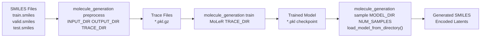
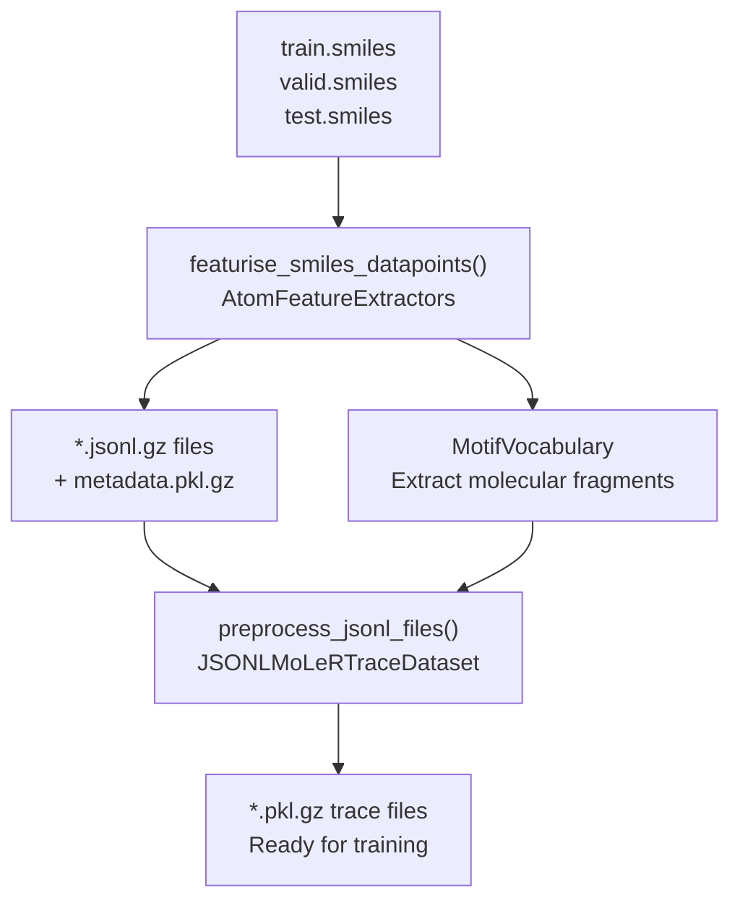
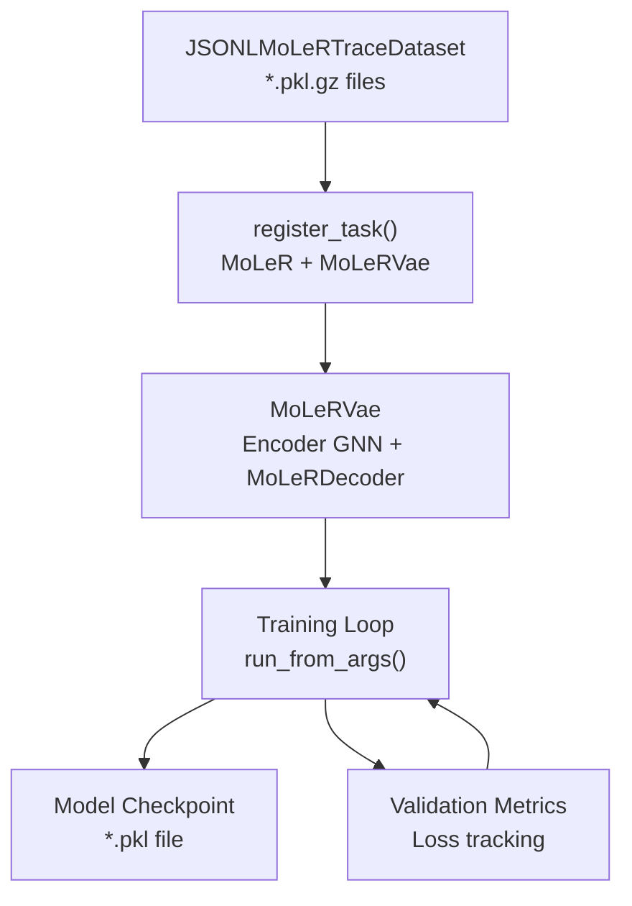
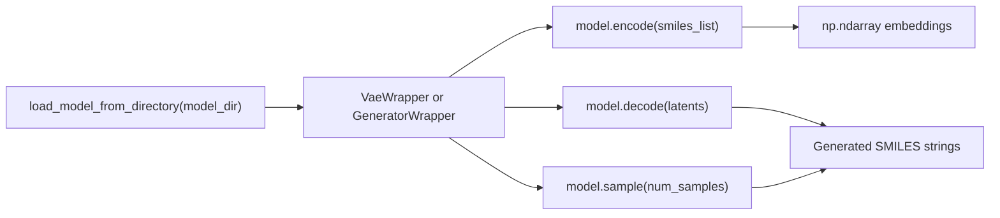
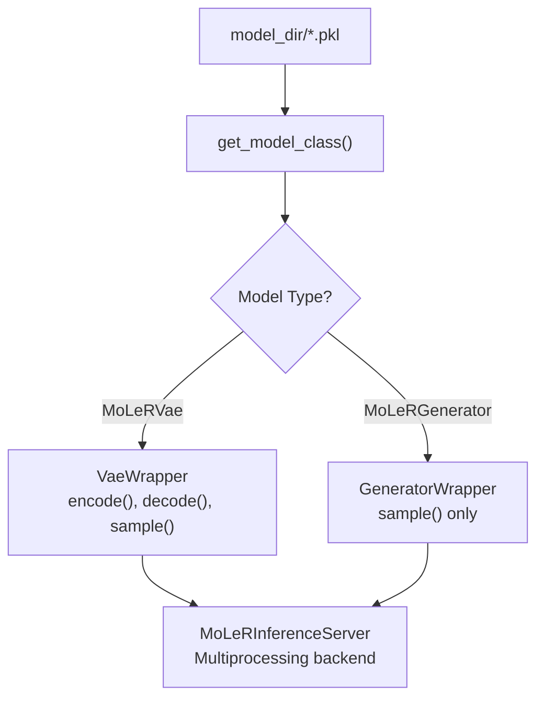

<!-- source: DeepWiki mcp.deepwiki.com · repo microsoft/molecule-generation · page 2.2 Quick Start Tutorial · fetched 2026-10-26 -->

# Quick Start Tutorial

<details>
<summary>Relevant source files</summary>

The following files were used as context for generating this wiki page:

- [README.md](README.md)
- [molecule_generation/cli/encode.py](molecule_generation/cli/encode.py)
- [molecule_generation/cli/sample.py](molecule_generation/cli/sample.py)
- [molecule_generation/test/integration/test_data_moler_integration.py](molecule_generation/test/integration/test_data_moler_integration.py)
- [molecule_generation/wrapper.py](molecule_generation/wrapper.py)

</details>


This tutorial provides a hands-on walkthrough of the basic MoLeR workflow, from raw SMILES data to trained models and molecule generation. It covers the essential steps for preprocessing data, training models, and performing inference using both CLI tools and Python API.

For detailed installation instructions, see [Installation & Environment Setup](#2.1). For comprehensive training configuration options, see [Training Models](#5). For advanced inference features, see [Inference & Generation](#6).

## Overview Workflow

The MoLeR system follows a four-stage pipeline that transforms raw molecular data into trained generative models:

**MoLeR Pipeline Overview**


Sources: [README.md:53-57](), [README.md:62-67](), [README.md:102-106](), [README.md:144-147]()

## Prerequisites

Before starting, ensure you have:
- Conda environment activated with MoLeR dependencies
- Input data in GuacaMol format (separate train.smiles, valid.smiles, test.smiles files)
- Sufficient disk space for preprocessed files

## Step 1: Data Preprocessing

The first step converts SMILES strings into featurized molecular graphs and generation traces.

### CLI Command
```bash
molecule_generation preprocess INPUT_DIR OUTPUT_DIR TRACE_DIR
```

Where:
- `INPUT_DIR`: Directory containing train.smiles, valid.smiles, test.smiles
- `OUTPUT_DIR`: Directory for intermediate featurized graphs (*.jsonl.gz files)  
- `TRACE_DIR`: Directory for final preprocessed trace files (*.pkl.gz files)

### What Happens During Preprocessing

**Preprocessing Pipeline Flow**


Sources: [README.md:62-70](), [molecule_generation/test/integration/test_data_moler_integration.py:83-98](), [molecule_generation/test/integration/test_data_moler_integration.py:117-122]()

The preprocessing creates molecular motif vocabularies and converts each molecule into a step-by-step generation trace, which teaches the model how to build molecules incrementally.

### Expected Output
After successful preprocessing, you should see output similar to:
```
2022-03-10 11:44:25,764 motif_utils.py:199 INFO Finished creating the motif vocabulary
2022-03-10 11:44:25,764 motif_utils.py:200 INFO | Number of motifs: 128
```

Sources: [README.md:74-96]()

## Step 2: Model Training

Train a MoLeR model on the preprocessed trace files.

### CLI Command
```bash
molecule_generation train MoLeR TRACE_DIR
```

This trains a MoLeRVae model using default hyperparameters. The training process will:
1. Load preprocessed trace data from `TRACE_DIR`
2. Initialize a MoLeR model with encoder and decoder GNNs
3. Train until convergence (no improvement for 3 consecutive mini-epochs)
4. Save the best model checkpoint as a `.pkl` file

### Training Components

**MoLeR Training Architecture**


Sources: [molecule_generation/test/integration/test_data_moler_integration.py:186-198](), [molecule_generation/test/integration/test_data_moler_integration.py:208-229](), [README.md:100-106]()

### Expected Output
Training will display metrics like:
```
Initial valid metric:
Avg weighted sum. of graph losses:  122.1728
Avg node class. loss:                 35.9361
```

Sources: [README.md:119-135]()

## Step 3: Inference and Generation

Once training completes, use the trained model for molecule generation and encoding.

### Quick Sampling via CLI

Generate molecules using the command line:
```bash
molecule_generation sample MODEL_DIR NUM_SAMPLES
```

Where `MODEL_DIR` contains exactly one `.pkl` checkpoint file.

### Python API Usage

For programmatic access, use the Python wrapper API:

**Python API Workflow**


Sources: [README.md:159-180](), [molecule_generation/wrapper.py:185-192]()

### Example Python Code

```python
from molecule_generation import load_model_from_directory

model_dir = "./trained_model"
example_smiles = ["c1ccccc1", "CNC=O"]

with load_model_from_directory(model_dir) as model:
    # Encode SMILES to latent vectors
    embeddings = model.encode(example_smiles)
    
    # Decode latents back to SMILES
    decoded = model.decode(embeddings)
    
    # Generate new molecules
    samples = model.sample(10)
```

Sources: [README.md:159-180]()

### Model Wrapper Classes

**Model Loading and Wrapper Selection**


Sources: [molecule_generation/wrapper.py:185-192](), [molecule_generation/wrapper.py:83-84](), [molecule_generation/wrapper.py:168-169]()

The system automatically detects whether you have a VAE model (supports encoding/decoding) or a Generator model (sampling only) and provides the appropriate wrapper.

## Complete Example Workflow

Here's a complete example using a small dataset:

### 1. Prepare Data
Create three files in `data/` directory:
- `train.smiles` - Training SMILES, one per line
- `valid.smiles` - Validation SMILES  
- `test.smiles` - Test SMILES

### 2. Run Full Pipeline
```bash
# Preprocess data
molecule_generation preprocess data/ processed/ traces/

# Train model  
molecule_generation train MoLeR traces/

# Sample molecules (assuming model saved to trained_model)
molecule_generation sample trained_model/ 10
```

### 3. Programmatic Usage
```python
# Load and use trained model
with load_model_from_directory("trained_model/") as model:
    # Generate 5 new molecules
    new_molecules = model.sample(5)
    print("Generated:", new_molecules)
    
    # Encode existing molecules
    known_smiles = ["CCO", "c1ccccc1"]  
    embeddings = model.encode(known_smiles)
    print(f"Embedding shape: {embeddings[0].shape}")
```

## File Organization

After completing the workflow, your directory structure will look like:

```
project/
├── data/
│   ├── train.smiles
│   ├── valid.smiles  
│   └── test.smiles
├── processed/
│   ├── train.jsonl.gz
│   ├── valid.jsonl.gz
│   ├── test.jsonl.gz
│   └── metadata.pkl.gz
├── traces/
│   ├── train_0/
│   ├── valid_0/
│   └── test_0/
└── trained_model/
    └── GNN_Edge_MLP_MoLeR__*.pkl
```

Sources: [molecule_generation/test/integration/test_data_moler_integration.py:100-107](), [molecule_generation/test/integration/test_data_moler_integration.py:125-128]()

## Next Steps

- For advanced training configurations, see [Model Configuration](#5.2)
- For detailed inference options including scaffolding, see [Python API](#6.1) 
- For visualization of generation traces, see [Generation Process Visualization](#7.1)
- For working with pre-trained models, download checkpoints as described in [README.md:29-33]()

Sources: [README.md:159-196](), [molecule_generation/cli/sample.py:12-16](), [molecule_generation/cli/encode.py:13-26]()

---

