# Page: Overview

# Overview

<details>
<summary>Relevant source files</summary>

The following files were used as context for generating this wiki page:

- [CHANGELOG.md](CHANGELOG.md)
- [README.md](README.md)
- [setup.py](setup.py)

</details>


This document provides a high-level overview of the `molecule_generation` repository, a deep learning system for generating molecular structures using the MoLeR (Molecule Learning Representation) model. The system transforms SMILES molecular representations through graph neural networks to enable molecule generation, encoding, and property prediction.

For detailed installation instructions, see [Installation & Environment Setup](#2.1). For step-by-step usage tutorials, see [Quick Start Tutorial](#2.2). For in-depth model architecture details, see [Model Architecture](#4).

## System Purpose and Capabilities

The `molecule_generation` system provides a complete pipeline for:

- **Data Processing**: Converting SMILES strings into graph representations and generation traces
- **Model Training**: Training variational autoencoders and autoregressive generators for molecules  
- **Inference**: Encoding molecules to latent vectors, decoding latents to molecules, and sampling new structures
- **Visualization**: Understanding generation processes through interactive HTML and CLI visualizers
- **Fine-tuning**: Adapting pre-trained models to new molecular datasets

## High-Level System Architecture

**System Architecture Overview**

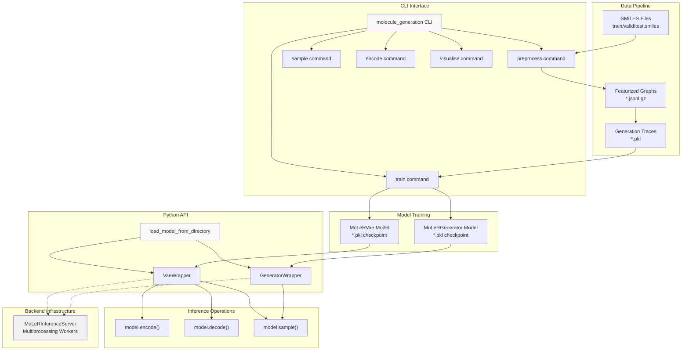

**Sources:** [README.md:11-12](), [README.md:53-60](), [README.md:192-195](), [setup.py:32]()

## Core Model Components

**MoLeR Model Architecture Components**

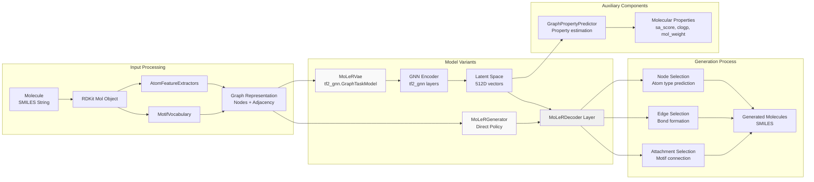

**Sources:** [README.md:9](), [README.md:242-243](), [CHANGELOG.md:49](), [CHANGELOG.md:66-67]()

## Key Workflows

### Data Processing Workflow

| Stage | Input | Process | Output |
|-------|--------|---------|--------|
| **Raw Data** | SMILES files (`train.smiles`, `valid.smiles`, `test.smiles`) | GuacaMol format validation | Validated molecular strings |
| **Featurization** | SMILES strings | `AtomFeatureExtractors`, `MotifVocabulary` extraction | Graph representations (`*.jsonl.gz`) |
| **Trace Generation** | Featurized graphs | Generation order algorithms (BFS/Random) | Training traces (`*.pkl`) |
| **Dataset Creation** | Generation traces | `JSONLMoLeRTraceDataset` | TensorFlow-ready batches |

### Model Training Workflow

| Component | Function | Configuration |
|-----------|----------|---------------|
| **MoLeRVae** | Variational autoencoder for latent space learning | Encoder GNN + Decoder + KL divergence |
| **MoLeRGenerator** | Direct autoregressive generation | Decoder-only architecture |
| **Training Loop** | Minimize reconstruction + auxiliary losses | Property prediction, generation losses |
| **Checkpointing** | Save best model based on validation metrics | `*.pkl` format with metadata |

### Inference Workflow

| Operation | API Method | CLI Command | Function |
|-----------|------------|-------------|----------|
| **Encoding** | `model.encode(smiles)` | `molecule_generation encode` | SMILES → latent vectors |
| **Decoding** | `model.decode(latents)` | N/A | Latent vectors → SMILES |
| **Sampling** | `model.sample(num_samples)` | `molecule_generation sample` | Generate new molecules |
| **Visualization** | N/A | `molecule_generation visualise` | Debug generation traces |

**Sources:** [README.md:62-70](), [README.md:102-106](), [README.md:144-157](), [README.md:159-189]()

## Model Variants and Capabilities

### MoLeRVae Capabilities
- **Encoding**: Convert SMILES to 512-dimensional latent vectors via `VaeWrapper.encode()`
- **Decoding**: Generate molecules from latent vectors via `VaeWrapper.decode()`
- **Scaffold Constraint**: Support scaffold-constrained generation
- **Property Prediction**: Predict molecular properties from latent space

### MoLeRGenerator Capabilities  
- **Direct Sampling**: Generate molecules without explicit latent space via `GeneratorWrapper.sample()`
- **Autoregressive**: Step-by-step molecule construction
- **No Encoding**: Cannot encode existing molecules to latent vectors

### Infrastructure Features
- **Multiprocessing**: `MoLeRInferenceServer` for parallel processing
- **Model Loading**: Automatic wrapper selection via `load_model_from_directory()`
- **Fine-tuning**: Adapt pre-trained models to new datasets
- **Visualization**: HTML and CLI generation trace inspection

**Sources:** [README.md:193-194](), [CHANGELOG.md:49](), [CHANGELOG.md:50](), [README.md:223-237]()

## System Dependencies and Environment

The system requires:
- **Python**: >=3.7 with TensorFlow >=2.1.0, <2.10
- **Chemistry**: RDKit >=2020.09.1 for molecular operations  
- **Deep Learning**: tf2-gnn >=2.13.0 for graph neural networks
- **Utilities**: dpu-utils, scikit-learn, numpy for data processing

Installation uses conda for RDKit and CUDA dependencies, with pip for the Python package itself.

**Sources:** [setup.py:19-28](), [README.md:13-27]()

---

# Page: Getting Started

# Getting Started

<details>
<summary>Relevant source files</summary>

The following files were used as context for generating this wiki page:

- [README.md](README.md)
- [environment.yml](environment.yml)
- [setup.py](setup.py)

</details>


This document provides a practical introduction to using the MoLeR molecule generation system. It covers initial setup, basic workflows, and essential concepts needed to start generating molecules. For detailed information about specific components, see [Installation & Environment Setup](#2.1) for comprehensive setup instructions, [Quick Start Tutorial](#2.2) for hands-on examples, and [Data Processing Pipeline](#3) for understanding the data flow.

## System Overview

The MoLeR system operates through a four-stage pipeline that transforms SMILES strings into trained models capable of generating new molecules:

**MoLeR Workflow Overview**
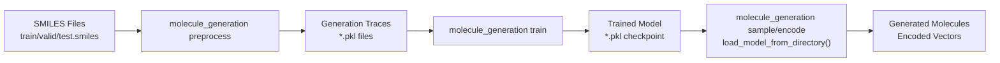

Sources: [README.md:53-60](), [README.md:11-35]()

The system provides both command-line tools and a Python API for each stage. The core architectural components map to specific code entities:

**Core Code Entity Architecture**
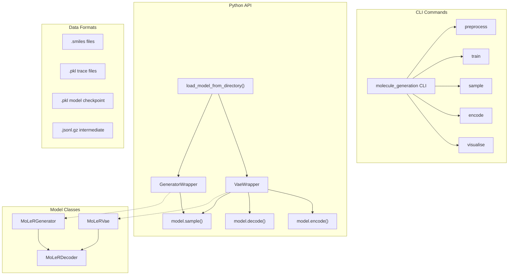

Sources: [README.md:159-196](), [setup.py:32]()

## Prerequisites

Before using MoLeR, ensure you have:

| Requirement | Version | Purpose |
|-------------|---------|---------|
| Python | ≥3.7 | Core runtime |
| RDKit | ≥2020.09.1 | Molecular processing |
| TensorFlow | ≥2.1.0, <2.10 | Model training/inference |
| CUDA | Compatible with TF | GPU acceleration (optional) |

Sources: [README.md:20](), [setup.py:19-28]()

## Quick Installation

The fastest way to get started is using the provided conda environment:

```bash
# Clone and setup environment
git clone https://github.com/microsoft/molecule-generation.git
cd molecule-generation
conda env create -f environment.yml
conda activate moler-env

# Install the package
pip install molecule-generation
```

Alternatively, install the latest development version:
```bash
pip install -e .
```

Sources: [README.md:13-27](), [environment.yml:1-12]()

## Immediate Usage with Pre-trained Model

To quickly test the system, use the provided pre-trained checkpoint:

```bash
# Download and setup checkpoint
mkdir /tmp/MoLeR_checkpoint
cd /tmp/MoLeR_checkpoint
# Download from: https://figshare.com/ndownloader/files/34642724
# Rename to: GNN_Edge_MLP_MoLeR__2022-02-24_07-16-23_best.pkl

# Generate 10 molecules
molecule_generation sample /tmp/MoLeR_checkpoint 10
```

Expected output format:
```
C1=CC=C(C=C1)C2=CC=C(C=C2)C3=CC=CC=C3
CC(C)NC(=O)C1=CC=C(C=C1)F
...
```

Sources: [README.md:29-35]()

## Essential Workflows

### Command Line Interface

The `molecule_generation` CLI provides the primary interface for all operations:

| Command | Purpose | Input | Output |
|---------|---------|-------|--------|
| `preprocess` | Convert SMILES to training data | `INPUT_DIR` with `.smiles` files | Trace files in `TRACE_DIR` |
| `train` | Train MoLeR model | `TRACE_DIR` with preprocessed data | Model checkpoint `.pkl` |
| `sample` | Generate new molecules | `MODEL_DIR` + number of samples | SMILES strings |
| `encode` | Convert SMILES to latent vectors | `MODEL_DIR` + `SMILES_PATH` | Latent embeddings |
| `visualise` | Inspect generation process | `MODEL_DIR` + molecules | HTML/CLI visualization |

Sources: [README.md:63-67](), [README.md:102-106](), [README.md:144-154]()

### Python API Usage

For programmatic access, use the `load_model_from_directory` context manager:

```python
from molecule_generation import load_model_from_directory

model_dir = "./example_model_directory"
example_smiles = ["c1ccccc1", "CNC=O"]

with load_model_from_directory(model_dir) as model:
    # Encode SMILES to latent vectors
    embeddings = model.encode(example_smiles)
    
    # Decode latent vectors back to SMILES  
    decoded = model.decode(embeddings)
    
    # Generate new molecules
    new_molecules = model.sample(num_samples=5)
    
    # Decode with scaffold constraints
    scaffolds = ["CN", "CCC"]
    constrained = model.decode(embeddings, scaffolds=scaffolds)
```

The context manager automatically:
- Detects model type (`MoLeRVae` vs `MoLeRGenerator`)
- Spawns parallel worker processes
- Provides appropriate wrapper (`VaeWrapper` or `GeneratorWrapper`)

Sources: [README.md:159-196]()

## Data Requirements

MoLeR expects input data in GuacaMol format:

```
INPUT_DIR/
├── train.smiles    # Training SMILES, one per line
├── valid.smiles    # Validation SMILES  
└── test.smiles     # Test SMILES
```

Example SMILES format:
```
c1ccccc1
CNC=O
CC(C)C(=O)O
```

Sources: [README.md:63]()

## Next Steps

After completing basic setup:

1. **For custom data**: See [Data Processing Pipeline](#3) to preprocess your SMILES datasets
2. **For model training**: See [Training Models](#5) for detailed training procedures  
3. **For advanced inference**: See [Inference & Generation](#6) for batch processing and server deployment
4. **For visualization**: See [Visualization & Analysis](#7) to understand model behavior

Common troubleshooting scenarios:
- **TensorFlow GPU issues**: Refer to [TensorFlow installation guide](https://www.tensorflow.org/install)
- **Dependency conflicts**: Use pinned environments from `environment-py*.yml` files
- **China access issues**: Alternative checkpoint link available in README

Sources: [README.md:37-49]()

---

# Page: Installation & Environment Setup

# Installation & Environment Setup

<details>
<summary>Relevant source files</summary>

The following files were used as context for generating this wiki page:

- [environment-py37.yml](environment-py37.yml)
- [environment-py38.yml](environment-py38.yml)
- [environment-py39.yml](environment-py39.yml)
- [environment.yml](environment.yml)
- [setup.py](setup.py)

</details>


This document provides comprehensive instructions for installing the molecule-generation package and setting up the required environment. It covers dependency management, environment configuration, and verification steps to ensure the system is properly configured for molecule generation tasks.

For information about running your first training job after installation, see [Quick Start Tutorial](#2.2). For development environment setup and contributing guidelines, see [Development Environment](#9.1).

## Prerequisites

The molecule-generation system requires Python 3.7 or higher and depends on several scientific computing libraries. The system has been tested on Python versions 3.7 through 3.10 as specified in [setup.py:37-40]().

### System Requirements

| Component | Requirement | Notes |
|-----------|-------------|-------|
| Python | 3.7 - 3.10 | Specified in [setup.py:19]() |
| TensorFlow | 2.1 - 2.9.x | Version constraint in [setup.py:26]() |
| RDKit | 2020.09+ | Required for molecular processing |
| Memory | 8GB+ RAM | Recommended for training |
| Storage | 2GB+ free | For models and datasets |

**Installation Workflow**

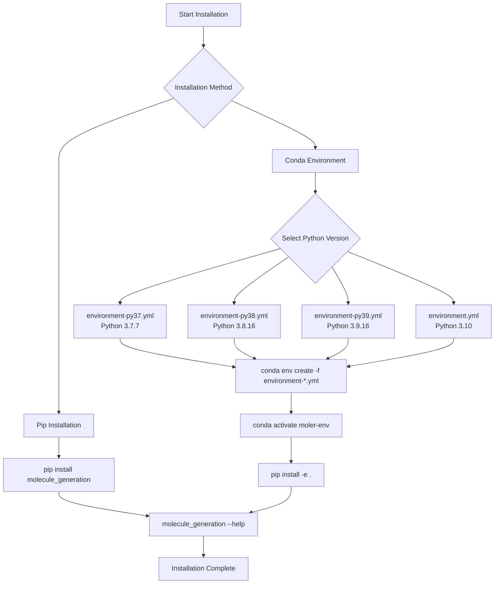

Sources: [setup.py:19](), [environment.yml:1-12](), [environment-py37.yml:1-12](), [environment-py38.yml:1-12](), [environment-py39.yml:1-12]()

## Installation Methods

### Method 1: Conda Environment (Recommended)

The recommended installation method uses conda environments to manage dependencies. The repository provides environment files for different Python versions.

#### Step 1: Choose Environment File

Select the appropriate environment file based on your Python version preference:

| Python Version | Environment File | TensorFlow | RDKit |
|----------------|------------------|------------|-------|
| 3.7.7 | `environment-py37.yml` | 2.1.0 | 2020.09.1.0 |
| 3.8.16 | `environment-py38.yml` | 2.6.2 | 2021.09.1 |
| 3.9.16 | `environment-py39.yml` | 2.9.1 | 2022.09.1 |
| 3.10 | `environment.yml` | <2.10 | latest |

#### Step 2: Create Conda Environment

```bash
# For Python 3.10 (recommended)
conda env create -f environment.yml

# Or for specific Python versions
conda env create -f environment-py39.yml
```

#### Step 3: Activate Environment

```bash
conda activate moler-env
```

The environment name `moler-env` is defined in [environment.yml:1]() and all version-specific files.

#### Step 4: Install Package

```bash
# Development installation
pip install -e .

# Or standard installation
pip install .
```

Sources: [environment.yml:1-12](), [environment-py37.yml:1-12](), [environment-py38.yml:1-12](), [environment-py39.yml:1-12]()

### Method 2: Pip Installation

For environments where conda is not available, you can install using pip directly.

#### Step 1: Install Dependencies

```bash
pip install tensorflow>=2.1,<2.10
pip install rdkit
```

#### Step 2: Install Package

```bash
pip install molecule_generation
```

**Note**: This method requires manual dependency management and may encounter version conflicts.

Sources: [setup.py:20-28]()

## Dependency Overview

The molecule-generation package has several key dependencies managed through [setup.py:20-28]():

**Core Dependencies Architecture**

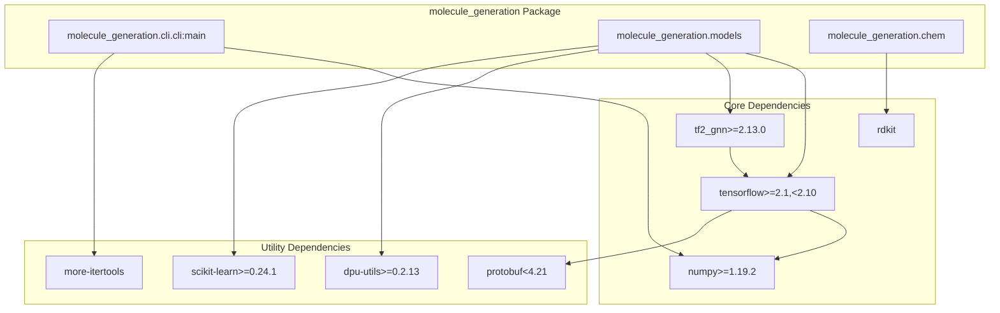

Sources: [setup.py:20-28]()

### Critical Dependencies

#### TensorFlow
- **Version**: 2.1 to 2.9.x (constraint: `<2.10`)
- **Purpose**: Neural network training and inference
- **Note**: Versions 2.10+ have memory leaks as noted in [setup.py:26]()

#### RDKit
- **Purpose**: Molecular structure processing and SMILES handling
- **Integration**: Used throughout `molecule_generation.chem` module

#### tf2_gnn
- **Version**: >=2.13.0
- **Purpose**: Graph neural network layers for molecular graphs
- **Requirement**: Specified in [setup.py:27]()

#### dpu-utils
- **Version**: >=0.2.13
- **Purpose**: Deep learning utilities and data processing helpers

Sources: [setup.py:20-28]()

## Verification

After installation, verify the setup using the command-line interface:

### Basic Verification

```bash
# Test CLI availability
molecule_generation --help

# Test Python import
python -c "import molecule_generation; print('Success')"
```

The CLI entry point is defined in [setup.py:32]() as `molecule_generation = molecule_generation.cli.cli:main`.

### Dependency Verification

```bash
# Check TensorFlow
python -c "import tensorflow as tf; print(f'TensorFlow: {tf.__version__}')"

# Check RDKit
python -c "import rdkit; print(f'RDKit: {rdkit.__version__}')"

# Check tf2_gnn
python -c "import tf2_gnn; print('tf2_gnn: OK')"
```

### Full System Test

```bash
# Run basic preprocessing test (requires test data)
molecule_generation preprocess --help
```

Sources: [setup.py:32]()

## Troubleshooting

### Common Issues

#### TensorFlow Version Conflicts

**Problem**: Memory leaks with TensorFlow 2.10+
**Solution**: Ensure TensorFlow version is <2.10 as specified in [setup.py:26]()

```bash
pip install "tensorflow>=2.1,<2.10"
```

#### Protobuf Compatibility

**Problem**: Breaking changes in protobuf 4.21.0
**Solution**: Install compatible version as constrained in [setup.py:24]()

```bash
pip install "protobuf<4.21"
```

#### RDKit Installation Issues

**Problem**: RDKit not found with pip installation
**Solution**: Use conda for RDKit installation

```bash
conda install -c rdkit rdkit
```

#### Python Version Support

The package supports Python 3.7-3.10 as specified in [setup.py:37-40](). Ensure your Python version is within this range.

### Environment Conflicts

If experiencing dependency conflicts:

1. Create a fresh conda environment
2. Use the provided environment files
3. Avoid mixing conda and pip for core dependencies

Sources: [setup.py:24](), [setup.py:26](), [setup.py:37-40]()

---

# Page: Quick Start Tutorial

# Quick Start Tutorial

<details>
<summary>Relevant source files</summary>

The following files were used as context for generating this wiki page:

- [README.md](README.md)
- [molecule_generation/cli/encode.py](molecule_generation/cli/encode.py)
- [molecule_generation/cli/sample.py](molecule_generation/cli/sample.py)
- [molecule_generation/test/integration/test_data_moler_integration.py](molecule_generation/test/integration/test_data_moler_integration.py)
- [molecule_generation/wrapper.py](molecule_generation/wrapper.py)

</details>


This tutorial provides a hands-on walkthrough of the basic MoLeR workflow, from raw SMILES data to trained models and molecule generation. It covers the essential steps for preprocessing data, training models, and performing inference using both CLI tools and Python API.

For detailed installation instructions, see [Installation & Environment Setup](#2.1). For comprehensive training configuration options, see [Training Models](#5). For advanced inference features, see [Inference & Generation](#6).

## Overview Workflow

The MoLeR system follows a four-stage pipeline that transforms raw molecular data into trained generative models:

**MoLeR Pipeline Overview**
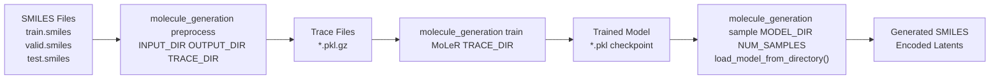

Sources: [README.md:53-57](), [README.md:62-67](), [README.md:102-106](), [README.md:144-147]()

## Prerequisites

Before starting, ensure you have:
- Conda environment activated with MoLeR dependencies
- Input data in GuacaMol format (separate train.smiles, valid.smiles, test.smiles files)
- Sufficient disk space for preprocessed files

## Step 1: Data Preprocessing

The first step converts SMILES strings into featurized molecular graphs and generation traces.

### CLI Command
```bash
molecule_generation preprocess INPUT_DIR OUTPUT_DIR TRACE_DIR
```

Where:
- `INPUT_DIR`: Directory containing train.smiles, valid.smiles, test.smiles
- `OUTPUT_DIR`: Directory for intermediate featurized graphs (*.jsonl.gz files)  
- `TRACE_DIR`: Directory for final preprocessed trace files (*.pkl.gz files)

### What Happens During Preprocessing

**Preprocessing Pipeline Flow**
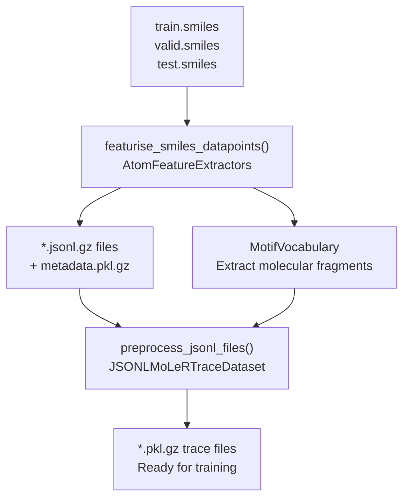

Sources: [README.md:62-70](), [molecule_generation/test/integration/test_data_moler_integration.py:83-98](), [molecule_generation/test/integration/test_data_moler_integration.py:117-122]()

The preprocessing creates molecular motif vocabularies and converts each molecule into a step-by-step generation trace, which teaches the model how to build molecules incrementally.

### Expected Output
After successful preprocessing, you should see output similar to:
```
2022-03-10 11:44:25,764 motif_utils.py:199 INFO Finished creating the motif vocabulary
2022-03-10 11:44:25,764 motif_utils.py:200 INFO | Number of motifs: 128
```

Sources: [README.md:74-96]()

## Step 2: Model Training

Train a MoLeR model on the preprocessed trace files.

### CLI Command
```bash
molecule_generation train MoLeR TRACE_DIR
```

This trains a MoLeRVae model using default hyperparameters. The training process will:
1. Load preprocessed trace data from `TRACE_DIR`
2. Initialize a MoLeR model with encoder and decoder GNNs
3. Train until convergence (no improvement for 3 consecutive mini-epochs)
4. Save the best model checkpoint as a `.pkl` file

### Training Components

**MoLeR Training Architecture**
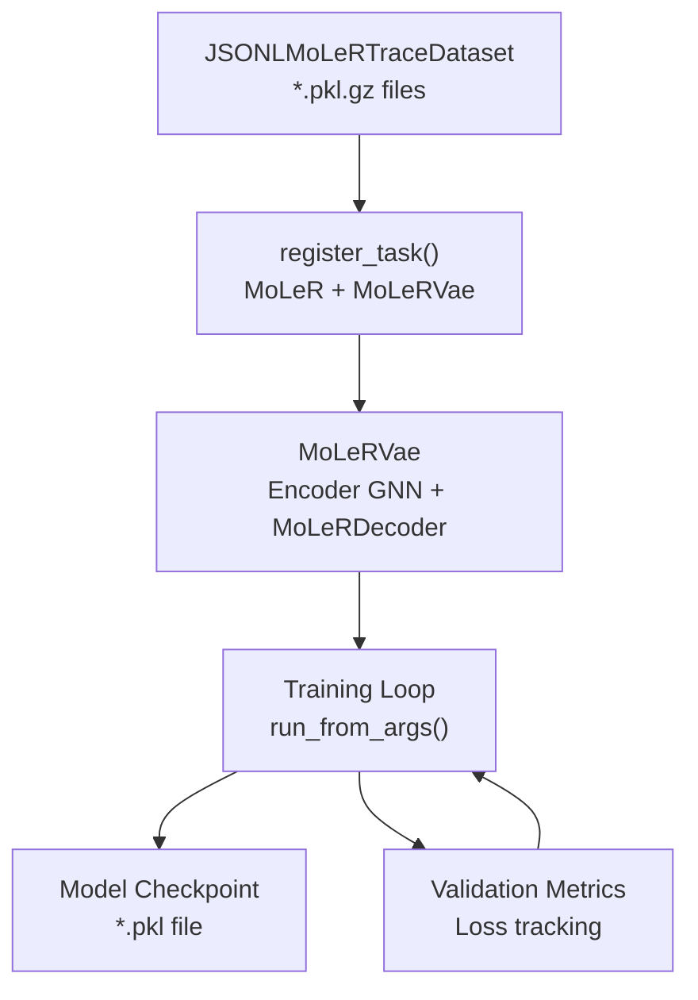

Sources: [molecule_generation/test/integration/test_data_moler_integration.py:186-198](), [molecule_generation/test/integration/test_data_moler_integration.py:208-229](), [README.md:100-106]()

### Expected Output
Training will display metrics like:
```
Initial valid metric:
Avg weighted sum. of graph losses:  122.1728
Avg node class. loss:                 35.9361
```

Sources: [README.md:119-135]()

## Step 3: Inference and Generation

Once training completes, use the trained model for molecule generation and encoding.

### Quick Sampling via CLI

Generate molecules using the command line:
```bash
molecule_generation sample MODEL_DIR NUM_SAMPLES
```

Where `MODEL_DIR` contains exactly one `.pkl` checkpoint file.

### Python API Usage

For programmatic access, use the Python wrapper API:

**Python API Workflow**
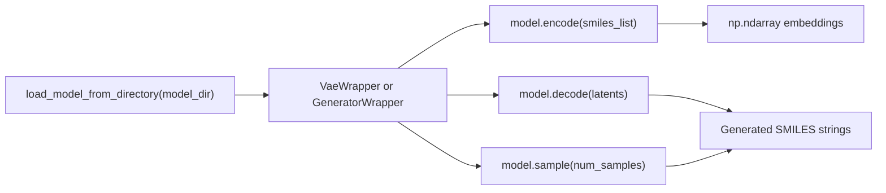

Sources: [README.md:159-180](), [molecule_generation/wrapper.py:185-192]()

### Example Python Code

```python
from molecule_generation import load_model_from_directory

model_dir = "./trained_model"
example_smiles = ["c1ccccc1", "CNC=O"]

with load_model_from_directory(model_dir) as model:
    # Encode SMILES to latent vectors
    embeddings = model.encode(example_smiles)
    
    # Decode latents back to SMILES
    decoded = model.decode(embeddings)
    
    # Generate new molecules
    samples = model.sample(10)
```

Sources: [README.md:159-180]()

### Model Wrapper Classes

**Model Loading and Wrapper Selection**
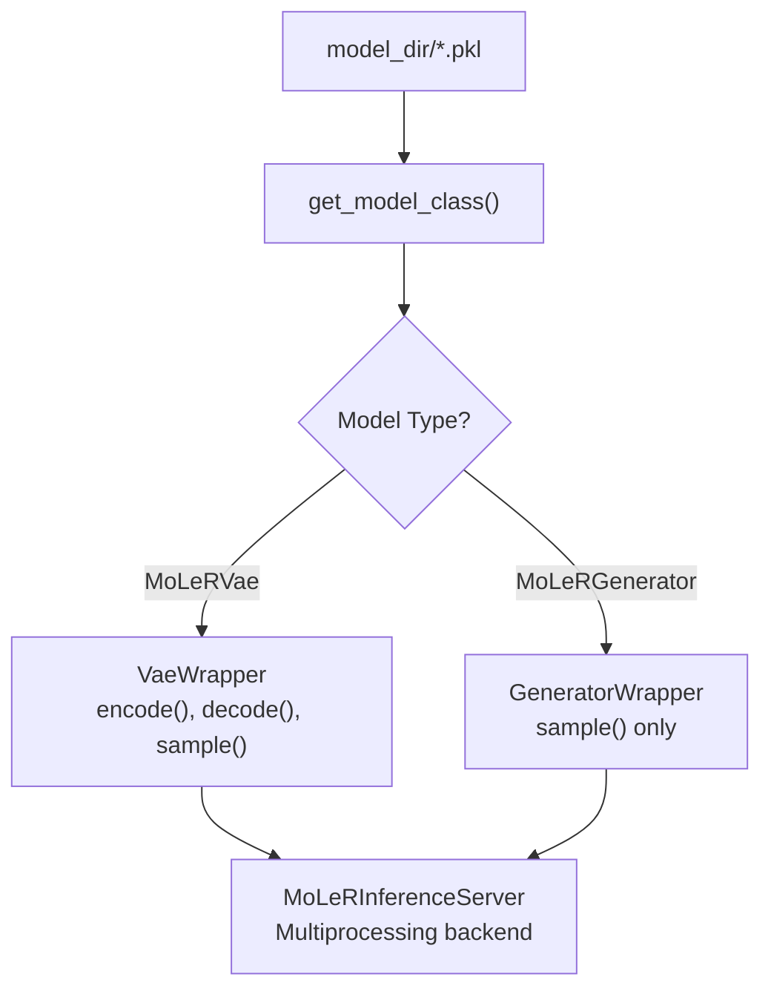

Sources: [molecule_generation/wrapper.py:185-192](), [molecule_generation/wrapper.py:83-84](), [molecule_generation/wrapper.py:168-169]()

The system automatically detects whether you have a VAE model (supports encoding/decoding) or a Generator model (sampling only) and provides the appropriate wrapper.

## Complete Example Workflow

Here's a complete example using a small dataset:

### 1. Prepare Data
Create three files in `data/` directory:
- `train.smiles` - Training SMILES, one per line
- `valid.smiles` - Validation SMILES  
- `test.smiles` - Test SMILES

### 2. Run Full Pipeline
```bash
# Preprocess data
molecule_generation preprocess data/ processed/ traces/

# Train model  
molecule_generation train MoLeR traces/

# Sample molecules (assuming model saved to trained_model)
molecule_generation sample trained_model/ 10
```

### 3. Programmatic Usage
```python
# Load and use trained model
with load_model_from_directory("trained_model/") as model:
    # Generate 5 new molecules
    new_molecules = model.sample(5)
    print("Generated:", new_molecules)
    
    # Encode existing molecules
    known_smiles = ["CCO", "c1ccccc1"]  
    embeddings = model.encode(known_smiles)
    print(f"Embedding shape: {embeddings[0].shape}")
```

## File Organization

After completing the workflow, your directory structure will look like:

```
project/
├── data/
│   ├── train.smiles
│   ├── valid.smiles  
│   └── test.smiles
├── processed/
│   ├── train.jsonl.gz
│   ├── valid.jsonl.gz
│   ├── test.jsonl.gz
│   └── metadata.pkl.gz
├── traces/
│   ├── train_0/
│   ├── valid_0/
│   └── test_0/
└── trained_model/
    └── GNN_Edge_MLP_MoLeR__*.pkl
```

Sources: [molecule_generation/test/integration/test_data_moler_integration.py:100-107](), [molecule_generation/test/integration/test_data_moler_integration.py:125-128]()

## Next Steps

- For advanced training configurations, see [Model Configuration](#5.2)
- For detailed inference options including scaffolding, see [Python API](#6.1) 
- For visualization of generation traces, see [Generation Process Visualization](#7.1)
- For working with pre-trained models, download checkpoints as described in [README.md:29-33]()

Sources: [README.md:159-196](), [molecule_generation/cli/sample.py:12-16](), [molecule_generation/cli/encode.py:13-26]()

---

# Page: Data Processing Pipeline

# Data Processing Pipeline

<details>
<summary>Relevant source files</summary>

The following files were used as context for generating this wiki page:

- [README.md](README.md)
- [molecule_generation/chem/molecule_dataset_utils.py](molecule_generation/chem/molecule_dataset_utils.py)
- [molecule_generation/cli/preprocess.py](molecule_generation/cli/preprocess.py)

</details>


The data processing pipeline transforms raw molecular data into training-ready datasets for MoLeR models. This comprehensive system converts SMILES strings through multiple stages of featurization, graph conversion, and trace generation to produce the structured data required for training and inference.

For information about training models with processed data, see [Training Models](#5). For details about the model architectures that consume this processed data, see [Model Architecture](#4).

## Pipeline Overview

The data processing pipeline consists of three main stages: input data loading, molecular featurization, and trace generation. The entire pipeline is orchestrated through the CLI command `molecule_generation preprocess` and can handle both initial preprocessing and fine-tuning scenarios.

### High-Level Data Flow

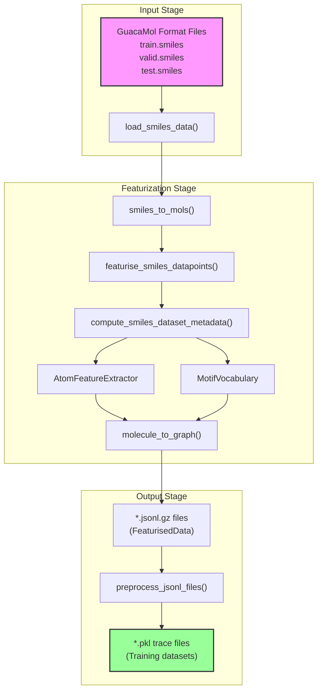

**Core Data Processing Pipeline**

Sources: [molecule_generation/cli/preprocess.py:208-331](), [molecule_generation/chem/molecule_dataset_utils.py:242-346]()

### Pipeline Stages and File Formats

| Stage | Input Format | Output Format | Key Components |
|-------|-------------|---------------|----------------|
| Input Loading | `.smiles` files | Python dictionaries | `load_smiles_data()`, `DatasetPath` |
| Molecular Featurization | SMILES strings | Graph representations | `featurise_smiles_datapoints()`, `molecule_to_graph()` |
| Trace Generation | `.jsonl.gz` files | `.pkl` training files | `preprocess_jsonl_files()` |

Sources: [molecule_generation/cli/preprocess.py:42-48](), [molecule_generation/chem/molecule_dataset_utils.py:156-240]()

## Molecular Featurization Process

The featurization process transforms SMILES strings into rich graph representations containing atomic features, bond information, and optional motif annotations. This stage is handled primarily by the `FeaturisedData` class and supporting functions.

### Featurization Components

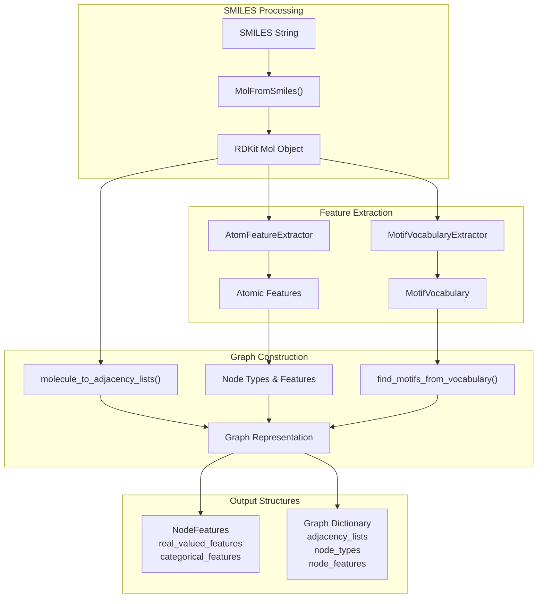

**Molecular Featurization Components**

Sources: [molecule_generation/chem/molecule_dataset_utils.py:385-516](), [molecule_generation/chem/molecule_dataset_utils.py:48-54]()

### Core Featurization Functions

The `featurise_smiles_datapoints()` function serves as the main entry point for molecular featurization, coordinating between atom feature extraction and motif processing:

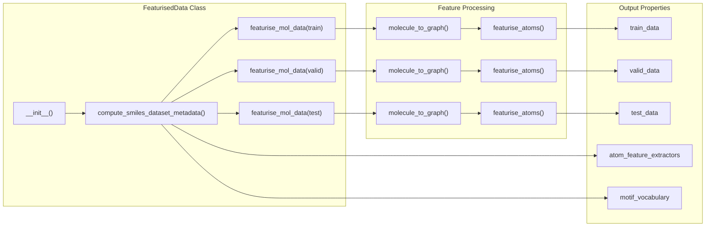

**FeaturisedData Class Structure**

Sources: [molecule_generation/chem/molecule_dataset_utils.py:167-240](), [molecule_generation/chem/molecule_dataset_utils.py:125-154]()

## Graph Representation and Data Structures

The pipeline converts molecular structures into standardized graph representations suitable for graph neural networks. The core data structures include adjacency lists, node features, and optional categorical labels.

### Graph Construction Process

The `molecule_to_graph()` function creates the final graph representation by combining structural and feature information:

| Component | Function | Output Structure |
|-----------|----------|------------------|
| Bond Information | `molecule_to_adjacency_lists()` | `List[List[Tuple[int, int]]]` |
| Atom Features | `featurise_atoms()` | `NodeFeatures` (real + categorical) |
| Node Types | `get_atom_symbol()` | List of atom symbols |
| Motif Annotations | `find_motifs_from_vocabulary()` | `List[MotifAnnotation]` |

Sources: [molecule_generation/chem/molecule_dataset_utils.py:453-516](), [molecule_generation/chem/molecule_dataset_utils.py:356-382]()

### Bond Type Processing

The system handles molecular bonds through a standardized dictionary mapping and Kekulization process:

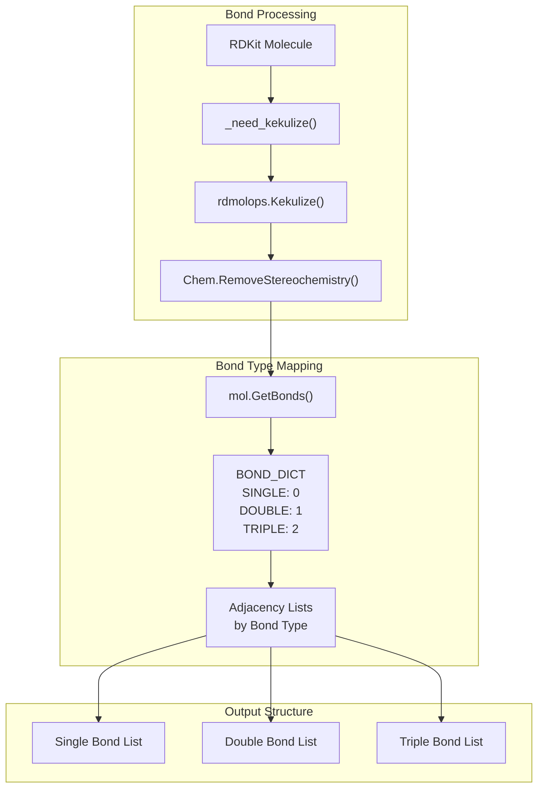

**Bond Type Processing and Adjacency List Generation**

Sources: [molecule_generation/chem/molecule_dataset_utils.py:45-46](), [molecule_generation/chem/molecule_dataset_utils.py:356-382]()

## CLI Preprocessing Interface

The preprocessing pipeline is primarily accessed through the `molecule_generation preprocess` command, which provides comprehensive options for customizing the featurization process.

### Command Structure and Arguments

The preprocessing CLI accepts three main directory arguments and numerous optional parameters for fine-tuning the process:

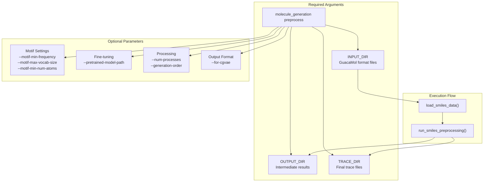

**CLI Preprocessing Interface and Options**

Sources: [molecule_generation/cli/preprocess.py:112-198](), [molecule_generation/cli/preprocess.py:208-331]()

### Generation Orders and Processing Options

The pipeline supports multiple generation order strategies through the `GENERATION_ORDER_CLS` mapping:

| Order Type | Class | Description |
|------------|-------|-------------|
| `bfs` | `BFSOrder` | Breadth-first search ordering |
| `bfs-random` | `BFSOrderRandom` | Randomized BFS (default) |
| `canonical` | `CanonicalOrder` | Canonical atom ordering |
| `random` | `RandomOrder` | Random atom ordering |
| `loop-closing` | `LoopClosingOrder` | Prioritizes loop-closing bonds |

Sources: [molecule_generation/cli/preprocess.py:33-39]()

## Fine-tuning and Model Compatibility

The preprocessing pipeline supports fine-tuning scenarios where new data must be compatible with existing trained models. This process reuses atom feature extractors and motif vocabularies from pretrained models.

### Fine-tuning Data Flow

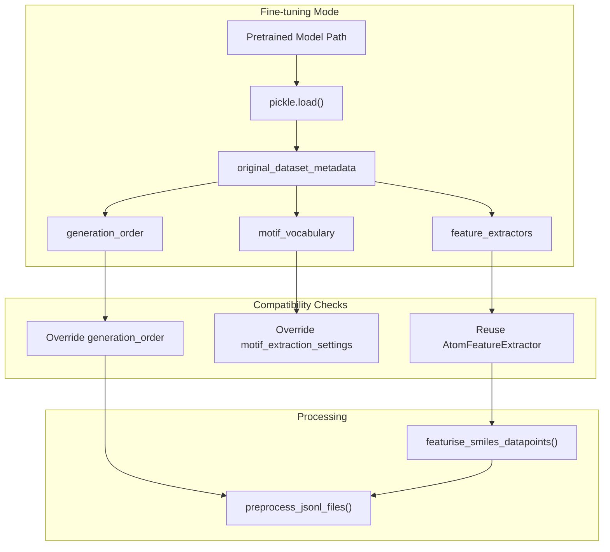

**Fine-tuning Compatibility Process**

Sources: [molecule_generation/cli/preprocess.py:243-267](), [molecule_generation/cli/preprocess.py:292-299]()

---

# Page: Input Data Formats

# Input Data Formats

<details>
<summary>Relevant source files</summary>

The following files were used as context for generating this wiki page:

- [molecule_generation/chem/molecule_dataset_utils.py](molecule_generation/chem/molecule_dataset_utils.py)
- [molecule_generation/cli/preprocess.py](molecule_generation/cli/preprocess.py)
- [molecule_generation/test/conftest.py](molecule_generation/test/conftest.py)

</details>


This document describes the input data formats supported by the molecule generation system, focusing on the SMILES-based datasets used for training and evaluation. For information about the preprocessing pipeline that transforms these inputs, see [Preprocessing Pipeline](#3.2). For details about dataset creation and internal representations, see [Dataset Creation](#3.3).

## Overview

The molecule generation system primarily accepts molecular data in SMILES (Simplified Molecular Input Line Entry System) format. The system expects datasets to follow the GuacaMol benchmark format with separate train/validation/test splits. All input processing is handled through the preprocessing pipeline, which converts SMILES strings into featurized graph representations suitable for training MoLeR models.

## Dataset Directory Structure

The system expects input datasets to be organized in a specific directory structure with three required files:

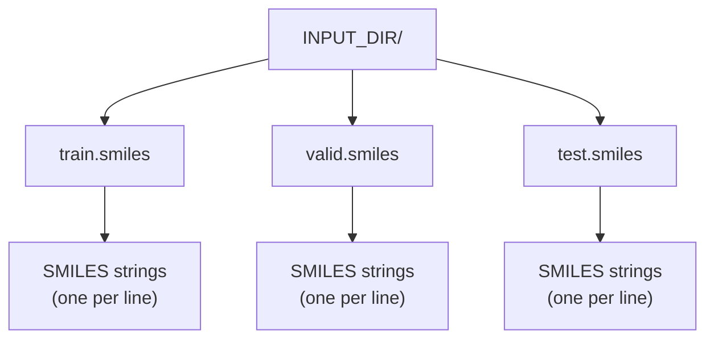

**Dataset File Structure and Loading**

Sources: [molecule_generation/cli/preprocess.py:42-48](), [molecule_generation/cli/preprocess.py:64-109]()

### File Naming Convention

The required file names are defined in the `DatasetPath` enum:

| File | Purpose | Content |
|------|---------|---------|
| `train.smiles` | Training data | SMILES strings for model training |
| `valid.smiles` | Validation data | SMILES strings for validation during training |
| `test.smiles` | Test data | SMILES strings for final evaluation |

### SMILES File Format

Each `.smiles` file contains one SMILES string per line. The system processes these using the `_read_data` function which creates dictionaries with a `"SMILES"` key:

```
CCO
CCN
C1CCCCC1
CCCCCCCC
```

Each line is converted to: `{"SMILES": "CCO"}`, `{"SMILES": "CCN"}`, etc.

Sources: [molecule_generation/cli/preprocess.py:50-55]()

## Data Loading and Validation

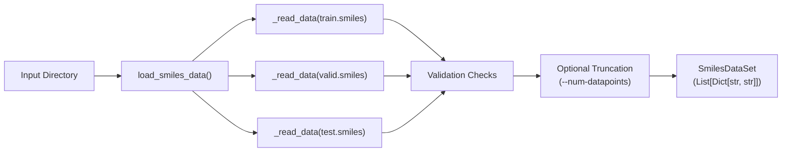

**SMILES Data Loading Process**

The `load_smiles_data` function handles dataset loading with optional truncation:

- Reads all three split files from the input directory
- Validates that validation and test sets are non-empty
- Optionally truncates datasets proportionally when `--num-datapoints` is specified
- Returns three `SmilesDataSet` objects (lists of dictionaries)

Sources: [molecule_generation/cli/preprocess.py:64-109]()

## SMILES to Molecular Objects Pipeline

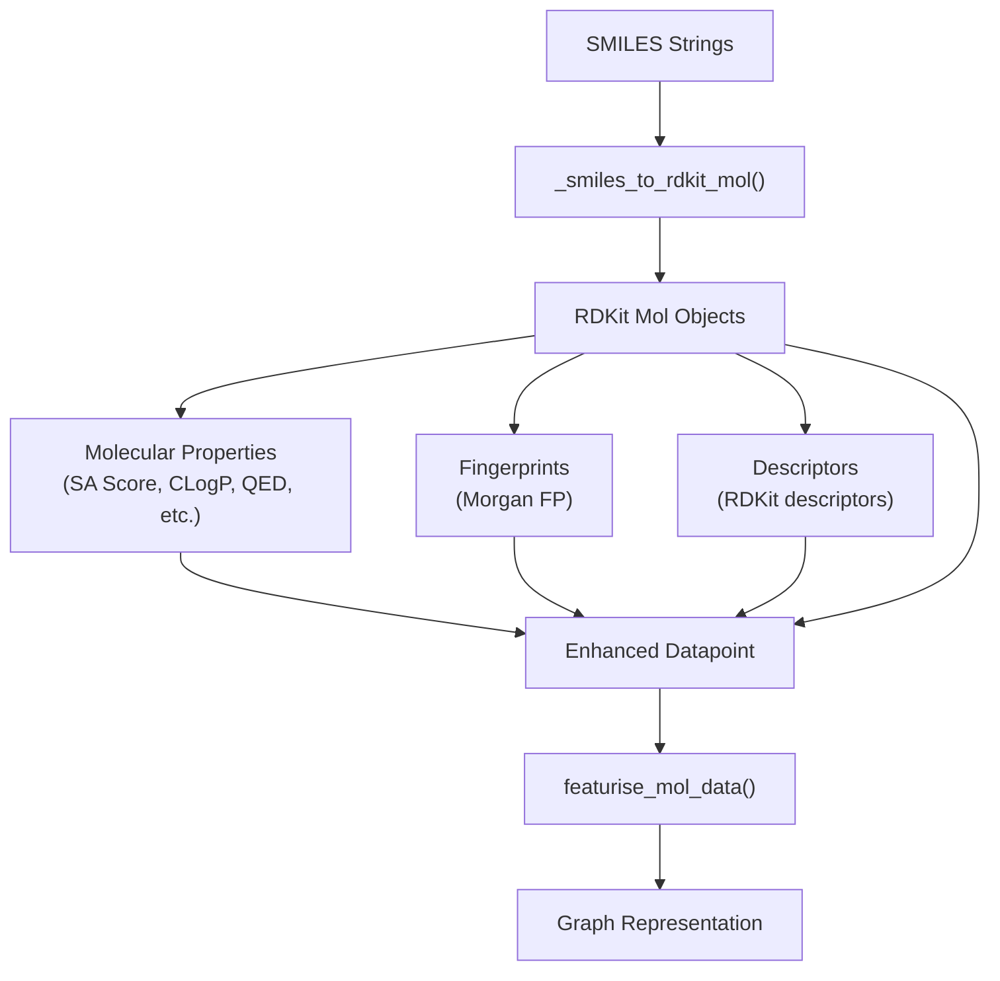

**SMILES Processing Pipeline**

The system converts SMILES strings through several stages:

1. **SMILES to RDKit**: `MolFromSmiles` converts strings to `Mol` objects
2. **Property Calculation**: Computes molecular properties including:
   - SA (Synthetic Accessibility) score
   - CLogP (lipophilicity)
   - Molecular weight
   - QED (drug-likeness)
   - Bertz complexity index
3. **Fingerprint Generation**: Creates Morgan fingerprints for similarity calculations
4. **Descriptor Computation**: Extracts all available RDKit molecular descriptors

Sources: [molecule_generation/chem/molecule_dataset_utils.py:627-703]()

## Data Point Structure

Each processed data point follows this structure:

| Key | Type | Description |
|-----|------|-------------|
| `"SMILES"` | `str` | Original SMILES string |
| `"mol"` | `rdkit.Mol` | RDKit molecule object |
| `"properties"` | `Dict` | Calculated molecular properties |
| `"fingerprints"` | `np.ndarray` | Morgan fingerprint vector |
| `"descriptors"` | `List[float]` | RDKit molecular descriptors |
| `"graph"` | `Dict` | Featurized graph representation |
| `"motifs"` | `List` | Extracted molecular motifs (if enabled) |

Sources: [molecule_generation/chem/molecule_dataset_utils.py:627-703](), [molecule_generation/chem/molecule_dataset_utils.py:125-154]()

## Preprocessing Command Line Interface

The preprocessing is initiated through the CLI command:

```bash
molecule_generation preprocess INPUT_DIR OUTPUT_DIR TRACE_DIR [options]
```

### Key Arguments

| Argument | Purpose | Default |
|----------|---------|---------|
| `INPUT_DIR` | Directory containing SMILES files | Required |
| `OUTPUT_DIR` | Directory for featurized data | Required |
| `TRACE_DIR` | Directory for generation traces | Required |
| `--num-datapoints` | Limit training examples | All data |
| `--num-processes` | Parallel workers | CPU count |
| `--motif-min-frequency` | Motif vocabulary threshold | None |

Sources: [molecule_generation/cli/preprocess.py:112-198]()

## Error Handling and Data Validation

```mermaid
graph LR
    SMILES_INPUT["SMILES Input"] --> VALIDATE["Validation"]
    VALIDATE --> VALID["Valid SMILES"]
    VALIDATE --> INVALID["Invalid SMILES"]
    
    VALID --> KEKULIZE["Kekulization Check"]
    INVALID --> SKIP["Skip or Report Error"]
    
    KEKULIZE --> SUCCESS["Processing Success"]
    KEKULIZE --> FAIL["Kekulization Failure"]
    
    FAIL --> SKIP
    SUCCESS --> CONTINUE["Continue Pipeline"]
```

**Error Handling in SMILES Processing**

The system includes robust error handling for invalid molecular inputs:

- **SMILES Parsing**: Invalid SMILES strings are caught during `MolFromSmiles` conversion
- **Kekulization**: Aromatic molecules that cannot be kekulized are rejected
- **Stereo Information**: Stereochemistry is removed for consistency
- **Filtering Options**: `--filter-failed` flag allows dropping invalid molecules

The `_smiles_to_rdkit_mol` function includes error recovery with `report_fail_as_none` option for graceful handling of processing failures.

Sources: [molecule_generation/chem/molecule_dataset_utils.py:349-354](), [molecule_generation/chem/molecule_dataset_utils.py:474-489]()

## Test Dataset Format

The system includes test datasets in the expected format:

```mermaid
graph LR
    TEST_DIR["test/test_datasets/"] --> TEST_FILE["10_test_smiles.smiles"]
    TEST_FILE --> TEST_FIXTURE["pytest fixture\ntest_smiles_path"]
    TEST_FIXTURE --> TEST_DATA["List of SMILES strings"]
```

**Test Data Structure**

Test datasets follow the same format as production data, with small example files for testing the preprocessing pipeline.

Sources: [molecule_generation/test/conftest.py:7-16]()

---

# Page: Preprocessing Pipeline

# Preprocessing Pipeline

<details>
<summary>Relevant source files</summary>

The following files were used as context for generating this wiki page:

- [molecule_generation/chem/molecule_dataset_utils.py](molecule_generation/chem/molecule_dataset_utils.py)
- [molecule_generation/chem/motif_utils.py](molecule_generation/chem/motif_utils.py)
- [molecule_generation/cli/preprocess.py](molecule_generation/cli/preprocess.py)

</details>


The preprocessing pipeline transforms raw SMILES strings into featurized molecular graphs suitable for training MoLeR models. This includes converting SMILES to RDKit molecules, extracting atom features, identifying molecular motifs, creating graph representations, and computing molecular properties. The pipeline produces both intermediate featurized data and final generation traces for model training.

For information about input data formats, see [Input Data Formats](#3.1). For details on how preprocessed data becomes training datasets, see [Dataset Creation](#3.3).

## Pipeline Overview

The preprocessing pipeline follows a multi-stage approach, with each stage building upon the previous one's outputs:

```mermaid
flowchart TD
    subgraph "Input Stage"
        SMILES["SMILES Strings<br/>(train/valid/test.smiles)"]
    end
    
    subgraph "Molecule Conversion"
        CONVERT["_smiles_to_rdkit_mol()"]
        SMILES --> CONVERT
        CONVERT --> MOLS["RDKit Mol Objects"]
    end
    
    subgraph "Feature Extraction Stage"
        MOLS --> ATOMFEAT["featurise_atoms()"]
        MOLS --> MOTIFEXT["MotifVocabularyExtractor"]
        MOLS --> PROPS["compute properties<br/>(SA score, QED, etc.)"]
        
        ATOMFEAT --> FEATURES["Atom Features"]
        MOTIFEXT --> VOCAB["MotifVocabulary"]
        PROPS --> PROPERTIES["Molecular Properties"]
    end
    
    subgraph "Graph Construction"
        MOLS --> ADJLIST["molecule_to_adjacency_lists()"]
        FEATURES --> GRAPH["molecule_to_graph()"]
        VOCAB --> GRAPH
        ADJLIST --> GRAPH
        GRAPH --> GRAPHREP["Graph Representation"]
    end
    
    subgraph "Data Orchestration"
        GRAPHREP --> FEATURISED["FeaturisedData"]
        PROPERTIES --> FEATURISED
        FEATURISED --> OUTPUT["*.jsonl.gz files"]
    end
    
    subgraph "CLI Interface"
        CLI["preprocess.py<br/>run_smiles_preprocessing()"]
        CLI --> CONVERT
    end
```

**Sources:** [molecule_generation/chem/molecule_dataset_utils.py:125-347](), [molecule_generation/cli/preprocess.py:208-331]()

## SMILES to Molecule Conversion

The first stage converts SMILES strings into RDKit molecule objects using parallel processing for efficiency:

```mermaid
flowchart LR
    subgraph "Input Processing"
        DATAPOINTS["List[Dict[str, Any]]<br/>{'SMILES': string}"]
        POOL["get_worker_pool(num_processes)"]
    end
    
    subgraph "Conversion Function"
        CONVERT["_smiles_to_rdkit_mol()"]
        RDKIT["MolFromSmiles()"]
        CONVERT --> RDKIT
    end
    
    subgraph "Property Calculation"
        FINGERPRINTS["rdFingerprintGenerator<br/>GetCountFPs()"]
        DESCRIPTORS["Descriptors._descList"]
        MOLSTATS["compute_sa_score()<br/>MolLogP(), qed()"]
    end
    
    subgraph "Output"
        MOLOBJ["RDKit Mol + Properties"]
    end
    
    DATAPOINTS --> POOL
    POOL --> CONVERT
    RDKIT --> FINGERPRINTS
    RDKIT --> DESCRIPTORS  
    RDKIT --> MOLSTATS
    FINGERPRINTS --> MOLOBJ
    DESCRIPTORS --> MOLOBJ
    MOLSTATS --> MOLOBJ
```

The `_smiles_to_rdkit_mol` function [molecule_generation/chem/molecule_dataset_utils.py:627-679]() handles the conversion with optional property calculation. Key steps include:

- **SMILES parsing**: Uses `MolFromSmiles()` to create RDKit molecule objects
- **Fingerprint generation**: Computes Morgan fingerprints using `rdFingerprintGenerator.GetCountFPs()`
- **Descriptor calculation**: Iterates through `Descriptors._descList` to compute all available RDKit descriptors
- **Molecular properties**: Calculates SA score, cLogP, molecular weight, QED, and Bertz complexity

The function uses `copy.deepcopy()` on the RDKit molecule to avoid pickling issues during parallel processing.

**Sources:** [molecule_generation/chem/molecule_dataset_utils.py:519-589](), [molecule_generation/chem/molecule_dataset_utils.py:627-703]()

## Atom Featurization

Atom featurization converts each atom in a molecule into numerical feature vectors using configurable feature extractors:

| Component | Purpose | Implementation |
|-----------|---------|----------------|
| `AtomFeatureExtractor` | Base class for atom feature extraction | Abstract interface |
| `AtomTypeFeatureExtractor` | Categorical atom type features | Maps atoms to type indices |
| `get_default_atom_featurisers()` | Default feature extractor set | Provides standard atom features |

The `featurise_atoms` function [molecule_generation/chem/molecule_dataset_utils.py:385-450]() processes all atoms in a molecule:

```python
# Core featurization loop
for atom_id, atom in enumerate(mol.GetAtoms()):
    atom_symbol = get_atom_symbol(atom)
    atom_features = [
        atom_featuriser.featurise(atom) 
        for atom_featuriser in atom_feature_extractors
    ]
    atom_features = np.concatenate(atom_features).astype(np.float32)
    all_atom_features.append(atom_features)
```

The function returns a `NodeFeatures` named tuple containing:
- `real_valued_features`: List of numpy arrays with continuous features
- `categorical_features`: Optional list of categorical class IDs
- `num_categorical_classes`: Total number of categorical classes

**Sources:** [molecule_generation/chem/molecule_dataset_utils.py:48-54](), [molecule_generation/chem/molecule_dataset_utils.py:385-450]()

## Motif Processing

Motif processing identifies recurring molecular fragments and builds a vocabulary for motif-based generation:

```mermaid
flowchart TD
    subgraph "Motif Extraction Settings"
        SETTINGS["MotifExtractionSettings"]
        MINFREQ["min_frequency"]
        MINATOMS["min_num_atoms"] 
        CUTLEAF["cut_leaf_edges"]
        MAXVOCAB["max_vocab_size"]
        
        SETTINGS --> MINFREQ
        SETTINGS --> MINATOMS
        SETTINGS --> CUTLEAF
        SETTINGS --> MAXVOCAB
    end
    
    subgraph "Fragment Extraction"
        MOL["RDKit Molecule"]
        BONDS["get_bonds_to_fragment_on()"]
        FRAGMENT["fragment_into_candidate_motifs()"]
        CANDIDATES["List[Motif Candidates]"]
        
        MOL --> BONDS
        BONDS --> FRAGMENT
        FRAGMENT --> CANDIDATES
    end
    
    subgraph "Vocabulary Building"
        EXTRACTOR["MotifVocabularyExtractor"]
        COUNTER["Counter[motif_smiles]"]
        FILTER["frequency & size filtering"]
        VOCAB["MotifVocabulary"]
        
        CANDIDATES --> EXTRACTOR
        EXTRACTOR --> COUNTER
        COUNTER --> FILTER
        FILTER --> VOCAB
    end
    
    SETTINGS --> EXTRACTOR
```

The motif extraction process [molecule_generation/chem/motif_utils.py:71-134]() works by:

1. **Bond identification**: `get_bonds_to_fragment_on()` finds bonds that connect rings to non-ring structures
2. **Fragmentation**: `fragment_into_candidate_motifs()` breaks the molecule at selected bonds
3. **Canonicalization**: Uses `Chem.CanonicalRankAtoms()` to assign symmetry classes to atoms
4. **Vocabulary building**: `MotifVocabularyExtractor` counts motif occurrences across the dataset

The resulting `MotifVocabulary` maps SMILES strings to integer IDs and stores the extraction settings used.

**Sources:** [molecule_generation/chem/motif_utils.py:11-37](), [molecule_generation/chem/motif_utils.py:71-134](), [molecule_generation/chem/motif_utils.py:137-212]()

## Graph Conversion

The graph conversion stage transforms RDKit molecules into structured graph representations suitable for neural networks:

```mermaid
flowchart LR
    subgraph "Input"
        RDKITMOL["RDKit Mol"]
        FEATURES["Atom Features"]
        MOTIFS["Motif Annotations"]
    end
    
    subgraph "Processing Steps"
        KEKULIZE["Kekulization<br/>rdmolops.Kekulize()"]
        STEREO["Remove Stereochemistry<br/>Chem.RemoveStereochemistry()"]
        BONDS["Bond Processing<br/>BOND_DICT mapping"]
        ADJLIST["molecule_to_adjacency_lists()"]
    end
    
    subgraph "Graph Output"
        GRAPH["Graph Dictionary"]
        NODEFEATS["node_features"]
        NODETYPES["node_types"] 
        ADJACENCY["adjacency_lists"]
        CATEGORICAL["node_categorical_features"]
        
        GRAPH --> NODEFEATS
        GRAPH --> NODETYPES
        GRAPH --> ADJACENCY
        GRAPH --> CATEGORICAL
    end
    
    RDKITMOL --> KEKULIZE
    KEKULIZE --> STEREO
    STEREO --> BONDS
    BONDS --> ADJLIST
    FEATURES --> GRAPH
    MOTIFS --> GRAPH
    ADJLIST --> GRAPH
```

The `molecule_to_graph` function [molecule_generation/chem/molecule_dataset_utils.py:453-516]() produces a dictionary with:

- **`adjacency_lists`**: List of edge lists for each bond type (single, double, triple)
- **`node_types`**: String atom symbols for each node
- **`node_features`**: Continuous feature vectors for each atom
- **`node_categorical_features`**: Optional categorical class IDs when using motifs

Bond types are mapped using the `BOND_DICT` constant [molecule_generation/chem/molecule_dataset_utils.py:45]():
```python
BOND_DICT = {"SINGLE": 0, "DOUBLE": 1, "TRIPLE": 2}
```

**Sources:** [molecule_generation/chem/molecule_dataset_utils.py:356-382](), [molecule_generation/chem/molecule_dataset_utils.py:453-516]()

## Property Calculation

The pipeline computes various molecular properties and descriptors for downstream analysis:

| Property Type | Functions | Purpose |
|---------------|-----------|---------|
| **Fingerprints** | `rdFingerprintGenerator.GetCountFPs()` | Structural similarity comparison |
| **RDKit Descriptors** | `Descriptors._descList` | Standard molecular descriptors |
| **Drug-likeness** | `qed()`, `MolLogP()` | ADMET properties |
| **Complexity** | `compute_sa_score()`, `BertzCT()` | Synthetic accessibility |

The properties are calculated in `_smiles_to_rdkit_mol` [molecule_generation/chem/molecule_dataset_utils.py:662-670]():

```python
datapoint["properties"] = {
    "sa_score": compute_sa_score(rdkit_mol),
    "clogp": MolLogP(rdkit_mol),
    "mol_weight": ExactMolWt(rdkit_mol), 
    "qed": qed(rdkit_mol),
    "bertz": BertzCT(rdkit_mol),
}
```

The SA (Synthetic Accessibility) score computation [molecule_generation/chem/molecule_dataset_utils.py:687-703]() dynamically loads the RDKit contrib module for more sophisticated scoring.

**Sources:** [molecule_generation/chem/molecule_dataset_utils.py:643-670](), [molecule_generation/chem/molecule_dataset_utils.py:681-703]()

## Data Orchestration

The `FeaturisedData` class [molecule_generation/chem/molecule_dataset_utils.py:156-240]() orchestrates the entire preprocessing pipeline:

```mermaid
classDiagram
    class FeaturisedData {
        +train_data: Iterable[Dict]
        +valid_data: Iterable[Dict]  
        +test_data: Iterable[Dict]
        +atom_feature_extractors: List[AtomFeatureExtractor]
        +motif_vocabulary: MotifVocabulary
        +len_train_data: int
        +len_valid_data: int
        +len_test_data: int
        +__init__()
    }
    
    class "compute_smiles_dataset_metadata()" {
        +mol_data: Iterable
        +atom_feature_extractors: Optional
        +motif_vocabulary: Optional
        +returns: Tuple[extractors, vocabulary]
    }
    
    class "featurise_mol_data()" {
        +mol_data: Iterable
        +atom_feature_extractors: List
        +motif_vocabulary: Optional
        +yields: Dict[str, Any]
    }
    
    FeaturisedData --> "compute_smiles_dataset_metadata()"
    FeaturisedData --> "featurise_mol_data()"
```

The initialization process:

1. **Metadata computation**: `compute_smiles_dataset_metadata()` [molecule_generation/chem/molecule_dataset_utils.py:56-122]() builds atom feature extractors and motif vocabulary
2. **Data featurization**: `featurise_mol_data()` [molecule_generation/chem/molecule_dataset_utils.py:125-153]() applies featurization to each dataset split
3. **Lazy evaluation**: Data is processed on-demand using iterators for memory efficiency

The main entry point `featurise_smiles_datapoints()` [molecule_generation/chem/molecule_dataset_utils.py:242-346]() handles parallel processing and temporary file caching.

**Sources:** [molecule_generation/chem/molecule_dataset_utils.py:156-240](), [molecule_generation/chem/molecule_dataset_utils.py:56-122](), [molecule_generation/chem/molecule_dataset_utils.py:242-346]()

---

# Page: Dataset Creation

# Dataset Creation

<details>
<summary>Relevant source files</summary>

The following files were used as context for generating this wiki page:

- [molecule_generation/test/dataset/test_jsonl_cgvae_trace_dataset_preprocessing.py](molecule_generation/test/dataset/test_jsonl_cgvae_trace_dataset_preprocessing.py)
- [molecule_generation/test/dataset/test_jsonl_moler_trace_dataset_preprocessing.py](molecule_generation/test/dataset/test_jsonl_moler_trace_dataset_preprocessing.py)

</details>


This document covers the creation of training datasets from preprocessed molecular data. Dataset creation transforms featurized molecular graphs into training-ready datasets for MoLeR and CGVAE models, generating generation traces and organizing data for efficient model training. For information about the initial preprocessing of SMILES data into featurized graphs, see [Preprocessing Pipeline](#3.2).

## Overview

The dataset creation process converts preprocessed molecular graphs stored in JSONL format into specialized training datasets containing generation traces. The system supports two distinct dataset formats optimized for different model architectures: CGVAE traces and MoLeR traces. Each format captures the step-by-step molecule generation process as training sequences.

## Dataset Creation Pipeline

The dataset creation pipeline transforms featurized molecular data through multiple stages to produce training-ready datasets:

```mermaid
flowchart TD
    JSONL["JSONL.gz Files<br/>Featurized Molecular Graphs"] --> PREPROCESS["preprocess_jsonl_files"]
    PREPROCESS --> PKL["PKL.gz Files<br/>Generation Traces"]
    PKL --> CGVAE_DS["JSONLCGVAETraceDataset"]
    PKL --> MOLER_DS["JSONLMoLeRTraceDataset"]
    
    CGVAE_DS --> TF_CGVAE["TensorFlow Dataset<br/>CGVAE Training"]
    MOLER_DS --> TF_MOLER["TensorFlow Dataset<br/>MoLeR Training"]
    
    subgraph "Trace Generation Options"
        CGVAE_STYLE["MoLeR_style_trace=False<br/>CGVAE Format"]
        MOLER_STYLE["MoLeR_style_trace=True<br/>MoLeR Format"]
    end
    
    PREPROCESS -.-> CGVAE_STYLE
    PREPROCESS -.-> MOLER_STYLE
```

**Dataset Creation Flow**
Sources: [molecule_generation/test/dataset/test_jsonl_cgvae_trace_dataset_preprocessing.py:54-59](), [molecule_generation/test/dataset/test_jsonl_moler_trace_dataset_preprocessing.py:54-59]()

## Dataset Types and Classes

The system provides two primary dataset classes, each optimized for specific model architectures:

| Dataset Class | Purpose | Trace Style | Target Models |
|---------------|---------|-------------|---------------|
| `JSONLCGVAETraceDataset` | CGVAE model training | `MoLeR_style_trace=False` | Conditional Graph VAE |
| `JSONLMoLeRTraceDataset` | MoLeR model training | `MoLeR_style_trace=True` | MoLeR VAE/Generator |

### CGVAE Dataset Structure

The `JSONLCGVAETraceDataset` creates training data for the Conditional Graph VAE architecture:

```mermaid
graph TD
    CGVAE_DS["JSONLCGVAETraceDataset"] --> BATCH_FEATURES["Batch Features"]
    CGVAE_DS --> BATCH_LABELS["Batch Labels"]
    
    BATCH_FEATURES --> NODE_FEAT["node_features"]
    BATCH_FEATURES --> NODE_MAP["node_to_graph_map"]
    BATCH_FEATURES --> PARTIAL_MAP["node_to_partial_graph_map"]
    BATCH_FEATURES --> NUM_GRAPHS["num_graphs_in_batch"]
    BATCH_FEATURES --> ADJACENCY["adjacency_list_0...3"]
    BATCH_FEATURES --> VALID_EDGES["valid_edge_choices"]
    
    BATCH_LABELS --> NODE_TYPES["node_types"]
    BATCH_LABELS --> EDGE_CHOICES["correct_edge_choices"]
    BATCH_LABELS --> NUM_CHOICES["num_correct_edge_choices"]
    BATCH_LABELS --> STOP_LABEL["stop_node_label"]
    BATCH_LABELS --> EDGE_TYPES["correct_edge_types"]
```

**CGVAE Dataset Structure**
Sources: [molecule_generation/test/dataset/test_jsonl_cgvae_trace_dataset_preprocessing.py:108-129]()

### MoLeR Dataset Structure

The `JSONLMoLeRTraceDataset` extends the CGVAE structure with additional features for MoLeR training:

```mermaid
graph TD
    MOLER_DS["JSONLMoLeRTraceDataset"] --> CGVAE_FEATURES["Standard CGVAE Features"]
    MOLER_DS --> MOLER_FEATURES["MoLeR-Specific Features"]
    
    MOLER_FEATURES --> NODE_TYPE_CHOICES["correct_node_type_choices"]
    MOLER_FEATURES --> FIRST_NODE_CHOICES["correct_first_node_type_choices"]
    
    CGVAE_FEATURES --> SHARED_LABELS["25 Feature Keys<br/>10 Label Keys"]
```

**MoLeR Dataset Extensions**
Sources: [molecule_generation/test/dataset/test_jsonl_moler_trace_dataset_preprocessing.py:131-134]()

## Data Processing Functions

### Core Processing Functions

The dataset creation process relies on several key functions from the preprocessing pipeline:

| Function | Module | Purpose |
|----------|--------|---------|
| `featurise_smiles_datapoints` | `molecule_dataset_utils` | Convert SMILES to featurized graphs |
| `save_data` | `preprocessing_utils` | Save featurized data to JSONL.gz |
| `write_jsonl_gz_data` | `preprocessing_utils` | Write compressed JSONL data |
| `preprocess_jsonl_files` | `preprocess` | Generate training traces from graphs |

### Trace Generation Process

The `preprocess_jsonl_files` function converts featurized molecular graphs into generation traces:

```python
preprocess_jsonl_files(
    jsonl_directory=input_path,
    output_directory=output_path,
    tie_fwd_bkwd_edges=True,
    MoLeR_style_trace=True  # or False for CGVAE
)
```

Sources: [molecule_generation/test/dataset/test_jsonl_cgvae_trace_dataset_preprocessing.py:54-59](), [molecule_generation/test/dataset/test_jsonl_moler_trace_dataset_preprocessing.py:54-59]()

## File Organization and Structure

### Directory Structure

The dataset creation process produces organized directory structures for different data folds:

```
output_directory/
├── train_0/
│   └── train_0.pkl.gz
├── valid_0/
│   └── valid_0.pkl.gz
└── test_0/
    └── test_0.pkl.gz
```

Sources: [molecule_generation/test/dataset/test_jsonl_cgvae_trace_dataset_preprocessing.py:61-65](), [molecule_generation/test/dataset/test_jsonl_moler_trace_dataset_preprocessing.py:61-65]()

### Data Fold Management

The system uses `DataFold` enumeration to manage training, validation, and test splits:

| Data Fold | Purpose | Behavior |
|-----------|---------|----------|
| `DataFold.TRAIN` | Model training | Repeats indefinitely during training |
| `DataFold.VALIDATION` | Hyperparameter tuning | Fixed size, no repetition |
| `DataFold.TEST` | Final evaluation | Fixed size, no repetition |

Sources: [molecule_generation/test/dataset/test_jsonl_cgvae_trace_dataset_preprocessing.py:91-99](), [molecule_generation/test/dataset/test_jsonl_moler_trace_dataset_preprocessing.py:91-99]()

## Dataset Loading and Usage

### Dataset Initialization

Both dataset classes follow a consistent initialization pattern:

```python
# Get default hyperparameters
params = JSONLMoLeRTraceDataset.get_default_hyperparameters()

# Create dataset instance
dataset = JSONLMoLeRTraceDataset(params)

# Load preprocessed data
dataset.load_data(
    data_path, 
    folds_to_load={DataFold.TRAIN, DataFold.VALIDATION, DataFold.TEST}
)
```

Sources: [molecule_generation/test/dataset/test_jsonl_moler_trace_dataset_preprocessing.py:69-76]()

### TensorFlow Dataset Integration

The dataset classes provide seamless integration with TensorFlow training pipelines:

```python
with dataset.get_context_managed_tf_dataset(DataFold.TRAIN) as train_data:
    tf_dataset_iterator = iter(train_data.tf_dataset)
    batch = next(tf_dataset_iterator)
    features, labels = batch
```

Sources: [molecule_generation/test/dataset/test_jsonl_cgvae_trace_dataset_preprocessing.py:104-109](), [molecule_generation/test/dataset/test_jsonl_moler_trace_dataset_preprocessing.py:104-109]()

## Dataset Properties and Validation

### Standard Properties

Both dataset types provide consistent property interfaces:

| Property | CGVAE Value | MoLeR Value | Description |
|----------|-------------|-------------|-------------|
| `num_edge_types` | 4 | 4 | Forward/backward edges + self-loops |
| `node_feature_shape` | (29,) | (29,) | Atom feature vector dimensions |

Sources: [molecule_generation/test/dataset/test_jsonl_cgvae_trace_dataset_preprocessing.py:79-86](), [molecule_generation/test/dataset/test_jsonl_moler_trace_dataset_preprocessing.py:79-86]()

### Batch Structure Validation

The system validates that batched data contains all required features and labels for training. CGVAE batches contain 25 feature keys and 10 label keys, while MoLeR batches include additional node type prediction labels.

Sources: [molecule_generation/test/dataset/test_jsonl_cgvae_trace_dataset_preprocessing.py:108-129](), [molecule_generation/test/dataset/test_jsonl_moler_trace_dataset_preprocessing.py:108-139]()

---

# Page: Model Architecture

# Model Architecture

<details>
<summary>Relevant source files</summary>

The following files were used as context for generating this wiki page:

- [molecule_generation/models/moler_base_model.py](molecule_generation/models/moler_base_model.py)
- [molecule_generation/models/moler_generator.py](molecule_generation/models/moler_generator.py)
- [molecule_generation/models/moler_vae.py](molecule_generation/models/moler_vae.py)

</details>


This document provides a high-level overview of the MoLeR (Molecule Learning Representation) model architectures implemented in this codebase. It covers the core design principles, architectural variants, and key components that enable molecule generation and manipulation through deep learning.

For detailed information about training these models, see [Training Models](#5). For using trained models in applications, see [Inference & Generation](#6).

## Overview

The MoLeR system implements two main architectural variants that share common components but serve different use cases:

- **MoLeRVae**: A variational autoencoder that maps molecules to a continuous latent space, enabling interpolation and targeted generation
- **MoLeRGenerator**: An autoregressive model that directly generates molecules without explicit latent representations

Both architectures are built around a shared decoder component that generates molecules step-by-step using graph neural networks.

## Architecture Variants

```mermaid
graph TB
    subgraph "MoLeRVae Architecture"
        MOL1["Input Molecule<br/>(SMILES)"] --> ENC["GNN Encoder<br/>GraphTaskModel"]
        ENC --> LATENT["Latent Space<br/>512D Gaussian"]
        LATENT --> DEC1["MoLeRDecoder"]
        DEC1 --> OUT1["Generated Molecule"]
        LATENT --> PROP1["Property Predictor<br/>MLPs"]
    end
    
    subgraph "MoLeRGenerator Architecture" 
        STATE["Partial Molecule<br/>State"] --> DEC2["MoLeRDecoder<br/>(Zero Context)"]
        DEC2 --> ACTION["Next Action<br/>Logits"]
        ACTION --> NEWSTATE["Updated State"]
        NEWSTATE -.-> DEC2
    end
    
    subgraph "Shared Components"
        SHARED_DEC["MoLeRDecoder"]
        MOTIFS["Motif Vocabulary"]
        CONSTRAINTS["Valence Constraints"]
    end
    
    DEC1 -.-> SHARED_DEC
    DEC2 -.-> SHARED_DEC
    SHARED_DEC --> MOTIFS
    SHARED_DEC --> CONSTRAINTS
    
    style MOL1 fill:#f9f9f9
    style STATE fill:#f9f9f9
    style LATENT fill:#e8f4f8
    style SHARED_DEC fill:#fff2cc
```

**Sources:** [molecule_generation/models/moler_vae.py:45-53](), [molecule_generation/models/moler_generator.py:15-21](), [molecule_generation/models/moler_base_model.py:18-19]()

## Class Hierarchy

```mermaid
graph TB
    GTM["GraphTaskModel<br/>(tf2_gnn)"] --> BASE["MoLeRBaseModel"]
    BASE --> VAE["MoLeRVae"]
    BASE --> GEN["MoLeRGenerator"]
    
    BASE --> DECODER["MoLeRDecoder"]
    BASE --> PROPS["PropertyPredictionLayer"]
    
    DECODER --> NODE_PRED["Node Type Prediction"]
    DECODER --> EDGE_PRED["Edge Selection"]
    DECODER --> ATTACH_PRED["Attachment Points"]
    
    PROPS --> BIN_CLASS["MLPBinaryClassifierLayer"]
    PROPS --> REGRESS["MLPRegressionLayer"]
    
    VAE --> ENC_LAYERS["Encoder Components"]
    ENC_LAYERS --> WEIGHTED_AVG["WeightedSumGraphRepresentation"]
    ENC_LAYERS --> MEAN_VAR["MLP (Mean/Variance)"]
    
    style BASE fill:#fff2cc
    style DECODER fill:#e8f4f8
    style PROPS fill:#f0f8f0
```

**Sources:** [molecule_generation/models/moler_base_model.py:18](), [molecule_generation/models/moler_vae.py:45](), [molecule_generation/models/moler_generator.py:15]()

## Data Flow Architecture

The following diagram shows how data flows through the MoLeR models from input to output:

```mermaid
flowchart LR
    subgraph "Input Processing"
        SMILES["SMILES String"] --> RDKIT["RDKit Molecule"]
        RDKIT --> GRAPH["Graph Representation<br/>(nodes + edges)"]
        GRAPH --> FEATURES["Node Features<br/>+ Categorical Features"]
    end
    
    subgraph "Model Processing"
        FEATURES --> CHOICE{Model Type}
        
        CHOICE -->|VAE| ENC["GNN Encoder<br/>compute_final_node_representations"]
        ENC --> NODE2GRAPH["Nodes to Graph<br/>WeightedSumGraphRepresentation"]
        NODE2GRAPH --> SAMPLE["Latent Sampling<br/>compute_latent_molecule_representations"]
        
        CHOICE -->|Generator| ZERO["Zero Vector<br/>(no encoder)"]
        
        SAMPLE --> DECODE["MoLeRDecoder"]
        ZERO --> DECODE
        
        DECODE --> LOGITS["Action Logits<br/>(node/edge/attachment)"]
    end
    
    subgraph "Output Generation"
        LOGITS --> ACTIONS["Generation Actions"]
        ACTIONS --> MOL_OUT["Output Molecule"]
        
        SAMPLE --> PROP_PRED["Property Prediction<br/>MLPs"]
        PROP_PRED --> PROPERTIES["Molecular Properties"]
    end
    
    style CHOICE fill:#f9f9f9
    style DECODE fill:#fff2cc
    style SAMPLE fill:#e8f4f8
```

**Sources:** [molecule_generation/models/moler_vae.py:225-321](), [molecule_generation/models/moler_generator.py:26-57](), [molecule_generation/models/moler_base_model.py:199-224]()

## Key Components

### MoLeRBaseModel

The `MoLeRBaseModel` class provides shared functionality for both architectural variants:

| Component | Purpose | Key Methods |
|-----------|---------|-------------|
| `MoLeRDecoder` | Core generation logic | `_get_decoder_output()` |
| Training utilities | Loss computation, metrics | `_compute_decoder_loss_and_metrics()` |
| Hyperparameter management | Default configurations | `get_default_hyperparameters()` |
| Step counter | Training progress tracking | `_train_step_counter` |

**Sources:** [molecule_generation/models/moler_base_model.py:59-121]()

### Latent Space Configuration

The MoLeRVae supports multiple latent sampling strategies controlled by the `latent_sample_strategy` parameter:

| Strategy | Description | Use Case |
|----------|-------------|----------|
| `passthrough` | No noise added | Deterministic encoding |
| `per_graph` | Shared noise per input graph | Consistent variations |
| `per_partial_graph` | Independent noise per partial graph | Maximum diversity |

**Sources:** [molecule_generation/models/moler_vae.py:240-249](), [molecule_generation/models/moler_vae.py:300-319]()

### Decoder Architecture

The `MoLeRDecoder` generates molecules through sequential decision-making:

```mermaid
graph LR
    INPUT["Partial Molecule<br/>+ Context Vector"] --> NODE_CHOICE["Node Type<br/>Selection"]
    INPUT --> EDGE_CHOICE["Edge Target<br/>Selection"] 
    INPUT --> EDGE_TYPE["Edge Type<br/>Classification"]
    INPUT --> ATTACH["Attachment Point<br/>Selection"]
    
    NODE_CHOICE --> OUTPUT["Updated<br/>Molecule"]
    EDGE_CHOICE --> OUTPUT
    EDGE_TYPE --> OUTPUT
    ATTACH --> OUTPUT
    
    style INPUT fill:#f9f9f9
    style OUTPUT fill:#e8f4f8
```

**Sources:** [molecule_generation/models/moler_base_model.py:199-224]()

## Model Outputs

### MoLeRVaeOutput

The VAE model produces structured outputs containing both generation logits and latent representations:

```python
@dataclass
class MoLeRVaeOutput:
    graph_representation_mean: tf.Tensor
    graph_representation_log_variance: tf.Tensor
    node_type_logits: tf.Tensor
    first_node_type_logits: tf.Tensor
    edge_candidate_logits: tf.Tensor
    edge_type_logits: tf.Tensor
    attachment_point_selection_logits: Optional[tf.Tensor]
    predicted_properties: Dict[str, tf.Tensor]
```

**Sources:** [molecule_generation/models/moler_vae.py:22-32]()

### MoLeRGeneratorOutput

The Generator model produces action logits for direct molecule construction:

```python
@dataclass
class MoLeRGeneratorOutput(MoLeRDecoderOutput):
    first_node_type_logits: tf.Tensor
```

**Sources:** [molecule_generation/models/moler_generator.py:10-13]()

## Configuration and Hyperparameters

Both models inherit base hyperparameters from `MoLeRBaseModel` with variant-specific extensions:

### Core Parameters

| Parameter | Default | Purpose |
|-----------|---------|---------|
| `latent_repr_size` | 512 | Dimensionality of latent space |
| `learning_rate` | 0.001 | Training learning rate |
| `gradient_clip_value` | 0.5 | Gradient clipping threshold |

### VAE-Specific Parameters

| Parameter | Default | Purpose |
|-----------|---------|---------|
| `gnn_hidden_dim` | 64 | GNN layer dimensions |
| `gnn_num_layers` | 12 | Number of GNN layers |
| `kl_divergence_weight` | 0.02 | KL loss term weight |
| `latent_repr_num_heads` | 32 | Attention heads for pooling |

**Sources:** [molecule_generation/models/moler_base_model.py:28-56](), [molecule_generation/models/moler_vae.py:56-86]()

This architectural overview provides the foundation for understanding the detailed implementations covered in the following sections. For specific implementation details, see [MoLeR VAE Architecture](#4.2) and [MoLeR Generator Architecture](#4.3).

---

# Page: MoLeR Model Overview

# MoLeR Model Overview

<details>
<summary>Relevant source files</summary>

The following files were used as context for generating this wiki page:

- [CHANGELOG.md](CHANGELOG.md)
- [molecule_generation/models/moler_base_model.py](molecule_generation/models/moler_base_model.py)
- [molecule_generation/models/moler_generator.py](molecule_generation/models/moler_generator.py)

</details>


This document provides a high-level overview of the MoLeR (Molecule Learning Representation) model architecture and its approach to molecule generation. This covers the core concepts, model variants, and generation methodology used throughout the system.

For detailed information about the VAE variant, see [MoLeR VAE Architecture](#4.2). For the autoregressive generator variant, see [MoLeR Generator Architecture](#4.3). For implementation details of individual components, see [Model Components](#4.4).

## Core MoLeR Approach

MoLeR employs a step-by-step graph construction approach to generate molecular structures. Rather than generating molecules as sequences (like SMILES strings), MoLeR builds molecular graphs incrementally by making a series of discrete decisions about atoms, bonds, and molecular fragments.

The key innovation is treating molecule generation as a sequential decision-making process where at each step, the model chooses:
- What type of atom to add next
- Where to connect new atoms via bonds  
- What type of bonds to form
- How to incorporate molecular motifs/fragments

**MoLeR Model Architecture Overview**
```mermaid
graph TB
    subgraph "Input"
        SMILES["SMILES Strings"] --> GRAPH["Graph Representation"]
        MOTIFS["Molecular Motifs"] --> GRAPH
    end
    
    subgraph "MoLeR Model Variants"
        GRAPH --> BASE["MoLeRBaseModel"]
        BASE --> VAE["MoLeRVae<br/>(Encoder-Decoder)"]
        BASE --> GEN["MoLeRGenerator<br/>(Autoregressive Policy)"]
    end
    
    subgraph "Core Generation Engine"
        VAE --> DECODER["MoLeRDecoder"]
        GEN --> DECODER
        DECODER --> NODESEL["Node Type<br/>Selection"]
        DECODER --> EDGESEL["Edge<br/>Selection"] 
        DECODER --> EDGETYPE["Edge Type<br/>Prediction"]
        DECODER --> MOTIFATT["Motif Attachment<br/>Point Selection"]
    end
    
    subgraph "Output"
        NODESEL --> NEWMOL["Generated<br/>Molecules"]
        EDGESEL --> NEWMOL
        EDGETYPE --> NEWMOL
        MOTIFATT --> NEWMOL
    end
    
    style BASE fill:#f9f9f9
    style DECODER fill:#f0f0f0
```

Sources: [molecule_generation/models/moler_base_model.py:18-140](), [molecule_generation/models/moler_generator.py:15-21]()

## Model Variants

The MoLeR system provides two distinct model variants that share the same core generation engine but differ in their conditioning approach:

| Variant | Class | Conditioning | Use Case |
|---------|-------|-------------|----------|
| **MoLeR VAE** | `MoLeRVae` | Latent space encoding of input molecules | Molecule optimization, latent space interpolation |
| **MoLeR Generator** | `MoLeRGenerator` | Zero-vector conditioning (unconditional) | De novo molecule generation, sampling |

**Model Variant Relationship**
```mermaid
graph LR
    subgraph "MoLeRVae Flow"
        INPUT1["Input Molecule"] --> ENCODER["Graph Encoder"]
        ENCODER --> LATENT["Latent Vector<br/>(512D)"]
        LATENT --> DECODER1["MoLeRDecoder"]
        DECODER1 --> OUTPUT1["Reconstructed/Modified<br/>Molecule"]
    end
    
    subgraph "MoLeRGenerator Flow"  
        ZEROS["Zero Vector<br/>(512D)"] --> DECODER2["MoLeRDecoder"]
        DECODER2 --> OUTPUT2["Generated<br/>Molecule"]
    end
    
    subgraph "Shared Components"
        DECODER1 -.-> SHARED["MoLeRDecoder<br/>Implementation"]
        DECODER2 -.-> SHARED
        SHARED --> DECISIONS["Sequential Generation<br/>Decisions"]
    end
    
    style LATENT fill:#f9f9f9
    style ZEROS fill:#f9f9f9
    style SHARED fill:#f0f0f0
```

Sources: [molecule_generation/models/moler_base_model.py:18-19](), [molecule_generation/models/moler_generator.py:15-17](), [molecule_generation/models/moler_generator.py:34-36]()

## Step-by-Step Generation Process

Both MoLeR variants use the same underlying generation methodology. The process builds molecules incrementally through a sequence of prediction tasks:

**Generation Decision Sequence**
```mermaid
graph TD
    START["Empty/Partial<br/>Molecule"] --> FIRST["First Node Type<br/>Prediction"]
    FIRST --> PARTIAL["Partial Molecule<br/>State"]
    
    PARTIAL --> NODECHECK{"More Nodes<br/>Needed?"}
    NODECHECK -->|Yes| NODETYPE["Node Type<br/>Classification"]
    NODECHECK -->|No| COMPLETE["Complete<br/>Molecule"]
    
    NODETYPE --> EDGECHOICE["Edge Selection<br/>(Which existing atoms)"]
    EDGECHOICE --> EDGETYPE["Edge Type<br/>Classification"]
    EDGETYPE --> MOTIFCHECK{"Using<br/>Motifs?"}
    
    MOTIFCHECK -->|Yes| ATTACHMENT["Attachment Point<br/>Selection"]
    MOTIFCHECK -->|No| UPDATE["Update Partial<br/>Molecule"]
    ATTACHMENT --> UPDATE
    UPDATE --> PARTIAL
    
    style FIRST fill:#f9f9f9
    style NODETYPE fill:#f9f9f9
    style EDGECHOICE fill:#f9f9f9
    style EDGETYPE fill:#f9f9f9
    style ATTACHMENT fill:#f9f9f9
```

Sources: [molecule_generation/models/moler_base_model.py:175-197](), [molecule_generation/models/moler_generator.py:46-49]()

## Key Components and Loss Functions

The MoLeR model uses multiple prediction heads and corresponding loss functions to handle different aspects of molecule generation:

| Component | Purpose | Loss Weight Parameter |
|-----------|---------|----------------------|
| **Node Classification** | Predict next atom type | `node_classification_loss_weight` (1.0) |
| **First Node Classification** | Predict starting atom | `first_node_classification_loss_weight` (0.07) |
| **Edge Selection** | Choose connection points | `edge_selection_loss_weight` (1.0) |
| **Edge Type** | Predict bond types | `edge_type_loss_weight` (1.0) |
| **Attachment Point Selection** | Handle motif connections | `attachment_point_selection_weight` (1.0) |

**Component Implementation Mapping**
```mermaid
graph TB
    subgraph "Python Classes"
        BASE["MoLeRBaseModel<br/>moler_base_model.py"]
        DECODER["MoLeRDecoder<br/>moler_decoder.py"]
        GENERATOR["MoLeRGenerator<br/>moler_generator.py"]
        VAE["MoLeRVae<br/>(referenced)"]
    end
    
    subgraph "Key Methods"
        BASE --> COMPUTE["_compute_decoder_loss_and_metrics()"]
        BASE --> GETDEC["_get_decoder_output()"]
        GENERATOR --> TASK["compute_task_output()"]
        GENERATOR --> METRICS["compute_task_metrics()"]
    end
    
    subgraph "Configuration"
        HYPERS["get_default_hyperparameters()"] --> LATENT["latent_repr_size: 512"]
        HYPERS --> WEIGHTS["Loss weights"]
        HYPERS --> LEARNING["learning_rate: 0.001"]
    end
    
    BASE -.-> DECODER
    GENERATOR -.-> BASE
    VAE -.-> BASE
    
    style BASE fill:#f9f9f9
    style DECODER fill:#f0f0f0
```

Sources: [molecule_generation/models/moler_base_model.py:28-56](), [molecule_generation/models/moler_base_model.py:175-197](), [molecule_generation/models/moler_generator.py:26-33]()

## Training and Inference Integration

The MoLeR models integrate with the broader training and inference pipeline through standardized interfaces:

- **Dataset Integration**: Works with `TraceDataset` objects that provide molecule generation traces
- **Wrapper Classes**: `VaeWrapper` and `GeneratorWrapper` provide high-level APIs for model usage
- **Inference Server**: `MoLeRInferenceServer` enables scalable batch processing
- **Visualization**: Generation traces can be visualized through HTML and CLI tools

The models use TensorFlow/Keras and follow the `GraphTaskModel` pattern from the tf2_gnn library, enabling GPU acceleration and efficient batch processing of molecular graphs.

Sources: [molecule_generation/models/moler_base_model.py:59-60](), [molecule_generation/models/moler_base_model.py:226-247]()

---

# Page: MoLeR VAE Architecture

# MoLeR VAE Architecture

<details>
<summary>Relevant source files</summary>

The following files were used as context for generating this wiki page:

- [molecule_generation/layers/moler_decoder.py](molecule_generation/layers/moler_decoder.py)
- [molecule_generation/models/moler_vae.py](molecule_generation/models/moler_vae.py)

</details>


This document describes the Variational Autoencoder (VAE) variant of the MoLeR model architecture, which learns to encode molecular graphs into a continuous latent space and decode them back to generate new molecules. The VAE approach enables controlled molecule generation through latent space manipulation and interpolation.

For the autoregressive generation variant, see [MoLeR Generator Architecture](#4.3). For an overview of the broader MoLeR approach, see [MoLeR Model Overview](#4.1). For detailed information about shared decoder components, see [Model Components](#4.4).

## Architecture Overview

The MoLeR VAE follows the standard VAE paradigm adapted for molecular graphs, with the key innovation being the use of both atomic and motif-level representations for hierarchical molecule generation.

### High-Level Data Flow

```mermaid
graph TB
    subgraph "Input Processing"
        MOL["Input Molecule<br/>(SMILES/RDKit)"] --> FEAT["Atom Features<br/>AtomFeatureExtractor"]
        MOL --> MOTIF["Motif Extraction<br/>MotifVocabulary"]
        FEAT --> GRAPH["Graph Representation<br/>Nodes + Adjacency Lists"]
        MOTIF --> GRAPH
    end
    
    subgraph "Encoder (MoLeRVae)"
        GRAPH --> GNN["Graph Neural Network<br/>gnn layers"]
        GNN --> NODEAGG["Node-to-Graph Aggregation<br/>WeightedSumGraphRepresentation"]
        NODEAGG --> MEANVAR["Mean & Variance Prediction<br/>_mean_and_var_mlp"]
    end
    
    subgraph "Latent Space"
        MEANVAR --> MEAN["Graph Mean<br/>μ(z)"]
        MEANVAR --> VAR["Graph Log Variance<br/>log σ²(z)"]
        MEAN --> SAMPLE["Latent Sampling<br/>z ~ N(μ, σ²)"]
        VAR --> SAMPLE
    end
    
    subgraph "Decoder (MoLeRDecoder)"
        SAMPLE --> NODEPICK["Node Type Selection<br/>pick_node_type"]
        SAMPLE --> EDGEPICK["Edge Selection<br/>pick_edge"]
        SAMPLE --> ATTACHPICK["Attachment Point Selection<br/>pick_attachment_point"]
        NODEPICK --> NEWMOL["Generated Molecule"]
        EDGEPICK --> NEWMOL
        ATTACHPICK --> NEWMOL
    end
    
    subgraph "Property Prediction"
        SAMPLE --> PROPS["Property Predictors<br/>_property_predictors"]
        PROPS --> MOLPROPS["Predicted Properties"]
    end
```

**MoLeR VAE Data Flow Architecture**

Sources: [molecule_generation/models/moler_vae.py:45-53](), [molecule_generation/layers/moler_decoder.py:107-140]()

## Core Components

### MoLeRVae Class Structure

The `MoLeRVae` class orchestrates the complete VAE pipeline through several key components:

```mermaid
classDiagram
    class MoLeRVae {
        +latent_dim: int
        +_latent_sample_strategy: str
        +_weighted_avg_of_nodes_to_graph_repr: WeightedSumGraphRepresentation
        +_weighted_sum_of_nodes_to_graph_repr: WeightedSumGraphRepresentation
        +_mean_and_var_mlp: MLP
        +_property_predictors: Dict[str, PropertyPredictionLayer]
        +compute_latent_molecule_representations()
        +compute_task_output()
        +compute_vae_metrics()
    }
    
    class MoLeRBaseModel {
        +_decoder_layer: MoLeRDecoder
        +_atom_featurisers: List[AtomFeatureExtractor]
        +_motif_vocabulary: MotifVocabulary
    }
    
    class MoLeRDecoder {
        +pick_node_type()
        +pick_edge()
        +pick_attachment_point()
        +decode()
    }
    
    class WeightedSumGraphRepresentation {
        +graph_representation_size: int
        +num_heads: int
        +weighting_fun: str
    }
    
    class MLP {
        +out_size: int
        +hidden_layers: List[int]
    }
    
    MoLeRVae --|> MoLeRBaseModel
    MoLeRVae --> MoLeRDecoder
    MoLeRVae --> WeightedSumGraphRepresentation
    MoLeRVae --> MLP
```

**MoLeR VAE Class Architecture**

Sources: [molecule_generation/models/moler_vae.py:45-155](), [molecule_generation/models/moler_base_model.py]()

## Encoder Architecture

The encoder transforms molecular graphs into continuous latent representations through a multi-stage process.

### Graph Neural Network Encoding

The encoder uses a Graph Neural Network (GNN) to compute node-level representations:

| Parameter | Default Value | Description |
|-----------|---------------|-------------|
| `gnn_hidden_dim` | 64 | Hidden dimension for GNN layers |
| `gnn_num_layers` | 12 | Number of GNN message passing layers |
| `gnn_message_activation_function` | "leaky_relu" | Activation function for messages |
| `use_intermediate_gnn_results` | True | Concatenate all layer outputs |

Sources: [molecule_generation/models/moler_vae.py:60-68]()

### Node-to-Graph Aggregation

Two parallel aggregation mechanisms combine node representations into graph-level encodings:

```mermaid
graph LR
    subgraph "Node Representations"
        NODES["Node Features<br/>[V, ED]"]
    end
    
    subgraph "Parallel Aggregation"
        NODES --> WEIGHTEDAVG["WeightedSumGraphRepresentation<br/>weighting_fun='softmax'<br/>_weighted_avg_of_nodes_to_graph_repr"]
        NODES --> WEIGHTEDSUM["WeightedSumGraphRepresentation<br/>weighting_fun='sigmoid'<br/>_weighted_sum_of_nodes_to_graph_repr"]
    end
    
    subgraph "Graph Representation"
        WEIGHTEDAVG --> CONCAT["Concatenate<br/>[G, latent_dim]"]
        WEIGHTEDSUM --> CONCAT
        CONCAT --> MEANVAR["Mean & Variance MLP<br/>_mean_and_var_mlp"]
    end
```

**Node-to-Graph Aggregation Process**

The aggregation uses attention mechanisms with different weighting functions to capture complementary aspects of the molecular structure.

Sources: [molecule_generation/models/moler_vae.py:98-116](), [molecule_generation/models/moler_vae.py:283-291]()

## Latent Space and Sampling

### Latent Representation Computation

The `compute_latent_molecule_representations` method implements the core VAE sampling mechanism:

```python
# From the actual implementation structure
graph_mean_and_log_variance = self._mean_and_var_mlp(input_graph_encodings)
graph_mean = graph_mean_and_log_variance[:, :self.latent_dim]  
graph_log_variance = graph_mean_and_log_variance[:, self.latent_dim:]
```

Sources: [molecule_generation/models/moler_vae.py:293-297]()

### Sampling Strategies

The model supports three different sampling strategies controlled by `latent_sample_strategy`:

| Strategy | Description | Use Case |
|----------|-------------|----------|
| `"passthrough"` | No noise added, deterministic | Reconstruction/encoding |
| `"per_graph"` | Same noise per input graph | Consistent generation per molecule |
| `"per_partial_graph"` | Independent noise per partial graph | Maximum diversity |

Sources: [molecule_generation/models/moler_vae.py:300-319]()

## Decoder Integration

The VAE integrates with the `MoLeRDecoder` through the `_get_decoder_output` method, passing latent representations as conditioning information.

### Decoder Input Preparation

```mermaid
graph TB
    subgraph "Latent Samples"
        LATENT["Latent Representations<br/>[PG, latent_dim]"]
    end
    
    subgraph "Decoder Components"
        LATENT --> NODETYPE["Node Type Selection<br/>pick_node_type()"]
        LATENT --> EDGE["Edge Selection<br/>pick_edge()"]
        LATENT --> ATTACH["Attachment Point Selection<br/>pick_attachment_point()"]
    end
    
    subgraph "Generation Process"
        NODETYPE --> ATOMS["Atom/Motif Addition"]
        EDGE --> BONDS["Bond Formation"]
        ATTACH --> MOTIFS["Motif Attachment"]
        
        ATOMS --> MOLECULE["Generated Molecule"]
        BONDS --> MOLECULE
        MOTIFS --> MOLECULE
    end
```

**Decoder Integration in VAE**

Sources: [molecule_generation/models/moler_vae.py:342-347](), [molecule_generation/layers/moler_decoder.py:472-542]()

## Property Prediction

The VAE supports auxiliary property prediction tasks that share the latent representation.

### Property Predictor Architecture

```mermaid
graph LR
    subgraph "Shared Encoding"
        LATENT["Latent Representation<br/>[G, latent_dim]"]
    end
    
    subgraph "Property Tasks"
        LATENT --> BINARY["MLPBinaryClassifierLayer<br/>Binary Properties"]
        LATENT --> REGRESS["MLPRegressionLayer<br/>Continuous Properties"]
    end
    
    subgraph "Outputs"
        BINARY --> BINPRED["Binary Predictions"]
        REGRESS --> CONTPRED["Continuous Predictions"]
    end
```

**Property Prediction Architecture**

Property predictors are configured during dataset initialization and built with task-specific parameters:

| Property Type | Layer Class | Configuration |
|---------------|-------------|---------------|
| Binary Classification | `MLPBinaryClassifierLayer` | `mlp_layers`, `dropout_rate` |
| Regression | `MLPRegressionLayer` | `mlp_layers`, `dropout_rate`, `property_stddev` |

Sources: [molecule_generation/models/moler_vae.py:127-154](), [molecule_generation/models/moler_vae.py:364-372]()

## Training Process

### Loss Computation

The VAE training combines multiple loss components through the `compute_vae_metrics` method:

```mermaid
graph TB
    subgraph "Loss Components"
        DECODER["Decoder Losses<br/>Node, Edge, Attachment"]
        KL["KL Divergence Loss<br/>L_KL = Σ(μ² + σ² - log σ² - 1)/2"]
        PROP["Property Prediction Losses<br/>Task-specific losses"]
    end
    
    subgraph "Loss Weighting"
        KL --> KLWEIGHT["KL Weight Annealing<br/>β = 1 - α^step"]
        PROP --> PROPWEIGHT["Property Loss Weights<br/>loss_weight_factor"]
    end
    
    subgraph "Total Loss"
        DECODER --> TOTAL["Total Loss"]
        KLWEIGHT --> TOTAL
        PROPWEIGHT --> TOTAL
    end
```

**VAE Training Loss Computation**

### KL Divergence Annealing

The model implements KL divergence annealing to balance reconstruction and regularization:

| Parameter | Default Value | Effect |
|-----------|---------------|---------|
| `kl_divergence_weight` | 0.02 | Base KL weight |
| `kl_divergence_annealing_beta` | 0.999 | Annealing rate |

The annealing formula: `kl_weight = (1 - β^step) * base_weight`

Sources: [molecule_generation/models/moler_vae.py:409-450](), [molecule_generation/models/moler_vae.py:428-434]()

## Key Methods and Outputs

### Primary Output Structure

The `MoLeRVaeOutput` dataclass encapsulates all model outputs:

```python
@dataclass
class MoLeRVaeOutput:
    graph_representation_mean: tf.Tensor          # [G, latent_dim]
    graph_representation_log_variance: tf.Tensor  # [G, latent_dim]
    node_type_logits: tf.Tensor                  # [NTP, NT + 1]
    edge_candidate_logits: tf.Tensor             # [CE + PG]
    edge_type_logits: tf.Tensor                  # [CE, ET]
    attachment_point_selection_logits: tf.Tensor # [CA] or None
    predicted_properties: Dict[str, tf.Tensor]   # Property predictions
```

Sources: [molecule_generation/models/moler_vae.py:22-32]()

### Inference and Generation

During inference, the model can be used for:
- **Encoding**: Convert molecules to latent representations
- **Decoding**: Generate molecules from latent codes  
- **Interpolation**: Generate intermediate molecules between two encoded molecules
- **Property-guided generation**: Sample latents to target specific properties

The latent space enables controlled generation through standard VAE techniques like latent arithmetic and interpolation.

Sources: [molecule_generation/models/moler_vae.py:225-321]()

---

# Page: MoLeR Generator Architecture

# MoLeR Generator Architecture

<details>
<summary>Relevant source files</summary>

The following files were used as context for generating this wiki page:

- [molecule_generation/layers/moler_decoder.py](molecule_generation/layers/moler_decoder.py)
- [molecule_generation/models/moler_base_model.py](molecule_generation/models/moler_base_model.py)
- [molecule_generation/models/moler_generator.py](molecule_generation/models/moler_generator.py)

</details>


This document covers the architecture of the MoLeR Generator model, which is one of two main variants of the MoLeR (Molecule Learning Representation) system. The MoLeR Generator performs direct autoregressive generation of molecular structures without using a latent space representation.

For information about the VAE-based variant that uses latent space manipulation, see [MoLeR VAE Architecture](#4.2). For broader context about the MoLeR approach, see [MoLeR Model Overview](#4.1).

## Architecture Overview

The MoLeR Generator implements an autoregressive policy for step-by-step molecule construction. Unlike the VAE variant, it does not encode molecules into a latent space but instead directly generates molecules from scratch or from initial scaffolds.

### High-Level Generator Architecture

```mermaid
graph TB
    subgraph "MoLeRGenerator Model"
        GenInput["Input Batch<br/>Partial Molecules"] --> ZeroRepr["Zero Molecule<br/>Representations"]
        ZeroRepr --> Decoder["MoLeRDecoder<br/>Core Generation Logic"]
        
        Decoder --> NodeLogits["Node Type Logits<br/>pick_node_type()"]
        Decoder --> FirstNodeLogits["First Node Type Logits<br/>pick_first_node_type()"]
        Decoder --> EdgeLogits["Edge Candidate Logits<br/>pick_edge()"]
        Decoder --> EdgeTypeLogits["Edge Type Logits<br/>pick_edge()"]
        Decoder --> AttachLogits["Attachment Point Logits<br/>pick_attachment_point()"]
    end
    
    subgraph "Training Loss Components"
        NodeLogits --> NodeLoss["Node Classification Loss"]
        FirstNodeLogits --> FirstNodeLoss["First Node Loss"]
        EdgeLogits --> EdgeLoss["Edge Selection Loss"]
        EdgeTypeLogits --> EdgeTypeLoss["Edge Type Loss"]
        AttachLogits --> AttachLoss["Attachment Point Loss"]
        
        NodeLoss --> TotalLoss["Total Weighted Loss"]
        FirstNodeLoss --> TotalLoss
        EdgeLoss --> TotalLoss
        EdgeTypeLoss --> TotalLoss
        AttachLoss --> TotalLoss
    end
```

**Sources:** [molecule_generation/models/moler_generator.py:15-92](), [molecule_generation/models/moler_base_model.py:18-297]()

## Core Components

### MoLeRGenerator Class

The `MoLeRGenerator` class inherits from `MoLeRBaseModel` and implements the autoregressive generation policy. Key characteristics:

| Component | Implementation | Purpose |
|-----------|----------------|---------|
| **Molecule Representations** | Zero tensors | No conditioning from latent space |
| **Decoder Layer** | `MoLeRDecoder` | Shared with VAE variant |
| **Output Format** | `MoLeRGeneratorOutput` | Extends base decoder output |
| **Training Objective** | Weighted sum of prediction losses | Multi-task learning |

**Sources:** [molecule_generation/models/moler_generator.py:15-21](), [molecule_generation/models/moler_generator.py:26-57]()

### Zero Conditioning Strategy

```mermaid
graph LR
    subgraph "MoLeRGenerator Conditioning"
        PartialGraphs["Partial Graphs<br/>batch_features"] --> ZeroTensor["tf.zeros()<br/>Shape: [num_graphs, latent_dim]"]
        ZeroTensor --> DecoderInput["MoLeRDecoderInput<br/>molecule_representations"]
    end
    
    subgraph "Contrast: MoLeRVae Conditioning"
        InputMols["Input Molecules"] --> Encoder["GNN Encoder"]
        Encoder --> LatentSpace["Latent Representations<br/>Shape: [num_graphs, latent_dim]"]
        LatentSpace --> VaeDecoderInput["MoLeRDecoderInput<br/>molecule_representations"]
    end
```

The key architectural difference is in lines [molecule_generation/models/moler_generator.py:34-36](), where the generator creates zero-valued molecule representations instead of learning meaningful latent embeddings.

**Sources:** [molecule_generation/models/moler_generator.py:34-49]()

## Generation Process Components

### Multi-Head Prediction Architecture

```mermaid
graph TB
    subgraph "Shared Graph Processing"
        GraphRepr["calculate_node_and_graph_representations()<br/>GNN + Graph Pooling"]
        NodeRepr["Node Representations<br/>Shape: [num_nodes, node_dim]"]
        GraphPooled["Graph Representations<br/>Shape: [num_graphs, graph_dim]"]
        
        GraphRepr --> NodeRepr
        GraphRepr --> GraphPooled
    end
    
    subgraph "Prediction Heads"
        NodeRepr --> NodeTypeHead["_node_type_selector<br/>MLP"]
        NodeRepr --> FirstNodeHead["_first_node_type_selector<br/>MLP"]
        NodeRepr --> EdgeHead["_edge_candidate_scorer<br/>MLP"]
        NodeRepr --> EdgeTypeHead["_edge_type_selector<br/>MLP"]
        NodeRepr --> AttachHead["_attachment_point_selector<br/>MLP"]
        
        GraphPooled --> NodeTypeHead
        GraphPooled --> FirstNodeHead
        GraphPooled --> EdgeHead
        GraphPooled --> EdgeTypeHead
        GraphPooled --> AttachHead
    end
    
    subgraph "Output Logits"
        NodeTypeHead --> NodeTypeLogits["Node Type Logits<br/>[num_requiring_nodes, num_node_types+1]"]
        FirstNodeHead --> FirstNodeLogits["First Node Logits<br/>[num_graphs, num_node_types]"]
        EdgeHead --> EdgeCandLogits["Edge Candidate Logits<br/>[num_candidates + num_graphs]"]
        EdgeTypeHead --> EdgeTypeLogits["Edge Type Logits<br/>[num_candidates, num_edge_types]"]
        AttachHead --> AttachLogits["Attachment Point Logits<br/>[num_attachment_candidates]"]
    end
```

**Sources:** [molecule_generation/layers/moler_decoder.py:544-619](), [molecule_generation/layers/moler_decoder.py:621-659](), [molecule_generation/layers/moler_decoder.py:681-795]()

### Decision Making Process

The generator makes several types of decisions during molecule construction:

| Decision Type | Method | Input Features | Output Shape |
|---------------|--------|----------------|--------------|
| **First Node** | `pick_first_node_type()` | Zero molecule repr | `[num_graphs, num_node_types]` |
| **Next Node** | `pick_node_type()` | Graph + molecule repr | `[num_requiring, num_types+1]` |
| **Edge Target** | `pick_edge()` | Node + graph + edge features | `[num_candidates + num_graphs]` |
| **Edge Type** | `pick_edge()` | Same as edge target | `[num_candidates, num_edge_types]` |
| **Attachment Point** | `pick_attachment_point()` | Node + graph repr | `[num_candidates]` |

**Sources:** [molecule_generation/layers/moler_decoder.py:661-679](), [molecule_generation/layers/moler_decoder.py:621-659](), [molecule_generation/layers/moler_decoder.py:681-795](), [molecule_generation/layers/moler_decoder.py:797-859]()

## Training Objective

### Loss Computation Architecture

```mermaid
graph TB
    subgraph "MoLeRGeneratorOutput"
        NodeLogits["node_type_logits"]
        FirstNodeLogits["first_node_type_logits"]
        EdgeLogits["edge_candidate_logits"]
        EdgeTypeLogits["edge_type_logits"]
        AttachLogits["attachment_point_selection_logits"]
    end
    
    subgraph "Loss Functions"
        NodeLogits --> NodeLossFunc["compute_node_type_selection_loss()<br/>Multi-hot + stop token"]
        FirstNodeLogits --> FirstNodeLossFunc["compute_first_node_type_selection_loss()<br/>Multi-hot objective"]
        EdgeLogits --> EdgeLossFunc["compute_edge_candidate_selection_loss()<br/>Segment softmax"]
        EdgeTypeLogits --> EdgeTypeLossFunc["compute_edge_type_selection_loss()<br/>Masked softmax"]
        AttachLogits --> AttachLossFunc["compute_attachment_point_selection_loss()<br/>Segment softmax"]
    end
    
    subgraph "Weighted Combination"
        NodeLossFunc --> WeightedSum["Total Loss<br/>Weighted Sum"]
        FirstNodeLossFunc --> WeightedSum
        EdgeLossFunc --> WeightedSum
        EdgeTypeLossFunc --> WeightedSum
        AttachLossFunc --> WeightedSum
        
        WeightedSum --> FinalLoss["Final Training Loss"]
    end
```

**Sources:** [molecule_generation/models/moler_generator.py:64-76](), [molecule_generation/models/moler_base_model.py:175-197]()

### Loss Weighting Configuration

The default hyperparameters for loss weighting are defined in `MoLeRBaseModel.get_default_hyperparameters()`:

| Loss Component | Default Weight | Purpose |
|----------------|----------------|---------|
| `node_classification_loss_weight` | 1.0 | Balance node prediction |
| `first_node_classification_loss_weight` | 0.07 | Reduced weight for initial choice |
| `edge_selection_loss_weight` | 1.0 | Edge existence decisions |
| `edge_type_loss_weight` | 1.0 | Bond type classification |
| `attachment_point_selection_weight` | 1.0 | Motif attachment (if used) |

**Sources:** [molecule_generation/models/moler_base_model.py:28-48]()

## Key Architectural Differences

### Generator vs VAE Comparison

```mermaid
graph TB
    subgraph "MoLeRGenerator Path"
        GenZeroInput["Zero Input<br/>tf.zeros(num_graphs, latent_dim)"] --> GenDecoder["MoLeRDecoder"]
        GenDecoder --> GenOutput["Direct Generation<br/>No latent space"]
    end
    
    subgraph "MoLeRVae Path"
        VaeInput["Input Molecules"] --> VaeEncoder["GNN Encoder"]
        VaeEncoder --> VaeLatent["Latent Space<br/>μ, σ parameters"]
        VaeLatent --> VaeDecoder["MoLeRDecoder<br/>(same as generator)"]
        VaeDecoder --> VaeOutput["Conditioned Generation<br/>From latent space"]
    end
    
    subgraph "Shared Components"
        SharedDecoder["MoLeRDecoder Layer<br/>• GNN layers<br/>• Prediction heads<br/>• Loss functions"]
    end
    
    GenDecoder -.-> SharedDecoder
    VaeDecoder -.-> SharedDecoder
```

The fundamental difference is that `MoLeRGenerator` bypasses latent space learning entirely, as shown in [molecule_generation/models/moler_generator.py:34-36]() where it creates zero tensors instead of computing meaningful embeddings.

**Sources:** [molecule_generation/models/moler_generator.py:23-24](), [molecule_generation/models/moler_generator.py:34-49]()

---

# Page: Model Components

# Model Components

<details>
<summary>Relevant source files</summary>

The following files were used as context for generating this wiki page:

- [molecule_generation/layers/graph_property_predictor.py](molecule_generation/layers/graph_property_predictor.py)
- [molecule_generation/layers/moler_decoder.py](molecule_generation/layers/moler_decoder.py)

</details>


This page provides a detailed technical reference for the core neural network components that implement the MoLeR model architectures. It covers the decoder layer, property predictors, and supporting neural network modules that enable molecule generation and property prediction.

For information about the high-level MoLeR model architectures, see [MoLeR Model Overview](#4.1), [MoLeR VAE Architecture](#4.2), and [MoLeR Generator Architecture](#4.3). For details on training these models, see [Training Models](#5).

## Core Decoder Architecture

The `MoLeRDecoder` class is the central component responsible for generating molecular structures step-by-step. It combines graph neural networks with multi-layer perceptrons to make sequential decisions about atom types, bond formations, and attachment points.

### MoLeRDecoder Class Structure

```mermaid
graph TB
    Input[MoLeRDecoderInput] --> Decoder[MoLeRDecoder]
    Decoder --> Output[MoLeRDecoderOutput]
    
    subgraph "Core Components"
        GNN["GNN<br/>(Graph Neural Network)"]
        GraphRepr["WeightedSumGraphRepresentation<br/>+ WeightedAvgGraphRepresentation"]
        NodeSelector["MLP: _node_type_selector"]
        EdgeScorer["MLP: _edge_candidate_scorer"] 
        EdgeTypeSelector["MLP: _edge_type_selector"]
        AttachmentSelector["MLP: _attachment_point_selector"]
    end
    
    subgraph "Decision Methods"
        PickNode["pick_node_type()"]
        PickEdge["pick_edge()"]
        PickAttachment["pick_attachment_point()"]
    end
    
    Decoder --> GNN
    Decoder --> GraphRepr
    Decoder --> NodeSelector
    Decoder --> EdgeScorer
    Decoder --> EdgeTypeSelector
    Decoder --> AttachmentSelector
    
    GNN --> PickNode
    GraphRepr --> PickNode
    NodeSelector --> PickNode
    
    GNN --> PickEdge
    GraphRepr --> PickEdge
    EdgeScorer --> PickEdge
    EdgeTypeSelector --> PickEdge
    
    AttachmentSelector --> PickAttachment
```

The decoder operates through three main decision types:
- **Node Type Selection**: Chooses the next atom or motif to add
- **Edge Formation**: Decides which bonds to form and their types  
- **Attachment Point Selection**: For motifs, picks where to attach to existing structure

Sources: [molecule_generation/layers/moler_decoder.py:107-543]()

### Input and Output Structures

The decoder uses structured input and output formats to handle batched graph data:

| Component | Purpose | Key Fields |
|-----------|---------|------------|
| `MoLeRDecoderInput` | Batched graph data and features | `node_features`, `adjacency_lists`, `candidate_edges` |
| `MoLeRDecoderOutput` | Prediction logits for all decision types | `node_type_logits`, `edge_candidate_logits`, `edge_type_logits` |
| `MoLeRDecoderMetrics` | Training loss components | `node_classification_loss`, `edge_loss`, `edge_type_loss` |

Sources: [molecule_generation/layers/moler_decoder.py:91-106](), [molecule_generation/layers/moler_decoder.py:52-58](), [molecule_generation/layers/moler_decoder.py:43-50]()

### Graph Neural Network Integration

The decoder leverages graph neural networks to compute node and graph representations:

```mermaid
graph LR
    subgraph "Input Processing"
        NodeFeats["node_features"] --> FocusBit["+ focus_bit"]
        CatFeats["node_categorical_features"] --> Embedding["categorical_embedding"]
        FocusBit --> Concat["tf.concat"]
        Embedding --> Concat
    end
    
    subgraph "GNN Processing"
        Concat --> GNNInput["GNNInput"]
        GNNInput --> GNN["self._gnn"]
        GNN --> NodeReprs["node_representations<br/>(all layers)"]
    end
    
    subgraph "Graph Representations"
        NodeReprs --> WeightedAvg["WeightedAvgGraphRepresentation"]
        NodeReprs --> WeightedSum["WeightedSumGraphRepresentation"]
        WeightedAvg --> GraphRepr["graph_representations"]
        WeightedSum --> GraphRepr
    end
    
    GraphRepr --> Decisions["Decision MLPs"]
    NodeReprs --> Decisions
```

The GNN processes node features through multiple layers, and the results are aggregated into graph-level representations using weighted averaging and weighted sum mechanisms.

Sources: [molecule_generation/layers/moler_decoder.py:544-619]()

## Property Prediction Components

The `GraphPropertyPredictor` provides auxiliary property prediction capabilities that can be used during training or inference to predict molecular properties from graph representations.

### GraphPropertyPredictor Architecture

```mermaid
graph TB
    Input[GraphPropertyPredictorInput] --> Aggregator[WeightedSumGraphRepresentation]
    Aggregator --> GraphReprs["graph_representations"]
    GraphReprs --> Gather["tf.gather<br/>(select needed graphs)"]
    Gather --> Predictor["Property Predictor MLP"]
    
    subgraph "Predictor Types"
        BinaryClass["MLPBinaryClassifierLayer"]
        Regression["MLPRegressionLayer"]
    end
    
    Predictor --> BinaryClass
    Predictor --> Regression
    
    BinaryClass --> Output["Property Predictions"]
    Regression --> Output
```

The property predictor aggregates node representations into graph-level features, then applies task-specific MLPs for binary classification or regression tasks.

Sources: [molecule_generation/layers/graph_property_predictor.py:23-157]()

### Property Task Configuration

The property predictor supports different task types configured at initialization:

| Task Type | Implementation | Use Case |
|-----------|----------------|----------|
| `BINARY_CLASSIFICATION` | `MLPBinaryClassifierLayer` | Molecular property classification (e.g., drug-likeness) |
| `REGRESSION` | `MLPRegressionLayer` | Continuous property prediction (e.g., molecular weight, logP) |

Sources: [molecule_generation/layers/graph_property_predictor.py:36-69]()

## Neural Network Building Blocks

### Multi-Layer Perceptrons (MLPs)

The decoder uses several specialized MLPs for different decision types:

```mermaid
graph LR
    subgraph "Node Selection MLPs"
        NodeTypeSelector["_node_type_selector<br/>out_size: num_node_types + 1"]
        FirstNodeSelector["_first_node_type_selector<br/>out_size: num_node_types"]
    end
    
    subgraph "Edge Selection MLPs"
        EdgeScorer["_edge_candidate_scorer<br/>out_size: 1"]
        EdgeTypeSelector["_edge_type_selector<br/>out_size: num_edge_types"]
    end
    
    subgraph "Motif MLPs"
        AttachmentSelector["_attachment_point_selector<br/>out_size: 1"]
    end
    
    GraphRepr["graph_representations"] --> NodeTypeSelector
    GraphRepr --> EdgeScorer
    GraphRepr --> EdgeTypeSelector
    GraphRepr --> AttachmentSelector
    
    MolRepr["input_molecule_representations"] --> FirstNodeSelector
```

Each MLP is configured with specific hidden layer sizes and dropout rates defined in the model hyperparameters.

Sources: [molecule_generation/layers/moler_decoder.py:237-277]()

### Graph Representation Layers

The decoder uses two complementary graph aggregation mechanisms:

| Layer | Weighting Function | Purpose |
|-------|------------------|---------|
| `_weighted_avg_of_nodes_to_graph_repr` | `softmax` | Attention-based node aggregation |
| `_weighted_sum_of_nodes_to_graph_repr` | `sigmoid` | Magnitude-preserving aggregation with upper bounds |

These layers convert node-level representations into graph-level features that inform generation decisions.

Sources: [molecule_generation/layers/moler_decoder.py:217-235]()

## Decoding Process Flow

### Sequential Decision Making

The decoder implements a multi-step generation process that alternates between different decision types:

```mermaid
flowchart TD
    Start["decode()"] --> InitStates["Initialize decoder_states"]
    InitStates --> FirstNode["_decoder_pick_first_atom_types()"]
    FirstNode --> MainLoop["Generation Loop"]
    
    MainLoop --> SplitStates["Split states by requirement"]
    SplitStates --> AtomStates["require_atom_states"]
    SplitStates --> BondStates["require_bond_states"] 
    SplitStates --> AttachStates["require_attachment_point_states"]
    
    AtomStates --> PickAtom["_decoder_pick_new_atom_types()"]
    BondStates --> PickBond["_decoder_pick_new_bond_types()"]
    AttachStates --> PickAttach["_decoder_pick_attachment_points()"]
    
    PickAtom --> UpdateStates["Update decoder_states"]
    PickBond --> UpdateStates
    PickAttach --> UpdateStates
    
    UpdateStates --> CheckDone{"All states<br/>finished?"}
    CheckDone -->|No| MainLoop
    CheckDone -->|Yes| Return["Return final states"]
```

The decoding process continues until all molecules reach completion or the maximum number of steps is exceeded.

Sources: [molecule_generation/layers/moler_decoder.py:1120-1519]()

### Batching and Efficiency

The decoder implements sophisticated batching mechanisms to process multiple generation states efficiently:

```mermaid
graph TB
    States["List[MoLeRDecoderState]"] --> BatchGen["_batch_decoder_states()"]
    BatchGen --> Batches["Generator[batch, states]"]
    
    subgraph "Batch Processing"
        NodeFeats["node_features (batched)"]
        AdjLists["adjacency_lists (batched)"]
        GraphMap["node_to_graph_map"]
        CandEdges["candidate_edges (batched)"]
    end
    
    Batches --> NodeFeats
    Batches --> AdjLists  
    Batches --> GraphMap
    Batches --> CandEdges
    
    NodeFeats --> Forward["Forward pass"]
    AdjLists --> Forward
    GraphMap --> Forward
    CandEdges --> Forward
    
    Forward --> Unbatch["Unbatch results"]
    Unbatch --> Results["Per-state results"]
```

This batching strategy enables efficient GPU utilization while handling variable-sized molecular graphs.

Sources: [molecule_generation/layers/moler_decoder.py:292-301](), [molecule_generation/utils/decoder_batching.py]()

---

# Page: CGVAE Model

# CGVAE Model

<details>
<summary>Relevant source files</summary>

The following files were used as context for generating this wiki page:

- [CHANGELOG.md](CHANGELOG.md)
- [molecule_generation/models/cgvae.py](molecule_generation/models/cgvae.py)

</details>


This document describes the Conditional Graph Variational Autoencoder (CGVAE) model implementation in the molecule generation system. The CGVAE serves as a reference implementation and baseline model for comparison with the main MoLeR architectures. 

For information about the main MoLeR VAE architecture, see [MoLeR VAE Architecture](#4.2). For details about the autoregressive MoLeR Generator, see [MoLeR Generator Architecture](#4.3).

## Architecture Overview

The CGVAE model implements a variational autoencoder specifically designed for molecular graph generation. Unlike the MoLeR models which use sophisticated trace-based generation, CGVAE follows a more traditional VAE approach with graph-specific adaptations.

**CGVAE Model Architecture**
```mermaid
graph TB
    subgraph "Input Processing"
        MOL["Molecular Graphs"] --> FEAT["Node Features"]
        MOL --> ADJ["Adjacency Lists"]
        FEAT --> GNN["GraphTaskModel<br/>(GNN Encoder)"]
        ADJ --> GNN
    end
    
    subgraph "VAE Core"
        GNN --> REPR["Node Representations"]
        REPR --> MEANVAR["MeanAndVarMLP"]
        MEANVAR --> MEAN["Node Mean<br/>[V, ED]"]
        MEANVAR --> LOGVAR["Node Log Variance<br/>[V, ED]"]
        MEAN --> SAMPLE["generate_samples()"]
        LOGVAR --> SAMPLE
        SAMPLE --> LATENT["Latent Node<br/>Representations"]
    end
    
    subgraph "Decoder & Prediction"
        LATENT --> NODECLASS["node_to_label_layer<br/>(Node Classification)"]
        LATENT --> PARTIAL["Partial Graph<br/>Representations"]
        PARTIAL --> DECODER["CGVAEDecoder"]
        DECODER --> EDGELOGITS["Edge Logits"]
        DECODER --> EDGETYPES["Edge Type Logits"]
        
        LATENT --> PROPS["GraphPropertyPredictor"]
        PROPS --> PREDPROPS["Predicted Properties"]
    end
    
    subgraph "Output"
        NODECLASS --> CGVAEOUT["CGVAEOutput"]
        EDGELOGITS --> CGVAEOUT
        EDGETYPES --> CGVAEOUT
        MEAN --> CGVAEOUT
        LOGVAR --> CGVAEOUT
        PREDPROPS --> CGVAEOUT
    end
```

Sources: [molecule_generation/models/cgvae.py:1-648]()

## Key Components

The `CGVAE` class inherits from `GraphTaskModel` and integrates several specialized components for molecular graph processing.

### Core Architecture Components

| Component | Class/Method | Purpose |
|-----------|--------------|---------|
| Encoder | `GraphTaskModel` (inherited) | GNN-based encoding of molecular graphs |
| Mean/Variance Computation | `MeanAndVarMLP` | Computes latent distribution parameters |
| Sampling | `generate_samples()` | Samples from latent space using various strategies |
| Node Classification | `node_to_label_layer` | Predicts atom types |
| Graph Decoder | `CGVAEDecoder` | Reconstructs molecular graphs |
| Property Prediction | `GraphPropertyPredictor` | Predicts molecular properties |

### Data Structures

The model uses several key data structures for organizing inputs and outputs:

**Key Output Structure**
```mermaid
graph LR
    subgraph "CGVAEOutput"
        MEAN["node_representation_mean<br/>tf.Tensor"]
        LOGVAR["node_representation_log_variance<br/>tf.Tensor"]  
        EDGELOGITS["edge_logits<br/>tf.Tensor"]
        EDGETYPES["edge_type_logits<br/>tf.Tensor"]
        NODELOGITS["node_classification_logits<br/>tf.Tensor"]
        PROPS["predicted_properties<br/>Dict[str, tf.Tensor]"]
    end
```

Sources: [molecule_generation/models/cgvae.py:21-28]()

## Sampling Strategies

The CGVAE implements three different sampling strategies for generating latent representations, controlled by the `sample_strategy` hyperparameter:

### Strategy Implementations

**Sampling Strategy Flow**
```mermaid
graph TD
    INPUT["Node Mean & Log Variance<br/>[V, ED]"] --> STRATEGY{"sample_strategy"}
    
    STRATEGY -->|"passthrough"| PASSTHROUGH["No sampling<br/>Return node means"]
    STRATEGY -->|"per_graph"| PERGRAPH["_generate_per_graph_samples()"]
    STRATEGY -->|"per_partial_graph"| PERPARTIAL["_generate_per_partial_graph_samples()"]
    
    PERGRAPH --> GRAPHSAMPLE["Sample once per original graph<br/>Gather to partial nodes"]
    PERPARTIAL --> PARTIALSAMPLE["Sample per partial graph<br/>Independent noise per copy"]
    
    PASSTHROUGH --> OUTPUT["Sampled Representations<br/>[PV, ED]"]
    GRAPHSAMPLE --> OUTPUT
    PARTIALSAMPLE --> OUTPUT
```

| Strategy | Implementation | Use Case |
|----------|----------------|----------|
| `passthrough` | Returns node means directly | Deterministic generation/testing |
| `per_graph` | `_generate_per_graph_samples()` | One sample per original molecule |
| `per_partial_graph` | `_generate_per_partial_graph_samples()` | Independent sampling for each partial graph |

Sources: [molecule_generation/models/cgvae.py:325-360]()

## Training Process

The CGVAE training combines multiple loss components through a weighted sum approach.

### Loss Computation

**Loss Component Structure**
```mermaid
graph TB
    subgraph "VAE Losses"
        KL["KL Divergence<br/>compute_vae_metrics()"]
        NODECLASS["Node Classification Loss"]
        EDGE["Edge Selection Loss"] 
        EDGETYPE["Edge Type Loss"]
    end
    
    subgraph "Property Losses"
        PROPS["Property Prediction Losses<br/>compute_property_predictor_metrics()"]
    end
    
    subgraph "Loss Weighting"
        KL --> KLWEIGHT["kl_divergence_weight *<br/>annealing_factor"]
        NODECLASS --> NODEWEIGHT["node_classification_loss_weight"]
        EDGE --> EDGEWEIGHT["edge_selection_loss_weight"]
        EDGETYPE --> TYPEWEIGHT["edge_type_loss_weight"]
        PROPS --> PROPWEIGHT["loss_weight_factor per property"]
    end
    
    KLWEIGHT --> TOTAL["Total Loss"]
    NODEWEIGHT --> TOTAL
    EDGEWEIGHT --> TOTAL  
    TYPEWEIGHT --> TOTAL
    PROPWEIGHT --> TOTAL
```

### Key Training Features

1. **KL Divergence Annealing**: Uses `kl_divergence_annealing_beta` to gradually increase KL weight during training
2. **Class Balancing**: Supports weighted node classification loss based on atom type frequency
3. **Multi-task Learning**: Jointly trains graph reconstruction and property prediction
4. **Flexible Property Prediction**: Supports multiple molecular properties with individual loss weights

Sources: [molecule_generation/models/cgvae.py:508-568](), [molecule_generation/models/cgvae.py:570-585]()

## Configuration and Hyperparameters

The CGVAE model provides extensive configuration through the `get_default_hyperparameters()` method:

### Key Hyperparameter Categories

| Category | Key Parameters | Default Values |
|----------|----------------|----------------|
| GNN Encoder | `gnn_hidden_dim`, `gnn_num_layers` | 64, 12 |
| Node Classification | `node_classifier_hidden_layers` | [64, 32] |
| Loss Weights | `node_classification_loss_weight`, `edge_selection_loss_weight` | 1.0, 1.0 |
| KL Annealing | `kl_divergence_annealing_beta`, `kl_divergence_weight` | 0.999, 0.3 |
| Sampling | `sample_strategy` | "per_graph" |

Sources: [molecule_generation/models/cgvae.py:56-104]()

## Relationship to MoLeR Models

The CGVAE serves as a reference implementation with several key differences from the main MoLeR models:

1. **Generation Approach**: Uses traditional VAE reconstruction vs. MoLeR's trace-based generation
2. **API Support**: Not integrated into the high-level model API (as noted in changelog)
3. **Baseline Role**: Provides comparison baseline for evaluating MoLeR performance
4. **Decoder Architecture**: Uses `CGVAEDecoder` vs. MoLeR's `MoLeRDecoder`

The CGVAE demonstrates a more conventional approach to molecular graph generation, making it useful for understanding the improvements provided by the MoLeR architecture.

Sources: [CHANGELOG.md:67](), [molecule_generation/models/cgvae.py:163-169]()

---

# Page: Training Models

# Training Models

<details>
<summary>Relevant source files</summary>

The following files were used as context for generating this wiki page:

- [README.md](README.md)
- [molecule_generation/test/integration/test_data_moler_integration.py](molecule_generation/test/integration/test_data_moler_integration.py)
- [molecule_generation/wrapper.py](molecule_generation/wrapper.py)

</details>


This document covers the process of training MoLeR models on preprocessed molecular datasets. Training transforms preprocessed trace data into trained model checkpoints that can generate new molecules or encode existing ones into latent representations.

For information about preparing data for training, see [Data Processing Pipeline](#3). For using trained models to generate molecules, see [Inference & Generation](#6).

## Training Workflow Overview

The training process operates on preprocessed trace datasets and produces model checkpoints. The system supports training two main model architectures: `MoLeRVae` (Variational Autoencoder) and `MoLeRGenerator` (autoregressive generator).

```mermaid
flowchart LR
    subgraph "Input"
        TRACE["Trace Directory<br/>*.pkl.gz files"]
        CONFIG["Training Configuration<br/>Hyperparameters"]
    end
    
    subgraph "Training Process"
        DATASET["JSONLMoLeRTraceDataset<br/>Data Loading"]
        MODEL["Model Classes<br/>MoLeRVae / MoLeRGenerator"]
        TRAINER["Training Loop<br/>tf2-gnn framework"]
    end
    
    subgraph "Output"
        CHECKPOINT["Model Checkpoint<br/>*.pkl file"]
        LOGS["Training Logs<br/>Loss metrics"]
    end
    
    TRACE --> DATASET
    CONFIG --> MODEL
    DATASET --> TRAINER
    MODEL --> TRAINER
    TRAINER --> CHECKPOINT
    TRAINER --> LOGS
```

**Training Pipeline Architecture**

Sources: [README.md:100-138](), [molecule_generation/test/integration/test_data_moler_integration.py:186-230]()

## Command Line Training

The primary interface for training models is the CLI command `molecule_generation train`:

```bash
molecule_generation train MoLeR TRACE_DIR
```

This command requires two key arguments:
- **Task Type**: `MoLeR` specifies the training task
- **Trace Directory**: Path containing preprocessed `*.pkl.gz` trace files

### Training Arguments

```mermaid
graph TD
    CLI["molecule_generation train"] --> TASK["MoLeR"]
    CLI --> TRACEDIR["TRACE_DIR"]
    CLI --> OPTIONAL["Optional Arguments"]
    
    OPTIONAL --> MODEL["--model<br/>GNN_Edge_MLP (default)<br/>GGNN"]
    OPTIONAL --> SAVEDIR["--save-dir<br/>Output directory"]
    OPTIONAL --> EPOCHS["--max-epochs<br/>Training duration"]
    OPTIONAL --> OVERRIDE["--model-params-override<br/>JSON hyperparameters"]
    OPTIONAL --> LOAD["--load-saved-model<br/>For fine-tuning"]
    
    OVERRIDE --> LAYERS["gnn_num_layers"]
    OVERRIDE --> DECODER["decoder_gnn_num_layers"]
    OVERRIDE --> LATENT["latent_repr_size"]
```

**CLI Training Arguments Structure**

Sources: [README.md:104-118](), [molecule_generation/test/integration/test_data_moler_integration.py:208-220]()

### Example Training Commands

Basic training with default parameters:
```bash
molecule_generation train MoLeR /path/to/traces
```

Training with custom GNN architecture:
```bash
molecule_generation train MoLeR /path/to/traces \
    --model GGNN \
    --model-params-override '{"gnn_num_layers": 6, "decoder_gnn_num_layers": 6}'
```

Training with custom save directory and epoch limit:
```bash
molecule_generation train MoLeR /path/to/traces \
    --save-dir ./trained_models \
    --max-epochs 10
```

Sources: [README.md:109-115]()

## Model Configuration and Hyperparameters

### Task Registration

Training requires registering the task with specific dataset and model classes:

```mermaid
classDiagram
    class TaskRegistration {
        +task_name: "MoLeR"
        +dataset_class: JSONLMoLeRTraceDataset
        +model_class: MoLeRVae
        +dataset_default_hypers: Dict
        +model_default_hypers: Dict
    }
    
    class JSONLMoLeRTraceDataset {
        +max_nodes_per_batch: int
        +max_partial_nodes_per_batch: int
        +graph_properties: Dict
    }
    
    class MoLeRVae {
        +decoder_num_node_types: int
        +num_train_steps_between_valid: int
        +gnn_num_layers: int
        +latent_repr_size: int
    }
    
    TaskRegistration --> JSONLMoLeRTraceDataset
    TaskRegistration --> MoLeRVae
```

**Task Registration and Model Configuration**

### Key Hyperparameters

| Parameter | Default | Description |
|-----------|---------|-------------|
| `gnn_num_layers` | 8 | Number of layers in encoder GNN |
| `decoder_gnn_num_layers` | 8 | Number of layers in decoder GNN |
| `latent_repr_size` | 512 | Dimensionality of latent space |
| `num_train_steps_between_valid` | 5000 | Steps per mini-epoch |
| `max_nodes_per_batch` | Variable | Maximum nodes per training batch |
| `decoder_num_node_types` | Inferred | Number of atom types in decoder |

Sources: [molecule_generation/test/integration/test_data_moler_integration.py:188-198](), [molecule_generation/test/integration/test_data_moler_integration.py:237-247]()

## Training Process Internals

### Dataset Loading

The training process uses `JSONLMoLeRTraceDataset` to load preprocessed trace data:

```mermaid
sequenceDiagram
    participant CLI as "CLI Command"
    participant Dataset as "JSONLMoLeRTraceDataset"
    participant Model as "MoLeRVae/MoLeRGenerator"
    participant Trainer as "tf2-gnn Training Loop"
    
    CLI->>Dataset: load_data(trace_directory)
    Dataset->>Dataset: Load *.pkl.gz files
    Dataset->>Dataset: Create data folds (train/valid/test)
    CLI->>Model: Initialize with hyperparameters
    Model->>Model: Setup encoder/decoder GNNs
    CLI->>Trainer: Start training loop
    
    loop Training Steps
        Trainer->>Dataset: Get batch (DataFold.TRAIN)
        Dataset->>Trainer: Return graph batch
        Trainer->>Model: Forward pass
        Model->>Trainer: Loss values
        Trainer->>Model: Backward pass / update weights
    end
    
    Trainer->>Dataset: Get validation batch
    Dataset->>Trainer: Return validation data
    Trainer->>Model: Evaluate on validation
    Model->>Trainer: Validation metrics
    Trainer->>CLI: Save checkpoint if best
```

**Training Process Sequence**

Sources: [molecule_generation/test/integration/test_data_moler_integration.py:131-184](), [molecule_generation/test/integration/test_data_moler_integration.py:268-315]()

### Training Output

During training, the system outputs metrics including:

- **Graph losses**: Loss components from molecular graph reconstruction
- **Property losses**: Auxiliary property prediction losses  
- **Node classification loss**: Atom type prediction accuracy
- **Edge losses**: Bond type and connection prediction
- **KL divergence**: Regularization term for VAE models

Example training output:
```
Initial valid metric:
Avg weighted sum. of graph losses:  122.1728
Avg weighted sum. of prop losses:   0.4712
Avg node class. loss:                 35.9361
Avg first node class. loss:           27.4681
Avg edge selection loss:              1.7522
Avg edge type loss:                   3.8963
Avg attachment point selection loss:  1.1227
Avg KL divergence:                    7335960.5000
```

Sources: [README.md:121-133]()

## Model Checkpoints

### Checkpoint Format

Training produces model checkpoints saved as `.pkl` files in the specified save directory. The checkpoint filename includes:
- Model architecture (`GNN_Edge_MLP_MoLeR`)
- Timestamp of training
- `_best.pkl` suffix for best validation checkpoint

Example: `GNN_Edge_MLP_MoLeR__2022-03-01_18-15-14_best.pkl`

### Checkpoint Loading

The system expects exactly one `.pkl` file per model directory:

```mermaid
graph LR
    MODELDIR["Model Directory"] --> PKL["*.pkl file<br/>(exactly one)"]
    PKL --> WRAPPER["ModelWrapper._get_model_file()"]
    WRAPPER --> VALIDATE["Validate single file"]
    VALIDATE --> LOAD["Load model parameters"]
```

**Model Checkpoint Loading Process**

Sources: [molecule_generation/wrapper.py:38-58](), [README.md:156-157]()

## Training Convergence

Training continues until no improvement in validation loss for consecutive mini-epochs:
- **Default patience**: 3 mini-epochs without improvement
- **Mini-epoch definition**: 5000 training steps (configurable via `num_train_steps_between_valid`)
- **Early stopping**: Controlled by `--patience` flag

Sources: [README.md:137-138]()

## Fine-tuning

For fine-tuning existing models on new data:

1. **Preprocess with existing model**:
```bash
molecule_generation preprocess INPUT_DIR OUTPUT_DIR TRACE_DIR \
    --pretrained-model-path CHECKPOINT_PATH
```

2. **Fine-tune from checkpoint**:
```bash
molecule_generation train MoLeR TRACE_DIR \
    --load-saved-model CHECKPOINT_PATH \
    --load-weights-only
```

The `--pretrained-model-path` ensures preprocessing uses the same metadata (atom types, motif vocabulary) as the original model.

Sources: [README.md:198-219]()

---

# Page: Training Process

# Training Process

<details>
<summary>Relevant source files</summary>

The following files were used as context for generating this wiki page:

- [README.md](README.md)
- [molecule_generation/chem/molecule_dataset_utils.py](molecule_generation/chem/molecule_dataset_utils.py)
- [molecule_generation/cli/preprocess.py](molecule_generation/cli/preprocess.py)

</details>


This document covers the process of training MoLeR models using the `molecule_generation train` command. It explains the training workflow, configuration options, data requirements, and output artifacts produced during model training.

For information about preparing data for training, see [Data Processing Pipeline](#3). For details about using trained models for inference, see [Inference & Generation](#6).

## Purpose and Scope

The training process transforms preprocessed molecular datasets into trained MoLeR models capable of generating and encoding molecules. This document covers the CLI-based training workflow, configuration parameters, and the relationship between preprocessing outputs and training inputs.

## Training Workflow Overview

The training process follows a clear sequence from preprocessed data to trained models:

```mermaid
flowchart TD
    subgraph "Input Data"
        TRACES["Trace Directory<br/>*.pkl files from preprocessing"]
        CONFIG["Training Configuration<br/>CLI arguments + hyperparameters"]
    end
    
    subgraph "Training Command"
        CLI["molecule_generation train"]
        MODEL_TYPE["Model Type<br/>MoLeR | CGVAE"]
        ARGS["Training Arguments<br/>--model-params-override<br/>--model<br/>--patience"]
    end
    
    subgraph "Training Process"
        LOAD["Load Preprocessed Data<br/>JSONLMoLeRTraceDataset"]
        INIT["Initialize Model<br/>MoLeRVae | MoLeRGenerator"]
        TRAIN_LOOP["Training Loop<br/>Mini-epochs + Validation"]
        CHECKPOINT["Model Checkpointing<br/>Best validation loss"]
    end
    
    subgraph "Output Artifacts"
        MODEL_DIR["Model Directory<br/>*.pkl checkpoint files"]
        METADATA["Dataset Metadata<br/>Feature extractors, vocabularies"]
        LOGS["Training Logs<br/>Loss curves, validation metrics"]
    end
    
    TRACES --> CLI
    CONFIG --> CLI
    CLI --> MODEL_TYPE
    CLI --> ARGS
    MODEL_TYPE --> LOAD
    ARGS --> LOAD
    LOAD --> INIT
    INIT --> TRAIN_LOOP
    TRAIN_LOOP --> CHECKPOINT
    CHECKPOINT --> MODEL_DIR
    CHECKPOINT --> METADATA
    TRAIN_LOOP --> LOGS
```

**Training Workflow Components**
The training process consists of data loading, model initialization, iterative training with validation, and checkpoint management.

Sources: [README.md:102-138]()

## CLI Command Structure

The training command follows this basic structure:

```bash
molecule_generation train MODEL_TYPE TRACE_DIR [OPTIONS]
```

### Basic Training Command

```bash
molecule_generation train MoLeR TRACE_DIR
```

This trains a MoLeR model using default hyperparameters on preprocessed data in `TRACE_DIR`.

### Advanced Configuration Example

```bash
molecule_generation train MoLeR TRACE_DIR \
    --model GGNN \
    --model-params-override '{"gnn_num_layers": 6, "decoder_gnn_num_layers": 6}' \
    --patience 5 \
    --max-epochs 50
```

### Training Arguments

| Argument | Purpose | Example |
|----------|---------|---------|
| `MODEL_TYPE` | Model architecture to train | `MoLeR`, `CGVAE` |
| `TRACE_DIR` | Directory containing preprocessed traces | `/path/to/traces` |
| `--model` | GNN backbone architecture | `GGNN`, `GNN_Edge_MLP` |
| `--model-params-override` | JSON string with hyperparameter overrides | `'{"gnn_num_layers": 8}'` |
| `--patience` | Early stopping patience | `3` (default) |
| `--max-epochs` | Maximum training epochs | `100` |
| `--load-saved-model` | Path to pretrained model for fine-tuning | `/path/to/model.pkl` |
| `--load-weights-only` | Load only weights (for fine-tuning) | flag |

Sources: [README.md:109-119](), [README.md:213-219]()

## Data Requirements and Preprocessing Integration

Training requires properly preprocessed molecular data in a specific format:

```mermaid
flowchart LR
    subgraph "Preprocessing Outputs"
        SMILES_DATA["Raw SMILES<br/>train.smiles<br/>valid.smiles<br/>test.smiles"]
        JSONL_FILES["Featurized Data<br/>train.jsonl.gz<br/>valid.jsonl.gz<br/>test.jsonl.gz"]
        TRACE_FILES["Generation Traces<br/>train.pkl<br/>valid.pkl<br/>test.pkl"]
        METADATA["Metadata<br/>metadata.pkl.gz"]
    end
    
    subgraph "Training Data Loading"
        DATASET_LOADER["JSONLMoLeRTraceDataset"]
        FEATURE_EXTRACTORS["AtomFeatureExtractors"]
        MOTIF_VOCAB["MotifVocabulary"]
        TF_DATASET["TensorFlow Dataset<br/>Batched training data"]
    end
    
    SMILES_DATA --> JSONL_FILES
    JSONL_FILES --> TRACE_FILES
    TRACE_FILES --> DATASET_LOADER
    METADATA --> FEATURE_EXTRACTORS
    METADATA --> MOTIF_VOCAB
    DATASET_LOADER --> TF_DATASET
    FEATURE_EXTRACTORS --> TF_DATASET
    MOTIF_VOCAB --> TF_DATASET
```

**Preprocessing Integration**
Training depends on the complete preprocessing pipeline to transform raw SMILES into machine-learning ready generation traces.

### Required Directory Structure

The `TRACE_DIR` must contain files produced by the preprocessing step:

```
TRACE_DIR/
├── train.pkl              # Training generation traces
├── valid.pkl              # Validation generation traces  
├── test.pkl               # Test generation traces
└── metadata.pkl.gz        # Dataset metadata
```

Sources: [molecule_generation/cli/preprocess.py:318-330](), [README.md:62-70]()

## Model Types and Architecture Selection

The training system supports multiple model architectures through the `MODEL_TYPE` parameter:

### MoLeR Models

```mermaid
graph TD
    subgraph "MoLeR Model Variants"
        VAE["MoLeRVae<br/>Variational Autoencoder"]
        GEN["MoLeRGenerator<br/>Autoregressive Generator"]
    end
    
    subgraph "GNN Backbones"
        GGNN["GGNN<br/>Gated Graph Neural Network"]
        GNN_MLP["GNN_Edge_MLP<br/>Edge-based MLP (default)"]
        OTHER_GNN["Other GNN Types<br/>via tf2-gnn"]
    end
    
    subgraph "Decoder Components"
        DECODER["MoLeRDecoder<br/>Graph generation decoder"]
        PROPS["GraphPropertyPredictor<br/>Auxiliary property prediction"]
    end
    
    VAE --> GGNN
    VAE --> GNN_MLP
    GEN --> GGNN
    GEN --> GNN_MLP
    VAE --> DECODER
    GEN --> DECODER
    VAE --> PROPS
    GEN --> PROPS
```

**Model Architecture Selection**
The `--model` parameter selects the GNN backbone, while the model type determines the overall architecture pattern.

### Architecture Configuration

| Model Type | Capabilities | Use Cases |
|------------|-------------|-----------|
| `MoLeRVae` | Encode, decode, sample | Latent space manipulation, interpolation |
| `MoLeRGenerator` | Sample only | Direct molecule generation |
| `CGVAE` | Legacy compatibility | Comparison with CGVAE baseline |

Sources: [README.md:109-117](), [README.md:193-194]()

## Training Configuration and Hyperparameters

### Model Parameter Override System

The `--model-params-override` argument accepts a JSON string containing hyperparameter overrides:

```bash
--model-params-override '{
    "gnn_num_layers": 8,
    "decoder_gnn_num_layers": 6,
    "node_embedding_size": 128,
    "learning_rate": 0.001,
    "num_train_steps_between_valid": 5000
}'
```

### Key Hyperparameters

| Parameter | Description | Default | Impact |
|-----------|-------------|---------|--------|
| `gnn_num_layers` | Encoder GNN depth | Varies by model | Model capacity |
| `decoder_gnn_num_layers` | Decoder GNN depth | Varies by model | Generation quality |
| `node_embedding_size` | Node feature dimensions | 128 | Model capacity |
| `learning_rate` | Optimizer learning rate | 0.001 | Training speed/stability |
| `num_train_steps_between_valid` | Steps per mini-epoch | 5000 | Validation frequency |

### Training Schedule Control

| Parameter | Purpose | Default |
|-----------|---------|---------|
| `--patience` | Early stopping patience (mini-epochs) | 3 |
| `--max-epochs` | Maximum training duration | Unlimited |
| `num_train_steps_between_valid` | Validation frequency | 5000 steps |

Sources: [README.md:109-117](), [README.md:136-137]()

## Training Process Internals

### Training Loop Structure

```mermaid
flowchart TD
    subgraph "Training Initialization"
        LOAD_DATA["Load Dataset<br/>JSONLMoLeRTraceDataset"]
        INIT_MODEL["Initialize Model<br/>MoLeRVae/MoLeRGenerator"]
        SETUP_OPT["Setup Optimizer<br/>Adam with learning rate"]
    end
    
    subgraph "Mini-Epoch Loop"
        TRAIN_STEPS["Training Steps<br/>num_train_steps_between_valid"]
        VALIDATION["Validation Evaluation<br/>Full validation set"]
        CHECKPOINT_CHECK["Checkpoint Check<br/>Best validation loss"]
        EARLY_STOP["Early Stopping Check<br/>Patience mechanism"]
    end
    
    subgraph "Training Step"
        BATCH_LOAD["Load Training Batch<br/>Generation traces"]
        FORWARD["Forward Pass<br/>Graph losses + Property losses"]
        BACKWARD["Backward Pass<br/>Gradient computation"]
        UPDATE["Parameter Update<br/>Optimizer step"]
    end
    
    LOAD_DATA --> INIT_MODEL
    INIT_MODEL --> SETUP_OPT
    SETUP_OPT --> TRAIN_STEPS
    TRAIN_STEPS --> BATCH_LOAD
    BATCH_LOAD --> FORWARD
    FORWARD --> BACKWARD
    BACKWARD --> UPDATE
    UPDATE --> TRAIN_STEPS
    TRAIN_STEPS --> VALIDATION
    VALIDATION --> CHECKPOINT_CHECK
    CHECKPOINT_CHECK --> EARLY_STOP
    EARLY_STOP --> TRAIN_STEPS
```

**Training Loop Components**
The training process alternates between training steps and validation evaluation, with checkpointing and early stopping based on validation performance.

### Loss Components

The training system optimizes multiple loss components simultaneously:

| Loss Component | Purpose | Typical Value Range |
|----------------|---------|-------------------|
| Graph losses | Node/edge prediction accuracy | 20-200 |
| Property losses | Auxiliary property prediction | 0.1-10 |
| Node classification loss | Atom type prediction | 10-100 |
| Edge selection loss | Bond prediction | 1-10 |
| KL divergence | VAE regularization | 1000-10000000 |

### Example Training Output

```
Initial valid metric:
Avg weighted sum. of graph losses:  122.1728
Avg weighted sum. of prop losses:   0.4712
Avg node class. loss:                 35.9361
Avg first node class. loss:           27.4681
Avg edge selection loss:              1.7522
Avg edge type loss:                   3.8963
Avg attachment point selection loss:  1.1227
Avg KL divergence:                    7335960.5000
Property results: sa_score: MAE 11.23, MSE 1416.26 | clogp: MAE 10.87, MSE 4620.69
```

Sources: [README.md:122-135]()

## Fine-tuning Process

The training system supports fine-tuning pretrained models on new datasets:

### Fine-tuning Workflow

```mermaid
flowchart LR
    subgraph "Preprocessing for Fine-tuning"
        PRETRAINED["Pretrained Model<br/>checkpoint.pkl"]
        NEW_DATA["New SMILES Data<br/>train/valid/test.smiles"]
        COMPAT_PREPROC["Compatible Preprocessing<br/>--pretrained-model-path"]
        COMPAT_TRACES["Compatible Traces<br/>Same vocabulary/features"]
    end
    
    subgraph "Fine-tuning Training"
        LOAD_MODEL["Load Pretrained Model<br/>--load-saved-model"]
        WEIGHTS_ONLY["Load Weights Only<br/>--load-weights-only"]
        FINE_TUNE["Fine-tuning Training<br/>Limited epochs"]
        NEW_CHECKPOINT["Fine-tuned Model<br/>Updated checkpoint"]
    end
    
    PRETRAINED --> COMPAT_PREPROC
    NEW_DATA --> COMPAT_PREPROC
    COMPAT_PREPROC --> COMPAT_TRACES
    COMPAT_TRACES --> LOAD_MODEL
    PRETRAINED --> LOAD_MODEL
    LOAD_MODEL --> WEIGHTS_ONLY
    WEIGHTS_ONLY --> FINE_TUNE
    FINE_TUNE --> NEW_CHECKPOINT
```

**Fine-tuning Data Compatibility**
Fine-tuning requires preprocessing the new data with the same feature extractors and motif vocabulary as the original model.

### Fine-tuning Commands

1. **Preprocess data for fine-tuning:**
```bash
molecule_generation preprocess INPUT_DIR OUTPUT_DIR TRACE_DIR \
    --pretrained-model-path CHECKPOINT_PATH
```

2. **Run fine-tuning:**
```bash
molecule_generation train MoLeR TRACE_DIR \
    --load-saved-model CHECKPOINT_PATH \
    --load-weights-only
```

3. **Control fine-tuning duration:**
```bash
molecule_generation train MoLeR TRACE_DIR \
    --load-saved-model CHECKPOINT_PATH \
    --load-weights-only \
    --model-params-override '{"num_train_steps_between_valid": 100}' \
    --max-epochs 10
```

Sources: [README.md:197-219](), [molecule_generation/cli/preprocess.py:243-267]()

## Output Artifacts

### Model Directory Structure

Training produces a model directory containing the trained checkpoint:

```
MODEL_DIR/
└── GNN_Edge_MLP_MoLeR__2022-03-01_18-15-14_best.pkl
```

The checkpoint file contains:
- Trained model weights
- Model architecture configuration  
- Dataset metadata (feature extractors, motif vocabulary)
- Training hyperparameters

### Model Metadata

The saved model preserves preprocessing compatibility information:

```mermaid
graph TD
    subgraph "Saved Model Contents"
        WEIGHTS["Model Weights<br/>Trained parameters"]
        ARCH_CONFIG["Architecture Config<br/>Model hyperparameters"]
        DATASET_META["Dataset Metadata<br/>Feature extractors<br/>Motif vocabulary<br/>Generation order"]
        TRAINING_META["Training Metadata<br/>Training configuration<br/>Performance metrics"]
    end
    
    subgraph "Compatibility Uses"
        INFERENCE["Inference Loading<br/>load_model_from_directory"]
        FINE_TUNING["Fine-tuning Prep<br/>--pretrained-model-path"]
        VISUALIZATION["Visualization<br/>Trace generation"]
    end
    
    WEIGHTS --> INFERENCE
    ARCH_CONFIG --> INFERENCE
    DATASET_META --> INFERENCE
    DATASET_META --> FINE_TUNING
    ARCH_CONFIG --> FINE_TUNING
    WEIGHTS --> VISUALIZATION
    DATASET_META --> VISUALIZATION
```

**Model Checkpoint Contents**
The checkpoint preserves all information needed for inference, fine-tuning, and compatibility with the original preprocessing pipeline.

### Training Logs and Metrics

During training, the system outputs:
- Loss curves for all loss components
- Validation metrics including property predictions
- Model checkpointing notifications
- Early stopping information

Sources: [README.md:133-135](), [README.md:156-157](), [molecule_generation/cli/preprocess.py:246-248]()

---

# Page: Model Configuration

# Model Configuration

<details>
<summary>Relevant source files</summary>

The following files were used as context for generating this wiki page:

- [molecule_generation/models/moler_base_model.py](molecule_generation/models/moler_base_model.py)
- [molecule_generation/models/moler_generator.py](molecule_generation/models/moler_generator.py)
- [molecule_generation/models/moler_vae.py](molecule_generation/models/moler_vae.py)

</details>


This page explains the hyperparameter configuration system for MoLeR models, including the structure of configuration parameters and their roles in model behavior. For information about the actual training process, see [Training Process](#5.1). For details about model architectures, see [Model Architecture](#4).

## Overview

The MoLeR system uses a hierarchical configuration system where model hyperparameters are organized into categories and shared between model variants through inheritance. All models inherit base configuration from `MoLeRBaseModel`, with specific variants like `MoLeRVae` and `MoLeRGenerator` adding their own specialized parameters.

### Configuration Architecture

```mermaid
graph TD
    BASE["MoLeRBaseModel.get_default_hyperparameters()"] --> VAE["MoLeRVae.get_default_hyperparameters()"]
    BASE --> GEN["MoLeRGenerator.get_default_hyperparameters()"]
    BASE --> DECODER["MoLeRDecoder.get_default_params()"]
    
    VAE --> VAE_CONFIG["VAE Configuration<br/>• Encoder GNN params<br/>• Latent representation<br/>• Property prediction<br/>• KL divergence"]
    
    GEN --> GEN_CONFIG["Generator Configuration<br/>• Inherits base params<br/>• No additional params"]
    
    BASE --> BASE_CONFIG["Base Configuration<br/>• Latent size<br/>• Loss weights<br/>• Training params<br/>• Decoder prefix"]
    
    DECODER --> DECODER_CONFIG["Decoder Configuration<br/>• GNN architecture<br/>• Motif handling<br/>• Constraint settings"]
```

**Configuration Inheritance Structure**

Sources: [molecule_generation/models/moler_base_model.py:28-57](), [molecule_generation/models/moler_vae.py:56-86]()

## Base Model Configuration

The `MoLeRBaseModel` class defines the core configuration parameters shared across all model variants. These parameters control fundamental aspects like latent representation size, loss weighting, and training behavior.

### Core Parameters

| Parameter | Default Value | Description |
|-----------|---------------|-------------|
| `latent_repr_size` | 512 | Dimension of latent representation vectors |
| `learning_rate` | 0.001 | Optimizer learning rate |
| `gradient_clip_value` | 0.5 | Gradient clipping threshold |
| `logged_loss_smoothing_window_size` | 100 | Moving average window for loss reporting |

### Loss Weighting Configuration

```mermaid
graph LR
    TOTAL["Total Loss"] --> NODE_LOSS["Node Classification Loss<br/>weight: 1.0"]
    TOTAL --> FIRST_NODE["First Node Loss<br/>weight: 0.07"]
    TOTAL --> EDGE_LOSS["Edge Selection Loss<br/>weight: 1.0"]
    TOTAL --> EDGE_TYPE["Edge Type Loss<br/>weight: 1.0"]
    TOTAL --> ATTACH["Attachment Point Loss<br/>weight: 1.0"]
    
    NODE_LOSS --> DECODER_METRIC["decoder_metrics.node_classification_loss"]
    FIRST_NODE --> FIRST_METRIC["decoder_metrics.first_node_classification_loss"]
    EDGE_LOSS --> EDGE_METRIC["decoder_metrics.edge_loss"]
    EDGE_TYPE --> TYPE_METRIC["decoder_metrics.edge_type_loss"]
    ATTACH --> ATTACH_METRIC["decoder_metrics.attachment_point_selection_loss"]
```

**Loss Component Weighting in Base Model**

The loss weights control the relative importance of different prediction tasks during training. The first node classification receives much lower weight (0.07) since it occurs only once per molecule generation.

Sources: [molecule_generation/models/moler_base_model.py:35-40](), [molecule_generation/models/moler_base_model.py:182-196]()

### Decoder Configuration Integration

The base model integrates decoder parameters using a prefix system:

```python
# From get_default_hyperparameters()
decoder_hypers = {
    cls.decoder_prefix() + k: v
    for k, v in MoLeRDecoder.get_default_params(mp_style).items()
}
```

All decoder parameters are prefixed with `"decoder_"` to avoid namespace conflicts with model-specific parameters.

Sources: [molecule_generation/models/moler_base_model.py:50-56](), [molecule_generation/models/moler_base_model.py:21-25]()

## VAE Model Configuration

The `MoLeRVae` class extends the base configuration with parameters specific to variational autoencoder functionality, including encoder architecture, latent sampling strategies, and property prediction.

### Encoder GNN Configuration

| Parameter | Default Value | Description |
|-----------|---------------|-------------|
| `gnn_hidden_dim` | 64 | Hidden dimension for GNN layers |
| `gnn_num_layers` | 12 | Number of GNN layers in encoder |
| `gnn_message_activation_function` | "leaky_relu" | Activation function for message passing |
| `gnn_layer_input_dropout_rate` | 0.0 | Dropout rate for layer inputs |
| `gnn_use_inter_layer_layernorm` | True | Whether to use layer normalization |
| `use_intermediate_gnn_results` | True | Use all intermediate GNN layer outputs |

### Latent Representation Configuration

```mermaid
graph TD
    NODES["Node Representations"] --> AVG["WeightedSumGraphRepresentation<br/>weighting_fun: softmax<br/>heads: latent_repr_num_heads // 2"]
    NODES --> SUM["WeightedSumGraphRepresentation<br/>weighting_fun: sigmoid<br/>heads: latent_repr_num_heads // 2"]
    
    AVG --> CONCAT["Concatenation<br/>latent_dim // 2 each"]
    SUM --> CONCAT
    
    CONCAT --> MLP["MeanAndVarMLP<br/>out_size: latent_dim * 2"]
    MLP --> MEAN["Graph Mean<br/>latent_dim dimensions"]
    MLP --> VAR["Graph Log Variance<br/>latent_dim dimensions"]
    
    MEAN --> SAMPLING["Latent Sampling Strategy"]
    VAR --> SAMPLING
    
    SAMPLING --> STRATEGY1["passthrough:<br/>No noise added"]
    SAMPLING --> STRATEGY2["per_graph:<br/>Same noise per graph"]
    SAMPLING --> STRATEGY3["per_partial_graph:<br/>Different noise per partial"]
```

**Latent Representation Architecture**

The VAE uses two different graph aggregation methods (weighted average and weighted sum) that are concatenated before computing mean and variance parameters.

Sources: [molecule_generation/models/moler_vae.py:70-83](), [molecule_generation/models/moler_vae.py:94-116]()

### Sampling Strategy Configuration

The `latent_sample_strategy` parameter controls how noise is applied during latent sampling:

- **`"passthrough"`**: No noise, deterministic encoding
- **`"per_graph"`**: Same noise sample for all partial graphs from the same original graph
- **`"per_partial_graph"`**: Independent noise for each partial graph

Sources: [molecule_generation/models/moler_vae.py:74](), [molecule_generation/models/moler_vae.py:300-319]()

### Property Prediction Configuration

| Parameter | Default Value | Description |
|-----------|---------------|-------------|
| `property_predictor_mlp_layers` | [64, 32] | MLP layer sizes for property prediction |
| `property_predictor_mlp_dropout_rate` | 0.0 | Dropout rate for property predictors |

Property predictors are configured per-property based on dataset metadata, with support for binary classification and regression tasks.

Sources: [molecule_generation/models/moler_vae.py:75-77](), [molecule_generation/models/moler_vae.py:127-155]()

### KL Divergence Configuration

```mermaid
graph LR
    KL_WEIGHT["kl_divergence_weight: 0.02"] --> ANNEALING["KL Weight Annealing"]
    BETA["kl_divergence_annealing_beta: 0.999"] --> ANNEALING
    STEP["Training Step Counter"] --> ANNEALING
    
    ANNEALING --> FORMULA["weight = (1 - beta^step) * kl_divergence_weight"]
    FORMULA --> FINAL_WEIGHT["Final KL Weight"]
    
    FINAL_WEIGHT --> LOSS["Total Loss += kl_weight * normalized_kl_loss"]
```

**KL Divergence Weight Annealing**

The KL divergence weight starts at 0 and gradually increases during training using exponential annealing. This prevents posterior collapse early in training.

Sources: [molecule_generation/models/moler_vae.py:78-83](), [molecule_generation/models/moler_vae.py:428-439]()

## Generator Model Configuration

The `MoLeRGenerator` class inherits all base configuration without adding model-specific parameters. It uses zero-valued latent representations instead of learned encodings.

### Key Differences from VAE

| Aspect | VAE | Generator |
|--------|-----|-----------|
| Encoder | Full GNN encoder | None (`compute_final_node_representations` returns `None`) |
| Latent Representation | Learned from input molecules | Zero vectors |
| Configuration | Base + VAE-specific parameters | Base parameters only |

Sources: [molecule_generation/models/moler_generator.py:23-24](), [molecule_generation/models/moler_generator.py:34-41]()

## Configuration Usage Examples

### Accessing Default Hyperparameters

```python
# Get default VAE configuration
vae_params = MoLeRVae.get_default_hyperparameters(mp_style="mpnn")

# Get default Generator configuration  
gen_params = MoLeRGenerator.get_default_hyperparameters(mp_style="mpnn")
```

### Parameter Categories

The configuration system organizes parameters into logical categories:

1. **Training Parameters**: Learning rates, gradient clipping, step counts
2. **Architecture Parameters**: Layer sizes, dimensions, activation functions
3. **Loss Parameters**: Weights for different loss components
4. **Decoder Parameters**: All parameters prefixed with `"decoder_"`
5. **Property Parameters**: Configuration for auxiliary property prediction tasks

Sources: [molecule_generation/models/moler_vae.py:56-86](), [molecule_generation/models/moler_base_model.py:28-57]()

---

# Page: Inference & Generation

# Inference & Generation

<details>
<summary>Relevant source files</summary>

The following files were used as context for generating this wiki page:

- [molecule_generation/test/integration/test_data_moler_integration.py](molecule_generation/test/integration/test_data_moler_integration.py)
- [molecule_generation/utils/moler_inference_server.py](molecule_generation/utils/moler_inference_server.py)
- [molecule_generation/wrapper.py](molecule_generation/wrapper.py)

</details>


This page covers how to use trained MoLeR models to perform molecular inference and generation tasks. The system provides capabilities for encoding SMILES strings to latent representations, decoding latent vectors back to molecules, and sampling new molecules from the learned distribution.

For training models, see [Training Models](#5). For detailed API usage, see [Python API](#6.1) and [Command Line Tools](#6.2). For understanding the underlying decoding process, see [Decoding Process](#6.4).

## Overview

The inference system supports two main model architectures:
- **MoLeRVae**: Variational autoencoder that maps molecules to/from a continuous latent space
- **MoLeRGenerator**: Autoregressive generator that directly samples molecules

Both models share the same decoder infrastructure but differ in their training objectives and sampling approaches.

**Core Inference Operations**

| Operation | Description | Input | Output |
|-----------|-------------|-------|--------|
| **Encoding** | Convert SMILES to latent vectors | SMILES strings | Latent representations |
| **Decoding** | Convert latent vectors to molecules | Latent vectors | SMILES strings |
| **Sampling** | Generate new molecules | None (uses prior) | SMILES strings |
| **Scaffold Generation** | Generate molecules with constraints | Latent vectors + scaffold | SMILES strings |

Sources: [molecule_generation/wrapper.py:83-193](), [molecule_generation/utils/moler_inference_server.py:30-35]()

## Model Wrapper Architecture

The system provides high-level wrapper classes that abstract the complexity of model loading and inference operations.

**Model Wrapper Class Hierarchy**
```mermaid
graph TB
    ModelWrapper["ModelWrapper<br/>(Base Class)"] --> VaeWrapper["VaeWrapper<br/>(MoLeRVae Models)"]
    ModelWrapper --> GeneratorWrapper["GeneratorWrapper<br/>(MoLeRGenerator Models)"]
    
    ModelWrapper --> |"uses"| MoLeRInferenceServer["MoLeRInferenceServer<br/>(Multiprocessing Backend)"]
    
    VaeWrapper --> |"encode()"| EncodeOp["SMILES → Latents"]
    VaeWrapper --> |"decode()"| DecodeOp["Latents → SMILES"] 
    VaeWrapper --> |"sample()"| SampleOp["Prior → SMILES"]
    VaeWrapper --> |"sample_latents()"| LatentSample["Prior → Latents"]
    
    GeneratorWrapper --> |"sample()"| GenSample["Zero Latents → SMILES"]
    
    LoadModel["load_model_from_directory()"] --> VaeWrapper
    LoadModel --> GeneratorWrapper
```

**Key Components:**
- `ModelWrapper`: Base class providing common functionality like model loading and seed management
- `VaeWrapper`: Specialized for VAE models, supports encoding/decoding operations  
- `GeneratorWrapper`: Specialized for autoregressive models, supports direct sampling
- `MoLeRInferenceServer`: Multiprocessing backend for scalable inference

Sources: [molecule_generation/wrapper.py:21-82](), [molecule_generation/wrapper.py:83-167](), [molecule_generation/wrapper.py:168-183](), [molecule_generation/wrapper.py:185-193]()

## Inference Server Infrastructure

The `MoLeRInferenceServer` provides a scalable multiprocessing architecture for batch molecular encoding and decoding operations.

**Inference Server Architecture**
```mermaid
graph TB
    subgraph "Client Process"
        ClientAPI["Client API Calls<br/>encode() / decode()"]
    end
    
    subgraph "MoLeRInferenceServer"
        RequestQueue["_request_queue<br/>(multiprocessing.Queue)"]
        OutputQueue["_output_queue<br/>(multiprocessing.Queue)"]
        ServerMain["Main Server Process<br/>Request Distribution"]
    end
    
    subgraph "Worker Processes"
        Worker1["_moler_worker_process<br/>Worker 1"]
        Worker2["_moler_worker_process<br/>Worker 2"] 
        Worker3["_moler_worker_process<br/>..."]
        WorkerN["_moler_worker_process<br/>Worker N"]
    end
    
    subgraph "Core Operations"
        EncodeFunc["_encode_from_smiles()<br/>SMILES → Latents"]
        DecodeFunc["_decode_from_latents()<br/>Latents → SMILES"]
    end
    
    ClientAPI --> RequestQueue
    RequestQueue --> ServerMain
    ServerMain --> Worker1
    ServerMain --> Worker2
    ServerMain --> Worker3
    ServerMain --> WorkerN
    
    Worker1 --> EncodeFunc
    Worker1 --> DecodeFunc
    Worker2 --> EncodeFunc
    Worker2 --> DecodeFunc
    
    EncodeFunc --> OutputQueue
    DecodeFunc --> OutputQueue
    OutputQueue --> ClientAPI
```

**Request Types:**
- `MoLeRRequestType.ENCODE`: Convert SMILES strings to latent representations
- `MoLeRRequestType.DECODE`: Convert latent vectors to SMILES strings  
- `MoLeRRequestType.TERMINATE`: Shutdown worker processes

The server automatically chunks large requests across workers and collects results in the correct order.

Sources: [molecule_generation/utils/moler_inference_server.py:186-201](), [molecule_generation/utils/moler_inference_server.py:137-176](), [molecule_generation/utils/moler_inference_server.py:30-34]()

## Core Inference Workflows

### Encoding Process

The encoding workflow transforms SMILES strings into latent vector representations.

**Encoding Pipeline**
```mermaid
flowchart LR
    SMILES["SMILES Strings"] --> Parse["dataset.transform_smiles_to_sample()"]
    Parse --> Features["Graph Features<br/>(batch_features)"]
    Features --> NodeRep["model.compute_final_node_representations()"]
    NodeRep --> LatentRep["model.compute_latent_molecule_representations()"]
    LatentRep --> Output["Latent Vectors<br/>(means + log_variances)"]
    
    subgraph "Error Handling"
        Parse --> Error["ValueError<br/>(Invalid SMILES)"]
        Error --> Skip["Skip Molecule<br/>Continue Processing"]
    end
```

The process handles invalid SMILES gracefully by skipping problematic molecules and continuing with the batch.

Sources: [molecule_generation/utils/moler_inference_server.py:36-89]()

### Decoding Process  

The decoding workflow converts latent representations back into molecular structures.

**Decoding Pipeline**
```mermaid
flowchart LR
    Latents["Latent Vectors"] --> Decoder["model.decoder.decode()"]
    Decoder --> States["MoLeRDecoderState Objects"]
    States --> Group["Group by molecule_id"]
    Group --> Select["Select Best State<br/>(max logprob)"]
    Select --> Clean["remove_non_max_frags()"]
    Clean --> SMILES["SMILES Output"]
    
    subgraph "Optional Outputs"
        States --> GenSteps["Generation Steps<br/>(if requested)"]
        States --> LatentSamples["Latent Samples<br/>(if requested)"]
    end
    
    subgraph "Decoding Parameters"
        DecodingParams["beam_size<br/>sampling_mode<br/>init_mols"]
        DecodingParams --> Decoder
    end
```

Key decoding parameters:
- `beam_size`: Number of candidate sequences to maintain during generation
- `sampling_mode`: `GREEDY`, `SAMPLING`, or `BEAM_SEARCH`
- `init_mols`: Optional scaffold molecules to constrain generation

Sources: [molecule_generation/utils/moler_inference_server.py:92-135]()

### Sampling Operations

**VAE Sampling**: Sample from the learned prior distribution
```python
# Sample latent vectors from N(0,I)
latents = vae_wrapper.sample_latents(num_samples=100)
# Decode to molecules
molecules = vae_wrapper.decode(latents)
```

**Direct Generator Sampling**: Sample directly from the autoregressive model
```python
# Generate molecules without explicit latent sampling
molecules = generator_wrapper.sample(num_samples=100)
```

Sources: [molecule_generation/wrapper.py:86-95](), [molecule_generation/wrapper.py:156-165](), [molecule_generation/wrapper.py:171-182]()

## Usage Patterns

### Context Manager Pattern

The recommended usage pattern leverages Python context managers for proper resource cleanup:

```python
from molecule_generation.wrapper import load_model_from_directory

with load_model_from_directory("path/to/model") as model:
    # Encoding
    latents = model.encode(["CCO", "c1ccccc1"])
    
    # Decoding  
    molecules = model.decode(latents)
    
    # Sampling
    new_molecules = model.sample(num_samples=10)
```

Sources: [molecule_generation/wrapper.py:60-75](), [molecule_generation/wrapper.py:288-294]()

### Batch Processing

The system automatically handles batching for efficient processing of large molecule sets:

```python
# Large batches are automatically chunked across workers
large_smiles_list = [...]  # thousands of SMILES
embeddings = model.encode(large_smiles_list)
```

The `max_num_samples_per_chunk` parameter controls batch sizes to balance memory usage and throughput.

Sources: [molecule_generation/utils/moler_inference_server.py:296-310](), [molecule_generation/wrapper.py:63-67]()

### Scaffold-Constrained Generation

Generate molecules that contain specific structural motifs:

```python
scaffold_smiles = "c1ccccc1"  # benzene ring
latents = model.encode(["some_base_molecule"])
constrained_molecules = model.decode(latents, scaffolds=[scaffold_smiles])
```

Sources: [molecule_generation/wrapper.py:117-154](), [molecule_generation/test/integration/test_data_moler_integration.py:344-365]()

---

# Page: Python API

# Python API

<details>
<summary>Relevant source files</summary>

The following files were used as context for generating this wiki page:

- [molecule_generation/__init__.py](molecule_generation/__init__.py)
- [molecule_generation/test/integration/test_data_moler_integration.py](molecule_generation/test/integration/test_data_moler_integration.py)
- [molecule_generation/utils/model_utils.py](molecule_generation/utils/model_utils.py)
- [molecule_generation/version.py](molecule_generation/version.py)
- [molecule_generation/wrapper.py](molecule_generation/wrapper.py)

</details>


## Purpose and Scope

The Python API provides programmatic access to trained MoLeR models for molecular encoding, decoding, and generation tasks. This API is designed for integration into other Python applications, notebooks, and research workflows. For command-line usage, see [Command Line Tools](#6.2). For details about the underlying inference infrastructure, see [Inference Server](#6.3).

The API supports both MoLeRVae (variational autoencoder) and MoLeRGenerator (autoregressive) model architectures through a unified interface with model-specific wrappers.

## API Architecture Overview

The Python API is built around wrapper classes that provide a clean interface to the underlying models and inference server infrastructure.

**API Class Hierarchy**
```mermaid
classDiagram
    class ModelWrapper {
        +str trained_model_path
        +int num_workers
        +int beam_size
        +_latent_size: int
        +__enter__()
        +__exit__()
        +_get_model_file()
    }
    
    class VaeWrapper {
        +encode(smiles_list): List[ndarray]
        +decode(latents): List[str]
        +sample(num_samples): List[str]
        +sample_latents(num_samples): List[ndarray]
    }
    
    class GeneratorWrapper {
        +sample(num_samples): List[str]
    }
    
    ModelWrapper <|-- VaeWrapper
    ModelWrapper <|-- GeneratorWrapper
    
    class load_model_from_directory {
        <<function>>
        +load_model_from_directory(model_dir): ModelWrapper
    }
    
    load_model_from_directory ..> VaeWrapper : creates
    load_model_from_directory ..> GeneratorWrapper : creates
```

Sources: [molecule_generation/wrapper.py:21-193](), [molecule_generation/__init__.py:1-15]()

## Loading Models

### Model Discovery and Loading

The primary entry point is the `load_model_from_directory()` function, which automatically detects the model type and returns the appropriate wrapper.

**Model Loading Workflow**
```mermaid
flowchart TD
    A["load_model_from_directory(model_dir)"] --> B["_get_model_file()"]
    B --> C["Find *.pkl file"]
    C --> D["get_model_class()"]
    D --> E{Model Type?}
    E -->|MoLeRVae| F["VaeWrapper(model_dir)"]
    E -->|MoLeRGenerator| G["GeneratorWrapper(model_dir)"]
    F --> H["ModelWrapper.__init__()"]
    G --> H
    H --> I["Load model parameters"]
    I --> J["Set latent_size"]
    J --> K["Return wrapper instance"]
```

The function expects a directory containing exactly one `.pkl` file with the trained model:

| Parameter | Type | Description |
|-----------|------|-------------|
| `model_dir` | `str` | Path to directory containing model `.pkl` file |
| `**model_kwargs` | `dict` | Additional arguments passed to wrapper constructor |

Common wrapper constructor parameters:

| Parameter | Type | Default | Description |
|-----------|------|---------|-------------|
| `seed` | `int` | `0` | Random seed for reproducible results |
| `num_workers` | `int` | `6` | Number of worker processes for inference |
| `beam_size` | `int` | `1` | Beam size for decoding |

Sources: [molecule_generation/wrapper.py:185-192](), [molecule_generation/wrapper.py:39-58](), [molecule_generation/wrapper.py:22-36]()

### Context Manager Usage

All model wrappers implement the context manager protocol and should be used with `with` statements to ensure proper resource cleanup:

```python
with load_model_from_directory("path/to/model") as model:
    # Use model for inference
    results = model.sample(10)
# Resources automatically cleaned up
```

Sources: [molecule_generation/wrapper.py:60-81]()

## VAE Model Interface

The `VaeWrapper` provides access to MoLeRVae models with full encode/decode functionality and latent space manipulation.

### Encoding Molecules

The `encode()` method converts SMILES strings to latent vector representations:

| Parameter | Type | Description |
|-----------|------|-------------|
| `smiles_list` | `List[str]` | List of SMILES strings to encode |
| `include_log_variances` | `bool` | Return log variances with means (default: `False`) |

**Returns:** 
- If `include_log_variances=False`: `List[np.ndarray]` of latent means
- If `include_log_variances=True`: `List[Tuple[np.ndarray, np.ndarray]]` of (mean, log_variance) pairs

### Decoding Molecules

The `decode()` method generates SMILES strings from latent vectors:

| Parameter | Type | Description |
|-----------|------|-------------|
| `latents` | `List[np.ndarray]` | List of latent vectors to decode |
| `scaffolds` | `Optional[List[Optional[str]]]` | Optional scaffold constraints |
| `include_generation_steps` | `bool` | Include generation trace metadata |

**Returns:**
- If `include_generation_steps=False`: `List[str]` of SMILES strings
- If `include_generation_steps=True`: `List[Tuple[str, MoleculeGenerationChoiceInfo]]`

### Sampling Operations

**Sample from Prior:**
```python
latents = model.sample_latents(num_samples=100)  # Returns List[np.ndarray]
```

**End-to-End Sampling:**
```python
molecules = model.sample(num_samples=100)  # Returns List[str]
```

Sources: [molecule_generation/wrapper.py:83-166]()

## Generator Model Interface

The `GeneratorWrapper` provides access to MoLeRGenerator models for direct autoregressive molecule generation.

**Generator Sampling Workflow**
```mermaid
flowchart LR
    A["GeneratorWrapper.sample()"] --> B["Create zero latents"]
    B --> C["MoLeRInferenceServer.decode()"]
    C --> D["DecoderSamplingMode.SAMPLING"]
    D --> E["Generate SMILES strings"]
    E --> F["Return List[str]"]
```

| Method | Parameters | Returns | Description |
|--------|------------|---------|-------------|
| `sample()` | `num_samples: int` | `List[str]` | Generate molecules directly |

The generator model uses zero-filled latent vectors as placeholders since it generates molecules autoregressively without explicit latent space encoding.

Sources: [molecule_generation/wrapper.py:168-182]()

## Inference Infrastructure Integration

All wrapper classes integrate with the `MoLeRInferenceServer` for efficient batch processing and multiprocessing.

**Inference Server Integration**
```mermaid
graph TD
    A["ModelWrapper.__enter__()"] --> B["MoLeRInferenceServer"]
    B --> C["num_workers processes"]
    B --> D["max_num_samples_per_chunk"]
    C --> E["Parallel encoding/decoding"]
    D --> E
    E --> F["Results aggregation"]
    F --> G["Return to wrapper methods"]
    
    H["ModelWrapper.__exit__()"] --> I["Server cleanup"]
    I --> J["Worker termination"]
```

The inference server configuration is automatically derived from wrapper parameters:

| Server Parameter | Derived From | Purpose |
|-----------------|--------------|---------|
| `num_workers` | `ModelWrapper.num_workers` | Parallel processing capacity |
| `max_num_samples_per_chunk` | `500 // beam_size` | Batch size optimization |

Sources: [molecule_generation/wrapper.py:61-68](), [molecule_generation/wrapper.py:113-115](), [molecule_generation/wrapper.py:143-149]()

## Usage Patterns and Examples

### Basic VAE Workflow

**Complete Encode-Decode Cycle:**
```mermaid
sequenceDiagram
    participant Client
    participant VaeWrapper
    participant InferenceServer
    
    Client->>VaeWrapper: encode(["CCO", "CCC"])
    VaeWrapper->>InferenceServer: encode(smiles_list)
    InferenceServer-->>VaeWrapper: [latent1, latent2]
    VaeWrapper-->>Client: [latent1, latent2]
    
    Client->>VaeWrapper: decode([latent1, latent2])
    VaeWrapper->>InferenceServer: decode(latents)
    InferenceServer-->>VaeWrapper: [("CCO", steps1), ("CCC", steps2)]
    VaeWrapper-->>Client: ["CCO", "CCC"]
```

### Scaffold-Constrained Generation

The VAE wrapper supports scaffold-constrained generation where new molecules must contain specified substructures:

| Scaffold Parameter | Effect |
|-------------------|---------|
| `None` | Unconstrained generation |
| `"SMILES_string"` | Must contain this scaffold |
| `[None, "scaffold"]` | Mixed constrained/unconstrained batch |

Sources: [molecule_generation/wrapper.py:120-154](), integration test examples in [molecule_generation/test/integration/test_data_moler_integration.py:344-396]()

### Error Handling

The API includes validation for common error conditions:

| Error Condition | Exception | Location |
|----------------|-----------|----------|
| Multiple/missing `.pkl` files | `ValueError` | `_get_model_file()` |
| Unsupported model class | `ValueError` | `load_model_from_directory()` |
| Invalid SMILES in scaffolds | RDKit error | `decode()` method |

Sources: [molecule_generation/wrapper.py:54-55](), [molecule_generation/wrapper.py:189-190]()

---

# Page: Command Line Tools

# Command Line Tools

<details>
<summary>Relevant source files</summary>

The following files were used as context for generating this wiki page:

- [README.md](README.md)
- [molecule_generation/cli/encode.py](molecule_generation/cli/encode.py)
- [molecule_generation/cli/sample.py](molecule_generation/cli/sample.py)
- [molecule_generation/test/integration/test_cli.py](molecule_generation/test/integration/test_cli.py)

</details>


The molecule generation system provides a comprehensive command-line interface for executing common workflows without requiring Python programming. These CLI tools wrap the core functionality exposed by the Python API (see [Python API](#6.1)) and provide batch processing capabilities for preprocessing, training, inference, and visualization tasks.

For distributed inference workloads, see [Inference Server](#6.3). For programmatic access to individual model operations, see [Python API](#6.1).

## CLI Architecture Overview

The CLI system is implemented as a unified `molecule_generation` command with multiple subcommands. Each subcommand is implemented as a separate module in the `molecule_generation/cli/` directory and provides specialized functionality for different stages of the molecule generation pipeline.

**CLI Command Structure**
```mermaid
graph TD
    CLI["molecule_generation<br/>(main CLI entry point)"] --> PREPROCESS["preprocess<br/>Data preprocessing"]
    CLI --> TRAIN["train<br/>Model training"]
    CLI --> SAMPLE["sample<br/>Molecule sampling"]
    CLI --> ENCODE["encode<br/>SMILES encoding"]
    CLI --> VISUALISE["visualise<br/>Generation visualization"]
    
    PREPROCESS --> INPUT_DIR["INPUT_DIR<br/>(GuacaMol format)"]
    PREPROCESS --> OUTPUT_DIR["OUTPUT_DIR<br/>(Featurized graphs)"]
    PREPROCESS --> TRACE_DIR["TRACE_DIR<br/>(Generation traces)"]
    
    TRAIN --> MODEL_TYPE["MoLeR/CGVAE<br/>(Model architecture)"]
    TRAIN --> TRAIN_DATA["TRACE_DIR<br/>(Training data)"]
    
    SAMPLE --> MODEL_DIR["MODEL_DIR<br/>(Trained checkpoint)"]
    SAMPLE --> NUM_SAMPLES["NUM_SAMPLES<br/>(Output count)"]
    
    ENCODE --> SMILES_PATH["SMILES_PATH<br/>(Input molecules)"]
    ENCODE --> OUTPUT_PATH["OUTPUT_PATH<br/>(Embeddings file)"]
    
    VISUALISE --> VIZ_MODE["cli/html<br/>(Output format)"]
    VISUALISE --> SMILES_INPUT["SMILES_OR_SAMPLES_PATH<br/>(Input molecules)"]
```

Sources: [README.md:63-67](), [README.md:144-154](), [molecule_generation/cli/sample.py:19-25](), [molecule_generation/cli/encode.py:28-39]()

## Core CLI Commands

### Sample Command

The `sample` command generates new molecules from a trained model using the `print_samples` function.

```bash
molecule_generation sample MODEL_DIR NUM_SAMPLES [--beam-size BEAM_SIZE]
```

**Implementation Details:**
- Located in [molecule_generation/cli/sample.py:12-16]()
- Uses `load_model_from_directory` context manager for model loading
- Supports configurable beam size for decoding via `--beam-size` parameter
- Outputs SMILES strings directly to stdout, one per line

**Arguments:**
| Argument | Type | Description |
|----------|------|-------------|
| `MODEL_DIR` | string | Directory containing model checkpoint (`.pkl` file) |
| `NUM_SAMPLES` | integer | Number of molecules to generate |
| `--beam-size` | integer | Beam size for decoding (optional) |

Sources: [molecule_generation/cli/sample.py:12-25](), [molecule_generation/test/integration/test_cli.py:48-66]()

### Encode Command

The `encode` command converts SMILES strings to latent vector embeddings using `save_smiles_embeddings`.

```bash
molecule_generation encode MODEL_DIR SMILES_PATH OUTPUT_PATH
```

**Implementation Details:**
- Located in [molecule_generation/cli/encode.py:13-26]()
- Requires `VaeWrapper` for encoding functionality (VAE models only)
- Reads SMILES from text file (one per line) and outputs pickled numpy arrays
- Automatically handles batch processing of input molecules

**Arguments:**
| Argument | Type | Description |
|----------|------|-------------|
| `MODEL_DIR` | string | Directory containing VAE model checkpoint |
| `SMILES_PATH` | string | Path to `.smiles` file with input molecules |
| `OUTPUT_PATH` | string | Path for output pickle file containing embeddings |

Sources: [molecule_generation/cli/encode.py:13-26](), [molecule_generation/test/integration/test_cli.py:30-46]()

### Preprocess Command

The `preprocess` command transforms raw SMILES data into training-ready format.

```bash
molecule_generation preprocess INPUT_DIR OUTPUT_DIR TRACE_DIR [--pretrained-model-path PATH]
```

**Functionality:**
- Converts GuacaMol format (`train.smiles`, `valid.smiles`, `test.smiles`) to featurized graphs
- Extracts molecular motifs and builds motif vocabulary
- Generates generation traces for training
- Supports fine-tuning mode via `--pretrained-model-path` flag

Sources: [README.md:63-98](), [README.md:200-209]()

### Train Command

The `train` command trains MoLeR models on preprocessed data.

```bash
molecule_generation train MODEL_TYPE TRACE_DIR [--model-params-override JSON] [--load-saved-model PATH]
```

**Key Features:**
- Supports `MoLeR` and `CGVAE` model architectures
- Configurable hyperparameters via `--model-params-override` JSON string
- Fine-tuning support through `--load-saved-model` and `--load-weights-only` flags
- Automatic validation and early stopping

Sources: [README.md:102-138](), [README.md:211-219]()

### Visualise Command

The `visualise` command provides step-by-step visualization of molecule generation.

```bash
molecule_generation visualise {cli|html} MODEL_DIR SMILES_OR_SAMPLES_PATH [OUTPUT_DIR]
```

**Output Modes:**
- `cli`: Plain text output to terminal
- `html`: Static HTML webpage saved to `OUTPUT_DIR`

Sources: [README.md:225-237]()

## CLI-to-Code Mapping

The CLI commands directly interface with core system components through wrapper classes and utility functions.

**CLI Implementation Architecture**
```mermaid
graph LR
    subgraph "CLI Layer"
        SAMPLE_CLI["sample.py<br/>print_samples()"]
        ENCODE_CLI["encode.py<br/>save_smiles_embeddings()"]
        UTILS["cli_utils.py<br/>get_model_loading_parser()"]
    end
    
    subgraph "Wrapper Layer"
        LOAD_MODEL["load_model_from_directory()<br/>(Context manager)"]
        VAE_WRAPPER["VaeWrapper<br/>(encode/decode/sample)"]
        GEN_WRAPPER["GeneratorWrapper<br/>(sample only)"]
    end
    
    subgraph "Core Models"
        MOLER_VAE["MoLeRVae<br/>(TensorFlow model)"]
        MOLER_GEN["MoLeRGenerator<br/>(TensorFlow model)"]
        INFERENCE_SERVER["MoLeRInferenceServer<br/>(Multiprocessing)"]
    end
    
    SAMPLE_CLI --> LOAD_MODEL
    ENCODE_CLI --> VAE_WRAPPER
    UTILS --> LOAD_MODEL
    
    LOAD_MODEL --> VAE_WRAPPER
    LOAD_MODEL --> GEN_WRAPPER
    
    VAE_WRAPPER --> MOLER_VAE
    GEN_WRAPPER --> MOLER_GEN
    VAE_WRAPPER --> INFERENCE_SERVER
    GEN_WRAPPER --> INFERENCE_SERVER
```

Sources: [molecule_generation/cli/sample.py:4-16](), [molecule_generation/cli/encode.py:5-22](), [README.md:159-195]()

## Common CLI Arguments

All model-loading CLI commands inherit common arguments from `get_model_loading_parser`:

| Argument | Default | Description |
|----------|---------|-------------|
| `--seed` | None | Random seed for reproducible generation |
| `--num-workers` | Auto | Number of parallel workers for inference |
| `--beam-size` | Model default | Beam size for decoding (sample command only) |

**Argument Processing Pattern:**
```mermaid
graph TD
    ARGS["argparse.Namespace<br/>(Parsed arguments)"] --> FILTER["Filter non-None values<br/>{key: value for key, value in items() if value is not None}"]
    FILTER --> MODEL_KWARGS["model_kwargs<br/>(Clean parameter dict)"]
    MODEL_KWARGS --> WRAPPER["Model wrapper constructor<br/>(VaeWrapper/GeneratorWrapper)"]
```

Sources: [molecule_generation/cli/sample.py:28-34](), [molecule_generation/cli/encode.py:42-49]()

## Error Handling and Validation

The CLI implements robust error handling for common failure modes:

**Model Loading Validation:**
- Ensures exactly one `.pkl` file exists in `MODEL_DIR`
- Validates model architecture compatibility with requested operation
- Provides clear error messages for missing or invalid checkpoints

**Input Validation:**
- SMILES file format validation for encode command
- Numeric parameter bounds checking
- Path existence verification for input/output directories

Sources: [README.md:156-157](), [molecule_generation/test/integration/test_cli.py:24-28]()

## Integration Testing

The CLI commands are tested through integration tests that verify end-to-end functionality using a pretrained checkpoint:

**Test Coverage:**
- Sample generation with deterministic output verification
- SMILES encoding with embedding shape and norm validation  
- Model loading and context manager behavior
- Error handling for invalid inputs

Sources: [molecule_generation/test/integration/test_cli.py:30-66]()

---

# Page: Inference Server

# Inference Server

<details>
<summary>Relevant source files</summary>

The following files were used as context for generating this wiki page:

- [molecule_generation/test/integration/test_data_moler_integration.py](molecule_generation/test/integration/test_data_moler_integration.py)
- [molecule_generation/utils/moler_inference_server.py](molecule_generation/utils/moler_inference_server.py)
- [molecule_generation/wrapper.py](molecule_generation/wrapper.py)

</details>


The MoLeR Inference Server provides a multiprocessing-based architecture for scalable molecule encoding and decoding operations. It enables parallel processing of molecular data by distributing work across multiple worker processes, each running independent instances of trained MoLeR models.

This page covers the server infrastructure and worker management. For information about the high-level Python API that uses this server, see [Python API](#6.1). For details about the underlying decoding algorithms, see [Decoding Process](#6.4).

## Architecture Overview

The inference server implements a producer-consumer pattern using Python's `multiprocessing` module to enable parallel processing of molecular data across multiple worker processes.

**MoLeR Inference Server Architecture**

```mermaid
graph TB
    subgraph "Client Layer"
        WRAPPER["VaeWrapper/GeneratorWrapper"]
    end
    
    subgraph "MoLeRInferenceServer"
        SERVER["MoLeRInferenceServer"]
        REQQUEUE["Request Queue"]
        OUTQUEUE["Output Queue"]
        
        SERVER --> REQQUEUE
        SERVER --> OUTQUEUE
    end
    
    subgraph "Worker Processes"
        WORKER1["Worker Process 1<br/>_moler_worker_process"]
        WORKER2["Worker Process 2<br/>_moler_worker_process"]
        WORKERN["Worker Process N<br/>_moler_worker_process"]
        
        subgraph "Per-Worker Resources"
            MODEL1["MoLeRVae/MoLeRGenerator"]
            DATASET1["InMemoryTraceDataset"]
        end
        
        WORKER1 --> MODEL1
        WORKER1 --> DATASET1
    end
    
    WRAPPER --> SERVER
    REQQUEUE --> WORKER1
    REQQUEUE --> WORKER2
    REQQUEUE --> WORKERN
    
    WORKER1 --> OUTQUEUE
    WORKER2 --> OUTQUEUE
    WORKERN --> OUTQUEUE
```

**Sources:** [molecule_generation/utils/moler_inference_server.py:186-264](), [molecule_generation/wrapper.py:61-68]()

## Core Components

### MoLeRInferenceServer Class

The `MoLeRInferenceServer` class manages the lifecycle of worker processes and coordinates request distribution and result collection.

| Method | Purpose | Key Parameters |
|--------|---------|----------------|
| `__init__` | Initialize server with worker configuration | `model_path`, `num_workers`, `max_num_samples_per_chunk` |
| `init_workers` | Start worker processes and create communication queues | None |
| `cleanup_workers` | Terminate workers and cleanup resources | `ignore_failures` |
| `encode` | Encode SMILES strings to latent representations | `smiles_list`, `include_log_variances` |
| `decode` | Decode latent representations to SMILES strings | `latent_representations`, `include_generation_steps` |

**Sources:** [molecule_generation/utils/moler_inference_server.py:186-357]()

### Request Types

The server handles three types of requests defined in the `MoLeRRequestType` enum:

```python
class MoLeRRequestType(enum.Enum):
    TERMINATE = enum.auto()
    ENCODE = enum.auto() 
    DECODE = enum.auto()
```

**Sources:** [molecule_generation/utils/moler_inference_server.py:30-34]()

### Worker Process Function

Each worker process runs the `_moler_worker_process` function, which:
1. Loads the model and dataset from the specified path
2. Enters a request processing loop
3. Handles ENCODE and DECODE requests by calling appropriate functions
4. Returns results via the output queue

**Sources:** [molecule_generation/utils/moler_inference_server.py:137-176]()

## Request/Response Flow

The server processes requests through a chunked, parallel workflow that maximizes worker utilization while maintaining result ordering.

**Request Processing Flow**

```mermaid
sequenceDiagram
    participant Client as "VaeWrapper/GeneratorWrapper"
    participant Server as "MoLeRInferenceServer"
    participant Queue as "Request/Output Queues"
    participant Worker as "Worker Process"
    
    Client->>Server: encode(smiles_list)
    Server->>Server: chunk_smiles_list()
    
    loop For each chunk
        Server->>Queue: put(ENCODE, chunk_id, smiles_chunk)
        Queue->>Worker: get_request()
        Worker->>Worker: _encode_from_smiles()
        Worker->>Queue: put(chunk_id, results)
    end
    
    Server->>Queue: try_collect_results()
    Queue->>Server: ordered_results
    Server->>Client: concatenated_results
```

**Chunking Strategy**

The server automatically determines optimal chunk sizes to ensure all workers have meaningful work:

```python
chunk_size = min(max_num_samples_per_chunk, len(input_data) // num_workers + 1)
```

**Sources:** [molecule_generation/utils/moler_inference_server.py:296-310](), [molecule_generation/utils/moler_inference_server.py:312-357]()

## Worker Process Operations

### Encoding Process

The `_encode_from_smiles` function transforms SMILES strings into latent representations:

1. **SMILES Parsing**: Convert SMILES strings to molecular graph representations using the dataset's transformation pipeline
2. **Batch Processing**: Group molecules into batches for efficient GPU utilization
3. **Model Inference**: Compute final node representations and latent molecule encodings
4. **Result Collection**: Extract means and optionally log variances from the latent distributions

**Sources:** [molecule_generation/utils/moler_inference_server.py:36-89]()

### Decoding Process

The `_decode_from_latents` function generates SMILES strings from latent representations:

1. **Decoder Invocation**: Call the model's decoder with specified parameters (beam size, sampling mode)
2. **State Management**: Collect and organize decoder states by molecule ID
3. **Best Selection**: Choose the highest probability result for each input latent
4. **Molecule Sanitization**: Clean up generated molecules and convert to SMILES format

**Sources:** [molecule_generation/utils/moler_inference_server.py:92-135]()

## Integration with Model Wrappers

The inference server is primarily accessed through model wrapper classes that provide high-level APIs:

**Wrapper Integration Pattern**

```mermaid
graph LR
    subgraph "Wrapper Classes"
        VAE["VaeWrapper"]
        GEN["GeneratorWrapper"]
    end
    
    subgraph "Context Management"
        ENTER["__enter__"]
        EXIT["__exit__"]
    end
    
    subgraph "MoLeRInferenceServer"
        SERVER["_inference_server"]
        ENCODE["encode()"]
        DECODE["decode()"]
    end
    
    VAE --> ENTER
    GEN --> ENTER
    ENTER --> SERVER
    
    VAE --> ENCODE
    VAE --> DECODE
    GEN --> DECODE
    
    EXIT --> SERVER
```

The wrappers use the server as a context manager, automatically handling worker lifecycle:

```python
def __enter__(self):
    self._inference_server = MoLeRInferenceServer(
        self.trained_model_path,
        num_workers=self.num_workers,
        max_num_samples_per_chunk=500 // self.beam_size,
    )
    return self
```

**Sources:** [molecule_generation/wrapper.py:60-68](), [molecule_generation/wrapper.py:113-115]()

## Performance Considerations

### Worker Configuration

The server provides several tuning parameters for optimal performance:

| Parameter | Default | Purpose |
|-----------|---------|---------|
| `num_workers` | 6 | Number of parallel worker processes |
| `max_num_samples_per_chunk` | 2000 | Maximum samples per worker request |
| `TF_FORCE_GPU_ALLOW_GROWTH` | "true" | Prevent GPU memory overconsumption |

### Memory Management

The server implements several strategies to prevent memory leaks:

1. **TensorFlow Graph Cleanup**: Clears `_py_funcs_used_in_graph` to prevent memory leaks from repeated dataset creation
2. **Process Isolation**: Each worker runs in a separate process with independent memory space
3. **Graceful Shutdown**: Proper cleanup of queues and worker processes on server destruction

**Sources:** [molecule_generation/utils/moler_inference_server.py:85-87](), [molecule_generation/utils/moler_inference_server.py:194](), [molecule_generation/utils/moler_inference_server.py:285-286]()

### Error Handling

The server includes robust error handling for worker failures:

- **Worker Death Detection**: Monitors worker process health during result collection
- **Automatic Cleanup**: Triggers cleanup when worker processes die unexpectedly
- **Graceful Degradation**: Continues operation with remaining healthy workers

**Sources:** [molecule_generation/utils/moler_inference_server.py:277-281](), [molecule_generation/utils/moler_inference_server.py:178-183]()

---

# Page: Decoding Process

# Decoding Process

<details>
<summary>Relevant source files</summary>

The following files were used as context for generating this wiki page:

- [molecule_generation/layers/moler_decoder.py](molecule_generation/layers/moler_decoder.py)
- [molecule_generation/test/layers/test_moler_decoder.py](molecule_generation/test/layers/test_moler_decoder.py)
- [molecule_generation/utils/moler_decoding_utils.py](molecule_generation/utils/moler_decoding_utils.py)

</details>


This page describes the step-by-step molecular generation process implemented by the MoLeR decoder, which converts latent representations into complete molecules through iterative atom and bond selection. For information about model training, see [Training Models](#5). For details about the overall model architecture, see [Model Architecture](#4).

## Overview

The decoding process is the core inference mechanism of MoLeR that transforms continuous latent representations into discrete molecular structures. The process operates through an iterative algorithm that sequentially adds atoms (or motifs) and bonds to construct complete molecules from partial graphs.

The decoder maintains state information throughout generation and supports both greedy and sampling-based approaches, as well as beam search for exploring multiple generation paths simultaneously.

Sources: [molecule_generation/layers/moler_decoder.py:1120-1175]()

## Core Components

### MoLeRDecoder Class

The `MoLeRDecoder` is the primary component responsible for molecule generation. It combines graph neural networks with specialized MLPs to make sequential decisions about molecular structure.

```mermaid
graph TB
    subgraph "MoLeRDecoder Layer"
        GNN["GNN<br/>Graph Neural Network"] --> REPR["Graph Representations"]
        REPR --> NODESEL["_node_type_selector<br/>MLP"]
        REPR --> EDGESEL["_edge_candidate_scorer<br/>MLP"]
        REPR --> EDGETYPE["_edge_type_selector<br/>MLP"]
        REPR --> ATTACHSEL["_attachment_point_selector<br/>MLP"]
        
        NODESEL --> NODELOG["Node Type Logits"]
        EDGESEL --> EDGELOG["Edge Candidate Logits"]
        EDGETYPE --> TYPELOG["Edge Type Logits"]
        ATTACHSEL --> ATTACHLOG["Attachment Point Logits"]
    end
    
    subgraph "Key Methods"
        PICKATOM["pick_node_type()"]
        PICKEDGE["pick_edge()"]
        PICKATTACH["pick_attachment_point()"]
        DECODE["decode()"]
    end
    
    NODELOG --> PICKATOM
    EDGELOG --> PICKEDGE
    TYPELOG --> PICKEDGE
    ATTACHLOG --> PICKATTACH
    
    PICKATOM --> DECODE
    PICKEDGE --> DECODE
    PICKATTACH --> DECODE
```

**Key Decoder Components:**

| Component | Purpose | Output Shape |
|-----------|---------|--------------|
| `_gnn` | Processes partial graph structure | `[V, VD*(num_layers+1)]` |
| `_node_type_selector` | Predicts next atom/motif type | `[NTP, NT+1]` |
| `_edge_candidate_scorer` | Scores potential bond targets | `[CE+PG]` |
| `_edge_type_selector` | Predicts bond type (single/double/triple) | `[CE, ET]` |
| `_attachment_point_selector` | Selects motif attachment points | `[CA]` |

Sources: [molecule_generation/layers/moler_decoder.py:107-141](), [molecule_generation/layers/moler_decoder.py:214-281]()

### MoLeRDecoderState

The `MoLeRDecoderState` class tracks the complete state of molecule generation, including the partial molecule, visited atoms, and generation history.

```mermaid
graph LR
    subgraph "MoLeRDecoderState"
        MOL["_molecule<br/>RDKit Mol"]
        ATOMS["_atom_types<br/>List[str]"]
        ADJ["_adjacency_lists<br/>List[List[Tuple]]"]
        VISITED["_visited_atoms<br/>List[int]"]
        TOVISIT["_atoms_to_visit<br/>List[int]"]
        FOCUS["_focus_atom<br/>Optional[int]"]
        LOGPROB["_logprob<br/>float"]
        STEPS["_generation_steps<br/>Optional[List]"]
    end
    
    subgraph "State Transitions"
        ADDATOM["new_with_added_atom()"]
        ADDBOND["new_with_added_bond()"]
        ADDMOTIF["new_with_added_motif()"]
        MARKVISITED["new_with_focus_marked_as_visited()"]
        FINISHED["new_for_finished_decoding()"]
    end
    
    MOL --> ADDATOM
    ATOMS --> ADDATOM
    ADJ --> ADDBOND
    FOCUS --> MARKVISITED
    LOGPROB --> FINISHED
```

**State Management Methods:**

- `new_with_added_atom()`: Adds a new atom and updates focus
- `new_with_added_bond()`: Creates a bond between focus atom and target
- `new_with_added_motif()`: Adds entire molecular fragment
- `new_with_focus_marked_as_visited()`: Marks current focus as complete
- `new_for_finished_decoding()`: Finalizes generation process

Sources: [molecule_generation/utils/moler_decoding_utils.py:129-234](), [molecule_generation/utils/moler_decoding_utils.py:235-594]()

## Decoding Algorithm

The decoding process follows a systematic algorithm that alternates between atom/motif selection and bond formation:

```mermaid
flowchart TD
    START["Initialize Empty Molecule"] --> FIRSTNODE["Pick First Node Type"]
    FIRSTNODE --> ADDATOM["Add Atom/Motif to Molecule"]
    ADDATOM --> SETFOCUS["Set Focus Atom"]
    
    SETFOCUS --> NEEDATOM{"Need New Atom?"}
    NEEDATOM -->|Yes| PICKATOM["pick_node_type()"]
    NEEDATOM -->|No| NEEDATTACH{"Need Attachment Point?"}
    
    PICKATOM --> STOP1{"Stop Token?"}
    STOP1 -->|Yes| FINISHED["Generation Complete"]
    STOP1 -->|No| ADDATOM
    
    NEEDATTACH -->|Yes| PICKATTACH["pick_attachment_point()"]
    NEEDATTACH -->|No| PICKBOND["pick_edge()"]
    
    PICKATTACH --> SETFOCUS
    
    PICKBOND --> STOP2{"No Edge Token?"}
    STOP2 -->|Yes| MARKVISITED["Mark Focus as Visited"]
    STOP2 -->|No| ADDBOND["Add Bond to Molecule"]
    
    ADDBOND --> PICKBOND
    MARKVISITED --> NEEDATOM
    
    FINISHED --> RETURN["Return Final Molecules"]
```

### Step-by-Step Process

1. **Initialization**: Create `MoLeRDecoderState` with empty or scaffold molecule
2. **First Node Selection**: For empty molecules, pick initial atom type using `pick_first_node_type()`
3. **Iterative Generation Loop**:
   - **Node Addition Phase**: Add new atoms or motifs using `pick_node_type()`
   - **Attachment Point Phase**: For motifs, select connection point using `pick_attachment_point()`
   - **Bond Formation Phase**: Add bonds from focus atom using `pick_edge()`
   - **Focus Management**: Mark atoms as visited and select next focus
4. **Termination**: Stop when no more atoms needed or maximum steps reached

Sources: [molecule_generation/layers/moler_decoder.py:1120-1175](), [molecule_generation/layers/moler_decoder.py:1359-1500]()

## Sampling and Beam Search

The decoder supports multiple sampling strategies through the `DecoderSamplingMode` enum and beam search for exploring multiple generation paths.

### Sampling Modes

```mermaid
graph LR
    subgraph "Sampling Strategies"
        GREEDY["GREEDY<br/>DecoderSamplingMode.GREEDY"]
        SAMPLING["SAMPLING<br/>DecoderSamplingMode.SAMPLING"]
    end
    
    subgraph "Implementation"
        SAMPLEFUNC["sample_indices_from_logprobs()"]
        ARGPARTITION["np.argpartition()"]
        RANDOMCHOICE["np.random.choice()"]
    end
    
    GREEDY --> ARGPARTITION
    SAMPLING --> RANDOMCHOICE
    ARGPARTITION --> SAMPLEFUNC
    RANDOMCHOICE --> SAMPLEFUNC
```

**Sampling Parameters:**

| Parameter | Purpose | Default |
|-----------|---------|---------|
| `sampling_mode` | Greedy vs probabilistic sampling | `GREEDY` |
| `beam_size` | Number of parallel generation paths | `1` |
| `max_num_steps` | Maximum generation steps | `120` |

### Beam Search Implementation

The decoder implements beam search by maintaining multiple `MoLeRDecoderState` objects and restricting to the top candidates after each step using `restrict_to_beam_size_per_mol()`.

Sources: [molecule_generation/utils/moler_decoding_utils.py:41-83](), [molecule_generation/utils/moler_decoding_utils.py:737-749]()

## Bond and Atom Selection

### Bond Candidate Generation

The decoder generates valid bond candidates by considering chemical constraints:

```mermaid
graph TB
    subgraph "Bond Candidate Pipeline"
        VISITED["Visited Atoms"] --> FREECHECK["Check Free Bond Slots"]
        FREECHECK --> VALENCE["Valence Constraints"]
        VALENCE --> CANDIDATES["Valid Candidates"]
        
        FOCUS["Focus Atom"] --> DISTANCE["Distance Features"]
        CANDIDATES --> DISTANCE
        DISTANCE --> TOPOLOGY["Topology Features"]
        TOPOLOGY --> FEATURES["Edge Features"]
    end
    
    subgraph "Constraint Functions"
        EDGECONSTR["constrain_edge_choices_based_on_valence()"]
        TYPECONSTR["constrain_edge_types_based_on_valence()"]
    end
    
    VALENCE --> EDGECONSTR
    VALENCE --> TYPECONSTR
```

**Bond Selection Process:**

1. **Candidate Identification**: Find visited atoms with available bond slots
2. **Existing Bond Filtering**: Remove atoms already connected to focus
3. **Valence Validation**: Apply chemical valence constraints
4. **Feature Computation**: Calculate distance and topology features
5. **Type Constraints**: Determine valid bond types (single/double/triple)

### Edge Feature Computation

Edge features combine multiple aspects of molecular structure:

| Feature Type | Source Function | Dimension |
|--------------|----------------|-----------|
| Distance | `calculate_dist_from_focus_to_valid_target()` | 1 |
| Topology | `calculate_topology_features()` | 2 |
| Embeddings | `_distance_embedding` lookup | 1 |

Sources: [molecule_generation/utils/moler_decoding_utils.py:662-735](), [molecule_generation/chem/valence_constraints.py:22-24]()

## Motif-Based Generation

For models trained with motif vocabularies, the decoder supports adding entire molecular fragments as single units:

### Motif Addition Process

```mermaid
graph TD
    subgraph "Motif Generation Flow"
        MOTIFTYPE["Motif Type Selection"] --> MOLCONVERT["Chem.MolFromSmiles()"]
        MOLCONVERT --> ATOMADD["Sequential Atom Addition"]
        ATOMADD --> BONDADD["Internal Bond Creation"]
        BONDADD --> ATTACHPTS["Identify Attachment Points"]
        ATTACHPTS --> SELECTATTACH["pick_attachment_point()"]
        SELECTATTACH --> SETFOCUS["Set Focus to Attachment Point"]
    end
    
    subgraph "Motif State Management"
        MOTIFANNOT["MotifAnnotation"]
        ATOMANNOT["MotifAtomAnnotation"]
        SYMMETRY["Symmetry Class Computation"]
    end
    
    ATTACHPTS --> MOTIFANNOT
    MOTIFANNOT --> ATOMANNOT
    MOLCONVERT --> SYMMETRY
    SYMMETRY --> ATTACHPTS
```

**Motif Processing Steps:**

1. **Motif Reconstruction**: Convert SMILES string to RDKit molecule
2. **Atom-by-Atom Addition**: Add individual atoms from motif
3. **Internal Bond Creation**: Connect atoms within motif
4. **Attachment Point Identification**: Find valid connection points using symmetry
5. **Focus Assignment**: Select attachment point for external connections

Sources: [molecule_generation/utils/moler_decoding_utils.py:394-501](), [molecule_generation/chem/motif_utils.py:15-19]()

## Batching and Performance

The decoder implements efficient batching to handle multiple molecules simultaneously:

### Batch Processing

```mermaid
graph LR
    subgraph "Batch Management"
        STATES["List[MoLeRDecoderState]"] --> BATCH["batch_decoder_states()"]
        BATCH --> MAXNODES["max_nodes_per_batch"]
        MAXNODES --> SPLIT["Split into Chunks"]
        SPLIT --> PARALLEL["Parallel Processing"]
        PARALLEL --> MERGE["Merge Results"]
    end
    
    subgraph "State Categories"
        ATOM["require_atom_states"]
        BOND["require_bond_states"]
        ATTACH["require_attachment_point_states"]
    end
    
    STATES --> ATOM
    STATES --> BOND
    STATES --> ATTACH
```

**Batching Parameters:**

- `max_nodes_per_batch`: Controls memory usage by limiting graph sizes
- State categorization enables specialized processing for different generation phases
- Automatic splitting and merging maintains performance at scale

Sources: [molecule_generation/layers/moler_decoder.py:292-301](), [molecule_generation/utils/decoder_batching.py:1-38]()

## Generation Trace Storage

The decoder optionally stores detailed generation traces for visualization and debugging:

### Trace Information Classes

| Class | Purpose | Key Fields |
|-------|---------|------------|
| `MoleculeGenerationAtomChoiceInfo` | Atom selection metadata | `type_idx_to_prob`, `true_type_idx` |
| `MoleculeGenerationEdgeChoiceInfo` | Bond selection metadata | `candidate_edge_infos`, `no_edge_logprob` |
| `MoleculeGenerationAttachmentPointChoiceInfo` | Attachment point metadata | `candidate_idx_to_prob` |

When `store_generation_traces=True`, each decision point records:
- Available choices and their probabilities
- Selected option and its likelihood
- Molecular state at decision time
- Ground truth information (for evaluation)

Sources: [molecule_generation/utils/moler_decoding_utils.py:85-127](), [molecule_generation/layers/moler_decoder.py:1125-1165]()

---

# Page: Visualization & Analysis

# Visualization & Analysis

<details>
<summary>Relevant source files</summary>

The following files were used as context for generating this wiki page:

- [molecule_generation/utils/moler_visualisation_utils.py](molecule_generation/utils/moler_visualisation_utils.py)
- [molecule_generation/visualisation/moler_visualiser_cli.py](molecule_generation/visualisation/moler_visualiser_cli.py)
- [molecule_generation/visualisation/moler_visualiser_html.py](molecule_generation/visualisation/moler_visualiser_html.py)

</details>


This document covers the visualization and analysis tools for understanding the MoLeR molecule generation process. The system provides both HTML-based rich visualizations and command-line text output to help users analyze how the model generates molecules step-by-step, including atom/motif selection, edge formation, and property predictions.

For information about using these tools through the command-line interface, see [Command Line Tools](#6.2). For details on the underlying decoding process being visualized, see [Decoding Process](#6.4).

## Visualization Framework Architecture

The visualization system is built around an abstract base class that defines a common interface for different visualization backends. This allows the same analysis logic to produce output in multiple formats.

```mermaid
classDiagram
    class GraphGenerationVisualiser {
        <<abstract>>
        +dataset
        +vae
        +supported_property_names
        +visualise_from_smiles(smiles: str)
        +visualise_from_samples(molecule_representation: ndarray)
        +render_property_data(prop_infos: Dict)*
        +render_atom_data(atom_info: MoleculeGenerationAtomChoiceInfo)*
        +render_molecule_gen_start(mol: Mol)*
        +render_molecule_gen_edge_step(step: int, step_info: MoleculeGenerationEdgeChoiceInfo)*
        +render_attachment_point_selection_step(step: int, attachment_point_info: MoleculeGenerationAttachmentPointChoiceInfo)*
        +get_atom_and_motif_types_to_render(atom_info, prob_threshold: float)
    }
    
    class HTMLGraphGenerationVisualiser {
        -__out_fh
        -__out_dir
        -__final_mol
        -__mol_atom_idx_to_point2d
        -__visited_nodes
        -__unvisited_nodes
        +visualise_from_smiles(smiles: str, out_dir: str)
        +visualise_from_samples(latents_path: str, node_representations: ndarray, out_dir: str)
        +render_partial_molecule_at_step(step: int, new_visited_nodes_ids: List, highlight_nodes_ids: List, partial_molecule_adj_lists: List, valid_edge_choices: List)
    }
    
    class TextGraphGenerationVisualiser {
        +render_property_data(prop_infos: Dict)
        +render_atom_data(atom_info: MoleculeGenerationAtomChoiceInfo, choice_descr: str, prob_threshold: float)
        +render_attachment_point_selection_step(step: int, attachment_point_info: MoleculeGenerationAttachmentPointChoiceInfo)
        +render_molecule_gen_start(mol: Mol)
        +render_molecule_gen_edge_step(step: int, step_info: MoleculeGenerationEdgeChoiceInfo)
    }
    
    GraphGenerationVisualiser <|-- HTMLGraphGenerationVisualiser
    GraphGenerationVisualiser <|-- TextGraphGenerationVisualiser
```

The system uses several specialized data structures to capture different types of generation decisions:

```mermaid
classDiagram
    class PropertyPredictionInformation {
        +prediction: float
        +ground_truth: Optional[float]
    }
    
    class MoleculeGenerationAtomChoiceInfo {
        +node_idx: int
        +true_type_idx: Optional[List[int]]
        +type_idx_to_prob: List[float]
    }
    
    class MoleculeGenerationEdgeChoiceInfo {
        +focus_node_idx: int
        +partial_molecule_adjacency_lists: List[ndarray]
        +candidate_edge_infos: List[MoleculeGenerationEdgeCandidateInfo]
        +no_edge_score: float
        +no_edge_logprob: float
        +no_edge_correct: bool
    }
    
    class MoleculeGenerationEdgeCandidateInfo {
        +target_node_idx: int
        +score: float
        +logprob: float
        +correct: bool
        +type_idx_to_logprobs: ndarray
    }
    
    class MoleculeGenerationAttachmentPointChoiceInfo {
        +partial_molecule_adjacency_lists: List[ndarray]
        +motif_nodes: List[int]
        +candidate_attachment_points: List[int]
        +candidate_idx_to_prob: ndarray
        +correct_attachment_point_idx: int
    }
```

**Sources:** [molecule_generation/utils/moler_visualisation_utils.py:22-25](), [molecule_generation/utils/moler_visualisation_utils.py:27-30](), [molecule_generation/utils/moler_visualisation_utils.py:33-106](), [molecule_generation/visualisation/moler_visualiser_html.py:29-341](), [molecule_generation/visualisation/moler_visualiser_cli.py:20-97]()

## Visualization Process Flow

The visualization system follows a consistent process regardless of whether input comes from SMILES strings or latent representations:

```mermaid
flowchart TD
    SMILES["SMILES String"] --> TRANSFORM["dataset.transform_smiles_to_sample()"]
    LATENTS["Latent Representations"] --> DECODE["vae.decoder.decode()"]
    
    TRANSFORM --> SAMPLE["TraceDatasetSample"]
    SAMPLE --> INFERENCE["vae(batch_features, training=False)"]
    INFERENCE --> PREDICTIONS["MoLeRVaeOutput"]
    
    DECODE --> DECODER_STATES["MoLeRDecoderState"]
    DECODER_STATES --> GENERATION_STEPS["generation_steps"]
    
    PREDICTIONS --> RENDER_PROPS["render_property_data()"]
    PREDICTIONS --> EXTRACT_STEPS["Extract generation steps"]
    GENERATION_STEPS --> EXTRACT_STEPS
    
    EXTRACT_STEPS --> STEP_LOOP{"For each step"}
    STEP_LOOP --> ATOM_STEP["render_atom_data()"]
    STEP_LOOP --> EDGE_STEP["render_molecule_gen_edge_step()"]
    STEP_LOOP --> ATTACH_STEP["render_attachment_point_selection_step()"]
    
    ATOM_STEP --> OUTPUT["HTML/Text Output"]
    EDGE_STEP --> OUTPUT
    ATTACH_STEP --> OUTPUT
    RENDER_PROPS --> OUTPUT
```

**Sources:** [molecule_generation/utils/moler_visualisation_utils.py:108-124](), [molecule_generation/utils/moler_visualisation_utils.py:281-333](), [molecule_generation/utils/moler_visualisation_utils.py:126-280]()

## Generation Process Visualization

The visualization system captures and displays the step-by-step molecule generation process, showing how the model makes decisions at each stage.

### Atom and Motif Selection Visualization

The system visualizes atom and motif type selection by showing probability distributions over all possible choices. The `get_atom_and_motif_types_to_render()` method filters choices based on a probability threshold and correctness:

| Visualization Element | HTML Output | CLI Output |
|----------------------|-------------|------------|
| Property predictions | HTML table with prediction vs ground truth | Text format with aligned columns |
| Atom/motif choices | HTML table with probabilities, highlighting max probability | Text list with probabilities and descriptions |
| Correctness indicators | Color coding and bold formatting | Text markers like "[correct]" or "[incorrect]" |

**Sources:** [molecule_generation/utils/moler_visualisation_utils.py:74-106](), [molecule_generation/visualisation/moler_visualiser_html.py:53-102](), [molecule_generation/visualisation/moler_visualiser_cli.py:30-44]()

### Edge Formation Visualization

Edge selection steps show the model choosing between potential bonds from a focus node to target nodes, including bond type probabilities:

```mermaid
flowchart LR
    FOCUS["Focus Node"] --> CANDIDATES["Candidate Target Nodes"]
    CANDIDATES --> EDGE_SCORES["Edge Selection Scores"]
    CANDIDATES --> BOND_TYPES["Bond Type Probabilities"]
    CANDIDATES --> NO_EDGE["No Edge Option"]
    
    EDGE_SCORES --> SOFTMAX["Softmax Normalization"]
    BOND_TYPES --> TYPE_SOFTMAX["Bond Type Softmax"]
    NO_EDGE --> SOFTMAX
    
    SOFTMAX --> DISPLAY["Display Probabilities"]
    TYPE_SOFTMAX --> DISPLAY
```

The HTML visualizer renders partial molecules with highlighted focus nodes and candidate edges, while the CLI version shows tabular probability data.

**Sources:** [molecule_generation/utils/moler_visualisation_utils.py:220-264](), [molecule_generation/visualisation/moler_visualiser_html.py:229-304](), [molecule_generation/visualisation/moler_visualiser_cli.py:68-96]()

### Partial Molecule Rendering

The HTML visualizer creates visual representations of molecules at each generation step using RDKit's drawing capabilities:

```mermaid
flowchart TD
    FINAL_MOL["Final Molecule (Chem.Mol)"] --> COORDS["rdDepictor.Compute2DCoords()"]
    COORDS --> CONFORMER["Extract 2D Coordinates"]
    
    STEP_DATA["Generation Step Data"] --> PARTIAL_MOL["Create RWMol for Step"]
    PARTIAL_MOL --> ADD_ATOMS["Add Atoms from Final Molecule"]
    ADD_ATOMS --> ADD_BONDS["Add Bonds from partial_molecule_adj_lists"]
    
    CONFORMER --> COORD_MAP["coordinate mapping"]
    ADD_BONDS --> DRAWER["rdMolDraw2D.MolDraw2DCairo"]
    COORD_MAP --> DRAWER
    
    DRAWER --> LABELS["Set Atom Labels (node_idx:symbol)"]
    LABELS --> HIGHLIGHTS["Draw Circles Around Highlighted Nodes"]
    HIGHLIGHTS --> WAVY_LINES["Draw Wavy Lines for Potential Edges"]
    WAVY_LINES --> PNG["Generate PNG File"]
```

**Sources:** [molecule_generation/visualisation/moler_visualiser_html.py:152-227](), [molecule_generation/visualisation/moler_visualiser_html.py:164-227]()

## Model Analysis Tools

The visualization framework provides tools for analyzing model behavior and decision-making patterns.

### Property Prediction Analysis

Both visualizers display property predictions alongside ground truth values when available. The system supports any properties defined in the dataset configuration:

```python
# Property information structure
PropertyPredictionInformation(
    prediction=predictions.predicted_properties[prop_name].numpy(),
    ground_truth=trace_sample.graph_property_values[prop_name]
)
```

**Sources:** [molecule_generation/utils/moler_visualisation_utils.py:22-25](), [molecule_generation/utils/moler_visualisation_utils.py:116-124]()

### Probability Threshold Filtering

The visualization system includes configurable probability thresholds to focus on significant model predictions. The `get_atom_and_motif_types_to_render()` method filters out low-probability choices while always including correct answers for comparison:

```mermaid
flowchart TD
    ATOM_INFO["MoleculeGenerationAtomChoiceInfo"] --> ITERATE["Iterate over type indices (skip UNK)"]
    ITERATE --> GET_PROB["Get probability for type_idx"]
    GET_PROB --> CHECK_CORRECT["Check if type_idx is correct"]
    
    CHECK_CORRECT --> THRESHOLD_CHECK{"prob >= threshold OR is_correct?"}
    THRESHOLD_CHECK -->|Yes| ADD["Add to types_to_render"]
    THRESHOLD_CHECK -->|No| SKIP["Skip this type"]
    
    ADD --> SORT["Sort by probability (descending)"]
    SKIP --> NEXT["Next type_idx"]
    NEXT --> ITERATE
    SORT --> RETURN["Return filtered list"]
```

**Sources:** [molecule_generation/utils/moler_visualisation_utils.py:74-106]()

### Command Line Interface Integration

The visualization tools integrate with the main CLI through dedicated commands:

| Command | Implementation | Purpose |
|---------|---------------|---------|
| `molecule_generation visualise html` | `HTMLGraphGenerationVisualiser` | Rich HTML output with molecule drawings |
| `molecule_generation visualise cli` | `TextGraphGenerationVisualiser` | Simple text-based output for terminal use |

Both commands accept either SMILES strings or paths to pickled latent representations as input.

**Sources:** [molecule_generation/visualisation/moler_visualiser_html.py:343-363](), [molecule_generation/visualisation/moler_visualiser_cli.py:99-122]()

---

# Page: Generation Process Visualization

# Generation Process Visualization

<details>
<summary>Relevant source files</summary>

The following files were used as context for generating this wiki page:

- [README.md](README.md)
- [molecule_generation/visualisation/moler_visualiser_cli.py](molecule_generation/visualisation/moler_visualiser_cli.py)
- [molecule_generation/visualisation/moler_visualiser_html.py](molecule_generation/visualisation/moler_visualiser_html.py)

</details>


This document covers the visualization tools for understanding how MoLeR generates molecules step-by-step. The visualization system provides detailed insights into the model's decision-making process during molecule generation, including atom selection, edge formation, and attachment point choices.

For information about model analysis and understanding the visualization framework itself, see [Model Analysis Tools](#7.2). For details about the decoding process that generates the data being visualized, see [Decoding Process](#6.4).

## Visualization Modes

The MoLeR system provides two visualization modes: CLI text output and HTML visual output. Both modes can visualize either teacher-forced decoding (from a known SMILES string) or free sampling (from latent vectors).

### CLI Text Visualization

The CLI visualizer provides a text-based step-by-step breakdown of the generation process using the `TextGraphGenerationVisualiser` class.

```bash
molecule_generation visualise cli MODEL_DIR SMILES_OR_SAMPLES_PATH
```

### HTML Visual Visualization  

The HTML visualizer creates interactive web pages with molecular structure diagrams and probability tables using the `HTMLGraphGenerationVisualiser` class.

```bash
molecule_generation visualise html MODEL_DIR SMILES_OR_SAMPLES_PATH OUTPUT_DIR
```

**Sources:** [README.md:221-237](), [molecule_generation/visualisation/moler_visualiser_cli.py:112-122](), [molecule_generation/visualisation/moler_visualiser_html.py:353-363]()

## Visualization Architecture

```mermaid
graph TB
    subgraph "CLI Interface"
        CLI_CMD["molecule_generation visualise cli"] --> CLI_PARSER["get_argparser()"]
        CLI_PARSER --> CLI_VIS["TextGraphGenerationVisualiser"]
    end
    
    subgraph "HTML Interface"
        HTML_CMD["molecule_generation visualise html"] --> HTML_PARSER["get_argparser()"]
        HTML_PARSER --> HTML_VIS["HTMLGraphGenerationVisualiser"]
    end
    
    subgraph "Base Framework"
        BASE["GraphGenerationVisualiser"]
        CLI_VIS --> BASE
        HTML_VIS --> BASE
    end
    
    subgraph "Rendering Methods"
        BASE --> PROP_RENDER["render_property_data()"]
        BASE --> ATOM_RENDER["render_atom_data()"]  
        BASE --> EDGE_RENDER["render_molecule_gen_edge_step()"]
        BASE --> ATTACH_RENDER["render_attachment_point_selection_step()"]
        BASE --> START_RENDER["render_molecule_gen_start()"]
    end
    
    subgraph "Data Sources"
        SMILES_INPUT["SMILES strings"] --> BASE
        LATENT_INPUT["Latent vectors (.pkl)"] --> BASE
        MODEL_DIR["MODEL_DIR"] --> BASE
    end
    
    subgraph "Output Formats"
        CLI_VIS --> TEXT_OUT["Text output to stdout"]
        HTML_VIS --> HTML_OUT["HTML files + PNG images"]
    end
```

**Sources:** [molecule_generation/visualisation/moler_visualiser_cli.py:20-123](), [molecule_generation/visualisation/moler_visualiser_html.py:29-364]()

## Generation Process Components

The visualization system displays several key components of the molecule generation process:

| Component | Data Structure | Purpose |
|-----------|---------------|---------|
| Property Predictions | `PropertyPredictionInformation` | Shows predicted molecular properties vs ground truth |
| Atom/Motif Selection | `MoleculeGenerationAtomChoiceInfo` | Displays probability distribution over atom/motif types |
| Edge Formation | `MoleculeGenerationEdgeChoiceInfo` | Shows edge target selection and bond type probabilities |
| Attachment Points | `MoleculeGenerationAttachmentPointChoiceInfo` | Visualizes motif attachment point selection |

### Property Visualization

Both visualizers display property predictions using the `render_property_data()` method, showing predicted values alongside ground truth when available.

### Atom and Motif Selection

The `render_atom_data()` method displays the probability distribution over possible atom and motif types at each generation step, highlighting correct choices when known.

### Edge Selection Process

The `render_molecule_gen_edge_step()` method shows:
- Target node candidates with probabilities
- Bond type probabilities (single, double, triple)
- Edge formation scores
- "No edge" option probability

### Attachment Point Selection

For motif-based generation, `render_attachment_point_selection_step()` visualizes which attachment points on existing motifs are candidates for connection.

**Sources:** [molecule_generation/visualisation/moler_visualiser_html.py:30-305](), [molecule_generation/visualisation/moler_visualiser_cli.py:21-97]()

## HTML Visualization Implementation

```mermaid
graph LR
    subgraph "HTML Generation Flow"
        INPUT["SMILES or latent vectors"] --> VIS_START["visualise_from_smiles()/visualise_from_samples()"]
        VIS_START --> HTML_SETUP["HTML file creation"]
        HTML_SETUP --> MOL_RENDER["render_partial_molecule_at_step()"]
    end
    
    subgraph "RDKit Integration" 
        MOL_RENDER --> RWMOL["RWMol creation"]
        RWMOL --> DRAWER["rdMolDraw2D.MolDraw2DCairo"]
        DRAWER --> PNG_OUT["PNG image files"]
    end
    
    subgraph "Step Visualization"
        HTML_SETUP --> PROP_TABLE["Property prediction tables"]
        HTML_SETUP --> ATOM_TABLE["Atom selection tables"] 
        HTML_SETUP --> EDGE_TABLE["Edge selection tables"]
        HTML_SETUP --> ATTACH_TABLE["Attachment point tables"]
    end
    
    subgraph "Visual Elements"
        PNG_OUT --> IMG_EMBED[" tags in HTML"]
        PROP_TABLE --> HTML_TABLE["<table> elements"]
        ATOM_TABLE --> HTML_TABLE
        EDGE_TABLE --> HTML_TABLE
        ATTACH_TABLE --> HTML_TABLE
    end
    
    subgraph "Output"
        IMG_EMBED --> FINAL_HTML["index.html + PNG files"]
        HTML_TABLE --> FINAL_HTML
    end
```

The HTML visualizer creates detailed molecular structure diagrams using RDKit's drawing capabilities. The `render_partial_molecule_at_step()` method:

1. Creates `RWMol` objects representing partial molecules
2. Uses `rdMolDraw2D.MolDraw2DCairo` for rendering
3. Highlights visited/unvisited nodes with different labels
4. Draws circles around candidate attachment points
5. Shows potential edges as wavy lines

**Sources:** [molecule_generation/visualisation/moler_visualiser_html.py:164-227](), [molecule_generation/visualisation/moler_visualiser_html.py:306-341]()

## CLI Visualization Implementation

The CLI visualizer provides a compact text representation through the `TextGraphGenerationVisualiser` class:

### Property Display
```
= Molecule properties
 Property    sa_score: Pred =   2.456 (True =   2.234)
 Property       clogp: Pred =   1.789
```

### Atom Selection Display
```
  - Atom/motif choices for first node
    Correct: C
     0.845 - C
     0.089 - N
     0.034 - O
```

### Edge Selection Display
```
 -- Step 3 - focusing on node 1
  - Edge choices
    Edge  1 --  2:   prob 0.456, score  12.345 [correct] | type 1 prob: 0.678, type 2 prob: 0.234, type 3 prob: 0.088
    No further edge: prob 0.544, score   8.901 [incorrect]
```

**Sources:** [molecule_generation/visualisation/moler_visualiser_cli.py:21-97]()

## Usage Examples

### Visualizing SMILES Generation

```bash
# CLI visualization of benzene generation
molecule_generation visualise cli /path/to/model "c1ccccc1"

# HTML visualization with output directory
molecule_generation visualise html /path/to/model "c1ccccc1" /output/dir
```

### Visualizing Latent Sampling

```bash
# First generate samples and save latents
molecule_generation sample /path/to/model 10 --save-latents samples.pkl

# Then visualize the generation process
molecule_generation visualise cli /path/to/model samples.pkl
molecule_generation visualise html /path/to/model samples.pkl /output/dir
```

### Programmatic Usage

The visualizers can be used programmatically by instantiating the classes directly:

```python
from molecule_generation.visualisation.moler_visualiser_html import HTMLGraphGenerationVisualiser

visualizer = HTMLGraphGenerationVisualiser(model_dir)
visualizer.visualise_from_smiles("c1ccccc1", output_dir)
```

**Sources:** [README.md:221-237](), [molecule_generation/visualisation/moler_visualiser_html.py:343-351](), [molecule_generation/visualisation/moler_visualiser_cli.py:99-110]()

---

# Page: Model Analysis Tools

# Model Analysis Tools

<details>
<summary>Relevant source files</summary>

The following files were used as context for generating this wiki page:

- [molecule_generation/utils/moler_visualisation_utils.py](molecule_generation/utils/moler_visualisation_utils.py)
- [molecule_generation/visualisation/moler_visualiser_cli.py](molecule_generation/visualisation/moler_visualiser_cli.py)
- [molecule_generation/visualisation/moler_visualiser_html.py](molecule_generation/visualisation/moler_visualiser_html.py)

</details>


This page documents the model analysis framework that enables detailed inspection of MoLeR model behavior during molecule generation. The analysis tools capture step-by-step decision-making information from trained models and provide a flexible framework for visualizing and understanding generation processes.

For information about the specific visualization implementations (HTML and CLI), see [Generation Process Visualization](#7.1). For details about the underlying decoding process being analyzed, see [Decoding Process](#6.4).

## Analysis Framework Overview

The model analysis system is built around the `GraphGenerationVisualiser` abstract base class, which provides a standardized interface for capturing and processing detailed model behavior during molecule generation.

```mermaid
graph TB
    subgraph "Analysis Pipeline"
        SMILES["SMILES Input"] --> DATASET["DatasetTransform"]
        LATENTS["Latent Vectors"] --> DECODE["Model Decoding"]
        DATASET --> MODEL["VaeModel.forward()"]
        MODEL --> PREDICTIONS["MoLeRVaeOutput"]
        DECODE --> STATES["MoLeRDecoderState"]
    end
    
    subgraph "Analysis Framework"
        VISUALISER["GraphGenerationVisualiser"]
        PREDICTIONS --> VISUALISER
        STATES --> VISUALISER
        VISUALISER --> HOOKS["Abstract Render Methods"]
    end
    
    subgraph "Analysis Data Structures"
        PROPS["PropertyPredictionInformation"]
        ATOMS["AtomPredictionInformation"] 
        EDGES["MoleculeGenerationEdgeChoiceInfo"]
        ATTACH["MoleculeGenerationAttachmentPointChoiceInfo"]
        HOOKS --> PROPS
        HOOKS --> ATOMS
        HOOKS --> EDGES
        HOOKS --> ATTACH
    end
    
    subgraph "Visualization Backends"
        HTML["HTMLGraphGenerationVisualiser"]
        CLI["TextGraphGenerationVisualiser"]
        CUSTOM["Custom Implementations"]
        HOOKS --> HTML
        HOOKS --> CLI
        HOOKS --> CUSTOM
    end
```

**Analysis Framework Architecture**: The system separates model execution from visualization rendering, allowing multiple presentation formats to share the same analysis logic.

Sources: [molecule_generation/utils/moler_visualisation_utils.py:33-43](), [molecule_generation/visualisation/moler_visualiser_html.py:29](), [molecule_generation/visualisation/moler_visualiser_cli.py:20]()

## Core Analysis Components

### GraphGenerationVisualiser Base Class

The `GraphGenerationVisualiser` class provides the foundation for all model analysis tools. It handles model loading, data processing, and generation trace analysis.

```mermaid
graph LR
    subgraph "Initialization"
        MODELDIR["model_dir"] --> LOADMODEL["load_vae_model_and_dataset()"]
        LOADMODEL --> DATASET["dataset"]
        LOADMODEL --> VAE["vae"]
    end
    
    subgraph "Analysis Methods"
        DATASET --> FROMSMILES["visualise_from_smiles()"]
        VAE --> FROMSMILES
        DATASET --> FROMSAMPLES["visualise_from_samples()"]
        VAE --> FROMSAMPLES
    end
    
    subgraph "Abstract Render Hooks"
        FROMSMILES --> RENDERPROP["render_property_data()"]
        FROMSMILES --> RENDERATOM["render_atom_data()"]
        FROMSMILES --> RENDEREDGE["render_molecule_gen_edge_step()"]
        FROMSMILES --> RENDERATTACH["render_attachment_point_selection_step()"]
        FROMSAMPLES --> RENDERPROP
        FROMSAMPLES --> RENDERATOM
        FROMSAMPLES --> RENDEREDGE
        FROMSAMPLES --> RENDERATTACH
    end
```

**Core Analysis Methods**: The base class orchestrates model execution and provides standardized hooks for processing different types of generation decisions.

The key initialization parameters include:
- `trace_element_keep_prob = 1.0` - Ensures all generation steps are captured
- `max_nodes_per_batch = 5000` - Handles large molecule analysis
- `supported_property_names` - Available molecular properties for analysis

Sources: [molecule_generation/utils/moler_visualisation_utils.py:34-43]()

### Analysis Data Structures

The framework defines specialized data structures to capture different aspects of model behavior:

| Data Structure | Purpose | Key Fields |
|---|---|---|
| `PropertyPredictionInformation` | Property prediction analysis | `prediction`, `ground_truth` |
| `AtomPredictionInformation` | Atom/motif selection analysis | `node_idx`, `true_type_idx`, `type_idx_to_prob` |
| `MoleculeGenerationEdgeChoiceInfo` | Edge selection analysis | `focus_node_idx`, `candidate_edge_infos`, `no_edge_logprob` |
| `MoleculeGenerationAttachmentPointChoiceInfo` | Attachment point analysis | `candidate_attachment_points`, `candidate_idx_to_prob` |

Sources: [molecule_generation/utils/moler_visualisation_utils.py:22-31](), [molecule_generation/layers/moler_decoder.py:11-16]()

## Visualization Pipeline

### SMILES-Based Analysis

The `visualise_from_smiles()` method provides comprehensive analysis by running a complete forward pass through the trained model:

```mermaid
sequenceDiagram
    participant INPUT as "SMILES String"
    participant DATASET as "dataset.transform_smiles_to_sample()"
    participant MODEL as "vae.forward()"
    participant TRACE as "trace_sample"
    participant HOOKS as "Render Hooks"
    
    INPUT->>DATASET: "Transform to trace sample"
    DATASET->>MODEL: "batch_features, batch_labels"
    MODEL->>TRACE: "MoLeRVaeOutput predictions"
    TRACE->>HOOKS: "Property predictions"
    TRACE->>HOOKS: "Step-by-step choices"
    HOOKS->>HOOKS: "render_property_data()"
    HOOKS->>HOOKS: "render_atom_data()"
    HOOKS->>HOOKS: "render_molecule_gen_edge_step()"
    HOOKS->>HOOKS: "render_attachment_point_selection_step()"
```

**SMILES Analysis Pipeline**: The framework transforms input SMILES through the complete model pipeline, capturing predictions and ground truth labels for detailed comparison.

The analysis captures:
- **Property Predictions**: Comparison of predicted vs. ground truth molecular properties
- **Initial Atom Choice**: First node type selection with probability distribution
- **Edge Decisions**: Step-by-step edge formation choices with scores and correctness
- **Attachment Points**: Motif connection point selection analysis

Sources: [molecule_generation/utils/moler_visualisation_utils.py:108-124](), [molecule_generation/utils/moler_visualisation_utils.py:174-189]()

### Latent-Based Analysis

The `visualise_from_samples()` method analyzes generation from latent representations without ground truth comparisons:

```mermaid
graph TB
    subgraph "Latent Analysis"
        LATENTS["molecule_representation"] --> PROPS["Property Prediction"]
        LATENTS --> DECODE["decoder.decode()"]
        DECODE --> STATES["MoLeRDecoderState"]
        STATES --> STEPS["generation_steps"]
    end
    
    subgraph "Step Processing"
        STEPS --> ATOMSTEP["MoleculeGenerationAtomChoiceInfo"]
        STEPS --> EDGESTEP["MoleculeGenerationEdgeChoiceInfo"] 
        STEPS --> ATTACHSTEP["MoleculeGenerationAttachmentPointChoiceInfo"]
    end
    
    subgraph "Rendering"
        ATOMSTEP --> RENDERATOM["render_atom_data()"]
        EDGESTEP --> RENDEREDGE["render_molecule_gen_edge_step()"]
        ATTACHSTEP --> RENDERATTACH["render_attachment_point_selection_step()"]
    end
```

**Latent Analysis Pipeline**: Generation from latent vectors captures the full decoder trace with step-by-step decision information.

Sources: [molecule_generation/utils/moler_visualisation_utils.py:281-333]()

## Analysis Processing Methods

### Atom and Motif Analysis

The `get_atom_and_motif_types_to_render()` method filters and ranks atom/motif choices based on prediction probabilities:

```mermaid
graph LR
    subgraph "Atom Analysis"
        ATOMINFO["MoleculeGenerationAtomChoiceInfo"] --> FILTER["Probability Filtering"]
        FILTER --> CORRECT["Correct Choice Inclusion"]
        CORRECT --> SORT["Sort by Probability"]
        SORT --> RENDER["Filtered Atom Types"]
    end
    
    subgraph "Output Format"
        RENDER --> TUPLE["(type_idx, prob, description)"]
        TUPLE --> MAPPING["node_type_index_to_string mapping"]
    end
```

**Atom Type Analysis**: The framework intelligently filters atom/motif choices, ensuring correct choices are always shown regardless of their predicted probability.

Key features:
- Skips the "UNK" type (index 0) in analysis
- Applies configurable probability threshold filtering
- Always includes ground truth choices for comparison
- Sorts results by decreasing probability

Sources: [molecule_generation/utils/moler_visualisation_utils.py:74-106]()

### Edge Choice Analysis

Edge selection analysis captures both the discrete choice of target nodes and the continuous edge type predictions:

The analysis processes:
- **Candidate Edges**: Valid connection options with scores and probabilities
- **Edge Types**: Single/double/triple bond probability distributions
- **No-Edge Option**: Probability of stopping edge addition from current focus node
- **Correctness Labels**: Ground truth comparison when available

Sources: [molecule_generation/utils/moler_visualisation_utils.py:220-264]()

## Extensibility Framework

The abstract base class design enables custom analysis implementations by extending `GraphGenerationVisualiser`:

```mermaid
graph TB
    subgraph "Abstract Interface"
        ABSTRACT["GraphGenerationVisualiser"]
        ABSTRACT --> RENDERPROP["render_property_data()"]
        ABSTRACT --> RENDERATOM["render_atom_data()"]
        ABSTRACT --> RENDEREDGE["render_molecule_gen_edge_step()"]
        ABSTRACT --> RENDERATTACH["render_attachment_point_selection_step()"]
        ABSTRACT --> RENDERSTART["render_molecule_gen_start()"]
    end
    
    subgraph "Concrete Implementations"
        HTML["HTMLGraphGenerationVisualiser"]
        CLI["TextGraphGenerationVisualiser"]
        CUSTOM["Custom Visualizers"]
    end
    
    subgraph "Shared Utilities"
        ATOMUTIL["get_atom_and_motif_types_to_render()"]
        SMILES["visualise_from_smiles()"]
        SAMPLES["visualise_from_samples()"]
    end
    
    ABSTRACT --> HTML
    ABSTRACT --> CLI
    ABSTRACT --> CUSTOM
    ABSTRACT --> ATOMUTIL
    ABSTRACT --> SMILES
    ABSTRACT --> SAMPLES
```

**Extensibility Design**: The framework separates analysis logic from presentation, enabling diverse visualization approaches while maintaining consistent analysis capabilities.

Custom implementations need only override the five abstract render methods to create new analysis presentations. The base class handles all model interaction, data processing, and analysis orchestration.

Sources: [molecule_generation/utils/moler_visualisation_utils.py:45-72]()

---

# Page: Advanced Topics

# Advanced Topics

<details>
<summary>Relevant source files</summary>

The following files were used as context for generating this wiki page:

- [molecule_generation/chem/topology_features.py](molecule_generation/chem/topology_features.py)
- [molecule_generation/chem/valence_constraints.py](molecule_generation/chem/valence_constraints.py)
- [molecule_generation/test/utils/test_valence_constraints.py](molecule_generation/test/utils/test_valence_constraints.py)

</details>


This document covers advanced features and customization options for the molecule generation system, focusing on the sophisticated constraint mechanisms that ensure chemical validity during molecule generation and motif-based approaches for working with molecular fragments.

For basic model training and inference, see [Training Models](#5) and [Inference & Generation](#6). For understanding the core decoding process, see [Decoding Process](#6.4).

## Overview

The MoLeR system incorporates several advanced mechanisms to ensure generated molecules are chemically valid and respect fundamental chemical principles. The primary advanced topics covered include:

- **Molecular Constraints**: Valence and topology constraints that enforce chemical validity
- **Motif-Based Generation**: Working with pre-defined molecular fragments and motifs

These features operate during the molecule generation process to guide the decoder toward chemically meaningful structures.

## Molecular Constraints

The system implements two primary types of constraints during molecule generation:

### Valence Constraints

Valence constraints ensure that atoms do not exceed their maximum bonding capacity. The system maintains a mapping of atomic symbols to their maximum valence values and applies these constraints during edge selection.

```mermaid
graph TD
    StartNode["start_node"] --> GetCandidates["candidate_target_nodes"]
    GetCandidates --> CalcValency["_calculate_valency_map()"]
    CalcValency --> CalcMaxValency["_calculate_max_valency()"]
    CalcMaxValency --> CheckOpenSlots["node_idx_to_open_slots"]
    CheckOpenSlots --> ConstrainChoices["constrain_edge_choices_based_on_valence()"]
    CheckOpenSlots --> ConstrainTypes["constrain_edge_types_based_on_valence()"]
    
    ConstrainChoices --> ValidEdges["Valid Edge Targets"]
    ConstrainTypes --> ValidTypes["Valid Edge Types"]
    
    AdjacencyLists["adjacency_lists"] --> CalcValency
    NodeTypes["node_types"] --> CalcValency
    NodeTypes --> CalcMaxValency
```

**Valence Constraint Process**

The `constrain_edge_choices_based_on_valence()` function filters candidate target nodes based on whether both the source and target atoms have available valence slots. The process:

1. **Calculate Current Valency**: Uses `_calculate_valency_map()` to sum existing bonds weighted by bond order
2. **Determine Maximum Valency**: Uses `_calculate_max_valency()` based on atomic symbols and charges  
3. **Filter Valid Targets**: Returns boolean mask indicating which candidate nodes can accept new bonds

| Atom Type | Maximum Valence | Common in |
|-----------|----------------|-----------|
| C | 4 | Organic molecules |
| N | 3 | Amines, amides |
| O | 2 | Alcohols, ethers |
| S | 6 | Sulfur compounds |
| F, Cl, Br | 1 | Halides |

The `constrain_edge_types_based_on_valence()` function additionally determines which bond types (single, double, triple) are valid for each potential edge based on available valence slots.

Sources: [molecule_generation/chem/valence_constraints.py:9-22](), [molecule_generation/chem/valence_constraints.py:25-61](), [molecule_generation/chem/valence_constraints.py:64-102]()

### Topology Constraints  

Topology constraints prevent the generation of chemically unfavorable ring structures by analyzing the impact of potential edges on molecular topology.

```mermaid
graph TD
    BaseRings["get_SSSR_size(mol)"] --> BaseTri["_calculate_num_tri_rings(mol)"]
    
    subgraph "For Each Candidate Edge"
        TestMol["RWMol(mol)"] --> AddBond["AddBond(edge[0], edge[1])"]
        AddBond --> NewRings["get_SSSR_size(test_mol)"]
        AddBond --> NewTri["_calculate_num_tri_rings(test_mol)"]
    end
    
    BaseRings --> CalcRingDiff["rings_created = new - base"]
    NewRings --> CalcRingDiff
    
    BaseTri --> CalcTriDiff["tri_edges_created = new - base"]
    NewTri --> CalcTriDiff
    
    CalcRingDiff --> Features["topology_features[i, 0]"]
    CalcTriDiff --> Features2["topology_features[i, 1]"]
    
    Features --> Output["np.stack([rings, tri_rings])"]
    Features2 --> Output
```

**Topology Feature Calculation**

The `calculate_topology_features()` function computes two key metrics for each potential edge:

1. **Rings Created**: Difference in SSSR (Smallest Set of Smallest Rings) size before and after adding the edge
2. **Tri-Ring Edges Created**: Number of edges involved in three or more rings

These features help the model avoid generating molecules with strained ring systems or overly complex topologies that would be chemically unstable.

Sources: [molecule_generation/chem/topology_features.py:23-66](), [molecule_generation/chem/topology_features.py:13-21](), [molecule_generation/chem/topology_features.py:68-70]()

## Integration with Decoding Process

During molecule generation, these constraints are applied at each step when the decoder selects:

```mermaid
graph LR
    Decoder["MoLeRDecoder"] --> EdgeSelection["Edge Selection Step"]
    EdgeSelection --> ApplyValence["Apply Valence Constraints"]
    EdgeSelection --> ApplyTopology["Apply Topology Constraints"] 
    
    ApplyValence --> FilteredEdges["Filtered Edge Candidates"]
    ApplyTopology --> TopoFeatures["Topology Features"]
    
    FilteredEdges --> FinalSelection["Final Edge Selection"]
    TopoFeatures --> FinalSelection
    
    FinalSelection --> UpdateMol["Update Molecule State"]
    UpdateMol --> NextStep["Next Generation Step"]
```

**Constraint Application in Generation**

The constraints operate as filters and feature providers during the generation process, ensuring that:

- **Edge Candidates**: Only chemically valid edge targets are considered
- **Edge Types**: Only appropriate bond orders (single/double/triple) are selected
- **Topology Features**: Ring formation characteristics inform the selection process

Sources: [molecule_generation/chem/valence_constraints.py:25-102](), [molecule_generation/chem/topology_features.py:23-66]()

## Motif-Based Generation

The system supports generation based on pre-defined molecular motifs and fragments, allowing for more controlled molecule design. This approach enables:

- **Fragment-Based Design**: Building molecules from known active fragments
- **Scaffold Hopping**: Generating variations around core molecular scaffolds  
- **Constrained Generation**: Ensuring specific substructures appear in generated molecules

The motif vocabulary and extraction mechanisms work in conjunction with the core MoLeR architecture to enable this functionality.

For detailed information on motif extraction and vocabulary creation, see the preprocessing pipeline documentation in [Preprocessing Pipeline](#3.2).

## Implementation Details

### Valence Constraint Functions

The core valence constraint implementation consists of several key functions:

- `constrain_edge_choices_based_on_valence()`: Primary function for filtering valid edge targets
- `constrain_edge_types_based_on_valence()`: Determines valid bond types for each edge
- `_calculate_valency_map()`: Computes current valence usage for all nodes
- `_calculate_max_valency()`: Determines maximum allowed valence based on atom types

### Error Handling

The topology constraint system includes robust error handling for RDKit operations, falling back to permissive defaults when molecular structure analysis fails.

Sources: [molecule_generation/chem/valence_constraints.py:1-189](), [molecule_generation/chem/topology_features.py:1-71]()

---

# Page: Molecular Constraints

# Molecular Constraints

<details>
<summary>Relevant source files</summary>

The following files were used as context for generating this wiki page:

- [molecule_generation/chem/topology_features.py](molecule_generation/chem/topology_features.py)
- [molecule_generation/chem/valence_constraints.py](molecule_generation/chem/valence_constraints.py)
- [molecule_generation/test/utils/test_valence_constraints.py](molecule_generation/test/utils/test_valence_constraints.py)

</details>


This document covers the molecular constraint system in the MoLeR molecule generation framework. The constraint system ensures that generated molecules satisfy fundamental chemical rules by enforcing valence limits and topology constraints during the generation process.

The system implements two primary types of constraints: **valence constraints** that prevent atoms from exceeding their maximum chemical valence, and **topology constraints** that control ring formation and molecular structure complexity. These constraints are applied during the step-by-step molecule generation process to ensure chemically valid outputs.

For information about the decoding process where these constraints are applied, see [Decoding Process](#6.4). For details about motif-based constraints, see [Motif-Based Generation](#8.2).

## Valence Constraints

### Overview

Valence constraints ensure that atoms in generated molecules do not exceed their maximum chemical valence. The system tracks the current valence of each atom and prevents the addition of bonds that would violate chemical rules.

**Constraint Application Workflow**

```mermaid
flowchart TD
    START["Generation Step"] --> CANDIDATES["candidate_target_nodes"]
    CANDIDATES --> VALCHECK["constrain_edge_choices_based_on_valence()"]
    VALCHECK --> MASK["Valid Target Mask"]
    MASK --> TYPECHECK["constrain_edge_types_based_on_valence()"]
    TYPECHECK --> TYPEMASK["Valid Edge Type Mask"]
    TYPEMASK --> SELECTION["Edge Selection"]
    SELECTION --> UPDATE["Update Molecule"]
    
    subgraph "Valence Calculation"
        CURRENT["_calculate_valency_map()"] --> VALMAP["Current Valences"]
        MAX["_calculate_max_valency()"] --> MAXMAP["Maximum Valences"]
        VALMAP --> OPEN["Open Valence Slots"]
        MAXMAP --> OPEN
    end
    
    VALCHECK -.-> CURRENT
    TYPECHECK -.-> CURRENT
```

Sources: [molecule_generation/chem/valence_constraints.py:25-61]()

### Maximum Valence Definitions

The system defines maximum valences for common chemical elements based on RDKit definitions:

| Element | Maximum Valence |
|---------|----------------|
| C (Carbon) | 4 |
| N (Nitrogen) | 3 |
| O (Oxygen) | 2 |
| S (Sulfur) | 6 |
| P (Phosphorus) | 7 |
| F, Cl, Br (Halogens) | 1, 1, 1 |
| I (Iodine) | 5 |
| B (Boron) | 3 |
| Si (Silicon) | 6 |
| Se (Selenium) | 6 |

The system also accounts for formal charges on atoms, with the effective maximum valence calculated as `base_valence + charge`.

Sources: [molecule_generation/chem/valence_constraints.py:9-22](), [molecule_generation/chem/valence_constraints.py:179-182]()

### Core Constraint Functions

**Edge Choice Filtering**

The `constrain_edge_choices_based_on_valence()` function filters which target nodes can receive new edges from a given start node:

```mermaid
flowchart LR
    INPUT1["start_node"] --> FUNC["constrain_edge_choices_based_on_valence()"]
    INPUT2["candidate_target_nodes"] --> FUNC
    INPUT3["adjacency_lists"] --> FUNC
    INPUT4["node_types"] --> FUNC
    
    FUNC --> CALC1["_calculate_valency_map()"]
    FUNC --> CALC2["_calculate_max_valency()"]
    
    CALC1 --> COMPARE["Compare Current vs Max"]
    CALC2 --> COMPARE
    
    COMPARE --> MASK["Boolean Mask"]
    MASK --> OUTPUT["Valid Target Nodes"]
```

The function returns a boolean mask indicating which candidate target nodes can accept a new edge without violating valence constraints.

Sources: [molecule_generation/chem/valence_constraints.py:25-61]()

**Edge Type Filtering**

The `constrain_edge_types_based_on_valence()` function determines which bond types (single, double, triple) are valid for each potential edge:

```mermaid
flowchart TD
    INPUTS["start_node, candidate_targets, adjacency_lists, node_types"] --> CALC["Calculate Open Slots"]
    CALC --> FOCUS["focus_node_open_slots"]
    CALC --> TARGET["target_node_open_slots"]
    FOCUS --> MIN["Minimum Open Slots"]
    TARGET --> MIN
    MIN --> MASK["_calculate_valid_edge_mask()"]
    MASK --> OUTPUT["Edge Type Mask [E, 3]"]
    
    subgraph "Edge Type Mapping"
        SINGLE["Single Bond = 1 valence"]
        DOUBLE["Double Bond = 2 valence"]
        TRIPLE["Triple Bond = 3 valence"]
    end
```

The function returns a 2D array where element `(e, t)` indicates whether edge `e` can be of type `t`.

Sources: [molecule_generation/chem/valence_constraints.py:64-102]()

### Valence Calculation Implementation

**Current Valence Tracking**

The `_calculate_valency_map()` function computes current valences by examining the adjacency lists:

- Single bonds contribute 1 to valence
- Double bonds contribute 2 to valence  
- Triple bonds contribute 3 to valence

The function iterates through each edge type's adjacency list and accumulates valence contributions for each node.

Sources: [molecule_generation/chem/valence_constraints.py:137-160]()

**Maximum Valence Calculation**

The `_calculate_max_valency()` function determines maximum allowed valences by:

1. Extracting the true chemical symbol from node type strings
2. Getting the formal charge from the node type
3. Looking up the base maximum valence for the element
4. Adding the charge to get the effective maximum valence

Sources: [molecule_generation/chem/valence_constraints.py:163-182]()

## Topology Constraints

### Overview

Topology constraints control the formation of rings and complex molecular structures during generation. The system calculates topology features to understand how adding edges affects molecular topology and prevents the creation of overly complex or chemically unrealistic structures.

**Topology Feature Calculation**

```mermaid
flowchart TD
    MOL["Base Molecule (RWMol)"] --> BASELINE["Calculate Baseline Features"]
    EDGES["Candidate Edges"] --> LOOP["For Each Edge"]
    
    BASELINE --> RINGS1["get_SSSR_size(mol)"]
    BASELINE --> TRI1["_calculate_num_tri_rings(mol)"]
    
    LOOP --> COPY["Create Test Molecule"]
    COPY --> ADD["AddBond(edge[0], edge[1])"]
    ADD --> RINGS2["get_SSSR_size(test_mol)"]
    ADD --> TRI2["_calculate_num_tri_rings(test_mol)"]
    
    RINGS1 --> DIFF1["Rings Created"]
    RINGS2 --> DIFF1
    TRI1 --> DIFF2["Tri-Ring Edges Created"]
    TRI2 --> DIFF2
    
    DIFF1 --> FEATURES["Topology Features [E, 2]"]
    DIFF2 --> FEATURES
```

Sources: [molecule_generation/chem/topology_features.py:23-66]()

### Ring Detection and Analysis

**SSSR (Smallest Set of Smallest Rings)**

The system uses RDKit's `GetSSSR()` function to analyze ring structures, with version-specific handling:

- RDKit >= 2022.09.1: Returns the actual SSSR, function takes `len()`
- RDKit < 2022.09.1: Returns the size of the SSSR directly

Sources: [molecule_generation/chem/topology_features.py:13-20]()

**Tri-Ring Edge Detection**

The `_calculate_num_tri_rings()` function counts edges that participate in three or more rings:

```mermaid
flowchart LR
    MOL["RWMol"] --> RINGINFO["mol.GetRingInfo()"]
    RINGINFO --> BONDS["For Each Bond"]
    BONDS --> COUNT["ring_info.NumBondRings(bond_idx)"]
    COUNT --> CHECK["Count >= 3?"]
    CHECK --> SUM["Sum Tri-Ring Bonds"]
```

This metric helps identify highly constrained molecular regions where bond formation might create excessive ring strain.

Sources: [molecule_generation/chem/topology_features.py:68-70]()

### Topology Feature Output

The `calculate_topology_features()` function returns a 2D array with shape `[E, 2]` where:

- Column 0: Number of rings created by adding the edge
- Column 1: Number of tri-ring edges created by adding the edge

These features can be used by the generation model to make informed decisions about which edges to add based on topological complexity.

Sources: [molecule_generation/chem/topology_features.py:33-39]()

## Integration with Generation Process

### Constraint Application Pipeline

During molecule generation, constraints are applied in a hierarchical manner:

```mermaid
flowchart TD
    GEN["Generation Step"] --> CANDIDATES["Get Candidate Edges"]
    CANDIDATES --> VAL1["Apply Valence Edge Constraints"]
    VAL1 --> FILTERED1["Filtered Edge Candidates"]
    FILTERED1 --> VAL2["Apply Valence Type Constraints"]  
    VAL2 --> FILTERED2["Valid Edge-Type Combinations"]
    FILTERED2 --> TOPO["Apply Topology Constraints"]
    TOPO --> FINAL["Final Valid Choices"]
    FINAL --> SELECT["Model Selection"]
    SELECT --> UPDATE["Update Molecule State"]
    
    subgraph "Constraint Types"
        VALENCE["Valence Constraints<br/>constrain_edge_choices_based_on_valence<br/>constrain_edge_types_based_on_valence"]
        TOPOLOGY["Topology Constraints<br/>calculate_topology_features"]
    end
```

### Error Handling

The constraint system includes robust error handling for RDKit operations:

- Valence calculations use numpy operations that are generally safe
- Topology calculations wrap RDKit calls in try-catch blocks
- Default values are provided when RDKit throws exceptions
- Logging captures warnings about problematic molecules

Sources: [molecule_generation/chem/topology_features.py:63-65]()

## Usage Examples

### Typical Constraint Application

The constraint functions are typically used during the decoding phase of molecule generation:

1. **Edge Filtering**: `constrain_edge_choices_based_on_valence()` removes invalid target nodes
2. **Type Filtering**: `constrain_edge_types_based_on_valence()` determines valid bond types
3. **Topology Analysis**: `calculate_topology_features()` provides structural complexity metrics

### Test Cases

The system includes comprehensive test cases demonstrating constraint behavior on simple molecular graphs, including:

- Basic valence constraint application on carbon chains
- Handling of empty edge candidate lists
- Behavior when focus nodes are at maximum valence
- Edge type constraint validation

Sources: [molecule_generation/test/utils/test_valence_constraints.py:11-183]()

---

# Page: Motif-Based Generation

# Motif-Based Generation

<details>
<summary>Relevant source files</summary>

The following files were used as context for generating this wiki page:

- [CHANGELOG.md](CHANGELOG.md)
- [molecule_generation/chem/motif_utils.py](molecule_generation/chem/motif_utils.py)

</details>


This document covers the motif-based molecular fragment system used in MoLeR for hierarchical molecule generation. Motifs are molecular substructures that are extracted from training data and used as building blocks during generation to improve chemical validity and generation efficiency.

For information about the overall molecule generation process, see [Decoding Process](#6.4). For details on molecular constraints during generation, see [Molecular Constraints](#8.1).

## Overview

The MoLeR system uses a motif-based approach where molecules are decomposed into meaningful chemical fragments (motifs) that can be recombined during generation. This approach provides several advantages:

- **Chemical Validity**: Using known chemical fragments as building blocks increases the likelihood of generating valid molecules
- **Generation Efficiency**: Starting with larger molecular fragments reduces the number of generation steps required
- **Structural Diversity**: Combining motifs in new ways can lead to novel molecular structures

## Motif Extraction Process

The motif extraction process identifies molecular fragments by strategically breaking bonds that connect ring systems to non-ring atoms or other ring systems.

### Bond Selection Strategy

The system identifies bonds to cut based on specific criteria implemented in `get_bonds_to_fragment_on`:

```mermaid
flowchart TD
    A[Input Molecule] --> B["Check Each Bond"]
    B --> C{"Bond in Ring?"}
    C -->|Yes| D["Skip Bond"]
    C -->|No| E{"Either Atom in Ring?"}
    E -->|No| D
    E -->|Yes| F{"cut_leaf_edges=False AND<br/>Min Degree = 1?"}
    F -->|Yes| D
    F -->|No| G["Add to Cut List"]
    D --> H["Next Bond"]
    G --> H
    H --> I{"More Bonds?"}
    I -->|Yes| B
    I -->|No| J["Return Bond IDs to Cut"]
```

**Sources:** [molecule_generation/chem/motif_utils.py:39-68]()

### Fragmentation Algorithm

The `fragment_into_candidate_motifs` function performs the actual molecular fragmentation:

```mermaid
flowchart LR
    A["Original Molecule"] --> B["Kekulize Structure"]
    B --> C["Identify Cut Bonds"]
    C --> D["FragmentOnBonds"]
    D --> E["GetMolFrags"]
    E --> F["Calculate Symmetry Classes"]
    F --> G["Create MotifAtomAnnotation"]
    G --> H["Return Motif Fragments"]
```

Each fragment is returned with atom annotations that track:
- Original atom IDs from the parent molecule
- Symmetry class IDs within the motif for canonical representation

**Sources:** [molecule_generation/chem/motif_utils.py:71-134]()

## Motif Vocabulary Creation

### MotifVocabularyExtractor

The `MotifVocabularyExtractor` class builds a vocabulary of motifs from a collection of training molecules:

| Component | Purpose | Key Parameters |
|-----------|---------|----------------|
| `MotifExtractionSettings` | Configuration for extraction | `min_frequency`, `min_num_atoms`, `cut_leaf_edges`, `max_vocab_size` |
| `MotifVocabularyExtractor` | Accumulates motif counts | Counter for motif occurrences |
| `MotifVocabulary` | Final vocabulary output | Dictionary mapping SMILES to IDs |

### Vocabulary Building Process

```mermaid
flowchart TD
    A["Training Molecules"] --> B["MotifVocabularyExtractor.update()"]
    B --> C["Fragment Each Molecule"]
    C --> D["Convert to SMILES"]
    D --> E["Count Occurrences"]
    E --> F{"More Molecules?"}
    F -->|Yes| B
    F -->|No| G["MotifVocabularyExtractor.output()"]
    G --> H["Sort by Frequency"]
    H --> I["Filter by min_frequency"]
    I --> J["Filter by min_num_atoms"]
    J --> K["Truncate to max_vocab_size"]
    K --> L["Create MotifVocabulary"]
```

### Filtering Criteria

The vocabulary creation applies several filtering steps:

1. **Minimum Frequency**: Remove motifs that appear less than `min_frequency` times
2. **Minimum Size**: Remove motifs with fewer than `min_num_atoms` atoms
3. **Vocabulary Size**: Truncate to `max_vocab_size` most common motifs

**Sources:** [molecule_generation/chem/motif_utils.py:137-212]()

## Motif Detection and Annotation

### MotifAnnotation Data Structures

The system uses several data structures to track motifs within molecules:

```mermaid
graph TB
    subgraph "Data Structures"
        A["MotifAtomAnnotation<br/>atom_id: int<br/>symmetry_class_id: int"]
        B["MotifAnnotation<br/>motif_type: str<br/>atoms: List[MotifAtomAnnotation]"]
        C["MotifVocabulary<br/>vocabulary: Dict[str, int]<br/>settings: MotifExtractionSettings"]
        D["MotifExtractionSettings<br/>min_frequency: Optional[int]<br/>min_num_atoms: int<br/>cut_leaf_edges: bool<br/>max_vocab_size: Optional[int]"]
    end
    
    B --> A
    C --> D
```

### Finding Motifs in Molecules

The `find_motifs_from_vocabulary` function identifies occurrences of known motifs in new molecules:

```mermaid
flowchart LR
    A["Input Molecule"] --> B["fragment_into_candidate_motifs"]
    B --> C["For Each Fragment"]
    C --> D["Convert to SMILES"]
    D --> E{"SMILES in Vocabulary?"}
    E -->|Yes| F["Create MotifAnnotation"]
    E -->|No| G["Skip Fragment"]
    F --> H["Add to Results"]
    G --> I["Next Fragment"]
    H --> I
    I --> J{"More Fragments?"}
    J -->|Yes| C
    J -->|No| K["Return Motif List"]
```

**Sources:** [molecule_generation/chem/motif_utils.py:215-239]()

## Integration with Node Type System

### Motif-to-Node-Type Mapping

The system integrates motifs into the broader node type system used during generation. The `get_motif_type_to_node_type_index_map` function creates a mapping that shifts motif indices to avoid conflicts with atom types:

```mermaid
graph LR
    A["Atom Types<br/>0 to num_atom_types-1"] --> B["Node Type Space"]
    C["Motif Types<br/>num_atom_types to<br/>num_atom_types + num_motifs-1"] --> B
    B --> D["Unified Node Type Index"]
```

This mapping allows the generation system to treat both individual atoms and molecular motifs as node types during the decoding process.

**Sources:** [molecule_generation/chem/motif_utils.py:242-250]()

## Configuration and Usage

### Typical Configuration

Common motif extraction settings include:

| Setting | Typical Value | Purpose |
|---------|---------------|---------|
| `min_frequency` | 10-100 | Remove rare motifs |
| `min_num_atoms` | 3-5 | Remove trivial fragments |
| `cut_leaf_edges` | `True` | Include terminal fragments |
| `max_vocab_size` | 1000-5000 | Limit vocabulary size |

### Integration Points

The motif system integrates with other components of the MoLeR system:

- **Preprocessing**: Motifs are extracted during data preprocessing
- **Featurization**: Motif annotations are included in molecular graphs
- **Generation**: Motifs are used as high-level building blocks during decoding
- **Visualization**: Motif boundaries can be highlighted in generation traces

**Sources:** [molecule_generation/chem/motif_utils.py:11-16]()

---

# Page: Development & Contributing

# Development & Contributing

<details>
<summary>Relevant source files</summary>

The following files were used as context for generating this wiki page:

- [.github/workflows/ci.yml](.github/workflows/ci.yml)
- [molecule_generation/test/conftest.py](molecule_generation/test/conftest.py)

</details>


This page provides guidance for developers who want to contribute to or extend the molecule-generation system. It covers the development workflow, code organization, testing framework, and contribution guidelines. For specific setup instructions for a development environment, see [Development Environment](#9.1). For detailed information about running and writing tests, see [Testing Framework](#9.2).

## Overview

The molecule-generation repository follows modern software engineering practices with comprehensive testing, continuous integration, and multi-version compatibility. The project supports Python 3.8-3.10 with multiple TensorFlow and RDKit versions to ensure broad compatibility across different computational environments.

## Development Workflow

### CI/CD Pipeline Architecture

The project uses GitHub Actions for continuous integration with a comprehensive build matrix that tests across multiple Python and dependency versions.

```mermaid
flowchart TD
    TRIGGER["Push/PR to main"] --> MATRIX["Build Matrix"]
    
    MATRIX --> PY38["Python 3.8.16<br/>TF 2.6.2<br/>RDKit 2021.09.1"]
    MATRIX --> PY39["Python 3.9.16<br/>TF 2.9.1<br/>RDKit 2022.09.1"] 
    MATRIX --> PY310["Python 3.10<br/>TF 2.9.*<br/>RDKit latest"]
    
    PY38 --> SETUP38["setup-miniconda"]
    PY39 --> SETUP39["setup-miniconda"]
    PY310 --> SETUP310["setup-miniconda"]
    
    SETUP38 --> INSTALL["pip install .<br/>black flake8 pytest"]
    SETUP39 --> INSTALL
    SETUP310 --> INSTALL
    
    INSTALL --> BLACK["black --check --diff"]
    BLACK --> FLAKE8["flake8"]
    FLAKE8 --> UNIT["pytest unit tests"]
    UNIT --> INTEGRATION["pytest integration tests"]
    
    INTEGRATION --> SUCCESS["Build Success"]
    
    subgraph "Environment Files"
        ENV38["environment-py38.yml"]
        ENV39["environment-py39.yml"] 
        ENV310["environment.yml"]
    end
    
    PY38 -.-> ENV38
    PY39 -.-> ENV39
    PY310 -.-> ENV310
```

**CI/CD Pipeline Structure**

Sources: [.github/workflows/ci.yml:1-51]()

### Code Quality Standards

The project enforces strict code quality standards through automated tooling:

| Tool | Purpose | Configuration |
|------|---------|---------------|
| `black==23.1.0` | Code formatting | Enforces consistent Python style |
| `flake8` | Linting | Catches syntax errors and style violations |
| `pytest` | Testing | Unit and integration test execution |

The CI pipeline runs these tools in sequence, failing the build if any violations are detected.

Sources: [.github/workflows/ci.yml:38-44]()

## Project Structure and Code Organization

### Core Module Architecture

The codebase is organized into logical modules that correspond to different aspects of the molecule generation pipeline:

```mermaid
graph TD
    ROOT["molecule_generation/"] --> CLI["cli/"]
    ROOT --> MODELS["models/"]
    ROOT --> LAYERS["layers/"]
    ROOT --> CHEM["chem/"]
    ROOT --> UTILS["utils/"]
    ROOT --> VIS["visualisation/"]
    ROOT --> TEST["test/"]
    
    CLI --> PREPROCESS["preprocess.py"]
    CLI --> TRAIN["train.py"]
    CLI --> SAMPLE["sample.py"]
    CLI --> ENCODE["encode.py"]
    CLI --> VISUALISE["visualise.py"]
    
    MODELS --> CGVAE["cgvae/"]
    MODELS --> MOLER["moler/"]
    
    MOLER --> VAE["moler_vae.py"]
    MOLER --> GEN["moler_generator.py"]
    MOLER --> DEC["moler_decoder.py"]
    MOLER --> WRAP["molecule_generation_utils.py"]
    
    TEST --> UNIT["unit/"]
    TEST --> INTEGRATION["integration/"]
    TEST --> CONFTEST["conftest.py"]
    TEST --> DATASETS["test_datasets/"]
    
    DATASETS --> SMILES["10_test_smiles.smiles"]
```

**Module Organization and Key Components**

Sources: Inferred from repository structure and [molecule_generation/test/conftest.py:1-17]()

### Testing Infrastructure

The testing framework uses `pytest` with a clear separation between unit and integration tests:

```mermaid
graph LR
    CONFTEST["conftest.py"] --> FIXTURES["Test Fixtures"]
    
    FIXTURES --> SMILES_PATH["test_smiles_path"]
    FIXTURES --> SMILES_DATA["test_smiles"]
    
    SMILES_PATH --> TESTDATA["test_datasets/<br/>10_test_smiles.smiles"]
    SMILES_DATA --> MOLLIST["List[str] of SMILES"]
    
    UNIT["unit/"] --> CONFTEST
    INTEGRATION["integration/"] --> CONFTEST
    
    subgraph "Test Execution"
        PYTEST["pytest command"]
        PYTEST --> UNIT_RUN["pytest --ignore=integration/"]
        PYTEST --> INT_RUN["pytest integration/"]
    end
    
    CONFTEST -.-> PYTEST
```

**Test Fixture Architecture**

The `conftest.py` file provides reusable test fixtures:
- `test_smiles_path`: Path to test SMILES dataset
- `test_smiles`: Loaded list of SMILES strings for testing

Sources: [molecule_generation/test/conftest.py:7-16]()

## Environment Management

### Multi-Version Support Matrix

The project maintains compatibility across multiple Python and dependency versions using conda environment files:

| Environment File | Python Version | TensorFlow | RDKit | Purpose |
|------------------|----------------|------------|-------|---------|
| `environment-py38.yml` | 3.8.16 | 2.6.2 | 2021.09.1 | Legacy compatibility |
| `environment-py39.yml` | 3.9.16 | 2.9.1 | 2022.09.1 | Stable production |
| `environment.yml` | 3.10 | 2.9.* | latest | Latest features |

This matrix ensures the system works across different computational environments and dependency constraints.

Sources: [.github/workflows/ci.yml:17-22]()

## Contributing Guidelines

### Development Setup

1. **Environment Setup**: Choose the appropriate conda environment file based on your Python version requirements
2. **Installation**: Install the package in development mode using `pip install .`
3. **Development Dependencies**: Install additional tools with `pip install black==23.1.0 flake8 pytest`

### Code Standards

- **Formatting**: All code must pass `black --check --diff`
- **Linting**: Code must be free of `flake8` violations
- **Testing**: New features require corresponding unit tests
- **Integration Testing**: Complex features should include integration tests

### Pull Request Process

1. **Code Quality**: Ensure all CI checks pass
2. **Test Coverage**: Include appropriate test coverage for new functionality
3. **Documentation**: Update relevant documentation for API changes
4. **Multi-Version Testing**: Changes are tested across the full build matrix

### Testing Strategy

The project uses a two-tier testing approach:

- **Unit Tests**: Fast, isolated tests for individual components
- **Integration Tests**: End-to-end tests that verify the complete pipeline

Test isolation is achieved through the fixture system in `conftest.py`, which provides consistent test data across different test modules.

Sources: [.github/workflows/ci.yml:46-50](), [molecule_generation/test/conftest.py:1-17]()

## Development Best Practices

### Code Organization Principles

- **Modular Design**: Each module has a clear, single responsibility
- **CLI Separation**: Command-line interfaces are separated from core logic
- **Model Abstraction**: Different model architectures share common interfaces
- **Test Data Management**: Test datasets are centrally managed and reusable

### Dependency Management

The project uses conda for environment management to handle complex scientific computing dependencies like RDKit and TensorFlow. The multi-environment approach ensures compatibility across different deployment scenarios while maintaining reproducible builds.

For detailed information about setting up a local development environment, see [Development Environment](#9.1). For comprehensive testing procedures and writing new tests, see [Testing Framework](#9.2).

---

# Page: Development Environment

# Development Environment

<details>
<summary>Relevant source files</summary>

The following files were used as context for generating this wiki page:

- [.github/workflows/ci.yml](.github/workflows/ci.yml)
- [environment.yml](environment.yml)
- [setup.py](setup.py)

</details>


This document covers setting up a development environment for contributing to the molecule-generation codebase and understanding its internal structure. This includes development dependencies, code organization, CI/CD infrastructure, and development workflows.

For basic user installation and environment setup, see [Installation & Environment Setup](#2.1). For information about the testing infrastructure specifically, see [Testing Framework](#9.2).

## Development Environment Setup

The molecule-generation project supports multiple Python and TensorFlow versions through different conda environment configurations. The development environment includes additional tools for code quality, testing, and contribution workflows.

### Multi-Version Support Matrix

The project maintains compatibility across several Python and TensorFlow versions through dedicated environment files:

| Environment File | Python Version | TensorFlow Version | RDKit Version | Purpose |
|------------------|----------------|-------------------|---------------|---------|
| `environment-py38.yml` | 3.8.16 | 2.6.2 | 2021.09.1 | Legacy compatibility |
| `environment-py39.yml` | 3.9.16 | 2.9.1 | 2022.09.1 | Stable release |
| `environment.yml` | 3.10 | 2.9.* | latest | Current development |

### Development Dependencies

Development builds require additional packages beyond the core runtime dependencies defined in [setup.py:20-28]():

- **Code formatting**: `black==23.1.0` for consistent code style
- **Linting**: `flake8` for code quality checks  
- **Testing**: `pytest` for running unit and integration tests
- **Package installation**: Development installation via `pip install .`

Sources: [.github/workflows/ci.yml:35-38](), [setup.py:20-28]()

## Codebase Structure

### Package Organization

```mermaid
graph TB
    subgraph "molecule_generation Package"
        CLI["cli/"] --> MAIN_CLI["cli.py"]
        MODELS["models/"] --> MOLER_VAE["MoLeRVae"]
        MODELS --> MOLER_GEN["MoLeRGenerator"] 
        MODELS --> CGVAE["CGVAE"]
        LAYERS["layers/"] --> DECODER["MoLeRDecoder"]
        LAYERS --> ENCODER["MoLeREncoder"]
        CHEM["chem/"] --> MOTIF["MotifVocabulary"]
        CHEM --> FEATURES["AtomFeatureExtractors"]
        UTILS["utils/"] --> INFERENCE["MoLeRInferenceServer"]
        UTILS --> WRAPPERS["VaeWrapper, GeneratorWrapper"]
        VIS["visualisation/"] --> HTML_VIZ["HTMLMoleculeVisualiser"]
        VIS --> CLI_VIZ["CLIMoleculeVisualiser"]
        TEST["test/"] --> UNIT["unit tests"]
        TEST --> INTEGRATION["integration tests"]
    end
    
    subgraph "Entry Points"
        CONSOLE["console_scripts"] --> ENTRY_POINT["molecule_generation = molecule_generation.cli.cli:main"]
    end
    
    subgraph "Test Data"
        TEST_DATA["test_datasets/"] --> PKL_DATA["*.pkl.gz"]
        TEST_DATA --> SMILES_DATA["*.smiles"]
    end
    
    ENTRY_POINT --> MAIN_CLI
    PKL_DATA --> UNIT
    SMILES_DATA --> INTEGRATION
```

### Core Development Components

The codebase follows a modular architecture with clear separation of concerns:

- **CLI Interface**: `molecule_generation.cli.cli` provides the main entry point defined in [setup.py:32]()
- **Model Implementations**: `models/` contains `MoLeRVae`, `MoLeRGenerator`, and `CGVAE` classes
- **Neural Network Layers**: `layers/` implements `MoLeRDecoder` and `MoLeREncoder` components
- **Chemistry Logic**: `chem/` handles molecular features and motif vocabularies
- **Utilities**: `utils/` contains wrappers and the multiprocessing `MoLeRInferenceServer`
- **Visualization**: `visualisation/` provides HTML and CLI molecule generation visualizers

Sources: [setup.py:29-32]()

## CI/CD Pipeline

### Build Matrix Configuration

```mermaid
graph LR
    subgraph "Trigger Events"
        PUSH["push to main"] --> CI_PIPELINE["CI Pipeline"]
        PR["pull_request to main"] --> CI_PIPELINE
        MANUAL["workflow_dispatch"] --> CI_PIPELINE
    end
    
    subgraph "Build Matrix"
        CI_PIPELINE --> ENV38["environment-py38.yml<br/>Python 3.8.16, TF 2.6.2"]
        CI_PIPELINE --> ENV39["environment-py39.yml<br/>Python 3.9.16, TF 2.9.1"] 
        CI_PIPELINE --> ENV_MAIN["environment.yml<br/>Python 3.10, TF 2.9.*"]
    end
    
    subgraph "Quality Gates"
        ENV38 --> INSTALL["pip install . + dev deps"]
        ENV39 --> INSTALL
        ENV_MAIN --> INSTALL
        INSTALL --> BLACK["black --check --diff"]
        BLACK --> FLAKE8["flake8"]
        FLAKE8 --> UNIT_TESTS["pytest unit tests"]
        UNIT_TESTS --> INTEGRATION_TESTS["pytest integration tests"]
    end
```

The CI pipeline ensures code quality and compatibility across multiple Python/TensorFlow versions using a fail-fast strategy with [.github/workflows/ci.yml:14]().

### Automated Quality Checks

The pipeline runs several automated checks in sequence:

1. **Environment Setup**: Uses `conda-incubator/setup-miniconda@v2` with mamba for fast dependency resolution
2. **Code Formatting**: `black --check --diff` ensures consistent formatting without modifying files
3. **Linting**: `flake8` checks for code quality issues and PEP8 compliance
4. **Unit Testing**: `pytest --ignore=./molecule_generation/test/integration/` runs isolated unit tests
5. **Integration Testing**: `pytest ./molecule_generation/test/integration/` validates end-to-end workflows

Sources: [.github/workflows/ci.yml:16-22](), [.github/workflows/ci.yml:39-50]()

## Development Dependencies

### Core Runtime Dependencies

The package defines strict version constraints to ensure compatibility:

```mermaid
graph TB
    subgraph "Scientific Computing"
        NUMPY["numpy>=1.19.2"] --> SKLEARN["scikit-learn>=0.24.1"]
    end
    
    subgraph "Deep Learning"
        TENSORFLOW["tensorflow>=2.1,<2.10"] --> TF2_GNN["tf2_gnn>=2.13.0"]
    end
    
    subgraph "Utilities"
        DPU_UTILS["dpu-utils>=0.2.13"] --> MORE_ITERTOOLS["more-itertools"]
        PROTOBUF["protobuf<4.21"] 
    end
    
    subgraph "Development Tools"
        BLACK["black==23.1.0"] --> FLAKE8["flake8"]
        FLAKE8 --> PYTEST["pytest"]
    end
    
    subgraph "Version Constraints"
        CONSTRAINT1["TensorFlow <2.10<br/>Avoids memory leaks"]
        CONSTRAINT2["protobuf <4.21<br/>Avoids breaking changes"]
    end
    
    TENSORFLOW -.-> CONSTRAINT1
    PROTOBUF -.-> CONSTRAINT2
```

### Package Installation Requirements

The project supports Python versions 3.7 through 3.10 as defined in [setup.py:19]() and enforced through CI testing. The `setuptools_scm` integration provides automatic version management from git tags.

Sources: [setup.py:18-28](), [setup.py:37-40]()

## Development Workflow

### Setting Up Development Environment

1. **Clone Repository**: Clone the molecule-generation repository
2. **Environment Creation**: Create conda environment using appropriate environment file
3. **Development Installation**: Install package in development mode with `python -m pip install .`
4. **Development Dependencies**: Install additional tools with `python -m pip install black==23.1.0 flake8 pytest`

### Code Quality Standards

The project enforces strict code quality standards through automated tooling:

- **Code Formatting**: All code must pass `black --check --diff` formatting validation
- **Linting**: Code must pass `flake8` checks for style and quality issues
- **Testing**: All unit and integration tests must pass before merging

### Contribution Guidelines

Development follows a standard GitHub workflow:
- **Branching**: Create feature branches from `main`
- **Testing**: Ensure all tests pass locally before pushing
- **Pull Requests**: Submit PR against `main` branch to trigger CI validation
- **Review Process**: Code review and CI validation required before merging

Sources: [.github/workflows/ci.yml:3-8](), [.github/workflows/ci.yml:39-50]()

---

# Page: Testing Framework

# Testing Framework

<details>
<summary>Relevant source files</summary>

The following files were used as context for generating this wiki page:

- [.github/workflows/ci.yml](.github/workflows/ci.yml)
- [molecule_generation/test/conftest.py](molecule_generation/test/conftest.py)
- [molecule_generation/test/integration/test_cli.py](molecule_generation/test/integration/test_cli.py)

</details>


## Purpose and Scope

The molecule-generation repository implements a comprehensive testing framework that ensures code quality, functionality, and compatibility across multiple Python and dependency versions. This framework includes automated continuous integration, unit tests, integration tests, and code quality checks.

For information about setting up the development environment, see [Development Environment](#9.1). For details about the overall codebase structure, see [Overview](#1).

## CI/CD Pipeline

The testing framework is built around a GitHub Actions CI/CD pipeline that runs automatically on pushes and pull requests to the main branch.

### Build Matrix Strategy

The CI pipeline uses a matrix strategy to test compatibility across multiple environment configurations:

| Environment File | Python Version | TensorFlow Version | RDKit Version |
|-----------------|----------------|-------------------|---------------|
| `environment-py38.yml` | 3.8.16 | 2.6.2 | 2021.09.1 |
| `environment-py39.yml` | 3.9.16 | 2.9.1 | 2022.09.1 |
| `environment.yml` | 3.10 | 2.9.* | latest |

```mermaid
graph TD
    subgraph "CI Trigger Events"
        A["Push to main"] --> D["GitHub Actions"]
        B["Pull Request"] --> D
        C["Manual Dispatch"] --> D
    end
    
    subgraph "Build Matrix"
        D --> E["Python 3.8.16<br/>TF 2.6.2<br/>RDKit 2021.09.1"]
        D --> F["Python 3.9.16<br/>TF 2.9.1<br/>RDKit 2022.09.1"]
        D --> G["Python 3.10<br/>TF 2.9.*<br/>RDKit latest"]
    end
    
    subgraph "Pipeline Steps"
        E --> H["Setup Environment"]
        F --> H
        G --> H
        H --> I["Install Dependencies"]
        I --> J["Code Quality Checks"]
        J --> K["Unit Tests"]
        K --> L["Integration Tests"]
    end
```

**CI Pipeline Flow Diagram**

Sources: [.github/workflows/ci.yml:1-51]()

### Pipeline Execution Steps

The CI pipeline executes the following sequence:

1. **Environment Setup**: Uses `conda-incubator/setup-miniconda` with mamba for fast dependency resolution
2. **Dependency Installation**: Installs the package and development dependencies including `black`, `flake8`, and `pytest`
3. **Code Quality Checks**: Runs linting with `black` and `flake8`
4. **Unit Tests**: Executes unit tests while excluding integration tests
5. **Integration Tests**: Runs full integration tests that may download external resources

## Test Organization Structure

```mermaid
graph TB
    subgraph "Test Directory Structure"
        A["molecule_generation/test/"] --> B["conftest.py"]
        A --> C["integration/"]
        A --> D["test_datasets/"]
        
        B --> E["Pytest Fixtures<br/>test_smiles_path<br/>test_smiles"]
        C --> F["test_cli.py"]
        D --> G["10_test_smiles.smiles"]
        
        F --> H["CLI Integration Tests<br/>test_encode<br/>test_sample"]
        
        subgraph "Unit Tests Location"
            I["Distributed across<br/>module directories"]
        end
    end
    
    subgraph "Test Execution"
        J["pytest --ignore=./molecule_generation/test/integration/"] --> K["Unit Tests Only"]
        L["pytest ./molecule_generation/test/integration/"] --> M["Integration Tests Only"]
    end
```

**Test Organization Structure**

Sources: [molecule_generation/test/conftest.py:1-17](), [molecule_generation/test/integration/test_cli.py:1-66](), [.github/workflows/ci.yml:45-50]()

## Test Fixtures and Test Data

### Core Test Fixtures

The testing framework provides shared fixtures through `conftest.py`:

- **`test_smiles_path`**: Returns path to test SMILES file containing 10 molecular structures
- **`test_smiles`**: Loads and returns the actual SMILES strings as a list

These fixtures enable consistent test data access across all test modules.

### Test Dataset

The framework includes a curated test dataset at `molecule_generation/test/test_datasets/10_test_smiles.smiles` containing 10 SMILES strings used for integration testing.

Sources: [molecule_generation/test/conftest.py:7-16]()

## Code Quality Enforcement

### Linting Tools

The framework enforces code quality through automated linting:

- **Black**: Code formatting with version pinned to `23.1.0`
- **Flake8**: Style guide enforcement and static analysis

### Quality Check Execution

```mermaid
graph LR
    A["Code Changes"] --> B["black . --check --diff"]
    B --> C["Format Validation"]
    C --> D["flake8"]
    D --> E["Style Guide Check"]
    E --> F["Quality Gate Pass/Fail"]
```

**Code Quality Pipeline**

Sources: [.github/workflows/ci.yml:39-44]()

## Integration Testing

### Test Infrastructure

Integration tests verify end-to-end functionality by testing the complete CLI interface with real model artifacts.

```mermaid
graph TD
    subgraph "Integration Test Setup"
        A["pretrained_checkpoint_dir fixture"] --> B["Download Model from Figshare"]
        B --> C["figshare.com/ndownloader/files/34642724"]
        C --> D["Temporary Directory<br/>model.pkl"]
    end
    
    subgraph "CLI Integration Tests"
        D --> E["test_encode"]
        D --> F["test_sample"]
        
        E --> G["molecule_generation encode<br/>checkpoint_dir smiles_path output_path"]
        F --> H["molecule_generation sample<br/>checkpoint_dir num_samples"]
        
        G --> I["Validate Embeddings<br/>Shape: (10, 512)<br/>Expected Norms"]
        H --> J["Validate Samples<br/>Count: 100<br/>Hash Verification"]
    end
```

**Integration Test Flow**

Sources: [molecule_generation/test/integration/test_cli.py:13-22](), [molecule_generation/test/integration/test_cli.py:30-66]()

### Test Validation Methods

Integration tests employ multiple validation strategies:

1. **Shape Validation**: Ensures embeddings have expected dimensions `(10, 512)`
2. **Numerical Validation**: Compares embedding norms against precomputed values using `np.allclose`
3. **Deterministic Output**: Validates exact first three samples for debugging
4. **Hash Verification**: Uses `hashlib.shake_256` to verify complete sample output integrity

### CLI Command Testing

The `run_cli` helper function provides a standardized interface for testing CLI commands:

```python
def run_cli(args: List[str]) -> str:
    return subprocess.run(
        ["molecule_generation"] + args, stdout=subprocess.PIPE, check=True, text=True
    ).stdout
```

This enables systematic testing of all CLI endpoints including `encode` and `sample` commands.

Sources: [molecule_generation/test/integration/test_cli.py:24-27]()

## Running Tests Locally

### Prerequisites

Install development dependencies:
```bash
python -m pip install .
python -m pip install black==23.1.0 flake8 pytest
```

### Test Execution Commands

| Test Type | Command | Purpose |
|-----------|---------|---------|
| Unit Tests Only | `pytest --ignore=./molecule_generation/test/integration/` | Fast feedback during development |
| Integration Tests | `pytest ./molecule_generation/test/integration/` | Full end-to-end validation |
| All Tests | `pytest` | Complete test suite |
| Code Formatting | `black . --check --diff` | Validate formatting |
| Style Checking | `flake8` | Check style guide compliance |

### Test Performance Considerations

- Unit tests execute quickly for rapid development feedback
- Integration tests download external model files and may take longer
- The `pretrained_checkpoint_dir` fixture uses module scope to avoid repeated downloads

Sources: [.github/workflows/ci.yml:35-50]()