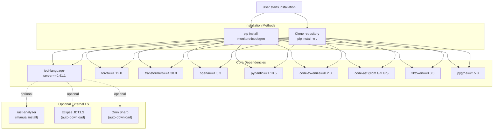
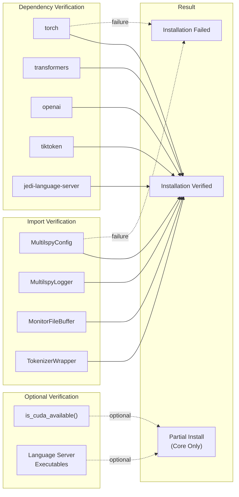

<!-- source: DeepWiki mcp.deepwiki.com · repo microsoft/monitors4codegen · page 2 Getting Started · fetched 2026-10-26 -->

# Getting Started

<details>
<summary>Relevant source files</summary>

The following files were used as context for generating this wiki page:

- [pyproject.toml](pyproject.toml)
- [requirements.txt](requirements.txt)
- [src/monitors4codegen/monitor_guided_decoding/monitors/switch_enum_monitor.py](src/monitors4codegen/monitor_guided_decoding/monitors/switch_enum_monitor.py)
- [tests/test_utils.py](tests/test_utils.py)

</details>


## Purpose and Scope

This page provides installation instructions, dependency setup, and basic configuration for the monitors4codegen repository. It covers:
- Installing the `monitors4codegen` package and its dependencies
- Setting up language servers for multilspy
- Verifying your installation
- Running basic examples to confirm functionality

For detailed information about the Monitor-Guided Decoding framework, see [Monitor-Guided Decoding](#3). For multilspy library usage, see [multilspy Library](#4).

---

## Prerequisites

### System Requirements

| Requirement | Specification |
|------------|---------------|
| **Python Version** | ≥ 3.7 |
| **Operating System** | Linux, macOS, Windows (with limitations for some language servers) |
| **Memory** | 8GB RAM minimum (16GB recommended for running LLMs) |
| **GPU** | Optional - CUDA-compatible GPU for HuggingFace model inference |

### Language Server Requirements

multilspy communicates with external language servers. Depending on which languages you plan to work with, you'll need:

| Language | Language Server | Installation |
|----------|----------------|--------------|
| **Python** | jedi-language-server | Automatically installed as dependency |
| **Java** | Eclipse JDT.LS | Downloaded automatically on first use |
| **Rust** | rust-analyzer | Must be installed separately ([rustup component add rust-analyzer](https://rust-analyzer.github.io/manual.html#installation)) |
| **C#** | OmniSharp | Downloaded automatically on first use |

**Note**: Java and C# language servers require JRE/JDK and .NET runtime respectively.

**Sources**: [pyproject.toml:27-37](), [tests/test_utils.py:7-12]()

---

## Installation

### Installation Diagram



**Sources**: [pyproject.toml:27-37](), [requirements.txt:1-18]()

### Method 1: Install from PyPI (Recommended for Users)

```bash
pip install monitors4codegen
```

This installs the package with all required dependencies specified in [pyproject.toml:27-37]().

### Method 2: Install from Source (Recommended for Contributors)

```bash
git clone https://github.com/microsoft/monitors4codegen.git
cd monitors4codegen
pip install -e .
```

The `-e` flag installs in editable mode, allowing you to modify the source code.

### Method 3: Install with requirements.txt (For Reproducibility)

```bash
git clone https://github.com/microsoft/monitors4codegen.git
cd monitors4codegen
pip install -r requirements.txt
```

This uses the exact dependency versions from [requirements.txt:1-18](), including CUDA-enabled PyTorch.

### CUDA Support

For GPU acceleration with HuggingFace models:

```bash
# Install PyTorch with CUDA 11.3 support
pip install torch==1.12.0+cu113 --extra-index-url https://download.pytorch.org/whl/cu113
```

To verify CUDA availability, the repository provides a utility function `is_cuda_available()` in [tests/test_utils.py:39-50]().

**Sources**: [pyproject.toml:1-48](), [requirements.txt:1-18](), [tests/test_utils.py:39-50]()

---

## Configuration

### multilspy Configuration Structure

multilspy uses configuration dictionaries that specify repository details and language server settings. The configuration is processed by the `MultilspyConfig` class.

#### Basic Configuration Template

```python
config_dict = {
    "code_language": "java",  # or "rust", "csharp", "python"
    "repo_url": "https://github.com/example/repo/",
    "repo_commit": "abc123...",  # Git commit hash
}
```

#### Configuration Parameters

| Parameter | Type | Description | Required |
|-----------|------|-------------|----------|
| `code_language` | str | Target language: `"java"`, `"rust"`, `"csharp"`, `"python"` | Yes |
| `repo_url` | str | Repository URL (must end with `/`) | Yes |
| `repo_commit` | str | Git commit hash for reproducibility | Yes |

The `MultilspyConfig.from_dict()` method validates and parses this configuration as shown in [tests/test_utils.py:19]().

### Test Context Creation Flow

```mermaid
sequenceDiagram
    participant User
    participant CreateContext["create_test_context()<br/>(test_utils.py)"]
    participant Config["MultilspyConfig"]
    participant Logger["MultilspyLogger"]
    participant FileUtils["FileUtils"]
    participant LocalFS["Local Filesystem<br/>(~/.multilspy)"]
    participant GitHub["GitHub Repository"]
    
    User->>CreateContext: "Pass config_dict"
    CreateContext->>Config: "from_dict(params)"
    Config-->>CreateContext: "config object"
    CreateContext->>Logger: "MultilspyLogger()"
    Logger-->>CreateContext: "logger instance"
    
    CreateContext->>LocalFS: "Create temp directory<br/>(~/.multilspy/<uuid>)"
    CreateContext->>FileUtils: "download_and_extract_archive()"
    FileUtils->>GitHub: "Download repo_url/archive/commit.zip"
    GitHub-->>FileUtils: "Repository archive"
    FileUtils->>LocalFS: "Extract to temp directory"
    
    CreateContext->>CreateContext: "Identify extracted directory"
    CreateContext->>User: "Yield MultilspyContext"
    
    Note over CreateContext,User: "User works with context"
    
    User->>CreateContext: "Exit context manager"
    CreateContext->>LocalFS: "shutil.rmtree(temp_directory)"
```

**Sources**: [tests/test_utils.py:14-37]()

### Working Directory Setup

multilspy automatically manages workspace directories:

1. **Home Directory**: `~/.multilspy/` - Base directory for all multilspy operations
2. **Temporary Extraction Directory**: `~/.multilspy/<uuid>/` - Unique directory per test context
3. **Source Directory**: `~/.multilspy/<uuid>/<repo-name>/` - Extracted repository contents

The `create_test_context()` function in [tests/test_utils.py:14-37]() handles this lifecycle:
- Creates temporary directory with unique UUID
- Downloads and extracts repository
- Yields `MultilspyContext` for use
- Cleans up on exit

**Sources**: [tests/test_utils.py:14-37]()

---

## Verification

### Quick Verification Script

Create a file `verify_installation.py`:

```python
import sys

# Check multilspy import
try:
    from monitors4codegen.multilspy.multilspy_config import MultilspyConfig
    from monitors4codegen.multilspy.multilspy_logger import MultilspyLogger
    print("✓ multilspy imports successful")
except ImportError as e:
    print(f"✗ multilspy import failed: {e}")
    sys.exit(1)

# Check MGD imports
try:
    from monitors4codegen.monitor_guided_decoding.monitor import MonitorFileBuffer
    from monitors4codegen.monitor_guided_decoding.tokenizer_wrapper import TokenizerWrapper
    print("✓ Monitor-Guided Decoding imports successful")
except ImportError as e:
    print(f"✗ MGD import failed: {e}")
    sys.exit(1)

# Check core dependencies
try:
    import torch
    import transformers
    import openai
    import tiktoken
    print("✓ Core dependencies available")
except ImportError as e:
    print(f"✗ Dependency missing: {e}")
    sys.exit(1)

# Check CUDA (optional)
try:
    from tests.test_utils import is_cuda_available
    if is_cuda_available():
        print("✓ CUDA available and functional")
    else:
        print("⚠ CUDA not available (optional)")
except Exception as e:
    print(f"⚠ Could not check CUDA: {e}")

print("\n✓ Installation verified successfully!")
```

Run with:
```bash
python verify_installation.py
```

### Component Verification Diagram



**Sources**: [tests/test_utils.py:1-12](), [tests/test_utils.py:39-50]()

---

## Basic Usage Examples

### Example 1: Using multilspy for Code Completions

This example demonstrates basic multilspy usage with a test context:

```python
from tests.test_utils import create_test_context

# Configuration for a sample Java repository
params = {
    "code_language": "java",
    "repo_url": "https://github.com/example/java-project/",
    "repo_commit": "main",
}

# Create context and query LSP
with create_test_context(params) as context:
    lsp = context.get_language_server()
    
    # Open a file
    file_path = "src/main/java/Example.java"
    with lsp.open_file(file_path):
        # Request completions at line 10, column 15
        completions = await lsp.request_completions(file_path, 10, 15)
        
        for completion in completions:
            print(f"Completion: {completion['completionText']}")
```

### Example 2: Testing Context Lifecycle

The test utilities demonstrate proper context management:

```python
from tests.test_utils import create_test_context
import os

params = {
    "code_language": "python",
    "repo_url": "https://github.com/example/python-project/",
    "repo_commit": "abc123def456",
}

# Context manager handles setup and teardown
with create_test_context(params) as context:
    # Temporary directory is created
    source_dir = context.source_directory_path
    assert os.path.exists(source_dir)
    
    # Work with the language server
    lsp = context.get_language_server()
    # ... perform operations ...

# Temporary directory is automatically cleaned up after exiting context
```

The `create_test_context()` function [tests/test_utils.py:14-37]() ensures:
- Repository is downloaded to `~/.multilspy/<uuid>/`
- Context is properly initialized with `MultilspyConfig` and `MultilspyLogger`
- Cleanup occurs even if exceptions are raised

**Sources**: [tests/test_utils.py:14-37]()

---

## Troubleshooting

### Common Issues

#### Issue: Import errors for monitors4codegen modules

**Solution**: Ensure you've installed from the repository root:
```bash
pip install -e .
```

#### Issue: "Language server not found" errors

**Possible causes**:
- **Java**: Eclipse JDT.LS requires Java Runtime Environment (JRE) 11 or later
- **Rust**: `rust-analyzer` must be installed separately: `rustup component add rust-analyzer`
- **C#**: OmniSharp requires .NET SDK

**Solution**: Install the required runtime for your target language.

#### Issue: CUDA not detected despite having GPU

**Diagnosis**: Run the verification script from [tests/test_utils.py:39-50]():
```python
from tests.test_utils import is_cuda_available
print(f"CUDA available: {is_cuda_available()}")
```

**Solution**: Reinstall PyTorch with CUDA support:
```bash
pip install torch==1.12.0+cu113 --extra-index-url https://download.pytorch.org/whl/cu113
```

#### Issue: Repository download fails in `create_test_context()`

**Common causes**:
- `repo_url` doesn't end with `/` (required by [tests/test_utils.py:27]())
- Invalid `repo_commit` hash
- Network connectivity issues

**Solution**: Verify URL format and commit hash exist in the repository.

---

## Next Steps

Once installation is complete and verified:

1. **Learn Monitor-Guided Decoding**: See [Monitor-Guided Decoding](#3) for the MGD framework
2. **Explore multilspy**: See [multilspy Library](#4) for LSP client usage
3. **Understand Monitors**: See [Monitor Implementations](#3.2) for available monitors
4. **Run Evaluations**: See [Datasets and Evaluation](#5) for running benchmarks
5. **Contribute**: See [Development Guide](#6) for contributing to the project

### Key Classes to Explore

| Class | Location | Purpose |
|-------|----------|---------|
| `MultilspyConfig` | `monitors4codegen.multilspy.multilspy_config` | LSP configuration |
| `MultilspyLogger` | `monitors4codegen.multilspy.multilspy_logger` | Logging for multilspy |
| `MonitorFileBuffer` | `monitors4codegen.monitor_guided_decoding.monitor` | File state management for monitors |
| `TokenizerWrapper` | `monitors4codegen.monitor_guided_decoding.tokenizer_wrapper` | Tokenizer abstraction |
| `MGDLogitsProcessor` | `monitors4codegen.monitor_guided_decoding.hf_gen` | HuggingFace integration |

**Sources**: [tests/test_utils.py:7-12](), [src/monitors4codegen/monitor_guided_decoding/monitors/switch_enum_monitor.py:6-9]()

---

## Summary

You have now:
- ✓ Installed monitors4codegen and dependencies
- ✓ Understood the configuration structure (`MultilspyConfig`)
- ✓ Learned about the test context lifecycle (`create_test_context()`)
- ✓ Verified the installation
- ✓ Seen basic usage patterns

The repository is ready for use. Proceed to [Monitor-Guided Decoding](#3) to learn how to apply monitors during code generation, or [multilspy Library](#4) to use the LSP client independently.

---

