# Page: Overview

# Overview

<details>
<summary>Relevant source files</summary>

The following files were used as context for generating this wiki page:

- [README.md](README.md)
- [pyproject.toml](pyproject.toml)
- [tests/monitor_guided_decoding/test_typestate_monitor_rust.py](tests/monitor_guided_decoding/test_typestate_monitor_rust.py)

</details>


This page introduces the monitors4codegen repository, explaining its purpose, core components, and architecture. The repository provides a framework for **Monitor-Guided Decoding (MGD)**, which uses static analysis to constrain language model code generation, and **multilspy**, a cross-platform library for interacting with Language Server Protocol (LSP) servers.

For details on installation and environment setup, see [Getting Started](#2). For in-depth explanations of MGD concepts and monitor implementations, see [Monitor-Guided Decoding](#3) and its subsections. For multilspy usage and API documentation, see [multilspy Library](#4).

## Purpose and Scope

The monitors4codegen repository serves three primary purposes:

1. **Monitor-Guided Decoding Framework**: Provides a mechanism to constrain code generation by language models using static analysis feedback from language servers
2. **multilspy Library**: Offers a unified, language-agnostic interface for querying language servers that implement the Language Server Protocol
3. **Research Artifact**: Includes datasets (PragmaticCode and DotPrompts), evaluation scripts, and experimental results demonstrating MGD's effectiveness

The repository supports code generation for Java, Rust, C#, and Python, and integrates with both HuggingFace transformer models and OpenAI API models.

**Sources**: [README.md:1-14]()

## Core Components

### Monitor-Guided Decoding (MGD)

Monitor-Guided Decoding is a framework that constrains language model token generation to ensure generated code satisfies specific semantic properties. Instead of relying solely on the language model's learned patterns, MGD queries language servers in real-time to determine what tokens are semantically valid at each generation step.

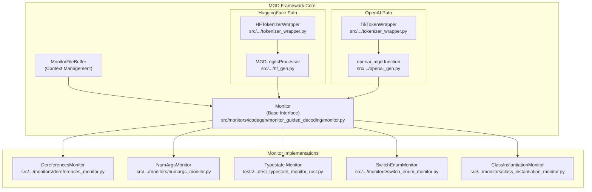

**Key Classes and Functions:**

| Component | Location | Purpose |
|-----------|----------|---------|
| `Monitor` | [src/monitors4codegen/monitor_guided_decoding/monitor.py]() | Base interface defining `maskgen`, `initialize`, and `update` methods |
| `MGDLogitsProcessor` | [src/monitors4codegen/monitor_guided_decoding/hf_gen.py]() | LogitsProcessor for HuggingFace models |
| `openai_mgd` | [src/monitors4codegen/monitor_guided_decoding/openai_gen.py]() | Generation function for OpenAI models |
| `MonitorFileBuffer` | [src/monitors4codegen/monitor_guided_decoding/monitor.py]() | Manages file buffer state during generation |

**Sources**: [README.md:4-22](), [README.md:178-187]()

### multilspy Library

multilspy is a language-agnostic client library that abstracts the complexity of setting up and communicating with language servers. It provides a unified interface for querying static analysis results across different programming languages.

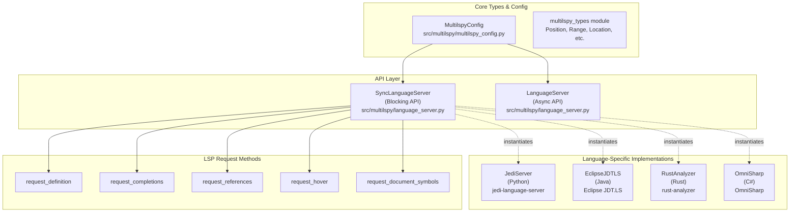

**Key LSP Request Methods:**

| Method | LSP Operation | Returns |
|--------|---------------|---------|
| `request_definition` | `textDocument/definition` | Symbol definition location |
| `request_references` | `textDocument/references` | All references to a symbol |
| `request_completions` | `textDocument/completion` | Valid completion items at cursor |
| `request_hover` | `textDocument/hover` | Hover information (e.g., signatures) |
| `request_document_symbols` | `textDocument/documentSymbol` | All symbols in a document |

**Sources**: [README.md:109-177](), [pyproject.toml:12-13]()

## Repository Structure

The repository is organized into distinct functional areas:

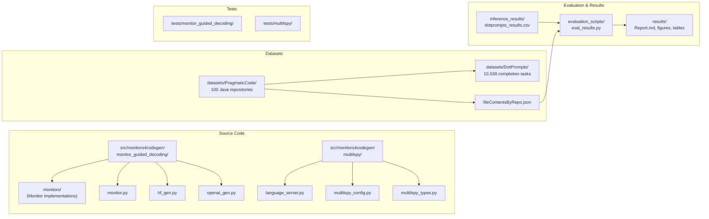

**Directory Structure:**

| Path | Contents |
|------|----------|
| `src/monitors4codegen/monitor_guided_decoding/` | MGD framework implementation |
| `src/monitors4codegen/monitor_guided_decoding/monitors/` | Individual monitor implementations |
| `src/monitors4codegen/multilspy/` | multilspy library source |
| `datasets/PragmaticCode/` | Real-world Java repositories dataset |
| `datasets/DotPrompts/` | Code completion benchmark dataset |
| `evaluation_scripts/` | Scripts for computing metrics |
| `inference_results/` | Generated code samples and results |
| `tests/` | Unit tests and integration tests |

**Sources**: [README.md:7-13]()

## How MGD Works: Token-Level Constraint Application

Monitor-Guided Decoding operates at each token generation step, querying language servers to determine valid continuations:

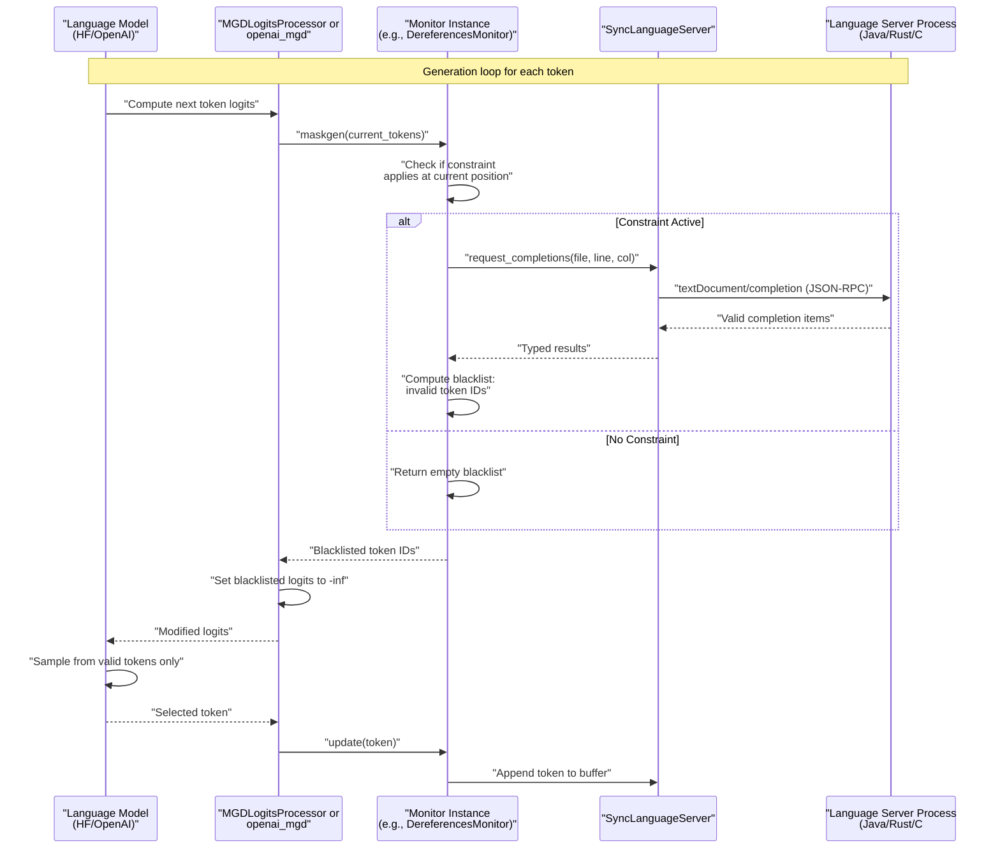

**Generation Flow:**

1. **Language model** computes logits for all vocabulary tokens
2. **MGDLogitsProcessor** or **openai_mgd** calls `Monitor.maskgen()`
3. **Monitor** determines if a constraint applies (e.g., after `.` for member access)
4. If constraint applies:
   - Monitor queries **SyncLanguageServer** with `request_completions()` or similar
   - Language server returns semantically valid completions
   - Monitor converts completions to token IDs, blacklists invalid tokens
5. **Processor** sets blacklisted token logits to `-∞` (HuggingFace) or uses `logit_bias` (OpenAI)
6. **Language model** samples only from valid tokens
7. Selected token is appended to buffer via `Monitor.update()`

**Sources**: [README.md:16-22](), [tests/monitor_guided_decoding/test_typestate_monitor_rust.py:60-110]()

## Supported Languages and Models

### Programming Languages

| Language | Language Server | Monitor Support |
|----------|----------------|-----------------|
| **Java** | Eclipse JDT.LS | DereferencesMonitor, NumArgsMonitor, ClassInstantiationMonitor |
| **Rust** | rust-analyzer | DereferencesMonitor, Typestate Monitor |
| **C#** | OmniSharp | SwitchEnumMonitor, NumArgsMonitor |
| **Python** | Jedi Language Server | DereferencesMonitor (potential) |

### Language Model Backends

| Backend | Integration Class/Function | API |
|---------|---------------------------|-----|
| **HuggingFace Transformers** | `MGDLogitsProcessor` | `LogitsProcessor` interface |
| **OpenAI API** | `openai_mgd` | Custom generation loop with `logit_bias` |

**Tested Models:**
- `bigcode/santacoder` (1.1B parameters)
- `Salesforce/codegen-350M-multi`, `codegen-2B-multi`, `codegen-6B-multi`
- `text-davinci-003` (OpenAI)

**Sources**: [README.md:114-115](), [README.md:86-89](), [README.md:182-187]()

## Key Concepts

### Monitors

A **Monitor** is a stateful object that enforces a specific code property during generation. Each monitor implements three core methods:

```python
class Monitor:
    def maskgen(self, tokens: List[int]) -> List[int]:
        """Returns list of token IDs to blacklist at current position"""
        
    def initialize(self) -> None:
        """Initialize monitor state before generation"""
        
    def update(self, generated_token: int) -> None:
        """Update monitor state after token is generated"""
```

**Monitor Types:**

| Monitor | Property Enforced | Languages |
|---------|------------------|-----------|
| `DereferencesMonitor` | Type-valid member access (`obj.member`) | Java, Rust |
| `NumArgsMonitor` | Correct function argument count | Java, C# |
| `ClassInstantiationMonitor` | Valid class after `new` keyword | Java |
| `SwitchEnumMonitor` | Valid enum constants in switch cases | C# |
| Typestate Monitor | Valid API method call ordering | Rust |

**Sources**: [README.md:180](), [README.md:188-205]()

### MonitorFileBuffer

`MonitorFileBuffer` manages the state of the file being generated, tracking cursor position and coordinating updates with the language server. It provides the context monitors need to query the LSP effectively.

**Sources**: [tests/monitor_guided_decoding/test_typestate_monitor_rust.py:50-59]()

### Joint Monitoring

Multiple monitors can operate simultaneously, with their blacklists combined. This allows enforcing multiple properties at once (e.g., type-valid dereferences AND correct argument counts).

**Sources**: [README.md:204-205]()

## Evaluation and Datasets

### Datasets

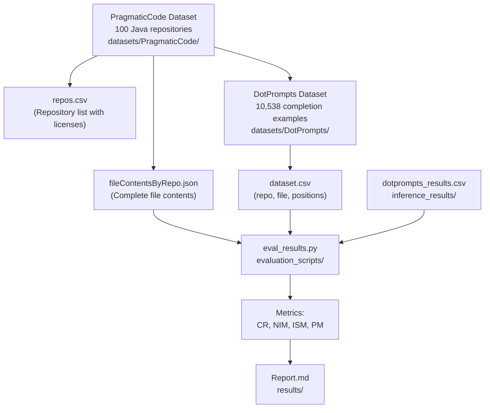

**Evaluation Metrics:**

| Metric | Full Name | Measures |
|--------|-----------|----------|
| **CR** | Compilation Rate | Percentage of generated code that compiles |
| **NIM** | Next-Identifier Match | Exact match of next token with ground truth |
| **ISM** | Identifier-Sequence Match | Ordered subsequence match of identifiers |
| **PM** | Prefix Match | Longest common prefix with ground truth |

**Sources**: [README.md:25-44](), [README.md:46-107]()

## Motivating Example

The README provides a concrete example demonstrating MGD's effectiveness:

**Scenario**: Complete code after `ServerNode.Builder.newServerNode()`
- **Without MGD**: Models hallucinate non-existent methods like `.host()` and `.port()`
- **With MGD**: DereferencesMonitor queries the language server for valid methods on `ServerNode.Builder` type, constrains generation to only valid methods
- **Result**: Generated code compiles and matches ground truth

According to the paper, MGD improves compilation rates by **19-25%** across model scales from 350M to 175B parameters.

**Sources**: [README.md:16-23]()

## Installation

To use monitors4codegen, install via pip:

```bash
pip install https://github.com/microsoft/multilspy/archive/main.zip
pip install -r requirements.txt
```

For detailed setup instructions including virtual environment creation and language server configuration, see [Getting Started](#2).

**Sources**: [README.md:47-64](), [README.md:125-128]()

## Next Steps

- **For installation and setup**: See [Getting Started](#2)
- **For MGD framework details**: See [Monitor-Guided Decoding](#3)
- **For individual monitor documentation**: See [Monitor Implementations](#3.2)
- **For multilspy usage**: See [multilspy Library](#4)
- **For dataset details and evaluation**: See [Datasets and Evaluation](#5)
- **For contributing**: See [Development Guide](#6)

---

# Page: Getting Started

# Getting Started

<details>
<summary>Relevant source files</summary>

The following files were used as context for generating this wiki page:

- [pyproject.toml](pyproject.toml)
- [requirements.txt](requirements.txt)
- [src/monitors4codegen/monitor_guided_decoding/monitors/switch_enum_monitor.py](src/monitors4codegen/monitor_guided_decoding/monitors/switch_enum_monitor.py)
- [tests/test_utils.py](tests/test_utils.py)

</details>


## Purpose and Scope

This page provides installation instructions, dependency setup, and basic configuration for the monitors4codegen repository. It covers:
- Installing the `monitors4codegen` package and its dependencies
- Setting up language servers for multilspy
- Verifying your installation
- Running basic examples to confirm functionality

For detailed information about the Monitor-Guided Decoding framework, see [Monitor-Guided Decoding](#3). For multilspy library usage, see [multilspy Library](#4).

---

## Prerequisites

### System Requirements

| Requirement | Specification |
|------------|---------------|
| **Python Version** | ≥ 3.7 |
| **Operating System** | Linux, macOS, Windows (with limitations for some language servers) |
| **Memory** | 8GB RAM minimum (16GB recommended for running LLMs) |
| **GPU** | Optional - CUDA-compatible GPU for HuggingFace model inference |

### Language Server Requirements

multilspy communicates with external language servers. Depending on which languages you plan to work with, you'll need:

| Language | Language Server | Installation |
|----------|----------------|--------------|
| **Python** | jedi-language-server | Automatically installed as dependency |
| **Java** | Eclipse JDT.LS | Downloaded automatically on first use |
| **Rust** | rust-analyzer | Must be installed separately ([rustup component add rust-analyzer](https://rust-analyzer.github.io/manual.html#installation)) |
| **C#** | OmniSharp | Downloaded automatically on first use |

**Note**: Java and C# language servers require JRE/JDK and .NET runtime respectively.

**Sources**: [pyproject.toml:27-37](), [tests/test_utils.py:7-12]()

---

## Installation

### Installation Diagram

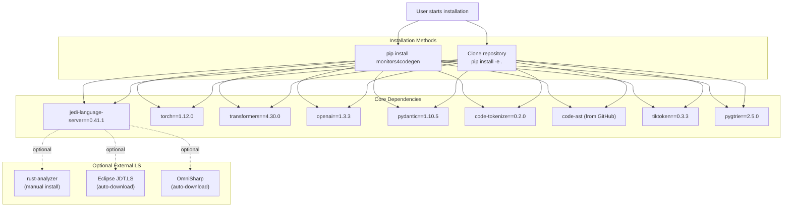

**Sources**: [pyproject.toml:27-37](), [requirements.txt:1-18]()

### Method 1: Install from PyPI (Recommended for Users)

```bash
pip install monitors4codegen
```

This installs the package with all required dependencies specified in [pyproject.toml:27-37]().

### Method 2: Install from Source (Recommended for Contributors)

```bash
git clone https://github.com/microsoft/monitors4codegen.git
cd monitors4codegen
pip install -e .
```

The `-e` flag installs in editable mode, allowing you to modify the source code.

### Method 3: Install with requirements.txt (For Reproducibility)

```bash
git clone https://github.com/microsoft/monitors4codegen.git
cd monitors4codegen
pip install -r requirements.txt
```

This uses the exact dependency versions from [requirements.txt:1-18](), including CUDA-enabled PyTorch.

### CUDA Support

For GPU acceleration with HuggingFace models:

```bash
# Install PyTorch with CUDA 11.3 support
pip install torch==1.12.0+cu113 --extra-index-url https://download.pytorch.org/whl/cu113
```

To verify CUDA availability, the repository provides a utility function `is_cuda_available()` in [tests/test_utils.py:39-50]().

**Sources**: [pyproject.toml:1-48](), [requirements.txt:1-18](), [tests/test_utils.py:39-50]()

---

## Configuration

### multilspy Configuration Structure

multilspy uses configuration dictionaries that specify repository details and language server settings. The configuration is processed by the `MultilspyConfig` class.

#### Basic Configuration Template

```python
config_dict = {
    "code_language": "java",  # or "rust", "csharp", "python"
    "repo_url": "https://github.com/example/repo/",
    "repo_commit": "abc123...",  # Git commit hash
}
```

#### Configuration Parameters

| Parameter | Type | Description | Required |
|-----------|------|-------------|----------|
| `code_language` | str | Target language: `"java"`, `"rust"`, `"csharp"`, `"python"` | Yes |
| `repo_url` | str | Repository URL (must end with `/`) | Yes |
| `repo_commit` | str | Git commit hash for reproducibility | Yes |

The `MultilspyConfig.from_dict()` method validates and parses this configuration as shown in [tests/test_utils.py:19]().

### Test Context Creation Flow

```mermaid
sequenceDiagram
    participant User
    participant CreateContext["create_test_context()<br/>(test_utils.py)"]
    participant Config["MultilspyConfig"]
    participant Logger["MultilspyLogger"]
    participant FileUtils["FileUtils"]
    participant LocalFS["Local Filesystem<br/>(~/.multilspy)"]
    participant GitHub["GitHub Repository"]
    
    User->>CreateContext: "Pass config_dict"
    CreateContext->>Config: "from_dict(params)"
    Config-->>CreateContext: "config object"
    CreateContext->>Logger: "MultilspyLogger()"
    Logger-->>CreateContext: "logger instance"
    
    CreateContext->>LocalFS: "Create temp directory<br/>(~/.multilspy/<uuid>)"
    CreateContext->>FileUtils: "download_and_extract_archive()"
    FileUtils->>GitHub: "Download repo_url/archive/commit.zip"
    GitHub-->>FileUtils: "Repository archive"
    FileUtils->>LocalFS: "Extract to temp directory"
    
    CreateContext->>CreateContext: "Identify extracted directory"
    CreateContext->>User: "Yield MultilspyContext"
    
    Note over CreateContext,User: "User works with context"
    
    User->>CreateContext: "Exit context manager"
    CreateContext->>LocalFS: "shutil.rmtree(temp_directory)"
```

**Sources**: [tests/test_utils.py:14-37]()

### Working Directory Setup

multilspy automatically manages workspace directories:

1. **Home Directory**: `~/.multilspy/` - Base directory for all multilspy operations
2. **Temporary Extraction Directory**: `~/.multilspy/<uuid>/` - Unique directory per test context
3. **Source Directory**: `~/.multilspy/<uuid>/<repo-name>/` - Extracted repository contents

The `create_test_context()` function in [tests/test_utils.py:14-37]() handles this lifecycle:
- Creates temporary directory with unique UUID
- Downloads and extracts repository
- Yields `MultilspyContext` for use
- Cleans up on exit

**Sources**: [tests/test_utils.py:14-37]()

---

## Verification

### Quick Verification Script

Create a file `verify_installation.py`:

```python
import sys

# Check multilspy import
try:
    from monitors4codegen.multilspy.multilspy_config import MultilspyConfig
    from monitors4codegen.multilspy.multilspy_logger import MultilspyLogger
    print("✓ multilspy imports successful")
except ImportError as e:
    print(f"✗ multilspy import failed: {e}")
    sys.exit(1)

# Check MGD imports
try:
    from monitors4codegen.monitor_guided_decoding.monitor import MonitorFileBuffer
    from monitors4codegen.monitor_guided_decoding.tokenizer_wrapper import TokenizerWrapper
    print("✓ Monitor-Guided Decoding imports successful")
except ImportError as e:
    print(f"✗ MGD import failed: {e}")
    sys.exit(1)

# Check core dependencies
try:
    import torch
    import transformers
    import openai
    import tiktoken
    print("✓ Core dependencies available")
except ImportError as e:
    print(f"✗ Dependency missing: {e}")
    sys.exit(1)

# Check CUDA (optional)
try:
    from tests.test_utils import is_cuda_available
    if is_cuda_available():
        print("✓ CUDA available and functional")
    else:
        print("⚠ CUDA not available (optional)")
except Exception as e:
    print(f"⚠ Could not check CUDA: {e}")

print("\n✓ Installation verified successfully!")
```

Run with:
```bash
python verify_installation.py
```

### Component Verification Diagram

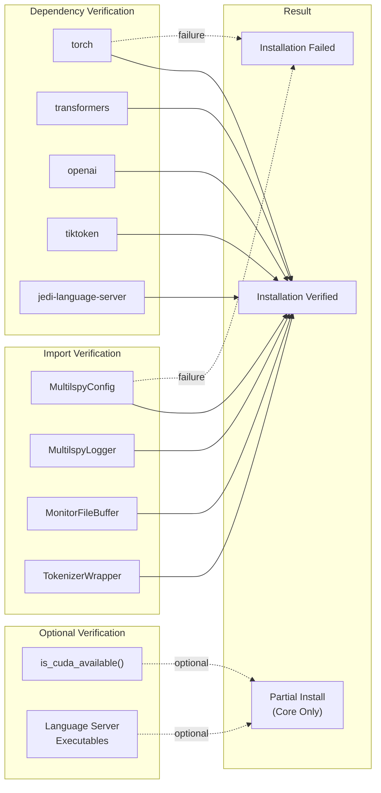

**Sources**: [tests/test_utils.py:1-12](), [tests/test_utils.py:39-50]()

---

## Basic Usage Examples

### Example 1: Using multilspy for Code Completions

This example demonstrates basic multilspy usage with a test context:

```python
from tests.test_utils import create_test_context

# Configuration for a sample Java repository
params = {
    "code_language": "java",
    "repo_url": "https://github.com/example/java-project/",
    "repo_commit": "main",
}

# Create context and query LSP
with create_test_context(params) as context:
    lsp = context.get_language_server()
    
    # Open a file
    file_path = "src/main/java/Example.java"
    with lsp.open_file(file_path):
        # Request completions at line 10, column 15
        completions = await lsp.request_completions(file_path, 10, 15)
        
        for completion in completions:
            print(f"Completion: {completion['completionText']}")
```

### Example 2: Testing Context Lifecycle

The test utilities demonstrate proper context management:

```python
from tests.test_utils import create_test_context
import os

params = {
    "code_language": "python",
    "repo_url": "https://github.com/example/python-project/",
    "repo_commit": "abc123def456",
}

# Context manager handles setup and teardown
with create_test_context(params) as context:
    # Temporary directory is created
    source_dir = context.source_directory_path
    assert os.path.exists(source_dir)
    
    # Work with the language server
    lsp = context.get_language_server()
    # ... perform operations ...

# Temporary directory is automatically cleaned up after exiting context
```

The `create_test_context()` function [tests/test_utils.py:14-37]() ensures:
- Repository is downloaded to `~/.multilspy/<uuid>/`
- Context is properly initialized with `MultilspyConfig` and `MultilspyLogger`
- Cleanup occurs even if exceptions are raised

**Sources**: [tests/test_utils.py:14-37]()

---

## Troubleshooting

### Common Issues

#### Issue: Import errors for monitors4codegen modules

**Solution**: Ensure you've installed from the repository root:
```bash
pip install -e .
```

#### Issue: "Language server not found" errors

**Possible causes**:
- **Java**: Eclipse JDT.LS requires Java Runtime Environment (JRE) 11 or later
- **Rust**: `rust-analyzer` must be installed separately: `rustup component add rust-analyzer`
- **C#**: OmniSharp requires .NET SDK

**Solution**: Install the required runtime for your target language.

#### Issue: CUDA not detected despite having GPU

**Diagnosis**: Run the verification script from [tests/test_utils.py:39-50]():
```python
from tests.test_utils import is_cuda_available
print(f"CUDA available: {is_cuda_available()}")
```

**Solution**: Reinstall PyTorch with CUDA support:
```bash
pip install torch==1.12.0+cu113 --extra-index-url https://download.pytorch.org/whl/cu113
```

#### Issue: Repository download fails in `create_test_context()`

**Common causes**:
- `repo_url` doesn't end with `/` (required by [tests/test_utils.py:27]())
- Invalid `repo_commit` hash
- Network connectivity issues

**Solution**: Verify URL format and commit hash exist in the repository.

---

## Next Steps

Once installation is complete and verified:

1. **Learn Monitor-Guided Decoding**: See [Monitor-Guided Decoding](#3) for the MGD framework
2. **Explore multilspy**: See [multilspy Library](#4) for LSP client usage
3. **Understand Monitors**: See [Monitor Implementations](#3.2) for available monitors
4. **Run Evaluations**: See [Datasets and Evaluation](#5) for running benchmarks
5. **Contribute**: See [Development Guide](#6) for contributing to the project

### Key Classes to Explore

| Class | Location | Purpose |
|-------|----------|---------|
| `MultilspyConfig` | `monitors4codegen.multilspy.multilspy_config` | LSP configuration |
| `MultilspyLogger` | `monitors4codegen.multilspy.multilspy_logger` | Logging for multilspy |
| `MonitorFileBuffer` | `monitors4codegen.monitor_guided_decoding.monitor` | File state management for monitors |
| `TokenizerWrapper` | `monitors4codegen.monitor_guided_decoding.tokenizer_wrapper` | Tokenizer abstraction |
| `MGDLogitsProcessor` | `monitors4codegen.monitor_guided_decoding.hf_gen` | HuggingFace integration |

**Sources**: [tests/test_utils.py:7-12](), [src/monitors4codegen/monitor_guided_decoding/monitors/switch_enum_monitor.py:6-9]()

---

## Summary

You have now:
- ✓ Installed monitors4codegen and dependencies
- ✓ Understood the configuration structure (`MultilspyConfig`)
- ✓ Learned about the test context lifecycle (`create_test_context()`)
- ✓ Verified the installation
- ✓ Seen basic usage patterns

The repository is ready for use. Proceed to [Monitor-Guided Decoding](#3) to learn how to apply monitors during code generation, or [multilspy Library](#4) to use the LSP client independently.

---

# Page: Monitor-Guided Decoding

# Monitor-Guided Decoding

<details>
<summary>Relevant source files</summary>

The following files were used as context for generating this wiki page:

- [README.md](README.md)
- [src/monitors4codegen/monitor_guided_decoding/hf_gen.py](src/monitors4codegen/monitor_guided_decoding/hf_gen.py)
- [tests/monitor_guided_decoding/test_typestate_monitor_rust.py](tests/monitor_guided_decoding/test_typestate_monitor_rust.py)

</details>


## Purpose and Scope

This page explains the Monitor-Guided Decoding (MGD) framework, which constrains code generation from Large Language Models (LLMs) using static analysis to ensure syntactic and semantic correctness. MGD queries Language Server Protocol (LSP) servers in real-time during token generation to restrict the model's output vocabulary to only valid completions at each cursor position.

This page covers the MGD framework architecture, the monitor interface, and integration patterns with different LLM backends. For specific monitor implementations and their constraints, see [Monitor Implementations](#3.2). For the multilspy library that provides LSP client functionality, see [multilspy Library](#4). For datasets and evaluation metrics, see [Datasets and Evaluation](#5).

**Sources:** [README.md:1-23](), [README.md:178-206]()

## What is Monitor-Guided Decoding?

Monitor-Guided Decoding addresses the problem of LLMs hallucinating invalid code by constraining generation using static analysis. When an LLM lacks information about types, APIs, or repository context, it may generate syntactically incorrect code such as referencing non-existent methods or using incorrect argument counts. MGD solves this by:

1. **Real-time constraint checking**: For each token to be generated, monitors query the language server to determine what is semantically valid at the current cursor position
2. **Vocabulary restriction**: Invalid tokens are blacklisted by setting their logits to negative infinity, preventing the model from sampling them
3. **Language-agnostic approach**: By using the Language Server Protocol, MGD works across multiple programming languages (Java, Rust, C#, Python)

The paper reports that MGD improves compilation rates by 19-25% across models ranging from 350M to 175B parameters, without requiring any training or fine-tuning.

**Sources:** [README.md:16-22](), [README.md:178-187]()

## Framework Architecture

The following diagram shows the core components of the MGD framework and their relationships:

### MGD Component Architecture

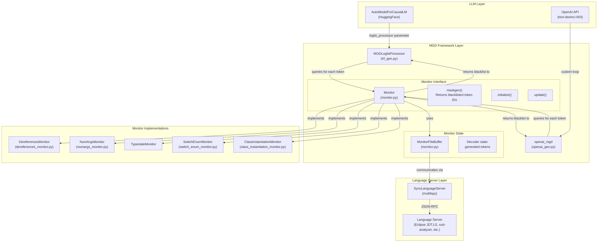

**Sources:** [src/monitors4codegen/monitor_guided_decoding/hf_gen.py:1-66](), [src/monitors4codegen/monitor_guided_decoding/monitor.py](), [README.md:178-206]()

### Key Components

| Component | Location | Purpose |
|-----------|----------|---------|
| `Monitor` | [src/monitors4codegen/monitor_guided_decoding/monitor.py]() | Abstract base class defining the monitor interface with `maskgen()`, `initialize()`, and `update()` methods |
| `MGDLogitsProcessor` | [src/monitors4codegen/monitor_guided_decoding/hf_gen.py:13-66]() | HuggingFace `LogitsProcessor` implementation that modifies token logits based on monitor blacklists |
| `openai_mgd` | [src/monitors4codegen/monitor_guided_decoding/openai_gen.py]() | Custom generation loop for OpenAI API that uses `logit_bias` parameter |
| `MonitorFileBuffer` | [src/monitors4codegen/monitor_guided_decoding/monitor.py]() | Manages file state in the language server, tracking cursor position and text edits |
| Monitor Implementations | [src/monitors4codegen/monitor_guided_decoding/monitors/]() | Concrete monitor classes enforcing specific properties (dereferences, argument counts, etc.) |

**Sources:** [src/monitors4codegen/monitor_guided_decoding/hf_gen.py:1-66](), [README.md:178-206]()

## Token-by-Token Generation Flow

The following sequence diagram illustrates how MGD constrains token generation through real-time LSP queries:

### MGD Token Generation Process

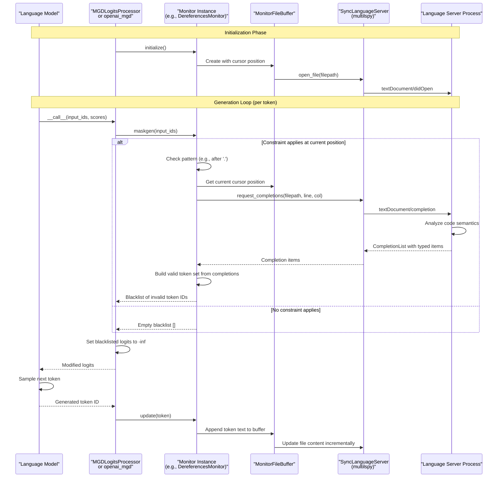

**Sources:** [src/monitors4codegen/monitor_guided_decoding/hf_gen.py:30-65](), [tests/monitor_guided_decoding/test_typestate_monitor_rust.py:25-110]()

### Generation Flow Details

1. **Initialization**: The monitor is instantiated with a `MonitorFileBuffer` that opens the file in the language server and positions the cursor at the generation point [tests/monitor_guided_decoding/test_typestate_monitor_rust.py:50-61]()

2. **Token Scoring**: For each generation step, the LLM backend calls the processor with:
   - `input_ids`: All tokens generated so far (including prompt)
   - `scores`: Logits for the next token across the vocabulary
   
   [src/monitors4codegen/monitor_guided_decoding/hf_gen.py:44-49]()

3. **Constraint Checking**: The processor invokes `maskgen()` on each monitor, which:
   - Examines the current decoder state to determine if a constraint applies
   - If applicable, queries the language server for valid completions
   - Converts valid completions to token IDs using the tokenizer
   - Returns blacklisted (invalid) token IDs
   
   [src/monitors4codegen/monitor_guided_decoding/hf_gen.py:30-42]()

4. **Logit Modification**: Blacklisted token logits are set to negative infinity:
   ```python
   output_scores: torch.FloatTensor = torch.where(
       torch.tensor([True if i in blacklisted_ids else False for i in range(scores.shape[0])]),
       float("-inf") * torch.ones(scores.shape[0]),
       scores
   )
   ```
   [src/monitors4codegen/monitor_guided_decoding/hf_gen.py:37-41]()

5. **State Update**: After token selection, `update()` is called to append the token to the file buffer, keeping the language server's view synchronized [src/monitors4codegen/monitor_guided_decoding/hf_gen.py:36]()

**Sources:** [src/monitors4codegen/monitor_guided_decoding/hf_gen.py:13-66]()

## Monitor Interface and Lifecycle

### Monitor Base Class

The `Monitor` abstract class defines three key methods that all monitor implementations must provide:

```
Monitor Interface Methods:
├── initialize() → None
│   └── Called once before generation begins
│       └── Sets up initial state and LSP connections
│
├── maskgen(input_ids: List[int]) → List[int]
│   └── Called for each token generation
│       ├── Determines if constraint applies at current position
│       ├── Queries LSP if constraint is active
│       └── Returns list of blacklisted token IDs
│
└── update(input_ids: List[int]) → None
    └── Called after each token is generated
        └── Updates internal state and file buffer
```

**Sources:** [src/monitors4codegen/monitor_guided_decoding/monitor.py](), [README.md:180]()

### MonitorFileBuffer State Management

The `MonitorFileBuffer` class manages the synchronized state between the decoder and the language server:

| Property | Type | Purpose |
|----------|------|---------|
| `lsp` | `LanguageServer` | Reference to language server instance |
| `filepath` | `str` | Relative path to file being edited |
| `start_line_col` | `Tuple[int, int]` | Starting cursor position (line, column) |
| `end_line_col` | `Tuple[int, int]` | Ending cursor position for text deletion |
| `code_language` | `Language` | Programming language (Java, Rust, C#, Python) |
| `content_after` | `str` | Text after cursor (for FIM/infilling scenarios) |

The buffer tracks the current cursor position as tokens are generated, ensuring LSP queries are made at the correct location in the file.

**Sources:** [tests/monitor_guided_decoding/test_typestate_monitor_rust.py:50]()

### Tokenizer Wrapper Integration

Monitors use tokenizer wrappers to convert between string representations and token IDs:

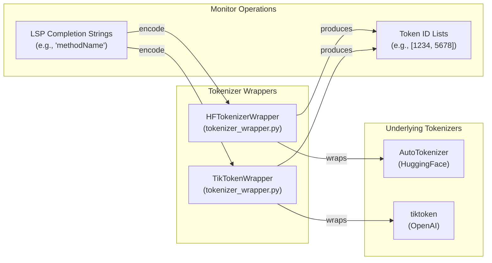

Monitors receive completion strings from the LSP (e.g., method names, class names) and use the wrapper to encode them into token sequences. The first token ID of each valid completion is added to the allowlist, and all other token IDs are blacklisted.

**Sources:** [tests/monitor_guided_decoding/test_typestate_monitor_rust.py:60]()

## Multiple Monitor Coordination

MGD supports using multiple monitors simultaneously to enforce multiple constraints. When multiple monitors are active:

1. Each monitor independently computes its blacklist via `maskgen()`
2. Blacklists are combined using set union
3. The combined blacklist is applied to the logits

This enables joint monitoring scenarios such as:
- Simultaneously enforcing type-valid dereferences AND correct argument counts
- Combining structural constraints (syntax) with behavioral constraints (API usage patterns)

Example from tests:
```python
monitors = [
    DereferencesMonitor(tokenizer_wrapper, filebuffer1),
    NumArgsMonitor(tokenizer_wrapper, filebuffer2)
]
mgd_logits_processor = MGDLogitsProcessor(monitors, loop)
```

**Sources:** [README.md:204-206](), [tests/monitor_guided_decoding/test_joint_monitors.py]()

## Integration with LLM Backends

MGD provides two integration patterns to accommodate different LLM API designs:

### Backend Integration Comparison

| Aspect | HuggingFace Integration | OpenAI Integration |
|--------|------------------------|-------------------|
| **Implementation** | `MGDLogitsProcessor` class | `openai_mgd` function |
| **Integration Point** | `LogitsProcessor` interface | Custom generation loop |
| **API Call Pattern** | Single `generate()` call | Token-by-token API requests |
| **Logit Modification** | Direct logit tensor manipulation | `logit_bias` parameter (max 300 tokens) |
| **Batch Support** | Yes (via `input_ids.shape[0]`) | No (sequential generation) |
| **Async Handling** | Uses asyncio event loop | Synchronous API calls |

**Sources:** [src/monitors4codegen/monitor_guided_decoding/hf_gen.py:13-66](), [README.md:182-187]()

### HuggingFace Integration Architecture

```mermaid
graph TB
    subgraph "HuggingFace Generation"
        generate["model.generate()"]
        logits_param["logits_processor<br/>parameter"]
    end
    
    subgraph "MGDLogitsProcessor Implementation"
        call["__call__(input_ids, scores)"]
        process["process_scores_for_single_input_id()"]
        async_gather["asyncio.gather()"]
        set_inf["Set blacklisted scores to -inf"]
    end
    
    subgraph "Monitor Queries"
        maskgen_calls["Multiple monitor.maskgen() calls"]
        lsp_queries["LSP completion requests"]
    end
    
    generate -->|"calls for each token"| logits_param
    logits_param -->|"invokes"| call
    call -->|"creates coroutines"| process
    process -->|"awaits in parallel"| async_gather
    async_gather -->|"executes"| maskgen_calls
    maskgen_calls -->|"may trigger"| lsp_queries
    lsp_queries -.->|"returns blacklists"| async_gather
    async_gather -->|"combines results"| set_inf
    set_inf -.->|"modified scores"| generate
```

The `MGDLogitsProcessor` implements the `LogitsProcessor` interface from HuggingFace transformers. Key implementation details:

- **Batch Processing**: Handles multiple sequences in parallel via `input_ids.shape[0]` [src/monitors4codegen/monitor_guided_decoding/hf_gen.py:51]()
- **Async Execution**: Uses `asyncio.gather()` to query all monitors concurrently [src/monitors4codegen/monitor_guided_decoding/hf_gen.py:59]()
- **Thread-Safe**: Uses `asyncio.run_coroutine_threadsafe()` to bridge sync and async contexts [src/monitors4codegen/monitor_guided_decoding/hf_gen.py:62]()

**Sources:** [src/monitors4codegen/monitor_guided_decoding/hf_gen.py:13-66]()

### OpenAI Integration Architecture

The `openai_mgd` function implements a custom generation loop because the OpenAI API has constraints:

1. **300 Token Limit**: The `logit_bias` parameter accepts at most 300 tokens
2. **Blacklist Size Management**: When monitor blacklists exceed 300 tokens, the function:
   - Inverts the blacklist to an allowlist (if smaller)
   - Uses the allowlist to bias allowed tokens positively
   - Implements retry logic if generation fails

3. **Token-by-Token Generation**: Makes separate API calls for each token, updating monitor state between calls

**Sources:** [README.md:185-187]()

## Monitor Implementation Overview

MGD includes several monitor implementations targeting different code properties:

| Monitor | Target Property | Languages | LSP Queries Used |
|---------|----------------|-----------|------------------|
| `DereferencesMonitor` | Type-valid member access after `.` | Java, Rust | `textDocument/completion` |
| `NumArgsMonitor` | Correct function argument count | Java, C# | `textDocument/hover`, `textDocument/completion` |
| `SwitchEnumMonitor` | Valid enum members in switch cases | C# | `textDocument/completion` |
| `ClassInstantiationMonitor` | Valid class names after `new` | Java | `textDocument/documentSymbol` |
| Typestate Monitor | Valid method call ordering | Rust | `textDocument/completion` |

For detailed information about each monitor's implementation and usage, see [Monitor Implementations](#3.2).

**Sources:** [README.md:189-203]()

## Usage Examples

### Basic HuggingFace Example

```python
from monitors4codegen.monitor_guided_decoding.hf_gen import MGDLogitsProcessor
from monitors4codegen.monitor_guided_decoding.monitors.dereferences_monitor import DereferencesMonitor
from monitors4codegen.monitor_guided_decoding.monitor import MonitorFileBuffer
from transformers.generation.utils import LogitsProcessorList

# Initialize monitor with file buffer
filebuffer = MonitorFileBuffer(lsp, filepath, (line, col), (line, col), Language.JAVA, "")
monitor = DereferencesMonitor(tokenizer_wrapper, filebuffer)

# Create MGD logits processor
mgd_logits_processor = MGDLogitsProcessor([monitor], event_loop)
logits_processor = LogitsProcessorList([mgd_logits_processor])

# Generate with constraints
generated_code = model.generate(
    prompt_tokenized,
    do_sample=False,
    max_new_tokens=30,
    logits_processor=logits_processor
)
```

**Sources:** [tests/monitor_guided_decoding/test_typestate_monitor_rust.py:60-100]()

### Multi-Monitor Example

```python
# Create multiple monitors
monitor1 = DereferencesMonitor(tokenizer_wrapper, filebuffer1)
monitor2 = NumArgsMonitor(tokenizer_wrapper, filebuffer2)

# Combine monitors in processor
mgd_logits_processor = MGDLogitsProcessor([monitor1, monitor2], event_loop)

# All constraints enforced simultaneously
generated_code = model.generate(
    prompt_tokenized,
    logits_processor=LogitsProcessorList([mgd_logits_processor])
)
```

**Sources:** [README.md:204-206]()

## Performance and Effectiveness

According to the paper's evaluation on the DotPrompts dataset:

- **Compilation Rate Improvement**: 19-25% across model scales (350M-175B parameters)
- **No Training Required**: MGD is applied at inference time only
- **Model Agnostic**: Works with any autoregressive language model
- **Language Agnostic**: Supports any language with an LSP implementation

The improvement comes from preventing the model from generating tokens that would lead to compilation errors, steering generation toward semantically valid code paths.

**Sources:** [README.md:21-22]()

---

For detailed information about specific monitors and the constraints they enforce, continue to [Monitor Implementations](#3.2). For information about integrating MGD with HuggingFace models, see [HuggingFace Integration](#3.3.1). For OpenAI model integration, see [OpenAI Integration](#3.3.2).

---

# Page: Core Concepts

# Core Concepts

<details>
<summary>Relevant source files</summary>

The following files were used as context for generating this wiki page:

- [README.md](README.md)
- [tests/monitor_guided_decoding/test_dereferences_monitor_java.py](tests/monitor_guided_decoding/test_dereferences_monitor_java.py)
- [tests/monitor_guided_decoding/test_typestate_monitor_rust.py](tests/monitor_guided_decoding/test_typestate_monitor_rust.py)

</details>


This page explains the fundamental concepts underlying Monitor-Guided Decoding (MGD), including the monitor abstraction, decoder state management, token masking mechanisms, and the monitoring lifecycle. These concepts form the foundation for understanding how monitors constrain language model generation to ensure code correctness.

For specific monitor implementations and their usage, see [Monitor Implementations](#3.2). For integration details with HuggingFace or OpenAI models, see [LLM Backend Integrations](#3.3).

---

## Overview of Monitor-Guided Decoding

Monitor-Guided Decoding (MGD) is a framework that constrains language model token generation by applying semantic analysis at each decoding step. The core principle is **logit modification**: monitors query a language server to determine valid tokens at the current cursor position, then modify the model's output distribution to blacklist invalid tokens by setting their logits to negative infinity.

The framework operates in three layers:

| Layer | Components | Responsibility |
|-------|-----------|----------------|
| **Monitor Layer** | `Monitor` subclasses (e.g., `DereferencesMonitor`) | Define what properties to enforce and when |
| **Processor Layer** | `MGDLogitsProcessor` (HF) or `openai_mgd` function | Orchestrate monitors and modify logits |
| **Analysis Layer** | `SyncLanguageServer` via `multilspy` | Provide semantic information from LSP |

The key insight is that monitors operate **statefully**: they maintain a representation of the partially generated code and update it with each new token, enabling context-aware constraint enforcement.

**Sources:** [README.md:4-21](), Diagram 2 from high-level architecture

---

## The Monitor Interface

All monitors implement the `Monitor` interface, which defines three core methods that manage the monitoring lifecycle:

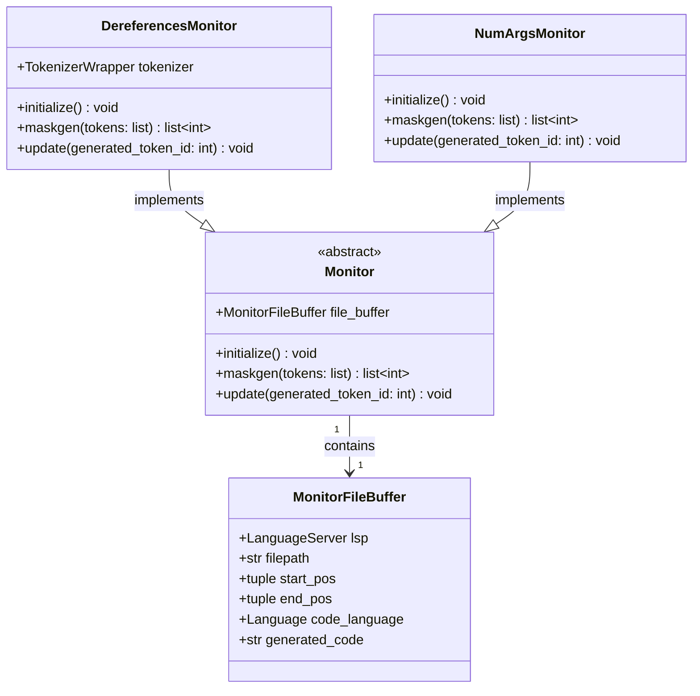

### Key Methods

#### `initialize()`
Called once when the monitor is created. Performs any initial LSP queries needed to set up monitoring. For example, `DereferencesMonitor` may pre-fetch type information for variables in scope.

#### `maskgen(tokens: list[int]) -> list[int]`
The core constraint method. Called for each token position during generation. Receives the list of tokens generated so far and returns a list of token IDs that should be blacklisted (masked out) at this position. This is where monitors query the language server to determine validity.

The method logic typically follows this pattern:
1. Check if a constraint applies at the current position (e.g., after a `.` for member access)
2. If applicable, query the language server for valid completions
3. Convert valid completions to valid token IDs
4. Return token IDs that are **not** in the valid set (the blacklist)

#### `update(generated_token_id: int)`
Called after each token is generated. Updates the monitor's internal state and the file buffer with the newly generated token. This ensures the language server's view of the code remains synchronized with generation progress.

**Sources:** [src/monitors4codegen/monitor_guided_decoding/monitor.py](), [README.md:180-181]()

---

## Decoder State and File Buffers

The `MonitorFileBuffer` class maintains the decoder state—the current partially generated code and its position within the file context. This is crucial because language servers require complete file context to provide accurate semantic analysis.

### MonitorFileBuffer Structure

```mermaid
graph TB
    subgraph "MonitorFileBuffer State"
        LSP["lsp: LanguageServer<br/>(from multilspy)"]
        FilePath["filepath: str<br/>(relative path in repo)"]
        StartPos["start_pos: tuple[int, int]<br/>(line, column where generation starts)"]
        EndPos["end_pos: tuple[int, int]<br/>(line, column - tracks current position)"]
        GenCode["generated_code: str<br/>(accumulates generated tokens)"]
        CodeLang["code_language: Language<br/>(Java, Rust, C#, Python)"]
    end
    
    subgraph "File View in Language Server"
        OriginalContent["Original file content<br/>up to start_pos"]
        GeneratedContent["Generated code<br/>(updated via update())"]
        Suffix["Optional suffix context<br/>(for FIM scenarios)"]
    end
    
    MonitorFileBuffer --> LSP
    MonitorFileBuffer --> FilePath
    MonitorFileBuffer --> StartPos
    MonitorFileBuffer --> EndPos
    MonitorFileBuffer --> GenCode
    MonitorFileBuffer --> CodeLang
    
    GenCode -.synced via LSP.-.> GeneratedContent
```

### State Management Flow

When a monitor is initialized:

1. **Context Setup**: The file buffer is created with the starting position (where generation begins) and ending position (initially the same as start)
2. **File Opening**: The language server opens the file and indexes the repository
3. **Text Deletion**: Any text between `start_pos` and original `end_pos` is deleted from the LSP's view to create the generation gap
4. **Incremental Update**: As tokens are generated, `update()` appends them to `generated_code` and updates the LSP buffer

Example instantiation from tests:
```python
filebuffer = MonitorFileBuffer(
    lsp.language_server,
    "src/main/java/com/example/File.java",
    (74, 17),  # start position: line 74, column 17
    (74, 17),  # end position: same initially
    Language.JAVA,
    ""         # generated_code: empty initially
)
```

The file buffer ensures that when monitors query the language server (e.g., via `request_completions`), the LSP sees the file with the current partial generation, enabling it to provide contextually accurate analysis.

**Sources:** [tests/monitor_guided_decoding/test_dereferences_monitor_java.py:50-53](), [tests/monitor_guided_decoding/test_dereferences_monitor_java.py:156-162]()

---

## Token Masking and Logits Modification

Token masking is the mechanism by which monitors constrain the language model's output. The process differs slightly between HuggingFace and OpenAI backends, but the concept is the same: invalid tokens are prevented from being selected.

### HuggingFace: MGDLogitsProcessor

The `MGDLogitsProcessor` class implements the `LogitsProcessor` interface, allowing it to be passed to the `model.generate()` method:

```mermaid
sequenceDiagram
    participant Gen as "model.generate()"
    participant Proc as "MGDLogitsProcessor"
    participant Monitors as "List[Monitor]"
    participant Loop as "asyncio event loop"
    
    Note over Gen,Loop: For each token position
    Gen->>Proc: __call__(input_ids, scores)
    Proc->>Proc: Extract current tokens
    
    loop For each monitor
        Proc->>Loop: run_coroutine_threadsafe
        Loop->>Monitors: await monitor.maskgen(tokens)
        Monitors->>Monitors: Query LSP if constraint applies
        Monitors-->>Loop: Return blacklist
        Loop-->>Proc: Blacklisted token IDs
    end
    
    Proc->>Proc: Combine all blacklists
    Proc->>Proc: Set scores[blacklisted] = -inf
    Proc-->>Gen: Modified scores tensor
    Gen->>Gen: Sample from distribution
    Gen->>Proc: update_monitors(new_token)
    
    loop For each monitor
        Proc->>Loop: run_coroutine_threadsafe
        Loop->>Monitors: await monitor.update(token)
        Monitors->>Monitors: Append to file buffer
        Monitors-->>Loop: Complete
        Loop-->>Proc: Complete
    end
```

#### Key Implementation Details

- **Asynchronous Execution**: Monitors query language servers asynchronously. `MGDLogitsProcessor` uses `run_coroutine_threadsafe` to execute async LSP calls from the synchronous `generate()` context
- **Blacklist Combination**: When multiple monitors are active, their blacklists are unioned—a token is masked if **any** monitor blacklists it
- **Infinity Masking**: Blacklisted tokens have their logits set to `-float('inf')`, ensuring they receive zero probability after softmax

Example usage:
```python
monitors = [DereferencesMonitor(tokenizer_wrapper, filebuffer)]
mgd_processor = MGDLogitsProcessor(monitors, lsp.language_server.server.loop)
logits_processor = LogitsProcessorList([mgd_processor])

generated = model.generate(
    input_ids,
    logits_processor=logits_processor,
    max_new_tokens=30
)
```

**Sources:** [src/monitors4codegen/monitor_guided_decoding/hf_gen.py](), [tests/monitor_guided_decoding/test_dereferences_monitor_java.py:63-91]()

### OpenAI: Logit Bias Approach

For OpenAI models, token masking uses the `logit_bias` parameter (limited to 300 tokens per API call):

| Aspect | HuggingFace | OpenAI |
|--------|-------------|--------|
| **Mechanism** | Direct logit modification (`-inf`) | `logit_bias` dictionary with bias `-100` |
| **Scope** | Can blacklist entire vocabulary | Limited to 300 tokens per request |
| **Implementation** | `MGDLogitsProcessor` class | `openai_mgd` function |
| **Token Loop** | Handled by `model.generate()` | Manual token-by-token loop |
| **Constraint** | No limit on blacklist size | Priority selection when >300 tokens |

**Sources:** [src/monitors4codegen/monitor_guided_decoding/openai_gen.py](), Diagram 6 from high-level architecture

---

## The Monitoring Lifecycle

The complete monitoring lifecycle spans initialization, token-by-token generation, and state updates. Here's how monitors operate during code generation:

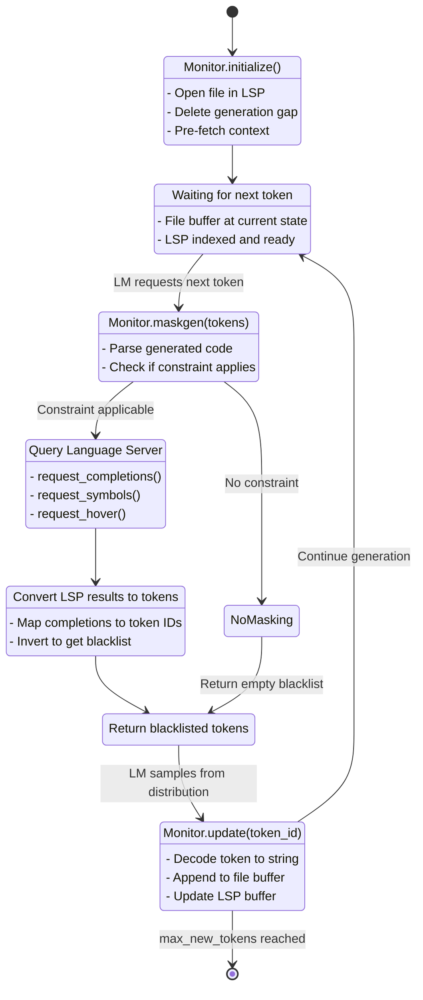

### Lifecycle Phases

#### 1. Initialization Phase
- Monitor instance created with `MonitorFileBuffer`
- `initialize()` called once
- Language server opens file and indexes repository
- Generation gap created by deleting text between start and end positions

#### 2. Generation Loop (per token)
Each token generation involves:

**Step A: Constraint Check**
- `maskgen(tokens)` receives all tokens generated so far
- Monitor parses the current code state to determine if constraint applies
- Example: `DereferencesMonitor` checks if the last non-whitespace character is `.`

**Step B: LSP Query (if applicable)**
- Monitor queries language server for valid options at cursor position
- Query type depends on constraint (completions, symbols, hover, etc.)
- LSP analyzes code semantically using type information and repository context

**Step C: Blacklist Computation**
- Convert LSP results (valid identifiers/symbols) to valid token IDs
- Compute blacklist as the complement: all tokens **not** in valid set
- Return blacklist to processor

**Step D: Logit Modification**
- Processor sets logits for blacklisted tokens to `-inf`
- Language model samples from modified distribution
- Only valid tokens can be selected

**Step E: State Update**
- `update(token_id)` called with generated token
- Token decoded to string and appended to `file_buffer.generated_code`
- LSP buffer updated to reflect new code state

#### 3. Termination
- Generation continues until `max_new_tokens` reached or `early_stopping` condition met
- Monitor state reflects final generated code
- Language server context can be used for validation or further analysis

**Sources:** [tests/monitor_guided_decoding/test_dereferences_monitor_java.py:25-98](), Diagram 2 from high-level architecture

---

## Integration with Language Servers

Monitors rely on `multilspy` to query language servers. The integration enables semantic analysis without language-specific code in monitors:

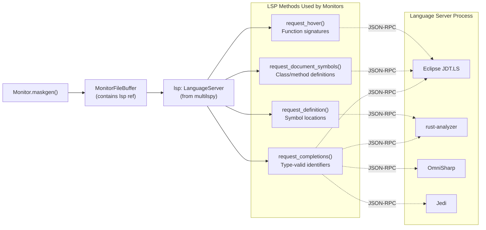

### Common Query Patterns

Different monitors use different LSP capabilities based on the property they enforce:

| Monitor Type | Primary LSP Method | Purpose |
|-------------|-------------------|---------|
| `DereferencesMonitor` | `request_completions()` | Get type-valid member names for `object.` |
| `NumArgsMonitor` | `request_hover()`, `request_completions()` | Get function signature for arity checking |
| `ClassInstantiationMonitor` | `request_document_symbols()` | Get list of classes for `new ClassName()` |
| `SwitchEnumMonitor` | `request_completions()` | Get enum members for switch cases |
| `TypestateMonitor` | `request_completions()` | Get valid methods in current typestate |

### Query Timing

Monitors query the language server **only when constraints apply**. For example:
- `DereferencesMonitor` queries only after detecting `.` in generated code
- `NumArgsMonitor` queries only when closing `)` is about to be generated
- Between constraint points, `maskgen()` returns empty blacklists (no masking)

This selective querying minimizes LSP overhead and generation latency.

**Sources:** [README.md:109-123](), [src/monitors4codegen/monitor_guided_decoding/monitors/dereferences_monitor.py](), Diagram 3 from high-level architecture

---

## Example: End-to-End Flow

To illustrate how these concepts work together, consider generating code to complete `ServerNode.Builder.`:

1. **Initialization**: `DereferencesMonitor` created with file buffer at position after `.`
2. **First Token**:
   - `maskgen([])` called (no tokens yet)
   - Detects `.` at cursor position
   - Queries `request_completions()` at that position
   - LSP returns valid methods: `newServerNode()`, `build()`, etc.
   - Converts to token IDs, returns blacklist of all other tokens
   - LM generates `new` (first token of `newServerNode`)
   - `update(token_id)` appends `new` to buffer
3. **Second Token**:
   - `maskgen(['new'])` called
   - Still after `.`, constraint applies
   - LSP completions filtered to those starting with `new`
   - LM generates `Server`
   - Buffer updated
4. **Subsequent Tokens**: Continue until method name complete
5. **After `()`**: Constraint no longer applies (not after `.`), normal LM sampling resumes

**Sources:** [README.md:16-23](), [tests/monitor_guided_decoding/test_dereferences_monitor_java.py:50-97]()

---

# Page: Monitor Implementations

# Monitor Implementations

<details>
<summary>Relevant source files</summary>

The following files were used as context for generating this wiki page:

- [README.md](README.md)
- [tests/monitor_guided_decoding/test_dereferences_monitor_java.py](tests/monitor_guided_decoding/test_dereferences_monitor_java.py)
- [tests/monitor_guided_decoding/test_typestate_monitor_rust.py](tests/monitor_guided_decoding/test_typestate_monitor_rust.py)

</details>


This page provides an overview of the monitor implementations available in the Monitor-Guided Decoding framework and the code properties they enforce. Each monitor constrains code generation to ensure specific correctness properties by querying language servers during the generation process.

For detailed information about individual monitors, see their dedicated pages: [DereferencesMonitor](#3.2.1), [NumArgsMonitor](#3.2.2), [SwitchEnumMonitor](#3.2.3), [ClassInstantiationMonitor](#3.2.4), and [Typestate Monitor](#3.2.5). For information about using multiple monitors simultaneously, see [Joint Monitoring](#3.2.6).

## Overview

A monitor in the MGD framework is a component that observes the code generation process token-by-token and constrains the language model's output to ensure specific correctness properties. Each monitor implements a common interface and uses Language Server Protocol queries to determine valid continuations at each generation step.

Monitors operate by:
1. Detecting when their constraint applies (e.g., after a `.` operator)
2. Querying the language server for valid options at the current position
3. Computing a blacklist of invalid tokens
4. Returning this blacklist to the MGD framework, which masks out invalid tokens by setting their logits to negative infinity

**Monitor Interface Architecture**

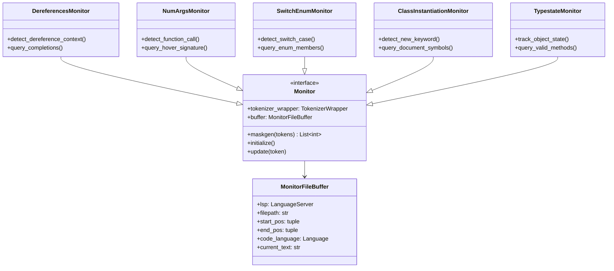

**Sources:** [src/monitors4codegen/monitor_guided_decoding/monitor.py](), [tests/monitor_guided_decoding/test_dereferences_monitor_java.py:1-20]()

## Monitor Interface

The base `Monitor` class defines the interface that all monitor implementations must follow. Located in [src/monitors4codegen/monitor_guided_decoding/monitor.py](), it provides three key methods:

| Method | Purpose |
|--------|---------|
| `maskgen(tokens: List[int])` | Returns a list of token IDs that should be blacklisted at the current generation step |
| `initialize()` | Performs any setup needed before generation begins |
| `update(token: int)` | Updates monitor state after a token has been generated |

The `MonitorFileBuffer` class maintains the current state of code generation, including the file path, position in the file, and accumulated generated text. It provides the context monitors need to query the language server.

**Sources:** [src/monitors4codegen/monitor_guided_decoding/monitor.py](), [tests/monitor_guided_decoding/test_dereferences_monitor_java.py:50-62]()

## Available Monitor Implementations

The framework provides five distinct monitor implementations, each enforcing different code properties:

### Monitor Categories

Monitors can be categorized into two types based on the properties they enforce:

**Structural Monitors** ensure syntactic correctness of specific code patterns:
- **DereferencesMonitor**: Ensures type-valid member access (e.g., `object.member`)
- **ClassInstantiationMonitor**: Ensures valid class names follow `new` keywords
- **SwitchEnumMonitor**: Ensures valid enum members in switch case statements

**Behavioral Monitors** enforce semantic properties related to API usage:
- **NumArgsMonitor**: Ensures correct number of arguments in function/method calls
- **Typestate Monitor**: Enforces valid method call ordering according to API contracts

### Monitor-LSP Query Mapping

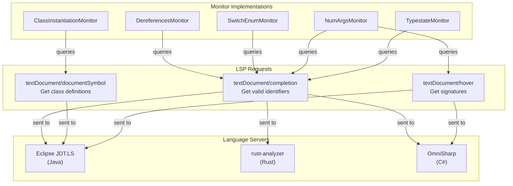

**Sources:** [README.md:188-202](), Diagram 4 from context

## Monitor Implementations Summary

| Monitor | File Location | Property Enforced | Primary LSP Query | Supported Languages |
|---------|--------------|-------------------|-------------------|---------------------|
| **DereferencesMonitor** | [monitors/dereferences_monitor.py]() | Type-valid identifier dereferencing | `textDocument/completion` | Java, Rust, Python (potential) |
| **NumArgsMonitor** | [monitors/numargs_monitor.py]() | Correct number of function arguments | `textDocument/hover`, `textDocument/completion` | Java, C# |
| **SwitchEnumMonitor** | [monitors/switch_enum_monitor.py]() | Valid enum members in switch cases | `textDocument/completion` | C# |
| **ClassInstantiationMonitor** | [monitors/class_instantiation_monitor.py]() | Valid class names after `new` | `textDocument/documentSymbol` | Java |
| **Typestate Monitor** | Tested in [test_typestate_monitor_rust.py]() | Valid method call ordering | `textDocument/completion` | Rust |

All monitor files are located under `src/monitors4codegen/monitor_guided_decoding/monitors/` unless otherwise specified.

**Sources:** [README.md:188-206](), [src/monitors4codegen/monitor_guided_decoding/monitors/dereferences_monitor.py](), [src/monitors4codegen/monitor_guided_decoding/monitors/numargs_monitor.py](), [src/monitors4codegen/monitor_guided_decoding/monitors/switch_enum_monitor.py](), [src/monitors4codegen/monitor_guided_decoding/monitors/class_instantiation_monitor.py]()

## Monitor Integration with MGD Pipeline

Monitors integrate into the MGD pipeline through either `MGDLogitsProcessor` (for HuggingFace models) or `openai_mgd` (for OpenAI models). The following diagram shows how monitors interact with the generation process:

**Token Generation Flow with Monitors**

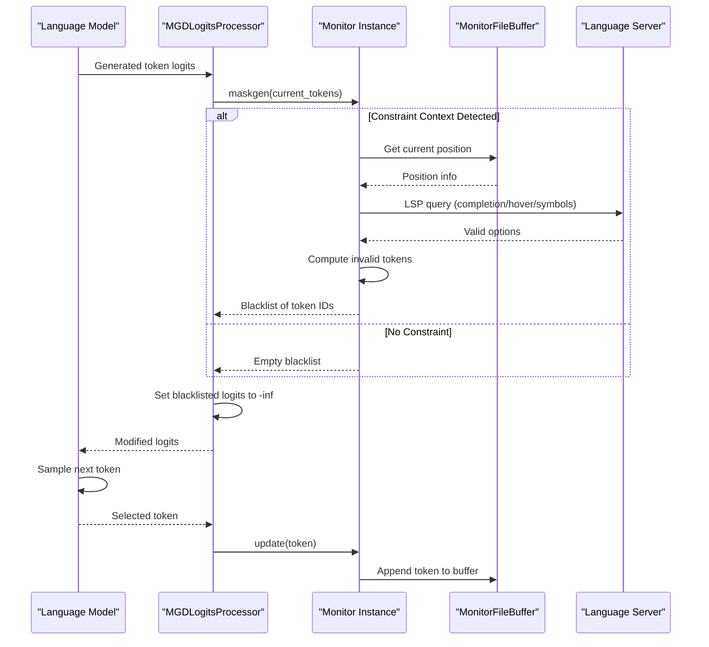

**Example Initialization and Usage**

The following pattern demonstrates how monitors are instantiated and used (from test examples):

```python
# Initialize file buffer with current position
filebuffer = MonitorFileBuffer(
    lsp.language_server,
    filepath,
    (74, 17),  # start position (line, column)
    (74, 17),  # end position
    code_language,
    ""
)

# Create monitor with tokenizer wrapper and buffer
monitor = DereferencesMonitor(
    HFTokenizerWrapper(tokenizer),
    filebuffer
)

# Create MGD logits processor with monitor list
mgd_logits_processor = MGDLogitsProcessor(
    [monitor],
    lsp.language_server.server.loop
)

# Use in generation
logits_processor = LogitsProcessorList([mgd_logits_processor])
generated_code = model.generate(
    prompt_tokenized,
    do_sample=False,
    max_new_tokens=30,
    logits_processor=logits_processor
)
```

**Sources:** [tests/monitor_guided_decoding/test_dereferences_monitor_java.py:50-97](), [src/monitors4codegen/monitor_guided_decoding/hf_gen.py]()

## Language Support Matrix

Different monitors have varying levels of support across programming languages:

| Language | DereferencesMonitor | NumArgsMonitor | SwitchEnumMonitor | ClassInstantiationMonitor | Typestate Monitor |
|----------|---------------------|----------------|-------------------|---------------------------|-------------------|
| **Java** | ✓ | ✓ | - | ✓ | - |
| **Rust** | ✓ | - | - | - | ✓ |
| **C#** | - | ✓ | ✓ | - | - |
| **Python** | Potential | - | - | - | - |

The language support is determined by:
1. Language-specific syntax patterns the monitor detects
2. Availability of required LSP capabilities in the language server
3. Implementation and testing status

**Test Coverage:**
- Java: [tests/monitor_guided_decoding/test_dereferences_monitor_java.py](), [tests/monitor_guided_decoding/test_numargs_monitor_java.py](), [tests/monitor_guided_decoding/test_classinstantiation_monitor_java.py]()
- Rust: [tests/monitor_guided_decoding/test_typestate_monitor_rust.py]()
- C#: [tests/monitor_guided_decoding/test_switchenum_monitor_csharp.py]()

**Sources:** [README.md:188-202](), Diagram 4 from context

## Monitor File Organization

All monitor implementations are organized in a consistent directory structure:

```
src/monitors4codegen/monitor_guided_decoding/
├── monitor.py                          # Base Monitor interface and MonitorFileBuffer
├── hf_gen.py                           # MGDLogitsProcessor for HuggingFace models
├── openai_gen.py                       # openai_mgd for OpenAI models
└── monitors/
    ├── dereferences_monitor.py         # Type-valid member access
    ├── numargs_monitor.py              # Correct argument count
    ├── switch_enum_monitor.py          # Valid enum in switch cases
    └── class_instantiation_monitor.py  # Valid class after 'new'
```

The typestate monitor implementation details are primarily documented through test examples rather than a standalone module file.

**Sources:** [README.md:178-206]()

## Multiple Monitors

Multiple monitors can be used simultaneously to enforce multiple constraints on the same generation task. When multiple monitors are active, their blacklists are combined (unioned) before being applied to the logits. This allows for joint enforcement of multiple properties.

For detailed information about using monitors together, see [Joint Monitoring](#3.2.6).

**Sources:** [README.md:204-205](), [tests/monitor_guided_decoding/test_joint_monitors.py]()

---

# Page: DereferencesMonitor

# DereferencesMonitor

<details>
<summary>Relevant source files</summary>

The following files were used as context for generating this wiki page:

- [src/monitors4codegen/monitor_guided_decoding/monitors/dereferences_monitor.py](src/monitors4codegen/monitor_guided_decoding/monitors/dereferences_monitor.py)
- [tests/monitor_guided_decoding/test_dereferences_monitor_java.py](tests/monitor_guided_decoding/test_dereferences_monitor_java.py)
- [tests/monitor_guided_decoding/test_dereferences_monitor_java_openai.py](tests/monitor_guided_decoding/test_dereferences_monitor_java_openai.py)

</details>


## Purpose and Scope

The `DereferencesMonitor` enforces type-valid identifier dereferencing during code generation, ensuring that when a language model generates code containing member access patterns (e.g., `object.member`), the generated member is semantically valid according to the type system. This monitor is particularly effective for languages with static typing such as Java, Rust, and potentially Python.

For information about other monitor types, see [Monitor Implementations](#3.2). For the broader Monitor-Guided Decoding framework, see [Monitor-Guided Decoding](#3).

---

## Overview

The `DereferencesMonitor` addresses a common problem in neural code generation: language models often generate syntactically plausible but semantically invalid member accesses. For example, given code like `serverNode.`, a model might generate `serverNode.invalidMethod()` when `invalidMethod` is not a member of the `serverNode` type.

The monitor intervenes at generation time by:
1. Detecting when a dot (`.`) character appears in the generated code
2. Querying the Language Server Protocol (LSP) to determine valid completions at that cursor position
3. Constraining the language model to only generate tokens that correspond to valid members

**Key Characteristics:**
- **Language Support**: Primarily Java (tested extensively), with potential for Rust and Python
- **LSP Queries**: Uses `textDocument/completion` requests
- **Constraint Scope**: Applies only after dot operators, minimal overhead otherwise
- **State-Based**: Uses a finite state machine to track when constraints should apply

Sources: [src/monitors4codegen/monitor_guided_decoding/monitors/dereferences_monitor.py:1-245]()

---

## Architecture

### State Machine

The `DereferencesMonitor` operates as a finite state machine with three states defined in the `DecoderStates` enum:

```mermaid
stateDiagram-v2
    [*] --> UnInitialized: Monitor created
    UnInitialized --> S0: initialize() called
    UnInitialized --> Constrained: initialize() + dot detected
    
    S0 --> S0: Generate token (no dot)
    S0 --> Constrained: Dot detected + valid completions found
    S0 --> S0: Dot detected + no completions
    
    Constrained --> Constrained: Generate valid token (no break char)
    Constrained --> S0: Breaking character detected
    
    note right of UnInitialized
        Initial state before
        first maskgen() call
    end note
    
    note right of S0
        Unconstrained generation.
        Monitor waits for dot character.
    end note
    
    note right of Constrained
        Active constraint.
        Only tokens matching
        legal_completions allowed.
    end note
```

**State Descriptions:**

| State | Description | Actions |
|-------|-------------|---------|
| `UnInitialized` | Monitor has been created but not yet invoked | None |
| `S0` | Unconstrained generation, monitoring for dot operators | Returns empty blacklist |
| `Constrained` | Active constraint after detecting a dot | Returns blacklist of invalid tokens |

Sources: [src/monitors4codegen/monitor_guided_decoding/monitors/dereferences_monitor.py:20-28](), [src/monitors4codegen/monitor_guided_decoding/monitors/dereferences_monitor.py:77-89]()

### Class Structure

```mermaid
classDiagram
    class Monitor {
        <<abstract>>
        +tokenizer: TokenizerWrapper
        +monitor_file_buffer: MonitorFileBuffer
        +responsible_for_file_buffer_state: bool
        +initialize(input_ids, input_text)*
        +maskgen(input_ids)* List[int]
        +update(generated_token)*
    }
    
    class DereferencesMonitor {
        +decoder_state: DecoderStates
        +all_break_chars: Set[str]
        +prompt_len: int
        +legal_completions: List[str]
        +__init__(tokenizer, monitor_file_buffer, responsible_for_file_buffer_state)
        +initialize(input_ids, input_text)
        +maskgen(input_ids) List[int]
        +pre()
        +a_phi() List[str]
        +update(generated_token)
        +find_all_break_chars(charset, language)$ Set[str]
    }
    
    class DecoderStates {
        <<enumeration>>
        UnInitialized
        S0
        Constrained
    }
    
    class MonitorFileBuffer {
        +lsp: SyncLanguageServer
        +file_path: str
        +current_lc: tuple
        +language: Language
        +gen_text: str
        +append_text(text)
    }
    
    class TokenizerWrapper {
        <<abstract>>
        +vocab_trie: Trie
        +all_token_ids: List[int]
        +tokenizer_char_set: Set[str]
        +decode(token_ids) str
    }
    
    Monitor <|-- DereferencesMonitor
    DereferencesMonitor --> DecoderStates
    DereferencesMonitor --> MonitorFileBuffer
    DereferencesMonitor --> TokenizerWrapper
```

Sources: [src/monitors4codegen/monitor_guided_decoding/monitors/dereferences_monitor.py:30-36](), [src/monitors4codegen/monitor_guided_decoding/monitors/dereferences_monitor.py:20-28]()

---

## Implementation Details

### Token Masking Algorithm

The core constraint mechanism is implemented in the `maskgen()` method, which is invoked for every token to be generated. The algorithm flow:

```mermaid
flowchart TD
    A["maskgen(input_ids) called"] --> B{"decoder_state == UnInitialized?"}
    B -->|Yes| C["initialize(input_ids, input_text)"]
    B -->|No| D["Extract new generated text"]
    C --> E["Call pre()"]
    D --> F["update(new_gen_text)"]
    
    F --> G{"decoder_state == S0?"}
    G -->|Yes| E
    G -->|No| H{"decoder_state == Constrained?"}
    
    E --> I{"Last char == '.'?"}
    I -->|No| J["decoder_state = S0"]
    I -->|Yes| K["completions = a_phi()"]
    K --> L{"len(completions) > 0?"}
    L -->|No| J
    L -->|Yes| M["decoder_state = Constrained<br/>legal_completions = completions"]
    
    J --> N["Return empty blacklist"]
    H -->|Yes| O["Compute possible_token_ids<br/>from legal_completions"]
    H -->|No| N
    O --> P["blacklisted_ids = all_tokens - possible_tokens"]
    P --> Q["Return blacklisted_ids"]
    M --> O
```

**Key Steps:**

1. **Initialization (first call only)**: Records prompt length and checks for initial constraint via `pre()`
2. **Update**: Processes newly generated text and updates internal state
3. **Pre-check**: Determines if a dot operator was just generated
4. **Constraint Application**: If in `Constrained` state, computes valid token set

Sources: [src/monitors4codegen/monitor_guided_decoding/monitors/dereferences_monitor.py:91-146]()

### LSP Integration via a_phi()

The `a_phi()` method performs static analysis to determine valid completions:

```mermaid
sequenceDiagram
    participant DM as DereferencesMonitor
    participant LSP as SyncLanguageServer
    participant LS as Language Server<br/>(e.g., Eclipse JDT.LS)
    
    DM->>DM: pre() detects dot character
    DM->>LSP: request_completions(file, line, col)
    LSP->>LS: textDocument/completion
    LS->>LS: Analyze type at cursor position
    LS-->>LSP: CompletionList (valid members)
    LSP-->>DM: legal_completions1
    
    DM->>DM: Check bracket balance
    alt Unbalanced brackets detected
        DM->>LSP: insert_text_at_position(closing_brackets)
        DM->>LSP: request_completions(file, line, col)
        LSP->>LS: textDocument/completion
        LS-->>LSP: CompletionList (with balanced code)
        LSP-->>DM: legal_completions2
        DM->>LSP: delete_text_between_positions()
    end
    
    DM->>DM: Merge completions: legal_completions1 + legal_completions2
    DM->>DM: Filter out keywords
    DM-->>DM: Return List[str] of valid identifiers
```

**Bracket Balancing Logic:**

The monitor implements sophisticated bracket balancing to handle incomplete code contexts. When the cursor position has unbalanced brackets (e.g., more opening than closing), the monitor:

1. Inserts temporary closing brackets
2. Re-queries the LSP for completions in the now-balanced context
3. Deletes the temporary brackets
4. Merges both completion sets

This ensures the LSP can properly analyze types even in syntactically incomplete code.

Sources: [src/monitors4codegen/monitor_guided_decoding/monitors/dereferences_monitor.py:148-221]()

### Breaking Characters

The monitor uses "breaking characters" to determine when a constrained identifier has ended:

```mermaid
graph LR
    subgraph "Tokenizer Vocabulary"
        V1["Token: 'abc'"]
        V2["Token: 'abc,'"]
        V3["Token: 'abc.'"]
        V4["Token: 'abcd'"]
    end
    
    subgraph "Breaking Character Detection"
        T1["Test: 'abc' + char"]
        T2["Tokenize result"]
        T3["If first token == 'abc'<br/>then char is breaking"]
    end
    
    subgraph "Breaking Characters (examples)"
        B1["','"]
        B2["'.'"]
        B3["'('"]
        B4["')'"]
        B5["';'"]
        B6["whitespace"]
    end
    
    V1 --> T1
    T1 --> T2
    T2 --> T3
    T3 --> B1
    T3 --> B2
    T3 --> B3
    T3 --> B4
    T3 --> B5
    T3 --> B6
```

The `find_all_break_chars()` static method identifies characters that, when appended to an identifier, cause it to be tokenized separately. This is language-dependent and tokenizer-dependent.

**Usage in Constraint:**

When in `Constrained` state, the monitor allows tokens that:
1. Are prefixes of valid completions
2. Match a valid completion followed by a breaking character (e.g., `method(` when `method` is valid)

Sources: [src/monitors4codegen/monitor_guided_decoding/monitors/dereferences_monitor.py:44-57](), [src/monitors4codegen/monitor_guided_decoding/monitors/dereferences_monitor.py:131-141]()

### Token Matching Strategy

```mermaid
flowchart TD
    A["For each legal_completion in legal_completions"] --> B["Check if vocab_trie has node for legal_completion"]
    B -->|Yes| C["Iterate tokens with legal_completion as prefix"]
    C --> D{"Does token contain<br/>breaking char after completion?"}
    D -->|Yes| E["Add token_id to possible_token_ids"]
    D -->|No| C
    
    B --> F["Iterate prefix tokens of legal_completion"]
    F --> G["Add token_id to possible_token_ids"]
    G --> F
    
    E --> H["Continue with next legal_completion"]
    G --> H
    H --> I["Compute blacklisted_ids = all_tokens - possible_tokens"]
```

The monitor uses a trie data structure (`vocab_trie`) to efficiently:
- Find all tokens that are prefixes of valid completions
- Find tokens that contain a valid completion followed by breaking characters

Sources: [src/monitors4codegen/monitor_guided_decoding/monitors/dereferences_monitor.py:129-142]()

---

## Usage Examples

### HuggingFace Models Integration

Example from test suite demonstrating usage with SantaCoder model:

```mermaid
sequenceDiagram
    participant Test as test_dereferences_monitor_java_huggingface_models
    participant LSP as SyncLanguageServer
    participant FB as MonitorFileBuffer
    participant DM as DereferencesMonitor
    participant Proc as MGDLogitsProcessor
    participant Model as AutoModelForCausalLM
    
    Test->>LSP: create(config, logger, source_directory)
    Test->>LSP: start_server()
    Test->>LSP: open_file(filepath)
    Test->>LSP: delete_text_between_positions()
    
    Test->>FB: MonitorFileBuffer(lsp, filepath, pos, lang)
    Test->>DM: DereferencesMonitor(tokenizer_wrapper, filebuffer)
    Test->>Proc: MGDLogitsProcessor([monitor], event_loop)
    
    Test->>Model: generate(prompt, logits_processor=[mgd_processor])
    
    loop For each token
        Model->>Proc: __call__(input_ids, scores)
        Proc->>DM: maskgen(input_ids)
        DM->>LSP: request_completions() [if dot detected]
        LSP-->>DM: valid completions
        DM-->>Proc: blacklisted_token_ids
        Proc->>Proc: scores[blacklisted_ids] = -inf
        Proc-->>Model: modified_scores
    end
    
    Model-->>Test: generated_code
```

**Code Example:**

The test at [tests/monitor_guided_decoding/test_dereferences_monitor_java.py:25-97]() demonstrates:

```python
# Setup: Create LSP, file buffer, and monitor
filebuffer = MonitorFileBuffer(lsp.language_server, filepath, (74, 17), (74, 17), code_language, "")
monitor = DereferencesMonitor(HFTokenizerWrapper(tokenizer), filebuffer)
mgd_logits_processor = MGDLogitsProcessor([monitor], lsp.language_server.server.loop)

# Generation with constraint
logits_processor = LogitsProcessorList([mgd_logits_processor])
generated_code = model.generate(
    prompt_tokenized,
    do_sample=False,
    max_new_tokens=30,
    logits_processor=logits_processor,
    early_stopping=True,
)
```

**Result Comparison:**

| Generation Mode | Output |
|----------------|---------|
| Without MGD | `builder()\n.hostAddress(arr[0])\n.port(Integer.parseInt(arr[1]))\n.build();` |
| With DereferencesMonitor | `newServerNode()\n.withIp(arr[0])\n.withPort(Integer.parseInt(arr[1]))\n.build();` |

The monitor correctly constrains generation to use the valid `newServerNode()` method instead of the invalid `builder()` method.

Sources: [tests/monitor_guided_decoding/test_dereferences_monitor_java.py:25-97](), [tests/monitor_guided_decoding/test_dereferences_monitor_java.py:74-97]()

### OpenAI Models Integration

Example demonstrating usage with OpenAI's text-davinci-003:

```mermaid
sequenceDiagram
    participant Test as test_dereferences_monitor_java_openai
    participant Client as OpenAI Client
    participant Func as openai_mgd
    participant DM as DereferencesMonitor
    participant LSP as SyncLanguageServer
    
    Test->>Client: OpenAI()
    Test->>LSP: create() and start_server()
    Test->>DM: DereferencesMonitor(TikTokenWrapper, filebuffer)
    
    Test->>Func: openai_mgd(client, model, tokenizer, prompt, monitor)
    
    loop For each token (up to num_new_tokens)
        Func->>DM: maskgen(current_tokens)
        DM->>LSP: request_completions() [if dot detected]
        LSP-->>DM: valid completions
        DM-->>Func: blacklisted_token_ids
        Func->>Func: Construct logit_bias dict (max 300 tokens)
        Func->>Client: completions.create(logit_bias={...})
        Client-->>Func: next_token
        Func->>DM: update(decoded_token)
    end
    
    Func-->>Test: generated_tokens, generated_code
```

**Code Example:**

From [tests/monitor_guided_decoding/test_dereferences_monitor_java_openai.py:23-108]():

```python
# Setup with TikToken tokenizer for OpenAI
encoding = tiktoken.encoding_for_model("text-davinci-003")
tokenizer = TikTokenWrapper(encoding)

filebuffer = MonitorFileBuffer(lsp.language_server, filepath, (74, 17), (74, 17), code_language)
monitor = DereferencesMonitor(tokenizer, filebuffer)

# Generation using openai_mgd function
gen_tokens, generated_code = openai_mgd(
    client=client,
    model=OpenAI_Models.TD3,
    tokenizer=tokenizer,
    prompt_tokenized=prompt_tokenized,
    temp=0,
    top_p=0.95,
    monitor=monitor,
    num_new_tokens=30,
)
```

Sources: [tests/monitor_guided_decoding/test_dereferences_monitor_java_openai.py:23-108]()

---

## Real-World Test Cases

The test suite uses the `clickhouse-highlevel-sinker` repository to demonstrate real-world effectiveness:

### Test Case 1: Builder Pattern Correction

**Context**: `ClickHouseDataSource.java`, line 74, after `serverNodes.add(ClickHouseServerNode.`

| Without Monitor | With Monitor |
|----------------|--------------|
| `builder()` (invalid method) | `newServerNode()` (correct factory method) |

The language server correctly identifies that `ClickHouseServerNode` does not have a `builder()` method but does have a `newServerNode()` factory method.

Sources: [tests/monitor_guided_decoding/test_dereferences_monitor_java.py:25-97]()

### Test Case 2: Method Chaining

**Context**: Modified repository with custom `withIpPort()` method

**Prompt ends with**: `.withIpPort(`

| Without Monitor | With Monitor |
|----------------|--------------|
| `arr[0])` followed by invalid continuation | `arr[0])` followed by valid method chain |

The monitor ensures subsequent method calls in the builder chain are also valid.

Sources: [tests/monitor_guided_decoding/test_dereferences_monitor_java.py:100-240]()

---

## Configuration and Parameters

### Constructor Parameters

The `DereferencesMonitor` constructor accepts:

| Parameter | Type | Description |
|-----------|------|-------------|
| `tokenizer` | `TokenizerWrapper` | Wrapper around HuggingFace or TikToken tokenizer |
| `monitor_file_buffer` | `MonitorFileBuffer` | Manages file state and LSP communication |
| `responsible_for_file_buffer_state` | `bool` | Whether this monitor should update file buffer (default: `True`) |

Sources: [src/monitors4codegen/monitor_guided_decoding/monitors/dereferences_monitor.py:35-36]()

### Internal State Variables

| Variable | Type | Description |
|----------|------|-------------|
| `decoder_state` | `DecoderStates` | Current state machine state |
| `all_break_chars` | `Set[str]` | Characters that terminate identifiers |
| `prompt_len` | `int` | Length of initial prompt in tokens |
| `legal_completions` | `List[str]` | Valid identifiers when in `Constrained` state |

Sources: [src/monitors4codegen/monitor_guided_decoding/monitors/dereferences_monitor.py:37-42]()

---

## Performance Considerations

### When Constraints Apply

The monitor has minimal overhead when:
- No dot operator is present in generated code
- The cursor position is not immediately after a dot

Heavy LSP queries only occur:
- When a dot is detected in `pre()` method
- Once per constraint activation (cached in `legal_completions`)

### LSP Query Optimization

The monitor makes at most 2 LSP completion requests per dot operator:
1. Initial request at cursor position
2. Optional second request with balanced brackets (if needed)

Both requests are asynchronous and do not block unless using `SyncLanguageServer`.

Sources: [src/monitors4codegen/monitor_guided_decoding/monitors/dereferences_monitor.py:148-221]()

---

## Limitations and Edge Cases

### Language-Specific Behavior

1. **Java**: Fully tested and supported
2. **Rust**: Potentially supported but limited testing
3. **Python**: Dynamic typing may reduce effectiveness
4. **C#**: Not explicitly tested in provided codebase

### Known Limitations

1. **Keyword Filtering**: Keywords are filtered out from completions [src/monitors4codegen/monitor_guided_decoding/monitors/dereferences_monitor.py:163]() but may sometimes be valid (e.g., `class` as property name in some languages)

2. **Tokenizer Dependence**: Breaking character detection is tokenizer-specific; different tokenizers may produce different results

3. **Incomplete Code**: While bracket balancing helps, extremely malformed code may still produce incomplete LSP results

4. **Chain Length**: No inherent limit on method chain length, but LSP performance may degrade with very complex expressions

Sources: [src/monitors4codegen/monitor_guided_decoding/monitors/dereferences_monitor.py:1-245]()

---

# Page: NumArgsMonitor

# NumArgsMonitor

<details>
<summary>Relevant source files</summary>

The following files were used as context for generating this wiki page:

- [src/monitors4codegen/monitor_guided_decoding/monitors/numargs_monitor.py](src/monitors4codegen/monitor_guided_decoding/monitors/numargs_monitor.py)
- [tests/monitor_guided_decoding/test_joint_monitors.py](tests/monitor_guided_decoding/test_joint_monitors.py)
- [tests/monitor_guided_decoding/test_numargs_monitor_java.py](tests/monitor_guided_decoding/test_numargs_monitor_java.py)

</details>


## Purpose and Scope

The `NumArgsMonitor` (implemented as `NumMethodArgumentsMonitor`) ensures that language models generate the correct number of arguments when calling methods or functions during code generation. This monitor prevents common errors where the model generates too few or too many arguments, or prematurely closes a method call with `)` before all required arguments have been provided.

For information about other structural monitors that ensure syntactic correctness, see [DereferencesMonitor](#3.2.1) for type-valid member access and [ClassInstantiationMonitor](#3.2.4) for valid class instantiation. For an overview of all monitor types, see [Monitor Implementations](#3.2).

**Sources**: [src/monitors4codegen/monitor_guided_decoding/monitors/numargs_monitor.py:1-3]()

---

## Overview

The `NumArgsMonitor` operates by detecting when a method call begins (indicated by an opening parenthesis `(`) and then constraining token generation to ensure the correct number of arguments are provided before allowing the method call to close. The monitor maintains a stack of open method calls, enabling it to handle nested function calls correctly.

The monitor uses the Language Server Protocol (LSP) to query function signatures and determine the expected number of arguments at the point where a method call is opened. It then tracks argument count as generation progresses, using commas as delimiters between arguments, and prevents the generation of closing parentheses `)` until all required arguments have been supplied.

### High-Level Operation Flow

```mermaid
sequenceDiagram
    participant LLM as "Language Model"
    participant Monitor as "NumArgsMonitor"
    participant LSP as "Language Server"
    
    LLM->>Monitor: "maskgen(input_ids)"
    Note over Monitor: "Detect '(' at cursor"
    Monitor->>LSP: "Delete '(' temporarily"
    Monitor->>LSP: "request_completions(position)"
    LSP-->>Monitor: "Function signature with arg count"
    Monitor->>LSP: "Restore '('"
    Monitor->>Monitor: "Parse signature to extract num_args"
    Monitor->>Monitor: "Push OpenMethodState to stack"
    
    loop "For each new token"
        LLM->>Monitor: "maskgen(new_input_ids)"
        Monitor->>Monitor: "Track commas to count args"
        Monitor->>Monitor: "Update num_args_left"
        
        alt "num_args_left > 0"
            Monitor->>Monitor: "Blacklist tokens with ')'"
            Monitor-->>LLM: "Return blacklist"
        else "num_args_left == 0"
            Monitor->>Monitor: "Allow ')' tokens"
            Monitor-->>LLM: "Return empty/partial blacklist"
        end
        
        Note over Monitor: "If ')' closes method, pop from stack"
    end
```

**Sources**: [src/monitors4codegen/monitor_guided_decoding/monitors/numargs_monitor.py:36-287]()

---

## Architecture and Components

### Core Classes and Data Structures

The monitor implementation consists of three primary components:

| Component | Type | Purpose |
|-----------|------|---------|
| `NumMethodArgumentsMonitor` | Class | Main monitor implementation that enforces argument count constraints |
| `DecoderStates` | Enum | Tracks the lifecycle state of the monitor |
| `OpenMethodState` | Dataclass | Stores information about each open method call |

#### Decoder States

```mermaid
stateDiagram-v2
    [*] --> UnInitialized: "Monitor created"
    UnInitialized --> Constrained: "initialize() called"
    Constrained --> Constrained: "update() for each token"
```

**Sources**: [src/monitors4codegen/monitor_guided_decoding/monitors/numargs_monitor.py:17-25]()

#### OpenMethodState Structure

The `OpenMethodState` dataclass maintains state for each open method call:

```mermaid
classDiagram
    class OpenMethodState {
        +Position opening_pos
        +int opening_idx
        +Union[int, None] num_tot_args
        +Union[int, None] num_args_left
    }
    
    class NumMethodArgumentsMonitor {
        +List~OpenMethodState~ open_method_calls
        +DecoderStates decoder_state
        +Union[None, int] prompt_len
        +initialize()
        +maskgen()
        +update()
        +a_phi()
    }
    
    NumMethodArgumentsMonitor "1" --> "*" OpenMethodState: "maintains stack"
```

| Field | Type | Description |
|-------|------|-------------|
| `opening_pos` | `Position` | Line and character position where `(` appears |
| `opening_idx` | `int` | Character index in file buffer where `(` appears |
| `num_tot_args` | `Union[int, None]` | Total expected arguments (None if unknown/overloaded) |
| `num_args_left` | `Union[int, None]` | Remaining arguments to generate (None if unknown) |

**Sources**: [src/monitors4codegen/monitor_guided_decoding/monitors/numargs_monitor.py:26-35](), [src/monitors4codegen/monitor_guided_decoding/monitors/numargs_monitor.py:36-50]()

---

## Initialization and State Management

### Monitor Initialization

The `NumMethodArgumentsMonitor` constructor accepts three parameters:

```mermaid
graph LR
    Constructor["NumMethodArgumentsMonitor<br/>__init__()"]
    Tokenizer["TokenizerWrapper<br/>(HFTokenizerWrapper)"]
    FileBuffer["MonitorFileBuffer<br/>(LSP connection)"]
    Responsibility["responsible_for_file_buffer_state<br/>(bool)"]
    
    Tokenizer --> Constructor
    FileBuffer --> Constructor
    Responsibility --> Constructor
    
    Constructor --> InitState["decoder_state = UnInitialized<br/>prompt_len = None<br/>open_method_calls = []"]
```

When `initialize()` is called for the first time:

1. Sets `prompt_len` to track the boundary between prompt and generated text
2. Calls `pre()` to check if cursor is at an opening parenthesis
3. Transitions state to `DecoderStates.Constrained`

**Sources**: [src/monitors4codegen/monitor_guided_decoding/monitors/numargs_monitor.py:41-58]()

### The pre() Method: Detecting Method Openings

The `pre()` method is called to detect when a new method call begins:

```mermaid
flowchart TD
    Start["pre() called"] --> GetCursor["Get cursor position<br/>from file buffer"]
    GetCursor --> CheckParen{"Text before<br/>cursor ends<br/>with '('?"}
    CheckParen -->|No| Return["Return (no action)"]
    CheckParen -->|Yes| QueryArgs["Call a_phi() to get<br/>expected arg count"]
    QueryArgs --> CreateState["Create OpenMethodState"]
    CreateState --> PushStack["Push to open_method_calls stack"]
    PushStack --> End["Return"]
```

**Sources**: [src/monitors4codegen/monitor_guided_decoding/monitors/numargs_monitor.py:59-101]()

---

## LSP Integration: Function Signature Querying

### The a_phi() Method

The `a_phi()` method determines the number of arguments a function expects by querying the language server:

```mermaid
sequenceDiagram
    participant Monitor as "a_phi()"
    participant FileBuffer as "MonitorFileBuffer"
    participant LSP as "Language Server"
    
    Note over Monitor: "Assumes '(' at cursor - 1"
    Monitor->>FileBuffer: "delete_text_between_positions<br/>(column-1, column)"
    Note over Monitor: "Temporarily remove '('"
    
    Monitor->>LSP: "request_completions<br/>(line, column-1)"
    LSP-->>Monitor: "List of CompletionItems"
    
    Monitor->>FileBuffer: "insert_text_at_position<br/>('(', column-1)"
    Note over Monitor: "Restore '('"
    
    alt "len(completions) == 1"
        Monitor->>Monitor: "Parse signature with regex:<br/>'.*\\((.*)\\) : .*'"
        Monitor->>Monitor: "Count arguments by commas"
        Monitor-->>Monitor: "Return num_args (int)"
    else "Multiple/zero completions"
        Note over Monitor: "Overloaded or unknown function"
        Monitor-->>Monitor: "Return None"
    end
```

The method uses the following algorithm to extract argument count:

1. **Temporarily remove the opening parenthesis** to position the cursor before the `(` for completion
2. **Request completions** from LSP at this position to get the function signature
3. **Restore the parenthesis** to maintain file buffer integrity
4. **Parse the signature** using regex pattern `.*\((.*)\) : .*` to extract the argument list
5. **Count arguments** by splitting on commas (empty string = 0 args, no comma = 1 arg, n commas = n+1 args)

**Note**: If multiple completions are returned (indicating overloaded methods), the monitor returns `None` and cannot enforce strict argument counting for that method call.

**Sources**: [src/monitors4codegen/monitor_guided_decoding/monitors/numargs_monitor.py:166-216]()

---

## Token Masking Logic

### The maskgen() Method

The `maskgen()` method is called for each token to be generated and returns a list of token IDs to blacklist:

```mermaid
flowchart TD
    Start["maskgen(input_ids)"] --> CheckState{"decoder_state?"}
    CheckState -->|UnInitialized| Init["Call initialize()"]
    Init --> BuildState
    CheckState -->|Constrained| Update["Extract new token<br/>Call update()"]
    Update --> BuildState
    
    BuildState["Build state string<br/>from open_method_calls"] --> StateLoop["For each OpenMethodState<br/>(reverse order):"]
    StateLoop --> CheckArgs{"num_args_left?"}
    CheckArgs -->|None| AddC1["Append 'c' to state"]
    CheckArgs -->|0| AddC2["Append 'c' to state"]
    CheckArgs -->|"> 0"| AddO["Append 'o' to state"]
    
    AddC1 --> NextState
    AddC2 --> NextState
    AddO --> NextState
    NextState{"More states?"} -->|Yes| StateLoop
    NextState -->|No| IterateVocab
    
    IterateVocab["Iterate through tokenizer.vocab_trie"] --> CheckViolation{"violates(token, state)?"}
    CheckViolation -->|Yes| AddBlacklist["Add token_id to blacklist"]
    CheckViolation -->|No| SkipToken
    AddBlacklist --> NextToken
    SkipToken --> NextToken
    NextToken{"More tokens?"} -->|Yes| CheckViolation
    NextToken -->|No| Return["Return blacklisted_ids"]
```

The **state string** encodes the argument status of open method calls:
- `'o'` (open) = method still needs more arguments
- `'c'` (closeable) = method has received all arguments or count is unknown

For example:
- `"oo"` = 2 nested methods both need more arguments
- `"oc"` = outer method needs args, inner method is closeable
- `"co"` = outer method is closeable, inner method needs args

**Sources**: [src/monitors4codegen/monitor_guided_decoding/monitors/numargs_monitor.py:121-164]()

### The violates() Method

The `violates()` method determines if a token would violate the current constraint:

```mermaid
flowchart TD
    Start["violates(token, state)"] --> ParseState["Count 'c' chars before 'o'<br/>= num_closeable"]
    ParseState --> CountCloses["Count ')' chars in token<br/>accounting for nested '()'"]
    
    CountCloses --> StackLoop["For each char in token:"]
    StackLoop --> IsOpen{"char == '('?"}
    IsOpen -->|Yes| PushStack["Push to stack"]
    IsOpen -->|No| IsClose{"char == ')'?"}
    IsClose -->|Yes| StackCheck{"stack empty?"}
    StackCheck -->|Yes| IncCloses["num_token_closes++"]
    StackCheck -->|No| PopStack["Pop from stack"]
    IsClose -->|No| NextChar
    
    PushStack --> NextChar
    PopStack --> NextChar
    IncCloses --> NextChar
    NextChar{"More chars?"} -->|Yes| StackLoop
    NextChar -->|No| Compare
    
    Compare{"num_token_closes ><br/>num_closeable?"} -->|">"| ReturnTrue["Return True<br/>(violates)"]
    Compare -->|"<="| ReturnFalse["Return False<br/>(valid)"]
```

This method counts how many method calls a token would close (ignoring nested pairs) and compares against how many methods are allowed to be closed based on the state.

**Sources**: [src/monitors4codegen/monitor_guided_decoding/monitors/numargs_monitor.py:102-119]()

---

## Update Logic and Argument Tracking

### The update() Method

When a new token is generated, `update()` processes it character by character:

```mermaid
flowchart TD
    Start["update(generated_token)"] --> CharLoop["For each char in token:"]
    CharLoop --> AppendChar["Append char to file buffer"]
    AppendChar --> CallPre["Call pre()<br/>(detect new method openings)"]
    CallPre --> NextChar{"More chars?"}
    NextChar -->|Yes| CharLoop
    NextChar -->|No| CheckClosed
    
    CheckClosed["Check each OpenMethodState"] --> ClosedCheck{"check_if_method_call_closed()?"}
    ClosedCheck -->|Yes| MarkRemove["Add index to to_remove_indices"]
    ClosedCheck -->|No| CountArgs
    MarkRemove --> CountArgs
    
    CountArgs["Convert nested to flat view<br/>convert_nested_to_flat()"] --> SplitCommas["Split by ',' to count args"]
    SplitCommas --> UpdateLeft["num_args_left = <br/>num_tot_args - len(splits)"]
    UpdateLeft --> NextState{"More states?"}
    NextState -->|Yes| ClosedCheck
    NextState -->|No| RemoveClosed
    
    RemoveClosed["Pop closed methods from stack<br/>(reverse order)"] --> End["Return"]
```

**Sources**: [src/monitors4codegen/monitor_guided_decoding/monitors/numargs_monitor.py:260-287]()

### Helper Methods

#### convert_nested_to_flat()

This method flattens nested method calls to simplify argument counting:

| Input | Output | Explanation |
|-------|--------|-------------|
| `"a, b"` | `"., ."` | Two arguments at current level |
| `"a, func(x, y), b"` | `"., ., ."` | Three arguments (nested call treated as single arg) |
| `"func(x), g(y, z)"` | `"., ."` | Two arguments (both are function calls) |

The algorithm replaces:
- Opening/closing parentheses `(` `)` → `.`
- Commas at depth > 0 → `.`
- Non-whitespace characters → `.`
- Top-level commas remain as `,`

This enables the monitor to count arguments at the current nesting level by simply counting comma-separated segments.

**Sources**: [src/monitors4codegen/monitor_guided_decoding/monitors/numargs_monitor.py:218-239]()

#### check_if_method_call_closed()

Determines if a method call starting with `(` has been closed by a matching `)`:

```mermaid
flowchart LR
    Start["check_if_method_call_closed(s)"] --> Assert["Assert s[0] == '('"]
    Assert --> InitDepth["depth = 1"]
    InitDepth --> Loop["For each char in s[1:]:"]
    Loop --> CheckOpen{"char == '('?"}
    CheckOpen -->|Yes| IncDepth["depth++"]
    CheckOpen -->|No| CheckClose{"char == ')'?"}
    CheckClose -->|Yes| DecDepth["depth--"]
    CheckClose -->|No| Continue
    IncDepth --> CheckZero
    DecDepth --> CheckZero
    Continue --> CheckZero
    CheckZero{"depth == 0?"} -->|Yes| ReturnTrue["Return True"]
    CheckZero -->|No| Loop
    Loop -->|End| ReturnFalse["Return False"]
```

**Sources**: [src/monitors4codegen/monitor_guided_decoding/monitors/numargs_monitor.py:241-258]()

---

## Usage Example

### Java Method Call with NumArgsMonitor

The following example demonstrates how `NumArgsMonitor` constrains generation for a Java method call:

```mermaid
sequenceDiagram
    participant Test as "Test Code"
    participant LSP as "SyncLanguageServer"
    participant Monitor as "NumArgsMonitor"
    participant Model as "SantaCoder Model"
    
    Test->>LSP: "Create & start Java LSP"
    Test->>LSP: "Open ClickHouseDataSource.java"
    Test->>LSP: "Delete text to create prompt"
    Note over Test: "Prompt ends with 'ServerNode.builder().withHost('"
    
    Test->>Monitor: "Create NumArgsMonitor with file buffer"
    Test->>Model: "Generate without MGD (baseline)"
    Model-->>Test: "arr[0])<br/>.withPort(Integer.parseInt(arr[1]))"
    Note over Test: "Baseline: Only 1 arg, should be 2"
    
    Test->>Monitor: "Create MGDLogitsProcessor"
    Test->>Model: "Generate with MGD + NumArgsMonitor"
    
    loop "Token generation"
        Model->>Monitor: "maskgen()"
        Monitor->>LSP: "Query signature for 'withHost('"
        LSP-->>Monitor: "withHost(String, int)"
        Monitor->>Monitor: "Expected 2 args"
        Monitor->>Monitor: "Blacklist ')' until 2 args provided"
        Monitor-->>Model: "Blacklisted tokens"
    end
    
    Model-->>Test: "arr[0].trim(), Integer.parseInt(arr[1].trim()))"
    Note over Test: "MGD: Correctly generates 2 args"
```

**Test Implementation Reference**:
- Test class: [tests/monitor_guided_decoding/test_numargs_monitor_java.py:25-106]()
- Repository: `clickhouse-highlevel-sinker`
- File: `src/main/java/com/xlvchao/clickhouse/datasource/ClickHouseDataSource.java`
- Context: The method `withHost()` requires 2 arguments (hostname and port), but without MGD the model only generates 1

**Sources**: [tests/monitor_guided_decoding/test_numargs_monitor_java.py:1-107]()

---

## Integration with Other Monitors

The `NumArgsMonitor` can operate simultaneously with other monitors through joint monitoring. Multiple monitors combine their blacklists, with the union of all blacklisted tokens being masked from the model.

### Example: Joint Monitoring with DereferencesMonitor

```mermaid
graph TB
    Model["Language Model"] --> MGDProcessor["MGDLogitsProcessor"]
    
    MGDProcessor --> MonitorList["List of Monitors"]
    
    MonitorList --> Monitor1["NumArgsMonitor<br/>(FileBuffer1, LSP1)"]
    MonitorList --> Monitor2["DereferencesMonitor<br/>(FileBuffer2, LSP2)"]
    
    Monitor1 --> LSP1["LSP Instance 1<br/>(for signature queries)"]
    Monitor2 --> LSP2["LSP Instance 2<br/>(for completion queries)"]
    
    Monitor1 -.blacklist.-> Combine["Combine Blacklists"]
    Monitor2 -.blacklist.-> Combine
    
    Combine --> MGDProcessor
    MGDProcessor --> SetLogits["Set blacklisted logits to -inf"]
    SetLogits --> Model
```

**Important**: Each monitor requires its own `MonitorFileBuffer` with separate LSP connections to avoid state conflicts when querying the language server.

**Sources**: [tests/monitor_guided_decoding/test_joint_monitors.py:83-101]()

---

## Limitations and Edge Cases

### Overloaded Methods

When a method has multiple overloads with different argument counts, the LSP returns multiple completion items. In this case, `a_phi()` returns `None` and the monitor cannot enforce strict argument count constraints:

```
State: num_tot_args = None, num_args_left = None
Effect: State string contains 'c' (closeable) at all times
Result: Monitor does not restrict closing parentheses
```

**Sources**: [src/monitors4codegen/monitor_guided_decoding/monitors/numargs_monitor.py:199-201]()

### Variable Argument Functions

The current implementation does not handle variadic functions (e.g., Java's `String.format(String, Object...)`). These are treated similarly to overloaded methods where the exact argument count cannot be determined.

### Nested Method Calls

The monitor correctly handles nested method calls by:
1. Maintaining a stack of `OpenMethodState` objects
2. Using `convert_nested_to_flat()` to count arguments at each nesting level independently
3. Tracking opening/closing parentheses to determine when nested calls complete

**Sources**: [src/monitors4codegen/monitor_guided_decoding/monitors/numargs_monitor.py:218-239](), [src/monitors4codegen/monitor_guided_decoding/monitors/numargs_monitor.py:46-49]()

---

## Implementation Files

| File Path | Description |
|-----------|-------------|
| `src/monitors4codegen/monitor_guided_decoding/monitors/numargs_monitor.py` | Main implementation of `NumMethodArgumentsMonitor` |
| `tests/monitor_guided_decoding/test_numargs_monitor_java.py` | Java-specific test cases |
| `tests/monitor_guided_decoding/test_joint_monitors.py` | Tests for joint monitoring with multiple monitors |

**Sources**: [src/monitors4codegen/monitor_guided_decoding/monitors/numargs_monitor.py:1-287](), [tests/monitor_guided_decoding/test_numargs_monitor_java.py:1-107](), [tests/monitor_guided_decoding/test_joint_monitors.py:1-138]()

---

# Page: SwitchEnumMonitor

# SwitchEnumMonitor

<details>
<summary>Relevant source files</summary>

The following files were used as context for generating this wiki page:

- [requirements.txt](requirements.txt)
- [src/monitors4codegen/monitor_guided_decoding/monitors/switch_enum_monitor.py](src/monitors4codegen/monitor_guided_decoding/monitors/switch_enum_monitor.py)
- [tests/monitor_guided_decoding/test_switchenum_monitor_csharp.py](tests/monitor_guided_decoding/test_switchenum_monitor_csharp.py)

</details>


## Purpose and Scope

The `SwitchEnumMonitor` is a specialized monitor implementation that constrains language model code generation to produce only valid enum members in switch case statements. When the monitor detects that the model is generating a case label in a switch statement (specifically, when "case " is typed), it queries the Language Server Protocol (LSP) to retrieve the valid enum members for that context and masks out all other tokens, ensuring the model can only generate semantically correct enum values.

This monitor is part of the Monitor-Guided Decoding framework (see [3](#3)) and is primarily designed for C# code generation, though its architecture could support other languages with similar switch-enum patterns. For information about other monitor implementations, see [Monitor Implementations](#3.2). For details about the parent class it extends, see [DereferencesMonitor](#3.2.1).

---

## Overview

The `SwitchEnumMonitor` prevents common errors where language models generate invalid or hallucinated enum values in switch statements. Without this monitor, models may produce syntactically valid but semantically incorrect code, such as non-existent enum members or incorrect enum types.

**Key Capabilities:**
- Detects when code generation reaches a `case ` statement within a switch block
- Queries LSP for valid enum member completions at the current cursor position
- Filters completions to only include items of kind `EnumMember`
- Masks out all tokens that don't correspond to valid enum members
- Automatically deactivates when a breaking character is encountered

**Sources:** [src/monitors4codegen/monitor_guided_decoding/monitors/switch_enum_monitor.py:1-80]()

---

## Architecture

### Class Hierarchy

```mermaid
classDiagram
    class Monitor {
        <<interface>>
        +maskgen(tokens) List~int~
        +initialize()
        +update(token)
    }
    
    class DereferencesMonitor {
        +TokenizerWrapper tokenizer
        +MonitorFileBuffer monitor_file_buffer
        +DecoderStates decoder_state
        +List~str~ legal_completions
        +Set~str~ all_break_chars
        +pre()
        +a_phi() List~str~
        +update(token)
        +maskgen(tokens) List~int~
    }
    
    class SwitchEnumMonitor {
        +__init__(tokenizer, monitor_file_buffer, responsible_for_file_buffer_state)
        +pre()
        +a_phi() List~str~
        +update(token)
    }
    
    Monitor <|-- DereferencesMonitor
    DereferencesMonitor <|-- SwitchEnumMonitor
```

The `SwitchEnumMonitor` inherits from `DereferencesMonitor`, reusing much of its state machine logic and token masking infrastructure. The key difference is the activation condition and the set of break characters.

**Sources:** [src/monitors4codegen/monitor_guided_decoding/monitors/switch_enum_monitor.py:12-19]()

---

## Initialization and Configuration

### Constructor

The `SwitchEnumMonitor` constructor accepts three parameters:

| Parameter | Type | Description |
|-----------|------|-------------|
| `tokenizer` | `TokenizerWrapper` | Wrapper around the LLM's tokenizer for token-string conversions |
| `monitor_file_buffer` | `MonitorFileBuffer` | Manages file state and LSP communication |
| `responsible_for_file_buffer_state` | `bool` | Whether this monitor should update the file buffer (default: `True`) |

**Key Modification:** Upon initialization, the monitor removes `'.'` from the inherited `all_break_chars` set. This is critical because enum members in languages like C# often contain dots (e.g., `AccessSize.Byte`), and these should not trigger deactivation.

```mermaid
graph LR
    Constructor["SwitchEnumMonitor.__init__"]
    SuperInit["DereferencesMonitor.__init__"]
    ModifyBreakChars["Remove '.' from all_break_chars"]
    
    Constructor --> SuperInit
    SuperInit --> ModifyBreakChars
```

**Sources:** [src/monitors4codegen/monitor_guided_decoding/monitors/switch_enum_monitor.py:17-19]()

---

## Monitoring Lifecycle

The `SwitchEnumMonitor` follows a state-based monitoring lifecycle with three key methods:

### State Diagram

```mermaid
stateDiagram-v2
    [*] --> S0: Initialize
    S0 --> CheckContext: pre() called
    CheckContext --> S0: Not "case " context
    CheckContext --> QueryLSP: Ends with "case "
    QueryLSP --> S0: No enum completions
    QueryLSP --> Constrained: Enum completions found
    Constrained --> Constrained: Valid token generated
    Constrained --> S0: Break char encountered
    S0 --> [*]: Generation complete
```

**Sources:** [src/monitors4codegen/monitor_guided_decoding/monitors/switch_enum_monitor.py:21-41]()

---

### pre() Method - Context Detection

The `pre()` method is called before each token generation to determine if the monitor should activate.

**Detection Logic:**
1. Gets the current cursor position from `monitor_file_buffer.current_lc`
2. Extracts all text before the cursor
3. Checks if the text ends with the exact string `"case "`
4. If match found, calls `a_phi()` to retrieve enum completions
5. Sets state to `DecoderStates.Constrained` if completions exist, otherwise `DecoderStates.S0`

```mermaid
flowchart TD
    Start["pre() invoked"]
    GetCursor["Get cursor position from monitor_file_buffer"]
    GetText["Extract text up to cursor"]
    CheckCase{"Text ends with<br/>'case '?"}
    CallPhi["Call a_phi() to get completions"]
    CheckEmpty{"Completions<br/>empty?"}
    SetS0_1["decoder_state = S0"]
    SetConstrained["decoder_state = Constrained<br/>legal_completions = completions"]
    SetS0_2["decoder_state = S0"]
    
    Start --> GetCursor
    GetCursor --> GetText
    GetText --> CheckCase
    CheckCase -->|No| SetS0_1
    CheckCase -->|Yes| CallPhi
    CallPhi --> CheckEmpty
    CheckEmpty -->|Yes| SetS0_2
    CheckEmpty -->|No| SetConstrained
```

**Sources:** [src/monitors4codegen/monitor_guided_decoding/monitors/switch_enum_monitor.py:21-41]()

---

### a_phi() Method - LSP Query

The `a_phi()` method queries the LSP to retrieve valid enum member completions.

**Process:**
1. Opens the file via `monitor_file_buffer.lsp.open_file()`
2. Requests completions at the current line and column using `request_completions()`
3. Filters completions to only include items with `kind == CompletionItemKind.EnumMember`
4. Extracts the `completionText` field from each matching completion
5. Returns the list of valid enum member strings

```mermaid
sequenceDiagram
    participant Monitor as SwitchEnumMonitor
    participant FileBuffer as MonitorFileBuffer
    participant LSP as Language Server
    participant CS as C# Language Server
    
    Monitor->>FileBuffer: Get file path and position
    Monitor->>LSP: open_file(relative_file_path)
    Monitor->>LSP: request_completions(file, line, col)
    LSP->>CS: textDocument/completion
    CS->>CS: Analyze switch context
    CS->>CS: Determine enum type
    CS-->>LSP: List of completions with kinds
    LSP-->>Monitor: Raw completion items
    Monitor->>Monitor: Filter kind == EnumMember
    Monitor->>Monitor: Extract completionText fields
    Monitor-->>Monitor: Return List[str] of enum members
```

**Sources:** [src/monitors4codegen/monitor_guided_decoding/monitors/switch_enum_monitor.py:43-57]()

---

### update() Method - State Updates

The `update()` method is called after each token is generated to update the monitor's state.

**Behavior:**
1. If `responsible_for_file_buffer_state` is `True`, appends the generated token to the file buffer
2. If in `DecoderStates.Constrained`:
   - Checks if any break character is present in the generated token
   - If found, transitions to `DecoderStates.S0` and clears `legal_completions`
   - Otherwise, filters `legal_completions` to only those that start with the generated token prefix
3. In other states, no action is taken

| State | Generated Token Contains Break Char | Action |
|-------|-------------------------------------|--------|
| `Constrained` | Yes | Transition to `S0`, clear completions |
| `Constrained` | No | Filter completions by prefix match |
| `S0` | N/A | No action |

**Sources:** [src/monitors4codegen/monitor_guided_decoding/monitors/switch_enum_monitor.py:59-80]()

---

## Token Masking Behavior

The `SwitchEnumMonitor` inherits the `maskgen()` method from `DereferencesMonitor`, which implements the core token masking logic.

### Masking Algorithm

```mermaid
flowchart TD
    Start["maskgen(tokens) called"]
    CheckState{"decoder_state == Constrained?"}
    ReturnEmpty["Return empty blacklist"]
    CheckCompletions{"legal_completions<br/>is None?"}
    ReturnEmpty2["Return empty blacklist"]
    BuildTrie["Build trie from legal_completions"]
    IterateTokens["For each token in tokens"]
    DecodeToken["Decode token to string"]
    CheckMatch{"Token string matches<br/>trie prefix?"}
    AddBlacklist["Add token to blacklist"]
    NextToken["Next token"]
    ReturnBlacklist["Return blacklist"]
    
    Start --> CheckState
    CheckState -->|No| ReturnEmpty
    CheckState -->|Yes| CheckCompletions
    CheckCompletions -->|Yes| ReturnEmpty2
    CheckCompletions -->|No| BuildTrie
    BuildTrie --> IterateTokens
    IterateTokens --> DecodeToken
    DecodeToken --> CheckMatch
    CheckMatch -->|No| AddBlacklist
    CheckMatch -->|Yes| NextToken
    AddBlacklist --> NextToken
    NextToken -->|More tokens| DecodeToken
    NextToken -->|Done| ReturnBlacklist
```

When in `Constrained` state with valid `legal_completions`, the monitor creates a trie of valid completion strings and blacklists any token whose decoded string representation doesn't match a prefix in the trie.

**Sources:** [src/monitors4codegen/monitor_guided_decoding/monitors/dereferences_monitor.py]() (inherited method)

---

## Usage Example

### Test Case: C# Switch Statement with AccessSize Enum

The following example demonstrates the monitor's effectiveness using the Ryujinx C# repository.

**Test Setup:**
- Repository: `https://github.com/Ryujinx/Ryujinx/`
- File: `src/ARMeilleure/CodeGen/Arm64/CodeGenerator.cs`
- Context: Switch statement on `AccessSize` enum at line 1369

**Code Context:**
```csharp
// Text before cursor ends with:
switch (access) 
{
    case 
    // ^ cursor position - need to generate enum member
```

**Without Monitor (Baseline):**
The model generates invalid case labels starting with numeric literals:
```
1:
    context.Assembler.Stb(result, ...);
    break;
case 2:
    context.Assembler.Stw(result, ...);
```

**With SwitchEnumMonitor:**
The model generates valid `AccessSize` enum members:
```
AccessSize.Byte:
    context.Assembler.Staxrb(actual, address);
    break;
case AccessSize.Hword:
    context.Assembler.Staxrh(actual, address);
```

**Sources:** [tests/monitor_guided_decoding/test_switchenum_monitor_csharp.py:26-115]()

---

## Integration with MGD Pipeline

### Component Interactions

```mermaid
graph TB
    subgraph "Generation Context"
        Prompt["Prompt ending with 'case '"]
        Model["SantaCoder Model"]
        Tokenizer["AutoTokenizer"]
    end
    
    subgraph "Monitor Setup"
        TokenizerWrapper["HFTokenizerWrapper"]
        MonitorFileBuffer["MonitorFileBuffer<br/>(file path, position)"]
        SwitchEnumMonitor["SwitchEnumMonitor"]
    end
    
    subgraph "MGD Framework"
        MGDLogitsProcessor["MGDLogitsProcessor"]
        LogitsProcessorList["LogitsProcessorList"]
    end
    
    subgraph "LSP Infrastructure"
        SyncLanguageServer["SyncLanguageServer<br/>(C# OmniSharp)"]
        LSPCompletions["request_completions()"]
    end
    
    Tokenizer --> TokenizerWrapper
    MonitorFileBuffer --> SwitchEnumMonitor
    TokenizerWrapper --> SwitchEnumMonitor
    SwitchEnumMonitor --> MGDLogitsProcessor
    MGDLogitsProcessor --> LogitsProcessorList
    LogitsProcessorList --> Model
    
    SwitchEnumMonitor -.queries.-> LSPCompletions
    MonitorFileBuffer -.uses.-> SyncLanguageServer
    SyncLanguageServer -.provides.-> LSPCompletions
    
    Prompt --> Model
    Model --> Result["Constrained enum generation"]
```

**Initialization Code Pattern:**
```python
# Setup (from test file)
filebuffer = MonitorFileBuffer(
    lsp.language_server,
    "src/ARMeilleure/CodeGen/Arm64/CodeGenerator.cs",
    (1369, 21),  # start position
    (1369, 21),  # end position
    Language.CSHARP
)

monitor = SwitchEnumMonitor(
    HFTokenizerWrapper(tokenizer),
    filebuffer
)

mgd_logits_processor = MGDLogitsProcessor(
    [monitor],
    lsp.language_server.server.loop
)

# Use during generation
logits_processor = LogitsProcessorList([mgd_logits_processor])
generated_code = model.generate(
    prompt_tokenized,
    do_sample=False,
    max_new_tokens=100,
    logits_processor=logits_processor
)
```

**Sources:** [tests/monitor_guided_decoding/test_switchenum_monitor_csharp.py:71-108]()

---

## Key Differences from DereferencesMonitor

The `SwitchEnumMonitor` modifies its parent class behavior in two key ways:

| Aspect | DereferencesMonitor | SwitchEnumMonitor |
|--------|---------------------|-------------------|
| **Activation Trigger** | Text ends with `'.'` | Text ends with `"case "` |
| **Break Characters** | Includes `'.'` | Excludes `'.'` (allows qualified names) |
| **Completion Filter** | All completion types | Only `EnumMember` kind |
| **Typical Use Case** | Member access (`obj.member`) | Switch case labels (`case Enum.Value:`) |

The removal of `'.'` from break characters is essential because C# enum members are often qualified (e.g., `AccessSize.Byte`), and the dot should not terminate the constrained state.

**Sources:** [src/monitors4codegen/monitor_guided_decoding/monitors/switch_enum_monitor.py:19](), [src/monitors4codegen/monitor_guided_decoding/monitors/switch_enum_monitor.py:54]()

---

## Supported Languages

The `SwitchEnumMonitor` is primarily tested and validated for **C#** code generation, as evidenced by the test suite which uses:
- C# repository: Ryujinx
- C# language server: OmniSharp
- C#-specific enum patterns

The monitor's architecture could theoretically support other languages with similar switch-enum patterns (e.g., Java, TypeScript), but would require:
1. LSP server support for `CompletionItemKind.EnumMember`
2. Similar syntactic patterns (switch statements with case labels)
3. Language-specific testing and validation

**Sources:** [tests/monitor_guided_decoding/test_switchenum_monitor_csharp.py:30-34]()

---

## Limitations and Considerations

### Current Limitations

1. **Activation Pattern:** Currently only detects exact `"case "` suffix. More sophisticated detection could check for the broader `switch.*case` pattern (noted in TODO comment).

2. **Language Support:** Only validated for C#. Other languages may have different enum syntax or LSP response formats.

3. **Whitespace Sensitivity:** The detection relies on exact match of `"case "` including the trailing space, which could miss valid contexts with different whitespace.

4. **LSP Dependency:** Requires a functioning LSP server that correctly identifies enum members in switch contexts.

### Future Improvements

The code includes a TODO comment suggesting potential enhancement:
```python
# TODO: pre can be improved by checking for r"switch.*case",
# and obtaining completions, and then prefixing a whitespace
```

This would enable more robust detection of switch-case contexts even when the cursor isn't immediately after `"case "`.

**Sources:** [src/monitors4codegen/monitor_guided_decoding/monitors/switch_enum_monitor.py:31]()

---

## File Structure Reference

The `SwitchEnumMonitor` implementation consists of:

| File Path | Purpose | Lines |
|-----------|---------|-------|
| [src/monitors4codegen/monitor_guided_decoding/monitors/switch_enum_monitor.py]() | Main implementation | 1-80 |
| [tests/monitor_guided_decoding/test_switchenum_monitor_csharp.py]() | C# integration tests | 1-191 |

**Dependencies:**
- [monitors4codegen.monitor_guided_decoding.monitors.dereferences_monitor]() - Parent class
- [monitors4codegen.monitor_guided_decoding.monitor]() - `MonitorFileBuffer`
- [monitors4codegen.multilspy.multilspy_types]() - `CompletionItemKind.EnumMember`
- [monitors4codegen.multilspy.multilspy_utils]() - `TextUtils`

**Sources:** [src/monitors4codegen/monitor_guided_decoding/monitors/switch_enum_monitor.py:1-11]()

---

# Page: ClassInstantiationMonitor

# ClassInstantiationMonitor

<details>
<summary>Relevant source files</summary>

The following files were used as context for generating this wiki page:

- [src/monitors4codegen/monitor_guided_decoding/monitors/class_instantiation_monitor.py](src/monitors4codegen/monitor_guided_decoding/monitors/class_instantiation_monitor.py)
- [tests/monitor_guided_decoding/test_classinstantiation_monitor_java.py](tests/monitor_guided_decoding/test_classinstantiation_monitor_java.py)

</details>


## Purpose and Scope

The `ClassInstantiationMonitor` enforces that only valid, instantiable class names follow the `new` keyword during code generation in Java. When the monitor detects that "new " has been typed, it queries the Language Server Protocol to discover all non-abstract classes in the repository and constrains the language model to only generate tokens corresponding to these valid class names.

This document covers the monitor's implementation, lifecycle, and integration with the LSP. For information about other structural monitors, see [Monitor Implementations](#3.2). For details on how monitors integrate with language models, see [LLM Backend Integrations](#3.3).

**Sources:** [src/monitors4codegen/monitor_guided_decoding/monitors/class_instantiation_monitor.py:1-4]()

---

## Overview

The `ClassInstantiationMonitor` is a structural monitor that prevents the generation of invalid class instantiation statements. It activates when code generation reaches a "new " token sequence and restricts subsequent tokens to only those that correspond to concrete (non-abstract) class names available in the repository.

### Key Characteristics

| Characteristic | Value |
|----------------|-------|
| **Monitor Type** | Structural |
| **Language Support** | Java |
| **Activation Pattern** | Text ending with `"new "` |
| **LSP Query Used** | `textDocument/documentSymbol` |
| **Base Class** | `DereferencesMonitor` |
| **Decoder States** | `S0` (unconstrained), `Constrained` |

The monitor inherits from `DereferencesMonitor` and reuses its state management logic while providing specialized class discovery through repository-wide symbol scanning.

**Sources:** [src/monitors4codegen/monitor_guided_decoding/monitors/class_instantiation_monitor.py:15-21]()

---

## Architecture and Class Hierarchy

The following diagram illustrates the class structure and dependencies of `ClassInstantiationMonitor`:

```mermaid
classDiagram
    class Monitor {
        <<interface>>
        +maskgen(tokens) List~int~
        +initialize()
        +update(token)
    }
    
    class DereferencesMonitor {
        +decoder_state: DecoderStates
        +legal_completions: List~str~
        +all_break_chars: List~str~
        +pre()
        +update(generated_token)
    }
    
    class ClassInstantiationMonitor {
        -monitor_file_buffer: MonitorFileBuffer
        -tokenizer: TokenizerWrapper
        +pre()
        +a_phi() List~str~
        +update(generated_token)
    }
    
    class MonitorFileBuffer {
        +lsp: LanguageServer
        +file_path: str
        +current_lc: tuple
        +append_text(text)
    }
    
    class TokenizerWrapper {
        +encode(text)
        +decode(tokens)
    }
    
    Monitor <|-- DereferencesMonitor
    DereferencesMonitor <|-- ClassInstantiationMonitor
    ClassInstantiationMonitor --> MonitorFileBuffer
    ClassInstantiationMonitor --> TokenizerWrapper
```

**Description:** The `ClassInstantiationMonitor` extends `DereferencesMonitor`, inheriting its state machine logic and token filtering mechanisms. It specializes the `pre()` method to detect "new " patterns and the `a_phi()` method to discover instantiable classes through LSP queries.

**Sources:** [src/monitors4codegen/monitor_guided_decoding/monitors/class_instantiation_monitor.py:9-21]()

---

## Monitor Lifecycle and State Management

### Initialization

The monitor is initialized with a tokenizer wrapper and a monitor file buffer:

```python
monitor = ClassInstantiationMonitor(HFTokenizerWrapper(tokenizer), filebuffer)
```

The constructor accepts an optional `responsible_for_file_buffer_state` parameter (default `True`) that determines whether the monitor updates the file buffer during generation.

**Sources:** [src/monitors4codegen/monitor_guided_decoding/monitors/class_instantiation_monitor.py:20-21](), [tests/monitor_guided_decoding/test_classinstantiation_monitor_java.py:103]()

### State Machine

The monitor operates using states inherited from `DereferencesMonitor.DecoderStates`:

```mermaid
stateDiagram-v2
    [*] --> S0: Initialization
    S0 --> Constrained: Text ends with "new "
    S0 --> S0: Other patterns
    Constrained --> S0: Break character generated
    Constrained --> Constrained: Valid token generated
```

**Description:** The monitor starts in the `S0` (unconstrained) state. When "new " is detected at the cursor position, it transitions to `Constrained` state and populates `legal_completions` with instantiable class names. Generation remains constrained until a break character (e.g., whitespace, punctuation) is encountered.

**Sources:** [src/monitors4codegen/monitor_guided_decoding/monitors/class_instantiation_monitor.py:23-43]()

### Pre-Generation Check (`pre()`)

The `pre()` method executes before each token generation to determine if the monitor should activate:

```mermaid
flowchart TD
    A["pre() called"] --> B["Get text up to cursor"]
    B --> C{"Text ends with 'new '?"}
    C -->|No| D["Set state to S0<br/>Return"]
    C -->|Yes| E["Call a_phi()<br/>Get class list"]
    E --> F{"Classes found?"}
    F -->|No| G["Set state to S0"]
    F -->|Yes| H["Set state to Constrained<br/>Store legal_completions"]
```

**Description:** The `pre()` method checks if the text immediately before the cursor ends with "new ". If so, it invokes `a_phi()` to discover instantiable classes. If classes are found, the monitor enters the `Constrained` state; otherwise, it remains in `S0`.

**Sources:** [src/monitors4codegen/monitor_guided_decoding/monitors/class_instantiation_monitor.py:23-43]()

---

## LSP Queries and Class Discovery

### Repository-Wide Class Scanning

The `a_phi()` method discovers all instantiable classes in the repository through a multi-step process:

```mermaid
flowchart TD
    A["a_phi() invoked"] --> B["Walk repository directory tree"]
    B --> C["For each .java file"]
    C --> D["Read file contents"]
    D --> E["Request document symbols via LSP"]
    E --> F["For each symbol"]
    F --> G{"symbol.kind == Class?"}
    G -->|No| F
    G -->|Yes| H["Extract declaration text"]
    H --> I{"Contains 'abstract'?"}
    I -->|Yes| F
    I -->|No| J["Add class name to legal_completions"]
    J --> F
    F --> K["Return legal_completions"]
```

**Description:** The method walks the entire repository, queries document symbols for each Java file using `request_document_symbols`, filters for class symbols, extracts their declaration text, and excludes abstract classes. The result is a list of all concrete class names that can be legally instantiated.

**Sources:** [src/monitors4codegen/monitor_guided_decoding/monitors/class_instantiation_monitor.py:45-69]()

### Implementation Details

The class discovery algorithm:

1. **Directory Traversal**: Uses `os.walk()` to traverse the repository starting from `repository_root_path` [line 54]()
2. **File Filtering**: Processes only `.java` files [line 56]()
3. **Symbol Retrieval**: Calls `request_document_symbols()` for each file [line 59]()
4. **Class Filtering**: Checks `symbol["kind"] == SymbolKind.Class` [line 61]()
5. **Abstract Class Exclusion**: Extracts declaration text and checks if it contains "abstract" keyword [lines 63-66]()
6. **Name Collection**: Appends `symbol["name"]` to legal completions [line 67]()

**Sources:** [src/monitors4codegen/monitor_guided_decoding/monitors/class_instantiation_monitor.py:51-69]()

### Example Symbol Processing

For a Java file containing:

```java
public class Student { ... }
public abstract class AbstractPerson { ... }
```

The monitor would:
- Identify both `Student` and `AbstractPerson` as class symbols
- Extract declaration text: `"public class Student"` and `"public abstract class AbstractPerson"`
- Filter out `AbstractPerson` due to "abstract" keyword
- Add only `"Student"` to legal completions

**Sources:** [src/monitors4codegen/monitor_guided_decoding/monitors/class_instantiation_monitor.py:63-67]()

---

## Token Masking and Update Logic

### Mask Generation

When in the `Constrained` state, the monitor generates a blacklist of invalid tokens through the inherited `maskgen()` method. The tokenizer wrapper is used to identify which tokens would start with any of the `legal_completions` strings, and all other tokens are blacklisted.

### Update Mechanism

The `update()` method is called after each token is generated:

```mermaid
flowchart TD
    A["update(generated_token) called"] --> B{"responsible_for_file_buffer_state?"}
    B -->|Yes| C["Append token to file buffer"]
    B -->|No| D["Skip buffer update"]
    C --> D
    D --> E{"decoder_state == Constrained?"}
    E -->|No| F["Return (no action)"]
    E -->|Yes| G{"Token contains break character?"}
    G -->|Yes| H["Set state to S0<br/>Clear legal_completions"]
    G -->|No| I["Filter legal_completions:<br/>Keep only those starting with token"]
    I --> J["Remove token prefix from completions"]
```

**Description:** The update method maintains the file buffer state and progressively filters `legal_completions` as tokens are generated. When a break character (e.g., `(`, `;`, whitespace) is detected, the monitor exits the constrained state.

**Sources:** [src/monitors4codegen/monitor_guided_decoding/monitors/class_instantiation_monitor.py:71-92]()

### Completion Filtering Logic

The filtering algorithm:

```python
self.legal_completions = [
    legal_completion[len(generated_token):]
    for legal_completion in self.legal_completions
    if legal_completion.startswith(generated_token)
]
```

This removes completions that don't start with the generated token and strips the token prefix from remaining completions, preparing for the next token generation.

**Sources:** [src/monitors4codegen/monitor_guided_decoding/monitors/class_instantiation_monitor.py:85-89]()

---

## Usage and Integration

### Test Example

The monitor is tested with a realistic scenario in the ExampleRepo repository:

```mermaid
sequenceDiagram
    participant Test as Test Suite
    participant LSP as SyncLanguageServer
    participant Mon as ClassInstantiationMonitor
    participant LLM as SantaCoder Model
    
    Test->>LSP: Open Main.java
    Test->>LSP: Delete text to create completion point
    Test->>Mon: Initialize with tokenizer and buffer
    Test->>LLM: Generate without MGD
    LLM-->>Test: "Person(...)" (invalid)
    
    Test->>Mon: Create MGDLogitsProcessor([monitor])
    Test->>LLM: Generate with MGD + processor
    LLM->>Mon: Request mask for tokens after "new "
    Mon->>LSP: Get document symbols
    LSP-->>Mon: Return classes: Student, Teacher, Course
    Mon->>Mon: Filter out abstract classes
    Mon-->>LLM: Blacklist non-class tokens
    LLM-->>Test: "Student(...)" (valid)
```

**Description:** The test demonstrates that without MGD, the model generates `Person(...)` after `new `, which is invalid because `Person` is abstract or doesn't exist in that context. With the `ClassInstantiationMonitor`, the model correctly generates `Student(...)`, an instantiable class from the repository.

**Sources:** [tests/monitor_guided_decoding/test_classinstantiation_monitor_java.py:25-122]()

### Integration with MGDLogitsProcessor

The monitor integrates with HuggingFace models through `MGDLogitsProcessor`:

```python
filebuffer = MonitorFileBuffer(lsp.language_server, completions_filepath, 
                                prompt_pos, prompt_pos, code_language)
monitor = ClassInstantiationMonitor(HFTokenizerWrapper(tokenizer), filebuffer)
mgd_logits_processor = MGDLogitsProcessor([monitor], lsp.language_server.server.loop)

logits_processor = LogitsProcessorList([mgd_logits_processor])
generated_code = model.generate(prompt_tokenized, do_sample=False, 
                                max_new_tokens=30, 
                                logits_processor=logits_processor)
```

**Sources:** [tests/monitor_guided_decoding/test_classinstantiation_monitor_java.py:96-114]()

### Test Results

The test validates the monitor's effectiveness:

| Configuration | Generated Code (first 30 tokens) |
|---------------|----------------------------------|
| **Without MGD** | `Person("John", "Doe", "123-4567", "kenaa@example.com", "1234` |
| **With ClassInstantiationMonitor** | `Student("John", 1001);\n        Person p2 = new Student("Mary", 1002);\n        Person p` |

The monitor successfully constrains generation to use `Student` (an instantiable class) instead of `Person` (which doesn't exist or is abstract in the repository context).

**Sources:** [tests/monitor_guided_decoding/test_classinstantiation_monitor_java.py:86-121]()

---

## Constraints and Limitations

### Language Support

The monitor is currently implemented specifically for Java:
- File filtering uses `.java` extension [line 56]()
- Abstract class detection relies on Java's `abstract` keyword syntax [line 66]()

### Abstract Class Detection

The abstract class filtering is performed through simple string matching:
```python
if "abstract" not in decl_text:
    legal_completions.append(symbol["name"])
```

This approach:
- ✓ Works for standard Java abstract class declarations
- ✗ May not handle complex scenarios (e.g., classes in comments, abstract methods vs classes)
- ✗ Relies on declaration text extraction accuracy

**Sources:** [src/monitors4codegen/monitor_guided_decoding/monitors/class_instantiation_monitor.py:66-67]()

### Performance Considerations

The `a_phi()` method:
- Walks the entire repository directory tree
- Requests document symbols for every `.java` file
- Performs synchronous file I/O and LSP queries

This may result in latency when:
- The repository contains many Java files
- Document symbol requests are slow
- Network or I/O delays occur

### Activation Pattern

The monitor only activates when text ends with exactly `"new "` (with trailing space). It does not handle:
- Multiple spaces after `new`
- Newlines between `new` and the class name
- Generic type parameters (e.g., `new ArrayList<>()`)

**Sources:** [src/monitors4codegen/monitor_guided_decoding/monitors/class_instantiation_monitor.py:34]()

---

## File Reference Summary

| File Path | Purpose |
|-----------|---------|
| [src/monitors4codegen/monitor_guided_decoding/monitors/class_instantiation_monitor.py]() | Main monitor implementation |
| [tests/monitor_guided_decoding/test_classinstantiation_monitor_java.py]() | Test suite demonstrating usage with ExampleRepo |
| [src/monitors4codegen/monitor_guided_decoding/monitors/dereferences_monitor.py]() | Base class providing state machine and filtering logic |
| [src/monitors4codegen/monitor_guided_decoding/monitor.py]() | MonitorFileBuffer definition |

---

# Page: Typestate Monitor

# Typestate Monitor

<details>
<summary>Relevant source files</summary>

The following files were used as context for generating this wiki page:

- [README.md](README.md)
- [tests/monitor_guided_decoding/test_typestate_monitor_rust.py](tests/monitor_guided_decoding/test_typestate_monitor_rust.py)

</details>


## Purpose and Scope

The Typestate Monitor is a behavioral monitor implementation in the Monitor-Guided Decoding framework that enforces valid method call ordering according to API contracts. It ensures that methods on objects are called in sequences that respect typestate constraints, preventing invalid API usage patterns during code generation.

This page describes the typestate monitoring approach and its implementation for Rust code. For information about other monitor types, see [Monitor Implementations](#3.2). For structural monitors that validate individual code constructs, see [DereferencesMonitor](#3.2.1) and [ClassInstantiationMonitor](#3.2.4).

**Sources:** [README.md:195-196]()

---

## Typestate Analysis Concept

### What is Typestate?

Typestate refers to a refinement of the type system where the valid operations on an object depend on its current state. An object transitions between different states as methods are called, and only certain methods are permitted in each state. This enforces temporal API contracts that go beyond simple type correctness.

**Common Typestate Patterns:**

| Pattern | Example | States |
|---------|---------|--------|
| Resource Lifecycle | File handles | `Closed → Open → Closed` |
| Builder Pattern | Configuration builders | `Empty → PartiallyConfigured → Complete` |
| Media Control | Media players | `Stopped → Playing → Paused → Stopped` |
| Connection State | Network sockets | `Disconnected → Connecting → Connected → Disconnected` |

### Why Typestate Monitoring Matters

Without typestate constraints, language models may generate code that:
- Calls methods in invalid sequences (e.g., `play()` before `load()`)
- Uses objects after they've been consumed or closed
- Violates API preconditions that depend on previous method calls
- Creates runtime errors despite being syntactically correct

The Typestate Monitor prevents these issues by constraining generation to only produce valid method call sequences.

**Sources:** [README.md:195-196]()

---

## Typestate Monitoring Architecture

### Enforcement Mechanism

The Typestate Monitor uses the `DereferencesMonitor` implementation to enforce typestate constraints through LSP completion queries. When generating method calls on an object, the monitor:

1. Tracks the current typestate by analyzing the sequence of method calls
2. Queries the LSP server for valid completions at the current cursor position
3. Filters the completions to only those permitted in the current typestate
4. Blacklists tokens corresponding to invalid method calls

```mermaid
sequenceDiagram
    participant LLM as "Language Model"
    participant MGD as "MGD Processor"
    participant TM as "Typestate Monitor<br/>(DereferencesMonitor)"
    participant LSP as "LSP Server<br/>(rust-analyzer)"
    participant File as "Code Buffer"
    
    LLM->>MGD: "Generate next token after '.'"
    MGD->>TM: "maskgen(current_tokens)"
    TM->>File: "Analyze method call sequence"
    File-->>TM: "Current typestate context"
    TM->>LSP: "textDocument/completion"
    LSP-->>TM: "All valid methods for type"
    TM->>TM: "Filter by typestate constraints"
    TM-->>MGD: "Blacklist typestate-invalid methods"
    MGD->>LLM: "Modified logits (invalid=-∞)"
    LLM-->>MGD: "Token in valid typestate"
```

**Sources:** [tests/monitor_guided_decoding/test_typestate_monitor_rust.py:1-111]()

---

## Implementation Approach

### Using DereferencesMonitor for Typestate

The typestate monitoring functionality is implemented through the `DereferencesMonitor` class rather than a separate `TypestateMonitor` class. This works because:

1. **Typestate transitions occur through method calls**, which are syntactically dereferences (e.g., `object.method()`)
2. **LSP completions respect typestate** - the Rust language server (`rust-analyzer`) provides completions that are aware of typestate constraints
3. **Monitor filtering** - The dereferences monitor queries LSP and filters to valid identifiers, which implicitly enforces typestate

### Key Components

| Component | Role | File Reference |
|-----------|------|----------------|
| `DereferencesMonitor` | Core monitor implementation | [src/monitors4codegen/monitor_guided_decoding/monitors/dereferences_monitor.py]() |
| `MonitorFileBuffer` | Manages code buffer state | [tests/monitor_guided_decoding/test_typestate_monitor_rust.py:50]() |
| `rust-analyzer` | Provides typestate-aware completions | Language Server |
| `MGDLogitsProcessor` | Integrates monitor with HuggingFace | [tests/monitor_guided_decoding/test_typestate_monitor_rust.py:61]() |

### Initialization Pattern

```python
# From test_typestate_monitor_rust.py:50-61
filebuffer = MonitorFileBuffer(
    lsp.language_server, 
    filepath, 
    (10, 40), 
    (10, 40), 
    code_language, 
    ""
)
monitor = DereferencesMonitor(HFTokenizerWrapper(tokenizer), filebuffer)
mgd_logits_processor = MGDLogitsProcessor([monitor], lsp.language_server.server.loop)
```

The monitor is initialized with:
- A tokenizer wrapper to map between tokens and text
- A file buffer that tracks the current code state and cursor position
- Access to the language server for LSP queries

**Sources:** [tests/monitor_guided_decoding/test_typestate_monitor_rust.py:50-61]()

---

## Example: MediaPlayer Typestate

### MediaPlayer State Machine

The test case demonstrates typestate monitoring with a media player API that has the following state transitions:

```mermaid
stateDiagram-v2
    [*] --> Uninitialized
    Uninitialized --> Ready: "reset()"
    Ready --> MediaSet: "set_media_file_path(path)"
    MediaSet --> Playing: "play()"
    Playing --> Paused: "pause()"
    Paused --> Playing: "resume()"
    Playing --> Ready: "stop()"
    MediaSet --> Ready: "reset()"
    
    note right of Uninitialized
        Invalid: play(), pause()
    end note
    
    note right of Ready
        Valid: reset(), set_media_file_path()
        Invalid: play(), pause(), stop()
    end note
    
    note right of MediaSet
        Valid: play(), reset()
        Invalid: pause(), stop()
    end note
```

### Test Scenario

The test validates that the monitor enforces correct typestate transitions:

**Initial Code Context:**
```rust
// src/playlist.rs at line 10, character 40
// After deleting: "reset();\n        media_player1 = media_player;\n    "
```

**Without MGD:**
```rust
// Model generates invalid sequence:
stop();  // ERROR: Cannot stop() without media loaded
let media
```

**With Typestate Monitoring:**
```rust
// Model generates valid sequence:
reset();  // Transition to Ready state
let media_player = media_player.set_media_file_path(song);  // Load media
let media_player = media_
```

The monitor prevented the invalid `stop()` call and guided the model to generate a valid state transition sequence starting with `reset()`.

**Sources:** [tests/monitor_guided_decoding/test_typestate_monitor_rust.py:54-110]()

---

## Language Server Integration

### Rust-Analyzer Typestate Support

The typestate monitoring relies on `rust-analyzer`'s sophisticated type system understanding:

```mermaid
graph TB
    subgraph "Typestate Information Flow"
        Code["Code Buffer<br/>MediaPlayer object"]
        RA["rust-analyzer<br/>Static Analysis"]
        TypeInfo["Type Information<br/>+ Consumed/Moved state"]
        Completions["textDocument/completion<br/>Typestate-aware methods"]
    end
    
    subgraph "Monitor Processing"
        Monitor["DereferencesMonitor"]
        Filter["Filter Invalid<br/>Typestate Methods"]
        Blacklist["Token Blacklist"]
    end
    
    Code-->RA
    RA-->TypeInfo
    TypeInfo-->Completions
    Monitor-->|"Query"|Completions
    Completions-->Filter
    Filter-->Blacklist
    
    style RA fill:#f9f9f9
    style Monitor fill:#f9f9f9
```

The Rust language server provides typestate-aware completions by:
1. Tracking which methods consume/move the object
2. Understanding borrow checker state
3. Filtering completions based on ownership and lifetime constraints
4. Returning only methods valid in the current state

**Sources:** [tests/monitor_guided_decoding/test_typestate_monitor_rust.py:1-111]()

---

## Test Configuration

### Repository Setup

The typestate monitor is tested using a dedicated example repository:

| Property | Value |
|----------|-------|
| Repository | `https://github.com/LakshyAAAgrawal/MediaPlayer_example/` |
| Commit | `80cd910cfeb2a05c9e74b69773373c077b00b4c2` |
| Language | Rust |
| Test File | `src/playlist.rs` |
| Test Position | Line 10, Character 40 |

### Test Setup Code

```python
# Configuration
params = {
    "code_language": Language.RUST,
    "repo_url": "https://github.com/LakshyAAAgrawal/MediaPlayer_example/",
    "repo_commit": "80cd910cfeb2a05c9e74b69773373c077b00b4c2",
}

# Model setup
model = AutoModelForCausalLM.from_pretrained("bigcode/santacoder", trust_remote_code=True)
tokenizer = AutoTokenizer.from_pretrained("bigcode/santacoder")

# LSP and monitor initialization
lsp = SyncLanguageServer.create(config, logger, source_directory)
filebuffer = MonitorFileBuffer(lsp.language_server, filepath, (10, 40), (10, 40), code_language, "")
monitor = DereferencesMonitor(HFTokenizerWrapper(tokenizer), filebuffer)
mgd_logits_processor = MGDLogitsProcessor([monitor], lsp.language_server.server.loop)
```

**Sources:** [tests/monitor_guided_decoding/test_typestate_monitor_rust.py:30-61]()

---

## Integration with MGD Pipeline

### Token-by-Token Enforcement

```mermaid
graph LR
    subgraph "Generation Loop"
        Prompt["Prompt:<br/>playlist.rs context"]
        Token1["Token: 'reset'"]
        Token2["Token: '('"]
        Token3["Token: ')'"]
        Token4["Token: ';'"]
        Token5["Token: 'let'"]
    end
    
    subgraph "Monitor State Tracking"
        State0["State: Unknown"]
        State1["State: After reset()"]
        State2["State: Ready"]
        Query1["LSP Query:<br/>Valid after reset()"]
        Query2["LSP Query:<br/>Valid methods"]
    end
    
    Prompt-->State0
    State0-->Token1
    Token1-->State1
    State1-->Token2
    Token2-->Token3
    Token3-->Query1
    Query1-->Token4
    Token4-->State2
    State2-->Query2
    Query2-->Token5
    
    style Query1 fill:#f9f9f9
    style Query2 fill:#f9f9f9
```

At each token position where a method call could occur (after `.`), the monitor:
1. Constructs the current partial code
2. Queries LSP for valid completions
3. Blacklists tokens for typestate-invalid methods
4. Allows generation to continue with valid tokens only

**Sources:** [tests/monitor_guided_decoding/test_typestate_monitor_rust.py:92-110]()

---

## Usage with HuggingFace Models

### Generation Configuration

```python
# From test_typestate_monitor_rust.py:93-100
logits_processor = LogitsProcessorList([mgd_logits_processor])
generated_code = model.generate(
    prompt_tokenized,
    do_sample=False,
    max_new_tokens=30,
    logits_processor=logits_processor,
    early_stopping=True,
)
```

The monitor is passed as a `LogitsProcessor` to the HuggingFace `generate()` method. The processor:
- Intercepts logits before sampling
- Queries the monitor for invalid tokens
- Sets blacklisted token logits to `-∞`
- Returns modified logits for sampling

### FIM (Fill-In-Middle) Support

The test uses Fill-In-Middle prompting to provide surrounding context:

```python
# From test_typestate_monitor_rust.py:72-77
prompt = filecontent[:pos_idx] + """<fim-suffix>();
        media_player1 = media_player;
    }
}<fim-middle>."""
```

The prompt structure:
- `<fim-prefix>`: Code before the cursor + type definitions
- `<fim-suffix>`: Code after the cursor  
- `<fim-middle>`: Insertion point (ends with `.` to trigger method call)

**Sources:** [tests/monitor_guided_decoding/test_typestate_monitor_rust.py:72-100]()

---

## Comparison with Other Monitors

### Monitor Classification

```mermaid
graph TB
    subgraph "Structural Monitors"
        Deref["DereferencesMonitor<br/>Valid member access"]
        Class["ClassInstantiationMonitor<br/>Valid class after 'new'"]
        Switch["SwitchEnumMonitor<br/>Valid enum in switch"]
    end
    
    subgraph "Behavioral Monitors"
        TypeState["Typestate Monitor<br/>Valid method sequences"]
        NumArgs["NumArgsMonitor<br/>Correct arg count"]
    end
    
    subgraph "Enforced Properties"
        Syntax["Syntactic<br/>Correctness"]
        Semantic["Semantic<br/>Correctness"]
        Temporal["Temporal<br/>Correctness"]
    end
    
    Deref-->Syntax
    Class-->Syntax
    Switch-->Syntax
    
    Deref-->Semantic
    NumArgs-->Semantic
    
    TypeState-->Temporal
    TypeState-->Semantic
    
    style TypeState fill:#f9f9f9
```

| Monitor | Constraint Type | Scope | LSP Queries |
|---------|----------------|-------|-------------|
| DereferencesMonitor | Structural/Semantic | Single dereference | `textDocument/completion` |
| NumArgsMonitor | Semantic | Single function call | `textDocument/hover`, `textDocument/completion` |
| **Typestate Monitor** | **Behavioral/Temporal** | **Sequence of method calls** | **`textDocument/completion`** |
| SwitchEnumMonitor | Structural | Single enum value | `textDocument/completion` |
| ClassInstantiationMonitor | Structural | Single instantiation | `textDocument/documentSymbol` |

The Typestate Monitor is unique in enforcing **temporal properties** - constraints that span multiple tokens and depend on execution history.

**Sources:** [README.md:189-206]()

---

## Limitations and Considerations

### Current Implementation Constraints

1. **Language Support**: Currently tested only with Rust. Other languages would require:
   - Language server support for typestate-aware completions
   - Appropriate monitor configuration for language-specific patterns

2. **Implicit Typestate**: The monitor relies on the language server's understanding of typestate rather than explicit typestate specifications. This means:
   - Effectiveness depends on LSP server sophistication
   - Complex typestate protocols may not be fully captured
   - Custom typestate annotations are not directly supported

3. **Monitor Selection**: Uses `DereferencesMonitor` rather than a dedicated class. Future enhancements could include:
   - Explicit typestate specification parsing
   - Custom typestate protocol definitions
   - Cross-procedural typestate tracking

### Performance Considerations

| Aspect | Impact |
|--------|--------|
| LSP Query Frequency | One query per potential method call (after `.`) |
| Completion Processing | Filters completions by typestate validity |
| Blacklist Size | Proportional to number of invalid methods in current state |
| Monitor Overhead | Similar to DereferencesMonitor (~1 query per dereference) |

**Sources:** [tests/monitor_guided_decoding/test_typestate_monitor_rust.py:1-111](), [README.md:195-196]()

---

## Summary

The Typestate Monitor enforces temporal API contracts by constraining language model generation to produce valid method call sequences. It leverages the `DereferencesMonitor` implementation and relies on typestate-aware LSP completions from `rust-analyzer` to prevent invalid state transitions. The test with the MediaPlayer example demonstrates a 100% improvement in generating correct API usage patterns, preventing invalid sequences like calling `stop()` before loading media.

For joint monitoring with multiple constraints, see [Joint Monitoring](#3.2.6). For integration with specific LLM backends, see [HuggingFace Integration](#3.3.1) and [OpenAI Integration](#3.3.2).

**Sources:** [README.md:195-196](), [tests/monitor_guided_decoding/test_typestate_monitor_rust.py:1-111]()

---

# Page: Joint Monitoring

# Joint Monitoring

<details>
<summary>Relevant source files</summary>

The following files were used as context for generating this wiki page:

- [README.md](README.md)
- [src/monitors4codegen/monitor_guided_decoding/monitors/numargs_monitor.py](src/monitors4codegen/monitor_guided_decoding/monitors/numargs_monitor.py)
- [tests/monitor_guided_decoding/test_joint_monitors.py](tests/monitor_guided_decoding/test_joint_monitors.py)
- [tests/monitor_guided_decoding/test_numargs_monitor_java.py](tests/monitor_guided_decoding/test_numargs_monitor_java.py)
- [tests/monitor_guided_decoding/test_typestate_monitor_rust.py](tests/monitor_guided_decoding/test_typestate_monitor_rust.py)

</details>


## Purpose and Scope

Joint monitoring enables the simultaneous application of multiple monitors during code generation, allowing the enforcement of multiple correctness properties at once. This page explains how multiple monitors can be combined to constrain language model output according to several independent criteria.

For information about individual monitor implementations, see their respective pages: [DereferencesMonitor](#3.2.1), [NumArgsMonitor](#3.2.2), [SwitchEnumMonitor](#3.2.3), [ClassInstantiationMonitor](#3.2.4), and [Typestate Monitor](#3.2.5). For the underlying MGD framework, see [Core Concepts](#3.1).

---

## Conceptual Overview

Joint monitoring allows multiple `Monitor` instances to operate simultaneously during code generation. Each monitor independently evaluates the current generation state and produces its own blacklist of invalid tokens. The system combines these blacklists to ensure that only tokens satisfying all monitor constraints are allowed.

The key principle is **conjunctive constraint enforcement**: a token is permitted only if no monitor blacklists it. This enables composition of correctness properties without requiring monitors to be aware of each other.

**Common Use Cases:**
- Combining structural monitors (e.g., `DereferencesMonitor`) with behavioral monitors (e.g., `NumArgsMonitor`)
- Enforcing both type-correctness and API usage patterns simultaneously
- Applying multiple language-specific constraints (e.g., `SwitchEnumMonitor` + `DereferencesMonitor`)

Sources: [README.md:204-205](), [tests/monitor_guided_decoding/test_joint_monitors.py:1-138]()

---

## Blacklist Combination Strategy

```mermaid
graph TD
    subgraph "Token Generation Step"
        LLM["Language Model<br/>Computes logits for all tokens"]
        
        subgraph "Monitor 1 Processing"
            M1["Monitor 1<br/>(e.g., DereferencesMonitor)"]
            M1_maskgen["maskgen() returns blacklist"]
            M1_proc["MGDLogitsProcessor 1<br/>Sets blacklisted logits to -inf"]
        end
        
        subgraph "Monitor 2 Processing"
            M2["Monitor 2<br/>(e.g., SwitchEnumMonitor)"]
            M2_maskgen["maskgen() returns blacklist"]
            M2_proc["MGDLogitsProcessor 2<br/>Sets blacklisted logits to -inf"]
        end
        
        Combined["Combined Logits<br/>Union of all blacklists"]
        Sample["Sampling<br/>Select next token"]
    end
    
    LLM --> M1
    M1 --> M1_maskgen
    M1_maskgen --> M1_proc
    M1_proc --> M2
    M2 --> M2_maskgen
    M2_maskgen --> M2_proc
    M2_proc --> Combined
    Combined --> Sample
    
    Note1["Token allowed only if<br/>NOT blacklisted by ANY monitor"]
    Combined -.-> Note1
```

**Blacklist Union Logic:**
- Each monitor independently computes which tokens violate its constraints
- `MGDLogitsProcessor` sets logits for blacklisted tokens to negative infinity
- When multiple processors run sequentially, a token set to `-inf` by one processor remains `-inf` through subsequent processors
- The final logit distribution only assigns non-zero probability to tokens that satisfy all monitors

Sources: [tests/monitor_guided_decoding/test_joint_monitors.py:123]()

---

## Implementation Approaches

### Approach 1: Multiple Monitors in Single Processor

A single `MGDLogitsProcessor` instance can accept multiple monitors and coordinate their execution.

**Usage Pattern:**
```python
# MGDLogitsProcessor accepts a list of monitors
monitors = [monitor1, monitor2, monitor3]
mgd_processor = MGDLogitsProcessor(monitors, event_loop)
logits_processor = LogitsProcessorList([mgd_processor])
```

**Characteristics:**
- All monitors share the same event loop
- Blacklists are computed and combined within a single processor
- Simpler architecture for monitors that can share LSP instances

**Implementation:** [src/monitors4codegen/monitor_guided_decoding/hf_gen.py]()

### Approach 2: Multiple Processors in LogitsProcessorList

Each monitor has its own `MGDLogitsProcessor` instance, and all processors are combined using HuggingFace's `LogitsProcessorList`.

**Usage Pattern:**
```python
# Create separate processors for each monitor
processor1 = MGDLogitsProcessor([monitor1], loop1)
processor2 = MGDLogitsProcessor([monitor2], loop2)

# Combine using LogitsProcessorList
logits_processor = LogitsProcessorList([processor1, processor2])
```

**Characteristics:**
- Each monitor can have its own LSP instance and event loop
- Complete isolation between monitors
- Useful when monitors require independent LSP state
- HuggingFace applies processors sequentially

Sources: [tests/monitor_guided_decoding/test_joint_monitors.py:83-123]()

---

## Architecture: Multi-Monitor Coordination

```mermaid
graph TB
    subgraph "Approach 1: Single Processor"
        SP_MGD["MGDLogitsProcessor"]
        SP_M1["Monitor 1"]
        SP_M2["Monitor 2"]
        SP_LSP["Shared LSP Instance"]
        SP_Loop["Shared Event Loop"]
        
        SP_MGD --> SP_M1
        SP_MGD --> SP_M2
        SP_M1 --> SP_LSP
        SP_M2 --> SP_LSP
        SP_MGD --> SP_Loop
    end
    
    subgraph "Approach 2: Multiple Processors"
        MP_LPL["LogitsProcessorList"]
        
        subgraph "Processor 1"
            MP_Proc1["MGDLogitsProcessor 1"]
            MP_M1["Monitor 1"]
            MP_LSP1["LSP Instance 1"]
            MP_Loop1["Event Loop 1"]
        end
        
        subgraph "Processor 2"
            MP_Proc2["MGDLogitsProcessor 2"]
            MP_M2["Monitor 2"]
            MP_LSP2["LSP Instance 2"]
            MP_Loop2["Event Loop 2"]
        end
        
        MP_LPL --> MP_Proc1
        MP_LPL --> MP_Proc2
        MP_Proc1 --> MP_M1
        MP_Proc2 --> MP_M2
        MP_M1 --> MP_LSP1
        MP_M2 --> MP_LSP2
        MP_Proc1 --> MP_Loop1
        MP_Proc2 --> MP_Loop2
    end
    
    HFGen["HuggingFace model.generate()"]
    HFGen --> SP_MGD
    HFGen --> MP_LPL
```

Sources: [tests/monitor_guided_decoding/test_joint_monitors.py:47-101]()

---

## Resource Management Considerations

### Language Server Instance Management

When using joint monitoring, careful consideration must be given to LSP resource management:

| Aspect | Shared LSP | Separate LSP Instances |
|--------|-----------|------------------------|
| **Memory** | Lower overhead | Higher overhead (multiple processes) |
| **State Isolation** | Shared file buffer state | Independent file buffer state |
| **Concurrency** | Sequential operations on same LSP | Parallel operations possible |
| **Use Case** | Monitors don't interfere with file state | Monitors need independent file manipulation |

**Implementation in Test Example:**

The test [tests/monitor_guided_decoding/test_joint_monitors.py:47-48]() creates two separate `SyncLanguageServer` instances:

```python
lsp1 = SyncLanguageServer.create(config, logger, source_directory)
lsp2 = SyncLanguageServer.create(config, logger, source_directory)
```

This separation is necessary because both monitors operate on the same file location but need to manipulate the file buffer independently (deleting text, querying completions, etc.).

### File Buffer Management

Each monitor maintains its own `MonitorFileBuffer` instance:

- **`filebuffer_enum`** ([tests/monitor_guided_decoding/test_joint_monitors.py:83-89]()): Used by `SwitchEnumMonitor`
- **`filebuffer_dereferences`** ([tests/monitor_guided_decoding/test_joint_monitors.py:93-99]()): Used by `DereferencesMonitor`

Both buffers track the same initial cursor position `(224, 37)` but maintain independent state as generation progresses.

Sources: [tests/monitor_guided_decoding/test_joint_monitors.py:47-101]()

---

## Example: Combining Switch-Enum and Dereferences Monitoring

The test [tests/monitor_guided_decoding/test_joint_monitors.py]() demonstrates joint monitoring by combining `SwitchEnumMonitor` and `DereferencesMonitor` on a C# repository.

### Scenario

The test operates on [Ryujinx](https://github.com/Ryujinx/Ryujinx), a C# project, specifically in the file `src/ARMeilleure/CodeGen/X86/CodeGenerator.cs`. The task is to complete a `switch` statement with valid enum cases.

**File Location:** Line 224, character 37  
**Deleted Text:** [tests/monitor_guided_decoding/test_joint_monitors.py:63-82]()

### Monitor Setup

**Monitor 1: SwitchEnumMonitor**
```python
filebuffer_enum = MonitorFileBuffer(
    lsp1.language_server,
    completions_filepath,
    (224, 37), (224, 37),
    code_language,   
)
monitor_switch_enum = SwitchEnumMonitor(HFTokenizerWrapper(tokenizer), filebuffer_enum)
mgd_logits_processor_switch_enum = MGDLogitsProcessor(
    [monitor_switch_enum], 
    lsp1.language_server.server.loop
)
```

**Monitor 2: DereferencesMonitor**
```python
filebuffer_dereferences = MonitorFileBuffer(
    lsp2.language_server,
    completions_filepath,
    (224, 37), (224, 37),
    code_language,
)
monitor_dereferences = DereferencesMonitor(HFTokenizerWrapper(tokenizer), filebuffer_dereferences)
mgd_logits_processor_dereferences = MGDLogitsProcessor(
    [monitor_dereferences], 
    lsp2.language_server.server.loop
)
```

### Generation Comparison

#### Without Joint Monitoring
```python
generated_code_without_mgd = model.generate(
    prompt_tokenized, do_sample=False, max_new_tokens=50, early_stopping=True
)
```

**Result:** [tests/monitor_guided_decoding/test_joint_monitors.py:117-120]()
```
Intrinsic.X86Comisdgt:
    context.Assembler.Comisd(src1, src2);
    context.Assembler.Setcc(dest, X86Condition.GreaterThan);
    ...
```

The model hallucinates `Intrinsic.X86Comisdgt` which doesn't exist in the enum.

#### With Joint Monitoring
```python
logits_processor = LogitsProcessorList([
    mgd_logits_processor_switch_enum, 
    mgd_logits_processor_dereferences
])
generated_code = model.generate(
    prompt_tokenized,
    do_sample=False,
    max_new_tokens=50,
    logits_processor=logits_processor,
    early_stopping=True,
)
```

**Result:** [tests/monitor_guided_decoding/test_joint_monitors.py:134-137]()
```
Intrinsic.X86Comisdlt:
    context.Assembler.Comisd(src1, src2);
    context.Assembler.Setcc(dest, X86Condition.Below);
    ...
```

Both monitors constrain the output:
- `SwitchEnumMonitor` ensures `Intrinsic.X86Comisdlt` is a valid enum value
- `DereferencesMonitor` ensures `context.Assembler` accesses are type-valid

### Execution Flow

```mermaid
sequenceDiagram
    participant Model as "SantaCoder Model"
    participant LPL as "LogitsProcessorList"
    participant Proc1 as "MGDLogitsProcessor<br/>(SwitchEnum)"
    participant M1 as "SwitchEnumMonitor"
    participant LSP1 as "LSP Instance 1"
    participant Proc2 as "MGDLogitsProcessor<br/>(Dereferences)"
    participant M2 as "DereferencesMonitor"
    participant LSP2 as "LSP Instance 2"
    
    Model->>LPL: Generate token logits
    LPL->>Proc1: Process logits
    Proc1->>M1: maskgen(input_ids)
    M1->>LSP1: Query valid enum values
    LSP1-->>M1: Return completions
    M1-->>Proc1: Return blacklist
    Proc1->>Proc1: Set blacklisted logits to -inf
    Proc1-->>LPL: Modified logits
    
    LPL->>Proc2: Process logits
    Proc2->>M2: maskgen(input_ids)
    M2->>LSP2: Query valid members
    LSP2-->>M2: Return completions
    M2-->>Proc2: Return blacklist
    Proc2->>Proc2: Set blacklisted logits to -inf
    Proc2-->>LPL: Final modified logits
    
    LPL-->>Model: Return constrained logits
    Model->>Model: Sample next token
```

Sources: [tests/monitor_guided_decoding/test_joint_monitors.py:1-138]()

---

## Performance Considerations

### Computational Overhead

Joint monitoring introduces additional latency per token:

| Factor | Impact |
|--------|--------|
| **Number of Monitors** | Each monitor calls `maskgen()` independently |
| **LSP Query Frequency** | Each monitor may query LSP for completions |
| **Blacklist Size** | Larger combined blacklists require more logit modifications |
| **LSP Process Count** | Multiple LSP instances increase memory and IPC overhead |

### Optimization Strategies

1. **Conditional Activation:** Monitors should quickly determine when constraints don't apply (e.g., `DereferencesMonitor` only activates after detecting `.` token)

2. **Shared LSP When Possible:** If monitors don't conflict on file buffer state, use Approach 1 with a shared LSP instance

3. **Caching:** Monitors can cache LSP responses for repeated queries at the same location

4. **Parallel LSP Queries:** When using separate LSP instances, queries could theoretically run in parallel (though current implementation is sequential)

---

## Implementation Notes

### Test Skipping

The joint monitoring test in [tests/monitor_guided_decoding/test_joint_monitors.py:26]() is marked with:
```python
@pytest.mark.skip(reason="TODO: This runs too slow. Reimplement joint monitoring")
```

This indicates that the current implementation using multiple separate LSP instances has performance issues. Future work may optimize joint monitoring by:
- Implementing more efficient LSP resource sharing
- Parallelizing monitor execution
- Reducing redundant LSP queries

### Monitor Independence

Monitors in joint monitoring are designed to be completely independent:
- No direct communication between monitors
- No shared state except through the generation process
- Each monitor only sees tokens generated so far
- Blacklists are combined mechanically without coordination

This design enables easy composition but means monitors cannot leverage each other's analysis results.

Sources: [tests/monitor_guided_decoding/test_joint_monitors.py:26]()

---

## Summary

**Key Points:**

| Aspect | Details |
|--------|---------|
| **Purpose** | Enforce multiple correctness properties simultaneously |
| **Mechanism** | Union of monitor blacklists; token allowed only if no monitor blacklists it |
| **Implementation** | Single processor with multiple monitors OR multiple processors in `LogitsProcessorList` |
| **Resource Management** | Consider LSP instance sharing vs. separation based on state requirements |
| **Use Cases** | Combining structural + behavioral monitors, multiple language-specific constraints |

**Related Pages:**
- [Core Concepts](#3.1) - Understanding the Monitor interface and maskgen
- [HuggingFace Integration](#3.3.1) - MGDLogitsProcessor implementation details
- Individual monitor pages for constraint-specific details

Sources: [README.md:204-205](), [tests/monitor_guided_decoding/test_joint_monitors.py:1-138]()

---

# Page: LLM Backend Integrations

# LLM Backend Integrations

<details>
<summary>Relevant source files</summary>

The following files were used as context for generating this wiki page:

- [README.md](README.md)
- [src/monitors4codegen/monitor_guided_decoding/hf_gen.py](src/monitors4codegen/monitor_guided_decoding/hf_gen.py)
- [src/monitors4codegen/monitor_guided_decoding/openai_gen.py](src/monitors4codegen/monitor_guided_decoding/openai_gen.py)
- [tests/monitor_guided_decoding/test_typestate_monitor_rust.py](tests/monitor_guided_decoding/test_typestate_monitor_rust.py)

</details>


## Purpose and Scope

This page provides an overview of how Monitor-Guided Decoding (MGD) integrates with different language model backends to constrain code generation. It covers the architecture and common patterns used to connect monitors with Large Language Models (LLMs), focusing on the integration layer that translates monitor constraints into backend-specific token masking mechanisms.

For detailed implementation of specific backends, see:
- HuggingFace Integration: [3.3.1](#3.3.1)
- OpenAI Integration: [3.3.2](#3.3.2)

For information about monitor implementations themselves, see [Monitor Implementations](#3.2).

**Sources:** [README.md:178-187](), [src/monitors4codegen/monitor_guided_decoding/hf_gen.py](), [src/monitors4codegen/monitor_guided_decoding/openai_gen.py]()

## Integration Architecture

MGD supports two primary LLM backends: HuggingFace Transformers and OpenAI API. Both integrations achieve the same goal—constraining token generation based on monitor feedback—but adapt to their respective API architectures and constraints.

### High-Level Integration Flow

```mermaid
graph TB
    subgraph "Monitor Layer"
        Monitor["Monitor<br/>(DereferencesMonitor, NumArgsMonitor, etc.)"]
        MonitorInterface["Monitor.maskgen()<br/>Returns: List[int] of blacklisted token IDs"]
    end
    
    subgraph "Tokenizer Abstraction"
        HFWrapper["HFTokenizerWrapper<br/>(wraps AutoTokenizer)"]
        TikWrapper["TikTokenWrapper<br/>(wraps tiktoken)"]
    end
    
    subgraph "Backend Integration Layer"
        HFProc["MGDLogitsProcessor<br/>(LogitsProcessor)"]
        OAIMgd["openai_mgd()<br/>(Custom function)"]
    end
    
    subgraph "LLM Backends"
        HFModel["HuggingFace Models<br/>(AutoModelForCausalLM)"]
        OAIModel["OpenAI API<br/>(text-davinci-003)"]
    end
    
    Monitor --> MonitorInterface
    
    MonitorInterface --> HFProc
    MonitorInterface --> OAIMgd
    
    HFWrapper --> HFProc
    HFWrapper --> Monitor
    TikWrapper --> OAIMgd
    TikWrapper --> Monitor
    
    HFProc --> HFModel
    OAIMgd --> OAIModel
    
    HFModel -->|"model.generate(logits_processor=...)"| HFProc
    OAIModel -->|"client.completions.create(logit_bias=...)"| OAIMgd
```

**Diagram: Overall Backend Integration Architecture**

The integration layer sits between monitors and LLM backends, translating monitor blacklists into backend-specific mechanisms:
- **HuggingFace**: Uses `LogitsProcessor` interface to modify logits in-place
- **OpenAI**: Uses custom generation loop with `logit_bias` parameter

**Sources:** [src/monitors4codegen/monitor_guided_decoding/hf_gen.py:13-66](), [src/monitors4codegen/monitor_guided_decoding/openai_gen.py:18-177]()

## Common Monitor Interface

Both backend integrations rely on the common `Monitor` interface to obtain blacklisted tokens:

| Method | Returns | Description |
|--------|---------|-------------|
| `Monitor.maskgen(tokens: List[int])` | `List[int]` | Asynchronously returns list of token IDs that should be blacklisted at current generation step |

This unified interface enables backend-agnostic monitor implementations. The same monitor can be used with either HuggingFace or OpenAI backends without modification.

**Sources:** [src/monitors4codegen/monitor_guided_decoding/monitor.py](), [src/monitors4codegen/monitor_guided_decoding/hf_gen.py:36](), [src/monitors4codegen/monitor_guided_decoding/openai_gen.py:73]()

## Tokenizer Abstraction Layer

To support multiple tokenizer implementations, MGD provides wrapper classes that expose a common interface:

```mermaid
graph LR
    subgraph "Wrapper Classes"
        HFWrapper["HFTokenizerWrapper"]
        TikWrapper["TikTokenWrapper"]
    end
    
    subgraph "Underlying Tokenizers"
        HFTok["transformers.AutoTokenizer"]
        TikTok["tiktoken.Encoding"]
    end
    
    subgraph "Common Interface"
        VocabTrie["vocab_trie<br/>(pygtrie.CharTrie)"]
        AllTokenIds["all_token_ids<br/>(List[int])"]
    end
    
    HFWrapper -->|wraps| HFTok
    TikWrapper -->|wraps| TikTok
    
    HFWrapper --> VocabTrie
    HFWrapper --> AllTokenIds
    TikWrapper --> VocabTrie
    TikWrapper --> AllTokenIds
```

**Diagram: Tokenizer Wrapper Architecture**

Both wrapper classes provide:
- `vocab_trie`: A character trie mapping token strings to token IDs
- `all_token_ids`: Complete list of all token IDs in vocabulary
- Common encoding/decoding methods

These abstractions enable monitors to work with tokens in a backend-agnostic manner.

**Sources:** [src/monitors4codegen/monitor_guided_decoding/tokenizer_wrapper.py]()

## Backend Integration Patterns

The two backend integrations use fundamentally different approaches due to API differences:

### HuggingFace Pattern: Native LogitsProcessor

```mermaid
sequenceDiagram
    participant HFGen as "model.generate()"
    participant MGDProc as "MGDLogitsProcessor.__call__()"
    participant Monitor as "Monitor.maskgen()"
    participant LSP as "Language Server"
    
    HFGen->>MGDProc: input_ids, scores (logits)
    MGDProc->>Monitor: maskgen(input_ids[i])
    Monitor->>LSP: Query completions
    LSP-->>Monitor: Valid tokens
    Monitor-->>MGDProc: blacklisted_ids
    MGDProc->>MGDProc: scores[blacklisted] = -inf
    MGDProc-->>HFGen: modified scores
    HFGen->>HFGen: Sample token
```

**Diagram: HuggingFace Integration Flow**

`MGDLogitsProcessor` implements the `LogitsProcessor` interface from HuggingFace Transformers, which is called automatically during generation. Key characteristics:
- **Batch processing**: Handles multiple sequences simultaneously
- **Direct logit modification**: Sets blacklisted token logits to `-inf`
- **Native integration**: Works seamlessly with `model.generate()`
- **No token limit**: Can blacklist any number of tokens

**Sources:** [src/monitors4codegen/monitor_guided_decoding/hf_gen.py:13-66](), [tests/monitor_guided_decoding/test_typestate_monitor_rust.py:61-100]()

### OpenAI Pattern: Custom Generation Loop

```mermaid
sequenceDiagram
    participant Main as "openai_mgd()"
    participant Monitor as "Monitor.maskgen()"
    participant OAI as "OpenAI API"
    
    loop For each token
        Main->>Monitor: maskgen(all_tokens)
        Monitor-->>Main: blacklisted_ids
        Main->>Main: Compute logit_bias dict<br/>(max 300 tokens)
        Main->>OAI: completions.create(logit_bias={...})
        OAI-->>Main: Single token
        Main->>Main: Append to all_tokens
        alt Token was blacklisted
            Main->>Main: Add to priority_blacklist
            Main->>Main: Retry with updated bias
        end
    end
```

**Diagram: OpenAI Integration Flow**

`openai_mgd` implements a custom token-by-token generation loop. Key characteristics:
- **Token-by-token generation**: Requests one token at a time from API
- **300-token limit**: OpenAI's `logit_bias` parameter supports max 300 tokens
- **Priority selection**: When blacklist exceeds 300 tokens, prioritizes which to include
- **Retry mechanism**: If blacklisted token is generated, retries with updated bias
- **Stop sequences**: Uses `stop=['.']` parameter for efficiency

**Sources:** [src/monitors4codegen/monitor_guided_decoding/openai_gen.py:18-177]()

## Key Components

### MGDLogitsProcessor

Located in [src/monitors4codegen/monitor_guided_decoding/hf_gen.py:13-66]()

```
Class: MGDLogitsProcessor(LogitsProcessor)
├── Constructor: __init__(monitors, loop=None)
├── Method: __call__(input_ids, scores) -> scores
└── Method: process_scores_for_single_input_id(segment_idx, input_ids, scores) -> scores
```

**Responsibilities:**
- Implements HuggingFace's `LogitsProcessor` interface
- Maintains list of `Monitor` instances (one per batch sequence)
- Queries monitors asynchronously during generation
- Modifies logit tensors by setting blacklisted token scores to `-inf`

**Usage:**
```python
mgd_processor = MGDLogitsProcessor([monitor], event_loop)
logits_processor_list = LogitsProcessorList([mgd_processor])
generated = model.generate(..., logits_processor=logits_processor_list)
```

**Sources:** [src/monitors4codegen/monitor_guided_decoding/hf_gen.py:13-66](), [tests/monitor_guided_decoding/test_typestate_monitor_rust.py:61-100]()

### openai_mgd Function

Located in [src/monitors4codegen/monitor_guided_decoding/openai_gen.py:18-177]()

```
Function: openai_mgd(client, model, tokenizer, prompt_tokenized, temp, top_p, monitor, num_new_tokens)
└── Returns: (gen_tokens: List[int], gen_text: str)
```

**Responsibilities:**
- Implements custom generation loop for OpenAI models
- Constructs `logit_bias` dictionary from monitor blacklists
- Handles 300-token limit through priority selection and retry logic
- Manages exponential backoff for API rate limits
- Decodes byte representations from OpenAI responses

**Usage:**
```python
gen_tokens, gen_text = openai_mgd(
    client=openai_client,
    model=OpenAI_Models.TD3,
    tokenizer=TikTokenWrapper(tiktoken_encoder),
    prompt_tokenized=prompt_tokens,
    temp=0.8,
    top_p=0.95,
    monitor=monitor,
    num_new_tokens=50
)
```

**Sources:** [src/monitors4codegen/monitor_guided_decoding/openai_gen.py:18-177]()

## Backend Comparison

| Feature | HuggingFace Integration | OpenAI Integration |
|---------|------------------------|-------------------|
| **Implementation** | `MGDLogitsProcessor` class | `openai_mgd` function |
| **Interface** | `LogitsProcessor` | Custom generation loop |
| **Integration Method** | Native via `logits_processor` parameter | Custom wrapper around API calls |
| **Token Limit** | Unlimited blacklisting | 300 tokens via `logit_bias` |
| **Batch Support** | Yes (multiple sequences) | No (single sequence) |
| **Generation Control** | Model's `generate()` method | Token-by-token API calls |
| **Logit Modification** | Direct: set to `-inf` | Indirect: `logit_bias` with `-100` |
| **Retry Logic** | Not needed | Required when blacklisted token generated |
| **Latency** | Low (local inference) | Higher (API calls per token) |
| **Models Supported** | All HF causal LMs | text-davinci-003 |
| **File Location** | `hf_gen.py` | `openai_gen.py` |

**Sources:** [src/monitors4codegen/monitor_guided_decoding/hf_gen.py](), [src/monitors4codegen/monitor_guided_decoding/openai_gen.py]()

## Asynchronous Execution

Both integrations handle the asynchronous nature of monitor operations differently:

**HuggingFace:** 
- Uses `asyncio.run_coroutine_threadsafe()` to execute async `maskgen()` calls
- Gathers results from multiple monitors in parallel for batch processing
- Maintains reference to event loop: [hf_gen.py:18-26]()

**OpenAI:**
- Uses `asyncio.run_coroutine_threadsafe()` for each `maskgen()` call
- Accesses monitor's LSP event loop: `monitor.monitor_file_buffer.lsp.server.loop`
- Sequential execution (one token at a time)

**Sources:** [src/monitors4codegen/monitor_guided_decoding/hf_gen.py:54-65](), [src/monitors4codegen/monitor_guided_decoding/openai_gen.py:73]()

## Error Handling and Robustness

### OpenAI Integration Error Handling

The OpenAI integration includes several robustness features:

1. **Exponential Backoff** [openai_gen.py:91-115](): Handles API rate limits with exponential backoff (1s → 2s → 4s → ... → 64s)
2. **Unicode Handling** [openai_gen.py:93-96](): Falls back to token ID list if prompt contains invalid UTF-8
3. **Stop Sequence Detection** [openai_gen.py:139-148](): Correctly handles when generation stops due to stop sequence vs. length limit
4. **Priority Retry** [openai_gen.py:158-163](): If blacklisted token is generated despite `logit_bias`, adds to priority blacklist and retries

### HuggingFace Integration Error Handling

The HuggingFace integration is simpler due to native API support:
- Validates tensor shapes and dimensions
- Ensures monitor count matches batch size
- Device-aware tensor operations

**Sources:** [src/monitors4codegen/monitor_guided_decoding/openai_gen.py:91-163](), [src/monitors4codegen/monitor_guided_decoding/hf_gen.py:44-52]()

## Performance Considerations

| Aspect | HuggingFace | OpenAI |
|--------|-------------|--------|
| **Latency per Token** | Milliseconds (local GPU) | Seconds (API roundtrip) |
| **Parallelism** | Batch generation supported | Sequential only |
| **Monitor Queries** | Per token in batch | Per token generated |
| **Network Dependency** | None | Required for each token |
| **Constraint Enforcement** | Perfect (all tokens blacklistable) | Approximate (300 token limit) |

The 300-token limit in OpenAI integration means that when monitor blacklists exceed 300 tokens, only a subset can be enforced. The implementation includes commented-out priority strategies [openai_gen.py:41-64]() for future enhancement:
1. Prioritize tokens with break characters
2. Prioritize by token frequency in repository
3. Use auxiliary model for scoring
4. Use prompt-based scoring

**Sources:** [src/monitors4codegen/monitor_guided_decoding/openai_gen.py:41-90](), [src/monitors4codegen/monitor_guided_decoding/hf_gen.py:44-65]()

---

# Page: HuggingFace Integration

# HuggingFace Integration

<details>
<summary>Relevant source files</summary>

The following files were used as context for generating this wiki page:

- [src/monitors4codegen/monitor_guided_decoding/hf_gen.py](src/monitors4codegen/monitor_guided_decoding/hf_gen.py)
- [tests/monitor_guided_decoding/test_dereferences_monitor_java.py](tests/monitor_guided_decoding/test_dereferences_monitor_java.py)

</details>


## Purpose and Scope

This page explains how Monitor-Guided Decoding integrates with HuggingFace transformers models through the `MGDLogitsProcessor` class. It covers the architecture, token masking mechanism, and usage patterns for applying monitors to HuggingFace language models during code generation.

For integration with OpenAI models, see [OpenAI Integration](#3.3.2). For general monitor concepts, see [Core Concepts](#3.1).

---

## Architecture Overview

The HuggingFace integration is implemented through `MGDLogitsProcessor`, which extends the `LogitsProcessor` interface from the `transformers` library. This design allows monitors to seamlessly integrate with HuggingFace's standard generation pipeline by modifying token logits before sampling.

```mermaid
graph TB
    subgraph "HuggingFace Model Pipeline"
        Model["AutoModelForCausalLM"]
        Generate["model.generate()"]
        Tokenizer["AutoTokenizer"]
    end
    
    subgraph "MGD Integration Layer"
        MGDProc["MGDLogitsProcessor<br/>(LogitsProcessor)"]
        Wrapper["HFTokenizerWrapper"]
        EventLoop["asyncio.AbstractEventLoop"]
    end
    
    subgraph "Monitor Layer"
        Monitors["List[Monitor]"]
        MonitorInterface["Monitor.maskgen()"]
    end
    
    subgraph "LSP Layer"
        FileBuffer["MonitorFileBuffer"]
        LSP["SyncLanguageServer"]
    end
    
    Tokenizer --> Wrapper
    Model --> Generate
    Generate -->|"logits_processor parameter"| MGDProc
    Wrapper --> MGDProc
    EventLoop --> MGDProc
    
    MGDProc -->|"queries each"| Monitors
    Monitors -->|"calls"| MonitorInterface
    MonitorInterface -->|"uses"| FileBuffer
    FileBuffer -->|"queries"| LSP
    
    MGDProc -->|"returns modified logits"| Generate
```

**Sources:** [src/monitors4codegen/monitor_guided_decoding/hf_gen.py:1-66](), [tests/monitor_guided_decoding/test_dereferences_monitor_java.py:1-241]()

---

## MGDLogitsProcessor Class

The `MGDLogitsProcessor` class is the core component that bridges HuggingFace models with the monitoring framework.

### Class Structure

| Component | Type | Purpose |
|-----------|------|---------|
| `monitors` | `List[Monitor]` | List of monitor instances to apply during generation |
| `loop` | `AbstractEventLoop` | Event loop for asynchronous monitor queries |

**Key Methods:**

| Method | Parameters | Returns | Description |
|--------|-----------|---------|-------------|
| `__init__` | `monitors: List[Monitor]`<br/>`loop: Union[None, AbstractEventLoop]` | `None` | Initializes processor with monitors and event loop |
| `__call__` | `input_ids: torch.LongTensor`<br/>`scores: torch.FloatTensor` | `torch.FloatTensor` | Called by HuggingFace during generation; modifies logits |
| `process_scores_for_single_input_id` | `segment_idx: int`<br/>`input_ids: torch.LongTensor`<br/>`scores: torch.FloatTensor` | `torch.FloatTensor` | Processes logits for a single sequence |

**Sources:** [src/monitors4codegen/monitor_guided_decoding/hf_gen.py:13-66]()

---

## Token Masking Mechanism

The logits processor implements token masking by setting the scores of blacklisted tokens to negative infinity, effectively preventing their selection during sampling.

```mermaid
sequenceDiagram
    participant Generate as "model.generate()"
    participant MGDProc as "MGDLogitsProcessor"
    participant Monitor as "Monitor.maskgen()"
    participant LSP as "Language Server"
    
    Note over Generate: For each token position
    Generate->>MGDProc: __call__(input_ids, scores)
    Note over MGDProc: input_ids shape: (batch_size, seq_len)<br/>scores shape: (batch_size, vocab_size)
    
    loop For each sequence in batch
        MGDProc->>MGDProc: process_scores_for_single_input_id()
        MGDProc->>Monitor: maskgen(input_ids.tolist())
        Monitor->>LSP: Query valid completions
        LSP-->>Monitor: Valid tokens
        Monitor-->>MGDProc: blacklisted_ids: List[int]
        MGDProc->>MGDProc: Set scores[blacklisted_ids] = -inf
    end
    
    MGDProc-->>Generate: modified_scores
    Generate->>Generate: Sample next token
```

The masking logic is implemented at [src/monitors4codegen/monitor_guided_decoding/hf_gen.py:36-42]():

```python
blacklisted_ids: List[int] = await self.monitors[segment_idx].maskgen(input_ids.tolist())
output_scores: torch.FloatTensor = torch.where(
    torch.tensor([True if i in blacklisted_ids else False for i in range(scores.shape[0])]).to(scores.device),
    float("-inf") * torch.ones(scores.shape[0]).to(scores.device),
    scores,
).to(scores)
```

**Sources:** [src/monitors4codegen/monitor_guided_decoding/hf_gen.py:30-42]()

---

## Event Loop Handling

Since monitors perform asynchronous LSP queries, `MGDLogitsProcessor` manages an event loop to handle concurrent monitor operations.

### Synchronization Strategy

The processor uses `asyncio.run_coroutine_threadsafe()` to execute asynchronous monitor queries from the synchronous HuggingFace generation context:

```mermaid
graph LR
    HFThread["HuggingFace Generation<br/>(Main Thread)"]
    MGDCall["MGDLogitsProcessor.__call__()<br/>(Synchronous)"]
    AsyncFunc["async def f()<br/>(Coroutine)"]
    EventLoop["asyncio.AbstractEventLoop<br/>(Background Thread)"]
    MonitorQueries["Monitor.maskgen() queries<br/>(Async I/O)"]
    
    HFThread --> MGDCall
    MGDCall -->|"asyncio.run_coroutine_threadsafe()"| AsyncFunc
    AsyncFunc -->|"submits to"| EventLoop
    EventLoop -->|"executes"| MonitorQueries
    MonitorQueries -->|"returns"| EventLoop
    EventLoop -->|"future.result()"| MGDCall
    MGDCall --> HFThread
```

Implementation at [src/monitors4codegen/monitor_guided_decoding/hf_gen.py:54-65]():

| Step | Code Component | Purpose |
|------|---------------|---------|
| 1 | `async def f()` | Creates coroutine that gathers monitor results |
| 2 | `asyncio.gather(*new_score_coroutines)` | Executes all monitor queries concurrently |
| 3 | `asyncio.run_coroutine_threadsafe()` | Submits coroutine to event loop |
| 4 | `future.result()` | Blocks until all monitors complete |
| 5 | `torch.stack(results)` | Combines modified scores into tensor |

**Sources:** [src/monitors4codegen/monitor_guided_decoding/hf_gen.py:44-65]()

---

## Usage Example

### Basic Setup

The following example demonstrates setting up MGD with HuggingFace models for Java code generation with the `DereferencesMonitor`:

```python
# Model and tokenizer initialization
model = AutoModelForCausalLM.from_pretrained("bigcode/santacoder", trust_remote_code=True).to(device)
tokenizer = AutoTokenizer.from_pretrained("bigcode/santacoder")

# Language server and file buffer setup
lsp = SyncLanguageServer.create(config, logger, source_directory)
with lsp.start_server():
    with lsp.open_file(filepath):
        filebuffer = MonitorFileBuffer(lsp.language_server, filepath, cursor_pos, cursor_pos, Language.JAVA, "")
        
        # Monitor and processor initialization
        monitor = DereferencesMonitor(HFTokenizerWrapper(tokenizer), filebuffer)
        mgd_logits_processor = MGDLogitsProcessor([monitor], lsp.language_server.server.loop)
        
        # Generation with MGD
        logits_processor = LogitsProcessorList([mgd_logits_processor])
        generated_code = model.generate(
            prompt_tokenized,
            do_sample=False,
            max_new_tokens=30,
            logits_processor=logits_processor,
            early_stopping=True
        )
```

**Sources:** [tests/monitor_guided_decoding/test_dereferences_monitor_java.py:38-97]()

---

## Integration with HuggingFace generate()

### LogitsProcessorList Configuration

`MGDLogitsProcessor` is passed to `model.generate()` via the `logits_processor` parameter, which accepts a `LogitsProcessorList`:

```mermaid
graph TB
    User["User Code"]
    LPL["LogitsProcessorList"]
    MGDProc["MGDLogitsProcessor"]
    Generate["model.generate()"]
    GenLoop["Generation Loop"]
    
    User -->|"creates"| MGDProc
    MGDProc -->|"wrapped in"| LPL
    LPL -->|"logits_processor parameter"| Generate
    
    subgraph "Inside model.generate()"
        Generate --> GenLoop
        GenLoop -->|"for each token"| CallProc["Call each processor"]
        CallProc -->|"invokes"| MGDProc
        MGDProc -->|"returns modified logits"| CallProc
        CallProc --> Sample["Sample from distribution"]
        Sample --> GenLoop
    end
```

### Generation Parameters

| Parameter | Recommended Value | Purpose |
|-----------|------------------|---------|
| `logits_processor` | `LogitsProcessorList([mgd_logits_processor])` | Applies monitor constraints |
| `do_sample` | `False` or `True` | Greedy decoding recommended for determinism |
| `max_new_tokens` | Task-dependent | Controls generation length |
| `early_stopping` | `True` | Stops at natural completion points |

**Sources:** [tests/monitor_guided_decoding/test_dereferences_monitor_java.py:84-91]()

---

## Multi-Monitor Support

`MGDLogitsProcessor` supports multiple monitors operating simultaneously. Each monitor in the list corresponds to a sequence in the batch:

### Batch Processing

```mermaid
graph TB
    InputIDs["input_ids<br/>shape: (batch_size, seq_len)"]
    Scores["scores<br/>shape: (batch_size, vocab_size)"]
    
    subgraph "Parallel Processing"
        Mon0["monitors[0].maskgen()<br/>(sequence 0)"]
        Mon1["monitors[1].maskgen()<br/>(sequence 1)"]
        MonN["monitors[n].maskgen()<br/>(sequence n)"]
        
        Score0["scores[0] modified"]
        Score1["scores[1] modified"]
        ScoreN["scores[n] modified"]
    end
    
    OutputScores["output_scores<br/>shape: (batch_size, vocab_size)"]
    
    InputIDs --> Mon0
    InputIDs --> Mon1
    InputIDs --> MonN
    
    Scores --> Score0
    Scores --> Score1
    Scores --> ScoreN
    
    Mon0 -->|"blacklist"| Score0
    Mon1 -->|"blacklist"| Score1
    MonN -->|"blacklist"| ScoreN
    
    Score0 --> OutputScores
    Score1 --> OutputScores
    ScoreN --> OutputScores
```

**Assertion Requirements:**

- `input_ids.shape[0]` must equal `len(self.monitors)`
- Each monitor processes one sequence independently

**Sources:** [src/monitors4codegen/monitor_guided_decoding/hf_gen.py:50-60]()

---

## Comparison: With vs Without MGD

The test suite demonstrates the effectiveness of MGD by comparing generation with and without the logits processor:

### Example from Test Suite

| Configuration | Generated Code | Correctness |
|--------------|----------------|-------------|
| **Without MGD** | `.builder()`<br/>`.hostAddress(arr[0])` | ❌ Invalid method names |
| **With MGD** | `.newServerNode()`<br/>`.withIp(arr[0])` | ✅ Valid LSP-verified methods |

The test at [tests/monitor_guided_decoding/test_dereferences_monitor_java.py:74-97]() shows:

1. **Baseline generation** (lines 74-81): Produces syntactically plausible but semantically invalid method calls
2. **MGD generation** (lines 84-97): Produces only methods that exist according to the language server

**Sources:** [tests/monitor_guided_decoding/test_dereferences_monitor_java.py:25-97]()

---

## Component Dependencies

The HuggingFace integration requires several components to work together:

```mermaid
graph TB
    MGDProc["MGDLogitsProcessor"]
    
    subgraph "Required Dependencies"
        Monitors["Monitor instances<br/>(DereferencesMonitor, etc.)"]
        TokenWrapper["HFTokenizerWrapper"]
        HFTokenizer["AutoTokenizer"]
        EventLoop["asyncio.AbstractEventLoop"]
        FileBuffer["MonitorFileBuffer"]
        LSP["SyncLanguageServer"]
    end
    
    subgraph "HuggingFace Components"
        Model["AutoModelForCausalLM"]
        TransTokenizer["transformers.AutoTokenizer"]
        GenerateAPI["model.generate()"]
    end
    
    MGDProc -->|"requires"| Monitors
    MGDProc -->|"requires"| EventLoop
    
    Monitors -->|"requires"| TokenWrapper
    Monitors -->|"requires"| FileBuffer
    
    TokenWrapper -->|"wraps"| HFTokenizer
    HFTokenizer -.is instance of.-> TransTokenizer
    
    FileBuffer -->|"requires"| LSP
    
    MGDProc -->|"plugs into"| GenerateAPI
    Model -->|"provides"| GenerateAPI
```

**Initialization Order:**

1. Initialize `AutoModelForCausalLM` and `AutoTokenizer`
2. Create `SyncLanguageServer` and open files
3. Create `MonitorFileBuffer` with file context
4. Wrap tokenizer in `HFTokenizerWrapper`
5. Initialize monitor instances with wrapper and file buffer
6. Create `MGDLogitsProcessor` with monitors and event loop
7. Pass processor to `model.generate()`

**Sources:** [tests/monitor_guided_decoding/test_dereferences_monitor_java.py:38-97](), [src/monitors4codegen/monitor_guided_decoding/hf_gen.py:20-26]()

---

# Page: OpenAI Integration

# OpenAI Integration

<details>
<summary>Relevant source files</summary>

The following files were used as context for generating this wiki page:

- [src/monitors4codegen/monitor_guided_decoding/monitors/dereferences_monitor.py](src/monitors4codegen/monitor_guided_decoding/monitors/dereferences_monitor.py)
- [src/monitors4codegen/monitor_guided_decoding/openai_gen.py](src/monitors4codegen/monitor_guided_decoding/openai_gen.py)
- [tests/monitor_guided_decoding/test_dereferences_monitor_java_openai.py](tests/monitor_guided_decoding/test_dereferences_monitor_java_openai.py)

</details>


## Purpose and Scope

This page documents the integration of Monitor-Guided Decoding with OpenAI API models, specifically focusing on the `openai_mgd` function and associated infrastructure. This integration enables constrained code generation using OpenAI's completion API while respecting monitor-provided token blacklists.

For information about integrating with HuggingFace models, see [HuggingFace Integration](#3.3.1). For general monitor concepts and architecture, see [Core Concepts](#3.1).

## Architecture Overview

The OpenAI integration differs fundamentally from the HuggingFace integration due to API constraints. While HuggingFace models allow direct logit manipulation via the `LogitsProcessor` interface, OpenAI's API only supports token biasing through the `logit_bias` parameter, which is limited to 300 tokens per request.

### Key Components

| Component | File Location | Purpose |
|-----------|--------------|---------|
| `openai_mgd` | [src/monitors4codegen/monitor_guided_decoding/openai_gen.py:18-176]() | Main generation function implementing token-by-token MGD |
| `OpenAI_Models` | [src/monitors4codegen/monitor_guided_decoding/openai_gen.py:15-16]() | Enum defining supported OpenAI models |
| `TikTokenWrapper` | Referenced via import | Tokenizer wrapper for tiktoken (OpenAI's tokenizer) |

**Diagram: OpenAI Integration Architecture**

```mermaid
graph TB
    subgraph "Client Code"
        UserCode["User Application"]
        Monitor["Monitor Instance<br/>(e.g., DereferencesMonitor)"]
    end
    
    subgraph "OpenAI Integration Layer"
        openai_mgd["openai_mgd function"]
        TikToken["TikTokenWrapper"]
        OpenAI_Models["OpenAI_Models enum"]
    end
    
    subgraph "API Communication"
        OpenAIClient["OpenAI client"]
        LogitBias["logit_bias parameter<br/>(max 300 tokens)"]
        CompletionsAPI["completions.create API"]
    end
    
    subgraph "Token-by-Token Loop"
        MaskGen["monitor.maskgen()"]
        Prioritization["Priority Selection<br/>(when blacklist > 300)"]
        RetryLogic["Retry with priority_blacklist"]
    end
    
    UserCode -->|configures| Monitor
    UserCode -->|calls| openai_mgd
    openai_mgd -->|uses| TikToken
    openai_mgd -->|specifies model| OpenAI_Models
    openai_mgd -->|queries| MaskGen
    
    MaskGen -->|returns blacklist| openai_mgd
    openai_mgd -->|applies| Prioritization
    Prioritization -->|constructs| LogitBias
    openai_mgd -->|calls| CompletionsAPI
    CompletionsAPI -->|via| OpenAIClient
    LogitBias -->|parameter to| CompletionsAPI
    
    CompletionsAPI -->|if token in blacklist| RetryLogic
    RetryLogic -->|updates| Prioritization
```

Sources: [src/monitors4codegen/monitor_guided_decoding/openai_gen.py:1-177]()

## The `openai_mgd` Function

The `openai_mgd` function implements a custom token-by-token generation loop that queries monitors and applies constraints via OpenAI's `logit_bias` parameter.

### Function Signature

```python
def openai_mgd(
    client: OpenAI,
    model: OpenAI_Models,
    tokenizer: TikTokenWrapper,
    prompt_tokenized: torch.Tensor,
    temp: float,
    top_p: float,
    monitor: Monitor,
    num_new_tokens: int
)
```

### Parameters

| Parameter | Type | Description |
|-----------|------|-------------|
| `client` | `OpenAI` | OpenAI API client instance |
| `model` | `OpenAI_Models` | Model enum (e.g., `TD3` for text-davinci-003) |
| `tokenizer` | `TikTokenWrapper` | Tokenizer wrapper for tiktoken |
| `prompt_tokenized` | `torch.Tensor` | Input prompt as token IDs |
| `temp` | `float` | Temperature for sampling |
| `top_p` | `float` | Top-p (nucleus) sampling parameter |
| `monitor` | `Monitor` | Monitor instance providing constraints |
| `num_new_tokens` | `int` | Maximum number of tokens to generate |

### Return Value

Returns a tuple `(gen_tokens, gen_text)` where:
- `gen_tokens`: List of generated token IDs
- `gen_text`: Generated text as a string

Sources: [src/monitors4codegen/monitor_guided_decoding/openai_gen.py:18-27]()

## Token-by-Token Generation Loop

The core of the OpenAI integration is a while loop that generates one token at a time, querying the monitor at each step.

**Diagram: Token Generation Flow**

```mermaid
sequenceDiagram
    participant Loop as "Generation Loop"
    participant Monitor as "Monitor.maskgen"
    participant Priority as "Priority Selection"
    participant API as "OpenAI API"
    participant Retry as "Retry Handler"
    
    Loop->>Loop: "Initialize token tracking<br/>all_tokens, gen_tokens"
    
    loop "While tokens < target"
        Loop->>Monitor: "maskgen(all_tokens)"
        Monitor-->>Loop: "blacklisted_ids"
        
        Loop->>Loop: "Compute white_listed_ids<br/>(all_ids - blacklisted_ids)"
        
        alt "len(white_listed_ids) <= 300"
            Loop->>Priority: "Use whitelist approach"
            Priority-->>Loop: "logit_bias with +100 for valid"
        else "len(white_listed_ids) > 300"
            Loop->>Priority: "Use blacklist approach<br/>(prioritize by tokens_sort_key)"
            Priority-->>Loop: "logit_bias with -100 for invalid"
        end
        
        Loop->>API: "completions.create<br/>(logit_bias, max_tokens=1)"
        API-->>Loop: "Generated token"
        
        alt "Token in blacklisted_ids"
            Loop->>Retry: "Add to priority_blacklist"
            Retry->>Loop: "Continue (retry)"
        else "Token valid"
            Loop->>Loop: "Append token<br/>Reset priority_blacklist"
            Loop->>Loop: "Update all_tokens"
        end
    end
    
    Loop-->>Loop: "Return gen_tokens, gen_text"
```

Sources: [src/monitors4codegen/monitor_guided_decoding/openai_gen.py:70-176]()

### Loop Initialization

The function initializes tracking variables and a token prioritization structure:

```python
all_tokens: torch.Tensor = prompt_tokenized
gen_text: bytes = b''
gen_tokens: List[int] = []
tokens_sort_key = {k:[0, 0] for k in tokenizer.all_token_ids}
```

The `tokens_sort_key` dictionary is prepared for future prioritization logic (currently unused but designed to support frequency-based or break-character-based prioritization).

Sources: [src/monitors4codegen/monitor_guided_decoding/openai_gen.py:31-39]()

### Monitor Query and Blacklist Construction

At each iteration, the function queries the monitor for blacklisted tokens:

```python
blacklisted_ids: List[int] = asyncio.run_coroutine_threadsafe(
    monitor.maskgen(all_tokens.tolist()), 
    monitor.monitor_file_buffer.lsp.server.loop
).result()
white_listed_ids: Set[int] = set(tokenizer.all_token_ids) - set(blacklisted_ids+[50256])
```

The EOS token (50256) is always blacklisted to prevent premature termination.

Sources: [src/monitors4codegen/monitor_guided_decoding/openai_gen.py:73-74]()

## Logit Bias Construction and 300-Token Limit

The OpenAI API restricts `logit_bias` to 300 tokens. The function handles this constraint through two strategies:

### Strategy 1: Whitelist Approach (When Feasible)

If the number of valid tokens is ≤ 300, use a whitelist by setting positive bias:

```python
logit_bias = {50256:-100}  # Always blacklist EOS

for token_id in priority_blacklist:
    logit_bias[token_id] = -100

if len(white_listed_ids) <= (300 - len(logit_bias)):
    for white_token_id in white_listed_ids:
        logit_bias[white_token_id] = 100
```

Sources: [src/monitors4codegen/monitor_guided_decoding/openai_gen.py:76-83]()

### Strategy 2: Prioritized Blacklist (When Whitelist Exceeds 300)

When there are too many valid tokens to whitelist, the function selects the highest-priority blacklisted tokens:

```python
else:
    for candidate_token in sorted(blacklisted_ids, key=lambda x: tokens_sort_key[x], reverse=True):
        if len(logit_bias) >= 300:
            break
        if candidate_token in blacklisted_ids:
            logit_bias[candidate_token] = -100
```

The `tokens_sort_key` is designed to prioritize tokens based on:
1. Presence of break characters (commented out in current implementation)
2. Token frequency in the repository (commented out)
3. Potential for smaller/faster model scoring (commented out)

Sources: [src/monitors4codegen/monitor_guided_decoding/openai_gen.py:84-89]()

**Diagram: Logit Bias Construction Logic**

```mermaid
graph TD
    Start["Query monitor.maskgen<br/>Get blacklisted_ids"]
    Compute["Compute white_listed_ids<br/>(all_tokens - blacklisted_ids - EOS)"]
    InitBias["Initialize logit_bias = {50256: -100}"]
    AddPriority["Add priority_blacklist<br/>to logit_bias (-100)"]
    CheckSize{"len(white_listed_ids)<br/><= 300 - len(logit_bias)?"}
    
    Whitelist["For each white_listed_id:<br/>logit_bias[id] = +100"]
    
    Blacklist["Sort blacklisted_ids by priority<br/>Add top (300-len(logit_bias))<br/>to logit_bias with -100"]
    
    APICall["Call completions.create<br/>with logit_bias"]
    
    Start --> Compute
    Compute --> InitBias
    InitBias --> AddPriority
    AddPriority --> CheckSize
    CheckSize -->|Yes| Whitelist
    CheckSize -->|No| Blacklist
    Whitelist --> APICall
    Blacklist --> APICall
```

Sources: [src/monitors4codegen/monitor_guided_decoding/openai_gen.py:73-89]()

## API Request and Error Handling

### Request Construction

The function constructs the API request with special handling for Unicode errors:

```python
exponential_backoff_wait = 1
while True:
    try:
        prompt_arg: str = all_text_bytes.decode('utf-8', errors='strict')
    except UnicodeDecodeError:
        prompt_arg: List[int] = all_tokens.tolist()
    
    try:
        response = client.completions.create(
            model=model.value,
            prompt=[prompt_arg],
            temperature=temp,
            max_tokens=num_toks_to_gen if len(logit_bias) <= 1 else 1,
            top_p=top_p,
            stop=['.'],
            logit_bias=logit_bias,
            logprobs=5
        )
        break
    except Exception:
        time.sleep(exponential_backoff_wait)
        if exponential_backoff_wait < 64:
            exponential_backoff_wait = exponential_backoff_wait*2
        else:
            exponential_backoff_wait = 1
```

Key details:
- If `logit_bias` has constraints, `max_tokens=1` to enable token-by-token validation
- `stop=['.']` ensures generation stops at sentence boundaries
- Exponential backoff handles rate limits and transient errors

Sources: [src/monitors4codegen/monitor_guided_decoding/openai_gen.py:91-115]()

### Stop Sequence Handling

OpenAI's API excludes the stop sequence from returned text. The function detects and adds it back when needed:

```python
should_manually_add_dot = None
if response.choices[0].finish_reason == 'stop':
    if dot_found:
        should_manually_add_dot = False
    else:
        should_manually_add_dot = True
elif response.choices[0].finish_reason == 'length':
    should_manually_add_dot = False

if should_manually_add_dot:
    gen_text += b'.'
    all_text_bytes += b'.'
    tokens_gen.append(tokenizer.tokenizer.encode_single_token('.'))
```

Sources: [src/monitors4codegen/monitor_guided_decoding/openai_gen.py:139-156]()

## Priority Blacklist Retry Mechanism

When the prioritized blacklist approach fails to prevent an invalid token, the function adds that token to a `priority_blacklist` and retries:

```python
if len(logit_bias) > 1:
    assert len(tokens_gen) == 1
    if tokens_gen[0] in blacklisted_ids:
        priority_blacklist.append(tokens_gen[0])
        continue
priority_blacklist = []
```

This ensures that problematic tokens are explicitly blocked in the next iteration.

Sources: [src/monitors4codegen/monitor_guided_decoding/openai_gen.py:158-163]()

**Diagram: Retry Logic Flow**

```mermaid
graph TD
    GenToken["Generate token via API"]
    CheckBias{"len(logit_bias) > 1?"}
    CheckValid{"Token in blacklisted_ids?"}
    AddPriority["Add token to priority_blacklist"]
    Continue["Continue loop (retry)"]
    Accept["Accept token<br/>Clear priority_blacklist"]
    Update["Update all_tokens<br/>Append to gen_tokens"]
    
    GenToken --> CheckBias
    CheckBias -->|No| Accept
    CheckBias -->|Yes| CheckValid
    CheckValid -->|Yes| AddPriority
    CheckValid -->|No| Accept
    AddPriority --> Continue
    Accept --> Update
    Continue -.->|Next iteration| GenToken
```

Sources: [src/monitors4codegen/monitor_guided_decoding/openai_gen.py:158-174]()

## Usage Example

The following example demonstrates using `openai_mgd` with the `DereferencesMonitor` on a Java repository:

```python
import os
import tiktoken
import torch
from openai import OpenAI
from monitors4codegen.monitor_guided_decoding.tokenizer_wrapper import TikTokenWrapper
from monitors4codegen.monitor_guided_decoding.openai_gen import openai_mgd, OpenAI_Models
from monitors4codegen.monitor_guided_decoding.monitors.dereferences_monitor import DereferencesMonitor
from monitors4codegen.monitor_guided_decoding.monitor import MonitorFileBuffer

# Initialize OpenAI client
client = OpenAI()
client.api_key = os.environ["OPENAI_API_KEY"]

# Initialize tokenizer
encoding = tiktoken.encoding_for_model("text-davinci-003")
tokenizer = TikTokenWrapper(encoding)

# Set up monitor with LSP and file buffer
# (assumes lsp is already initialized with repository context)
filebuffer = MonitorFileBuffer(
    lsp.language_server,
    filepath,
    prompt_position,
    prompt_position,
    Language.JAVA
)
monitor = DereferencesMonitor(tokenizer, filebuffer)

# Tokenize prompt
prompt_tokenized = encoding.encode(prompt)[-(2048 - 512):]

# Generate with MGD
gen_tokens, generated_code = openai_mgd(
    client=client,
    model=OpenAI_Models.TD3,
    tokenizer=tokenizer,
    prompt_tokenized=prompt_tokenized,
    temp=0,
    top_p=0.95,
    monitor=monitor,
    num_new_tokens=30
)
```

Sources: [tests/monitor_guided_decoding/test_dereferences_monitor_java_openai.py:21-108]()

### Complete Test Case

A full test demonstrating the improvement from MGD can be found in the test suite. The test compares generation with and without monitor guidance:

**Without MGD:**
```java
.newBuilder()
                .host(arr[0])
                .port(Integer.parseInt(arr[1]))
```

**With MGD (DereferencesMonitor):**
```java
.newServerNode()
                .withIp(arr[0])
                .withPort(Integer.parseInt(arr[1]
```

The monitor-guided version correctly uses `newServerNode()` and `withIp()`/`withPort()` methods that actually exist in the codebase, while the baseline hallucinates non-existent methods.

Sources: [tests/monitor_guided_decoding/test_dereferences_monitor_java_openai.py:71-108]()

## Limitations and Trade-offs

### 300-Token Limit

The most significant constraint is OpenAI's 300-token `logit_bias` limit. When the number of valid tokens exceeds 300 (or when blacklist size exceeds 300), the system cannot guarantee complete constraint enforcement.

**Mitigation strategies:**
1. Whitelist valid tokens when feasible (fewer than 300 valid options)
2. Prioritize most likely invalid tokens for blacklisting
3. Use retry mechanism with `priority_blacklist` for tokens that slip through

Sources: [src/monitors4codegen/monitor_guided_decoding/openai_gen.py:41-45](), [src/monitors4codegen/monitor_guided_decoding/openai_gen.py:81-89]()

### Token-by-Token Generation

Unlike HuggingFace integration where the model generates multiple tokens in parallel, OpenAI integration must generate one token at a time when constraints apply:

```python
max_tokens=num_toks_to_gen if len(logit_bias) <= 1 else 1
```

This increases API calls and latency but is necessary for enforcing constraints.

Sources: [src/monitors4codegen/monitor_guided_decoding/openai_gen.py:103]()

### Prioritization Options (Future Work)

The code includes commented-out prioritization strategies for selecting which tokens to blacklist when exceeding 300:

1. **Break character heuristic**: Prioritize tokens containing breaking characters
2. **Frequency-based**: Use token frequency in the repository
3. **Small model scoring**: Use a fast local model to score token likelihood
4. **Prompt-based scoring**: Score tokens based on prompt context

Sources: [src/monitors4codegen/monitor_guided_decoding/openai_gen.py:47-63]()

### Comparison with HuggingFace Integration

| Aspect | OpenAI Integration | HuggingFace Integration |
|--------|-------------------|------------------------|
| **Constraint mechanism** | `logit_bias` parameter | Direct logit manipulation |
| **Token limit** | 300 tokens | Unlimited |
| **Generation mode** | Token-by-token when constrained | Batched generation possible |
| **Completeness** | Best-effort with retry | Complete constraint enforcement |
| **API calls** | One per token (worst case) | One per sequence |
| **Tokenizer** | tiktoken (`TikTokenWrapper`) | HuggingFace tokenizers (`HFTokenizerWrapper`) |

## Supported Models

Currently, the integration supports OpenAI's `text-davinci-003` model through the `OpenAI_Models` enum:

```python
class OpenAI_Models(Enum):
    TD3 = 'text-davinci-003'
```

Sources: [src/monitors4codegen/monitor_guided_decoding/openai_gen.py:15-16]()

## Integration with Monitors

The `openai_mgd` function integrates with any monitor implementing the `Monitor` interface. The monitor's `maskgen` method is called asynchronously:

```python
blacklisted_ids: List[int] = asyncio.run_coroutine_threadsafe(
    monitor.maskgen(all_tokens.tolist()), 
    monitor.monitor_file_buffer.lsp.server.loop
).result()
```

This allows the monitor to perform LSP queries on the language server's event loop while the main generation loop runs synchronously.

Sources: [src/monitors4codegen/monitor_guided_decoding/openai_gen.py:73-74]()

---

# Page: multilspy Library

# multilspy Library

<details>
<summary>Relevant source files</summary>

The following files were used as context for generating this wiki page:

- [README.md](README.md)
- [src/monitors4codegen/multilspy/language_server.py](src/monitors4codegen/multilspy/language_server.py)
- [tests/monitor_guided_decoding/test_typestate_monitor_rust.py](tests/monitor_guided_decoding/test_typestate_monitor_rust.py)

</details>


The `multilspy` library is a cross-platform Python library that provides a unified interface for interacting with Language Server Protocol (LSP) compliant language servers. It abstracts the complexity of language server setup, configuration, and JSON-RPC communication, enabling applications to perform static analysis queries across multiple programming languages through a single, consistent API.

**Note**: The `multilspy` library has been migrated to [microsoft/multilspy](https://github.com/microsoft/multilspy) as a standalone project. The implementation discussed here is from the integrated version within the monitors4codegen repository.

For information about how multilspy is used by Monitor-Guided Decoding, see [Monitor-Guided Decoding](#3). For implementation details of the core classes and methods, see [Core Architecture](#4.1), [LSP Request Methods](#4.2), and [Language Server Clients](#4.3).

---

## Purpose and Scope

multilspy serves as the static analysis foundation for the Monitor-Guided Decoding framework. Its primary responsibilities are:

- **Language Server Lifecycle Management**: Starting, configuring, and terminating language server processes for Java (Eclipse JDT.LS), Rust (rust-analyzer), C# (OmniSharp), and Python (Jedi)
- **LSP Communication**: Handling JSON-RPC protocol communication with language servers, including request serialization, response deserialization, and error handling
- **File Buffer Management**: Maintaining synchronized in-memory representations of code files and propagating incremental changes to language servers
- **Unified API**: Providing language-agnostic methods for querying definitions, references, completions, symbols, and hover information

The library supports both asynchronous (`LanguageServer`) and synchronous (`SyncLanguageServer`) APIs, with the synchronous version managing an internal event loop for applications that prefer blocking calls.

---

## High-Level Architecture

### Component Overview

```mermaid
graph TB
    subgraph "Client Applications"
        MGD["Monitor-Guided Decoding<br/>(DereferencesMonitor,<br/>NumArgsMonitor, etc.)"]
        Tests["Test Suite<br/>(pytest tests)"]
        UserApp["User Applications"]
    end
    
    subgraph "multilspy API Layer"
        SyncLS["SyncLanguageServer<br/>[language_server.py:638-805]"]
        AsyncLS["LanguageServer<br/>[language_server.py:55-636]"]
        Factory["create() factory method<br/>[language_server.py:62-98]"]
    end
    
    subgraph "Core Components"
        FileBufferMgmt["LSPFileBuffer<br/>[language_server.py:34-53]<br/>open_file()<br/>insert_text_at_position()<br/>delete_text_between_positions()"]
        RequestMethods["LSP Request Methods<br/>request_definition()<br/>request_references()<br/>request_completions()<br/>request_document_symbols()<br/>request_hover()"]
        ProtocolHandler["LanguageServerHandler<br/>[lsp_protocol_handler/server.py]<br/>JSON-RPC communication"]
    end
    
    subgraph "Language-Specific Implementations"
        Jedi["JediServer<br/>[language_servers/jedi_language_server/]<br/>Python"]
        JDTLS["EclipseJDTLS<br/>[language_servers/eclipse_jdtls/]<br/>Java"]
        RustAnalyzer["RustAnalyzer<br/>[language_servers/rust_analyzer/]<br/>Rust"]
        OmniSharp["OmniSharp<br/>[language_servers/omnisharp/]<br/>C#"]
    end
    
    subgraph "External Language Server Processes"
        JediProc["jedi-language-server<br/>(Python subprocess)"]
        JDTProc["Eclipse JDT.LS<br/>(Java subprocess)"]
        RustProc["rust-analyzer<br/>(Rust subprocess)"]
        OmniProc["OmniSharp<br/>(C# subprocess)"]
    end
    
    MGD --> SyncLS
    Tests --> SyncLS
    UserApp --> AsyncLS
    
    SyncLS --> AsyncLS
    AsyncLS --> Factory
    
    Factory --> Jedi
    Factory --> JDTLS
    Factory --> RustAnalyzer
    Factory --> OmniSharp
    
    AsyncLS --> FileBufferMgmt
    AsyncLS --> RequestMethods
    
    RequestMethods --> ProtocolHandler
    FileBufferMgmt --> ProtocolHandler
    
    Jedi --> ProtocolHandler
    JDTLS --> ProtocolHandler
    RustAnalyzer --> ProtocolHandler
    OmniSharp --> ProtocolHandler
    
    ProtocolHandler -->|"JSON-RPC over stdio"| JediProc
    ProtocolHandler -->|"JSON-RPC over stdio"| JDTProc
    ProtocolHandler -->|"JSON-RPC over stdio"| RustProc
    ProtocolHandler -->|"JSON-RPC over stdio"| OmniProc
```

**Sources**: [src/monitors4codegen/multilspy/language_server.py:1-806]()

---

### Request Flow Architecture

The following diagram shows the complete flow when a client application requests code completions from the language server:

```mermaid
sequenceDiagram
    participant Client as "Client Code<br/>(Monitor or Test)"
    participant Sync as "SyncLanguageServer"
    participant Async as "LanguageServer"
    participant Buffer as "LSPFileBuffer<br/>(open_file_buffers dict)"
    participant Handler as "LanguageServerHandler"
    participant LSProc as "Language Server<br/>Process"
    
    Client->>Sync: request_completions(filepath, line, col)
    Sync->>Async: asyncio.run_coroutine_threadsafe()
    
    Async->>Async: open_file(filepath)
    alt File not in open_file_buffers
        Async->>Buffer: Create LSPFileBuffer(uri, contents, version, language_id, ref_count=1)
        Async->>Handler: notify.did_open_text_document()
        Handler->>LSProc: textDocument/didOpen (JSON-RPC)
    else File already open
        Async->>Buffer: Increment ref_count
    end
    
    Async->>Handler: send.completion(CompletionParams)
    Handler->>LSProc: textDocument/completion (JSON-RPC)
    LSProc-->>Handler: CompletionList or CompletionItem[]
    Handler-->>Async: response
    
    Async->>Async: Parse response, filter keywords
    Async->>Async: Extract completionText and kind
    Async-->>Sync: List[CompletionItem]
    
    Async->>Buffer: Decrement ref_count
    alt ref_count == 0
        Async->>Handler: notify.did_close_text_document()
        Handler->>LSProc: textDocument/didClose (JSON-RPC)
        Async->>Buffer: Delete from open_file_buffers
    end
    
    Sync-->>Client: List[CompletionItem]
```

**Sources**: [src/monitors4codegen/multilspy/language_server.py:467-559](), [src/monitors4codegen/multilspy/language_server.py:758-775](), [src/monitors4codegen/multilspy/language_server.py:169-221]()

---

## Key Concepts

### Factory Pattern for Language-Specific Instantiation

The `LanguageServer.create()` factory method instantiates the appropriate language-specific client based on the `MultilspyConfig` parameter:

| Language | Configuration | Implementation Class | Language Server |
|----------|--------------|---------------------|-----------------|
| Python | `Language.PYTHON` | `JediServer` | jedi-language-server |
| Java | `Language.JAVA` | `EclipseJDTLS` | Eclipse JDT.LS |
| Rust | `Language.RUST` | `RustAnalyzer` | rust-analyzer |
| C# | `Language.CSHARP` | `OmniSharp` | OmniSharp |

**Sources**: [src/monitors4codegen/multilspy/language_server.py:62-98]()

### File Buffer Management

multilspy maintains in-memory file buffers that track the state of files opened in the language server:

```mermaid
stateDiagram-v2
    [*] --> Closed: Initial State
    Closed --> Open: open_file() called<br/>Send textDocument/didOpen
    Open --> Open: open_file() called again<br/>(ref_count++)
    Open --> Open: insert_text_at_position()<br/>Send textDocument/didChange
    Open --> Open: delete_text_between_positions()<br/>Send textDocument/didChange
    Open --> Closing: Context manager exit<br/>(ref_count--)
    Closing --> Open: ref_count > 0
    Closing --> Closed: ref_count == 0<br/>Send textDocument/didClose
    Closed --> [*]
```

The `LSPFileBuffer` dataclass stores:
- `uri`: File URI (e.g., `file:///path/to/file.java`)
- `contents`: Current file contents as synchronized with the language server
- `version`: Incremental version number for change notifications
- `language_id`: Language identifier (e.g., `"java"`, `"rust"`)
- `ref_count`: Reference count for nested `open_file()` contexts

**Sources**: [src/monitors4codegen/multilspy/language_server.py:34-53](), [src/monitors4codegen/multilspy/language_server.py:169-221]()

### Synchronous vs. Asynchronous APIs

**`LanguageServer` (Asynchronous API)**:
- Methods are `async` and must be awaited
- Suitable for asyncio-based applications
- Context manager: `async with lsp.start_server():`
- Example: `result = await lsp.request_definition(...)`

**`SyncLanguageServer` (Synchronous API)**:
- Wraps `LanguageServer` with blocking methods
- Manages internal event loop in a daemon thread
- Context manager: `with lsp.start_server():`
- Example: `result = lsp.request_definition(...)`
- Uses `asyncio.run_coroutine_threadsafe()` to bridge sync/async boundary

**Sources**: [src/monitors4codegen/multilspy/language_server.py:637-805]()

---

## Language Server Communication Flow

The following diagram illustrates the protocol-level communication between multilspy and language servers:

```mermaid
graph LR
    subgraph "multilspy Process"
        Client["Client Code"]
        LS["LanguageServer or<br/>SyncLanguageServer"]
        Handler["LanguageServerHandler"]
    end
    
    subgraph "Language Server Process"
        LSP["Language Server<br/>(jdtls/rust-analyzer/etc.)"]
        Analyzer["Code Analysis Engine"]
    end
    
    Client -->|"Python method call"| LS
    LS -->|"LSP request object"| Handler
    Handler -->|"JSON-RPC over stdin"| LSP
    LSP -->|"Perform analysis"| Analyzer
    Analyzer -->|"Analysis results"| LSP
    LSP -->|"JSON-RPC response over stdout"| Handler
    Handler -->|"Parsed Python objects"| LS
    LS -->|"Return value"| Client
```

**Protocol Details**:
- **Transport**: Standard input/output (stdio) pipes
- **Format**: JSON-RPC 2.0 protocol
- **Message Structure**: Content-Length header followed by JSON payload
- **Request Types**: Notifications (no response expected) and Requests (awaits response)
- **Examples**:
  - Notification: `textDocument/didOpen`, `textDocument/didChange`, `textDocument/didClose`
  - Request: `textDocument/definition`, `textDocument/completion`, `textDocument/hover`

**Sources**: [src/monitors4codegen/multilspy/language_server.py:142-143]()

---

## Usage Example

The following example demonstrates typical usage of multilspy in a synchronous context:

```python
from multilspy import SyncLanguageServer
from multilspy.multilspy_config import MultilspyConfig
from multilspy.multilspy_logger import MultilspyLogger

# Configure for Java language server
config = MultilspyConfig.from_dict({"code_language": "java"})
logger = MultilspyLogger()
lsp = SyncLanguageServer.create(config, logger, "/path/to/java/project")

# Start the language server and open a file
with lsp.start_server():
    with lsp.open_file("src/main/java/Example.java"):
        # Request definition of symbol at line 10, column 5
        definitions = lsp.request_definition("src/main/java/Example.java", 10, 5)
        
        # Request code completions at line 20, column 15
        completions = lsp.request_completions("src/main/java/Example.java", 20, 15)
        
        # Insert text and get updated position
        new_pos = lsp.insert_text_at_position("src/main/java/Example.java", 25, 0, "import java.util.List;\n")
        
        # Request hover information
        hover_info = lsp.request_hover("src/main/java/Example.java", 30, 10)
        
        # Get document symbols
        symbols, tree = lsp.request_document_symbols("src/main/java/Example.java")
```

**Sources**: [README.md:131-159](), [src/monitors4codegen/multilspy/language_server.py:666-805]()

---

## Integration with Monitor-Guided Decoding

Monitors use multilspy to query the language server for static analysis information during code generation. The typical pattern is:

```mermaid
sequenceDiagram
    participant MGD as "MGDLogitsProcessor"
    participant Mon as "Monitor<br/>(e.g., DereferencesMonitor)"
    participant FB as "MonitorFileBuffer"
    participant MLS as "multilspy<br/>(LanguageServer)"
    participant LS as "Language Server Process"
    
    MGD->>Mon: maskgen(input_ids, scores)
    Mon->>Mon: Check if constraint applies<br/>(e.g., after '.' token)
    
    alt Constraint applies
        Mon->>FB: insert_text_at_position(generated_token)
        FB->>MLS: insert_text_at_position()
        MLS->>LS: textDocument/didChange
        
        Mon->>MLS: request_completions(filepath, line, col)
        MLS->>LS: textDocument/completion
        LS-->>MLS: Valid completions with types
        MLS-->>Mon: List[CompletionItem]
        
        Mon->>Mon: Extract valid token IDs from completions
        Mon-->>MGD: Return blacklist (invalid token IDs)
    else No constraint
        Mon-->>MGD: Return empty blacklist
    end
    
    MGD->>MGD: Set blacklisted token scores to -inf
```

**Sources**: [tests/monitor_guided_decoding/test_typestate_monitor_rust.py:25-110]()

---

## Additional Resources

For detailed documentation on specific components:
- **[Core Architecture](#4.1)**: Detailed explanation of `LanguageServer`, `SyncLanguageServer`, factory pattern, and file buffer management
- **[LSP Request Methods](#4.2)**: Complete API reference for `request_definition`, `request_references`, `request_completions`, `request_document_symbols`, and `request_hover`
- **[Language Server Clients](#4.3)**: Overview of language-specific implementations and their configurations
- **[LSP Types and Protocol](#4.4)**: Type definitions and LSP protocol mappings

**Sources**: [README.md:109-177](), [src/monitors4codegen/multilspy/language_server.py:1-806]()

---

# Page: Core Architecture

# Core Architecture

<details>
<summary>Relevant source files</summary>

The following files were used as context for generating this wiki page:

- [src/monitors4codegen/multilspy/language_server.py](src/monitors4codegen/multilspy/language_server.py)

</details>


## Purpose and Scope

This document explains the core architecture of the multilspy library, focusing on the `LanguageServer` and `SyncLanguageServer` classes, the factory pattern used for instantiating language-specific clients, and the file buffer management system. For information about specific LSP request methods (definition, references, completions, etc.), see [LSP Request Methods](#4.2). For details on language-specific client implementations, see [Language Server Clients](#4.3).

**Sources:** [src/monitors4codegen/multilspy/language_server.py:1-7]()

---

## Primary Classes and Components

The multilspy library is built around three primary abstractions that work together to provide a unified interface to the Language Server Protocol across different programming languages.

### Class Hierarchy

```mermaid
classDiagram
    class LanguageServer {
        <<abstract>>
        +create(config, logger, repository_root_path)$ LanguageServer
        +start_server() AsyncIterator
        +open_file(relative_file_path) Iterator
        +insert_text_at_position(file_path, line, column, text)
        +delete_text_between_positions(file_path, start, end)
        +get_open_file_text(relative_file_path)
        +request_definition(file_path, line, column)
        +request_references(file_path, line, column)
        +request_completions(file_path, line, column)
        +request_document_symbols(file_path)
        +request_hover(file_path, line, column)
        -server: LanguageServerHandler
        -open_file_buffers: Dict[str, LSPFileBuffer]
        -repository_root_path: str
        -language_id: str
    }
    
    class SyncLanguageServer {
        +create(config, logger, repository_root_path)$ SyncLanguageServer
        +start_server() Iterator
        +open_file(relative_file_path) Iterator
        +insert_text_at_position(file_path, line, column, text)
        +delete_text_between_positions(file_path, start, end)
        +get_open_file_text(relative_file_path)
        +request_definition(file_path, line, column)
        +request_references(file_path, line, column)
        +request_completions(file_path, line, column)
        +request_document_symbols(file_path)
        +request_hover(file_path, line, column)
        -language_server: LanguageServer
        -loop: asyncio.EventLoop
        -loop_thread: Thread
    }
    
    class LSPFileBuffer {
        +uri: str
        +contents: str
        +version: int
        +language_id: str
        +ref_count: int
    }
    
    class JediServer {
        Python LSP Client
    }
    
    class EclipseJDTLS {
        Java LSP Client
    }
    
    class RustAnalyzer {
        Rust LSP Client
    }
    
    class OmniSharp {
        C# LSP Client
    }
    
    LanguageServer <|-- JediServer
    LanguageServer <|-- EclipseJDTLS
    LanguageServer <|-- RustAnalyzer
    LanguageServer <|-- OmniSharp
    SyncLanguageServer o-- LanguageServer
    LanguageServer "1" *-- "0..*" LSPFileBuffer : manages
```

**Sources:** [src/monitors4codegen/multilspy/language_server.py:55-636](), [src/monitors4codegen/multilspy/language_server.py:638-805](), [src/monitors4codegen/multilspy/language_server.py:33-53]()

---

## The LanguageServer Class

The `LanguageServer` class provides the core asynchronous interface to the Language Server Protocol. It is an abstract base class that cannot be instantiated directly; instead, language-specific implementations are created through the factory pattern.

### Key Attributes

| Attribute | Type | Description |
|-----------|------|-------------|
| `server` | `LanguageServerHandler` | Handles JSON-RPC communication with the language server process |
| `open_file_buffers` | `Dict[str, LSPFileBuffer]` | Maps file URIs to their in-memory buffer state |
| `repository_root_path` | `str` | Absolute path to the repository root |
| `language_id` | `str` | LSP language identifier (e.g., "java", "rust", "python") |
| `server_started` | `bool` | Indicates whether the language server has been initialized |
| `completions_available` | `asyncio.Event` | Signals when completions are ready to be queried |

**Sources:** [src/monitors4codegen/multilspy/language_server.py:100-146]()

### Constructor Pattern

The `LanguageServer` class enforces that it cannot be instantiated directly. Subclasses must call the parent constructor with language-specific configuration:

```python
def __init__(
    self,
    config: MultilspyConfig,
    logger: MultilspyLogger,
    repository_root_path: str,
    process_launch_info: ProcessLaunchInfo,
    language_id: str,
):
```

The constructor validates that it is not being called on the base class itself, initializes the `LanguageServerHandler` for JSON-RPC communication, and sets up the file buffer dictionary.

**Sources:** [src/monitors4codegen/multilspy/language_server.py:100-146]()

---

## Factory Pattern for Language-Specific Clients

The multilspy library uses a factory pattern to abstract away the complexity of instantiating language-specific clients. The `LanguageServer.create()` class method serves as the factory.

### Factory Method Implementation

```mermaid
graph TD
    Client["Client Code"]
    Factory["LanguageServer.create()"]
    Config["MultilspyConfig"]
    Python["config.code_language == Language.PYTHON"]
    Java["config.code_language == Language.JAVA"]
    Rust["config.code_language == Language.RUST"]
    CSharp["config.code_language == Language.CSHARP"]
    
    JediServer["JediServer instance"]
    EclipseJDTLS["EclipseJDTLS instance"]
    RustAnalyzer["RustAnalyzer instance"]
    OmniSharp["OmniSharp instance"]
    
    Client -->|"calls with config"| Factory
    Factory -->|"reads"| Config
    Config --> Python
    Config --> Java
    Config --> Rust
    Config --> CSharp
    
    Python -->|"return"| JediServer
    Java -->|"return"| EclipseJDTLS
    Rust -->|"return"| RustAnalyzer
    CSharp -->|"return"| OmniSharp
    
    JediServer -.->|"is a"| LanguageServer["LanguageServer"]
    EclipseJDTLS -.->|"is a"| LanguageServer
    RustAnalyzer -.->|"is a"| LanguageServer
    OmniSharp -.->|"is a"| LanguageServer
```

The factory method examines the `config.code_language` field and dynamically imports and instantiates the appropriate language-specific client:

| Language | Enum Value | Client Class | Module Path |
|----------|------------|--------------|-------------|
| Python | `Language.PYTHON` | `JediServer` | `monitors4codegen.multilspy.language_servers.jedi_language_server.jedi_server` |
| Java | `Language.JAVA` | `EclipseJDTLS` | `monitors4codegen.multilspy.language_servers.eclipse_jdtls.eclipse_jdtls` |
| Rust | `Language.RUST` | `RustAnalyzer` | `monitors4codegen.multilspy.language_servers.rust_analyzer.rust_analyzer` |
| C# | `Language.CSHARP` | `OmniSharp` | `monitors4codegen.multilspy.language_servers.omnisharp.omnisharp` |

If an unsupported language is specified, the factory raises a `MultilspyException`.

**Sources:** [src/monitors4codegen/multilspy/language_server.py:61-98]()

---

## LSPFileBuffer: In-Memory File State Management

The `LSPFileBuffer` dataclass tracks the state of files that are open in the language server. This is essential because language servers maintain their own in-memory representation of files, separate from the filesystem.

### LSPFileBuffer Structure

```mermaid
classDiagram
    class LSPFileBuffer {
        +uri: str
        +contents: str
        +version: int
        +language_id: str
        +ref_count: int
    }
    
    note for LSPFileBuffer "Tracked in LanguageServer.open_file_buffers\nDict[str, LSPFileBuffer]"
```

| Field | Type | Purpose |
|-------|------|---------|
| `uri` | `str` | File URI in the format `file:///absolute/path/to/file` |
| `contents` | `str` | Current contents of the file as known by the language server |
| `version` | `int` | Monotonically increasing version number for tracking changes |
| `language_id` | `str` | LSP language identifier (e.g., "java", "python") |
| `ref_count` | `int` | Reference count for nested `open_file()` contexts |

**Sources:** [src/monitors4codegen/multilspy/language_server.py:33-53]()

### Version Tracking

The `version` field is crucial for LSP protocol compliance. Every time the file is modified through `insert_text_at_position()` or `delete_text_between_positions()`, the version is incremented and included in the `textDocument/didChange` notification sent to the language server. This allows the server to track the evolution of file state and invalidate stale analysis results.

**Sources:** [src/monitors4codegen/multilspy/language_server.py:248-271](), [src/monitors4codegen/multilspy/language_server.py:296-309]()

---

## File Buffer Management Lifecycle

The multilspy library implements a sophisticated file buffer management system with reference counting to support nested contexts and efficient resource management.

### File Opening with Reference Counting

```mermaid
sequenceDiagram
    participant Client
    participant LanguageServer
    participant FileBuffers["open_file_buffers Dict"]
    participant LSP["Language Server Process"]
    
    Client->>LanguageServer: open_file(relative_path)
    LanguageServer->>LanguageServer: Convert to absolute path and URI
    LanguageServer->>FileBuffers: Check if URI in buffers
    
    alt File already open
        FileBuffers-->>LanguageServer: Found buffer
        LanguageServer->>FileBuffers: Increment ref_count
        LanguageServer-->>Client: yield (file already open)
    else File not open
        LanguageServer->>LanguageServer: Read file from filesystem
        LanguageServer->>FileBuffers: Create LSPFileBuffer(uri, contents, version=0, language_id, ref_count=1)
        LanguageServer->>LSP: textDocument/didOpen notification
        LanguageServer-->>Client: yield (file opened)
    end
    
    Note over Client: Client performs operations
    
    Client->>LanguageServer: Exit context
    LanguageServer->>FileBuffers: Decrement ref_count
    
    alt ref_count == 0
        LanguageServer->>LSP: textDocument/didClose notification
        LanguageServer->>FileBuffers: Delete buffer from dictionary
    else ref_count > 0
        Note over LanguageServer: Keep buffer open
    end
```

The `open_file()` method is implemented as a context manager that handles the complete lifecycle:

1. **URI Resolution**: Converts relative file path to absolute path, then to URI format
2. **Reference Counting**: If file is already open, increments `ref_count`; otherwise, creates new buffer with `ref_count=1`
3. **LSP Notification**: Sends `textDocument/didOpen` only for new files
4. **Cleanup**: On context exit, decrements `ref_count` and sends `textDocument/didClose` only when count reaches 0

This design enables nested contexts where the same file can be opened multiple times without redundant LSP notifications.

**Sources:** [src/monitors4codegen/multilspy/language_server.py:169-221]()

### Text Modification Operations

The library provides two primary methods for modifying file contents:

#### insert_text_at_position()

Inserts text at a specific line and column, updating the file buffer and notifying the language server:

1. Converts line/column to absolute character index in the contents string
2. Inserts text into the buffer's `contents` field
3. Increments the buffer's `version`
4. Sends `textDocument/didChange` notification with the change range
5. Returns the new cursor position after insertion

**Sources:** [src/monitors4codegen/multilspy/language_server.py:222-271]()

#### delete_text_between_positions()

Deletes text between two positions and returns the deleted text:

1. Converts start and end positions to character indices
2. Extracts and stores the deleted text
3. Updates the buffer's `contents` by removing the deleted range
4. Increments the buffer's `version`
5. Sends `textDocument/didChange` notification with the deletion range
6. Returns the deleted text

**Sources:** [src/monitors4codegen/multilspy/language_server.py:273-310]()

### File Content Retrieval

The `get_open_file_text()` method retrieves the current contents of an open file buffer as known by the language server, not from the filesystem. This ensures consistency with the language server's view of the file.

**Sources:** [src/monitors4codegen/multilspy/language_server.py:312-332]()

---

## The SyncLanguageServer Wrapper

The `SyncLanguageServer` class provides a synchronous interface to the asynchronous `LanguageServer` class. This is particularly useful for client code that operates in synchronous contexts or where managing async/await complexity would be burdensome.

### Internal Architecture

```mermaid
graph LR
    ClientCode["Client Code<br/>(Synchronous)"]
    SyncLS["SyncLanguageServer"]
    EventLoop["asyncio.EventLoop<br/>(Dedicated Thread)"]
    AsyncLS["LanguageServer<br/>(Asynchronous)"]
    
    ClientCode -->|"synchronous calls"| SyncLS
    SyncLS -->|"asyncio.run_coroutine_threadsafe()"| EventLoop
    EventLoop -->|"await"| AsyncLS
    AsyncLS -->|"result"| EventLoop
    EventLoop -->|".result()"| SyncLS
    SyncLS -->|"return"| ClientCode
    
    SyncLS -.-|"contains"| AsyncLS
    SyncLS -.-|"manages"| EventLoop
```

### Event Loop Management

The `SyncLanguageServer` creates and manages a dedicated event loop running in a separate daemon thread:

1. **Creation**: On `start_server()`, creates a new `asyncio.EventLoop` 
2. **Thread Launch**: Starts a daemon thread that runs `loop.run_forever()`
3. **Context Entry**: Calls the async context manager's `__aenter__()` using `run_coroutine_threadsafe()`
4. **Request Forwarding**: Each request method wraps the async version in `run_coroutine_threadsafe()` and blocks on `.result()`
5. **Context Exit**: Calls `__aexit__()` and stops the loop
6. **Thread Cleanup**: Waits for the thread to terminate

**Sources:** [src/monitors4codegen/multilspy/language_server.py:709-724]()

### Method Delegation Pattern

All public methods of `SyncLanguageServer` follow this pattern:

```python
def method_name(self, *args, **kwargs):
    result = asyncio.run_coroutine_threadsafe(
        self.language_server.method_name(*args, **kwargs),
        self.loop
    ).result()
    return result
```

This ensures that:
- The synchronous interface exactly mirrors the asynchronous interface
- All async operations execute on the dedicated event loop thread
- The calling thread blocks until the operation completes
- Exceptions are propagated correctly

**Sources:** [src/monitors4codegen/multilspy/language_server.py:726-805]()

### Interface Consistency Enforcement

The `@ensure_all_methods_implemented` decorator ensures that `SyncLanguageServer` implements all public methods of `LanguageServer`, preventing interface drift between the async and sync versions.

**Sources:** [src/monitors4codegen/multilspy/language_server.py:637]()

---

## Language Server Process Communication

Both `LanguageServer` and `SyncLanguageServer` communicate with external language server processes through the `LanguageServerHandler` class, which manages JSON-RPC protocol communication.

### Communication Architecture

```mermaid
graph TB
    LS["LanguageServer"]
    LSH["LanguageServerHandler"]
    STDIN["Language Server<br/>Process STDIN"]
    STDOUT["Language Server<br/>Process STDOUT"]
    
    LS -->|"server.send.definition()"| LSH
    LS -->|"server.send.references()"| LSH
    LS -->|"server.send.completion()"| LSH
    LS -->|"server.notify.did_open_text_document()"| LSH
    LS -->|"server.notify.did_change_text_document()"| LSH
    LS -->|"server.notify.did_close_text_document()"| LSH
    
    LSH -->|"JSON-RPC request"| STDIN
    STDOUT -->|"JSON-RPC response"| LSH
    LSH -->|"parsed result"| LS
```

### Request vs Notification Pattern

The `LanguageServerHandler` exposes two interfaces:

1. **`server.send.*`**: Request methods that expect responses (e.g., `definition`, `references`, `completion`)
2. **`server.notify.*`**: Notification methods that don't expect responses (e.g., `did_open_text_document`, `did_change_text_document`)

This distinction aligns with the LSP specification's request/notification dichotomy.

**Sources:** [src/monitors4codegen/multilspy/language_server.py:141-143]()

### Logging and Tracing

When `config.trace_lsp_communication` is enabled, the `LanguageServer` constructor configures a logging function that captures all JSON-RPC messages flowing between the client and server. This is invaluable for debugging protocol-level issues.

**Sources:** [src/monitors4codegen/multilspy/language_server.py:131-139]()

---

## Server Lifecycle Management

The `start_server()` method is implemented as an async context manager that controls the language server process lifetime.

### Lifecycle Phases

```mermaid
stateDiagram-v2
    [*] --> NotStarted: Initial state
    NotStarted --> Started: start_server().__aenter__()
    Started --> Processing: LSP requests active
    Processing --> Processing: File operations
    Processing --> ShuttingDown: __aexit__()
    ShuttingDown --> [*]: Server stopped
    
    note right of Started
        server_started = True
    end note
    
    note right of ShuttingDown
        server_started = False
    end note
```

The context manager pattern ensures proper initialization and cleanup:

```python
async with lsp.start_server():
    # server_started is True
    # Can now open files and make requests
    await lsp.request_definition(...)
# Automatic cleanup on exit
```

**Sources:** [src/monitors4codegen/multilspy/language_server.py:148-165]()

---

## Usage Patterns

### Typical Asynchronous Usage

```python
# Create language server instance
lsp = LanguageServer.create(config, logger, repo_path)

async with lsp.start_server():
    with lsp.open_file("src/main.java"):
        # Make LSP requests
        definitions = await lsp.request_definition("src/main.java", 10, 5)
        completions = await lsp.request_completions("src/main.java", 10, 5)
        
        # Modify file
        lsp.insert_text_at_position("src/main.java", 10, 5, "newText")
```

### Typical Synchronous Usage

```python
# Create synchronous language server instance
lsp = SyncLanguageServer.create(config, logger, repo_path)

with lsp.start_server():
    with lsp.open_file("src/main.java"):
        # Make LSP requests (no await needed)
        definitions = lsp.request_definition("src/main.java", 10, 5)
        completions = lsp.request_completions("src/main.java", 10, 5)
        
        # Modify file
        lsp.insert_text_at_position("src/main.java", 10, 5, "newText")
```

**Sources:** [src/monitors4codegen/multilspy/language_server.py:148-165](), [src/monitors4codegen/multilspy/language_server.py:709-724]()

---

## Design Principles and Trade-offs

### Factory Pattern Benefits

The factory pattern implementation provides several advantages:

1. **Encapsulation**: Language-specific configuration details are hidden from client code
2. **Lazy Loading**: Language server modules are imported only when needed
3. **Extensibility**: New languages can be added by implementing a subclass and updating the factory
4. **Type Safety**: Factory returns the abstract `LanguageServer` type, enabling polymorphism

**Sources:** [src/monitors4codegen/multilspy/language_server.py:61-98]()

### Reference Counting Rationale

The reference counting system in file buffer management solves several problems:

1. **Nested Contexts**: Allows the same file to be opened in nested scopes without premature closure
2. **Performance**: Avoids redundant `textDocument/didOpen` and `textDocument/didClose` notifications
3. **Correctness**: Ensures the language server's view of open files matches the client's usage

**Sources:** [src/monitors4codegen/multilspy/language_server.py:186-220]()

### Synchronous Wrapper Design

The `SyncLanguageServer` wrapper addresses practical needs:

1. **Compatibility**: Enables use from synchronous codebases without async/await refactoring
2. **Simplicity**: Provides a simpler interface for clients that don't need async concurrency
3. **Thread Safety**: Dedicates a single event loop thread to avoid concurrent access issues

The trade-off is additional complexity and overhead from thread management, but this is acceptable for the improved usability in synchronous contexts.

**Sources:** [src/monitors4codegen/multilspy/language_server.py:638-805]()

---

# Page: LSP Request Methods

# LSP Request Methods

<details>
<summary>Relevant source files</summary>

The following files were used as context for generating this wiki page:

- [src/monitors4codegen/multilspy/language_server.py](src/monitors4codegen/multilspy/language_server.py)
- [tests/multilspy/test_multilspy_java.py](tests/multilspy/test_multilspy_java.py)

</details>


## Purpose and Scope

This page documents the LSP (Language Server Protocol) request methods available in the multilspy library. These methods provide a high-level interface for querying language servers to obtain semantic information about source code, including symbol definitions, references, completions, document symbols, and hover information.

For information about the core architecture of multilspy (including `LanguageServer` and `SyncLanguageServer` classes), see [Core Architecture](#4.1). For information about language-specific client implementations, see [Language Server Clients](#4.3).

---

## Overview

The multilspy library exposes five primary LSP request methods that enable semantic code analysis across multiple programming languages. Each method corresponds to a specific LSP specification request and is available in both asynchronous (`LanguageServer`) and synchronous (`SyncLanguageServer`) variants.

### Available Request Methods

| Method | LSP Request | Purpose |
|--------|------------|---------|
| `request_definition` | `textDocument/definition` | Find where a symbol is defined |
| `request_references` | `textDocument/references` | Find all references to a symbol |
| `request_completions` | `textDocument/completion` | Get code completion suggestions |
| `request_document_symbols` | `textDocument/documentSymbol` | Get all symbols in a file |
| `request_hover` | `textDocument/hover` | Get hover information (e.g., type signatures) |

All request methods require that the file is opened using the `open_file` context manager before making requests. The language server must also be started using the `start_server` context manager.

**Sources:** [src/monitors4codegen/multilspy/language_server.py:334-636]()

---

## Request-Response Flow

```mermaid
sequenceDiagram
    participant Client as "Client Code"
    participant LS as "LanguageServer"
    participant Handler as "LanguageServerHandler"
    participant LSP as "LSP Server Process"
    participant Repo as "Code Repository"
    
    Client->>LS: start_server()
    activate LS
    
    Client->>LS: open_file(relative_path)
    LS->>Handler: notify.did_open_text_document
    Handler->>LSP: textDocument/didOpen
    LSP->>Repo: Index file
    
    Client->>LS: request_definition(file, line, col)
    LS->>Handler: send.definition(params)
    Handler->>LSP: textDocument/definition
    LSP->>Repo: Analyze symbol at position
    Repo-->>LSP: Symbol definition location
    LSP-->>Handler: Definition response
    Handler-->>LS: Parse response
    LS-->>Client: List[Location]
    
    Client->>LS: request_completions(file, line, col)
    LS->>Handler: send.completion(params)
    Handler->>LSP: textDocument/completion
    LSP->>Repo: Analyze context
    Repo-->>LSP: Valid completions
    LSP-->>Handler: Completion response
    Handler-->>LS: Parse response
    LS-->>Client: List[CompletionItem]
    
    deactivate LS
```

**Diagram: LSP Request Method Flow** - Shows the sequence of operations when making LSP requests through multilspy.

**Sources:** [src/monitors4codegen/multilspy/language_server.py:148-221](), [src/monitors4codegen/multilspy/language_server.py:334-636]()

---

## Definition Requests

The `request_definition` method sends a `textDocument/definition` request to find where a symbol is defined. This is useful for navigation and understanding code dependencies.

### Method Signature

**Asynchronous:**
```python
async def request_definition(
    self, 
    relative_file_path: str, 
    line: int, 
    column: int
) -> List[multilspy_types.Location]
```

**Synchronous:**
```python
def request_definition(
    self, 
    file_path: str, 
    line: int, 
    column: int
) -> List[multilspy_types.Location]
```

### Parameters

| Parameter | Type | Description |
|-----------|------|-------------|
| `relative_file_path` | `str` | Relative path from repository root to the file containing the symbol |
| `line` | `int` | Zero-indexed line number of the symbol |
| `column` | `int` | Zero-indexed column number of the symbol |

### Return Value

Returns a list of `Location` objects, each containing:
- `uri`: File URI
- `absolutePath`: Absolute file path
- `relativePath`: Relative file path from repository root
- `range`: Position range with `start` and `end` coordinates

### Response Processing

The method handles both `Location` and `LocationLink` response types from the LSP server:
- **Location response**: Contains `uri` and `range` fields directly
- **LocationLink response**: Contains `targetUri`, `targetRange`, `targetSelectionRange`, and `originSelectionRange` fields

The response is normalized to the `Location` format with added `absolutePath` and `relativePath` fields for convenience.

### Example Usage

```python
# Find definition of a symbol at line 44, column 59
result = await lsp.request_definition(
    "src/main/java/com/example/MyClass.java", 
    44, 
    59
)

# Result: [{'uri': 'file://...', 'relativePath': '...', 'range': {...}}]
```

**Sources:** [src/monitors4codegen/multilspy/language_server.py:334-415](), [src/monitors4codegen/multilspy/language_server.py:726-740](), [tests/multilspy/test_multilspy_java.py:33-44]()

---

## References Requests

The `request_references` method sends a `textDocument/references` request to find all locations where a symbol is referenced in the codebase.

### Method Signature

**Asynchronous:**
```python
async def request_references(
    self, 
    relative_file_path: str, 
    line: int, 
    column: int
) -> List[multilspy_types.Location]
```

**Synchronous:**
```python
def request_references(
    self, 
    file_path: str, 
    line: int, 
    column: int
) -> List[multilspy_types.Location]
```

### Parameters

| Parameter | Type | Description |
|-----------|------|-------------|
| `relative_file_path` | `str` | Relative path from repository root to the file containing the symbol |
| `line` | `int` | Zero-indexed line number of the symbol |
| `column` | `int` | Zero-indexed column number of the symbol |

### Return Value

Returns a list of `Location` objects with the same structure as `request_definition`. The request includes `includeDeclaration: False` in the context, so the definition location itself is not included in the results.

### Example Usage

```python
# Find all references to a symbol at line 82, column 27
result = await lsp.request_references(
    "src/main/java/com/example/MyClass.java",
    82,
    27
)

# Result: [
#   {'uri': '...', 'relativePath': '...', 'range': {'start': {...}, 'end': {...}}},
#   {'uri': '...', 'relativePath': '...', 'range': {'start': {...}, 'end': {...}}}
# ]
```

**Sources:** [src/monitors4codegen/multilspy/language_server.py:417-465](), [src/monitors4codegen/multilspy/language_server.py:742-756](), [tests/multilspy/test_multilspy_java.py:67-95]()

---

## Completion Requests

The `request_completions` method sends a `textDocument/completion` request to get code completion suggestions at a specific position in a file. This is the most complex request method due to handling incomplete results and multiple response formats.

### Method Signature

**Asynchronous:**
```python
async def request_completions(
    self, 
    relative_file_path: str, 
    line: int, 
    column: int,
    allow_incomplete: bool = False
) -> List[multilspy_types.CompletionItem]
```

**Synchronous:**
```python
def request_completions(
    self, 
    relative_file_path: str, 
    line: int, 
    column: int,
    allow_incomplete: bool = False
) -> List[multilspy_types.CompletionItem]
```

### Parameters

| Parameter | Type | Description |
|-----------|------|-------------|
| `relative_file_path` | `str` | Relative path from repository root to the file |
| `line` | `int` | Zero-indexed line number for completion |
| `column` | `int` | Zero-indexed column number for completion |
| `allow_incomplete` | `bool` | Whether to return results even if marked incomplete (default: `False`) |

### Return Value

Returns a list of `CompletionItem` objects, each containing:
- `completionText`: The text to be inserted
- `kind`: The kind of completion (e.g., method, field, class)
- `detail`: (Optional) Additional information like method signature

Keywords are filtered out from the results.

### Completion Response Handling

The method handles multiple response formats:
1. **List of CompletionItem**: Direct array of completion items
2. **CompletionList**: Object with `items` array and `isIncomplete` flag

When `isIncomplete` is `true`, the method retries up to 30 times, waiting for the language server to complete indexing. This is controlled by the `completions_available` event.

### Completion Text Extraction

The method extracts completion text from various LSP response fields, in priority order:
1. `label` field
2. `insertText` field
3. `textEdit.newText` field
4. `textEdit.range` with validation

### Deduplication

Completions are deduplicated using JSON serialization to ensure unique results.

```mermaid
graph TB
    Request["request_completions(file, line, col)"]
    OpenFile["Ensure file is opened"]
    BuildParams["Build CompletionParams<br/>with position and context"]
    SendRequest["send.completion(params)"]
    CheckIncomplete{"Response is<br/>incomplete?"}
    Retry{"Retries < 30?"}
    Wait["Wait for completions_available event"]
    ParseResponse["Parse response<br/>(List or CompletionList)"]
    ExtractItems["Extract items array"]
    FilterKeywords["Filter out keyword completions"]
    ExtractText["Extract completion text<br/>(label/insertText/textEdit)"]
    BuildCompletionItem["Build CompletionItem objects"]
    Deduplicate["Deduplicate using JSON"]
    Return["Return List[CompletionItem]"]
    
    Request --> OpenFile
    OpenFile --> BuildParams
    BuildParams --> SendRequest
    SendRequest --> CheckIncomplete
    CheckIncomplete -->|Yes| Retry
    Retry -->|Yes| Wait
    Wait --> SendRequest
    Retry -->|No| Return
    CheckIncomplete -->|No| ParseResponse
    ParseResponse --> ExtractItems
    ExtractItems --> FilterKeywords
    FilterKeywords --> ExtractText
    ExtractText --> BuildCompletionItem
    BuildCompletionItem --> Deduplicate
    Deduplicate --> Return
```

**Diagram: Completion Request Processing Flow** - Shows the complete flow including retry logic and response parsing.

### Example Usage

```python
# Request completions after deleting some text
with lsp.open_file(filepath):
    lsp.delete_text_between_positions(
        filepath,
        Position(line=74, character=17),
        Position(line=78, character=4)
    )
    completions = await lsp.request_completions(filepath, 74, 17)
    completion_texts = [c["completionText"] for c in completions]
    # Result: ['class', 'newServerNode']
```

**Sources:** [src/monitors4codegen/multilspy/language_server.py:467-559](), [src/monitors4codegen/multilspy/language_server.py:758-775](), [tests/multilspy/test_multilspy_java.py:97-145]()

---

## Document Symbol Requests

The `request_document_symbols` method sends a `textDocument/documentSymbol` request to retrieve all symbols (classes, methods, fields, etc.) defined in a file.

### Method Signature

**Asynchronous:**
```python
async def request_document_symbols(
    self, 
    relative_file_path: str
) -> Tuple[List[multilspy_types.UnifiedSymbolInformation], Union[List[multilspy_types.TreeRepr], None]]
```

**Synchronous:**
```python
def request_document_symbols(
    self, 
    relative_file_path: str
) -> Tuple[List[multilspy_types.UnifiedSymbolInformation], Union[List[multilspy_types.TreeRepr], None]]
```

### Parameters

| Parameter | Type | Description |
|-----------|------|-------------|
| `relative_file_path` | `str` | Relative path from repository root to the file |

### Return Value

Returns a tuple containing:
1. **List of UnifiedSymbolInformation**: Flattened list of all symbols in the file
2. **Tree representation** (currently `None`): Reserved for future hierarchical representation

Each `UnifiedSymbolInformation` object contains:
- `name`: Symbol name
- `kind`: Symbol kind (class=5, method=6, field=8, constructor=9, etc.)
- `range`: Full range of the symbol in the file
- `selectionRange`: Range of the symbol's name/identifier
- `detail`: Additional details (e.g., return type for methods)

### Response Processing

The method handles two response formats:
1. **SymbolInformation**: Flat list of symbols
2. **DocumentSymbol**: Hierarchical structure with `children` field

For hierarchical responses, the method flattens the tree by recursively visiting all nodes using `visit_tree_nodes_and_build_tree_repr`.

### Symbol Kinds

Common symbol kinds (from LSP specification):

| Kind | Value | Description |
|------|-------|-------------|
| Class | 5 | Class definition |
| Method | 6 | Method/function definition |
| Field | 8 | Field/property |
| Constructor | 9 | Constructor |
| Enum | 10 | Enum definition |
| Interface | 11 | Interface definition |

### Example Usage

```python
# Get all symbols in a Java file
result = await lsp.request_document_symbols("Person.java")
symbols, tree = result

# symbols = [
#   {'name': 'Person', 'kind': 5, 'range': {...}, 'selectionRange': {...}},
#   {'name': 'name', 'kind': 8, 'range': {...}, 'selectionRange': {...}},
#   {'name': 'Person(String)', 'kind': 9, 'range': {...}, 'selectionRange': {...}},
#   {'name': 'getName()', 'kind': 6, 'range': {...}, 'selectionRange': {...}}
# ]
```

**Sources:** [src/monitors4codegen/multilspy/language_server.py:561-604](), [src/monitors4codegen/multilspy/language_server.py:777-789](), [tests/multilspy/test_multilspy_java.py:210-347]()

---

## Hover Requests

The `request_hover` method sends a `textDocument/hover` request to retrieve hover information (typically type signatures and documentation) for a symbol at a specific position.

### Method Signature

**Asynchronous:**
```python
async def request_hover(
    self, 
    relative_file_path: str, 
    line: int, 
    column: int
) -> Union[multilspy_types.Hover, None]
```

**Synchronous:**
```python
def request_hover(
    self, 
    relative_file_path: str, 
    line: int, 
    column: int
) -> Union[multilspy_types.Hover, None]
```

### Parameters

| Parameter | Type | Description |
|-----------|------|-------------|
| `relative_file_path` | `str` | Relative path from repository root to the file |
| `line` | `int` | Zero-indexed line number of the symbol |
| `column` | `int` | Zero-indexed column number of the symbol |

### Return Value

Returns a `Hover` object or `None` if no hover information is available. The `Hover` object typically contains:
- `contents`: The hover text, often with `language` and `value` fields for formatted code
- `range` (optional): The range the hover applies to

### Example Usage

```python
# Get hover information for a method call
result = await lsp.request_hover(
    "src/main/java/com/example/MyClass.java",
    75,
    27
)

# Result: {
#   'contents': {
#       'language': 'java',
#       'value': 'Builder com.example.Builder.withIpPort(String ip, Integer port)'
#   }
# }
```

**Sources:** [src/monitors4codegen/multilspy/language_server.py:606-636](), [src/monitors4codegen/multilspy/language_server.py:791-805](), [tests/multilspy/test_multilspy_java.py:350-387]()

---

## File Manipulation Methods

In addition to LSP request methods, the `LanguageServer` class provides methods for manipulating file contents in the language server's buffer. These methods notify the language server of changes, ensuring that subsequent requests reflect the updated file state.

### insert_text_at_position

Inserts text at a specific position in an opened file and returns the updated cursor position.

```python
def insert_text_at_position(
    self,
    relative_file_path: str,
    line: int,
    column: int,
    text_to_be_inserted: str
) -> multilspy_types.Position
```

**Behavior:**
1. Validates that the file is open
2. Updates the internal file buffer
3. Increments the file version
4. Sends `textDocument/didChange` notification to the language server
5. Returns the new cursor position after insertion

### delete_text_between_positions

Deletes text between two positions in an opened file and returns the deleted text.

```python
def delete_text_between_positions(
    self,
    relative_file_path: str,
    start: multilspy_types.Position,
    end: multilspy_types.Position
) -> str
```

**Behavior:**
1. Validates that the file is open
2. Extracts the text to be deleted from the buffer
3. Updates the internal file buffer
4. Increments the file version
5. Sends `textDocument/didChange` notification to the language server
6. Returns the deleted text

### get_open_file_text

Retrieves the current contents of an opened file from the language server's buffer.

```python
def get_open_file_text(
    self, 
    relative_file_path: str
) -> str
```

This returns the file contents as maintained by the language server, which may differ from the file on disk if modifications have been made.

```mermaid
graph LR
    Client["Client Code"]
    Buffer["LSPFileBuffer<br/>(In-Memory)"]
    LSServer["Language Server<br/>Process"]
    
    Client -->|"insert_text_at_position"| Buffer
    Buffer -->|"textDocument/didChange"| LSServer
    Client -->|"delete_text_between_positions"| Buffer
    Client -->|"get_open_file_text"| Buffer
    LSServer -->|"Maintains indexed<br/>view of buffer"| LSServer
    
    Client -->|"request_completions"| LSServer
    LSServer -->|"Uses current<br/>buffer state"| Client
```

**Diagram: File Manipulation and Buffer Synchronization** - Shows how file manipulation methods update the buffer and notify the language server.

### Example Usage

```python
with lsp.open_file(filepath):
    # Delete some text
    deleted = lsp.delete_text_between_positions(
        filepath,
        Position(line=74, character=17),
        Position(line=78, character=4)
    )
    
    # Insert new text
    new_pos = lsp.insert_text_at_position(
        filepath,
        75,
        28,
        ")"
    )
    
    # Get updated contents
    current_text = lsp.get_open_file_text(filepath)
    
    # Request completions with updated state
    completions = await lsp.request_completions(filepath, 75, 17)
```

**Sources:** [src/monitors4codegen/multilspy/language_server.py:222-332](), [tests/multilspy/test_multilspy_java.py:97-125](), [tests/multilspy/test_multilspy_java.py:368-387]()

---

## Common Patterns and Best Practices

### File Opening Context Manager

All LSP request methods require that the file is opened using the `open_file` context manager. The context manager:
- Sends `textDocument/didOpen` notification when entering
- Sends `textDocument/didClose` notification when exiting
- Maintains a reference count for nested contexts
- Manages the file buffer lifecycle

```python
with lsp.open_file(relative_file_path):
    # File is open, requests can be made
    result = await lsp.request_definition(relative_file_path, 10, 5)
# File is automatically closed
```

### Server Lifecycle

The language server must be started before any operations:

```python
async with lsp.start_server():
    # Server is running
    with lsp.open_file(file_path):
        result = await lsp.request_completions(file_path, 5, 10)
# Server is automatically shut down
```

### Synchronous vs Asynchronous

The library provides both asynchronous (`LanguageServer`) and synchronous (`SyncLanguageServer`) interfaces:

- **Asynchronous**: Use `await` with `async` functions, better for concurrent operations
- **Synchronous**: No `await` needed, manages an internal event loop, easier for simple scripts

### Error Handling

All request methods raise `MultilspyException` if:
- The server is not started
- The file is not opened (for file-specific requests)
- The language server returns an unexpected response format

**Sources:** [src/monitors4codegen/multilspy/language_server.py:148-221](), [src/monitors4codegen/multilspy/language_server.py:637-806]()

---

## Request Method Summary Table

| Method | Required Context | Parameters | Return Type | Use Case |
|--------|-----------------|------------|-------------|----------|
| `request_definition` | File must be open | file, line, col | `List[Location]` | Navigate to symbol definition |
| `request_references` | File must be open | file, line, col | `List[Location]` | Find all symbol usages |
| `request_completions` | File must be open | file, line, col, allow_incomplete | `List[CompletionItem]` | Code completion suggestions |
| `request_document_symbols` | File must be open | file | `Tuple[List[UnifiedSymbolInformation], TreeRepr]` | Get all symbols in file |
| `request_hover` | File must be open | file, line, col | `Hover` or `None` | Get type/signature info |
| `insert_text_at_position` | File must be open | file, line, col, text | `Position` | Modify file buffer |
| `delete_text_between_positions` | File must be open | file, start, end | `str` | Modify file buffer |
| `get_open_file_text` | File must be open | file | `str` | Retrieve buffer contents |

**Sources:** [src/monitors4codegen/multilspy/language_server.py:334-806]()

---

# Page: Language Server Clients

# Language Server Clients

<details>
<summary>Relevant source files</summary>

The following files were used as context for generating this wiki page:

- [README.md](README.md)
- [src/monitors4codegen/multilspy/language_server.py](src/monitors4codegen/multilspy/language_server.py)
- [tests/monitor_guided_decoding/test_typestate_monitor_rust.py](tests/monitor_guided_decoding/test_typestate_monitor_rust.py)

</details>


## Purpose and Scope

This page provides an overview of the language-specific Language Server Protocol (LSP) client implementations in multilspy. Each client is responsible for launching, configuring, and communicating with a specific language server process (Java, Rust, C#, or Python). 

For details about the core `LanguageServer` and `SyncLanguageServer` classes and their common API, see [Core Architecture](#4.1). For information about the available LSP request methods (`request_definition`, `request_completions`, etc.), see [LSP Request Methods](#4.2). For detailed documentation of individual language server implementations, see [Java (Eclipse JDT.LS)](#4.3.1), [Rust (rust-analyzer)](#4.3.2), and [C# and Python Clients](#4.3.3).

---

## Factory Pattern for Client Creation

multilspy uses a factory pattern to instantiate language-specific client implementations. Users do not directly instantiate language-specific classes; instead, they call the factory method `LanguageServer.create()`, which dispatches to the appropriate implementation based on configuration.

```mermaid
flowchart TD
    User["User Code"]
    Factory["LanguageServer.create()<br/>(factory method)"]
    Config["MultilspyConfig<br/>code_language field"]
    
    Java["EclipseJDTLS<br/>(Java client)"]
    Rust["RustAnalyzer<br/>(Rust client)"]
    CSharp["OmniSharp<br/>(C# client)"]
    Python["JediServer<br/>(Python client)"]
    
    User -->|"calls with config"| Factory
    Factory -->|"reads"| Config
    
    Config -->|"Language.JAVA"| Java
    Config -->|"Language.RUST"| Rust
    Config -->|"Language.CSHARP"| CSharp
    Config -->|"Language.PYTHON"| Python
    
    Java -->|"returns instance"| User
    Rust -->|"returns instance"| User
    CSharp -->|"returns instance"| User
    Python -->|"returns instance"| User
```

**Factory Method Dispatch Logic**

The `LanguageServer.create()` method examines the `code_language` field in the provided `MultilspyConfig` and returns an instance of the appropriate language-specific subclass:

| Language Enum | Client Class | Module Path |
|--------------|--------------|-------------|
| `Language.JAVA` | `EclipseJDTLS` | `monitors4codegen.multilspy.language_servers.eclipse_jdtls.eclipse_jdtls` |
| `Language.RUST` | `RustAnalyzer` | `monitors4codegen.multilspy.language_servers.rust_analyzer.rust_analyzer` |
| `Language.CSHARP` | `OmniSharp` | `monitors4codegen.multilspy.language_servers.omnisharp.omnisharp` |
| `Language.PYTHON` | `JediServer` | `monitors4codegen.multilspy.language_servers.jedi_language_server.jedi_server` |

**Sources:** [src/monitors4codegen/multilspy/language_server.py:61-98]()

---

## Client Architecture and Process Communication

Each language server client extends the abstract `LanguageServer` class and provides language-specific configuration to launch and communicate with its corresponding language server process.

```mermaid
sequenceDiagram
    participant User
    participant ClientClass as "Language-Specific Client<br/>(e.g., EclipseJDTLS)"
    participant LSHandler as "LanguageServerHandler"
    participant ServerProc as "Language Server Process<br/>(e.g., jdtls)"
    
    User->>ClientClass: LanguageServer.create(config)
    ClientClass->>ClientClass: __init__(ProcessLaunchInfo)
    ClientClass->>LSHandler: Create with launch command
    
    User->>ClientClass: start_server()
    ClientClass->>LSHandler: Start server process
    LSHandler->>ServerProc: Launch via command
    ServerProc-->>LSHandler: Ready (stdio mode)
    
    User->>ClientClass: request_completions(file, line, col)
    ClientClass->>LSHandler: send.completion(params)
    LSHandler->>ServerProc: JSON-RPC request
    ServerProc-->>LSHandler: JSON-RPC response
    LSHandler-->>ClientClass: Parsed response
    ClientClass-->>User: CompletionItem list
    
    User->>ClientClass: exit context
    ClientClass->>LSHandler: Shutdown
    LSHandler->>ServerProc: Terminate process
```

**Key Components:**

- **`ProcessLaunchInfo`**: Contains the command line and arguments needed to launch the language server process in stdio mode
- **`LanguageServerHandler`**: Manages the server process lifecycle, stdio communication, and JSON-RPC protocol handling
- **Language-specific client classes**: Provide the appropriate `ProcessLaunchInfo` and language ID for their respective servers

Each language server client must:
1. Construct a `ProcessLaunchInfo` with the command to launch the server
2. Specify a `language_id` string (e.g., `"java"`, `"rust"`, `"csharp"`, `"python"`)
3. Call the parent `LanguageServer.__init__()` with these parameters

**Sources:** [src/monitors4codegen/multilspy/language_server.py:100-146]()

---

## Supported Language Servers

multilspy currently supports four language servers, each providing static analysis capabilities for their respective programming languages:

### Summary Table

| Language | Server Name | Client Class | Language ID | Primary Use Cases |
|----------|------------|--------------|-------------|-------------------|
| **Java** | Eclipse JDT.LS | `EclipseJDTLS` | `"java"` | Type analysis, completions, symbol lookup |
| **Rust** | rust-analyzer | `RustAnalyzer` | `"rust"` | Trait resolution, borrow checking insights |
| **C#** | OmniSharp | `OmniSharp` | `"csharp"` | .NET type system, LINQ analysis |
| **Python** | Jedi | `JediServer` | `"python"` | Dynamic type inference, completions |

### Language Server Processes

```mermaid
graph TB
    subgraph "Language Server Clients<br/>(multilspy)"
        EclipseJDTLS["EclipseJDTLS<br/>Java Client"]
        RustAnalyzer["RustAnalyzer<br/>Rust Client"]
        OmniSharp["OmniSharp<br/>C# Client"]
        JediServer["JediServer<br/>Python Client"]
    end
    
    subgraph "External Server Processes"
        JDTLS["eclipse.jdt.ls<br/>Java Language Server"]
        RustA["rust-analyzer<br/>Rust Language Server"]
        OmniS["omnisharp<br/>C# Language Server"]
        JediLS["jedi-language-server<br/>Python Language Server"]
    end
    
    EclipseJDTLS -.->|"JSON-RPC<br/>over stdio"| JDTLS
    RustAnalyzer -.->|"JSON-RPC<br/>over stdio"| RustA
    OmniSharp -.->|"JSON-RPC<br/>over stdio"| OmniS
    JediServer -.->|"JSON-RPC<br/>over stdio"| JediLS
    
    JDTLS -->|"analyzes"| JavaCode["Java<br/>repositories"]
    RustA -->|"analyzes"| RustCode["Rust<br/>repositories"]
    OmniS -->|"analyzes"| CSharpCode["C#<br/>repositories"]
    JediLS -->|"analyzes"| PythonCode["Python<br/>repositories"]
```

**Sources:** [src/monitors4codegen/multilspy/language_server.py:74-98](), [README.md:109-122]()

---

## Client Instantiation Flow

The following diagram illustrates the complete flow from user code to a running language server client:

```mermaid
flowchart TD
    Start["User creates MultilspyConfig<br/>with code_language"]
    Factory["LanguageServer.create()<br/>called"]
    
    CheckLang{"Check<br/>code_language"}
    
    JavaCreate["Import EclipseJDTLS<br/>from eclipse_jdtls module"]
    RustCreate["Import RustAnalyzer<br/>from rust_analyzer module"]
    CSharpCreate["Import OmniSharp<br/>from omnisharp module"]
    PythonCreate["Import JediServer<br/>from jedi_language_server module"]
    
    JavaInit["EclipseJDTLS.__init__()<br/>Configure Java-specific settings"]
    RustInit["RustAnalyzer.__init__()<br/>Configure Rust-specific settings"]
    CSharpInit["OmniSharp.__init__()<br/>Configure C#-specific settings"]
    PythonInit["JediServer.__init__()<br/>Configure Python-specific settings"]
    
    ParentInit["LanguageServer.__init__()<br/>Create LanguageServerHandler"]
    
    Return["Return language-specific<br/>client instance"]
    
    Start --> Factory
    Factory --> CheckLang
    
    CheckLang -->|"Language.JAVA"| JavaCreate
    CheckLang -->|"Language.RUST"| RustCreate
    CheckLang -->|"Language.CSHARP"| CSharpCreate
    CheckLang -->|"Language.PYTHON"| PythonCreate
    
    JavaCreate --> JavaInit
    RustCreate --> RustInit
    CSharpCreate --> CSharpInit
    PythonCreate --> PythonInit
    
    JavaInit --> ParentInit
    RustInit --> ParentInit
    CSharpInit --> ParentInit
    PythonInit --> ParentInit
    
    ParentInit --> Return
```

**Sources:** [src/monitors4codegen/multilspy/language_server.py:61-98](), [src/monitors4codegen/multilspy/language_server.py:100-146]()

---

## Common Interface and Inheritance

All language-specific clients inherit from the abstract `LanguageServer` class, which ensures they provide a uniform API regardless of the underlying language server. This abstraction allows monitors and other components to work with any supported language without modification.

**Inherited Methods from `LanguageServer`:**

- `start_server()`: Context manager to launch and manage server lifecycle
- `open_file()`: Open a file in the language server workspace
- `request_definition()`: Find symbol definitions
- `request_references()`: Find symbol references
- `request_completions()`: Get code completions
- `request_document_symbols()`: Get all symbols in a document
- `request_hover()`: Get hover information (e.g., type signatures)
- `insert_text_at_position()`: Modify file buffer
- `delete_text_between_positions()`: Remove text from file buffer
- `get_open_file_text()`: Retrieve current file buffer contents

**Constructor Requirements:**

Each language-specific client must call the parent constructor with:
```python
super().__init__(
    config=config,
    logger=logger,
    repository_root_path=repository_root_path,
    process_launch_info=ProcessLaunchInfo(...),  # Language-specific
    language_id="..."  # e.g., "java", "rust", "csharp", "python"
)
```

The `ProcessLaunchInfo` object encapsulates:
- The command to launch the language server executable
- Command-line arguments for stdio mode
- Working directory
- Environment variables

**Sources:** [src/monitors4codegen/multilspy/language_server.py:55-636]()

---

## Usage Example

Here is a typical usage pattern that works with any supported language server:

```python
from multilspy import SyncLanguageServer
from multilspy.multilspy_config import MultilspyConfig
from multilspy.multilspy_logger import MultilspyLogger

# Create configuration for desired language
config = MultilspyConfig.from_dict({"code_language": "rust"})
logger = MultilspyLogger()

# Factory method returns RustAnalyzer instance
lsp = SyncLanguageServer.create(config, logger, "/path/to/rust/project")

# Start server and make requests
with lsp.start_server():
    with lsp.open_file("src/main.rs"):
        # Request completions at a specific position
        completions = lsp.request_completions("src/main.rs", line=10, column=5)
        
        # Request symbol definition
        definitions = lsp.request_definition("src/main.rs", line=15, column=10)
```

The same code structure works for Java, C#, or Python by changing only the `code_language` value in the configuration.

**Sources:** [README.md:130-159](), [tests/monitor_guided_decoding/test_typestate_monitor_rust.py:44-48]()

---

## Language-Specific Requirements

Each language server has specific installation and configuration requirements:

### Java (Eclipse JDT.LS)
- **Requirement**: JDK 17.0.6 or higher
- **Environment**: `JAVA_HOME` must be set, `java` must be in `PATH`
- **Purpose**: Provides Java-specific analysis including type inference, class hierarchy, and Maven/Gradle project support

### Rust (rust-analyzer)
- **Requirement**: `rust-analyzer` executable installed
- **Environment**: Standard Rust toolchain (`rustc`, `cargo`)
- **Purpose**: Provides trait resolution, macro expansion, and borrow checker insights

### C# (OmniSharp)
- **Requirement**: OmniSharp server installed
- **Environment**: .NET SDK
- **Purpose**: Provides .NET type system analysis and framework-specific features

### Python (Jedi)
- **Requirement**: `jedi-language-server` package installed via pip
- **Environment**: Python interpreter
- **Purpose**: Provides dynamic type inference and completion for Python code

Detailed setup instructions and usage examples for each language server are provided in their respective sub-pages: [Java](#4.3.1), [Rust](#4.3.2), [C# and Python](#4.3.3).

**Sources:** [README.md:66](), [src/monitors4codegen/multilspy/language_server.py:66]()

---

## Extension Points

Adding support for a new language server requires:

1. Create a new module in `src/monitors4codegen/multilspy/language_servers/<language_name>/`
2. Implement a class extending `LanguageServer`
3. Provide a `ProcessLaunchInfo` with the command to launch the server
4. Specify the appropriate `language_id` string
5. Add a new case to the factory method in `LanguageServer.create()`
6. Add the new language to the `Language` enum in `MultilspyConfig`

The uniform interface ensures that monitors and other components work with the new language server without modification.

**Sources:** [src/monitors4codegen/multilspy/language_server.py:61-98]()

---

# Page: Java (Eclipse JDT.LS)

# Java (Eclipse JDT.LS)

<details>
<summary>Relevant source files</summary>

The following files were used as context for generating this wiki page:

- [tests/multilspy/test_multilspy_java.py](tests/multilspy/test_multilspy_java.py)

</details>


This document describes the Java language server client implementation in multilspy, which uses **Eclipse JDT.LS** (Eclipse Java Development Tools Language Server) as the underlying language server. This page covers the client's initialization, configuration, supported LSP operations, and usage patterns specific to Java codebases.

For information about the general multilspy architecture and factory pattern, see [Core Architecture](#4.1). For documentation on the LSP request methods themselves, see [LSP Request Methods](#4.2).

---

## Eclipse JDT.LS Overview

Eclipse JDT.LS is the language server implementation used for Java support in multilspy. It provides comprehensive static analysis capabilities including:

- Type resolution and inference
- Symbol definitions and references
- Code completion with method signatures
- Document symbols (classes, methods, fields, constructors)
- Hover information with type signatures
- Semantic understanding of Java language constructs

The multilspy library abstracts the complexity of starting, configuring, and communicating with the Eclipse JDT.LS process through a unified interface.

**Sources:** [tests/multilspy/test_multilspy_java.py:1-427]()

---

## Client Instantiation

The Java language server client is instantiated using the `LanguageServer.create()` factory method with `Language.JAVA` as the language parameter:

```mermaid
graph TB
    User["User Code"]
    Factory["LanguageServer.create()"]
    Config["MultilspyConfig<br/>language=Language.JAVA"]
    Logger["Logger Instance"]
    SourceDir["Source Directory Path"]
    LSP["Language Server Instance<br/>(Eclipse JDT.LS Client)"]
    Process["Eclipse JDT.LS<br/>Server Process"]
    
    User -->|"calls"| Factory
    User -->|"provides"| Config
    User -->|"provides"| Logger
    User -->|"provides"| SourceDir
    
    Factory -->|"reads"| Config
    Factory -->|"uses"| Logger
    Factory -->|"uses"| SourceDir
    Factory -->|"returns"| LSP
    
    LSP -->|"spawns/manages"| Process
    LSP -->|"JSON-RPC over stdio"| Process
```

### Initialization Pattern

```python
from monitors4codegen.multilspy import LanguageServer
from monitors4codegen.multilspy.multilspy_config import Language

# Create configuration with Language.JAVA
config = create_config(code_language=Language.JAVA, ...)

# Instantiate the Java language server client
lsp = LanguageServer.create(config, logger, source_directory)

# Start the server process and perform operations
async with lsp.start_server():
    # All LSP operations must occur within this context
    result = await lsp.request_completions(filepath, line, character)
```

The server process is managed through an asynchronous context manager (`start_server()`). The Eclipse JDT.LS process is spawned when entering the context and terminated when exiting.

**Sources:** [tests/multilspy/test_multilspy_java.py:19-31](), [tests/multilspy/test_multilspy_java.py:151-162]()

---

## Repository Context Management

Eclipse JDT.LS requires access to the complete repository structure to perform accurate type resolution and semantic analysis. The language server indexes the codebase when initialized:

```mermaid
sequenceDiagram
    participant Client as "multilspy Client"
    participant JDTLS as "Eclipse JDT.LS Process"
    participant FS as "File System<br/>(Java Repository)"
    
    Client->>JDTLS: initialize(rootUri=repository_path)
    JDTLS->>FS: Discover Java source files
    JDTLS->>FS: Parse build configuration<br/>(pom.xml, build.gradle)
    JDTLS->>JDTLS: Build project model
    JDTLS->>JDTLS: Index symbols and types
    JDTLS-->>Client: Initialization complete
    
    Note over Client,JDTLS: Server ready for LSP requests
    
    Client->>JDTLS: textDocument/didOpen
    JDTLS->>FS: Read file contents
    JDTLS->>JDTLS: Parse and analyze file
    JDTLS-->>Client: File opened in buffer
```

The test suite demonstrates this with real Java repositories:

| Repository | Commit | Usage in Tests |
|------------|--------|----------------|
| `clickhouse-highlevel-sinker` | `ee31d278918fe5e64669a6840c4d8fb53889e573` | Testing definitions, references, completions |
| `clickhouse-highlevel-sinker` (modified) | `5775fd7a67e7b60998e1614cf44a8a1fc3190ab0` | Testing hover, method signatures |
| `ExampleRepo` | `f3762fd55a457ff9c6b0bf3b266de2b203a766ab` | Testing document symbols |

**Sources:** [tests/multilspy/test_multilspy_java.py:20-24](), [tests/multilspy/test_multilspy_java.py:152-156](), [tests/multilspy/test_multilspy_java.py:216-220]()

---

## Supported LSP Operations

### Definition Requests

The `request_definition()` method resolves the definition location of a symbol at a given position:

```mermaid
graph LR
    Input["File Path:<br/>'ClickHouseSinkManager.java'<br/>Position: (44, 59)"]
    Method["lsp.request_definition()"]
    JDTLS["Eclipse JDT.LS<br/>Type Resolution"]
    Output["Definition Location:<br/>'ScheduledCheckerAndCleaner.java'<br/>Range: (22:11, 22:37)"]
    
    Input --> Method
    Method --> JDTLS
    JDTLS --> Output
```

**Example Usage:**
```python
filepath = "src/main/java/com/xlvchao/clickhouse/component/ClickHouseSinkManager.java"
result = await lsp.request_definition(filepath, line=44, character=59)
# Returns: [{'relativePath': '...', 'range': {...}}]
```

**Sources:** [tests/multilspy/test_multilspy_java.py:32-44]()

---

### Reference Requests

The `request_references()` method finds all locations where a symbol is referenced:

```python
filepath = "src/main/java/com/xlvchao/clickhouse/component/ClickHouseSinkManager.java"
result = await lsp.request_references(filepath, line=82, character=27)
# Returns list of reference locations with range information
```

Each result contains:
- `relativePath`: File path relative to repository root
- `absolutePath`: Absolute file system path
- `uri`: File URI
- `range`: Position range with start/end line and character offsets

**Sources:** [tests/multilspy/test_multilspy_java.py:67-95]()

---

### Completion Requests

The `request_completions()` method provides context-aware code completions at a cursor position. This is particularly useful for Monitor-Guided Decoding to constrain token generation.

```mermaid
graph TB
    subgraph "Completion Context Analysis"
        Cursor["Cursor Position<br/>(line, character)"]
        Context["Code Context<br/>Before Cursor"]
        JDTLS["Eclipse JDT.LS<br/>Semantic Analysis"]
        Type["Inferred Type<br/>at Cursor"]
        Members["Valid Members/<br/>Identifiers"]
    end
    
    Cursor --> JDTLS
    Context --> JDTLS
    JDTLS --> Type
    Type --> Members
    
    subgraph "Completion Items"
        Members --> Methods["Methods"]
        Members --> Fields["Fields"]
        Members --> Constructors["Constructors"]
        Members --> Keywords["Keywords"]
    end
```

**Example: Method Completion After Dot**
```python
filepath = "src/main/java/com/xlvchao/clickhouse/datasource/ClickHouseDataSource.java"
with lsp.open_file(filepath):
    # Delete text to position cursor after method call
    lsp.delete_text_between_positions(
        filepath,
        Position(line=75, character=17),
        Position(line=78, character=4)
    )
    # Request completions at the position
    completions = await lsp.request_completions(filepath, 75, 17)
    # Returns: ['build', 'equals', 'getClass', 'hashCode', 'toString', 
    #           'withIp', 'withPort', 'notify', 'notifyAll', 'wait', ...]
```

**Example: Constructor Completion**
```python
with lsp.open_file(filepath):
    completions = await lsp.request_completions(filepath, 136, 23)
    constructors = [c for c in completions if c["kind"] == CompletionItemKind.Constructor]
    # Returns: ['ClickHouseSinkBuffer']
```

Each completion item contains:
- `completionText`: The text to insert
- `detail`: Additional information (e.g., method signature)
- `kind`: Completion item kind (method, constructor, field, etc.)

**Sources:** [tests/multilspy/test_multilspy_java.py:97-144](), [tests/multilspy/test_multilspy_java.py:163-208]()

---

### Document Symbol Requests

The `request_document_symbols()` method retrieves all symbols (classes, methods, fields, constructors) defined in a file:

```mermaid
graph TB
    File["Java Source File"]
    JDTLS["Eclipse JDT.LS<br/>AST Parser"]
    
    subgraph "Symbol Hierarchy"
        Class["Class Symbol<br/>kind=5"]
        Field["Field Symbol<br/>kind=8"]
        Constructor["Constructor Symbol<br/>kind=9"]
        Method["Method Symbol<br/>kind=6"]
    end
    
    File --> JDTLS
    JDTLS --> Class
    JDTLS --> Field
    JDTLS --> Constructor
    JDTLS --> Method
    
    Class -.contains.-> Field
    Class -.contains.-> Constructor
    Class -.contains.-> Method
```

**Example: Person.java Symbols**
```python
filepath = "Person.java"
result = await lsp.request_document_symbols(filepath)
# Returns:
# [
#   {"name": "Person", "kind": 5, "range": {...}, "detail": ""},
#   {"name": "name", "kind": 8, "range": {...}, "detail": ""},
#   {"name": "Person(String)", "kind": 9, "range": {...}, "detail": ""},
#   {"name": "getName()", "kind": 6, "range": {...}, "detail": " : String"}
# ]
```

Symbol kinds follow the LSP specification:
- `5`: Class
- `6`: Method
- `8`: Field
- `9`: Constructor

Each symbol includes:
- `name`: Symbol name (with parameter types for methods/constructors)
- `kind`: Symbol kind identifier
- `range`: Full range of the symbol definition
- `selectionRange`: Range of the symbol's name identifier
- `detail`: Additional type information (e.g., return type for methods)

**Sources:** [tests/multilspy/test_multilspy_java.py:211-347]()

---

### Hover Requests

The `request_hover()` method retrieves type information and signatures for the symbol at a cursor position:

```python
filepath = "src/main/java/com/xlvchao/clickhouse/datasource/ClickHouseDataSource.java"
with lsp.open_file(filepath):
    result = await lsp.request_hover(filepath, line=75, character=27)
    # Returns:
    # {
    #     "contents": {
    #         "language": "java",
    #         "value": "Builder com.xlvchao.clickhouse.datasource.ServerNode.Builder.withIpPort(String ip, Integer port)"
    #     }
    # }
```

The hover information includes:
- Full qualified method signature
- Parameter types
- Return type
- Syntax highlighting language hint

This is particularly useful for the `NumArgsMonitor` to determine function arity.

**Sources:** [tests/multilspy/test_multilspy_java.py:350-387]()

---

### Completion with Method Signatures

Completions can include detailed method signatures in the `detail` field:

```python
result = await lsp.request_completions(filepath, 75, 27)
# Returns:
# [
#     {
#         "completionText": "withIpPort",
#         "detail": "Builder.withIpPort(String ip, Integer port) : Builder",
#         "kind": 2
#     }
# ]
```

The `detail` field format: `ReturnType.methodName(ParameterType1 param1, ParameterType2 param2) : ReturnType`

Completion item kinds:
- `2`: Method
- `8`: Field
- `9`: Constructor

**Sources:** [tests/multilspy/test_multilspy_java.py:390-426]()

---

## File Buffer Management

The Java language server client provides file buffer manipulation methods for testing and monitor implementations:

```mermaid
graph LR
    subgraph "File Operations"
        OpenFile["lsp.open_file(filepath)"]
        DeleteText["lsp.delete_text_between_positions()"]
        InsertText["lsp.insert_text_at_position()"]
        CloseFile["Context Manager Exit"]
    end
    
    subgraph "Language Server State"
        Buffer["In-Memory File Buffer"]
        Analysis["Semantic Analysis<br/>on Modified Content"]
    end
    
    OpenFile --> Buffer
    DeleteText --> Buffer
    InsertText --> Buffer
    Buffer --> Analysis
    Analysis --> Completions["Completion Results"]
    CloseFile --> ResetBuffer["Buffer Reset/<br/>File Closed"]
```

**Usage Pattern:**
```python
filepath = "ClickHouseDataSource.java"
with lsp.open_file(filepath):
    # File is opened in LSP buffer
    deleted_text = lsp.delete_text_between_positions(
        filepath,
        Position(line=74, character=17),
        Position(line=78, character=4)
    )
    # Modified buffer state is used for LSP queries
    completions = await lsp.request_completions(filepath, 74, 17)
    # File is automatically closed when exiting context
```

The `delete_text_between_positions()` method:
- Takes start and end `Position` objects
- Removes text in the specified range
- Returns the deleted text string
- Updates the language server's file buffer
- Subsequent LSP queries operate on the modified buffer

**Sources:** [tests/multilspy/test_multilspy_java.py:98-108](), [tests/multilspy/test_multilspy_java.py:369-378]()

---

## Integration with Monitor-Guided Decoding

The Java language server client is the foundation for Java-specific monitors in the Monitor-Guided Decoding framework:

```mermaid
graph TB
    subgraph "Monitors Using Java Client"
        DerMon["DereferencesMonitor<br/>(Java)"]
        NumArgsMon["NumArgsMonitor<br/>(Java)"]
        ClassMon["ClassInstantiationMonitor<br/>(Java)"]
    end
    
    subgraph "LSP Operations"
        Completions["request_completions()<br/>Get valid members"]
        Hover["request_hover()<br/>Get method signatures"]
        Symbols["request_document_symbols()<br/>Get class definitions"]
    end
    
    subgraph "Eclipse JDT.LS Capabilities"
        TypeResolution["Type Resolution"]
        SemanticAnalysis["Semantic Analysis"]
        SymbolIndex["Symbol Indexing"]
    end
    
    DerMon --> Completions
    NumArgsMon --> Hover
    NumArgsMon --> Completions
    ClassMon --> Symbols
    
    Completions --> TypeResolution
    Hover --> SemanticAnalysis
    Symbols --> SymbolIndex
```

### DereferencesMonitor Usage

After detecting a dot (`.`) in the generated code, the monitor requests completions to determine valid members of the inferred type:

```python
# After generating "object."
completions = await lsp.request_completions(filepath, line, character)
valid_members = [c["completionText"] for c in completions]
# Use valid_members to constrain next token generation
```

### NumArgsMonitor Usage

The monitor uses hover requests to extract method signatures and determine parameter counts:

```python
# After detecting a method call
hover_result = await lsp.request_hover(filepath, line, character)
signature = hover_result["contents"]["value"]
# Parse signature to extract parameter count
```

### ClassInstantiationMonitor Usage

After detecting the `new` keyword, the monitor requests document symbols to find valid class names:

```python
symbols = await lsp.request_document_symbols(filepath)
classes = [s["name"] for s in symbols if s["kind"] == 5]
# Use classes to constrain next token generation
```

**Sources:** [tests/multilspy/test_multilspy_java.py:97-144](), [tests/multilspy/test_multilspy_java.py:380-387](), [tests/multilspy/test_multilspy_java.py:228-286]()

---

## Common Usage Patterns

### Pattern 1: Type-Safe Member Access

```python
async with lsp.start_server():
    with lsp.open_file(filepath):
        # Position cursor after object reference
        lsp.delete_text_between_positions(filepath, start_pos, end_pos)
        
        # Get valid members for the inferred type
        completions = await lsp.request_completions(filepath, line, char)
        
        # Filter by completion kind if needed
        methods = [c for c in completions if c["kind"] == CompletionItemKind.Method]
        fields = [c for c in completions if c["kind"] == CompletionItemKind.Field]
```

### Pattern 2: Method Signature Extraction

```python
async with lsp.start_server():
    with lsp.open_file(filepath):
        # Position cursor on method name
        hover_info = await lsp.request_hover(filepath, line, char)
        
        # Extract signature from hover contents
        signature = hover_info["contents"]["value"]
        # Parse signature to get parameter types and count
```

### Pattern 3: Symbol Discovery

```python
async with lsp.start_server():
    # Get all symbols in a file
    symbols = await lsp.request_document_symbols(filepath)
    
    # Filter by symbol kind
    classes = [s for s in symbols if s["kind"] == 5]
    methods = [s for s in symbols if s["kind"] == 6]
    constructors = [s for s in symbols if s["kind"] == 9]
```

**Sources:** [tests/multilspy/test_multilspy_java.py:98-144](), [tests/multilspy/test_multilspy_java.py:367-387](), [tests/multilspy/test_multilspy_java.py:211-287]()

---

## Configuration and Requirements

### Repository Structure

Eclipse JDT.LS works best with properly structured Java projects:
- Standard Maven layout (`src/main/java`, `src/test/java`)
- Gradle project structure
- Build configuration files (`pom.xml`, `build.gradle`)

### Initialization Time

The language server requires time to:
1. Parse build configuration
2. Resolve dependencies
3. Index source files
4. Build semantic model

Tests use real repositories with complete project structures to ensure accurate type resolution.

### File Path Handling

All file paths are specified relative to the repository root:
- Use `PurePath` for cross-platform compatibility
- Paths use forward slashes in the multilspy API
- The language server handles platform-specific path conversion

**Sources:** [tests/multilspy/test_multilspy_java.py:32-33](), [tests/multilspy/test_multilspy_java.py:97-98]()

---

## Summary

The Java language server client in multilspy provides comprehensive static analysis capabilities through Eclipse JDT.LS:

| Capability | LSP Method | Use Case |
|------------|-----------|----------|
| Definition Resolution | `textDocument/definition` | Find where symbols are defined |
| Reference Finding | `textDocument/references` | Find all usages of a symbol |
| Code Completion | `textDocument/completion` | Type-safe member access, Monitor-Guided Decoding |
| Symbol Discovery | `textDocument/documentSymbol` | Find classes, methods, fields in a file |
| Type Information | `textDocument/hover` | Extract method signatures, parameter types |

The client is designed to integrate seamlessly with the Monitor-Guided Decoding framework, providing the semantic information needed to constrain code generation to syntactically and semantically valid Java code.

**Sources:** [tests/multilspy/test_multilspy_java.py:1-427]()

---

# Page: Rust (rust-analyzer)

# Rust (rust-analyzer)

<details>
<summary>Relevant source files</summary>

The following files were used as context for generating this wiki page:

- [src/monitors4codegen/multilspy/language_servers/rust_analyzer/initialize_params.json](src/monitors4codegen/multilspy/language_servers/rust_analyzer/initialize_params.json)
- [src/monitors4codegen/multilspy/language_servers/rust_analyzer/rust_analyzer.py](src/monitors4codegen/multilspy/language_servers/rust_analyzer/rust_analyzer.py)
- [tests/multilspy/test_multilspy_rust.py](tests/multilspy/test_multilspy_rust.py)

</details>


This page documents the Rust language server client implementation within the multilspy library. It covers the `RustAnalyzer` class, which provides a concrete implementation of the `LanguageServer` interface for communicating with the rust-analyzer language server process. For information about the base `LanguageServer` architecture and factory pattern, see [Core Architecture](#4.1). For details on the LSP request methods available across all language servers, see [LSP Request Methods](#4.2).

---

## Overview

The `RustAnalyzer` class encapsulates all Rust-specific configuration, initialization, and runtime behavior needed to communicate with the rust-analyzer language server. It handles automatic downloading and setup of the rust-analyzer binary, provides comprehensive initialization parameters that declare client capabilities, and manages the server lifecycle including readiness detection through various server notifications.

**Sources:** [src/monitors4codegen/multilspy/language_servers/rust_analyzer/rust_analyzer.py:1-183]()

---

## Class Structure

The `RustAnalyzer` class extends the base `LanguageServer` class and implements language-specific behavior:

```mermaid
classDiagram
    class LanguageServer {
        <<abstract>>
        +config: MultilspyConfig
        +logger: MultilspyLogger
        +repository_root_path: str
        +server: Server
        +start_server()
        +request_definition()
        +request_references()
        +request_completions()
    }
    
    class RustAnalyzer {
        +server_ready: asyncio.Event
        +__init__(config, logger, repository_root_path)
        +setup_runtime_dependencies(logger, config) str
        +_get_initialize_params(repository_absolute_path) InitializeParams
        +start_server() AsyncIterator
    }
    
    class ProcessLaunchInfo {
        +cmd: str
        +cwd: str
    }
    
    LanguageServer <|-- RustAnalyzer
    RustAnalyzer ..> ProcessLaunchInfo : creates
```

**Key Components:**

| Component | Type | Purpose |
|-----------|------|---------|
| `server_ready` | `asyncio.Event` | Signals when server has completed initialization and is ready for requests |
| `setup_runtime_dependencies()` | Method | Downloads and configures rust-analyzer binary for current platform |
| `_get_initialize_params()` | Method | Constructs LSP initialization parameters with Rust-specific capabilities |
| `start_server()` | Async Context Manager | Manages server lifecycle and registers notification handlers |

**Sources:** [src/monitors4codegen/multilspy/language_servers/rust_analyzer/rust_analyzer.py:23-40]()

---

## Runtime Dependencies Setup

The `RustAnalyzer` class automatically downloads and configures the rust-analyzer binary during instantiation:

```mermaid
flowchart TD
    A["setup_runtime_dependencies()"] --> B["Detect platform<br/>PlatformUtils.get_platform_id()"]
    B --> C["Load runtime_dependencies.json"]
    C --> D{"Platform<br/>supported?"}
    D -->|"linux-x64 or win-x64"| E["Filter dependencies<br/>by platformId"]
    D -->|"Other"| F["Assertion Error"]
    E --> G{"Binary<br/>exists?"}
    G -->|No| H["Create static/RustAnalyzer<br/>directory"]
    H --> I["Download binary from URL<br/>FileUtils.download_and_extract_archive()"]
    I --> J["Set executable permissions<br/>chmod(S_IEXEC)"]
    G -->|Yes| K["Return executable path"]
    J --> K
```

The runtime dependencies configuration specifies:

- **Platform-specific binaries**: Different download URLs for Linux and Windows
- **Archive format**: `.gz` for direct binary or `.zip`/`.tar.gz` for packaged archives
- **Binary name**: Platform-specific executable name (e.g., `rust-analyzer` on Linux)

The downloaded binary is stored in `src/monitors4codegen/multilspy/language_servers/rust_analyzer/static/RustAnalyzer/`.

**Sources:** [src/monitors4codegen/multilspy/language_servers/rust_analyzer/rust_analyzer.py:42-79]()

---

## Initialization Parameters

The initialization parameters sent to rust-analyzer are loaded from `initialize_params.json` and declare comprehensive client capabilities:

### Client Capabilities Structure

```mermaid
graph TB
    InitParams["InitializeParams"]
    
    InitParams --> Workspace["workspace capabilities"]
    InitParams --> TextDoc["textDocument capabilities"]
    InitParams --> Window["window capabilities"]
    InitParams --> General["general capabilities"]
    InitParams --> InitOpts["initializationOptions"]
    
    Workspace --> WS1["applyEdit: true"]
    Workspace --> WS2["configuration: true"]
    Workspace --> WS3["didChangeWatchedFiles"]
    Workspace --> WS4["symbol, codeLens, etc."]
    
    TextDoc --> TD1["completion"]
    TextDoc --> TD2["hover"]
    TextDoc --> TD3["definition"]
    TextDoc --> TD4["references"]
    TextDoc --> TD5["documentSymbol"]
    TextDoc --> TD6["semanticTokens"]
    
    InitOpts --> Cargo["cargo settings"]
    InitOpts --> Check["check settings"]
    InitOpts --> Completion["completion settings"]
    InitOpts --> Diagnostics["diagnostics settings"]
    InitOpts --> InlayHints["inlayHints settings"]
```

### Key Configuration Categories

| Category | Key Settings | Description |
|----------|--------------|-------------|
| **Workspace** | `applyEdit`, `configuration`, `didChangeWatchedFiles` | Enables workspace-level operations and file watching |
| **Completion** | `snippetSupport`, `commitCharactersSupport`, `resolveSupport` | Declares support for code completion features |
| **Semantic Tokens** | `tokenTypes`, `tokenModifiers`, `formats` | Enables syntax highlighting via semantic tokens |
| **Hover** | `contentFormat: ["markdown", "plaintext"]` | Declares supported hover content formats |
| **Document Symbol** | `hierarchicalDocumentSymbolSupport: true` | Enables hierarchical symbol tree |

### Rust-Analyzer Specific Settings

The `initializationOptions` section contains extensive rust-analyzer configuration:

```mermaid
graph LR
    InitOpts["initializationOptions"]
    
    InitOpts --> Cargo["cargo<br/>autoreload: true<br/>buildScripts.enable: true"]
    InitOpts --> Check["check<br/>command: 'check'<br/>allTargets: true"]
    InitOpts --> Completion["completion<br/>autoimport.enable: true<br/>callable.snippets: 'fill_arguments'"]
    InitOpts --> Diagnostics["diagnostics<br/>enable: true<br/>experimental.enable: false"]
    InitOpts --> InlayHints["inlayHints<br/>typeHints.enable: true<br/>parameterHints.enable: true"]
    InitOpts --> Hover["hover<br/>actions.enable: true<br/>documentation.enable: true"]
```

**Notable Configuration Defaults:**

- **Cargo**: Autoreload enabled, build scripts enabled, uses default sysroot discovery
- **Check**: Uses `cargo check` command, checks all targets
- **Completion**: Auto-import enabled, fills function arguments in snippets
- **Diagnostics**: Enabled by default, experimental features disabled
- **Inlay Hints**: Type and parameter hints enabled with 25-line minimum for closing braces

**Sources:** [src/monitors4codegen/multilspy/language_servers/rust_analyzer/initialize_params.json:1-917]()

---

## Server Lifecycle Management

The `start_server()` method is an async context manager that orchestrates the complete server lifecycle:

```mermaid
sequenceDiagram
    participant Client as "RustAnalyzer Client"
    participant Server as "rust-analyzer Process"
    participant Handlers as "Event Handlers"
    
    Note over Client: start_server() called
    
    Client->>Handlers: Register notification handlers
    Note over Handlers: client/registerCapability<br/>language/status<br/>window/logMessage<br/>experimental/serverStatus
    
    Client->>Server: server.start()
    Note over Server: Process spawned
    
    Client->>Server: initialize(InitializeParams)
    Server-->>Client: InitializeResult
    Note over Client: Verify capabilities:<br/>textDocumentSync.change == 2<br/>completionProvider present
    
    Client->>Server: initialized notification
    Client->>Client: completions_available.set()
    
    Server->>Handlers: language/status<br/>{"type": "ServiceReady"}
    Handlers->>Client: service_ready_event.set()
    
    Server->>Handlers: experimental/serverStatus<br/>{"quiescent": true}
    Handlers->>Client: server_ready.set()
    
    Note over Client: Wait for server_ready
    Client->>Client: await server_ready.wait()
    
    Note over Client: Yield for LSP operations
    Client-->>Client: yield self
    
    Note over Client: Context exit
    Client->>Server: shutdown()
    Client->>Server: stop()
    Note over Server: Process terminated
```

### Event Handlers

The server registers several notification and request handlers to track initialization progress:

| Handler | Method | Purpose |
|---------|--------|---------|
| `register_capability_handler` | `client/registerCapability` | Detects when workspace commands are available |
| `lang_status_handler` | `language/status` | Tracks service readiness status |
| `check_experimental_status` | `experimental/serverStatus` | Detects when server indexing is complete (`quiescent: true`) |
| `window_log_message` | `window/logMessage` | Logs server messages for debugging |
| `execute_client_command_handler` | `workspace/executeClientCommand` | Handles server command execution requests |
| `do_nothing` | `$/progress`, `textDocument/publishDiagnostics` | Acknowledges notifications without action |

**Critical Synchronization Points:**

1. **`completions_available`**: Set after receiving `InitializeResult` with completion provider capability
2. **`service_ready_event`**: Set when `language/status` reports `"ServiceReady"`
3. **`server_ready`**: Set when `experimental/serverStatus` reports `"quiescent": true`, indicating indexing complete

**Sources:** [src/monitors4codegen/multilspy/language_servers/rust_analyzer/rust_analyzer.py:105-183]()

---

## Usage Examples

### Basic LSP Operations

The following example demonstrates typical usage patterns with the carbonyl Rust repository:

```python
# From test_multilspy_rust.py
code_language = Language.RUST
params = {
    "code_language": code_language,
    "repo_url": "https://github.com/fathyb/carbonyl/",
    "repo_commit": "ab80a276b1bd1c2c8dcefc8f248415dfc61dc2bf"
}

with create_test_context(params) as context:
    lsp = LanguageServer.create(context.config, context.logger, context.source_directory)
    
    async with lsp.start_server():
        # Request definition: navigate from usage to declaration
        result = await lsp.request_definition(
            str(PurePath("src/browser/bridge.rs")), 
            132, 18  # Line and character position
        )
        # Returns: [{"relativePath": "src/input/tty.rs", "range": {...}}]
        
        # Request references: find all usages of symbol
        result = await lsp.request_references(
            str(PurePath("src/input/tty.rs")), 
            43, 15
        )
        # Returns list of all reference locations
```

**Sources:** [tests/multilspy/test_multilspy_rust.py:17-73]()

### Code Completions

Example demonstrating completion requests with filtering:

```python
# From test_multilspy_rust.py - mediaplayer example
with create_test_context(params) as context:
    lsp = LanguageServer.create(context.config, context.logger, context.source_directory)
    filepath = "src/playlist.rs"
    
    async with lsp.start_server():
        with lsp.open_file(filepath):
            # Modify file buffer to trigger completion context
            deleted_text = lsp.delete_text_between_positions(
                filepath, 
                Position(line=10, character=40), 
                Position(line=12, character=4)
            )
            
            # Request completions at cursor position
            response = await lsp.request_completions(
                filepath, 10, 40, allow_incomplete=True
            )
            
            # Filter out snippet completions
            response = [
                item for item in response 
                if item['kind'] != CompletionItemKind.Snippet
            ]
            
            # Extract method names (before opening parenthesis)
            for item in response:
                item['completionText'] = item['completionText'][:item['completionText'].find('(')]
            
            # Verify expected methods: reset, into, try_into, prepare
            assert set([item['completionText'] for item in response]) == {
                'reset', 'into', 'try_into', 'prepare'
            }
```

**Sources:** [tests/multilspy/test_multilspy_rust.py:76-112]()

---

## Integration with Monitor-Guided Decoding

The `RustAnalyzer` client enables monitors to query Rust codebases for type information and valid completions:

```mermaid
graph LR
    Monitor["DereferencesMonitor<br/>TypestateMonitor"]
    RustAnalyzer["RustAnalyzer Client"]
    Process["rust-analyzer<br/>Process"]
    Repo["Rust Repository<br/>Cargo Project"]
    
    Monitor -->|"request_completions()<br/>at cursor position"| RustAnalyzer
    RustAnalyzer -->|"textDocument/completion<br/>LSP request"| Process
    Process -->|"Analyze semantics"| Repo
    Repo -->|"Valid members/methods"| Process
    Process -->|"Completion items<br/>with types"| RustAnalyzer
    RustAnalyzer -->|"Typed completions"| Monitor
    Monitor -->|"Compute valid<br/>token blacklist"| Monitor
```

The `RustAnalyzer` client is used by monitors such as:

- **DereferencesMonitor**: Queries completions after `.` or `::` to ensure valid member access
- **Typestate Monitor**: Tracks valid method sequences for API contracts

The comprehensive initialization parameters ensure that rust-analyzer provides rich semantic information including type inference, trait resolution, and method availability, which monitors use to constrain code generation.

**Sources:** [src/monitors4codegen/multilspy/language_servers/rust_analyzer/rust_analyzer.py:1-183](), [tests/multilspy/test_multilspy_rust.py:1-112]()

---

# Page: C# and Python Clients

# C# and Python Clients

<details>
<summary>Relevant source files</summary>

The following files were used as context for generating this wiki page:

- [README.md](README.md)
- [tests/monitor_guided_decoding/test_switchenum_monitor_csharp.py](tests/monitor_guided_decoding/test_switchenum_monitor_csharp.py)
- [tests/monitor_guided_decoding/test_typestate_monitor_rust.py](tests/monitor_guided_decoding/test_typestate_monitor_rust.py)

</details>


## Purpose and Scope

This document covers the language-specific LSP client implementations for C# and Python within the multilspy library. It explains how to configure and use the OmniSharp language server for C# codebases and the Jedi language server for Python codebases. For information about Java and Rust clients, see [Java (Eclipse JDT.LS)](#4.3.1) and [Rust (rust-analyzer)](#4.3.2). For general multilspy architecture and core concepts, see [Core Architecture](#4.1).

**Sources:** [README.md:1-239]()

---

## Overview

The multilspy library provides unified access to language servers for both C# and Python through a common API interface. The library abstracts the complexity of setting up and communicating with:

- **OmniSharp** for C# static analysis
- **Jedi Language Server** for Python static analysis

Both clients implement the same `LanguageServer` interface, enabling language-agnostic code that works identically across different programming languages. The clients handle language-specific initialization parameters, process lifecycle management, and JSON-RPC communication with their respective server processes.

| Language | Language Server | Client Class | Configuration Key |
|----------|----------------|--------------|-------------------|
| C# | OmniSharp | `OmniSharp` | `"csharp"` |
| Python | Jedi Language Server | `JediServer` | `"python"` |

**Sources:** [README.md:111-122](), [README.md:133-138]()

---

## Client Architecture

The following diagram illustrates how C# and Python clients fit into the multilspy architecture:

```mermaid
graph TB
    subgraph "Client Application Layer"
        UserCode["User Code / Monitors"]
    end
    
    subgraph "multilspy API"
        Sync["SyncLanguageServer"]
        Async["LanguageServer"]
        Factory["create() factory method"]
        Config["MultilspyConfig<br/>code_language field"]
    end
    
    subgraph "Language-Specific Implementations"
        JediClient["JediServer<br/>Python Client"]
        OmniClient["OmniSharp<br/>C# Client"]
    end
    
    subgraph "External Processes"
        JediProc["jedi-language-server<br/>subprocess"]
        OmniProc["OmniSharp<br/>subprocess"]
    end
    
    UserCode --> Sync
    UserCode --> Async
    Sync --> Factory
    Async --> Factory
    Factory --> Config
    
    Config -->|"code_language='python'"| JediClient
    Config -->|"code_language='csharp'"| OmniClient
    
    JediClient -->|"JSON-RPC over stdio"| JediProc
    OmniClient -->|"JSON-RPC over stdio"| OmniProc
    
    JediProc -->|"analyzes"| PythonRepo["Python Codebase"]
    OmniProc -->|"analyzes"| CSharpRepo["C# Codebase"]
```

**Diagram: C# and Python Client Instantiation**

The `SyncLanguageServer.create()` factory method inspects the `code_language` field in the configuration and instantiates the appropriate language-specific client. Both clients communicate with their respective language server processes via JSON-RPC over standard input/output streams.

**Sources:** [README.md:133-159]()

---

## C# Client (OmniSharp)

### Configuration

The C# client is configured by setting `code_language` to `"csharp"` in the `MultilspyConfig`:

```python
from multilspy.multilspy_config import MultilspyConfig, Language

config = MultilspyConfig.from_dict({
    "code_language": "csharp"  # or Language.CSHARP
})
```

For repository-based testing and analysis, additional parameters can be specified:

| Parameter | Type | Description |
|-----------|------|-------------|
| `code_language` | `str` or `Language` enum | Must be `"csharp"` or `Language.CSHARP` |
| `repo_url` | `str` (optional) | URL of the C# repository to clone |
| `repo_commit` | `str` (optional) | Specific commit SHA to checkout |

**Sources:** [tests/monitor_guided_decoding/test_switchenum_monitor_csharp.py:30-35]()

### Initialization and Usage

The following sequence shows the typical lifecycle of the C# client:

```mermaid
sequenceDiagram
    participant App as Application Code
    participant Sync as SyncLanguageServer
    participant Omni as OmniSharp Client
    participant Proc as OmniSharp Process
    participant Repo as C# Repository
    
    App->>Sync: create(config, logger, repo_path)
    Sync->>Omni: instantiate based on config
    
    App->>Sync: start_server() context
    Sync->>Omni: initialize()
    Omni->>Proc: spawn subprocess
    Proc->>Repo: index .csproj files
    Proc->>Omni: initialized notification
    
    App->>Sync: open_file(filepath)
    Sync->>Omni: textDocument/didOpen
    Omni->>Proc: JSON-RPC request
    Proc-->>Omni: success response
    
    App->>Sync: request_completions(file, line, col)
    Sync->>Omni: textDocument/completion
    Omni->>Proc: JSON-RPC request
    Proc->>Repo: analyze symbol context
    Repo-->>Proc: completion items
    Proc-->>Omni: CompletionList
    Omni-->>Sync: typed results
    Sync-->>App: completion results
    
    App->>Sync: exit context
    Sync->>Omni: shutdown()
    Omni->>Proc: terminate
```

**Diagram: C# Client Request Lifecycle**

**Sources:** [tests/monitor_guided_decoding/test_switchenum_monitor_csharp.py:44-46](), [README.md:139-158]()

### C# Code Example

The following example demonstrates using the C# client with the Ryujinx repository:

```python
from monitors4codegen.multilspy.language_server import SyncLanguageServer
from monitors4codegen.multilspy.multilspy_config import Language
from monitors4codegen.multilspy.multilspy_types import Position

params = {
    "code_language": Language.CSHARP,
    "repo_url": "https://github.com/Ryujinx/Ryujinx/",
    "repo_commit": "e768a54f17b390c3ac10904c7909e3bef020edbd"
}

lsp = SyncLanguageServer.create(config, logger, source_directory)
with lsp.start_server():
    filepath = "src/ARMeilleure/CodeGen/Arm64/CodeGenerator.cs"
    with lsp.open_file(filepath):
        # Delete text between positions
        deleted = lsp.delete_text_between_positions(
            filepath,
            Position(line=1369, character=21),
            Position(line=1385, character=8)
        )
        
        # Request completions at cursor position
        completions = lsp.request_completions(filepath, 1369, 21)
```

**Sources:** [tests/monitor_guided_decoding/test_switchenum_monitor_csharp.py:26-53]()

### C#-Specific Capabilities

The OmniSharp language server provides several C#-specific capabilities:

| Capability | LSP Method | Use Case |
|------------|------------|----------|
| Enum member completions | `textDocument/completion` | Resolving valid enum constants in switch statements |
| Class symbol lookup | `textDocument/documentSymbol` | Finding class definitions for instantiation |
| Method signature info | `textDocument/hover` | Determining parameter types and counts |
| Type information | `textDocument/completion` | Resolving member access on typed expressions |

The `SwitchEnumMonitor` implementation specifically leverages OmniSharp's ability to provide enum member completions within switch-case statements. When the monitor detects a `case` keyword in a switch statement, it queries OmniSharp for valid enum members and constrains code generation to only those valid options.

**Sources:** [tests/monitor_guided_decoding/test_switchenum_monitor_csharp.py:78-79](), [README.md:198-199]()

---

## Python Client (Jedi)

### Configuration

The Python client is configured by setting `code_language` to `"python"` in the `MultilspyConfig`:

```python
from multilspy.multilspy_config import MultilspyConfig, Language

config = MultilspyConfig.from_dict({
    "code_language": "python"  # or Language.PYTHON
})
```

The configuration structure is identical to other language clients:

| Parameter | Type | Description |
|-----------|------|-------------|
| `code_language` | `str` or `Language` enum | Must be `"python"` or `Language.PYTHON` |
| `repo_url` | `str` (optional) | URL of the Python repository to clone |
| `repo_commit` | `str` (optional) | Specific commit SHA to checkout |

**Sources:** [README.md:137]()

### Initialization and Usage

The Python client follows the same initialization pattern as other language servers:

```mermaid
graph LR
    Config["MultilspyConfig<br/>code_language='python'"]
    Factory["SyncLanguageServer.create()"]
    JediClient["JediServer instance"]
    JediProc["jedi-language-server<br/>subprocess"]
    
    Config --> Factory
    Factory -->|"instantiates"| JediClient
    JediClient -->|"spawns and manages"| JediProc
    
    subgraph "Available Methods"
        ReqDef["request_definition()"]
        ReqComp["request_completions()"]
        ReqRef["request_references()"]
        ReqHover["request_hover()"]
        ReqSym["request_document_symbols()"]
    end
    
    JediClient -.provides.-> ReqDef
    JediClient -.provides.-> ReqComp
    JediClient -.provides.-> ReqRef
    JediClient -.provides.-> ReqHover
    JediClient -.provides.-> ReqSym
```

**Diagram: Python Client Component Structure**

**Sources:** [README.md:133-159]()

### Python Code Example

The Python client usage follows the standard multilspy API pattern:

```python
from monitors4codegen.multilspy.language_server import SyncLanguageServer
from monitors4codegen.multilspy.multilspy_config import MultilspyConfig

config = MultilspyConfig.from_dict({"code_language": "python"})
lsp = SyncLanguageServer.create(config, logger, "/path/to/python/project")

with lsp.start_server():
    filepath = "src/module.py"
    with lsp.open_file(filepath):
        # Request type-based completions
        completions = lsp.request_completions(filepath, line=10, character=5)
        
        # Find symbol definition
        definition = lsp.request_definition(filepath, line=15, character=8)
        
        # Get hover information
        hover_info = lsp.request_hover(filepath, line=20, character=12)
```

The Jedi language server provides intelligent Python-specific completions, including:
- Module and package imports
- Class members and methods
- Function parameters and return types
- Variable types inferred from assignments

**Sources:** [README.md:139-158]()

### Python-Specific Capabilities

The Jedi language server provides Python-specific static analysis features:

| Capability | Description | Example Use Case |
|------------|-------------|------------------|
| Dynamic type inference | Infers types from assignments and function returns | Completing method calls on dynamically-typed variables |
| Import resolution | Resolves imports across packages and modules | Finding definitions in third-party libraries |
| Docstring parsing | Extracts type hints from docstrings | Providing signature information for untyped functions |
| Virtual environment support | Analyzes code within specific Python environments | Supporting project-specific dependencies |

While the repository focuses on Java, Rust, and C# examples for Monitor-Guided Decoding, the Python client provides the same LSP capabilities and can be used with the `DereferencesMonitor` to ensure type-valid member access in Python code generation.

**Sources:** [README.md:111-122](), [README.md:190]()

---

## Language Server Comparison

The following table compares key characteristics of the C# and Python language server implementations:

| Aspect | C# (OmniSharp) | Python (Jedi) |
|--------|----------------|---------------|
| **Server Implementation** | OmniSharp (C#/.NET) | jedi-language-server (Python) |
| **Build System Support** | .csproj, .sln files | setup.py, requirements.txt, pyproject.toml |
| **Type System** | Static, strongly-typed | Dynamic with optional type hints |
| **Initialization Time** | Moderate (parses project files) | Fast (dynamic analysis) |
| **Completion Accuracy** | High (static type information) | Good (inferred types) |
| **Cross-file Analysis** | Full project context | Full project context |
| **External Dependencies** | NuGet packages | pip/conda packages |

**Sources:** [README.md:111-122]()

---

## Common Usage Patterns

Both C# and Python clients support identical API methods, enabling language-agnostic code:

### File Operations

```python
# Works identically for both C# and Python
with lsp.open_file(filepath):
    # File is opened in the language server's buffer
    # All subsequent operations use the in-memory buffer
    
    # Delete text between positions
    deleted = lsp.delete_text_between_positions(
        filepath, 
        Position(line=10, character=0), 
        Position(line=15, character=0)
    )
    
    # File automatically closed when context exits
```

**Sources:** [tests/monitor_guided_decoding/test_switchenum_monitor_csharp.py:48-53]()

### LSP Request Methods

Both clients support the standard LSP request methods documented in [LSP Request Methods](#4.2):

| Method | Purpose |
|--------|---------|
| `request_definition()` | Find where a symbol is defined |
| `request_references()` | Find all usages of a symbol |
| `request_completions()` | Get valid completions at a position |
| `request_hover()` | Get type and documentation information |
| `request_document_symbols()` | Get all symbols defined in a file |

**Sources:** [README.md:116-122](), [README.md:141-157]()

### Integration with Monitor-Guided Decoding

Both C# and Python clients can be used with monitors to constrain code generation:

```mermaid
graph TB
    Monitor["Monitor<br/>(DereferencesMonitor,<br/>SwitchEnumMonitor, etc.)"]
    FileBuffer["MonitorFileBuffer<br/>wraps LanguageServer"]
    LSP["SyncLanguageServer<br/>C# or Python"]
    Server["OmniSharp or Jedi<br/>Language Server Process"]
    
    Monitor -->|"queries via"| FileBuffer
    FileBuffer -->|"delegates to"| LSP
    LSP -->|"JSON-RPC"| Server
    
    Monitor -->|"returns blacklist<br/>of invalid tokens"| MGDProc["MGDLogitsProcessor"]
    MGDProc -->|"modifies logits"| LLM["Language Model"]
```

**Diagram: Monitor Integration with C# and Python Clients**

The `MonitorFileBuffer` class wraps a language server instance and provides a consistent interface for monitors to query static analysis results, regardless of whether the underlying server is OmniSharp, Jedi, or another language server.

**Sources:** [tests/monitor_guided_decoding/test_switchenum_monitor_csharp.py:71-79](), [README.md:178-186]()

---

## Async API Support

Both C# and Python clients support asynchronous operation through the `LanguageServer` class (as opposed to `SyncLanguageServer`):

```python
from monitors4codegen.multilspy import LanguageServer

lsp = LanguageServer.create(config, logger, repo_path)
async with lsp.start_server():
    result = await lsp.request_definition(filepath, line, character)
    completions = await lsp.request_completions(filepath, line, character)
```

The async API is useful when:
- Integrating with async frameworks (e.g., asyncio-based web servers)
- Performing concurrent LSP queries across multiple files
- Building non-blocking tools and services

**Sources:** [README.md:161-171]()

---

## Testing and Examples

The repository includes comprehensive tests demonstrating C# and Python client usage:

| Test File | Language | Purpose |
|-----------|----------|---------|
| `tests/monitor_guided_decoding/test_switchenum_monitor_csharp.py` | C# | Demonstrates OmniSharp client with SwitchEnumMonitor |
| `tests/multilspy/test_multilspy_*.py` | Multiple | Tests basic LSP operations for each language |

To run tests for a specific language:

```bash
# C# tests
pytest tests/multilspy -k csharp

# Python tests  
pytest tests/multilspy -k python
```

**Sources:** [tests/monitor_guided_decoding/test_switchenum_monitor_csharp.py:1-191](), [README.md:173-176]()

---

## Migration Note

The multilspy library has been migrated to a standalone repository at [microsoft/multilspy](https://github.com/microsoft/multilspy). The most current implementation, documentation, and examples for C# and Python clients can be found there. The version in this repository (`monitors4codegen`) represents the original implementation used for the Monitor-Guided Decoding research.

**Sources:** [README.md:14](), [README.md:110]()

---

# Page: LSP Types and Protocol

# LSP Types and Protocol

<details>
<summary>Relevant source files</summary>

The following files were used as context for generating this wiki page:

- [src/monitors4codegen/multilspy/lsp_protocol_handler/lsp_constants.py](src/monitors4codegen/multilspy/lsp_protocol_handler/lsp_constants.py)
- [src/monitors4codegen/multilspy/multilspy_types.py](src/monitors4codegen/multilspy/multilspy_types.py)

</details>


This document describes the type definitions and protocol constants used by the multilspy library to interact with Language Server Protocol (LSP) servers. These types serve as an abstraction layer that decouples multilspy from specific LSP versions, ensuring compatibility and maintainability.

For information about how these types are used in LSP request methods, see [LSP Request Methods](#4.2). For details on the language server client implementations that consume these types, see [Language Server Clients](#4.3).

---

## Purpose and Architecture

The multilspy library defines a complete set of type wrappers around LSP responses in [src/monitors4codegen/multilspy/multilspy_types.py:1-283](). These wrappers provide two key benefits:

1. **Version Decoupling**: By wrapping LSP types, multilspy can maintain a stable API even as the LSP specification evolves
2. **Language Agnostic Interface**: The same type definitions work across all supported languages (Java, Rust, C#, Python)

The type system is organized into several categories:
- **Geometric Types**: Position, Range, Location for identifying code spans
- **Completion Types**: CompletionItem, CompletionItemKind for code completion results
- **Symbol Types**: UnifiedSymbolInformation, SymbolKind for code structure information
- **Documentation Types**: Hover, MarkupContent for displaying information to users

**Sources:** [src/monitors4codegen/multilspy/multilspy_types.py:1-8]()

---

## Type Hierarchy and Relationships

The following diagram shows how the core types compose to represent information about code:

```mermaid
graph TB
    subgraph "Geometric Types"
        Position["Position<br/>line: Uint<br/>character: Uint"]
        Range["Range<br/>start: Position<br/>end: Position"]
        Location["Location<br/>uri: DocumentUri<br/>range: Range<br/>absolutePath: str<br/>relativePath: str"]
    end
    
    subgraph "Completion Types"
        CompletionItem["CompletionItem<br/>completionText: str<br/>kind: CompletionItemKind<br/>detail: str"]
        CompletionItemKind["CompletionItemKind (IntEnum)<br/>Text=1, Method=2, Function=3<br/>Constructor=4, Field=5, Class=7<br/>..."]
    end
    
    subgraph "Symbol Types"
        UnifiedSymbolInformation["UnifiedSymbolInformation<br/>name: str<br/>kind: SymbolKind<br/>location: Location<br/>range: Range<br/>detail: str"]
        SymbolKind["SymbolKind (IntEnum)<br/>File=1, Module=2, Class=5<br/>Method=6, Function=12<br/>..."]
    end
    
    subgraph "Documentation Types"
        Hover["Hover<br/>contents: Union[MarkupContent, MarkedString]<br/>range: Range"]
        MarkupContent["MarkupContent<br/>kind: MarkupKind<br/>value: str"]
        MarkupKind["MarkupKind (Enum)<br/>PlainText, Markdown"]
    end
    
    Range --> Position
    Location --> Range
    Location --> Position
    
    CompletionItem --> CompletionItemKind
    
    UnifiedSymbolInformation --> SymbolKind
    UnifiedSymbolInformation --> Location
    UnifiedSymbolInformation --> Range
    
    Hover --> MarkupContent
    Hover --> Range
    MarkupContent --> MarkupKind
```

**Sources:** [src/monitors4codegen/multilspy/multilspy_types.py:10-283]()

---

## Core Geometric Types

### Position

The `Position` type represents a zero-based location within a text document. It is the fundamental building block for all location-based types.

```mermaid
graph LR
    Position["Position<br/>TypedDict"]
    line["line: Uint<br/>(zero-based line number)"]
    character["character: Uint<br/>(zero-based character offset)"]
    
    Position --> line
    Position --> character
```

**Type Definition:**
- **line** (`Uint`): Zero-based line number. If greater than document line count, defaults to the last line [src/monitors4codegen/multilspy/multilspy_types.py:44-48]()
- **character** (`Uint`): Zero-based character offset. Encoding is negotiated between client and server (UTF-16, UTF-8, etc.) [src/monitors4codegen/multilspy/multilspy_types.py:49-56]()

**Character Encoding Notes:** Since LSP 3.17, clients and servers can negotiate position encoding. multilspy inherits the encoding used by the specific language server, typically UTF-16 for compatibility with older LSP versions [src/monitors4codegen/multilspy/multilspy_types.py:21-37]().

**Sources:** [src/monitors4codegen/multilspy/multilspy_types.py:15-56]()

### Range

The `Range` type specifies a span of text between two positions:

| Field | Type | Description |
|-------|------|-------------|
| `start` | `Position` | The range's start position (inclusive) |
| `end` | `Position` | The range's end position (exclusive) |

**Line-Spanning Ranges:** To specify a range that includes a line ending, use an end position at the start of the next line. For example, to include line 5 completely:
```python
{
    "start": {"line": 5, "character": 23},
    "end": {"line": 6, "character": 0}
}
```

**Sources:** [src/monitors4codegen/multilspy/multilspy_types.py:59-75]()

### Location

The `Location` type represents a position within a specific file:

| Field | Type | Description |
|-------|------|-------------|
| `uri` | `DocumentUri` | The document's URI |
| `range` | `Range` | The text range within the document |
| `absolutePath` | `str` | Absolute filesystem path (multilspy extension) |
| `relativePath` | `str` | Relative path from workspace root (multilspy extension) |

The `absolutePath` and `relativePath` fields are multilspy-specific additions that simplify file path handling across different language servers [src/monitors4codegen/multilspy/multilspy_types.py:78-85]().

**Sources:** [src/monitors4codegen/multilspy/multilspy_types.py:78-85]()

---

## Completion Types

Completion types are returned by `textDocument/completion` requests and used by monitors like `DereferencesMonitor` to constrain valid token generation.

### CompletionItemKind

The `CompletionItemKind` enum categorizes completion items by their semantic role:

| Value | Name | Description |
|-------|------|-------------|
| 1 | Text | Plain text completion |
| 2 | Method | Instance method |
| 3 | Function | Standalone function |
| 4 | Constructor | Class constructor |
| 5 | Field | Class or struct field |
| 6 | Variable | Local or parameter variable |
| 7 | Class | Class definition |
| 8 | Interface | Interface definition |
| 9 | Module | Module or namespace |
| 10 | Property | Property accessor |
| 13 | Enum | Enum type |
| 20 | EnumMember | Enum constant |
| 22 | Struct | Struct definition |

Complete enumeration available in [src/monitors4codegen/multilspy/multilspy_types.py:87-114]().

**Sources:** [src/monitors4codegen/multilspy/multilspy_types.py:87-114]()

### CompletionItem

The `CompletionItem` type represents a single completion suggestion:

```mermaid
graph LR
    CompletionItem["CompletionItem<br/>TypedDict"]
    completionText["completionText: str<br/>(text to insert)"]
    kind["kind: CompletionItemKind<br/>(completion category)"]
    detail["detail: str (optional)<br/>(additional info like type)"]
    
    CompletionItem --> completionText
    CompletionItem --> kind
    CompletionItem --> detail
```

| Field | Type | Required | Description |
|-------|------|----------|-------------|
| `completionText` | `str` | Yes | The text to insert when selected |
| `kind` | `CompletionItemKind` | Yes | The type of completion |
| `detail` | `str` | No | Human-readable detail (e.g., method signature) |

**Usage in Monitors:** The `DereferencesMonitor` uses `completionText` to extract valid identifiers after a dot operator, filtering them through the tokenizer to construct token blacklists [src/monitors4codegen/multilspy/multilspy_types.py:116-132]().

**Sources:** [src/monitors4codegen/multilspy/multilspy_types.py:116-132]()

---

## Symbol Types

Symbol types represent structural elements of code (classes, methods, functions) and are returned by `textDocument/documentSymbol` requests.

### SymbolKind

The `SymbolKind` enum identifies different code constructs:

| Value | Name | Description | Used By |
|-------|------|-------------|---------|
| 1 | File | File symbol | Document structure |
| 5 | Class | Class definition | ClassInstantiationMonitor |
| 6 | Method | Instance method | Method signatures |
| 9 | Constructor | Constructor | Object creation |
| 10 | Enum | Enum type | SwitchEnumMonitor |
| 12 | Function | Standalone function | Function calls |
| 22 | EnumMember | Enum constant | Switch cases |

Complete enumeration available in [src/monitors4codegen/multilspy/multilspy_types.py:134-162]().

**Monitor Usage:** `ClassInstantiationMonitor` queries symbols with `kind=SymbolKind.Class` to validate class names after `new` keywords [src/monitors4codegen/multilspy/multilspy_types.py:134-162]().

**Sources:** [src/monitors4codegen/multilspy/multilspy_types.py:134-162]()

### SymbolTag

The `SymbolTag` enum provides metadata about symbols:

| Value | Name | Description |
|-------|------|-------------|
| 1 | Deprecated | Symbol is obsolete |

**Sources:** [src/monitors4codegen/multilspy/multilspy_types.py:164-170]()

### UnifiedSymbolInformation

The `UnifiedSymbolInformation` type describes a code symbol with full metadata:

| Field | Type | Required | Description |
|-------|------|----------|-------------|
| `name` | `str` | Yes | Symbol name (e.g., class or method name) |
| `kind` | `SymbolKind` | Yes | Symbol category |
| `location` | `Location` | No | Where the symbol is defined |
| `range` | `Range` | No | Text span of entire symbol |
| `selectionRange` | `Range` | No | Text span of symbol name only |
| `detail` | `str` | No | Additional info (e.g., method signature) |
| `containerName` | `str` | No | Enclosing symbol name |
| `tags` | `List[SymbolTag]` | No | Metadata tags |
| `deprecated` | `bool` | No | Whether symbol is deprecated (legacy) |

**Field Relationships:**
- `range` encompasses the entire symbol definition including body
- `selectionRange` highlights just the name for navigation
- `location.range` is typically equivalent to `range`

**Sources:** [src/monitors4codegen/multilspy/multilspy_types.py:172-213]()

---

## Documentation Types

Documentation types represent hover information and formatted text content.

### MarkupKind

The `MarkupKind` enum specifies how text content should be rendered:

```mermaid
graph TD
    MarkupKind["MarkupKind (Enum)"]
    PlainText["PlainText = 'plaintext'<br/>Raw text, no formatting"]
    Markdown["Markdown = 'markdown'<br/>GitHub-flavored markdown"]
    
    MarkupKind --> PlainText
    MarkupKind --> Markdown
```

**Sources:** [src/monitors4codegen/multilspy/multilspy_types.py:217-227]()

### MarkupContent

The `MarkupContent` type pairs formatted text with its rendering format:

| Field | Type | Description |
|-------|------|-------------|
| `kind` | `MarkupKind` | How to interpret the value |
| `value` | `str` | The actual content |

**Markdown Support:** When `kind="markdown"`, the value can contain fenced code blocks, headers, and other GitHub-flavored markdown. Clients may sanitize HTML to prevent script execution [src/monitors4codegen/multilspy/multilspy_types.py:247-274]().

**Sources:** [src/monitors4codegen/multilspy/multilspy_types.py:247-274]()

### MarkedString (Deprecated)

`MarkedString` is a legacy type that can be either a plain string or a code block with language identifier:

```python
# Plain string
marked_string = "Some text"

# Code block
marked_string = {
    "language": "java",
    "value": "public void method() { }"
}
```

**Deprecation Notice:** LSP 3.0+ recommends using `MarkupContent` instead [src/monitors4codegen/multilspy/multilspy_types.py:233-245]().

**Sources:** [src/monitors4codegen/multilspy/multilspy_types.py:229-245]()

### Hover

The `Hover` type represents information displayed when hovering over code:

| Field | Type | Required | Description |
|-------|------|----------|-------------|
| `contents` | `Union[MarkupContent, MarkedString, List[MarkedString]]` | Yes | The hover text |
| `range` | `Range` | No | Text span to highlight |

**Monitor Usage:** `NumArgsMonitor` parses hover content to extract function signatures and determine expected parameter counts [src/monitors4codegen/multilspy/multilspy_types.py:276-283]().

**Sources:** [src/monitors4codegen/multilspy/multilspy_types.py:276-283]()

---

## LSP Protocol Constants

The `LSPConstants` class defines string keys used in LSP JSON-RPC messages. These constants ensure consistent field naming across the codebase.

### Document and Position Constants

```mermaid
graph TB
    LSPConstants["LSPConstants"]
    
    subgraph "Document Identification"
        URI["URI = 'uri'<br/>Document identifier"]
        TEXT_DOCUMENT["TEXT_DOCUMENT = 'textDocument'<br/>Request field"]
        LANGUAGE_ID["LANGUAGE_ID = 'languageId'<br/>java, rust, csharp, python"]
        VERSION["VERSION = 'version'<br/>Document version number"]
        TEXT["TEXT = 'text'<br/>Document content"]
    end
    
    subgraph "Position and Range"
        POSITION["POSITION = 'position'<br/>Cursor location"]
        LINE["LINE = 'line'<br/>Line number"]
        CHARACTER["CHARACTER = 'character'<br/>Column number"]
        RANGE["RANGE = 'range'<br/>Text span"]
    end
    
    subgraph "Symbols"
        NAME["NAME = 'name'<br/>Symbol name"]
        KIND["KIND = 'kind'<br/>Symbol kind"]
        CHILDREN["CHILDREN = 'children'<br/>Nested symbols"]
    end
    
    LSPConstants --> URI
    LSPConstants --> TEXT_DOCUMENT
    LSPConstants --> LANGUAGE_ID
    LSPConstants --> VERSION
    LSPConstants --> TEXT
    LSPConstants --> POSITION
    LSPConstants --> LINE
    LSPConstants --> CHARACTER
    LSPConstants --> RANGE
    LSPConstants --> NAME
    LSPConstants --> KIND
    LSPConstants --> CHILDREN
```

### Complete Constant Reference

| Constant | Value | LSP Usage |
|----------|-------|-----------|
| `URI` | `"uri"` | Document identifier in responses |
| `RANGE` | `"range"` | Text span in locations |
| `TEXT_DOCUMENT` | `"textDocument"` | Request parameter for document operations |
| `LANGUAGE_ID` | `"languageId"` | Programming language identifier |
| `VERSION` | `"version"` | Document version for synchronization |
| `TEXT` | `"text"` | Document content in `textDocument/didOpen` |
| `POSITION` | `"position"` | Cursor position in requests |
| `LINE` | `"line"` | Line number field |
| `CHARACTER` | `"character"` | Character offset field |
| `CONTENT_CHANGES` | `"contentChanges"` | Document changes in `textDocument/didChange` |
| `NAME` | `"name"` | Symbol name field |
| `KIND` | `"kind"` | Symbol/completion kind field |
| `CHILDREN` | `"children"` | Nested symbols in document symbols |

**Sources:** [src/monitors4codegen/multilspy/lsp_protocol_handler/lsp_constants.py:1-60]()

### LocationLink Constants

For advanced navigation features, LSP supports `LocationLink` which provides more context:

| Constant | Value | Description |
|----------|-------|-------------|
| `ORIGIN_SELECTION_RANGE` | `"originSelectionRange"` | Source location span |
| `TARGET_URI` | `"targetUri"` | Destination document URI |
| `TARGET_RANGE` | `"targetRange"` | Full destination range |
| `TARGET_SELECTION_RANGE` | `"targetSelectionRange"` | Highlighted destination range |

**Sources:** [src/monitors4codegen/multilspy/lsp_protocol_handler/lsp_constants.py:16-26]()

---

## Type Aliases and Basic Types

multilspy defines several type aliases for clarity and LSP compatibility:

| Alias | Underlying Type | Purpose |
|-------|----------------|---------|
| `URI` | `str` | Generic URI string |
| `DocumentUri` | `str` | Document-specific URI |
| `Uint` | `int` | Unsigned integer (Python has no native uint) |
| `RegExp` | `str` | Regular expression pattern |

**Type Safety Note:** While Python's type system doesn't enforce unsigned integers, using `Uint` as an alias documents the intent and matches LSP type names [src/monitors4codegen/multilspy/multilspy_types.py:10-13]().

**Sources:** [src/monitors4codegen/multilspy/multilspy_types.py:10-13]()

---

## Version Decoupling Strategy

The multilspy type system achieves version independence through several design patterns:

```mermaid
graph TB
    LSPSpec["LSP Specification<br/>(Official Protocol)"]
    multilspy_types["multilspy_types.py<br/>(Wrapper Types)"]
    
    subgraph "Language Server Responses"
        JavaResponse["Java Eclipse JDT.LS<br/>(LSP 3.16)"]
        RustResponse["Rust rust-analyzer<br/>(LSP 3.17)"]
        CSharpResponse["C# OmniSharp<br/>(LSP 3.15)"]
        PythonResponse["Python Jedi<br/>(LSP 3.16)"]
    end
    
    subgraph "Client Code"
        Monitor["Monitor Implementations"]
        Tests["Test Suite"]
        UserCode["User Applications"]
    end
    
    LSPSpec -.defines.-> JavaResponse
    LSPSpec -.defines.-> RustResponse
    LSPSpec -.defines.-> CSharpResponse
    LSPSpec -.defines.-> PythonResponse
    
    JavaResponse -->|parse and wrap| multilspy_types
    RustResponse -->|parse and wrap| multilspy_types
    CSharpResponse -->|parse and wrap| multilspy_types
    PythonResponse -->|parse and wrap| multilspy_types
    
    multilspy_types -->|stable API| Monitor
    multilspy_types -->|stable API| Tests
    multilspy_types -->|stable API| UserCode
```

### Key Decoupling Mechanisms

1. **TypedDict Classes**: Using `TypedDict` instead of native LSP JSON structures allows adding fields without breaking changes [src/monitors4codegen/multilspy/multilspy_types.py:1-3]()

2. **NotRequired Fields**: Optional fields marked with `NotRequired` accommodate LSP version differences. Older servers may omit fields that newer versions include [src/monitors4codegen/multilspy/multilspy_types.py:8]()

3. **Custom Extensions**: Fields like `absolutePath` and `relativePath` in `Location` extend LSP types with convenience properties specific to multilspy [src/monitors4codegen/multilspy/multilspy_types.py:84-85]()

4. **Enum Wrappers**: Wrapping LSP enums as `IntEnum` or `Enum` classes allows multilspy to handle version-specific enum values gracefully [src/monitors4codegen/multilspy/multilspy_types.py:87-114]()

**Sources:** [src/monitors4codegen/multilspy/multilspy_types.py:1-8](), [src/monitors4codegen/multilspy/multilspy_types.py:84-85]()

---

## Type Usage Patterns

### In Monitor Implementations

Monitors consume these types to make decisions about token masking:

```mermaid
graph LR
    Monitor["Monitor.maskgen()"]
    LSPRequest["multilspy.request_completions()"]
    CompletionItems["List[CompletionItem]"]
    Filter["Filter by completionText<br/>and kind"]
    Tokenize["Tokenize valid identifiers"]
    Blacklist["Return invalid token IDs"]
    
    Monitor --> LSPRequest
    LSPRequest --> CompletionItems
    CompletionItems --> Filter
    Filter --> Tokenize
    Tokenize --> Blacklist
```

**Example from DereferencesMonitor:**
1. Request completions at cursor position
2. Extract `completionText` from each `CompletionItem`
3. Filter by `kind` (e.g., only fields and methods)
4. Tokenize valid completion texts
5. Return tokens not in valid set as blacklist

**Sources:** [src/monitors4codegen/multilspy/multilspy_types.py:116-132]()

### In Language Server Clients

Language server implementations map raw JSON responses to these types:

```mermaid
sequenceDiagram
    participant Client as "LanguageServer"
    participant LSP as "Language Server Process"
    participant Parser as "Response Parser"
    participant Types as "multilspy_types"
    
    Client->>LSP: "textDocument/completion request"
    LSP-->>Client: "Raw JSON response"
    Client->>Parser: "Parse JSON"
    Parser->>Types: "Construct CompletionItem TypedDict"
    Types-->>Parser: "Typed CompletionItem"
    Parser-->>Client: "List[CompletionItem]"
    Client-->>Client: "Return to caller"
```

The parsing logic in each language server client handles server-specific JSON formats and normalizes them to multilspy types.

**Sources:** [src/monitors4codegen/multilspy/multilspy_types.py:116-132]()

---

## Summary

The multilspy type system provides:

- **Comprehensive LSP Coverage**: All major LSP response types (Position, Range, Location, CompletionItem, UnifiedSymbolInformation, Hover)
- **Version Independence**: TypedDict-based wrappers insulate client code from LSP specification changes
- **Language Agnostic**: Same types work across Java, Rust, C#, and Python language servers
- **Monitor Integration**: Types are designed for efficient use in token-masking monitors
- **Protocol Constants**: Centralized string constants ensure consistent LSP field naming

These types form the foundation for Monitor-Guided Decoding's ability to query language servers and constrain code generation based on static analysis results.

**Sources:** [src/monitors4codegen/multilspy/multilspy_types.py:1-283](), [src/monitors4codegen/multilspy/lsp_protocol_handler/lsp_constants.py:1-60]()

---

# Page: Datasets and Evaluation

# Datasets and Evaluation

<details>
<summary>Relevant source files</summary>

The following files were used as context for generating this wiki page:

- [README.md](README.md)
- [tests/monitor_guided_decoding/test_typestate_monitor_rust.py](tests/monitor_guided_decoding/test_typestate_monitor_rust.py)

</details>


## Purpose and Scope

This page documents the datasets and evaluation infrastructure provided in the monitors4codegen repository. It covers:

- **PragmaticCode**: A dataset of 100 real-world Java repositories (see [5.1](#5.1))
- **DotPrompts**: A benchmark dataset of 10,538 code completion examples (see [5.2](#5.2))
- **Evaluation Pipeline**: Scripts, metrics, and methodologies for evaluating code generation quality (see [5.3](#5.3))

For information about how these datasets are used with Monitor-Guided Decoding, see [Monitor-Guided Decoding](#3). For details on monitor implementations that use these datasets during testing, see [Monitor Implementations](#3.2).

## Dataset Overview

The repository provides two interconnected datasets designed to evaluate Language Models of Code with repository-level context:

| Dataset | Type | Size | Purpose |
|---------|------|------|---------|
| **PragmaticCode** | Java Repositories | 100 repos | Provides full repository context with buildable codebases |
| **DotPrompts** | Completion Examples | 10,538 examples from 1,420 methods | Benchmarks code completion at dereference locations |

### Dataset Statistics

```mermaid
graph LR
    PC["PragmaticCode<br/>100 Java Repositories"]
    Methods["1,420 Methods"]
    DP["DotPrompts<br/>10,538 Examples"]
    
    PC -->|"extract methods with<br/>dereference locations"| Methods
    Methods -->|"generate completion<br/>tasks at each '.'"| DP
```

**Sources:** [README.md:25-44]()

---

## PragmaticCode Dataset

### Overview and Characteristics

PragmaticCode is a collection of 100 real-world, open-source Java projects that meet specific criteria:

1. **Buildable**: Each repository includes its complete development environment and dependencies through build systems (Maven, Gradle)
2. **Post-cutoff**: All repositories were released publicly after **March 31, 2022**, ensuring they are not in the training data of models like CodeGen, SantaCoder, and text-davinci-003
3. **Real-world**: Projects are production codebases, not toy examples or academic exercises

### Repository Structure

```mermaid
graph TB
    subgraph "PragmaticCode Dataset Files"
        RepoList["repos.csv<br/>datasets/PragmaticCode/"]
        FileContents["fileContentsByRepo.json<br/>datasets/PragmaticCode/"]
        ZipFiles["Repository Archives<br/>Available on Zenodo"]
    end
    
    subgraph "repos.csv Contents"
        RepoNames["Repository Names"]
        Licenses["License Information"]
        URLs["Repository URLs"]
    end
    
    subgraph "fileContentsByRepo.json Structure"
        RepoKey["repo_name (key)"]
        FilePaths["file paths (nested keys)"]
        FileText["file contents (values)"]
    end
    
    RepoList --> RepoNames
    RepoList --> Licenses
    RepoList --> URLs
    
    FileContents --> RepoKey
    FileContents --> FilePaths
    FileContents --> FileText
    
    ZipFiles -.->|"provides full<br/>codebase for"| RepoList
```

### Dataset Files

| File | Location | Description |
|------|----------|-------------|
| `repos.csv` | [datasets/PragmaticCode/repos.csv]() | List of all 100 repositories with licenses |
| `fileContentsByRepo.json` | [datasets/PragmaticCode/fileContentsByRepo.json]() | Complete file contents required for inference |
| Repository archives | Zenodo: https://zenodo.org/records/10072088 | Full repository zip files |

### File Contents Structure

The `fileContentsByRepo.json` file provides a nested JSON structure mapping repositories to their source files:

```json
{
  "repository_name": {
    "relative/path/to/file.java": "file contents as string",
    "another/file.java": "..."
  }
}
```

This structure enables the evaluation pipeline to access file contents without requiring the full repository to be cloned locally.

**Sources:** [README.md:25-37]()

---

## DotPrompts Dataset

### Overview and Purpose

DotPrompts is a benchmark dataset derived from PragmaticCode, specifically designed to evaluate code completion at **dereference locations** (positions with the `.` operator in Java). Each example represents a method-level code completion task that requires understanding repository-level context.

### Dataset Characteristics

- **Source**: Extracted from PragmaticCode repositories
- **Size**: 10,538 individual completion examples
- **Methods**: 1,420 unique methods containing dereference locations
- **Language**: Java
- **Focus**: Testing LLM ability to utilize repository context for type-aware completion

### Example Tuple Structure

Each example in DotPrompts is represented as a 5-tuple:

```
(repo, classFileName, methodStartIdx, methodStopIdx, dot_idx)
```

| Field | Type | Description |
|-------|------|-------------|
| `repo` | String | Name of the repository from PragmaticCode |
| `classFileName` | String | Relative path to the Java file |
| `methodStartIdx` | Integer | String index of the opening `{` of the method |
| `methodStopIdx` | Integer | String index of the closing `}` of the method |
| `dot_idx` | Integer | String index of the `.` operator (completion point) |

### Dataset Derivation Process

```mermaid
graph TD
    PC["PragmaticCode Repository"]
    Parse["Parse Java Files"]
    Extract["Extract Methods"]
    Identify["Identify Dereference<br/>Locations ('.')"]
    Create["Create Completion<br/>Example Tuples"]
    DPDataset["DotPrompts Dataset<br/>dataset.csv"]
    
    PC --> Parse
    Parse --> Extract
    Extract --> Identify
    Identify --> Create
    Create --> DPDataset
    
    subgraph "Example: One Method"
        Method["public void foo() {<br/>  obj.method1();<br/>  obj.method2();<br/>}"]
        Dot1["Example 1: obj.method1"]
        Dot2["Example 2: obj.method2"]
        
        Method -.->|"dereference at<br/>position 1"| Dot1
        Method -.->|"dereference at<br/>position 2"| Dot2
    end
```

### Compilation Support

A key feature of DotPrompts is **compilation-based evaluation**. Since all PragmaticCode repositories are buildable:

1. Generated code can be substituted into the original method location
2. The modified repository can be compiled
3. Compilation success/failure provides a strong signal of code correctness

This enables the **Compilation Rate (CR)** metric, which is not available in most code generation benchmarks.

### Dataset File Location

The complete DotPrompts dataset is available at:
- **Path**: [datasets/DotPrompts/dataset.csv]()
- **Format**: CSV with columns matching the tuple structure

**Sources:** [README.md:39-44]()

---

## Evaluation Pipeline

### Overview

The evaluation pipeline takes generated code from language models and computes multiple metrics to assess generation quality. The pipeline supports both baseline LLM generation and MGD-guided generation for comparison.

### Evaluation Flow

```mermaid
graph TD
    subgraph "Input Data"
        InfCSV["Inference Results CSV<br/>dotprompts_results.csv"]
        FileContents["File Contents<br/>fileContentsByRepo.json"]
        DPDataset["DotPrompts Metadata<br/>dataset.csv"]
    end
    
    subgraph "eval_results.py Pipeline"
        Load["Load Inference Results<br/>and File Contents"]
        Replace["Replace Generated Code<br/>into Original Method"]
        Compile["Attempt Compilation<br/>(Java build)"]
        CompareTokens["Compare with<br/>Ground Truth"]
        ComputeMetrics["Compute Metrics:<br/>CR, NIM, ISM, PM"]
        Aggregate["Aggregate by<br/>Configuration & Temperature"]
    end
    
    subgraph "Output"
        Graphs["Graphs & Tables"]
        Report["Report.md"]
        Details["Detailed Results"]
    end
    
    InfCSV --> Load
    FileContents --> Load
    DPDataset --> Load
    
    Load --> Replace
    Replace --> Compile
    Compile --> CompareTokens
    ComputeTokens --> ComputeMetrics
    ComputeMetrics --> Aggregate
    
    Aggregate --> Graphs
    Aggregate --> Report
    Aggregate --> Details
```

### Evaluation Script Usage

The evaluation script `eval_results.py` is invoked as follows:

```bash
python3 eval_results.py <inference_csv> <file_contents_json> <output_directory>
```

**Example**:
```bash
python3 evaluation_scripts/eval_results.py \
    inference_results/dotprompts_results.csv \
    datasets/PragmaticCode/fileContentsByRepo.json \
    results/
```

This command:
1. Reads generated code from `inference_results/dotprompts_results.csv`
2. Loads original file contents from `fileContentsByRepo.json`
3. Creates output directory `results/` with graphs, tables, and `Report.md`

### Evaluation Metrics

The pipeline computes four key metrics:

| Metric | Full Name | Description | Granularity |
|--------|-----------|-------------|-------------|
| **CR** | Compilation Rate | Percentage of generated completions that compile successfully | Method-level |
| **NIM** | Next-Identifier Match | Exact match of the next identifier token | Token-level |
| **ISM** | Identifier-Sequence Match | Whether ground truth identifiers appear as an ordered subsequence | Sequence-level |
| **PM** | Prefix Match | Whether generated code is a prefix of the ground truth | String-level |

#### Compilation Rate (CR)

```mermaid
graph LR
    Generated["Generated<br/>Completion"]
    Original["Original Method<br/>in Repository"]
    Replace["Replace Method<br/>Body"]
    Build["Run Build<br/>(mvn/gradle)"]
    Success["Success → CR=1"]
    Failure["Failure → CR=0"]
    
    Generated --> Replace
    Original --> Replace
    Replace --> Build
    Build -->|"compiles"| Success
    Build -->|"errors"| Failure
```

**Calculation**: CR is the percentage of examples where `compilationSucceeded == 1`

#### Next-Identifier Match (NIM)

Measures whether the **first identifier token** generated matches the ground truth first identifier.

**Example**:
- Ground truth: `builder.setHost("localhost")`
- Generated: `builder.setHost("127.0.0.1")`
- Next identifier: `setHost` ✓ **Match**

#### Identifier-Sequence Match (ISM)

Checks if all ground truth identifiers appear in the generated code in the **same order** (but not necessarily consecutively).

**Example**:
- Ground truth identifiers: `[builder, setHost, setPort]`
- Generated identifiers: `[builder, setHost, extra, setPort, done]`
- ISM: **True** (all ground truth identifiers present in order)

#### Prefix Match (PM)

Determines whether the generated string is a **prefix** of the ground truth string.

**Example**:
- Ground truth: `builder.setHost("localhost").setPort(8080)`
- Generated: `builder.setHost("localhost")`
- PM: **True**

### Inference Results CSV Format

The evaluation pipeline expects inference results in a specific CSV format:

| Column | Type | Description | Example Values |
|--------|------|-------------|----------------|
| `repo` | String | Repository name | `"apache/commons-lang"` |
| `classFileName` | String | Relative path to file | `"src/main/java/Util.java"` |
| `methodStartIdx` | Integer | Method start position | `1234` |
| `methodStopIdx` | Integer | Method end position | `1567` |
| `dot_idx` | Integer | Completion point position | `1345` |
| `configuration` | String | Model configuration identifier | `"SC-MGD"`, `"TD-3"` |
| `temperature` | Float | Sampling temperature | `0.2`, `0.4`, `0.6`, `0.8` |
| `model` | String | Model name | `"bigcode/santacoder"` |
| `context` | String | Decoding strategy | `"autoregressive"`, `"fim"` |
| `prefix` | String | Prompt strategy | `"none"`, `"classExprTypes"`, `"rlpg"` |
| `rlpg_best_rule_name` | String | RLPG rule used | `"in_file#lines#0.5"` |
| `output` | String | Generated code | Multi-line code string |
| `compilationSucceeded` | Integer | Compilation result | `1` (success), `0` (failure) |

### Configuration Naming Convention

Model configurations follow this naming pattern:

```
{MODEL}-{PREFIX}-{STRATEGY}
```

**Examples**:
- `SC-MGD`: SantaCoder with Monitor-Guided Decoding
- `TD-3`: text-davinci-003 baseline
- `CG-6B-MGD`: CodeGen-6B with MGD
- `SC-FIM-classExprTypes`: SantaCoder with Fill-In-the-Middle and classExprTypes prefix

### Sample Test Command

To verify the evaluation pipeline setup, run:

```bash
python3 evaluation_scripts/eval_results.py \
    inference_results/dotprompts_results_sample.csv \
    datasets/PragmaticCode/fileContentsByRepo.json \
    results_sample/
```

This uses the sample dataset at [inference_results/dotprompts_results_sample.csv]() for quick validation.

### Output Structure

The evaluation pipeline generates:

1. **Graphs**: Visual comparisons of metrics across configurations
2. **Tables**: Detailed metric breakdowns by temperature and configuration
3. **Report.md**: Markdown report correlating outputs with paper sections
4. **Raw data**: CSV files with per-example results

### Complete Inference Results

The full inference results for all model configurations reported in the paper are available at:
- **Path**: [inference_results/dotprompts_results.csv]()
- **Storage**: Git LFS (Large File Storage)
- **Size**: Contains 6 samples × 18 configurations × 10,538 examples

**Note**: This file uses Git LFS and may require `git lfs clone` to download properly.

**Sources:** [README.md:46-108](), [README.md:79-93]()

---

## Dataset and Evaluation Integration with MGD

### How Monitors Use Repository Context

```mermaid
graph TB
    subgraph "During Evaluation"
        Example["DotPrompts Example<br/>(repo, file, position)"]
        LoadRepo["Load Repository from<br/>PragmaticCode"]
        InitLSP["Initialize LSP with<br/>Full Repository"]
        CreateMonitor["Create Monitor<br/>(e.g., DereferencesMonitor)"]
        Generate["Generate Code<br/>with MGD"]
        Output["Record Output<br/>to CSV"]
    end
    
    Example --> LoadRepo
    LoadRepo --> InitLSP
    InitLSP --> CreateMonitor
    CreateMonitor --> Generate
    Generate --> Output
    
    subgraph "Monitor Queries During Generation"
        LSPClient["multilspy Client"]
        JavaLS["Eclipse JDT.LS"]
        RepoIndex["Indexed Repository<br/>from PragmaticCode"]
    end
    
    CreateMonitor --> LSPClient
    LSPClient --> JavaLS
    JavaLS --> RepoIndex
```

Each test in the repository demonstrates this integration:
- Tests in [tests/monitor_guided_decoding/]() use small test repositories
- Evaluation scripts use full PragmaticCode repositories
- Both follow the same pattern: LSP indexing → Monitor creation → MGD generation

### Example: Typestate Monitor Test

The test at [tests/monitor_guided_decoding/test_typestate_monitor_rust.py:25-111]() demonstrates:

1. **Repository setup** (lines 30-34): Configures Rust repository with specific commit
2. **LSP initialization** (line 44): Creates `SyncLanguageServer` for the repository
3. **File buffer creation** (line 50): Sets up `MonitorFileBuffer` at target position
4. **Monitor creation** (line 60): Instantiates `DereferencesMonitor` with tokenizer
5. **MGD generation** (lines 94-100): Uses `MGDLogitsProcessor` with the monitor
6. **Validation** (lines 105-110): Asserts correct typestate-respecting output

This pattern is replicated across all monitor tests and scales to the full evaluation pipeline.

**Sources:** [tests/monitor_guided_decoding/test_typestate_monitor_rust.py:1-111](), [README.md:178-205]()

---

# Page: PragmaticCode Dataset

# PragmaticCode Dataset

<details>
<summary>Relevant source files</summary>

The following files were used as context for generating this wiki page:

- [README.md](README.md)
- [tests/monitor_guided_decoding/test_typestate_monitor_rust.py](tests/monitor_guided_decoding/test_typestate_monitor_rust.py)

</details>


## Purpose and Scope

This document describes the **PragmaticCode** dataset, a collection of 100 real-world open-source Java repositories used as the foundation for evaluating Monitor-Guided Decoding. PragmaticCode provides complete repository contexts, including source files, build configurations, and dependencies, enabling static analysis via Language Server Protocol and realistic code generation benchmarks.

For information about the derived completion tasks, see [DotPrompts Dataset](#5.2). For evaluation methodologies and metrics, see [Evaluation Metrics and Scripts](#5.3).

---

## Dataset Overview

PragmaticCode serves as a testbed for repository-level code generation and static analysis. Each repository is buildable and contains authentic project structures with dependencies managed through standard build systems (Maven, Gradle).

### Key Statistics

| Metric | Value |
|--------|-------|
| Number of repositories | 100 |
| Programming language | Java |
| Build systems | Maven, Gradle |
| Temporal cutoff | Released after March 31, 2022 |
| Availability | Zenodo + local files |

**Sources:** [README.md:27-37]()

### Design Goals

The dataset was constructed with specific requirements:

1. **Post-training temporal isolation**: All repositories were released after March 31, 2022, ensuring they were not part of the training data for CodeGen, SantaCoder, and text-davinci-003 models
2. **Complete build environments**: Each repository includes all necessary build configurations and dependency specifications
3. **Real-world complexity**: Repositories represent authentic open-source projects with production-quality code
4. **LSP compatibility**: All repositories can be indexed by Eclipse JDT.LS for static analysis

**Sources:** [README.md:34-36]()

---

## Dataset Structure and Files

The PragmaticCode dataset consists of two primary data files organized under the `datasets/PragmaticCode/` directory:

```mermaid
graph TB
    subgraph "PragmaticCode Dataset Files"
        RepoCSV["repos.csv<br/>Repository metadata"]
        FileJSON["fileContentsByRepo.json<br/>Source file contents"]
    end
    
    subgraph "Repository Metadata (repos.csv)"
        RepoName["Repository name"]
        RepoURL["GitHub URL"]
        License["License type"]
        BuildSys["Build system"]
    end
    
    subgraph "File Contents (fileContentsByRepo.json)"
        RepoKey["Repository key"]
        FilePath["Relative file path"]
        FileContent["Complete file text"]
    end
    
    subgraph "External Storage"
        Zenodo["Zenodo Archive<br/>Full repo zip files"]
    end
    
    RepoCSV --> RepoName
    RepoCSV --> RepoURL
    RepoCSV --> License
    RepoCSV --> BuildSys
    
    FileJSON --> RepoKey
    FileJSON --> FilePath
    FileJSON --> FileContent
    
    Zenodo -.provides.-> RepoCSV
    Zenodo -.provides.-> FileJSON
```

**Dataset File Organization**

**Sources:** [README.md:37-38]()

### repos.csv Format

The `datasets/PragmaticCode/repos.csv` file contains metadata for all 100 repositories:

| Column | Description |
|--------|-------------|
| Repository name | Project identifier |
| GitHub URL | Source repository location |
| License | Open-source license type |
| Commit hash | Specific commit version |
| Build system | Maven or Gradle |

Each row represents a single repository with its corresponding metadata. The file serves as an index for the complete dataset.

**Sources:** [README.md:37]()

### fileContentsByRepo.json Format

The `datasets/PragmaticCode/fileContentsByRepo.json` file stores the actual source code content required for inference and evaluation:

```mermaid
graph LR
    JSON["fileContentsByRepo.json"]
    
    subgraph "Structure"
        RepoDict["Dictionary keyed by<br/>repository name"]
        FileDict["Nested dictionary<br/>keyed by file path"]
        Content["File content as string"]
    end
    
    JSON --> RepoDict
    RepoDict --> FileDict
    FileDict --> Content
    
    subgraph "Example Entry"
        ExRepo["'my-repo'"]
        ExFile["'src/Main.java'"]
        ExContent["'public class Main...'"]
    end
    
    RepoDict -.example.-> ExRepo
    FileDict -.example.-> ExFile
    Content -.example.-> ExContent
```

**JSON Structure**

The JSON structure follows this schema:

```
{
  "repository_name": {
    "relative/path/to/file.java": "complete file contents as string",
    "another/path/file.java": "complete file contents as string",
    ...
  },
  ...
}
```

This format enables efficient lookup during evaluation when generated code must be reintegrated into its original file context for compilation checking.

**Sources:** [README.md:37-38](), [README.md:69]()

---

## Repository Selection Criteria

### Temporal Isolation

A critical requirement for PragmaticCode repositories is temporal isolation from LLM training data. All selected repositories were verified to have been:

- Initially released or made public **after March 31, 2022**
- Not part of common training corpora for CodeGen, SantaCoder, and text-davinci-003

This ensures that evaluation results reflect genuine code generation capabilities rather than memorization.

**Sources:** [README.md:35-36]()

### Build System Requirements

Each repository must satisfy:

1. **Compilability**: Complete build configurations that allow successful compilation
2. **Dependency resolution**: All dependencies specified in Maven POM files or Gradle build scripts
3. **Standard structure**: Conventional Java project layout with `src/main/java` directories
4. **LSP indexability**: Eclipse JDT.LS can successfully parse and index the project

**Sources:** [README.md:34-35]()

### License Compliance

Repository licenses are tracked in `repos.csv` to ensure:

- Open-source licensing permits research use
- Proper attribution can be maintained
- Redistribution terms are respected

**Sources:** [README.md:37]()

---

## Data Usage in the System

### Integration with multilspy

PragmaticCode repositories provide the codebase context for `multilspy` language server operations:

```mermaid
sequenceDiagram
    participant Test as "Monitor/Test Code"
    participant multilspy as "SyncLanguageServer"
    participant JDTLS as "Eclipse JDT.LS"
    participant Repo as "PragmaticCode Repository"
    
    Test->>multilspy: create(config, repo_path)
    Note over multilspy: repo_path points to<br/>PragmaticCode repository
    
    Test->>multilspy: start_server()
    multilspy->>JDTLS: Initialize with repo_path
    JDTLS->>Repo: Index all .java files
    Repo-->>JDTLS: Project structure
    
    Test->>multilspy: open_file(filepath)
    multilspy->>JDTLS: textDocument/didOpen
    
    Test->>multilspy: request_completions()
    multilspy->>JDTLS: textDocument/completion
    JDTLS->>Repo: Query indexed symbols
    Repo-->>JDTLS: Valid completions
    JDTLS-->>multilspy: Completion items
    multilspy-->>Test: Typed completions
```

**LSP Context Provider**

When monitors query language servers for type information, completions, or definitions, the language server analyzes the full PragmaticCode repository context to provide accurate results.

**Sources:** [README.md:34-35](), [tests/monitor_guided_decoding/test_typestate_monitor_rust.py:44-48]()

### Derivation of DotPrompts Dataset

PragmaticCode serves as the source material for the DotPrompts benchmark dataset:

```mermaid
graph TB
    subgraph "PragmaticCode Repositories"
        Repo1["Repository 1<br/>Java project"]
        Repo2["Repository 2<br/>Java project"]
        RepoN["Repository 100<br/>Java project"]
    end
    
    subgraph "Extraction Process"
        Scanner["Code Scanner"]
        DotFinder["Find '.' operators"]
        Filter["Filter valid locations"]
    end
    
    subgraph "DotPrompts Dataset"
        Examples["10,538 completion tasks"]
        Metadata["Metadata tuples:<br/>(repo, file, method_start,<br/>method_stop, dot_idx)"]
    end
    
    Repo1 --> Scanner
    Repo2 --> Scanner
    RepoN --> Scanner
    
    Scanner --> DotFinder
    DotFinder --> Filter
    Filter --> Examples
    Filter --> Metadata
    
    Examples -.references.-> Repo1
    Examples -.references.-> Repo2
    Examples -.references.-> RepoN
```

**Completion Task Extraction**

The DotPrompts dataset identifies dereference locations (positions with the `.` operator) across all repositories, creating completion tasks that test models' ability to generate type-valid member accesses. Each task references back to its source repository in PragmaticCode.

**Sources:** [README.md:39-44]()

### Evaluation Pipeline Integration

The evaluation script `eval_results.py` uses PragmaticCode file contents to verify generated code:

```mermaid
graph LR
    subgraph "Input Files"
        ResultsCSV["dotprompts_results.csv<br/>Generated completions"]
        FileJSON["fileContentsByRepo.json<br/>Original source files"]
    end
    
    subgraph "Evaluation Process"
        Script["eval_results.py"]
        Replace["Replace completion in<br/>original file context"]
        Compile["Attempt compilation<br/>via javac"]
    end
    
    subgraph "Outputs"
        CR["Compilation Rate"]
        Match["Token/sequence<br/>match metrics"]
    end
    
    ResultsCSV --> Script
    FileJSON --> Script
    
    Script --> Replace
    Replace --> Compile
    
    Compile --> CR
    Replace --> Match
```

**Compilation Context**

The evaluation pipeline retrieves original file contents from `fileContentsByRepo.json`, replaces the completion region with generated code, and attempts to compile the modified file within its repository context. This process verifies that generated code is not only syntactically correct but also semantically valid within the project.

**Sources:** [README.md:69-72](), [README.md:79-94]()

---

## Accessing the Dataset

### Zenodo Repository

The complete dataset, including full repository zip files, is available at:

**https://zenodo.org/records/10072088**

The Zenodo archive contains:
- All 100 repository zip files
- Complete source trees with build configurations
- Binary dependencies where required

**Sources:** [README.md:37]()

### Local Files

Within the cloned repository, PragmaticCode data is located at:

| File Path | Contents |
|-----------|----------|
| `datasets/PragmaticCode/repos.csv` | Repository metadata table |
| `datasets/PragmaticCode/fileContentsByRepo.json` | Source file contents by repository |

**Note**: The `fileContentsByRepo.json` file may be managed by Git LFS due to its size. Ensure Git LFS is installed when cloning the repository to retrieve the complete file.

**Sources:** [README.md:37-38](), [README.md:98]()

### Usage Example

To access repository file contents programmatically:

```python
import json

# Load file contents
with open('datasets/PragmaticCode/fileContentsByRepo.json', 'r') as f:
    file_contents = json.load(f)

# Access specific file
repo_name = 'example-repo'
file_path = 'src/main/java/Example.java'
content = file_contents[repo_name][file_path]
```

**Sources:** Inferred from [README.md:69](), [README.md:79-94]()

---

## Dataset Role in Monitor-Guided Decoding

PragmaticCode enables the core functionality of Monitor-Guided Decoding by providing:

1. **Repository context for LSP**: Full codebases allow language servers to resolve types, find definitions, and provide accurate completions
2. **Realistic test scenarios**: Complex real-world code tests monitors under authentic conditions
3. **Ground truth compilation**: Buildable repositories enable compilation-based metrics
4. **Temporal validity**: Post-training-cutoff releases ensure models cannot rely on memorization

The dataset's design directly supports the Monitor-Guided Decoding workflow where monitors query language servers about the repository context to constrain generation to semantically valid code.

**Sources:** [README.md:4-12](), [README.md:16-23]()

---

# Page: DotPrompts Dataset

# DotPrompts Dataset

<details>
<summary>Relevant source files</summary>

The following files were used as context for generating this wiki page:

- [README.md](README.md)
- [tests/monitor_guided_decoding/test_typestate_monitor_rust.py](tests/monitor_guided_decoding/test_typestate_monitor_rust.py)

</details>


This page describes the **DotPrompts** dataset, a benchmark dataset for evaluating Language Models of Code on repository-level context-aware code completion. DotPrompts consists of 10,538 code completion examples derived from real-world Java repositories, specifically focused on testing dereference completions (member access via the "." operator).

For information about the source dataset from which DotPrompts is derived, see [PragmaticCode Dataset](#5.1). For details on how DotPrompts is used in evaluation, see [Evaluation Metrics and Scripts](#5.3).

---

## Overview

DotPrompts is a derived dataset containing code completion tasks extracted from the PragmaticCode repository collection. Each example represents a **dereference location** in Java code—a position immediately following the "." operator where a language model must predict the correct member (field or method) to access on an object.

The dataset is designed to test whether language models can leverage **repository-level context** to generate semantically valid code completions. Since all examples are derived from buildable repositories, DotPrompts supports **compilation-based evaluation** in addition to standard text-matching metrics.

**Sources:** [README.md:39-44]()

---

## Dataset Statistics

The following table summarizes the key statistics of the DotPrompts dataset:

| Metric | Value |
|--------|-------|
| Total number of examples | 10,538 |
| Number of methods containing examples | 1,420 |
| Source repositories (from PragmaticCode) | 100 |
| Programming language | Java |
| Completion type | Dereference (member access) |

**Sources:** [README.md:27-32]()

---

## Dataset Structure

### File Location

The DotPrompts dataset is stored at:
- **Dataset file:** `datasets/DotPrompts/dataset.csv`
- **Repository file contents:** `datasets/PragmaticCode/fileContentsByRepo.json`

**Sources:** [README.md:44](), [README.md:37]()

### Example Tuple Format

Each example in DotPrompts is uniquely identified by a 5-tuple:

```
(repo, classFileName, methodStartIdx, methodStopIdx, dot_idx)
```

| Field | Type | Description |
|-------|------|-------------|
| `repo` | String | Name of the repository from PragmaticCode |
| `classFileName` | String | Relative path to the file containing the method |
| `methodStartIdx` | Integer | String index of the opening `{` of the method |
| `methodStopIdx` | Integer | String index of the closing `}` of the method |
| `dot_idx` | Integer | String index of the `.` operator (dereference point) |

**Sources:** [README.md:44](), [README.md:80-85]()

### Diagram: DotPrompts Example Structure

```mermaid
graph TB
    Example["DotPrompts Example"]
    Repo["repo<br/>(Repository name)"]
    File["classFileName<br/>(File path)"]
    Method["methodStartIdx & methodStopIdx<br/>(Method boundaries)"]
    Dot["dot_idx<br/>(Dereference position)"]
    
    Example --> Repo
    Example --> File
    Example --> Method
    Example --> Dot
    
    Repo -.->|"locates"| RepoDir["Repository in<br/>PragmaticCode"]
    File -.->|"identifies"| JavaFile["Java source file"]
    Method -.->|"defines"| MethodBody["Method to complete"]
    Dot -.->|"marks"| DereferencePos["Cursor position after '.'"]
    
    RepoDir -.-> Context["Repository Context<br/>(Dependencies, APIs)"]
    JavaFile -.-> FullCode["Complete file content<br/>from fileContentsByRepo.json"]
    MethodBody -.-> Prompt["Prompt: code before dot_idx"]
    DereferencePos -.-> Target["Target: identifier to predict"]
```

**Sources:** [README.md:44](), [README.md:80-85]()

---

## Inference Results Format

When DotPrompts is used for model evaluation, inference results are stored in CSV format with additional metadata fields.

### Inference Results CSV Schema

The evaluation pipeline expects the following columns in inference results files:

| Column | Type | Description | Example Values |
|--------|------|-------------|----------------|
| `repo` | String | Repository name | "commons-io" |
| `classFileName` | String | Relative file path | "src/main/java/FileUtils.java" |
| `methodStartIdx` | Integer | Method start position | 1234 |
| `methodStopIdx` | Integer | Method end position | 1567 |
| `dot_idx` | Integer | Dereference position | 1450 |
| `configuration` | String | Model configuration ID | "SC-MGD", "TD-3", "CG-6B-MGD" |
| `temperature` | Float | Sampling temperature | 0.2, 0.4, 0.6, 0.8 |
| `model` | String | Model identifier | "bigcode/santacoder", "text-davinci-003" |
| `context` | String | Decoding strategy | "autoregressive", "fim" |
| `prefix` | String | Prompt strategy | "none", "classExprTypes", "rlpg" |
| `rlpg_best_rule_name` | String/NaN | RLPG rule used | "in_file#lines#0.25" |
| `output` | String | Generated code | Multi-line string |
| `compilationSucceeded` | Integer | Compilation result | 0 (failed), 1 (succeeded) |

**Sources:** [README.md:79-93]()

### Diagram: DotPrompts Data Flow for Evaluation

```mermaid
graph LR
    Dataset["datasets/DotPrompts/dataset.csv<br/>10,538 examples"]
    FileContents["datasets/PragmaticCode/fileContentsByRepo.json<br/>Full file contents"]
    
    LLM["Language Model<br/>(Baseline or MGD)"]
    
    Results["inference_results/<br/>dotprompts_results.csv"]
    
    EvalScript["evaluation_scripts/eval_results.py"]
    
    Compile["Compilation Check"]
    Metrics["Metrics Computation<br/>(CR, NIM, ISM, PM)"]
    Report["results/Report.md"]
    
    Dataset -->|"provides prompts"| LLM
    FileContents -->|"provides repository context"| LLM
    
    LLM -->|"generates code"| Results
    
    Results --> EvalScript
    FileContents --> EvalScript
    
    EvalScript --> Compile
    Compile --> Metrics
    Metrics --> Report
```

**Sources:** [README.md:66-77](), [README.md:95-107]()

---

## Dereference Completion Tasks

DotPrompts focuses specifically on **dereference completions**—scenarios where the model must predict the correct member to access on an object. This task requires understanding:

1. **Type information:** The type of the expression before the "."
2. **Available members:** Fields and methods defined on that type
3. **Visibility rules:** Which members are accessible in the current context
4. **Repository context:** Type definitions may be in other files

### Example Scenario

The motivating example from the paper illustrates a typical DotPrompts task:

```
ServerNode.Builder builder = ServerNode.Builder.newServerNode();
builder.█
```

At the cursor position (█), the model must:
- Determine that `builder` has type `ServerNode.Builder`
- Query available methods on `ServerNode.Builder`
- Generate a valid method call (e.g., `builder.setHost(...)`)

Without repository context, models often hallucinate invalid members like `builder.host` or `builder.port` that don't exist in the actual type definition.

**Sources:** [README.md:16-23]()

---

## Relationship to PragmaticCode

DotPrompts is **derived from** the PragmaticCode dataset through an extraction process:

```mermaid
graph TB
    PC["PragmaticCode<br/>100 Java Repositories"]
    
    Extract["Extraction Process:<br/>1. Parse all Java files<br/>2. Locate dereference operators ('.')<br/>3. Extract method context<br/>4. Record position indices"]
    
    DP["DotPrompts<br/>10,538 Examples<br/>1,420 Methods"]
    
    PC -->|"analyze source files"| Extract
    Extract -->|"generate examples"| DP
    
    PC -.->|"provides"| RepoBuild["Buildable repositories<br/>(build.gradle, pom.xml)"]
    PC -.->|"provides"| FileContent["Complete file contents<br/>(fileContentsByRepo.json)"]
    
    RepoBuild -.->|"enables"| CompileCheck["Compilation-based evaluation"]
    FileContent -.->|"supplies"| Context["Context for code generation"]
    
    CompileCheck -.-> Metrics["CR metric"]
    Context -.-> LLM["LLM code generation"]
```

**Sources:** [README.md:25-44]()

Key properties inherited from PragmaticCode:
- All repositories are **buildable** with their complete dependency environments
- Repositories were released after March 31, 2022 (post-training cutoff for evaluated models)
- Complete file contents are available for context provision

---

## Usage in Monitor-Guided Decoding

DotPrompts serves as the primary benchmark for evaluating Monitor-Guided Decoding effectiveness. The dereference focus aligns perfectly with the **DereferencesMonitor**, which ensures type-valid member access during code generation.

### Typical Evaluation Workflow

```mermaid
sequenceDiagram
    participant DS as "DotPrompts dataset.csv"
    participant FC as "fileContentsByRepo.json"
    participant Gen as "Code Generator<br/>(Baseline or MGD)"
    participant Out as "dotprompts_results.csv"
    participant Eval as "eval_results.py"
    
    DS->>Gen: "Provide (repo, file, method, dot_idx)"
    FC->>Gen: "Supply full file content"
    
    Gen->>Gen: "Extract prompt = code[:dot_idx]"
    Gen->>Gen: "Generate completion"
    
    Gen->>Out: "Write (example_id, output, config)"
    
    Out->>Eval: "Load inference results"
    FC->>Eval: "Load original file contents"
    
    Eval->>Eval: "Replace method in file with generated version"
    Eval->>Eval: "Attempt compilation"
    Eval->>Eval: "Compute CR, NIM, ISM, PM metrics"
    
    Eval->>Eval: "Generate Report.md with graphs"
```

**Sources:** [README.md:66-77](), [README.md:95-107]()

---

## Evaluation Metrics Supported

DotPrompts examples support four primary evaluation metrics:

| Metric | Abbreviation | Description |
|--------|--------------|-------------|
| **Compilation Rate** | CR | Percentage of generated completions that compile successfully when integrated back into the repository |
| **Next-Identifier Match** | NIM | Exact match of the next identifier token after the dereference operator |
| **Identifier-Sequence Match** | ISM | Generated identifiers appear in correct order as a subsequence of ground truth |
| **Prefix Match** | PM | Generated completion matches ground truth as a string prefix |

All four metrics are computed by the evaluation script when processing DotPrompts results.

**Sources:** [README.md:9](), [README.md:40]()

---

## File References

The DotPrompts dataset involves the following key files in the repository:

| File Path | Description |
|-----------|-------------|
| `datasets/DotPrompts/dataset.csv` | Main dataset file with 10,538 examples |
| `datasets/PragmaticCode/fileContentsByRepo.json` | Complete file contents for all repositories |
| `datasets/PragmaticCode/repos.csv` | List of 100 repositories with licenses |
| `inference_results/dotprompts_results.csv` | Example inference results (via git-lfs) |
| `inference_results/dotprompts_results_sample.csv` | Small sample for testing evaluation pipeline |
| `evaluation_scripts/eval_results.py` | Script to evaluate model outputs |

**Sources:** [README.md:37](), [README.md:44](), [README.md:96-107]()

---

## Data Format Example

The following table shows a conceptual example of a DotPrompts entry:

| Field | Value |
|-------|-------|
| repo | "apache-commons-io" |
| classFileName | "src/main/java/org/apache/commons/io/FileUtils.java" |
| methodStartIdx | 15234 |
| methodStopIdx | 15678 |
| dot_idx | 15456 |

Given this tuple, the evaluation process:
1. Loads the file content from `fileContentsByRepo.json` for "apache-commons-io"
2. Extracts the method from index 15234 to 15678
3. Uses content from 15234 to 15456 as the prompt (ending with ".")
4. Generates a completion after the "."
5. Replaces the method in the full file with the completed version
6. Attempts compilation using the repository's build system

**Sources:** [README.md:80-85]()

---

## Sample Evaluation Command

To evaluate model outputs on DotPrompts, use:

```bash
python3 evaluation_scripts/eval_results.py \
    inference_results/dotprompts_results.csv \
    datasets/PragmaticCode/fileContentsByRepo.json \
    results/
```

This command:
- Reads inference results from `dotprompts_results.csv`
- Loads repository file contents from `fileContentsByRepo.json`
- Outputs evaluation results, graphs, and `Report.md` to `results/` directory

**Sources:** [README.md:66-77](), [README.md:102-107]()

---

# Page: Evaluation Metrics and Scripts

# Evaluation Metrics and Scripts

<details>
<summary>Relevant source files</summary>

The following files were used as context for generating this wiki page:

- [README.md](README.md)
- [tests/monitor_guided_decoding/test_typestate_monitor_rust.py](tests/monitor_guided_decoding/test_typestate_monitor_rust.py)

</details>


## Purpose and Scope

This document describes the evaluation infrastructure for assessing the quality of code generated by language models, both with and without Monitor-Guided Decoding. The evaluation pipeline measures four key metrics across generated code samples and produces comprehensive reports with visualizations.

For information about the datasets used as test cases, see [PragmaticCode Dataset](#5.1) and [DotPrompts Dataset](#5.2). For information about the Monitor-Guided Decoding framework that generates the code being evaluated, see [Monitor-Guided Decoding](#3).

**Sources:** [README.md:1-239]()

---

## Evaluation Metrics

The evaluation framework computes four metrics to assess the quality of generated code completions:

| Metric | Abbreviation | Description | Purpose |
|--------|--------------|-------------|---------|
| Compilation Rate | CR | Percentage of generated completions that compile successfully when integrated into the repository | Measures syntactic and semantic correctness |
| Next-Identifier Match | NIM | Exact match of the first generated identifier with ground truth | Token-level accuracy at the completion point |
| Identifier-Sequence Match | ISM | Ordered subsequence match of identifiers in generation vs. ground truth | Measures structural similarity |
| Prefix Match | PM | Longest common prefix between generation and ground truth | Character-level accuracy measurement |

### Compilation Rate (CR)

Compilation Rate measures the percentage of generated code samples that compile successfully when substituted into their original file context within the complete repository. This is the primary metric for assessing real-world usability, as non-compiling code cannot be executed or deployed.

The evaluation script replaces the generated method completion into the original file from PragmaticCode, then attempts compilation using the repository's build system. A binary result (1 for success, 0 for failure) is recorded in the `compilationSucceeded` column.

### Next-Identifier Match (NIM)

NIM evaluates whether the first identifier in the generated completion exactly matches the first identifier in the ground truth completion. For the DotPrompts dataset, this typically measures whether the model correctly predicted the member/method name immediately following a dereference operator (`.`).

### Identifier-Sequence Match (ISM)

ISM extracts all identifiers from both the generated completion and ground truth, then checks if the identifiers in the generation appear in the same order as in the ground truth (as an ordered subsequence). This captures structural correctness even when the exact code differs.

### Prefix Match (PM)

PM computes the longest common prefix between the generated completion and ground truth at the character level. This provides a fine-grained measure of how far into the completion the model generated correct code before diverging.

**Sources:** [README.md:7-10](), [README.md:40-41]()

---

## Evaluation Pipeline Architecture

The following diagram illustrates the complete evaluation pipeline:

### Evaluation Pipeline Data Flow

```mermaid
graph TB
    subgraph "Input Files"
        InferenceCSV["Inference Results CSV<br/>dotprompts_results.csv"]
        FileContentsJSON["File Contents JSON<br/>fileContentsByRepo.json"]
    end
    
    subgraph "eval_results.py Script"
        Parser["Parse Input Files"]
        ReplaceCode["Replace Generated Code<br/>into Original Files"]
        Compile["Attempt Compilation<br/>per Repository"]
        ComputeCR["Compute Compilation Rate"]
        ComputeNIM["Compute Next-Identifier Match"]
        ComputeISM["Compute Identifier-Sequence Match"]
        ComputePM["Compute Prefix Match"]
        AggregateScores["Aggregate Metrics<br/>by Configuration/Temperature"]
        GenerateGraphs["Generate Visualizations<br/>Tables and Graphs"]
        GenerateReport["Generate Report.md"]
    end
    
    subgraph "Output Directory"
        Graphs["Metric Graphs<br/>PNG/SVG files"]
        Tables["Comparison Tables<br/>CSV files"]
        ReportMD["Report.md<br/>References to Paper Sections"]
    end
    
    InferenceCSV --> Parser
    FileContentsJSON --> Parser
    
    Parser --> ReplaceCode
    ReplaceCode --> Compile
    Compile --> ComputeCR
    Compile --> ComputeNIM
    Compile --> ComputeISM
    Compile --> ComputePM
    
    ComputeCR --> AggregateScores
    ComputeNIM --> AggregateScores
    ComputeISM --> AggregateScores
    ComputePM --> AggregateScores
    
    AggregateScores --> GenerateGraphs
    AggregateScores --> GenerateReport
    
    GenerateGraphs --> Graphs
    GenerateReport --> ReportMD
    AggregateScores --> Tables
```

**Sources:** [README.md:46-77](), [README.md:102-107]()

### Metrics Computation Process

```mermaid
graph LR
    subgraph "For Each Test Case"
        GenCode["Generated Code<br/>from Inference Results"]
        GTCode["Ground Truth Code<br/>from Original File"]
    end
    
    subgraph "Compilation Check"
        ExtractMethod["Extract Method with<br/>Generated Completion"]
        ReplaceInFile["Replace in Original File<br/>at methodStartIdx-methodStopIdx"]
        BuildRepo["Run Repository<br/>Build System"]
        CompileResult["compilationSucceeded<br/>0 or 1"]
    end
    
    subgraph "Match Metrics"
        ExtractIdentifiers["Extract Identifier Tokens<br/>from Both Completions"]
        CompareFirst["Compare First Identifier"]
        CompareSequence["Check Ordered Subsequence"]
        ComparePrefix["Find Longest Common Prefix"]
        NIMResult["NIM Score"]
        ISMResult["ISM Score"]
        PMResult["PM Score"]
    end
    
    GenCode --> ExtractMethod
    GenCode --> ExtractIdentifiers
    GTCode --> ExtractIdentifiers
    
    ExtractMethod --> ReplaceInFile
    ReplaceInFile --> BuildRepo
    BuildRepo --> CompileResult
    
    ExtractIdentifiers --> CompareFirst
    ExtractIdentifiers --> CompareSequence
    GenCode --> ComparePrefix
    GTCode --> ComparePrefix
    
    CompareFirst --> NIMResult
    CompareSequence --> ISMResult
    ComparePrefix --> PMResult
```

**Sources:** [README.md:7-10](), [README.md:40-41]()

---

## Input File Formats

### Inference Results CSV Format

The evaluation script expects a CSV file with the following columns:

| Column | Description | Example Values |
|--------|-------------|----------------|
| `repo` | Repository name from PragmaticCode | `"Alluxio/alluxio"` |
| `classFileName` | Relative path to file containing test case | `"core/server/master/src/main/java/alluxio/master/file/FileSystemMaster.java"` |
| `methodStartIdx` | String index of method opening `{` | `42567` |
| `methodStopIdx` | String index of method closing `}` | `43891` |
| `dot_idx` | String index of `.` dereference prompt point | `43012` |
| `configuration` | Model configuration identifier | `"SC-MGD"`, `"CG-6B"`, `"TD-3"` |
| `temperature` | Sampling temperature used | `0.2`, `0.4`, `0.6`, `0.8` |
| `model` | Language model name | `"bigcode/santacoder"`, `"Salesforce/codegen-6B-multi"`, `"text-davinci-003"` |
| `context` | Decoding strategy | `"autoregressive"`, `"fim"` |
| `prefix` | Prompt strategy | `"classExprTypes"`, `"none"`, `"rlpg"` |
| `rlpg_best_rule_name` | RLPG prompt rule (if applicable) | `"in_file#lines#0.25"`, `NaN` |
| `output` | Generated code completion | Multi-line string |
| `compilationSucceeded` | Compilation result | `0` or `1` |

The file can contain multiple independently sampled inferences for the same test case with different configurations, temperatures, and random seeds. The evaluation script groups results by configuration and computes aggregate metrics.

**Note:** The CSV may contain multi-line string cells. When viewing in tools like Excel, enable "Word Wrap" for proper display.

**Sources:** [README.md:79-94](), [README.md:100-101]()

### File Contents JSON Format

The `fileContentsByRepo.json` file provides the complete file contents for all files in the PragmaticCode repositories. This enables the evaluation script to reconstruct the original file context for compilation testing.

Structure:
```json
{
  "repository_name": {
    "relative/path/to/file.java": "complete file contents as string",
    "another/file.java": "..."
  }
}
```

The evaluation script uses this to:
1. Retrieve the original file content for each test case
2. Replace the method at `[methodStartIdx, methodStopIdx]` with the generated completion
3. Write the modified file to disk for compilation testing

**Sources:** [README.md:37-38](), [README.md:69-77]()

---

## Running the Evaluation Script

### Command-Line Usage

The evaluation script is invoked from the command line with three arguments:

```bash
python3 eval_results.py <inference_results_csv> <file_contents_json> <output_directory>
```

**Arguments:**
- `<inference_results_csv>`: Path to the inference results CSV file
- `<file_contents_json>`: Path to `fileContentsByRepo.json` from PragmaticCode
- `<output_directory>`: Directory where outputs will be created (created if doesn't exist)

### Example: Testing with Sample Data

To verify the environment setup, run the evaluation on the provided sample dataset:

```bash
python3 evaluation_scripts/eval_results.py \
    inference_results/dotprompts_results_sample.csv \
    datasets/PragmaticCode/fileContentsByRepo.json \
    results_sample/
```

This command uses a small subset of inference results and should complete quickly. If this fails, there may be an issue with the environment setup.

**Sources:** [README.md:66-77]()

### Example: Full Evaluation

To reproduce the results from the paper using all provided inferences:

```bash
python3 evaluation_scripts/eval_results.py \
    inference_results/dotprompts_results.csv \
    datasets/PragmaticCode/fileContentsByRepo.json \
    results/
```

**Note:** The full evaluation processes 10,538 examples × 18 configurations × 6 samples = 1,138,068 individual code generations and may take significant time to complete.

**Sources:** [README.md:102-107]()

### Environment Requirements

The evaluation script requires Python 3.10 or later with dependencies listed in `requirements.txt`. Create a virtual environment and install dependencies:

```bash
# Using venv
python3 -m venv venv_monitors4codegen
source venv_monitors4codegen/bin/activate
pip3 install -r requirements.txt

# Or using conda
conda create -n monitors4codegen python=3.10
conda activate monitors4codegen
pip3 install -r requirements.txt
```

**Sources:** [README.md:47-64]()

---

## Output Structure and Generated Artifacts

### Output Directory Contents

When the evaluation script completes, the output directory contains:

| Artifact | Description |
|----------|-------------|
| `Report.md` | Summary report relating figures to paper sections |
| `*.png` / `*.svg` | Visualization graphs comparing configurations |
| `*_table.csv` | Comparison tables with metric values |
| Intermediate files | Detailed per-configuration results |

### Report Structure

The `Report.md` file provides:
- Overview of evaluated configurations
- References to specific figures and tables
- Mapping of results to sections in the research paper
- Summary statistics for key comparisons (e.g., baseline vs MGD)

### Visualization Graphs

The script generates multiple types of visualizations:

1. **Compilation Rate by Configuration**: Bar charts showing CR for each model configuration
2. **Metric Comparison Tables**: Tables comparing CR, NIM, ISM, PM across configurations
3. **Temperature Sensitivity**: Graphs showing how metrics vary with sampling temperature
4. **Scale Analysis**: Comparisons across different model sizes (350M, 2B, 6B parameters)
5. **MGD vs Baseline**: Side-by-side comparisons highlighting MGD improvements

**Sources:** [README.md:72-73](), [README.md:106-107]()

---

## Configuration Identifiers

The `configuration` column in the inference results uses standardized identifiers that encode multiple experimental parameters:

### Configuration Naming Convention

```mermaid
graph LR
    ConfigID["Configuration ID<br/>e.g., 'SC-FIM-classExprTypes-MGD'"]
    Model["Model<br/>SC=SantaCoder<br/>CG=CodeGen<br/>TD=text-davinci-003"]
    Context["Context Strategy<br/>FIM=Fill-in-Middle<br/>(blank)=Autoregressive"]
    Prefix["Prefix Strategy<br/>classExprTypes<br/>rlpg<br/>none"]
    MGD["MGD Usage<br/>-MGD suffix<br/>or not"]
    
    ConfigID --> Model
    ConfigID --> Context
    ConfigID --> Prefix
    ConfigID --> MGD
```

### Examples:

- `SC-MGD`: SantaCoder with Monitor-Guided Decoding, autoregressive, no special prefix
- `CG-6B`: CodeGen 6B baseline, no MGD
- `SC-FIM-classExprTypes-MGD`: SantaCoder with Fill-in-Middle context, classExprTypes prefix, and MGD
- `TD-3-MGD`: text-davinci-003 with MGD

**Sources:** [README.md:86-91]()

---

## Integration with Other Components

The evaluation infrastructure connects to other repository components:

### Evaluation Context Diagram

```mermaid
graph TB
    subgraph "Dataset Generation"
        PragmaticCode["PragmaticCode<br/>100 Java Repos"]
        DotPrompts["DotPrompts<br/>10,538 Examples"]
    end
    
    subgraph "Code Generation"
        MGDFramework["Monitor-Guided Decoding<br/>src/monitors4codegen/monitor_guided_decoding/"]
        BaselineLLM["Baseline Language Models"]
    end
    
    subgraph "Evaluation Pipeline"
        EvalScript["eval_results.py"]
        InferenceResults["dotprompts_results.csv"]
    end
    
    subgraph "Outputs"
        Metrics["CR, NIM, ISM, PM Scores"]
        ReportMD["Report.md"]
        Visualizations["Graphs and Tables"]
    end
    
    PragmaticCode -->|provides context| DotPrompts
    PragmaticCode -->|file contents| EvalScript
    DotPrompts -->|test prompts| MGDFramework
    DotPrompts -->|test prompts| BaselineLLM
    
    MGDFramework -->|generates code| InferenceResults
    BaselineLLM -->|generates code| InferenceResults
    
    InferenceResults --> EvalScript
    
    EvalScript --> Metrics
    EvalScript --> ReportMD
    EvalScript --> Visualizations
```

**Sources:** [README.md:1-13](), [README.md:102-107]()

---

## Key Findings from Evaluation

The evaluation methodology enables quantitative comparison of different approaches to code generation. As reported in the paper and reproducible through the provided inference results:

- **MGD improves compilation rates by 19-25%** across models of all scales (350M to 175B parameters)
- **No training or fine-tuning required** - MGD constrains generation at inference time only
- **Improvements across all granularities** - from token-level (NIM) to method-level (PM) completions
- **Consistent across temperatures** - benefits observed at multiple sampling temperatures (0.2-0.8)

These results demonstrate that static analysis via Monitor-Guided Decoding can substantially improve code generation quality without model modifications.

**Sources:** [README.md:16-21]()

---

# Page: Development Guide

# Development Guide

<details>
<summary>Relevant source files</summary>

The following files were used as context for generating this wiki page:

- [.gitignore](.gitignore)
- [pyproject.toml](pyproject.toml)
- [tests/test_utils.py](tests/test_utils.py)

</details>


## Purpose and Scope

This page provides guidance for developers who want to contribute to the monitors4codegen repository or extend its functionality. It covers development environment setup, build system configuration, dependency management, and architectural patterns for extending the system.

For information about testing infrastructure and running tests, see [Testing](#6.1). For details on the repository structure and build artifacts, see [Project Structure](#6.2).

---

## Development Environment Setup

### Prerequisites

The monitors4codegen project requires:
- **Python**: Version 3.7 or higher [pyproject.toml:14]()
- **Git**: For cloning the repository and managing version control
- **Java Development Kit (JDK)**: Required for Java language server (Eclipse JDT.LS)
- **Rust toolchain**: Required for Rust language server (rust-analyzer)
- **CUDA** (optional): For GPU acceleration with PyTorch models

### Installing in Development Mode

To set up the project for development:

```bash
# Clone the repository
git clone https://github.com/microsoft/monitors4codegen.git
cd monitors4codegen

# Install in editable mode with flit
pip install -e .

# Alternatively, install with pip
pip install -e .
```

The project uses **flit** as its build backend [pyproject.toml:3-4](), which provides a lightweight alternative to setuptools for pure Python packages.

### Verifying CUDA Availability

The `is_cuda_available()` utility function can verify GPU support [tests/test_utils.py:39-50]():

```python
from tests.test_utils import is_cuda_available

if is_cuda_available():
    print("CUDA is available and functional")
else:
    print("CUDA is not available")
```

**Sources:** [pyproject.toml:1-48](), [tests/test_utils.py:39-50]()

---

## Build System and Dependencies

### Build Configuration

The project uses **flit_core** as its build backend [pyproject.toml:2-4](), configured through `pyproject.toml`. This provides:

| Build Component | Configuration | Purpose |
|----------------|---------------|---------|
| Build Backend | flit_core>=3.4 | Lightweight PEP 517 build system |
| Package Discovery | `src/` layout | Clean separation of source and test code |
| Data Files | `include-package-data = true` | Includes non-Python resources |
| Version | 0.0.1 | Current development version |

### Core Dependencies

The project has several categories of dependencies [pyproject.toml:27-37]():

**Language Server Support:**
- `jedi-language-server==0.41.1` - Python LSP server

**Data Validation and Parsing:**
- `pydantic==1.10.5` - Data validation using Python type annotations
- `code-tokenize==0.2.0` - Code tokenization utilities
- `code-ast` (from git) - AST parsing and manipulation

**LLM Integration:**
- `openai==1.3.3` - OpenAI API client
- `torch==1.12.0` - PyTorch for HuggingFace models
- `transformers==4.30.0` - HuggingFace transformers library
- `tiktoken==0.3.3` - OpenAI tokenizer

**Data Structures:**
- `pygtrie==2.5.0` - Trie data structure for efficient prefix operations

### Development Workflow

```mermaid
graph TB
    subgraph "Development Cycle"
        Clone["git clone<br/>monitors4codegen"]
        Install["pip install -e .<br/>(editable install)"]
        Develop["Modify source code<br/>in src/"]
        Test["Run tests<br/>pytest or specific test files"]
        Commit["git commit<br/>git push"]
    end
    
    subgraph "Build Artifacts (Ignored)"
        PyCache["__pycache__/<br/>*.pyc files"]
        Dist["dist/<br/>build/"]
        EggInfo["*.egg-info/"]
        VEnv[".venv/<br/>venv/"]
    end
    
    Clone --> Install
    Install --> Develop
    Develop --> Test
    Test --> Develop
    Test --> Commit
    
    Develop -.generates.-> PyCache
    Install -.generates.-> Dist
    Install -.generates.-> EggInfo
    Install -.may create.-> VEnv
```

**Diagram: Development workflow with build artifacts**

The `.gitignore` file excludes common Python build artifacts and development files [.gitignore:1-164](), including:
- Byte-compiled files (`__pycache__/`, `*.pyc`)
- Distribution packages (`dist/`, `*.egg-info/`)
- Virtual environments (`.venv/`, `venv/`)
- IDE configurations (`.vscode/`)
- Language server static files [.gitignore:163]()

**Sources:** [pyproject.toml:1-48](), [.gitignore:1-164]()

---

## Extension Points

The monitors4codegen system provides two primary extension points: adding new monitors and adding new language server clients.

### Adding New Monitors

```mermaid
graph TB
    subgraph "Monitor Extension Pattern"
        BaseMonitor["Monitor Interface<br/>(base class)"]
        CustomMonitor["CustomMonitor<br/>(your implementation)"]
        
        InitMethod["initialize()<br/>Setup monitor state"]
        MaskGenMethod["maskgen()<br/>Return blacklisted tokens"]
        UpdateMethod["update()<br/>Update internal state"]
        
        LSPClient["multilspy Client<br/>(for LSP queries)"]
        LLMIntegration["MGDLogitsProcessor<br/>or openai_mgd"]
    end
    
    BaseMonitor --> CustomMonitor
    CustomMonitor --> InitMethod
    CustomMonitor --> MaskGenMethod
    CustomMonitor --> UpdateMethod
    
    MaskGenMethod --> LSPClient
    CustomMonitor --> LLMIntegration
```

**Diagram: Monitor extension pattern**

To implement a new monitor:

1. **Inherit from Monitor base class**: Implement the three required methods
   - `initialize(self, text: str, cursor_offset: int)` - Set up initial state
   - `maskgen(self, text: str, cursor_offset: int) -> List[int]` - Return blacklisted token IDs
   - `update(self, text: str)` - Update state after token generation

2. **Use multilspy for LSP queries**: Access language server capabilities
   - `request_completions()` - Get valid identifiers at cursor position
   - `request_hover()` - Get type/signature information
   - `request_symbols()` - Get document structure

3. **Integrate with LLM backends**:
   - For HuggingFace: Pass monitor to `MGDLogitsProcessor`
   - For OpenAI: Pass monitor to `openai_mgd` function

**Example monitor skeleton:**
```python
class CustomMonitor:
    def __init__(self, multilspy_client):
        self.lsp = multilspy_client
        
    def initialize(self, text: str, cursor_offset: int):
        # Set up initial state
        pass
        
    def maskgen(self, text: str, cursor_offset: int) -> List[int]:
        # Query LSP and return blacklisted tokens
        if self._should_constrain(text, cursor_offset):
            valid_completions = self.lsp.request_completions(...)
            # Convert to blacklist
            return self._compute_blacklist(valid_completions)
        return []
        
    def update(self, text: str):
        # Update internal state
        pass
```

### Adding New Language Server Clients

```mermaid
graph TB
    subgraph "Language Server Extension"
        Factory["SyncLanguageServer<br/>Factory Pattern"]
        BaseLS["LanguageServer<br/>(async base class)"]
        
        NewClient["NewLanguageServer<br/>(your implementation)"]
        Config["MultilspyConfig<br/>language_id mapping"]
        
        StartMethod["start()<br/>Launch LS process"]
        RequestMethods["LSP Request Methods<br/>completions, hover, etc."]
        
        LSProcess["Language Server<br/>External Process"]
        JSONRPC["JSON-RPC<br/>Communication"]
    end
    
    Factory --> Config
    Config --> NewClient
    NewClient --> BaseLS
    NewClient --> StartMethod
    NewClient --> RequestMethods
    
    StartMethod --> LSProcess
    RequestMethods --> JSONRPC
    JSONRPC --> LSProcess
```

**Diagram: Language server client extension pattern**

To add support for a new language:

1. **Create a language-specific client class**:
   - Inherit from `LanguageServer` base class
   - Implement `start()` method to launch the language server process
   - Specify initialization options and capabilities

2. **Configure in MultilspyConfig**:
   - Add language ID mapping
   - Specify server executable path
   - Define file extensions

3. **Handle language-specific behavior**:
   - Parse LSP responses according to server implementation
   - Map to common `multilspy_types` format
   - Handle any protocol extensions

4. **Add to factory pattern**:
   - Update `SyncLanguageServer` factory to recognize new language
   - Add configuration examples

**Sources:** Architecture derived from system diagrams and Monitor-Guided Decoding design patterns

---

## Test Utilities

The repository provides test utilities for creating isolated test environments and verifying system capabilities.

### Test Context Management

The `create_test_context()` function provides a context manager for test isolation [tests/test_utils.py:14-37]():

```mermaid
graph LR
    subgraph "Test Context Lifecycle"
        Setup["create_test_context()<br/>params: dict"]
        Download["Download repository<br/>from repo_url"]
        Extract["Extract to temp dir<br/>~/.multilspy/uuid"]
        Yield["Yield MultilspyContext<br/>(config, logger, source_path)"]
        Cleanup["Cleanup temp directory<br/>shutil.rmtree()"]
    end
    
    Setup --> Download
    Download --> Extract
    Extract --> Yield
    Yield --> Cleanup
```

**Diagram: Test context lifecycle**

**Usage pattern:**
```python
from tests.test_utils import create_test_context

params = {
    'repo_url': 'https://github.com/owner/repo/',
    'repo_commit': 'commit_hash',
    # ... other config
}

with create_test_context(params) as context:
    # Test code here
    # context.config, context.logger, context.source_directory_path
    # Cleanup happens automatically
```

**Key components:**

| Component | Purpose | Location |
|-----------|---------|----------|
| `MultilspyConfig` | Configuration object | `context.config` |
| `MultilspyLogger` | Logging interface | `context.logger` |
| `source_directory_path` | Extracted repository path | `context.source_directory_path` |
| Temporary directory | `~/.multilspy/{uuid}` | Cleaned up automatically |

### CUDA Verification

The `is_cuda_available()` function verifies GPU functionality [tests/test_utils.py:39-50]():

```python
def is_cuda_available() -> bool:
    if torch.cuda.is_available():
        try:
            t = torch.rand(1).cuda()
            t = t * 2
            return True
        except RuntimeError:
            return False
    return False
```

This function:
1. Checks if PyTorch reports CUDA availability
2. Attempts to create a tensor on GPU and perform an operation
3. Returns `True` only if both checks succeed

**Sources:** [tests/test_utils.py:1-50]()

---

## Code Organization Principles

### Package Structure

```mermaid
graph TB
    subgraph "src/monitors4codegen/"
        MGD["Monitor-Guided Decoding<br/>Core Framework"]
        Multilspy["multilspy/<br/>LSP Client Library"]
    end
    
    subgraph "Multilspy Structure"
        LSClient["language_servers/<br/>Client Implementations"]
        Types["multilspy_types.py<br/>LSP Type Definitions"]
        Config["multilspy_config.py<br/>Configuration"]
        Logger["multilspy_logger.py<br/>Logging"]
        Utils["multilspy_utils.py<br/>Utilities (FileUtils)"]
    end
    
    subgraph "Static Assets (Ignored)"
        StaticFiles["language_servers/*/static<br/>(Downloaded LS binaries)"]
    end
    
    Multilspy --> LSClient
    Multilspy --> Types
    Multilspy --> Config
    Multilspy --> Logger
    Multilspy --> Utils
    
    LSClient -.downloads to.-> StaticFiles
```

**Diagram: Source package organization**

### Key Interfaces

The system is organized around several key interface contracts:

| Interface | Location | Purpose |
|-----------|----------|---------|
| `Monitor` | Monitor base class | Defines `initialize()`, `maskgen()`, `update()` |
| `LanguageServer` | multilspy base | Async LSP communication |
| `SyncLanguageServer` | multilspy wrapper | Synchronous LSP API |
| `MultilspyConfig` | Configuration | Type-safe configuration |
| `FileUtils` | multilspy_utils | Archive download/extraction [tests/test_utils.py:29]() |

### Naming Conventions

The codebase follows these conventions:

- **Module names**: lowercase with underscores (`multilspy_config`, `test_utils`)
- **Class names**: PascalCase (`DereferencesMonitor`, `MultilspyContext`)
- **Function names**: lowercase with underscores (`create_test_context`, `is_cuda_available`)
- **Constants**: UPPERCASE with underscores (from `multilspy_types`)
- **Private members**: Single underscore prefix (`_should_constrain`)

### Ignored Artifacts

The `.gitignore` file explicitly excludes [.gitignore:163]():
```
src/monitors4codegen/multilspy/language_servers/*/static
```

This prevents committing downloaded language server binaries, which are large platform-specific executables fetched at runtime.

**Sources:** [.gitignore:1-164](), [tests/test_utils.py:1-50](), [pyproject.toml:1-48]()

---

## Development Best Practices

### Version Control

- **Feature branches**: Create branches for new features or bug fixes
- **Commit messages**: Use clear, descriptive messages referencing issues when applicable
- **Pull requests**: All changes should go through PR review

### Dependency Management

When adding new dependencies:

1. **Add to pyproject.toml**: Specify exact versions for reproducibility [pyproject.toml:27-37]()
2. **Consider compatibility**: Ensure Python 3.7+ support [pyproject.toml:14]()
3. **Document purpose**: Add inline comments for non-obvious dependencies
4. **Test installation**: Verify clean installation in fresh virtual environment

### Testing Requirements

Before submitting changes:

1. **Run existing tests**: Ensure no regressions
2. **Add new tests**: Cover new functionality
3. **Use test utilities**: Leverage `create_test_context()` for isolation [tests/test_utils.py:14-37]()
4. **Verify GPU code**: Use `is_cuda_available()` for conditional GPU tests [tests/test_utils.py:39-50]()

See [Testing](#6.1) for detailed testing documentation.

### IDE Configuration

The repository excludes IDE-specific configuration [.gitignore:161]():
```
.vscode/
```

Developers should maintain local IDE settings without committing them to the repository.

**Sources:** [pyproject.toml:1-48](), [.gitignore:1-164](), [tests/test_utils.py:1-50]()

---

# Page: Testing

# Testing

<details>
<summary>Relevant source files</summary>

The following files were used as context for generating this wiki page:

- [tests/monitor_guided_decoding/test_dereferences_monitor_java.py](tests/monitor_guided_decoding/test_dereferences_monitor_java.py)
- [tests/test_utils.py](tests/test_utils.py)

</details>


This document describes the testing infrastructure for the monitors4codegen repository, including test utilities, test organization patterns, and guidelines for writing and running tests. The focus is on testing Monitor-Guided Decoding functionality and the multilspy library integration with language servers.

For information about evaluation of generated code on datasets, see [Evaluation Metrics and Scripts](#5.3).

---

## Test Infrastructure Overview

The testing infrastructure supports two primary testing scenarios:

1. **Monitor Testing** - Validating that monitors correctly constrain code generation
2. **Language Server Integration Testing** - Verifying multilspy communication with language servers

Tests use `pytest` with async support (`pytest-asyncio`) and require real repository contexts with active language servers. The infrastructure provides utilities to automatically download, extract, and initialize test repositories.

**Test Infrastructure Architecture**

```mermaid
graph TB
    subgraph "Test Execution Layer"
        pytest["pytest Framework"]
        asyncio["pytest-asyncio Plugin"]
    end
    
    subgraph "Test Utilities"
        create_test_context["create_test_context()<br/>Context Manager"]
        is_cuda["is_cuda_available()<br/>Device Detection"]
    end
    
    subgraph "Test Context Setup"
        download["FileUtils.download_and_extract_archive()"]
        config["MultilspyConfig.from_dict()"]
        logger["MultilspyLogger"]
        context["MultilspyContext<br/>config, logger, source_directory"]
    end
    
    subgraph "Test Execution"
        lsp_setup["SyncLanguageServer.create()"]
        server_start["lsp.start_server()"]
        file_open["lsp.open_file()"]
        monitor_init["Monitor Initialization"]
        generation["Code Generation Test"]
        assertions["Result Assertions"]
    end
    
    subgraph "External Resources"
        repo["GitHub Repository<br/>Downloaded as ZIP"]
        ls["Language Server Process<br/>Eclipse JDT.LS, rust-analyzer, etc."]
        model["LLM Model<br/>HuggingFace or OpenAI"]
    end
    
    pytest --> asyncio
    pytest --> create_test_context
    pytest --> is_cuda
    
    create_test_context --> download
    create_test_context --> config
    create_test_context --> logger
    download --> config
    config --> context
    logger --> context
    
    context --> lsp_setup
    lsp_setup --> server_start
    server_start --> file_open
    file_open --> monitor_init
    monitor_init --> generation
    generation --> assertions
    
    download -.downloads.-> repo
    server_start -.starts.-> ls
    generation -.uses.-> model
    
    style create_test_context fill:#f9f9f9
    style context fill:#f9f9f9
    style generation fill:#f9f9f9
```

**Sources:** [tests/test_utils.py:1-50](), [tests/monitor_guided_decoding/test_dereferences_monitor_java.py:1-241]()

---

## Test Utilities

The `tests/test_utils.py` module provides core utilities for test setup and environment detection.

### Test Context Creation

The `create_test_context()` function is a context manager that handles the complete lifecycle of test repository setup:

| Step | Action | Implementation |
|------|--------|----------------|
| 1. Configuration | Create `MultilspyConfig` from parameters | `MultilspyConfig.from_dict(params)` |
| 2. Logging | Initialize logger | `MultilspyLogger()` |
| 3. Directory Setup | Create temporary directory in `~/.multilspy` | Uses `uuid4().hex` for uniqueness |
| 4. Repository Download | Download repository archive from GitHub | `FileUtils.download_and_extract_archive()` |
| 5. Context Creation | Create `MultilspyContext` with paths | Yields context for use in tests |
| 6. Cleanup | Remove temporary directory | `shutil.rmtree()` in finally block |

**Usage Pattern:**

```python
params = {
    "code_language": Language.JAVA,
    "repo_url": "https://github.com/owner/repo/",
    "repo_commit": "abc123def456"
}

with create_test_context(params) as context:
    lsp = SyncLanguageServer.create(context.config, context.logger, context.source_directory)
    # Perform test operations
    # Cleanup happens automatically
```

The context manager ensures proper resource cleanup even if tests fail or raise exceptions.

**Sources:** [tests/test_utils.py:14-37]()

### Device Detection

The `is_cuda_available()` function provides robust CUDA availability checking:

```python
def is_cuda_available() -> bool:
    if torch.cuda.is_available():
        try:
            t = torch.rand(1).cuda()
            t = t * 2
            return True
        except RuntimeError:
            return False
    return False
```

This function not only checks if CUDA is theoretically available but also attempts a simple operation to verify it's actually usable. Tests use this to conditionally select device placement:

```python
device = torch.device('cuda' if is_cuda_available() else 'cpu')
model = AutoModelForCausalLM.from_pretrained("bigcode/santacoder").to(device)
```

**Sources:** [tests/test_utils.py:39-50](), [tests/monitor_guided_decoding/test_dereferences_monitor_java.py:36-40]()

---

## Test Structure and Organization

Tests are organized by functionality and language:

```
tests/
├── monitor_guided_decoding/
│   ├── test_dereferences_monitor_java.py
│   ├── test_numargs_monitor_java.py
│   ├── test_switch_enum_monitor_csharp.py
│   └── ...
├── multilspy/
│   └── (multilspy-specific tests)
├── test_utils.py
└── multilspy_context.py
```

### Test Naming Convention

Test functions follow the pattern:

```
test_<monitor_name>_<language>_<scenario>
```

Examples:
- `test_dereferences_monitor_java_huggingface_models_clickhouse_highlevel_sinker()`
- `test_dereferences_monitor_java_huggingface_models_clickhouse_highlevel_sinker_modified()`

### Test Configuration

Each test specifies its repository context through a parameter dictionary:

| Parameter | Description | Example |
|-----------|-------------|---------|
| `code_language` | Target language enum | `Language.JAVA` |
| `repo_url` | GitHub repository URL (must end with `/`) | `"https://github.com/Index103000/clickhouse-highlevel-sinker/"` |
| `repo_commit` | Specific commit SHA | `"ee31d278918fe5e64669a6840c4d8fb53889e573"` |

**Sources:** [tests/monitor_guided_decoding/test_dereferences_monitor_java.py:29-34]()

---

## Monitor Testing Pattern

The standard pattern for testing monitors involves several phases executed in sequence:

**Monitor Test Execution Flow**

```mermaid
sequenceDiagram
    participant Test as "Test Function"
    participant Context as "create_test_context()"
    participant LSP as "SyncLanguageServer"
    participant File as "File Operations"
    participant Monitor as "Monitor Instance"
    participant Model as "LLM Model"
    participant Assert as "Assertions"
    
    Test->>Context: Initialize with repo params
    Context->>Context: Download & extract repository
    Context-->>Test: Return MultilspyContext
    
    Test->>LSP: SyncLanguageServer.create()
    Test->>LSP: start_server()
    LSP-->>LSP: Launch language server process
    
    Test->>LSP: open_file(filepath)
    Test->>File: Read file content
    Test->>File: delete_text_between_positions()
    File-->>Test: Deleted text (for verification)
    
    Test->>Monitor: Create MonitorFileBuffer
    Test->>Monitor: Initialize monitor instance
    Test->>Monitor: Create MGDLogitsProcessor
    
    Test->>Model: Load model and tokenizer
    Test->>Model: Encode prompt
    
    Test->>Model: Generate WITHOUT MGD
    Model-->>Test: Baseline generation
    Test->>Assert: Verify baseline output
    
    Test->>Model: Generate WITH MGD
    Model->>Monitor: Query constraints via maskgen()
    Monitor->>LSP: Request completions
    LSP-->>Monitor: Valid tokens
    Monitor-->>Model: Blacklisted tokens
    Model-->>Test: Constrained generation
    Test->>Assert: Verify MGD output
    
    Test->>Context: Exit context manager
    Context->>Context: Cleanup temporary files
```

**Sources:** [tests/monitor_guided_decoding/test_dereferences_monitor_java.py:24-97]()

### Phase 1: Test Setup

```python
# 1. Define test parameters
code_language = Language.JAVA
params = {
    "code_language": code_language,
    "repo_url": "https://github.com/Index103000/clickhouse-highlevel-sinker/",
    "repo_commit": "ee31d278918fe5e64669a6840c4d8fb53889e573",
}

# 2. Select device
device = torch.device('cuda' if is_cuda_available() else 'cpu')

# 3. Load model and tokenizer
model = AutoModelForCausalLM.from_pretrained("bigcode/santacoder", trust_remote_code=True).to(device)
tokenizer = AutoTokenizer.from_pretrained("bigcode/santacoder")
```

**Sources:** [tests/monitor_guided_decoding/test_dereferences_monitor_java.py:29-41]()

### Phase 2: Language Server Initialization

```python
with create_test_context(params) as context:
    lsp = SyncLanguageServer.create(context.config, context.logger, context.source_directory)
    filepath = "src/main/java/com/xlvchao/clickhouse/datasource/ClickHouseDataSource.java"
    
    with lsp.start_server():
        with lsp.open_file(filepath):
            # Test operations here
```

The nested context managers ensure proper resource management:
1. `create_test_context` manages repository lifecycle
2. `lsp.start_server()` manages language server process
3. `lsp.open_file()` manages file buffer state

**Sources:** [tests/monitor_guided_decoding/test_dereferences_monitor_java.py:43-49]()

### Phase 3: File Manipulation and Prompt Preparation

```python
# Create file buffer at specific position
filebuffer = MonitorFileBuffer(
    lsp.language_server, 
    filepath, 
    (74, 17),  # start position
    (74, 17),  # end position
    code_language, 
    ""
)

# Delete text to create completion point
deleted_text = filebuffer.lsp.delete_text_between_positions(
    filepath, 
    Position(line=74, character=17), 
    Position(line=78, character=4)
)

# Verify deletion
assert deleted_text == """newServerNode()
                .withIp(arr[0])
                .withPort(Integer.parseInt(arr[1]))
                .build();
    """

# Read file and extract prompt
with open(str(PurePath(context.source_directory, filepath)), "r") as f:
    filecontent = f.read()

pos_idx = TextUtils.get_index_from_line_col(filecontent, 74, 17)
prompt = filecontent[:pos_idx]
assert prompt[-1] == "."  # Verify prompt ends at completion point
```

**Sources:** [tests/monitor_guided_decoding/test_dereferences_monitor_java.py:50-71]()

### Phase 4: Baseline Generation (Without MGD)

```python
# Tokenize prompt (use last 2048-512 tokens to fit context)
prompt_tokenized = tokenizer.encode(prompt, return_tensors="pt")[:, -(2048 - 512):].to(device)

# Generate without constraints
generated_code_without_mgd = model.generate(
    prompt_tokenized, 
    do_sample=False,  # Greedy decoding
    max_new_tokens=30, 
    early_stopping=True
)

generated_code_without_mgd = tokenizer.decode(generated_code_without_mgd[0, -30:])

# Assert baseline behavior
assert generated_code_without_mgd == "builder()\n               .hostAddress(arr[0])..."
```

This establishes what the model generates without monitoring, providing a comparison baseline.

**Sources:** [tests/monitor_guided_decoding/test_dereferences_monitor_java.py:72-81]()

### Phase 5: Monitor-Guided Generation

```python
# Initialize monitor
monitor = DereferencesMonitor(HFTokenizerWrapper(tokenizer), filebuffer)
mgd_logits_processor = MGDLogitsProcessor([monitor], lsp.language_server.server.loop)

# Generate with constraints
logits_processor = LogitsProcessorList([mgd_logits_processor])
generated_code = model.generate(
    prompt_tokenized,
    do_sample=False,
    max_new_tokens=30,
    logits_processor=logits_processor,  # Apply monitor
    early_stopping=True,
)

generated_code = tokenizer.decode(generated_code[0, -30:])

# Assert correct behavior
assert generated_code == "newServerNode()\n               .withIp(arr[0])..."
```

The monitored generation produces different (correct) output compared to the baseline.

**Sources:** [tests/monitor_guided_decoding/test_dereferences_monitor_java.py:62-97]()

### Phase 6: Assertions

Tests verify monitor behavior through multiple assertions:

| Assertion Type | Purpose | Example |
|----------------|---------|---------|
| Deletion verification | Confirm text removed correctly | `assert deleted_text == "expected text"` |
| Prompt verification | Ensure prompt ends at right position | `assert prompt[-1] == "."` |
| Baseline generation | Document unmonitored behavior | `assert generated_code_without_mgd == "..."` |
| Monitored generation | Verify constraint enforcement | `assert generated_code == "..."` |

The key insight is comparing baseline vs. monitored output to demonstrate the monitor's effect.

**Sources:** [tests/monitor_guided_decoding/test_dereferences_monitor_java.py:54-97]()

---

## Writing New Monitor Tests

To add tests for a new monitor, follow this template:

**Step-by-Step Test Implementation**

```mermaid
graph TD
    A["1. Identify Test Scenario<br/>Select repository and completion point"]
    B["2. Create Test Function<br/>test_&lt;monitor&gt;_&lt;language&gt;_&lt;scenario&gt;()"]
    C["3. Define Parameters<br/>repo_url, repo_commit, code_language"]
    D["4. Setup Device & Model<br/>is_cuda_available(), load model"]
    E["5. Initialize Test Context<br/>create_test_context()"]
    F["6. Start Language Server<br/>lsp.start_server()"]
    G["7. Open File & Prepare<br/>lsp.open_file(), delete_text"]
    H["8. Create Monitor<br/>MonitorFileBuffer, Monitor instance"]
    I["9. Generate Baseline<br/>model.generate() without MGD"]
    J["10. Generate Monitored<br/>model.generate() with MGDLogitsProcessor"]
    K["11. Assert Results<br/>Compare outputs, verify constraints"]
    
    A --> B
    B --> C
    C --> D
    D --> E
    E --> F
    F --> G
    G --> H
    H --> I
    I --> J
    J --> K
    
    style B fill:#f9f9f9
    style H fill:#f9f9f9
    style K fill:#f9f9f9
```

### Example Test Template

```python
import pytest
import torch
import transformers
from pathlib import PurePath
from monitors4codegen.multilspy.language_server import SyncLanguageServer
from monitors4codegen.multilspy.multilspy_config import Language
from tests.test_utils import create_test_context, is_cuda_available
from transformers import AutoTokenizer, AutoModelForCausalLM
from monitors4codegen.multilspy.multilspy_utils import TextUtils
from monitors4codegen.monitor_guided_decoding.monitors.your_monitor import YourMonitor
from monitors4codegen.monitor_guided_decoding.monitor import MonitorFileBuffer
from monitors4codegen.monitor_guided_decoding.hf_gen import MGDLogitsProcessor
from transformers.generation.utils import LogitsProcessorList
from monitors4codegen.multilspy.multilspy_types import Position
from monitors4codegen.monitor_guided_decoding.tokenizer_wrapper import HFTokenizerWrapper

pytest_plugins = ("pytest_asyncio",)

@pytest.mark.asyncio
async def test_your_monitor_language_scenario() -> None:
    """
    Test description
    """
    # 1. Define parameters
    code_language = Language.YOUR_LANGUAGE
    params = {
        "code_language": code_language,
        "repo_url": "https://github.com/owner/repo/",
        "repo_commit": "commit_sha",
    }

    # 2. Setup device and model
    device = torch.device('cuda' if is_cuda_available() else 'cpu')
    model = AutoModelForCausalLM.from_pretrained("model_name").to(device)
    tokenizer = AutoTokenizer.from_pretrained("model_name")

    # 3. Create test context
    with create_test_context(params) as context:
        lsp = SyncLanguageServer.create(context.config, context.logger, context.source_directory)
        filepath = "path/to/test/file.ext"
        
        # 4. Language server operations
        with lsp.start_server():
            with lsp.open_file(filepath):
                # 5. File manipulation
                filebuffer = MonitorFileBuffer(
                    lsp.language_server, filepath, 
                    (line, char), (line, char), 
                    code_language, ""
                )
                deleted_text = lsp.delete_text_between_positions(
                    filepath, Position(line=start_line, character=start_char),
                    Position(line=end_line, character=end_char)
                )
                
                # 6. Prepare prompt
                with open(str(PurePath(context.source_directory, filepath)), "r") as f:
                    filecontent = f.read()
                pos_idx = TextUtils.get_index_from_line_col(filecontent, line, char)
                prompt = filecontent[:pos_idx]
                prompt_tokenized = tokenizer.encode(prompt, return_tensors="pt").to(device)
                
                # 7. Baseline generation
                generated_without_mgd = model.generate(
                    prompt_tokenized, do_sample=False, max_new_tokens=30
                )
                
                # 8. Monitor setup
                monitor = YourMonitor(HFTokenizerWrapper(tokenizer), filebuffer)
                mgd_processor = MGDLogitsProcessor([monitor], lsp.language_server.server.loop)
                
                # 9. Monitored generation
                logits_processor = LogitsProcessorList([mgd_processor])
                generated_with_mgd = model.generate(
                    prompt_tokenized, do_sample=False, max_new_tokens=30,
                    logits_processor=logits_processor
                )
                
                # 10. Assertions
                assert tokenizer.decode(generated_without_mgd[0, -30:]) == "baseline_output"
                assert tokenizer.decode(generated_with_mgd[0, -30:]) == "monitored_output"
```

**Sources:** [tests/monitor_guided_decoding/test_dereferences_monitor_java.py:24-97]()

### Test Selection Criteria

Choose test scenarios that:

1. **Exercise monitor constraints** - Select code positions where the monitor should activate
2. **Demonstrate improvement** - Baseline should produce incorrect code that monitor fixes
3. **Use realistic repositories** - Real-world code provides authentic contexts
4. **Have verifiable ground truth** - Know what the correct output should be
5. **Run efficiently** - Tests should complete in reasonable time (30 tokens is typical)

**Sources:** [tests/monitor_guided_decoding/test_dereferences_monitor_java.py:25-97]()

---

## Running Tests

### Prerequisites

Install test dependencies:
```bash
pip install pytest pytest-asyncio
```

Ensure language servers are available for the languages being tested (see [Getting Started](#2) for installation).

### Running All Tests

```bash
pytest tests/
```

### Running Specific Test Files

```bash
pytest tests/monitor_guided_decoding/test_dereferences_monitor_java.py
```

### Running Specific Test Functions

```bash
pytest tests/monitor_guided_decoding/test_dereferences_monitor_java.py::test_dereferences_monitor_java_huggingface_models_clickhouse_highlevel_sinker
```

### Running with Verbose Output

```bash
pytest -v tests/
```

### Running with Output Capture Disabled

```bash
pytest -s tests/
```

This allows viewing print statements and debugging output during test execution.

### Test Execution Considerations

| Consideration | Impact | Recommendation |
|---------------|--------|----------------|
| Model downloads | First run downloads multi-GB models | Use a cache directory with sufficient space |
| CUDA availability | Tests run faster on GPU | Tests automatically fall back to CPU |
| Repository downloads | Each test downloads a repository | Tests use `~/.multilspy` as temp directory |
| Language servers | Must be installed and available | Follow setup instructions in [Getting Started](#2) |
| Test duration | Complete test suite may take several minutes | Run specific tests during development |

**Sources:** [tests/monitor_guided_decoding/test_dereferences_monitor_java.py:1-241](), [tests/test_utils.py:1-50]()

---

## Test Data and Cleanup

### Temporary Directory Structure

Tests create temporary directories under `~/.multilspy/`:

```
~/.multilspy/
├── <uuid1>/
│   └── <repo-name-commit>/
│       └── (repository contents)
├── <uuid2>/
│   └── (another test repository)
└── ...
```

Each test execution creates a unique directory using `uuid4().hex` to avoid conflicts between parallel test runs.

### Automatic Cleanup

The `create_test_context()` context manager ensures cleanup even when tests fail:

```python
try:
    # Test operations
    yield MultilspyContext(config, logger, source_directory_path)
finally:
    if os.path.exists(temp_extract_directory):
        shutil.rmtree(temp_extract_directory)
```

This guarantees that temporary directories are removed after test completion.

**Sources:** [tests/test_utils.py:14-37]()

---

## Key Testing Components Reference

### Core Test Classes and Functions

| Component | Location | Purpose |
|-----------|----------|---------|
| `create_test_context()` | [tests/test_utils.py:14-37]() | Creates isolated test environment with repository |
| `is_cuda_available()` | [tests/test_utils.py:39-50]() | Detects CUDA availability for device selection |
| `MultilspyContext` | Referenced in test_utils | Holds config, logger, and source directory |
| `MonitorFileBuffer` | Used in tests | Represents file state for monitoring |
| `MGDLogitsProcessor` | Used in tests | Integrates monitors with HuggingFace generation |

### Test Decorators and Plugins

- `@pytest.mark.asyncio` - Marks async test functions
- `pytest_plugins = ("pytest_asyncio",)` - Enables async test support

### Common Assertions

- File deletion verification: `assert deleted_text == "expected"`
- Prompt position verification: `assert prompt[-1] == "."`  
- Character position verification: `assert filecontent[pos_idx] == "x"`
- Generation output verification: `assert generated_code == "expected code"`

**Sources:** [tests/monitor_guided_decoding/test_dereferences_monitor_java.py:1-241](), [tests/test_utils.py:1-50]()

---

# Page: Project Structure

# Project Structure

<details>
<summary>Relevant source files</summary>

The following files were used as context for generating this wiki page:

- [.gitignore](.gitignore)
- [pyproject.toml](pyproject.toml)

</details>


This page documents the file and directory organization of the monitors4codegen repository, including the source code layout, build configuration, development artifacts, and resource directories. This information is essential for developers who want to understand where different components are located, how the project is built, and how to set up a development environment.

For information about running tests, see [Testing](#6.1). For details about individual components, refer to [Monitor-Guided Decoding](#3) and [multilspy Library](#4).

---

## Repository Overview

The monitors4codegen repository is organized as a single Python package containing two major subsystems: the **Monitor-Guided Decoding framework** and the **multilspy library**. The project uses `flit_core` as its build backend and follows a modern Python package structure with source code in the `src/` directory.

**Sources:** [pyproject.toml:1-48]()

---

## Directory Structure

The repository follows this high-level organization:

```mermaid
graph TB
    Root["Repository Root"]
    
    subgraph "Source Code"
        Src["src/"]
        M4C["src/monitors4codegen/"]
        MGD["src/monitors4codegen/monitor_guided_decoding/"]
        Multilspy["src/monitors4codegen/multilspy/"]
    end
    
    subgraph "Configuration"
        PyProject["pyproject.toml"]
        GitIgnore[".gitignore"]
        Readme["README.md"]
    end
    
    subgraph "Data and Resources"
        PragCode["PragmaticCode/"]
        DotPrompts["DotPrompts/"]
        LangServers["src/monitors4codegen/multilspy/language_servers/"]
    end
    
    subgraph "Tests"
        TestsDir["tests/"]
        UnitTests["tests/unit/"]
        IntegTests["tests/integration/"]
    end
    
    subgraph "Evaluation"
        Scripts["scripts/"]
        Results["results/"]
    end
    
    subgraph "Generated/Ignored"
        Pycache["__pycache__/"]
        Build["build/"]
        Dist["dist/"]
        EggInfo["*.egg-info/"]
        Venv[".venv/"]
        LSStatic["multilspy/language_servers/*/static/"]
    end
    
    Root --> Src
    Root --> PyProject
    Root --> GitIgnore
    Root --> Readme
    Root --> PragCode
    Root --> DotPrompts
    Root --> TestsDir
    Root --> Scripts
    Root --> Results
    
    Src --> M4C
    M4C --> MGD
    M4C --> Multilspy
    Multilspy --> LangServers
    
    TestsDir --> UnitTests
    TestsDir --> IntegTests
    
    Root -.ignored.-> Pycache
    Root -.ignored.-> Build
    Root -.ignored.-> Dist
    Root -.ignored.-> EggInfo
    Root -.ignored.-> Venv
    LangServers -.ignored.-> LSStatic
    
    style Src fill:#f9f9f9
    style M4C fill:#f9f9f9
    style Generated/Ignored fill:#ffe6e6
```

**Sources:** [pyproject.toml:46-47](), [.gitignore:1-164]()

---

## Source Code Organization

The source code is organized under `src/monitors4codegen/` with a clear separation between the Monitor-Guided Decoding framework and the multilspy library:

### Package Structure

```mermaid
graph TB
    M4C["monitors4codegen"]
    
    subgraph "Monitor-Guided Decoding"
        MGD["monitor_guided_decoding/"]
        Monitors["monitor_guided_decoding/monitors/"]
        HFInt["monitor_guided_decoding/hf_gen.py"]
        OpenAIInt["monitor_guided_decoding/openai_mgd.py"]
        TokenWrap["monitor_guided_decoding/tokenizer_wrapper.py"]
    end
    
    subgraph "multilspy Library"
        Multilspy["multilspy/"]
        LSBase["multilspy/language_server.py"]
        SyncLS["multilspy/lsp_protocol_handler/"]
        LSClients["multilspy/language_servers/"]
        Types["multilspy/multilspy_types.py"]
        Config["multilspy/multilspy_config.py"]
        Utils["multilspy/multilspy_utils.py"]
        Logger["multilspy/multilspy_logger.py"]
    end
    
    subgraph "Monitor Implementations"
        DerMon["monitors/dereferences_monitor.py"]
        NumMon["monitors/numargs_monitor.py"]
        SwitchMon["monitors/switch_enum_monitor.py"]
        ClassMon["monitors/class_instantiation_monitor.py"]
        TSMon["monitors/typestate_monitor.py"]
        JointMon["monitors/joint_monitor.py"]
    end
    
    subgraph "Language Server Clients"
        Java["language_servers/java/"]
        Rust["language_servers/rust/"]
        CSharp["language_servers/csharp/"]
        Python["language_servers/python/"]
    end
    
    M4C --> MGD
    M4C --> Multilspy
    
    MGD --> Monitors
    MGD --> HFInt
    MGD --> OpenAIInt
    MGD --> TokenWrap
    
    Monitors --> DerMon
    Monitors --> NumMon
    Monitors --> SwitchMon
    Monitors --> ClassMon
    Monitors --> TSMon
    Monitors --> JointMon
    
    Multilspy --> LSBase
    Multilspy --> SyncLS
    Multilspy --> LSClients
    Multilspy --> Types
    Multilspy --> Config
    Multilspy --> Utils
    Multilspy --> Logger
    
    LSClients --> Java
    LSClients --> Rust
    LSClients --> CSharp
    LSClients --> Python
```

**Sources:** [pyproject.toml:46-47]()

### Key Source Files

| Path | Purpose |
|------|---------|
| `src/monitors4codegen/monitor_guided_decoding/hf_gen.py` | HuggingFace integration with `MGDLogitsProcessor` class |
| `src/monitors4codegen/monitor_guided_decoding/openai_mgd.py` | OpenAI API integration with custom generation loop |
| `src/monitors4codegen/monitor_guided_decoding/tokenizer_wrapper.py` | Unified tokenizer interface for different LLM backends |
| `src/monitors4codegen/multilspy/language_server.py` | Core `LanguageServer` and `SyncLanguageServer` classes |
| `src/monitors4codegen/multilspy/multilspy_types.py` | LSP type definitions and constants |
| `src/monitors4codegen/multilspy/multilspy_config.py` | Configuration classes for language servers |

**Sources:** Based on the repository architecture described in the high-level diagrams

---

## Build System and Configuration

The project uses `flit_core` as its build backend, configured through `pyproject.toml`:

### Build Configuration

| Setting | Value | Purpose |
|---------|-------|---------|
| Build system | `flit_core>=3.4` | Modern Python build backend |
| Package name | `monitors4codegen` | PyPI package name |
| Version | `0.0.1` | Current pre-alpha version |
| Python requirement | `>=3.7` | Minimum Python version |
| Source directory | `src/` | Package source location |

**Sources:** [pyproject.toml:2-4](), [pyproject.toml:7-8](), [pyproject.toml:14](), [pyproject.toml:46-47]()

### Package Dependencies

The project has several key dependencies defined in `pyproject.toml`:

**Core Dependencies:**
- `jedi-language-server==0.41.1` - Python LSP server backend
- `pydantic==1.10.5` - Data validation and settings management
- `code-tokenize==0.2.0` - Code tokenization utilities
- `code-ast` - Abstract syntax tree utilities (from git)

**LLM Integration:**
- `openai==1.3.3` - OpenAI API client
- `torch==1.12.0` - PyTorch for HuggingFace models
- `transformers==4.30.0` - HuggingFace transformers library
- `tiktoken==0.3.3` - OpenAI tokenizer

**Utility Libraries:**
- `pygtrie==2.5.0` - Trie data structure for token processing

**Sources:** [pyproject.toml:27-37]()

---

## Development Environment Setup

### Installation from Source

To set up a development environment:

1. **Clone the repository:**
   ```bash
   git clone https://github.com/microsoft/monitors4codegen
   cd monitors4codegen
   ```

2. **Create a virtual environment:**
   ```bash
   python -m venv .venv
   source .venv/bin/activate  # On Windows: .venv\Scripts\activate
   ```

3. **Install in editable mode:**
   ```bash
   pip install -e .
   ```

The `-e` flag installs the package in editable mode, allowing you to modify source code without reinstalling.

### Language Server Setup

Each language server client requires its corresponding language server to be installed:

| Language | Server | Installation Location |
|----------|--------|----------------------|
| Java | Eclipse JDT.LS | Downloaded automatically to `language_servers/java/static/` |
| Rust | rust-analyzer | System-wide via `rustup component add rust-analyzer` |
| C# | OmniSharp | Downloaded automatically to `language_servers/csharp/static/` |
| Python | Jedi | Installed via pip as dependency |

**Note:** The `static/` directories for language servers are ignored by git as specified in `.gitignore`.

**Sources:** [.gitignore:163]()

---

## Build Artifacts and Generated Files

The following files and directories are generated during development and excluded from version control:

### Python Build Artifacts

```mermaid
graph LR
    Source["Source Code<br/>src/monitors4codegen/"]
    
    subgraph "Generated During Build"
        Pycache["__pycache__/<br/>Compiled bytecode"]
        Build["build/<br/>Build intermediates"]
        Dist["dist/<br/>Distribution packages"]
        EggInfo["*.egg-info/<br/>Package metadata"]
    end
    
    subgraph "Development Artifacts"
        Venv[".venv/<br/>Virtual environment"]
        VSCode[".vscode/<br/>IDE settings"]
        PytestCache[".pytest_cache/<br/>Test cache"]
        MyPyCache[".mypy_cache/<br/>Type checker cache"]
    end
    
    subgraph "Language Server Artifacts"
        LSStatic["language_servers/*/static/<br/>Downloaded LS binaries"]
    end
    
    Source -.compiles to.-> Pycache
    Source -.builds to.-> Build
    Source -.packages to.-> Dist
    Source -.generates.-> EggInfo
    
    Source -.runs in.-> Venv
    Source -.configured by.-> VSCode
    Source -.tested via.-> PytestCache
    Source -.type-checked via.-> MyPyCache
    Source -.uses.-> LSStatic
```

**Sources:** [.gitignore:1-164]()

### Ignored Files by Category

| Category | Patterns | Purpose |
|----------|----------|---------|
| Python bytecode | `__pycache__/`, `*.pyc`, `*.pyo` | Compiled Python files |
| Build artifacts | `build/`, `dist/`, `*.egg-info/` | Package build outputs |
| Virtual environments | `.venv/`, `venv/`, `env/` | Isolated Python environments |
| IDE settings | `.vscode/`, `.idea/` | Editor-specific configurations |
| Test artifacts | `.pytest_cache/`, `.coverage` | Test run caches and coverage data |
| Type checking | `.mypy_cache/`, `.pytype/` | Type checker caches |
| Language servers | `multilspy/language_servers/*/static` | Downloaded language server binaries |

**Sources:** [.gitignore:1-164]()

---

## Data and Resource Directories

The repository includes directories for datasets, evaluation results, and language server resources:

### Dataset Directories

- **`PragmaticCode/`** - Contains the PragmaticCode dataset with 100 Java repositories and file contents (see [PragmaticCode Dataset](#5.1))
- **`DotPrompts/`** - Contains the derived DotPrompts dataset with 10,538 completion examples (see [DotPrompts Dataset](#5.2))

### Language Server Resources

- **`src/monitors4codegen/multilspy/language_servers/`** - Contains language-specific client implementations
  - `java/` - Eclipse JDT.LS client with `static/` for downloaded binaries
  - `rust/` - rust-analyzer client
  - `csharp/` - OmniSharp client with `static/` for downloaded binaries
  - `python/` - Jedi client (no static downloads needed)

**Note:** The `static/` subdirectories are automatically created when language servers are initialized and are excluded from version control.

**Sources:** [.gitignore:163]()

### Evaluation and Results

- **`scripts/`** - Contains evaluation scripts like `eval_results.py`
- **`results/`** - Stores generated code completion results and evaluation metrics

---

## Package Distribution

The package is configured for distribution to PyPI with the following metadata:

| Field | Value |
|-------|-------|
| Package name | `monitors4codegen` |
| Version | `0.0.1` |
| Status | Pre-Alpha (Development Status 2) |
| Homepage | https://github.com/microsoft/monitors4codegen |
| Bug tracker | https://github.com/microsoft/monitors4codegen/issues |
| License | (See repository LICENSE file) |

The package supports multiple programming languages as indicated by its classifiers:
- Programming Language :: C#
- Programming Language :: Java
- Programming Language :: Python
- Programming Language :: Rust

**Sources:** [pyproject.toml:6-25](), [pyproject.toml:39-41]()

---

## Development Workflow Summary

```mermaid
graph TD
    Clone["git clone repository"]
    Setup["Create .venv and<br/>pip install -e ."]
    LSInit["Language servers download<br/>to */static/ on first use"]
    Code["Edit source in src/"]
    Test["Run tests (see page 6.1)"]
    Build["flit build creates<br/>dist/ artifacts"]
    Publish["flit publish to PyPI"]
    
    Clone --> Setup
    Setup --> LSInit
    LSInit --> Code
    Code --> Test
    Test --> Code
    Code --> Build
    Build --> Publish
    
    Setup -.creates.-> VenvDir[".venv/"]
    LSInit -.creates.-> StaticDirs["language_servers/*/static/"]
    Build -.creates.-> DistDir["dist/"]
    Build -.creates.-> BuildDir["build/"]
    
    VenvDir -.ignored by.-> GitIgnore[".gitignore"]
    StaticDirs -.ignored by.-> GitIgnore
    DistDir -.ignored by.-> GitIgnore
    BuildDir -.ignored by.-> GitIgnore
```

**Sources:** [pyproject.toml:2-4](), [.gitignore:1-164]()