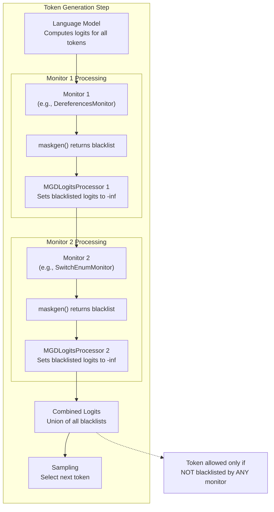
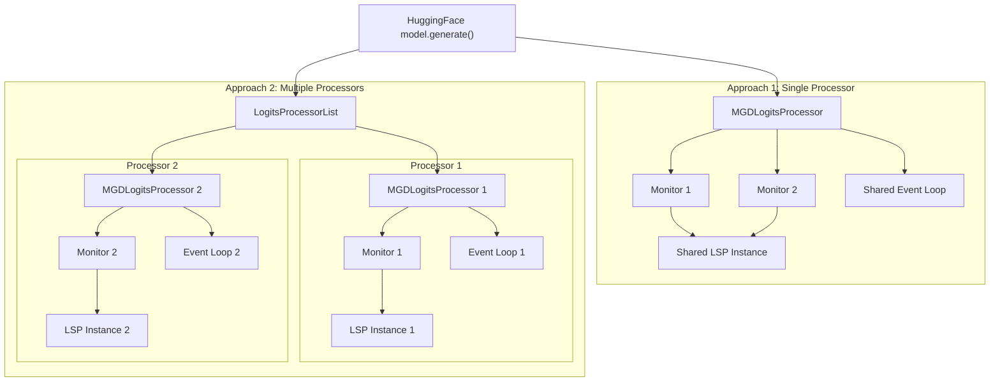
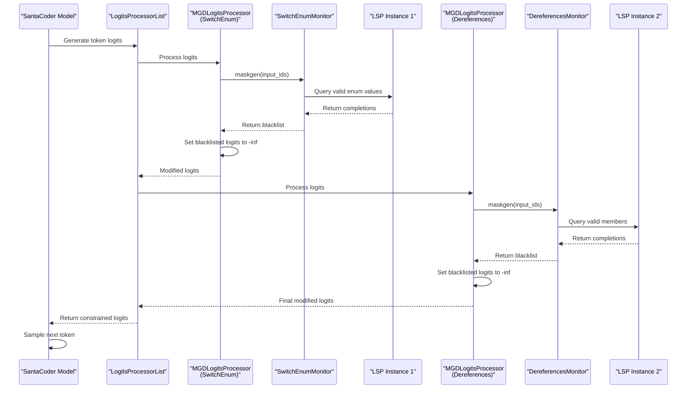

<!-- source: DeepWiki mcp.deepwiki.com · repo microsoft/monitors4codegen · extra page Joint Monitoring · fetched 2026-10-26 -->

# Joint Monitoring

<details>
<summary>Relevant source files</summary>

The following files were used as context for generating this wiki page:

- [README.md](README.md)
- [src/monitors4codegen/monitor_guided_decoding/monitors/numargs_monitor.py](src/monitors4codegen/monitor_guided_decoding/monitors/numargs_monitor.py)
- [tests/monitor_guided_decoding/test_joint_monitors.py](tests/monitor_guided_decoding/test_joint_monitors.py)
- [tests/monitor_guided_decoding/test_numargs_monitor_java.py](tests/monitor_guided_decoding/test_numargs_monitor_java.py)
- [tests/monitor_guided_decoding/test_typestate_monitor_rust.py](tests/monitor_guided_decoding/test_typestate_monitor_rust.py)

</details>


## Purpose and Scope

Joint monitoring enables the simultaneous application of multiple monitors during code generation, allowing the enforcement of multiple correctness properties at once. This page explains how multiple monitors can be combined to constrain language model output according to several independent criteria.

For information about individual monitor implementations, see their respective pages: [DereferencesMonitor](#3.2.1), [NumArgsMonitor](#3.2.2), [SwitchEnumMonitor](#3.2.3), [ClassInstantiationMonitor](#3.2.4), and [Typestate Monitor](#3.2.5). For the underlying MGD framework, see [Core Concepts](#3.1).

---

## Conceptual Overview

Joint monitoring allows multiple `Monitor` instances to operate simultaneously during code generation. Each monitor independently evaluates the current generation state and produces its own blacklist of invalid tokens. The system combines these blacklists to ensure that only tokens satisfying all monitor constraints are allowed.

The key principle is **conjunctive constraint enforcement**: a token is permitted only if no monitor blacklists it. This enables composition of correctness properties without requiring monitors to be aware of each other.

**Common Use Cases:**
- Combining structural monitors (e.g., `DereferencesMonitor`) with behavioral monitors (e.g., `NumArgsMonitor`)
- Enforcing both type-correctness and API usage patterns simultaneously
- Applying multiple language-specific constraints (e.g., `SwitchEnumMonitor` + `DereferencesMonitor`)

Sources: [README.md:204-205](), [tests/monitor_guided_decoding/test_joint_monitors.py:1-138]()

---

## Blacklist Combination Strategy



**Blacklist Union Logic:**
- Each monitor independently computes which tokens violate its constraints
- `MGDLogitsProcessor` sets logits for blacklisted tokens to negative infinity
- When multiple processors run sequentially, a token set to `-inf` by one processor remains `-inf` through subsequent processors
- The final logit distribution only assigns non-zero probability to tokens that satisfy all monitors

Sources: [tests/monitor_guided_decoding/test_joint_monitors.py:123]()

---

## Implementation Approaches

### Approach 1: Multiple Monitors in Single Processor

A single `MGDLogitsProcessor` instance can accept multiple monitors and coordinate their execution.

**Usage Pattern:**
```python
# MGDLogitsProcessor accepts a list of monitors
monitors = [monitor1, monitor2, monitor3]
mgd_processor = MGDLogitsProcessor(monitors, event_loop)
logits_processor = LogitsProcessorList([mgd_processor])
```

**Characteristics:**
- All monitors share the same event loop
- Blacklists are computed and combined within a single processor
- Simpler architecture for monitors that can share LSP instances

**Implementation:** [src/monitors4codegen/monitor_guided_decoding/hf_gen.py]()

### Approach 2: Multiple Processors in LogitsProcessorList

Each monitor has its own `MGDLogitsProcessor` instance, and all processors are combined using HuggingFace's `LogitsProcessorList`.

**Usage Pattern:**
```python
# Create separate processors for each monitor
processor1 = MGDLogitsProcessor([monitor1], loop1)
processor2 = MGDLogitsProcessor([monitor2], loop2)

# Combine using LogitsProcessorList
logits_processor = LogitsProcessorList([processor1, processor2])
```

**Characteristics:**
- Each monitor can have its own LSP instance and event loop
- Complete isolation between monitors
- Useful when monitors require independent LSP state
- HuggingFace applies processors sequentially

Sources: [tests/monitor_guided_decoding/test_joint_monitors.py:83-123]()

---

## Architecture: Multi-Monitor Coordination



Sources: [tests/monitor_guided_decoding/test_joint_monitors.py:47-101]()

---

## Resource Management Considerations

### Language Server Instance Management

When using joint monitoring, careful consideration must be given to LSP resource management:

| Aspect | Shared LSP | Separate LSP Instances |
|--------|-----------|------------------------|
| **Memory** | Lower overhead | Higher overhead (multiple processes) |
| **State Isolation** | Shared file buffer state | Independent file buffer state |
| **Concurrency** | Sequential operations on same LSP | Parallel operations possible |
| **Use Case** | Monitors don't interfere with file state | Monitors need independent file manipulation |

**Implementation in Test Example:**

The test [tests/monitor_guided_decoding/test_joint_monitors.py:47-48]() creates two separate `SyncLanguageServer` instances:

```python
lsp1 = SyncLanguageServer.create(config, logger, source_directory)
lsp2 = SyncLanguageServer.create(config, logger, source_directory)
```

This separation is necessary because both monitors operate on the same file location but need to manipulate the file buffer independently (deleting text, querying completions, etc.).

### File Buffer Management

Each monitor maintains its own `MonitorFileBuffer` instance:

- **`filebuffer_enum`** ([tests/monitor_guided_decoding/test_joint_monitors.py:83-89]()): Used by `SwitchEnumMonitor`
- **`filebuffer_dereferences`** ([tests/monitor_guided_decoding/test_joint_monitors.py:93-99]()): Used by `DereferencesMonitor`

Both buffers track the same initial cursor position `(224, 37)` but maintain independent state as generation progresses.

Sources: [tests/monitor_guided_decoding/test_joint_monitors.py:47-101]()

---

## Example: Combining Switch-Enum and Dereferences Monitoring

The test [tests/monitor_guided_decoding/test_joint_monitors.py]() demonstrates joint monitoring by combining `SwitchEnumMonitor` and `DereferencesMonitor` on a C# repository.

### Scenario

The test operates on [Ryujinx](https://github.com/Ryujinx/Ryujinx), a C# project, specifically in the file `src/ARMeilleure/CodeGen/X86/CodeGenerator.cs`. The task is to complete a `switch` statement with valid enum cases.

**File Location:** Line 224, character 37  
**Deleted Text:** [tests/monitor_guided_decoding/test_joint_monitors.py:63-82]()

### Monitor Setup

**Monitor 1: SwitchEnumMonitor**
```python
filebuffer_enum = MonitorFileBuffer(
    lsp1.language_server,
    completions_filepath,
    (224, 37), (224, 37),
    code_language,   
)
monitor_switch_enum = SwitchEnumMonitor(HFTokenizerWrapper(tokenizer), filebuffer_enum)
mgd_logits_processor_switch_enum = MGDLogitsProcessor(
    [monitor_switch_enum], 
    lsp1.language_server.server.loop
)
```

**Monitor 2: DereferencesMonitor**
```python
filebuffer_dereferences = MonitorFileBuffer(
    lsp2.language_server,
    completions_filepath,
    (224, 37), (224, 37),
    code_language,
)
monitor_dereferences = DereferencesMonitor(HFTokenizerWrapper(tokenizer), filebuffer_dereferences)
mgd_logits_processor_dereferences = MGDLogitsProcessor(
    [monitor_dereferences], 
    lsp2.language_server.server.loop
)
```

### Generation Comparison

#### Without Joint Monitoring
```python
generated_code_without_mgd = model.generate(
    prompt_tokenized, do_sample=False, max_new_tokens=50, early_stopping=True
)
```

**Result:** [tests/monitor_guided_decoding/test_joint_monitors.py:117-120]()
```
Intrinsic.X86Comisdgt:
    context.Assembler.Comisd(src1, src2);
    context.Assembler.Setcc(dest, X86Condition.GreaterThan);
    ...
```

The model hallucinates `Intrinsic.X86Comisdgt` which doesn't exist in the enum.

#### With Joint Monitoring
```python
logits_processor = LogitsProcessorList([
    mgd_logits_processor_switch_enum, 
    mgd_logits_processor_dereferences
])
generated_code = model.generate(
    prompt_tokenized,
    do_sample=False,
    max_new_tokens=50,
    logits_processor=logits_processor,
    early_stopping=True,
)
```

**Result:** [tests/monitor_guided_decoding/test_joint_monitors.py:134-137]()
```
Intrinsic.X86Comisdlt:
    context.Assembler.Comisd(src1, src2);
    context.Assembler.Setcc(dest, X86Condition.Below);
    ...
```

Both monitors constrain the output:
- `SwitchEnumMonitor` ensures `Intrinsic.X86Comisdlt` is a valid enum value
- `DereferencesMonitor` ensures `context.Assembler` accesses are type-valid

### Execution Flow



Sources: [tests/monitor_guided_decoding/test_joint_monitors.py:1-138]()

---

## Performance Considerations

### Computational Overhead

Joint monitoring introduces additional latency per token:

| Factor | Impact |
|--------|--------|
| **Number of Monitors** | Each monitor calls `maskgen()` independently |
| **LSP Query Frequency** | Each monitor may query LSP for completions |
| **Blacklist Size** | Larger combined blacklists require more logit modifications |
| **LSP Process Count** | Multiple LSP instances increase memory and IPC overhead |

### Optimization Strategies

1. **Conditional Activation:** Monitors should quickly determine when constraints don't apply (e.g., `DereferencesMonitor` only activates after detecting `.` token)

2. **Shared LSP When Possible:** If monitors don't conflict on file buffer state, use Approach 1 with a shared LSP instance

3. **Caching:** Monitors can cache LSP responses for repeated queries at the same location

4. **Parallel LSP Queries:** When using separate LSP instances, queries could theoretically run in parallel (though current implementation is sequential)

---

## Implementation Notes

### Test Skipping

The joint monitoring test in [tests/monitor_guided_decoding/test_joint_monitors.py:26]() is marked with:
```python
@pytest.mark.skip(reason="TODO: This runs too slow. Reimplement joint monitoring")
```

This indicates that the current implementation using multiple separate LSP instances has performance issues. Future work may optimize joint monitoring by:
- Implementing more efficient LSP resource sharing
- Parallelizing monitor execution
- Reducing redundant LSP queries

### Monitor Independence

Monitors in joint monitoring are designed to be completely independent:
- No direct communication between monitors
- No shared state except through the generation process
- Each monitor only sees tokens generated so far
- Blacklists are combined mechanically without coordination

This design enables easy composition but means monitors cannot leverage each other's analysis results.

Sources: [tests/monitor_guided_decoding/test_joint_monitors.py:26]()

---

## Summary

**Key Points:**

| Aspect | Details |
|--------|---------|
| **Purpose** | Enforce multiple correctness properties simultaneously |
| **Mechanism** | Union of monitor blacklists; token allowed only if no monitor blacklists it |
| **Implementation** | Single processor with multiple monitors OR multiple processors in `LogitsProcessorList` |
| **Resource Management** | Consider LSP instance sharing vs. separation based on state requirements |
| **Use Cases** | Combining structural + behavioral monitors, multiple language-specific constraints |

**Related Pages:**
- [Core Concepts](#3.1) - Understanding the Monitor interface and maskgen
- [HuggingFace Integration](#3.3.1) - MGDLogitsProcessor implementation details
- Individual monitor pages for constraint-specific details

Sources: [README.md:204-205](), [tests/monitor_guided_decoding/test_joint_monitors.py:1-138]()

---

