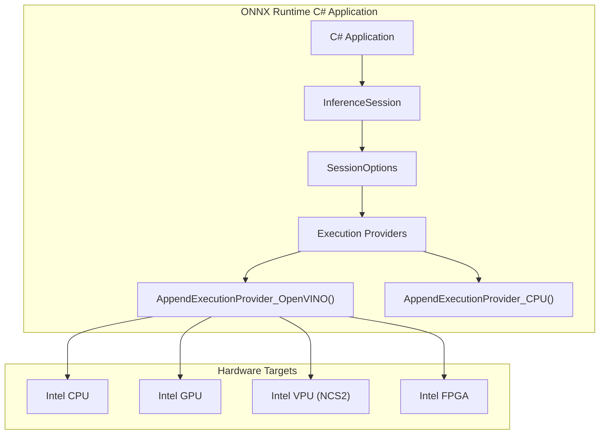
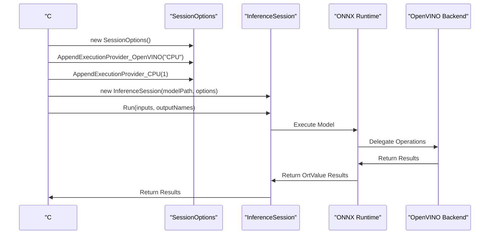
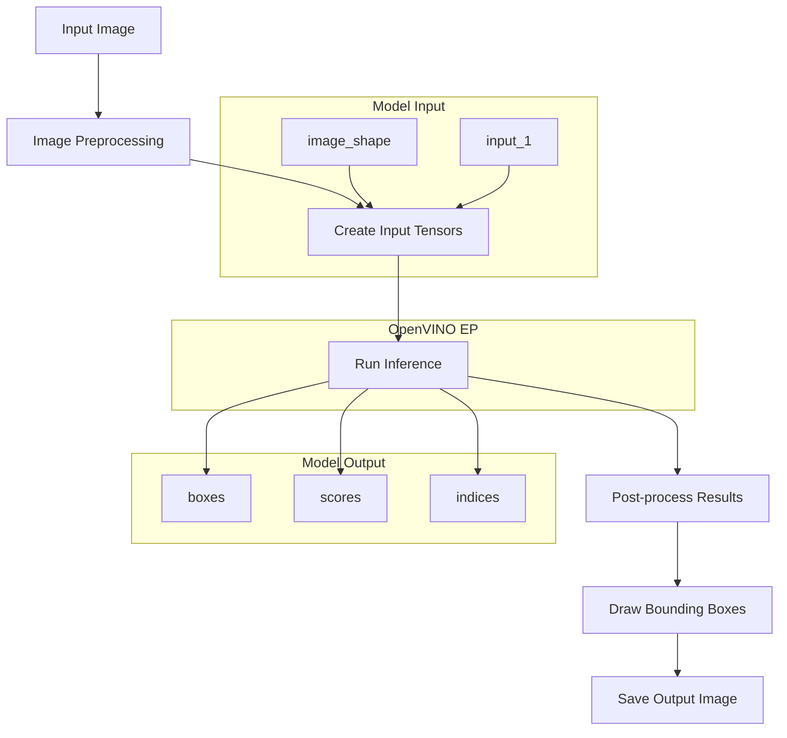

<!-- source: DeepWiki mcp.deepwiki.com · repo microsoft/onnxruntime-inference-examples · page 4.1 OpenVINO EP for C# · fetched 2026-10-26 -->

# OpenVINO EP for C#

<details>
<summary>Relevant source files</summary>

The following files were used as context for generating this wiki page:

- [c_cxx/OpenVINO_EP/Windows/CMakeLists.txt](c_cxx/OpenVINO_EP/Windows/CMakeLists.txt)
- [c_cxx/OpenVINO_EP/Windows/README.md](c_cxx/OpenVINO_EP/Windows/README.md)
- [c_cxx/OpenVINO_EP/Windows/model-explorer/model-explorer.cpp](c_cxx/OpenVINO_EP/Windows/model-explorer/model-explorer.cpp)
- [c_cxx/OpenVINO_EP/Windows/squeezenet_classification/squeezenet_cpp_app.cpp](c_cxx/OpenVINO_EP/Windows/squeezenet_classification/squeezenet_cpp_app.cpp)
- [c_cxx/OpenVINO_EP/Windows/squeezenet_classification_io_buffer/CMakeLists.txt](c_cxx/OpenVINO_EP/Windows/squeezenet_classification_io_buffer/CMakeLists.txt)
- [c_cxx/OpenVINO_EP/Windows/squeezenet_classification_io_buffer/squeezenet_cpp_app_io_buffer.cpp](c_cxx/OpenVINO_EP/Windows/squeezenet_classification_io_buffer/squeezenet_cpp_app_io_buffer.cpp)
- [c_cxx/OpenVINO_EP/Windows/squeezenet_classification_io_buffer/synset.txt](c_cxx/OpenVINO_EP/Windows/squeezenet_classification_io_buffer/synset.txt)
- [c_sharp/OpenVINO_EP/yolov3_object_detection/Program.cs](c_sharp/OpenVINO_EP/yolov3_object_detection/Program.cs)
- [c_sharp/OpenVINO_EP/yolov3_object_detection/yolov3_object_detection.csproj](c_sharp/OpenVINO_EP/yolov3_object_detection/yolov3_object_detection.csproj)

</details>


This document provides a comprehensive guide to using Intel's OpenVINO Execution Provider (EP) with ONNX Runtime in C# applications. OpenVINO EP enables efficient execution of ONNX models on Intel hardware, including CPUs, GPUs, and Vision Processing Units (VPUs). For information about using OpenVINO EP with other languages, see [OpenVINO Execution Provider](#7.1) or specific implementations like [OpenVINO EP for C/C++](#3.2) and [OpenVINO EP for Python](#5.1).

## Overview

The OpenVINO Execution Provider allows ONNX Runtime to leverage Intel's Deep Learning acceleration capabilities through the OpenVINO toolkit. This enables C# applications to run inference on Intel hardware with optimized performance.



Sources: [c_sharp/OpenVINO_EP/yolov3_object_detection/Program.cs:47-50]()

## Prerequisites

To use OpenVINO EP in your C# application, you need:

1. Intel hardware (CPU, GPU, VPU, or FPGA)
2. .NET 7.0 or higher 
3. The following NuGet packages:

| Package | Description | Current Version |
|---------|-------------|-----------------|
| Microsoft.ML.OnnxRuntime.Managed | Core ONNX Runtime Managed API | 1.19.0 |
| Microsoft.ML.OnnxRuntime.OpenVino | OpenVINO Execution Provider | 1.19.0 |

Sources: [c_sharp/OpenVINO_EP/yolov3_object_detection/yolov3_object_detection.csproj:10-16](), [c_sharp/OpenVINO_EP/yolov3_object_detection/README.md:11-16]()

## Basic Usage

### Setting Up OpenVINO EP

To use OpenVINO EP in your C# application:

1. Create SessionOptions
2. Add OpenVINO Execution Provider
3. Optionally configure fallback providers
4. Create an InferenceSession with these options



Sources: [c_sharp/OpenVINO_EP/yolov3_object_detection/Program.cs:47-53]()

### Code Example

The following example shows how to initialize OpenVINO EP in C#:

```csharp
// Create session options
using SessionOptions options = new SessionOptions();
options.LogSeverityLevel = OrtLoggingLevel.ORT_LOGGING_LEVEL_INFO;

// Add OpenVINO EP targeting CPU
options.AppendExecutionProvider_OpenVINO(@"CPU");

// Add CPU EP as fallback with priority 1
options.AppendExecutionProvider_CPU(1);

// Create inference session with the options
using var session = new InferenceSession(modelFilePath, options);
```

Sources: [c_sharp/OpenVINO_EP/yolov3_object_detection/Program.cs:47-53]()

## Device Selection

When initializing OpenVINO EP, you can specify which hardware device to target. The available options depend on the hardware present in your system:

| Device String | Description | Data Type |
|---------------|-------------|-----------|
| "CPU" | Intel CPU | Float32 |
| "GPU" | Intel integrated or discrete GPU | Float32/Float16 |
| "MYRIAD" | Intel Neural Compute Stick 2 (NCS2) | Float16 |
| "VPUX" | Intel VPU accelerators | Varies |

Note that the specific device options supported may vary based on your OpenVINO version and hardware availability. The YOLOv3 example specifically targets the MYRIADX device (NCS2 stick), though the code sample shows "CPU" as the device.

Sources: [c_sharp/OpenVINO_EP/yolov3_object_detection/README.md:5]()

## YOLOv3 Object Detection Example

The repository includes a complete C# example of using OpenVINO EP for object detection with YOLOv3:



This example demonstrates:
1. Loading and configuring a YOLOv3 model
2. Preprocessing image input into the correct format
3. Creating OrtValue tensors from input data
4. Running inference with OpenVINO EP
5. Processing detection outputs (boxes, scores, class indices)
6. Visualizing results

Sources: [c_sharp/OpenVINO_EP/yolov3_object_detection/Program.cs:20-219](), [c_sharp/OpenVINO_EP/yolov3_object_detection/README.md:1-9]()

### Input Preparation

The example shows how to prepare an image as input for the YOLOv3 model:

1. Load and letterbox the image to match model dimensions (416x416)
2. Convert image data to tensor format
3. Create OrtValue tensors from memory for both input image and image shape

```csharp
// Creating input tensors
DenseTensor<float> input = new(new[] { 1, 3, h, w });
// Fill tensor with image data...

// Create OrtValues directly from memory for better performance
using var inputOrtValue = OrtValue.CreateTensorValueFromMemory(OrtMemoryInfo.DefaultInstance,
    input.Buffer, new long[] { 1, 3, h, w });

float[] imageShape = { ih, iw };
using var imageShapeOrtValue = OrtValue.CreateTensorValueFromMemory(imageShape, new long[] { 1, 2 });
```

Sources: [c_sharp/OpenVINO_EP/yolov3_object_detection/Program.cs:92-114]()

### Running Inference

The example demonstrates running inference with the configured session:

```csharp
// Setup inputs with model's expected input names
var inputs = new Dictionary<string, OrtValue>
{
    { "input_1", inputOrtValue },
    { "image_shape", imageShapeOrtValue }
};

// Run inference
using var runOptions = new RunOptions();
using IDisposableReadOnlyCollection<OrtValue> results = session.Run(runOptions, inputs, session.OutputNames);
```

Sources: [c_sharp/OpenVINO_EP/yolov3_object_detection/Program.cs:116-124]()

### Processing Results

After inference, the example shows how to access and process the detection results:

```csharp
// Read directly from native memory
var boxesSpan = results[0].GetTensorDataAsSpan<float>();
var scoresSpan = results[1].GetTensorDataAsSpan<float>();
var indicesSpan = results[2].GetTensorDataAsSpan<int>();

// Process detections...
```

The example demonstrates efficient tensor access using `GetTensorDataAsSpan<T>()` method and processing multi-dimensional data using strides and indexing.

Sources: [c_sharp/OpenVINO_EP/yolov3_object_detection/Program.cs:131-133]()

## Performance Considerations

### Memory Efficiency

For optimal performance with OpenVINO EP, consider:

1. Using `OrtValue.CreateTensorValueFromMemory()` to avoid unnecessary copying of data
2. Using `GetTensorDataAsSpan<T>()` to access tensor data directly in native memory
3. Properly disposing ONNX Runtime resources using `using` statements or explicit disposal

Sources: [c_sharp/OpenVINO_EP/yolov3_object_detection/Program.cs:109-110](), [c_sharp/OpenVINO_EP/yolov3_object_detection/Program.cs:131-133]()

### Provider Fallback

It's a good practice to add a fallback execution provider (like the default CPU provider) in case some operations are not supported by OpenVINO EP:

```csharp
options.AppendExecutionProvider_OpenVINO(@"CPU"); // Primary EP
options.AppendExecutionProvider_CPU(1);           // Fallback EP
```

This ensures your model will still run even if some operations are not accelerated by OpenVINO.

Sources: [c_sharp/OpenVINO_EP/yolov3_object_detection/Program.cs:49-50]()

## Troubleshooting and Notes

### Common Issues

1. **Model compatibility**: Not all ONNX operations are supported by OpenVINO EP. If you encounter errors, try using the CPU EP as fallback.

2. **Device availability**: Make sure your target device (like MYRIAD for NCS2) is properly connected and recognized by your system.

3. **Version compatibility**: Ensure that your OpenVINO version is compatible with the ONNX Runtime version you're using.

### Building from Source

If you need to build the OpenVINO EP from source instead of using NuGet packages:

```bash
./build.sh --config Release --use_openvino MYRIAD_FP16 --build_shared_lib --build_nuget
```

This will build ONNX Runtime with OpenVINO support targeting the MYRIAD device with FP16 precision.

Sources: [c_sharp/OpenVINO_EP/yolov3_object_detection/README.md:26-29]()

## References

For more information, refer to:

- [OpenVINO Execution Provider Documentation](https://onnxruntime.ai/docs/execution-providers/OpenVINO-ExecutionProvider.html)
- [Get started with ONNX Runtime for C#](https://onnxruntime.ai/docs/get-started/with-csharp.html)
- [OpenVINO Runtime Documentation](https://docs.openvinotoolkit.org)

Sources: [c_sharp/OpenVINO_EP/yolov3_object_detection/README.md:67-76]()

---

