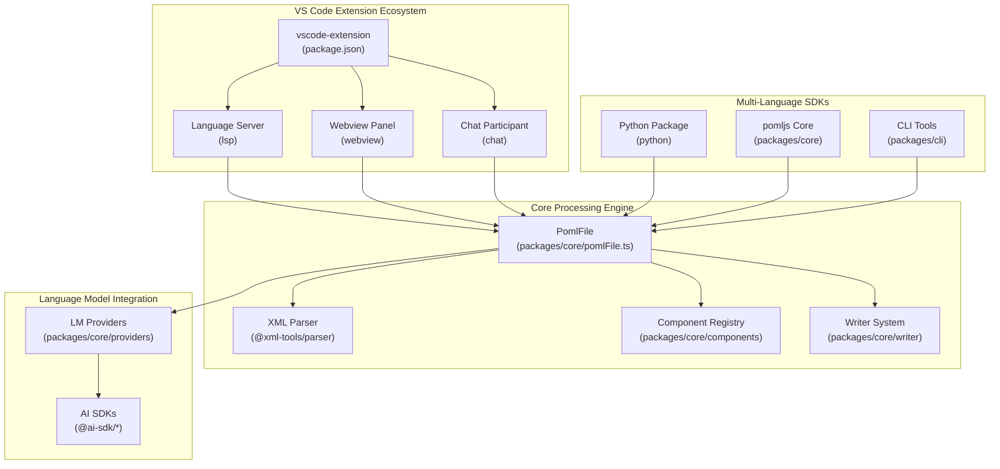
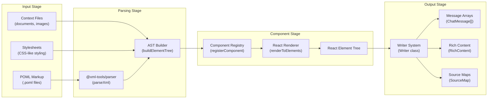
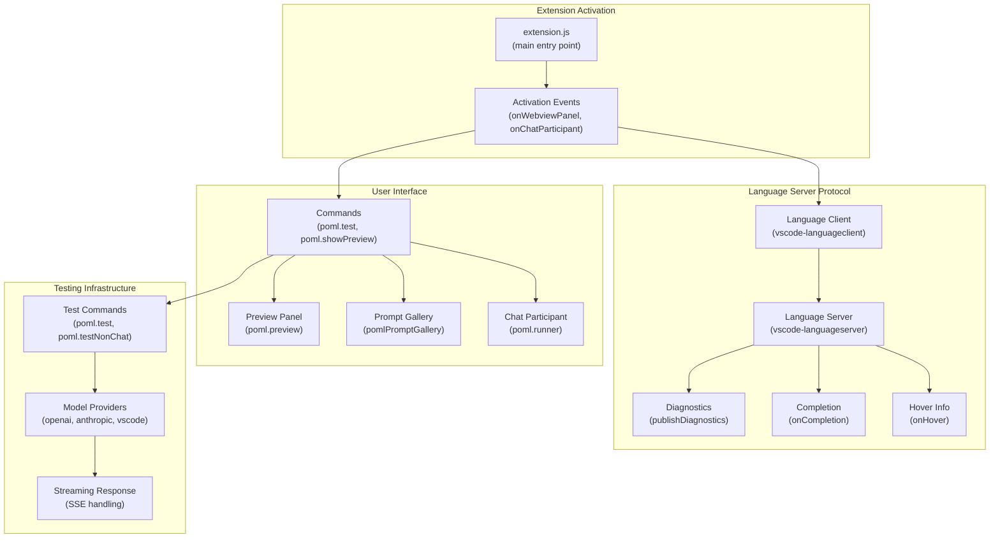
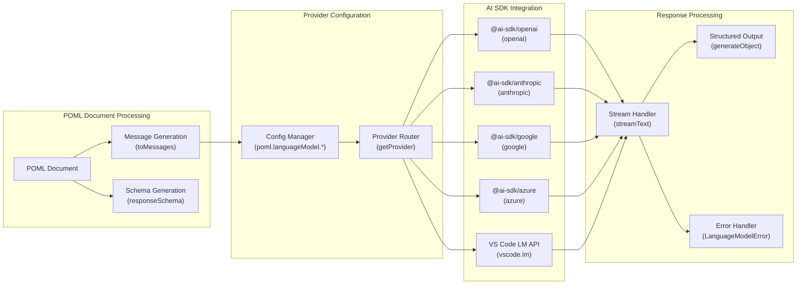
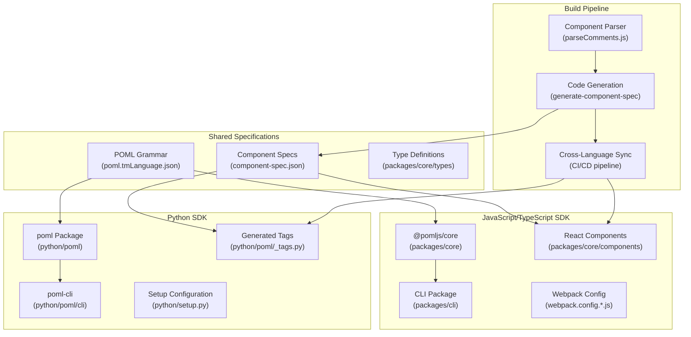
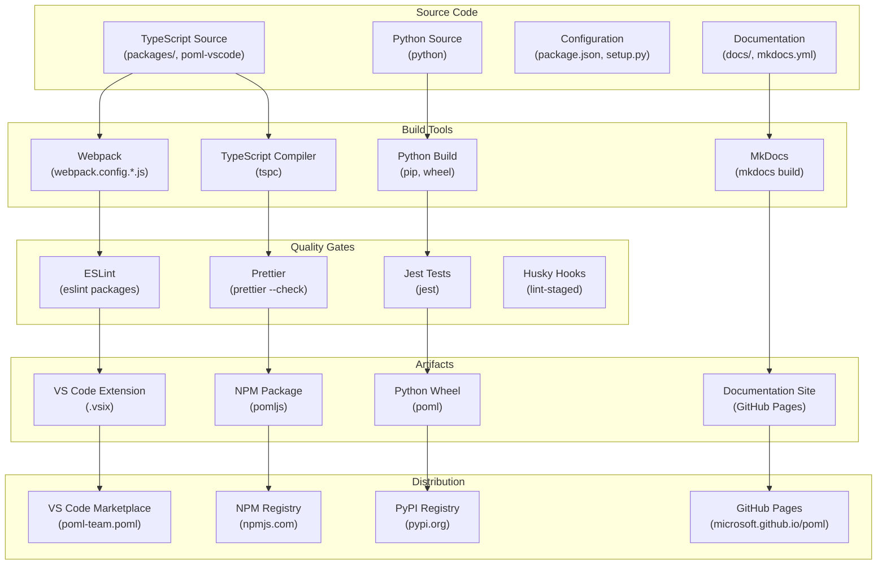

<!-- source: DeepWiki mcp.deepwiki.com · repo microsoft/poml · page 1 Overview · fetched 2026-10-26 -->

# Overview

Relevant source files

The following files were used as context for generating this wiki page:

- [CITATION.cff](CITATION.cff)
- [README.md](README.md)
- [docs/index.md](docs/index.md)
- [docs/vscode/index.md](docs/vscode/index.md)
- [package-lock.json](package-lock.json)
- [package.json](package.json)

## Purpose and Scope

This document provides an architectural overview of POML (Prompt Orchestration Markup Language), a comprehensive system for structured prompt engineering with Large Language Models. POML addresses common challenges in prompt development through a markup language with HTML-like syntax, integrated development tools, and multi-language SDK support.

For specific implementation details of individual components, see [Core Architecture](#3). For getting started with POML usage, see [Getting Started](#2). For language model provider configuration, see [Provider Configuration](#6.1).

## System Architecture

POML consists of four main subsystems: the VS Code extension ecosystem, core processing engine, multi-language SDKs, and build/distribution infrastructure.

**Sources:** [package.json:1-493](), [README.md:1-131](), [docs/index.md:1-38]()

## Core Processing Pipeline

The POML processing engine transforms markup documents through a multi-stage pipeline, handling XML parsing, component rendering, and output generation.

**Sources:** [package.json:458-461](), [package.json:473-476]()

## VS Code Extension Architecture

The VS Code extension serves as the primary development interface, integrating language server capabilities, preview functionality, and direct language model testing.

**Sources:** [package.json:18-24](), [package.json:71-174](), [package.json:176-183](), [package.json:245-369]()

## Language Model Provider Integration

POML integrates with multiple language model providers through a unified interface, supporting both streaming and structured outputs.

| Provider | Configuration Key | SDK Package | API Support |
|----------|------------------|-------------|-------------|
| OpenAI | `openai` | `@ai-sdk/openai` | Chat Completion, Response API |
| Anthropic | `anthropic` | `@ai-sdk/anthropic` | Messages API |
| Google | `google` | `@ai-sdk/google` | Gemini API |
| Azure OpenAI | `microsoft` | `@ai-sdk/azure` | Chat Completion |
| VS Code LM | `vscode` | VS Code LM API | Copilot Integration |

**Sources:** [package.json:245-328](), [package.json:450-461]()

## Multi-Language SDK Architecture

POML provides synchronized APIs across Python and JavaScript/TypeScript environments, with shared component definitions and identical processing logic.

**Sources:** [package.json:378-379](), [package.json:41-63](), [package.json:371-394]()

## Build and Distribution System

The project uses a sophisticated multi-platform build system with GitHub Actions for continuous integration and deployment across VS Code Marketplace, PyPI, and NPM.

**Sources:** [package.json:371-394](), [package.json:396-407](), [package.json:408-493]()

---

