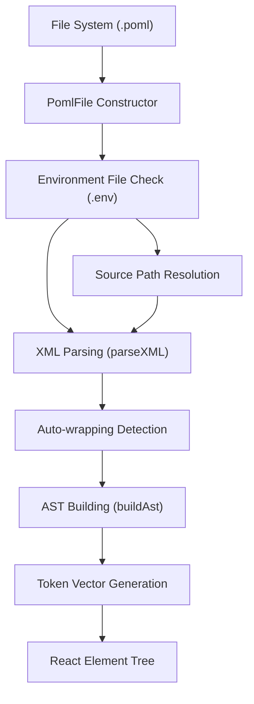
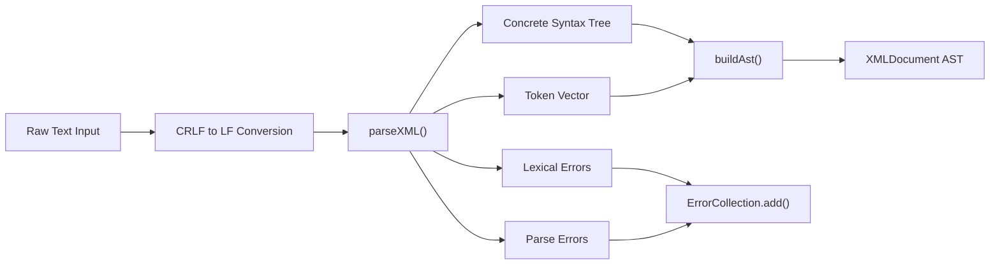
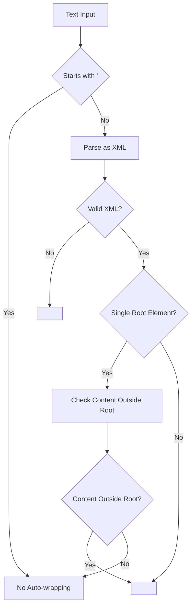
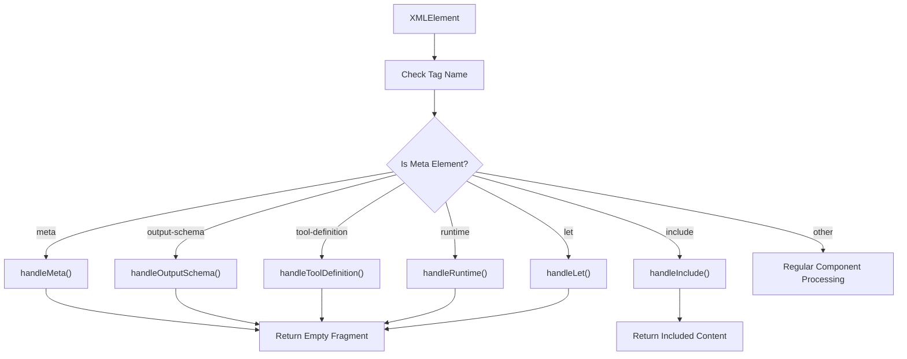
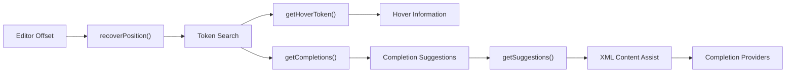
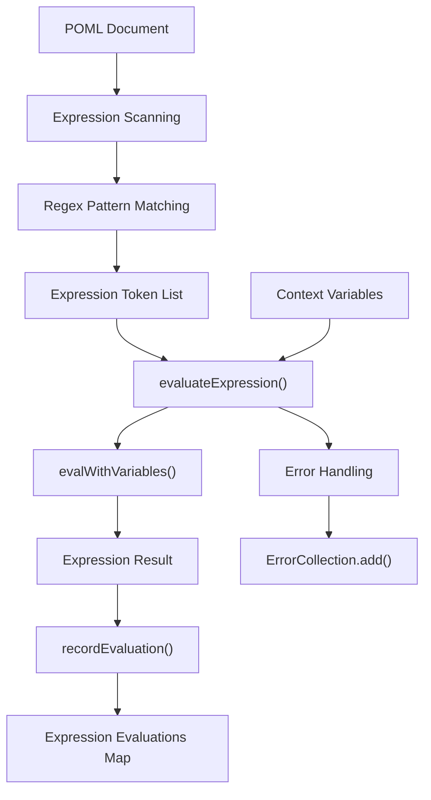

<!-- source: DeepWiki mcp.deepwiki.com · repo microsoft/poml · page 3.3 File Format and Parsing · fetched 2026-10-26 -->

# File Format and Parsing

<details>
<summary>Relevant source files</summary>

The following files were used as context for generating this wiki page:

- [docs/language/meta.md](docs/language/meta.md)
- [docs/vscode/features.md](docs/vscode/features.md)
- [eslint.config.js](eslint.config.js)
- [packages/poml/file.tsx](packages/poml/file.tsx)
- [packages/poml/tests/file.test.tsx](packages/poml/tests/file.test.tsx)
- [packages/poml/util/xmlContentAssist.js](packages/poml/util/xmlContentAssist.js)

</details>


This page covers the POML file format specification, XML parsing mechanics, and document structure validation. It explains how POML documents are parsed from text into internal representations that can be processed by the core system.

For information about how parsed documents flow through the processing pipeline, see [Processing Pipeline](#3.1). For details about individual POML components and their behavior, see [Component System](#3.2). For output generation from parsed documents, see [Writer System and Output Formats](#3.4).

## POML File Format Specification

POML documents are XML-based markup files with a `.poml` extension. The format supports both strict XML structure and flexible auto-wrapping for simpler use cases.

### Basic Document Structure

```xml
<poml>
  <meta minVersion="1.0.0" />
  <let name="variable" value="'Hello'" />
  <p>{{ variable }}, world!</p>
</poml>
```

### File Extensions and Detection

POML files use the `.poml` extension. The parser can also handle `.source.poml` files and looks for corresponding `.env` files for source path resolution:

```
document.poml
document.env  # Contains SOURCE_PATH=actual/path/to/source.poml
```

**POML Document Structure**


Sources: [packages/poml/file.tsx:71-133]()

## XML Parsing Pipeline

The `PomlFile` class orchestrates XML parsing using the `@xml-tools/parser` library. The parsing process generates both a Concrete Syntax Tree (CST) and Abstract Syntax Tree (AST).

### Parser Configuration

The `PomlReaderOptions` interface defines parsing behavior:

| Option | Type | Default | Description |
|--------|------|---------|-------------|
| `trim` | boolean | `true` | Remove whitespace from text content |
| `autoAddPoml` | boolean | `true` | Auto-wrap content in `<poml>` tags |
| `crlfToLf` | boolean | `true` | Convert Windows line endings |

### Parsing Process

**XML Parsing Flow**


Sources: [packages/poml/file.tsx:135-188]()

### Error Handling

The parser collects and reports various error types:

- **Lexical errors**: Invalid tokens, malformed syntax
- **Parse errors**: Structural XML issues, unclosed tags  
- **AST building errors**: Semantic validation failures

All errors are formatted with position information using the `formatError` method and added to the global `ErrorCollection`.

Sources: [packages/poml/file.tsx:139-149](), [packages/poml/file.tsx:152-169](), [packages/poml/file.tsx:423-437]()

## Auto-wrapping Behavior

POML supports automatic wrapping of content that isn't explicitly wrapped in a `<poml>` root element. This feature makes simple prompts easier to write.

### Auto-wrapping Logic

The auto-wrapping system analyzes the parsed content to determine if wrapping is needed:

```typescript
// Detects if content needs <poml> wrapper
if (this.config.autoAddPoml && text.slice(5).toLowerCase() !== '<poml') {
  if (!ast || !ast.rootElement) {
    // Invalid XML - treat as free text
    addPoml = '<poml syntax="text" whiteSpace="pre">';
  } else if (/* multiple root elements or content outside root *) {
    // Valid XML but needs wrapping
    addPoml = '<poml syntax="markdown">';
  }
}
```

### Wrapping Scenarios

| Input Type | Wrapper Applied | Resulting Syntax |
|------------|----------------|------------------|
| Free text | `<poml syntax="text" whiteSpace="pre">` | Preserves formatting |
| Multiple XML roots | `<poml syntax="markdown">` | Markdown processing |
| Invalid XML | `<poml syntax="text" whiteSpace="pre">` | Text fallback |
| Valid single XML | No wrapper | Native POML |

**Auto-wrapping Decision Tree**


Sources: [packages/poml/file.tsx:98-133](), [packages/poml/file.tsx:190-203]()

## Document Structure and Validation

POML documents follow XML structure with specific semantic rules. The `PomlFile` class validates document structure during parsing.

### Root Element Access

The `xmlRootElement()` method provides access to the document's root element with validation:

```typescript
public xmlRootElement(): XMLElement | undefined {
  if (!this.ast || !this.ast.rootElement) {
    this.reportError('Root element is invalid.', documentRange);
    return undefined;
  }
  return this.ast.rootElement;
}
```

### Meta Element Processing

POML supports several meta-like elements that don't appear in final output:

| Element | Purpose | Handler Method |
|---------|---------|----------------|
| `<meta>` | Version control, component management | `handleMeta()` |
| `<output-schema>` | Response schema definition | `handleOutputSchema()` |
| `<tool-definition>` | Tool registration | `handleToolDefinition()` |
| `<runtime>` | Runtime parameters | `handleRuntime()` |
| `<let>` | Variable definitions | `handleLet()` |
| `<include>` | File inclusion | `handleInclude()` |

**Meta Element Processing Flow**


Sources: [packages/poml/file.tsx:1028-1078](), [packages/poml/file.tsx:744-760](), [packages/poml/file.tsx:762-803]()

## Token Tracking and Language Server Support

The `PomlFile` class maintains detailed token information to support Language Server Protocol (LSP) features like hover tooltips, completions, and diagnostics.

### Token Types

The `PomlToken` interface defines different token categories:

```typescript
export interface PomlToken {
  type: 'element' | 'attribute' | 'attributeValue' | 'expression';
  range: Range;
  element?: string;
  attribute?: string;
  value?: string;
  expression?: string;
}
```

### Position Tracking

The parser maintains position mappings between original document coordinates and processed coordinates, accounting for auto-wrapping:

- `documentRange`: Tracks the original content boundaries
- `recoverPosition()`: Maps display positions back to source positions
- Range calculations for all tokens and expressions

### LSP Feature Implementation

**Token-based LSP Features**


Sources: [packages/poml/file.tsx:281-309](), [packages/poml/file.tsx:39-54](), [packages/poml/util/xmlContentAssist.js:7-37]()

## Template Expression Parsing

POML supports template expressions using `{{ expression }}` syntax. The parser identifies and tracks these expressions for evaluation and language server features.

### Expression Detection

The `getExpressionTokens()` method scans the document for template expressions:

```typescript
const regex = /{{\s*(.+?)\s*}}(?!})/gm;
```

This regex captures expressions while avoiding triple-brace conflicts (`{{{`).

### Expression Categories

| Context | Pattern | Handler |
|---------|---------|---------|
| Text content | `{{ variable }}` | `handleText()` |
| Attribute values | `attr="{{ value }}"` | `handleAttribute()` |
| Control flow | `if="{{ condition }}"` | `handleIfCondition()` |
| Variable definitions | `value="{{ expression }}"` | `handleLet()` |
| Schema expressions | Parser-specific | `handleSchema()` |

### Expression Evaluation

The `evaluateExpression()` method processes template expressions:

```typescript
private evaluateExpression(expression: string, context: {[key: string]: any}, range?: Range, stripCurlyBrackets: boolean = false) {
  // Remove curly brackets if needed
  // Evaluate using evalWithVariables()
  // Record evaluation results
  // Handle errors
}
```

**Expression Processing Pipeline**


Sources: [packages/poml/file.tsx:311-409](), [packages/poml/file.tsx:934-972](), [packages/poml/file.tsx:987-1014]()

---

