<!-- source: DeepWiki mcp.deepwiki.com · repo microsoft/promptflow · page 6.3 Flow Serving · fetched 2026-10-26 -->

# Flow Serving

<details>
<summary>Relevant source files</summary>

The following files were used as context for generating this wiki page:

- [scripts/json_schema/FlexFlow.schema.json](scripts/json_schema/FlexFlow.schema.json)
- [src/promptflow-core/promptflow/_core/entry_meta_generator.py](src/promptflow-core/promptflow/_core/entry_meta_generator.py)
- [src/promptflow-core/promptflow/_core/tool_meta_generator.py](src/promptflow-core/promptflow/_core/tool_meta_generator.py)
- [src/promptflow-core/promptflow/core/_errors.py](src/promptflow-core/promptflow/core/_errors.py)
- [src/promptflow-core/promptflow/core/_flow.py](src/promptflow-core/promptflow/core/_flow.py)
- [src/promptflow-core/promptflow/core/_prompty_utils.py](src/promptflow-core/promptflow/core/_prompty_utils.py)
- [src/promptflow-core/promptflow/core/_serving/app.py](src/promptflow-core/promptflow/core/_serving/app.py)
- [src/promptflow-devkit/promptflow/_cli/_pf/_flow.py](src/promptflow-devkit/promptflow/_cli/_pf/_flow.py)
- [src/promptflow-devkit/promptflow/_sdk/_orchestrator/__init__.py](src/promptflow-devkit/promptflow/_sdk/_orchestrator/__init__.py)
- [src/promptflow-devkit/promptflow/_sdk/_orm/retry.py](src/promptflow-devkit/promptflow/_sdk/_orm/retry.py)
- [src/promptflow-devkit/promptflow/_sdk/_utilities/chat_utils.py](src/promptflow-devkit/promptflow/_sdk/_utilities/chat_utils.py)
- [src/promptflow-devkit/promptflow/_sdk/_utilities/serve_utils.py](src/promptflow-devkit/promptflow/_sdk/_utilities/serve_utils.py)
- [src/promptflow-devkit/promptflow/_sdk/data/executable/main.py](src/promptflow-devkit/promptflow/_sdk/data/executable/main.py)
- [src/promptflow-devkit/promptflow/_sdk/operations/_flow_operations.py](src/promptflow-devkit/promptflow/_sdk/operations/_flow_operations.py)
- [src/promptflow-devkit/promptflow/_sdk/schemas/_flow.py](src/promptflow-devkit/promptflow/_sdk/schemas/_flow.py)
- [src/promptflow-devkit/tests/sdk_cli_test/e2etests/test_chat_group.py](src/promptflow-devkit/tests/sdk_cli_test/e2etests/test_chat_group.py)
- [src/promptflow-devkit/tests/sdk_cli_test/e2etests/test_cli.py](src/promptflow-devkit/tests/sdk_cli_test/e2etests/test_cli.py)
- [src/promptflow-devkit/tests/sdk_cli_test/e2etests/test_executable.py](src/promptflow-devkit/tests/sdk_cli_test/e2etests/test_executable.py)
- [src/promptflow-devkit/tests/sdk_cli_test/e2etests/test_flow_serve.py](src/promptflow-devkit/tests/sdk_cli_test/e2etests/test_flow_serve.py)
- [src/promptflow-devkit/tests/sdk_cli_test/e2etests/test_flow_serve_fastapi.py](src/promptflow-devkit/tests/sdk_cli_test/e2etests/test_flow_serve_fastapi.py)
- [src/promptflow-devkit/tests/sdk_cli_test/e2etests/test_prompty.py](src/promptflow-devkit/tests/sdk_cli_test/e2etests/test_prompty.py)
- [src/promptflow-devkit/tests/sdk_cli_test/e2etests/test_prompty_error_handler.py](src/promptflow-devkit/tests/sdk_cli_test/e2etests/test_prompty_error_handler.py)
- [src/promptflow-devkit/tests/sdk_cli_test/unittests/test_flow_serve.py](src/promptflow-devkit/tests/sdk_cli_test/unittests/test_flow_serve.py)
- [src/promptflow-devkit/tests/sdk_cli_test/unittests/test_flow_serve_cli.py](src/promptflow-devkit/tests/sdk_cli_test/unittests/test_flow_serve_cli.py)
- [src/promptflow-recording/promptflow/recording/local/record_storage.py](src/promptflow-recording/promptflow/recording/local/record_storage.py)
- [src/promptflow-recording/recordings/local/node_cache.shelve.bak](src/promptflow-recording/recordings/local/node_cache.shelve.bak)
- [src/promptflow-recording/recordings/local/node_cache.shelve.dat](src/promptflow-recording/recordings/local/node_cache.shelve.dat)
- [src/promptflow-recording/recordings/local/node_cache.shelve.dir](src/promptflow-recording/recordings/local/node_cache.shelve.dir)
- [src/promptflow/tests/test_configs/functions/class_init_complicated_ports/hello.py](src/promptflow/tests/test_configs/functions/class_init_complicated_ports/hello.py)
- [src/promptflow/tests/test_configs/prompty/prompty_with_image.prompty](src/promptflow/tests/test_configs/prompty/prompty_with_image.prompty)
- [src/promptflow/tests/test_configs/prompty/single_prompty/prompty_example.prompty](src/promptflow/tests/test_configs/prompty/single_prompty/prompty_example.prompty)

</details>


Flow Serving provides mechanisms to expose PromptFlow flows as APIs and interactive UIs. This functionality allows users to deploy flows as services that can be consumed by applications or interacted with through a web interface. Flow Serving supports different deployment options, including local serving, containerization with Docker, and packaging as standalone executables.

For information about batch execution of flows, see [Batch Execution](#6.1). For evaluating flows, see [Evaluation System](#6.2).

## Architecture Overview

The Flow Serving system in PromptFlow consists of various components that work together to serve flows as endpoints or interactive UIs. The following diagram illustrates the high-level architecture:

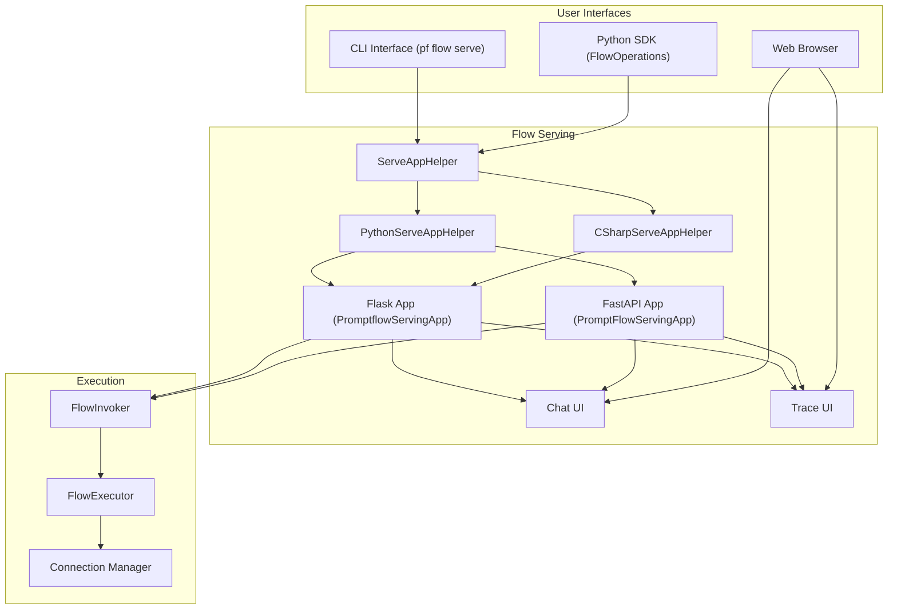

Sources:
- [src/promptflow-devkit/promptflow/_sdk/_utilities/serve_utils.py:29-145](). Contains the `ServeAppHelper` abstract class and implementations for Python and C# flows.
- [src/promptflow-devkit/promptflow/_cli/_pf/_flow.py:177-227](). Contains the CLI command for serving flows.
- [src/promptflow-core/promptflow/core/_serving/app.py:8-31](). Contains the core serving application creation.

## Serving Mechanisms

PromptFlow offers multiple mechanisms for serving flows:

### Web Service Engines

Flow Serving supports two web service engines:

1. **Flask (Default)**: A lightweight web framework that is the default serving engine for PromptFlow.
2. **FastAPI**: A modern, high-performance web framework for building APIs.

The engine can be specified when serving a flow:

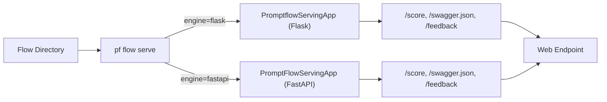

Sources:
- [src/promptflow-devkit/promptflow/_sdk/_constants.py:33](). Defines `DEFAULT_SERVE_ENGINE = "flask"`.
- [src/promptflow-devkit/promptflow/_sdk/_utilities/serve_utils.py:349-396](). Implements flow serving with different engines.
- [src/promptflow-devkit/promptflow/_cli/_pf/_flow.py:200-205](). CLI parameter for engine selection.
- [src/promptflow-core/promptflow/core/_serving/app.py:8-36](). Creates the appropriate app based on engine parameter.

### Deployment Options

PromptFlow provides multiple deployment options for flows:

1. **Local Serving**: Serve flows directly on your local machine through the CLI or SDK.
2. **Docker Containerization**: Package flows and their dependencies into Docker containers.
3. **Standalone Executables**: Build flows into standalone executable applications.

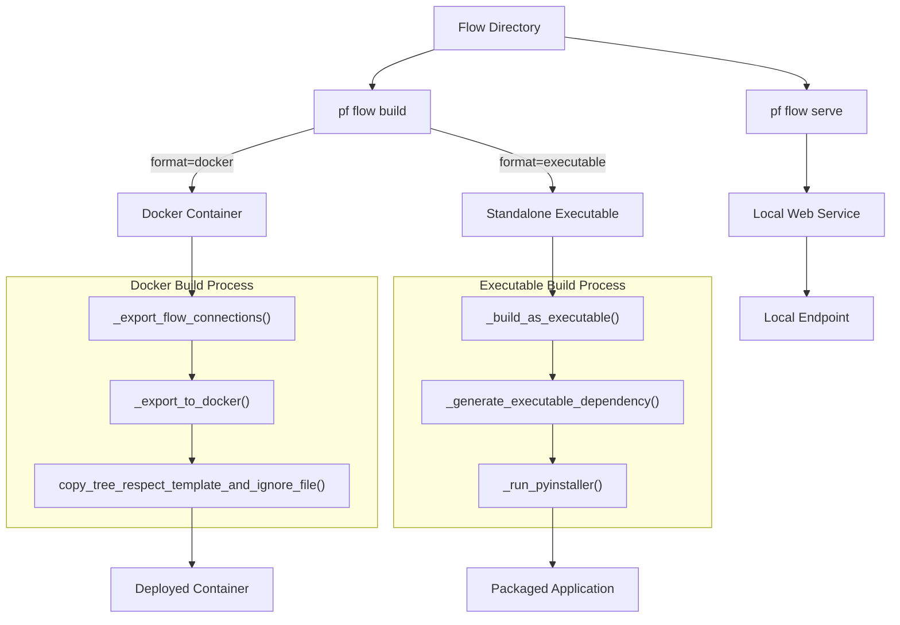

Sources:
- [src/promptflow-devkit/promptflow/_sdk/_operations/_flow_operations.py:703-781](). Implements flow building functionality.
- [src/promptflow-devkit/promptflow/_sdk/_operations/_flow_operations.py:548-580](). Implements Docker containerization.
- [src/promptflow-devkit/promptflow/_sdk/_operations/_flow_operations.py:582-661](). Implements executable creation.

## Serving Flows

### Basic Flow Serving

To serve a flow, use the `pf flow serve` command or the equivalent SDK functionality:

```bash
pf flow serve --source <path_to_flow> --port 8080 --host localhost
```

This command starts a web service that exposes your flow as an API endpoint. The service also provides a web interface for interacting with the flow.

Key parameters for the `serve` command:

| Parameter | Description | Default |
|-----------|-------------|---------|
| `--source` | Path to the flow directory | Required |
| `--port` | Port on which to serve the flow | 8080 |
| `--host` | Host address for the server | localhost |
| `--engine` | Web framework to use (flask or fastapi) | flask |
| `--environment-variables` | Environment variables for the flow | None |
| `--init` | Initialization parameters for flex flows | None |
| `--skip-open-browser` | Skip opening browser automatically | False |

The flow serving process follows these steps:

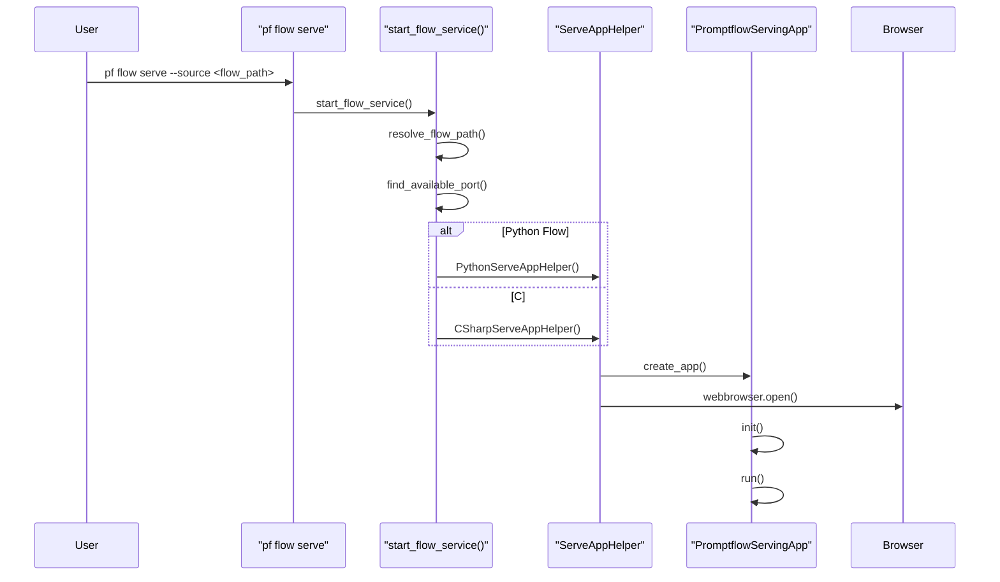

Sources:
- [src/promptflow-devkit/promptflow/_cli/_pf/_flow.py:177-227](). CLI command definition for flow serving.
- [src/promptflow-devkit/promptflow/_sdk/_utilities/serve_utils.py:397-442](). Implementation of `start_flow_service`.
- [src/promptflow-devkit/promptflow/_sdk/_utilities/serve_utils.py:69-136](). ServeAppHelper implementations.

### Interactive UI

When serving a flow, PromptFlow provides an interactive UI for interacting with the flow. For chat flows, a specialized Chat UI is provided that allows for conversation-based interaction.

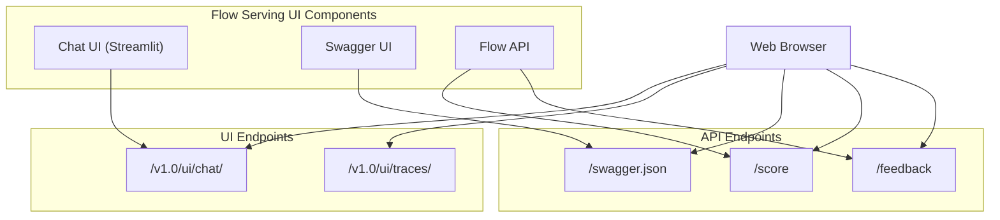

For chat flows, the system uses Streamlit to provide an interactive chat experience. The UI is automatically opened in the browser when serving a flow, unless the `--skip-open-browser` flag is used.

Sources:
- [src/promptflow-devkit/promptflow/_sdk/_utilities/chat_utils.py:25-79](). Chat UI functionality.
- [src/promptflow-devkit/promptflow/_sdk/data/executable/main.py:1-79](). Streamlit UI implementation.
- [src/promptflow-devkit/promptflow/_cli/_pf/_flow.py:297-298](). UI parameter in CLI.
- [src/promptflow-devkit/tests/sdk_cli_test/e2etests/test_flow_serve.py:20-67](). Swagger endpoint testing.

### Packaging Flows for Deployment

PromptFlow provides two main ways to package flows for deployment:

1. **Docker Containers**:
   ```bash
   pf flow build --flow <path_to_flow> --output <output_dir> --format docker
   ```

2. **Standalone Executables**:
   ```bash
   pf flow build --flow <path_to_flow> --output <output_dir> --format executable
   ```

The build process packages the flow, its dependencies, and connections into a deployable artifact.

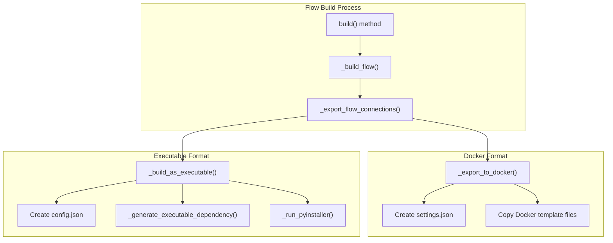

Sources:
- [src/promptflow-devkit/promptflow/_sdk/_operations/_flow_operations.py:703-781](). Build implementation.
- [src/promptflow-devkit/promptflow/_sdk/_operations/_flow_operations.py:548-580](). Docker containerization.
- [src/promptflow-devkit/promptflow/_sdk/_operations/_flow_operations.py:582-661](). Executable creation.
- [src/promptflow-devkit/promptflow/_cli/_pf/_flow.py:711-726](). Build CLI command.

## Integration with PromptFlow Service

Flow Serving integrates with the PromptFlow Service for additional functionality such as tracing and monitoring.

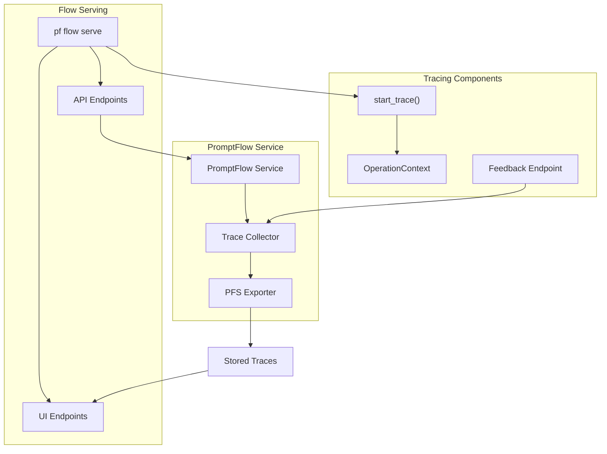

When a flow is served, it can automatically connect to the PromptFlow Service to enable tracing and monitoring. This integration allows you to:

1. Visualize flow execution details
2. Track performance metrics
3. Debug issues in flow execution
4. Provide feedback on flow outputs

The system also includes a feedback endpoint that allows users to submit feedback on flow outputs, which is then stored in the tracing system.

Sources:
- [src/promptflow-devkit/promptflow/_sdk/_utilities/serve_utils.py:97-105](). Trace integration in serving.
- [src/promptflow-devkit/tests/sdk_cli_test/e2etests/test_flow_serve.py:72-120](). Feedback functionality testing.
- [src/promptflow-core/promptflow/core/_serving/constants.py](). Feedback trace field name.

## Serving Different Flow Types

PromptFlow supports serving different types of flows, including:

1. **Standard Flows**: Regular flows that process inputs and produce outputs
2. **Chat Flows**: Interactive flows designed for conversation-based interactions
3. **Flex Flows**: Flows using a callable function or class as entry point
4. **Prompty Flows**: Flows defined using the Prompty format (markdown with YAML frontmatter)

Each flow type may have specific serving behaviors:

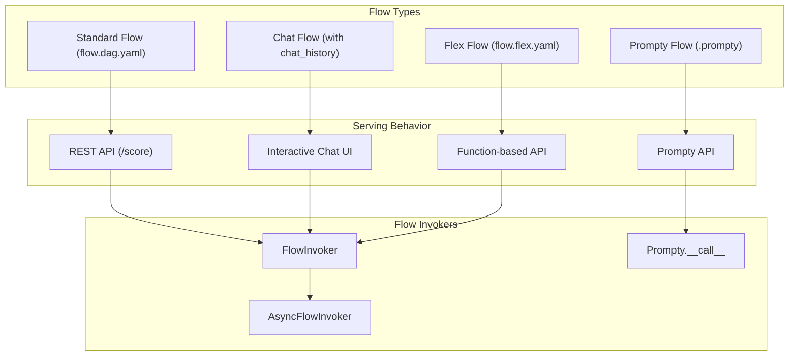

For chat flows, the interactive UI provides a conversation experience. For standard and flex flows, the API endpoint accepts inputs and returns outputs according to the flow's signature. Prompty flows are a newer addition that allows defining flows using a markdown format with YAML frontmatter.

Sources:
- [src/promptflow-devkit/promptflow/_sdk/_orchestrator/test_submitter.py:298-317](). Chat flow detection and handling.
- [src/promptflow-devkit/promptflow/_sdk/_utilities/serve_utils.py:150-181](). C# flow serving.
- [src/promptflow-devkit/promptflow/_sdk/_utilities/serve_utils.py:349-396](). Python flow serving.
- [src/promptflow-core/promptflow/core/_flow.py:222-307](). Prompty flow implementation.
- [src/promptflow-devkit/tests/sdk_cli_test/e2etests/test_prompty.py:125-199](). Prompty flow testing.

## Connection Management in Served Flows

When serving flows, connections to external services (like LLMs, databases, etc.) need to be properly managed. PromptFlow provides mechanisms to handle connections in served flows:

1. **Environment Variables**: Pass connection details via environment variables
2. **Connection Packaging**: Include connections when building flows for deployment
3. **Connection Validation**: Verify connections are valid before serving

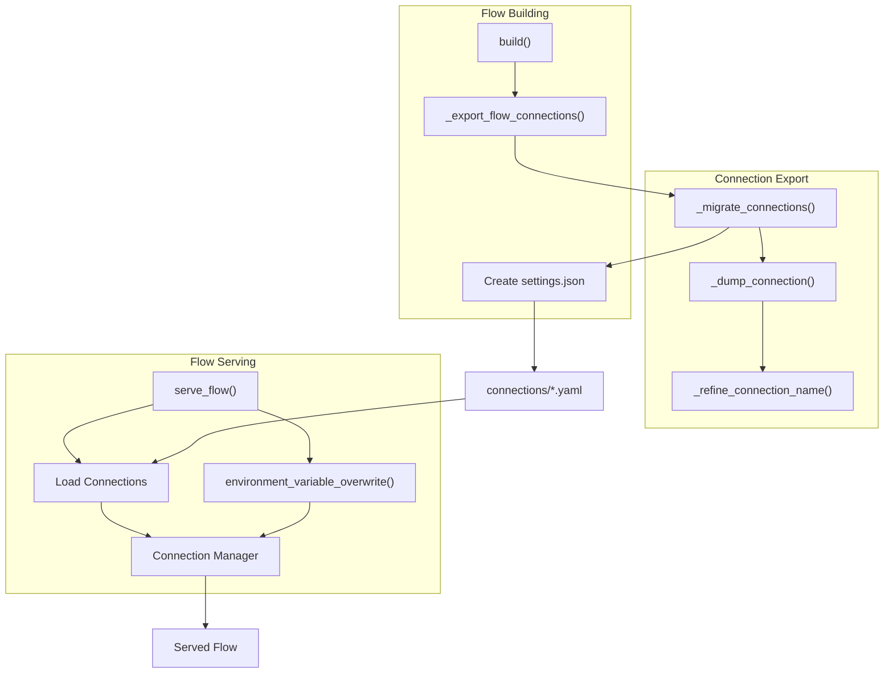

The connection management system handles different connection types, including:
- Azure OpenAI connections
- OpenAI connections
- Custom connections
- Other service-specific connections

When building a flow for deployment, the system exports all required connections and creates a settings file that maps environment variables to connection secrets. This allows for secure deployment without hardcoding sensitive information.

Sources:
- [src/promptflow-devkit/promptflow/_sdk/_operations/_flow_operations.py:484-517](). Flow connection export.
- [src/promptflow-devkit/promptflow/_sdk/_operations/_flow_operations.py:424-459](). Connection dumping.
- [src/promptflow-devkit/tests/sdk_cli_test/e2etests/test_cli.py:205-221](). Environment variable overwrite testing.

## CLI Reference

The main CLI commands for Flow Serving are:

### Flow Serve

```bash
pf flow serve --source <path_to_flow> [--port <port>] [--host <host>] [--engine <engine>] [--environment-variables <env_vars>] [--init <init_params>] [--skip-open-browser]
```

### Flow Build

```bash
pf flow build --flow <path_to_flow> --output <output_dir> --format <docker|executable> [--variant <variant>]
```

### Flow Test with UI

```bash
pf flow test --flow <path_to_flow> [--ui] [--inputs <inputs>] [--environment-variables <env_vars>]
```

The `--ui` flag in the test command launches an interactive chat UI for testing chat flows, which is similar to the UI provided by the serve command.

Sources:
- [src/promptflow-devkit/promptflow/_cli/_pf/_flow.py:177-227](). Serve command definition.
- [src/promptflow-devkit/promptflow/_cli/_pf/_flow.py:711-726](). Build command definition.
- [src/promptflow-devkit/promptflow/_cli/_pf/_flow.py:283-286](). UI parameter for test command.
- [src/promptflow-devkit/promptflow/_cli/_pf/_flow.py:466-472](). Test flow with multi-modal UI.

## Example Use Cases

### Serving a Chat Flow

```bash
# Start a chat flow server
pf flow serve --source ./my_chat_flow --port 8080

# The chat UI is available at http://localhost:8080/v1.0/ui/chat/
# The API endpoint is available at http://localhost:8080/score
```

### Building a Flow for Docker Deployment

```bash
# Build flow as Docker container
pf flow build --flow ./my_flow --output ./deployment --format docker

# Navigate to the output directory
cd ./deployment

# Build and run the Docker container
docker build -t my-flow .
docker run -p 8080:8080 -e MY_CONNECTION_API_KEY=<api_key> my-flow
```

### Creating a Standalone Executable

```bash
# Build flow as standalone executable
pf flow build --flow ./my_flow --output ./executable --format executable

# Run the executable
cd ./executable/dist
./pf
```

### Serving a Prompty Flow

```bash
# Serve a prompty flow
pf flow serve --source ./my_prompty.prompty

# Test a prompty flow with UI
pf flow test --flow ./my_prompty.prompty --ui
```

Sources:
- [src/promptflow-devkit/promptflow/_sdk/_utilities/serve_utils.py:397-442](). Flow serving implementation.
- [src/promptflow-devkit/promptflow/_sdk/_operations/_flow_operations.py:548-580](). Docker deployment.
- [src/promptflow-devkit/promptflow/_sdk/_operations/_flow_operations.py:582-661](). Executable creation.
- [src/promptflow-devkit/tests/sdk_cli_test/e2etests/test_prompty.py:125-199](). Prompty flow testing.

## Tracing and Monitoring

Flow Serving includes built-in tracing and monitoring capabilities through integration with the PromptFlow Service:

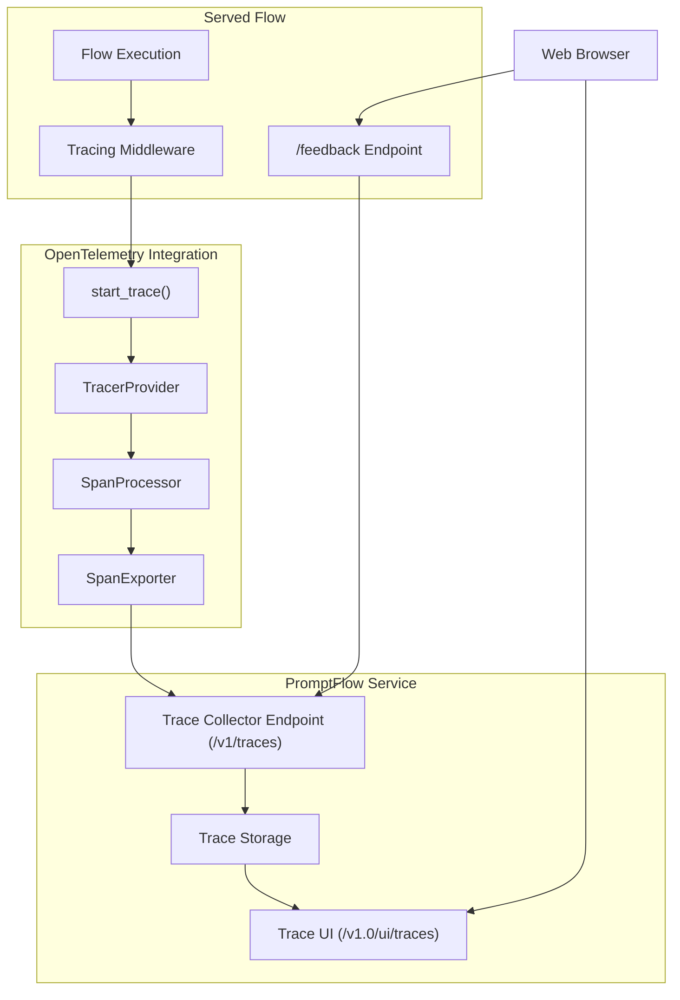

When tracing is enabled, flow executions are automatically traced and can be visualized through the Trace UI. This helps in debugging and understanding flow behavior. The system also includes a feedback endpoint that allows users to provide feedback on flow outputs, which is then stored in the tracing system.

The tracing system uses OpenTelemetry for instrumentation, which provides a standardized way to collect and export telemetry data. This allows for integration with various monitoring and observability tools.

Sources:
- [src/promptflow-devkit/promptflow/_sdk/_utilities/serve_utils.py:97-105](). Trace integration in serving.
- [src/promptflow-devkit/tests/sdk_cli_test/e2etests/test_flow_serve.py:72-120](). Feedback functionality testing.
- [src/promptflow-devkit/tests/sdk_cli_test/e2etests/test_flow_serve_fastapi.py:20-67](). FastAPI tracing integration.

## Advanced Configuration

### Environment Variables

| Environment Variable | Description |
|---------------------|-------------|
| `PF_SERVICE_HOST` | The host for the PromptFlow service |
| `PF_SERVICE_DEBUG` | Enable debug mode for the service |
| `PF_TRACE_CONTEXT` | Set tracing context for the flow |
| `PF_SERVICE_WORKER_NUM` | Number of worker threads for the service |
| `PF_TRACING_SKIP_EXPORTER_SETUP_ENVIRON` | Skip exporter setup for tracing |
| `PF_CHAT_UI_ENABLE_STREAMLIT` | Enable Streamlit for chat UI |

Sources:
- [src/promptflow-devkit/promptflow/_sdk/_constants.py:22-102](). Environment variables and constants.
- [src/promptflow-devkit/promptflow/_sdk/_utilities/serve_utils.py:103-104](). Tracing environment variables.
- [src/promptflow-devkit/promptflow/_cli/_pf/_flow.py:51-52](). Chat UI environment variables.

### Customizing the Serve UI

The Flow Serving UI can be customized by providing a static folder:

```bash
pf flow serve --source <path_to_flow> --static_folder <path_to_static_files>
```

This allows you to provide custom HTML, CSS, and JavaScript for the UI.

For chat flows, the system can use either a built-in UI or a Streamlit-based UI, depending on configuration:

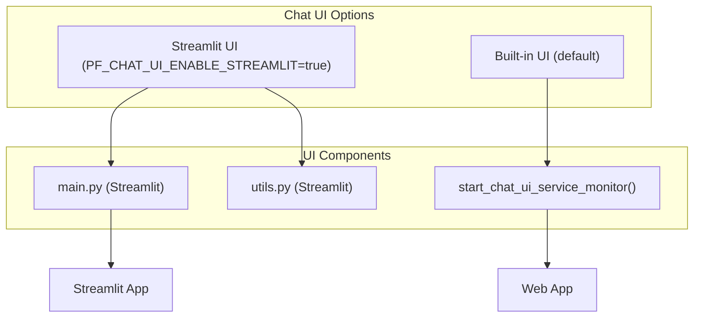

Sources:
- [src/promptflow-devkit/promptflow/_cli/_pf/_flow.py:194-196](). Static folder parameter.
- [src/promptflow-devkit/promptflow/_sdk/_utilities/serve_utils.py:81-82](). Static folder handling.
- [src/promptflow-devkit/promptflow/_cli/_pf/_flow.py:494-521](). Streamlit UI configuration.

## Conclusion

Flow Serving in PromptFlow provides flexible options for deploying flows as web services, Docker containers, or standalone executables. The integrated tracing and UI capabilities make it easy to debug and interact with flows. By leveraging the different serving mechanisms and deployment options, you can easily integrate flows into your applications or provide interactive experiences to users.

---

