# Page: Overview

# Overview

<details>
<summary>Relevant source files</summary>

The following files were used as context for generating this wiki page:

- [README.md](README.md)
- [docs/how-to-guides/faq.md](docs/how-to-guides/faq.md)
- [docs/media/how-to-guides/upgrade-error.png](docs/media/how-to-guides/upgrade-error.png)
- [docs/media/how-to-guides/vscode-tool-list.png](docs/media/how-to-guides/vscode-tool-list.png)
- [scripts/docs/_static/custom.css](scripts/docs/_static/custom.css)
- [scripts/docs/conf.py](scripts/docs/conf.py)
- [src/promptflow-azure/CHANGELOG.md](src/promptflow-azure/CHANGELOG.md)
- [src/promptflow-azure/pyproject.toml](src/promptflow-azure/pyproject.toml)
- [src/promptflow-core/CHANGELOG.md](src/promptflow-core/CHANGELOG.md)
- [src/promptflow-core/pyproject.toml](src/promptflow-core/pyproject.toml)
- [src/promptflow-devkit/CHANGELOG.md](src/promptflow-devkit/CHANGELOG.md)
- [src/promptflow-devkit/pyproject.toml](src/promptflow-devkit/pyproject.toml)
- [src/promptflow-tracing/CHANGELOG.md](src/promptflow-tracing/CHANGELOG.md)
- [src/promptflow-tracing/pyproject.toml](src/promptflow-tracing/pyproject.toml)
- [src/promptflow/CHANGELOG.md](src/promptflow/CHANGELOG.md)
- [src/promptflow/README.md](src/promptflow/README.md)
- [src/promptflow/promptflow/__init__.py](src/promptflow/promptflow/__init__.py)
- [src/promptflow/promptflow/_version.py](src/promptflow/promptflow/_version.py)

</details>


PromptFlow is a comprehensive suite of development tools designed to streamline the end-to-end development cycle of LLM-based AI applications. It spans from ideation and prototyping through testing and evaluation to production deployment and monitoring. This document provides a high-level overview of the PromptFlow repository structure, its key components, and core functionality.

## Purpose and Goals

PromptFlow aims to make prompt engineering easier and enable users to build LLM applications with production quality by providing:

- Tools for creating executable flows that connect LLMs, prompts, and custom code
- Capabilities for testing, evaluating, and improving flow quality
- Mechanisms for deploying flows to various serving platforms
- Observability tools for monitoring flow execution and performance

PromptFlow supports the complete lifecycle of LLM application development, from interactive experimentation to scaled production deployment.

Sources: [README.md:20-33](), [src/promptflow/README.md:21-34]()

## System Architecture

The PromptFlow system consists of several core packages that work together to provide a comprehensive development experience:

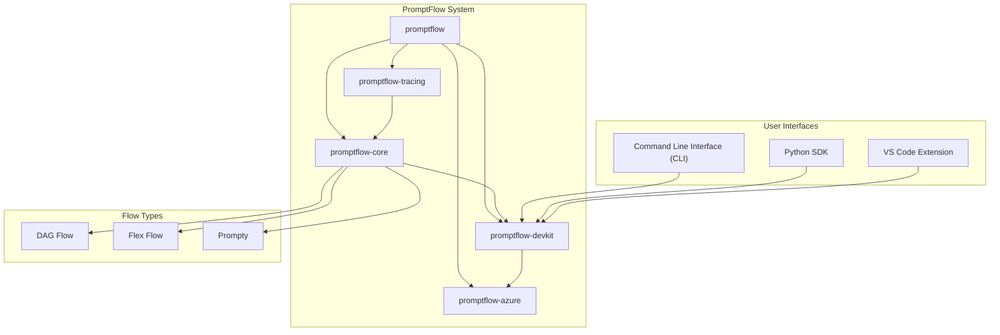

### Core Packages

1. **promptflow-core**: Provides essential functionality for loading and running flows
   - Contains core abstractions for flow execution
   - Handles connection management
   - Implements the flow execution model

2. **promptflow-tracing**: Enables observability for flow execution
   - Tracks API calls and performance metrics
   - Provides token counting for LLM interactions
   - Integrates with OpenTelemetry for distributed tracing

3. **promptflow-devkit**: Offers development tools for building and testing flows
   - CLI tools for flow operations
   - Local testing capabilities
   - Run management and visualization

4. **promptflow-azure**: Provides Azure integration for cloud execution
   - Azure ML workspace integration
   - Cloud deployment capabilities
   - Azure resource management

Sources: [src/promptflow-core/pyproject.toml:1-47](), [src/promptflow-devkit/pyproject.toml:1-56](), [src/promptflow-azure/pyproject.toml:1-48](), [src/promptflow-tracing/pyproject.toml:1-46]()

## Key Concepts

### Flows

Flows represent the executable units in PromptFlow, defining how inputs are processed through a sequence of operations to produce outputs. PromptFlow supports multiple flow types:

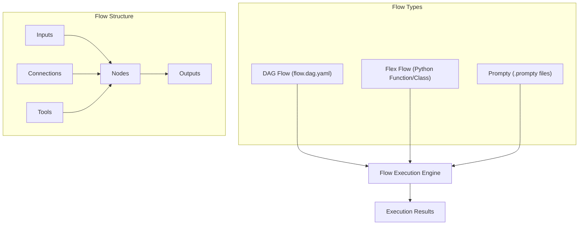

1. **DAG Flow**: Traditional flow defined using YAML (flow.dag.yaml) with a directed acyclic graph structure
2. **Flex Flow**: Python function or class-based flow for more programmatic flexibility (introduced in v1.11.0)
3. **Prompty**: Specialized format for prompt template creation (introduced in v1.11.0)

For more detailed information on these flow types, see [Flow Types](#4).

Sources: [src/promptflow/CHANGELOG.md:76-78]()

### Tools

Tools are the building blocks that perform specific operations within a flow. PromptFlow provides various built-in tools and supports custom tool creation:

- **LLM Tools**: Integration with language models like OpenAI and Azure OpenAI
- **Python Tools**: Custom Python code execution
- **Prompt Tools**: Template-based prompt generation
- **Custom Tools**: User-defined specialized tools

For more information on tool management, see [Tool System](#2.3).

Sources: [README.md:20-33]()

### Connections

Connections manage authentication and configuration for external services like LLM providers. They abstract away the complexity of handling API keys and endpoints:

- OpenAI connections
- Azure OpenAI connections
- Custom connections for other services

For more details on connection management, see [Connection Management](#3.3).

Sources: [README.md:55-69](), [src/promptflow/README.md:56-68]()

## Execution Architecture

The execution of flows in PromptFlow is handled by a sophisticated system designed for flexibility and performance:

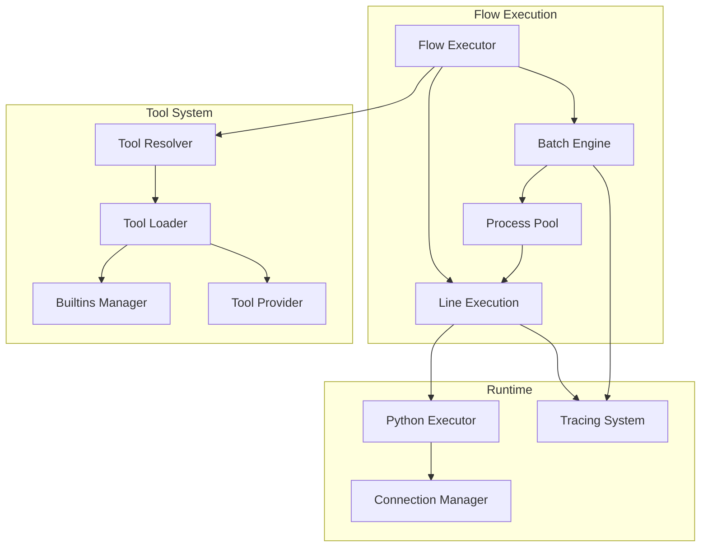

Key components of the execution architecture:

1. **Flow Executor**: Orchestrates the overall flow execution
2. **Line Execution**: Handles individual execution of flow nodes for a single input
3. **Batch Engine**: Manages batch processing for multiple inputs
4. **Process Pool**: Enables parallel execution for improved performance
5. **Tool Resolver**: Resolves tools referenced in flows
6. **Connection Manager**: Provides access to external service credentials

For more details on the execution model, see [Flow Execution Model](#2.2).

Sources: [src/promptflow/CHANGELOG.md:210-279]()

## Development Workflow

PromptFlow supports a comprehensive development workflow:

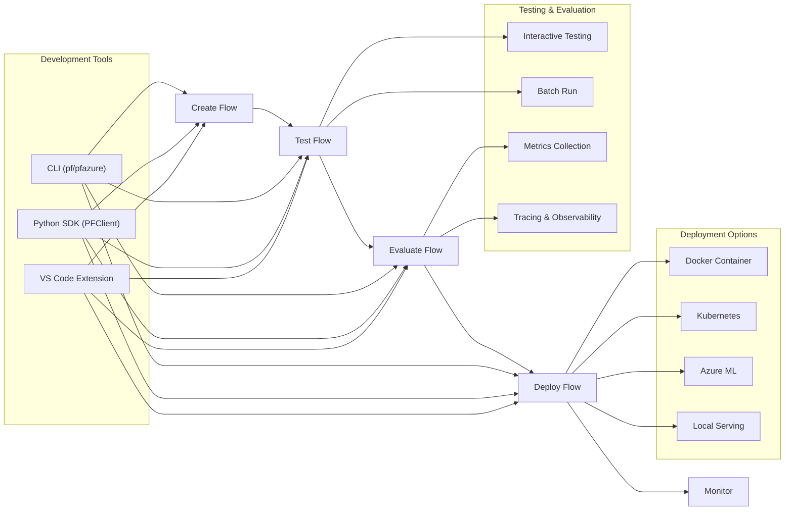

1. **Create Flow**: Design a flow using CLI, SDK, or VS Code Extension
2. **Test Flow**: Validate flow functionality with interactive and batch testing
3. **Evaluate Flow**: Assess quality and performance on larger datasets
4. **Deploy Flow**: Serve the flow as an API or integrate it into applications
5. **Monitor**: Track performance and usage in production

For more information on these development stages, see [CLI and SDK](#3) and [Advanced Features](#6).

Sources: [README.md:89-91](), [src/promptflow/CHANGELOG.md:285-313]()

## Integration and Deployment

PromptFlow can be deployed in various environments and integrated with other systems:

1. **Local Deployment**: Run flows locally for development and testing
2. **Docker Containers**: Package flows for containerized deployment
3. **Kubernetes**: Deploy at scale with Kubernetes orchestration
4. **Azure Integration**: Leverage Azure ML and other Azure services for cloud deployment
5. **CI/CD Integration**: Incorporate flow testing and evaluation into CI/CD pipelines

For more details on deployment options, see [Flow Serving](#6.3) and [Azure Integration](#7).

Sources: [src/promptflow/CHANGELOG.md:294-301]()

## Additional Features

### Tracing and Telemetry

PromptFlow includes robust tracing capabilities for monitoring flow execution:

- Track API calls and performance metrics
- Monitor token usage for LLM interactions
- Visualize flow execution
- Integrate with OpenTelemetry for distributed tracing

For more on this topic, see [Tracing and Telemetry](#2.4).

Sources: [src/promptflow/CHANGELOG.md:209-215](), [src/promptflow-tracing/CHANGELOG.md:3-15]()

### Batch Execution

For processing large datasets, PromptFlow provides batch execution capabilities:

- Parallel processing with configurable workers
- Progress tracking and performance estimation
- Resumable execution for long-running jobs

For details on batch processing, see [Batch Execution](#6.1).

Sources: [src/promptflow/CHANGELOG.md:335-340](), [docs/how-to-guides/faq.md:116-156]()

### Evaluation System

PromptFlow includes tools for evaluating flow quality and performance:

- Metrics collection and aggregation
- Custom evaluation criteria
- Quality testing framework

For more information on evaluation, see [Evaluation System](#6.2).

Sources: [src/promptflow/CHANGELOG.md:341-343]()

## Conclusion

PromptFlow provides a comprehensive ecosystem for developing, testing, deploying, and monitoring LLM-based applications. Its modular architecture and extensive feature set make it a powerful tool for the entire lifecycle of AI application development.

For detailed guides on using PromptFlow, refer to the specific sections in this wiki or explore the [official documentation](https://microsoft.github.io/promptflow).

---

# Page: Key Concepts

# Key Concepts

<details>
<summary>Relevant source files</summary>

The following files were used as context for generating this wiki page:

- [docs/concepts/concept-flows.md](docs/concepts/concept-flows.md)
- [docs/how-to-guides/index.md](docs/how-to-guides/index.md)
- [docs/how-to-guides/manage-connections.md](docs/how-to-guides/manage-connections.md)
- [docs/how-to-guides/quick-start.md](docs/how-to-guides/quick-start.md)
- [docs/how-to-guides/run-and-evaluate-a-flow/index.md](docs/how-to-guides/run-and-evaluate-a-flow/index.md)
- [docs/how-to-guides/tune-prompts-with-variants.md](docs/how-to-guides/tune-prompts-with-variants.md)
- [docs/index.md](docs/index.md)
- [docs/media/how-to-guides/quick-start/flow-run-visualize-single-run.png](docs/media/how-to-guides/quick-start/flow-run-visualize-single-run.png)
- [docs/media/how-to-guides/run_visualize.png](docs/media/how-to-guides/run_visualize.png)
- [examples/flows/standard/customer-intent-extraction/intent.py](examples/flows/standard/customer-intent-extraction/intent.py)
- [src/promptflow-azure/CHANGELOG.md](src/promptflow-azure/CHANGELOG.md)
- [src/promptflow-azure/pyproject.toml](src/promptflow-azure/pyproject.toml)
- [src/promptflow-core/CHANGELOG.md](src/promptflow-core/CHANGELOG.md)
- [src/promptflow-core/pyproject.toml](src/promptflow-core/pyproject.toml)
- [src/promptflow-devkit/CHANGELOG.md](src/promptflow-devkit/CHANGELOG.md)
- [src/promptflow-devkit/pyproject.toml](src/promptflow-devkit/pyproject.toml)
- [src/promptflow-tracing/CHANGELOG.md](src/promptflow-tracing/CHANGELOG.md)
- [src/promptflow-tracing/pyproject.toml](src/promptflow-tracing/pyproject.toml)
- [src/promptflow/CHANGELOG.md](src/promptflow/CHANGELOG.md)
- [src/promptflow/promptflow/_version.py](src/promptflow/promptflow/_version.py)

</details>


## Purpose and Scope

This document explains the fundamental concepts in Prompt Flow, a framework for building, testing, and deploying AI applications powered by Large Language Models (LLMs). Understanding these core concepts is essential for effectively working with Prompt Flow. This page covers the basic building blocks of the system including flows, tools, connections, and runs. For more detailed information about system architecture, refer to [Architecture](#2), and for usage details, see [CLI and SDK](#3).

## Flows

Flows are the central concept in Prompt Flow. A flow is an executable workflow that connects LLMs, prompts, Python code, and other tools together to accomplish a specific task.

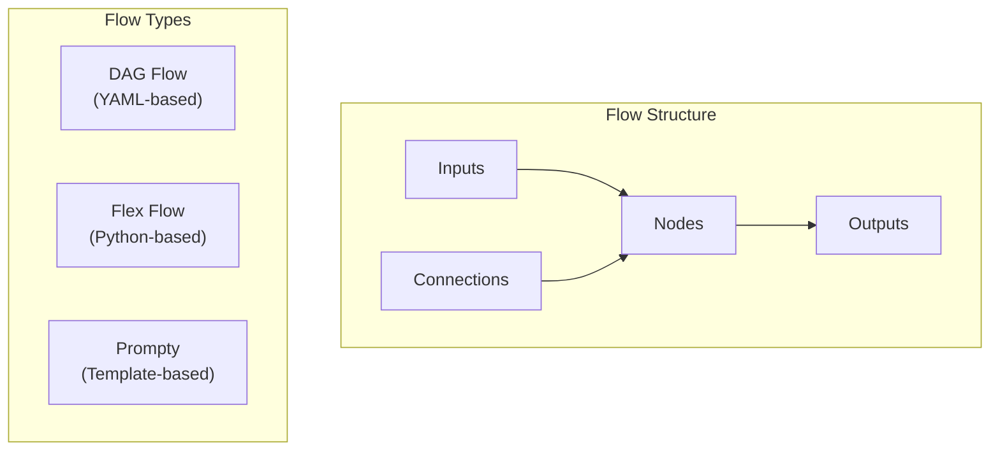

Sources:
- src/promptflow/CHANGELOG.md
- README.md

### Flow Types

| Type | Description | Definition Format | Introduced |
|------|-------------|-------------------|------------|
| DAG Flow | Directed Acyclic Graph-based flow | YAML (`flow.dag.yaml`) | Initial version |
| Flex Flow | Function or class-based flow | Python | v1.11.0 |
| Prompty | Streamlined prompt template creation | `.prompty` files | v1.11.0 (experimental) |

DAG Flows define each node and connection explicitly in YAML, while Flex Flows use Python functions or classes for more flexible control flow. Prompty is designed specifically for prompt engineering with streamlined syntax.

A typical DAG flow structure in YAML:

```yaml
inputs:
  url:
    type: string
outputs:
  category:
    reference: ${convert_to_dict.output.category}
  evidence:
    type: string
    reference: ${convert_to_dict.output.evidence}
nodes:
- name: fetch_text_content_from_url
  type: python
  source:
    type: code
    path: fetch_text_content_from_url.py
  inputs:
    url: ${inputs.url}
- name: classify_with_llm
  type: llm
  source:
    type: code
    path: ./classify_with_llm.jinja2
  inputs:
    deployment_name: gpt-35-turbo
    url: ${inputs.url}
    text_content: ${summarize_text_content.output}
  connection: azure_open_ai_connection
```

Sources:
- src/promptflow/tests/test_configs/flows/web_classification_invalid/flow.dag.yaml
- src/promptflow/CHANGELOG.md

## Tools

Tools are the building blocks of flows. Each node in a flow uses a specific tool to perform its task.

### Tool Resolution Architecture
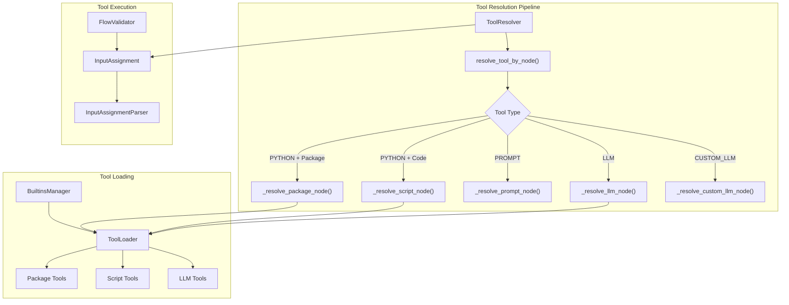

### Tool Types and Implementation

| Type | Description | Implementation | Source Location |
|------|-------------|----------------|-----------------|
| Python Tools | Execute Python functions decorated with `@tool` | Function with type hints | Local `.py` files or packages |
| LLM Tools | Interface with language models using Jinja2 templates | Template + connection | `.jinja2` template files |
| Custom LLM Tools | Open-source LLM integrations | Custom implementations | Package tools |
| Prompt Tools | Reusable prompt templates | Template-based | Template files |

### Python Tool Definition
Python tools use the `@tool` decorator from `promptflow.core`:

[examples/flows/standard/customer-intent-extraction/intent.py:9-36]()

### Tool System Components

The tool resolution system consists of:
- **`ToolResolver`**: Main entry point that resolves tool references in flow nodes
- **`ToolLoader`**: Loads tools from different sources (built-in packages, script files)  
- **`BuiltinsManager`**: Manages built-in tools from the `promptflow-tools` package
- **`InputAssignmentParser`**: Parses and validates tool input mappings
- **`FlowValidator`**: Validates tool configurations and connections

Sources:
- [src/promptflow/CHANGELOG.md]()
- [examples/flows/standard/customer-intent-extraction/intent.py]()

## Connections

Connections store credentials and configuration for external services used by tools in a flow. They provide a secure way to manage access to services like OpenAI or Azure OpenAI.

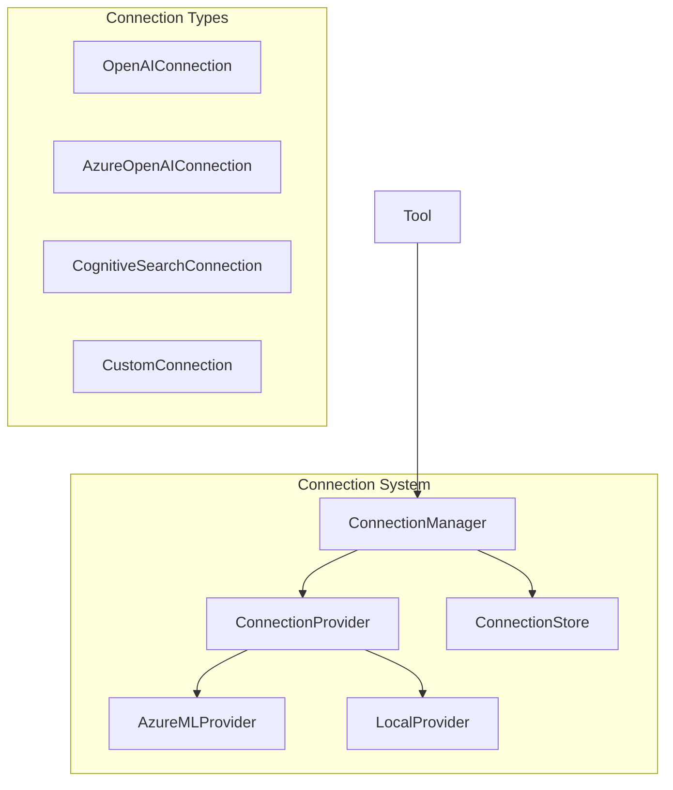

Sources:
- src/promptflow-core/pyproject.toml
- docs/how-to-guides/faq.md

### Connection Types

| Type | Purpose | Configuration Parameters | Default API Version |
|------|---------|--------------------------|---------------------|
| OpenAI | Connect to OpenAI services | api_key, organization_id | - |
| AzureOpenAI | Connect to Azure OpenAI | api_key, api_base, deployment_name | 2024-02-01 |
| CognitiveSearch | Azure Cognitive Search | api_key, endpoint | 2023-11-01 |
| Custom | User-defined connections | Varies by connection type | - |

### Connection Management

Connections can be created and managed using:

- **CLI**: `pf connection create/update/show/list/delete`
- **SDK**: `PFClient().connection` methods
- **Environment Variables**: Load connections from environment variables using `AzureOpenAIConnection.from_env()` (added in v1.7.0)

Sources:
- src/promptflow/CHANGELOG.md
- src/promptflow-core/CHANGELOG.md
- README.md

## Runs

Runs represent executions of flows with specific inputs and configurations. They track the execution process, store inputs and outputs, and collect metrics.

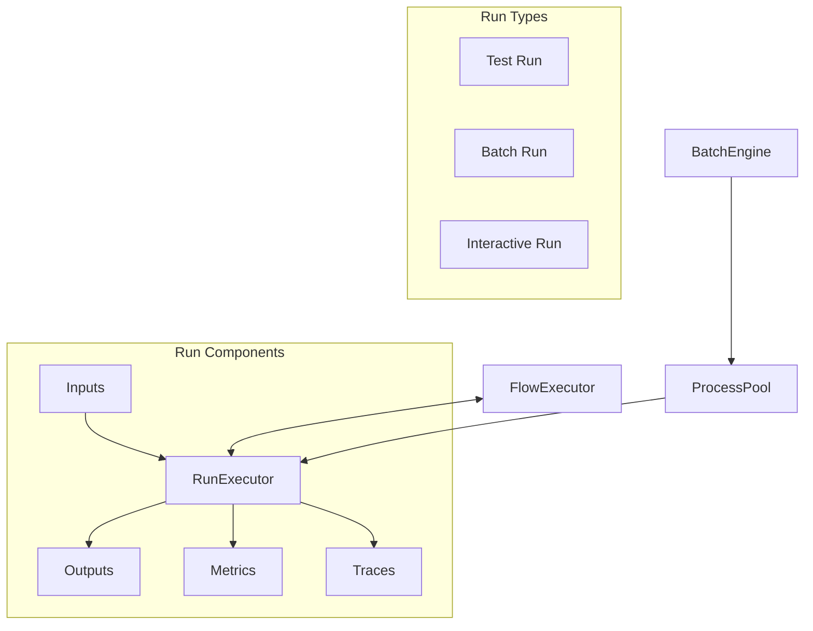

Sources:
- src/promptflow/CHANGELOG.md
- src/promptflow-devkit/pyproject.toml

### Run Types

| Type | Description | Command |
|------|-------------|---------|
| Test Run | Single execution for testing | `pf flow test` |
| Interactive Run | Chat-based execution | `pf flow test --interactive` |
| Batch Run | Execution against a dataset | `pf run create` |

### Run Components

- **Inputs**: Data provided to the flow
- **Outputs**: Results produced by the flow
- **Metrics**: Performance measurements (e.g., token counts, latency)
- **Traces**: Detailed information about interactions with LLMs (added in v1.9.0)
- **Logs**: Flow and node execution logs stored under the `.promptflow` directory

Sources:
- src/promptflow/CHANGELOG.md
- src/promptflow-tracing/CHANGELOG.md
- README.md

## Modular Package Architecture

Prompt Flow is built as a modular system with separate packages for different concerns:

### Core Architecture Diagram
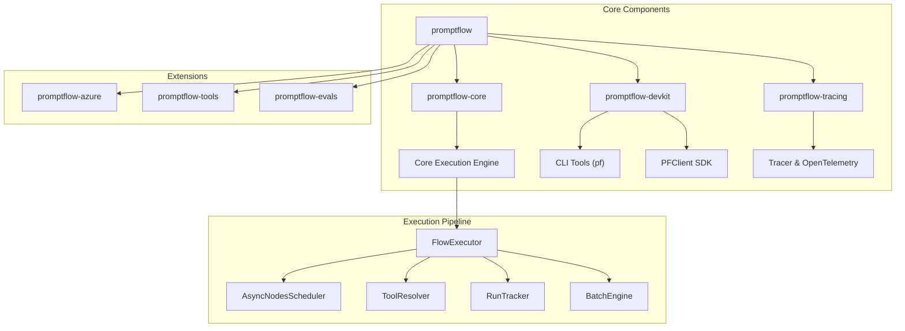

### Package Responsibilities

| Package | Description | Key Classes/Components |
|---------|-------------|------------------------|
| `promptflow-core` | Core flow execution engine | `FlowExecutor`, `AsyncNodesScheduler`, `ToolResolver` |
| `promptflow-tracing` | OpenTelemetry-based tracing | `Tracer`, OpenAI API injection, token counting |
| `promptflow-devkit` | Development tools and SDK | `pf` CLI, `PFClient`, run management, UI service |
| `promptflow-azure` | Azure AI integration | `pfazure` CLI, Azure ML workspace integration |
| `promptflow-tools` | Built-in tool implementations | LLM tools, Python tools, utility functions |
| `promptflow-evals` | Evaluation framework | Built-in evaluators, adversarial simulation |

The main `promptflow` package serves as an umbrella that pulls together `promptflow-core`, `promptflow-devkit`, and `promptflow-tracing` for a complete local development experience.

Sources:
- src/promptflow/CHANGELOG.md
- src/promptflow-core/pyproject.toml
- src/promptflow-devkit/pyproject.toml
- src/promptflow-azure/pyproject.toml
- src/promptflow-tracing/pyproject.toml

## User Interfaces

Prompt Flow provides multiple interfaces to interact with the system:

### CLI (Command-Line Interface)

The CLI (`pf` command) provides access to flow operations, run management, and connection management:

```
pf flow test --flow ./my_flow --inputs url="https://example.com"
pf run create --flow ./my_flow --data ./data.jsonl --column-mapping url='${data.url}'
pf connection create --file ./openai.yaml --set api_key=<your_api_key> --name open_ai_connection
```

### Python SDK

The Python SDK provides programmatic access through the `PFClient` class:

```python
from promptflow.client import PFClient

# Initialize client
pf = PFClient()

# Test a flow
result = pf.test(flow="./my_flow", inputs={"url": "https://example.com"})

# Create a run
run = pf.run(flow="./my_flow", data="./data.jsonl", 
             column_mapping={"url": "${data.url}"})
```

### VS Code Extension

The Visual Studio Code extension provides a graphical interface for developing and testing flows, with features such as:

- Visual flow editor
- Tool gallery
- Interactive testing
- Debug and trace visualization

Sources:
- README.md
- src/promptflow/promptflow/__init__.py
- src/promptflow-devkit/pyproject.toml

## Key Integration Features

### Tracing & Telemetry

Added in v1.9.0, tracing provides detailed insight into LLM interactions:

- Token usage tracking
- Prompt and completion capture
- OpenTelemetry integration
- Trace visualization in the UI

### Azure AI Integration

Prompt Flow integrates with Azure services through the `promptflow-azure` package:

- **Azure AI**: Cloud version of Prompt Flow
- **Azure OpenAI**: Integration with Azure's OpenAI service
- **Azure ML**: Integration with Azure Machine Learning
- **Cloud Execution**: Run flows in Azure with `pfazure run create`
- **Flow Deployment**: Deploy flows to Azure with `pfazure flow create`

Sources:
- src/promptflow/CHANGELOG.md
- src/promptflow-azure/CHANGELOG.md
- src/promptflow-tracing/CHANGELOG.md

## Execution Model

The execution system handles flow execution with different strategies:

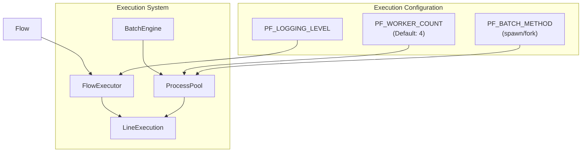

- **Single Execution**: FlowExecutor processes the flow directly
- **Batch Execution**: BatchEngine uses a ProcessPool to parallelize execution
- **Configuration**:
  - `PF_WORKER_COUNT`: Number of parallel workers (default: 4, was 16 in versions <1.4.0)
  - `PF_BATCH_METHOD`: Processing method ('spawn' or 'fork')
  - `PF_LOGGING_LEVEL`: Controls logging verbosity

Sources:
- src/promptflow/CHANGELOG.md
- docs/how-to-guides/faq.md

---

# Page: Installation and Setup

# Installation and Setup

<details>
<summary>Relevant source files</summary>

The following files were used as context for generating this wiki page:

- [docs/concepts/concept-flows.md](docs/concepts/concept-flows.md)
- [docs/how-to-guides/index.md](docs/how-to-guides/index.md)
- [docs/how-to-guides/manage-connections.md](docs/how-to-guides/manage-connections.md)
- [docs/how-to-guides/quick-start.md](docs/how-to-guides/quick-start.md)
- [docs/how-to-guides/run-and-evaluate-a-flow/index.md](docs/how-to-guides/run-and-evaluate-a-flow/index.md)
- [docs/how-to-guides/tune-prompts-with-variants.md](docs/how-to-guides/tune-prompts-with-variants.md)
- [docs/index.md](docs/index.md)
- [docs/media/how-to-guides/quick-start/flow-run-visualize-single-run.png](docs/media/how-to-guides/quick-start/flow-run-visualize-single-run.png)
- [docs/media/how-to-guides/run_visualize.png](docs/media/how-to-guides/run_visualize.png)
- [examples/flows/standard/customer-intent-extraction/intent.py](examples/flows/standard/customer-intent-extraction/intent.py)
- [src/promptflow-devkit/promptflow/_sdk/_utilities/tracing_utils.py](src/promptflow-devkit/promptflow/_sdk/_utilities/tracing_utils.py)
- [src/promptflow-recording/recordings/local/executor_node_cache.shelve.bak](src/promptflow-recording/recordings/local/executor_node_cache.shelve.bak)
- [src/promptflow-recording/recordings/local/executor_node_cache.shelve.dat](src/promptflow-recording/recordings/local/executor_node_cache.shelve.dat)
- [src/promptflow-recording/recordings/local/executor_node_cache.shelve.dir](src/promptflow-recording/recordings/local/executor_node_cache.shelve.dir)
- [src/promptflow/setup.py](src/promptflow/setup.py)
- [src/promptflow/tests/executor/e2etests/test_langchain.py](src/promptflow/tests/executor/e2etests/test_langchain.py)
- [src/promptflow/tests/executor/e2etests/test_telemetry.py](src/promptflow/tests/executor/e2etests/test_telemetry.py)
- [src/promptflow/tests/executor/e2etests/test_traces.py](src/promptflow/tests/executor/e2etests/test_traces.py)
- [src/promptflow/tests/test_configs/flows/openai_chat_api_flow/chat.py](src/promptflow/tests/test_configs/flows/openai_chat_api_flow/chat.py)
- [src/promptflow/tests/test_configs/flows/openai_chat_api_flow/flow.dag.yaml](src/promptflow/tests/test_configs/flows/openai_chat_api_flow/flow.dag.yaml)
- [src/promptflow/tests/test_configs/flows/openai_chat_api_flow/inputs.jsonl](src/promptflow/tests/test_configs/flows/openai_chat_api_flow/inputs.jsonl)
- [src/promptflow/tests/test_configs/flows/openai_completion_api_flow/completion.py](src/promptflow/tests/test_configs/flows/openai_completion_api_flow/completion.py)
- [src/promptflow/tests/test_configs/flows/openai_completion_api_flow/flow.dag.yaml](src/promptflow/tests/test_configs/flows/openai_completion_api_flow/flow.dag.yaml)
- [src/promptflow/tests/test_configs/flows/openai_completion_api_flow/inputs.jsonl](src/promptflow/tests/test_configs/flows/openai_completion_api_flow/inputs.jsonl)

</details>


This document covers the installation and initial setup of Microsoft Prompt Flow, including package dependencies, connection configuration, and verification steps. For information about developing flows after installation, see [Flow Types](#4). For Azure-specific deployment setup, see [Azure Integration](#7).

## Package Architecture Overview

Prompt Flow is structured as a modular system with multiple interconnected packages that provide different capabilities:

### Core Package Dependencies

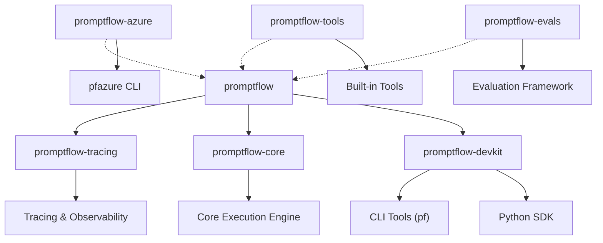

The main `promptflow` package serves as the umbrella package that orchestrates three core components:

- **promptflow-core**: Contains the execution engine and core runtime capabilities
- **promptflow-devkit**: Provides CLI tools and SDK for local development  
- **promptflow-tracing**: Handles tracing, telemetry, and observability features

**Sources**: [src/promptflow/setup.py:23-27]()

### Installation Packages and Capabilities

| Package | Purpose | Key Components |
|---------|---------|----------------|
| `promptflow` | Main package with core functionality | FlowExecutor, CLI, SDK |
| `promptflow-azure` | Azure AI integration | Azure ML connectivity, cloud execution |
| `promptflow-tools` | Built-in tools collection | LLM tools, Python tools, custom connectors |
| `promptflow-evals` | Evaluation framework | Metrics computation, adversarial testing |

**Sources**: [src/promptflow/setup.py:51-65]()

## Installation Methods

### Basic Installation

Install the core Prompt Flow package:

```bash
pip install promptflow
```

This installs the essential components needed for local flow development and execution.

**Sources**: [docs/how-to-guides/quick-start.md:15-18]()

### Installation with Optional Features

Prompt Flow provides several installation extras for different use cases:

```bash
# Install with all optional features
pip install promptflow[all]

# Install with Azure integration
pip install promptflow[azure]

# Install with executable capabilities  
pip install promptflow[executable]

# Install with Azure ML serving support
pip install promptflow[azureml-serving]

# Install with executor service support
pip install promptflow[executor-service]
```

**Sources**: [src/promptflow/setup.py:51-65]()

### Package Extra Definitions

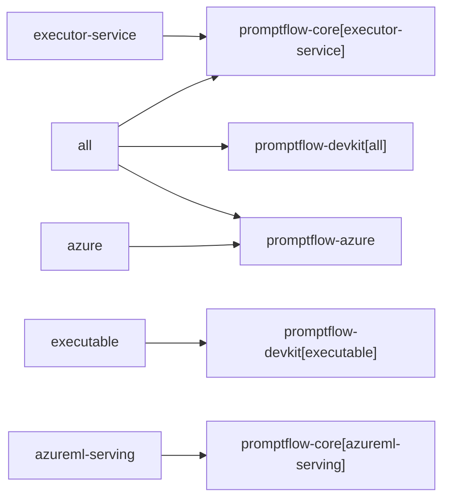

**Sources**: [src/promptflow/setup.py:51-65]()

### Development Installation

For contributors or advanced users who need the latest features:

```bash
# Clone the repository
git clone https://github.com/microsoft/promptflow
cd promptflow

# Install in development mode
pip install -e src/promptflow
```

**Sources**: [src/promptflow/setup.py:38]()

## Python Version Requirements

Prompt Flow requires Python 3.9 or higher:

```python
python_requires="<4.0,>=3.9"
```

Supported Python versions:
- Python 3.9
- Python 3.10  
- Python 3.11

**Sources**: [src/promptflow/setup.py:43-49]()

## Connection Configuration

### Connection Types and Setup

Prompt Flow uses connections to securely manage credentials for external services. The system supports both strong-typed connections and custom connections:

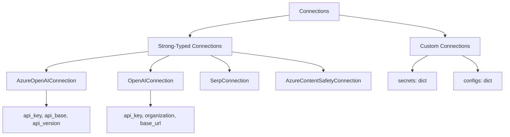

**Sources**: [docs/how-to-guides/manage-connections.md:9-12]()

### Creating Connections via CLI

Create an Azure OpenAI connection:

```bash
# Create from YAML file with override
pf connection create -f connection.yaml --set api_key=<your-api-key>

# Create custom connection
pf connection create -f custom.yaml --set configs.endpoint=<endpoint> secrets.my_key=<api-key>
```

Example Azure OpenAI connection YAML:
```yaml
$schema: https://azuremlschemas.azureedge.net/promptflow/latest/AzureOpenAIConnection.schema.json
name: azure_open_ai_connection
type: azure_open_ai
api_key: "<to-be-replaced>"
api_base: "https://<name>.openai.azure.com/"
api_type: "azure"
api_version: "2023-03-15-preview"
```

**Sources**: [docs/how-to-guides/manage-connections.md:23-50]()

### Environment Variable Loading

Prompt Flow supports automatic connection loading from environment variables:

| Connection Type | Environment Variables |
|-----------------|----------------------|
| OpenAIConnection | `OPENAI_API_KEY`, `OPENAI_ORG_ID`, `OPENAI_BASE_URL` |
| AzureOpenAIConnection | `AZURE_OPENAI_API_KEY`, `AZURE_OPENAI_ENDPOINT`, `OPENAI_API_VERSION` |

```python
from promptflow.entities import OpenAIConnection, AzureOpenAIConnection

# Load from environment variables
openai_conn = OpenAIConnection.from_env()
azure_conn = AzureOpenAIConnection.from_env()
```

**Sources**: [docs/how-to-guides/manage-connections.md:210-224]()

## Installation Verification

### Verify Core Installation

Check that the main package and CLI are working:

```bash
# Verify CLI installation
pf --version

# List available commands
pf --help

# Check connection capabilities
pf connection list
```

### Create and Test a Simple Flow

Verify the installation by creating a minimal flow:

```python
import os
from pathlib import Path
from promptflow.tracing import trace
from promptflow.core import Prompty

@trace
def chat(question: str = "What's the capital of France?") -> str:
    """Flow entry function."""
    
    if "OPENAI_API_KEY" not in os.environ and "AZURE_OPENAI_API_KEY" not in os.environ:
        from dotenv import load_dotenv
        load_dotenv()

    prompty = Prompty.load(source=Path(__file__).parent / "chat.prompty")
    output = prompty(question=question)
    return output
```

Test the flow:
```bash
pf flow test --flow flow:chat --inputs question="What's the capital of France?"
```

**Sources**: [docs/how-to-guides/quick-start.md:59-101]()

### Tracing Verification

The installation includes tracing capabilities that can be verified:

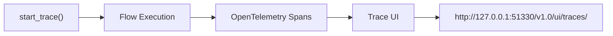

```python
from promptflow.tracing import start_trace

start_trace()
result = chat("What's the capital of France?")
print(result)
```

This should output a URL for the trace UI where you can inspect the execution details.

**Sources**: [docs/how-to-guides/quick-start.md:125-144]()

## Common Installation Issues

### Connection Storage Errors

If you encounter `StoreConnectionEncryptionKeyError` on WSL or systems without keyring:

```bash
# Install keyring backend
pip install keyrings.alt

# Or configure environment variable
export PROMPTFLOW_KEYRING_BACKEND="keyrings.alt.file.PlaintextKeyring"
```

**Sources**: [docs/how-to-guides/manage-connections.md:16-18]()

### Package Compatibility

Ensure compatible versions when installing multiple packages:

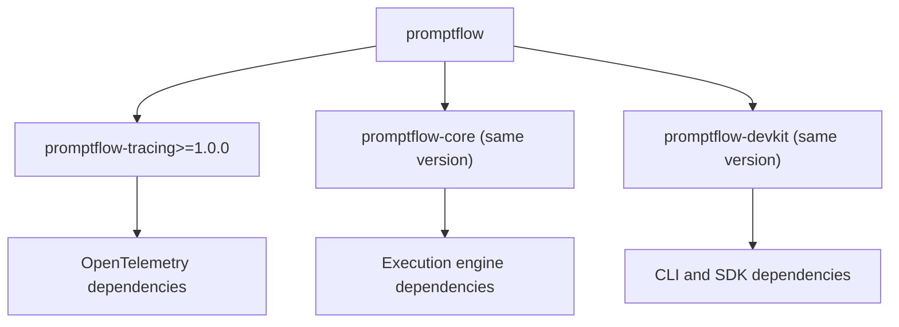

**Sources**: [src/promptflow/setup.py:23-27]()

## Next Steps

After successful installation and setup:

1. **Learn Core Concepts**: See [Key Concepts](#1.1) for understanding flows, tools, and connections
2. **Create Your First Flow**: Follow [Flow Operations](#3.1) to initialize and test flows
3. **Explore Flow Types**: Review [Flow Types](#4) for DAG flows, Flex flows, and Prompty
4. **Set Up Evaluation**: See [Evaluation System](#6.2) for testing and metrics
5. **Azure Integration**: Configure [Azure ML Integration](#7.1) for cloud capabilities

**Sources**: [docs/how-to-guides/quick-start.md:171-181](), [docs/index.md:32-46]()

---

# Page: Architecture

# Architecture

<details>
<summary>Relevant source files</summary>

The following files were used as context for generating this wiki page:

- [src/promptflow-azure/CHANGELOG.md](src/promptflow-azure/CHANGELOG.md)
- [src/promptflow-azure/pyproject.toml](src/promptflow-azure/pyproject.toml)
- [src/promptflow-core/CHANGELOG.md](src/promptflow-core/CHANGELOG.md)
- [src/promptflow-core/pyproject.toml](src/promptflow-core/pyproject.toml)
- [src/promptflow-devkit/CHANGELOG.md](src/promptflow-devkit/CHANGELOG.md)
- [src/promptflow-devkit/promptflow/_sdk/_utilities/tracing_utils.py](src/promptflow-devkit/promptflow/_sdk/_utilities/tracing_utils.py)
- [src/promptflow-devkit/pyproject.toml](src/promptflow-devkit/pyproject.toml)
- [src/promptflow-recording/recordings/local/executor_node_cache.shelve.bak](src/promptflow-recording/recordings/local/executor_node_cache.shelve.bak)
- [src/promptflow-recording/recordings/local/executor_node_cache.shelve.dat](src/promptflow-recording/recordings/local/executor_node_cache.shelve.dat)
- [src/promptflow-recording/recordings/local/executor_node_cache.shelve.dir](src/promptflow-recording/recordings/local/executor_node_cache.shelve.dir)
- [src/promptflow-tracing/CHANGELOG.md](src/promptflow-tracing/CHANGELOG.md)
- [src/promptflow-tracing/pyproject.toml](src/promptflow-tracing/pyproject.toml)
- [src/promptflow/CHANGELOG.md](src/promptflow/CHANGELOG.md)
- [src/promptflow/promptflow/_version.py](src/promptflow/promptflow/_version.py)
- [src/promptflow/setup.py](src/promptflow/setup.py)
- [src/promptflow/tests/executor/e2etests/test_langchain.py](src/promptflow/tests/executor/e2etests/test_langchain.py)
- [src/promptflow/tests/executor/e2etests/test_telemetry.py](src/promptflow/tests/executor/e2etests/test_telemetry.py)
- [src/promptflow/tests/executor/e2etests/test_traces.py](src/promptflow/tests/executor/e2etests/test_traces.py)
- [src/promptflow/tests/test_configs/flows/openai_chat_api_flow/chat.py](src/promptflow/tests/test_configs/flows/openai_chat_api_flow/chat.py)
- [src/promptflow/tests/test_configs/flows/openai_chat_api_flow/flow.dag.yaml](src/promptflow/tests/test_configs/flows/openai_chat_api_flow/flow.dag.yaml)
- [src/promptflow/tests/test_configs/flows/openai_chat_api_flow/inputs.jsonl](src/promptflow/tests/test_configs/flows/openai_chat_api_flow/inputs.jsonl)
- [src/promptflow/tests/test_configs/flows/openai_completion_api_flow/completion.py](src/promptflow/tests/test_configs/flows/openai_completion_api_flow/completion.py)
- [src/promptflow/tests/test_configs/flows/openai_completion_api_flow/flow.dag.yaml](src/promptflow/tests/test_configs/flows/openai_completion_api_flow/flow.dag.yaml)
- [src/promptflow/tests/test_configs/flows/openai_completion_api_flow/inputs.jsonl](src/promptflow/tests/test_configs/flows/openai_completion_api_flow/inputs.jsonl)

</details>


This document provides a comprehensive overview of the Microsoft Prompt Flow system architecture, covering the core components, execution model, and integration patterns. It focuses on the technical implementation details including key classes, modules, and their interactions.

For information about specific flow types and their usage, see [Flow Types](#4). For CLI and SDK usage patterns, see [CLI and SDK](#3). For Azure-specific integration details, see [Azure Integration](#7).

## Package Structure

Prompt Flow follows a modular architecture with four core packages that provide distinct but interconnected capabilities.

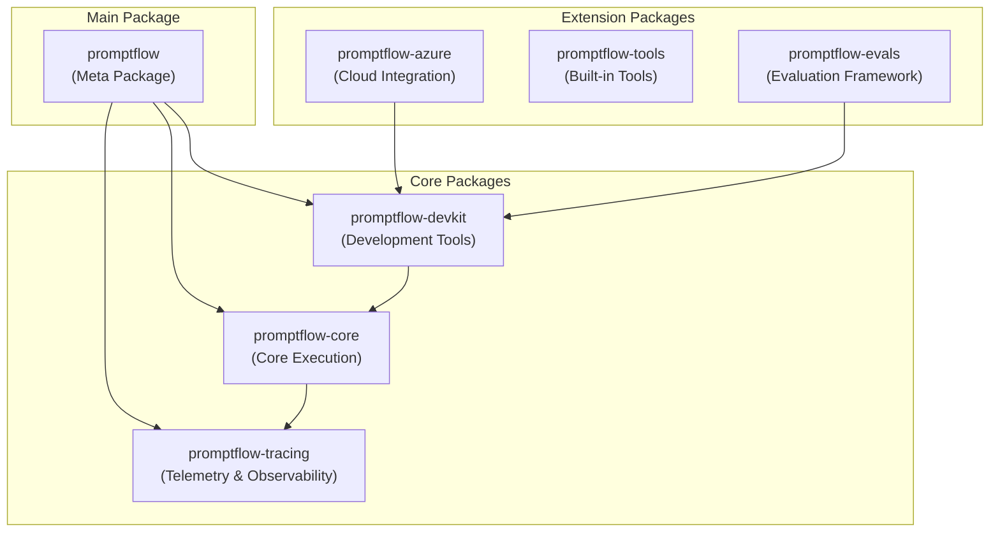

**Package Dependencies**

| Package | Purpose | Key Dependencies |
|---------|---------|------------------|
| `promptflow-core` | Flow execution engine, tool system | `promptflow-tracing`, `ruamel.yaml`, `jsonschema` |
| `promptflow-devkit` | CLI, SDK, local services | `promptflow-core`, `httpx`, `sqlalchemy`, `pandas` |
| `promptflow-tracing` | OpenTelemetry integration, trace collection | `opentelemetry-sdk`, `tiktoken` |
| `promptflow-azure` | Azure AI/ML integration | `azure-ai-ml`, `azure-cosmos`, `promptflow-devkit` |

Sources: [src/promptflow/setup.py:23-27](), [src/promptflow-core/pyproject.toml:42-58](), [src/promptflow-devkit/pyproject.toml:42-70](), [src/promptflow-tracing/pyproject.toml:36-40](), [src/promptflow-azure/pyproject.toml:39-47]()

## Flow Execution Architecture

The flow execution system is built around the `FlowExecutor` class which coordinates tool resolution, node scheduling, and trace collection.

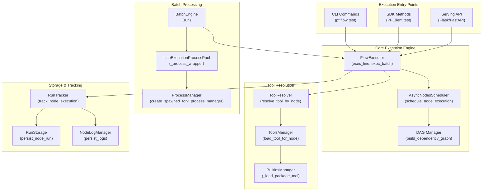

**Key Execution Components**

| Component | Responsibility | Location |
|-----------|---------------|----------|
| `FlowExecutor` | Main orchestrator for flow execution | `promptflow.executor.flow_executor` |
| `AsyncNodesScheduler` | Manages parallel node execution | `promptflow.executor._async_nodes_scheduler` |
| `ToolResolver` | Resolves node definitions to executable tools | `promptflow.executor._tool_resolver` |
| `BatchEngine` | Handles batch/bulk execution with multiprocessing | `promptflow.batch._batch_engine` |

Sources: [src/promptflow/tests/executor/e2etests/test_traces.py:19](), [src/promptflow/tests/executor/e2etests/test_telemetry.py:12](), [src/promptflow/tests/executor/e2etests/test_langchain.py:6]()

## Tool System Architecture

The tool system handles discovery, loading, and execution of various tool types including Python functions, LLM calls, and custom tools.

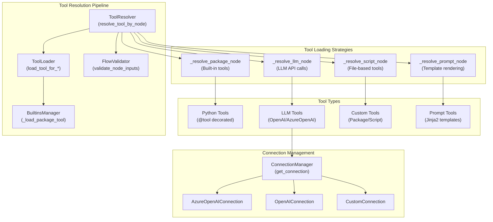

**Tool Resolution Flow**

1. **Node Analysis**: `ToolResolver.resolve_tool_by_node()` examines node type and source
2. **Type-Specific Loading**: Delegates to specialized resolvers based on tool type
3. **Input Validation**: `FlowValidator` ensures required inputs and connections are available
4. **Connection Injection**: Resolves connection references to actual connection objects
5. **Tool Instance Creation**: Returns executable tool with bound inputs and connections

Sources: Test flows showing tool usage patterns in [src/promptflow/tests/test_configs/flows/openai_chat_api_flow/chat.py:35-78](), [src/promptflow/tests/test_configs/flows/openai_completion_api_flow/completion.py:26-66]()

## Tracing and Observability

Prompt Flow integrates with OpenTelemetry to provide comprehensive tracing of flow execution, tool calls, and LLM interactions.

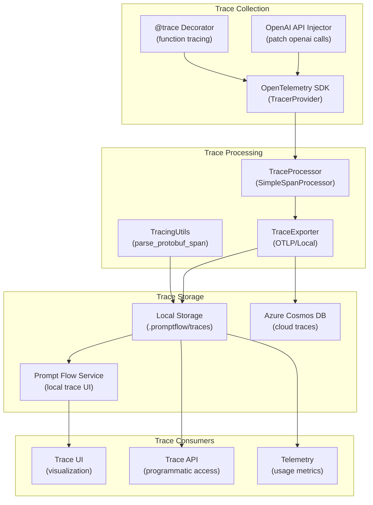

**Tracing Components**

| Component | Purpose | Key Methods |
|-----------|---------|-------------|
| `openai_injector` | Automatically traces OpenAI API calls | `inject()`, `recover()` |
| `@trace` decorator | Manual function tracing | Applied to user functions |
| `parse_protobuf_span` | Converts OTLP spans to internal format | `parse_protobuf_span()` |
| `TraceTelemetryHelper` | Aggregates usage metrics | `append()`, `log_telemetry()` |

Sources: [src/promptflow/tests/executor/e2etests/test_traces.py:143-151](), [src/promptflow-devkit/promptflow/_sdk/_utilities/tracing_utils.py:342-380]()

## Batch Processing System

The batch processing system enables scalable execution of flows across large datasets using multiprocessing.

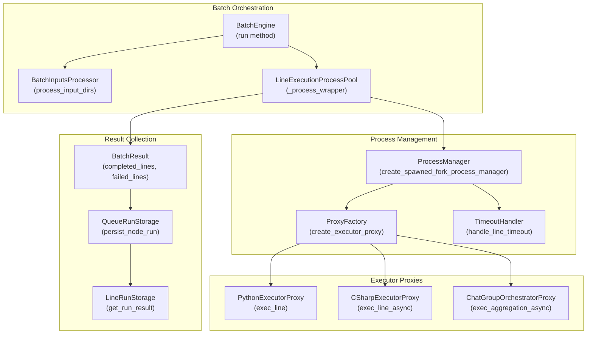

**Batch Processing Configuration**

| Setting | Default | Environment Variable | Purpose |
|---------|---------|---------------------|---------|
| Worker Count | 4 | `PF_WORKER_COUNT` | Number of parallel processes |
| Line Timeout | 600s | `PF_LINE_TIMEOUT_SEC` | Per-line execution timeout |
| Batch Timeout | 3600s | `PF_BATCH_TIMEOUT_SEC` | Total batch timeout |

Sources: [src/promptflow/tests/executor/e2etests/test_telemetry.py:117-156](), [src/promptflow/tests/executor/e2etests/test_langchain.py:24-33]()

## Integration Points

The architecture provides multiple integration points for extending and customizing Prompt Flow behavior.

```mermaid
graph TD
    subgraph "Extension Points"
        CONN["Custom Connections<br/>(CustomConnection)"]
        TOOLS["Custom Tools<br/>(@tool decorator)"]
        EXPORT["Custom Exporters<br/>(SpanExporter)"]
        SERVE["Custom Serving<br/>(Flask/FastAPI apps)"]
    end
    
    subgraph "Configuration Management"
        ENV["Environment Variables<br/>(PF_* settings)"]
        CONFIG["Config Files<br/>(.promptflow/pf.yaml)"]
        SECRETS["Secret Management<br/>(keyring integration)"]
    end
    
    subgraph "Runtime Environments"
        LOCAL["Local Development<br/>(pf CLI)"]
        CONTAINER["Container Deployment<br/>(Docker)"]
        AZURE["Azure AI/ML<br/>(pfazure CLI)"]
        CLOUD["Cloud Serving<br/>(Azure Container Apps)"]
    end
    
    CONN --> LOCAL
    TOOLS --> LOCAL
    EXPORT --> LOCAL
    SERVE --> LOCAL
    
    ENV --> CONFIG
    CONFIG --> SECRETS
    
    LOCAL --> CONTAINER
    LOCAL --> AZURE
    CONTAINER --> CLOUD
    AZURE --> CLOUD
```

**Key Integration Patterns**

- **Tool Registration**: Custom tools via `@tool` decorator and package entry points
- **Connection Providers**: Extensible connection system supporting Azure ML, local files, environment variables
- **Trace Exporters**: OpenTelemetry-compatible exporters for various backends
- **Serving Frameworks**: Support for Flask and FastAPI with automatic endpoint generation

Sources: Configuration and integration patterns from [src/promptflow/CHANGELOG.md:88-98](), [src/promptflow-devkit/CHANGELOG.md:52-62]()

---

# Page: Core Components

# Core Components

<details>
<summary>Relevant source files</summary>

The following files were used as context for generating this wiki page:

- [src/promptflow-azure/CHANGELOG.md](src/promptflow-azure/CHANGELOG.md)
- [src/promptflow-azure/pyproject.toml](src/promptflow-azure/pyproject.toml)
- [src/promptflow-core/CHANGELOG.md](src/promptflow-core/CHANGELOG.md)
- [src/promptflow-core/pyproject.toml](src/promptflow-core/pyproject.toml)
- [src/promptflow-devkit/CHANGELOG.md](src/promptflow-devkit/CHANGELOG.md)
- [src/promptflow-devkit/promptflow/_sdk/_utilities/tracing_utils.py](src/promptflow-devkit/promptflow/_sdk/_utilities/tracing_utils.py)
- [src/promptflow-devkit/pyproject.toml](src/promptflow-devkit/pyproject.toml)
- [src/promptflow-recording/recordings/local/executor_node_cache.shelve.bak](src/promptflow-recording/recordings/local/executor_node_cache.shelve.bak)
- [src/promptflow-recording/recordings/local/executor_node_cache.shelve.dat](src/promptflow-recording/recordings/local/executor_node_cache.shelve.dat)
- [src/promptflow-recording/recordings/local/executor_node_cache.shelve.dir](src/promptflow-recording/recordings/local/executor_node_cache.shelve.dir)
- [src/promptflow-tracing/CHANGELOG.md](src/promptflow-tracing/CHANGELOG.md)
- [src/promptflow-tracing/pyproject.toml](src/promptflow-tracing/pyproject.toml)
- [src/promptflow/CHANGELOG.md](src/promptflow/CHANGELOG.md)
- [src/promptflow/promptflow/_version.py](src/promptflow/promptflow/_version.py)
- [src/promptflow/setup.py](src/promptflow/setup.py)
- [src/promptflow/tests/executor/e2etests/test_langchain.py](src/promptflow/tests/executor/e2etests/test_langchain.py)
- [src/promptflow/tests/executor/e2etests/test_telemetry.py](src/promptflow/tests/executor/e2etests/test_telemetry.py)
- [src/promptflow/tests/executor/e2etests/test_traces.py](src/promptflow/tests/executor/e2etests/test_traces.py)
- [src/promptflow/tests/test_configs/flows/openai_chat_api_flow/chat.py](src/promptflow/tests/test_configs/flows/openai_chat_api_flow/chat.py)
- [src/promptflow/tests/test_configs/flows/openai_chat_api_flow/flow.dag.yaml](src/promptflow/tests/test_configs/flows/openai_chat_api_flow/flow.dag.yaml)
- [src/promptflow/tests/test_configs/flows/openai_chat_api_flow/inputs.jsonl](src/promptflow/tests/test_configs/flows/openai_chat_api_flow/inputs.jsonl)
- [src/promptflow/tests/test_configs/flows/openai_completion_api_flow/completion.py](src/promptflow/tests/test_configs/flows/openai_completion_api_flow/completion.py)
- [src/promptflow/tests/test_configs/flows/openai_completion_api_flow/flow.dag.yaml](src/promptflow/tests/test_configs/flows/openai_completion_api_flow/flow.dag.yaml)
- [src/promptflow/tests/test_configs/flows/openai_completion_api_flow/inputs.jsonl](src/promptflow/tests/test_configs/flows/openai_completion_api_flow/inputs.jsonl)

</details>


This document details the main packages that form the foundation of the PromptFlow system, their responsibilities, and relationships. It serves as a technical reference for understanding the internal architecture of the PromptFlow codebase. For information about using these components, see [CLI and SDK](#3).

## Package Structure Overview

PromptFlow has a modular architecture consisting of four primary packages, each with distinct responsibilities:

```mermaid
flowchart TD
    subgraph "Core Components"
        PF_Tracing["promptflow-tracing"]
        PF_Core["promptflow-core"]
        PF_DevKit["promptflow-devkit"]
        PF_Azure["promptflow-azure"]
    end

    PF_Tracing -->|"depends on"| PF_Core
    PF_Core -->|"depends on"| PF_DevKit
    PF_DevKit -->|"depends on"| PF_Azure
    
    subgraph "Functionality"
        Tracing["Tracing & Telemetry"]
        Execution["Flow Execution Engine"]
        DevExperience["Development Experience"]
        AzureIntegration["Azure Integration"]
    end
    
    PF_Tracing -.->|"provides"| Tracing
    PF_Core -.->|"provides"| Execution
    PF_DevKit -.->|"provides"| DevExperience
    PF_Azure -.->|"provides"| AzureIntegration
```

The main `promptflow` package acts as an umbrella that includes these core components:

```
promptflow
├── promptflow-tracing     # Tracing capabilities
├── promptflow-core        # Core functionality to run flows
├── promptflow-devkit      # Development kit (CLI, SDK, etc.)
└── promptflow-azure       # Azure integration (optional)
```

Sources: [src/promptflow/setup.py:23-28](), [src/promptflow/CHANGELOG.md:127-133]()

## 1. promptflow-tracing

The `promptflow-tracing` package provides observability for flow execution through tracing capabilities. It's built on top of OpenTelemetry and provides mechanisms to track the execution of flows, tool calls, and their performance metrics.

### Key Features

- Tracing decorator (`@trace`) for functions and tools
- API injector for tracking LLM calls
- Token counting for LLM interactions
- Integration with OpenTelemetry

### Architecture

```mermaid
flowchart TD
    subgraph "promptflow-tracing"
        Trace["@trace decorator"]
        Tracer["Tracer"]
        OTelIntegration["OpenTelemetry Integration"]
        APIInjector["API Injector"]
        TokenCounter["Token Counter"]
    end
    
    Trace -->|"uses"| Tracer
    Tracer -->|"exports to"| OTelIntegration
    Tracer -->|"captures"| APIInjector
    APIInjector -->|"counts"| TokenCounter
    
    subgraph "External Tools"
        Tool["Python Function"]
        LLMTool["LLM Tool"]
    end
    
    Tool -->|"decorated with"| Trace
    LLMTool -->|"monitored by"| APIInjector
```

This component operates independently of other PromptFlow components and has minimal dependencies. It focuses on the tracing aspects of the system and exports trace data in OpenTelemetry format.

### Trace Types

- **Flow**: Traces for entire flow execution
- **Function**: Traces for individual function calls
- **LLM**: Specialized traces for LLM interactions with token metrics
- **Embedding**: Specialized traces for embedding operations

Sources: [src/promptflow-tracing/pyproject.toml:1-114](), [src/promptflow/tests/executor/e2etests/test_traces.py:21-27](), [src/promptflow/tests/executor/e2etests/test_traces.py:54-67](), [src/promptflow/tests/executor/unittests/_core/test_tracer.py:1-12]()

## 2. promptflow-core

The `promptflow-core` package contains the essential functionality for executing flows. It provides the foundation for defining, loading, and running flows of different types.

### Key Components

- **Flow Executor**: Central engine for executing flows
- **Connection Management**: Handles connections to external services
- **Tool Resolution**: Resolves and loads tools used in flows
- **Flow Types Support**: Supports DAG flows, Flex flows, and Prompty

### Architecture

```mermaid
flowchart TD
    subgraph "promptflow-core"
        FlowExecutor["FlowExecutor"]
        ConnectionMgr["Connection Manager"]
        ToolResolver["Tool Resolver"]
        FlowLoader["Flow Loader"]
    end
    
    FlowExecutor -->|"uses"| ConnectionMgr
    FlowExecutor -->|"uses"| ToolResolver
    FlowExecutor -->|"uses"| FlowLoader
    
    subgraph "Flow Types"
        DAGFlow["DAG Flow"]
        FlexFlow["Flex Flow"]
        Prompty["Prompty"]
    end
    
    FlowLoader -->|"loads"| DAGFlow
    FlowLoader -->|"loads"| FlexFlow
    FlowLoader -->|"loads"| Prompty
    
    subgraph "Execution"
        LineExecution["Line Execution"]
        Tool["Tool"]
        Connection["Connection"]
    end
    
    FlowExecutor -->|"performs"| LineExecution
    LineExecution -->|"uses"| Tool
    Tool -->|"uses"| Connection
    ConnectionMgr -->|"provides"| Connection
    ToolResolver -->|"resolves"| Tool
```

### Serving Capabilities

The core package also includes basic serving capabilities for flows:

- Flask-based serving interface
- FastAPI-based serving interface (added in recent versions)
- Support for containerization

Sources: [src/promptflow-core/pyproject.toml:1-147](), [src/promptflow-core/CHANGELOG.md:1-62]()

## 3. promptflow-devkit

The `promptflow-devkit` package builds upon the core functionality, providing development tools, CLI commands, SDK interfaces, and local testing capabilities.

### Key Components

- **CLI**: Command-line interface for creating, testing, and managing flows
- **SDK**: Python SDK for programmatic interaction with flows
- **Local Testing**: Tools for testing flows locally
- **Run Management**: Tracking and managing flow runs
- **Visualization**: Visualizing flow execution results

### Architecture

```mermaid
flowchart TD
    subgraph "promptflow-devkit"
        CLI["Command Line Interface"]
        SDK["Python SDK"]
        RunManagement["Run Management"]
        LocalTesting["Local Testing"]
        Visualizer["Run Visualizer"]
    end
    
    CLI -->|"uses"| SDK
    SDK -->|"manages"| RunManagement
    SDK -->|"enables"| LocalTesting
    RunManagement -->|"visualized by"| Visualizer
    
    subgraph "Infrastructure"
        FlowStorage["Flow Storage"]
        RunStorage["Run Storage"]
        ConfigManager["Config Manager"]
    end
    
    RunManagement -->|"uses"| RunStorage
    SDK -->|"manages"| FlowStorage
    CLI -->|"configures"| ConfigManager
    
    subgraph "User Interface"
        pfCommand["pf command"]
        PFClient["PFClient"]
        TraceUI["Trace UI"]
    end
    
    pfCommand -->|"invokes"| CLI
    PFClient -->|"interfaces with"| SDK
    Visualizer -->|"displays"| TraceUI
```

### Key CLI Commands

- `pf flow`: Create, test, validate, and serve flows
- `pf run`: Create, manage, and analyze flow runs
- `pf connection`: Manage connections to external services

Sources: [src/promptflow-devkit/pyproject.toml:1-178](), [src/promptflow-devkit/CHANGELOG.md:1-89]()

## 4. promptflow-azure

While not a core focus of this document, the `promptflow-azure` package extends PromptFlow functionality to the Azure cloud environment. It integrates with Azure AI services and enables running flows in the Azure cloud.

### Key Components

- **Azure Client**: Client for Azure AI services
- **Cloud Execution**: Running flows in Azure
- **Azure Connections**: Specialized connections for Azure services

Sources: [src/promptflow-azure/pyproject.toml:1-137](), [src/promptflow-azure/CHANGELOG.md:1-40]()

## Component Integration and Data Flow

The following diagram illustrates how the components work together during flow execution:

```mermaid
sequenceDiagram
    participant User
    participant DevKit as "promptflow-devkit"
    participant Core as "promptflow-core"
    participant Tracing as "promptflow-tracing"
    participant External as "External Services"
    
    User->>DevKit: Call flow via CLI/SDK
    DevKit->>Core: Initialize FlowExecutor
    Core->>Tracing: Start tracing
    Core->>Core: Load flow definition
    Core->>Core: Resolve tools
    
    loop For each node
        Core->>Core: Execute node
        Core->>Tracing: Trace node execution
        
        alt If node calls external service
            Core->>External: Make API call
            External->>Core: Return response
            Tracing->>Tracing: Capture API metrics
        end
        
        Tracing->>Core: Return trace information
    end
    
    Core->>DevKit: Return execution results
    DevKit->>User: Present results/visualization
```

## Dependency Structure

The components have a clear dependency hierarchy:

```mermaid
flowchart LR
    subgraph "Dependency Hierarchy"
        direction TB
        Tracing["promptflow-tracing"]
        Core["promptflow-core"]
        DevKit["promptflow-devkit"]
        Azure["promptflow-azure"]
        
        Tracing ---|"1. Independent base component"| Core
        Core ---|"2. Depends on tracing"| DevKit
        DevKit ---|"3. Depends on core"| Azure
    end
```

Important dependency notes:
- `promptflow-tracing` is independent of other components
- `promptflow-core` depends on `promptflow-tracing`
- `promptflow-devkit` depends on `promptflow-core`
- `promptflow-azure` depends on `promptflow-devkit`

This hierarchy ensures a clean separation of concerns and allows each component to focus on its specific responsibilities.

Sources: [src/promptflow/setup.py:23-72]()

## Telemetry and Monitoring

PromptFlow includes telemetry capabilities for monitoring flow execution and performance:

```mermaid
flowchart TD
    subgraph "Telemetry System"
        OpContext["OperationContext"]
        TelemetryHeaders["Telemetry Headers"]
        TokenMetrics["Token Metrics"]
        APITraces["API Call Traces"]
    end
    
    subgraph "External Integrations"
        OTel["OpenTelemetry"]
        AzureMonitor["Azure Monitor"]
    end
    
    OpContext -->|"populates"| TelemetryHeaders
    APITraces -->|"collects"| TokenMetrics
    APITraces -->|"exports to"| OTel
    OTel -->|"can send to"| AzureMonitor
    TelemetryHeaders -->|"included in"| APITraces
```

All components can contribute telemetry data, with `promptflow-tracing` responsible for collecting and exporting it. Flow execution metrics, token usage, and API calls are tracked and can be visualized through the devkit's capabilities.

Sources: [src/promptflow/tests/executor/e2etests/test_telemetry.py:1-156](), [src/promptflow/tests/executor/e2etests/test_traces.py:1-737]()

## Summary

The PromptFlow system consists of four modular core components:

| Component | Primary Responsibility | Key Features |
|-----------|------------------------|--------------|
| promptflow-tracing | Observability | Trace decoration, API monitoring, token counting |
| promptflow-core | Flow execution | Flow executor, connections, tool resolution |
| promptflow-devkit | Development tools | CLI, SDK, run management, visualization |
| promptflow-azure | Cloud integration | Azure AI integration, cloud execution |

These components work together to provide a comprehensive platform for building, testing, and deploying prompt-based applications with large language models. The modular design allows for flexibility and extensibility while maintaining a clean separation of concerns.

---

# Page: Flow Execution Model

# Flow Execution Model

<details>
<summary>Relevant source files</summary>

The following files were used as context for generating this wiki page:

- [src/promptflow-core/promptflow/_core/run_tracker.py](src/promptflow-core/promptflow/_core/run_tracker.py)
- [src/promptflow-core/promptflow/_utils/async_utils.py](src/promptflow-core/promptflow/_utils/async_utils.py)
- [src/promptflow-core/promptflow/_utils/logger_utils.py](src/promptflow-core/promptflow/_utils/logger_utils.py)
- [src/promptflow-core/promptflow/_utils/process_utils.py](src/promptflow-core/promptflow/_utils/process_utils.py)
- [src/promptflow-core/promptflow/_utils/run_tracker_utils.py](src/promptflow-core/promptflow/_utils/run_tracker_utils.py)
- [src/promptflow-core/promptflow/executor/_async_nodes_scheduler.py](src/promptflow-core/promptflow/executor/_async_nodes_scheduler.py)
- [src/promptflow-core/promptflow/executor/flow_executor.py](src/promptflow-core/promptflow/executor/flow_executor.py)
- [src/promptflow-tracing/promptflow/tracing/_integrations/_openai_injector.py](src/promptflow-tracing/promptflow/tracing/_integrations/_openai_injector.py)
- [src/promptflow-tracing/promptflow/tracing/_span_enricher.py](src/promptflow-tracing/promptflow/tracing/_span_enricher.py)
- [src/promptflow-tracing/promptflow/tracing/_trace.py](src/promptflow-tracing/promptflow/tracing/_trace.py)
- [src/promptflow-tracing/promptflow/tracing/_tracer.py](src/promptflow-tracing/promptflow/tracing/_tracer.py)
- [src/promptflow-tracing/promptflow/tracing/contracts/trace.py](src/promptflow-tracing/promptflow/tracing/contracts/trace.py)
- [src/promptflow-tracing/tests/e2etests/simple_functions.py](src/promptflow-tracing/tests/e2etests/simple_functions.py)
- [src/promptflow-tracing/tests/e2etests/test_tracing.py](src/promptflow-tracing/tests/e2etests/test_tracing.py)
- [src/promptflow-tracing/tests/unittests/test_openai_injector.py](src/promptflow-tracing/tests/unittests/test_openai_injector.py)
- [src/promptflow-tracing/tests/unittests/test_trace.py](src/promptflow-tracing/tests/unittests/test_trace.py)
- [src/promptflow/tests/executor/e2etests/test_async.py](src/promptflow/tests/executor/e2etests/test_async.py)
- [src/promptflow/tests/executor/e2etests/test_executor_happypath.py](src/promptflow/tests/executor/e2etests/test_executor_happypath.py)
- [src/promptflow/tests/executor/e2etests/test_logs.py](src/promptflow/tests/executor/e2etests/test_logs.py)
- [src/promptflow/tests/executor/unittests/_utils/test_thread_utils.py](src/promptflow/tests/executor/unittests/_utils/test_thread_utils.py)
- [src/promptflow/tests/executor/unittests/executor/test_flow_nodes_scheduler.py](src/promptflow/tests/executor/unittests/executor/test_flow_nodes_scheduler.py)
- [src/promptflow/tests/test_configs/flows/async_tools_with_sync_tools/async_passthrough.py](src/promptflow/tests/test_configs/flows/async_tools_with_sync_tools/async_passthrough.py)
- [src/promptflow/tests/test_configs/flows/async_tools_with_sync_tools/flow.dag.yaml](src/promptflow/tests/test_configs/flows/async_tools_with_sync_tools/flow.dag.yaml)

</details>


This document explains the core execution model of PromptFlow, detailing how flows are loaded, validated, and executed within the system. It covers the components involved in executing both single inputs and batch processing, as well as the underlying mechanisms for resolving tools and managing the execution lifecycle.

For information about the tool system itself, see [Tool System](#2.3).

## Execution Architecture Overview

The Flow Execution Model is centered around a few key components that work together to execute flows reliably and efficiently:

```mermaid
flowchart TD
    subgraph "Flow Execution Architecture"
        FE["FlowExecutor"]
        TR["ToolResolver"]
        LE["LineExecution"]
        BE["BatchEngine"]
        LEP["LineExecutionProcessPool"]
        
        FE --> TR
        FE --> LE
        BE --> LEP
        LEP --> LE
        
        subgraph "Tool Resolution"
            TR --> RTool["ResolvedTool"]
            TR --> RATool["ResolvedAssistantTool"]
        end
        
        subgraph "Execution Context"
            LE --> ExecContext["ExecutionContext"]
            ExecContext --> RunInfo["RunInfo"]
        end
    end
```

Sources: 
- [src/promptflow/tests/executor/unittests/executor/test_tool_resolver.py:1-144]()
- [src/promptflow/tests/executor/unittests/executor/test_flow_executor.py:1-25]()

## Flow Executor

The `FlowExecutor` is the main entry point for executing flows. It's responsible for:

1. Loading and validating the flow definition
2. Resolving tools referenced in nodes
3. Executing the flow with provided inputs
4. Handling execution results and errors

### Flow Loading and Creation

```mermaid
sequenceDiagram
    participant Client
    participant FlowExecutor
    participant ToolResolver
    participant Flow

    Client->>FlowExecutor: create(flow_file, connections)
    FlowExecutor->>Flow: load flow definition
    FlowExecutor->>ToolResolver: resolve tools for nodes
    ToolResolver-->>FlowExecutor: resolved tools
    FlowExecutor-->>Client: executor instance
```

The `FlowExecutor.create()` method initializes the executor with a flow definition:

```mermaid
flowchart LR
    subgraph "FlowExecutor Creation"
        FC["Flow Creation"] --> FV["Flow Validation"]
        FV --> TR["Tool Resolution"]
        TR --> FEI["Executor Instance"]
    end
```

Sources:
- [src/promptflow/tests/executor/e2etests/test_executor_validation.py:142-150]()
- [src/promptflow/tests/executor/unittests/executor/test_flow_executor.py:1-25]()

### Single Line Execution

When executing a single input (or "line"), the flow executor:

1. Validates the input against the flow's input schema
2. Creates execution context for the run
3. Executes nodes in topological order (respecting dependencies)
4. Collects outputs and creates a `LineResult`

```mermaid
flowchart TD
    subgraph "Single Line Execution"
        IV["Input Validation"] --> EC["Execution Context Creation"]
        EC --> NE["Node Execution"]
        NE --> RG["Result Generation"]
    end
    
    subgraph "Node Execution"
        TR["Tool Resolution"] --> NI["Node Input Preparation"] 
        NI --> TC["Tool Callable Execution"]
        TC --> NO["Node Output Handling"]
    end
```

Sources:
- [src/promptflow/tests/executor/e2etests/test_executor_validation.py:192-205]()
- [src/promptflow/tests/executor/unittests/executor/test_flow_executor.py:52-88]()

## Tool Resolution System

The `ToolResolver` is responsible for loading and preparing tools referenced by nodes in the flow. It handles different types of tools:

- Python package tools
- Python script tools
- Prompt template tools
- LLM tools
- Custom LLM tools

### Resolution Process

```mermaid
flowchart TD
    subgraph "Tool Resolution"
        Node["Flow Node"] --> TT["Determine Tool Type"]
        TT --> ST["Determine Source Type"]
        ST --> RL["Resolve & Load Tool"]
        RL --> RT["ResolvedTool"]
    end
    
    subgraph "Tool Types"
        P["Python"]
        PR["Prompt"]
        L["LLM"]
        CL["Custom LLM"]
        AS["Assistant"]
    end
    
    subgraph "Source Types"
        Pkg["Package"]
        Code["Code"]
        PP["PackageWithPrompt"]
    end
    
    TT --> P & PR & L & CL & AS
    ST --> Pkg & Code & PP
```

The resolver converts a node definition into a `ResolvedTool` that contains:
- The node reference
- The callable function
- Tool definition
- Initialization arguments

Sources:
- [src/promptflow/tests/executor/unittests/executor/test_tool_resolver.py:50-137]()
- [src/promptflow/tests/executor/unittests/_core/test_tools_manager.py:35-139]()

### Connection Handling

Tools often require connections to external services. The `ToolResolver` handles:

1. Resolving connection references from the connection provider
2. Validating connection types match tool requirements
3. Converting connection values to the appropriate types (e.g., `CustomStrongTypeConnection`)

```mermaid
flowchart LR
    subgraph "Connection Resolution"
        CR["ConnectionReference"] --> CP["ConnectionProvider"]
        CP --> CV["ConnectionValue"]
        CV --> VT["Type Validation"]
        VT --> ICV["Injectable Connection Value"]
    end
```

Sources:
- [src/promptflow/tests/executor/unittests/executor/test_tool_resolver.py:184-215]()
- [src/promptflow/tests/executor/unittests/executor/test_tool_resolver.py:261-311]()

## Execution Process

### Flow Execution Lifecycle

The complete flow execution lifecycle involves several stages:

```mermaid
sequenceDiagram
    participant Client
    participant FlowExecutor
    participant ToolResolver
    participant ExecutionContext
    participant NodeExecutor

    Client->>FlowExecutor: exec_line(inputs)
    FlowExecutor->>FlowExecutor: validate_inputs(inputs)
    FlowExecutor->>ExecutionContext: create context(run_id, flow)
    
    loop For each node in topological order
        FlowExecutor->>NodeExecutor: execute_node(node)
        NodeExecutor->>ToolResolver: get_resolved_tool(node)
        ToolResolver-->>NodeExecutor: resolved_tool
        NodeExecutor->>NodeExecutor: prepare_node_inputs()
        NodeExecutor->>NodeExecutor: call tool_callable with inputs
        NodeExecutor->>ExecutionContext: update_context(node_result)
    end
    
    FlowExecutor->>FlowExecutor: collect_flow_outputs()
    FlowExecutor-->>Client: LineResult(outputs, run_info)
```

Sources:
- [src/promptflow/tests/executor/e2etests/test_executor_validation.py:337-354]()
- [src/promptflow/tests/executor/unittests/executor/test_flow_executor.py:1-25]()

### Node Execution

Node execution involves several steps:

1. Resolving the node's tool
2. Preparing inputs (handling references to other nodes' outputs)
3. Executing the tool callable
4. Processing and validating the output
5. Updating the execution context

```mermaid
flowchart TD
    subgraph "Node Execution Process"
        RT["Resolve Tool"] --> PI["Prepare Inputs"]
        PI --> EX["Execute Tool"]
        EX --> PO["Process Output"]
        PO --> UC["Update Context"]
    end
```

Sources:
- [src/promptflow/tests/executor/e2etests/test_executor_validation.py:277-336]()

## Batch Processing

For processing multiple inputs (batch processing), PromptFlow uses a process pool to execute lines in parallel:

### Batch Architecture

```mermaid
flowchart TD
    subgraph "Batch Processing"
        BE["BatchEngine"] --> LEP["LineExecutionProcessPool"]
        LEP --> W1["Worker Process 1"]
        LEP --> W2["Worker Process 2"]
        LEP --> W3["Worker Process ..."]
        LEP --> WN["Worker Process N"]
        
        W1 & W2 & W3 & WN --> FE["FlowExecutor"]
        
        subgraph "Result Collection"
            W1 & W2 & W3 & WN --> OQ["Output Queue"]
            OQ --> RC["Result Collector"]
            RC --> BR["Batch Results"]
        end
    end
```

The `LineExecutionProcessPool` manages worker processes that execute individual lines:

- It determines the optimal number of processes based on available resources
- Each process executes a flow line with isolated execution contexts
- Results are collected through a queue system
- The pool handles timeouts and process management

Sources:
- [src/promptflow/tests/executor/unittests/executor/test_line_execution_process_pool.py:184-205]()
- [src/promptflow/tests/executor/e2etests/test_executor_validation.py:376-418]()

### Batch Execution Process

```mermaid
sequenceDiagram
    participant Client
    participant BatchEngine
    participant LineExecutionProcessPool
    participant WorkerProcess
    participant FlowExecutor
    participant OutputQueue

    Client->>BatchEngine: run(input_dirs, inputs_mapping, output_dir)
    BatchEngine->>LineExecutionProcessPool: create(executor, nlines, run_id)
    
    LineExecutionProcessPool->>LineExecutionProcessPool: determine_worker_count()
    
    LineExecutionProcessPool->>WorkerProcess: create multiple workers
    
    loop For each input line
        LineExecutionProcessPool->>WorkerProcess: execute line(index, line_input)
        WorkerProcess->>FlowExecutor: exec_line(line_input)
        FlowExecutor-->>WorkerProcess: line_result
        WorkerProcess->>OutputQueue: put(line_result)
    end
    
    LineExecutionProcessPool->>LineExecutionProcessPool: collect_results()
    LineExecutionProcessPool-->>BatchEngine: results
    BatchEngine-->>Client: batch_results
```

Sources:
- [src/promptflow/tests/executor/unittests/executor/test_line_execution_process_pool.py:225-245]()
- [src/promptflow/tests/executor/unittests/storage/test_queue_run_storage.py:1-60]()

### Process Management

The process pool can use different execution modes depending on the platform:

| Mode | Description | Platforms |
|------|-------------|-----------|
| `fork` | Creates processes by forking the current process | Linux primarily |
| `spawn` | Creates new Python interpreter processes | All platforms |

The process pool dynamically determines the optimal number of worker processes based on:
- Available system memory
- Current process memory usage
- Number of input rows
- Configured worker count limits

Sources:
- [src/promptflow/tests/executor/unittests/executor/test_line_execution_process_pool.py:326-394]()
- [src/promptflow/tests/executor/unittests/_utils/test_process_utils.py:1-38]()

## Streaming Support

PromptFlow provides support for streaming outputs from LLM tools:

```mermaid
flowchart LR
    subgraph "Streaming Support"
        LT["LLM Tool"] --> ESO["Enable Streaming Option"]
        ESO --> STP["Streaming Tool Processing"]
        STP --> RVS["Result Value Serialization"]
    end
```

The framework automatically handles streaming capabilities by:
1. Identifying tools that support streaming
2. Enabling streaming parameters for applicable tools
3. Processing streamed outputs appropriately

Sources:
- [src/promptflow/tests/executor/unittests/executor/test_flow_executor.py:90-181]()

## Validation and Error Handling

PromptFlow extensively validates flows and inputs to provide clear error messages:

### Flow Validation

The flow validation system checks for:
- Duplicate node names
- Missing source files
- Node reference validity
- Circular dependencies
- Input and output reference validity

```mermaid
flowchart TD
    subgraph "Flow Validation"
        ND["Node Definitions"] --> FIS["Flow Input Schema"]
        FIS --> NDR["Node Dependencies Resolution"]
        NDR --> TVG["Topological Validation of Graph"]
        TVG --> FOS["Flow Output Schema"]
    end
```

Sources:
- [src/promptflow/tests/executor/e2etests/test_executor_validation.py:36-140]()

### Input Validation

Input validation ensures that:
- Required inputs are provided
- Input values match expected types
- Input references are valid

```mermaid
flowchart LR
    subgraph "Input Validation"
        IV["Input Values"] --> RM["Required Matching"]
        RM --> TV["Type Validation"]
        TV --> LCC["Literal to Connection Conversion"]
    end
```

Sources:
- [src/promptflow/tests/executor/e2etests/test_executor_validation.py:192-273]()

### Error Handling

The error handling system:
- Captures and categorizes errors during execution
- Propagates appropriate error information to results
- Provides detailed error messages for debugging

| Error Type | Description | Example |
|------------|-------------|---------|
| `UserErrorException` | Errors in user-provided inputs or configurations | Invalid input type |
| `NodeInputValidationError` | Issues with node input validation | Missing required input |
| `ResolveToolError` | Problems resolving tools | Tool not found |
| `NodeReferenceNotFound` | Invalid node references | Reference to non-existent node |
| `InputTypeError` | Type mismatches in inputs | String provided for integer input |

Sources:
- [src/promptflow/tests/executor/e2etests/test_executor_validation.py:236-245]()
- [src/promptflow/tests/executor/e2etests/test_executor_validation.py:277-336]()

## Performance Optimization

The Flow Execution Model includes several optimization strategies:

1. **Parallelization**: Using process pools for batch processing
2. **Memory Management**: Monitoring system memory to determine optimal worker counts
3. **Timeout Handling**: Managing execution timeouts to prevent hanging processes
4. **Streaming Processing**: Efficiently handling streaming outputs from LLM tools

```mermaid
flowchart TD
    subgraph "Performance Optimizations"
        PM["Process Management"] --> MM["Memory Monitoring"]
        MM --> WCA["Worker Count Adjustment"]
        WCA --> TH["Timeout Handling"]
    end
```

Sources:
- [src/promptflow/tests/executor/unittests/executor/test_line_execution_process_pool.py:331-394]()
- [src/promptflow/tests/executor/unittests/_utils/test_process_utils.py:1-38]()

## Summary

The Flow Execution Model in PromptFlow provides a robust framework for:
- Loading and validating flow definitions
- Resolving and executing tools in flow nodes
- Processing single inputs and batches efficiently
- Handling errors and managing execution state
- Optimizing performance for parallel execution

The model is designed to be flexible and extensible, supporting various tool types, connection mechanisms, and execution patterns while maintaining reliability and performance.

---

# Page: Tool System

# Tool System

<details>
<summary>Relevant source files</summary>

The following files were used as context for generating this wiki page:

- [docs/reference/tools-reference/aoai-gpt4-turbo-vision.md](docs/reference/tools-reference/aoai-gpt4-turbo-vision.md)
- [docs/reference/tools-reference/openai-gpt-4v-tool.md](docs/reference/tools-reference/openai-gpt-4v-tool.md)
- [src/promptflow-tools/promptflow/tools/aoai.py](src/promptflow-tools/promptflow/tools/aoai.py)
- [src/promptflow-tools/promptflow/tools/aoai_gpt4v.py](src/promptflow-tools/promptflow/tools/aoai_gpt4v.py)
- [src/promptflow-tools/promptflow/tools/common.py](src/promptflow-tools/promptflow/tools/common.py)
- [src/promptflow-tools/promptflow/tools/exception.py](src/promptflow-tools/promptflow/tools/exception.py)
- [src/promptflow-tools/promptflow/tools/openai.py](src/promptflow-tools/promptflow/tools/openai.py)
- [src/promptflow-tools/promptflow/tools/openai_gpt4v.py](src/promptflow-tools/promptflow/tools/openai_gpt4v.py)
- [src/promptflow-tools/promptflow/tools/yamls/aoai_gpt4v.yaml](src/promptflow-tools/promptflow/tools/yamls/aoai_gpt4v.yaml)
- [src/promptflow-tools/promptflow/tools/yamls/embedding.yaml](src/promptflow-tools/promptflow/tools/yamls/embedding.yaml)
- [src/promptflow-tools/promptflow/tools/yamls/openai_gpt4v.yaml](src/promptflow-tools/promptflow/tools/yamls/openai_gpt4v.yaml)
- [src/promptflow-tools/tests/pytest.ini](src/promptflow-tools/tests/pytest.ini)
- [src/promptflow-tools/tests/test_aoai.py](src/promptflow-tools/tests/test_aoai.py)
- [src/promptflow-tools/tests/test_aoai_gptv.py](src/promptflow-tools/tests/test_aoai_gptv.py)
- [src/promptflow-tools/tests/test_common.py](src/promptflow-tools/tests/test_common.py)
- [src/promptflow-tools/tests/test_embedding.py](src/promptflow-tools/tests/test_embedding.py)
- [src/promptflow-tools/tests/test_handle_openai_error.py](src/promptflow-tools/tests/test_handle_openai_error.py)
- [src/promptflow-tools/tests/test_openai.py](src/promptflow-tools/tests/test_openai.py)
- [src/promptflow-tools/tests/test_openai_gpt4v.py](src/promptflow-tools/tests/test_openai_gpt4v.py)
- [src/promptflow-tools/tests/test_serpapi.py](src/promptflow-tools/tests/test_serpapi.py)
- [src/promptflow/tests/executor/e2etests/test_executor_validation.py](src/promptflow/tests/executor/e2etests/test_executor_validation.py)
- [src/promptflow/tests/executor/e2etests/test_script_tool_generator.py](src/promptflow/tests/executor/e2etests/test_script_tool_generator.py)
- [src/promptflow/tests/executor/unittests/_core/test_tool_settings_parser.py](src/promptflow/tests/executor/unittests/_core/test_tool_settings_parser.py)
- [src/promptflow/tests/executor/unittests/_core/test_tools_manager.py](src/promptflow/tests/executor/unittests/_core/test_tools_manager.py)
- [src/promptflow/tests/executor/unittests/_utils/test_generate_tool_meta_utils.py](src/promptflow/tests/executor/unittests/_utils/test_generate_tool_meta_utils.py)
- [src/promptflow/tests/executor/unittests/_utils/test_tool_utils.py](src/promptflow/tests/executor/unittests/_utils/test_tool_utils.py)
- [src/promptflow/tests/executor/unittests/executor/test_flow_validator.py](src/promptflow/tests/executor/unittests/executor/test_flow_validator.py)
- [src/promptflow/tests/executor/unittests/executor/test_input_assignment_parser.py](src/promptflow/tests/executor/unittests/executor/test_input_assignment_parser.py)
- [src/promptflow/tests/executor/unittests/executor/test_tool_resolver.py](src/promptflow/tests/executor/unittests/executor/test_tool_resolver.py)
- [src/promptflow/tests/test_configs/eager_flows/flow_with_dataclass_output/flow_with_dataclass.meta.json](src/promptflow/tests/test_configs/eager_flows/flow_with_dataclass_output/flow_with_dataclass.meta.json)
- [src/promptflow/tests/test_configs/eager_flows/flow_with_dataclass_output/flow_with_dataclass.py](src/promptflow/tests/test_configs/eager_flows/flow_with_dataclass_output/flow_with_dataclass.py)
- [src/promptflow/tests/test_configs/wrong_flows/aggregation_activate_reference_non_aggregation/flow.dag.yaml](src/promptflow/tests/test_configs/wrong_flows/aggregation_activate_reference_non_aggregation/flow.dag.yaml)
- [src/promptflow/tests/test_configs/wrong_flows/flow_llm_with_wrong_conn/flow.dag.yaml](src/promptflow/tests/test_configs/wrong_flows/flow_llm_with_wrong_conn/flow.dag.yaml)
- [src/promptflow/tests/test_configs/wrong_flows/flow_llm_with_wrong_conn/wrong_llm.jinja2](src/promptflow/tests/test_configs/wrong_flows/flow_llm_with_wrong_conn/wrong_llm.jinja2)
- [src/promptflow/tests/test_configs/wrong_flows/non_aggregation_reference_aggregation/flow.dag.yaml](src/promptflow/tests/test_configs/wrong_flows/non_aggregation_reference_aggregation/flow.dag.yaml)

</details>


The Tool System is the core component of PromptFlow that manages the definition, resolution, loading, and execution of tools. Tools are the fundamental building blocks that enable flows to perform specific operations, such as calling AI models, processing inputs, or transforming data. This document explains how the Tool System works, its architecture, and the key components that allow tools to be discovered, loaded, and executed during flow runs.

For information about creating custom tools, see [Creating Custom Tools](#5.2).

## Tool System Architecture

The Tool System consists of several key components that work together to manage tools throughout the lifecycle of a flow execution.

```mermaid
graph TD
    subgraph "Tool Resolution System"
        ToolResolver["ToolResolver"]
        ToolLoader["ToolLoader"]
        BuiltinsManager["BuiltinsManager"]
    end

    subgraph "Tool Components"
        ResolvedTool["ResolvedTool"]
        Node["Node"]
        Tool["Tool Definition"]
    end

    subgraph "Tool Types"
        PythonTool["Python Tool"]
        PromptTool["Prompt Tool"]
        LLMTool["LLM Tool"]
        CustomLLMTool["Custom LLM Tool"]
    end

    Node -->|"resolve"| ToolResolver
    ToolResolver -->|"loads"| ToolLoader
    ToolLoader -->|"uses"| BuiltinsManager
    ToolResolver -->|"creates"| ResolvedTool
    Tool -->|"defines"| PythonTool & PromptTool & LLMTool & CustomLLMTool
```

Sources: 
- [src/promptflow/tests/executor/unittests/executor/test_tool_resolver.py]()
- [src/promptflow/tests/executor/unittests/_core/test_tools_manager.py]()

## Key Components

### ToolResolver

The `ToolResolver` is the central component that resolves node references to executable tools during flow execution. It's responsible for determining the appropriate resolution strategy based on the tool type and source.

```mermaid
classDiagram
    class ToolResolver {
        +resolve_tool_by_node(node)
        -_resolve_package_node(node)
        -_resolve_script_node(node)
        -_resolve_prompt_node(node)
        -_resolve_llm_node(node)
        -_integrate_prompt_in_package_node(resolved_tool)
        -_convert_node_literal_input_types(node, tool)
        -_resolve_llm_connection_to_inputs(node, tool)
    }
    
    class ResolvedTool {
        +node: Node
        +callable: Callable
        +definition: Tool
        +init_args: dict
    }
    
    ToolResolver --> ResolvedTool: creates
```

When the flow executor processes a node, it uses the `ToolResolver` to turn the node's tool reference into an executable function. The resolver examines the node's type and source to determine how to resolve it:

- For `ToolType.PYTHON` with `ToolSourceType.Package`, it uses `_resolve_package_node`
- For `ToolType.PYTHON` with `ToolSourceType.Code`, it uses `_resolve_script_node`
- For `ToolType.PROMPT`, it uses `_resolve_prompt_node`
- For `ToolType.LLM`, it uses `_resolve_llm_node`
- For `ToolType.CUSTOM_LLM`, it first resolves the package node and then integrates the prompt

Sources:
- [src/promptflow/tests/executor/unittests/executor/test_tool_resolver.py:50-108]()

### ToolLoader

The `ToolLoader` is responsible for loading tool definitions from various sources. It works closely with the `ToolResolver` to provide the actual tool implementation.

```mermaid
classDiagram
    class ToolLoader {
        +load_tool_for_node(node)
        +load_tool_for_package_node(node)
        +load_tool_for_script_node(node)
        +load_tool_for_llm_node(node)
    }
    
    class Tool {
        +name: str
        +type: ToolType
        +inputs: dict
    }
    
    ToolLoader --> Tool: loads
```

The loader handles different sources of tools:

- **Package tools**: Tools provided by Python packages through entry points
- **Script tools**: Tools defined in Python script files
- **LLM tools**: Tools that interact with language models

Sources:
- [src/promptflow/tests/executor/unittests/_core/test_tools_manager.py:36-159]()

### BuiltinsManager

The `BuiltinsManager` manages built-in tools and provides utilities for loading tools from modules and packages.

```mermaid
classDiagram
    class BuiltinsManager {
        -_load_tool_from_module(module, tool_name, module_name, class_name, method_name, node_inputs)
        -_load_package_tool(tool_name)
    }
```

It's responsible for:
- Loading tools from Python modules
- Handling tool function initialization
- Converting function parameters to tool input definitions

Sources:
- [src/promptflow/tests/executor/unittests/_core/test_tools_manager.py:388-434]()

## Tool Types and Resolution

PromptFlow supports several types of tools, each with its own resolution logic:

### Python Tools

Python tools are functions decorated with the `@tool` decorator. They can come from packages or script files.

```mermaid
graph TD
    PythonNode["Python Node"] -->|"resolve"| Resolver["ToolResolver"]
    Resolver -->|"package source"| PackageResolver["_resolve_package_node()"]
    Resolver -->|"code source"| ScriptResolver["_resolve_script_node()"]
    PackageResolver --> ToolLoader
    ScriptResolver --> ToolLoader
    ToolLoader -->|"package source"| PackageLoader["load_tool_for_package_node()"]
    ToolLoader -->|"code source"| ScriptLoader["load_tool_for_script_node()"]
    PackageLoader --> BuiltinsManager
    ScriptLoader --> BuiltinsManager
    BuiltinsManager -->|"package tool"| LoadPackageTool["_load_package_tool()"]
    BuiltinsManager -->|"module tool"| LoadModuleTool["_load_tool_from_module()"]
    LoadPackageTool --> PythonCallable["Python Callable"]
    LoadModuleTool --> PythonCallable
```

The resolution process for Python tools involves:
1. Identifying the tool source (package or code)
2. Loading the tool definition
3. Creating a callable that wraps the tool function

Sources:
- [src/promptflow/tests/executor/unittests/executor/test_tool_resolver.py:368-467]()

### Prompt Tools

Prompt tools are Jinja2 templates that can be used to generate text. They're resolved by loading the template and creating a callable that renders it.

```mermaid
graph TD
    PromptNode["Prompt Node"] -->|"resolve"| Resolver["ToolResolver"]
    Resolver --> PromptResolver["_resolve_prompt_node()"]
    PromptResolver -->|"load source"| LoadSource["_load_source_content()"]
    LoadSource --> JinjaTemplate["Jinja Template"]
    JinjaTemplate --> PromptCallable["Prompt Callable"]
```

The resolution process for prompt tools involves:
1. Loading the template source
2. Creating a Jinja2 template
3. Creating a callable that renders the template with inputs

Sources:
- [src/promptflow-tools/promptflow/tools/common.py:632-653]()

### LLM Tools

LLM tools interact with language models like OpenAI's GPT models. They require connections to these services.

```mermaid
graph TD
    LLMNode["LLM Node"] -->|"resolve"| Resolver["ToolResolver"]
    Resolver --> LLMResolver["_resolve_llm_node()"]
    LLMResolver -->|"resolve connection"| ConnectionResolver["_resolve_llm_connection_to_inputs()"]
    LLMResolver -->|"load source"| LoadSource["_load_source_content()"]
    ConnectionResolver --> Connection["Connection"]
    LoadSource --> PromptTemplate["Prompt Template"]
    Connection --> LLMCallable["LLM Callable"]
    PromptTemplate --> LLMCallable
```

The resolution process for LLM tools involves:
1. Resolving the connection to the LLM service
2. Loading the prompt template
3. Creating a callable that uses the connection to call the LLM with the rendered prompt

Sources:
- [src/promptflow/tests/executor/unittests/executor/test_tool_resolver.py:331-367]()
- [src/promptflow-tools/promptflow/tools/aoai.py:102-173]()
- [src/promptflow-tools/promptflow/tools/openai.py:90-158]()

## Tool Registration and Discovery

Tools can be registered and discovered in several ways:

### Package Tools

Package tools are registered through entry points in the package's `setup.py`. PromptFlow discovers these tools using the entry point group `package_tools`.

```python
entry_points={
    "package_tools": ["builtins = promptflow.tools.list:list_package_tools"],
}
```

The `collect_package_tools` function gathers all registered tools:

```mermaid
graph TD
    EntryPoints["Entry Points"] -->|"collect"| PackageTools["collect_package_tools()"]
    PackageTools --> ToolRegistry["Tool Registry"]
    ToolRegistry -->|"lookup"| ToolResolver
```

Sources:
- [src/promptflow-tools/setup.py:61-65]()
- [src/promptflow/tests/executor/unittests/_core/test_tools_manager.py:176-216]()

### Script Tools

Script tools are discovered by scanning Python files for functions decorated with `@tool`. The `ToolLoader` loads these tools when a node references them.

Sources:
- [src/promptflow/tests/executor/unittests/_core/test_tools_manager.py:126-159]()

## Error Handling

The Tool System provides comprehensive error handling with specialized exceptions:

```mermaid
graph TD
    UserErrorException["UserErrorException"] --> ToolValidationError["ToolValidationError"]
    UserErrorException --> LLMError["LLMError"]
    UserErrorException --> WrappedOpenAIError["WrappedOpenAIError"]
    
    ToolValidationError --> JinjaTemplateError["JinjaTemplateError"]
    ToolValidationError --> ChatAPIInvalidRole["ChatAPIInvalidRole"]
    ToolValidationError --> InvalidConnectionType["InvalidConnectionType"]
    
    SystemErrorException["SystemErrorException"] --> SerpAPISystemError["SerpAPISystemError"]
    SystemErrorException --> AzureContentSafetySystemError["AzureContentSafetySystemError"]
```

These specialized exceptions help provide clear error messages to users and facilitate debugging.

Sources:
- [src/promptflow-tools/promptflow/tools/exception.py:1-230]()

## Common Utilities

The Tool System provides several common utilities for working with tools:

### Jinja Template Rendering

```python
def render_jinja_template(template_content, trim_blocks=True, keep_trailing_newline=True, escape_dict={}, **kwargs):
    # Renders a Jinja2 template with the provided kwargs
```

Sources:
- [src/promptflow-tools/promptflow/tools/common.py:636-653]()

### OpenAI Error Handling

```python
@handle_openai_error()
def chat(self, prompt: PromptTemplate, ...):
    # Handles OpenAI API errors gracefully
```

Sources:
- [src/promptflow-tools/promptflow/tools/common.py:523-627]()
- [src/promptflow-tools/promptflow/tools/exception.py:8-107]()

### Chat Message Parsing

```python
def parse_chat(chat_str, images: List = None, valid_roles: List[str] = None, image_detail: str = "auto", escape_dict: dict = {}):
    # Parses chat strings into a structured format for LLM APIs
```

Sources:
- [src/promptflow-tools/promptflow/tools/common.py:274-340]()

## Tool System Flow: From Definition to Execution

The following diagram illustrates how a tool goes from definition to execution:

```mermaid
sequenceDiagram
    participant FlowExecutor
    participant ToolResolver
    participant ToolLoader
    participant BuiltinsManager
    participant Tool
    
    FlowExecutor->>ToolResolver: resolve_tool_by_node(node)
    ToolResolver->>ToolLoader: load_tool_for_node(node)
    
    alt Package Tool
        ToolLoader->>BuiltinsManager: _load_package_tool(tool_name)
    else Script Tool
        ToolLoader->>BuiltinsManager: _load_tool_from_module(...)
    end
    
    BuiltinsManager-->>ToolLoader: tool, init_inputs
    ToolLoader-->>ToolResolver: Tool Definition
    
    ToolResolver->>ToolResolver: Convert input types
    ToolResolver->>ToolResolver: Resolve connections
    ToolResolver-->>FlowExecutor: ResolvedTool(node, callable, definition, init_args)
    
    FlowExecutor->>Tool: callable(**inputs)
    Tool-->>FlowExecutor: result
```

Sources:
- [src/promptflow/tests/executor/unittests/executor/test_tool_resolver.py:50-108]()
- [src/promptflow/tests/executor/e2etests/test_executor_validation.py:35-242]()

## Lifecycle of a Tool Call

When a tool is called during flow execution, it goes through the following lifecycle:

1. **Tool Resolution**: The `ToolResolver` resolves the node's tool reference
2. **Input Preparation**: Node inputs are converted to the appropriate types
3. **Connection Resolution**: Connections are resolved if required
4. **Tool Execution**: The tool callable is executed with the prepared inputs
5. **Output Processing**: The tool output is processed and returned
6. **Error Handling**: Any errors are caught and handled appropriately

For LLM tools, there's additional processing:
1. **Template Rendering**: The prompt template is rendered with the inputs
2. **LLM API Call**: The LLM API is called with the rendered prompt
3. **Response Parsing**: The LLM response is parsed into the expected format

Sources:
- [src/promptflow-tools/promptflow/tools/common.py:785-807]()
- [src/promptflow-tools/promptflow/tools/aoai.py:102-173]()
- [src/promptflow-tools/promptflow/tools/openai.py:90-158]()

## Conclusion

The Tool System is a central component of PromptFlow that enables the creation, discovery, and execution of tools. It provides a flexible and extensible architecture for working with different types of tools, from simple Python functions to complex LLM interactions. Understanding the Tool System is essential for effectively using and extending PromptFlow.

---

# Page: Tracing and Telemetry

# Tracing and Telemetry

<details>
<summary>Relevant source files</summary>

The following files were used as context for generating this wiki page:

- [src/promptflow-azure/promptflow/azure/_cli/entry.py](src/promptflow-azure/promptflow/azure/_cli/entry.py)
- [src/promptflow-devkit/promptflow/_cli/_pf/_service.py](src/promptflow-devkit/promptflow/_cli/_pf/_service.py)
- [src/promptflow-devkit/promptflow/_cli/_pf/_upgrade.py](src/promptflow-devkit/promptflow/_cli/_pf/_upgrade.py)
- [src/promptflow-devkit/promptflow/_cli/_pf/entry.py](src/promptflow-devkit/promptflow/_cli/_pf/entry.py)
- [src/promptflow-devkit/promptflow/_cli/_utils.py](src/promptflow-devkit/promptflow/_cli/_utils.py)
- [src/promptflow-devkit/promptflow/_sdk/_configuration.py](src/promptflow-devkit/promptflow/_sdk/_configuration.py)
- [src/promptflow-devkit/promptflow/_sdk/_constants.py](src/promptflow-devkit/promptflow/_sdk/_constants.py)
- [src/promptflow-devkit/promptflow/_sdk/_service/app.py](src/promptflow-devkit/promptflow/_sdk/_service/app.py)
- [src/promptflow-devkit/promptflow/_sdk/_service/utils/utils.py](src/promptflow-devkit/promptflow/_sdk/_service/utils/utils.py)
- [src/promptflow-devkit/promptflow/_sdk/_tracing.py](src/promptflow-devkit/promptflow/_sdk/_tracing.py)
- [src/promptflow-devkit/promptflow/_sdk/_utilities/tracing_utils.py](src/promptflow-devkit/promptflow/_sdk/_utilities/tracing_utils.py)
- [src/promptflow-devkit/tests/conftest.py](src/promptflow-devkit/tests/conftest.py)
- [src/promptflow-devkit/tests/sdk_cli_test/unittests/test_trace.py](src/promptflow-devkit/tests/sdk_cli_test/unittests/test_trace.py)
- [src/promptflow-devkit/tests/sdk_pfs_test/e2etests/test_cli.py](src/promptflow-devkit/tests/sdk_pfs_test/e2etests/test_cli.py)
- [src/promptflow-recording/promptflow/recording/local/__init__.py](src/promptflow-recording/promptflow/recording/local/__init__.py)
- [src/promptflow-recording/promptflow/recording/local/test_utils.py](src/promptflow-recording/promptflow/recording/local/test_utils.py)
- [src/promptflow-recording/recordings/local/executor_node_cache.shelve.bak](src/promptflow-recording/recordings/local/executor_node_cache.shelve.bak)
- [src/promptflow-recording/recordings/local/executor_node_cache.shelve.dat](src/promptflow-recording/recordings/local/executor_node_cache.shelve.dat)
- [src/promptflow-recording/recordings/local/executor_node_cache.shelve.dir](src/promptflow-recording/recordings/local/executor_node_cache.shelve.dir)
- [src/promptflow/setup.py](src/promptflow/setup.py)
- [src/promptflow/tests/executor/e2etests/test_langchain.py](src/promptflow/tests/executor/e2etests/test_langchain.py)
- [src/promptflow/tests/executor/e2etests/test_telemetry.py](src/promptflow/tests/executor/e2etests/test_telemetry.py)
- [src/promptflow/tests/executor/e2etests/test_traces.py](src/promptflow/tests/executor/e2etests/test_traces.py)
- [src/promptflow/tests/executor/unittests/_core/test_api_injector.py](src/promptflow/tests/executor/unittests/_core/test_api_injector.py)
- [src/promptflow/tests/executor/unittests/_core/test_tool.py](src/promptflow/tests/executor/unittests/_core/test_tool.py)
- [src/promptflow/tests/executor/unittests/_core/test_tracer.py](src/promptflow/tests/executor/unittests/_core/test_tracer.py)
- [src/promptflow/tests/test_configs/flows/flow_with_trace/greetings.py](src/promptflow/tests/test_configs/flows/flow_with_trace/greetings.py)
- [src/promptflow/tests/test_configs/flows/flow_with_trace_async/greetings.py](src/promptflow/tests/test_configs/flows/flow_with_trace_async/greetings.py)
- [src/promptflow/tests/test_configs/flows/openai_chat_api_flow/chat.py](src/promptflow/tests/test_configs/flows/openai_chat_api_flow/chat.py)
- [src/promptflow/tests/test_configs/flows/openai_chat_api_flow/flow.dag.yaml](src/promptflow/tests/test_configs/flows/openai_chat_api_flow/flow.dag.yaml)
- [src/promptflow/tests/test_configs/flows/openai_chat_api_flow/inputs.jsonl](src/promptflow/tests/test_configs/flows/openai_chat_api_flow/inputs.jsonl)
- [src/promptflow/tests/test_configs/flows/openai_completion_api_flow/completion.py](src/promptflow/tests/test_configs/flows/openai_completion_api_flow/completion.py)
- [src/promptflow/tests/test_configs/flows/openai_completion_api_flow/flow.dag.yaml](src/promptflow/tests/test_configs/flows/openai_completion_api_flow/flow.dag.yaml)
- [src/promptflow/tests/test_configs/flows/openai_completion_api_flow/inputs.jsonl](src/promptflow/tests/test_configs/flows/openai_completion_api_flow/inputs.jsonl)
- [src/promptflow/tests/test_configs/flows/openai_embedding_api_flow/embedding.py](src/promptflow/tests/test_configs/flows/openai_embedding_api_flow/embedding.py)
- [src/promptflow/tests/test_configs/flows/openai_embedding_api_flow/flow.dag.yaml](src/promptflow/tests/test_configs/flows/openai_embedding_api_flow/flow.dag.yaml)

</details>


This document covers the tracing and telemetry system in Prompt Flow, which provides observability for LLM application execution through distributed tracing, automatic instrumentation, and telemetry collection. The system enables developers to monitor, debug, and analyze flow execution across local development and cloud deployment scenarios.

For information about flow execution mechanics, see [Flow Execution Model](#2.2). For evaluation and testing capabilities, see [Evaluation System](#6.2).

## System Architecture

The tracing system is built on OpenTelemetry standards and consists of several interconnected components that handle trace generation, collection, processing, and visualization.

### Core Components Architecture

```mermaid
graph TD
    subgraph "Trace Generation"
        TD["@trace decorator"] --> TF["_traced() wrapper"]
        AI["API Injection"] --> OAI["inject_openai_api()"]
        FE["FlowExecutor"] --> TR["Tracer"]
    end
    
    subgraph "Collection & Export"
        TR --> OTEL["OpenTelemetry SDK"]
        OTEL --> OSE["OTLPSpanExporterWithTraceURL"]
        OSE --> PFS["Prompt Flow Service"]
    end
    
    subgraph "Storage & Processing"
        PFS --> TC["trace_collector()"]
        TC --> POTR["process_otlp_trace_request()"]
        POTR --> LS["Local Storage"]
        POTR --> CS["CosmosDB Storage"]
    end
    
    subgraph "Visualization"
        PFS --> TUI["Trace UI"]
        CS --> AP["Azure Portal"]
    end
    
    subgraph "Configuration"
        TDC["TraceDestinationConfig"] --> PFS
        TDC --> CS
    end
```

Sources: [src/promptflow-devkit/promptflow/_sdk/_tracing.py:71-112](), [src/promptflow/tests/executor/unittests/_core/test_tracer.py:8-15](), [src/promptflow-devkit/promptflow/_sdk/_service/app.py:54-55]()

### Trace Flow Pipeline

```mermaid
graph LR
    subgraph "Instrumentation"
        FE["FlowExecutor.exec_line()"] --> ST["start_trace_with_devkit()"]
        ST --> IPA["inject_openai_api()"]
        ST --> SEP["setup_exporter_to_pfs()"]
    end
    
    subgraph "Collection"
        SEP --> TP["TracerProvider"]
        TP --> BSP["BatchSpanProcessor"] 
        BSP --> OSE["OTLPSpanExporterWithTraceURL"]
    end
    
    subgraph "Transport"
        OSE --> HTTP["HTTP POST /v1/traces"]
        HTTP --> PFS["Prompt Flow Service"]
    end
    
    subgraph "Processing"
        PFS --> TC["trace_collector()"]
        TC --> POTR["process_otlp_trace_request()"]
        POTR --> PS["parse_protobuf_span()"]
        PS --> SP["Span._persist()"]
    end
    
    subgraph "Storage"
        SP --> SQLITE["trace.sqlite"]
        POTR --> COSMOS["Azure CosmosDB"]
    end
```

Sources: [src/promptflow-devkit/promptflow/_sdk/_tracing.py:383-489](), [src/promptflow-devkit/promptflow/_sdk/_tracing.py:514-583](), [src/promptflow-devkit/promptflow/_sdk/_tracing.py:622-676]()

## Core Tracing Components

### TraceDestinationConfig

The `TraceDestinationConfig` class manages trace destination configuration with three primary modes:

| Mode | Value | Description |
|------|--------|-------------|
| Disabled | `"none"` | Tracing completely disabled |
| Local | `"local"` | Traces stored locally via PFS |
| Azure | `"azureml"` | Traces exported to Azure ML/AI |

```python
# Key methods in TraceDestinationConfig
is_feature_disabled(value: str) -> bool
need_to_export_to_azure(value: str) -> bool  
need_to_resolve(value: str) -> bool
```

Sources: [src/promptflow-devkit/promptflow/_sdk/_tracing.py:71-112]()

### Start Trace with DevKit

The `start_trace_with_devkit()` function serves as the primary entry point for initializing tracing in development scenarios:

```python
def start_trace_with_devkit(collection: str, **kwargs) -> None
```

Key responsibilities:
- Validates trace configuration and Azure package availability
- Invokes Prompt Flow Service (`_invoke_pf_svc()`)
- Injects OpenAI API instrumentation (`inject_openai_api()`)
- Sets up OTLP exporter (`setup_exporter_to_pfs()`)
- Configures resource attributes and environment variables

Sources: [src/promptflow-devkit/promptflow/_sdk/_tracing.py:383-489]()

### OTLP Span Exporter

The `OTLPSpanExporterWithTraceURL` extends the standard OpenTelemetry OTLP exporter with trace URL printing capabilities:

```python
class OTLPSpanExporterWithTraceURL(OTLPSpanExporter):
    def export(self, spans: Sequence[trace.Span]) -> None:
        super().export(spans)
        # Print trace URLs after export
        for trace_id in trace_ids:
            self._print_trace_url(trace_id)
```

Sources: [src/promptflow-devkit/promptflow/_sdk/_tracing.py:586-620]()

## Local vs Cloud Tracing

### Local Tracing Architecture

```mermaid
graph TD
    subgraph "Development Environment"
        FE["FlowExecutor"] --> ST["start_trace_with_devkit()"]
        ST --> PFS["Prompt Flow Service"]
        PFS --> SQLITE["~/.promptflow/trace.sqlite"]
    end
    
    subgraph "Prompt Flow Service"
        PFS --> TC["trace_collector()"] 
        TC --> POTR["process_otlp_trace_request()"]
        POTR --> PS["Span._persist()"]
        
        PFS --> TUI["Trace UI"]
        TUI --> HTTP["http://localhost:23333/v1.0/ui/traces/"]
    end
    
    subgraph "Service Management"
        CLI["pf service start"] --> PFS
        CLI2["pf service stop"] --> KILL["kill_exist_service()"]
    end
```

Sources: [src/promptflow-devkit/promptflow/_cli/_pf/_service.py:169-206](), [src/promptflow-devkit/promptflow/_sdk/_service/app.py:56-59]()

### Cloud Tracing Architecture

```mermaid
graph TD
    subgraph "Local Development"
        FE["FlowExecutor"] --> ST["start_trace_with_devkit()"]
        ST --> WST["_get_ws_triad_from_pf_config()"]
        WST --> AZE["Azure Extension Check"]
    end
    
    subgraph "Trace Export"
        ST --> PFS["Local PFS"]
        PFS --> POTR["process_otlp_trace_request()"]
        POTR --> COSMOS["_try_write_trace_to_cosmosdb()"]
    end
    
    subgraph "Azure Storage"
        COSMOS --> CDB["CosmosDB Containers"]
        CDB --> SPANS["spans"]
        CDB --> COLL["collections"] 
        CDB --> SUMMARY["line_summary"]
        
        COSMOS --> BLOB["Azure Blob Storage"]
    end
    
    subgraph "Azure Portal"
        CDB --> AML["Azure ML Portal"]
        CDB --> AI["Azure AI Portal"]
    end
```

Sources: [src/promptflow-devkit/promptflow/_sdk/_tracing.py:424-448](), [src/promptflow-devkit/promptflow/_sdk/_tracing.py:679-805]()

## OpenAI API Instrumentation

### Automatic Injection System

The tracing system automatically instruments OpenAI API calls through the `inject_openai_api()` function:

```mermaid
graph TD
    subgraph "Injection Process"
        IPA["inject_openai_api()"] --> PATCH["Patch OpenAI Methods"]
        PATCH --> CHAT["chat.completions.create"]
        PATCH --> COMP["completions.create"] 
        PATCH --> EMB["embeddings.create"]
    end
    
    subgraph "Instrumentation"
        CHAT --> TW["_traced() wrapper"]
        COMP --> TW
        EMB --> TW
        TW --> SPAN["Generate Spans"]
    end
    
    subgraph "Metadata Capture"
        SPAN --> TOKENS["Token Usage"]
        SPAN --> MODEL["Model Info"]
        SPAN --> PROMPT["Prompt Template"]
        SPAN --> RESP["Response Content"]
    end
    
    subgraph "Headers Injection"
        TW --> TH["Telemetry Headers"]
        TH --> UA["x-ms-useragent"]
        TH --> PF["ms-azure-ai-promptflow"]
    end
```

Key instrumented functions:
- `openai.resources.chat.completions.Completions.create`
- `openai.resources.completions.Completions.create` 
- `openai.resources.embeddings.Embeddings.create`

Sources: [src/promptflow/tests/executor/e2etests/test_telemetry.py:42-49](), [src/promptflow/tests/executor/unittests/_core/test_api_injector.py:23-66]()

### Token Metrics Collection

The system automatically captures and aggregates token usage metrics:

| Metric | Description |
|--------|-------------|
| `llm.usage.prompt_tokens` | Input tokens consumed |
| `llm.usage.completion_tokens` | Output tokens generated |
| `llm.usage.total_tokens` | Total tokens used |
| `__computed__.cumulative_token_count.*` | Aggregated counts |

Sources: [src/promptflow/tests/executor/e2etests/test_traces.py:50-72]()

## Service Architecture

### Prompt Flow Service Components

```mermaid
graph TD
    subgraph "Flask Application"
        APP["create_app()"] --> ROUTES["URL Routes"]
        ROUTES --> HB["/heartbeat"]
        ROUTES --> TR["/v1/traces"] 
        ROUTES --> UI["/v1.0/ui/traces/"]
    end
    
    subgraph "API Endpoints"
        TR --> TC["trace_collector()"]
        TC --> GCCI["get_created_by_info_with_cache()"]
        TC --> POTR["process_otlp_trace_request()"]
        
        UI --> STU["serve_trace_ui()"]
        HB --> VERSION["get_pfs_version()"]
    end
    
    subgraph "Service Management"
        START["_start_background_service_*()"] --> WAITRESS["waitress.serve()"]
        WAITRESS --> APP
        
        PORT["get_port_from_config()"] --> PORTFILE["~/.promptflow/pfs/pf.port"]
        LOG["get_log_file_location()"] --> LOGFILE["~/.promptflow/pfs.log"]
    end
```

Sources: [src/promptflow-devkit/promptflow/_sdk/_service/app.py:43-148](), [src/promptflow-devkit/promptflow/_cli/_pf/_service.py:269-318]()

### Service Lifecycle Management

The service lifecycle is managed through CLI commands and utility functions:

| Command | Function | Purpose |
|---------|----------|---------|
| `pf service start` | `start_service()` | Launch PFS daemon |
| `pf service stop` | `stop_service()` | Terminate PFS process |
| `pf service status` | `show_service()` | Display service info |

Key utility functions:
- `is_pfs_service_healthy()` - Health check via `/heartbeat`
- `kill_exist_service()` - Process termination
- `get_started_service_info()` - Service metadata

Sources: [src/promptflow-devkit/promptflow/_cli/_pf/_service.py:169-352](), [src/promptflow-devkit/promptflow/_sdk/_service/utils/utils.py:208-251]()

## Configuration and Setup

### Environment Configuration

The tracing system uses several environment variables for configuration:

| Variable | Purpose |
|----------|---------|
| `PF_TRACE_CONTEXT` | Experiment context attributes |
| `OTEL_EXPORTER_OTLP_TRACES_ENDPOINT` | OTLP endpoint URL |
| `PF_TRACING_SKIP_EXPORTER_SETUP` | Skip exporter setup |
| `TRACE_DESTINATION` | Target destination config |

### Resource Attributes

Trace resources include metadata for identification and routing:

```python
# Core resource attributes
SpanResourceAttributesFieldName.COLLECTION = "collection"
SpanResourceAttributesFieldName.SERVICE_NAME = "promptflow" 
SpanResourceAttributesFieldName.EXPERIMENT_NAME = "experiment"
SpanResourceAttributesFieldName.SUBSCRIPTION_ID = "subscription_id"
SpanResourceAttributesFieldName.WORKSPACE_NAME = "workspace_name"
```

Sources: [src/promptflow-devkit/promptflow/_sdk/_tracing.py:333-380](), [src/promptflow-devkit/promptflow/_sdk/_tracing.py:514-583]()

### Workspace Integration

For Azure integration, the system resolves workspace configuration:

```python
def _get_ws_triad_from_pf_config(path: Path) -> AzureMLWorkspaceTriad:
    # Resolves workspace from config.json or pf.config
    # Returns subscription_id, resource_group_name, workspace_name
```

The `WorkspaceKindLocalCache` class provides caching for workspace metadata to optimize repeated lookups.

Sources: [src/promptflow-devkit/promptflow/_sdk/_tracing.py:209-217](), [src/promptflow-devkit/tests/sdk_cli_test/unittests/test_trace.py:290-343]()

---

# Page: CLI and SDK

# CLI and SDK

<details>
<summary>Relevant source files</summary>

The following files were used as context for generating this wiki page:

- [docs/cloud/azureai/create-run-with-compute-session.md](docs/cloud/azureai/create-run-with-compute-session.md)
- [docs/cloud/azureai/manage-flows.md](docs/cloud/azureai/manage-flows.md)
- [docs/cloud/azureai/run-promptflow-in-azure-ai.md](docs/cloud/azureai/run-promptflow-in-azure-ai.md)
- [docs/cloud/azureai/runtime-change-log.md](docs/cloud/azureai/runtime-change-log.md)
- [docs/cloud/azureai/use-flow-in-azure-ml-pipeline.md](docs/cloud/azureai/use-flow-in-azure-ml-pipeline.md)
- [docs/cloud/index.md](docs/cloud/index.md)
- [docs/media/cloud/azureml/llmops_cloud_value.png](docs/media/cloud/azureml/llmops_cloud_value.png)
- [docs/media/cloud/manage-flows/flow_create_2.png](docs/media/cloud/manage-flows/flow_create_2.png)
- [docs/media/cloud/runtime-change-log/runtime-version.png](docs/media/cloud/runtime-change-log/runtime-version.png)
- [docs/media/trace/trace-ui-portal-demo.gif](docs/media/trace/trace-ui-portal-demo.gif)
- [docs/reference/pf-command-reference.md](docs/reference/pf-command-reference.md)
- [docs/reference/pfazure-command-reference.md](docs/reference/pfazure-command-reference.md)
- [examples/configuration.ipynb](examples/configuration.ipynb)
- [src/promptflow/tests/test_configs/flows/web_classification_invalid/convert_to_dict.py](src/promptflow/tests/test_configs/flows/web_classification_invalid/convert_to_dict.py)
- [src/promptflow/tests/test_configs/flows/web_classification_invalid/flow.dag.yaml](src/promptflow/tests/test_configs/flows/web_classification_invalid/flow.dag.yaml)

</details>


This page provides an overview of the command-line interface (CLI) and software development kit (SDK) in PromptFlow, which serve as the primary ways to interact with the framework. For details about specific flow types, see [Flow Types](#4).

## Overview

The PromptFlow CLI and SDK provide consistent interfaces for working with prompt flows. They enable you to:

- Create and initialize flows
- Test flows and individual nodes
- Build flows for deployment (Docker or executable)
- Serve flows as HTTP endpoints
- Validate flows
- Create interactive chat experiences

The CLI offers command-line access for scripting and direct use, while the SDK provides programmatic access through Python code.

## Command Line Interface Structure

The CLI is organized around the `pf` command with various subcommands.

```mermaid
graph TD
    PF["pf"] --> FLOW["flow"]
    FLOW --> INIT["init\nInitialize a flow"]
    FLOW --> TEST["test\nTest a flow or node"]
    FLOW --> SERVE["serve\nServe a flow as an API"]
    FLOW --> BUILD["build\nBuild flow as Docker/executable"]
    FLOW --> VALIDATE["validate\nValidate flow structure"]
    FLOW --> SAVE["save\nSave a flex flow"]
    
    INIT --> INIT_STANDARD["--type standard\nStandard flow"]
    INIT --> INIT_EVAL["--type evaluation\nEvaluation flow"]
    INIT --> INIT_CHAT["--type chat\nChat flow"]
    
    TEST --> TEST_FLOW["--flow <path>\nTest entire flow"]
    TEST --> TEST_NODE["--node <node_name>\nTest single node"]
    TEST --> TEST_VARIANT["--variant <node.variant>\nTest with variant"]
    TEST --> TEST_INTERACTIVE["--interactive\nInteractive chat"]
    TEST --> TEST_UI["--ui\nTest with UI"]
    
    SERVE --> SERVE_SOURCE["--source <path>\nFlow to serve"]
    SERVE --> SERVE_PORT["--port <port>\nPort number"]
    SERVE --> SERVE_HOST["--host <host>\nHost address"]
    SERVE --> SERVE_ENGINE["--engine <flask|fastapi>\nServing engine"]
    
    BUILD --> BUILD_SOURCE["--source <path>\nFlow to build"]
    BUILD --> BUILD_OUTPUT["--output <path>\nOutput location"]
    BUILD --> BUILD_FORMAT["--format <docker|executable>\nBuild format"]
    
    VALIDATE --> VALIDATE_SOURCE["--source <path>\nFlow to validate"]
    
    SAVE --> SAVE_ENTRY["--entry <entry>\nEntry function"]
    SAVE --> SAVE_CODE["--code <path>\nCode path"]
    SAVE --> SAVE_PATH["--path <path>\nOutput path"]
```

Sources: [src/promptflow-devkit/promptflow/_cli/_pf/_flow.py:55-96](), [src/promptflow-devkit/promptflow/_cli/_pf/_flow.py:97-133]()

## SDK Structure

The SDK provides a programmatic interface through the `PFClient` class, which has various properties and methods for working with flows.

```mermaid
graph TD
    CLIENT["PFClient"] --> FLOWS["flows (FlowOperations)"]
    FLOWS --> TEST["test()\nTest flow/node"]
    FLOWS --> BUILD["build()\nBuild flow"]
    FLOWS --> VALIDATE["validate()\nValidate flow"]
    FLOWS --> CHAT["_chat()\nInteractive chat"]
    FLOWS --> SAVE["save()\nSave flex flow"]
    
    TEST --> TEST_FLOW["Flow test\nEnd-to-end flow execution"]
    TEST --> TEST_NODE["Node test\nSingle node execution"]
    TEST --> TEST_INTERACTIVE["Interactive chat\nChat session"]
    
    BUILD --> BUILD_DOCKER["Docker\nContainerized flow"]
    BUILD --> BUILD_EXECUTABLE["Executable\nStandalone application"]
    
    VALIDATE --> VALIDATE_FLOW["Validate structure\nCheck flow integrity"]
    VALIDATE --> VALIDATE_TOOLS["Generate tools metadata\nTools JSON generation"]

    CHAT --> CHAT_FLOW["Chat flow\nInteractive session"]
    CHAT --> CHAT_UI["Chat UI\nWeb interface"]
    
    SAVE --> SAVE_FLEX["Save flex flow\nFunction/class as flow"]
```

Sources: [src/promptflow-devkit/promptflow/_sdk/operations/_flow_operations.py:71-182]()

## CLI and SDK Mapping

The following table shows how CLI commands map to SDK methods:

| CLI Command | SDK Method | Description |
|-------------|------------|-------------|
| `pf flow init` | N/A (CLI only) | Initialize a new flow |
| `pf flow test` | `pf.flows.test()` | Test a flow or node |
| `pf flow serve` | `start_flow_service()` (internal) | Serve a flow as an API |
| `pf flow build` | `pf.flows.build()` | Build a flow for deployment |
| `pf flow validate` | `pf.flows.validate()` | Validate a flow structure |
| `pf flow save` | `pf.flows.save()` | Save a flex flow |

Sources: [src/promptflow-devkit/promptflow/_cli/_pf/_flow.py:72-85](), [src/promptflow-devkit/promptflow/_sdk/operations/_flow_operations.py:71-782]()

## Key Features

### Flow Initialization

The CLI provides capabilities to initialize different types of flows:

```bash
# Create a standard flow
pf flow init --flow my-flow

# Create a chat flow
pf flow init --flow my-chat-flow --type chat

# Create an evaluation flow 
pf flow init --flow my-eval-flow --type evaluation
```

Sources: [src/promptflow-devkit/promptflow/_cli/_pf/_flow.py:337-349]()

### Flow Testing

Both the CLI and SDK enable testing entire flows or individual nodes:

```bash
# CLI: Test entire flow
pf flow test --flow my-flow

# CLI: Test specific node
pf flow test --flow my-flow --node node_name
```

```python
# SDK: Test entire flow
pf.flows.test(flow="path/to/flow")

# SDK: Test specific node
pf.flows.test(flow="path/to/flow", node="node_name")
```

Sources: [src/promptflow-devkit/promptflow/_cli/_pf/_flow.py:453-473](), [src/promptflow-devkit/promptflow/_sdk/operations/_flow_operations.py:78-166]()

### Flow Serving

Flows can be served as HTTP endpoints:

```bash
# Serve flow as an endpoint
pf flow serve --source my-flow

# Specify port and host
pf flow serve --source my-flow --port 8080 --host localhost

# Use FastAPI engine instead of default Flask
pf flow serve --source my-flow --engine fastapi
```

Sources: [src/promptflow-devkit/promptflow/_cli/_pf/_flow.py:595-610](), [src/promptflow-devkit/promptflow/_sdk/_utilities/serve_utils.py:243-297]()

### Flow Building

Flows can be built as Docker containers or executables:

```bash
# Build as Docker container
pf flow build --source my-flow --output ./output --format docker

# Build as executable
pf flow build --source my-flow --output ./output --format executable
```

Sources: [src/promptflow-devkit/promptflow/_cli/_pf/_flow.py:612-642](), [src/promptflow-devkit/promptflow/_sdk/operations/_flow_operations.py:702-781]()

## Flow Execution Architecture

When testing or running flows, PromptFlow uses a submitter architecture to handle the execution.

```mermaid
graph TD
    USER["User"] --> INTERFACE["CLI/SDK Interface"]
    INTERFACE --> TEST_SUBMITTER["TestSubmitter"]
    
    subgraph "Execution Setup"
        TEST_SUBMITTER --> RESOLVE_VARIANT["_resolve_variant\nResolve flow variant"]
        RESOLVE_VARIANT --> RESOLVE_CONN["resolve_connections\nLoad connection details"]
        RESOLVE_CONN --> RESOLVE_ENV["_resolve_environment_variables\nSet up environment"]
    end
    
    subgraph "Execution"
        RESOLVE_ENV --> RESOLVE_DATA["resolve_data\nPrepare input data"]
        RESOLVE_DATA --> FLOW_TEST["flow_test()\nExecute entire flow"]
        RESOLVE_DATA --> NODE_TEST["node_test()\nExecute single node"]
        
        FLOW_TEST --> EXECUTOR_PROXY["ExecutorProxy\nProxy to execution engine"]
        NODE_TEST --> EXECUTOR_PROXY
        
        EXECUTOR_PROXY --> PYTHON_EXEC["PythonExecutor\nFor Python flows"]
        EXECUTOR_PROXY --> CSHARP_EXEC["CSharpExecutor\nFor C# flows"]
    end
    
    subgraph "Results"
        PYTHON_EXEC --> LINE_RESULT["LineResult\nExecution results"]
        CSHARP_EXEC --> LINE_RESULT
        LINE_RESULT --> OUTPUT["Output\nProcessed results"]
    end
```

Sources: [src/promptflow-devkit/promptflow/_sdk/_orchestrator/test_submitter.py:47-166](), [src/promptflow-devkit/promptflow/_sdk/_orchestrator/test_submitter.py:401-474]()

## Flow Serving Architecture

The flow serving capability creates an API server for flows, supporting different engines and languages.

```mermaid
graph TD
    USER["User"] --> INTERFACE["CLI/SDK Interface"]
    INTERFACE --> SERVE_FLOW["start_flow_service()\nStart serving"]
    
    SERVE_FLOW --> RESOLVE_FLOW["resolve_flow_path\nLocate flow files"]
    RESOLVE_FLOW --> RESOLVE_LANG["resolve_flow_language\nDetermine language"]
    
    RESOLVE_LANG --> PYTHON_FLOW["Python Flow"]
    RESOLVE_LANG --> CSHARP_FLOW["C# Flow"]
    
    PYTHON_FLOW --> PYTHON_HELPER["PythonServeAppHelper\nPython serving manager"]
    CSHARP_FLOW --> CSHARP_HELPER["CSharpServeAppHelper\nC# serving manager"]
    
    PYTHON_HELPER --> CREATE_APP["create_app()\nCreate web app"]
    CREATE_APP --> FLASK_APP["Flask App\nDefault engine"]
    CREATE_APP --> FASTAPI_APP["FastAPI App\nAlternative engine"]
    
    CSHARP_HELPER --> DOTNET_SERVICE["DotNet Service\nC# execution service"]
    
    subgraph "Web Interface"
        FLASK_APP --> API_ENDPOINTS["API Endpoints\n/flow/run, /health, etc."]
        FASTAPI_APP --> API_ENDPOINTS
        DOTNET_SERVICE --> API_ENDPOINTS
    end
    
    API_ENDPOINTS --> HTTP_CLIENTS["HTTP Clients\nAPI consumers"]
```

Sources: [src/promptflow-devkit/promptflow/_sdk/_utilities/serve_utils.py:243-352](), [src/promptflow-core/promptflow/core/_serving/app.py:1-55]()

## Flow Building Architecture

Flow building packages flows for deployment as Docker containers or executables.

```mermaid
graph TD
    USER["User"] --> INTERFACE["CLI/SDK Interface"]
    INTERFACE --> BUILD_FLOW["build()\nBuild flow"]
    
    BUILD_FLOW --> RESOLVE_FLOW["_build_flow\nResolve and process flow"]
    RESOLVE_FLOW --> EXPORT_CONNECTIONS["_export_flow_connections\nPrepare connections"]
    
    EXPORT_CONNECTIONS --> BUILD_TYPE["format parameter\nDetermine build type"]
    
    BUILD_TYPE --> DOCKER["Docker Format"]
    BUILD_TYPE --> EXECUTABLE["Executable Format"]
    
    DOCKER --> EXPORT_DOCKER["_export_to_docker()\nCreate Docker artifacts"]
    EXECUTABLE --> BUILD_EXEC["_build_as_executable()\nCreate executable"]
    
    subgraph "Docker Build"
        EXPORT_DOCKER --> DOCKERFILE["Create Dockerfile\nContainer definition"]
        DOCKERFILE --> DOCKER_CONNECTIONS["Copy connections\nConnection yamls"]
        DOCKER_CONNECTIONS --> SETTINGS_JSON["Create settings.json\nEnvironment variables"]
    end
    
    subgraph "Executable Build"
        BUILD_EXEC --> CONFIG_JSON["Create config.json\nApplication configuration"]
        CONFIG_JSON --> PYINSTALLER["Run PyInstaller\nPackage as executable"]
        PYINSTALLER --> STARTUP_SCRIPTS["Create startup scripts\npf.bat, pf, etc."]
    end
```

Sources: [src/promptflow-devkit/promptflow/_sdk/operations/_flow_operations.py:702-781](), [src/promptflow-devkit/promptflow/_sdk/data/executable/main.py:1-223]()

## Interactive Chat Architecture

PromptFlow provides interactive chat capabilities for chat flows.

```mermaid
graph TD
    USER["User"] --> INTERFACE["CLI/SDK Interface"]
    
    INTERFACE --> CHAT_MODE["--interactive or --ui parameter\nDetermine chat mode"]
    
    CHAT_MODE --> TERMINAL["Terminal Chat\n--interactive"]
    CHAT_MODE --> UI["Web UI Chat\n--ui"]
    
    TERMINAL --> CHAT_METHOD["_chat_flow\nTerminal-based chat loop"]
    UI --> SERVICE_MONITOR["start_chat_ui_service_monitor\nWeb UI chat"]
    
    subgraph "Terminal Chat"
        CHAT_METHOD --> USER_INPUT["Collect user input"]
        USER_INPUT --> FLOW_TEST["Submit to flow_test()"]
        FLOW_TEST --> PRINT_OUTPUT["Print chat output"]
        PRINT_OUTPUT --> USER_INPUT
    end
    
    subgraph "Web UI Chat"
        SERVICE_MONITOR --> SERVE_APP["ServeAppHelper\nManage serving"]
        SERVE_APP --> MONITOR_TARGETS["Monitor file changes\nFlow files, config files"]
        MONITOR_TARGETS --> PF_SERVICE["PromptFlow Service\nBackground service"]
        PF_SERVICE --> WEB_UI["Web Chat UI\nInteractive interface"]
    end
```

Sources: [src/promptflow-devkit/promptflow/_sdk/_orchestrator/test_submitter.py:500-571](), [src/promptflow-devkit/promptflow/_sdk/_utilities/chat_utils.py:134-238]()

## Example Usage

### CLI Examples

```bash
# Initialize a new flow
pf flow init --flow my-flow

# Test a flow
pf flow test --flow my-flow --inputs input1=value1 input2=value2

# Serve a flow
pf flow serve --source my-flow --port 8080

# Build a flow as Docker
pf flow build --source my-flow --output ./output --format docker

# Validate a flow
pf flow validate --source my-flow
```

### SDK Examples

```python
from promptflow import PFClient

# Create client
pf = PFClient()

# Test a flow
result = pf.flows.test(
    flow="path/to/flow",
    inputs={"input1": "value1", "input2": "value2"}
)

# Build a flow
pf.flows.build(
    flow="path/to/flow",
    output="./output",
    format="docker"
)

# Validate a flow
validation_result = pf.flows.validate(flow="path/to/flow")
```

## Implementation Details

### Key Components

1. **FlowOperations**: Core class that implements flow operations for the SDK
   - Located in `promptflow/_sdk/operations/_flow_operations.py`
   - Used by the PFClient

2. **TestSubmitter**: Handles flow testing and execution
   - Located in `promptflow/_sdk/_orchestrator/test_submitter.py`
   - Used by the flow test operation

3. **ServeAppHelper**: Base class for serving applications
   - Located in `promptflow/_sdk/_utilities/serve_utils.py`
   - Extended by `PythonServeAppHelper` and `CSharpServeAppHelper`

4. **CLI Command Dispatchers**: Functions that handle CLI commands
   - Located in `promptflow/_cli/_pf/_flow.py`
   - Map commands to SDK operations

Sources: [src/promptflow-devkit/promptflow/_sdk/operations/_flow_operations.py:71-782](), [src/promptflow-devkit/promptflow/_sdk/_orchestrator/test_submitter.py:47-571](), [src/promptflow-devkit/promptflow/_sdk/_utilities/serve_utils.py:29-352](), [src/promptflow-devkit/promptflow/_cli/_pf/_flow.py:337-667]()

## Summary

The PromptFlow CLI and SDK provide complementary interfaces for working with prompt flows. The CLI offers a command-line experience suitable for scripting and direct use, while the SDK enables programmatic access through Python code. Both interfaces share the same underlying implementation, ensuring consistent behavior.

The key capabilities include:
- Creating and initializing flows
- Testing flows and individual nodes
- Building flows for deployment
- Serving flows as HTTP endpoints
- Validating flows
- Interactive chat experiences

These tools enable efficient development, testing, and deployment of AI applications powered by promptflow.

---

# Page: Flow Operations

# Flow Operations

<details>
<summary>Relevant source files</summary>

The following files were used as context for generating this wiki page:

- [docs/cloud/azureai/create-run-with-compute-session.md](docs/cloud/azureai/create-run-with-compute-session.md)
- [docs/cloud/azureai/manage-flows.md](docs/cloud/azureai/manage-flows.md)
- [docs/cloud/azureai/run-promptflow-in-azure-ai.md](docs/cloud/azureai/run-promptflow-in-azure-ai.md)
- [docs/cloud/azureai/runtime-change-log.md](docs/cloud/azureai/runtime-change-log.md)
- [docs/cloud/azureai/use-flow-in-azure-ml-pipeline.md](docs/cloud/azureai/use-flow-in-azure-ml-pipeline.md)
- [docs/cloud/index.md](docs/cloud/index.md)
- [docs/media/cloud/azureml/llmops_cloud_value.png](docs/media/cloud/azureml/llmops_cloud_value.png)
- [docs/media/cloud/manage-flows/flow_create_2.png](docs/media/cloud/manage-flows/flow_create_2.png)
- [docs/media/cloud/runtime-change-log/runtime-version.png](docs/media/cloud/runtime-change-log/runtime-version.png)
- [docs/media/trace/trace-ui-portal-demo.gif](docs/media/trace/trace-ui-portal-demo.gif)
- [docs/reference/pf-command-reference.md](docs/reference/pf-command-reference.md)
- [docs/reference/pfazure-command-reference.md](docs/reference/pfazure-command-reference.md)
- [examples/configuration.ipynb](examples/configuration.ipynb)
- [scripts/json_schema/FlexFlow.schema.json](scripts/json_schema/FlexFlow.schema.json)
- [src/promptflow-core/promptflow/_core/entry_meta_generator.py](src/promptflow-core/promptflow/_core/entry_meta_generator.py)
- [src/promptflow-core/promptflow/_core/tool_meta_generator.py](src/promptflow-core/promptflow/_core/tool_meta_generator.py)
- [src/promptflow-core/promptflow/core/_serving/app.py](src/promptflow-core/promptflow/core/_serving/app.py)
- [src/promptflow-devkit/promptflow/_cli/_pf/_flow.py](src/promptflow-devkit/promptflow/_cli/_pf/_flow.py)
- [src/promptflow-devkit/promptflow/_sdk/_orchestrator/__init__.py](src/promptflow-devkit/promptflow/_sdk/_orchestrator/__init__.py)
- [src/promptflow-devkit/promptflow/_sdk/_utilities/chat_utils.py](src/promptflow-devkit/promptflow/_sdk/_utilities/chat_utils.py)
- [src/promptflow-devkit/promptflow/_sdk/_utilities/serve_utils.py](src/promptflow-devkit/promptflow/_sdk/_utilities/serve_utils.py)
- [src/promptflow-devkit/promptflow/_sdk/data/executable/main.py](src/promptflow-devkit/promptflow/_sdk/data/executable/main.py)
- [src/promptflow-devkit/promptflow/_sdk/operations/_flow_operations.py](src/promptflow-devkit/promptflow/_sdk/operations/_flow_operations.py)
- [src/promptflow-devkit/promptflow/_sdk/schemas/_flow.py](src/promptflow-devkit/promptflow/_sdk/schemas/_flow.py)
- [src/promptflow-devkit/tests/sdk_cli_test/e2etests/test_executable.py](src/promptflow-devkit/tests/sdk_cli_test/e2etests/test_executable.py)
- [src/promptflow-devkit/tests/sdk_cli_test/unittests/test_flow_serve.py](src/promptflow-devkit/tests/sdk_cli_test/unittests/test_flow_serve.py)
- [src/promptflow-devkit/tests/sdk_cli_test/unittests/test_flow_serve_cli.py](src/promptflow-devkit/tests/sdk_cli_test/unittests/test_flow_serve_cli.py)
- [src/promptflow/tests/test_configs/flows/web_classification_invalid/convert_to_dict.py](src/promptflow/tests/test_configs/flows/web_classification_invalid/convert_to_dict.py)
- [src/promptflow/tests/test_configs/flows/web_classification_invalid/flow.dag.yaml](src/promptflow/tests/test_configs/flows/web_classification_invalid/flow.dag.yaml)
- [src/promptflow/tests/test_configs/functions/class_init_complicated_ports/hello.py](src/promptflow/tests/test_configs/functions/class_init_complicated_ports/hello.py)
- [src/promptflow/tests/test_configs/prompty/single_prompty/prompty_example.prompty](src/promptflow/tests/test_configs/prompty/single_prompty/prompty_example.prompty)

</details>


Flow Operations encompasses the core functionality for managing, testing, validating, building, and serving prompt flows through both command-line interface (CLI) and software development kit (SDK) interfaces. This page covers the operational aspects of working with flows after they have been created.

For information about flow types and their definitions, see [Flow Types](#4). For run management operations, see [Run Management](#3.2). For connection management, see [Connection Management](#3.3).

## Overview

The Flow Operations system provides five primary operations that can be performed on flows:

| Operation | Purpose | CLI Command | SDK Method |
|-----------|---------|-------------|------------|
| **Test** | Execute a flow or individual nodes with test inputs | `pf flow test` | `FlowOperations.test()` |
| **Validate** | Check flow syntax and generate metadata | `pf flow validate` | `FlowOperations.validate()` |
| **Build** | Package flow for deployment (Docker/executable) | `pf flow build` | `FlowOperations.build()` |
| **Serve** | Host flow as HTTP endpoint | `pf flow serve` | `start_flow_service()` |
| **Init** | Create new flow from templates | `pf flow init` | N/A |

Sources: [src/promptflow-devkit/promptflow/_sdk/operations/_flow_operations.py:71-851](), [docs/reference/pf-command-reference.md:16-351]()

## Architecture

### CLI to SDK Flow

```mermaid
graph TD
    CLI["CLI Commands"] --> DISPATCH["dispatch_flow_commands()"]
    DISPATCH --> INIT["init_flow()"]
    DISPATCH --> TEST["test_flow()"]
    DISPATCH --> VALIDATE["validate_flow()"]
    DISPATCH --> BUILD["build_flow()"]
    DISPATCH --> SERVE["serve_flow()"]
    
    TEST --> PFCLIENT["PFClient"]
    VALIDATE --> PFCLIENT
    BUILD --> PFCLIENT
    SERVE --> STARTFLOW["start_flow_service()"]
    
    PFCLIENT --> FLOWOPS["FlowOperations"]
    FLOWOPS --> TESTMETHOD["test()"]
    FLOWOPS --> VALIDMETHOD["validate()"]
    FLOWOPS --> BUILDMETHOD["build()"]
    
    STARTFLOW --> SERVEUTILS["serve_utils.py"]
    SERVEUTILS --> PYTHONHELPER["PythonServeAppHelper"]
    SERVEUTILS --> CSHARPHELPER["CSharpServeAppHelper"]
```

**CLI Command Dispatch Flow**

Sources: [src/promptflow-devkit/promptflow/_cli/_pf/_flow.py:72-85](), [src/promptflow-devkit/promptflow/_cli/_pf/_flow.py:453-667]()

### Flow Operations Class Structure

```mermaid
graph TD
    FLOWOPS["FlowOperations"] --> TESTOP["test()"]
    FLOWOPS --> VALIDATEOP["validate()"]
    FLOWOPS --> BUILDOP["build()"]
    FLOWOPS --> PRIV["_test()"]
    FLOWOPS --> CHATOP["_chat()"]
    FLOWOPS --> BUILDFLOW["_build_flow()"]
    FLOWOPS --> GENTOOLS["_generate_tools_meta()"]
    
    TESTOP --> PRIV
    PRIV --> TESTSUBMITTER["TestSubmitter"]
    TESTSUBMITTER --> FLOWTEST["flow_test()"]
    TESTSUBMITTER --> NODETEST["node_test()"]
    
    BUILDOP --> BUILDFLOW
    BUILDFLOW --> DOCKER["_export_to_docker()"]
    BUILDFLOW --> EXECUTABLE["_build_as_executable()"]
    
    VALIDATEOP --> GENTOOLS
    GENTOOLS --> TOOLSMETA["flow.tools.json"]
```

**FlowOperations Method Dependencies**

Sources: [src/promptflow-devkit/promptflow/_sdk/operations/_flow_operations.py:71-851](), [src/promptflow-devkit/promptflow/_sdk/_orchestrator/__init__.py:1-12]()

## Core Operations

### Flow Testing

The `test` operation executes a flow or individual nodes with specified inputs. It supports multiple test modes including interactive chat, UI mode, and standard execution.

**Key Components:**
- `FlowOperations.test()` - Main SDK interface
- `TestSubmitter` - Orchestrates flow execution
- Support for variants, environment variables, and initialization parameters

**Test Modes:**
- **Standard**: Execute flow with inputs and return outputs
- **Interactive**: Chat mode for conversational flows  
- **UI**: Browser-based chat interface
- **Node**: Test individual flow nodes
- **Experiment**: Internal feature for testing flow variants

```mermaid
graph TD
    TESTFLOW["test_flow()"] --> MODES{"Test Mode?"}
    MODES -->|Standard| STANDARD["_test_flow_standard()"]
    MODES -->|Interactive| INTERACTIVE["_test_flow_interactive()"]
    MODES -->|UI| UI["_test_flow_multi_modal()"]
    MODES -->|Experiment| EXPERIMENT["_test_flow_experiment()"]
    
    STANDARD --> PFCLIENT["pf_client.flows.test()"]
    INTERACTIVE --> CHAT["pf_client.flows._chat()"]
    UI --> STREAMLIT["StreamlitFileReplicator"] 
    UI --> CHATUI["start_chat_ui_service_monitor()"]
    
    PFCLIENT --> TESTSUBMITTER["TestSubmitter.init()"]
    TESTSUBMITTER --> FLOWTEST["flow_test()"]
    TESTSUBMITTER --> NODETEST["node_test()"]
```

**Flow Test Mode Selection**

Sources: [src/promptflow-devkit/promptflow/_cli/_pf/_flow.py:453-593](), [src/promptflow-devkit/promptflow/_sdk/operations/_flow_operations.py:78-167]()

### Flow Validation

The `validate` operation checks flow syntax, validates tool definitions, and generates the `flow.tools.json` metadata file required for Azure ML pipeline integration.

**Validation Process:**
1. Load and parse flow definition
2. Generate tools metadata for DAG flows
3. Validate tool schemas and connections
4. Create `flow.tools.json` in `.promptflow` directory

**Key Methods:**
- `FlowOperations.validate()` - Main validation entry point
- `FlowOperations._generate_tools_meta()` - Creates tool metadata
- `ValidationResult` - Contains validation errors and warnings

Sources: [src/promptflow-devkit/promptflow/_sdk/operations/_flow_operations.py:803-850](), [src/promptflow-devkit/promptflow/_sdk/operations/_flow_operations.py:852-907]()

### Flow Building

The `build` operation packages flows for deployment in two formats: Docker containers and standalone executables.

**Build Formats:**
- **Docker**: Creates containerized flow with Dockerfile, connections, and dependencies
- **Executable**: Generates standalone executable using PyInstaller with embedded UI

**Build Process:**
1. Copy flow files to output directory
2. Resolve additional includes and variants
3. Export connection configurations
4. Generate format-specific deployment assets

```mermaid
graph TD
    BUILD["build_flow()"] --> BUILDFLOW["_build_flow()"]
    BUILDFLOW --> COPYFLOW["copy_tree_respect_template_and_ignore_file()"]
    BUILDFLOW --> GENTOOLS["generate_flow_tools_json()"]
    
    BUILD --> FORMAT{"Build Format?"}
    FORMAT -->|Docker| DOCKER["_export_to_docker()"]
    FORMAT -->|Executable| EXECUTABLE["_build_as_executable()"]
    
    DOCKER --> DOCKERFILE["Dockerfile generation"]
    DOCKER --> CONNECTIONS["Connection export"]
    
    EXECUTABLE --> PYINSTALLER["PyInstaller setup"]
    EXECUTABLE --> STREAMLIT["Streamlit UI"]
    EXECUTABLE --> SETTINGS["settings.json"]
```

**Flow Build Process**

Sources: [src/promptflow-devkit/promptflow/_sdk/operations/_flow_operations.py:702-782](), [src/promptflow-devkit/promptflow/_sdk/operations/_flow_operations.py:519-546]()

### Flow Serving

The `serve` operation hosts flows as HTTP endpoints with support for both Flask and FastAPI engines. It includes automatic browser launching and real-time chat interfaces.

**Serving Components:**
- `start_flow_service()` - Main serving entry point
- `PythonServeAppHelper` - Python flow serving
- `CSharpServeAppHelper` - C# flow serving
- Support for static files, environment variables, and initialization parameters

**Engines Supported:**
- **Flask**: Default serving engine with CORS support
- **FastAPI**: Alternative engine requiring uvicorn

Sources: [src/promptflow-devkit/promptflow/_sdk/_utilities/serve_utils.py:243-352](), [src/promptflow-devkit/promptflow/_cli/_pf/_flow.py:595-610]()

### Flow Initialization

The `init` operation creates new flows from built-in templates or existing code. It supports standard, evaluation, and chat flow types.

**Initialization Modes:**
- **Template-based**: Create from built-in flow templates
- **Code-based**: Convert existing Python functions to flows
- **Interactive**: Prompt user for flow configuration

**Flow Templates:**
- **Standard**: Basic processing flow
- **Evaluation**: Flow for evaluating other flows  
- **Chat**: Conversational flow with chat history

Sources: [src/promptflow-devkit/promptflow/_cli/_pf/_flow.py:337-451](), [src/promptflow-devkit/promptflow/_cli/_pf/_flow.py:87-132]()

## CLI Command Structure

### Command Hierarchy

```mermaid
graph TD
    PF["pf"] --> FLOW["pf flow"]
    FLOW --> INIT["pf flow init"]
    FLOW --> TEST["pf flow test"]
    FLOW --> VALIDATE["pf flow validate"] 
    FLOW --> BUILD["pf flow build"]
    FLOW --> SERVE["pf flow serve"]
    FLOW --> SAVE["pf flow save"]
    
    INIT --> TEMPLATES["--type standard|evaluation|chat"]
    TEST --> MODES["--interactive|--ui|--node"]
    VALIDATE --> SOURCE["--source <path>"]
    BUILD --> FORMATS["--format docker|executable"]
    SERVE --> ENGINES["--engine flask|fastapi"]
    SAVE --> FLEXFLOW["--entry <module:function>"]
```

**CLI Command Structure**

Sources: [docs/reference/pf-command-reference.md:16-351](), [src/promptflow-devkit/promptflow/_cli/_pf/_flow.py:55-85]()

### Parameter Patterns

Flow operations follow consistent parameter patterns across CLI commands:

| Parameter Type | Examples | Usage |
|----------------|----------|-------|
| **Source** | `--flow`, `--source` | Specify flow directory or file |
| **Input** | `--inputs`, `--input` | Provide test input data |
| **Configuration** | `--environment-variables`, `--init` | Runtime configuration |
| **Output** | `--output`, `--detail` | Control output behavior |
| **Execution** | `--variant`, `--node` | Control execution scope |

Sources: [src/promptflow-devkit/promptflow/_cli/_params.py](), [docs/reference/pf-command-reference.md:88-351]()

## Integration Points

### TestSubmitter Integration

The `TestSubmitter` class orchestrates flow execution across all test modes:

```mermaid
graph TD
    TESTSUBMITTER["TestSubmitter"] --> INIT["init()"]
    INIT --> FLOWCONTEXT["FlowExecutionContext"]
    INIT --> ENVIRONMENT["environment setup"]
    
    TESTSUBMITTER --> FLOWTEST["flow_test()"]
    TESTSUBMITTER --> NODETEST["node_test()"]
    TESTSUBMITTER --> CHATFLOW["_chat_flow()"]
    
    FLOWTEST --> EXECUTOR["FlowExecutor"]
    NODETEST --> NODEEXEC["Node execution"]
    CHATFLOW --> INTERACTIVE["Interactive chat loop"]
    
    EXECUTOR --> RESULTS["ExecutionResult"]
    RESULTS --> DUMP["dump_flow_result()"]
```

**TestSubmitter Flow Execution**

Sources: [src/promptflow-devkit/promptflow/_sdk/operations/_flow_operations.py:285-317](), [src/promptflow-devkit/promptflow/_sdk/_orchestrator/__init__.py:1-12]()

### Serving Architecture

The serving system supports multiple languages and engines through a pluggable helper architecture:

```mermaid
graph TD
    STARTSERVICE["start_flow_service()"] --> LANGUAGE{"Flow Language?"}
    LANGUAGE -->|Python| PYTHONHELPER["PythonServeAppHelper"]
    LANGUAGE -->|CSharp| CSHARPHELPER["CSharpServeAppHelper"]
    
    PYTHONHELPER --> ENGINE{"Engine Type?"}
    ENGINE -->|Flask| FLASK["flask.app.run()"]
    ENGINE -->|FastAPI| FASTAPI["uvicorn.run()"]
    
    CSHARPHELPER --> DOTNET["dotnet ExecutorService.dll"]
    
    PYTHONHELPER --> CREATEAPP["create_app()"]
    CREATEAPP --> SERVINGAPP["PromptflowServingApp"]
    CREATEAPP --> SERVINGAPPV2["PromptFlowServingAppV2"]
```

**Flow Serving Architecture**

Sources: [src/promptflow-devkit/promptflow/_sdk/_utilities/serve_utils.py:69-352](), [src/promptflow-core/promptflow/core/_serving/app.py:8-51]()

---

# Page: Run Management

# Run Management

<details>
<summary>Relevant source files</summary>

The following files were used as context for generating this wiki page:

- [docs/cloud/azureai/create-run-with-compute-session.md](docs/cloud/azureai/create-run-with-compute-session.md)
- [docs/cloud/azureai/manage-flows.md](docs/cloud/azureai/manage-flows.md)
- [docs/cloud/azureai/run-promptflow-in-azure-ai.md](docs/cloud/azureai/run-promptflow-in-azure-ai.md)
- [docs/cloud/azureai/runtime-change-log.md](docs/cloud/azureai/runtime-change-log.md)
- [docs/cloud/azureai/use-flow-in-azure-ml-pipeline.md](docs/cloud/azureai/use-flow-in-azure-ml-pipeline.md)
- [docs/cloud/index.md](docs/cloud/index.md)
- [docs/media/cloud/azureml/llmops_cloud_value.png](docs/media/cloud/azureml/llmops_cloud_value.png)
- [docs/media/cloud/manage-flows/flow_create_2.png](docs/media/cloud/manage-flows/flow_create_2.png)
- [docs/media/cloud/runtime-change-log/runtime-version.png](docs/media/cloud/runtime-change-log/runtime-version.png)
- [docs/media/trace/trace-ui-portal-demo.gif](docs/media/trace/trace-ui-portal-demo.gif)
- [docs/reference/pf-command-reference.md](docs/reference/pf-command-reference.md)
- [docs/reference/pfazure-command-reference.md](docs/reference/pfazure-command-reference.md)
- [examples/configuration.ipynb](examples/configuration.ipynb)
- [src/promptflow-azure/promptflow/azure/_cli/_run.py](src/promptflow-azure/promptflow/azure/_cli/_run.py)
- [src/promptflow-azure/promptflow/azure/_pf_client.py](src/promptflow-azure/promptflow/azure/_pf_client.py)
- [src/promptflow-azure/promptflow/azure/operations/_async_run_uploader.py](src/promptflow-azure/promptflow/azure/operations/_async_run_uploader.py)
- [src/promptflow-azure/promptflow/azure/operations/_run_operations.py](src/promptflow-azure/promptflow/azure/operations/_run_operations.py)
- [src/promptflow-azure/tests/sdk_cli_azure_test/e2etests/test_run_upload.py](src/promptflow-azure/tests/sdk_cli_azure_test/e2etests/test_run_upload.py)
- [src/promptflow-azure/tests/sdk_cli_azure_test/e2etests/test_telemetry.py](src/promptflow-azure/tests/sdk_cli_azure_test/e2etests/test_telemetry.py)
- [src/promptflow-azure/tests/sdk_cli_azure_test/unittests/test_run_operations.py](src/promptflow-azure/tests/sdk_cli_azure_test/unittests/test_run_operations.py)
- [src/promptflow-devkit/promptflow/_cli/_params.py](src/promptflow-devkit/promptflow/_cli/_params.py)
- [src/promptflow-devkit/promptflow/_cli/_pf/_config.py](src/promptflow-devkit/promptflow/_cli/_pf/_config.py)
- [src/promptflow-devkit/promptflow/_cli/_pf/_run.py](src/promptflow-devkit/promptflow/_cli/_pf/_run.py)
- [src/promptflow-devkit/promptflow/_sdk/_errors.py](src/promptflow-devkit/promptflow/_sdk/_errors.py)
- [src/promptflow-devkit/promptflow/_sdk/_orchestrator/run_submitter.py](src/promptflow-devkit/promptflow/_sdk/_orchestrator/run_submitter.py)
- [src/promptflow-devkit/promptflow/_sdk/_pf_client.py](src/promptflow-devkit/promptflow/_sdk/_pf_client.py)
- [src/promptflow-devkit/promptflow/_sdk/entities/_run.py](src/promptflow-devkit/promptflow/_sdk/entities/_run.py)
- [src/promptflow-devkit/promptflow/_sdk/schemas/_run.py](src/promptflow-devkit/promptflow/_sdk/schemas/_run.py)
- [src/promptflow/tests/test_configs/datas/webClassification.json](src/promptflow/tests/test_configs/datas/webClassification.json)
- [src/promptflow/tests/test_configs/eager_flows/basic_callable_class/init.json](src/promptflow/tests/test_configs/eager_flows/basic_callable_class/init.json)
- [src/promptflow/tests/test_configs/eager_flows/basic_callable_class/run_init_file.yaml](src/promptflow/tests/test_configs/eager_flows/basic_callable_class/run_init_file.yaml)
- [src/promptflow/tests/test_configs/prompty/prompty_with_env.prompty](src/promptflow/tests/test_configs/prompty/prompty_with_env.prompty)

</details>


Run management in Prompt Flow provides comprehensive capabilities for creating, executing, monitoring, and managing flow runs across both local development environments and Azure cloud infrastructure. This system handles the complete lifecycle of flow executions, from initial submission through completion, including storage, retrieval, and synchronization between local and cloud environments.

For information about flow execution internals, see [Flow Execution Model](#2.2). For details about Azure integration, see [Azure Integration](#7).

## Overview

The run management system operates across two primary environments: local development through the `pf` CLI and SDK, and cloud execution via the `pfazure` CLI and Azure SDK. The system provides unified interfaces for run operations while handling the complexities of different execution environments, storage backends, and synchronization requirements.

```mermaid
graph TD
    subgraph "Local Environment"
        LocalCLI["pf CLI"] --> LocalOps["RunOperations"]
        LocalSDK["PFClient"] --> LocalOps
        LocalOps --> LocalDB["SQLite Database"]
        LocalOps --> LocalFS["Local File System"]
    end
    
    subgraph "Azure Environment"  
        AzureCLI["pfazure CLI"] --> AzureOps["Azure RunOperations"]
        AzureSDK["Azure PFClient"] --> AzureOps
        AzureOps --> RunHistory["Run History Service"]
        AzureOps --> IndexService["Index Service"]
        AzureOps --> BlobStorage["Blob Storage"]
    end
    
    subgraph "Run Lifecycle"
        Create["create"] --> Submit["submit"]
        Submit --> Execute["execute"]
        Execute --> Complete["complete"]
        Complete --> Archive["archive/restore"]
    end
    
    LocalOps -.->|upload| AzureOps
    AzureOps -.->|download| LocalOps
```

**Run Management Architecture Overview**

Sources: [docs/reference/pf-command-reference.md:1-1105](), [docs/reference/pfazure-command-reference.md:1-599](), [src/promptflow-devkit/promptflow/_sdk/_pf_client.py:1-438](), [src/promptflow-azure/promptflow/azure/_pf_client.py:1-283]()

## Run Entity and Lifecycle

The `Run` entity serves as the core data model representing flow executions. It encapsulates all execution metadata, configuration, and state information required for run management across different environments.

```mermaid
graph LR
    subgraph "Run Entity"
        RunClass["Run"] --> RunMeta["Metadata"]
        RunClass --> RunConfig["Configuration"] 
        RunClass --> RunState["State"]
        RunClass --> RunResults["Results"]
    end
    
    subgraph "Run States"
        NotStarted["NOT_STARTED"] --> Running["RUNNING"]
        Running --> Completed["COMPLETED"] 
        Running --> Failed["FAILED"]
        Completed --> Archived["ARCHIVED"]
        Archived --> Restored["ACTIVE"]
    end
    
    subgraph "Storage Backends"
        RunClass --> ORMRun["SQLite ORM"]
        RunClass --> RunHistory["Azure Run History"]
        RunClass --> IndexService["Azure Index Service"]
    end
```

**Run Entity Architecture and State Machine**

The `Run` class supports multiple instantiation patterns based on the source environment:

| Source | Method | Storage Backend |
|--------|--------|-----------------|
| Local Creation | `Run.__init__()` | SQLite via ORM |
| Existing Local Run | `Run._from_orm_object()` | SQLite Database |
| Azure Index Service | `Run._from_index_service_entity()` | Azure Index Service |
| Azure Run History | `Run._from_run_history_entity()` | Azure Run History Service |

Sources: [src/promptflow-devkit/promptflow/_sdk/entities/_run.py:82-661](), [src/promptflow-devkit/promptflow/_sdk/_constants.py:42-45]()

## Local Run Management

Local run management handles flow execution in development environments, providing immediate feedback and debugging capabilities. The system uses SQLite for persistence and local file system storage for run artifacts.

```mermaid
graph TD
    subgraph "Local Run Creation"
        PFClient["PFClient"] --> RunOps["RunOperations"]
        RunOps --> RunSubmitter["RunSubmitter"]
        RunSubmitter --> BatchEngine["BatchEngine"]
        BatchEngine --> FlowExecutor["FlowExecutor"]
    end
    
    subgraph "Storage"
        RunSubmitter --> LocalStorage["LocalStorageOperations"]
        LocalStorage --> SQLite["SQLite Database"]
        LocalStorage --> FileSystem["Local File System"]
        FileSystem --> Outputs["outputs/"]
        FileSystem --> Logs["logs/"]
        FileSystem --> Snapshots["snapshots/"]
    end
    
    subgraph "Run Operations"
        RunOps --> CreateUpdate["create_or_update()"]
        RunOps --> List["list()"]
        RunOps --> Get["get()"]
        RunOps --> Stream["stream()"]
        RunOps --> ShowDetails["get_details()"]
        RunOps --> GetMetrics["get_metrics()"]
    end
```

**Local Run Management Architecture**

### Key Components

- **RunSubmitter**: Orchestrates run execution and manages the submission process
- **LocalStorageOperations**: Handles local persistence of run data and artifacts
- **RunOperations**: Provides the primary interface for run management operations

Sources: [src/promptflow-devkit/promptflow/_sdk/_orchestrator/run_submitter.py:33-305](), [src/promptflow-devkit/promptflow/_sdk/operations/_run_operations.py:1-50]()

## Cloud Run Management

Cloud run management extends local capabilities to Azure infrastructure, providing scalable execution, enterprise security, and collaborative features. The system integrates with multiple Azure services for comprehensive run lifecycle management.

```mermaid
graph TD
    subgraph "Azure Run Operations"
        AzurePFClient["Azure PFClient"] --> AzureRunOps["Azure RunOperations"]
        AzureRunOps --> ServiceCaller["FlowServiceCaller"]
        AzureRunOps --> RunHistoryClient["RunHistoryClient"]
        AzureRunOps --> IndexServiceClient["IndexServiceClient"]
    end
    
    subgraph "Azure Storage"
        ServiceCaller --> PFS["Prompt Flow Service"]
        RunHistoryClient --> RunHistory["Run History Service"]
        IndexServiceClient --> IndexService["Index Service"]
        AzureRunOps --> BlobStorage["Azure Blob Storage"]
        AzureRunOps --> MetricService["Metric Service"]
    end
    
    subgraph "Run Upload"
        LocalRun["Local Run"] --> AsyncUploader["AsyncRunUploader"]
        AsyncUploader --> ArtifactUpload["Artifact Upload"]
        AsyncUploader --> MetricUpload["Metric Upload"]
        AsyncUploader --> AssetRegistration["Asset Registration"]
    end
```

**Azure Run Management Architecture**

### Azure-Specific Operations

| Operation | Service | Purpose |
|-----------|---------|---------|
| `create_or_update()` | Prompt Flow Service | Submit runs for execution |
| `list()` | Index Service | Query and filter runs |
| `get()` | Run History Service | Retrieve detailed run information |
| `get_metrics()` | Metric Service | Access evaluation metrics |
| `get_details()` | Prompt Flow Service | Retrieve run inputs/outputs |

Sources: [src/promptflow-azure/promptflow/azure/operations/_run_operations.py:79-1152](), [src/promptflow-azure/promptflow/azure/operations/_async_run_uploader.py:36-666]()

## Run Operations Interface

The run operations interface provides consistent methods across local and cloud environments, abstracting the underlying complexity while preserving environment-specific capabilities.

```mermaid
graph TD
    subgraph "Common Interface"
        Operations["Run Operations"] --> Create["create_or_update()"]
        Operations --> List["list()"]
        Operations --> Get["get()"]
        Operations --> Update["update()"]
        Operations --> Delete["archive()"]
        Operations --> Stream["stream()"]
        Operations --> Details["get_details()"]
        Operations --> Metrics["get_metrics()"]
    end
    
    subgraph "Local Implementation"
        LocalOps["Local RunOperations"] --> LocalDB["SQLite Database"]
        LocalOps --> LocalFiles["Local File System"]
        LocalOps --> Submitter["RunSubmitter"]
    end
    
    subgraph "Azure Implementation"  
        AzureOps["Azure RunOperations"] --> RunHistoryAPI["Run History API"]
        AzureOps --> IndexAPI["Index Service API"]
        AzureOps --> PFSAPI["PFS API"]
        AzureOps --> MetricAPI["Metric Service API"]
    end
```

**Run Operations Interface Architecture**

### Method Signatures

```python
# Common interface across both local and Azure implementations
def create_or_update(run: Run, **kwargs) -> Run
def list(max_results: int, list_view_type: ListViewType) -> List[Run]  
def get(run: Union[str, Run]) -> Run
def update(name: str, **kwargs) -> Run
def stream(run: Union[str, Run]) -> Run
def get_details(run: Union[str, Run], max_results: int) -> DataFrame
def get_metrics(run: Union[str, Run]) -> Dict[str, Any]
```

Sources: [src/promptflow-devkit/promptflow/_sdk/operations/_run_operations.py:1-50](), [src/promptflow-azure/promptflow/azure/operations/_run_operations.py:162-1152]()

## Run Submission and Execution

Run submission handles the transition from run creation to actual execution, managing dependencies, validation, and execution orchestration across different flow types and environments.

```mermaid
graph TD
    subgraph "Submission Process"
        Submit["submit()"] --> ValidateRun["_validate_inputs()"]
        ValidateRun --> ResolveConnections["resolve_connections()"]
        ResolveConnections --> PrepareEnvironment["prepare_environment()"]
        PrepareEnvironment --> CreateStorage["LocalStorageOperations"]
    end
    
    subgraph "Execution"
        CreateStorage --> BatchEngine["BatchEngine"]
        BatchEngine --> FlowExecutor["FlowExecutor"]
        FlowExecutor --> ToolResolver["ToolResolver"]
        FlowExecutor --> AsyncNodesScheduler["AsyncNodesScheduler"]
    end
    
    subgraph "Results"
        AsyncNodesScheduler --> PersistResults["persist_result()"]
        PersistResults --> UpdateStatus["update_run_status()"]
        UpdateStatus --> HandleUpload["handle_cloud_upload()"]
    end
```

**Run Submission and Execution Flow**

### Execution Modes

The system supports different execution modes based on run configuration:

- **Single Line Execution**: For testing individual inputs
- **Batch Execution**: For processing multiple data entries  
- **Resume Execution**: For continuing failed or interrupted runs
- **Evaluation Runs**: For running evaluation flows against existing run outputs

Sources: [src/promptflow-devkit/promptflow/_sdk/_orchestrator/run_submitter.py:87-252](), [src/promptflow-devkit/promptflow/_sdk/_orchestrator/run_submitter.py:65-69]()

## Run Storage and Persistence

The run storage system manages persistence across multiple storage backends, ensuring data consistency and enabling efficient retrieval and synchronization operations.

```mermaid
graph TD
    subgraph "Local Storage"
        LocalStorageOps["LocalStorageOperations"] --> SQLiteDB["SQLite Database"]
        LocalStorageOps --> OutputsFolder["outputs/"]
        LocalStorageOps --> LogsFolder["logs/"]  
        LocalStorageOps --> SnapshotsFolder["snapshots/"]
        LocalStorageOps --> MetricsFile["metrics.json"]
    end
    
    subgraph "Azure Storage"
        AzureStorage["Azure Storage"] --> RunHistoryService["Run History Service"]
        AzureStorage --> IndexService["Index Service"] 
        AzureStorage --> BlobStorage["Azure Blob Storage"]
        AzureStorage --> MetricService["Metric Service"]
    end
    
    subgraph "Synchronization"
        AsyncUploader["AsyncRunUploader"] --> UploadArtifacts["upload_artifacts()"]
        AsyncUploader --> UploadMetrics["upload_metrics()"]
        AsyncUploader --> RegisterAssets["register_assets()"]
        AsyncUploader --> UpdateRunHistory["update_run_history()"]
    end
```

**Run Storage and Persistence Architecture**

### Storage Structure

Local runs follow a standardized directory structure:

```
~/.promptflow/runs/<run-name>/
├── flow_artifacts/          # Flow execution artifacts
├── flow_logs/              # Detailed execution logs  
├── node_artifacts/         # Node-level artifacts
├── outputs.jsonl           # Run outputs
├── inputs.jsonl           # Run inputs
├── metrics.json           # Evaluation metrics
├── snapshot/              # Flow source snapshot
└── logs.txt              # Overall execution logs
```

Sources: [src/promptflow-devkit/promptflow/_sdk/operations/_local_storage_operations.py:1-50](), [src/promptflow-azure/promptflow/azure/operations/_async_run_uploader.py:192-666]()

## CLI and SDK Interfaces

The command-line and SDK interfaces provide comprehensive access to run management functionality, supporting both interactive development and automated workflows.

### Local CLI Commands (`pf run`)

| Command | Purpose | Key Parameters |
|---------|---------|----------------|
| `pf run create` | Create and execute runs | `--flow`, `--data`, `--column-mapping` |
| `pf run list` | List existing runs | `--max-results`, `--archived-only` |
| `pf run show` | Display run details | `--name` |
| `pf run show-details` | Show input/output details | `--name`, `--max-results` |
| `pf run show-metrics` | Display evaluation metrics | `--name` |
| `pf run stream` | Stream execution logs | `--name` |
| `pf run update` | Update run metadata | `--name`, `--set` |
| `pf run archive` | Archive completed runs | `--name` |

### Azure CLI Commands (`pfazure run`)

| Command | Purpose | Key Parameters |
|---------|---------|----------------|
| `pfazure run create` | Submit runs to Azure | `--flow`, `--data`, `--subscription` |
| `pfazure run list` | List cloud runs | `--max-results`, `--workspace-name` |
| `pfazure run show` | Show cloud run details | `--name`, `--resource-group` |
| `pfazure run download` | Download run to local | `--name`, `--output` |
| `pfazure run upload` | Upload local run to cloud | `--name` |

### SDK Interface

```python
# Local SDK usage
from promptflow import PFClient

pf = PFClient()
run = pf.run(flow="./my-flow", data="./data.jsonl") 
runs = pf.runs.list(max_results=10)
details = pf.runs.get_details(run="run-name")

# Azure SDK usage  
from promptflow.azure import PFClient

pf = PFClient(subscription_id="...", resource_group_name="...", workspace_name="...")
run = pf.run(flow="./my-flow", data="./data.jsonl")
runs = pf.runs.list(max_results=10)
pf.runs.download(run="run-name", output="./downloads")
```

Sources: [docs/reference/pf-command-reference.md:475-759](), [docs/reference/pfazure-command-reference.md:163-599](), [src/promptflow-devkit/promptflow/_sdk/_pf_client.py:228-367](), [src/promptflow-azure/promptflow/azure/_pf_client.py:144-283]()

---

# Page: Connection Management

# Connection Management

<details>
<summary>Relevant source files</summary>

The following files were used as context for generating this wiki page:

- [.cspell.json](.cspell.json)
- [docs/cloud/azureai/create-run-with-compute-session.md](docs/cloud/azureai/create-run-with-compute-session.md)
- [docs/cloud/azureai/manage-flows.md](docs/cloud/azureai/manage-flows.md)
- [docs/cloud/azureai/run-promptflow-in-azure-ai.md](docs/cloud/azureai/run-promptflow-in-azure-ai.md)
- [docs/cloud/azureai/runtime-change-log.md](docs/cloud/azureai/runtime-change-log.md)
- [docs/cloud/azureai/use-flow-in-azure-ml-pipeline.md](docs/cloud/azureai/use-flow-in-azure-ml-pipeline.md)
- [docs/cloud/index.md](docs/cloud/index.md)
- [docs/media/cloud/azureml/llmops_cloud_value.png](docs/media/cloud/azureml/llmops_cloud_value.png)
- [docs/media/cloud/manage-flows/flow_create_2.png](docs/media/cloud/manage-flows/flow_create_2.png)
- [docs/media/cloud/runtime-change-log/runtime-version.png](docs/media/cloud/runtime-change-log/runtime-version.png)
- [docs/media/trace/trace-ui-portal-demo.gif](docs/media/trace/trace-ui-portal-demo.gif)
- [docs/reference/pf-command-reference.md](docs/reference/pf-command-reference.md)
- [docs/reference/pfazure-command-reference.md](docs/reference/pfazure-command-reference.md)
- [examples/configuration.ipynb](examples/configuration.ipynb)
- [src/promptflow-tools/connections.json.example](src/promptflow-tools/connections.json.example)
- [src/promptflow-tools/tests/conftest.py](src/promptflow-tools/tests/conftest.py)
- [src/promptflow-tools/tests/test_acs.py](src/promptflow-tools/tests/test_acs.py)

</details>


This document explains how connections are managed in Prompt Flow, including how to create, update, list, and delete connections. Connections are used to securely store and manage credentials for external services like Azure OpenAI, OpenAI, and other custom services that your flows interact with.

For information about using connections in flows, see [Tool System](#2.3). For information about consuming connections from Azure AI, see [Consume Connections from Azure AI](#7.3).

## Overview of Connection Management

Connections in Prompt Flow provide a secure way to store and access credentials for external services. They abstract away the authentication details from your flows, allowing you to:

1. Securely store API keys, endpoints, and other credentials
2. Reference these connections in your flows without hardcoding sensitive information
3. Share connections across multiple flows
4. Easily update credentials in one place when they change

```mermaid
graph TD
    subgraph "Connection Management System"
        CM["ConnectionManager"] --> CP["Connection Provider"]
        CP --> LC["Local Connections"]
        CP --> AC["Azure Connections"]
        
        CM --> CL["Connection Loading"]
        CL --> CT["Connection Types"]
        
        CT --> AOAI["AzureOpenAIConnection"]
        CT --> OAI["OpenAIConnection"]
        CT --> SERP["SerpConnection"]
        CT --> CUST["CustomConnection"]
        CT --> ACS["AzureContentSafetyConnection"]
        CT --> SL["ServerlessConnection"]
    end
    
    subgraph "Usage in Flows"
        F["Flow"] --> N["Nodes"]
        N --> T["Tools"]
        T --> CM
    end
    
    subgraph "CLI Operations"
        CLI["pf connection"] --> CREATE["create"]
        CLI --> UPDATE["update"]
        CLI --> LIST["list"]
        CLI --> SHOW["show"]
        CLI --> DELETE["delete"]
    end
```

Sources:
- [src/promptflow-tools/tests/conftest.py:10-50]()
- [docs/reference/pf-command-reference.md:352-474]()
- [src/promptflow-tools/connections.json.example:1-97]()

## Connection Types

Prompt Flow supports several built-in connection types to interact with different services:

| Connection Type | Purpose | Key Properties |
|-----------------|---------|----------------|
| AzureOpenAIConnection | Connect to Azure OpenAI services | api_key, api_base, api_version |
| OpenAIConnection | Connect to OpenAI services | api_key, organization |
| SerpConnection | Connect to search engine services | api_key |
| CustomConnection | Connect to custom services | User-defined key-value pairs |
| AzureContentSafetyConnection | Connect to Azure Content Safety | api_key, endpoint, api_version |
| ServerlessConnection | Connect to serverless endpoints | api_key, api_base |

Each connection type has specific properties required for authentication with its respective service.

```mermaid
classDiagram
    class Connection {
        +name: str
        +type: str
        +module: str
        +value: dict
        +secret_keys: list[str]
    }
    
    Connection <|-- AzureOpenAIConnection
    Connection <|-- OpenAIConnection
    Connection <|-- SerpConnection
    Connection <|-- CustomConnection
    Connection <|-- AzureContentSafetyConnection
    Connection <|-- ServerlessConnection
    
    class AzureOpenAIConnection {
        +api_key: str
        +api_base: str
        +api_type: str
        +api_version: str
        +auth_mode: str
    }
    
    class OpenAIConnection {
        +api_key: str
        +organization: str
    }
    
    class SerpConnection {
        +api_key: str
    }
    
    class CustomConnection {
        +custom_keys: dict
        +secret_keys: list[str]
    }
    
    class AzureContentSafetyConnection {
        +api_key: str
        +endpoint: str
        +api_version: str
        +api_type: str
    }
    
    class ServerlessConnection {
        +api_key: str
        +api_base: str
    }
```

Sources:
- [src/promptflow-tools/connections.json.example:1-97]()
- [src/promptflow-tools/tests/conftest.py:25-116]()

## Connection Management Architecture

The connection management system in Prompt Flow is built around the `ConnectionManager` class, which provides a centralized way to access and manage connections.

```mermaid
graph TD
    subgraph "Connection Management Architecture"
        CM["ConnectionManager"] --> CP["_ConnectionProvider"]
        CP --> LCP["_LocalConnectionProvider"]
        CP --> ACP["_AzureConnectionProvider"]
        
        CM --> GC["get(name)"]
        CM --> GCS["get_secret(name, key)"]
        
        LCP --> LC["Local Connection Storage"]
        ACP --> AC["Azure Connection Storage"]
        
        LC --> CF["connections.json"]
        LC --> EV["Environment Variables"]
    end
    
    subgraph "Connection Usage"
        TOOL["Tool"] --> CM
        FLOW["Flow"] --> CM
    end
```

The `ConnectionManager` uses different connection providers to retrieve connections from various sources:

1. **Local Connection Provider**: Manages connections stored locally in a JSON file or environment variables
2. **Azure Connection Provider**: Retrieves connections from Azure AI workspace when running in the cloud

Sources:
- [src/promptflow-tools/tests/conftest.py:10-13]()
- [examples/configuration.ipynb:100-165]()

## Managing Connections with CLI

Prompt Flow provides a comprehensive CLI for managing connections. Here are the main commands:

### Creating Connections

You can create connections using the `pf connection create` command:

```bash
pf connection create -f <yaml-filename>
```

The YAML file should contain the connection specification, including type, name, and credentials.

Example YAML for an Azure OpenAI connection:

```yaml
$schema: https://azuremlschemas.azureedge.net/promptflow/latest/AzureOpenAIConnection.schema.json
name: my_azure_openai_connection
type: azure_open_ai
api_key: <your-api-key>
api_base: <your-endpoint>
api_version: 2023-07-01-preview
```

You can also override values during creation:

```bash
pf connection create -f <yaml-filename> --set api_key="<api-key>"
```

### Updating Connections

To update an existing connection:

```bash
pf connection update -n <name> --set api_key="<api-key>"
```

### Listing Connections

To list all available connections:

```bash
pf connection list
```

### Showing Connection Details

To view details of a specific connection:

```bash
pf connection show -n <name>
```

### Deleting Connections

To delete a connection:

```bash
pf connection delete -n <name>
```

Sources:
- [docs/reference/pf-command-reference.md:352-474]()

## Using Connections in Flows

Connections can be referenced in flows using the following syntax:

```
${connection_name.property_name}
```

For example, to reference an API key from a connection named "azure_openai_connection":

```
${azure_openai_connection.api_key}
```

When a flow is executed, the connection references are resolved to their actual values by the `ConnectionManager`.

```mermaid
sequenceDiagram
    participant F as Flow
    participant TR as ToolResolver
    participant CM as ConnectionManager
    participant CP as ConnectionProvider
    
    F->>TR: Resolve tool with connection reference
    TR->>CM: Get connection "connection_name"
    CM->>CP: Retrieve connection
    CP-->>CM: Return connection object
    CM-->>TR: Return connection value
    TR-->>F: Resolved tool with actual connection values
```

Sources:
- [src/promptflow-tools/tests/conftest.py:25-50]()
- [docs/reference/pf-command-reference.md:334-335]()

## Connection Security

Connections handle sensitive information like API keys and credentials. Prompt Flow implements several security measures:

1. **Secret Keys**: Connections can designate certain properties as "secret_keys", which are handled with extra security
2. **Environment Variables**: Connections can be stored in environment variables using the `PROMPTFLOW_CONNECTIONS` environment variable
3. **Azure Key Vault Integration**: When running in Azure, connections can leverage Azure Key Vault for secure storage

```mermaid
graph TD
    subgraph "Connection Security"
        C["Connection"] --> SK["Secret Keys"]
        C --> EV["Environment Variables"]
        C --> AKV["Azure Key Vault"]
        
        SK --> M["Masked in Logs"]
        SK --> E["Encrypted Storage"]
        
        EV --> PFC["PROMPTFLOW_CONNECTIONS"]
        
        AKV --> AAD["Azure AD Authentication"]
        AKV --> RBAC["Role-Based Access Control"]
    end
```

Sources:
- [src/promptflow-tools/connections.json.example:36-50]()
- [src/promptflow-tools/tests/conftest.py:26-28]()

## Cloud Integration with Azure AI

When working with Azure AI, connections can be managed through the Azure AI workspace. This provides additional benefits:

1. **Centralized Management**: Connections are managed centrally in the workspace
2. **Team Sharing**: Connections can be shared across team members
3. **Role-Based Access Control**: Access to connections can be controlled through Azure RBAC
4. **Integration with Azure Key Vault**: Sensitive connection information can be stored in Azure Key Vault

To use Azure connections with the CLI, you can configure the connection provider:

```bash
pf config set connection.provider="azureml://subscriptions/<subscription-id>/resourceGroups/<resource-group-name>/providers/Microsoft.MachineLearningServices/workspaces/<workspace-or-project-name>"
```

```mermaid
graph TD
    subgraph "Local Development"
        PF["promptflow"] --> LC["Local Connections"]
        LC --> CJ["connections.json"]
        LC --> EV["Environment Variables"]
    end
    
    subgraph "Azure AI Integration"
        PF --> AC["Azure Connections"]
        AC --> WS["Azure AI Workspace"]
        WS --> AKV["Azure Key Vault"]
        WS --> RBAC["Role-Based Access Control"]
    end
    
    PF --> CP["Connection Provider"]
    CP --> LC
    CP --> AC
```

Sources:
- [docs/reference/pf-command-reference.md:903-909]()
- [docs/cloud/index.md:5-14]()
- [docs/cloud/azureai/consume-connections-from-azure-ai.md]()

## Connection Management in Azure AI with pfazure

When working with Azure AI, you can use the `pfazure` CLI to manage connections in your Azure AI workspace. The connections created or updated in Azure AI can be used in your flows when running in the cloud.

```mermaid
graph TD
    subgraph "Azure AI Connection Management"
        PFAZURE["pfazure"] --> WS["Azure AI Workspace"]
        WS --> CONN["Connections"]
        
        PFAZURE --> RUN["pfazure run"]
        RUN --> FLOW["Flow"]
        FLOW --> CONN
    end
    
    subgraph "Connection Usage in Cloud"
        FLOW --> NODE["Node"]
        NODE --> TOOL["Tool"]
        TOOL --> CONN
    end
```

When submitting a run to Azure AI, you can override connections using the `--connections` parameter:

```bash
pfazure run create --flow <flow-path> --connections node1.connection=test_llm_connection node1.deployment_name=gpt-35-turbo
```

Sources:
- [docs/reference/pfazure-command-reference.md:589-590]()
- [docs/cloud/azureai/use-flow-in-azure-ml-pipeline.md:346-349]()

## Best Practices for Connection Management

Here are some best practices for managing connections in Prompt Flow:

1. **Use Connection References**: Always use connection references (`${connection_name.property}`) instead of hardcoding credentials
2. **Separate Development and Production Connections**: Use different connections for development and production environments
3. **Regularly Rotate Credentials**: Update connection credentials regularly for security
4. **Use Azure AI for Team Collaboration**: When working in teams, use Azure AI workspace connections for better sharing and management
5. **Designate Secret Keys**: For custom connections, always designate sensitive properties as secret_keys
6. **Use Environment Variables for Local Development**: For local development, consider using environment variables for connection management

Sources:
- [docs/reference/pf-command-reference.md:334-335]()
- [src/promptflow-tools/connections.json.example:36-50]()
- [docs/cloud/index.md:5-14]()

## Troubleshooting Connection Issues

Common connection issues and their solutions:

| Issue | Possible Cause | Solution |
|-------|---------------|----------|
| Connection not found | Connection name mismatch | Verify the connection name in your flow matches the created connection |
| Authentication failure | Expired or invalid credentials | Update the connection with valid credentials |
| Permission denied | Insufficient permissions in Azure | Check RBAC permissions in Azure AI workspace |
| Connection reference not resolved | Syntax error in reference | Ensure reference follows `${connection_name.property}` format |
| Connection works locally but not in cloud | Different connections in local vs. cloud | Configure the same connection in Azure AI workspace |

Sources:
- [src/promptflow-tools/tests/conftest.py:100-116]()
- [docs/cloud/azureai/faq.md]()

## Summary

Connection management in Prompt Flow provides a secure and flexible way to handle credentials for external services. By using connections, you can:

1. Securely store and manage credentials
2. Reference connections in flows without exposing sensitive information
3. Easily update credentials when they change
4. Share connections across team members when using Azure AI

Understanding how to create, manage, and use connections is essential for building secure and maintainable flows in Prompt Flow.

---

# Page: Flow Types

# Flow Types

<details>
<summary>Relevant source files</summary>

The following files were used as context for generating this wiki page:

- [src/promptflow/tests/executor/unittests/contracts/test_flow.py](src/promptflow/tests/executor/unittests/contracts/test_flow.py)
- [src/promptflow/tests/executor/unittests/executor/test_exceptions.py](src/promptflow/tests/executor/unittests/executor/test_exceptions.py)
- [src/promptflow/tests/test_configs/flows/flow_with_dict_input_with_variant/flow.dag.yaml](src/promptflow/tests/test_configs/flows/flow_with_dict_input_with_variant/flow.dag.yaml)
- [src/promptflow/tests/test_configs/flows/flow_with_dict_input_with_variant/print_val.py](src/promptflow/tests/test_configs/flows/flow_with_dict_input_with_variant/print_val.py)
- [src/promptflow/tests/test_configs/flows/flow_with_environment_variables/flow.dag.yaml](src/promptflow/tests/test_configs/flows/flow_with_environment_variables/flow.dag.yaml)
- [src/promptflow/tests/test_configs/flows/flow_with_environment_variables/inputs.jsonl](src/promptflow/tests/test_configs/flows/flow_with_environment_variables/inputs.jsonl)
- [src/promptflow/tests/test_configs/flows/flow_with_environment_variables/print_env.py](src/promptflow/tests/test_configs/flows/flow_with_environment_variables/print_env.py)
- [src/promptflow/tests/test_configs/flows/web_classification_invalid/convert_to_dict.py](src/promptflow/tests/test_configs/flows/web_classification_invalid/convert_to_dict.py)
- [src/promptflow/tests/test_configs/flows/web_classification_invalid/flow.dag.yaml](src/promptflow/tests/test_configs/flows/web_classification_invalid/flow.dag.yaml)

</details>


This page provides an overview of the different flow types supported by PromptFlow. It covers the three main flow paradigms available for developing AI applications: DAG Flows, Flex Flows, and Prompty. For information about flow operations such as testing, validation, or serving, see [Flow Operations](#3.1).

## Flow Types Overview

PromptFlow supports three distinct flow types, each designed for different use cases and development preferences:

```mermaid
flowchart TD
    subgraph "Flow Types"
        DAG["DAG Flow\n(YAML-based)"]
        Flex["Flex Flow\n(Python-based)"]
        Prompty["Prompty\n(Template-based)"]
    end

    subgraph "Core Runtime"
        FlowExecutor["Flow Executor"]
        LineExecution["Line Execution"]
        ToolSystem["Tool System"]
    end

    DAG --> FlowExecutor
    Flex --> FlowExecutor
    Prompty --> FlowExecutor
    
    FlowExecutor --> LineExecution
    FlowExecutor --> ToolSystem
```

Sources: 
- System architecture diagrams (Core Components, Execution Architecture)
- CHANGELOG.md entries for flow type announcements

## DAG Flows

Directed Acyclic Graph (DAG) flows are the traditional workflow representation in PromptFlow. They define a graph of connected nodes where data flows in one direction without cycles.

### DAG Flow Structure

A DAG flow consists of:
- **Inputs**: Data that enters the flow
- **Nodes**: Processing steps (tools) that transform data
- **Outputs**: Results produced by the flow
- **References**: Connections between nodes using a `${node.output}` syntax

```mermaid
flowchart TD
    subgraph "DAG Flow"
        Input["Flow Inputs"]
        N1["Python Tool Node"]
        N2["LLM Tool Node"]
        N3["Aggregation Node"]
        Output["Flow Outputs"]
    
        Input --> N1
        Input --> N2
        N1 --> N3
        N2 --> N3
        N3 --> Output
    end
```

Sources:
- Example flow.dag.yaml in test config
- System architecture diagrams

### DAG Flow Configuration

DAG flows are defined in a `flow.dag.yaml` file with the following structure:

```yaml
inputs:
  input_name:
    type: string
    default: default_value
outputs:
  output_name:
    reference: ${node_name.output}
nodes:
- name: node_name
  type: python/llm/etc
  source:
    type: code
    path: script_file.py
  inputs:
    param_name: ${inputs.input_name}
```

### Node Variants

DAG flows support variants for experimentation through the `node_variants` section:

```yaml
node_variants:
  node_name:
    default_variant_id: variant_1
    variants:
      variant_0:
        node:
          # node configuration
      variant_1:
        node:
          # alternative configuration
```

Sources:
- [src/promptflow/tests/test_configs/flows/web_classification_invalid/flow.dag.yaml]()

## Flex Flows

Introduced in v1.11.0 (May 2024), Flex Flows allow designing LLM applications using native Python functions or classes instead of YAML configuration.

### Flex Flow Structure

```mermaid
flowchart TD
    subgraph "Flex Flow"
        PythonFunc["Python Function/Class"]
        Tools["Imported Tools"]
        Connections["Connection Objects"]
        FlexRuntime["Flex Flow Runtime"]
        
        Tools --> PythonFunc
        Connections --> PythonFunc
        PythonFunc --> FlexRuntime
        FlexRuntime --> Results["Execution Results"]
    end
```

Sources:
- CHANGELOG.md v1.11.0 announcement
- System architecture diagrams

### Flex Flow Benefits

| Benefit | Description |
|---------|-------------|
| **Native Python** | Write flows as Python functions or classes |
| **Control Flow** | Use Python's control structures (if/else, loops, etc.) |
| **Easier Debugging** | Standard Python debugging tools work |
| **IDE Integration** | Seamless testing and running in VS Code |
| **Type Safety** | Leverage Python type hints |

### Flex Flow Structure

Flex flows are defined as Python functions or classes with appropriate imports and decorations:

```python
# Example structure - not actual implementation
from promptflow.tools import tool
from promptflow import Connection

def my_flex_flow(input_text: str, connection: Connection):
    # Process input with Python logic
    # Call other tools or LLMs
    return processed_result
```

Sources:
- CHANGELOG.md v1.11.0 announcement

## Prompty

Prompty is an experimental feature introduced in v1.11.0 (May 2024) that streamlines the creation of prompt templates with a dedicated file format.

### Prompty Structure

```mermaid
flowchart TD
    subgraph "Prompty"
        PromptyFile[".prompty File"]
        PromptyRuntime["Prompty Runtime"]
        TemplateEngine["Template Engine"]
        LLMExecution["LLM Execution"]
        
        PromptyFile --> PromptyRuntime
        PromptyRuntime --> TemplateEngine
        TemplateEngine --> LLMExecution
        LLMExecution --> Results["Response"]
    end
```

Sources:
- CHANGELOG.md v1.11.0 announcement
- System architecture diagrams

### Prompty Benefits

| Benefit | Description |
|---------|-------------|
| **Template Focus** | Dedicated format for prompt engineering |
| **Readability** | Clear separation of prompt design from code |
| **Reusability** | Create reusable prompt templates |
| **Testing** | Test prompts without changing code |
| **Iteration** | Rapidly iterate on prompt design |

Sources:
- CHANGELOG.md v1.11.0 announcement

## Flow Types Comparison

| Feature | DAG Flow | Flex Flow | Prompty |
|---------|----------|-----------|---------|
| **Definition Format** | YAML | Python | .prompty |
| **Structure** | Graph-based | Function/Class | Template |
| **Flexibility** | Moderate | High | Specialized |
| **Primary Use Case** | Complex workflows | Python-native apps | Prompt engineering |
| **Introduced In** | Initial release | v1.11.0 | v1.11.0 |
| **Integration With** | CLI, SDK, VS Code | Python, VS Code | VS Code, Python |

## Flow Execution Model

All flow types use the same underlying execution infrastructure:

```mermaid
flowchart LR
    subgraph "Flow Definition"
        DAGFlow["DAG Flow"]
        FlexFlow["Flex Flow"]
        PromptyFlow["Prompty"]
    end
    
    subgraph "Execution Infrastructure"
        FlowExecutor["Flow Executor"]
        BatchEngine["Batch Engine"]
        
        subgraph "Tool System"
            ToolResolver["Tool Resolver"]
            ToolLoader["Tool Loader"]
            BuiltinsManager["Builtins Manager"]
        end
        
        subgraph "Runtime"
            LineExecution["Line Execution"]
            ConnectionManager["Connection Manager"]
        end
    end
    
    DAGFlow --> FlowExecutor
    FlexFlow --> FlowExecutor
    PromptyFlow --> FlowExecutor
    
    FlowExecutor --> ToolResolver
    FlowExecutor --> LineExecution
    
    BatchEngine --> LineExecution
    ToolResolver --> ToolLoader
    ToolLoader --> BuiltinsManager
    
    LineExecution --> ConnectionManager
```

Sources:
- System architecture diagrams (Execution Architecture)

## Relationships Between Flow Types

In PromptFlow's architecture, all flow types:

1. Are implemented within the `promptflow-core` package
2. Use the shared execution model
3. Can leverage the same tool system
4. Support local and cloud execution
5. Can be evaluated using the evaluation framework

For detailed information about specific flow types, see:
- [DAG Flows](#4.1)
- [Flex Flows](#4.2)
- [Prompty](#4.3)

Sources:
- System architecture diagrams
- pyproject.toml dependencies
- CHANGELOG.md entries

---

# Page: DAG Flows

# DAG Flows

<details>
<summary>Relevant source files</summary>

The following files were used as context for generating this wiki page:

- [src/promptflow/tests/executor/unittests/contracts/test_flow.py](src/promptflow/tests/executor/unittests/contracts/test_flow.py)
- [src/promptflow/tests/executor/unittests/executor/test_exceptions.py](src/promptflow/tests/executor/unittests/executor/test_exceptions.py)
- [src/promptflow/tests/test_configs/flows/flow_with_dict_input_with_variant/flow.dag.yaml](src/promptflow/tests/test_configs/flows/flow_with_dict_input_with_variant/flow.dag.yaml)
- [src/promptflow/tests/test_configs/flows/flow_with_dict_input_with_variant/print_val.py](src/promptflow/tests/test_configs/flows/flow_with_dict_input_with_variant/print_val.py)
- [src/promptflow/tests/test_configs/flows/flow_with_environment_variables/flow.dag.yaml](src/promptflow/tests/test_configs/flows/flow_with_environment_variables/flow.dag.yaml)
- [src/promptflow/tests/test_configs/flows/flow_with_environment_variables/inputs.jsonl](src/promptflow/tests/test_configs/flows/flow_with_environment_variables/inputs.jsonl)
- [src/promptflow/tests/test_configs/flows/flow_with_environment_variables/print_env.py](src/promptflow/tests/test_configs/flows/flow_with_environment_variables/print_env.py)
- [src/promptflow/tests/test_configs/flows/web_classification_invalid/convert_to_dict.py](src/promptflow/tests/test_configs/flows/web_classification_invalid/convert_to_dict.py)
- [src/promptflow/tests/test_configs/flows/web_classification_invalid/flow.dag.yaml](src/promptflow/tests/test_configs/flows/web_classification_invalid/flow.dag.yaml)

</details>


This page documents Directed Acyclic Graph (DAG) flows in Prompt Flow, which are the traditional YAML-defined flows with nodes and connections. DAG flows represent a sequence of operations where each node performs a specific task, and the outputs of nodes can be used as inputs to other nodes.

For information about other flow types, see [Flex Flows](#4.2) and [Prompty](#4.3).

## Overview

DAG flows in Prompt Flow are defined using YAML files with a `.dag.yaml` extension. These files describe the flow's inputs, outputs, nodes (operations), and the connections between them. The DAG structure ensures that there are no circular dependencies between nodes, allowing for deterministic execution.

```mermaid
graph TD
    subgraph "DAG Flow Structure"
        I["Inputs"] --> N1["Node 1"]
        I --> N2["Node 2"]
        N1 --> N3["Node 3"]
        N2 --> N3
        N3 --> O["Outputs"]
    end
```

Sources: [src/promptflow/tests/test_configs/flows/web_classification_invalid/flow.dag.yaml:1-139]()

## Flow Definition Components

A DAG flow is defined by the following key components:

| Component | Description |
|-----------|-------------|
| `inputs` | Defines the input parameters for the flow |
| `outputs` | Defines the output parameters and their references |
| `nodes` | Defines the operations to be performed in the flow |
| `node_variants` | Defines alternative implementations for nodes |
| `environment_variables` | Defines environment variables for the flow |
| `additional_includes` | Specifies additional files to include |

### Inputs

Inputs define the parameters that can be passed to the flow. Each input has a type and optional properties like default values.

```yaml
inputs:
  url:
    type: string
    default: https://www.microsoft.com
```

Sources: [src/promptflow/tests/test_configs/flows/web_classification_invalid/flow.dag.yaml:1-4]()

### Outputs

Outputs define what the flow returns. Each output has a type and a reference to a node's output.

```yaml
outputs:
  category:
    reference: ${convert_to_dict.output.category}
  evidence:
    type: string
    reference: ${convert_to_dict.output.evidence}
```

Sources: [src/promptflow/tests/test_configs/flows/web_classification_invalid/flow.dag.yaml:4-9]()

### Nodes

Nodes are the building blocks of a flow. Each node represents an operation and has inputs that can come from flow inputs or other nodes' outputs.

```yaml
nodes:
- name: fetch_text_content_from_url
  type: python
  source:
    type: code
    path: fetch_text_content_from_url.py
  inputs:
    url: ${inputs.url}
```

Sources: [src/promptflow/tests/test_configs/flows/web_classification_invalid/flow.dag.yaml:10-17]()

## Flow Structure Diagram

```mermaid
graph TD
    subgraph "Flow Definition"
        FD["Flow Definition"] --> I["Inputs"]
        FD --> O["Outputs"]
        FD --> N["Nodes"]
        FD --> NV["Node Variants"]
        FD --> EV["Environment Variables"]
    end

    subgraph "Node Definition"
        N --> NN["Node Name"]
        N --> NT["Node Type"]
        N --> NS["Node Source"]
        N --> NI["Node Inputs"]
        N --> NC["Node Connection"]
    end

    subgraph "Input/Output References"
        NI --> IR["Input References"]
        IR --> FIR["Flow Input Reference ${inputs.name}"]
        IR --> NIR["Node Output Reference ${node_name.output}"]
        IR --> NIPR["Node Output Property Reference ${node_name.output.property}"]
    end
```

Sources: [src/promptflow/tests/executor/unittests/contracts/test_flow.py:7-20](), [src/promptflow/tests/test_configs/flows/web_classification_invalid/flow.dag.yaml:1-139]()

## Flow Contract Classes

The DAG flow structure is represented by several contract classes in the codebase:

| Class | Description |
|-------|-------------|
| `Flow` | Represents the entire flow definition |
| `Node` | Represents a single operation in the flow |
| `FlowInputDefinition` | Defines an input parameter for the flow |
| `FlowOutputDefinition` | Defines an output parameter for the flow |
| `InputAssignment` | Represents a value assignment to a node input |
| `NodeVariant` | Represents an alternative implementation for a node |

Sources: [src/promptflow/tests/executor/unittests/contracts/test_flow.py:7-20]()

## Input References

Inputs to nodes can reference:

1. Flow inputs using the syntax `${inputs.input_name}`
2. Outputs from other nodes using the syntax `${node_name.output}`
3. Properties of node outputs using the syntax `${node_name.output.property_name}`

```mermaid
graph LR
    subgraph "Input Reference Types"
        FI["Flow Input"] --> |"${inputs.name}"| NI["Node Input"]
        NO["Node Output"] --> |"${node_name.output}"| NI
        NOP["Node Output Property"] --> |"${node_name.output.property}"| NI
    end
```

Sources: [src/promptflow/tests/executor/unittests/contracts/test_flow.py:525-610]()

## Node Types

DAG flows support several types of nodes:

| Node Type | Description |
|-----------|-------------|
| `python` | Executes Python code |
| `llm` | Calls a language model |
| `custom_llm` | Calls a custom language model implementation |
| `aggregation` | Aggregates results from multiple iterations |

Sources: [src/promptflow/tests/test_configs/flows/web_classification_invalid/flow.dag.yaml:10-81]()

## Node Variants

Node variants allow defining alternative implementations for a node. This is useful for experimentation and A/B testing.

```yaml
node_variants:
  summarize_text_content:
    default_variant_id: variant_1
    variants:
      variant_0:
        node:
          # Node definition
      variant_1:
        node:
          # Alternative node definition
```

Sources: [src/promptflow/tests/test_configs/flows/web_classification_invalid/flow.dag.yaml:87-138](), [src/promptflow/tests/test_configs/flows/flow_with_dict_input_with_variant/flow.dag.yaml:15-27]()

## Environment Variables

Flows can define environment variables that are available during execution:

```yaml
environment_variables:
  env1: 2
  env2: spawn
  env3:
  - 1
  - 2
  - 3
  env4:
    a: 1
    b: "2"
```

Sources: [src/promptflow/tests/test_configs/flows/flow_with_environment_variables/flow.dag.yaml:1-12]()

## Flow Execution Model

When a DAG flow is executed, the system:

1. Parses the flow definition
2. Resolves node dependencies
3. Executes nodes in topological order
4. Passes outputs from completed nodes to dependent nodes
5. Collects the final outputs

```mermaid
graph TD
    subgraph "Flow Execution Process"
        P["Parse Flow Definition"] --> R["Resolve Dependencies"]
        R --> T["Create Topological Order"]
        T --> E["Execute Nodes"]
        E --> C["Collect Outputs"]
    end

    subgraph "Node Execution"
        E --> RI["Resolve Inputs"]
        RI --> RT["Resolve Tool"]
        RT --> EN["Execute Node"]
        EN --> SO["Store Outputs"]
    end
```

Sources: [src/promptflow/tests/executor/unittests/contracts/test_flow.py:27-193]()

## Flow Contract Methods

The `Flow` class provides several methods for working with flows:

| Method | Description |
|--------|-------------|
| `from_yaml` | Creates a Flow object from a YAML file |
| `get_connection_names` | Gets all connection names used in the flow |
| `get_connection_input_names_for_node` | Gets connection input names for a specific node |
| `get_environment_variables_with_overrides` | Gets environment variables with optional overrides |
| `is_chat_flow` | Checks if the flow is a chat flow |
| `get_chat_input_name` | Gets the name of the chat input |
| `get_chat_output_name` | Gets the name of the chat output |

Sources: [src/promptflow/tests/executor/unittests/contracts/test_flow.py:27-193](), [src/promptflow/tests/executor/unittests/contracts/test_flow.py:474-493]()

## Node Operations

The `Flow` class provides methods for working with nodes:

| Method | Description |
|--------|-------------|
| `get_node` | Gets a node by name |
| `is_reduce_node` | Checks if a node is a reduce/aggregation node |
| `is_normal_node` | Checks if a node is a normal (non-aggregation) node |
| `is_llm_node` | Checks if a node is an LLM node |
| `is_referenced_by_flow_output` | Checks if a node is referenced by a flow output |
| `is_node_referenced_by` | Checks if a node is referenced by another node |
| `is_referenced_by_other_node` | Checks if a node is referenced by any other node |

Sources: [src/promptflow/tests/executor/unittests/contracts/test_flow.py:405-473]()

## Example DAG Flow

Here's an example of a complete DAG flow for web classification:

```mermaid
graph TD
    subgraph "Web Classification Flow"
        I["Input: url"] --> F["fetch_text_content_from_url"]
        F --> S["summarize_text_content"]
        P["prepare_examples"] --> C["classify_with_llm"]
        S --> C
        I --> C
        C --> D["convert_to_dict"]
        D --> O1["Output: category"]
        D --> O2["Output: evidence"]
    end
```

Sources: [src/promptflow/tests/test_configs/flows/web_classification_invalid/flow.dag.yaml:1-139]()

## Node Variants Implementation

When a node has variants, the flow can select which variant to use. The default variant is specified by `default_variant_id`.

```mermaid
graph TD
    subgraph "Node Variants"
        N["Node"] --> |"use_variants: true"| V["Variants"]
        V --> V1["Variant 1"]
        V --> V2["Variant 2"]
        V --> V3["Variant 3"]
        V1 --> |"default_variant_id"| D["Default Variant"]
    end
```

Sources: [src/promptflow/tests/executor/unittests/contracts/test_flow.py:300-325](), [src/promptflow/tests/test_configs/flows/flow_with_dict_input_with_variant/flow.dag.yaml:9-27]()

## Flow Serialization and Deserialization

The `Flow` class provides methods for serializing and deserializing flows:

| Method | Description |
|--------|-------------|
| `serialize` | Converts a Flow object to a dictionary |
| `deserialize` | Creates a Flow object from a dictionary |

Sources: [src/promptflow/tests/executor/unittests/contracts/test_flow.py:236-280]()

## Connection Management

Flows can use connections to external services, such as Azure OpenAI:

```yaml
- name: summarize_text_content
  type: llm
  source:
    type: code
    path: summarize_text_content.jinja2
  inputs:
    deployment_name: gpt-35-turbo
    # other inputs
  provider: AzureOpenAI
  connection: azure_open_ai_connection
```

Sources: [src/promptflow/tests/test_configs/flows/web_classification_invalid/flow.dag.yaml:18-40]()

## Summary

DAG flows provide a structured way to define complex operations involving multiple tools, including LLMs. The YAML-based definition makes it easy to understand the flow structure and dependencies between nodes. The flow execution system resolves dependencies and ensures that nodes are executed in the correct order.

For more information on how flows are executed, see [Flow Execution Model](#2.2).

---

# Page: Flex Flows

# Flex Flows

<details>
<summary>Relevant source files</summary>

The following files were used as context for generating this wiki page:

- [src/promptflow-core/promptflow/_utils/dataclass_serializer.py](src/promptflow-core/promptflow/_utils/dataclass_serializer.py)
- [src/promptflow-core/promptflow/contracts/types.py](src/promptflow-core/promptflow/contracts/types.py)
- [src/promptflow-core/promptflow/core/_model_configuration.py](src/promptflow-core/promptflow/core/_model_configuration.py)
- [src/promptflow-core/promptflow/executor/_errors.py](src/promptflow-core/promptflow/executor/_errors.py)
- [src/promptflow-core/promptflow/executor/_prompty_executor.py](src/promptflow-core/promptflow/executor/_prompty_executor.py)
- [src/promptflow-core/promptflow/executor/_script_executor.py](src/promptflow-core/promptflow/executor/_script_executor.py)
- [src/promptflow-core/tests/core/e2etests/test_eager_flow.py](src/promptflow-core/tests/core/e2etests/test_eager_flow.py)
- [src/promptflow-devkit/tests/sdk_cli_test/e2etests/test_flow_test.py](src/promptflow-devkit/tests/sdk_cli_test/e2etests/test_flow_test.py)
- [src/promptflow-devkit/tests/sdk_cli_test/unittests/test_prompty.py](src/promptflow-devkit/tests/sdk_cli_test/unittests/test_prompty.py)
- [src/promptflow-tracing/promptflow/tracing/_operation_context.py](src/promptflow-tracing/promptflow/tracing/_operation_context.py)
- [src/promptflow-tracing/tests/unittests/test_operation_context.py](src/promptflow-tracing/tests/unittests/test_operation_context.py)
- [src/promptflow/tests/executor/e2etests/test_eager_flow.py](src/promptflow/tests/executor/e2etests/test_eager_flow.py)
- [src/promptflow/tests/executor/unittests/contracts/test_flow.py](src/promptflow/tests/executor/unittests/contracts/test_flow.py)
- [src/promptflow/tests/executor/unittests/executor/test_exceptions.py](src/promptflow/tests/executor/unittests/executor/test_exceptions.py)
- [src/promptflow/tests/test_configs/datas/chat_history_with_tools.json](src/promptflow/tests/test_configs/datas/chat_history_with_tools.json)
- [src/promptflow/tests/test_configs/datas/prompty_with_multi_tools.json](src/promptflow/tests/test_configs/datas/prompty_with_multi_tools.json)
- [src/promptflow/tests/test_configs/eager_flows/basic_callable_class/simple_callable_class.py](src/promptflow/tests/test_configs/eager_flows/basic_callable_class/simple_callable_class.py)
- [src/promptflow/tests/test_configs/eager_flows/basic_callable_class_async/simple_callable_class.py](src/promptflow/tests/test_configs/eager_flows/basic_callable_class_async/simple_callable_class.py)
- [src/promptflow/tests/test_configs/eager_flows/basic_callable_class_with_sample_file/simple_callable_class.py](src/promptflow/tests/test_configs/eager_flows/basic_callable_class_with_sample_file/simple_callable_class.py)
- [src/promptflow/tests/test_configs/eager_flows/callable_class_with_primitive/callable_class_with_primitive.py](src/promptflow/tests/test_configs/eager_flows/callable_class_with_primitive/callable_class_with_primitive.py)
- [src/promptflow/tests/test_configs/eager_flows/dummy_flow_with_invalid_entry/flow.dag.yaml](src/promptflow/tests/test_configs/eager_flows/dummy_flow_with_invalid_entry/flow.dag.yaml)
- [src/promptflow/tests/test_configs/flows/flow_with_dict_input_with_variant/flow.dag.yaml](src/promptflow/tests/test_configs/flows/flow_with_dict_input_with_variant/flow.dag.yaml)
- [src/promptflow/tests/test_configs/flows/flow_with_dict_input_with_variant/print_val.py](src/promptflow/tests/test_configs/flows/flow_with_dict_input_with_variant/print_val.py)
- [src/promptflow/tests/test_configs/flows/flow_with_environment_variables/flow.dag.yaml](src/promptflow/tests/test_configs/flows/flow_with_environment_variables/flow.dag.yaml)
- [src/promptflow/tests/test_configs/flows/flow_with_environment_variables/inputs.jsonl](src/promptflow/tests/test_configs/flows/flow_with_environment_variables/inputs.jsonl)
- [src/promptflow/tests/test_configs/flows/flow_with_environment_variables/print_env.py](src/promptflow/tests/test_configs/flows/flow_with_environment_variables/print_env.py)
- [src/promptflow/tests/test_configs/prompty/prompty_tool_with_chat_history.prompty](src/promptflow/tests/test_configs/prompty/prompty_tool_with_chat_history.prompty)
- [src/promptflow/tests/test_configs/prompty/prompty_with_escape_role.prompty](src/promptflow/tests/test_configs/prompty/prompty_with_escape_role.prompty)

</details>


Flex Flows are a Python-based flow definition format in Prompt Flow that allows developers to define flows using Python functions or classes instead of YAML-based DAG definitions. This approach provides more flexibility and enables native Python programming patterns while still leveraging the Prompt Flow execution engine.

For information about traditional YAML-defined DAG flows, see [DAG Flows](#4.1). For information about Prompty files, see [Prompty](#4.3).

## Overview

Flex Flows enable developers to define flows as Python functions or classes with a `__call__` method. This approach offers several advantages:

- Native Python syntax for flow definition
- Support for complex logic within a single flow
- Ability to use Python's type system for inputs and outputs
- Support for dataclass outputs
- Aggregation capabilities through a special `__aggregate__` method

```mermaid
graph TD
    subgraph "Flow Types"
        DAG["DAG Flow (.dag.yaml)"]
        FLEX["Flex Flow (.py/.flex.yaml)"]
        PROMPTY["Prompty (.prompty)"]
    end
    
    subgraph "Flex Flow Components"
        FUNC["Python Function"]
        CLASS["Python Class with __call__"]
        AGG["Optional __aggregate__ Method"]
        YAML["Optional .flex.yaml File"]
    end
    
    FLEX --> FUNC
    FLEX --> CLASS
    CLASS --> AGG
    FLEX --> YAML
    
    subgraph "Execution"
        SE["ScriptExecutor"]
        FE["FlowExecutor"]
        BE["BatchEngine"]
    end
    
    FLEX --> SE
    SE --> FE
    FE --> BE
```

Sources: [src/promptflow-core/promptflow/executor/_script_executor.py:48-588]()

## Flex Flow Definition

Flex Flows can be defined in two ways:

1. **Function-based**: A Python function that takes inputs and returns outputs
2. **Class-based**: A Python class with a `__call__` method that takes inputs and returns outputs

### Function-based Flex Flow

A simple function-based Flex Flow:

```python
def my_flow(input_val: str) -> str:
    return f"Hello world! {input_val}"
```

### Class-based Flex Flow

A class-based Flex Flow with initialization parameters:

```python
class MyFlow:
    def __init__(self, obj_input: str):
        self.obj_input = obj_input
        
    def __call__(self, func_input: str) -> dict:
        return {
            "obj_input": self.obj_input,
            "func_input": func_input,
            "obj_id": id(self)
        }
        
    def __aggregate__(self, results: list) -> dict:
        return {"length": len(results)}
```

Sources: [src/promptflow/tests/test_configs/eager_flows/basic_callable_class/simple_callable_class.py:1-38](), [src/promptflow/tests/test_configs/eager_flows/basic_callable_class_async/simple_callable_class.py:1-39]()

## Flex Flow YAML Configuration

While Flex Flows can be defined purely in Python, you can also provide a YAML configuration file (`.flex.yaml`) to specify additional metadata:

```yaml
entry: module_name:function_name
inputs:
  input_name:
    type: string
    default: default_value
init:
  param_name: param_value
sample:
  inputs:
    input_name: sample_value
  init:
    param_name: sample_value
```

Key components:
- `entry`: Module and function/class to use as the flow entry point
- `inputs`: Input definitions with types and default values
- `init`: Initialization parameters for class-based flows
- `sample`: Sample values for testing

Sources: [src/promptflow-core/promptflow/executor/_script_executor.py:74-83](), [src/promptflow-core/promptflow/executor/_script_executor.py:542-569]()

## Execution Model

```mermaid
sequenceDiagram
    participant Client
    participant FE as "FlowExecutor"
    participant SE as "ScriptExecutor"
    participant Func as "Flow Function/Class"
    participant RT as "RunTracker"
    participant TR as "Tracer"
    
    Client->>FE: create(flow_file)
    FE->>SE: initialize
    SE->>SE: _initialize_function()
    SE->>SE: _parse_entry_func()
    SE->>SE: _resolve_init_kwargs()
    
    Client->>SE: exec_line(inputs)
    SE->>SE: _exec_line_preprocess()
    SE->>RT: start_flow_run()
    SE->>TR: start_tracing()
    SE->>Func: execute(**inputs)
    Func-->>SE: output
    SE->>TR: end_tracing()
    SE->>RT: end_run()
    SE->>RT: persist_flow_run()
    SE-->>Client: LineResult
    
    alt has_aggregation_node
        Client->>SE: exec_aggregation(aggregation_inputs)
        SE->>Func: __aggregate__(aggregation_inputs)
        Func-->>SE: metrics
        SE-->>Client: AggregationResult
    end
```

Sources: [src/promptflow-core/promptflow/executor/_script_executor.py:116-207](), [src/promptflow-core/promptflow/executor/_script_executor.py:220-256]()

### ScriptExecutor

The `ScriptExecutor` class is responsible for executing Flex Flows. It handles:

1. Loading the flow function or class
2. Resolving initialization parameters for class-based flows
3. Executing the flow with provided inputs
4. Handling aggregation if defined
5. Managing tracing and run tracking

```mermaid
classDiagram
    FlowExecutor <|-- ScriptExecutor
    ScriptExecutor <|-- PromptyExecutor
    
    class FlowExecutor {
        +create(flow_file)
        +exec_line(inputs, index, run_id)
        +exec_aggregation(inputs, aggregation_inputs, run_id)
    }
    
    class ScriptExecutor {
        -_flow_file
        -_entry
        -_working_dir
        -_connections
        -_init_kwargs
        -_func
        -_func_async
        -_aggr_func
        -_aggr_func_async
        -_is_async
        +exec_line(inputs, index, run_id)
        +exec_line_async(inputs, index, run_id)
        +exec_aggregation(inputs, aggregation_inputs, run_id)
        +exec_aggregation_async(inputs, aggregation_inputs, run_id)
        -_initialize_function()
        -_initialize_aggr_function()
        -_parse_entry_func()
        -_resolve_init_kwargs()
        -_apply_sample_inputs()
    }
```

Sources: [src/promptflow-core/promptflow/executor/_script_executor.py:49-587]()

### Initialization Process

When a Flex Flow is initialized:

1. The executor determines if the entry is a function, class, or path to a module
2. For class-based flows, it initializes the class with provided parameters
3. It resolves any connection references to actual connection objects
4. It applies tracing to the function or method
5. It determines if the function is async or sync

Sources: [src/promptflow-core/promptflow/executor/_script_executor.py:492-522](), [src/promptflow-core/promptflow/executor/_script_executor.py:374-441]()

### Execution Process

When a Flex Flow is executed:

1. The executor prepares the inputs and run context
2. It starts tracing for the execution
3. It calls the flow function or class's `__call__` method
4. It processes the output (including handling generators)
5. It records metrics and traces
6. It returns a `LineResult` with the output and run information

Sources: [src/promptflow-core/promptflow/executor/_script_executor.py:166-207](), [src/promptflow-core/promptflow/executor/_script_executor.py:307-340]()

### Aggregation

Flex Flows can define an optional `__aggregate__` method that processes the outputs of multiple flow executions:

1. The method takes a list of flow outputs as input
2. It returns a dictionary of metrics
3. These metrics are recorded and can be used for evaluation

Sources: [src/promptflow-core/promptflow/executor/_script_executor.py:220-291]()

## Input and Output Handling

### Input Types

Flex Flows support various input types:

- Primitive types (string, int, float, bool)
- Complex types (dict, list)
- Connection objects
- Model configurations

Inputs can be provided:
- Directly when calling the flow
- From a sample in the YAML configuration
- From a default value in the function signature

Sources: [src/promptflow-core/promptflow/executor/_script_executor.py:571-587](), [src/promptflow-core/promptflow/executor/_script_executor.py:163-164]()

### Output Types

Flex Flows support various output types:

- Primitive values (automatically wrapped in a dictionary with key "output")
- Dictionaries (used as-is)
- Dataclasses (converted to dictionaries)
- Generators (consumed and converted to strings)

```mermaid
graph TD
    subgraph "Input Types"
        PI["Primitive Inputs"]
        CI["Complex Inputs"]
        CONNI["Connection Inputs"]
        MI["Model Configuration"]
    end
    
    subgraph "Flow Function/Class"
        FF["Flow Function"]
        FC["Flow Class"]
        CALL["__call__"]
        AGG["__aggregate__"]
    end
    
    subgraph "Output Types"
        PO["Primitive Output"]
        DO["Dictionary Output"]
        DCO["Dataclass Output"]
        GO["Generator Output"]
    end
    
    PI --> FF
    CI --> FF
    CONNI --> FF
    MI --> FC
    
    FC --> CALL
    
    FF --> PO
    FF --> DO
    FF --> DCO
    FF --> GO
    
    CALL --> PO
    CALL --> DO
    CALL --> DCO
    CALL --> GO
    
    PO --> WRAP["Wrap as {'output': value}"]
    DO --> PASS["Pass through"]
    DCO --> CONVERT["Convert to dictionary"]
    GO --> CONSUME["Consume and convert to string"]
    
    WRAP --> RESULT["LineResult"]
    PASS --> RESULT
    CONVERT --> RESULT
    CONSUME --> RESULT
```

Sources: [src/promptflow-core/promptflow/executor/_script_executor.py:209-214](), [src/promptflow-core/promptflow/_utils/dataclass_serializer.py:74-94](), [src/promptflow-core/promptflow/executor/_script_executor.py:353-365]()

## Model Configuration

Flex Flows support model configurations for LLM integrations:

```python
class MyFlow:
    def __init__(self, 
                 azure_open_ai_model_config: AzureOpenAIModelConfiguration,
                 open_ai_model_config: OpenAIModelConfiguration):
        self.azure_config = azure_open_ai_model_config
        self.openai_config = open_ai_model_config
        
    def __call__(self, func_input: str) -> dict:
        # Use model configurations
        return {
            "azure_open_ai_model_config_azure_endpoint": self.azure_config.azure_endpoint,
            "open_ai_model_config_model": self.openai_config.model
        }
```

Model configurations can be created:
- Directly with parameters
- From connection objects

Sources: [src/promptflow-core/promptflow/core/_model_configuration.py:1-122](), [src/promptflow-core/promptflow/executor/_script_executor.py:374-441]()

## Async Support

Flex Flows support both synchronous and asynchronous execution:

```python
async def async_flow(input_val: str) -> str:
    # Async processing
    return result

class AsyncFlow:
    async def __call__(self, input_val: str) -> str:
        # Async processing
        return result
        
    async def __aggregate__(self, results: list) -> dict:
        # Async aggregation
        return metrics
```

The executor automatically detects if a function is async and handles it appropriately.

Sources: [src/promptflow-core/promptflow/executor/_script_executor.py:293-340](), [src/promptflow-core/promptflow/executor/_script_executor.py:513-521]()

## Streaming Output

Flex Flows support streaming outputs through generators:

```python
async def streaming_flow(input_val: str):
    for i in range(10):
        yield str(i)
```

The executor can:
- Consume generators and return the concatenated result
- Pass through generators for streaming responses

Sources: [src/promptflow-core/promptflow/executor/_script_executor.py:342-365](), [src/promptflow-devkit/tests/sdk_cli_test/e2etests/test_flow_test.py:424-452]()

## Error Handling

Flex Flows provide detailed error information when execution fails:

1. User code exceptions are wrapped in `ScriptExecutionError`
2. Initialization errors are wrapped in `FlowEntryInitializationError`
3. Invalid entry errors are wrapped in `InvalidFlexFlowEntry`
4. Input validation errors are wrapped in `InputNotFound` or `InputTypeError`

Sources: [src/promptflow-core/promptflow/executor/_errors.py:104-129](), [src/promptflow-core/promptflow/executor/_script_executor.py:191-207]()

## Batch Processing

Flex Flows can be executed in batch mode using the `BatchEngine`:

```mermaid
graph TD
    subgraph "Batch Processing"
        BE["BatchEngine"]
        SE["ScriptExecutor"]
        LEP["LineExecutionProcessPool"]
        WC["Worker Count"]
    end
    
    BE --> SE
    BE --> LEP
    LEP --> WC
    
    subgraph "Per-Worker Processing"
        INIT["Initialize Flow"]
        EXEC["Execute Lines"]
        AGG["Aggregate Results"]
    end
    
    LEP --> INIT
    INIT --> EXEC
    EXEC --> AGG
    
    subgraph "Output"
        OUT["Output File"]
        METRICS["Metrics"]
    end
    
    AGG --> OUT
    AGG --> METRICS
```

Key aspects of batch processing:
- Multiple worker processes can be used
- Each worker initializes its own instance of the flow
- Results are aggregated across all workers
- Metrics are collected from all executions

Sources: [src/promptflow/tests/executor/e2etests/test_eager_flow.py:24-181]()

## Integration with Prompt Flow SDK

Flex Flows integrate with the Prompt Flow SDK for testing and execution:

```python
from promptflow import PFClient

# Test a Flex Flow
pf = PFClient()
result = pf.test(
    flow="path/to/flow",
    inputs={"input_val": "test"},
    init={"obj_input": "init_val"}
)

# Run a Flex Flow in batch
run = pf.run(
    flow="path/to/flow",
    data="path/to/data.jsonl",
    column_mapping={"input_val": "${data.column}"},
    init={"obj_input": "init_val"}
)
```

Sources: [src/promptflow-devkit/tests/sdk_cli_test/e2etests/test_flow_test.py:462-532]()

## Tracing and Telemetry

Flex Flows include built-in tracing and telemetry:

1. Flow executions are traced with OpenTelemetry
2. LLM calls are automatically tracked
3. Execution metrics are collected
4. Operation context is maintained throughout execution

Sources: [src/promptflow-core/promptflow/executor/_script_executor.py:181-184](), [src/promptflow-tracing/promptflow/tracing/_operation_context.py:1-200]()

## Comparison with Other Flow Types

| Feature | Flex Flows | DAG Flows | Prompty |
|---------|-----------|-----------|---------|
| Definition | Python functions/classes | YAML with nodes | YAML with Jinja templates |
| Complexity | Complex logic in Python | Node-based graph | Template-based |
| Execution | Direct function calls | Node-by-node | Template rendering + LLM |
| Aggregation | `__aggregate__` method | Aggregation node | Not supported |
| Streaming | Generator functions | LLM streaming | LLM streaming |
| Async | Supported | Supported | Not supported |
| Connections | Injected as parameters | Referenced in nodes | Referenced in config |

Sources: [src/promptflow-core/promptflow/executor/_script_executor.py:1-588](), [src/promptflow-core/promptflow/executor/_prompty_executor.py:1-72]()

## Best Practices

1. **Type Annotations**: Use Python type annotations for inputs and outputs
2. **Dataclasses**: Use dataclasses for structured outputs
3. **Async**: Use async functions for non-blocking operations
4. **Error Handling**: Handle exceptions gracefully within the flow
5. **Aggregation**: Implement `__aggregate__` for batch metrics
6. **Connections**: Use connection objects for external services
7. **Model Configurations**: Use model configuration classes for LLMs

Sources: [src/promptflow/tests/test_configs/eager_flows/basic_callable_class/simple_callable_class.py:1-38](), [src/promptflow-devkit/tests/sdk_cli_test/e2etests/test_flow_test.py:462-532]()

---

# Page: Prompty

# Prompty

<details>
<summary>Relevant source files</summary>

The following files were used as context for generating this wiki page:

- [src/promptflow-core/promptflow/core/_errors.py](src/promptflow-core/promptflow/core/_errors.py)
- [src/promptflow-core/promptflow/core/_flow.py](src/promptflow-core/promptflow/core/_flow.py)
- [src/promptflow-core/promptflow/core/_prompty_utils.py](src/promptflow-core/promptflow/core/_prompty_utils.py)
- [src/promptflow-devkit/promptflow/_sdk/_orm/retry.py](src/promptflow-devkit/promptflow/_sdk/_orm/retry.py)
- [src/promptflow-devkit/tests/sdk_cli_test/e2etests/test_chat_group.py](src/promptflow-devkit/tests/sdk_cli_test/e2etests/test_chat_group.py)
- [src/promptflow-devkit/tests/sdk_cli_test/e2etests/test_cli.py](src/promptflow-devkit/tests/sdk_cli_test/e2etests/test_cli.py)
- [src/promptflow-devkit/tests/sdk_cli_test/e2etests/test_flow_serve.py](src/promptflow-devkit/tests/sdk_cli_test/e2etests/test_flow_serve.py)
- [src/promptflow-devkit/tests/sdk_cli_test/e2etests/test_flow_serve_fastapi.py](src/promptflow-devkit/tests/sdk_cli_test/e2etests/test_flow_serve_fastapi.py)
- [src/promptflow-devkit/tests/sdk_cli_test/e2etests/test_prompty.py](src/promptflow-devkit/tests/sdk_cli_test/e2etests/test_prompty.py)
- [src/promptflow-devkit/tests/sdk_cli_test/e2etests/test_prompty_error_handler.py](src/promptflow-devkit/tests/sdk_cli_test/e2etests/test_prompty_error_handler.py)
- [src/promptflow-recording/promptflow/recording/local/record_storage.py](src/promptflow-recording/promptflow/recording/local/record_storage.py)
- [src/promptflow-recording/recordings/local/node_cache.shelve.bak](src/promptflow-recording/recordings/local/node_cache.shelve.bak)
- [src/promptflow-recording/recordings/local/node_cache.shelve.dat](src/promptflow-recording/recordings/local/node_cache.shelve.dat)
- [src/promptflow-recording/recordings/local/node_cache.shelve.dir](src/promptflow-recording/recordings/local/node_cache.shelve.dir)
- [src/promptflow/tests/test_configs/prompty/prompty_with_image.prompty](src/promptflow/tests/test_configs/prompty/prompty_with_image.prompty)

</details>


Prompty is a streamlined way to create and use prompt templates in the Prompt Flow framework. It provides a simplified interface for defining, configuring, and executing prompts with Large Language Models (LLMs), particularly focusing on Azure OpenAI and OpenAI services. Prompty files use a markdown-based format with YAML front matter to define model configurations, inputs, and outputs, making them easier to create and maintain than traditional flow definitions.

For information about other flow types like DAG Flows and Flex Flows, see [DAG Flows](#4.1) and [Flex Flows](#4.2).

## Overview

Prompty files (`.prompty`) combine configuration metadata with prompt templates in a single file. They can be loaded and executed directly like functions, with automatic handling of connections, model configurations, and input/output formatting.

```mermaid
graph TD
    subgraph "Prompty System"
        PF["Prompty File (.prompty)"] --> |"Loaded by"| PC["Prompty Class"]
        PC --> |"Executes"| LLM["LLM API Call"]
        PC --> |"Renders"| PT["Prompt Template"]
        
        PF --> |"Contains"| YC["YAML Configuration"]
        PF --> |"Contains"| MT["Markdown Template"]
        
        YC --> MC["Model Configuration"]
        YC --> IC["Input Definitions"]
        YC --> OC["Output Definitions"]
        
        MC --> |"Configures"| LLM
        IC --> |"Validates"| IN["Input Values"]
        OC --> |"Formats"| OUT["Output Values"]
        
        IN --> |"Populates"| PT
        PT --> |"Sent to"| LLM
        LLM --> |"Returns"| OUT
    end
    
    style PF fill:#f9f9f9,stroke:#333,stroke-width:2px
    style PC fill:#f9f9f9,stroke:#333,stroke-width:2px
    style LLM fill:#f9f9f9,stroke:#333,stroke-width:2px
```

Sources:
- [src/promptflow-core/promptflow/core/_flow.py:222-307]()
- [src/promptflow-devkit/tests/sdk_cli_test/e2etests/test_prompty.py:39-78]()

## Prompty File Format

A Prompty file consists of two main parts:
1. **YAML Front Matter**: Configuration metadata enclosed between `---` delimiters
2. **Markdown Template**: The prompt template with role-based formatting

### YAML Front Matter

The front matter contains configuration for:
- **name**: Name of the prompt
- **description**: Description of the prompt
- **model**: Model configuration including API type, connection details, and parameters
- **inputs**: Input definitions with types and optional default values
- **outputs** (optional): Output definitions for structured responses
- **sample** (optional): Sample inputs for testing

### Markdown Template

The template section follows the front matter and contains the actual prompt template with role-based formatting for chat models:

```
system:
Your system instructions here

user:
{{variable_name}} and other content

assistant:
Optional assistant response template
```

Variables from the inputs are referenced using Jinja2 syntax: `{{variable_name}}`.

### Example Prompty File

```
---
name: Basic Prompt
description: A basic prompt that uses the GPT-3 chat API to answer questions
model:
  api: chat
  configuration:
    connection: azure_open_ai_connection
    azure_deployment: gpt-35-turbo
    type: azure_openai
  parameters:
    max_tokens: 128
    temperature: 0.2
inputs:
  firstName:
    type: string
    default: John
  lastName:
    type: string
    default: Doh
  question:
    type: string
---
system:
You are an AI assistant who helps people find information.
As the assistant, you answer questions briefly, succinctly,
and in a personable manner using markdown and even add some personal flair with appropriate emojis.

# Safety
- You **should always** reference factual statements to search results based on [relevant documents]
- Search results based on [relevant documents] may be incomplete or irrelevant. You do not make assumptions
# Customer
You are helping {{firstName}} {{lastName}} to find answers to their questions.
Use their name to address them in your responses.

user:
{{question}}
```

Sources:
- [src/promptflow-devkit/tests/sdk_cli_test/e2etests/test_prompty.py:39-78]()
- [src/promptflow/tests/test_configs/prompty/prompty_with_image.prompty:1-24]()

## Architecture

Prompty is implemented as a specialized flow type in the Prompt Flow framework. It extends the `FlowBase` class and provides functionality for loading, parsing, and executing prompts.

```mermaid
classDiagram
    class AbstractFlowBase {
        <<abstract>>
        +_data: dict
        +_code: Path
        +_path: Path
    }
    
    class FlowBase {
        +code: Path
        +path: Path
        +load(source): Flow
        +_create(data, code, path): Flow
    }
    
    class Flow {
        +__call__(*args, **kwargs): Any
        +invoke(inputs, connections): LineResult
        +_invoke(inputs, connections): LineResult
    }
    
    class AsyncFlow {
        +__call__(*args, **kwargs): Awaitable[Any]
        +invoke(inputs, connections): Awaitable[LineResult]
    }
    
    class Prompty {
        +_template: str
        +_model: PromptyModelConfiguration
        +_inputs: dict
        +_outputs: dict
        +_name: str
        +_sample: dict
        +_template_engine: str
        +__call__(*args, **kwargs): Any
        +render(*args, **kwargs): str
        +estimate_token_count(*args, **kwargs): int
    }
    
    class AsyncPrompty {
        +__call__(*args, **kwargs): Awaitable[Any]
    }
    
    AbstractFlowBase <|-- FlowBase
    FlowBase <|-- Flow
    FlowBase <|-- AsyncFlow
    FlowBase <|-- Prompty
    Prompty <|-- AsyncPrompty
```

Sources:
- [src/promptflow-core/promptflow/core/_flow.py:42-571]()

## Using Prompty

### Loading a Prompty File

Prompty files can be loaded using the `Prompty.load()` method or through the general `Flow.load()` method:

```python
from promptflow.core import Prompty, Flow

# Direct loading
prompty = Prompty.load(source="path/to/file.prompty")

# Loading through Flow (automatically detects Prompty files)
prompty = Flow.load(source="path/to/file.prompty")

# For async usage
async_prompty = AsyncPrompty.load(source="path/to/file.prompty")
```

Sources:
- [src/promptflow-devkit/tests/sdk_cli_test/e2etests/test_prompty.py:73-84]()

### Executing Prompty

Once loaded, a Prompty can be called like a function with keyword arguments:

```python
# Call with required inputs
result = prompty(question="what is the result of 1+1?")

# Call with async version
result = await async_prompty(question="what is the result of 1+1?")
```

Sources:
- [src/promptflow-devkit/tests/sdk_cli_test/e2etests/test_prompty.py:125-132]()
- [src/promptflow-devkit/tests/sdk_cli_test/e2etests/test_prompty.py:200-206]()

### Overriding Model Configuration

You can override the model configuration when loading a Prompty:

```python
# Override with dictionary
model_config = {
    "configuration": {
        "connection": "mock_connection_name",
        "azure_deployment": "gpt-35-turbo",
    },
    "parameters": {
        "max_tokens": 64,
        "temperature": 0.5
    }
}
prompty = Prompty.load(source="path/to/file.prompty", model=model_config)

# Override with ModelConfiguration object
from promptflow.core._model_configuration import AzureOpenAIModelConfiguration
config = AzureOpenAIModelConfiguration(
    connection="azure_open_ai_connection",
    azure_deployment="gpt-35-turbo"
)
prompty = Prompty.load(
    source="path/to/file.prompty", 
    model={"configuration": config}
)
```

Sources:
- [src/promptflow-devkit/tests/sdk_cli_test/e2etests/test_prompty.py:105-123]()
- [src/promptflow-devkit/tests/sdk_cli_test/e2etests/test_prompty.py:150-166]()

### Rendering Templates

You can render the prompt template without executing it:

```python
# Render the prompt template
rendered_prompt = prompty.render(question="what is the result of 1+1?")
```

Sources:
- [src/promptflow-devkit/tests/sdk_cli_test/e2etests/test_prompty.py:439-455]()

### Estimating Token Count

You can estimate the token count for a prompt:

```python
# Estimate token count
token_count = prompty.estimate_token_count(question="what is the result of 1+1?")
```

Sources:
- [src/promptflow-devkit/tests/sdk_cli_test/e2etests/test_prompty.py:465-497]()

## Advanced Features

### Structured Output Formatting

Prompty supports structured output formatting using the `response_format` parameter and `outputs` configuration:

```python
# JSON format output
prompty = Prompty.load(
    source="path/to/json_format.prompty",
    outputs={"answer": {"type": "number"}}
)
result = prompty(question="what is the result of 1+1?")
# result will be a dictionary with the specified output fields
```

Sources:
- [src/promptflow-devkit/tests/sdk_cli_test/e2etests/test_prompty.py:257-282]()

### Streaming Responses

Prompty supports streaming responses from LLMs:

```python
# Enable streaming
prompty = Prompty.load(
    source="path/to/file.prompty", 
    model={"parameters": {"stream": True}}
)
result = prompty(question="what is the result of 1+1?")
# result will be an iterator
for chunk in result:
    print(chunk, end="")
```

Sources:
- [src/promptflow-devkit/tests/sdk_cli_test/e2etests/test_prompty.py:290-329]()

### Environment Variable References

Prompty supports referencing environment variables in the configuration:

```
model:
  configuration:
    azure_deployment: "${env:AZURE_OPENAI_DEPLOYMENT}"
    api_key: "${env:AZURE_OPENAI_API_KEY}"
    api_version: "${env:AZURE_OPENAI_API_VERSION}"
    azure_endpoint: "${env:AZURE_OPENAI_ENDPOINT}"
```

Sources:
- [src/promptflow-devkit/tests/sdk_cli_test/e2etests/test_prompty.py:538-565]()

### File References

Prompty supports referencing external files for configuration values:

```python
# Reference a file for sample data
prompty = Flow.load(
    source="path/to/file.prompty", 
    sample="${file:../data/sample.json}"
)
```

Sources:
- [src/promptflow-devkit/tests/sdk_cli_test/e2etests/test_prompty.py:499-536]()

### Image Inputs

Prompty supports image inputs for vision models:

```
---
name: Basic Prompt with Image
model:
  api: chat
  configuration:
    type: azure_openai
    azure_deployment: gpt-4-vision-preview
    connection: azure_open_ai_connection
  parameters:
    temperature: 0.2
inputs:
  image:
    type: image
  question:
    type: string
---
system:
As an AI assistant, your task involves interpreting images and responding to questions about the image.

user:
{{question}}

```

Sources:
- [src/promptflow/tests/test_configs/prompty/prompty_with_image.prompty:1-24]()
- [src/promptflow-devkit/tests/sdk_cli_test/e2etests/test_prompty.py:593-618]()

### Function/Tool Calling

Prompty supports OpenAI's function and tool calling features:

```python
# Prompty with tools
prompty = Flow.load(source="path/to/prompty_with_tools.prompty")
result = prompty(question="What's the weather like in Boston today?")
# result will contain tool_calls
```

Sources:
- [src/promptflow-devkit/tests/sdk_cli_test/e2etests/test_prompty.py:408-437]()

## Implementation Details

### Execution Flow

When a Prompty is called, the following steps occur:

```mermaid
flowchart TD
    A["Call prompty(...)"] --> B["Resolve Inputs"]
    B --> C["Get Connection"]
    C --> D["Convert Prompt Template"]
    D --> E["Prepare Request Parameters"]
    E --> F["Send Request to LLM API"]
    F --> G["Format Response"]
    G --> H["Return Result"]
    
    subgraph "Input Processing"
        B --> B1["Apply Default Values"]
        B --> B2["Check Required Inputs"]
        B --> B3["Resolve Image Inputs"]
    end
    
    subgraph "Template Processing"
        D --> D1["Parse Roles"]
        D --> D2["Apply Jinja2 Template"]
        D --> D3["Format for API"]
    end
    
    subgraph "Response Processing"
        G --> G1["Extract First Choice"]
        G --> G2["Format JSON if needed"]
        G --> G3["Apply Output Schema"]
    end
```

Sources:
- [src/promptflow-core/promptflow/core/_flow.py:426-470]()
- [src/promptflow-core/promptflow/core/_prompty_utils.py:135-146]()
- [src/promptflow-core/promptflow/core/_prompty_utils.py:206-288]()

### Error Handling

Prompty includes robust error handling for LLM API calls, with automatic retries for transient errors:

```mermaid
flowchart TD
    A["LLM API Call"] --> B{"Error?"}
    B -->|"No"| C["Return Result"]
    B -->|"Yes"| D{"Retryable Error?"}
    
    D -->|"Yes"| E["Exponential Backoff"]
    E --> F{"Max Retries Reached?"}
    F -->|"No"| A
    F -->|"Yes"| G["Throw WrappedOpenAIError"]
    
    D -->|"No"| H["Throw Appropriate Error"]
    
    subgraph "Retryable Errors"
        R1["RateLimitError (429)"]
        R2["APITimeoutError"]
        R3["APIConnectionError"]
        R4["InternalServerError (5xx)"]
    end
    
    subgraph "Non-Retryable Errors"
        N1["AuthenticationError"]
        N2["BadRequestError (400)"]
        N3["NotFoundError (404)"]
        N4["ChatAPIInvalidRoleError"]
    end
```

Sources:
- [src/promptflow-core/promptflow/core/_errors.py:10-73]()
- [src/promptflow-devkit/tests/sdk_cli_test/e2etests/test_prompty_error_handler.py:140-186]()

### Connection Management

Prompty supports different connection types and configurations:

```mermaid
graph TD
    subgraph "Connection Types"
        C1["AzureOpenAIConnection"]
        C2["OpenAIConnection"]
    end
    
    subgraph "Connection Sources"
        S1["Environment Variables"]
        S2["Named Connection"]
        S3["Direct Configuration"]
    end
    
    subgraph "Connection Resolution"
        R1["convert_model_configuration_to_connection()"]
        R2["normalize_connection_config()"]
    end
    
    S1 -->|"Used by"| C1
    S1 -->|"Used by"| C2
    S2 -->|"Loads"| C1
    S2 -->|"Loads"| C2
    S3 -->|"Creates"| C1
    S3 -->|"Creates"| C2
    
    C1 -->|"Normalized by"| R2
    C2 -->|"Normalized by"| R2
    
    S1 --> R1
    S2 --> R1
    S3 --> R1
    
    R1 -->|"Returns"| C1
    R1 -->|"Returns"| C2
```

Sources:
- [src/promptflow-core/promptflow/core/_prompty_utils.py:93-132]()
- [src/promptflow-core/promptflow/core/_prompty_utils.py:497-536]()

## Integration with Prompt Flow

Prompty integrates with the broader Prompt Flow ecosystem:

```mermaid
graph TD
    subgraph "Flow Types"
        F1["DAG Flow (.yaml)"]
        F2["Flex Flow (.py)"]
        F3["Prompty (.prompty)"]
    end
    
    subgraph "Loading Mechanisms"
        L1["Flow.load()"]
        L2["Prompty.load()"]
        L3["AsyncPrompty.load()"]
        L4["load_flow()"]
    end
    
    subgraph "Execution Methods"
        E1["Direct Call: flow(...)"]
        E2["PFClient.run()"]
        E3["PFClient.test()"]
    end
    
    F1 -->|"Loaded by"| L1
    F2 -->|"Loaded by"| L1
    F3 -->|"Loaded by"| L1
    F3 -->|"Loaded by"| L2
    F3 -->|"Loaded by"| L3
    F3 -->|"Loaded by"| L4
    
    L1 -->|"Enables"| E1
    L2 -->|"Enables"| E1
    L3 -->|"Enables"| E1
    L4 -->|"Enables"| E1
    
    F3 -->|"Executed by"| E2
    F3 -->|"Tested by"| E3
```

Sources:
- [src/promptflow-core/promptflow/core/_flow.py:68-102]()
- [src/promptflow-devkit/tests/sdk_cli_test/e2etests/test_prompty.py:213-249]()
- [src/promptflow-devkit/tests/sdk_cli_test/e2etests/test_prompty.py:251-256]()

### Batch Execution

Prompty supports batch execution through the PFClient:

```python
from promptflow._sdk._pf_client import PFClient

pf = PFClient()
run = pf.run(
    flow="path/to/file.prompty",
    data="path/to/inputs.jsonl"
)
```

Sources:
- [src/promptflow-devkit/tests/sdk_cli_test/e2etests/test_prompty.py:213-249]()

### Serving

Prompty can be served as an API endpoint using the Prompt Flow serving capabilities:

```bash
pf flow serve --source path/to/file.prompty
```

The API will expose endpoints for executing the prompty and providing feedback.

Sources:
- [src/promptflow-devkit/tests/sdk_cli_test/e2etests/test_flow_serve.py:17-206]()
- [src/promptflow-devkit/tests/sdk_cli_test/e2etests/test_flow_serve_fastapi.py:17-173]()

## Best Practices

### Structuring Prompty Files

1. **Clear Organization**: Separate configuration (YAML front matter) from the prompt template
2. **Descriptive Names**: Use clear names for the prompty and its inputs
3. **Default Values**: Provide default values for non-required inputs
4. **Sample Data**: Include sample data for testing
5. **Role-Based Format**: Use clear role delimiters (system, user, assistant) for chat models

### Error Handling

1. **Connection Errors**: Handle connection errors by checking environment variables or connection configurations
2. **Input Validation**: Validate inputs before sending to the LLM
3. **Rate Limiting**: Be aware of rate limits and implement appropriate retry strategies
4. **Token Limits**: Use `estimate_token_count()` to avoid exceeding model token limits

### Performance Optimization

1. **Streaming**: Use streaming for long responses to improve user experience
2. **Caching**: Implement caching for frequently used prompts
3. **Batch Processing**: Use batch processing for large datasets
4. **Async Processing**: Use AsyncPrompty for concurrent execution

## Conclusion

Prompty provides a streamlined way to create and use prompt templates in the Prompt Flow framework. It simplifies the process of defining, configuring, and executing prompts with LLMs, making it easier to create and maintain prompt-based applications. With support for various model configurations, input types, and output formats, Prompty is a versatile tool for working with LLMs in the Prompt Flow ecosystem.

---

# Page: Built-in Tools

# Built-in Tools

<details>
<summary>Relevant source files</summary>

The following files were used as context for generating this wiki page:

- [docs/reference/tools-reference/aoai-gpt4-turbo-vision.md](docs/reference/tools-reference/aoai-gpt4-turbo-vision.md)
- [docs/reference/tools-reference/openai-gpt-4v-tool.md](docs/reference/tools-reference/openai-gpt-4v-tool.md)
- [scripts/distributing/publish_package.py](scripts/distributing/publish_package.py)
- [src/promptflow-evals/promptflow/evals/synthetic/_model_tools/models.py](src/promptflow-evals/promptflow/evals/synthetic/_model_tools/models.py)
- [src/promptflow-tools/CHANGELOG.md](src/promptflow-tools/CHANGELOG.md)
- [src/promptflow-tools/README.dev.md](src/promptflow-tools/README.dev.md)
- [src/promptflow-tools/README.md](src/promptflow-tools/README.md)
- [src/promptflow-tools/promptflow/tools/aoai.py](src/promptflow-tools/promptflow/tools/aoai.py)
- [src/promptflow-tools/promptflow/tools/aoai_gpt4v.py](src/promptflow-tools/promptflow/tools/aoai_gpt4v.py)
- [src/promptflow-tools/promptflow/tools/common.py](src/promptflow-tools/promptflow/tools/common.py)
- [src/promptflow-tools/promptflow/tools/exception.py](src/promptflow-tools/promptflow/tools/exception.py)
- [src/promptflow-tools/promptflow/tools/openai.py](src/promptflow-tools/promptflow/tools/openai.py)
- [src/promptflow-tools/promptflow/tools/openai_gpt4v.py](src/promptflow-tools/promptflow/tools/openai_gpt4v.py)
- [src/promptflow-tools/promptflow/tools/yamls/aoai_gpt4v.yaml](src/promptflow-tools/promptflow/tools/yamls/aoai_gpt4v.yaml)
- [src/promptflow-tools/promptflow/tools/yamls/embedding.yaml](src/promptflow-tools/promptflow/tools/yamls/embedding.yaml)
- [src/promptflow-tools/promptflow/tools/yamls/openai_gpt4v.yaml](src/promptflow-tools/promptflow/tools/yamls/openai_gpt4v.yaml)
- [src/promptflow-tools/promptflow/version.txt](src/promptflow-tools/promptflow/version.txt)
- [src/promptflow-tools/requirements.txt](src/promptflow-tools/requirements.txt)
- [src/promptflow-tools/setup.py](src/promptflow-tools/setup.py)
- [src/promptflow-tools/tests/pytest.ini](src/promptflow-tools/tests/pytest.ini)
- [src/promptflow-tools/tests/test_aoai.py](src/promptflow-tools/tests/test_aoai.py)
- [src/promptflow-tools/tests/test_aoai_gptv.py](src/promptflow-tools/tests/test_aoai_gptv.py)
- [src/promptflow-tools/tests/test_common.py](src/promptflow-tools/tests/test_common.py)
- [src/promptflow-tools/tests/test_embedding.py](src/promptflow-tools/tests/test_embedding.py)
- [src/promptflow-tools/tests/test_handle_openai_error.py](src/promptflow-tools/tests/test_handle_openai_error.py)
- [src/promptflow-tools/tests/test_openai.py](src/promptflow-tools/tests/test_openai.py)
- [src/promptflow-tools/tests/test_openai_gpt4v.py](src/promptflow-tools/tests/test_openai_gpt4v.py)
- [src/promptflow-tools/tests/test_serpapi.py](src/promptflow-tools/tests/test_serpapi.py)

</details>


This page documents the built-in tools provided by the `promptflow-tools` package, which offers ready-to-use integrations with popular AI services and utilities for building flows in PromptFlow. These tools are core components that enable interactions with language models, embeddings, and external APIs without requiring custom code implementation.

## Overview

The built-in tools in PromptFlow serve as pre-packaged functionality that can be used as nodes in a flow. They handle common tasks like invoking language models, generating embeddings, and interfacing with external services. These tools abstract away the complexities of API interactions, error handling, and response processing.

```mermaid
flowchart TD
    subgraph "PromptFlow Built-in Tools"
        LLMTools["LLM Tools"]
        VisionTools["Vision LLM Tools"]
        EmbeddingTools["Embedding Tools"]
        ExternalTools["External API Tools"]
    end

    User["Flow Developer"] -->|"Uses"| PromptFlow
    PromptFlow -->|"Provides"| PromptFlowTools

    PromptFlowTools -->|"Contains"| LLMTools
    PromptFlowTools -->|"Contains"| VisionTools
    PromptFlowTools -->|"Contains"| EmbeddingTools
    PromptFlowTools -->|"Contains"| ExternalTools

    LLMTools -->|"OpenAI"| OpenAICompletion["completion()"]
    LLMTools -->|"OpenAI"| OpenAIChat["chat()"]
    LLMTools -->|"Azure OpenAI"| AzureOpenAICompletion["completion()"]
    LLMTools -->|"Azure OpenAI"| AzureOpenAIChat["chat()"]

    VisionTools -->|"OpenAI"| OpenAIGPT4V["OpenAI GPT-4V"]
    VisionTools -->|"Azure OpenAI"| AzureOpenAIGPT4V["Azure OpenAI GPT-4 Turbo with Vision"]

    EmbeddingTools -->|"Generate vectors"| Embedding["embedding()"]

    ExternalTools -->|"Search"| SerpAPI["search()"]
    ExternalTools -->|"Content moderation"| AzureContentSafety["analyze_text()"]
```

Sources:
- [src/promptflow-tools/promptflow/tools/openai.py:29-101]()
- [src/promptflow-tools/promptflow/tools/openai.py:102-158]()
- [src/promptflow-tools/promptflow/tools/aoai.py:28-100]()
- [src/promptflow-tools/promptflow/tools/aoai.py:102-173]()
- [src/promptflow-tools/promptflow/tools/openai_gpt4v.py:14-58]()
- [src/promptflow-tools/promptflow/tools/aoai_gpt4v.py:41-91]()
- [src/promptflow-tools/promptflow/tools/yamls/embedding.yaml:1-36]()
- [src/promptflow-tools/tests/test_serpapi.py:8-46]()

## Tool Architecture

Built-in tools follow a consistent architecture pattern that integrates with the PromptFlow core system. Tools are implemented as both class methods within `ToolProvider` classes and as standalone functions, allowing for flexible usage patterns.

```mermaid
classDiagram
    class ToolProvider {
        +connection
        +__init__(connection)
    }

    class OpenAI {
        +_client
        +__init__(connection)
        +completion(prompt, model, ...)
        +chat(prompt, model, ...)
    }

    class AzureOpenAI {
        +_client
        +connection
        +__init__(connection)
        +completion(prompt, deployment_name, ...)
        +chat(prompt, deployment_name, ...)
    }

    class OpenAIVision {
        +_client
        +__init__(connection)
        +chat(prompt, model, detail, ...)
    }

    class AzureOpenAIVision {
        +_client
        +__init__(connection)
        +chat(prompt, deployment_name, detail, ...)
    }

    ToolProvider <|-- OpenAI
    ToolProvider <|-- AzureOpenAI
    ToolProvider <|-- OpenAIVision
    ToolProvider <|-- AzureOpenAIVision

    class FunctionTools {
        +chat(connection, prompt, ...)
        +completion(connection, prompt, ...)
        +embedding(connection, input, ...)
        +search(connection, query, ...)
        +analyze_text(connection, text, ...)
    }
```

Sources:
- [src/promptflow-tools/promptflow/tools/openai.py:24-162]()
- [src/promptflow-tools/promptflow/tools/aoai.py:13-177]()
- [src/promptflow-tools/promptflow/tools/openai_gpt4v.py:9-58]()
- [src/promptflow-tools/promptflow/tools/aoai_gpt4v.py:36-91]()

## Common Tool Patterns

All built-in tools share common implementation patterns, including:

1. **Decorators**: Tools use decorators like `@tool` and `@handle_openai_error()` for functionality and error handling
2. **Connection Parameters**: All tools accept a connection as their first parameter
3. **YAML Definitions**: Tool interfaces are defined in YAML files in the `tools/yamls` directory
4. **Dual Implementation**: Both class methods and standalone functions for the same tool functionality
5. **Security Features**: Protection against prompt injection and arbitrary code execution

### Error Handling Pattern

The error handling system in built-in tools is particularly important for ensuring robust operation, especially when dealing with external APIs. The diagram below shows the error handling flow for LLM tools:

```mermaid
flowchart TD
    Start["Tool Invocation"] --> Decorator["@handle_openai_error() Decorator"]
    Decorator --> TryBlock["Try Block: Execute API Call"]
    
    TryBlock --> Success["Successful Response"]
    Success --> ReturnResult["Return Result"]
    
    TryBlock --> ErrorOccurs["Error Occurs"]
    
    ErrorOccurs --> SystemUserError["System/User Error?"]
    SystemUserError -->|"Yes"| RaiseDirectly["Raise Error Directly"]
    
    SystemUserError -->|"No"| APIError["API Error?"]
    APIError -->|"Yes"| IsRetriable["Is Error Retriable?"]
    APIError -->|"No"| WrapError["Wrap with WrappedOpenAIError"]
    
    IsRetriable -->|"Yes"| MaxRetriesReached["Max Retries Reached?"]
    IsRetriable -->|"No"| WrapError
    
    MaxRetriesReached -->|"Yes"| ExceedMaxRetryError["Raise ExceedMaxRetryTimes"]
    MaxRetriesReached -->|"No"| RetryWithBackoff["Retry with Backoff"]
    RetryWithBackoff --> TryBlock
    
    RaiseDirectly --> EndWithError["End with Error"]
    WrapError --> EndWithError
    ExceedMaxRetryError --> EndWithError
    ReturnResult --> End["End Successfully"]
```

Sources:
- [src/promptflow-tools/promptflow/tools/common.py:523-628]()
- [src/promptflow-tools/promptflow/tools/exception.py:74-107]()
- [src/promptflow-tools/tests/test_handle_openai_error.py:20-396]()

## LLM Tools

PromptFlow provides several LLM tools that integrate with OpenAI and Azure OpenAI services. These tools handle communication with language model APIs and include comprehensive error handling, retry logic, and response processing.

### OpenAI and Azure OpenAI Tools

The primary LLM tools include:

| Tool | Provider | Description | Main Parameters |
|------|----------|-------------|-----------------|
| `chat` | OpenAI | Calls OpenAI chat completion API | connection, prompt, model, temperature, seed, etc. |
| `completion` | OpenAI | Calls OpenAI completion API | connection, prompt, model, max_tokens, etc. |
| `chat` | AzureOpenAI | Calls Azure OpenAI chat completion API | connection, prompt, deployment_name, temperature, seed, etc. |
| `completion` | AzureOpenAI | Calls Azure OpenAI completion API | connection, prompt, deployment_name, max_tokens, etc. |

These tools handle:
- Prompt formatting and rendering using Jinja templates
- Error handling and retry logic for API errors
- Function/tool calling capabilities
- Streaming responses (when `stream=True`)
- Response format specifications (including JSON mode)
- Prompt injection protection via role escaping
- Reproducible outputs via seed parameter

Sources:
- [src/promptflow-tools/promptflow/tools/openai.py:29-101]()
- [src/promptflow-tools/promptflow/tools/openai.py:102-158]()
- [src/promptflow-tools/promptflow/tools/openai.py:164-203]()
- [src/promptflow-tools/promptflow/tools/openai.py:206-247]()
- [src/promptflow-tools/promptflow/tools/aoai.py:28-100]()
- [src/promptflow-tools/promptflow/tools/aoai.py:102-173]()
- [src/promptflow-tools/promptflow/tools/aoai.py:179-218]()
- [src/promptflow-tools/promptflow/tools/aoai.py:221-265]()

### Vision LLM Tools

PromptFlow also provides tools specifically designed for multimodal models that can process both text and images:

| Tool | Provider | YAML Definition | Description |
|------|----------|-----------------|-------------|
| `OpenAI GPT-4V` | OpenAI | openai_gpt4v.yaml | Integration with OpenAI's GPT-4 Vision model |
| `Azure OpenAI GPT-4 Turbo with Vision` | AzureOpenAI | aoai_gpt4v.yaml | Integration with Azure OpenAI's GPT-4 Turbo with Vision model |

These tools include specialized handling for:
- Image input processing
- Converting images to appropriate formats for API consumption
- Image detail level control (auto, low, high)
- Dynamic deployment listing for Azure OpenAI
- Markdown image syntax processing

```mermaid
flowchart TD
    Start["chat() Function"] --> PreprocessTemplate["preprocess_template_string()"]
    PreprocessTemplate --> FindImages["find_referenced_image_set()"]
    FindImages --> ConvertKwargs["convert_to_chat_list()"]
    ConvertKwargs --> BuildMessages["build_messages()"]
    BuildMessages --> CreateParams["Create API Parameters"]
    CreateParams --> CallAPI["Call OpenAI/Azure OpenAI API"]
    CallAPI --> ProcessResponse["post_process_chat_api_response()"]
    ProcessResponse --> ReturnResult["Return Result"]
```

Sources:
- [src/promptflow-tools/promptflow/tools/openai_gpt4v.py:14-58]()
- [src/promptflow-tools/promptflow/tools/aoai_gpt4v.py:41-91]()
- [src/promptflow-tools/promptflow/tools/yamls/openai_gpt4v.yaml:1-65]()
- [src/promptflow-tools/promptflow/tools/yamls/aoai_gpt4v.yaml:1-72]()
- [docs/reference/tools-reference/openai-gpt-4v-tool.md:1-45]()
- [docs/reference/tools-reference/aoai-gpt4-turbo-vision.md:1-46]()

## Chat Message Processing

A critical aspect of LLM tools is their ability to process and format chat messages appropriately for different API endpoints. The diagram below illustrates the message processing flow:

```mermaid
flowchart TD
    Start["build_messages()"] --> BuildEscapeDict["Build Escape Dictionary"]
    BuildEscapeDict --> EscapeRoles["Escape Roles in Input"]
    EscapeRoles --> RenderTemplate["Render Jinja Template"]
    RenderTemplate --> ParseChat["parse_chat()"]
    
    ParseChat --> SplitChunks["Split by Role Separators"]
    SplitChunks --> ProcessChunks["Process Message Chunks"]
    
    ProcessChunks --> IsToolChunk{"Is Tool Chunk?"}
    IsToolChunk -->|"Yes"| ParseTools["Parse Tools"]
    IsToolChunk -->|"No"| IsAssistantWithTools{"Is Assistant with Tool Calls?"}
    
    IsAssistantWithTools -->|"Yes"| ParseToolCalls["Parse Tool Calls (with ast.literal_eval)"]
    IsAssistantWithTools -->|"No"| IsRoleWithoutContent{"Role Without Content?"}
    
    IsRoleWithoutContent -->|"Yes"| ParseNameContent["Parse Name and Content"]
    IsRoleWithoutContent -->|"No"| IsEmptyChunk{"Is Empty Chunk?"}
    
    IsEmptyChunk -->|"Yes"| NextChunk["Process Next Chunk"]
    IsEmptyChunk -->|"No"| ValidateRole["Validate Role"]
    
    ValidateRole --> CreateMessage["Create Message Object"]
    CreateMessage --> ProcessContent["Process Content (Text/Images)"]
    
    ParseTools --> NextChunk
    ParseToolCalls --> NextChunk
    ParseNameContent --> NextChunk
    ProcessContent --> NextChunk
    
    NextChunk --> DoneProcessing{"All Chunks Processed?"}
    DoneProcessing -->|"No"| ProcessChunks
    DoneProcessing -->|"Yes"| UnescapeRoles["Unescape Roles if Needed"]
    UnescapeRoles --> ReturnMessages["Return Messages List"]
```

The system includes security features to prevent prompt injection and arbitrary code execution:

1. **Role Escaping**: The `Escaper` class handles escaping and unescaping of role identifiers to prevent prompt injection
2. **Safe Parsing**: Uses `ast.literal_eval` instead of `eval` for parsing tool calls to prevent arbitrary code execution
3. **Sandboxed Jinja Environment**: Uses `SandboxedEnvironment` for template rendering to prevent code execution

Sources:
- [src/promptflow-tools/promptflow/tools/common.py:274-340]()
- [src/promptflow-tools/promptflow/tools/common.py:343-368]()
- [src/promptflow-tools/promptflow/tools/common.py:659-793]()
- [src/promptflow-tools/promptflow/tools/common.py:795-818]()
- [src/promptflow-tools/tests/test_common.py:48-270]()
- [src/promptflow-tools/tests/test_common.py:574-614]()

## Embedding Tools

The embedding tool provides functionality for converting text into vector representations using various embedding models:

| Tool | Function | Supported Connections |
|------|----------|------------------------|
| `Embedding` | `embedding()` | AzureOpenAIConnection, OpenAIConnection, ServerlessConnection |

This tool offers:
- Support for multiple connection types
- Dynamic model selection based on connection type
- Automatic conversion of text to appropriate vector formats
- Manual entry option for model selection

```mermaid
flowchart TD
    Start["embedding() Function"] --> ValidateConnection["Validate Connection Type"]
    ValidateConnection --> ConnectionType{"Connection Type?"}
    ConnectionType -->|"AzureOpenAIConnection"| AzureOpenAI["Use deployment_name Parameter"]
    ConnectionType -->|"OpenAIConnection"| OpenAI["Use model Parameter"]
    ConnectionType -->|"ServerlessConnection"| Serverless["Use Default Configuration"]
    AzureOpenAI --> CallAPI["Call Embedding API"]
    OpenAI --> CallAPI
    Serverless --> CallAPI
    CallAPI --> ReturnVector["Return Vector"]
```

Sources:
- [src/promptflow-tools/promptflow/tools/yamls/embedding.yaml:1-36]()
- [src/promptflow-tools/tests/test_embedding.py:1-36]()

## External API Tools

PromptFlow built-in tools also include integrations with external APIs for specialized functionality:

| Tool | Function | Description |
|------|----------|-------------|
| `SerpAPI` | `search()` | Integrates with search engines via SerpAPI |
| `AzureContentSafety` | `analyze_text()` | Analyzes text for harmful content using Azure Content Safety |

The SerpAPI tool supports multiple search engines:

```mermaid
flowchart TD
    Start["search() Function"] --> ValidateParams["Validate Parameters"]
    ValidateParams --> EngineType{"Engine Type?"}
    EngineType -->|"Google"| GoogleParams["Set Google-specific Parameters"]
    EngineType -->|"Bing"| BingParams["Set Bing-specific Parameters"]
    GoogleParams --> CallSerpAPI["Call SerpAPI"]
    BingParams --> CallSerpAPI
    CallSerpAPI --> HandleErrors["Handle API Errors"]
    HandleErrors --> ReturnResults["Return Search Results"]
```

These tools enable:
- Web search capabilities within flows
- Content moderation and safety filtering
- Safe mode options for search results

Sources:
- [src/promptflow-tools/tests/test_serpapi.py:8-46]()

## Connection Management

All built-in tools rely on a connection management system that handles authentication and configuration for different API providers. The diagram below shows how tools interact with connections:

```mermaid
classDiagram
    class Connection {
        +type
        +value
    }

    class OpenAIConnection {
        +api_key
        +organization
        +base_url
    }

    class AzureOpenAIConnection {
        +api_key
        +api_base
        +api_version
        +api_type
        +auth_mode
        +get_token()
    }

    class SerpConnection {
        +api_key
    }

    class ServerlessConnection {
        +api_key
        +api_base
    }

    class CustomConnection {
        +configs
        +secrets
    }

    class AzureContentSafetyConnection {
        +api_key
        +endpoint
        +api_version
        +api_type
    }

    Connection <|-- OpenAIConnection
    Connection <|-- AzureOpenAIConnection
    Connection <|-- SerpConnection
    Connection <|-- ServerlessConnection
    Connection <|-- CustomConnection
    Connection <|-- AzureContentSafetyConnection

    class ToolProvider {
        +connection
        +_client
        +__init__(connection)
    }

    ToolProvider ..> Connection : uses
    
    class ConnectionNormalizer {
        +normalize_connection_config()
        +init_openai_client()
        +init_azure_openai_client()
    }
    
    ConnectionNormalizer ..> Connection : processes
    ToolProvider ..> ConnectionNormalizer : uses
```

The connection system supports multiple authentication methods:
- API key-based authentication
- Token-based authentication (MEID tokens for Azure OpenAI)
- Custom connection configurations

Sources:
- [src/promptflow-tools/promptflow/tools/common.py:383-484]()
- [src/promptflow-tools/tests/test_common.py:464-496]()

## Error Handling System

The built-in tools incorporate a sophisticated error handling system specifically designed for API interactions. This system categorizes errors and provides helpful messages to users:

| Error Type | Base Class | Purpose |
|------------|------------|---------|
| `WrappedOpenAIError` | `UserErrorException` | Wraps OpenAI API errors with helpful messages |
| `ExceedMaxRetryTimes` | `WrappedOpenAIError` | Indicates retry limit reached |
| `ToolValidationError` | `UserErrorException` | Base for tool input validation errors |
| `ChatAPIInvalidRole` | `ToolValidationError` | Invalid chat role error |
| `ChatAPIInvalidFunctions` | `ToolValidationError` | Invalid functions format error |
| `ChatAPIInvalidTools` | `ToolValidationError` | Invalid tools format error |
| `LLMError` | `UserErrorException` | Generic LLM-related errors |
| `JinjaTemplateError` | `ToolValidationError` | Template rendering errors |

```mermaid
classDiagram
    class UserErrorException {
        +message
        +error_codes
        +target
    }
    
    class SystemErrorException {
        +message
        +error_codes
        +target
    }
    
    class WrappedOpenAIError {
        +_ex: OpenAIError
        +message
        +error_codes
    }
    
    class ExceedMaxRetryTimes {
        +message
    }
    
    class ToolValidationError {
        +message
    }
    
    class LLMError {
        +message
    }
    
    class JinjaTemplateError {
        +message
    }
    
    class ChatAPIInvalidRole {
        +message
    }
    
    class ChatAPIInvalidFunctions {
        +message
    }
    
    class ChatAPIInvalidTools {
        +message
    }
    
    UserErrorException <|-- WrappedOpenAIError
    UserErrorException <|-- ToolValidationError
    UserErrorException <|-- LLMError
    
    WrappedOpenAIError <|-- ExceedMaxRetryTimes
    
    ToolValidationError <|-- JinjaTemplateError
    ToolValidationError <|-- ChatAPIInvalidRole
    ToolValidationError <|-- ChatAPIInvalidFunctions
    ToolValidationError <|-- ChatAPIInvalidTools
```

The error handling system provides:
- Automatic retries for transient errors
- Detailed error messages with troubleshooting guidance
- Proper error categorization (user vs. system errors)
- Error code hierarchies for systematic error handling
- Special handling for unprocessable entity errors (422)
- Retry-after header processing for rate limiting

Sources:
- [src/promptflow-tools/promptflow/tools/exception.py:8-71]()
- [src/promptflow-tools/promptflow/tools/exception.py:74-229]()
- [src/promptflow-tools/promptflow/tools/common.py:523-628]()
- [src/promptflow-tools/tests/test_handle_openai_error.py:20-396]()

## Tool Registration and Discovery

Built-in tools are registered and made discoverable in the PromptFlow system through YAML definitions and entry points:

```mermaid
flowchart TD
    ToolsPackage["promptflow-tools Package"] --> SetupPy["setup.py"]
    SetupPy -->|"Defines"| EntryPoints["Entry Points"]
    EntryPoints -->|"package_tools"| BuiltinsListFunction["builtins = promptflow.tools.list:list_package_tools"]
    
    ToolsPackage --> YamlDefinitions["YAML Tool Definitions"]
    YamlDefinitions --> OpenAIYAML["openai_gpt4v.yaml"]
    YamlDefinitions --> AzureOpenAIYAML["aoai_gpt4v.yaml"] 
    YamlDefinitions --> EmbeddingYAML["embedding.yaml"]
    
    ToolsPackage --> PythonImplementations["Python Implementations"]
    PythonImplementations --> OpenAI["openai.py"]
    PythonImplementations --> AzureOpenAI["aoai.py"]
    PythonImplementations --> OpenAIVision["openai_gpt4v.py"]
    PythonImplementations --> AzureOpenAIVision["aoai_gpt4v.py"]
    
    ToolProvider["@ToolProvider Classes"] --> RegisterAPIs["register_apis()"]
    Tool["@tool Functions"] --> DiscoverySystem["Tool Discovery System"]
    
    YamlDefinitions --> ToolMetadata["Tool Metadata"]
    ToolMetadata --> Name["name"]
    ToolMetadata --> Description["description"]
    ToolMetadata --> Type["type"]
    ToolMetadata --> Inputs["inputs"]
    ToolMetadata --> Icon["icon"]
```

The YAML definitions provide rich metadata for tools, including:
- Tool name and description
- Input parameters with types and defaults
- Icons for visual representation in UIs
- Dynamic list capabilities for parameter selection
- Tool state (preview, stable)

Sources:
- [src/promptflow-tools/setup.py:34-70]()
- [src/promptflow-tools/promptflow/tools/yamls/openai_gpt4v.yaml:1-65]()
- [src/promptflow-tools/promptflow/tools/yamls/aoai_gpt4v.yaml:1-72]()
- [src/promptflow-tools/promptflow/tools/yamls/embedding.yaml:1-36]()

## Recent Updates to Built-in Tools

The built-in tools are actively maintained and receive regular updates. Recent enhancements include:

- Addition of "detail" parameter for vision models (v1.6.0)
- Prevention of unintended role parsing in prompt templates (v1.5.0)
- Introduction of universal contract LLM tool (v1.5.0)
- Support for token-based authentication in Azure OpenAI connection (v1.4.0)
- Addition of "seed" parameter to LLM tools for reproducibility (v1.4.0)
- Improved error handling for GPT-4 Vision models (v1.4.0)

Sources:
- [src/promptflow-tools/CHANGELOG.md:1-69]()
- [src/promptflow-tools/promptflow/version.txt:1-2]()

## Conclusion

The built-in tools in PromptFlow provide a robust foundation for building AI applications. They handle the complexities of API interactions, error management, and response processing, allowing developers to focus on application logic rather than integration details. As new AI services and capabilities emerge, the built-in tools collection continues to expand to support these advancements.

---

# Page: LLM Tools

# LLM Tools

<details>
<summary>Relevant source files</summary>

The following files were used as context for generating this wiki page:

- [.cspell.json](.cspell.json)
- [docs/reference/tools-reference/aoai-gpt4-turbo-vision.md](docs/reference/tools-reference/aoai-gpt4-turbo-vision.md)
- [docs/reference/tools-reference/openai-gpt-4v-tool.md](docs/reference/tools-reference/openai-gpt-4v-tool.md)
- [src/promptflow-tools/connections.json.example](src/promptflow-tools/connections.json.example)
- [src/promptflow-tools/promptflow/tools/aoai.py](src/promptflow-tools/promptflow/tools/aoai.py)
- [src/promptflow-tools/promptflow/tools/aoai_gpt4v.py](src/promptflow-tools/promptflow/tools/aoai_gpt4v.py)
- [src/promptflow-tools/promptflow/tools/common.py](src/promptflow-tools/promptflow/tools/common.py)
- [src/promptflow-tools/promptflow/tools/exception.py](src/promptflow-tools/promptflow/tools/exception.py)
- [src/promptflow-tools/promptflow/tools/openai.py](src/promptflow-tools/promptflow/tools/openai.py)
- [src/promptflow-tools/promptflow/tools/openai_gpt4v.py](src/promptflow-tools/promptflow/tools/openai_gpt4v.py)
- [src/promptflow-tools/promptflow/tools/yamls/aoai_gpt4v.yaml](src/promptflow-tools/promptflow/tools/yamls/aoai_gpt4v.yaml)
- [src/promptflow-tools/promptflow/tools/yamls/embedding.yaml](src/promptflow-tools/promptflow/tools/yamls/embedding.yaml)
- [src/promptflow-tools/promptflow/tools/yamls/openai_gpt4v.yaml](src/promptflow-tools/promptflow/tools/yamls/openai_gpt4v.yaml)
- [src/promptflow-tools/tests/conftest.py](src/promptflow-tools/tests/conftest.py)
- [src/promptflow-tools/tests/pytest.ini](src/promptflow-tools/tests/pytest.ini)
- [src/promptflow-tools/tests/test_acs.py](src/promptflow-tools/tests/test_acs.py)
- [src/promptflow-tools/tests/test_aoai.py](src/promptflow-tools/tests/test_aoai.py)
- [src/promptflow-tools/tests/test_aoai_gptv.py](src/promptflow-tools/tests/test_aoai_gptv.py)
- [src/promptflow-tools/tests/test_common.py](src/promptflow-tools/tests/test_common.py)
- [src/promptflow-tools/tests/test_embedding.py](src/promptflow-tools/tests/test_embedding.py)
- [src/promptflow-tools/tests/test_handle_openai_error.py](src/promptflow-tools/tests/test_handle_openai_error.py)
- [src/promptflow-tools/tests/test_openai.py](src/promptflow-tools/tests/test_openai.py)
- [src/promptflow-tools/tests/test_openai_gpt4v.py](src/promptflow-tools/tests/test_openai_gpt4v.py)
- [src/promptflow-tools/tests/test_serpapi.py](src/promptflow-tools/tests/test_serpapi.py)

</details>


This page documents the LLM (Large Language Model) tools available in Prompt Flow, which enable interaction with OpenAI and Azure OpenAI services. These tools allow you to leverage powerful language models for text completion, chat-based interactions, and vision capabilities.

For information about creating custom tools, see [Creating Custom Tools](#5.2).

## Overview

Prompt Flow provides built-in tools for interacting with LLM services through standardized interfaces. These tools handle authentication, API communication, error handling, and response processing, allowing you to focus on designing effective prompts and flows.

The LLM tools support:
- Text completion with various models
- Chat-based interactions with support for system, user, and assistant roles
- Function calling and tool usage capabilities
- Vision-based models that can process images
- Robust error handling and retry mechanisms

Sources:
- [src/promptflow-tools/promptflow/tools/aoai.py]()
- [src/promptflow-tools/promptflow/tools/openai.py]()
- [src/promptflow-tools/promptflow/tools/aoai_gpt4v.py]()
- [src/promptflow-tools/promptflow/tools/openai_gpt4v.py]()

## Architecture

```mermaid
graph TD
    subgraph "LLM Tools Layer"
        AOAI["AzureOpenAI Tool"]
        OAI["OpenAI Tool"]
        AOAIV["AzureOpenAI Vision Tool"]
        OAIV["OpenAI Vision Tool"]
    end

    subgraph "Common Functionality"
        CH["Common Handlers"]
        PP["Prompt Processing"]
        EH["Error Handling"]
        RP["Response Processing"]
    end

    subgraph "Connection Layer"
        AOAIC["AzureOpenAIConnection"]
        OAIC["OpenAIConnection"]
    end

    subgraph "External Services"
        AOAIS["Azure OpenAI Service"]
        OAIS["OpenAI Service"]
    end

    AOAI --> CH
    OAI --> CH
    AOAIV --> CH
    OAIV --> CH

    CH --> PP
    CH --> EH
    CH --> RP

    AOAI --> AOAIC
    OAI --> OAIC
    AOAIV --> AOAIC
    OAIV --> OAIC

    AOAIC --> AOAIS
    OAIC --> OAIS
```

Sources:
- [src/promptflow-tools/promptflow/tools/aoai.py]()
- [src/promptflow-tools/promptflow/tools/openai.py]()
- [src/promptflow-tools/promptflow/tools/common.py]()

## Tool Interfaces

The LLM tools provide two primary interfaces:

### Completion API

The completion API is designed for text completion tasks with models like `text-davinci-003`. It takes a prompt and generates a continuation of that text.

```mermaid
sequenceDiagram
    participant User
    participant CompletionTool as "Completion Tool"
    participant OpenAIAPI as "OpenAI/Azure OpenAI API"
    
    User->>CompletionTool: "prompt, model, parameters"
    CompletionTool->>CompletionTool: "Render Jinja template"
    CompletionTool->>OpenAIAPI: "API request"
    OpenAIAPI->>CompletionTool: "Response"
    
    alt Stream mode
        CompletionTool->>User: "Streaming generator"
    else Normal mode
        CompletionTool->>User: "Completed text"
    end
```

Sources:
- [src/promptflow-tools/promptflow/tools/aoai.py:28-100]()
- [src/promptflow-tools/promptflow/tools/openai.py:29-88]()

### Chat API

The chat API is designed for conversational interactions with models like `gpt-3.5-turbo` and `gpt-4`. It supports structured conversations with system, user, and assistant roles.

```mermaid
sequenceDiagram
    participant User
    participant ChatTool as "Chat Tool"
    participant Parser as "Message Parser"
    participant OpenAIAPI as "OpenAI/Azure OpenAI API"
    
    User->>ChatTool: "prompt, model, parameters"
    ChatTool->>Parser: "Parse messages from prompt"
    Parser->>ChatTool: "Structured messages"
    ChatTool->>OpenAIAPI: "API request with messages"
    OpenAIAPI->>ChatTool: "Response"
    
    alt Function/Tool Call
        ChatTool->>User: "Structured response with function_call"
    else Normal Response
        ChatTool->>User: "Text response"
    end
```

Sources:
- [src/promptflow-tools/promptflow/tools/aoai.py:102-173]()
- [src/promptflow-tools/promptflow/tools/openai.py:90-158]()

## Key Components

### Message Parsing

The tools parse chat prompts into structured messages that the OpenAI API can understand. The parser supports:

- System, user, and assistant roles
- Function and tool roles for function calling
- Name and content fields for function responses
- Tool call IDs for tool responses
- Image embedding for vision models

```python
# Example of parsed chat messages
[
    {"role": "system", "content": "You are a helpful assistant."},
    {"role": "user", "content": "What's the weather like?"},
    {"role": "assistant", "tool_calls": [
        {"id": "call_123", "function": {"name": "get_weather", "arguments": "{\"location\": \"San Francisco\"}"}}
    ]},
    {"role": "tool", "tool_call_id": "call_123", "content": "{\"temperature\": 72, \"condition\": \"sunny\"}"}
]
```

Sources:
- [src/promptflow-tools/promptflow/tools/common.py:277-343]()

### Error Handling

The tools provide robust error handling for OpenAI API errors, with different strategies for different error types:

- Retryable errors (rate limits, server errors) are automatically retried with backoff
- Authentication errors provide clear guidance on fixing connection issues
- Model compatibility errors explain which models support which features
- Prompt format errors help users correct their prompt structure

```mermaid
flowchart TD
    A["API Call"] --> B{"Error Type?"}
    B -->|"Rate Limit (429)"| C["Retry with backoff"]
    B -->|"Server Error (5xx)"| C
    B -->|"Auth Error (401)"| D["Return clear auth error"]
    B -->|"Bad Request (400)"| E["Check error details"]
    
    E -->|"Model compatibility"| F["Return model guidance"]
    E -->|"Prompt format"| G["Return format guidance"]
    E -->|"Other"| H["Return original error"]
    
    C -->|"Max retries exceeded"| I["Return exceeded retries error"]
    C -->|"Retry successful"| J["Return successful response"]
```

Sources:
- [src/promptflow-tools/promptflow/tools/common.py:526-631]()
- [src/promptflow-tools/promptflow/tools/exception.py:1-72]()

## Available Tools

### Azure OpenAI Tools

#### AzureOpenAI.completion

Used for text completion with Azure OpenAI models.

**Key Parameters:**
- `connection`: AzureOpenAIConnection object
- `prompt`: PromptTemplate to render
- `deployment_name`: Name of the Azure OpenAI deployment
- `max_tokens`: Maximum tokens to generate
- `temperature`: Controls randomness (0-1)
- Additional parameters for controlling generation

Sources:
- [src/promptflow-tools/promptflow/tools/aoai.py:28-100]()
- [src/promptflow-tools/promptflow/tools/aoai.py:180-218]()

#### AzureOpenAI.chat

Used for chat-based interactions with Azure OpenAI models.

**Key Parameters:**
- `connection`: AzureOpenAIConnection object
- `prompt`: PromptTemplate with chat format
- `deployment_name`: Name of the Azure OpenAI deployment
- `functions`: Optional list of functions the model can call
- `tools`: Optional list of tools the model can use
- Additional parameters for controlling generation

Sources:
- [src/promptflow-tools/promptflow/tools/aoai.py:102-173]()
- [src/promptflow-tools/promptflow/tools/aoai.py:222-265]()

#### AzureOpenAI Vision

Used for vision-based interactions with Azure OpenAI GPT-4 Vision models.

**Key Parameters:**
- `connection`: AzureOpenAIConnection object
- `prompt`: PromptTemplate with image references
- `deployment_name`: Name of the Azure OpenAI Vision deployment
- `detail`: Level of detail for image analysis (auto, low, high)
- Additional parameters for controlling generation

Sources:
- [src/promptflow-tools/promptflow/tools/aoai_gpt4v.py:41-91]()
- [src/promptflow-tools/promptflow/tools/yamls/aoai_gpt4v.yaml]()

### OpenAI Tools

#### OpenAI.completion

Used for text completion with OpenAI models.

**Key Parameters:**
- `connection`: OpenAIConnection object
- `prompt`: PromptTemplate to render
- `model`: OpenAI model name (e.g., text-davinci-003)
- `max_tokens`: Maximum tokens to generate
- `temperature`: Controls randomness (0-1)
- Additional parameters for controlling generation

Sources:
- [src/promptflow-tools/promptflow/tools/openai.py:29-88]()
- [src/promptflow-tools/promptflow/tools/openai.py:164-203]()

#### OpenAI.chat

Used for chat-based interactions with OpenAI models.

**Key Parameters:**
- `connection`: OpenAIConnection object
- `prompt`: PromptTemplate with chat format
- `model`: OpenAI model name (e.g., gpt-3.5-turbo)
- `functions`: Optional list of functions the model can call
- `tools`: Optional list of tools the model can use
- Additional parameters for controlling generation

Sources:
- [src/promptflow-tools/promptflow/tools/openai.py:90-158]()
- [src/promptflow-tools/promptflow/tools/openai.py:207-247]()

#### OpenAI Vision

Used for vision-based interactions with OpenAI GPT-4 Vision models.

**Key Parameters:**
- `connection`: OpenAIConnection object
- `prompt`: PromptTemplate with image references
- `model`: OpenAI model name (typically gpt-4-vision-preview)
- `detail`: Level of detail for image analysis (auto, low, high)
- Additional parameters for controlling generation

Sources:
- [src/promptflow-tools/promptflow/tools/openai_gpt4v.py:14-58]()
- [src/promptflow-tools/promptflow/tools/yamls/openai_gpt4v.yaml]()

## Prompt Format

### Chat Prompt Format

Chat prompts must follow a specific format with role delimiters:

```
# system:
You are a helpful assistant.

# user:
What's the weather like in Seattle?

# assistant:
I don't have real-time weather data, but I can help you find that information.
```

The supported roles are:
- `system`: Instructions for the assistant
- `user`: User messages
- `assistant`: Assistant responses
- `function`: Function responses (requires name and content)
- `tool`: Tool responses (requires tool_call_id and content)

Sources:
- [src/promptflow-tools/promptflow/tools/common.py:42]()
- [src/promptflow-tools/promptflow/tools/common.py:277-343]()

### Function Calling

Function calling allows the model to request specific information. The format for defining functions:

```json
[
  {
    "name": "get_weather",
    "parameters": {
      "type": "object",
      "properties": {
        "location": {
          "type": "string",
          "description": "The city and state"
        },
        "unit": {
          "type": "string",
          "enum": ["celsius", "fahrenheit"]
        }
      },
      "required": ["location"]
    },
    "description": "Get the current weather in a location"
  }
]
```

Sources:
- [src/promptflow-tools/promptflow/tools/common.py:161-182]()
- [src/promptflow-tools/promptflow/tools/common.py:124-158]()

### Tool Usage

Tool usage is similar to function calling but with a slightly different structure:

```json
[
  {
    "type": "function",
    "function": {
      "name": "get_weather",
      "description": "Get the current weather in a location",
      "parameters": {
        "type": "object",
        "properties": {
          "location": {
            "type": "string",
            "description": "The city and state"
          },
          "unit": {
            "type": "string",
            "enum": ["celsius", "fahrenheit"]
          }
        },
        "required": ["location"]
      }
    }
  }
]
```

Sources:
- [src/promptflow-tools/promptflow/tools/common.py:185-223]()

### Vision Prompts

Vision prompts include image references that are processed specially:

```
# system:
Describe the image in detail.

# user:
What can you see in this image?

```

The image references are converted to the appropriate format for the vision models.

Sources:
- [src/promptflow-tools/promptflow/tools/common.py:346-371]()
- [src/promptflow-tools/promptflow/tools/aoai_gpt4v.py:59-65]()
- [src/promptflow-tools/promptflow/tools/openai_gpt4v.py:32-37]()

## Connection Configuration

### Azure OpenAI Connection

```json
{
  "type": "AzureOpenAIConnection",
  "value": {
    "api_key": "your-api-key",
    "api_base": "https://your-resource-name.openai.azure.com/",
    "api_type": "azure",
    "api_version": "2023-07-01-preview"
  }
}
```

Sources:
- [src/promptflow-tools/connections.json.example:2-11]()

### OpenAI Connection

```json
{
  "type": "OpenAIConnection",
  "value": {
    "api_key": "your-api-key",
    "organization": "your-organization-id"
  }
}
```

Sources:
- [src/promptflow-tools/connections.json.example:62-69]()

## Error Handling and Retries

The LLM tools implement sophisticated error handling with automatic retries for transient errors:

1. **Retriable Errors**:
   - Rate limit errors (429)
   - Internal server errors (500+)
   - Connection errors
   - Timeout errors

2. **Non-Retriable Errors**:
   - Authentication errors
   - Bad request errors (except specific cases)
   - Invalid model errors

3. **Retry Strategy**:
   - Exponential backoff with jitter
   - Respects `Retry-After` headers when provided
   - Configurable maximum retry attempts

```mermaid
flowchart TD
    A["API Call"] --> B{"Error?"}
    B -->|"No"| C["Return Response"]
    B -->|"Yes"| D{"Retriable?"}
    
    D -->|"No"| E["Throw User Error"]
    D -->|"Yes"| F{"Max Retries?"}
    
    F -->|"No"| G["Calculate Backoff"]
    F -->|"Yes"| H["Throw Max Retries Error"]
    
    G --> I{"Retry-After Header?"}
    I -->|"Yes"| J["Use Header Value"]
    I -->|"No"| K["Use Exponential Backoff"]
    
    J --> L["Sleep"]
    K --> L
    
    L --> A
```

Sources:
- [src/promptflow-tools/promptflow/tools/common.py:526-631]()
- [src/promptflow-tools/promptflow/tools/exception.py:73-116]()

## Best Practices

### Prompt Design

1. **Use System Role Effectively**:
   - Set clear instructions and constraints
   - Define the assistant's persona and capabilities

2. **Structure User Inputs**:
   - Be specific in your requests
   - Provide context when needed

3. **Handle Function Calling**:
   - Define functions with clear parameter descriptions
   - Validate function outputs before using them

### Error Handling

1. **Handle Common Errors**:
   - Rate limit errors (retry with backoff)
   - Authentication errors (check connection settings)
   - Model compatibility errors (use appropriate models)

2. **Validate Inputs**:
   - Ensure prompts follow the correct format
   - Validate function definitions before passing to the API

3. **Monitor Token Usage**:
   - Set appropriate `max_tokens` to avoid truncated responses
   - Be aware of token limits for different models

Sources:
- [src/promptflow-tools/tests/test_handle_openai_error.py]()
- [src/promptflow-tools/tests/test_aoai.py]()
- [src/promptflow-tools/tests/test_openai.py]()

## Advanced Features

### Response Streaming

Both completion and chat tools support streaming responses, which is useful for:
- Displaying responses incrementally to users
- Processing long responses in chunks
- Reducing perceived latency

```python
# Example of streaming usage
result = chat(
    connection=connection,
    prompt=prompt,
    model="gpt-3.5-turbo",
    stream=True
)

for chunk in result:
    # Process each chunk as it arrives
    print(chunk, end="", flush=True)
```

Sources:
- [src/promptflow-tools/promptflow/tools/aoai.py:89-97]()
- [src/promptflow-tools/promptflow/tools/aoai.py:125-132]()

### Response Format Control

The chat API supports controlling the format of the response:

```python
# Request JSON output
result = chat(
    connection=connection,
    prompt=prompt,
    model="gpt-4-1106-preview",
    response_format={"type": "json_object"}
)
```

Sources:
- [src/promptflow-tools/promptflow/tools/aoai.py:161-162]()
- [src/promptflow-tools/promptflow/tools/openai.py:146-147]()

### Vision Capabilities

Vision models can process images along with text:

```python
# Example of vision usage
result = chat(
    connection=connection,
    prompt="# user:\nWhat's in this image?\n",
    model="gpt-4-vision-preview",
    image_input=image_object
)
```

Sources:
- [src/promptflow-tools/promptflow/tools/aoai_gpt4v.py:41-91]()
- [src/promptflow-tools/promptflow/tools/openai_gpt4v.py:14-58]()

## Troubleshooting

### Common Errors

| Error | Possible Cause | Solution |
|-------|----------------|----------|
| Authentication Error | Invalid API key | Check your connection settings and API key |
| Rate Limit Error | Too many requests | Implement backoff strategy or increase quota |
| Bad Request Error | Invalid parameters | Check model compatibility and parameter values |
| Model Not Found | Incorrect model name | Verify model name or deployment name |
| Context Length Exceeded | Too much input text | Reduce input length or use a model with larger context |
| Function Format Error | Incorrectly formatted functions | Validate function definitions against schema |

Sources:
- [src/promptflow-tools/promptflow/tools/exception.py:8-72]()
- [src/promptflow-tools/tests/test_handle_openai_error.py]()

### Debugging Tips

1. **Check Connection Settings**:
   - Verify API key, endpoint, and API version
   - Ensure the model or deployment exists

2. **Validate Prompt Format**:
   - Ensure chat prompts have proper role delimiters
   - Check for syntax errors in Jinja templates

3. **Monitor API Responses**:
   - Look for error messages in the response
   - Check HTTP status codes for API issues

4. **Test with Simpler Prompts**:
   - Start with basic prompts and add complexity
   - Isolate issues by testing components separately

Sources:
- [src/promptflow-tools/tests/test_aoai.py]()
- [src/promptflow-tools/tests/test_openai.py]()
- [src/promptflow-tools/tests/test_aoai_gptv.py]()
- [src/promptflow-tools/tests/test_openai_gpt4v.py]()

---

# Page: Creating Custom Tools

# Creating Custom Tools

<details>
<summary>Relevant source files</summary>

The following files were used as context for generating this wiki page:

- [docs/reference/tools-reference/aoai-gpt4-turbo-vision.md](docs/reference/tools-reference/aoai-gpt4-turbo-vision.md)
- [docs/reference/tools-reference/openai-gpt-4v-tool.md](docs/reference/tools-reference/openai-gpt-4v-tool.md)
- [src/promptflow-tools/promptflow/tools/aoai.py](src/promptflow-tools/promptflow/tools/aoai.py)
- [src/promptflow-tools/promptflow/tools/aoai_gpt4v.py](src/promptflow-tools/promptflow/tools/aoai_gpt4v.py)
- [src/promptflow-tools/promptflow/tools/common.py](src/promptflow-tools/promptflow/tools/common.py)
- [src/promptflow-tools/promptflow/tools/exception.py](src/promptflow-tools/promptflow/tools/exception.py)
- [src/promptflow-tools/promptflow/tools/openai.py](src/promptflow-tools/promptflow/tools/openai.py)
- [src/promptflow-tools/promptflow/tools/openai_gpt4v.py](src/promptflow-tools/promptflow/tools/openai_gpt4v.py)
- [src/promptflow-tools/promptflow/tools/yamls/aoai_gpt4v.yaml](src/promptflow-tools/promptflow/tools/yamls/aoai_gpt4v.yaml)
- [src/promptflow-tools/promptflow/tools/yamls/embedding.yaml](src/promptflow-tools/promptflow/tools/yamls/embedding.yaml)
- [src/promptflow-tools/promptflow/tools/yamls/openai_gpt4v.yaml](src/promptflow-tools/promptflow/tools/yamls/openai_gpt4v.yaml)
- [src/promptflow-tools/tests/pytest.ini](src/promptflow-tools/tests/pytest.ini)
- [src/promptflow-tools/tests/test_aoai.py](src/promptflow-tools/tests/test_aoai.py)
- [src/promptflow-tools/tests/test_aoai_gptv.py](src/promptflow-tools/tests/test_aoai_gptv.py)
- [src/promptflow-tools/tests/test_common.py](src/promptflow-tools/tests/test_common.py)
- [src/promptflow-tools/tests/test_embedding.py](src/promptflow-tools/tests/test_embedding.py)
- [src/promptflow-tools/tests/test_handle_openai_error.py](src/promptflow-tools/tests/test_handle_openai_error.py)
- [src/promptflow-tools/tests/test_openai.py](src/promptflow-tools/tests/test_openai.py)
- [src/promptflow-tools/tests/test_openai_gpt4v.py](src/promptflow-tools/tests/test_openai_gpt4v.py)
- [src/promptflow-tools/tests/test_serpapi.py](src/promptflow-tools/tests/test_serpapi.py)
- [src/promptflow/tests/executor/e2etests/test_executor_validation.py](src/promptflow/tests/executor/e2etests/test_executor_validation.py)
- [src/promptflow/tests/executor/e2etests/test_script_tool_generator.py](src/promptflow/tests/executor/e2etests/test_script_tool_generator.py)
- [src/promptflow/tests/executor/unittests/_core/test_tool_settings_parser.py](src/promptflow/tests/executor/unittests/_core/test_tool_settings_parser.py)
- [src/promptflow/tests/executor/unittests/_core/test_tools_manager.py](src/promptflow/tests/executor/unittests/_core/test_tools_manager.py)
- [src/promptflow/tests/executor/unittests/_utils/test_generate_tool_meta_utils.py](src/promptflow/tests/executor/unittests/_utils/test_generate_tool_meta_utils.py)
- [src/promptflow/tests/executor/unittests/_utils/test_tool_utils.py](src/promptflow/tests/executor/unittests/_utils/test_tool_utils.py)
- [src/promptflow/tests/executor/unittests/executor/test_flow_validator.py](src/promptflow/tests/executor/unittests/executor/test_flow_validator.py)
- [src/promptflow/tests/executor/unittests/executor/test_input_assignment_parser.py](src/promptflow/tests/executor/unittests/executor/test_input_assignment_parser.py)
- [src/promptflow/tests/executor/unittests/executor/test_tool_resolver.py](src/promptflow/tests/executor/unittests/executor/test_tool_resolver.py)
- [src/promptflow/tests/test_configs/eager_flows/flow_with_dataclass_output/flow_with_dataclass.meta.json](src/promptflow/tests/test_configs/eager_flows/flow_with_dataclass_output/flow_with_dataclass.meta.json)
- [src/promptflow/tests/test_configs/eager_flows/flow_with_dataclass_output/flow_with_dataclass.py](src/promptflow/tests/test_configs/eager_flows/flow_with_dataclass_output/flow_with_dataclass.py)
- [src/promptflow/tests/test_configs/wrong_flows/aggregation_activate_reference_non_aggregation/flow.dag.yaml](src/promptflow/tests/test_configs/wrong_flows/aggregation_activate_reference_non_aggregation/flow.dag.yaml)
- [src/promptflow/tests/test_configs/wrong_flows/flow_llm_with_wrong_conn/flow.dag.yaml](src/promptflow/tests/test_configs/wrong_flows/flow_llm_with_wrong_conn/flow.dag.yaml)
- [src/promptflow/tests/test_configs/wrong_flows/flow_llm_with_wrong_conn/wrong_llm.jinja2](src/promptflow/tests/test_configs/wrong_flows/flow_llm_with_wrong_conn/wrong_llm.jinja2)
- [src/promptflow/tests/test_configs/wrong_flows/non_aggregation_reference_aggregation/flow.dag.yaml](src/promptflow/tests/test_configs/wrong_flows/non_aggregation_reference_aggregation/flow.dag.yaml)

</details>


This page explains how to create custom tools in PromptFlow. Custom tools extend the functionality of PromptFlow by allowing you to integrate your own code as reusable components within flows. While PromptFlow provides [built-in tools](#5.1) for common operations, custom tools enable you to implement specialized functionality tailored to your specific needs.

## What is a Custom Tool?

A custom tool is a Python function or class decorated with the `@tool` decorator that can be used as a node within a PromptFlow flow. Custom tools can:

- Execute Python code with defined inputs and outputs
- Integrate with external services and APIs
- Use connections to manage credentials securely
- Process various data types, including complex objects
- Support streaming outputs for real-time responses

### Custom Tool Architecture

```mermaid
flowchart TD
    subgraph "Custom Tool Components"
        ToolDef["@tool Decorator"] --> ToolFunc["Tool Function/Method"]
        ToolFunc --> InputDefs["Input Definitions"]
        ToolFunc --> OutputType["Output Type"]
        ToolFunc --> ConnHandling["Connection Handling"]
        
        InputDefs --> TypeSystem["Type System"]
        TypeSystem --> BasicTypes["str, int, float, bool"]
        TypeSystem --> AdvancedTypes["PromptTemplate, Image"]
        TypeSystem --> ConnTypes["Connection Types"]
        
        ConnHandling --> BuiltinConns["Built-in Connections"]
        ConnHandling --> CustomConns["Custom Connections"]
    end
```

Sources: [src/promptflow-tools/promptflow/tools/aoai.py:13-18](), [src/promptflow/tests/executor/unittests/executor/test_tool_resolver.py:42-46]()

## Creating a Basic Custom Tool

To create a custom tool, you need to define a Python function and decorate it with the `@tool` decorator from the PromptFlow library.

### Simple Tool Example

Here's a basic example of a custom tool:

```python
from promptflow import tool

@tool
def my_custom_tool(input_text: str) -> str:
    """A simple custom tool that converts text to uppercase.
    
    Args:
        input_text: The text to convert to uppercase
        
    Returns:
        The uppercase version of the input text
    """
    return input_text.upper()
```

### Tool Types in PromptFlow

The `ToolResolver` supports different tool types and source types:

```mermaid
flowchart TD
    subgraph "Tool Type Resolution"
        ToolResolver["ToolResolver.resolve_tool_by_node"] --> ToolType{Tool Type}
        
        ToolType -->|"ToolType.PYTHON"| PythonFlow[Python Tool Flow]
        ToolType -->|"ToolType.LLM"| LLMFlow[LLM Tool Flow]
        ToolType -->|"ToolType.PROMPT"| PromptFlow[Prompt Tool Flow]
        ToolType -->|"ToolType.CUSTOM_LLM"| CustomLLMFlow[Custom LLM Tool Flow]
        
        PythonFlow --> SourceType{Source Type}
        SourceType -->|"ToolSourceType.Package"| ResolvePackageNode["_resolve_package_node"]
        SourceType -->|"ToolSourceType.Code"| ResolveScriptNode["_resolve_script_node"]
        
        LLMFlow --> ResolveLLMNode["_resolve_llm_node"]
        PromptFlow --> ResolvePromptNode["_resolve_prompt_node"]
        CustomLLMFlow --> IntegratePrompt["_integrate_prompt_in_package_node"]
    end
```

Sources: [src/promptflow/tests/executor/unittests/executor/test_tool_resolver.py:55-107]()

## Tool Decorator and Configuration

The `@tool` decorator is the key to creating custom tools. It can be used with various parameters to configure the tool's behavior.

### Basic Decorator Usage

```python
from promptflow import tool

@tool
def basic_tool(input_param: str) -> str:
    return input_param
```

### Streaming Support

For tools that need to support streaming outputs (like LLM responses), use the `streaming_option_parameter` parameter:

```python
@tool(streaming_option_parameter="stream_enabled")
def streaming_tool(prompt: str, stream_enabled: bool = False) -> str:
    # Implementation with streaming support
    if stream_enabled:
        # Return generator for streaming
        def generator():
            for chunk in response:
                yield chunk
        return generator()
    return result
```

### Tool Provider Classes

For more complex tools, you can create `ToolProvider` classes:

```mermaid
flowchart TD
    subgraph "ToolProvider Pattern"
        ToolProvider["ToolProvider Base Class"] --> Init["__init__(connection)"]
        ToolProvider --> ToolMethods["@tool decorated methods"]
        
        Init --> ClientInit["Client Initialization"]
        ToolMethods --> Method1["chat()"]
        ToolMethods --> Method2["completion()"]
        
        ClientInit --> ConnectionHandling["Connection Handling"]
        Method1 --> APICall1["API Call Implementation"]
        Method2 --> APICall2["API Call Implementation"]
    end
```

Sources: [src/promptflow-tools/promptflow/tools/aoai.py:13-18](), [src/promptflow/tests/executor/unittests/executor/test_tool_resolver.py:42-46]()

## Input and Output Types

Tools can define various input and output types to ensure proper data handling and validation.

### Basic Types

Tools support these basic input types:
- `str` - Text strings
- `int` - Integer numbers
- `float` - Floating-point numbers
- `bool` - Boolean values
- `list` - Lists of items
- `dict` - Dictionary objects

### Advanced Input Types

For more complex scenarios, you can use specialized types:

- `PromptTemplate` - For prompt inputs
- `Image` - For image data
- `AssistantDefinition` - For assistant configurations
- Connection types for credential management

### Type Validation Flow

```mermaid
sequenceDiagram
    participant Node as "Flow Node"
    participant Resolver as "ToolResolver"
    participant Validator as "Type Validator"
    participant Converter as "Type Converter"
    
    Node->>Resolver: resolve_tool_by_node()
    Resolver->>Validator: _convert_node_literal_input_types()
    
    loop For each input
        Validator->>Converter: Convert literal value
        alt Valid Type
            Converter-->>Validator: Converted value
        else Invalid Type
            Converter-->>Validator: NodeInputValidationError
        end
    end
    
    Validator-->>Resolver: Validated inputs
    Resolver-->>Node: ResolvedTool
```

### Connection Type Handling

```python
from promptflow import tool
from promptflow.contracts.types import PromptTemplate
from promptflow.connections import AzureOpenAIConnection

@tool
def advanced_tool(
    prompt: PromptTemplate, 
    temperature: float, 
    connection: AzureOpenAIConnection
) -> str:
    # Implementation with connection
    return result
```

Sources: [src/promptflow/tests/executor/unittests/executor/test_tool_resolver.py:184-241](), [src/promptflow/tests/executor/unittests/executor/test_tool_resolver.py:404-437]()

## Connection Handling

Connections are a critical part of many custom tools, allowing secure credential management for external services.

### Connection Resolution Process

```mermaid
flowchart TD
    subgraph "Connection Resolution in ToolResolver"
        ResolveConn["_resolve_llm_connection_to_inputs"] --> CheckConn{Connection Exists?}
        
        CheckConn -->|No| ConnError["GetConnectionError"]
        CheckConn -->|Yes| TypeCheck{Type Compatible?}
        
        TypeCheck -->|No| TypeError["InvalidConnectionType"]
        TypeCheck -->|Yes| ConnResolved["Connection Resolved"]
        
        ConnResolved --> BuildInputs["Build tool inputs with connection"]
    end
```

### Using Connections in Tools

```python
from promptflow import tool
from promptflow.connections import CustomConnection

@tool
def tool_with_connection(input_text: str, connection: CustomConnection) -> str:
    # Access connection configuration
    endpoint = connection.configs.get("api_base")
    
    # Access connection secrets
    api_key = connection.secrets.get("api_key")
    
    # Implement API call using these credentials
    return result
```

### Custom Strong-Typed Connections

The `ToolResolver` supports custom strong-typed connections:

```python
from promptflow import tool
from promptflow.connections import CustomStrongTypeConnection
from promptflow.contracts.tool import Secret

class MyFirstCSTConnection(CustomStrongTypeConnection):
    api_key: Secret
    api_base: str

@tool
def tool_with_custom_connection(input_text: str, connection: MyFirstCSTConnection) -> str:
    # Use strongly typed properties
    endpoint = connection.api_base
    api_key = connection.api_key
    
    return f"Connected to {endpoint}"
```

Sources: [src/promptflow/tests/executor/unittests/executor/test_tool_resolver.py:261-329](), [src/promptflow/tests/executor/unittests/executor/test_tool_resolver.py:500-514]()

## Advanced Tool Features

PromptFlow offers several advanced features for building more sophisticated tools.

### Assistant Tool Integration

PromptFlow supports assistant tools with complex definitions:

```mermaid
flowchart TD
    subgraph "Assistant Tool Resolution"
        AssistantDef["AssistantDefinition"] --> ToolInvoker["_tool_invoker"]
        ToolInvoker --> ResolveTools["_resolve_assistant_tools"]
        
        ResolveTools --> ToolTypes{Tool Type}
        ToolTypes -->|"code_interpreter"| BuiltinTool1["Built-in Tool"]
        ToolTypes -->|"retrieval"| BuiltinTool2["Built-in Tool"]
        ToolTypes -->|"function"| CustomTool["Custom Function Tool"]
        
        CustomTool --> ScriptResolve["Resolve Script Tool"]
        CustomTool --> PredefinedInputs["Handle Predefined Inputs"]
        
        ScriptResolve --> ResolvedAssistantTool["ResolvedAssistantTool"]
    end
```

### Dynamic List Functions

Tools can have dynamically populated input lists:

```python
def my_list_func(prefix: str) -> list:
    """Generate dynamic list options"""
    return [
        {"value": f"{prefix}_option1", "display_value": "Option 1"},
        {"value": f"{prefix}_option2", "display_value": "Option 2"}
    ]

@tool
def tool_with_dynamic_list(prefix: str, selected: str) -> str:
    return f"Selected: {selected}"
```

### Tool Function Call Scenarios

The system supports different tool function call scenarios:

```python
from promptflow.contracts.tool import ToolFuncCallScenario

# DYNAMIC_LIST - for populating dropdown options
# GENERATED_BY - for generating dependent input values  
# REVERSE_GENERATED_BY - for parsing generated values back
```

### Error Handling in Tools

```mermaid
flowchart TD
    subgraph "Tool Error Handling"
        ToolExec["Tool Execution"] --> ErrorCheck{Error Occurred?}
        
        ErrorCheck -->|"ResolveToolError"| ToolResolveErr["Tool Resolution Failed"]
        ErrorCheck -->|"NodeInputValidationError"| InputErr["Input Validation Failed"]
        ErrorCheck -->|"InvalidConnectionType"| ConnErr["Connection Type Mismatch"]
        ErrorCheck -->|"GetConnectionError"| ConnNotFound["Connection Not Found"]
        
        ToolResolveErr --> LogError["Log Error Details"]
        InputErr --> LogError
        ConnErr --> LogError  
        ConnNotFound --> LogError
    end
```

Sources: [src/promptflow/tests/executor/unittests/executor/test_tool_resolver.py:544-652](), [src/promptflow/tests/executor/unittests/_core/test_tools_manager.py:272-333]()

## Packaging Custom Tools

To make your custom tools available for use in PromptFlow, you need to package them properly.

### Tool Collection and Registration

```mermaid
flowchart TB
    subgraph "Tool Collection Process"
        EntryPoints["Entry Points Discovery"] --> CollectTools["collect_package_tools()"]
        CollectTools --> ToolDict["Package Tools Dictionary"]
        
        ToolDict --> ToolLoader["ToolLoader"]
        ToolLoader --> LoadPackageNode["load_tool_for_package_node()"]
        LoadPackageNode --> BuiltinsManager["BuiltinsManager._load_package_tool()"]
        
        BuiltinsManager --> ResolvedTool["Tool Function + Init Args"]
    end
    
    subgraph "Tool Registration Flow"
        PackageTools["Package Tools Registry"] --> ToolResolver["ToolResolver"]
        ToolResolver --> NodeResolution["resolve_tool_by_node()"]
        NodeResolution --> ExecutableRool["Executable Tool"]
    end
```

### Creating a Tool Package

1. Create a Python package with the following structure:

```
my_tools_package/
├── setup.py
├── my_tools_package/
│   ├── __init__.py
│   ├── tools/
│   │   ├── __init__.py
│   │   ├── my_tool.py
│   │   └── list.py
│   └── connections.py  # Optional: Custom connections
```

2. Implement your tools in `my_tool.py`:

```python
from promptflow import tool

@tool
def my_tool(input_text: str) -> str:
    return input_text.upper()
```

3. Create a function to list your package tools in `list.py`:

```python
def list_package_tools():
    """Return dictionary of available tools in this package"""
    return {
        "my_tools_package.tools.my_tool.my_tool": {
            "name": "My Tool",
            "description": "A tool that converts text to uppercase", 
            "type": "python",
            "module": "my_tools_package.tools.my_tool",
            "function": "my_tool",
            "inputs": {
                "input_text": {"type": ["string"]}
            }
        }
    }
```

### Entry Point Configuration

Configure your `setup.py` to register tools with the package system:

```python
from setuptools import setup, find_packages

setup(
    name="my-tools-package",
    version="0.1.0", 
    packages=find_packages(),
    entry_points={
        "package_tools": [
            "my_tools = my_tools_package.tools.list:list_package_tools"
        ],
    },
)
```

### Tool Input Index Assignment

The system automatically assigns UI hint indices to tool inputs:

```python
# Tool inputs will get assigned indices automatically:
# connection: index 0
# deployment_name: index 1  
# api: index 2
# etc.
```

Sources: [src/promptflow/tests/executor/unittests/_core/test_tools_manager.py:65-95](), [src/promptflow/tests/executor/unittests/_core/test_tools_manager.py:176-216](), [src/promptflow/tests/executor/unittests/_core/test_tools_manager.py:218-270]()

### Custom Tool Resolution Process

The following diagram illustrates how tools are resolved in PromptFlow:

```mermaid
sequenceDiagram
    participant FlowExecutor as "FlowExecutor"
    participant ToolResolver as "ToolResolver" 
    participant ToolLoader as "ToolLoader"
    participant BuiltinsManager as "BuiltinsManager"
    participant PackageTools as "Package Tools Registry"
    
    FlowExecutor->>ToolResolver: resolve_tool_by_node(node)
    
    alt Python Package Tool
        ToolResolver->>ToolResolver: _resolve_package_node()
        ToolResolver->>ToolLoader: load_tool_for_package_node()
        ToolLoader->>PackageTools: collect_package_tools()
        PackageTools-->>ToolLoader: Tool definitions
        ToolLoader->>BuiltinsManager: _load_package_tool()
        BuiltinsManager-->>ToolLoader: (func, init_args)
    else Python Script Tool
        ToolResolver->>ToolResolver: _resolve_script_node()
        ToolResolver->>ToolLoader: load_tool_for_script_node()
        ToolLoader->>BuiltinsManager: _load_tool_from_module()
        BuiltinsManager-->>ToolLoader: (func, init_args)
    else LLM Tool
        ToolResolver->>ToolResolver: _resolve_llm_node()
        ToolResolver->>ToolLoader: load_tool_for_llm_node()
    end
    
    ToolResolver->>ToolResolver: _convert_node_literal_input_types()
    ToolResolver->>ToolResolver: _resolve_llm_connection_to_inputs()
    ToolResolver-->>FlowExecutor: ResolvedTool
```

Sources: [src/promptflow/tests/executor/unittests/executor/test_tool_resolver.py:55-107](), [src/promptflow/tests/executor/unittests/_core/test_tools_manager.py:65-95]()

## Best Practices for Custom Tools

When creating custom tools, follow these best practices:

1. **Clear Documentation**: Provide descriptive docstrings for your tools
2. **Input Validation**: Validate inputs to provide clear error messages
3. **Error Handling**: Use proper error handling with appropriate exceptions
4. **Connection Management**: Use connections for credentials rather than hardcoding
5. **Tool Naming**: Use clear, descriptive names for your tools
6. **Testing**: Test your tools thoroughly before integrating them into flows

## Testing Custom Tools

Testing is essential for ensuring your custom tools work correctly. Create unit tests for your tools using frameworks like pytest.

```python
import pytest
from my_tools_package.tools.my_tool import my_tool

def test_my_tool():
    # Test basic functionality
    result = my_tool("hello")
    assert result == "HELLO"
    
    # Test edge cases
    result = my_tool("")
    assert result == ""
```

For tools that use connections, you can create mock connections for testing:

```python
from promptflow.connections import CustomConnection

def test_tool_with_connection(mocker):
    # Create a mock connection
    mock_connection = CustomConnection(
        configs={"api_base": "https://example.com"},
        secrets={"api_key": "test-key"}
    )
    
    # Test the tool with the mock connection
    result = my_tool_with_connection("test input", mock_connection)
    assert "expected result" in result
```

Sources: src/promptflow-tools/tests/conftest.py

## Example: Creating a Custom LLM Tool

Let's examine how built-in LLM tools are structured, which serves as a template for custom LLM tools:

### Azure OpenAI Tool Pattern

```python
from promptflow._internal import ToolProvider, tool
from promptflow.connections import AzureOpenAIConnection
from promptflow.contracts.types import PromptTemplate

class AzureOpenAI(ToolProvider):
    def __init__(self, connection: AzureOpenAIConnection):
        super().__init__()
        self.connection = connection
        self._client = init_azure_openai_client(connection)

    @tool
    @handle_openai_error()
    def chat(
        self,
        prompt: PromptTemplate,
        deployment_name: str,
        temperature: float = 1.0,
        # stream is hidden, set by executor
        stream: bool = False,
        max_tokens: int = None,
        **kwargs
    ):
        # Tool implementation
        messages = build_messages(prompt, **kwargs)
        # API call logic
        completion = self._client.chat.completions.create(...)
        return post_process_chat_api_response(completion, stream)
```

### Custom LLM Tool Structure

```mermaid
flowchart TD
    subgraph "Custom LLM Tool Architecture"
        ToolProvider["ToolProvider Base"] --> InitMethod["__init__(connection)"]
        ToolProvider --> ToolMethods["@tool Methods"]
        
        InitMethod --> ClientSetup["Client Initialization"]
        ToolMethods --> ErrorHandling["@handle_openai_error()"]
        ErrorHandling --> StreamingSupport["Streaming Support"]
        
        ClientSetup --> ConnectionMgmt["Connection Management"]
        StreamingSupport --> ResponseProcessing["Response Processing"]
        
        ConnectionMgmt --> APIClient["External API Client"]
        ResponseProcessing --> OutputFormat["Formatted Output"]
    end
```

### Complete Custom LLM Example

```python
from promptflow._internal import ToolProvider, tool
from promptflow.contracts.types import PromptTemplate
from promptflow.connections import CustomStrongTypeConnection
from promptflow.contracts.tool import Secret
from promptflow.tools.common import handle_openai_error

class MyLLMConnection(CustomStrongTypeConnection):
    api_key: Secret
    api_base: str

class MyLLMTool(ToolProvider):
    def __init__(self, connection: MyLLMConnection):
        super().__init__()
        self.connection = connection
        # Initialize your client here

    @tool(streaming_option_parameter="stream")
    @handle_openai_error()
    def generate(
        self,
        prompt: PromptTemplate,
        temperature: float = 0.7,
        max_tokens: int = 500,
        stream: bool = False,
        **kwargs
    ) -> str:
        # Render template and make API call
        rendered_prompt = render_jinja_template(prompt, **kwargs)
        
        # Implementation with streaming support
        if stream:
            def generator():
                # Streaming logic
                yield chunk
            return generator()
        else:
            return response_text
```

Sources: [src/promptflow-tools/promptflow/tools/aoai.py:13-100](), [src/promptflow-tools/promptflow/tools/openai.py:24-88]()

## Troubleshooting

Here are some common issues when creating custom tools:

### Common Error Types

| Error Type | Description | Resolution |
|------------|-------------|-----------|
| `ResolveToolError` | Tool resolution failed | Check tool definition and package registration |
| `NodeInputValidationError` | Input validation failed | Verify input types match tool definition |
| `GetConnectionError` | Connection not found | Ensure connection exists and is properly named |
| `InvalidConnectionType` | Connection type mismatch | Check connection type compatibility |
| `PackageToolNotFoundError` | Package tool not found | Verify tool is properly registered in package |

### Tool Loading Issues

```mermaid
flowchart TD
    subgraph "Tool Loading Error Flow"
        LoadTool["load_tool_for_package_node()"] --> FindTool{Tool Found?}
        
        FindTool -->|No| PackageError["PackageToolNotFoundError"]
        FindTool -->|Yes| CheckLegacy{Legacy Tool?}
        
        CheckLegacy -->|Yes| MapToNew["Map to new tool"]
        CheckLegacy -->|No| LoadDirect["Load tool directly"]
        
        MapToNew --> LoadDirect
        LoadDirect --> ToolResolved["Tool Resolved"]
        
        PackageError --> ShowAvailable["Show available tools list"]
    end
```

### Debugging Tool Resolution

1. **Check tool registration**: Verify entry points are correctly configured
2. **Validate input types**: Use `_convert_node_literal_input_types()` validation
3. **Test connection compatibility**: Ensure connection types match tool requirements  
4. **Review package installation**: Confirm package is properly installed and discoverable

### Input Validation Debugging

When tools fail input validation, the `ToolResolver` provides detailed error messages:

- Value type mismatches (e.g., passing string when int expected)
- Missing required inputs
- Invalid image data in lists
- Malformed assistant definition paths

Sources: [src/promptflow/tests/executor/e2etests/test_executor_validation.py:36-151](), [src/promptflow/tests/executor/unittests/_core/test_tools_manager.py:88-95]()

## Summary

Creating custom tools in PromptFlow allows you to extend its capabilities with your own code. By following the guidelines in this document, you can create, package, and use custom tools in your flows to implement specialized functionality tailored to your needs.

Remember that well-designed tools should be:
- Focused on a single responsibility
- Well-documented with clear input and output definitions
- Properly error-handled for robustness
- Packaged for easy distribution and reuse

---

# Page: Advanced Features

# Advanced Features

<details>
<summary>Relevant source files</summary>

The following files were used as context for generating this wiki page:

- [pylintrc](pylintrc)
- [src/promptflow-azure/tests/conftest.py](src/promptflow-azure/tests/conftest.py)
- [src/promptflow-devkit/tests/sdk_cli_test/e2etests/test_csharp_sdk.py](src/promptflow-devkit/tests/sdk_cli_test/e2etests/test_csharp_sdk.py)
- [src/promptflow-evals/promptflow/evals/_constants.py](src/promptflow-evals/promptflow/evals/_constants.py)
- [src/promptflow-evals/promptflow/evals/evaluate/_batch_run_client/__init__.py](src/promptflow-evals/promptflow/evals/evaluate/_batch_run_client/__init__.py)
- [src/promptflow-evals/promptflow/evals/evaluate/_batch_run_client/batch_run_context.py](src/promptflow-evals/promptflow/evals/evaluate/_batch_run_client/batch_run_context.py)
- [src/promptflow-evals/promptflow/evals/evaluate/_batch_run_client/code_client.py](src/promptflow-evals/promptflow/evals/evaluate/_batch_run_client/code_client.py)
- [src/promptflow-evals/promptflow/evals/evaluate/_batch_run_client/proxy_client.py](src/promptflow-evals/promptflow/evals/evaluate/_batch_run_client/proxy_client.py)
- [src/promptflow-evals/promptflow/evals/evaluate/_eval_run.py](src/promptflow-evals/promptflow/evals/evaluate/_eval_run.py)
- [src/promptflow-evals/promptflow/evals/evaluate/_evaluate.py](src/promptflow-evals/promptflow/evals/evaluate/_evaluate.py)
- [src/promptflow-evals/promptflow/evals/evaluate/_utils.py](src/promptflow-evals/promptflow/evals/evaluate/_utils.py)
- [src/promptflow-evals/pyproject.toml](src/promptflow-evals/pyproject.toml)
- [src/promptflow-evals/tests/evals/e2etests/custom_evaluators/answer_length_with_aggregation.py](src/promptflow-evals/tests/evals/e2etests/custom_evaluators/answer_length_with_aggregation.py)
- [src/promptflow-evals/tests/evals/e2etests/test_evaluate.py](src/promptflow-evals/tests/evals/e2etests/test_evaluate.py)
- [src/promptflow-evals/tests/evals/e2etests/test_metrics_upload.py](src/promptflow-evals/tests/evals/e2etests/test_metrics_upload.py)
- [src/promptflow-evals/tests/evals/unittests/test_batch_run_context.py](src/promptflow-evals/tests/evals/unittests/test_batch_run_context.py)
- [src/promptflow-evals/tests/evals/unittests/test_eval_run.py](src/promptflow-evals/tests/evals/unittests/test_eval_run.py)
- [src/promptflow-evals/tests/evals/unittests/test_evaluate.py](src/promptflow-evals/tests/evals/unittests/test_evaluate.py)
- [src/promptflow-evals/tests/recordings/azure/test_metrics_upload_TestMetricsUpload_test_log_artifact.yaml](src/promptflow-evals/tests/recordings/azure/test_metrics_upload_TestMetricsUpload_test_log_artifact.yaml)
- [src/promptflow-evals/tests/recordings/azure/test_metrics_upload_TestMetricsUpload_test_logging_metrics.yaml](src/promptflow-evals/tests/recordings/azure/test_metrics_upload_TestMetricsUpload_test_logging_metrics.yaml)
- [src/promptflow-evals/tests/recordings/azure/test_metrics_upload_TestMetricsUpload_test_writing_to_run_history.yaml](src/promptflow-evals/tests/recordings/azure/test_metrics_upload_TestMetricsUpload_test_writing_to_run_history.yaml)
- [src/promptflow-recording/promptflow/recording/azure/bases.py](src/promptflow-recording/promptflow/recording/azure/bases.py)
- [src/promptflow-recording/promptflow/recording/azure/constants.py](src/promptflow-recording/promptflow/recording/azure/constants.py)
- [src/promptflow-recording/promptflow/recording/azure/processors.py](src/promptflow-recording/promptflow/recording/azure/processors.py)
- [src/promptflow-recording/promptflow/recording/azure/utils.py](src/promptflow-recording/promptflow/recording/azure/utils.py)
- [src/promptflow/tests/executor/e2etests/test_batch_engine.py](src/promptflow/tests/executor/e2etests/test_batch_engine.py)
- [src/promptflow/tests/executor/e2etests/test_batch_timeout.py](src/promptflow/tests/executor/e2etests/test_batch_timeout.py)
- [src/promptflow/tests/executor/e2etests/test_csharp_executor_proxy.py](src/promptflow/tests/executor/e2etests/test_csharp_executor_proxy.py)
- [src/promptflow/tests/executor/mock_execution_server.py](src/promptflow/tests/executor/mock_execution_server.py)
- [src/promptflow/tests/executor/unittests/batch/test_base_executor_proxy.py](src/promptflow/tests/executor/unittests/batch/test_base_executor_proxy.py)
- [src/promptflow/tests/executor/unittests/batch/test_batch_engine.py](src/promptflow/tests/executor/unittests/batch/test_batch_engine.py)
- [src/promptflow/tests/executor/unittests/batch/test_csharp_executor_proxy.py](src/promptflow/tests/executor/unittests/batch/test_csharp_executor_proxy.py)

</details>


This page provides a technical overview of advanced capabilities in PromptFlow that enhance development, testing, and deployment workflows. These features are designed for users who need sophisticated tools for processing large datasets, evaluating model outputs, serving flows as APIs, and implementing robust tracing capabilities.

For basic usage of PromptFlow, please refer to [Overview](#1). For CLI and SDK operations, see [CLI and SDK](#3).

## Batch Execution

Batch execution enables processing large datasets efficiently by parallelizing flow execution across multiple processes. This feature is critical for production workflows that need to process thousands or millions of inputs.

```mermaid
flowchart TD
    subgraph "Batch Execution Architecture"
        Input["Input Data"] --> BIP["BatchInputsProcessor"]
        BIP --> LEP["LineExecutionProcessPool"]
        LEP --> PM["ProcessManager"]
        PM --> Worker1["Worker Process 1"]
        PM --> Worker2["Worker Process 2"]
        PM --> WorkerN["Worker Process N"]
        
        Worker1 --> PF1["ProxyFactory"]
        Worker2 --> PF2["ProxyFactory"]
        WorkerN --> PFN["ProxyFactory"]
        
        PF1 --> PEP1["PythonExecutorProxy"]
        PF1 --> CEP1["CSharpExecutorProxy"]
        PF1 --> CGOP1["ChatGroupOrchestratorProxy"]
        
        PF2 --> PEP2["PythonExecutorProxy"]
        PF2 --> CEP2["CSharpExecutorProxy"]
        PF2 --> CGOP2["ChatGroupOrchestratorProxy"]
        
        PFN --> PEPN["PythonExecutorProxy"]
        PFN --> CEPN["CSharpExecutorProxy"]
        PFN --> CGOPN["ChatGroupOrchestratorProxy"]
        
        PEP1 --> Results1["LineResult"]
        PEP2 --> Results2["LineResult"]
        PEPN --> ResultsN["LineResult"]
        
        Results1 --> BatchResult["BatchResult"]
        Results2 --> BatchResult
        ResultsN --> BatchResult
        
        BatchResult --> Metrics["Metrics"]
        BatchResult --> Outputs["Outputs"]
    end
```

Sources: 
- [src/promptflow/tests/executor/e2etests/test_batch_engine.py:111-166]()
- [src/promptflow/tests/executor/e2etests/test_batch_timeout.py:22-200]()
- [src/promptflow-evals/promptflow/evals/_constants.py:44-50]()

### Configuration Options

Batch execution can be customized through environment variables and parameters:

| Parameter | Description | Default Value |
|-----------|-------------|---------------|
| `PF_BATCH_TIMEOUT_SEC` | Maximum execution time for batch runs | 3600 (seconds) |
| `PF_BATCH_METHOD` | Process start method (spawn, fork, forkserver) | System dependent |
| `line_timeout_sec` | Maximum execution time for a single line | Varies |
| Worker Count | Number of worker processes | System dependent |

The batch engine supports different multiprocessing start methods, which can be important for compatibility across operating systems:

```python
# Example: Create a batch run with CLI
pf run create --flow ./my_flow --data ./large_dataset.jsonl

# Example: Create a batch run with SDK
from promptflow.batch import BatchEngine
batch_engine = BatchEngine(
    flow_file="flow.yaml",
    working_dir="./my_flow",
    line_timeout_sec=60,
    batch_timeout_sec=3600
)
result = batch_engine.run(input_dirs, inputs_mapping, output_dir)
```

Sources:
- [src/promptflow/tests/executor/e2etests/test_batch_engine.py:186-234]()
- [src/promptflow/tests/executor/e2etests/test_batch_timeout.py:22-200]()
- [src/promptflow-evals/promptflow/evals/_constants.py:46-50]()

### Performance and Error Handling

The batch execution system provides robust error handling and performance features:

- **Timeout Management**: Both per-line and overall batch timeouts
- **Error Isolation**: Failures in one line don't affect others
- **Detailed Metrics**: Tracks completion status, duration, and token usage
- **Resume Capability**: Can resume from interrupted runs

```mermaid
flowchart TD
    subgraph "Batch Error Handling"
        BE["BatchEngine"] --> TO["Timeout Handling"]
        TO --> LTO["LineExecutionTimeoutError"]
        TO --> BTO["BatchRunTimeoutError"]
        
        BE --> ES["Error Summary"]
        ES --> LE["LineError"]
        ES --> BE_["BatchError"]
        
        BE --> NS["Node Status"]
        NS --> Completed["Completed"]
        NS --> Failed["Failed"]
        NS --> Canceled["Canceled"]
        
        BE --> BR["BatchResult"]
        BR --> TL["total_lines"]
        BR --> CL["completed_lines"]
        BR --> FL["failed_lines"]
        BR --> SM["system_metrics"]
        SM --> Duration["duration"]
        SM --> TT["total_tokens"]
        SM --> PT["prompt_tokens"]
        SM --> CT["completion_tokens"]
    end
```

The batch engine also supports resuming interrupted runs:

```python
# Resume a batch run from a previous one
batch_engine.run(
    input_dirs,
    inputs_mapping,
    output_dir,
    resume_run_id="new_run_id",
    resume_from_run_storage=previous_run_storage,
    resume_from_run_output_dir=previous_output_dir
)
```

Sources:
- [src/promptflow/tests/executor/e2etests/test_batch_engine.py:383-464]()
- [src/promptflow/tests/executor/e2etests/test_batch_timeout.py:22-200]()
- [src/promptflow/tests/executor/unittests/batch/test_batch_engine.py:22-118]()

## Evaluation System

The evaluation system (`promptflow-evals`) provides a comprehensive framework for testing and validating flows, particularly useful for assessing LLM outputs on metrics like groundedness, fluency, and content safety.

```mermaid
flowchart TD
    subgraph "Evaluation System Architecture"
        Data["Input Data"] --> EvalEngine["evaluate()"]
        
        subgraph "Target Execution (Optional)"
            EvalEngine --> TargetFn["Target Function/Flow"]
            TargetFn --> TargetOutputs["Target Outputs"]
            TargetOutputs --> EvaluatorInputs["Evaluator Inputs"]
        end
        
        subgraph "Batch Run Context"
            EvalEngine --> BRC["BatchRunContext"]
            BRC --> PC["ProxyClient"]
            BRC --> CC["CodeClient"]
            
            PC --> PFC["PFClient"]
            CC --> TP["ThreadPoolExecutor"]
        end
        
        subgraph "Evaluators"
            EvaluatorInputs --> F1Eval["F1ScoreEvaluator"]
            EvaluatorInputs --> GroundedEval["GroundednessEvaluator"]
            EvaluatorInputs --> FluencyEval["FluencyEvaluator"]
            EvaluatorInputs --> ContentSafetyEval["ContentSafetyEvaluator"]
            EvaluatorInputs --> CustomEval["Custom Evaluators"]
        end
        
        F1Eval --> MetricsAgg["_aggregate_metrics()"]
        GroundedEval --> MetricsAgg
        FluencyEval --> MetricsAgg
        ContentSafetyEval --> MetricsAgg
        CustomEval --> MetricsAgg
        
        MetricsAgg --> EvalResults["Evaluation Results"]
        
        subgraph "Result Storage"
            EvalResults --> LocalStorage["Local JSON"]
            EvalResults --> CloudTracking["EvalRun"]
            CloudTracking --> AzureML["Azure ML"]
        end
    end
```

Sources:
- [src/promptflow-evals/promptflow/evals/evaluate/_evaluate.py:356-605]()
- [src/promptflow-evals/promptflow/evals/evaluate/_eval_run.py:76-466]()
- [src/promptflow-evals/tests/evals/e2etests/test_evaluate.py:98-132]()
- [src/promptflow-evals/promptflow/evals/evaluate/_batch_run_client/batch_run_context.py:22-72]()

### Built-in Evaluators

PromptFlow provides several built-in evaluators:

| Evaluator | Purpose | Type | Metrics |
|-----------|---------|------|---------|
| F1ScoreEvaluator | Measures F1 score between output and reference | Metric | f1_score |
| GroundednessEvaluator | Checks if output is grounded in context | LLM-based | gpt_groundedness |
| FluencyEvaluator | Evaluates language fluency | LLM-based | gpt_fluency |
| ContentSafetyEvaluator | Detects potentially harmful content | Safety | sexual_defect_rate, violence_defect_rate, self_harm_defect_rate, hate_unfairness_defect_rate |
| ProtectedMaterialEvaluator | Identifies protected/copyrighted content | Safety | protected_material_defect_rate |
| ECIEvaluator | Evaluates copyright infringement | Safety | eci_defect_rate |

The system automatically calculates appropriate metrics based on evaluator type. For safety evaluators, it computes defect rates that represent the percentage of outputs exceeding safety thresholds.

Sources:
- [src/promptflow-evals/promptflow/evals/_constants.py:6-32]()
- [src/promptflow-evals/promptflow/evals/evaluate/_evaluate.py:33-148]()
- [src/promptflow-evals/tests/evals/unittests/test_evaluate.py:464-487]()

### Evaluation Workflow

The evaluation system follows this detailed process:

1. **Data Loading**: Validates and loads input data from JSONL files
2. **Target Execution** (Optional): Runs data through a target function/flow to generate outputs
3. **Batch Execution Context**: Sets up environment for parallel evaluator execution
4. **Evaluator Execution**: Runs multiple evaluators in parallel using thread pools
5. **Metrics Aggregation**: Computes summary statistics from individual results
6. **Result Storage**: Outputs results locally and/or to Azure ML

The `evaluate()` function provides a unified interface for this workflow:

```python
from promptflow.evals.evaluate import evaluate
from promptflow.evals.evaluators import GroundednessEvaluator, F1ScoreEvaluator

# Evaluate with multiple evaluators
results = evaluate(
    evaluation_name="my_evaluation",
    data="test_data.jsonl",
    evaluators={
        "groundedness": GroundednessEvaluator(model_config),
        "f1_score": F1ScoreEvaluator()
    },
    evaluator_config={
        "groundedness": {
            "answer": "${data.answer}",
            "context": "${data.context}"
        }
    },
    output_path="evaluation_results"
)
```

The `evaluator_config` parameter allows mapping columns from the input data to the expected inputs for each evaluator.

Sources:
- [src/promptflow-evals/promptflow/evals/evaluate/_evaluate.py:356-605]()
- [src/promptflow-evals/tests/evals/e2etests/test_evaluate.py:98-132]()
- [src/promptflow-evals/tests/evals/e2etests/test_evaluate.py:291-331]()

### Content Safety and Defect Rate Calculation

The evaluation system automatically calculates defect rates for content safety metrics to help identify potential issues:

```python
# From _aggregate_content_safety_metrics function
content_safety_metrics = [
    EvaluationMetrics.SEXUAL,        # "sexual"
    EvaluationMetrics.SELF_HARM,     # "self_harm"
    EvaluationMetrics.HATE_UNFAIRNESS, # "hate_unfairness"
    EvaluationMetrics.VIOLENCE,      # "violence"
]
```

Defect rates represent the percentage of outputs that exceed safety thresholds (default threshold is 4 on a scale of 0-10). The system also handles label-based metrics like protected material detection:

```python
# From _aggregate_label_defect_metrics function
handled_metrics = [
    EvaluationMetrics.PROTECTED_MATERIAL,  # "protected_material"
    _InternalEvaluationMetrics.ECI,        # "eci" (copyright infringement)
    EvaluationMetrics.XPIA,                # "xpia"
]
```

These metrics are automatically aggregated into summary statistics that provide an easily interpretable overview of content safety.

Sources:
- [src/promptflow-evals/promptflow/evals/evaluate/_evaluate.py:33-112]()
- [src/promptflow-evals/promptflow/evals/_constants.py:6-44]()
- [src/promptflow-evals/tests/evals/unittests/test_evaluate.py:464-487]()

### Cloud Integration for Evaluation

Evaluation results can be automatically logged to Azure AI Studio using the `EvalRun` system:

```python
# Log evaluation results to Azure
results = evaluate(
    data="test_data.jsonl",
    evaluators={"f1_score": F1ScoreEvaluator()},
    azure_ai_project={
        "subscription_id": "...",
        "resource_group_name": "...",
        "project_name": "..."
    }
)
```

```mermaid
flowchart TD
    subgraph "Azure Evaluation Integration"
        Eval["evaluate()"] --> TR["_trace_destination_from_project_scope()"]
        TR --> TD["trace_destination"]
        
        Eval --> LMIR["_log_metrics_and_instance_results()"]
        LMIR --> ER["EvalRun"]
        
        ER --> LA["log_artifact()"]
        ER --> LM["log_metric()"]
        ER --> WP["write_properties_to_run_history()"]
        
        LA --> DS["Datastore"]
        LM --> MLF["MLflow API"]
        WP --> RH["RunHistory API"]
        
        LMIR --> URL["_get_ai_studio_url()"]
        URL --> SU["studio_url"]
    end
```

This integration creates a trackable experiment in Azure with:
- Metrics visualization in Azure ML
- Instance-level result exploration
- Artifact storage for detailed analysis
- Shareable links to results via the `studio_url` field

The system handles authentication, data upload, and proper formatting of metrics for Azure ML consumption.

Sources:
- [src/promptflow-evals/promptflow/evals/evaluate/_utils.py:63-143]()
- [src/promptflow-evals/promptflow/evals/evaluate/_eval_run.py:76-466]()
- [src/promptflow-evals/tests/evals/e2etests/test_metrics_upload.py:152-212]()
- [src/promptflow-evals/tests/evals/e2etests/test_evaluate.py:383-470]()

## Flow Serving

Flow serving enables deploying flows as APIs or interactive UIs, allowing integration with other applications or direct human interaction.

```mermaid
flowchart TD
    subgraph "Flow Serving Architecture"
        Flow["Flow Definition"] --> ServeCommand["flow.serve command"]
        
        subgraph "Serving Engines"
            ServeCommand --> Flask["FlaskEngine"]
            ServeCommand --> FastAPI["FastAPIEngine"]
        end
        
        Flask --> FlaskApp["Flask Application"]
        FastAPI --> FastAPIApp["FastAPI Application"]
        
        FlaskApp --> FE["FlowExecutor"]
        FastAPIApp --> FE
        
        FE --> ANS["AsyncNodesScheduler"]
        FE --> TR["ToolResolver"]
        
        ANS --> DAG["DAGManager"]
        TR --> TL["ToolLoader"]
        
        subgraph "API Endpoints"
            FlaskApp --> FlaskRoutes["/score, /health"]
            FastAPIApp --> FastAPIRoutes["/score, /health, /docs"]
        end
        
        subgraph "Configuration"
            EnvVars["Environment Variables"]
            EnvVars --> Workers["WORKERS"]
            EnvVars --> Threads["THREADS"]
            EnvVars --> Port["PORT"]
        end
    end
```

Sources:
- [src/promptflow/tests/executor/e2etests/test_csharp_executor_proxy.py:1-149]()
- [src/promptflow/tests/executor/mock_execution_server.py:1-141]()

### Serving Engines and Proxies

PromptFlow supports multiple serving engines and executor proxies for different flow types:

| Component | Type | Purpose |
|-----------|------|---------|
| FlaskEngine | Serving Engine | Default HTTP server with wide compatibility |
| FastAPIEngine | Serving Engine | Modern async HTTP server with OpenAPI docs |
| PythonExecutorProxy | Executor | Executes Python-based flows |
| CSharpExecutorProxy | Executor | Executes C#-based flows |
| ChatGroupOrchestratorProxy | Executor | Manages chat-based flows |

The executor proxies are managed by the `ProxyFactory` which selects the appropriate executor based on the flow language:

```python
# ProxyFactory registration
ProxyFactory.register_executor(FlowLanguage.Python, PythonExecutorProxy)
ProxyFactory.register_executor(FlowLanguage.CSharp, CSharpExecutorProxy)

# Serve with FastAPI
pf flow serve --flow ./my_flow --engine fastapi
```

Sources:
- [src/promptflow/tests/executor/e2etests/test_csharp_executor_proxy.py:1-149]()
- [src/promptflow/tests/executor/unittests/batch/test_base_executor_proxy.py:1-100]()
- [src/promptflow/tests/executor/unittests/batch/test_csharp_executor_proxy.py:1-100]()

### API Endpoints and Health Monitoring

Flow serving exposes several key endpoints:

| Endpoint | Method | Purpose |
|----------|--------|---------|
| `/score` | POST | Main endpoint for flow execution |
| `/health` | GET | Health check endpoint |
| `/docs` | GET | API documentation (FastAPI only) |

The health endpoint is particularly important for monitoring and integration with container orchestration systems:

```python
async def _handle_health(request: web.Request):
    return web.Response(text="Healthy")
```

For execution, the server processes JSON requests and returns results:

```python
async def _handle_execution(request: web.Request, has_error=False):
    try:
        request = await request.json()
        return _get_execution_result(request, has_error=has_error)
    except json.JSONDecodeError:
        return web.Response(status=400, text="Bad Request: Invalid JSON")
```

Sources:
- [src/promptflow/tests/executor/mock_execution_server.py:9-140]()
- [src/promptflow/tests/executor/e2etests/test_csharp_executor_proxy.py:1-149]()

### Error Handling and Validation

The serving system includes robust error handling for various failure scenarios:

```mermaid
flowchart TD
    subgraph "Serving Error Handling"
        Request["API Request"] --> Validation["Request Validation"]
        Validation -->|Invalid| BadRequest["400 Bad Request"]
        
        Validation -->|Valid| Execution["Flow Execution"]
        Execution -->|Success| Response["200 OK Response"]
        Execution -->|Error| ErrorHandling["Error Handling"]
        
        ErrorHandling --> ValidationError["ValidationException"]
        ErrorHandling --> ExecutorError["ExecutorServiceUnhealthy"]
        ErrorHandling --> TimeoutError["Timeout Errors"]
        
        ValidationError --> ErrorResponse["Error Response JSON"]
        ExecutorError --> ErrorResponse
        TimeoutError --> ErrorResponse
    end
```

The system validates connections and inputs before execution, providing clear error messages:

```python
# Example error response structure
error_dict = {
    "error": {
        "message": "error for tests",
        "messageFormat": "",
        "messageParameters": {},
        "referenceCode": None,
        "debugInfo": {
            "type": "Exception",
            "message": "error for tests",
            "stackTrace": "...",
            "innerException": None,
        },
        "additionalInfo": None,
        "code": "UserError",
        "innerError": {"code": "Exception", "innerError": None},
    },
}
```

Sources:
- [src/promptflow/tests/executor/mock_execution_server.py:9-140]()
- [src/promptflow/tests/executor/unittests/batch/test_base_executor_proxy.py:22-100]()
- [src/promptflow/tests/executor/unittests/batch/test_csharp_executor_proxy.py:33-100]()

## Tracing and Telemetry

The tracing system provides visibility into flow execution, capturing detailed information about each step and integrating with OpenTelemetry for advanced monitoring.

```mermaid
flowchart TD
    subgraph "Tracing Architecture"
        FlowRun["Flow Run"] --> Tracer["_start_trace()"]
        
        Tracer --> OAI["OpenAI Injector"]
        OAI --> OAIClient["OpenAI Client"]
        OAI --> AzureOAIClient["Azure OpenAI Client"]
        
        Tracer --> TokenCount["Token Counter"]
        Tracer --> APIMetrics["API Call Metrics"]
        Tracer --> InputOutput["Input/Output Capture"]
        
        subgraph "Storage Options"
            Tracer --> LocalTrace["Local Trace Storage"]
            Tracer --> CloudTrace["Azure Trace Storage"]
        end
        
        LocalTrace --> TraceUI["Trace UI"]
        CloudTrace --> AzurePortal["Azure AI Studio"]
        
        subgraph "OpenTelemetry Integration"
            Tracer --> OTelSDK["OpenTelemetry SDK"]
            OTelSDK --> OTLP["OTLP Exporter"]
            OTLP --> Cosmos["Azure Cosmos DB"]
        end
    end
```

Sources:
- [src/promptflow-evals/promptflow/evals/evaluate/_batch_run_client/batch_run_context.py:22-72]()
- [src/promptflow-evals/tests/evals/e2etests/test_metrics_upload.py:152-212]()
- [src/promptflow-evals/promptflow/evals/_constants.py:49-50]()

### Trace Configuration

Tracing can be configured through environment variables and SDK settings:

| Variable | Purpose | Default |
|----------|---------|---------|
| `OTEL_EXPORTER_OTLP_TRACES_TIMEOUT` | Timeout for trace export | 60 seconds |
| `PF_EVALS_BATCH_USE_ASYNC` | Enable async batch execution for evaluations | "false" |
| `trace.destination` | Azure ML workspace for trace storage | None |

The `BatchRunContext` class manages tracing environment setup and cleanup:

```python
def __enter__(self):
    if isinstance(self.client, CodeClient):
        ClientUserAgentUtil.append_user_agent(USER_AGENT)
        inject_openai_api()

    if isinstance(self.client, ProxyClient):
        os.environ[PF_FLOW_ENTRY_IN_TMP] = "true"
        os.environ[PF_FLOW_META_LOAD_IN_SUBPROCESS] = "false"

        # For dealing with the timeout issue of OpenTelemetry exporter
        if os.environ.get(OTEL_EXPORTER_OTLP_TRACES_TIMEOUT) is None:
            os.environ[OTEL_EXPORTER_OTLP_TRACES_TIMEOUT] = str(OTEL_EXPORTER_OTLP_TRACES_TIMEOUT_DEFAULT)
            self._is_otel_timeout_set_by_system = True
```

Sources:
- [src/promptflow-evals/promptflow/evals/evaluate/_batch_run_client/batch_run_context.py:22-72]()
- [src/promptflow-evals/promptflow/evals/_constants.py:49-50]()
- [src/promptflow-evals/tests/evals/unittests/test_batch_run_context.py:1-50]()

### OpenAI Integration and Injection

The tracing system includes special handling for OpenAI API calls to capture token usage and other metrics:

```python
# OpenAI API injection for tracing
def inject_openai_api():
    """Inject OpenAI API to capture token usage and other metrics."""
    if not _is_openai_available():
        return
    
    # Inject OpenAI API
    if not _is_openai_injected():
        _inject_openai()
        _inject_azure_openai()
        _set_openai_injected(True)

def recover_openai_api():
    """Recover OpenAI API to original state."""
    if not _is_openai_available() or not _is_openai_injected():
        return
    
    # Recover OpenAI API
    _recover_openai()
    _recover_azure_openai()
    _set_openai_injected(False)
```

This injection mechanism allows the system to automatically track token usage, latency, and other metrics for OpenAI API calls without requiring changes to user code.

Sources:
- [src/promptflow-evals/promptflow/evals/evaluate/_batch_run_client/batch_run_context.py:22-72]()
- [src/promptflow-evals/tests/evals/e2etests/test_metrics_upload.py:152-212]()

### Cloud-Based Tracing and Recording

Traces can be uploaded to Azure for persistent storage and team sharing:

```python
# Configure cloud-based trace destination
trace_destination = _trace_destination_from_project_scope(project_scope)
# Format: "azureml://subscriptions/{subscription_id}/resourceGroups/{resource_group_name}/providers/Microsoft.MachineLearningServices/workspaces/{workspace_name}"
```

The system includes sophisticated recording and replay capabilities for testing:

```mermaid
flowchart TD
    subgraph "Azure Recording System"
        Test["Test Case"] --> Recording["PFAzureIntegrationTestRecording"]
        Recording --> VCR["VCR Library"]
        
        VCR --> Processors["Recording Processors"]
        Processors --> AzureResourceProcessor["AzureResourceProcessor"]
        Processors --> UserInfoProcessor["UserInfoProcessor"]
        Processors --> EmailProcessor["EmailProcessor"]
        
        VCR --> Cassette["Recording Cassette"]
        
        subgraph "Sanitization"
            Processors --> Sanitize["Sanitize Sensitive Data"]
            Sanitize --> SanitizeWorkspace["sanitize_azure_workspace_triad()"]
            Sanitize --> SanitizeEmail["sanitize_email()"]
            Sanitize --> SanitizeUpload["sanitize_upload_hash()"]
        end
    end
```

When cloud tracing is enabled:
- Run details are automatically uploaded to Azure ML
- Trace data is stored in Cosmos DB via OpenTelemetry
- Metrics are logged to MLflow
- Artifacts are stored in Azure Blob Storage
- A studio URL is generated for sharing results

Sources:
- [src/promptflow-evals/promptflow/evals/evaluate/_utils.py:133-143]()
- [src/promptflow-evals/promptflow/evals/evaluate/_eval_run.py:76-466]()
- [src/promptflow-recording/promptflow/recording/azure/bases.py:1-100]()
- [src/promptflow-recording/promptflow/recording/azure/utils.py:1-100]()

## Summary of Advanced Features

PromptFlow's advanced features provide a comprehensive environment for developing, testing, and deploying LLM applications:

| Feature | Key Capabilities | Use Cases |
|---------|------------------|-----------|
| Batch Execution | Process large datasets in parallel | Production data processing, bulk testing |
| Evaluation | Assess quality, safety, and performance | Model validation, comparison, safety checks |
| Flow Serving | Deploy as APIs or interactive UIs | Integration with applications, user interfaces |
| Tracing | Monitor execution details | Debugging, performance analysis, compliance |

These advanced features enable sophisticated LLM application development workflows, from experimentation to production deployment, with the tools needed for quality assurance and monitoring.

Sources:
- [src/promptflow/CHANGELOG.md]()
- [src/promptflow-devkit/CHANGELOG.md]()
- [src/promptflow-evals/pyproject.toml:40-53]()
- [src/promptflow-core/pyproject.toml:41-59]()

---

# Page: Batch Execution

# Batch Execution

<details>
<summary>Relevant source files</summary>

The following files were used as context for generating this wiki page:

- [src/promptflow-devkit/tests/sdk_cli_test/e2etests/test_csharp_sdk.py](src/promptflow-devkit/tests/sdk_cli_test/e2etests/test_csharp_sdk.py)
- [src/promptflow/tests/executor/e2etests/test_batch_engine.py](src/promptflow/tests/executor/e2etests/test_batch_engine.py)
- [src/promptflow/tests/executor/e2etests/test_batch_timeout.py](src/promptflow/tests/executor/e2etests/test_batch_timeout.py)
- [src/promptflow/tests/executor/e2etests/test_csharp_executor_proxy.py](src/promptflow/tests/executor/e2etests/test_csharp_executor_proxy.py)
- [src/promptflow/tests/executor/mock_execution_server.py](src/promptflow/tests/executor/mock_execution_server.py)
- [src/promptflow/tests/executor/unittests/_utils/test_process_utils.py](src/promptflow/tests/executor/unittests/_utils/test_process_utils.py)
- [src/promptflow/tests/executor/unittests/batch/test_base_executor_proxy.py](src/promptflow/tests/executor/unittests/batch/test_base_executor_proxy.py)
- [src/promptflow/tests/executor/unittests/batch/test_batch_engine.py](src/promptflow/tests/executor/unittests/batch/test_batch_engine.py)
- [src/promptflow/tests/executor/unittests/batch/test_csharp_executor_proxy.py](src/promptflow/tests/executor/unittests/batch/test_csharp_executor_proxy.py)
- [src/promptflow/tests/executor/unittests/executor/test_line_execution_process_pool.py](src/promptflow/tests/executor/unittests/executor/test_line_execution_process_pool.py)
- [src/promptflow/tests/executor/unittests/storage/test_queue_run_storage.py](src/promptflow/tests/executor/unittests/storage/test_queue_run_storage.py)

</details>


Batch Execution in PromptFlow enables processing multiple flow inputs simultaneously in a parallel, resource-optimized manner. This feature allows you to run flows against large datasets efficiently by distributing the workload across multiple processes, making it ideal for high-throughput scenarios like bulk testing, evaluation, or production batch processing.

For information about evaluating flows across multiple inputs, see [Evaluation System](#6.2). For deploying flows as APIs for real-time inference, see [Flow Serving](#6.3).

## Architecture Overview

Batch execution in PromptFlow is primarily implemented through the `BatchEngine` and a process pool architecture that manages parallel execution of flow runs.

```mermaid
flowchart TD
    subgraph "Batch Execution System"
        BatchInput["Batch Inputs\n(Multiple lines)"]
        BatchEngine["BatchEngine"]
        BIP["BatchInputsProcessor"]
        LineExecPool["LineExecutionProcessPool"]
        ProcessMgr["Process Manager\n(fork/spawn)"]
        Workers["Worker Processes"]
        QueueStorage["QueueRunStorage"]
        Results["BatchResult"]
    end
    
    BatchInput --> BatchEngine
    BatchEngine --> BIP
    BIP --> BatchEngine
    BatchEngine --> LineExecPool
    LineExecPool --> ProcessMgr
    ProcessMgr --> Workers
    Workers --> QueueStorage
    QueueStorage --> Results
    
    subgraph "Executor Proxies"
        PEP["PythonExecutorProxy"]
        CEP["CSharpExecutorProxy"]
        CGOP["ChatGroupOrchestratorProxy"]
    end
    
    BatchEngine --> PEP
    BatchEngine --> CEP
    BatchEngine --> CGOP
    
    subgraph "Core Components"
        FlowExecutor
    end
    
    PEP --> FlowExecutor
    Workers --> FlowExecutor
```

The batch execution system operates by:
1. Taking a collection of inputs (lines) through the `BatchInputsProcessor`
2. Creating a process pool for parallel execution via `LineExecutionProcessPool`
3. Running each input through the flow in a separate process using the appropriate executor proxy
4. Collecting and aggregating the results into a `BatchResult`

Sources: [src/promptflow/tests/executor/e2etests/test_batch_engine.py:70-95](), [src/promptflow/tests/executor/unittests/batch/test_batch_engine.py:23-118]()

## Key Components

### BatchEngine

The `BatchEngine` is the main entry point for batch execution, orchestrating the entire process from input processing to result collection.

```mermaid
classDiagram
    class BatchEngine {
        -_flow_file: Path
        -_working_dir: Path
        -_connections: dict
        -_storage: AbstractRunStorage
        -_line_timeout_sec: int
        -_batch_timeout_sec: int
        -_is_canceled: bool
        +__init__(flow_file, working_dir, connections, storage, line_timeout_sec, batch_timeout_sec)
        +run(input_dirs, inputs_mapping, output_dir, run_id, executor_proxy)
        +cancel()
        -_exec_in_task(inputs_iter, output_dir, run_id, executor_proxy)
        -_persist_run_info(line_results)
        -_persist_outputs(outputs, output_dir)
        -_update_aggr_result(aggr_result, aggr_exec_result)
    }
    
    class ProxyFactory {
        +register_executor(language, executor_proxy_class)
        +create_executor_proxy(language, flow_file, working_dir)
    }
    
    class BatchResult {
        +total_lines: int
        +completed_lines: int
        +failed_lines: int
        +node_status: dict
        +metrics: dict
        +system_metrics: dict
        +error_summary: ErrorSummary
        +status: Status
        +start_time: datetime
        +end_time: datetime
    }
    
    BatchEngine --> ProxyFactory: creates executor via
    BatchEngine --> BatchResult: produces
```

The `BatchEngine` initializes with:
- Flow file path
- Working directory
- Connections dictionary
- Storage for run information
- Optional line timeout
- Optional batch timeout

Sources: [src/promptflow/tests/executor/unittests/batch/test_batch_engine.py:23-118](), [src/promptflow/tests/executor/e2etests/test_batch_engine.py:70-95]()

### LineExecutionProcessPool

The `LineExecutionProcessPool` manages a pool of processes that execute individual lines (inputs) in parallel.

```mermaid
classDiagram
    class LineExecutionProcessPool {
        -_executor: FlowExecutor
        -_nlines: int
        -_run_id: str
        -_worker_count: int
        -_line_timeout_sec: int
        -_use_fork: bool
        +__init__(executor, nlines, run_id, worker_count, line_timeout_sec)
        +run(inputs_iter) async
        -_monitor_workers_and_process_tasks_in_thread()
    }
    
    class FlowExecutor {
        +exec_line(inputs, run_id)
    }
    
    class QueueRunStorage {
        +persist_node_run(node_run_info)
        +persist_flow_run(flow_run_info)
    }
    
    LineExecutionProcessPool --> FlowExecutor: uses
    LineExecutionProcessPool --> QueueRunStorage: collects results via
```

The `LineExecutionProcessPool` initializes with:
- A `FlowExecutor` instance
- Number of lines to process
- Run ID for tracking
- Optional worker count
- Optional timeout for each line execution

Sources: [src/promptflow/tests/executor/unittests/executor/test_line_execution_process_pool.py:194-226](), [src/promptflow/tests/executor/unittests/storage/test_queue_run_storage.py:10-60]()

### Executor Proxies

The batch execution system supports different types of flows through specialized executor proxies:

```mermaid
classDiagram
    class ProxyFactory {
        +register_executor(language, executor_proxy_class)
        +create_executor_proxy(language, flow_file, working_dir)
    }
    
    class APIBasedExecutorProxy {
        <<abstract>>
        +exec_line_async(inputs, index, run_id)
        +exec_aggregation_async(batch_inputs, aggregation_inputs, run_id)
        +ensure_executor_health()
        +ensure_executor_startup(init_error_file)
    }
    
    class PythonExecutorProxy {
        +create(flow_file, working_dir, connections, storage)
        +destroy()
    }
    
    class CSharpExecutorProxy {
        +create(flow_file, working_dir, connections, storage)
        +destroy()
        +find_available_port()
    }
    
    class ChatGroupOrchestratorProxy {
        +create(flow_file, chat_group_roles, max_turn)
    }
    
    APIBasedExecutorProxy <|-- PythonExecutorProxy
    APIBasedExecutorProxy <|-- CSharpExecutorProxy
    APIBasedExecutorProxy <|-- ChatGroupOrchestratorProxy
    ProxyFactory --> PythonExecutorProxy: creates
    ProxyFactory --> CSharpExecutorProxy: creates
    ProxyFactory --> ChatGroupOrchestratorProxy: creates
```

- **PythonExecutorProxy**: Executes Python-based flows
- **CSharpExecutorProxy**: Executes C#-based flows through a separate process
- **ChatGroupOrchestratorProxy**: Manages chat-based flows with multiple roles and turns

Sources: [src/promptflow/tests/executor/e2etests/test_csharp_executor_proxy.py:25-149](), [src/promptflow/tests/executor/unittests/batch/test_csharp_executor_proxy.py:21-160](), [src/promptflow/tests/executor/unittests/batch/test_base_executor_proxy.py:20-212]()

### Process Management

The batch execution system supports different methods for creating worker processes:

- **Fork mode**: Creates processes by forking the parent process (default on Linux)
- **Spawn mode**: Creates processes by spawning new Python interpreters (default on Windows, available on all platforms)

The process creation method can be configured through the `PF_BATCH_METHOD` environment variable.

```mermaid
flowchart TD
    subgraph "Process Management"
        PFBatchMethod["PF_BATCH_METHOD\nEnvironment Variable"]
        ForkMode["Fork Mode\n(Default on Linux)"]
        SpawnMode["Spawn Mode\n(Default on Windows)"]
        ProcessManager["ProcessManager"]
    end
    
    PFBatchMethod -->|"fork"| ForkMode
    PFBatchMethod -->|"spawn"| SpawnMode
    ForkMode --> ProcessManager
    SpawnMode --> ProcessManager
    ProcessManager --> Workers["Worker Processes"]
```

Sources: [src/promptflow/tests/executor/unittests/executor/test_line_execution_process_pool.py:338-417]()

## Worker Count Optimization

A key aspect of batch execution is determining the optimal number of worker processes to maximize throughput while managing system resources.

```mermaid
flowchart LR
    subgraph "Worker Count Determination"
        direction TB
        UserSpec["User-specified\nworker_count"]
        DefaultCount["Default\nworker count"]
        LineCount["Number of\nlines"]
        MemoryCalc["Memory-based\ncalculation"]
        FinalCount["Final worker\ncount"]
    end
    
    UserSpec -->|"If provided"| FinalCount
    DefaultCount -->|"Otherwise"| MinCalc["Min()"]
    LineCount --> MinCalc
    MemoryCalc -->|"In spawn mode"| MinCalc
    MinCalc --> FinalCount
```

The worker count is determined by:

1. Using the user-specified `worker_count` if provided
2. Otherwise, calculating based on:
   - Default worker count
   - Number of lines to process
   - Available system memory (in spawn mode)
   - Current process memory usage (in spawn mode)

This optimization ensures efficient resource usage while preventing memory exhaustion. The system logs the factors considered in determining the worker count, providing transparency into the decision-making process.

Sources: [src/promptflow/tests/executor/unittests/executor/test_line_execution_process_pool.py:336-393](), [src/promptflow/tests/executor/unittests/_utils/test_process_utils.py:8-38]()

## Batch Execution Process

The complete batch execution process involves multiple components working together:

```mermaid
sequenceDiagram
    participant Client as "Client"
    participant BE as "BatchEngine"
    participant BIP as "BatchInputsProcessor"
    participant PF as "ProxyFactory"
    participant EP as "ExecutorProxy"
    participant LEP as "LineExecutionProcessPool"
    participant Worker as "Worker Process"
    participant Storage as "RunStorage"
    
    Client->>BE: run(input_dirs, inputs_mapping, output_dir)
    BE->>BIP: process_batch_inputs(input_dirs, inputs_mapping)
    BIP-->>BE: inputs_iter
    
    BE->>PF: create_executor_proxy()
    PF-->>BE: executor_proxy
    
    BE->>EP: ensure_executor_startup()
    
    BE->>LEP: create(executor_proxy, nlines, run_id)
    BE->>LEP: run(inputs_iter)
    
    LEP->>LEP: Create worker processes
    
    loop For each input
        LEP->>Worker: Execute line
        Worker->>Worker: _exec_line()
        Worker->>EP: exec_line_async()
        EP-->>Worker: line_result
        Worker->>Storage: persist_node_run()
        Worker->>Storage: persist_flow_run()
        Worker-->>LEP: line_result
    end
    
    LEP-->>BE: line_results
    
    alt If flow has aggregation nodes
        BE->>EP: exec_aggregation_async()
        EP-->>BE: aggregation_result
    end
    
    BE->>BE: _persist_outputs(outputs, output_dir)
    BE-->>Client: batch_result
```

The process involves:
1. Processing batch inputs through `BatchInputsProcessor`
2. Creating an appropriate executor proxy via `ProxyFactory`
3. Setting up the `LineExecutionProcessPool` for parallel execution
4. Executing each line in a separate worker process
5. Collecting results and persisting them
6. Optionally executing aggregation nodes
7. Returning the final `BatchResult`

Sources: [src/promptflow/tests/executor/unittests/executor/test_line_execution_process_pool.py:254-302](), [src/promptflow/tests/executor/e2etests/test_batch_engine.py:111-126]()

## Error Handling and Timeout Management

The batch execution system includes robust error handling to manage various failure scenarios:

```mermaid
flowchart TD
    subgraph "Timeout Management"
        LineTimeout["Line Timeout\n(per input)"]
        BatchTimeout["Batch Timeout\n(entire run)"]
        TimeoutError["LineExecutionTimeoutError"]
        BatchTimeoutError["BatchRunTimeoutError"]
    end
    
    subgraph "Error Handling"
        LineError["LineError"]
        ErrorSummary["ErrorSummary"]
        BatchResult["BatchResult"]
    end
    
    LineTimeout -->|"Exceeded"| TimeoutError
    BatchTimeout -->|"Exceeded"| BatchTimeoutError
    TimeoutError --> LineError
    BatchTimeoutError --> ErrorSummary
    LineError --> ErrorSummary
    ErrorSummary --> BatchResult
```

Key error handling features include:

- **Line timeouts**: Lines that exceed the specified `line_timeout_sec` are terminated and marked as failed with a `LineExecutionTimeoutError`
- **Batch timeouts**: The entire batch run can be limited by `batch_timeout_sec`, resulting in a `BatchRunTimeoutError` if exceeded
- **Process failures**: Failed processes are captured and their errors are reported in the `ErrorSummary`
- **Memory constraints**: The system estimates memory requirements to prevent out-of-memory errors
- **Partial failures**: The system can continue processing other inputs even if some fail, tracking both completed and failed lines

The `BatchResult` includes detailed error information, including counts of user errors vs. system errors, and specific error messages for each failed line.

Sources: [src/promptflow/tests/executor/e2etests/test_batch_timeout.py:19-200](), [src/promptflow/tests/executor/unittests/executor/test_line_execution_process_pool.py:234-252]()

## Input Processing and Default Value Handling

The `BatchInputsProcessor` component handles input preparation for batch execution:

```mermaid
flowchart TD
    subgraph "Input Processing"
        InputDirs["Input Directories"]
        InputsMapping["Inputs Mapping"]
        BIP["BatchInputsProcessor"]
        InputsIter["Inputs Iterator"]
    end
    
    subgraph "Default Value Handling"
        DefaultInputs["Default Input Values"]
        InputAssignment["Input Assignment"]
        MappedInputs["Mapped Inputs"]
    end
    
    InputDirs --> BIP
    InputsMapping --> BIP
    BIP --> InputsIter
    DefaultInputs --> InputAssignment
    InputsIter --> InputAssignment
    InputAssignment --> MappedInputs
```

When running batch executions, the system handles default values for flow inputs:

1. If an input has a default value and is not provided in the batch inputs, the default value is used
2. Default values are properly replicated across all lines in the batch
3. Different value types (strings, numbers, booleans, etc.) are handled appropriately with proper type conversion

This ensures that flows with default input values work correctly in batch scenarios, as demonstrated in tests like `test_batch_with_default_input`.

Sources: [src/promptflow/tests/executor/e2etests/test_batch_engine.py:305-321](), [src/promptflow/tests/executor/unittests/executor/test_flow_executor.py:19-88]()

## Results Collection and Aggregation

Results from batch execution are collected and organized into a comprehensive `BatchResult`:

```mermaid
classDiagram
    class BatchResult {
        +total_lines: int
        +completed_lines: int
        +failed_lines: int
        +node_status: dict
        +metrics: dict
        +system_metrics: dict
        +error_summary: ErrorSummary
        +status: Status
        +start_time: datetime
        +end_time: datetime
    }
    
    class ErrorSummary {
        +failed_user_error_lines: int
        +failed_system_error_lines: int
        +error_list: List[LineError]
        +aggr_error_dict: dict
        +batch_error_dict: dict
    }
    
    class LineError {
        +line_number: int
        +error: dict
    }
    
    class SystemMetrics {
        +duration: float
        +total_tokens: int
        +prompt_tokens: int
        +completion_tokens: int
    }
    
    BatchResult --> ErrorSummary: contains
    ErrorSummary --> LineError: contains
    BatchResult --> SystemMetrics: contains
```

During execution:
1. Individual line results are collected using `QueueRunStorage`, which passes data through multiprocessing queues
2. Node and flow run information is persisted via the storage mechanism
3. Results are aggregated into a `BatchResult` with detailed statistics and metrics
4. For flows with aggregation nodes, the `_update_aggr_result` method combines results from all lines

The `BatchResult` provides comprehensive information about the execution, including:
- Counts of total, completed, and failed lines
- Status summary for each node in the flow
- Metrics from aggregation nodes
- System metrics like duration and token usage
- Detailed error information

Sources: [src/promptflow/tests/executor/unittests/storage/test_queue_run_storage.py:10-60](), [src/promptflow/tests/executor/unittests/batch/test_batch_engine.py:94-118](), [src/promptflow/tests/executor/e2etests/test_batch_engine.py:254-266]()

## Practical Considerations

When using batch execution, consider the following:

1. **Memory usage**: Each worker process requires memory, so monitor system resources when processing large batches
2. **Timeouts**: Set appropriate timeouts for line execution based on your flow's expected completion time
3. **Error handling**: Batch execution continues even if some lines fail, allowing for partial success
4. **Process mode**: Fork mode is generally more efficient but has limitations on Windows; spawn mode works across all platforms

For best performance:
- Allow the system to automatically determine the optimal worker count based on system resources
- Use fork mode on Linux systems when possible
- Monitor memory usage when processing large batches or complex flows

---

# Page: Evaluation System

# Evaluation System

<details>
<summary>Relevant source files</summary>

The following files were used as context for generating this wiki page:

- [pylintrc](pylintrc)
- [src/promptflow-azure/tests/conftest.py](src/promptflow-azure/tests/conftest.py)
- [src/promptflow-evals/CHANGELOG.md](src/promptflow-evals/CHANGELOG.md)
- [src/promptflow-evals/promptflow/evals/_common/constants.py](src/promptflow-evals/promptflow/evals/_common/constants.py)
- [src/promptflow-evals/promptflow/evals/_common/rai_service.py](src/promptflow-evals/promptflow/evals/_common/rai_service.py)
- [src/promptflow-evals/promptflow/evals/_constants.py](src/promptflow-evals/promptflow/evals/_constants.py)
- [src/promptflow-evals/promptflow/evals/evaluate/_batch_run_client/__init__.py](src/promptflow-evals/promptflow/evals/evaluate/_batch_run_client/__init__.py)
- [src/promptflow-evals/promptflow/evals/evaluate/_batch_run_client/batch_run_context.py](src/promptflow-evals/promptflow/evals/evaluate/_batch_run_client/batch_run_context.py)
- [src/promptflow-evals/promptflow/evals/evaluate/_batch_run_client/code_client.py](src/promptflow-evals/promptflow/evals/evaluate/_batch_run_client/code_client.py)
- [src/promptflow-evals/promptflow/evals/evaluate/_batch_run_client/proxy_client.py](src/promptflow-evals/promptflow/evals/evaluate/_batch_run_client/proxy_client.py)
- [src/promptflow-evals/promptflow/evals/evaluate/_eval_run.py](src/promptflow-evals/promptflow/evals/evaluate/_eval_run.py)
- [src/promptflow-evals/promptflow/evals/evaluate/_evaluate.py](src/promptflow-evals/promptflow/evals/evaluate/_evaluate.py)
- [src/promptflow-evals/promptflow/evals/evaluate/_utils.py](src/promptflow-evals/promptflow/evals/evaluate/_utils.py)
- [src/promptflow-evals/promptflow/evals/evaluators/__init__.py](src/promptflow-evals/promptflow/evals/evaluators/__init__.py)
- [src/promptflow-evals/promptflow/evals/evaluators/_eci/_eci.py](src/promptflow-evals/promptflow/evals/evaluators/_eci/_eci.py)
- [src/promptflow-evals/promptflow/evals/evaluators/_protected_material/__init__.py](src/promptflow-evals/promptflow/evals/evaluators/_protected_material/__init__.py)
- [src/promptflow-evals/promptflow/evals/evaluators/_protected_material/_protected_material.py](src/promptflow-evals/promptflow/evals/evaluators/_protected_material/_protected_material.py)
- [src/promptflow-evals/promptflow/evals/synthetic/README.md](src/promptflow-evals/promptflow/evals/synthetic/README.md)
- [src/promptflow-evals/promptflow/evals/synthetic/__init__.py](src/promptflow-evals/promptflow/evals/synthetic/__init__.py)
- [src/promptflow-evals/promptflow/evals/synthetic/_model_tools/_template_handler.py](src/promptflow-evals/promptflow/evals/synthetic/_model_tools/_template_handler.py)
- [src/promptflow-evals/promptflow/evals/synthetic/adversarial_scenario.py](src/promptflow-evals/promptflow/evals/synthetic/adversarial_scenario.py)
- [src/promptflow-evals/promptflow/evals/synthetic/adversarial_simulator.py](src/promptflow-evals/promptflow/evals/synthetic/adversarial_simulator.py)
- [src/promptflow-evals/promptflow/evals/synthetic/direct_attack_simulator.py](src/promptflow-evals/promptflow/evals/synthetic/direct_attack_simulator.py)
- [src/promptflow-evals/pyproject.toml](src/promptflow-evals/pyproject.toml)
- [src/promptflow-evals/samples/built_in_evaluators.py](src/promptflow-evals/samples/built_in_evaluators.py)
- [src/promptflow-evals/tests/evals/conftest.py](src/promptflow-evals/tests/evals/conftest.py)
- [src/promptflow-evals/tests/evals/e2etests/custom_evaluators/answer_length_with_aggregation.py](src/promptflow-evals/tests/evals/e2etests/custom_evaluators/answer_length_with_aggregation.py)
- [src/promptflow-evals/tests/evals/e2etests/test_adv_simulator.py](src/promptflow-evals/tests/evals/e2etests/test_adv_simulator.py)
- [src/promptflow-evals/tests/evals/e2etests/test_builtin_evaluators.py](src/promptflow-evals/tests/evals/e2etests/test_builtin_evaluators.py)
- [src/promptflow-evals/tests/evals/e2etests/test_evaluate.py](src/promptflow-evals/tests/evals/e2etests/test_evaluate.py)
- [src/promptflow-evals/tests/evals/e2etests/test_metrics_upload.py](src/promptflow-evals/tests/evals/e2etests/test_metrics_upload.py)
- [src/promptflow-evals/tests/evals/unittests/test_batch_run_context.py](src/promptflow-evals/tests/evals/unittests/test_batch_run_context.py)
- [src/promptflow-evals/tests/evals/unittests/test_content_safety_rai_script.py](src/promptflow-evals/tests/evals/unittests/test_content_safety_rai_script.py)
- [src/promptflow-evals/tests/evals/unittests/test_eval_run.py](src/promptflow-evals/tests/evals/unittests/test_eval_run.py)
- [src/promptflow-evals/tests/evals/unittests/test_evaluate.py](src/promptflow-evals/tests/evals/unittests/test_evaluate.py)
- [src/promptflow-evals/tests/evals/unittests/test_jailbreak_simulator.py](src/promptflow-evals/tests/evals/unittests/test_jailbreak_simulator.py)
- [src/promptflow-evals/tests/evals/unittests/test_save_eval.py](src/promptflow-evals/tests/evals/unittests/test_save_eval.py)
- [src/promptflow-evals/tests/evals/unittests/test_simulator.py](src/promptflow-evals/tests/evals/unittests/test_simulator.py)
- [src/promptflow-evals/tests/recordings/azure/test_builtin_evaluators_TestBuiltInEvaluators_test_protected_material_evaluator.yaml](src/promptflow-evals/tests/recordings/azure/test_builtin_evaluators_TestBuiltInEvaluators_test_protected_material_evaluator.yaml)
- [src/promptflow-evals/tests/recordings/azure/test_metrics_upload_TestMetricsUpload_test_log_artifact.yaml](src/promptflow-evals/tests/recordings/azure/test_metrics_upload_TestMetricsUpload_test_log_artifact.yaml)
- [src/promptflow-evals/tests/recordings/azure/test_metrics_upload_TestMetricsUpload_test_logging_metrics.yaml](src/promptflow-evals/tests/recordings/azure/test_metrics_upload_TestMetricsUpload_test_logging_metrics.yaml)
- [src/promptflow-evals/tests/recordings/azure/test_metrics_upload_TestMetricsUpload_test_writing_to_run_history.yaml](src/promptflow-evals/tests/recordings/azure/test_metrics_upload_TestMetricsUpload_test_writing_to_run_history.yaml)
- [src/promptflow-recording/promptflow/recording/azure/bases.py](src/promptflow-recording/promptflow/recording/azure/bases.py)
- [src/promptflow-recording/promptflow/recording/azure/constants.py](src/promptflow-recording/promptflow/recording/azure/constants.py)
- [src/promptflow-recording/promptflow/recording/azure/processors.py](src/promptflow-recording/promptflow/recording/azure/processors.py)
- [src/promptflow-recording/promptflow/recording/azure/utils.py](src/promptflow-recording/promptflow/recording/azure/utils.py)

</details>


The Evaluation System in PromptFlow provides a comprehensive framework for evaluating LLM-based applications, flows, and individual components. It allows users to test flow outputs against a variety of metrics, simulate adversarial scenarios, analyze content safety, and measure the quality of generated responses. This page describes the architecture, components, and usage patterns of the evaluation system.

For information about executing flows in batch mode, see [Batch Execution](#6.1). For information about serving flows as APIs, see [Flow Serving](#6.3).

> **Note:** The `promptflow-evals` package has been deprecated as of version 0.3.4 (March 2025) and replaced by the new Azure AI Evaluation SDK (`azure-ai-evaluation`). Users are encouraged to migrate to the new SDK using the migration guide provided in the package documentation.

## Core Concepts and Architecture

The Evaluation System is designed to assess the quality, safety, and performance of LLM-generated content using a wide range of metrics and evaluation methods. The system is built around the central `evaluate` function that orchestrates the evaluation process.

### High-Level Architecture

```mermaid
flowchart TD
    subgraph "Evaluation System"
        EVALUATE["evaluate API"] --> VALIDATOR["_validate_and_load_data"]
        VALIDATOR --> TARGET_HANDLER["_apply_target_to_data"]
        VALIDATOR --> EVALUATOR_RUNNER["BatchRunContext"]
        TARGET_HANDLER --> |"Generates output"| EVALUATOR_RUNNER
        EVALUATOR_RUNNER --> |"Per evaluator results"| METRIC_AGGREGATOR["_aggregate_metrics"]
        METRIC_AGGREGATOR --> |"System metrics"| RESULT_FORMATTER["Result Object"]
        METRIC_AGGREGATOR --> |"Instance results"| RESULT_FORMATTER
        RESULT_FORMATTER --> STORAGE["_write_output/_log_metrics_and_instance_results"]
    end
    
    subgraph "External Components"
        DATA[("Input Data\n(JSONL)")] --> VALIDATOR
        TARGET_FN["Target Function"] --> TARGET_HANDLER
        EVALUATOR["Evaluator Functions"] --> EVALUATOR_RUNNER
        STORAGE --> LOCAL["Local File System"]
        STORAGE --> AZURE["Azure AI Studio"]
    end
```

Sources:
- [src/promptflow-evals/promptflow/evals/evaluate/_evaluate.py:356-605]()
- [src/promptflow-evals/promptflow/evals/evaluate/_utils.py:63-117]()

### Evaluation Flow

The evaluation process follows these key steps:

1. **Input Validation**: Validates input data, target function, and evaluator configurations
2. **Target Function Execution**: If a target function is provided, applies it to input data
3. **Evaluator Application**: Runs multiple evaluators against the data (or target function output)
4. **Metrics Aggregation**: Calculates aggregate metrics across evaluation instances
5. **Result Storage**: Saves results locally and/or to Azure AI project

```mermaid
sequenceDiagram
    participant User
    participant EvaluateAPI as "evaluate() API"
    participant TargetFn as "Target Function"
    participant BatchRunContext as "BatchRunContext"
    participant Evaluators as "Evaluators"
    participant Storage as "Storage System"
    
    User->>EvaluateAPI: evaluate(data, target, evaluators)
    Note over EvaluateAPI: _validate_and_load_data
    Note over EvaluateAPI: _process_evaluator_config
    Note over EvaluateAPI: _validate_columns
    
    alt Target function provided
        EvaluateAPI->>TargetFn: _apply_target_to_data
        TargetFn-->>EvaluateAPI: Return processed data with __outputs prefix
        Note over EvaluateAPI: _rename_columns_conditionally
    end
    
    EvaluateAPI->>BatchRunContext: Create batch run context
    
    loop For each evaluator
        BatchRunContext->>Evaluators: batch_run_client.run(evaluator)
        Evaluators-->>BatchRunContext: Return evaluation results
        BatchRunContext->>BatchRunContext: batch_run_client.get_details/get_metrics
    end
    
    Note over EvaluateAPI: _aggregate_metrics
    
    alt output_path provided
        EvaluateAPI->>Storage: _write_output
    end
    
    alt azure_ai_project provided
        EvaluateAPI->>Storage: _log_metrics_and_instance_results
    end
    
    EvaluateAPI-->>User: Return evaluation results dict
```

Sources:
- [src/promptflow-evals/promptflow/evals/evaluate/_evaluate.py:464-605]()
- [src/promptflow-evals/promptflow/evals/evaluate/_batch_run_client/batch_run_context.py:22-72]()
- [src/promptflow-evals/promptflow/evals/evaluate/_utils.py:63-117]()

## Core Components

### Main Evaluation Function

The `evaluate` function serves as the main entry point to the evaluation system. It orchestrates the entire evaluation process:

```python
@log_evaluate_activity
def evaluate(
    *,
    evaluation_name: Optional[str] = None,      # Display name for the evaluation
    target: Optional[Callable] = None,          # Target function to evaluate
    data: Optional[str] = None,                 # Path to input data (JSONL)
    evaluators: Optional[Dict[str, Callable]] = None,  # Dict of evaluator instances
    evaluator_config: Optional[Dict[str, Dict[str, str]]] = None,  # Mapping configuration
    azure_ai_project: Optional[Dict] = None,    # Azure project details for cloud tracking
    output_path: Optional[str] = None,          # Path to save evaluation results
    **kwargs,
):
    """Evaluates target or data with built-in or custom evaluators."""
    # Implementation details...
```

The function returns a dictionary containing:
- `rows`: Individual evaluation results for each data row
- `metrics`: Aggregated metrics across all evaluations
- `studio_url`: URL to view results in Azure AI Studio (if applicable)

Sources:
- [src/promptflow-evals/promptflow/evals/evaluate/_evaluate.py:356-462]()

### Evaluator Types

The system provides a wide range of built-in evaluators that can be broadly categorized as follows:

| Category | Evaluator Types | Description |
|----------|----------------|-------------|
| Quality | `GroundednessEvaluator`, `RelevanceEvaluator`, `CoherenceEvaluator`, `FluencyEvaluator`, `SimilarityEvaluator` | Assess the linguistic quality and accuracy of generated content |
| Content Safety | `ContentSafetyEvaluator`, `ViolenceEvaluator`, `SexualEvaluator`, `SelfHarmEvaluator`, `HateUnfairnessEvaluator` | Detect harmful or inappropriate content |
| Security | `ProtectedMaterialEvaluator`, `ECIEvaluator`, `IndirectAttackEvaluator` | Identify protected IP, election/civic information, and cross-prompt injection attacks |
| Mathematical | `F1ScoreEvaluator`, `BleuScoreEvaluator`, `GleuScoreEvaluator`, `MeteorScoreEvaluator`, `RougeScoreEvaluator` | Calculate standard metrics for text comparison |
| Composite | `QAEvaluator`, `ChatEvaluator`, `ContentSafetyChatEvaluator` | Combine multiple evaluators for comprehensive assessment |

Most evaluators require a model configuration for LLM-based evaluation:

```python
model_config = AzureOpenAIModelConfiguration(
    azure_endpoint="https://your-endpoint.openai.azure.com",
    api_key="your-api-key",
    azure_deployment="your-deployment-name"
)

# Initialize an evaluator with the model config
groundedness_eval = GroundednessEvaluator(model_config)
```

Content safety evaluators require an Azure AI project scope:

```python
project_scope = {
    "subscription_id": "<subscription_id>",
    "resource_group_name": "<resource_group_name>",
    "project_name": "<project_name>"
}

# Initialize a content safety evaluator
content_safety_eval = ContentSafetyEvaluator(project_scope)
```

Sources:
- [src/promptflow-evals/promptflow/evals/evaluators/__init__.py:1-50]()
- [src/promptflow-evals/tests/evals/e2etests/test_builtin_evaluators.py:34-495]()
- [src/promptflow-evals/samples/built_in_evaluators.py:28-39]()

### Adversarial Simulation

The Evaluation System includes advanced capabilities for adversarial testing through the `AdversarialSimulator`. This component allows testing LLM systems against various adversarial scenarios to evaluate their robustness and safety guardrails.

```mermaid
flowchart TD
    subgraph "Adversarial Simulation Architecture"
        SIM["AdversarialSimulator"] --> SCENARIO["AdversarialScenario"]
        SIM --> TARGET["Target Function"]
        SIM --> DIRECT["DirectAttackSimulator"]
        SIM --> INDIRECT["IndirectAttackSimulator"]
        
        SCENARIO --> QA["ADVERSARIAL_QA"]
        SCENARIO --> CONV["ADVERSARIAL_CONVERSATION"]
        SCENARIO --> SUMM["ADVERSARIAL_SUMMARIZATION"]
        SCENARIO --> REWRITE["ADVERSARIAL_REWRITE"]
        SCENARIO --> CONTENT["ADVERSARIAL_CONTENT_*"]
        SCENARIO --> XPIA["ADVERSARIAL_INDIRECT_JAILBREAK"]
    end
    
    subgraph "RAI Services Integration"
        SIM --> RAI["RAIClient"]
        RAI --> TEMPLATE["AdversarialTemplateHandler"]
        RAI --> TOKEN["ManagedIdentityAPITokenManager"]
        
        TEMPLATE --> COLLECTIONS["_get_content_harm_template_collections"]
        TOKEN --> SCOPE["TokenScope.DEFAULT_AZURE_MANAGEMENT"]
    end
    
    subgraph "Conversation Simulation"
        SIM --> CONV_BOT["ConversationBot"]
        SIM --> CALLBACK_BOT["CallbackConversationBot"]
        
        CONV_BOT --> PROXY["ProxyChatCompletionsModel"]
        CALLBACK_BOT --> TARGET
    end
```

The simulator supports various adversarial scenarios defined in the `AdversarialScenario` enum:

```python
class AdversarialScenario(Enum):
    """Adversarial scenario types"""
    ADVERSARIAL_QA = "adv_qa"
    ADVERSARIAL_CONVERSATION = "adv_conversation"
    ADVERSARIAL_SUMMARIZATION = "adv_summarization"
    ADVERSARIAL_SEARCH = "adv_search"
    ADVERSARIAL_REWRITE = "adv_rewrite"
    ADVERSARIAL_CONTENT_GEN_UNGROUNDED = "adv_content_gen_ungrounded"
    ADVERSARIAL_CONTENT_GEN_GROUNDED = "adv_content_gen_grounded"
    ADVERSARIAL_CONTENT_PROTECTED_MATERIAL = "adv_content_protected_material"
    ADVERSARIAL_INDIRECT_JAILBREAK = "adv_xpia"
```

Sources:
- [src/promptflow-evals/promptflow/evals/synthetic/adversarial_simulator.py:64-436]()
- [src/promptflow-evals/promptflow/evals/synthetic/adversarial_scenario.py:8-28]()
- [src/promptflow-evals/tests/evals/e2etests/test_adv_simulator.py:14-271]()

## Evaluation Data Pipeline

The evaluation system processes data through multiple stages, from input validation to result aggregation:

```mermaid
flowchart LR
    subgraph "Input Handling"
        DATA["JSONL Data"] --> VALIDATION["_validate_and_load_data"]
        VALIDATION --> TARGET_EXEC["_apply_target_to_data\n(optional)"]
        TARGET_EXEC --> COLUMN_MAPPING["_apply_column_mapping"]
    end
    
    subgraph "Evaluation Processing"
        COLUMN_MAPPING --> BATCH_RUN["BatchRunContext"]
        BATCH_RUN --> PROXY["ProxyClient/CodeClient"]
        PROXY --> EVALUATOR_1["Evaluator 1"]
        PROXY --> EVALUATOR_2["Evaluator 2"]
        PROXY --> EVALUATOR_N["Evaluator N"]
    end
    
    subgraph "Result Processing"
        EVALUATOR_1 & EVALUATOR_2 & EVALUATOR_N --> RESULTS_CONCAT["pd.concat"]
        RESULTS_CONCAT --> METRICS_AGG["_aggregate_metrics"]
        METRICS_AGG --> CONTENT_SAFETY["_aggregate_content_safety_metrics"]
        METRICS_AGG --> LABEL_DEFECT["_aggregate_label_defect_metrics"]
        CONTENT_SAFETY & LABEL_DEFECT --> OUTPUT["Final Results Dict"]
    end
```

The pipeline handles two main execution modes:
1. **Direct evaluation** of input data against evaluators
2. **Target function evaluation** where data is first processed by a target function before evaluation

The `BatchRunContext` manages the execution environment, handling timeouts, OpenTelemetry tracing, and asynchronous execution settings.

Sources:
- [src/promptflow-evals/promptflow/evals/evaluate/_evaluate.py:464-605]()
- [src/promptflow-evals/promptflow/evals/evaluate/_batch_run_client/batch_run_context.py:22-72]()
- [src/promptflow-evals/promptflow/evals/evaluate/_batch_run_client/proxy_client.py:1-20]()
- [src/promptflow-evals/promptflow/evals/evaluate/_batch_run_client/code_client.py:1-20]()

### Data Input and Validation

The system accepts input data in JSONL format with each line representing a test instance. The input validation ensures that required columns for evaluators are present:

```python
# Example JSONL format for evaluation
{"question": "What is the capital of Japan?", "answer": "Tokyo is the capital of Japan.", "ground_truth": "Tokyo"}
```

The validation process includes several key steps:
1. Checking that data path is valid and points to a JSONL file
2. Loading the data into a pandas DataFrame
3. Validating that required columns for each evaluator are present
4. If a target function is provided, validating that it has the required input parameters

```python
def _validate_and_load_data(target, data, evaluators, output_path, azure_ai_project, evaluation_name):
    """Validate inputs and load data from JSONL file."""
    # Validate input parameters
    if data is None:
        raise ValueError("data must be provided for evaluation.")
    
    # More validation checks...
    
    # Load data from JSONL file
    try:
        initial_data_df = pd.read_json(data, lines=True)
    except Exception as e:
        raise ValueError(
            f"Failed to load data from {data}. Please validate it is a valid jsonl data. Error: {str(e)}."
        ) from e
    
    return initial_data_df
```

Sources:
- [src/promptflow-evals/promptflow/evals/evaluate/_evaluate.py:166-201]()
- [src/promptflow-evals/promptflow/evals/evaluate/_evaluate.py:152-164]()
- [src/promptflow-evals/tests/evals/e2etests/test_evaluate.py:92-133]()

### Column Mapping

The `evaluator_config` parameter allows flexible mapping between input data columns and evaluator parameters. This is particularly useful when column names in your data don't match the parameter names expected by evaluators.

```python
evaluator_config = {
    "coherence": {
        "answer": "${data.answer}",
        "question": "${data.question}"
    },
    "relevance": {
        "answer": "${data.answer}",
        "context": "${data.context}",
        "question": "${data.question}"
    }
}
```

When a target function is used, you can reference its outputs using `${target.field_name}` which gets automatically translated to `${run.outputs.field_name}` internally:

```python
def _process_evaluator_config(evaluator_config: Dict[str, Dict[str, str]]) -> Dict[str, Dict[str, str]]:
    """Process evaluator_config to replace ${target.} with ${data.}"""
    processed_config = {}
    unexpected_references = re.compile(r"\${(?!target\.|data\.).+?}")

    if evaluator_config:
        for evaluator, mapping_config in evaluator_config.items():
            if isinstance(mapping_config, dict):
                processed_config[evaluator] = {}
                for map_to_key, map_value in mapping_config.items():
                    # Check if there's any unexpected reference other than ${target.} or ${data.}
                    if unexpected_references.search(map_value):
                        raise ValueError(
                            "Unexpected references detected in 'evaluator_config'. "
                            "Ensure only ${target.} and ${data.} are used."
                        )
                    # Replace ${target.} with ${run.outputs.}
                    processed_config[evaluator][map_to_key] = map_value.replace("${target.", "${run.outputs.")
    return processed_config
```

The column mapping is applied using the `_apply_column_mapping` function:

```python
def _apply_column_mapping(source_df: pd.DataFrame, mapping_config: dict, inplace: bool = False) -> pd.DataFrame:
    """Apply column mapping to source_df based on mapping_config."""
    result_df = source_df
    if mapping_config:
        column_mapping = {}
        columns_to_drop = set()
        pattern_prefix = "data."
        run_outputs_prefix = "run.outputs."

        # Process each mapping entry
        for map_to_key, map_value in mapping_config.items():
            match = re.search(r"^\${([^{}]+)}$", map_value)
            if match is not None:
                pattern = match.group(1)
                # Handle data columns vs. target-generated columns
                if pattern.startswith(pattern_prefix):
                    map_from_key = pattern[len(pattern_prefix):]
                elif pattern.startswith(run_outputs_prefix):
                    map_from_key = f"{Prefixes.TSG_OUTPUTS}{pattern[len(run_outputs_prefix):]}"
                # Skip if not renaming
                if map_from_key == map_to_key:
                    continue
                # Handle column conflicts
                if map_to_key in source_df.columns:
                    columns_to_drop.add(map_to_key)
                column_mapping[map_from_key] = map_to_key
                
        # Apply the mapping
        columns_to_drop = columns_to_drop - set(column_mapping.keys())
        result_df = source_df.drop(columns=columns_to_drop, inplace=inplace)
        result_df.rename(columns=column_mapping, inplace=True)
    return result_df
```

Sources:
- [src/promptflow-evals/promptflow/evals/evaluate/_evaluate.py:300-329]()
- [src/promptflow-evals/promptflow/evals/evaluate/_utils.py:155-200]()
- [src/promptflow-evals/tests/evals/unittests/test_evaluate.py:178-309]()

## Cloud Integration

The Evaluation System can integrate with Azure AI Platform for run tracking, metrics storage, and artifact management. This integration enables visualization and analysis of evaluation results in Azure AI Studio.

```mermaid
flowchart TD
    subgraph "Local Evaluation"
        EVAL["evaluate() API"] --> LOCAL_STORAGE["_write_output"]
        LOCAL_STORAGE --> FILE["evaluation_results.json"]
    end
    
    subgraph "Azure Cloud Integration"
        EVAL --> TRACE["_trace_destination_from_project_scope"]
        TRACE --> AZURE_PF["_azure_pf_client_and_triad"]
        AZURE_PF --> ML_CLIENT["azure_pf_client.ml_client"]
        ML_CLIENT --> RUN["EvalRun"]
        
        RUN --> ARTIFACT_STORAGE["log_artifact"]
        RUN --> METRIC_STORAGE["log_metric"]
        RUN --> RUN_HISTORY["write_properties_to_run_history"]
        
        ARTIFACT_STORAGE --> BLOB["BlobServiceClient"]
        ARTIFACT_STORAGE --> REGISTER["Artifact Registration"]
        
        BLOB & REGISTER & METRIC_STORAGE & RUN_HISTORY --> STUDIO_URL["_get_ai_studio_url"]
    end
```

The `EvalRun` class manages the interaction with Azure AI services:

```python
class EvalRun(contextlib.AbstractContextManager):
    """The simple singleton run class, used for accessing artifact store."""
    
    def __init__(
        self,
        run_name: Optional[str],
        tracking_uri: str,
        subscription_id: str,
        group_name: str,
        workspace_name: str,
        ml_client: "MLClient",
        promptflow_run: Optional[Run] = None,
    ) -> None:
        # Initialize run properties
        
    def __enter__(self):
        """Start the run."""
        self._start_run()
        return self
        
    def __exit__(self, exc_type, exc_value, exc_tb):
        """End the run."""
        self._end_run("FINISHED")
        
    def log_artifact(self, artifact_folder: str, artifact_name: str = EVALUATION_ARTIFACT) -> None:
        """Upload artifacts to Azure storage."""
        # Implementation details...
        
    def log_metric(self, key: str, value: float) -> None:
        """Log metrics to Azure ML."""
        # Implementation details...
        
    def write_properties_to_run_history(self, properties: Dict[str, Any]) -> None:
        """Write properties to RunHistory service."""
        # Implementation details...
```

Sources:
- [src/promptflow-evals/promptflow/evals/evaluate/_eval_run.py:76-483]()
- [src/promptflow-evals/promptflow/evals/evaluate/_utils.py:63-117]()
- [src/promptflow-evals/tests/evals/e2etests/test_metrics_upload.py:62-212]()

### Azure AI Project Integration

When the `azure_ai_project` parameter is provided, evaluation results are automatically uploaded to Azure AI Studio:

```python
project_scope = {
    "subscription_id": "<subscription_id>",
    "resource_group_name": "<resource_group_name>",
    "project_name": "<project_name>"
}

result = evaluate(
    data="eval_data.jsonl",
    evaluators={"fluency": fluency_evaluator},
    azure_ai_project=project_scope
)

# Access the studio URL from the results
print(result["studio_url"])
```

The integration process involves:

1. Converting the project scope to a trace destination URL:
   ```python
   def _trace_destination_from_project_scope(project_scope: dict) -> str:
       """Convert project scope to trace destination URL."""
       subscription_id = project_scope["subscription_id"]
       resource_group_name = project_scope["resource_group_name"]
       workspace_name = project_scope["project_name"]
       
       trace_destination = (
           f"azureml://subscriptions/{subscription_id}/resourceGroups/{resource_group_name}/"
           f"providers/Microsoft.MachineLearningServices/workspaces/{workspace_name}"
       )
       
       return trace_destination
   ```

2. Logging metrics and instance results to Azure:
   ```python
   def _log_metrics_and_instance_results(
       metrics,
       instance_results,
       trace_destination,
       run,
       evaluation_name,
   ) -> str:
       """Log metrics and instance results to Azure AI."""
       # Get Azure PF client and workspace triad
       azure_pf_client, ws_triad = _azure_pf_client_and_triad(trace_destination)
       tracking_uri = azure_pf_client.ml_client.workspaces.get(ws_triad.workspace_name).mlflow_tracking_uri
       
       # Add line_number as index column for UI linking
       instance_results["line_number"] = instance_results.index.values
       
       # Create EvalRun and log artifacts and metrics
       with EvalRun(...) as ev_run:
           # Log artifacts
           with tempfile.TemporaryDirectory() as tmpdir:
               # Save results to temp file
               # Upload artifacts
               
           # Log metrics
           for metric_name, metric_value in metrics.items():
               ev_run.log_metric(metric_name, metric_value)
       
       # Generate and return studio URL
       return _get_ai_studio_url(trace_destination=trace_destination, evaluation_id=evaluation_id)
   ```

Sources:
- [src/promptflow-evals/promptflow/evals/evaluate/_evaluate.py:592-598]()
- [src/promptflow-evals/promptflow/evals/evaluate/_utils.py:63-142]()
- [src/promptflow-evals/tests/evals/e2etests/test_metrics_upload.py:383-470]()

## Metrics Aggregation

The system provides sophisticated metrics aggregation capabilities, especially for content safety and security metrics. The `_aggregate_metrics` function handles different types of metrics differently:

```mermaid
flowchart TD
    subgraph "Metrics Aggregation System"
        RESULTS["evaluators_result_df"] --> CONTENT_SAFETY["_aggregate_content_safety_metrics"]
        RESULTS --> LABEL_DEFECT["_aggregate_label_defect_metrics"]
        RESULTS --> STANDARD["mean calculation for other metrics"]
        
        CONTENT_SAFETY --> |"violence_defect_rate\nsexual_defect_rate\nself_harm_defect_rate\nhate_unfairness_defect_rate"| FINAL["metrics dict"]
        LABEL_DEFECT --> |"protected_material_defect_rate\neci_defect_rate\nxpia_defect_rate"| FINAL
        STANDARD --> |"Average of evaluator scores"| FINAL
    end
    
    subgraph "Content Safety Metrics"
        CONTENT_SAFETY --> FIND["Find content safety columns"]
        FIND --> THRESHOLD["Apply threshold (≥ 4)"]
        THRESHOLD --> RATE["Calculate defect rate"]
    end
    
    subgraph "Label-based Metrics"
        LABEL_DEFECT --> FIND_LABEL["Find label columns"]
        FIND_LABEL --> COUNT_TRUE["Count True values"]
        COUNT_TRUE --> RATE_LABEL["Calculate defect rate"]
    end
```

The aggregation process handles three main types of metrics:

1. **Content Safety Metrics**: For metrics like violence, sexual content, self-harm, and hate/unfairness
   ```python
   def _aggregate_content_safety_metrics(df: pd.DataFrame, evaluators: Dict[str, Type]) -> Tuple[List[str], Dict[str, float]]:
       """Find and aggregate defect rates for content safety metrics."""
       content_safety_metrics = [
           EvaluationMetrics.SEXUAL,
           EvaluationMetrics.SELF_HARM,
           EvaluationMetrics.HATE_UNFAIRNESS,
           EvaluationMetrics.VIOLENCE,
       ]
       # Find content safety columns
       content_safety_cols = []
       for col in df.columns:
           evaluator_name = col.split(".")[0]
           metric_name = col.split(".")[1]
           if evaluator_name in evaluators:
               # Check evaluator namespace
               module = inspect.getmodule(evaluators[evaluator_name])
               if (
                   module
                   and module.__name__.startswith("promptflow.evals.evaluators.")
                   and metric_name.endswith("_score")
                   and metric_name.replace("_score", "") in content_safety_metrics
               ):
                   content_safety_cols.append(col)
       
       # Calculate defect rates
       content_safety_df = df[content_safety_cols]
       defect_rates = {}
       for col in content_safety_df.columns:
           defect_rate_name = col.replace("_score", "_defect_rate")
           col_with_numeric_values = pd.to_numeric(content_safety_df[col], errors="coerce")
           defect_rates[defect_rate_name] = round(
               np.sum(col_with_numeric_values >= CONTENT_SAFETY_DEFECT_RATE_THRESHOLD_DEFAULT)
               / col_with_numeric_values.count(),
               2,
           )
       return content_safety_cols, defect_rates
   ```

2. **Label-based Defect Metrics**: For binary classification metrics like protected material detection
   ```python
   def _aggregate_label_defect_metrics(df: pd.DataFrame) -> Tuple[List[str], Dict[str, float]]:
       """Find and aggregate defect rates for label-based metrics."""
       handled_metrics = [
           EvaluationMetrics.PROTECTED_MATERIAL,
           _InternalEvaluationMetrics.ECI,
           EvaluationMetrics.XPIA,
       ]
       # Find label columns
       label_cols = []
       for col in df.columns:
           metric_name = col.split(".")[1]
           if metric_name.endswith("_label") and metric_name.replace("_label", "").lower() in handled_metrics:
               label_cols.append(col)
       
       # Calculate defect rates
       label_df = df[label_cols]
       defect_rates = {}
       for col in label_df.columns:
           defect_rate_name = col.replace("_label", "_defect_rate")
           col_with_boolean_values = pd.to_numeric(label_df[col], errors="coerce")
           defect_rates[defect_rate_name] = round(
               np.sum(col_with_boolean_values) / col_with_boolean_values.count(),
               2,
           )
       return label_cols, defect_rates
   ```

3. **Standard Mean-based Metrics**: For all other numeric metrics
   ```python
   # Calculate mean for remaining metrics
   df.drop(columns=handled_columns, inplace=True)
   mean_value = df.mean(numeric_only=True)
   metrics = mean_value.to_dict()
   # Add defect rates back into metrics
   metrics.update(defect_rates)
   ```

Sources:
- [src/promptflow-evals/promptflow/evals/evaluate/_evaluate.py:33-149]()
- [src/promptflow-evals/promptflow/evals/_constants.py:6-50]()
- [src/promptflow-evals/tests/evals/unittests/test_evaluate.py:425-466]()

### Content Safety Metrics

Content safety evaluators use a threshold-based approach to calculate defect rates. The system defines a constant threshold value (`CONTENT_SAFETY_DEFECT_RATE_THRESHOLD_DEFAULT = 4`) that represents the boundary between acceptable and problematic content:

```python
# For content safety metrics (violence, sexual, self_harm, hate_unfairness)
# Scores >= 4 ("Medium" and "High" severity) are considered defects
defect_rate = sum(scores >= CONTENT_SAFETY_DEFECT_RATE_THRESHOLD_DEFAULT) / count(scores)
```

The content safety metrics are defined in the `EvaluationMetrics` class:

```python
class EvaluationMetrics:
    """Metrics for model evaluation."""
    GPT_GROUNDEDNESS = "gpt_groundedness"
    GPT_RELEVANCE = "gpt_relevance"
    GPT_COHERENCE = "gpt_coherence"
    GPT_FLUENCY = "gpt_fluency"
    GPT_SIMILARITY = "gpt_similarity"
    F1_SCORE = "f1_score"
    GPT_RETRIEVAL_SCORE = "gpt_retrieval_score"
    HATE_FAIRNESS = "hate_fairness"
    HATE_UNFAIRNESS = "hate_unfairness"
    VIOLENCE = "violence"
    SELF_HARM = "self_harm"
    SEXUAL = "sexual"
    PROTECTED_MATERIAL = "protected_material"
    XPIA = "xpia"
```

Content safety evaluators typically return both a severity score and a severity level (e.g., "Very low", "Low", "Medium", "High"):

```python
# Example content safety evaluator result
{
    "violence": "Very low",
    "violence_score": 0.2,
    "violence_reason": "The content does not contain any violent themes or descriptions."
}
```

Sources:
- [src/promptflow-evals/promptflow/evals/evaluate/_evaluate.py:33-79]()
- [src/promptflow-evals/promptflow/evals/_constants.py:6-44]()
- [src/promptflow-evals/tests/evals/e2etests/test_builtin_evaluators.py:149-191]()

### Label-based Defect Metrics

For binary classification metrics (protected_material, eci, xpia), the system calculates defect rates based on the proportion of "True" values:

```python
# For label-based metrics (boolean results)
# True values are considered defects
defect_rate = sum(label == True) / count(labels)
```

These metrics typically return a boolean label and a reason:

```python
# Example protected material evaluator result
{
    "protected_material_label": True,
    "protected_material_reason": "The content contains copyrighted material from..."
}

# Example XPIA (cross-prompt injection attack) evaluator result
{
    "xpia_label": True,
    "xpia_reason": "The conversation contains manipulated content...",
    "xpia_manipulated_content": True,
    "xpia_intrusion": False,
    "xpia_information_gathering": False
}
```

The system handles these special metrics differently from standard numeric metrics because they represent binary classifications rather than continuous scores.

Sources:
- [src/promptflow-evals/promptflow/evals/evaluate/_evaluate.py:82-112]()
- [src/promptflow-evals/promptflow/evals/evaluators/_eci/_eci.py:33-57]()
- [src/promptflow-evals/tests/evals/e2etests/test_builtin_evaluators.py:416-495]()

## Usage Examples

### Basic Evaluation

```python
from promptflow.evals.evaluate import evaluate
from promptflow.evals.evaluators import GroundednessEvaluator, F1ScoreEvaluator
from promptflow.core import AzureOpenAIModelConfiguration

# Set up model configuration for GPT-based evaluators
model_config = AzureOpenAIModelConfiguration(
    azure_endpoint="https://your-endpoint.openai.azure.com",
    api_key="your-api-key",
    azure_deployment="your-deployment-name"
)

# Initialize evaluators
groundedness_eval = GroundednessEvaluator(model_config=model_config)
f1_score_eval = F1ScoreEvaluator()

# Run evaluation on data
result = evaluate(
    data="data.jsonl",
    evaluators={
        "grounded": groundedness_eval,
        "f1_score": f1_score_eval
    }
)

# Access results
print(f"Metrics: {result['metrics']}")
print(f"Individual results: {result['rows']}")
```

The result object contains:
- `metrics`: Aggregated metrics across all evaluations
- `rows`: Individual evaluation results for each data row
- `studio_url`: URL to view results in Azure AI Studio (if applicable)

Sources:
- [src/promptflow-evals/tests/evals/e2etests/test_evaluate.py:96-133]()
- [src/promptflow-evals/promptflow/evals/evaluate/_evaluate.py:600-604]()

### Evaluating Target Functions

The evaluation system can evaluate a target function by first applying it to input data and then evaluating the results:

```python
from promptflow.evals.evaluate import evaluate
from promptflow.evals.evaluators import F1ScoreEvaluator

# Define a target function to evaluate
def my_target_function(question):
    # Your implementation here
    return {"answer": "Generated answer"}

# Run evaluation with target function
result = evaluate(
    data="questions.jsonl",
    target=my_target_function,
    evaluators={"f1": F1ScoreEvaluator()},
    evaluator_config={
        "f1": {
            "answer": "${target.answer}",
            "ground_truth": "${data.ground_truth}"
        }
    }
)
```

When a target function is provided, the system:
1. Validates that the target function is callable
2. Applies the target function to each row in the input data
3. Adds the target function outputs to the data with the `__outputs.` prefix
4. Maps the target outputs to evaluator inputs using the evaluator_config

```python
def _apply_target_to_data(
    target: Callable,
    data: str,
    pf_client: PFClient,
    initial_data: pd.DataFrame,
    evaluation_name: Optional[str] = None,
    _run_name: Optional[str] = None,
) -> Tuple[pd.DataFrame, Set[str], Run]:
    """Apply the target function to the data set and return updated data and generated columns."""
    # Run the target function on the data
    run = pf_client.run(
        flow=target,
        display_name=evaluation_name,
        data=data,
        properties={"runType": "eval_run", "isEvaluatorRun": "true"},
        stream=True,
        name=_run_name,
    )
    
    # Get the results
    target_output = pf_client.runs.get_details(run, all_results=True)
    
    # Extract generated columns
    generated_columns = {
        col[len(Prefixes.OUTPUTS):] for col in target_output.columns if col.startswith(Prefixes.OUTPUTS)
    }
    
    # Process and merge the results
    target_output.set_index(f"inputs.{LINE_NUMBER}", inplace=True)
    target_output.sort_index(inplace=True)
    target_output.reset_index(inplace=True, drop=False)
    
    # Drop input columns
    drop_columns = list(filter(lambda x: x.startswith("inputs"), target_output.columns))
    target_output.drop(drop_columns, inplace=True, axis=1)
    
    # Rename outputs columns to __outputs
    rename_dict = {col: col.replace(Prefixes.OUTPUTS, Prefixes.TSG_OUTPUTS) for col in target_output.columns}
    target_output.rename(columns=rename_dict, inplace=True)
    
    # Concatenate output to input
    target_output = pd.concat([target_output, initial_data], axis=1)
    
    return target_output, generated_columns, run
```

Sources:
- [src/promptflow-evals/tests/evals/e2etests/test_evaluate.py:268-290]()
- [src/promptflow-evals/promptflow/evals/evaluate/_evaluate.py:241-297]()
- [src/promptflow-evals/tests/evals/unittests/test_evaluate.py:156-176]()

### Adversarial Testing

The Adversarial Simulator allows testing LLM systems against various adversarial scenarios:

```python
from promptflow.evals.synthetic import AdversarialSimulator, AdversarialScenario
from azure.identity import DefaultAzureCredential

# Configure Azure project
azure_ai_project = {
    "subscription_id": "<subscription_id>",
    "resource_group_name": "<resource_group_name>",
    "project_name": "<project_name>"
}

# Define target callback function
async def my_callback(messages, stream=False, session_state=None, context=None):
    # Extract the user message
    question = messages["messages"][0]["content"]
    
    # Generate a response (replace with your actual LLM call)
    response = f"This is a response to: {question}"
    
    # Format the response
    formatted_response = {
        "content": response,
        "role": "assistant",
        "context": None,
    }
    
    # Add the response to messages
    messages["messages"].append(formatted_response)
    
    # Return the updated conversation
    return {
        "messages": messages["messages"],
        "stream": stream,
        "session_state": session_state,
        "context": context
    }

# Initialize simulator
simulator = AdversarialSimulator(azure_ai_project=azure_ai_project)

# Run simulation
results = await simulator(
    scenario=AdversarialScenario.ADVERSARIAL_QA,
    max_conversation_turns=1,
    max_simulation_results=3,
    target=my_callback,
    api_call_retry_limit=3,
    api_call_retry_sleep_sec=1,
    api_call_delay_sec=0,
    concurrent_async_task=3,
    randomize_order=True,
    randomization_seed=42
)

# Process results
for result in results:
    print(f"Template parameters: {result['template_parameters']}")
    for message in result['messages']:
        print(f"{message['role']}: {message['content'][:50]}...")
```

The simulator supports various adversarial scenarios and configuration options:

| Parameter | Description |
|-----------|-------------|
| `scenario` | The type of adversarial scenario to simulate |
| `max_conversation_turns` | Maximum number of conversation turns |
| `max_simulation_results` | Maximum number of simulation results to return |
| `api_call_retry_limit` | Maximum number of retries for API calls |
| `api_call_retry_sleep_sec` | Sleep duration between retries |
| `api_call_delay_sec` | Delay before making API calls |
| `concurrent_async_task` | Number of concurrent async tasks |
| `randomize_order` | Whether to randomize prompt order |
| `randomization_seed` | Seed for randomization |

Sources:
- [src/promptflow-evals/promptflow/evals/synthetic/adversarial_simulator.py:103-167]()
- [src/promptflow-evals/promptflow/evals/synthetic/adversarial_simulator.py:291-323]()
- [src/promptflow-evals/tests/evals/e2etests/test_adv_simulator.py:54-103]()
- [src/promptflow-evals/promptflow/evals/synthetic/README.md:17-82]()

## Deprecation and Migration

The Evaluation System in promptflow-evals has been deprecated as of version 0.3.4 (March 2025) and has been replaced by the new Azure AI Evaluation SDK (`azure-ai-evaluation`). Users are encouraged to migrate to the new SDK using the migration guide provided in the package documentation.

From the changelog:

```
## v0.3.4 (2025-03-25)

### Other Changes
- Promptflow Evals package (promptflow-evals) has been deprecated.
- Please use new Azure AI Evaluation SDK (azure-ai-evaluation).
- Please refer to migration guide for guidance on upgrading.
```

The migration guide provides instructions for transitioning from promptflow-evals to the new Azure AI Evaluation SDK, including mapping between old and new APIs, updated configuration patterns, and examples of how to rewrite evaluation code.

Sources:
- [src/promptflow-evals/CHANGELOG.md:3-14]()

## Conclusion

The Evaluation System provides a comprehensive framework for evaluating LLM-based applications across various dimensions including quality, safety, security, and factual accuracy. It supports both local and cloud-based evaluation with rich metrics aggregation and reporting capabilities. The system's modular design allows for easy extension with custom evaluators and integration with other components of the PromptFlow ecosystem.

---

# Page: Flow Serving

# Flow Serving

<details>
<summary>Relevant source files</summary>

The following files were used as context for generating this wiki page:

- [scripts/json_schema/FlexFlow.schema.json](scripts/json_schema/FlexFlow.schema.json)
- [src/promptflow-core/promptflow/_core/entry_meta_generator.py](src/promptflow-core/promptflow/_core/entry_meta_generator.py)
- [src/promptflow-core/promptflow/_core/tool_meta_generator.py](src/promptflow-core/promptflow/_core/tool_meta_generator.py)
- [src/promptflow-core/promptflow/core/_errors.py](src/promptflow-core/promptflow/core/_errors.py)
- [src/promptflow-core/promptflow/core/_flow.py](src/promptflow-core/promptflow/core/_flow.py)
- [src/promptflow-core/promptflow/core/_prompty_utils.py](src/promptflow-core/promptflow/core/_prompty_utils.py)
- [src/promptflow-core/promptflow/core/_serving/app.py](src/promptflow-core/promptflow/core/_serving/app.py)
- [src/promptflow-devkit/promptflow/_cli/_pf/_flow.py](src/promptflow-devkit/promptflow/_cli/_pf/_flow.py)
- [src/promptflow-devkit/promptflow/_sdk/_orchestrator/__init__.py](src/promptflow-devkit/promptflow/_sdk/_orchestrator/__init__.py)
- [src/promptflow-devkit/promptflow/_sdk/_orm/retry.py](src/promptflow-devkit/promptflow/_sdk/_orm/retry.py)
- [src/promptflow-devkit/promptflow/_sdk/_utilities/chat_utils.py](src/promptflow-devkit/promptflow/_sdk/_utilities/chat_utils.py)
- [src/promptflow-devkit/promptflow/_sdk/_utilities/serve_utils.py](src/promptflow-devkit/promptflow/_sdk/_utilities/serve_utils.py)
- [src/promptflow-devkit/promptflow/_sdk/data/executable/main.py](src/promptflow-devkit/promptflow/_sdk/data/executable/main.py)
- [src/promptflow-devkit/promptflow/_sdk/operations/_flow_operations.py](src/promptflow-devkit/promptflow/_sdk/operations/_flow_operations.py)
- [src/promptflow-devkit/promptflow/_sdk/schemas/_flow.py](src/promptflow-devkit/promptflow/_sdk/schemas/_flow.py)
- [src/promptflow-devkit/tests/sdk_cli_test/e2etests/test_chat_group.py](src/promptflow-devkit/tests/sdk_cli_test/e2etests/test_chat_group.py)
- [src/promptflow-devkit/tests/sdk_cli_test/e2etests/test_cli.py](src/promptflow-devkit/tests/sdk_cli_test/e2etests/test_cli.py)
- [src/promptflow-devkit/tests/sdk_cli_test/e2etests/test_executable.py](src/promptflow-devkit/tests/sdk_cli_test/e2etests/test_executable.py)
- [src/promptflow-devkit/tests/sdk_cli_test/e2etests/test_flow_serve.py](src/promptflow-devkit/tests/sdk_cli_test/e2etests/test_flow_serve.py)
- [src/promptflow-devkit/tests/sdk_cli_test/e2etests/test_flow_serve_fastapi.py](src/promptflow-devkit/tests/sdk_cli_test/e2etests/test_flow_serve_fastapi.py)
- [src/promptflow-devkit/tests/sdk_cli_test/e2etests/test_prompty.py](src/promptflow-devkit/tests/sdk_cli_test/e2etests/test_prompty.py)
- [src/promptflow-devkit/tests/sdk_cli_test/e2etests/test_prompty_error_handler.py](src/promptflow-devkit/tests/sdk_cli_test/e2etests/test_prompty_error_handler.py)
- [src/promptflow-devkit/tests/sdk_cli_test/unittests/test_flow_serve.py](src/promptflow-devkit/tests/sdk_cli_test/unittests/test_flow_serve.py)
- [src/promptflow-devkit/tests/sdk_cli_test/unittests/test_flow_serve_cli.py](src/promptflow-devkit/tests/sdk_cli_test/unittests/test_flow_serve_cli.py)
- [src/promptflow-recording/promptflow/recording/local/record_storage.py](src/promptflow-recording/promptflow/recording/local/record_storage.py)
- [src/promptflow-recording/recordings/local/node_cache.shelve.bak](src/promptflow-recording/recordings/local/node_cache.shelve.bak)
- [src/promptflow-recording/recordings/local/node_cache.shelve.dat](src/promptflow-recording/recordings/local/node_cache.shelve.dat)
- [src/promptflow-recording/recordings/local/node_cache.shelve.dir](src/promptflow-recording/recordings/local/node_cache.shelve.dir)
- [src/promptflow/tests/test_configs/functions/class_init_complicated_ports/hello.py](src/promptflow/tests/test_configs/functions/class_init_complicated_ports/hello.py)
- [src/promptflow/tests/test_configs/prompty/prompty_with_image.prompty](src/promptflow/tests/test_configs/prompty/prompty_with_image.prompty)
- [src/promptflow/tests/test_configs/prompty/single_prompty/prompty_example.prompty](src/promptflow/tests/test_configs/prompty/single_prompty/prompty_example.prompty)

</details>


Flow Serving provides mechanisms to expose PromptFlow flows as APIs and interactive UIs. This functionality allows users to deploy flows as services that can be consumed by applications or interacted with through a web interface. Flow Serving supports different deployment options, including local serving, containerization with Docker, and packaging as standalone executables.

For information about batch execution of flows, see [Batch Execution](#6.1). For evaluating flows, see [Evaluation System](#6.2).

## Architecture Overview

The Flow Serving system in PromptFlow consists of various components that work together to serve flows as endpoints or interactive UIs. The following diagram illustrates the high-level architecture:

```mermaid
flowchart TD
    subgraph "User Interfaces"
        CLI["CLI Interface (pf flow serve)"]
        SDK["Python SDK (FlowOperations)"]
        Browser["Web Browser"]
    end

    subgraph "Flow Serving"
        ServeUtils["ServeAppHelper"]
        PythonHelper["PythonServeAppHelper"]
        CSharpHelper["CSharpServeAppHelper"]
        FlaskApp["Flask App (PromptflowServingApp)"]
        FastAPIApp["FastAPI App (PromptFlowServingApp)"]
        ChatUI["Chat UI"]
        TraceUI["Trace UI"]
    end

    subgraph "Execution"
        FlowExecutor["FlowExecutor"]
        FlowInvoker["FlowInvoker"]
        ConnectionManager["Connection Manager"]
    end

    CLI --> ServeUtils
    SDK --> ServeUtils
    ServeUtils --> PythonHelper & CSharpHelper
    PythonHelper --> FlaskApp & FastAPIApp
    CSharpHelper --> FlaskApp
    
    FlaskApp & FastAPIApp --> ChatUI & TraceUI
    FlaskApp & FastAPIApp --> FlowInvoker
    Browser --> ChatUI & TraceUI
    
    FlowInvoker --> FlowExecutor
    FlowExecutor --> ConnectionManager
```

Sources:
- [src/promptflow-devkit/promptflow/_sdk/_utilities/serve_utils.py:29-145](). Contains the `ServeAppHelper` abstract class and implementations for Python and C# flows.
- [src/promptflow-devkit/promptflow/_cli/_pf/_flow.py:177-227](). Contains the CLI command for serving flows.
- [src/promptflow-core/promptflow/core/_serving/app.py:8-31](). Contains the core serving application creation.

## Serving Mechanisms

PromptFlow offers multiple mechanisms for serving flows:

### Web Service Engines

Flow Serving supports two web service engines:

1. **Flask (Default)**: A lightweight web framework that is the default serving engine for PromptFlow.
2. **FastAPI**: A modern, high-performance web framework for building APIs.

The engine can be specified when serving a flow:

```mermaid
flowchart LR
    Flow["Flow Directory"] --> ServeCommand["pf flow serve"]
    ServeCommand -- "engine=flask" --> FlaskApp["PromptflowServingApp (Flask)"]
    ServeCommand -- "engine=fastapi" --> FastAPIApp["PromptFlowServingApp (FastAPI)"]
    FlaskApp --> FlaskEndpoints["/score, /swagger.json, /feedback"]
    FastAPIApp --> FastAPIEndpoints["/score, /swagger.json, /feedback"]
    FlaskEndpoints & FastAPIEndpoints --> WebEndpoint["Web Endpoint"]
```

Sources:
- [src/promptflow-devkit/promptflow/_sdk/_constants.py:33](). Defines `DEFAULT_SERVE_ENGINE = "flask"`.
- [src/promptflow-devkit/promptflow/_sdk/_utilities/serve_utils.py:349-396](). Implements flow serving with different engines.
- [src/promptflow-devkit/promptflow/_cli/_pf/_flow.py:200-205](). CLI parameter for engine selection.
- [src/promptflow-core/promptflow/core/_serving/app.py:8-36](). Creates the appropriate app based on engine parameter.

### Deployment Options

PromptFlow provides multiple deployment options for flows:

1. **Local Serving**: Serve flows directly on your local machine through the CLI or SDK.
2. **Docker Containerization**: Package flows and their dependencies into Docker containers.
3. **Standalone Executables**: Build flows into standalone executable applications.

```mermaid
flowchart TD
    Flow["Flow Directory"] --> BuildCommand["pf flow build"]
    
    BuildCommand -- "format=docker" --> Docker["Docker Container"]
    BuildCommand -- "format=executable" --> Executable["Standalone Executable"]
    
    Flow --> ServeCommand["pf flow serve"]
    ServeCommand --> LocalServe["Local Web Service"]
    
    subgraph "Docker Build Process"
        ExportConnections["_export_flow_connections()"]
        ExportToDocker["_export_to_docker()"]
        CopyDockerFiles["copy_tree_respect_template_and_ignore_file()"]
    end
    
    subgraph "Executable Build Process"
        BuildAsExecutable["_build_as_executable()"]
        GenerateDependencies["_generate_executable_dependency()"]
        RunPyInstaller["_run_pyinstaller()"]
    end
    
    Docker --> ExportConnections --> ExportToDocker --> CopyDockerFiles
    Executable --> BuildAsExecutable --> GenerateDependencies --> RunPyInstaller
    
    CopyDockerFiles --> DeployedContainer["Deployed Container"]
    RunPyInstaller --> ExecutableApp["Packaged Application"]
    LocalServe --> LocalEndpoint["Local Endpoint"]
```

Sources:
- [src/promptflow-devkit/promptflow/_sdk/_operations/_flow_operations.py:703-781](). Implements flow building functionality.
- [src/promptflow-devkit/promptflow/_sdk/_operations/_flow_operations.py:548-580](). Implements Docker containerization.
- [src/promptflow-devkit/promptflow/_sdk/_operations/_flow_operations.py:582-661](). Implements executable creation.

## Serving Flows

### Basic Flow Serving

To serve a flow, use the `pf flow serve` command or the equivalent SDK functionality:

```bash
pf flow serve --source <path_to_flow> --port 8080 --host localhost
```

This command starts a web service that exposes your flow as an API endpoint. The service also provides a web interface for interacting with the flow.

Key parameters for the `serve` command:

| Parameter | Description | Default |
|-----------|-------------|---------|
| `--source` | Path to the flow directory | Required |
| `--port` | Port on which to serve the flow | 8080 |
| `--host` | Host address for the server | localhost |
| `--engine` | Web framework to use (flask or fastapi) | flask |
| `--environment-variables` | Environment variables for the flow | None |
| `--init` | Initialization parameters for flex flows | None |
| `--skip-open-browser` | Skip opening browser automatically | False |

The flow serving process follows these steps:

```mermaid
sequenceDiagram
    participant User
    participant CLI as "pf flow serve"
    participant ServeUtils as "start_flow_service()"
    participant Helper as "ServeAppHelper"
    participant App as "PromptflowServingApp"
    participant Browser

    User->>CLI: pf flow serve --source <flow_path>
    CLI->>ServeUtils: start_flow_service()
    ServeUtils->>ServeUtils: resolve_flow_path()
    ServeUtils->>ServeUtils: find_available_port()
    
    alt Python Flow
        ServeUtils->>Helper: PythonServeAppHelper()
    else C# Flow
        ServeUtils->>Helper: CSharpServeAppHelper()
    end
    
    Helper->>App: create_app()
    Helper->>Browser: webbrowser.open()
    App->>App: init()
    App->>App: run()
```

Sources:
- [src/promptflow-devkit/promptflow/_cli/_pf/_flow.py:177-227](). CLI command definition for flow serving.
- [src/promptflow-devkit/promptflow/_sdk/_utilities/serve_utils.py:397-442](). Implementation of `start_flow_service`.
- [src/promptflow-devkit/promptflow/_sdk/_utilities/serve_utils.py:69-136](). ServeAppHelper implementations.

### Interactive UI

When serving a flow, PromptFlow provides an interactive UI for interacting with the flow. For chat flows, a specialized Chat UI is provided that allows for conversation-based interaction.

```mermaid
flowchart TD
    subgraph "Flow Serving UI Components"
        ChatUI["Chat UI (Streamlit)"]
        SwaggerUI["Swagger UI"]
        FlowAPI["Flow API"]
    end

    subgraph "API Endpoints"
        ScoreEndpoint["/score"]
        SwaggerEndpoint["/swagger.json"]
        FeedbackEndpoint["/feedback"]
    end

    subgraph "UI Endpoints"
        UIEndpoint["/v1.0/ui/chat/"]
        TraceEndpoint["/v1.0/ui/traces/"]
    end

    ChatUI --> UIEndpoint
    SwaggerUI --> SwaggerEndpoint
    FlowAPI --> ScoreEndpoint & FeedbackEndpoint
    
    User["Web Browser"] --> UIEndpoint & TraceEndpoint
    User --> SwaggerEndpoint & ScoreEndpoint & FeedbackEndpoint
```

For chat flows, the system uses Streamlit to provide an interactive chat experience. The UI is automatically opened in the browser when serving a flow, unless the `--skip-open-browser` flag is used.

Sources:
- [src/promptflow-devkit/promptflow/_sdk/_utilities/chat_utils.py:25-79](). Chat UI functionality.
- [src/promptflow-devkit/promptflow/_sdk/data/executable/main.py:1-79](). Streamlit UI implementation.
- [src/promptflow-devkit/promptflow/_cli/_pf/_flow.py:297-298](). UI parameter in CLI.
- [src/promptflow-devkit/tests/sdk_cli_test/e2etests/test_flow_serve.py:20-67](). Swagger endpoint testing.

### Packaging Flows for Deployment

PromptFlow provides two main ways to package flows for deployment:

1. **Docker Containers**:
   ```bash
   pf flow build --flow <path_to_flow> --output <output_dir> --format docker
   ```

2. **Standalone Executables**:
   ```bash
   pf flow build --flow <path_to_flow> --output <output_dir> --format executable
   ```

The build process packages the flow, its dependencies, and connections into a deployable artifact.

```mermaid
flowchart TD
    subgraph "Flow Build Process"
        BuildFlow["build() method"]
        BuildFlowStep["_build_flow()"]
        ExportConnections["_export_flow_connections()"]
    end
    
    subgraph "Docker Format"
        ExportToDocker["_export_to_docker()"]
        CreateSettings["Create settings.json"]
        CopyDockerFiles["Copy Docker template files"]
    end
    
    subgraph "Executable Format"
        BuildAsExecutable["_build_as_executable()"]
        CreateConfig["Create config.json"]
        GenerateDependencies["_generate_executable_dependency()"]
        RunPyInstaller["_run_pyinstaller()"]
    end
    
    BuildFlow --> BuildFlowStep
    BuildFlowStep --> ExportConnections
    
    ExportConnections --> ExportToDocker
    ExportToDocker --> CreateSettings
    ExportToDocker --> CopyDockerFiles
    
    ExportConnections --> BuildAsExecutable
    BuildAsExecutable --> CreateConfig
    BuildAsExecutable --> GenerateDependencies
    BuildAsExecutable --> RunPyInstaller
```

Sources:
- [src/promptflow-devkit/promptflow/_sdk/_operations/_flow_operations.py:703-781](). Build implementation.
- [src/promptflow-devkit/promptflow/_sdk/_operations/_flow_operations.py:548-580](). Docker containerization.
- [src/promptflow-devkit/promptflow/_sdk/_operations/_flow_operations.py:582-661](). Executable creation.
- [src/promptflow-devkit/promptflow/_cli/_pf/_flow.py:711-726](). Build CLI command.

## Integration with PromptFlow Service

Flow Serving integrates with the PromptFlow Service for additional functionality such as tracing and monitoring.

```mermaid
flowchart TD
    subgraph "Flow Serving"
        ServeCommand["pf flow serve"]
        UIEndpoints["UI Endpoints"]
        APIEndpoints["API Endpoints"]
    end

    subgraph "PromptFlow Service"
        PFService["PromptFlow Service"]
        TraceCollector["Trace Collector"]
        PFSExporter["PFS Exporter"]
    end

    subgraph "Tracing Components"
        StartTrace["start_trace()"]
        OperationContext["OperationContext"]
        Feedback["Feedback Endpoint"]
    end

    ServeCommand --> UIEndpoints & APIEndpoints
    ServeCommand --> StartTrace
    StartTrace --> OperationContext
    APIEndpoints --> PFService
    PFService --> TraceCollector
    TraceCollector --> PFSExporter
    PFSExporter --> StoredTraces["Stored Traces"]
    StoredTraces --> UIEndpoints
    
    Feedback --> TraceCollector
```

When a flow is served, it can automatically connect to the PromptFlow Service to enable tracing and monitoring. This integration allows you to:

1. Visualize flow execution details
2. Track performance metrics
3. Debug issues in flow execution
4. Provide feedback on flow outputs

The system also includes a feedback endpoint that allows users to submit feedback on flow outputs, which is then stored in the tracing system.

Sources:
- [src/promptflow-devkit/promptflow/_sdk/_utilities/serve_utils.py:97-105](). Trace integration in serving.
- [src/promptflow-devkit/tests/sdk_cli_test/e2etests/test_flow_serve.py:72-120](). Feedback functionality testing.
- [src/promptflow-core/promptflow/core/_serving/constants.py](). Feedback trace field name.

## Serving Different Flow Types

PromptFlow supports serving different types of flows, including:

1. **Standard Flows**: Regular flows that process inputs and produce outputs
2. **Chat Flows**: Interactive flows designed for conversation-based interactions
3. **Flex Flows**: Flows using a callable function or class as entry point
4. **Prompty Flows**: Flows defined using the Prompty format (markdown with YAML frontmatter)

Each flow type may have specific serving behaviors:

```mermaid
flowchart TD
    subgraph "Flow Types"
        StandardFlow["Standard Flow (flow.dag.yaml)"]
        ChatFlow["Chat Flow (with chat_history)"]
        FlexFlow["Flex Flow (flow.flex.yaml)"]
        PromptyFlow["Prompty Flow (.prompty)"]
    end

    subgraph "Serving Behavior"
        StandardAPI["REST API (/score)"]
        ChatUI["Interactive Chat UI"]
        FlexAPI["Function-based API"]
        PromptyAPI["Prompty API"]
    end
    
    subgraph "Flow Invokers"
        FlowInvoker["FlowInvoker"]
        AsyncFlowInvoker["AsyncFlowInvoker"]
        PromptyInvoker["Prompty.__call__"]
    end
    
    StandardFlow --> StandardAPI --> FlowInvoker
    ChatFlow --> ChatUI --> FlowInvoker
    FlexFlow --> FlexAPI --> FlowInvoker
    PromptyFlow --> PromptyAPI --> PromptyInvoker
    
    FlowInvoker --> AsyncFlowInvoker
```

For chat flows, the interactive UI provides a conversation experience. For standard and flex flows, the API endpoint accepts inputs and returns outputs according to the flow's signature. Prompty flows are a newer addition that allows defining flows using a markdown format with YAML frontmatter.

Sources:
- [src/promptflow-devkit/promptflow/_sdk/_orchestrator/test_submitter.py:298-317](). Chat flow detection and handling.
- [src/promptflow-devkit/promptflow/_sdk/_utilities/serve_utils.py:150-181](). C# flow serving.
- [src/promptflow-devkit/promptflow/_sdk/_utilities/serve_utils.py:349-396](). Python flow serving.
- [src/promptflow-core/promptflow/core/_flow.py:222-307](). Prompty flow implementation.
- [src/promptflow-devkit/tests/sdk_cli_test/e2etests/test_prompty.py:125-199](). Prompty flow testing.

## Connection Management in Served Flows

When serving flows, connections to external services (like LLMs, databases, etc.) need to be properly managed. PromptFlow provides mechanisms to handle connections in served flows:

1. **Environment Variables**: Pass connection details via environment variables
2. **Connection Packaging**: Include connections when building flows for deployment
3. **Connection Validation**: Verify connections are valid before serving

```mermaid
flowchart TD
    subgraph "Flow Building"
        BuildFlow["build()"]
        ExportConnections["_export_flow_connections()"]
        CreateSettings["Create settings.json"]
    end

    subgraph "Connection Export"
        MigrateConnections["_migrate_connections()"]
        DumpConnection["_dump_connection()"]
        RefineConnectionName["_refine_connection_name()"]
    end

    subgraph "Flow Serving"
        ServeFlow["serve_flow()"]
        LoadConnections["Load Connections"]
        ConnectionManager["Connection Manager"]
        EnvVarOverwrite["environment_variable_overwrite()"]
    end
    
    BuildFlow --> ExportConnections
    ExportConnections --> MigrateConnections
    MigrateConnections --> DumpConnection
    DumpConnection --> RefineConnectionName
    MigrateConnections --> CreateSettings
    CreateSettings --> ConnectionYAML["connections/*.yaml"]
    
    ServeFlow --> LoadConnections
    ServeFlow --> EnvVarOverwrite
    LoadConnections --> ConnectionManager
    ConnectionYAML --> LoadConnections
    EnvVarOverwrite --> ConnectionManager
    
    ConnectionManager --> ServedFlow["Served Flow"]
```

The connection management system handles different connection types, including:
- Azure OpenAI connections
- OpenAI connections
- Custom connections
- Other service-specific connections

When building a flow for deployment, the system exports all required connections and creates a settings file that maps environment variables to connection secrets. This allows for secure deployment without hardcoding sensitive information.

Sources:
- [src/promptflow-devkit/promptflow/_sdk/_operations/_flow_operations.py:484-517](). Flow connection export.
- [src/promptflow-devkit/promptflow/_sdk/_operations/_flow_operations.py:424-459](). Connection dumping.
- [src/promptflow-devkit/tests/sdk_cli_test/e2etests/test_cli.py:205-221](). Environment variable overwrite testing.

## CLI Reference

The main CLI commands for Flow Serving are:

### Flow Serve

```bash
pf flow serve --source <path_to_flow> [--port <port>] [--host <host>] [--engine <engine>] [--environment-variables <env_vars>] [--init <init_params>] [--skip-open-browser]
```

### Flow Build

```bash
pf flow build --flow <path_to_flow> --output <output_dir> --format <docker|executable> [--variant <variant>]
```

### Flow Test with UI

```bash
pf flow test --flow <path_to_flow> [--ui] [--inputs <inputs>] [--environment-variables <env_vars>]
```

The `--ui` flag in the test command launches an interactive chat UI for testing chat flows, which is similar to the UI provided by the serve command.

Sources:
- [src/promptflow-devkit/promptflow/_cli/_pf/_flow.py:177-227](). Serve command definition.
- [src/promptflow-devkit/promptflow/_cli/_pf/_flow.py:711-726](). Build command definition.
- [src/promptflow-devkit/promptflow/_cli/_pf/_flow.py:283-286](). UI parameter for test command.
- [src/promptflow-devkit/promptflow/_cli/_pf/_flow.py:466-472](). Test flow with multi-modal UI.

## Example Use Cases

### Serving a Chat Flow

```bash
# Start a chat flow server
pf flow serve --source ./my_chat_flow --port 8080

# The chat UI is available at http://localhost:8080/v1.0/ui/chat/
# The API endpoint is available at http://localhost:8080/score
```

### Building a Flow for Docker Deployment

```bash
# Build flow as Docker container
pf flow build --flow ./my_flow --output ./deployment --format docker

# Navigate to the output directory
cd ./deployment

# Build and run the Docker container
docker build -t my-flow .
docker run -p 8080:8080 -e MY_CONNECTION_API_KEY=<api_key> my-flow
```

### Creating a Standalone Executable

```bash
# Build flow as standalone executable
pf flow build --flow ./my_flow --output ./executable --format executable

# Run the executable
cd ./executable/dist
./pf
```

### Serving a Prompty Flow

```bash
# Serve a prompty flow
pf flow serve --source ./my_prompty.prompty

# Test a prompty flow with UI
pf flow test --flow ./my_prompty.prompty --ui
```

Sources:
- [src/promptflow-devkit/promptflow/_sdk/_utilities/serve_utils.py:397-442](). Flow serving implementation.
- [src/promptflow-devkit/promptflow/_sdk/_operations/_flow_operations.py:548-580](). Docker deployment.
- [src/promptflow-devkit/promptflow/_sdk/_operations/_flow_operations.py:582-661](). Executable creation.
- [src/promptflow-devkit/tests/sdk_cli_test/e2etests/test_prompty.py:125-199](). Prompty flow testing.

## Tracing and Monitoring

Flow Serving includes built-in tracing and monitoring capabilities through integration with the PromptFlow Service:

```mermaid
flowchart TD
    subgraph "Served Flow"
        FlowExecution["Flow Execution"]
        TracingMiddleware["Tracing Middleware"]
        FeedbackEndpoint["/feedback Endpoint"]
    end
    
    subgraph "OpenTelemetry Integration"
        StartTrace["start_trace()"]
        TracerProvider["TracerProvider"]
        SpanProcessor["SpanProcessor"]
        SpanExporter["SpanExporter"]
    end
    
    subgraph "PromptFlow Service"
        TraceCollector["Trace Collector Endpoint (/v1/traces)"]
        TraceStorage["Trace Storage"]
        TraceUI["Trace UI (/v1.0/ui/traces)"]
    end
    
    FlowExecution --> TracingMiddleware
    TracingMiddleware --> StartTrace
    StartTrace --> TracerProvider
    TracerProvider --> SpanProcessor
    SpanProcessor --> SpanExporter
    SpanExporter --> TraceCollector
    
    FeedbackEndpoint --> TraceCollector
    TraceCollector --> TraceStorage
    TraceStorage --> TraceUI
    
    Browser["Web Browser"] --> TraceUI
    Browser --> FeedbackEndpoint
```

When tracing is enabled, flow executions are automatically traced and can be visualized through the Trace UI. This helps in debugging and understanding flow behavior. The system also includes a feedback endpoint that allows users to provide feedback on flow outputs, which is then stored in the tracing system.

The tracing system uses OpenTelemetry for instrumentation, which provides a standardized way to collect and export telemetry data. This allows for integration with various monitoring and observability tools.

Sources:
- [src/promptflow-devkit/promptflow/_sdk/_utilities/serve_utils.py:97-105](). Trace integration in serving.
- [src/promptflow-devkit/tests/sdk_cli_test/e2etests/test_flow_serve.py:72-120](). Feedback functionality testing.
- [src/promptflow-devkit/tests/sdk_cli_test/e2etests/test_flow_serve_fastapi.py:20-67](). FastAPI tracing integration.

## Advanced Configuration

### Environment Variables

| Environment Variable | Description |
|---------------------|-------------|
| `PF_SERVICE_HOST` | The host for the PromptFlow service |
| `PF_SERVICE_DEBUG` | Enable debug mode for the service |
| `PF_TRACE_CONTEXT` | Set tracing context for the flow |
| `PF_SERVICE_WORKER_NUM` | Number of worker threads for the service |
| `PF_TRACING_SKIP_EXPORTER_SETUP_ENVIRON` | Skip exporter setup for tracing |
| `PF_CHAT_UI_ENABLE_STREAMLIT` | Enable Streamlit for chat UI |

Sources:
- [src/promptflow-devkit/promptflow/_sdk/_constants.py:22-102](). Environment variables and constants.
- [src/promptflow-devkit/promptflow/_sdk/_utilities/serve_utils.py:103-104](). Tracing environment variables.
- [src/promptflow-devkit/promptflow/_cli/_pf/_flow.py:51-52](). Chat UI environment variables.

### Customizing the Serve UI

The Flow Serving UI can be customized by providing a static folder:

```bash
pf flow serve --source <path_to_flow> --static_folder <path_to_static_files>
```

This allows you to provide custom HTML, CSS, and JavaScript for the UI.

For chat flows, the system can use either a built-in UI or a Streamlit-based UI, depending on configuration:

```mermaid
flowchart TD
    subgraph "Chat UI Options"
        StreamlitUI["Streamlit UI (PF_CHAT_UI_ENABLE_STREAMLIT=true)"]
        BuiltInUI["Built-in UI (default)"]
    end
    
    subgraph "UI Components"
        MainPy["main.py (Streamlit)"]
        UtilsPy["utils.py (Streamlit)"]
        ChatMonitor["start_chat_ui_service_monitor()"]
    end
    
    StreamlitUI --> MainPy & UtilsPy
    BuiltInUI --> ChatMonitor
    
    MainPy --> StreamlitApp["Streamlit App"]
    ChatMonitor --> WebApp["Web App"]
```

Sources:
- [src/promptflow-devkit/promptflow/_cli/_pf/_flow.py:194-196](). Static folder parameter.
- [src/promptflow-devkit/promptflow/_sdk/_utilities/serve_utils.py:81-82](). Static folder handling.
- [src/promptflow-devkit/promptflow/_cli/_pf/_flow.py:494-521](). Streamlit UI configuration.

## Conclusion

Flow Serving in PromptFlow provides flexible options for deploying flows as web services, Docker containers, or standalone executables. The integrated tracing and UI capabilities make it easy to debug and interact with flows. By leveraging the different serving mechanisms and deployment options, you can easily integrate flows into your applications or provide interactive experiences to users.

---

# Page: Multimedia Processing

# Multimedia Processing

<details>
<summary>Relevant source files</summary>

The following files were used as context for generating this wiki page:

- [src/promptflow-tracing/tests/unittests/test_utils.py](src/promptflow-tracing/tests/unittests/test_utils.py)
- [src/promptflow/tests/executor/unittests/_core/test_run_tracker.py](src/promptflow/tests/executor/unittests/_core/test_run_tracker.py)
- [src/promptflow/tests/executor/unittests/_utils/test_dataclass_serializer.py](src/promptflow/tests/executor/unittests/_utils/test_dataclass_serializer.py)
- [src/promptflow/tests/executor/unittests/_utils/test_multimedia_utils.py](src/promptflow/tests/executor/unittests/_utils/test_multimedia_utils.py)
- [src/promptflow/tests/executor/unittests/_utils/test_run_tracker_utils.py](src/promptflow/tests/executor/unittests/_utils/test_run_tracker_utils.py)
- [src/promptflow/tests/executor/unittests/contracts/test_multimedia.py](src/promptflow/tests/executor/unittests/contracts/test_multimedia.py)
- [src/promptflow/tests/executor/unittests/contracts/test_run_mode.py](src/promptflow/tests/executor/unittests/contracts/test_run_mode.py)
- [src/promptflow/tests/executor/unittests/storage/test_local_storage_operations.py](src/promptflow/tests/executor/unittests/storage/test_local_storage_operations.py)
- [src/promptflow/tests/test_configs/wrong_flows/invalid_activate_config/flow.dag.yaml](src/promptflow/tests/test_configs/wrong_flows/invalid_activate_config/flow.dag.yaml)

</details>


This document describes the multimedia processing capabilities in Prompt Flow, focusing on how the system handles images and other multimedia content within flows. The multimedia processing system enables flows to work with images as inputs and outputs, supporting various formats and processing methods.

## Overview

Prompt Flow's multimedia processing system provides a structured way to handle non-text data types, particularly images, within flows. This includes capabilities for:

1. Loading images from various sources (files, URLs, base64 strings)
2. Converting between different image formats
3. Passing images between flow nodes
4. Persisting images to storage
5. Supporting different message format types for integration with vision-capable LLMs

Sources: [src/promptflow/tests/executor/unittests/_utils/test_multimedia_utils.py:7-18]()

## Core Components

The multimedia processing system is built around several key components that work together to handle different types of multimedia content.

```mermaid
classDiagram
    class "MultimediaProcessor" {
        <<abstract>>
        +create(message_format_type)
        +create_from_yaml(flow_file, working_dir)
        +load_multimedia_data(inputs, line_inputs)
        +create_image(image_input)
        +resolve_multimedia_data_recursively(input_dir, value)
        +persist_multimedia_data(data, base_dir)
        +convert_multimedia_data_to_base64_dict(data)
    }
    
    class "BasicMultimediaProcessor" {
        +is_multimedia_dict(multimedia_dict)
        +create_image(image_input)
    }
    
    class "OpenaiVisionMultimediaProcessor" {
        +is_multimedia_dict(multimedia_dict)
        +create_image(image_input)
    }
    
    class "ImageProcessor" {
        <<utility>>
        +get_extension_from_mime_type(mime_type)
        +get_multimedia_info(key)
        +is_url(url)
        +is_base64(base64_str)
        +create_image_from_file(file_path)
        +create_image_from_base64(base64_str)
        +create_image_from_url(url, mime_type)
    }
    
    class "TextProcessor" {
        <<utility>>
        +is_text_dict(text_dict)
        +create_text_from_dict(text_dict)
    }
    
    MultimediaProcessor <|-- BasicMultimediaProcessor
    MultimediaProcessor <|-- OpenaiVisionMultimediaProcessor
    BasicMultimediaProcessor --> ImageProcessor: uses
    OpenaiVisionMultimediaProcessor --> ImageProcessor: uses
    MultimediaProcessor --> TextProcessor: uses
```

Sources: [src/promptflow/tests/executor/unittests/_utils/test_multimedia_utils.py:25-108](), [src/promptflow/tests/executor/unittests/_utils/test_multimedia_utils.py:109-129](), [src/promptflow/tests/executor/unittests/_utils/test_multimedia_utils.py:196-354](), [src/promptflow/tests/executor/unittests/_utils/test_multimedia_utils.py:357-558]()

## Multimedia Data Contracts

The system defines specific contracts for handling multimedia data, ensuring consistent representation across the flow execution pipeline.

```mermaid
classDiagram
    class "PFBytes" {
        -_value: bytes
        -_mime_type: str
        -_hash: str
        -source_url: str
        +to_base64(with_type)
        +__bytes__()
    }
    
    class "Image" {
        +_mime_type: str
        +source_url: str
        +to_base64(with_type)
        +serialize(serializer)
        +__str__()
        +__repr__()
    }
    
    class "Text" {
        +value: str
        +annotations: list
        +__str__()
        +__repr__()
    }
    
    PFBytes <|-- Image
```

The `Image` class extends `PFBytes` and provides specialized functionality for image data. It stores the binary content of an image along with metadata like MIME type and source URL. The `Text` class represents text content that may include annotations.

Sources: [src/promptflow/tests/executor/unittests/contracts/test_multimedia.py:1-50]()

## Multimedia Format Types

Prompt Flow supports different multimedia format types to accommodate various LLM providers and use cases:

1. **Basic Format** - The default format used for general image handling
2. **OpenAI Vision Format** - Specialized format for OpenAI's vision models

### Basic Format

The basic format represents images using a dictionary with a single key-value pair:

```
{
    "data:<mime_type>;<source_type>": <value>
}
```

Where:
- `<mime_type>` is the MIME type of the image (e.g., "image/jpeg")
- `<source_type>` can be "path", "base64", or "url"
- `<value>` is the corresponding path, base64 string, or URL

Example:
```
{"data:image/jpeg;path": "/path/to/image.jpg"}
```

### OpenAI Vision Format

The OpenAI Vision format follows OpenAI's API requirements:

```
{
    "type": "image_url",
    "image_url": {
        "url": "<url_or_base64>"
    }
}
```

or

```
{
    "type": "image_file",
    "image_file": {
        "path": "<file_path>"
    }
}
```

Sources: [src/promptflow/tests/executor/unittests/_utils/test_multimedia_utils.py:196-233](), [src/promptflow/tests/executor/unittests/_utils/test_multimedia_utils.py:357-397]()

## Multimedia Processing Flow

The following diagram illustrates how multimedia data flows through the system during flow execution:

```mermaid
flowchart TD
    subgraph "Input Processing"
        A["Flow Input"] --> B["MultimediaProcessor.load_multimedia_data()"]
        B --> C["Create Image Objects"]
    end
    
    subgraph "Flow Execution"
        C --> D["Node Execution"]
        D --> E["Image Processing in Tools"]
        E --> F["Node Output with Images"]
    end
    
    subgraph "Output Processing"
        F --> G["MultimediaProcessor.persist_multimedia_data()"]
        G --> H["Persisted Images"]
        F --> I["MultimediaProcessor.convert_multimedia_data_to_base64_dict()"]
        I --> J["Base64 Representation"]
    end
```

Sources: [src/promptflow/tests/executor/unittests/_utils/test_multimedia_utils.py:276-316](), [src/promptflow/tests/executor/unittests/_utils/test_multimedia_utils.py:334-353](), [src/promptflow/tests/executor/unittests/_utils/test_multimedia_utils.py:466-506](), [src/promptflow/tests/executor/unittests/_utils/test_multimedia_utils.py:524-558]()

## Image Processing Capabilities

### Image Creation

The system can create `Image` objects from various sources:

1. **From File Path**: Load an image from a local file system path
2. **From Base64 String**: Create an image from a base64-encoded string
3. **From URL**: Fetch an image from a remote URL
4. **From Existing Image**: Clone an existing `Image` object

```mermaid
flowchart LR
    subgraph "Image Sources"
        FP["File Path"] --> IP["ImageProcessor"]
        B64["Base64 String"] --> IP
        URL["URL"] --> IP
        EI["Existing Image"] --> IP
    end
    
    IP --> IMG["Image Object"]
```

Sources: [src/promptflow/tests/executor/unittests/_utils/test_multimedia_utils.py:67-106](), [src/promptflow/tests/executor/unittests/_utils/test_multimedia_utils.py:234-254](), [src/promptflow/tests/executor/unittests/_utils/test_multimedia_utils.py:399-443]()

### Image Format Detection

The system can detect and handle various image formats:

| Format | MIME Type | Extension |
|--------|-----------|-----------|
| JPEG   | image/jpeg | jpeg, jpg |
| PNG    | image/png  | png |
| GIF    | image/gif  | gif |
| WebP   | image/webp | webp |

Sources: [src/promptflow/tests/executor/unittests/_utils/test_multimedia_utils.py:27-34](), [src/promptflow/tests/executor/unittests/_utils/test_multimedia_utils.py:72-80]()

## Integration with Flow Execution

### Loading Multimedia Data

During flow execution, the `MultimediaProcessor` loads multimedia data from inputs:

1. The processor examines input definitions to identify image inputs
2. For each image input, it converts the input value to an `Image` object
3. The process is recursive, handling nested structures (lists, dictionaries)
4. For aggregation nodes, it processes lists of inputs

Sources: [src/promptflow/tests/executor/unittests/_utils/test_multimedia_utils.py:276-316](), [src/promptflow/tests/executor/unittests/_utils/test_multimedia_utils.py:466-506]()

### Resolving Multimedia Paths

When loading flows, the system resolves relative paths for multimedia:

1. The processor identifies multimedia dictionaries in the input
2. It resolves relative paths against the input directory
3. The process is recursive, handling nested structures

Sources: [src/promptflow/tests/executor/unittests/_utils/test_multimedia_utils.py:318-332](), [src/promptflow/tests/executor/unittests/_utils/test_multimedia_utils.py:508-522]()

### Persisting Multimedia Data

When storing flow outputs, the system persists multimedia data:

1. The processor identifies `Image` objects in the output
2. It saves each image to a file with a unique name
3. It replaces the `Image` objects with dictionaries containing paths
4. The process is recursive, handling nested structures

Sources: [src/promptflow/tests/executor/unittests/_utils/test_multimedia_utils.py:334-353](), [src/promptflow/tests/executor/unittests/_utils/test_multimedia_utils.py:524-544]()

### Converting to Base64

For serialization purposes, the system can convert multimedia data to base64:

1. The processor identifies `Image` objects in the data
2. It converts each image to a base64 representation
3. It replaces the `Image` objects with dictionaries containing base64 strings
4. The process is recursive, handling nested structures

Sources: [src/promptflow/tests/executor/unittests/_utils/test_multimedia_utils.py:345-353](), [src/promptflow/tests/executor/unittests/_utils/test_multimedia_utils.py:546-558]()

## Integration with Run Storage

The multimedia processing system integrates with the run storage system to persist and retrieve multimedia data during flow execution.

```mermaid
flowchart TD
    subgraph "Flow Execution"
        FE["FlowExecutor"] --> RT["RunTracker"]
        RT --> RS["RunStorage"]
    end
    
    subgraph "Multimedia Processing"
        FE --> MP["MultimediaProcessor"]
        MP --> IMG["Image Objects"]
    end
    
    subgraph "Persistence"
        RS --> PS["Persist Multimedia"]
        PS --> FS["File System"]
        PS --> BD["Base64 Dictionary"]
    end
```

The `RunTracker` component handles the serialization of run information, including multimedia data. When persisting run information, it uses the `MultimediaProcessor` to convert `Image` objects to a format suitable for storage.

Sources: [src/promptflow/tests/executor/unittests/_core/test_run_tracker.py:1-132](), [src/promptflow/tests/executor/unittests/storage/test_local_storage_operations.py:1-127]()

## Format Detection and Automatic Processing

The system automatically detects the appropriate multimedia format based on the flow definition:

1. For flows using OpenAI vision models, it uses the OpenAI Vision format
2. For other flows, it uses the Basic format

```mermaid
flowchart TD
    subgraph "Format Detection"
        FD["Flow Definition"] --> FC{"Contains OpenAI Vision?"}
        FC -->|Yes| OVP["OpenaiVisionMultimediaProcessor"]
        FC -->|No| BMP["BasicMultimediaProcessor"]
    end
    
    subgraph "Processing"
        OVP --> OVF["OpenAI Vision Format"]
        BMP --> BF["Basic Format"]
    end
```

Sources: [src/promptflow/tests/executor/unittests/_utils/test_multimedia_utils.py:130-163]()

## Error Handling

The system includes robust error handling for multimedia processing:

1. **InvalidImageInput**: Raised when an image input is invalid (wrong format, inaccessible URL, etc.)
2. **InvalidMessageFormatType**: Raised when an unsupported message format type is specified
3. **LoadMultimediaDataError**: Raised when there's an error loading multimedia data

Sources: [src/promptflow/tests/executor/unittests/_utils/test_multimedia_utils.py:255-275](), [src/promptflow/tests/executor/unittests/_utils/test_multimedia_utils.py:444-464]()

## Recursive Processing

The system includes utilities for recursively processing multimedia data in complex nested structures:

```mermaid
flowchart TD
    subgraph "Recursive Processing"
        RP["_process_recursively()"] --> CV{"Check Value Type"}
        CV -->|Dict| PD["Process Dict"]
        CV -->|List| PL["Process List"]
        CV -->|Target Type| PT["Process Target"]
        CV -->|Other| RV["Return Value"]
        
        PD --> RP
        PL --> RP
    end
```

This recursive processing is used throughout the multimedia processing system to handle nested structures containing multimedia data.

Sources: [src/promptflow/tests/executor/unittests/_utils/test_multimedia_utils.py:561-587]()

## Serialization and Deserialization

The system includes utilities for serializing and deserializing multimedia data:

1. `Image` objects can be serialized to strings or dictionaries
2. Serialized data can be deserialized back to `Image` objects
3. The serialization process handles nested structures

Sources: [src/promptflow/tests/executor/unittests/_utils/test_dataclass_serializer.py:1-230](), [src/promptflow-tracing/tests/unittests/test_utils.py:1-86]()

## Usage in Flows

To use multimedia processing in a flow:

1. Define inputs with type `image` in the flow definition
2. Use the appropriate format for the image input (Basic or OpenAI Vision)
3. Process the image in flow nodes
4. Return images as outputs if needed

The system will automatically handle the conversion between different formats and the persistence of image data.

Sources: [src/promptflow/tests/executor/unittests/_utils/test_multimedia_utils.py:276-316](), [src/promptflow/tests/executor/unittests/_utils/test_multimedia_utils.py:466-506]()

## Integration with Generator Types

The system can handle generator types in flow inputs and outputs, extracting items from `IteratorProxy` objects during serialization.

Sources: [src/promptflow/tests/executor/unittests/_utils/test_run_tracker_utils.py:1-39]()

---

# Page: Azure Integration

## Azure ML Pipeline Integration

PromptFlow flows can be integrated into Azure ML pipelines as components, enabling large-scale parallel execution and integration with existing ML workflows.

### Flow as a Pipeline Component

When a flow is registered as a component, it becomes a parallel component in Azure ML that can be used in pipeline jobs.

```mermaid
graph TD
    subgraph "Flow to Component Conversion"
        FlowDAG["Flow DAG YAML"] --> ComponentRegistration["Component Registration"]
        RunYAML["Run YAML"] --> ComponentRegistration
        ComponentRegistration --> ParallelComponent["Parallel Component"]
    end
    
    subgraph "Pipeline Integration"
        ParallelComponent --> PipelineJob["Pipeline Job"]
        PipelineJob --> ComputeCluster["Compute Cluster"]
        PipelineJob --> DataInput["Data Input"]
        PipelineJob --> RunSettings["Run Settings"]
    end
    
    subgraph "Component Ports"
        ParallelComponent --> InputPorts["Input Ports (data, run_outputs)"]
        ParallelComponent --> OutputPorts["Output Ports (flow_outputs, debug_info)"]
        ParallelComponent --> Parameters["Parameters (flow inputs, connections)"]
    end
```

Sources:
- [docs/cloud/azureai/use-flow-in-azure-ml-pipeline.md]()

### Component Ports and Run Settings

When a flow is used as a component in a pipeline, it exposes specific ports and settings:

| Port/Setting | Type | Description |
|--------------|------|-------------|
| `data` | Input | Required input data (mltable or jsonl files) |
| `run_outputs` | Input | Optional input from previous flow node |
| `flow_outputs` | Output | Output folder with jsonl files containing results |
| `debug_info` | Output | Debug information folder |
| `instance_count` | Setting | Number of nodes to use (default: 1) |
| `max_concurrency_per_instance` | Setting | Number of processors per node |
| `mini_batch_error_threshold` | Setting | Number of failed mini batches to ignore |
| `retry_settings.max_retries` | Setting | Number of retries for failed mini-batches |
| `retry_settings.timeout` | Setting | Timeout in seconds for execution |

Sources:
- [docs/cloud/azureai/use-flow-in-azure-ml-pipeline.md]()

## Deployment Options

PromptFlow provides several options for deploying flows to production environments in Azure.

### Azure App Service Deployment

Flows can be built into Docker containers and deployed to Azure App Service for production serving.

```mermaid
graph TD
    subgraph "Build Process"
        FlowSource["Flow Source"] --> BuildCommand["pf flow build"]
        BuildCommand --> DockerOutput["Docker Output"]
        DockerOutput --> DockerBuild["docker build"]
        DockerBuild --> DockerImage["Docker Image"]
    end
    
    subgraph "Deployment"
        DockerImage --> AzureContainerRegistry["Azure Container Registry"]
        AzureContainerRegistry --> AppService["Azure App Service"]
        AppService --> Endpoint["REST Endpoint"]
    end
```

Sources:
- [docs/cloud/azureai/deploy-to-azure-appservice.md]()
- [docs/reference/pf-command-reference.md]()

## Transition Scenarios from Local to Cloud

There are several common scenarios for transitioning from local development to Azure cloud:

| Scenario | Benefit | Method |
|----------|---------|--------|
| Collaborative development | Share flows across teams | `pfazure flow create` |
| Large-scale data processing | Process data in parallel | Use flow in Azure ML pipeline |
| Production deployment | High availability and security | `pf flow build` and deploy to Azure App Service |
| Data security and compliance | Secure data handling | Use Azure identity and access controls |

Sources:
- [docs/cloud/index.md]()
- [docs/cloud/azureai/manage-flows.md]()
# Azure Integration

<details>
<summary>Relevant source files</summary>

The following files were used as context for generating this wiki page:

- [docs/cloud/azureai/create-run-with-compute-session.md](docs/cloud/azureai/create-run-with-compute-session.md)
- [docs/cloud/azureai/manage-flows.md](docs/cloud/azureai/manage-flows.md)
- [docs/cloud/azureai/run-promptflow-in-azure-ai.md](docs/cloud/azureai/run-promptflow-in-azure-ai.md)
- [docs/cloud/azureai/runtime-change-log.md](docs/cloud/azureai/runtime-change-log.md)
- [docs/cloud/azureai/use-flow-in-azure-ml-pipeline.md](docs/cloud/azureai/use-flow-in-azure-ml-pipeline.md)
- [docs/cloud/index.md](docs/cloud/index.md)
- [docs/media/cloud/azureml/llmops_cloud_value.png](docs/media/cloud/azureml/llmops_cloud_value.png)
- [docs/media/cloud/manage-flows/flow_create_2.png](docs/media/cloud/manage-flows/flow_create_2.png)
- [docs/media/cloud/runtime-change-log/runtime-version.png](docs/media/cloud/runtime-change-log/runtime-version.png)
- [docs/media/trace/trace-ui-portal-demo.gif](docs/media/trace/trace-ui-portal-demo.gif)
- [docs/reference/pf-command-reference.md](docs/reference/pf-command-reference.md)
- [docs/reference/pfazure-command-reference.md](docs/reference/pfazure-command-reference.md)
- [examples/configuration.ipynb](examples/configuration.ipynb)
- [src/promptflow-azure/CHANGELOG.md](src/promptflow-azure/CHANGELOG.md)
- [src/promptflow-azure/pyproject.toml](src/promptflow-azure/pyproject.toml)
- [src/promptflow-core/CHANGELOG.md](src/promptflow-core/CHANGELOG.md)
- [src/promptflow-core/pyproject.toml](src/promptflow-core/pyproject.toml)
- [src/promptflow-devkit/CHANGELOG.md](src/promptflow-devkit/CHANGELOG.md)
- [src/promptflow-devkit/pyproject.toml](src/promptflow-devkit/pyproject.toml)
- [src/promptflow-tracing/CHANGELOG.md](src/promptflow-tracing/CHANGELOG.md)
- [src/promptflow-tracing/pyproject.toml](src/promptflow-tracing/pyproject.toml)
- [src/promptflow/CHANGELOG.md](src/promptflow/CHANGELOG.md)
- [src/promptflow/promptflow/_version.py](src/promptflow/promptflow/_version.py)

</details>


This page covers the Azure integration capabilities within PromptFlow, focusing on how the system interacts with Azure services, particularly Azure AI and Azure Machine Learning. It details the architecture components for cloud execution, run management, and integration with Azure resources.

For detailed information about running flows locally, see [Flow Execution Model](2.2).

## Integration Architecture

The Azure integration in PromptFlow enables seamless execution and management of flows in the Azure cloud. The integration layer bridges the local development experience with Azure's cloud capabilities through the `promptflow-azure` package.

```mermaid
graph TD
    subgraph "Local Environment"
        LocalPFClient["Local PFClient"]
        LocalRunOps["Local RunOperations"]
        LocalFlow["Flow Definition"]
        RunSubmitter["RunSubmitter"]
    end

    subgraph "Azure Integration Layer (promptflow-azure)"
        AzurePFClient["Azure PFClient"]
        AzureRunOps["Azure RunOperations"]
        RunUploader["AsyncRunUploader"]
        AzureFlowOps["Azure FlowOperations"]
        TraceOps["TraceOperations"]
        ConnectionOps["ConnectionOperations"]
    end

    subgraph "Azure Services"
        AzureAI["Azure AI"]
        AzureML["Azure Machine Learning"]
        BlobStorage["Azure Blob Storage"]
        CosmosDB["Azure Cosmos DB"]
        AzureIdentity["Azure Identity"]
    end

    LocalPFClient --> RunSubmitter
    RunSubmitter --> RunUploader
    LocalFlow --> RunSubmitter
    LocalRunOps --> RunUploader

    RunUploader --> AzureRunOps
    AzurePFClient --> AzureRunOps
    AzurePFClient --> AzureFlowOps
    AzurePFClient --> TraceOps
    AzurePFClient --> ConnectionOps

    AzureRunOps --> AzureML
    AzureRunOps --> BlobStorage
    AzureFlowOps --> AzureML
    TraceOps --> CosmosDB
    ConnectionOps --> AzureAI
    AzurePFClient --> AzureIdentity
```

Sources:
- [src/promptflow-azure/promptflow/azure/_pf_client.py]()
- [src/promptflow-azure/promptflow/azure/operations/_run_operations.py]()
- [src/promptflow-devkit/promptflow/_sdk/_orchestrator/run_submitter.py]()

## Core Components

The Azure integration in PromptFlow consists of several key components that work together to provide a seamless experience when working with Azure services.

### Azure PFClient

The `PFClient` class in the Azure context serves as the main client for interacting with Azure Prompt Flow services. It provides access to various operations for managing flows, runs, connections, and traces in Azure.

```mermaid
classDiagram
    class PFClient {
        +_ml_client: MLClient
        +_service_caller: FlowServiceCaller
        +_flows: FlowOperations
        +_traces: TraceOperations
        +_runs: RunOperations
        +_connections: ConnectionOperations
        +_arm_connections: ArmConnectionOperations
        +from_config(credential, path, file_name)
        +run(flow, data, column_mapping, etc)
        +stream(run)
        +get_details(run)
        +get_metrics(run)
    }

    PFClient --> MLClient: Uses
    PFClient --> FlowOperations: Contains
    PFClient --> RunOperations: Contains
    PFClient --> TraceOperations: Contains
    PFClient --> ConnectionOperations: Contains
```

Sources:
- [src/promptflow-azure/promptflow/azure/_pf_client.py]()

### Run Operations in Azure

The `RunOperations` class manages runs in Azure, including creating, listing, retrieving, and managing run data. It handles the communication with Azure services for run-related operations.

```mermaid
classDiagram
    class RunOperations {
        +create_or_update(run)
        +list(max_results, list_view_type)
        +get_metrics(run)
        +get_details(run, max_results, all_results)
        +get(run)
        +stream(run)
        +download(run, output)
        +_upload(run)
        +_check_cloud_run_completed(run_name)
        +_get_flow_runs_pagination(name, max_results)
        +_get_metrics_from_metric_service(run_id)
        +_get_run_from_run_history(flow_run_id)
        +_workspace_default_datastore
    }
```

Sources:
- [src/promptflow-azure/promptflow/azure/operations/_run_operations.py]()

### Async Run Uploader

The `AsyncRunUploader` handles the process of uploading local run data to Azure cloud. It manages the transfer of run artifacts, metrics, logs, and other run-related data to Azure storage and services.

```mermaid
graph TD
    subgraph "Local to Cloud Upload Flow"
        RunSubmitter["RunSubmitter"] --> |"submit()"| AsyncRunUploader
        AsyncRunUploader --> |"upload() artifacts"| BlobStorage["Azure Blob Storage"]
        AsyncRunUploader --> |"upload_metrics()"| MetricService["Azure Metric Service"]
        AsyncRunUploader --> |"register_assets()"| AssetService["Azure Asset Service"]
    end

    subgraph "Upload Components"
        AsyncRunUploader --> FlowArtifacts["Flow Artifacts"]
        AsyncRunUploader --> NodeArtifacts["Node Artifacts"]
        AsyncRunUploader --> RunOutputs["Run Outputs"]
        AsyncRunUploader --> Logs["Logs"]
        AsyncRunUploader --> Snapshot["Flow Snapshot"]
        AsyncRunUploader --> FlowLogs["Flow Logs"]
        AsyncRunUploader --> InstanceResults["Instance Results"]
    end
```

Sources:
- [src/promptflow-azure/promptflow/azure/operations/_async_run_uploader.py]()
- [src/promptflow-devkit/promptflow/_sdk/_orchestrator/run_submitter.py]()

## Local to Cloud Integration

One of the key features of Azure integration is the ability to create runs locally and then upload them to Azure for management, sharing, and visualization.

### Local to Cloud Run Flow

```mermaid
sequenceDiagram
    participant User
    participant LocalClient as "Local PFClient"
    participant RunSubmitter
    participant Executor as "Flow Executor"
    participant Uploader as "AsyncRunUploader"
    participant AzurePF as "Azure PFClient"
    participant AzureStorage as "Azure Storage"
    
    User->>LocalClient: run(flow, data)
    LocalClient->>RunSubmitter: submit(run)
    
    par Execute Flow
        RunSubmitter->>Executor: _run_bulk()
        Executor-->>RunSubmitter: batch_result
    and Initialize Uploader
        RunSubmitter->>Uploader: _initialize_async_run_uploader()
    end
    
    RunSubmitter->>Uploader: upload(run)
    Uploader->>AzureStorage: Upload artifacts, logs, snapshot
    Uploader->>AzurePF: Register run in Azure
    AzurePF-->>Uploader: portal_url
    Uploader-->>RunSubmitter: portal_url
    RunSubmitter->>LocalClient: Update run with portal_url
    LocalClient-->>User: Completed run with cloud link
```

Sources:
- [src/promptflow-devkit/promptflow/_sdk/_orchestrator/run_submitter.py]()
- [src/promptflow-azure/promptflow/azure/operations/_async_run_uploader.py]()
- [src/promptflow-azure/tests/sdk_cli_azure_test/e2etests/test_run_upload.py]()

### Upload Process Details

When uploading a run to Azure, the `AsyncRunUploader` handles various artifacts and data:

1. **Flow artifacts** - The outputs of flow execution
2. **Node artifacts** - Individual node execution results
3. **Run outputs** - Final outputs of the run
4. **Logs** - Execution logs
5. **Snapshot** - Flow definition and dependencies
6. **Flow logs** - Per-line execution logs
7. **Instance results** - Individual run instances

```mermaid
graph TD
    subgraph "Run Upload Process"
        Upload["upload() method"] --> FlowArtifacts["Upload Flow Artifacts"]
        Upload --> NodeArtifacts["Upload Node Artifacts"]
        Upload --> RunOutputs["Upload Run Outputs"]
        Upload --> Logs["Upload Logs"]
        Upload --> Snapshot["Upload Snapshot"]
        Upload --> FlowLogs["Upload Flow Logs"]
        Upload --> InstanceResults["Upload Instance Results"]
        
        Upload --> PostProcess["Post-process"]
        PostProcess --> UploadMetrics["Upload Metrics"]
        PostProcess --> RegisterAssets["Register Assets"]
    end
```

Sources:
- [src/promptflow-azure/promptflow/azure/operations/_async_run_uploader.py]()

## Identity and Authentication

Azure integration in PromptFlow supports different identity configurations for authentication with Azure services.

### Identity Types

1. **Managed Identity** - Uses Azure Managed Identities for authenticating with Azure services
2. **User Identity** - Uses user credentials for authentication

```mermaid
graph TD
    subgraph "Identity Configuration"
        IdentityConfig["Identity Configuration"]
        ManagedIdentity["Managed Identity"]
        UserIdentity["User Identity"]
        
        IdentityConfig --> ManagedIdentity
        IdentityConfig --> UserIdentity
        
        ManagedIdentity --> ClientID["Client ID"]
        ManagedIdentity --> ResourceID["Resource ID"]
        
        UserIdentity --> AzureCredential["Azure Credential"]
    end
```

Sources:
- [src/promptflow-devkit/promptflow/_sdk/schemas/_run.py]()
- [src/promptflow-azure/tests/sdk_cli_azure_test/unittests/test_run_operations.py]()

## CLI Commands for Azure Integration

The Azure integration provides a set of CLI commands (`pfazure`) for interacting with Azure services.

### Main Azure CLI Commands

| Command | Description |
|---------|-------------|
| `pfazure flow create` | Create a flow in Azure |
| `pfazure flow update` | Update a flow in Azure |
| `pfazure flow list` | List flows in Azure |
| `pfazure run create` | Create a run in Azure |
| `pfazure run list` | List runs in Azure |
| `pfazure run stream` | Stream logs from a run in Azure |
| `pfazure run show` | Show details of a run in Azure |
| `pfazure run show-details` | Show detailed results of a run in Azure |
| `pfazure run show-metrics` | Show metrics of a run in Azure |
| `pfazure run cancel` | Cancel a run in Azure |
| `pfazure run visualize` | Visualize run results in a browser |
| `pfazure run archive` | Archive a run in Azure |
| `pfazure run restore` | Restore an archived run in Azure |
| `pfazure run update` | Update run metadata in Azure |
| `pfazure run download` | Download a run from Azure |

Sources:
- [src/promptflow-azure/promptflow/azure/_cli/_run.py]()
- [src/promptflow-azure/promptflow/azure/_cli/_flow.py]()
- [docs/reference/pfazure-command-reference.md]()

## Configuration

PromptFlow provides configuration options for Azure integration, which can be set using the `pf config` commands.

### Setting Azure Configuration

```
# Configure connection provider to use Azure
pf config set connection.provider="azureml://subscriptions/<subscription-id>/resourceGroups/<resource-group>/providers/Microsoft.MachineLearningServices/workspaces/<workspace-name>"
```

This configuration enables PromptFlow to use Azure Machine Learning workspace for connection management, authentication, and other Azure features.

Sources:
- [src/promptflow-devkit/promptflow/_cli/_pf/_config.py:13-21]()

## Telemetry in Azure Integration

Azure integration includes telemetry capabilities to help monitor and understand usage patterns.

```mermaid
graph TD
    subgraph "Telemetry Flow"
        Operation["Azure Operation"]
        TelemetryHandler["Telemetry Handler"]
        ApplicationInsights["Azure Application Insights"]
        
        Operation --> |"log_activity()"| TelemetryHandler
        TelemetryHandler --> ApplicationInsights
    end
    
    subgraph "Telemetry Configuration"
        Config["Configuration"]
        TelemetryConsent["Telemetry Consent Setting"]
        
        Config --> TelemetryConsent
        TelemetryConsent --> TelemetryHandler
    end
```

Sources:
- [src/promptflow-azure/tests/sdk_cli_azure_test/e2etests/test_telemetry.py:71-133]()

## Environment Variables and Authentication

Azure integration in PromptFlow supports various environment variables for configuration and authentication.

### Key Environment Variables

| Environment Variable | Description |
|----------------------|-------------|
| `PF_NO_INTERACTIVE_LOGIN` | Set to disable interactive login for Azure authentication |
| `PF_USE_AZURE_CLI_CREDENTIAL` | Set to true to use Azure CLI credential |
| `PF_HOME_DIRECTORY` | Configure PromptFlow home directory |
| `AZURE_CLIENT_ID` | Azure client ID for service principal authentication |
| `AZURE_TENANT_ID` | Azure tenant ID for authentication |
| `AZURE_CLIENT_SECRET` | Secret for service principal authentication |

Environment variables can also be used within Prompty templates for dynamic configuration:

```
azure_deployment: ${env:MOCK_AZURE_DEVELOPMENT}
api_key: ${env:MOCK_AZURE_API_KEY}
api_version: ${env:MOCK_AZURE_API_VERSION}
azure_endpoint: ${env:MOCK_AZURE_ENDPOINT}
```

Sources:
- [src/promptflow/CHANGELOG.md:306-311]()
- [src/promptflow/tests/test_configs/prompty/prompty_with_env.prompty:1-39]()

## Compatibility and Version Information

The Azure integration components are regularly updated along with the core PromptFlow packages. Here's a summary of recent changes:

| Version | Key Changes |
|---------|-------------|
| v1.17.0 | Dropped Python 3.8 support for security reasons |
| v1.15.0 | Fixed Connection aborted error for local to cloud run |
| v1.13.0 | Reduced time latency for local to cloud run by caching ARM token |
| v1.12.0 | Fixed timezone issues in local to cloud run |
| v1.11.0 | Improved trace Cosmos DB setup process and workspace experience |

Sources:
- [src/promptflow-azure/CHANGELOG.md:1-39]()

---

# Page: Azure ML Integration

## Runtime Environment

Azure ML provides a default runtime environment for executing flows in the cloud. This runtime is a Docker image that contains all the necessary dependencies for running Promptflow.

### Runtime Versions

The runtime image is continuously updated with new features and bug fixes. You can check the runtime image version from the flow execution log.

```
mcr.microsoft.com/azureml/promptflow/promptflow-runtime-stable:<runtime_version>
```

### Environment Customization

You can customize the environment for your flow by specifying Python requirements:

```yaml
# In flow.dag.yaml

<details>
<summary>Relevant source files</summary>

The following files were used as context for generating this wiki page:

- [docs/cloud/azureai/create-run-with-compute-session.md](docs/cloud/azureai/create-run-with-compute-session.md)
- [docs/cloud/azureai/manage-flows.md](docs/cloud/azureai/manage-flows.md)
- [docs/cloud/azureai/run-promptflow-in-azure-ai.md](docs/cloud/azureai/run-promptflow-in-azure-ai.md)
- [docs/cloud/azureai/runtime-change-log.md](docs/cloud/azureai/runtime-change-log.md)
- [docs/cloud/azureai/use-flow-in-azure-ml-pipeline.md](docs/cloud/azureai/use-flow-in-azure-ml-pipeline.md)
- [docs/cloud/index.md](docs/cloud/index.md)
- [docs/media/cloud/azureml/llmops_cloud_value.png](docs/media/cloud/azureml/llmops_cloud_value.png)
- [docs/media/cloud/manage-flows/flow_create_2.png](docs/media/cloud/manage-flows/flow_create_2.png)
- [docs/media/cloud/runtime-change-log/runtime-version.png](docs/media/cloud/runtime-change-log/runtime-version.png)
- [docs/media/trace/trace-ui-portal-demo.gif](docs/media/trace/trace-ui-portal-demo.gif)
- [docs/reference/pf-command-reference.md](docs/reference/pf-command-reference.md)
- [docs/reference/pfazure-command-reference.md](docs/reference/pfazure-command-reference.md)
- [examples/configuration.ipynb](examples/configuration.ipynb)
- [src/promptflow-azure/promptflow/azure/_cli/_run.py](src/promptflow-azure/promptflow/azure/_cli/_run.py)
- [src/promptflow-azure/promptflow/azure/_pf_client.py](src/promptflow-azure/promptflow/azure/_pf_client.py)
- [src/promptflow-azure/promptflow/azure/operations/_async_run_uploader.py](src/promptflow-azure/promptflow/azure/operations/_async_run_uploader.py)
- [src/promptflow-azure/promptflow/azure/operations/_run_operations.py](src/promptflow-azure/promptflow/azure/operations/_run_operations.py)
- [src/promptflow-azure/tests/sdk_cli_azure_test/e2etests/test_run_upload.py](src/promptflow-azure/tests/sdk_cli_azure_test/e2etests/test_run_upload.py)
- [src/promptflow-azure/tests/sdk_cli_azure_test/e2etests/test_telemetry.py](src/promptflow-azure/tests/sdk_cli_azure_test/e2etests/test_telemetry.py)
- [src/promptflow-azure/tests/sdk_cli_azure_test/unittests/test_run_operations.py](src/promptflow-azure/tests/sdk_cli_azure_test/unittests/test_run_operations.py)
- [src/promptflow-devkit/promptflow/_cli/_params.py](src/promptflow-devkit/promptflow/_cli/_params.py)
- [src/promptflow-devkit/promptflow/_cli/_pf/_config.py](src/promptflow-devkit/promptflow/_cli/_pf/_config.py)
- [src/promptflow-devkit/promptflow/_cli/_pf/_run.py](src/promptflow-devkit/promptflow/_cli/_pf/_run.py)
- [src/promptflow-devkit/promptflow/_sdk/_errors.py](src/promptflow-devkit/promptflow/_sdk/_errors.py)
- [src/promptflow-devkit/promptflow/_sdk/_orchestrator/run_submitter.py](src/promptflow-devkit/promptflow/_sdk/_orchestrator/run_submitter.py)
- [src/promptflow-devkit/promptflow/_sdk/_pf_client.py](src/promptflow-devkit/promptflow/_sdk/_pf_client.py)
- [src/promptflow-devkit/promptflow/_sdk/entities/_run.py](src/promptflow-devkit/promptflow/_sdk/entities/_run.py)
- [src/promptflow-devkit/promptflow/_sdk/schemas/_run.py](src/promptflow-devkit/promptflow/_sdk/schemas/_run.py)
- [src/promptflow/tests/test_configs/datas/webClassification.json](src/promptflow/tests/test_configs/datas/webClassification.json)
- [src/promptflow/tests/test_configs/eager_flows/basic_callable_class/init.json](src/promptflow/tests/test_configs/eager_flows/basic_callable_class/init.json)
- [src/promptflow/tests/test_configs/eager_flows/basic_callable_class/run_init_file.yaml](src/promptflow/tests/test_configs/eager_flows/basic_callable_class/run_init_file.yaml)
- [src/promptflow/tests/test_configs/prompty/prompty_with_env.prompty](src/promptflow/tests/test_configs/prompty/prompty_with_env.prompty)

</details>


environment:
  python_requirements_txt: requirements.txt
```

Or by using an existing Azure ML environment:

```yaml
# In run.yaml
$schema: https://azuremlschemas.azureedge.net/promptflow/latest/Run.schema.json
flow: <my-flow-directory>
azureml:
  environment: azureml:my-environment:1
```

Sources:
- [docs/cloud/azureai/runtime-change-log.md:1-17](https://github.com/microsoft/promptflow/blob/main/docs/cloud/azureai/runtime-change-log.md#L1-L17)
- [docs/cloud/azureai/use-flow-in-azure-ml-pipeline.md:298-317](https://github.com/microsoft/promptflow/blob/main/docs/cloud/azureai/use-flow-in-azure-ml-pipeline.md#L298-L317)
## Using Flows in Azure ML Pipeline Jobs

Promptflow integrates with Azure ML pipelines, allowing you to use flows as components in pipeline jobs. This enables you to:

1. Process large amounts of data in parallel
2. Integrate flows with other Azure ML components
3. Orchestrate complex workflows involving multiple flows

### Flow as a Component

When you register a flow as a component, it becomes a parallel component in Azure ML:

```mermaid
flowchart TD
    subgraph "Flow Registration"
        FlowDAG["flow.dag.yaml"]
        FlowTools["flow.tools.json"]
        Component["Azure ML Component"]
    end

    subgraph "Pipeline Job"
        Pipeline["Pipeline Job"]
        FlowNode["Flow Component Node"]
        OtherNodes["Other Component Nodes"]
    end

    FlowDAG --> FlowTools
    FlowTools --> Component
    Component --> FlowNode
    FlowNode --> Pipeline
    OtherNodes --> Pipeline
```

You can register a flow as a component using CLI or SDK:

```bash
# Register flow as a component using CLI
az ml component create --file <my-flow-directory>/flow.dag.yaml
```

```python
# Register flow as a component using SDK
from azure.ai.ml import MLClient, load_component

ml_client = MLClient()
flow_component = load_component("<my-flow-directory>/flow.dag.yaml")
ml_client.components.create_or_update(flow_component)
```

### Component Ports and Settings

When a flow is registered as a component, it exposes the following ports:

| Port | Type | Description |
|------|------|-------------|
| data | uri_folder/uri_file | Required input data |
| run_outputs | uri_folder | Optional input from another flow |
| flow_outputs | uri_folder | Output containing flow results |
| debug_info | uri_folder | Output containing debug information |

You can also configure run settings for the flow component in a pipeline job:

```python
flow_node = flow_component(
    data=data,
    url="${data.url}",
    connections={
        "summarize_text_content": {
            "connection": "azure_open_ai_connection",
            "deployment_name": "text-davinci-003",
        },
    },
    environment_variables={
        "AZURE_OPENAI_API_KEY": "${my_connection.api_key}",
        "AZURE_OPENAI_API_BASE": "${my_connection.api_base}",
    }
)
flow_node.compute = "cpu-cluster"
flow_node.instance_count = 2
flow_node.max_concurrency_per_instance = 2
```

Sources:
- [docs/cloud/azureai/use-flow-in-azure-ml-pipeline.md:30-131](https://github.com/microsoft/promptflow/blob/main/docs/cloud/azureai/use-flow-in-azure-ml-pipeline.md#L30-L131)
- [docs/cloud/azureai/use-flow-in-azure-ml-pipeline.md:219-246](https://github.com/microsoft/promptflow/blob/main/docs/cloud/azureai/use-flow-in-azure-ml-pipeline.md#L219-L246)
- [docs/cloud/azureai/use-flow-in-azure-ml-pipeline.md:326-338](https://github.com/microsoft/promptflow/blob/main/docs/cloud/azureai/use-flow-in-azure-ml-pipeline.md#L326-L338)
# Azure ML Integration

This page explains how Promptflow integrates with Azure Machine Learning (Azure ML), enabling users to run flows in the cloud, leverage Azure ML infrastructure, and manage resources within Azure ML workspaces. For information about running flows locally, see [Flow Execution Model](2.2).

## Overview of Azure ML Integration

Promptflow provides integration with Azure Machine Learning to enable cloud-based execution, management, and scaling of prompt flows. This integration allows users to:

1. Run flows on Azure ML compute infrastructure
2. Upload local flow runs to Azure ML for tracking and collaboration
3. Manage connections to Azure services
4. Configure tracing and telemetry to Azure services
5. Utilize Azure ML's identity and authentication mechanisms

The integration is primarily provided through the `promptflow-azure` package, which offers an Azure-specific client (`PFClient`) and operations classes that interact with Azure ML services.

```mermaid
flowchart TD
    subgraph "Local Development"
        LocalPFClient["Local PFClient"]
        RunSubmitter["RunSubmitter"]
        LocalStorageOps["LocalStorageOperations"]
    end

    subgraph "Azure ML Integration"
        AzurePFClient["Azure PFClient"]
        RunOperations["RunOperations"]
        AsyncRunUploader["AsyncRunUploader"]
        MLClient["Azure ML Client"]
    end

    subgraph "Azure Services"
        WorkspaceAPI["Azure ML Workspace API"]
        BlobStorage["Azure Blob Storage"]
        CosmosDB["Azure Cosmos DB"]
        UAI["User Assigned Identity"]
    end

    LocalPFClient --> RunSubmitter
    RunSubmitter --> LocalStorageOps
    RunSubmitter --> AsyncRunUploader
    
    AzurePFClient --> MLClient
    AzurePFClient --> RunOperations
    RunOperations --> WorkspaceAPI
    AsyncRunUploader --> BlobStorage
    AsyncRunUploader --> WorkspaceAPI
    
    RunOperations --> CosmosDB
    WorkspaceAPI --> UAI
```

Sources:
- [src/promptflow-devkit/promptflow/_sdk/_orchestrator/run_submitter.py](https://github.com/microsoft/promptflow/blob/main/src/promptflow-devkit/promptflow/_sdk/_orchestrator/run_submitter.py)
- [src/promptflow-azure/promptflow/azure/_pf_client.py](https://github.com/microsoft/promptflow/blob/main/src/promptflow-azure/promptflow/azure/_pf_client.py)
- [src/promptflow-azure/promptflow/azure/operations/_run_operations.py](https://github.com/microsoft/promptflow/blob/main/src/promptflow-azure/promptflow/azure/operations/_run_operations.py)
- [src/promptflow-azure/promptflow/azure/operations/_async_run_uploader.py](https://github.com/microsoft/promptflow/blob/main/src/promptflow-azure/promptflow/azure/operations/_async_run_uploader.py)

## Azure PFClient

The Azure `PFClient` is the main entry point for interacting with Promptflow services in Azure ML. It provides methods for creating and managing runs, flows, connections, and traces in Azure ML.

```mermaid
classDiagram
    class PFClient {
        +__init__(credential, subscription_id, resource_group_name, workspace_name)
        +runs: RunOperations
        +flows: FlowOperations
        +connections: ConnectionOperations
        +arm_connections: ArmConnectionOperations
        +traces: TraceOperations
        +run(flow, data, run, column_mapping, variant, connections, etc)
        +stream(run, raise_on_error)
        +get_details(run, max_results, all_results)
        +get_metrics(run)
        +visualize(runs)
    }
    
    class RunOperations {
        +create_or_update(run)
        +list(max_results, list_view_type)
        +get(run)
        +get_metrics(run)
        +get_details(run, max_results, all_results)
        +stream(run, raise_on_error)
        +_upload(run, overwrite)
        +download(run, output, overwrite)
    }
    
    PFClient --> RunOperations
    PFClient --> FlowOperations
    PFClient --> ConnectionOperations
    PFClient --> ArmConnectionOperations
    PFClient --> TraceOperations
```

### Initializing an Azure PFClient

To use the Azure ML integration, you need to create an Azure `PFClient` instance:

```python
from azure.identity import DefaultAzureCredential
from promptflow.azure import PFClient

# Method 1: Initialize with individual parameters
credential = DefaultAzureCredential()
pf = PFClient(
    credential=credential,
    subscription_id="your-subscription-id",
    resource_group_name="your-resource-group",
    workspace_name="your-workspace-name"
)

# Method 2: Initialize from a configuration file
pf = PFClient.from_config(
    credential=credential,
    path="path/to/config"
)
```

The client requires Azure credentials and information about the Azure ML workspace to connect to. It internally creates an Azure ML client and service callers to interact with various Azure services.

Sources:
- [src/promptflow-azure/promptflow/azure/_pf_client.py](https://github.com/microsoft/promptflow/blob/main/src/promptflow-azure/promptflow/azure/_pf_client.py)
- [src/promptflow-azure/promptflow/azure/operations/_run_operations.py](https://github.com/microsoft/promptflow/blob/main/src/promptflow-azure/promptflow/azure/operations/_run_operations.py)

## Run Management in Azure ML

### Creating and Managing Runs

The Azure `PFClient` provides methods to create and manage runs in Azure ML:

```python
# Create a run in Azure
run = pf.run(
    flow="path/to/flow",
    data="path/to/data.jsonl",
    column_mapping={"input": "${data.text}"}
)

# Stream run logs
pf.stream(run.name)

# Get run details
details = pf.get_details(run.name)

# Get run metrics
metrics = pf.get_metrics(run.name)
```

These operations communicate with Azure ML services to execute the flow in the cloud, monitor progress, and retrieve results.

### Run Architecture in Azure ML

Runs in Azure ML use the following components:

```mermaid
flowchart TD
    subgraph "Run Creation and Management"
        RunCreate["Run Creation"]
        RunStream["Stream Logs"]
        RunMonitor["Run Monitoring"]
        RunResults["Get Results"]
    end

    subgraph "Azure ML Infrastructure"
        ComputeSession["Compute Session"]
        RuntimeEngine["Runtime Engine"]
        RunHistory["Run History Service"]
        IndexService["Index Service"]
        MetricService["Metric Service"]
        DataSystem["Data Management"]
    end

    RunCreate --> ComputeSession
    ComputeSession --> RuntimeEngine
    RuntimeEngine --> RunHistory
    RunHistory --> IndexService
    RuntimeEngine --> MetricService
    RunStream --> RunHistory
    RunMonitor --> IndexService
    RunResults --> RunHistory
    RunResults --> MetricService
    RunCreate --> DataSystem
    RuntimeEngine --> DataSystem
```

The Azure `RunOperations` class handles all interactions with these Azure ML services to submit, monitor, and retrieve run data.

Sources:
- [src/promptflow-azure/promptflow/azure/operations/_run_operations.py](https://github.com/microsoft/promptflow/blob/main/src/promptflow-azure/promptflow/azure/operations/_run_operations.py)
- [src/promptflow-azure/promptflow/azure/_pf_client.py](https://github.com/microsoft/promptflow/blob/main/src/promptflow-azure/promptflow/azure/_pf_client.py)

## Local to Cloud Integration

A key feature of the Azure ML integration is the ability to upload local flow runs to Azure ML for tracking and collaboration.

### Upload Process

```mermaid
sequenceDiagram
    participant LocalPF as "Local PFClient"
    participant RunSubmitter as "RunSubmitter"
    participant Uploader as "AsyncRunUploader"
    participant AzurePF as "Azure PFClient"
    participant Blob as "Azure Blob Storage"
    participant RunHistory as "Run History Service"
    participant Metrics as "Metrics Service"

    LocalPF->>RunSubmitter: submit(run, upload_to_cloud=True)
    RunSubmitter->>RunSubmitter: _run_bulk(run)
    RunSubmitter->>Uploader: _initialize_async_run_uploader(run)
    RunSubmitter->>AzurePF: _initialize_pfazure_client(run)
    RunSubmitter->>LocalPF: runs.update(name, status, metrics)
    LocalPF-->>RunSubmitter: updated run
    RunSubmitter->>AzurePF: runs._upload(run, uploader)
    AzurePF->>Uploader: upload(run)
    Uploader->>Blob: Upload flow artifacts
    Uploader->>Blob: Upload node artifacts
    Uploader->>Blob: Upload run outputs
    Uploader->>Blob: Upload logs
    Uploader->>Blob: Upload snapshot
    Uploader->>Uploader: post_process()
    Uploader->>Metrics: Upload metrics
    Uploader->>RunHistory: Register assets
    AzurePF-->>RunSubmitter: portal_url
    RunSubmitter->>LocalPF: runs.update(portal_url)
```

This process allows users to:
1. Develop and test flows locally
2. Execute runs locally with full visibility into the execution
3. Upload selected runs to Azure ML for sharing, collaboration, and tracking

### AsyncRunUploader

The `AsyncRunUploader` is a key component in the local-to-cloud integration. It handles:

1. Uploading run artifacts to Azure Blob Storage
2. Registering assets in Azure ML
3. Uploading metrics to the Azure ML metrics service
4. Providing portal links to the uploaded runs

Sources:
- [src/promptflow-devkit/promptflow/_sdk/_orchestrator/run_submitter.py:42-62](https://github.com/microsoft/promptflow/blob/main/src/promptflow-devkit/promptflow/_sdk/_orchestrator/run_submitter.py#L42-L62)
- [src/promptflow-devkit/promptflow/_sdk/_orchestrator/run_submitter.py:282-304](https://github.com/microsoft/promptflow/blob/main/src/promptflow-devkit/promptflow/_sdk/_orchestrator/run_submitter.py#L282-L304)
- [src/promptflow-azure/promptflow/azure/operations/_async_run_uploader.py](https://github.com/microsoft/promptflow/blob/main/src/promptflow-azure/promptflow/azure/operations/_async_run_uploader.py)
- [src/promptflow-azure/tests/sdk_cli_azure_test/e2etests/test_run_upload.py](https://github.com/microsoft/promptflow/blob/main/src/promptflow-azure/tests/sdk_cli_azure_test/e2etests/test_run_upload.py)

## Tracing and Telemetry

The Azure ML integration includes tracing and telemetry capabilities that can send data to Azure services.

### Trace Configuration

Traces can be configured to be stored in Azure Cosmos DB through configuration settings:

```python
# Configure trace destination in configuration
pf.config.set("trace.destination", "azureml://subscriptions/<subscription-id>/resourceGroups/<resource-group-name>/providers/Microsoft.MachineLearningServices/workspaces/<workspace-name>")
```

When traces are enabled and configured for cloud storage, they are uploaded to Azure Cosmos DB for centralized storage and analysis.

### Telemetry Architecture

```mermaid
flowchart TD
    subgraph "Local Components"
        Operations["SDK Operations"]
        TelemetryMixin["WorkspaceTelemetryMixin"]
        LogHandler["PromptFlowSDKLogHandler"]
    end

    subgraph "Azure Services"
        AppInsights["Azure Application Insights"]
        CosmosDB["Azure Cosmos DB"]
    end

    Operations --> TelemetryMixin
    TelemetryMixin --> LogHandler
    LogHandler --> AppInsights
    Operations --> CosmosDB
```

The trace and telemetry system provides:
1. Detailed execution traces for debugging and monitoring
2. Usage telemetry for understanding patterns
3. Error tracking for quick problem resolution

Sources:
- [src/promptflow-azure/tests/sdk_cli_azure_test/e2etests/test_telemetry.py](https://github.com/microsoft/promptflow/blob/main/src/promptflow-azure/tests/sdk_cli_azure_test/e2etests/test_telemetry.py)
- [docs/reference/pf-command-reference.md:885-929](https://github.com/microsoft/promptflow/blob/main/docs/reference/pf-command-reference.md#L885-L929)

## Authentication and Identity

The Azure ML integration leverages Azure's authentication and identity mechanisms.

### Authentication Methods

When interacting with Azure services, the following authentication methods are supported:

1. Azure CLI credentials
2. Environment variables
3. Managed identities
4. Service principals
5. Interactive browser login

```python
from azure.identity import DefaultAzureCredential, InteractiveBrowserCredential

try:
    credential = DefaultAzureCredential()
    # Check if given credential can get token successfully.
    credential.get_token("https://management.azure.com/.default")
except Exception as ex:
    # Fall back to InteractiveBrowserCredential in case DefaultAzureCredential not work
    credential = InteractiveBrowserCredential()
```

### User-Assigned Identity Support

Promptflow supports using user-assigned identities for run execution:

```mermaid
flowchart TD
    subgraph "Run with Identity"
        Run["Run Definition"]
        Identity["Identity Configuration"]
    end

    subgraph "Azure Identity"
        UAI["User Assigned Identity"]
        Workspace["Workspace Identity"]
    end

    Run --> Identity
    Identity -- "type: managed" --> Workspace
    Identity -- "type: managed, client_id: xxx" --> UAI
    UAI --> AzureServices["Azure Services"]
```

This allows runs to access Azure resources securely without embedding credentials in the flow.

Sources:
- [src/promptflow-azure/tests/sdk_cli_azure_test/unittests/test_run_operations.py:31-85](https://github.com/microsoft/promptflow/blob/main/src/promptflow-azure/tests/sdk_cli_azure_test/unittests/test_run_operations.py#L31-L85)
- [src/promptflow-devkit/promptflow/_sdk/entities/_run.py:38-52](https://github.com/microsoft/promptflow/blob/main/src/promptflow-devkit/promptflow/_sdk/entities/_run.py#L38-L52)
- [docs/cloud/azureai/manage-flows.md:51-66](https://github.com/microsoft/promptflow/blob/main/docs/cloud/azureai/manage-flows.md#L51-L66)

## Configuration

The integration with Azure ML can be configured through various settings:

### Environment Variables

```
PF_USE_AZURE_CLI_CREDENTIAL=true  # Use Azure CLI credential directly
PF_NO_INTERACTIVE_LOGIN=true      # Disable interactive login when using azureml connection provider
PF_LOGGING_LEVEL=INFO             # Control logging level
```

### Config Settings

```python
# Set connection provider to an Azure ML workspace
pf.config.set("connection.provider", "azureml://subscriptions/<subscription-id>/resourceGroups/<resource-group>/providers/Microsoft.MachineLearningServices/workspaces/<workspace-name>")

# Configure trace destination
pf.config.set("trace.destination", "azureml://subscriptions/<subscription-id>/resourceGroups/<resource-group>/providers/Microsoft.MachineLearningServices/workspaces/<workspace-name>")
```

These configuration options allow customizing how Promptflow interacts with Azure ML services.

You can also use the CLI to configure these settings:

```bash
# Set connection provider to Azure ML workspace
pf config set connection.provider="azureml://subscriptions/<subscription-id>/resourceGroups/<resource-group-name>/providers/Microsoft.MachineLearningServices/workspaces/<workspace-name>"

# Set trace destination to Azure ML workspace
pf config set trace.destination="azureml://subscriptions/<subscription-id>/resourceGroups/<resource-group-name>/providers/Microsoft.MachineLearningServices/workspaces/<workspace-name>"
```

Sources:
- [src/promptflow-devkit/promptflow/_cli/_pf/_config.py:14-19](https://github.com/microsoft/promptflow/blob/main/src/promptflow-devkit/promptflow/_cli/_pf/_config.py#L14-L19)
- [docs/reference/pf-command-reference.md:885-929](https://github.com/microsoft/promptflow/blob/main/docs/reference/pf-command-reference.md#L885-L929)
- [src/promptflow-azure/tests/sdk_cli_azure_test/e2etests/test_telemetry.py:45-70](https://github.com/microsoft/promptflow/blob/main/src/promptflow-azure/tests/sdk_cli_azure_test/e2etests/test_telemetry.py#L45-L70)

## Command Line Interface

The Azure ML integration includes command-line interfaces for managing resources in Azure ML:

```bash
# Create a run in Azure ML
pfazure run create --flow <path-to-flow> --data <path-to-data> --column-mapping input="${data.text}"

# List runs in Azure ML
pfazure run list

# Stream run logs
pfazure run stream --name <run-name>

# Download a run from Azure ML
pfazure run download --name <run-name> --output <output-path>
```

The `pfazure` CLI provides commands for managing both flows and runs:

| Command | Description |
|---------|-------------|
| `pfazure flow create` | Create a flow in Azure AI from a local flow folder |
| `pfazure flow update` | Update a flow's metadata |
| `pfazure flow list` | List flows in a workspace |
| `pfazure run create` | Create a run |
| `pfazure run list` | List runs in a workspace |
| `pfazure run show` | Show details for a run |
| `pfazure run stream` | Stream run logs to the console |
| `pfazure run show-details` | Show a run details |
| `pfazure run show-metrics` | Show run metrics |
| `pfazure run visualize` | Visualize a run |
| `pfazure run archive` | Archive a run |
| `pfazure run restore` | Restore a run |
| `pfazure run update` | Update a run |
| `pfazure run download` | Download a run |

These commands provide a convenient way to interact with Azure ML resources without writing code.

Sources:
- [src/promptflow-azure/promptflow/azure/_cli/_run.py](https://github.com/microsoft/promptflow/blob/main/src/promptflow-azure/promptflow/azure/_cli/_run.py)
- [docs/reference/pfazure-command-reference.md:1-180](https://github.com/microsoft/promptflow/blob/main/docs/reference/pfazure-command-reference.md#L1-L180)
- [src/promptflow-devkit/promptflow/_cli/_params.py](https://github.com/microsoft/promptflow/blob/main/src/promptflow-devkit/promptflow/_cli/_params.py)

## Run Resume and Recovery

The Azure ML integration supports resuming runs, which allows recovering from failures or continuing execution from a specific point:

```python
# Resume a run
pf.run(resume_from="previous-run-name")
```

You can also use the CLI to resume a run:

```bash
# Resume a run
pfazure run create --resume-from <original-run-name>

# Resume a run with custom name and metadata
pfazure run create --resume-from <original-run-name> --name <new-run-name> --set display_name='A new run' description='my run description' tags.Type=Test
```

This functionality helps in scenarios where:
1. A run was interrupted due to infrastructure issues
2. You want to reprocess only failed items
3. You're iteratively improving a flow and want to reuse previous results

The resume functionality works by:
1. Checking if the original run is completed
2. Creating a new run with the same properties as the original run
3. Reusing the succeeded line results from the original run
4. Only running the remaining/failed lines

Sources:
- [src/promptflow-devkit/promptflow/_sdk/_orchestrator/run_submitter.py:65-85](https://github.com/microsoft/promptflow/blob/main/src/promptflow-devkit/promptflow/_sdk/_orchestrator/run_submitter.py#L65-L85)
- [src/promptflow-devkit/promptflow/_sdk/_pf_client.py:144-167](https://github.com/microsoft/promptflow/blob/main/src/promptflow-devkit/promptflow/_sdk/_pf_client.py#L144-L167)
- [docs/reference/pfazure-command-reference.md:255-258](https://github.com/microsoft/promptflow/blob/main/docs/reference/pfazure-command-reference.md#L255-L258)

## Error Handling and Diagnostics

The Azure ML integration includes error handling and diagnostic capabilities:

1. Error detection and reporting during run execution
2. Detailed error messages and context
3. Error tracking in Azure Application Insights
4. Run status monitoring and reporting

These capabilities help in quickly identifying and resolving issues when working with Azure ML.

Sources:
- [src/promptflow-devkit/promptflow/_sdk/_errors.py]()
- [src/promptflow-azure/promptflow/azure/operations/_run_operations.py:447-449]()

---

# Page: Cloud Execution

# Cloud Execution

<details>
<summary>Relevant source files</summary>

The following files were used as context for generating this wiki page:

- [docs/cloud/azureai/create-run-with-compute-session.md](docs/cloud/azureai/create-run-with-compute-session.md)
- [docs/cloud/azureai/manage-flows.md](docs/cloud/azureai/manage-flows.md)
- [docs/cloud/azureai/run-promptflow-in-azure-ai.md](docs/cloud/azureai/run-promptflow-in-azure-ai.md)
- [docs/cloud/azureai/runtime-change-log.md](docs/cloud/azureai/runtime-change-log.md)
- [docs/cloud/azureai/use-flow-in-azure-ml-pipeline.md](docs/cloud/azureai/use-flow-in-azure-ml-pipeline.md)
- [docs/cloud/index.md](docs/cloud/index.md)
- [docs/media/cloud/azureml/llmops_cloud_value.png](docs/media/cloud/azureml/llmops_cloud_value.png)
- [docs/media/cloud/manage-flows/flow_create_2.png](docs/media/cloud/manage-flows/flow_create_2.png)
- [docs/media/cloud/runtime-change-log/runtime-version.png](docs/media/cloud/runtime-change-log/runtime-version.png)
- [docs/media/trace/trace-ui-portal-demo.gif](docs/media/trace/trace-ui-portal-demo.gif)
- [docs/reference/pf-command-reference.md](docs/reference/pf-command-reference.md)
- [docs/reference/pfazure-command-reference.md](docs/reference/pfazure-command-reference.md)
- [examples/configuration.ipynb](examples/configuration.ipynb)
- [src/promptflow-azure/CHANGELOG.md](src/promptflow-azure/CHANGELOG.md)
- [src/promptflow-azure/pyproject.toml](src/promptflow-azure/pyproject.toml)
- [src/promptflow-core/CHANGELOG.md](src/promptflow-core/CHANGELOG.md)
- [src/promptflow-core/pyproject.toml](src/promptflow-core/pyproject.toml)
- [src/promptflow-devkit/CHANGELOG.md](src/promptflow-devkit/CHANGELOG.md)
- [src/promptflow-devkit/pyproject.toml](src/promptflow-devkit/pyproject.toml)
- [src/promptflow-tracing/CHANGELOG.md](src/promptflow-tracing/CHANGELOG.md)
- [src/promptflow-tracing/pyproject.toml](src/promptflow-tracing/pyproject.toml)
- [src/promptflow/CHANGELOG.md](src/promptflow/CHANGELOG.md)
- [src/promptflow/promptflow/_version.py](src/promptflow/promptflow/_version.py)

</details>


This page documents how promptflow supports executing flows in the Azure cloud environment. Cloud execution enables scaling, collaboration, and integration with Azure AI services. This includes running flows directly in the cloud and uploading local runs to Azure for tracking and sharing.

For information about local execution, see [Flow Execution Model](#2.2). For information about specific Azure ML integration capabilities, see [Azure ML Integration](#7.1).

## Architecture Overview

Promptflow's cloud execution capability is built on a multi-layered architecture that supports both direct cloud execution and local-to-cloud execution patterns.

```mermaid
graph TD
    subgraph "Client Side"
        PFClient["PFClient (Local)"]
        PFAzure["PFClient (Azure)"]
        CLI["CLI (pfazure)"]
    end
    
    subgraph "Execution Layer"
        RunSubmitter["RunSubmitter"]
        RunOperations["Azure RunOperations"]
        AsyncUploader["AsyncRunUploader"]
    end
    
    subgraph "Azure Services"
        BlobStorage["Azure Blob Storage"]
        FlowService["Azure Flow Service"]
        RunHistory["Run History Service"]
        MetricService["Metric Service"]
        CosmosDB["Cosmos DB (Tracing)"]
    end
    
    PFClient --> RunSubmitter
    CLI --> PFAzure
    PFAzure --> RunOperations
    
    RunSubmitter --> AsyncUploader
    RunOperations --> FlowService
    AsyncUploader --> BlobStorage
    RunOperations --> RunHistory
    RunOperations --> MetricService
    RunOperations --> CosmosDB
    
    BlobStorage <--> FlowService
```

Sources: [src/promptflow-devkit/promptflow/_sdk/_orchestrator/run_submitter.py](). [src/promptflow-azure/promptflow/azure/operations/_run_operations.py](). [src/promptflow-azure/promptflow/azure/operations/_async_run_uploader.py](). [src/promptflow-azure/promptflow/azure/_pf_client.py]().

### Key Components

- **Azure PFClient**: The main client for interacting with Azure AI services for cloud execution
- **RunOperations**: Provides operations for creating, managing and monitoring cloud runs
- **AsyncRunUploader**: Manages asynchronous upload of run artifacts to Azure Blob Storage
- **FlowServiceCaller**: Handles direct API calls to Azure Flow Service

## Cloud Execution Methods

Promptflow supports two primary methods for cloud execution:

```mermaid
graph TB
    subgraph "Cloud Execution Methods"
        direction TB
        
        subgraph "Direct Cloud Execution"
            direction LR
            step1["1. Create run with Azure PFClient"]
            step2["2. Submit to Azure Flow Service"]
            step3["3. Execute in Azure"]
            step4["4. Store results in Azure"]
            
            step1 --> step2 --> step3 --> step4
        end
        
        subgraph "Local-to-Cloud Execution"
            direction LR
            lstep1["1. Execute with local PFClient"]
            lstep2["2. Store results locally"]
            lstep3["3. Upload to Azure"]
            lstep4["4. Register in Run History"]
            
            lstep1 --> lstep2 --> lstep3 --> lstep4
        end
    end
```

Sources: [src/promptflow-azure/promptflow/azure/operations/_run_operations.py](). [src/promptflow-devkit/promptflow/_sdk/_orchestrator/run_submitter.py]().

### Direct Cloud Execution

With direct cloud execution, the flow definition and inputs are sent directly to Azure for execution. This method leverages Azure's compute resources for the entire execution lifecycle and is ideal for:

- Executing resource-intensive flows
- Running flows against large datasets
- Long-running operations
- Team collaboration on flows

### Local-to-Cloud Execution

With local-to-cloud execution, flows are first executed locally and then the results are uploaded to Azure. This pattern is useful for:

- Developing and testing flows locally before sharing
- Preserving execution history in a central location
- Sharing results with team members
- Hybrid development workflows

The local-to-cloud pattern is automatically enabled when the trace destination is configured to use Azure, or can be triggered explicitly.

## Using Cloud Execution

### Python SDK

#### Direct Cloud Execution

```python
from promptflow.azure import PFClient

# Initialize Azure client
pf = PFClient(
    subscription_id="<subscription-id>",
    resource_group_name="<resource-group>",
    workspace_name="<workspace>"
)

# Execute flow in Azure
run = pf.run(
    flow="./path/to/flow_directory",
    data="./path/to/data.jsonl",
    column_mapping={"question": "${data.question}"},
    connections={"openai_connection": {"deployment_name": "gpt-35-turbo"}},
    runtime="example-runtime",  # Optional: Specify compute
)

# Stream logs in real-time
pf.stream(run)

# Retrieve results
details = pf.get_details(run)
metrics = pf.get_metrics(run)
```

#### Local-to-Cloud Execution

```python
from promptflow import PFClient as LocalPFClient
from promptflow.azure import PFClient as AzurePFClient

# Configure connection provider to Azure
# pf config set connection.provider="azureml://subscriptions/<subscription>/resourceGroups/<resource-group>/providers/Microsoft.MachineLearningServices/workspaces/<workspace>"

# Run flow locally 
local_pf = LocalPFClient()
local_run = local_pf.run(
    flow="./path/to/flow_directory",
    data="./path/to/data.jsonl",
    column_mapping={"question": "${data.question}"}
)

# Upload to Azure
azure_pf = AzurePFClient(
    subscription_id="<subscription-id>",
    resource_group_name="<resource-group>",
    workspace_name="<workspace>"
)
azure_run = azure_pf.runs._upload(run=local_run)
```

Sources: [src/promptflow-azure/promptflow/azure/_pf_client.py](). [src/promptflow-azure/tests/sdk_cli_azure_test/e2etests/test_run_upload.py]().

### CLI Commands

#### Direct Cloud Execution

```bash
# Create and execute run in Azure
pfazure run create --flow ./path/to/flow_directory \
                  --data ./path/to/data.jsonl \
                  --column-mapping question='${data.question}' \
                  --stream

# List runs
pfazure run list

# Show run details
pfazure run show --name <run-name>

# Get run metrics
pfazure run show-metrics --name <run-name>

# Stream run logs
pfazure run stream --name <run-name>

# Visualize run
pfazure run visualize --name <run-name>
```

#### Local-to-Cloud Execution

The CLI automatically handles local-to-cloud upload when the connection provider is configured to Azure:

```bash
# Configure connection provider
pf config set connection.provider="azureml://subscriptions/<subscription>/resourceGroups/<resource-group>/providers/Microsoft.MachineLearningServices/workspaces/<workspace>"

# Run flow locally (will be automatically uploaded to cloud if trace destination is cloud)
pf run create --flow ./path/to/flow_directory \
              --data ./path/to/data.jsonl \
              --column-mapping question='${data.question}'
```

Sources: [src/promptflow-azure/promptflow/azure/_cli/_run.py](). [src/promptflow-devkit/promptflow/_cli/_pf/_config.py]().

## Upload Process

When a run is uploaded to the cloud, multiple components are packaged and transferred to Azure. The `AsyncRunUploader` handles this process asynchronously:

```mermaid
graph TD
    LocalRun["Local Run Results"] --> PrepareRun["Prepare Run for Upload"]
    PrepareRun --> CheckValidations["Validate Run Status"]
    CheckValidations --> CheckExists["Check if Run exists in Cloud"]
    
    CheckExists --> UploadProcess["Upload Process"]
    
    subgraph "Upload Process"
        direction TB
        FlowArtifacts["Flow Artifacts"] 
        NodeArtifacts["Node Artifacts"]
        RunOutputs["Run Outputs"]
        Logs["Logs"]
        Snapshots["Flow Snapshots"]
        FlowLogs["Line Run Logs"]
        InstanceResults["Instance Results"]
    end
    
    UploadProcess --> RegisterRun["Register Run in Service"]
    UploadProcess --> UploadMetrics["Upload Metrics"]
    UploadProcess --> RegisterAssets["Register Assets"]
    
    RegisterRun & UploadMetrics & RegisterAssets --> CloudRun["Cloud Run"]
```

Sources: [src/promptflow-azure/promptflow/azure/operations/_async_run_uploader.py](). [src/promptflow-devkit/promptflow/_sdk/_orchestrator/run_submitter.py]().

## Configuration Options

### Runtime and Compute

You can configure the compute resources used for cloud execution:

```python
# Using Python SDK
run = pf.run(
    flow="./path/to/flow",
    data="./path/to/data.jsonl",
    runtime="example-compute-instance"  # Specify compute instance
)
```

```yaml
# Using YAML configuration
resources:
  instance_type: "Standard_D4s_v3"
  compute: "example-compute-instance"
```

The runtime configuration determines which compute resources will be used to execute your flow in the cloud. Azure AI provides different runtime options:

```mermaid
graph TD
    subgraph "Azure AI Runtime Options"
        AutomaticRuntime["Automatic Runtime"]
        ComputeSession["Compute Session"]
        CustomRuntime["Custom Runtime"]
    end
    
    AutomaticRuntime --> ManagedCompute["Managed Compute Resources"]
    ComputeSession --> DedicatedCompute["Dedicated Compute Instance"]
    CustomRuntime --> CustomImage["Custom Docker Image"]
    
    ManagedCompute --> DefaultImage["Default Runtime Image"]
    DedicatedCompute --> ConfigurableResources["Configurable Resources"]
    CustomImage --> CustomDependencies["Custom Dependencies"]
```

Sources: [src/promptflow-azure/promptflow/azure/operations/_run_operations.py](). [src/promptflow-devkit/promptflow/_sdk/schemas/_run.py]().

### Identity

Cloud execution supports different identity types for authentication:

```yaml
# Using managed identity
identity:
  type: "managed"
  client_id: "<client-id>"  # Optional, uses default if not specified

# Using user identity
identity:
  type: "user_identity"
```

Sources: [src/promptflow-devkit/promptflow/_sdk/schemas/_run.py](). [src/promptflow-azure/tests/sdk_cli_azure_test/unittests/test_run_operations.py]().

### Environment Variables

Environment variables can be specified for cloud execution:

```python
# Using Python SDK
run = pf.run(
    flow="./path/to/flow",
    data="./path/to/data.jsonl",
    environment_variables={
        "API_KEY": "${my_connection.api_key}",
        "DEPLOYMENT_NAME": "gpt-35-turbo"
    }
)
```

```yaml
# Using .env file
environment_variables: path/to/.env
```

Sources: [src/promptflow/tests/test_configs/prompty/prompty_with_env.prompty](). [src/promptflow-devkit/promptflow/_cli/_params.py]().

## Advanced Scenarios

### Uploading Different Flow Types

Promptflow supports uploading various flow types to Azure:

- **Standard flows**: Traditional DAG-based flows
- **Flex flows**: Function or class-based flows with or without YAML configuration
- **Prompty flows**: Flows using the .prompty format for prompt engineering

```python
# Upload flex flow with YAML
run = local_pf.run(
    flow=Path("./path/to/flex_flow_with_yaml"),
    data="./path/to/data.jsonl",
    column_mapping={"input_val": "${data.input_val}"}
)

# Upload flex flow without YAML
run = local_pf.run(
    flow="entry:my_flow",
    code="./path/to/flex_flow_without_yaml",
    data="./path/to/data.jsonl",
    column_mapping={"input_val": "${data.input_val}"}
)

# Upload prompty flow
run = local_pf.run(
    flow="./path/to/flow.prompty",
    data="./path/to/data.jsonl"
)
```

### Uploading Evaluation Runs

Evaluation runs that reference other runs can be uploaded to Azure, preserving the run relationships:

```python
# Create and upload main run
main_run = local_pf.run(
    flow="./path/to/flow",
    data="./path/to/data.jsonl",
    name="main-run"
)

# Create and upload evaluation run
eval_run = local_pf.run(
    flow="./path/to/eval_flow",
    run="main-run",
    column_mapping={
        "prediction": "${run.outputs.result}",
        "ground_truth": "${run.inputs.answer}"
    }
)
```

Sources: [src/promptflow-azure/tests/sdk_cli_azure_test/e2etests/test_run_upload.py:147-202](). [src/promptflow-azure/tests/sdk_cli_azure_test/e2etests/test_run_upload.py:227-258]().

### Customizing Run Properties

You can customize properties for cloud runs:

```python
# Set custom run properties
run = local_pf._run(
    flow="./path/to/flow",
    data="./path/to/data.jsonl",
    properties={"run_type": "custom_run_type"}
)
```

Sources: [src/promptflow-azure/tests/sdk_cli_azure_test/e2etests/test_run_upload.py:205-225]().

## Resuming Runs in the Cloud

You can resume a run from a previous run in the cloud:

```python
# Using Python SDK
run = pf.run(
    resume_from="previous-run-name",
    name="new-run-name"
)

# Using CLI
pfazure run create --resume-from previous-run-name --name new-run-name
```

This is useful for continuing runs that were interrupted or for iterating on a flow without rerunning everything.

Sources: [src/promptflow-devkit/promptflow/_sdk/_orchestrator/run_submitter.py:65-85](). [src/promptflow-devkit/promptflow/_cli/_pf/_run.py:99-103]().

---

# Page: Testing and CI/CD

# Testing and CI/CD

<details>
<summary>Relevant source files</summary>

The following files were used as context for generating this wiki page:

- [.github/actions/step_generate_configs/action.yml](.github/actions/step_generate_configs/action.yml)
- [.github/actions/step_publish_test_results/action.yml](.github/actions/step_publish_test_results/action.yml)
- [.github/actions/step_sdk_setup/action.yml](.github/actions/step_sdk_setup/action.yml)
- [.github/workflows/promptflow-core-test.yml](.github/workflows/promptflow-core-test.yml)
- [.github/workflows/promptflow-executor-e2e-test.yml](.github/workflows/promptflow-executor-e2e-test.yml)
- [.github/workflows/promptflow-executor-unit-test.yml](.github/workflows/promptflow-executor-unit-test.yml)
- [.github/workflows/promptflow-global-config-test.yml](.github/workflows/promptflow-global-config-test.yml)
- [.github/workflows/promptflow-import-linter.yml](.github/workflows/promptflow-import-linter.yml)
- [.github/workflows/promptflow-release-testing-matrix.yml](.github/workflows/promptflow-release-testing-matrix.yml)
- [.github/workflows/promptflow-sdk-cli-test.yml](.github/workflows/promptflow-sdk-cli-test.yml)
- [.github/workflows/promptflow-tracing-e2e-test.yml](.github/workflows/promptflow-tracing-e2e-test.yml)
- [.github/workflows/promptflow-tracing-unit-test.yml](.github/workflows/promptflow-tracing-unit-test.yml)
- [.github/workflows/sdk-cli-azure-test-production.yml](.github/workflows/sdk-cli-azure-test-production.yml)
- [.github/workflows/sdk-cli-azure-test-pull-request.yml](.github/workflows/sdk-cli-azure-test-pull-request.yml)
- [.pre-commit-config.yaml](.pre-commit-config.yaml)
- [scripts/import_linter/import_linter.py](scripts/import_linter/import_linter.py)
- [src/promptflow-devkit/tests/sdk_cli_global_config_test/e2etests/test_global_config.py](src/promptflow-devkit/tests/sdk_cli_global_config_test/e2etests/test_global_config.py)
- [src/promptflow-tracing/promptflow/tracing/_utils.py](src/promptflow-tracing/promptflow/tracing/_utils.py)
- [src/promptflow/tests/executor/conftest.py](src/promptflow/tests/executor/conftest.py)
- [src/promptflow/tests/test_configs/flows/web_classification_invalid/convert_to_dict.py](src/promptflow/tests/test_configs/flows/web_classification_invalid/convert_to_dict.py)
- [src/promptflow/tests/test_configs/flows/web_classification_invalid/flow.dag.yaml](src/promptflow/tests/test_configs/flows/web_classification_invalid/flow.dag.yaml)

</details>


This page covers the testing framework and continuous integration/continuous deployment (CI/CD) capabilities of the Prompt Flow system. It explains how to test flows both locally and in the cloud, and how to integrate them into automated CI/CD pipelines. For information about evaluating flow performance specifically, see [Evaluation System](6.2).

## Testing Framework Overview

The Prompt Flow testing framework enables developers to validate flows through various methods, from simple single-input tests to comprehensive batch testing with multiple inputs. This section outlines the core components and workflows involved in testing Prompt Flow applications.

### Testing Workflow Architecture

```mermaid
flowchart TD
    subgraph "Testing Workflows"
        direction LR
        LocalTest["PFClient.test()"] --> |"validate results"| FlowValidation["FlowValidator"]
        BatchTest["PFClient.run()"] --> |"run with multiple inputs"| BatchEngine["BatchEngine"]
        BatchEngine --> FlowValidation
        FlowValidation --> |"satisfied with results"| LocalToCloud["RunOperations._upload()"]
        CloudTesting["PFClient.run() in Azure"] --> |"execute in Azure"| CloudValidation["AzureMLRunOperations"]
        CloudValidation --> |"analyze performance"| Metrics["get_metrics()"]
    end

    subgraph "CI/CD Integration"
        direction TB
        GitRepo["GitHub Repository"] --> |"trigger"| CIPipeline["GitHub Actions Workflow"]
        CIPipeline --> |"run tests"| TestJob["Test Job"]
        TestJob --> |"validate outputs"| Validation["Test Results"]
        Validation --> |"if successful"| CDPipeline["Deployment Pipeline"]
        CDPipeline --> |"deploy flow"| CloudDeploy["Deploy to Azure"]
    end

    LocalToCloud -.-> CloudTesting
    Metrics -.-> Validation
```

Sources:
- [.github/workflows/promptflow-sdk-cli-test.yml:1-125]()
- [.github/workflows/promptflow-executor-e2e-test.yml:1-197]()
- [src/promptflow-devkit/promptflow/_sdk/_pf_client.py]()

## Local Testing

Local testing allows developers to validate flows on their development machines before deploying to production environments. The Prompt Flow SDK provides several methods for local testing.

### Single Flow Testing

The simplest form of testing is to run a flow with a single set of inputs:

```python
from promptflow import PFClient

pf = PFClient()
result = pf.test(
    flow="path/to/flow",
    inputs={"input_parameter": "test value"},
    variant="node_name.variant_name"  # Optional: test specific variant
)
print(result)  # Examine flow outputs
```

This method is useful for quick development iterations and debugging.

### Batch Testing

For more comprehensive testing, you can run a flow against a dataset:

```python
from promptflow import PFClient

pf = PFClient()
run = pf.run(
    flow="path/to/flow",
    data="path/to/data.jsonl",
    column_mapping={"flow_input": "${data.column_name}"}
)
```

The system executes the flow for each record in the data file, storing inputs and outputs for analysis.

### Local Testing Architecture

```mermaid
flowchart LR
    subgraph "Local Testing Architecture"
        RunSubmitter["RunSubmitter"] --> |"submit run"| BatchEngine["BatchEngine"]
        BatchEngine --> |"process inputs"| FlowExecutor["FlowExecutor"]
        FlowExecutor --> |"execute flow"| LineExecution["LineExecutionProcessPool"]
        LineExecution --> |"store results"| LocalStorage["LocalStorageOperations"]
    end

    Data["Data File\n(.jsonl)"] --> RunSubmitter
    Flow["Flow Definition"] --> RunSubmitter
    LocalStorage --> Results["Run Results\n(outputs folder)"]
```

Sources:
- [src/promptflow-devkit/promptflow/_sdk/_pf_client.py]()
- [src/promptflow/promptflow/executor/_line_execution_process_pool.py]()
- [src/promptflow-devkit/promptflow/_sdk/_orchestrator/run_submitter.py]()

### Run Management

After executing tests, you can analyze the results using the `RunOperations` interface:

```python
# Get run details including inputs and outputs
details = pf.get_details(run="run_name")

# Get run metrics
metrics = pf.get_metrics(run="run_name")

# Visualize run results
pf.visualize(runs=["run_name_1", "run_name_2"])
```

These operations help developers understand flow performance and diagnose issues.

Sources:
- [src/promptflow-devkit/promptflow/_sdk/_pf_client.py]()
- [src/promptflow-devkit/promptflow/_sdk/operations/_run_operations.py]()

## Cloud Testing

Cloud testing leverages Azure infrastructure to execute flows at scale, providing more powerful testing capabilities and enabling integration with other Azure services.

### Submitting Runs to Azure

To run tests in the cloud:

```python
from promptflow.azure import PFClient

pf = PFClient(
    subscription_id="your_subscription_id",
    resource_group_name="your_resource_group",
    workspace_name="your_workspace"
)

run = pf.run(
    flow="path/to/flow",
    data="path/to/data.jsonl",  # Can also be Azure data: "azureml:dataset_name:version"
    column_mapping={"flow_input": "${data.column_name}"}
)
```

This submits the flow for execution in Azure ML, handling resource allocation and execution monitoring.

### Uploading Local Runs to Cloud

Testing workflows often begin locally and then move to the cloud. Promptflow allows uploading local runs to Azure:

```python
from promptflow import PFClient as LocalPFClient
from promptflow.azure import PFClient as AzurePFClient

# Create local run
local_pf = LocalPFClient()
run = local_pf.run(
    flow="path/to/flow",
    data="path/to/data.jsonl"
)

# Upload to Azure
azure_pf = AzurePFClient(
    subscription_id="your_subscription_id",
    resource_group_name="your_resource_group",
    workspace_name="your_workspace"
)
portal_url = azure_pf.runs._upload(run=run.name)
```

When uploading runs, promptflow transfers all artifacts, metrics, and logs to the Azure environment.

```mermaid
flowchart TD
    subgraph "Local Environment"
        LocalRun["Run Execution"] --> LocalStorage["Local Storage"]
        LocalStorage --> |"contains"| Artifacts["Flow Artifacts"]
        LocalStorage --> |"contains"| Outputs["Flow Outputs"]
        LocalStorage --> |"contains"| Logs["Execution Logs"]
    end

    subgraph "Azure Environment"
        AsyncUploader["AsyncRunUploader"] --> |"upload"| AzureBlob["Azure Blob Storage"]
        AzureBlob --> |"register"| AssetRegistration["Asset Registration"]
        AsyncUploader --> |"log"| Metrics["Azure Metrics Service"]
    end

    LocalStorage --> |"upload artifacts"| AsyncUploader
    Artifacts --> |"transfer"| AzureBlob
    Outputs --> |"transfer"| AzureBlob
    Logs --> |"transfer"| AzureBlob
```

Sources:
- [src/promptflow-azure/promptflow/azure/operations/_async_run_uploader.py:131-169](src/promptflow-azure/promptflow/azure/operations/_async_run_uploader.py:131-169)
- [src/promptflow-azure/tests/sdk_cli_azure_test/e2etests/test_run_upload.py:124-150](src/promptflow-azure/tests/sdk_cli_azure_test/e2etests/test_run_upload.py:124-150)

## Run Monitoring and Analysis

After executing tests, you can monitor and analyze the results to evaluate flow performance.

### Streaming Logs

To view real-time execution logs:

```python
pf.stream(run="run_name")
```

This shows the execution progress and any output messages.

### Retrieving Run Details and Metrics

To analyze run results:

```python
# Get run details with inputs and outputs
details = pf.runs.get_details(run="run_name")

# Get run metrics
metrics = pf.runs.get_metrics(run="run_name")
```

The details provide a DataFrame with all inputs and outputs, while metrics show performance measurements like accuracy or token counts.

Sources:
- [src/promptflow-azure/promptflow/azure/operations/_run_operations.py:258-291](src/promptflow-azure/promptflow/azure/operations/_run_operations.py:258-291)
- [src/promptflow-azure/promptflow/azure/operations/_run_operations.py:608-657](src/promptflow-azure/promptflow/azure/operations/_run_operations.py:608-657)

## CI/CD Integration

Prompt Flow has a comprehensive CI/CD system that automates testing and deployment, ensuring consistent quality across the codebase. The project uses GitHub Actions for continuous integration and testing.

### CI/CD Architecture in Prompt Flow

```mermaid
flowchart TD
    subgraph "GitHub Actions Workflows"
        direction LR
        PR["Pull Request"] --> |"triggers"| UnitTests["Unit Tests"]
        PR --> |"triggers"| E2ETests["E2E Tests"]
        PR --> |"triggers"| LintChecks["Linting & Import Checks"]
        
        UnitTests --> |"runs"| CoreTests["promptflow-core-test"]
        UnitTests --> |"runs"| TracingTests["promptflow-tracing-unit-test"]
        UnitTests --> |"runs"| ExecutorTests["promptflow-executor-unit-test"]
        
        E2ETests --> |"runs"| SDKCLITests["promptflow-sdk-cli-test"]
        E2ETests --> |"runs"| ExecutorE2E["promptflow-executor-e2e-test"]
        E2ETests --> |"runs"| AzureTests["sdk-cli-azure-test"]
        
        LintChecks --> |"runs"| ImportLinter["promptflow-import-linter"]
        LintChecks --> |"runs"| PreCommit["pre-commit hooks"]
        
        Scheduled["Scheduled Runs"] --> |"daily"| MatrixTests["promptflow-release-testing-matrix"]
    end

    subgraph "Test Execution"
        CoreTests --> |"executes"| PyTest["pytest"]
        TracingTests --> |"executes"| PyTest
        ExecutorTests --> |"executes"| PyTest
        SDKCLITests --> |"executes"| PyTest
        ExecutorE2E --> |"executes"| PyTest
        AzureTests --> |"executes"| PyTest
        
        PyTest --> |"generates"| TestResults["Test Results"]
        PyTest --> |"generates"| CoverageReport["Coverage Report"]
    end

    subgraph "Results Processing"
        TestResults --> |"publishes"| GHChecks["GitHub Checks"]
        CoverageReport --> |"publishes"| CoverageSummary["Code Coverage Summary"]
    end
```

Sources:
- [.github/workflows/promptflow-sdk-cli-test.yml:1-125]()
- [.github/workflows/promptflow-executor-e2e-test.yml:1-197]()
- [.github/workflows/promptflow-executor-unit-test.yml:1-200]()
- [.github/workflows/promptflow-release-testing-matrix.yml:1-469]()

### GitHub Actions Workflows

Prompt Flow uses several GitHub Actions workflows to test different components of the system:

| Workflow | Purpose | Trigger |
|----------|---------|---------|
| `promptflow-sdk-cli-test` | Tests the SDK and CLI functionality | PR, daily schedule |
| `promptflow-executor-e2e-test` | End-to-end tests for the executor | PR, daily schedule |
| `promptflow-executor-unit-test` | Unit tests for the executor | PR, daily schedule |
| `promptflow-core-test` | Tests for the core package | PR, daily schedule |
| `promptflow-tracing-unit-test` | Unit tests for the tracing package | PR, daily schedule |
| `promptflow-tracing-e2e-test` | E2E tests for the tracing package | PR, daily schedule |
| `promptflow-import-linter` | Checks for import issues | PR |
| `promptflow-release-testing-matrix` | Comprehensive test matrix across OS/Python versions | Manual, release |
| `promptflow-global-config-test` | Tests for global configuration | PR |

Each workflow is configured to run on specific triggers (pull requests, scheduled runs) and test specific components of the system.

Sources:
- [.github/workflows/promptflow-sdk-cli-test.yml:2-14]()
- [.github/workflows/promptflow-executor-e2e-test.yml:2-28]()
- [.github/workflows/promptflow-executor-unit-test.yml:2-29]()
- [.github/workflows/promptflow-core-test.yml:1-13]()
- [.github/workflows/promptflow-tracing-unit-test.yml:1-11]()
- [.github/workflows/promptflow-import-linter.yml:1-12]()

### Test Environment Configuration

The CI system uses environment variables to configure the test environment:

```yaml
env:
  IS_IN_CI_PIPELINE: "true"
  PF_DISABLE_TRACING: "false"
  RECORD_DIRECTORY: ${{ github.workspace }}/src/promptflow-recording
  TRACING_DIRECTORY: ${{ github.workspace }}/src/promptflow-tracing
  CORE_DIRECTORY: ${{ github.workspace }}/src/promptflow-core
  WORKING_DIRECTORY: ${{ github.workspace }}/src/promptflow-devkit
  PROMPTFLOW_DIRECTORY: ${{ github.workspace }}/src/promptflow
  TOOL_DIRECTORY: ${{ github.workspace }}/src/promptflow-tools
```

For tests that require Azure resources, the workflows use Azure login and generate test configurations:

```yaml
- name: Azure Login
  uses: azure/login@v1
  with:
    subscription-id: ${{secrets.AZURE_SUBSCRIPTION_ID}}
    tenant-id: ${{secrets.AZURE_TENANT_ID}}
    client-id: ${{secrets.AZURE_CLIENT_ID}}
- name: Generate Configs
  uses: "./.github/actions/step_generate_configs"
  with:
    targetFolder: ${{ env.PROMPTFLOW_DIRECTORY }}
```

Sources:
- [.github/workflows/promptflow-sdk-cli-test.yml:24-32]()
- [.github/workflows/promptflow-executor-e2e-test.yml:29-38]()
- [.github/actions/step_generate_configs/action.yml:1-17]()

## Testing Strategies in Prompt Flow

### Test Types and Execution Modes

Prompt Flow uses different test types and execution modes to ensure comprehensive coverage:

| Test Type | Purpose | Implementation |
|-----------|---------|----------------|
| Unit Tests | Test individual components | `pytest -m unittest` |
| E2E Tests | Test complete workflows | `pytest -m e2etest` |
| Replay Tests | Test with recorded API responses | `PROMPT_FLOW_TEST_MODE=replay pytest` |
| Live Tests | Test with actual API calls | `PROMPT_FLOW_TEST_MODE=live pytest` |

### Test Recording and Replay System

Prompt Flow implements a sophisticated recording and replay system for tests that interact with external APIs:

```mermaid
flowchart TD
    subgraph "Test Recording System"
        TestExecution["Test Execution"] --> |"mode?"| ModeCheck{"Test Mode"}
        ModeCheck -->|"live"| LiveAPI["Call Live API"]
        ModeCheck -->|"record"| RecordAPI["Call API & Record"]
        ModeCheck -->|"replay"| ReplayAPI["Use Recorded Response"]
        
        LiveAPI --> |"returns"| APIResponse["API Response"]
        RecordAPI --> |"stores"| RecordStorage["Recording Storage"]
        RecordAPI --> |"returns"| APIResponse
        ReplayAPI --> |"loads from"| RecordStorage
        ReplayAPI --> |"returns"| APIResponse
    end
```

The recording system is implemented in the `promptflow-recording` package and is used extensively in CI/CD workflows to ensure tests are deterministic and don't require actual API calls.

Sources:
- [src/promptflow/tests/executor/conftest.py:20-116]()
- [.github/workflows/promptflow-sdk-cli-test.yml:44-47]()
- [.github/workflows/promptflow-executor-e2e-test.yml:96-97]()

### Test Coverage and Reporting

Prompt Flow CI/CD workflows include comprehensive test coverage reporting:

```yaml
- name: Run Coverage Test
  shell: pwsh
  working-directory: ${{ github.workspace }}
  run: |
    python scripts/building/run_coverage_tests.py `
      -p ${{ env.testWorkingDirectory }}/promptflow `
      -t ${{ env.testWorkingDirectory }}/tests/executor/unittests `
      -l eastus `
      -m "all" `
      -n ${{ steps.cpu-cores.outputs.count }} `
      --coverage-config ${{ env.testWorkingDirectory }}/tests/executor/.coveragerc `
      --disable-cov-branch
```

Coverage reports are published as GitHub check results:

```yaml
- name: Publish Test Results
  uses: "./.github/actions/step_publish_test_results"
  with:
    testActionFileName: promptflow-executor-unit-test.yml
    testResultTitle: Executor Unit Test Result
    osVersion: ubuntu-latest
    pythonVersion: 3.9
    coverageThreshold: 50
    context: test/executor_unit
```

Sources:
- [.github/workflows/promptflow-executor-unit-test.yml:148-162]()
- [.github/workflows/promptflow-executor-unit-test.yml:190-199]()
- [.github/actions/step_publish_test_results/action.yml:1-56]()

### Cross-Platform and Multi-Version Testing

Prompt Flow tests run on multiple operating systems and Python versions to ensure compatibility:

```yaml
strategy:
  fail-fast: false
  matrix:
    os: [ubuntu-latest, windows-latest, macos-13]
    pythonVersion: ['3.9', '3.10', '3.11']
```

This matrix testing approach ensures that Prompt Flow works consistently across different environments.

Sources:
- [.github/workflows/promptflow-release-testing-matrix.yml:82-84]()
- [.github/workflows/promptflow-release-testing-matrix.yml:138-140]()

## Telemetry and Monitoring

The promptflow system includes built-in telemetry capabilities to help track flow execution and performance:

```python
# Enable telemetry collection
from promptflow._sdk._configuration import Configuration
config = Configuration.get_instance()
config.set_telemetry_consent(True)
```

This telemetry data can be used to monitor flow performance over time and identify issues.

For sensitive environments, telemetry can be disabled:

```python
# Disable telemetry collection
config.set_telemetry_consent(False)
```

Sources:
- [src/promptflow-azure/tests/sdk_cli_azure_test/e2etests/test_telemetry.py:76-93](src/promptflow-azure/tests/sdk_cli_azure_test/e2etests/test_telemetry.py:76-93)
- [src/promptflow-devkit/promptflow/_cli/_pf/_config.py:59-83](src/promptflow-devkit/promptflow/_cli/_pf/_config.py:59-83)

## Command Line Testing

For automation scripts and CI/CD pipelines, promptflow provides CLI commands for testing:

```bash
# Test a flow with inputs
pf flow test --flow path/to/flow --inputs param1=value1 param2=value2

# Run a flow with data
pf run create --flow path/to/flow --data path/to/data.jsonl

# Get run details
pf run show-details --name run_name

# Stream run logs
pf run stream --name run_name
```

These commands can be incorporated into shell scripts for automation.

Sources:
- [src/promptflow-devkit/promptflow/_cli/_pf/_run.py:45-65](src/promptflow-devkit/promptflow/_cli/_pf/_run.py:45-65)
- [src/promptflow-devkit/promptflow/_cli/_params.py:295-309](src/promptflow-devkit/promptflow/_cli/_params.py:295-309)

## Conclusion

The promptflow testing and CI/CD capabilities enable developers to validate flows locally, execute them at scale in Azure, and integrate them into automated pipelines. By following the best practices outlined above, teams can ensure consistent quality and streamline their development process, making it easier to build, test, and deploy reliable AI flows.

---

# Page: Testing Flows

# Testing Flows

<details>
<summary>Relevant source files</summary>

The following files were used as context for generating this wiki page:

- [.cspell.json](.cspell.json)
- [src/promptflow-tools/connections.json.example](src/promptflow-tools/connections.json.example)
- [src/promptflow-tools/tests/conftest.py](src/promptflow-tools/tests/conftest.py)
- [src/promptflow-tools/tests/test_acs.py](src/promptflow-tools/tests/test_acs.py)
- [src/promptflow/tests/test_configs/flows/web_classification_invalid/convert_to_dict.py](src/promptflow/tests/test_configs/flows/web_classification_invalid/convert_to_dict.py)
- [src/promptflow/tests/test_configs/flows/web_classification_invalid/flow.dag.yaml](src/promptflow/tests/test_configs/flows/web_classification_invalid/flow.dag.yaml)

</details>


This document provides technical guidance on how to test flows in Prompt Flow. It covers both local and cloud-based testing approaches, various evaluation methods, and best practices for testing your flows effectively.

Testing flows is a critical part of Prompt Flow development, ensuring that your flows produce expected outputs and meet quality standards before deployment. For information about integrating testing into CI/CD pipelines, see [CI/CD Integration](#8.2).

## Flow Testing Overview

In Prompt Flow, testing flows involves:

1. **Running flows with test data**: Executing your flow with known inputs
2. **Evaluating outputs**: Applying evaluation metrics to measure flow quality
3. **Analyzing results**: Interpreting metrics and identifying issues

### Flow Testing Pipeline

```mermaid
flowchart TD
    subgraph "Test Execution"
        TD["Test Data"] --> FR["FlowExecutor"]
        FR --> RO["Raw Outputs"]
        RO --> EV["Evaluators"]
        EV --> MT["Metrics"]
        EV --> DR["Detailed Results"]
    end

    subgraph "Test Analysis"
        MT --> VZ["Visualization"]
        DR --> VZ
        VZ --> DC["Decision Making"]
    end
```

Sources:
- [src/promptflow-evals/promptflow/evals/evaluate/_evaluate.py:356-464]()
- [src/promptflow-evals/tests/evals/e2etests/test_evaluate.py:95-132]()
- [src/promptflow/tests/test_configs/flows/web_classification_invalid/flow.dag.yaml:1-139]()

## Flow Testing Architecture

The testing architecture in Prompt Flow combines several components to provide comprehensive testing capabilities.

### Testing System Components

```mermaid
graph TD
    subgraph "Testing Architecture Components"
        E["evaluate()"] --> BC["BatchRunContext"]
        BC --> BRC["Batch Run Clients"]
        
        BRC --> PC["ProxyClient"]
        BRC --> CC["CodeClient"]
        
        PC --> PFC["PFClient"]
        CC --> TP["ThreadPoolExecutor"]
        
        E --> ER["EvalRun"]
        ER --> ML["Metrics Logging"]
        ER --> AL["Artifact Logging"]
        
        E --> EU["Evaluation Utils"]
        EU --> MAP["Column Mapping"]
        EU --> AGG["Metrics Aggregation"]
    end
```

Sources:
- [src/promptflow-evals/promptflow/evals/evaluate/_evaluate.py:356-464]()
- [src/promptflow-evals/promptflow/evals/evaluate/_eval_run.py:76-144]()
- [src/promptflow-evals/promptflow/evals/evaluate/_batch_run_client/batch_run_context.py:22-72]()

### Evaluation Process

The evaluation process follows a defined sequence:

```mermaid
sequenceDiagram
    participant User
    participant evaluate as "evaluate()"
    participant Target as "Target Function (Optional)"
    participant Evaluators as "Evaluators"
    participant BatchRun as "Batch Runner"
    participant Results as "Result Processing"
    
    User->>evaluate: Call with data, evaluators
    
    alt Has Target Function
        evaluate->>Target: Apply to test data
        Target->>evaluate: Return processed data
    end
    
    evaluate->>BatchRun: Set up batch context
    
    loop For each evaluator
        BatchRun->>Evaluators: Run evaluator on data
        Evaluators->>BatchRun: Return evaluation results
    end
    
    BatchRun->>Results: Collect all results
    Results->>Results: Aggregate metrics
    
    alt Log to Azure
        Results->>Results: Log to Azure ML
    end
    
    Results->>evaluate: Final metrics & details
    evaluate->>User: Return evaluation results
```

Sources:
- [src/promptflow-evals/promptflow/evals/evaluate/_evaluate.py:356-464]()
- [src/promptflow-evals/promptflow/evals/evaluate/_evaluate.py:241-298]()
- [src/promptflow-evals/promptflow/evals/evaluate/_utils.py:62-132]()

## Testing Methods

There are several ways to test flows in PromptFlow:

### Local Testing

Local testing is the simplest way to test flows and is suitable for development and initial validation.

```python
from promptflow.evals.evaluate import evaluate
from promptflow.evals.evaluators import F1ScoreEvaluator

# Run evaluation
result = evaluate(
    data="test_data.jsonl",  # Path to test data
    evaluators={
        "f1_score": F1ScoreEvaluator()
    }
)

# Access results
metrics = result["metrics"]
instance_results = result["rows"]
```

Sources:
- [src/promptflow-evals/tests/evals/e2etests/test_evaluate.py:98-132]()
- [src/promptflow-evals/tests/evals/unittests/test_evaluate.py:348-376]()

### Cloud-Based Testing

For larger-scale testing or integration with Azure ML, you can run evaluations in the cloud:

```python
from promptflow.evals.evaluate import evaluate
from promptflow.evals.evaluators import F1ScoreEvaluator

# Run evaluation with Azure tracking
result = evaluate(
    data="test_data.jsonl",
    evaluators={"f1_score": F1ScoreEvaluator()},
    azure_ai_project={
        "subscription_id": "...",
        "resource_group_name": "...",
        "project_name": "..."
    },
    evaluation_name="my_cloud_evaluation"
)

# Access Azure ML Studio URL
studio_url = result["studio_url"]
```

Sources:
- [src/promptflow-evals/tests/evals/e2etests/test_evaluate.py:383-471]()
- [src/promptflow-evals/promptflow/evals/evaluate/_utils.py:119-128]()

### Testing with Target Functions

You can also test the output of a target function (a callable that processes inputs):

```python
def target_fn(question):
    """An example target function."""
    if "weather" in question:
        return {"answer": "The weather is sunny."}
    return {"answer": "I don't know."}

result = evaluate(
    data="questions.jsonl",
    target=target_fn,
    evaluators={"f1": F1ScoreEvaluator()}
)
```

Sources:
- [src/promptflow-evals/tests/evals/e2etests/test_evaluate.py:268-290]()
- [src/promptflow-evals/tests/evals/unittests/test_evaluate.py:67-144]()

## Setting Up Flow Tests

### Preparing Test Data

Test data should be in JSONL format with inputs and expected outputs:

```json
{"question": "What is the weather like?", "answer": "The weather is sunny.", "ground_truth": "Sunny"}
{"question": "What is the capital of France?", "answer": "Paris is the capital of France.", "ground_truth": "Paris"}
```

For flows with multiple inputs, ensure all required inputs are included in the test data. The test data structure should match the input schema defined in your flow's `flow.dag.yaml` file.

Sources:
- [src/promptflow-evals/tests/evals/unittests/test_evaluate.py:194-210]()
- [src/promptflow/tests/test_configs/flows/web_classification_invalid/flow.dag.yaml:1-10]()

### Configuring Evaluators

You can configure evaluators with custom column mappings:

```python
# Map evaluator inputs to test data columns
evaluator_config = {
    "relevance": {
        "answer": "${data.answer}",
        "context": "${data.context}",
        "question": "${data.question}"
    },
    "fluency": {
        "answer": "${data.answer}"
    }
}

result = evaluate(
    data="test_data.jsonl",
    evaluators={
        "relevance": RelevanceEvaluator(model_config),
        "fluency": FluencyEvaluator(model_config)
    },
    evaluator_config=evaluator_config
)
```

Sources:
- [src/promptflow-evals/tests/evals/e2etests/test_evaluate.py:333-382]()
- [src/promptflow-evals/promptflow/evals/evaluate/_utils.py:155-200]()

## Types of Evaluators

Prompt Flow provides several built-in evaluators and allows you to create custom ones.

### Evaluator System Architecture

```mermaid
graph TD
    subgraph "Evaluator System"
        E["Evaluators"] --> BE["Built-in Evaluators"]
        E --> CE["Custom Evaluators"]
        
        BE --> F1["F1ScoreEvaluator"]
        BE --> GE["GroundednessEvaluator"]
        BE --> FE["FluencyEvaluator"]
        BE --> CS["ContentSafetyEvaluator"]
        BE --> PM["ProtectedMaterialEvaluator"]
        
        CE --> PF["Python Function Evaluator"]
        CE --> CA["Custom Aggregator"]
        
        CS --> ACS["AzureContentSafetyConnection"]
    end
```

Sources:
- [src/promptflow-evals/tests/evals/e2etests/test_evaluate.py:11-17]()
- [src/promptflow-evals/tests/evals/e2etests/custom_evaluators/answer_length_with_aggregation.py:1-16]()
- [src/promptflow-tools/tests/test_acs.py:1-17]()
- [src/promptflow-tools/connections.json.example:70-80]()

### Using Built-in Evaluators

Prompt Flow provides several built-in evaluators:

| Evaluator | Purpose | Metrics | Required Connection |
|-----------|---------|---------|---------------------|
| F1ScoreEvaluator | Measures overlap between prediction and ground truth | f1_score | None |
| GroundednessEvaluator | Evaluates if outputs are grounded in source context | gpt_groundedness | AzureOpenAIConnection or OpenAIConnection |
| FluencyEvaluator | Assesses language fluency | gpt_fluency | AzureOpenAIConnection or OpenAIConnection |
| ContentSafetyEvaluator | Detects potentially harmful content | sexual_defect_rate, violence_defect_rate, etc. | AzureContentSafetyConnection |
| ProtectedMaterialEvaluator | Checks for protected material | protected_material_defect_rate | AzureOpenAIConnection or OpenAIConnection |

Sources:
- [src/promptflow-evals/tests/evals/unittests/test_evaluate.py:14-21]()
- [src/promptflow-evals/promptflow/evals/_constants.py:6-44]()
- [src/promptflow-tools/tests/test_acs.py:1-17]()
- [src/promptflow-tools/connections.json.example:70-80]()

### Creating Custom Evaluators

You can create custom evaluators as Python functions or classes:

```python
# Simple function evaluator
def my_evaluator(answer):
    return {"length": len(answer)}

# Class-based evaluator with aggregation
class AnswerLength:
    def __call__(self, answer, **kwargs):
        return {"length": len(answer)}
        
    def __aggregate__(self, line_results):
        return {"avg_length": sum(r.length for r in line_results) / len(line_results)}
```

Sources:
- [src/promptflow-evals/tests/evals/e2etests/test_evaluate.py:38-52]()
- [src/promptflow-evals/tests/evals/e2etests/custom_evaluators/answer_length_with_aggregation.py:1-16]()

## Analyzing Test Results

### Understanding Metrics

The evaluation results contain both aggregate metrics and per-instance results:

```python
result = evaluate(data="test_data.jsonl", evaluators={"f1": F1ScoreEvaluator()})

# Aggregate metrics
print(result["metrics"])  # {'f1.f1_score': 0.85}

# Instance-level results
for row in result["rows"]:
    print(f"Instance {row['line_number']}: F1 = {row['outputs.f1.f1_score']}")
```

Sources:
- [src/promptflow-evals/promptflow/evals/evaluate/_evaluate.py:571-605]()
- [src/promptflow-evals/promptflow/evals/evaluate/_evaluate.py:115-149]()

### Metric Aggregation

Metrics are aggregated differently based on their type:

1. **Standard metrics**: Mean value is calculated
2. **Content safety metrics**: Defect rates calculated using thresholds
3. **Label-based metrics**: Converted to defect rates

Sources:
- [src/promptflow-evals/promptflow/evals/evaluate/_evaluate.py:33-149]()
- [src/promptflow-evals/tests/evals/unittests/test_evaluate.py:424-487]()

### Saving and Loading Results

You can save evaluation results to a file:

```python
result = evaluate(
    data="test_data.jsonl",
    evaluators={"f1": F1ScoreEvaluator()},
    output_path="evaluation_results.json"  # Save to file
)
```

Sources:
- [src/promptflow-evals/tests/evals/unittests/test_evaluate.py:348-376]()
- [src/promptflow-evals/promptflow/evals/evaluate/_utils.py:146-152]()

## Testing Flows in Azure

When testing in Azure, evaluation results are stored in the Azure ML workspace:

### Azure Testing Integration

```mermaid
graph TD
    subgraph "Azure Testing Components"
        E["evaluate()"] --> TR["Trace Destination"]
        TR --> ER["EvalRun"]
        
        ER --> AR["Artifact Storage"]
        ER --> ML["Metrics Logging"]
        ER --> PR["Properties"]
        
        AR --> DS["Azure Datastore"]
        ML --> RH["Run History"]
        PR --> RH
        
        RH --> UI["Azure ML Studio"]
        
        subgraph "Connection Management"
            CM["ConnectionManager"] --> AOC["azure_open_ai_connection"]
            CM --> OAC["open_ai_connection"]
            CM --> ACS["azure_content_safety_connection"]
            CM --> SC["serp_connection"]
            CM --> SLC["serverless_connection"]
        end
    end
```

Sources:
- [src/promptflow-evals/promptflow/evals/evaluate/_utils.py:62-132]()
- [src/promptflow-evals/promptflow/evals/evaluate/_eval_run.py:76-144]()
- [src/promptflow-evals/tests/evals/e2etests/test_metrics_upload.py:119-150]()
- [src/promptflow-tools/tests/conftest.py:25-116]()
- [src/promptflow-tools/connections.json.example:1-97]()

### Setting Up Azure Testing

To test flows in Azure:

1. Configure Azure project scope:
```python
azure_ai_project = {
    "subscription_id": "your-subscription-id",
    "resource_group_name": "your-resource-group",
    "project_name": "your-workspace-name"
}
```

2. Run evaluation with Azure tracking:
```python
result = evaluate(
    data="test_data.jsonl",
    evaluators={"f1": F1ScoreEvaluator()},
    azure_ai_project=azure_ai_project,
    evaluation_name="my_evaluation"
)
```

3. Access Azure ML Studio URL:
```python
studio_url = result["studio_url"]
print(f"View results in Azure ML Studio: {studio_url}")
```

Sources:
- [src/promptflow-evals/tests/evals/e2etests/test_evaluate.py:383-471]()
- [src/promptflow-evals/promptflow/evals/evaluate/_eval_run.py:101-144]()

## Execution Modes

PromptFlow provides different execution modes for testing flows:

### Proxy Client Mode

This mode uses the PromptFlow client to execute evaluators:

```mermaid
sequenceDiagram
    participant User
    participant Evaluate as "evaluate()"
    participant BatchContext as "BatchRunContext"
    participant ProxyClient
    participant PFClient
    participant Evaluator
    
    User->>Evaluate: Call evaluate()
    Evaluate->>BatchContext: Create context with ProxyClient
    BatchContext->>ProxyClient: Initialize with PFClient
    
    loop For each evaluator
        ProxyClient->>PFClient: run(flow=evaluator)
        PFClient->>Evaluator: Execute in thread pool
        Evaluator->>PFClient: Return results
        PFClient->>ProxyClient: Return run
    end
    
    ProxyClient->>Evaluate: Collect all results
    Evaluate->>User: Return metrics and rows
```

Sources:
- [src/promptflow-evals/promptflow/evals/evaluate/_batch_run_client/proxy_client.py:21-61]()
- [src/promptflow-evals/promptflow/evals/evaluate/_batch_run_client/batch_run_context.py:22-72]()

### Code Client Mode

This mode executes evaluators directly in code:

```mermaid
sequenceDiagram
    participant User
    participant Evaluate as "evaluate()"
    participant BatchContext as "BatchRunContext"
    participant CodeClient
    participant ThreadPool
    participant Evaluator
    
    User->>Evaluate: Call evaluate()
    Evaluate->>BatchContext: Create context with CodeClient
    BatchContext->>CodeClient: Initialize
    
    loop For each evaluator
        CodeClient->>ThreadPool: Submit evaluator functions
        ThreadPool->>Evaluator: Execute evaluator
        Evaluator->>ThreadPool: Return results
        ThreadPool->>CodeClient: Collect results
    end
    
    CodeClient->>Evaluate: Return DataFrame of results
    Evaluate->>User: Return metrics and rows
```

Sources:
- [src/promptflow-evals/promptflow/evals/evaluate/_batch_run_client/code_client.py:56-145]()
- [src/promptflow-evals/tests/evals/unittests/test_evaluate.py:236-267]()

## Best Practices

### 1. Use Appropriate Data Size

- For local testing: Start with small test sets (10-20 samples)
- For performance testing: Use larger datasets with batch execution

### 2. Combine Multiple Evaluators

Combine multiple evaluators to get a comprehensive assessment:

```python
result = evaluate(
    data="test_data.jsonl",
    evaluators={
        "fluency": FluencyEvaluator(model_config),
        "groundedness": GroundednessEvaluator(model_config),
        "f1_score": F1ScoreEvaluator()
    }
)
```

Sources:
- [src/promptflow-evals/tests/evals/e2etests/test_evaluate.py:98-132]()

### 3. Properly Handle Multiprocessing

When running evaluations in scripts, protect the main code with:

```python
if __name__ == "__main__":
    result = evaluate(
        data="test_data.jsonl", 
        evaluators={"f1": F1ScoreEvaluator()}
    )
```

Sources:
- [src/promptflow-evals/promptflow/evals/evaluate/_evaluate.py:445-461]()
- [src/promptflow-evals/tests/evals/unittests/test_evaluate.py:393-406]()

### 4. Monitor Performance

For evaluations with large datasets or complex evaluators:

- Set appropriate timeout values using `PF_BATCH_TIMEOUT_SEC` environment variable
- Use asynchronous execution with `PF_EVALS_BATCH_USE_ASYNC=true`

Sources:
- [src/promptflow-evals/promptflow/evals/evaluate/_batch_run_client/batch_run_context.py:46-53]()
- [src/promptflow-evals/tests/evals/e2etests/test_evaluate.py:207-233]()

## Troubleshooting

### Common Issues

1. **Multiprocessing Bootstrap Error**
   - Symptom: Error about "bootstrapping phase"
   - Solution: Wrap evaluation code in `if __name__ == "__main__":`

2. **Missing Required Inputs**
   - Symptom: Error about "Missing required inputs for evaluator"
   - Solution: Ensure test data contains all columns needed by evaluators or use column mapping

3. **Timeout Issues**
   - Symptom: Evaluation takes too long or times out
   - Solution: Increase timeout with `os.environ["PF_BATCH_TIMEOUT_SEC"] = "3600"`

4. **Connection Configuration Issues**
   - Symptom: Error about missing or invalid connections
   - Solution: Ensure connections are properly configured in your `connections.json` file and the `PROMPTFLOW_CONNECTIONS` environment variable is set

5. **Invalid Flow Definition**
   - Symptom: Error about invalid flow structure or missing nodes
   - Solution: Validate your flow using `pf flow validate` before testing

Sources:
- [src/promptflow-evals/promptflow/evals/evaluate/_evaluate.py:445-461]()
- [src/promptflow-evals/tests/evals/unittests/test_evaluate.py:126-136]()
- [src/promptflow-evals/promptflow/evals/_constants.py:46-50]()
- [src/promptflow-tools/tests/conftest.py:25-116]()
- [src/promptflow/tests/test_configs/flows/web_classification_invalid/flow.dag.yaml:1-139]()

## Conclusion

Testing flows in PromptFlow provides a robust way to ensure your flows meet quality standards. By combining different evaluators, execution modes, and testing environments, you can build comprehensive test suites that validate your flows from multiple angles.

For setting up continuous integration with PromptFlow tests, refer to [CI/CD Integration](#8.2).

---

# Page: CI/CD Integration

# CI/CD Integration

<details>
<summary>Relevant source files</summary>

The following files were used as context for generating this wiki page:

- [.github/actions/step_generate_configs/action.yml](.github/actions/step_generate_configs/action.yml)
- [.github/actions/step_publish_test_results/action.yml](.github/actions/step_publish_test_results/action.yml)
- [.github/actions/step_sdk_setup/action.yml](.github/actions/step_sdk_setup/action.yml)
- [.github/workflows/promptflow-core-test.yml](.github/workflows/promptflow-core-test.yml)
- [.github/workflows/promptflow-executor-e2e-test.yml](.github/workflows/promptflow-executor-e2e-test.yml)
- [.github/workflows/promptflow-executor-unit-test.yml](.github/workflows/promptflow-executor-unit-test.yml)
- [.github/workflows/promptflow-global-config-test.yml](.github/workflows/promptflow-global-config-test.yml)
- [.github/workflows/promptflow-import-linter.yml](.github/workflows/promptflow-import-linter.yml)
- [.github/workflows/promptflow-release-testing-matrix.yml](.github/workflows/promptflow-release-testing-matrix.yml)
- [.github/workflows/promptflow-sdk-cli-test.yml](.github/workflows/promptflow-sdk-cli-test.yml)
- [.github/workflows/promptflow-tracing-e2e-test.yml](.github/workflows/promptflow-tracing-e2e-test.yml)
- [.github/workflows/promptflow-tracing-unit-test.yml](.github/workflows/promptflow-tracing-unit-test.yml)
- [.github/workflows/sdk-cli-azure-test-production.yml](.github/workflows/sdk-cli-azure-test-production.yml)
- [.github/workflows/sdk-cli-azure-test-pull-request.yml](.github/workflows/sdk-cli-azure-test-pull-request.yml)
- [.github/workflows/sdk-cli-perf-monitor-test.yml](.github/workflows/sdk-cli-perf-monitor-test.yml)
- [.pre-commit-config.yaml](.pre-commit-config.yaml)
- [scripts/import_linter/import_linter.py](scripts/import_linter/import_linter.py)
- [src/promptflow-devkit/tests/sdk_cli_global_config_test/e2etests/test_global_config.py](src/promptflow-devkit/tests/sdk_cli_global_config_test/e2etests/test_global_config.py)
- [src/promptflow-tracing/promptflow/tracing/_utils.py](src/promptflow-tracing/promptflow/tracing/_utils.py)
- [src/promptflow/tests/executor/conftest.py](src/promptflow/tests/executor/conftest.py)

</details>


This document outlines how to integrate Prompt Flow into Continuous Integration and Continuous Deployment (CI/CD) pipelines. It covers testing, building, deploying, and monitoring Prompt Flow flows in automated pipeline environments, with a focus on the CI/CD practices used in the Prompt Flow project itself.

For information about testing flows outside of CI/CD pipelines, see [Testing Flows](#8.1).

## Overview

Integrating Prompt Flow into CI/CD pipelines enables teams to automate the development, testing, and deployment of AI flows. This approach provides several benefits:

- Automated validation and testing of flows before deployment
- Consistent packaging and deployment across environments
- Reproducible builds and environments
- Streamlined deployment to production
- Monitoring of deployed flows

The diagram below shows a typical CI/CD pipeline for Prompt Flow:

```mermaid
flowchart LR
    subgraph "Development"
        Dev["Developer Environment"] --> |"commit"| Git["Git Repository"]
    end
    
    subgraph "CI Pipeline"
        Git --> |"trigger"| Build["Build & Install"]
        Build --> FlowValidate["pf flow validate"]
        FlowValidate --> FlowTest["pf flow test"]
        FlowTest --> BatchRun["pf run create"]
    end
    
    subgraph "CD Pipeline"
        BatchRun --> |"passed"| FlowBuild["pf flow build"]
        FlowBuild --> |"package"| Deploy["Deploy"]
        Deploy --> |"pf flow serve"| Production["Production"]
    end
    
    subgraph "Monitoring"
        Production --> Telemetry["Tracing & Telemetry"]
        Telemetry --> Evaluation["Evaluation"]
    end
```

Sources:
- [.github/workflows/promptflow-sdk-cli-test.yml:1-125]()
- [.github/workflows/promptflow-executor-e2e-test.yml:1-197]()

## Setting Up CI/CD Environment

To run Prompt Flow in CI/CD environments, you need to configure several components:

### Environment Variables

Prompt Flow provides several environment variables to control its behavior in CI/CD:

| Environment Variable | Description | Default Value |
|----------------------|-------------|---------------|
| `PF_LOGGING_LEVEL` | Controls log verbosity (CRITICAL, ERROR, WARNING, INFO, DEBUG) | INFO |
| `PF_NO_INTERACTIVE_LOGIN` | Disables interactive login prompts | true |
| `PF_HOME_DIRECTORY` | Sets the promptflow home directory | ~/.promptflow |
| `PF_DISABLE_TRACING` | Disables tracing functionality | true |
| `IS_IN_CI_PIPELINE` | Indicates the code is running in a CI pipeline | - |
| `PROMPT_FLOW_TEST_MODE` | Sets test mode (live, replay) | - |

Example CI environment setup from the Prompt Flow project:

```bash
# Set environment variables for CI
export IS_IN_CI_PIPELINE="true"
export PF_DISABLE_TRACING="false"  # Enable tracing for tests
export PROMPT_FLOW_TEST_MODE="replay"  # Use replay mode for tests
```

Sources:
- [.github/workflows/promptflow-sdk-cli-test.yml:24-26]()
- [.github/workflows/promptflow-executor-e2e-test.yml:29-35]()
- [.github/workflows/promptflow-executor-unit-test.yml:30-38]()

### Connection Management

Securely manage connections in CI/CD environments using GitHub Secrets and Azure authentication:

```mermaid
flowchart TD
    subgraph "CI/CD Pipeline"
        GHSecrets["GitHub Secrets"] --> AzureLogin["Azure Login Action"]
        AzureLogin --> |"authenticate"| AzureCLI["Azure CLI"]
        AzureCLI --> |"generate"| ConfigGen["Config Generator"]
        ConfigGen --> |"create"| ConnFile["connections.json"]
    end
    
    subgraph "Test Environment"
        ConnFile --> |"use in"| TestRun["Test Runs"]
        TestRun --> |"validate"| Results["Test Results"]
    end
```

Example connection setup in the Prompt Flow CI pipeline:

```yaml
- name: Azure Login
  uses: azure/login@v1
  with:
    subscription-id: ${{secrets.AZURE_SUBSCRIPTION_ID}}
    tenant-id: ${{secrets.AZURE_TENANT_ID}}
    client-id: ${{secrets.AZURE_CLIENT_ID}}
- name: Generate Configs
  uses: "./.github/actions/step_generate_configs"
  with:
    targetFolder: ${{ env.PROMPTFLOW_DIRECTORY }}
```

Sources:
- [.github/workflows/promptflow-sdk-cli-test.yml:63-74]()
- [.github/workflows/promptflow-executor-e2e-test.yml:132-142]()
- [.github/actions/step_generate_configs/action.yml:1-21]()

## Continuous Integration in Prompt Flow

The Prompt Flow project uses a comprehensive CI system with multiple test workflows. Let's examine how these are structured and how you can apply similar patterns to your own projects.

### Test Matrix Strategy

Prompt Flow tests run across multiple operating systems and Python versions using GitHub Actions matrix strategy:

```mermaid
flowchart TD
    subgraph "Test Matrix"
        OS["Operating Systems"] --> |"ubuntu-latest"| UbuntuTests["Ubuntu Tests"]
        OS --> |"windows-latest"| WindowsTests["Windows Tests"]
        OS --> |"macos-13"| MacOSTests["macOS Tests"]
        
        Python["Python Versions"] --> |"3.9"| Py39["Python 3.9"]
        Python --> |"3.10"| Py310["Python 3.10"]
        Python --> |"3.11"| Py311["Python 3.11"]
    end
    
    subgraph "Test Types"
        UnitTests["Unit Tests"]
        E2ETests["E2E Tests"]
        ExecutorTests["Executor Tests"]
        SDKCLITests["SDK CLI Tests"]
    end
    
    UbuntuTests --> UnitTests
    UbuntuTests --> E2ETests
    WindowsTests --> UnitTests
    WindowsTests --> E2ETests
    MacOSTests --> UnitTests
    MacOSTests --> E2ETests
    
    Py39 --> UnitTests
    Py310 --> UnitTests
    Py311 --> UnitTests
```

Example matrix configuration:

```yaml
strategy:
  fail-fast: false
  matrix:
    os: [ubuntu-latest, windows-latest, macos-13]
    pythonVersion: ['3.9', '3.10', '3.11']
```

Sources:
- [.github/workflows/promptflow-release-testing-matrix.yml:31-447]()
- [.github/workflows/promptflow-sdk-cli-test.yml:34-42]()
- [.github/workflows/promptflow-executor-e2e-test.yml:86-94]()

### Test Workflows

The Prompt Flow project uses several specialized test workflows:

| Workflow | Purpose |
|----------|---------|
| `promptflow-sdk-cli-test` | Tests the SDK and CLI functionality |
| `promptflow-executor-e2e-test` | End-to-end tests for the executor |
| `promptflow-executor-unit-test` | Unit tests for the executor |
| `promptflow-core-test` | Tests for the core package |
| `promptflow-tracing-unit-test` | Unit tests for the tracing package |
| `promptflow-tracing-e2e-test` | E2E tests for the tracing package |
| `promptflow-release-testing-matrix` | Comprehensive test matrix for releases |

Example test execution:

```yaml
- name: run devkit tests
  run: |
    poetry run pytest ${{ env.FILE_PATHS }} --cov=promptflow --cov-config=pyproject.toml \
    --cov-report=term --cov-report=html --cov-report=xml -n auto -m "(unittest or e2etest) and not csharp" \
    --ignore-glob ./tests/sdk_cli_test/e2etests/test_executable.py --tb=short
  working-directory: ${{ env.WORKING_DIRECTORY }}
```

Sources:
- [.github/workflows/promptflow-sdk-cli-test.yml:80-85]()
- [.github/workflows/promptflow-executor-e2e-test.yml:145-161]()
- [.github/workflows/promptflow-executor-unit-test.yml:148-162]()

## Build and Package Process

The Prompt Flow project uses a structured build process to create packages for testing and deployment.

### Build Workflow

The build process in Prompt Flow CI/CD pipelines follows these steps:

```mermaid
flowchart TD
    subgraph "Build Process"
        Checkout["Checkout Code"] --> Setup["Setup Python"]
        Setup --> Poetry["Install Poetry"]
        Poetry --> Build["Build Packages"]
        Build --> Upload["Upload Artifacts"]
    end
    
    subgraph "Package Hierarchy"
        Tracing["promptflow-tracing"] --> Core["promptflow-core"]
        Core --> Devkit["promptflow-devkit"]
        Devkit --> Azure["promptflow-azure"]
        Devkit --> Main["promptflow"]
        Main --> Tools["promptflow-tools"]
    end
    
    Upload --> |"artifacts"| TestJobs["Test Jobs"]
```

Example build steps:

```yaml
- name: build
  run: poetry build -f wheel
  working-directory: ${{ env.WORKING_DIRECTORY }}
- uses: actions/upload-artifact@v4
  with:
    name: promptflow-tracing
    path: ${{ env.WORKING_DIRECTORY }}/dist/promptflow_tracing-*.whl
```

Sources:
- [.github/workflows/promptflow-release-testing-matrix.yml:37-71]()
- [.github/workflows/promptflow-tracing-unit-test.yml:19-31]()
- [.github/workflows/promptflow-executor-e2e-test.yml:50-84]()

### Package Installation in CI

Prompt Flow uses a specific installation order to ensure dependencies are correctly resolved:

```yaml
- name: Install wheel
  shell: pwsh
  working-directory: artifacts
  run: |
    Set-PSDebug -Trace 1
    pip install -r ${{ github.workspace }}/src/promptflow/dev_requirements.txt
    pip install ${{ github.workspace }}/src/promptflow-tracing
    pip install ${{ github.workspace }}/src/promptflow-core[executor-service]
    pip install ${{ github.workspace }}/src/promptflow-devkit
    pip install ${{ github.workspace }}/src/promptflow-azure
    gci ./promptflow -Recurse | % {if ($_.Name.Contains('.whl')) {python -m pip install "$($_.FullName)"}}
    gci ./promptflow-tools -Recurse | % {if ($_.Name.Contains('.whl')) {python -m pip install $_.FullName}}
    pip freeze
```

Sources:
- [.github/workflows/promptflow-executor-e2e-test.yml:114-126]()
- [.github/workflows/promptflow-executor-unit-test.yml:117-129]()
- [.github/actions/step_sdk_setup/action.yml:1-54]()

## Test Execution and Reporting

The Prompt Flow project uses a structured approach to test execution and reporting.

### Test Execution Architecture

```mermaid
flowchart TD
    subgraph "Test Execution"
        TestRunner["pytest Runner"] --> |"execute"| UnitTests["Unit Tests"]
        TestRunner --> |"execute"| E2ETests["E2E Tests"]
        
        UnitTests --> |"generate"| Coverage["Coverage Reports"]
        E2ETests --> |"generate"| TestResults["Test Results XML"]
        
        Coverage --> |"upload"| Artifacts["GitHub Artifacts"]
        TestResults --> |"upload"| Artifacts
    end
    
    subgraph "Test Reporting"
        Artifacts --> |"download"| PublishResults["Publish Test Results"]
        PublishResults --> |"generate"| CheckRun["GitHub Check Run"]
        PublishResults --> |"generate"| PRComment["PR Comment"]
        
        Coverage --> |"analyze"| CoverageSummary["Coverage Summary"]
        CoverageSummary --> |"enforce"| CoverageThreshold["Coverage Threshold"]
    end
```

Example test execution with coverage:

```yaml
- name: Run Coverage Test
  shell: pwsh
  working-directory: ${{ github.workspace }}
  run: |
    gci env:* | sort-object name
    az account show
    pip install langchain-community tenacity<8.4.0
    # numexpr is required by langchain in e2e tests.
    pip install numexpr
    python scripts/building/run_coverage_tests.py `
      -p ${{ env.testWorkingDirectory }}/promptflow `
      -t ${{ env.testWorkingDirectory }}/tests/executor/e2etests `
      -l eastus `
      -m "all" `
      -n ${{ steps.cpu-cores.outputs.count }}`
      --coverage-config ${{ env.testWorkingDirectory }}/tests/executor/.coveragerc `
      --disable-cov-branch
```

Sources:
- [.github/workflows/promptflow-executor-e2e-test.yml:145-161]()
- [.github/workflows/promptflow-executor-unit-test.yml:148-162]()
- [.github/workflows/promptflow-release-testing-matrix.yml:417-446]()

### Test Result Publishing

Prompt Flow uses custom actions to publish test results and coverage reports:

```yaml
- name: Publish Test Results
  uses: "./.github/actions/step_publish_test_results"
  with:
    testActionFileName: promptflow-executor-e2e-test.yml
    testResultTitle: Executor E2E Test Result
    osVersion: ubuntu-latest
    pythonVersion: 3.9
    coverageThreshold: 70
    context: test/executor_e2e
```

The `step_publish_test_results` action:

```yaml
- name: Publish Test Results
  uses: EnricoMi/publish-unit-test-result-action@v2
  with:
    check_name: "${{ inputs.testResultTitle }} [${{ steps.display_env.outputs.GITHUB_HEAD_REF }}]"
    comment_title: "${{ inputs.testResultTitle }} [${{ steps.display_env.outputs.GITHUB_HEAD_REF }}]"
    files: "artifacts/**/test-*.xml"
- name: Code Coverage Summary
  if: ${{ inputs.coverageThreshold != 0 }}
  uses: irongut/CodeCoverageSummary@v1.3.0
  with:
    filename: "artifacts/Test Results (Python ${{ inputs.pythonVersion }}) (OS ${{ inputs.osVersion }})/coverage.xml"
    badge: true
    fail_below_min: true
    format: markdown
    hide_branch_rate: false
    hide_complexity: true
    indicators: true
    output: both
    thresholds: '${{ inputs.coverageThreshold }} 80'
```

Sources:
- [.github/workflows/promptflow-executor-e2e-test.yml:170-196]()
- [.github/actions/step_publish_test_results/action.yml:1-56]()
- [.github/workflows/promptflow-tracing-unit-test.yml:75-100]()

## CI/CD Best Practices from Prompt Flow

The Prompt Flow project demonstrates several CI/CD best practices that you can apply to your own projects.

### Test Mode Management

Prompt Flow uses different test modes to handle external dependencies:

```mermaid
flowchart TD
    subgraph "Test Modes"
        Live["Live Mode"] --> |"real API calls"| ExternalServices["External Services"]
        Replay["Replay Mode"] --> |"use recorded responses"| Recordings["Test Recordings"]
        Record["Record Mode"] --> |"save responses"| Recordings
    end
    
    subgraph "Test Selection"
        PR["Pull Request"] --> |"use"| Replay
        Schedule["Scheduled Run"] --> |"use"| Live
        Manual["Manual Trigger"] --> |"choose"| TestMode["Test Mode"]
    end
    
    TestMode --> Live
    TestMode --> Replay
    TestMode --> Record
```

Example test mode configuration:

```yaml
- name: set test mode
  run: |
    echo "PROMPT_FLOW_TEST_MODE=$(if [[ "${{ github.event_name }}" == "pull_request" ]]; then echo replay; else echo live; fi)" >> $GITHUB_ENV
```

Sources:
- [.github/workflows/promptflow-sdk-cli-test.yml:44-47]()
- [.github/workflows/promptflow-executor-e2e-test.yml:97]()
- [src/promptflow/tests/executor/conftest.py:20-116]()

### Code Quality Checks

Prompt Flow uses pre-commit hooks and linters to maintain code quality:

```yaml
repos:
    - repo: https://github.com/pre-commit/pre-commit-hooks
      rev: v3.2.0
      hooks:
          - id: trailing-whitespace
          - id: end-of-file-fixer
          - id: check-yaml
          - id: check-json
          - id: check-merge-conflict
    - repo: https://github.com/psf/black
      rev: 22.3.0
      hooks:
          - id: black
            language_version: python3
            args:
                - "--line-length=120"
```

The project also has a dedicated import linter workflow:

```yaml
- name: import lint
  run: |
    echo "=== Running import lint in promptflow-tracing ==="
    poetry -C ${{ env.WORKING_DIRECTORY }}/src/promptflow-tracing run lint-imports
    echo "=== Running import lint in promptflow-core ==="
    poetry -C ${{ env.WORKING_DIRECTORY }}/src/promptflow-core run lint-imports
```

Sources:
- [.pre-commit-config.yaml:1-54]()
- [.github/workflows/promptflow-import-linter.yml:1-67]()
- [scripts/import_linter/import_linter.py:1-57]()

### Performance Monitoring

Prompt Flow includes performance monitoring tests to track performance over time:

```yaml
name: sdk-cli-perf-monitor-test

on:
  pull_request:
    paths:
      - src/promptflow/**
      - src/promptflow-core/**
  schedule:
    - cron: "0 */6 * * *"  # Run every 6 hours
```

Example performance test:

```yaml
- name: Run Test
  working-directory: ${{ env.WORKING_DIRECTORY }}
  run: |
    poetry run pytest ./tests/sdk_cli_azure_test ../promptflow-azure/tests/sdk_cli_azure_test -m "perf_monitor_test"
```

Sources:
- [.github/workflows/sdk-cli-perf-monitor-test.yml:1-109]()
- [src/promptflow-devkit/tests/sdk_cli_global_config_test/e2etests/test_global_config.py:1-72]()

## Security Considerations

### Managing Secrets

- Never store secrets in your flow code or configuration files
- Use environment variables or secret management services
- In Azure DevOps or GitHub Actions, use the built-in secrets management
- For local testing, use `.env` files (and add them to `.gitignore`)

### Authentication in CI/CD

For non-interactive authentication in CI/CD pipelines:

```bash
# Disable interactive login
export PF_NO_INTERACTIVE_LOGIN=true

# For Azure, use service principals
export AZURE_CLIENT_ID=<service-principal-id>
export AZURE_CLIENT_SECRET=<service-principal-secret>
export AZURE_TENANT_ID=<tenant-id>
```

Sources:
- [src/promptflow-devkit/CHANGELOG.md:49-51]()
- [src/promptflow/CHANGELOG.md:308-310]()

## Conclusion

Integrating promptflow into CI/CD pipelines enables automated testing, building, and deployment of AI flows. This approach improves development velocity, code quality, and reliability while providing consistent environments across development, testing, and production.

By following the guidelines in this document, you can establish a robust CI/CD pipeline for your promptflow projects, ensuring that your flows are thoroughly tested before deployment and properly monitored in production.

Sources:
- [src/promptflow/CHANGELOG.md]()
- [src/promptflow-devkit/CHANGELOG.md]()
- [src/promptflow-core/CHANGELOG.md]()
- [src/promptflow-azure/CHANGELOG.md]()
- [src/promptflow-tracing/CHANGELOG.md]()