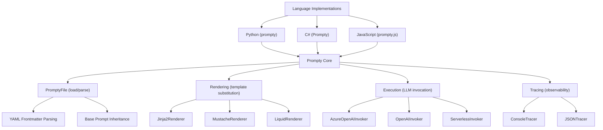
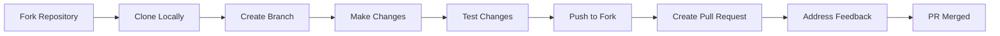
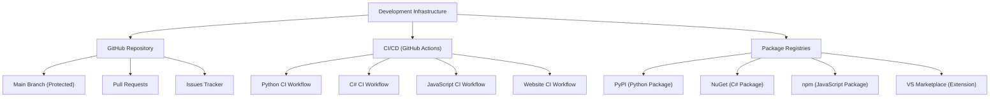

<!-- source: DeepWiki mcp.deepwiki.com · repo microsoft/prompty · page 10 Development and Contribution · fetched 2026-10-26 -->

# Development and Contribution

<details>
<summary>Relevant source files</summary>

The following files were used as context for generating this wiki page:

- [web/docs/contributing/code-guidelines/page.mdx](web/docs/contributing/code-guidelines/page.mdx)
- [web/docs/contributing/docs-guidelines/page.mdx](web/docs/contributing/docs-guidelines/page.mdx)
- [web/docs/contributing/page.mdx](web/docs/contributing/page.mdx)
- [web/docs/guides/prompty-extension/image-1.png](web/docs/guides/prompty-extension/image-1.png)
- [web/docs/guides/prompty-extension/image-2.png](web/docs/guides/prompty-extension/image-2.png)
- [web/docs/guides/prompty-extension/image-3.png](web/docs/guides/prompty-extension/image-3.png)
- [web/docs/guides/prompty-extension/image-4.png](web/docs/guides/prompty-extension/image-4.png)
- [web/docs/guides/prompty-extension/image-5.png](web/docs/guides/prompty-extension/image-5.png)
- [web/docs/guides/prompty-extension/image-8.png](web/docs/guides/prompty-extension/image-8.png)
- [web/docs/guides/prompty-extension/image-9.png](web/docs/guides/prompty-extension/image-9.png)
- [web/docs/guides/prompty-extension/image.png](web/docs/guides/prompty-extension/image.png)
- [web/docs/guides/prompty-extension/page.mdx](web/docs/guides/prompty-extension/page.mdx)
- [web/docs/guides/prompty-runtime/page.mdx](web/docs/guides/prompty-runtime/page.mdx)

</details>


This document provides comprehensive guidelines for contributing to the Prompty project. It covers setting up your development environment, understanding the contribution workflow, code and documentation guidelines, and using the project's CI/CD infrastructure. For information about the documentation website specifically, see [Documentation Website](#10.2).

## Project Overview

Prompty is an open-source project from Microsoft that makes it easy for developers to create, manage, debug, and evaluate LLM prompts for generative AI applications. The project consists of multiple language implementations (Python, C#, JavaScript) that share a common architecture centered around the `.prompty` file format.

### Core Architecture Components



Sources: `web/docs/contributing/page.mdx`

## Setting Up Your Development Environment

### Prerequisites

Depending on which part of the project you're contributing to, you'll need different tools:

- **Common prerequisites**:
  - Git
  - GitHub account

- **Python implementation**:
  - Python 3.8 or higher
  - pip

- **C# implementation**:
  - .NET 6.0 or higher
  - Visual Studio or Visual Studio Code

- **JavaScript implementation**:
  - Node.js 18 or higher
  - npm

- **VS Code extension**:
  - Node.js
  - VS Code Extension development tools

- **Documentation website**:
  - Node.js 18 or higher
  - npm

### Repository Structure

The repository is organized into the following main directories:

| Directory | Purpose |
|-----------|---------|
| `/python` | Python implementation of Prompty |
| `/csharp` | C# implementation of Prompty |
| `/js` | JavaScript implementation of Prompty |
| `/vscode` | VS Code extension source code |
| `/web` | Documentation website source |
| `/samples` | Sample prompty files and examples |

### Building and Testing

Each component has its own build and test process:

#### Python Implementation

```
cd python
pip install -e ".[dev]"
pytest
```

#### C# Implementation

```
cd csharp
dotnet build
dotnet test
```

#### JavaScript Implementation

```
cd js
npm install
npm test
```

#### VS Code Extension

```
cd vscode
npm install
npm run compile
```

#### Documentation Website

```
cd web
npm install
npm run dev  # Start development server
```

## Contribution Workflow



Sources: `web/docs/contributing/page.mdx`

### Step-by-Step Contribution Process

1. **Fork the Repository**:
   - Navigate to the [Prompty repository](https://github.com/microsoft/prompty)
   - Click the "Fork" button in the top-right corner

2. **Clone Your Fork**:
   ```
   git clone https://github.com/YOUR-USERNAME/prompty.git
   cd prompty
   ```

3. **Create a Branch**:
   ```
   git checkout -b your-feature-branch
   ```
   
4. **Make Changes**: Implement your feature or fix the bug

5. **Test Your Changes**: Make sure all tests pass

6. **Push to Your Fork**:
   ```
   git push origin your-feature-branch
   ```

7. **Create a Pull Request**: Navigate to your fork on GitHub and create a PR

### Pull Request Guidelines

When submitting a pull request to the Prompty repository:

- **Submit separate PRs for different types of changes**:
  - Bug fixes and documentation updates should be submitted in separate PRs
  - Typo fixes and minor documentation updates can be combined into a single PR

- **Handle merge conflicts**: If your PR shows merge conflicts, update your local main branch to mirror the main repository before making your modifications

- **PR descriptions**: Clearly explain what changes you've made and why

Sources: `web/docs/contributing/page.mdx:31-37`

## Code Contribution Guidelines

### Coding Standards

- Follow the existing code style and patterns in each language implementation
- Keep code modular and testable
- Write clear, descriptive variable and function names
- Add appropriate error handling
- Document your code with comments and docstrings

### Documentation Requirements

For any new feature or modification:

- Update relevant documentation files
- Add docstrings to public APIs
- Include examples where appropriate
- Update README files if necessary

### Testing Requirements

- Add unit tests for new features
- Ensure all existing tests pass
- For bug fixes, add a test that would have caught the bug

Sources: `web/docs/contributing/code-guidelines/page.mdx`

## Documentation Contribution Guidelines

The documentation website uses MDX (Markdown + JSX) and is built with a static site generator.

### Local Setup

1. Install dependencies:
   ```
   cd web
   npm install
   ```
   
2. Use Node.js 18+ for best compatibility

### Making Changes

1. Documentation files are located in the `web/docs` directory
2. Follow the existing folder structure and naming conventions
3. Use `.mdx` extension for all documentation files

### Previewing Changes

1. Start the local development server:
   ```
   npm run dev
   ```
   
2. View your changes at http://localhost:3000
3. The site will hot-reload as you edit files

### Building Documentation

1. Test a production build:
   ```
   npm run build
   npm run start
   ```
   
2. Check for any build errors or warnings before submitting your PR

Sources: `web/docs/contributing/docs-guidelines/page.mdx:12-34`

## CI/CD and Testing Infrastructure

Prompty uses GitHub Actions for CI/CD pipelines that automatically test, build, and deploy components. Understanding this infrastructure helps you ensure your contributions pass all checks.



### CI Workflow

1. When you submit a PR, GitHub Actions automatically runs tests for each component
2. CI checks include:
   - Code compilation/building
   - Unit tests
   - Linting
   - Documentation building

3. All checks must pass before a PR can be merged
4. If a check fails, you'll need to fix the issues and push additional commits

### Deployment Pipeline

After merging to the main branch, the deployment pipeline may:

1. Publish packages to PyPI, NuGet, and npm
2. Deploy the documentation website
3. Publish the VS Code extension to the marketplace

These deployments occur based on version tags and other conditions set by the project maintainers.

Sources: `web/docs/contributing/page.mdx`

## Providing Feedback

There are several ways to provide feedback on the Prompty project:

- **Feature Requests**: If you have ideas for new features or enhancements
- **Documentation Issues**: If you found errors or ambiguity in the documentation
- **Bug Reports**: If you encountered bugs or inconsistent behavior

The easiest way to provide feedback is by [filing an issue](https://github.com/microsoft/prompty/issues/new) on GitHub.

**Before filing an issue**: Check previously logged issues (both open and closed) to make sure the topic or bug hasn't already been raised.

Sources: `web/docs/contributing/page.mdx:19-26`

## Code of Conduct

All contributors are expected to adhere to the project's [Code of Conduct](https://github.com/microsoft/prompty/blob/main/CODE_OF_CONDUCT.md). The project is also governed by the Microsoft Open Source Code of Conduct.

Sources: `web/docs/contributing/page.mdx:16-17`

## Resources for Contributors

- [GitHub Repository](https://github.com/microsoft/prompty)
- [Documentation Website](https://microsoft.github.io/prompty)
- [VS Code Extension](https://marketplace.visualstudio.com/items?itemName=ms-toolsai.prompty)

Using these resources, you can understand the project better and make more effective contributions.

Sources: `web/docs/guides/prompty-extension/page.mdx`, `web/docs/guides/prompty-runtime/page.mdx`

---

