# Page: Overview

# Overview

<details>
<summary>Relevant source files</summary>

The following files were used as context for generating this wiki page:

- [LICENSE](LICENSE)
- [README.md](README.md)
- [web/docs/page.mdx](web/docs/page.mdx)

</details>


Prompty is an asset class and format for Large Language Model (LLM) prompts designed to enhance observability, understandability, and portability for developers. This document provides an introduction to the Prompty system, its architecture, and its key components. For detailed information on specific aspects of Prompty, please refer to the respective wiki pages linked throughout this document.

## Purpose and Scope

Prompty aims to accelerate the developer inner loop for prompt engineering and prompt source management by providing:

1. A standardized file format (`.prompty`) for defining prompts
2. Cross-language and cross-platform implementations (Python, C#, JavaScript)
3. Integration with popular AI orchestration frameworks (LangChain, Semantic Kernel, Prompt flow)
4. Enhanced observability and tracing capabilities
5. Developer tooling for rapid prototyping and testing

For more detailed information on the architecture, see [Architecture](#1.1).

Sources: [README.md:3-9](), [web/docs/page.mdx:16-21]()

## System Architecture

The following diagram illustrates the high-level architecture of the Prompty system:

**Prompty Core Architecture**
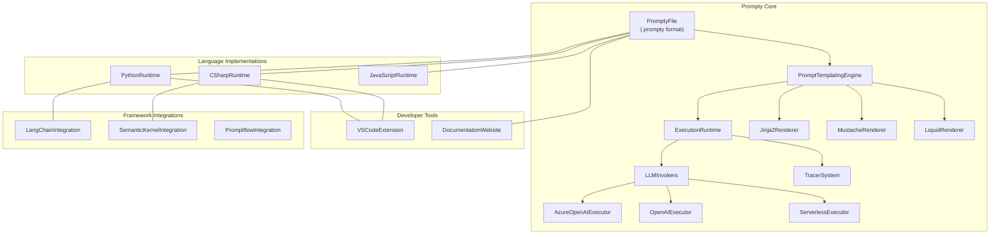

The architecture centers around the `.prompty` file format, which is processed by templating engines before being executed by runtimes in different languages. The execution runtime connects to LLM providers through invokers and provides observability through the tracer system.

Sources: [README.md:3-9](), [README.md:13-17]()

## Key Components

### Prompty File Format

The Prompty file format (`.prompty`) standardizes prompts and their execution into a single asset. It consists of:

1. **YAML Frontmatter**: Contains metadata, model configuration, and input/output specifications
2. **Prompt Content**: The actual prompt text, which can include templates

For more details on the file format, see [Prompty File Format](#2).

Sources: [README.md:14-17]()

### Runtime Implementations

Prompty provides implementations in multiple programming languages to support various development environments:

| Runtime | Description | Documentation |
|---------|-------------|---------------|
| Python | Python implementation of the Prompty runtime | [Python Runtime](#3) |
| C# | C# implementation of the Prompty runtime | [C# Runtime](#4) |
| JavaScript | JavaScript implementation of the Prompty runtime | [JavaScript Runtime](#5) |

Sources: [web/docs/page.mdx:18-21]()

**Execution Flow Across Runtimes**
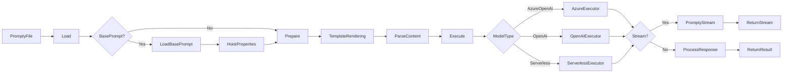

This diagram illustrates the common execution flow across all runtime implementations when processing a Prompty file.

Sources: [README.md:58-62]()

### LLM Integration

Prompty supports integration with multiple LLM providers:

| Provider | Description | Documentation |
|----------|-------------|---------------|
| Azure OpenAI | Integration with Azure OpenAI Service | [Azure OpenAI Integration](#6.1) |
| OpenAI | Integration with OpenAI API | [OpenAI Integration](#6.2) |
| Serverless | Support for serverless deployment options | [Serverless Integration](#6.3) |

Sources: [README.md:30-46]()

### Tracing and Observability

Prompty includes a built-in tracing system that enables developers to monitor and debug prompt execution. This provides visibility into:

- The rendered prompt sent to the LLM
- The response received from the LLM
- Performance metrics and token usage

For more information on tracing capabilities, see [Tracing and Observability](#7).

Sources: [README.md:52-56]()

## Developer Workflow

**Prompty in the Developer Inner Loop**
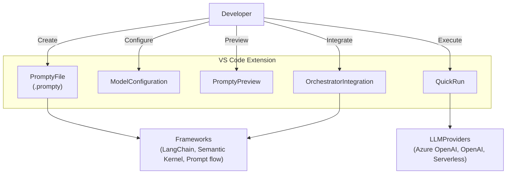

Prompty enhances the developer workflow with:

1. **Quick Creation**: Create Prompty files directly in VS Code
2. **Preview**: See rendered prompts with dynamic template rendering while typing
3. **Model Configuration**: Define and switch between different model configurations
4. **Quick Run**: Execute prompts with F5 or the Run button
5. **Framework Integration**: Generate code snippets for popular orchestration frameworks

Sources: [README.md:19-66]()

## Ecosystem Integration

Prompty integrates with popular AI orchestration frameworks:

**Framework Integration**
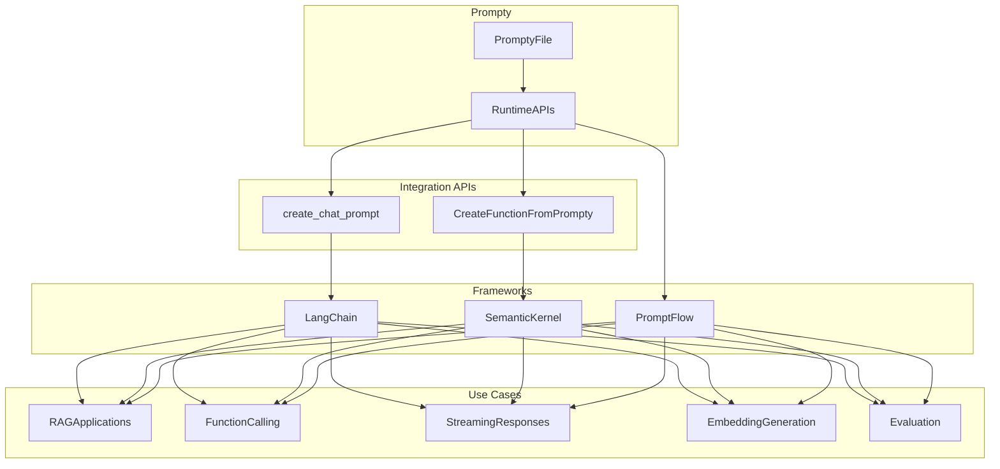

These integrations enable various AI application use cases such as Retrieval-Augmented Generation (RAG), function calling, streaming responses, embedding generation, and evaluation.

Sources: [README.md:58-66](), [web/docs/page.mdx:27-49]()

## Getting Started

To get started with Prompty:

1. Install the [VS Code Extension](https://marketplace.visualstudio.com/items?itemName=ms-toolsai.prompty)
2. Create your first Prompty file
3. Configure your model settings
4. Run and iterate on your prompts

For detailed getting started guidance, refer to the official documentation at [prompty.ai](https://prompty.ai).

Sources: [README.md:11-12](), [web/docs/page.mdx:51-53]()

## License

Prompty is available under the MIT License.

Sources: [LICENSE:1-21]()

---

# Page: Architecture

# Architecture

<details>
<summary>Relevant source files</summary>

The following files were used as context for generating this wiki page:

- [LICENSE](LICENSE)
- [README.md](README.md)
- [runtime/prompty/prompty/__init__.py](runtime/prompty/prompty/__init__.py)
- [runtime/prompty/prompty/cli.py](runtime/prompty/prompty/cli.py)
- [runtime/prompty/prompty/core.py](runtime/prompty/prompty/core.py)
- [runtime/prompty/prompty/invoker.py](runtime/prompty/prompty/invoker.py)
- [runtime/prompty/prompty/mustache.py](runtime/prompty/prompty/mustache.py)
- [runtime/prompty/prompty/openai/processor.py](runtime/prompty/prompty/openai/processor.py)
- [runtime/prompty/prompty/renderers.py](runtime/prompty/prompty/renderers.py)
- [runtime/prompty/prompty/tracer.py](runtime/prompty/prompty/tracer.py)
- [runtime/prompty/prompty/utils.py](runtime/prompty/prompty/utils.py)
- [runtime/prompty/tests/prompts/chat.prompty](runtime/prompty/tests/prompts/chat.prompty)
- [runtime/prompty/tests/test_core.py](runtime/prompty/tests/test_core.py)

</details>


This document describes the overall architecture of the Prompty system, which provides a standardized format and runtime for working with Large Language Model (LLM) prompts. For detailed information about specific components, see [Core Concepts](#1.2).

## System Overview

Prompty is designed as a cross-platform solution for defining, managing, and executing prompts for LLMs. The system centers around the `.prompty` file format and provides runtimes in multiple programming languages.

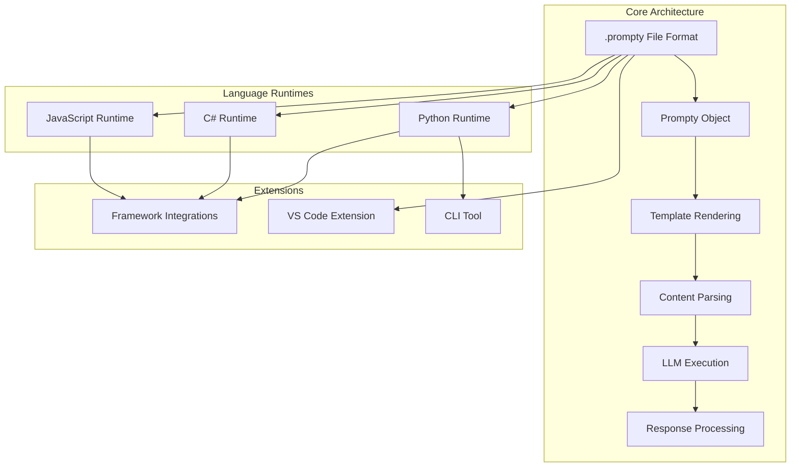

Sources: [runtime/prompty/prompty/__init__.py](). [runtime/prompty/prompty/core.py](). [README.md]().

## Core Components

The Prompty system consists of several key components that work together:

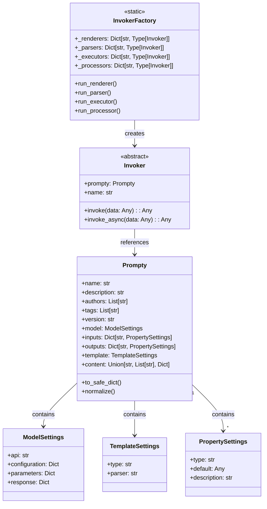

Sources: [runtime/prompty/prompty/core.py:12-142](). [runtime/prompty/prompty/invoker.py:9-56]().

### Prompty Class

The `Prompty` class is the central data structure in the system. It represents a complete prompt definition with its configuration and content.

| Field | Type | Description |
|-------|------|-------------|
| `name` | `str` | Name of the prompt |
| `description` | `str` | Description of the prompt |
| `authors` | `List[str]` | List of authors |
| `tags` | `List[str]` | List of tags for categorization |
| `version` | `str` | Version of the prompt |
| `base` | `str` | Path to base prompt (for inheritance) |
| `basePrompty` | `Prompty` | Reference to base prompt object |
| `model` | `ModelSettings` | Configuration for LLM model |
| `inputs` | `Dict[str, PropertySettings]` | Input definitions |
| `outputs` | `Dict[str, PropertySettings]` | Output definitions |
| `template` | `TemplateSettings` | Template configuration |
| `file` | `Union[str, Path]` | Path to the source file |
| `content` | `Union[str, list[str], dict]` | Prompt content |

Sources: [runtime/prompty/prompty/core.py:77-135]().

### Invoker System

The Invoker system follows a plugin architecture that enables extension and customization:

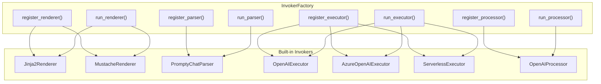

Sources: [runtime/prompty/prompty/invoker.py:90-286](). [runtime/prompty/prompty/renderers.py:11-84]().

## Execution Flow

The execution of a prompt follows a clear pipeline with these phases:

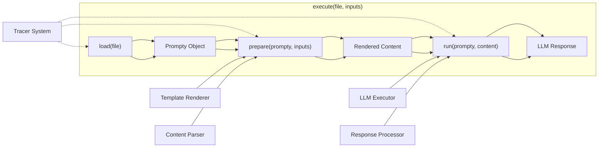

The execution process consists of three main phases:

1. **Load**: Parses a `.prompty` file into a `Prompty` object, resolving base prompts and configuration.
2. **Prepare**: Renders the template with the provided inputs and parses the content into the format required by the LLM.
3. **Run**: Executes the prepared content against the LLM and processes the response.

The `execute()` function combines all three phases into a single operation.

Sources: [runtime/prompty/prompty/__init__.py:209-261](). [runtime/prompty/prompty/__init__.py:316-382](). [runtime/prompty/prompty/__init__.py:384-593]().

### Detailed Execution Steps

For a more detailed view of the execution process:

1. **Loading**:
   - Parse the `.prompty` file (YAML frontmatter and content body)
   - Normalize attributes and resolve references
   - Load any base prompts and inherit properties
   - Apply global configuration

2. **Preparation**:
   - Merge input data with sample data
   - Apply template rendering with merged inputs
   - Parse rendered content into LLM-specific format

3. **Execution**:
   - Configure LLM client with model settings
   - Send prepared content to LLM
   - Process and return response

Sources: [runtime/prompty/prompty/__init__.py:144-206](). [runtime/prompty/prompty/utils.py:97-121]().

## Tracing System

Prompty includes a robust tracing system for observability and debugging:

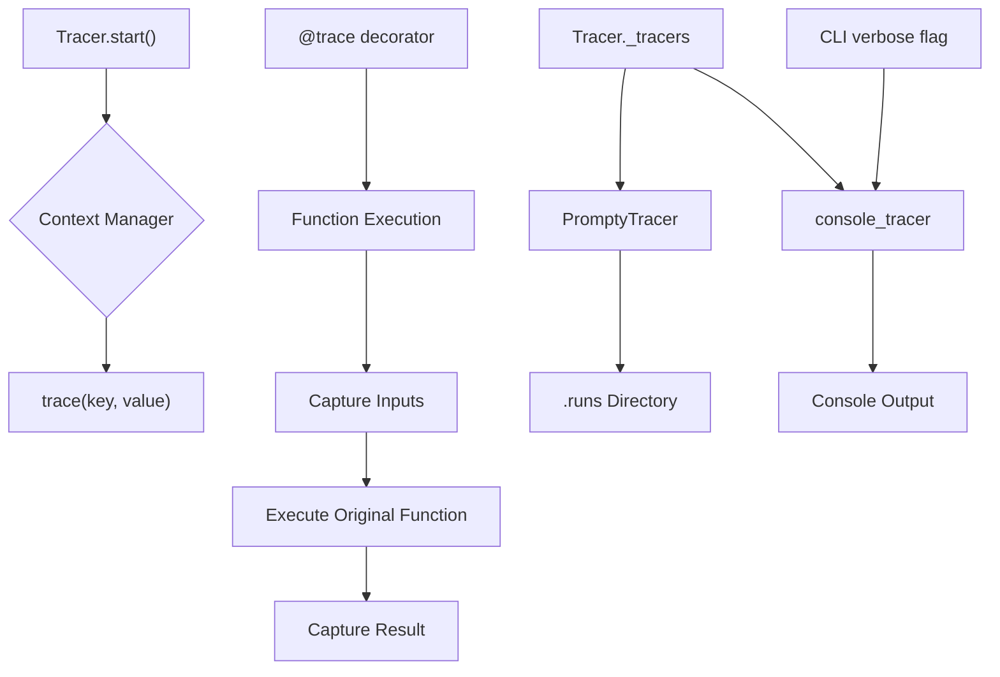

The tracing system has these key components:

1. **Tracer**: Static class that manages tracers and provides a context manager API
2. **trace decorator**: Function decorator that automatically traces function calls
3. **PromptyTracer**: Implementation that writes trace data to files
4. **console_tracer**: Implementation that outputs trace data to the console

All core functions in Prompty use the `@trace` decorator to provide detailed information about their execution.

Sources: [runtime/prompty/prompty/tracer.py:28-53](). [runtime/prompty/prompty/tracer.py:143-250](). [runtime/prompty/prompty/tracer.py:253-376]().

## Prompty File Format

The `.prompty` file format is the standard way to define prompts:

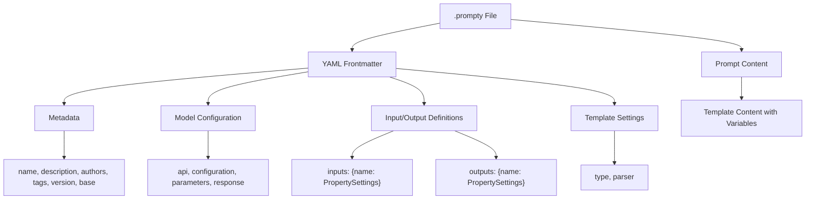

The format consists of two main sections:

1. **YAML Frontmatter**: Contains configuration and metadata
2. **Prompt Content**: Contains the actual prompt template

Sources: [runtime/prompty/prompty/utils.py:97-121](). [runtime/prompty/tests/prompts/chat.prompty]().

## Cross-Platform Implementation

Prompty is designed for cross-platform use with implementations in multiple languages:

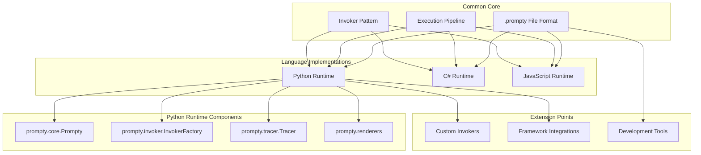

Each language implementation follows the same architectural patterns:

1. **Common File Format**: All implementations use the same `.prompty` file format
2. **Pipeline Architecture**: All follow the load → prepare → run pattern
3. **Invoker Pattern**: All use a plugin architecture for extensibility

Sources: [runtime/prompty/prompty/__init__.py:1-22](). [README.md:15-17]().

## Framework Integrations

Prompty integrates with popular orchestration frameworks:

| Framework | Integration Method | Purpose |
|-----------|-------------------|---------|
| LangChain | `create_chat_prompt` | Allows using Prompty files with LangChain's orchestration |
| Semantic Kernel | `CreateFunctionFromPrompty` | Enables Prompty files as Semantic Kernel plugins |
| Prompt flow | Direct import | Supports Prompty files in Prompt flow workflows |

Sources: [README.md:58-62]().

## Tools and Extensions

Prompty provides several tools for developers:

1. **VS Code Extension**: Provides a prompt playground, syntax highlighting, and preview
2. **Command Line Interface**: Allows execution of prompts from the command line
3. **Documentation Website**: Comprehensive documentation at prompty.ai

Sources: [runtime/prompty/prompty/cli.py:134-166](). [README.md:19-66]().

## Conclusion

The Prompty architecture provides a comprehensive, extensible system for working with LLM prompts across multiple programming languages. Its core strengths include:

1. **Standardized Format**: The `.prompty` file format provides a clear, shareable way to define prompts
2. **Extensible Architecture**: The invoker pattern allows easy extension for new template engines and LLM providers
3. **Cross-Platform Support**: Multiple language implementations enable integration in diverse environments
4. **Robust Tracing**: The tracing system provides detailed observability for debugging
5. **Framework Integration**: Integration with popular orchestration frameworks enables seamless adoption

---

# Page: Prompty File Format

# Prompty File Format

<details>
<summary>Relevant source files</summary>

The following files were used as context for generating this wiki page:

- [runtime/prompty/.vscode/settings.json](runtime/prompty/.vscode/settings.json)
- [runtime/prompty/tests/prompts/basic.prompty](runtime/prompty/tests/prompts/basic.prompty)
- [runtime/promptycs/.vscode/settings.json](runtime/promptycs/.vscode/settings.json)
- [runtime/promptyjs/jsconfig.json](runtime/promptyjs/jsconfig.json)
- [runtime/promptyjs/tests/tracer.test.ts](runtime/promptyjs/tests/tracer.test.ts)
- [web/.vscode/settings.json](web/.vscode/settings.json)

</details>


This document details the standardized `.prompty` file format used throughout the Prompty system to define, configure, and manage prompts for Large Language Models (LLMs). The Prompty file format serves as the foundation for cross-language prompt engineering, providing a consistent definition layer that can be executed by any of the Prompty runtimes.

For information about the YAML frontmatter details, see [YAML Frontmatter](#2.1). For information about templating and variable rendering, see [Templates and Rendering](#2.2).

## Overview

The Prompty file format consists of two main sections:

1. **YAML Frontmatter**: Contains metadata, model configuration, and input/output specifications
2. **Prompt Content**: Contains the actual prompt text with templating capabilities

These sections together define a complete, executable prompt that can be processed by the Prompty runtime libraries.

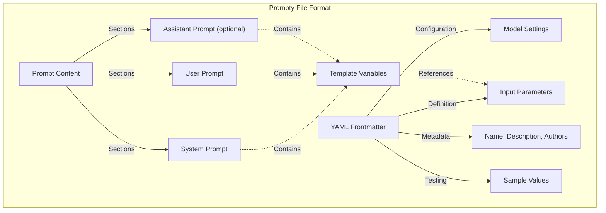

Sources: [runtime/prompty/tests/prompts/basic.prompty:1-42]()

## File Structure

A `.prompty` file has the following structure:

```
---
[YAML Frontmatter]
---
[Prompt Content with Template Variables]
```

The frontmatter is enclosed by triple dashes (`---`) and contains YAML-formatted configuration. The content section follows immediately after the closing frontmatter delimiter and contains the actual prompt text, which can include templating markup.

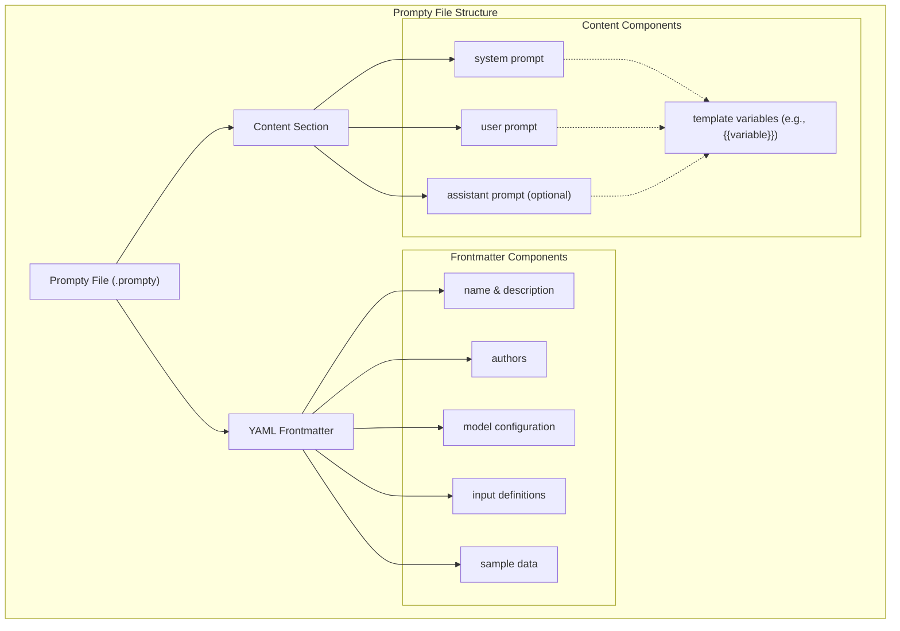

Sources: [runtime/prompty/tests/prompts/basic.prompty:1-42]()

## YAML Frontmatter

The YAML frontmatter provides crucial configuration for the prompt execution. It includes the following key components:

### Metadata

Basic information about the prompt:

- `name`: The name of the prompt
- `description`: A brief description of the prompt's purpose
- `authors`: List of contributors/authors

### Model Configuration

Defines the LLM model to be used:

- `model.api`: Specifies the API type (e.g., "chat")
- `model.configuration`: Contains model-specific settings
  - Example: `azure_deployment: gpt-35-turbo`

### Input Parameters

Defines input variables that can be used in the prompt content:

- Each input has:
  - `type`: Data type (string, number, etc.)
  - `description`: Purpose of the input
  - `default` (optional): Default value if not provided

### Sample Data

Contains example values for testing the prompt:

- Key-value pairs of input variables and their sample values
- Used for development and testing purposes

Here is an example of the YAML frontmatter section:

```yaml
---
name: Basic Prompt
description: A basic prompt that uses the GPT-3 chat API to answer questions
authors:
  - sethjuarez
  - jietong
model:
  api: chat
  configuration:
    azure_deployment: gpt-35-turbo
inputs:
  table:
    type: string
    default: sample
    description: The name of the sample
  firstName:
    type: string
    description: The first name of the customer
  lastName:
    type: string
    default: Doe
    description: The last name of the customer

sample:
  firstName: Jane
  lastName: Doe
  question: What is the meaning of life?
  top_n: 5
  table: customers
---
```

Sources: [runtime/prompty/tests/prompts/basic.prompty:1-30]()

## Prompt Content

The content section contains the actual prompt text that will be sent to the LLM. For chat-based models, the content is typically divided into different roles or sections.

### Content Sections

Typical sections include:

- `system`: Instructions for the LLM that define its behavior
- `user`: The user's query or input
- `assistant` (optional): Pre-defined assistant responses

### Templating

Prompty uses template variables in the format `{{variable_name}}` that are replaced with actual values during prompt execution. These variables reference inputs defined in the frontmatter.

Example prompt content:

```
system:
You are an AI assistant who helps people find information.
As the assistant, you answer questions briefly, succinctly, 
and in a personable manner using markdown and even add some personal flair with appropriate emojis.
{{ query }}

# Customer
You are helping {{firstName}} {{lastName}} to find answers to their questions.
Use their name to address them in your responses.

user:
{{question}}
```

Sources: [runtime/prompty/tests/prompts/basic.prompty:31-42]()

## Prompty File Processing

When a `.prompty` file is processed by one of the Prompty runtimes, it goes through the following stages:

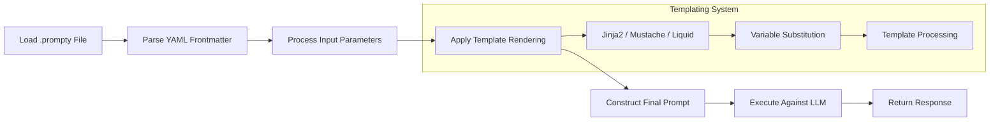

Sources: System architecture diagrams

## Integration with Prompty Runtime

The Prompty file format is designed to be language-agnostic, allowing the same prompt definition to be used across different programming languages and frameworks.

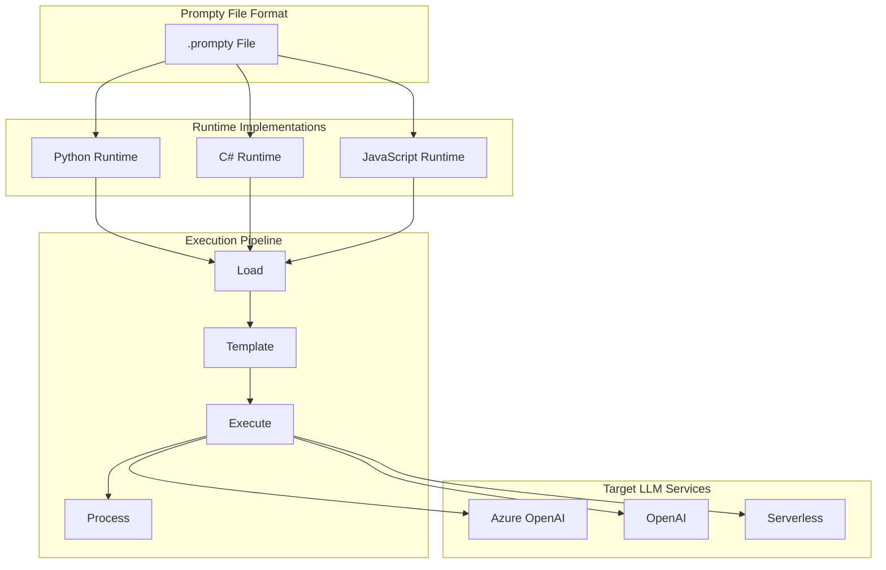

Sources: System architecture diagrams

## Example of a Complete Prompty File

Here is an example of a complete `.prompty` file:

| Component | Content |
|-----------|---------|
| **Filename** | `basic.prompty` |
| **Frontmatter** | Contains name, description, authors, model configuration, input definitions, and sample data |
| **System prompt** | Instructions for the LLM behavior |
| **User prompt** | The query to be answered, typically templated |
| **Variables** | `{{firstName}}`, `{{lastName}}`, `{{question}}`, `{{query}}` |

This example defines a prompt that helps answer questions from a customer, personalizing the response with the customer's name.

Sources: [runtime/prompty/tests/prompts/basic.prompty:1-42]()

## Summary

The Prompty file format provides a standardized way to define LLM prompts that can be executed across different programming languages. Key features include:

1. YAML frontmatter for configuration
2. Templating capabilities for dynamic content
3. Support for different chat roles (system, user, assistant)
4. Cross-language compatibility
5. Input parameter definitions with typing and defaults
6. Sample data for testing

This format enables consistent prompt engineering workflows regardless of the implementation language or target LLM service.

---

# Page: YAML Frontmatter

# YAML Frontmatter

<details>
<summary>Relevant source files</summary>

The following files were used as context for generating this wiki page:

- [runtime/promptycs/Prompty.Core.Tests/LoadTests.cs](runtime/promptycs/Prompty.Core.Tests/LoadTests.cs)
- [runtime/promptycs/Prompty.Core.Tests/ParserTests.cs](runtime/promptycs/Prompty.Core.Tests/ParserTests.cs)
- [runtime/promptycs/Prompty.Core/Model/Prompty.cs](runtime/promptycs/Prompty.Core/Model/Prompty.cs)
- [runtime/promptycs/Prompty.Core/Model/Template.cs](runtime/promptycs/Prompty.Core/Model/Template.cs)
- [runtime/promptycs/Prompty.Core/Normalizer.cs](runtime/promptycs/Prompty.Core/Normalizer.cs)
- [runtime/promptycs/Prompty.Core/Parsers/PromptyChatParser.cs](runtime/promptycs/Prompty.Core/Parsers/PromptyChatParser.cs)
- [runtime/promptycs/Prompty.Core/Prompty.cs](runtime/promptycs/Prompty.Core/Prompty.cs)

</details>


The YAML Frontmatter is a fundamental component of the Prompty file format (.prompty) that defines the metadata, configuration, and specifications for a prompt. It is enclosed by triple dashes (`---`) at the beginning of a .prompty file and contains configuration that determines how the prompt is processed, rendered, and executed against Language Model providers.

This document details the structure and components of the YAML Frontmatter section, how it is parsed, and how values within it are processed. For information about how templates are rendered using the variables defined in the frontmatter, see [Templates and Rendering](#2.2).

## Structure and Format

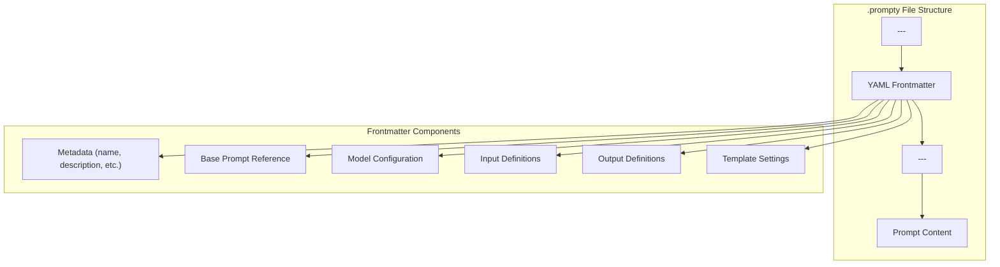

Sources: [runtime/promptycs/Prompty.Core/Model/Prompty.cs:7-12]()

The YAML Frontmatter is enclosed by triple dashes (`---`) at the beginning and end. The prompt content follows after the second triple dash. The Prompty system uses a regex pattern to extract the frontmatter and content sections of a .prompty file:

```regex
^---\s*$\n      # Start of YAML front matter
(?<header>.*?)  # Capture the YAML front matter
^---\s*$\n      # End of YAML front matter
(?<content>.*)  # Capture the content after
```

## Frontmatter Components

A complete frontmatter can include the following components:

| Component | Description | Required |
|-----------|-------------|----------|
| Metadata | General information about the prompt (name, description, etc.) | No |
| Base | Reference to another .prompty file to extend | No |
| Model | Configuration for the LLM to use | Yes |
| Inputs | Definitions of input variables | No |
| Outputs | Definitions of output formats | No |
| Template | Settings for template rendering | No |

### Metadata Section

The metadata section includes general information about the prompt:

```yaml
name: Example Prompt
description: This is an example prompt
authors:
  - John Doe
tags:
  - example
  - documentation
version: 1.0.0
```

These fields are mapped to properties in the `Prompty` class:

Sources: [runtime/promptycs/Prompty.Core/Model/Prompty.cs:23-28]()

### Base Section

The `base` field allows you to extend another .prompty file:

```yaml
base: path/to/base/prompt.prompty
```

When a base prompt is specified, Prompty loads the base prompt first and then applies the current prompt's properties, overriding any conflicting values.

Sources: [runtime/promptycs/Prompty.Core/Model/Prompty.cs:31-32]()

### Model Configuration Section

The `model` section specifies how the prompt should be executed by an LLM:

```yaml
model:
  api: chat
  configuration:
    type: azure_openai
    endpoint: ${env:AZURE_OPENAI_ENDPOINT}
    model: gpt-4
    temperature: 0.7
```

Key fields:
- `api`: Specifies the API type (e.g., "chat", "completion")
- `configuration`: Contains model-specific settings:
  - `type`: The executor type (e.g., "azure_openai", "openai", "serverless")
  - Other configuration values specific to the chosen executor

Sources: [runtime/promptycs/Prompty.Core/Model/Prompty.cs:35](), [runtime/promptycs/Prompty.Core/Prompty.cs:95-108]()

## Processing Model Configuration

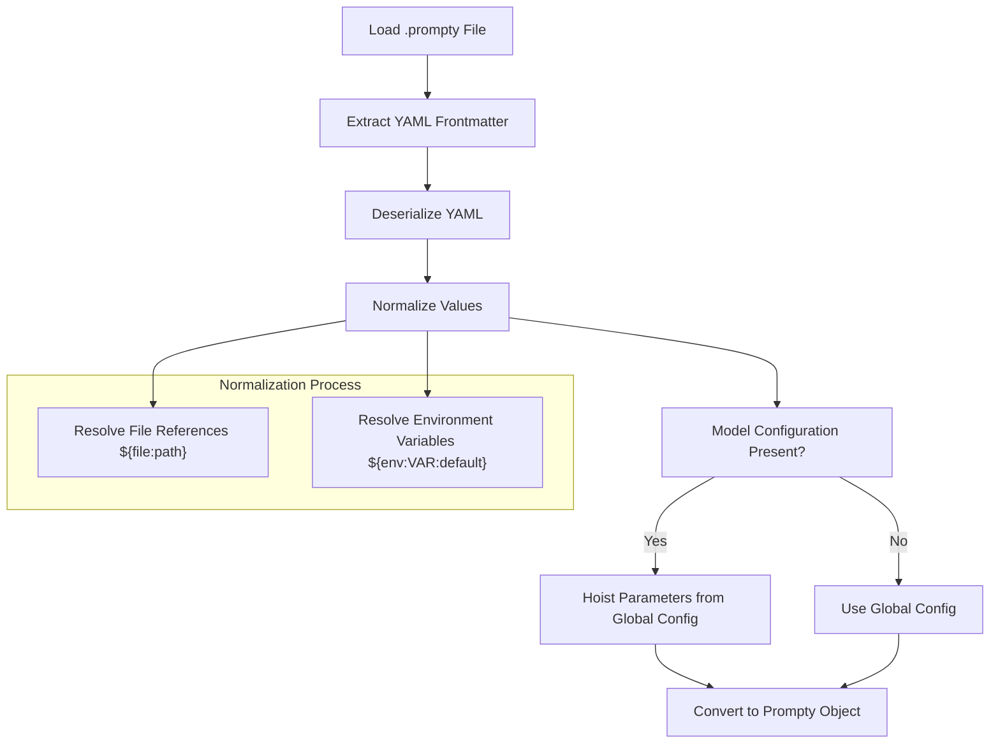

Sources: [runtime/promptycs/Prompty.Core/Prompty.cs:62-112](), [runtime/promptycs/Prompty.Core/Normalizer.cs:7-67]()

### Inputs and Outputs Sections

The `inputs` and `outputs` sections define variables that can be passed to or returned from the prompt:

```yaml
inputs:
  firstName:
    type: string
    description: The user's first name
    sample: Jane
    default: User
  age:
    type: number
    description: The user's age
    sample: 45
    default: 18
  valid:
    type: boolean
    description: Whether the data is valid
    sample: true
    default: false
  items:
    type: array
    description: A list of items
    sample:
      - one
      - two
      - three
```

Each property must have:
- `type`: Data type ("string", "number", "boolean", or "array")
- `description`: Description of the property

And may optionally include:
- `sample`: Example value (used for testing)
- `default`: Default value (used if no value is provided)

Sources: [runtime/promptycs/Prompty.Core/Model/Prompty.cs:41-42](), [runtime/promptycs/Prompty.Core/Prompty.cs:136-137](), [runtime/promptycs/Prompty.Core.Tests/LoadTests.cs:56-95]()

### Template Section

The `template` section configures how variables are substituted in the prompt content:

```yaml
template:
  format: liquid
  parser: prompty
  strict: true
```

Key fields:
- `format`: The template engine to use ("liquid", "jinja2", "mustache")
- `parser`: The parser to use for content ("prompty", "prompty.chat", etc.)
- `strict`: Whether to enforce strict validation

Sources: [runtime/promptycs/Prompty.Core/Model/Prompty.cs:44](), [runtime/promptycs/Prompty.Core/Model/Template.cs:5-7]()

## Special Syntax in Values

The YAML frontmatter supports special syntax for dynamic values that are resolved during normalization:

### File Inclusion

```yaml
configuration:
  functionDefinitions: ${file:path/to/functions.json}
```

This includes the contents of the specified file, which is then normalized.

### Environment Variable References

```yaml
configuration:
  endpoint: ${env:AZURE_OPENAI_ENDPOINT}
  apiKey: ${env:AZURE_OPENAI_KEY:default_value}
```

This substitutes environment variable values. An optional default value can be provided.

Sources: [runtime/promptycs/Prompty.Core/Normalizer.cs:39-67]()

## Input Validation

When executing a prompt, the inputs defined in the frontmatter are validated:

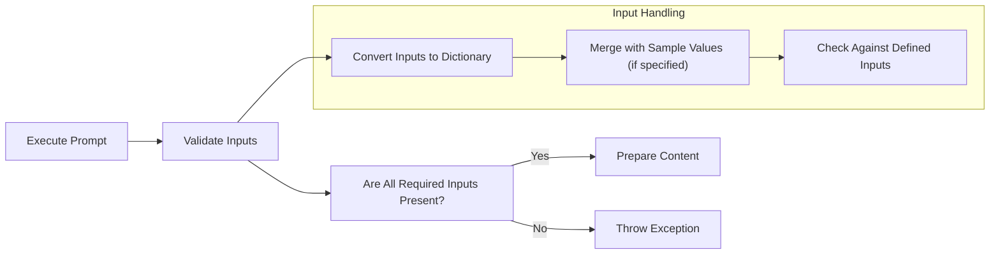

Sources: [runtime/promptycs/Prompty.Core/Prompty.cs:215-231](), [runtime/promptycs/Prompty.Core/Prompty.cs:289-297]()

## Loading and Processing Flow

The complete process of loading and processing a .prompty file involves several steps:

1. Read the file content
2. Extract the YAML frontmatter and prompt content
3. Deserialize the YAML to a dictionary
4. Normalize values (resolving file inclusions and environment variables)
5. Load and merge with global configuration
6. Convert the frontmatter dictionary to a `Prompty` object
7. Process any base prompt (if specified)

Sources: [runtime/promptycs/Prompty.Core/Prompty.cs:155-164](), [runtime/promptycs/Prompty.Core/Prompty.cs:114-146]()

## References to Frontmatter During Execution

During prompt execution, various components of the frontmatter are referenced:

- `template.format` determines which renderer to use
- `template.parser` and `model.api` determine which parser to use
- `model.configuration.type` determines which executor and processor to use

Sources: [runtime/promptycs/Prompty.Core/Prompty.cs:11-21]()

The frontmatter establishes the entire configuration for how a prompt will be processed, including the template engine, the parsing method, the execution model, and the input/output specifications.

---

# Page: Templates and Rendering

# Templates and Rendering

<details>
<summary>Relevant source files</summary>

The following files were used as context for generating this wiki page:

- [runtime/prompty/prompty/cli.py](runtime/prompty/prompty/cli.py)
- [runtime/prompty/prompty/core.py](runtime/prompty/prompty/core.py)
- [runtime/prompty/prompty/mustache.py](runtime/prompty/prompty/mustache.py)
- [runtime/prompty/prompty/renderers.py](runtime/prompty/prompty/renderers.py)
- [runtime/prompty/prompty/tracer.py](runtime/prompty/prompty/tracer.py)
- [runtime/prompty/tests/prompts/chat.prompty](runtime/prompty/tests/prompts/chat.prompty)
- [runtime/promptycs/Directory.Packages.props](runtime/promptycs/Directory.Packages.props)
- [runtime/promptycs/Prompty.Core.Tests/RenderererTests.cs](runtime/promptycs/Prompty.Core.Tests/RenderererTests.cs)
- [runtime/promptycs/Prompty.Core.Tests/packages.lock.json](runtime/promptycs/Prompty.Core.Tests/packages.lock.json)
- [runtime/promptycs/Prompty.Core.Tests/prompty/basic_mustache.prompty](runtime/promptycs/Prompty.Core.Tests/prompty/basic_mustache.prompty)
- [runtime/promptycs/Prompty.Core/Renderers/LiquidRenderer.cs](runtime/promptycs/Prompty.Core/Renderers/LiquidRenderer.cs)
- [runtime/promptycs/Prompty.Core/Renderers/MustacheRenderer.cs](runtime/promptycs/Prompty.Core/Renderers/MustacheRenderer.cs)
- [runtime/promptycs/Prompty.Core/packages.lock.json](runtime/promptycs/Prompty.Core/packages.lock.json)

</details>


This document covers the template engine support and rendering process in Prompty. It details how Prompty processes variables in prompt templates and the different template formats available. For information about the overall Prompty file format structure, see [Prompty File Format](#2).

## Overview

Prompty supports multiple template engines for rendering variables within prompt templates. This allows for dynamic prompt generation by substituting placeholders with actual values at runtime. The template system is a core component of Prompty's flexibility, enabling reusable prompt patterns that can be populated with different data for each execution.

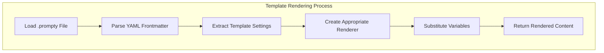

Sources: [runtime/prompty/prompty/core.py:61-74](runtime/prompty/prompty/core.py:61-74), [runtime/prompty/prompty/renderers.py:10-84](runtime/prompty/prompty/renderers.py:10-84)

## Supported Template Engines

Prompty currently supports three template engines across its language implementations:

1. **Mustache** - A logic-less template syntax
2. **Jinja2** - A full-featured template engine with Python-like expressions
3. **Liquid** - A template language originally created for Shopify

Each template engine has different capabilities and syntax, allowing you to choose the one that best fits your needs.

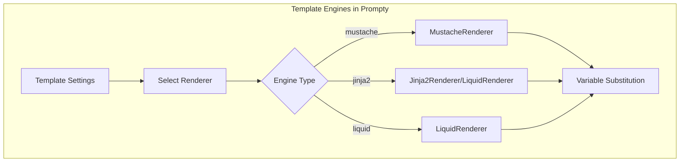

Sources: [runtime/prompty/prompty/renderers.py:11-84](runtime/prompty/prompty/renderers.py:11-84), [runtime/promptycs/Prompty.Core/Renderers/MustacheRenderer.cs:5-20](runtime/promptycs/Prompty.Core/Renderers/MustacheRenderer.cs:5-20), [runtime/promptycs/Prompty.Core/Renderers/LiquidRenderer.cs:5-23](runtime/promptycs/Prompty.Core/Renderers/LiquidRenderer.cs:5-23)

## Template Configuration

The template engine to use is specified in the YAML frontmatter of the `.prompty` file under the `template` section. This allows you to specify both the format (engine) and optional parser settings.

### Configuration Fields

| Field  | Description | Default Value |
|--------|-------------|---------------|
| format | The template engine to use (mustache, jinja2, liquid) | mustache |
| parser | Parser-specific configuration | "" |

Example YAML configuration:

```yaml
template:
  format: mustache
  parser: prompty
```

Sources: [runtime/prompty/prompty/core.py:61-74](runtime/prompty/prompty/core.py:61-74), [runtime/promptycs/Prompty.Core.Tests/prompty/basic_mustache.prompty:17-19](runtime/promptycs/Prompty.Core.Tests/prompty/basic_mustache.prompty:17-19)

## Renderer Implementation

Each template engine is implemented as a renderer class that inherits from the `Invoker` base class. The renderer is responsible for processing the template with the given data and returning the rendered output.

```mermaid
classDiagram
    class "Invoker" {
        +invoke(data)
        +invoke_async(data)
    }
    
    class "MustacheRenderer" {
        -prompty: Prompty
        -templates: dict
        -name: str
        +invoke(data)
        +invoke_async(data)
    }
    
    class "Jinja2Renderer" {
        -prompty: Prompty
        -templates: dict
        -name: str
        +invoke(data)
        +invoke_async(data)
    }
    
    class "LiquidRenderer" {
        -prompty: Prompty
        +invoke(data)
        +invoke_async(data)
    }
    
    "Invoker" <|-- "MustacheRenderer"
    "Invoker" <|-- "Jinja2Renderer"
    "Invoker" <|-- "LiquidRenderer"
```

Sources: [runtime/prompty/prompty/renderers.py:11-84](runtime/prompty/prompty/renderers.py:11-84), [runtime/promptycs/Prompty.Core/Renderers/MustacheRenderer.cs:5-20](runtime/promptycs/Prompty.Core/Renderers/MustacheRenderer.cs:5-20), [runtime/promptycs/Prompty.Core/Renderers/LiquidRenderer.cs:5-23](runtime/promptycs/Prompty.Core/Renderers/LiquidRenderer.cs:5-23)

## Template Rendering Process

The template rendering process follows these steps:

1. The `.prompty` file is loaded and parsed
2. The template settings are extracted from the YAML frontmatter
3. An appropriate renderer is created based on the template format
4. The renderer substitutes variables in the template with values from the input data
5. The rendered template is returned as a string

```mermaid
sequenceDiagram
    participant "Main Program" as Main
    participant "PromptyLoader" as Loader
    participant "InvokerFactory" as Factory
    participant "Renderer" as Renderer
    
    Main->>Loader: load("path/to/file.prompty")
    Loader->>Loader: Parse YAML frontmatter
    Loader->>Loader: Extract template settings
    Loader->>Factory: CreateRenderer(template.format, prompty)
    Factory->>Renderer: new Renderer(prompty)
    Main->>Renderer: invoke(data)
    Renderer->>Renderer: Process template with data
    Renderer-->>Main: Rendered content
```

Sources: [runtime/prompty/prompty/renderers.py:33-52](runtime/prompty/prompty/renderers.py:33-52), [runtime/promptycs/Prompty.Core.Tests/RenderererTests.cs:12-42](runtime/promptycs/Prompty.Core.Tests/RenderererTests.cs:12-42)

## Template Syntax and Examples

### Mustache Syntax

Mustache uses double curly braces `{{}}` for variable substitution. It's a "logic-less" template system, focusing on simple variable substitutions.

```
# Customer
You are helping {{firstName}} {{lastName}} to find answers to their questions.
Use their name to address them in your responses.

user:
{{question}}
```

Mustache also supports comments with `{{! comment }}` which are removed from the output.

Sources: [runtime/promptycs/Prompty.Core.Tests/prompty/basic_mustache.prompty:20-34](runtime/promptycs/Prompty.Core.Tests/prompty/basic_mustache.prompty:20-34), [runtime/prompty/prompty/mustache.py:129-137](runtime/prompty/prompty/mustache.py:129-137)

### Jinja2/Liquid Syntax

Jinja2 and Liquid provide more advanced templating with support for conditionals, loops, and other control structures.

Example with loops:

```

{{item.role}}:
{{item.content}}

```

This iterates through a `chat_history` array, outputting each item's role and content.

Sources: [runtime/prompty/tests/prompts/chat.prompty:30-33](runtime/prompty/tests/prompts/chat.prompty:30-33)

## Integration with Prompty Execution Flow

Template rendering is a key step in the Prompty execution pipeline. When a prompt is executed, the variables from the input data are passed to the template renderer before the content is sent to the LLM.

```mermaid
graph TD
    subgraph "Prompty Execution Flow"
        A["Load .prompty File"] --> B["Parse YAML Frontmatter"]
        B --> C["Extract Model Configuration"]
        B --> D["Extract Template Settings"]
        D --> E["Create Template Renderer"]
        C --> F["Create LLM Invoker"]
        E --> G["Render Template with Inputs"]
        G --> H["Send to LLM via Invoker"]
        H --> I["Process LLM Response"]
        I --> J["Return Result"]
    end
```

Sources: [runtime/prompty/prompty/core.py:77-135](runtime/prompty/prompty/core.py:77-135), [runtime/prompty/prompty/cli.py:83-103](runtime/prompty/prompty/cli.py:83-103)

## Implementation Across Languages

Prompty provides template rendering implementations across its supported languages:

### Python Implementation

In Python, Prompty uses:
- Native `Jinja2` library for Jinja2 templates
- Custom `mustache.py` implementation for Mustache templates

### C# Implementation

In C#, Prompty uses:
- `Stubble.Core` for Mustache templates
- `Scriban` for Jinja2 and Liquid templates

```mermaid
graph TD
    subgraph "Template Engine Libraries"
        subgraph "Python"
            A1["Jinja2 Library"] --- B1["Jinja2Renderer"]
            A2["mustache.py"] --- B2["MustacheRenderer"]
        end
        
        subgraph "C#"
            C1["Stubble.Core"] --- D1["MustacheRenderer"]
            C2["Scriban"] --- D2["LiquidRenderer"]
        end
    end
```

Sources: [runtime/prompty/prompty/renderers.py:4-5](runtime/prompty/prompty/renderers.py:4-5), [runtime/promptycs/Directory.Packages.props:10-13](runtime/promptycs/Directory.Packages.props:10-13), [runtime/promptycs/Prompty.Core/packages.lock.json:46-65](runtime/promptycs/Prompty.Core/packages.lock.json:46-65)

## Variable Substitution Examples

The following table shows examples of variable substitution with different template engines:

| Template Engine | Variable Syntax | Example |
|-----------------|-----------------|---------|
| Mustache | `{{variableName}}` | `Hello {{name}}!` |
| Mustache (no HTML escape) | `{{{variableName}}}` | `{{{htmlContent}}}` |
| Mustache (comments) | `{{! comment }}` | `{{! This is ignored }}` |
| Jinja2/Liquid | `{{ variableName }}` | `Hello {{ name }}!` |
| Jinja2/Liquid (if statement) | `...` | `Hello!` |
| Jinja2/Liquid (for loop) | `...` | `{{ item }}` |

Sources: [runtime/prompty/prompty/mustache.py:127-140](runtime/prompty/prompty/mustache.py:127-140), [runtime/prompty/tests/prompts/chat.prompty:30-33](runtime/prompty/tests/prompts/chat.prompty:30-33)

## Inheritance and Base Prompts

When a `.prompty` file extends another prompt using the `base` property, the template rendering system automatically handles inheritance by making the base prompt's content available to the template engine.

```mermaid
graph TD
    subgraph "Template Inheritance"
        A["Child Prompt"] -->|"extends"| B["Base Prompt"]
        C["Renderer"] -->|"loads"| A
        C -->|"loads"| B
        C -->|"creates template dict"| D["Template Dictionary"]
        D -->|"contains"| E["Base Prompt Content"]
        D -->|"contains"| F["Child Prompt Content"]
        C -->|"renders with"| G["Rendered Output"]
    end
```

This is handled by building a templates dictionary in the renderer that includes both the child and base prompt content.

Sources: [runtime/prompty/prompty/renderers.py:16-27](runtime/prompty/prompty/renderers.py:16-27), [runtime/prompty/prompty/renderers.py:59-65](runtime/prompty/prompty/renderers.py:59-65)

## Conclusion

The template and rendering system in Prompty provides flexible options for creating dynamic prompts. By supporting multiple template engines, Prompty accommodates different levels of complexity in prompt design, from simple variable substitution to complex conditional logic and loops.

The choice of template engine depends on your needs:
- Mustache for simple, logic-less templates
- Jinja2/Liquid for more complex templates with conditionals and loops

Template rendering is a core part of the Prompty execution process, enabling dynamic prompt generation based on input data before sending to the LLM.

---

# Page: Python Runtime

# Python Runtime

<details>
<summary>Relevant source files</summary>

The following files were used as context for generating this wiki page:

- [.github/workflows/prompty-python.yml](.github/workflows/prompty-python.yml)
- [.vscode/project.code-workspace](.vscode/project.code-workspace)
- [runtime/prompty/.gitignore](runtime/prompty/.gitignore)
- [runtime/prompty/LICENSE](runtime/prompty/LICENSE)
- [runtime/prompty/README.md](runtime/prompty/README.md)
- [runtime/prompty/doc.py](runtime/prompty/doc.py)
- [runtime/prompty/prompty/__init__.py](runtime/prompty/prompty/__init__.py)
- [runtime/prompty/prompty/invoker.py](runtime/prompty/prompty/invoker.py)
- [runtime/prompty/prompty/openai/processor.py](runtime/prompty/prompty/openai/processor.py)
- [runtime/prompty/prompty/utils.py](runtime/prompty/prompty/utils.py)
- [runtime/prompty/pyproject.toml](runtime/prompty/pyproject.toml)
- [runtime/prompty/tests/test_common.py](runtime/prompty/tests/test_common.py)
- [runtime/prompty/tests/test_core.py](runtime/prompty/tests/test_core.py)
- [runtime/prompty/tests/test_tracing.py](runtime/prompty/tests/test_tracing.py)

</details>


The Python Runtime is the Python implementation of the Prompty system, providing a programmatic way to work with `.prompty` files in Python applications. This runtime enables developers to load, prepare, and execute prompts against various Large Language Models (LLMs), supporting both synchronous and asynchronous operation patterns.

For information about other language implementations, see [C# Runtime](#4) and [JavaScript Runtime](#5).

## Installation and Dependencies

The Python Runtime is available as a PyPI package and can be installed using pip:

```bash
pip install prompty
```

The runtime supports different LLM providers through optional dependencies:

| Provider   | Installation Command        | Description                                |
|------------|-----------------------------|--------------------------------------------|
| Azure      | `pip install "prompty[azure]"` | Adds support for Azure OpenAI services    |
| OpenAI     | `pip install "prompty[openai]"` | Adds support for OpenAI API               |
| Serverless | `pip install "prompty[serverless]"` | Adds support for serverless models       |

For most production scenarios, you'll want to install with at least one provider:

```bash
pip install "prompty[azure,openai]"
```

Sources: [runtime/prompty/pyproject.toml:10-26](), [runtime/prompty/README.md:52-56]()

## Architecture Overview

The Python Runtime follows a modular pipeline architecture that processes prompts through several stages, from loading to execution and result processing.

### Python Runtime Architecture

```mermaid
flowchart TD
    subgraph "Python Runtime"
        A["PromptyLoader"] --> B["load / load_async"]
        B --> C["Prompty Object"]
        C --> D["prepare / prepare_async"]
        D --> E["run / run_async"]
        E --> F["Result"]
        
        G["execute / execute_async"] --> B
        G --> D
        G --> E
        
        H["headless / headless_async"] --> C
    end
    
    subgraph "Invoker System"
        I["InvokerFactory"] --> J["Renderer Invokers"]
        I --> K["Parser Invokers"]
        I --> L["Executor Invokers"]
        I --> M["Processor Invokers"]
        
        J --> J1["Jinja2Renderer"]
        J --> J2["MustacheRenderer"]
        
        K --> K1["PromptyChatParser"]
        
        L --> L1["AzureOpenAIExecutor"]
        L --> L2["OpenAIExecutor"]
        L --> L3["ServerlessExecutor"]
        
        M --> M1["AzureOpenAIProcessor"]
        M --> M2["OpenAIProcessor"]
        M --> M3["ServerlessProcessor"]
    end
    
    subgraph "Tracing System"
        N["Tracer"] --> O["Console Tracer"]
        N --> P["PromptyTracer"]
        N --> Q["Custom Tracers"]
    end
    
    C -.-> I
    I -.-> N
```

Sources: [runtime/prompty/prompty/__init__.py:5-16](), [runtime/prompty/prompty/invoker.py:8-89]()

## Core Components

### Prompty Object

The `Prompty` class is the central data structure representing a loaded prompt with all its configuration. It contains:

- Model settings (API, configuration, parameters)
- Template settings (renderer type, parser)
- Content (the actual prompt text)
- Inputs and outputs definitions
- Additional metadata (name, description, etc.)

When a `.prompty` file is loaded, it's parsed into a `Prompty` object that can then be prepared and executed.

### Execution Pipeline

The Prompty execution pipeline consists of four main stages:

```mermaid
flowchart LR
    A["Prompt File"] --> B["Load"]
    B --> C["Prepare"]
    C --> D["Run"]
    D --> E["Result"]
    
    subgraph "Load Stage"
        F["Parse YAML frontmatter"]
        G["Extract content"]
        H["Apply global config"]
        I["Process base prompts"]
    end
    
    subgraph "Prepare Stage"
        J["Apply input parameters"]
        K["Render template"]
        L["Parse content format"]
    end
    
    subgraph "Run Stage"
        M["Execute against LLM"]
        N["Process response"]
    end
    
    B --> F
    F --> G
    G --> H
    H --> I
    
    C --> J
    J --> K
    K --> L
    
    D --> M
    M --> N
```

Sources: [runtime/prompty/prompty/__init__.py:209-340](), [runtime/prompty/prompty/__init__.py:384-485]()

### InvokerFactory System

The `InvokerFactory` manages the various components that process prompts at each stage of the pipeline. It maintains registries of:

1. **Renderers**: Responsible for applying template engines (Jinja2, Mustache) to the prompt content
2. **Parsers**: Convert rendered templates into formats expected by LLMs
3. **Executors**: Interface with LLM providers (Azure, OpenAI, Serverless)
4. **Processors**: Transform LLM responses into standardized formats

The factory pattern allows for easy extension with custom implementations.

Sources: [runtime/prompty/prompty/invoker.py:90-312]()

## Core API Functions

The Python Runtime exposes several key functions for working with prompts:

### Loading Prompts

```python
# Synchronous loading
prompt = prompty.load("path/to/prompt.prompty")

# Asynchronous loading
prompt = await prompty.load_async("path/to/prompt.prompty")

# Headless (programmatic) prompts
prompt = prompty.headless(
    api="chat",
    content="You are a helpful assistant. {{question}}",
    configuration={"type": "azure", "azure_deployment": "gpt-35-turbo"}
)
```

The `load` function parses a `.prompty` file into a `Prompty` object. It handles:
- Parsing YAML frontmatter and prompt content
- Normalizing configuration values
- Loading global configurations
- Processing base prompts for inheritance

Sources: [runtime/prompty/prompty/__init__.py:209-313](), [runtime/prompty/prompty/__init__.py:29-141]()

### Preparing Prompts

```python
# Synchronous preparation
prepared_content = prompty.prepare(prompt, inputs={"question": "What is Prompty?"})

# Asynchronous preparation
prepared_content = await prompty.prepare_async(prompt, inputs={"question": "What is Prompty?"})
```

The `prepare` function:
- Applies input parameters to the prompt template
- Renders the template using the configured renderer
- Parses the rendered content into the format expected by the LLM

Sources: [runtime/prompty/prompty/__init__.py:316-381]()

### Running Prompts

```python
# Synchronous execution
result = prompty.run(prompt, prepared_content)

# Asynchronous execution
result = await prompty.run_async(prompt, prepared_content)
```

The `run` function:
- Executes the prepared content against the configured LLM
- Processes the response into a standardized format
- Returns the result (text, embeddings, etc.)

Sources: [runtime/prompty/prompty/__init__.py:384-485]()

### End-to-End Execution

```python
# Synchronous execution
result = prompty.execute(
    "path/to/prompt.prompty",
    inputs={"question": "What is Prompty?"}
)

# Asynchronous execution
result = await prompty.execute_async(
    "path/to/prompt.prompty",
    inputs={"question": "What is Prompty?"}
)
```

The `execute` function combines loading, preparing, and running into a single operation for convenience.

Sources: [runtime/prompty/prompty/__init__.py:488-593]()

## LLM Integration

The Python Runtime supports multiple LLM providers through the invoker system:

### Supported LLM Providers

| Provider   | Configuration Type | Description                                       |
|------------|-------------------|---------------------------------------------------|
| Azure OpenAI | `"azure"`, `"azure_openai"` | Uses Azure OpenAI services via the OpenAI SDK |
| OpenAI     | `"openai"`       | Uses the OpenAI API directly                      |
| Serverless | `"serverless"`   | Uses the Azure AI Inference client for serverless models |

To use a specific provider, set the appropriate `type` in the model configuration:

```yaml
model:
  api: chat
  configuration:
    type: azure
    azure_endpoint: ${env:AZURE_OPENAI_ENDPOINT}
    azure_deployment: ${env:AZURE_OPENAI_DEPLOYMENT}
```

Sources: [runtime/prompty/README.md:72-77]()

## Tracing and Observability

The Python Runtime includes a comprehensive tracing system for debugging and monitoring prompt execution.

### Tracing Architecture

```mermaid
flowchart TD
    A["Application Code"] --> B["@trace decorator"]
    B --> C["Tracer.start()"]
    
    D["Runtime Execution"] --> E["Tracer.start()"]
    
    C --> F["Tracer Registry"]
    E --> F
    
    F --> G["Console Tracer"]
    F --> H["PromptyTracer (JSON)"]
    F --> I["Custom Tracers"]
    
    subgraph "Trace Data"
        J["Function Name/Description"]
        K["Input Parameters"]
        L["Results"]
        M["Execution Time"]
    end
    
    G --> J
    G --> K
    G --> L
    G --> M
    
    H --> J
    H --> K
    H --> L
    H --> M
    
    I --> J
    I --> K
    I --> L
    I --> M
```

### Adding Custom Tracers

Tracers can be added to the system to capture execution details:

```python
from prompty.tracer import Tracer, console_tracer, PromptyTracer

# Add the console tracer
Tracer.add("console", console_tracer)

# Add a JSON file tracer
json_tracer = PromptyTracer(output_dir="path/to/output")
Tracer.add("json", json_tracer.tracer)

# Add OpenTelemetry tracing
from opentelemetry import trace as oteltrace
import contextlib
import json

@contextlib.contextmanager
def trace_span(name: str):
    tracer = oteltrace.get_tracer("prompty")
    with tracer.start_as_current_span(name) as span:
        yield lambda key, value: span.set_attribute(
            key, json.dumps(value).replace("\n", "")
        )

Tracer.add("OpenTelemetry", trace_span)
```

Sources: [runtime/prompty/README.md:79-185](), [runtime/prompty/tests/test_tracing.py:1-320]()

## Command Line Interface

The Python Runtime includes a command-line interface for executing prompts directly:

```bash
prompty -s path/to/prompt.prompty -e .env
```

This executes the prompt and prints the response to the console, with automatic tracing enabled. The `-e` flag can be used to specify an environment file for configuration.

Sources: [runtime/prompty/README.md:187-194](), [runtime/prompty/pyproject.toml:72-73]()

## Complete Usage Example

Here's a complete example of using the Python Runtime:

```python
import prompty
# Import the specific invoker modules you need
import prompty.azure

# Load a prompt
p = prompty.load("prompts/chat.prompty")

# Prepare inputs
inputs = {
    "question": "What is Prompty?",
    "firstName": "John",
    "lastName": "Doe"
}

# Execute the prompt
result = prompty.execute(p, inputs=inputs)

# Or do it step by step
prepared = prompty.prepare(p, inputs)
result = prompty.run(p, prepared)

print(result)
```

For asynchronous usage:

```python
import asyncio
import prompty
import prompty.azure

async def main():
    # Load a prompt asynchronously
    p = await prompty.load_async("prompts/chat.prompty")
    
    # Execute asynchronously
    result = await prompty.execute_async(
        p, 
        inputs={
            "question": "What is Prompty?",
            "firstName": "John",
            "lastName": "Doe"
        }
    )
    
    print(result)

asyncio.run(main())
```

Sources: [runtime/prompty/README.md:58-69](), [runtime/prompty/tests/test_tracing.py:97-118]()

## Python Version Support

The Python Runtime supports Python 3.9 and higher, with continuous integration testing against Python 3.9, 3.10, 3.11, 3.12, and 3.13 on Ubuntu, macOS, and Windows.

Sources: [.github/workflows/prompty-python.yml:21-23](), [runtime/prompty/pyproject.toml:7]()

---

# Page: Python API Reference

# Python API Reference

<details>
<summary>Relevant source files</summary>

The following files were used as context for generating this wiki page:

- [runtime/prompty/prompty/__init__.py](runtime/prompty/prompty/__init__.py)
- [runtime/prompty/prompty/invoker.py](runtime/prompty/prompty/invoker.py)
- [runtime/prompty/prompty/openai/processor.py](runtime/prompty/prompty/openai/processor.py)
- [runtime/prompty/prompty/parsers.py](runtime/prompty/prompty/parsers.py)
- [runtime/prompty/prompty/utils.py](runtime/prompty/prompty/utils.py)
- [runtime/prompty/tests/__init__.py](runtime/prompty/tests/__init__.py)
- [runtime/prompty/tests/test_core.py](runtime/prompty/tests/test_core.py)
- [runtime/prompty/tests/test_execute.py](runtime/prompty/tests/test_execute.py)

</details>


This document provides a comprehensive reference for the Python implementation of the Prompty runtime. It covers the core API functions available in the Python module for loading `.prompty` files, preparing prompts, and executing them against Large Language Models (LLMs).

For information about the Prompty file format itself, see [Prompty File Format](#2). For details on extending the Python runtime with custom invokers, see [Python Invoker System](#3.2).

## Execution Flow Overview

The Prompty Python API follows a consistent execution flow, with each stage having dedicated functions in both synchronous and asynchronous variants.

```mermaid
flowchart LR
    subgraph "High-level API"
        E["execute / execute_async"]
    end
    
    subgraph "Component APIs"
        A["load / load_async"] --> B["prepare / prepare_async"] --> C["run / run_async"]
    end
    
    E --> A
    E --> B
    E --> C
    
    subgraph "Results"
        C --> D["LLM Response"]
    end
    
    classDef main font-weight:bold
    class E main
```

Sources: [runtime/prompty/prompty/__init__.py:488-593]()

## Core API Functions

### execute / execute_async

The `execute` function is the main entry point for using Prompty. It combines loading a prompt file, preparing it with inputs, and running it against an LLM in a single operation.

```mermaid
flowchart TD
    A["execute(prompt, configuration, parameters, inputs, raw, config_name)"] --> B["Load Prompt"]
    B --> C["Prepare Content"]
    C --> D["Run LLM Model"]
    D --> E["Return Result"]
    
    subgraph "Input Parameters"
        F["prompt: str | Path | Prompty"]
        G["configuration: dict (optional)"]
        H["parameters: dict (optional)"]
        I["inputs: dict (optional)"]
        J["raw: bool (optional)"]
        K["config_name: str (optional)"]
    end
    
    F --> A
    G --> A
    H --> A
    I --> A
    J --> A
    K --> A
```

#### Parameters

| Parameter | Type | Description | Default |
|-----------|------|-------------|---------|
| prompt | `str` or `Path` or `Prompty` | Path to the prompty file or a Prompty object | - |
| configuration | `Dict[str, any]` | Configuration for the LLM | `{}` |
| parameters | `Dict[str, any]` | Parameters for the prompt | `{}` |
| inputs | `Dict[str, any]` | Input values for template variables | `{}` |
| raw | `bool` | Whether to skip response processing | `False` |
| config_name | `str` | Connection configuration name | `"default"` |

#### Returns

The response from the LLM, processed according to the prompt specifications unless `raw=True`.

#### Example

```python
import prompty

inputs = {"name": "John Doe"}
result = prompty.execute("prompts/basic.prompty", inputs=inputs)
```

The `execute_async` function provides the asynchronous equivalent with the same parameters and functionality.

```python
import prompty

inputs = {"name": "John Doe"}
result = await prompty.execute_async("prompts/basic.prompty", inputs=inputs)
```

Sources: [runtime/prompty/prompty/__init__.py:488-593](), [runtime/prompty/tests/test_execute.py:48-71]()

### load / load_async

The `load` function parses a `.prompty` file and creates a `Prompty` object that represents its contents.

```mermaid
flowchart TD
    A["load(prompty_file, configuration)"] --> B["Resolve Path"]
    B --> C["Load Prompty File"]
    C --> D["Parse YAML Frontmatter"]
    D --> E["Load Global Configuration"]
    E --> F["Create Prompty Object"]
    F --> G{Has Base?}
    G -->|Yes| H["Load Base Prompty"]
    H --> I["Hoist Properties"]
    G -->|No| J["Return Prompty Object"]
    I --> J
```

#### Parameters

| Parameter | Type | Description | Default |
|-----------|------|-------------|---------|
| prompty_file | `str` | Path to the prompty file | - |
| configuration | `str` | Configuration name to use | `"default"` |

#### Returns

A `Prompty` object representing the loaded prompt.

#### Example

```python
import prompty

prompt = prompty.load("prompts/basic.prompty")
print(prompt)
```

The `load_async` function provides the asynchronous equivalent with the same parameters and functionality.

```python
import prompty

prompt = await prompty.load_async("prompts/basic.prompty")
print(prompt)
```

Sources: [runtime/prompty/prompty/__init__.py:209-313](), [runtime/prompty/prompty/utils.py:96-104]()

### prepare / prepare_async

The `prepare` function processes a `Prompty` object with the provided inputs, applying template rendering and parsing to produce content ready for the LLM.

```mermaid
flowchart TD
    A["prepare(prompt, inputs)"] --> B["Combine Inputs with Samples"]
    B --> C["Run Template Renderer"]
    C --> D["Run Parser"]
    D --> E["Return Prepared Content"]
    
    subgraph "Renderer Chain"
        C --- C1["Jinja2Renderer"]
        C --- C2["MustacheRenderer"]
        C --- C3["Other Renderers..."]
    end
    
    subgraph "Parser Chain"
        D --- D1["PromptyChatParser"]
        D --- D2["Other Parsers..."]
    end
```

#### Parameters

| Parameter | Type | Description | Default |
|-----------|------|-------------|---------|
| prompt | `Prompty` | The Prompty object | - |
| inputs | `Dict[str, any]` | Input values for template variables | `{}` |

#### Returns

Processed content ready to be sent to an LLM.

#### Example

```python
import prompty

prompt = prompty.load("prompts/basic.prompty")
inputs = {"name": "John Doe"}
content = prompty.prepare(prompt, inputs)
```

The `prepare_async` function provides the asynchronous equivalent with the same parameters and functionality.

```python
import prompty

prompt = await prompty.load_async("prompts/basic.prompty")
inputs = {"name": "John Doe"}
content = await prompty.prepare_async(prompt, inputs)
```

Sources: [runtime/prompty/prompty/__init__.py:316-381](), [runtime/prompty/prompty/parsers.py:9-161]()

### run / run_async

The `run` function takes a prepared prompty object and content, executes it against the configured LLM, and processes the response.

```mermaid
flowchart TD
    A["run(prompt, content, configuration, parameters, raw)"] --> B["Apply Additional Configuration"]
    B --> C["Apply Additional Parameters"]
    C --> D["Run Executor"]
    D --> E{Raw Mode?}
    E -->|Yes| F["Return Raw LLM Response"]
    E -->|No| G["Run Processor"]
    G --> H["Return Processed Result"]
    
    subgraph "Executor Types"
        D --- D1["Azure OpenAI"]
        D --- D2["OpenAI"]
        D --- D3["Serverless"]
    end
```

#### Parameters

| Parameter | Type | Description | Default |
|-----------|------|-------------|---------|
| prompt | `Prompty` | The Prompty object | - |
| content | `dict` or `list` or `str` | The prepared content to process | - |
| configuration | `Dict[str, any]` | Configuration for the LLM | `{}` |
| parameters | `Dict[str, any]` | Parameters for the prompt | `{}` |
| raw | `bool` | Whether to skip response processing | `False` |

#### Returns

The result from the LLM, processed according to the prompt specifications unless `raw=True`.

#### Example

```python
import prompty

prompt = prompty.load("prompts/basic.prompty")
inputs = {"name": "John Doe"}
content = prompty.prepare(prompt, inputs)
result = prompty.run(prompt, content)
```

The `run_async` function provides the asynchronous equivalent with the same parameters and functionality.

```python
import prompty

prompt = await prompty.load_async("prompts/basic.prompty")
inputs = {"name": "John Doe"}
content = await prompty.prepare_async(prompt, inputs)
result = await prompty.run_async(prompt, content)
```

Sources: [runtime/prompty/prompty/__init__.py:384-485](), [runtime/prompty/prompty/invoker.py:151-286]()

### headless / headless_async

The `headless` function creates a Prompty object programmatically without requiring a `.prompty` file, useful for dynamic scenarios or embedding generation.

```mermaid
flowchart TD
    A["headless(api, content, configuration, parameters, connection)"] --> B["Get Caller's Path"]
    B --> C["Create Template Settings"]
    C --> D["Load Global Configuration"]
    D --> E["Normalize Configuration"]
    E --> F["Create Model Settings"]
    F --> G["Create and Return Prompty Object"]
```

#### Parameters

| Parameter | Type | Description | Default |
|-----------|------|-------------|---------|
| api | `str` | The API to use (e.g., "chat", "embedding") | - |
| content | `str` or `List[str]` or `dict` | The content to process | - |
| configuration | `Dict[str, any]` | Configuration for the LLM | `{}` |
| parameters | `Dict[str, any]` | Parameters for the prompt | `{}` |
| connection | `str` | Connection name in global config | `"default"` |

#### Returns

A `Prompty` object that can be executed.

#### Example

```python
import prompty

p = prompty.headless(
    api="embedding",
    configuration={"type": "azure", "azure_deployment": "text-embedding-ada-002"},
    content="hello world",
)
embedding = prompty.execute(p)
```

The `headless_async` function provides the asynchronous equivalent with the same parameters and functionality.

```python
import prompty

p = await prompty.headless_async(
    api="embedding",
    configuration={"type": "azure", "azure_deployment": "text-embedding-ada-002"},
    content="hello world",
)
embedding = await prompty.execute_async(p)
```

Sources: [runtime/prompty/prompty/__init__.py:29-141](), [runtime/prompty/tests/test_execute.py:189-228]()

## Invoker System

The Prompty Python runtime uses an invoker system to process different stages of prompt execution. This system is extensible, allowing custom implementations for renderers, parsers, executors, and processors.

```mermaid
classDiagram
    class Invoker {
        <<abstract>>
        +Prompty prompty
        +str name
        +invoke(data) Any
        +invoke_async(data) Any
        +run(data) Any
        +run_async(data) Any
    }
    
    class InvokerFactory {
        +add_renderer(name, invoker)
        +add_parser(name, invoker)
        +add_executor(name, invoker)
        +add_processor(name, invoker)
        +register_renderer(name)
        +register_parser(name)
        +register_executor(name)
        +register_processor(name)
        +run_renderer(prompty, data, default)
        +run_parser(prompty, data, default)
        +run_executor(prompty, data, default)
        +run_processor(prompty, data, default)
    }
    
    class NoOp {
        +invoke(data)
        +invoke_async(data)
    }
    
    Invoker <|-- NoOp
    InvokerFactory ..> Invoker : creates
```

The invoker system follows a pipeline pattern:

1. **Renderers**: Process templates and substitute variables (e.g., Jinja2, Mustache)
2. **Parsers**: Convert rendered text into LLM-compatible formats (e.g., chat messages)
3. **Executors**: Send content to LLM services and get responses
4. **Processors**: Post-process LLM responses into the desired format

Each stage has both synchronous and asynchronous implementations.

Sources: [runtime/prompty/prompty/invoker.py:1-312](), [runtime/prompty/prompty/__init__.py:23-26]()

## Utility Functions

The Prompty Python runtime includes several utility functions for loading and parsing files:

### File Loading

| Function | Description |
|----------|-------------|
| `load_text(file_path, encoding)` | Load a text file with the given encoding |
| `load_text_async(file_path, encoding)` | Asynchronously load a text file |
| `load_json(file_path, encoding)` | Load and parse a JSON file |
| `load_json_async(file_path, encoding)` | Asynchronously load and parse a JSON file |
| `load_prompty(file_path, encoding)` | Load and parse a .prompty file |
| `load_prompty_async(file_path, encoding)` | Asynchronously load and parse a .prompty file |

### Configuration Loading

| Function | Description |
|----------|-------------|
| `load_global_config(prompty_path, configuration)` | Find and load the global configuration from prompty.json |
| `load_global_config_async(prompty_path, configuration)` | Asynchronously find and load the global configuration |

### Parsing

| Function | Description |
|----------|-------------|
| `parse(contents)` | Parse the frontmatter and body from a .prompty file content |

Sources: [runtime/prompty/prompty/utils.py:1-122]()

## Common Usage Patterns

### Basic Prompt Execution

The most common pattern is to load and execute a prompt file with inputs:

```python
import prompty

result = prompty.execute(
    "path/to/prompt.prompty",
    inputs={"variable1": "value1", "variable2": "value2"}
)
```

### Generating Embeddings

For embedding generation without a prompt file:

```python
import prompty

p = prompty.headless(
    api="embedding",
    configuration={"type": "azure", "azure_deployment": "text-embedding-ada-002"},
    content="text to embed"
)
embedding = prompty.execute(p)
```

### Working with Streaming Responses

To handle streaming responses from the LLM:

```python
import prompty

result = prompty.execute("prompts/streaming.prompty")
for chunk in result:
    print(chunk)  # Process each chunk as it arrives
```

For asynchronous streaming:

```python
import prompty

result = await prompty.execute_async("prompts/streaming.prompty")
async for chunk in result:
    print(chunk)  # Process each chunk as it arrives
```

### Multi-step Processing with RAG

For retrieval-augmented generation (RAG) applications:

```python
import prompty

def get_response(customer_id, question, prompt_path):
    # Get customer information
    customer = get_customer(customer_id)
    
    # Retrieve relevant context
    context = get_context(question)
    
    # Execute the prompt with all inputs
    result = prompty.execute(
        prompt_path,
        inputs={
            "question": question,
            "customer": customer,
            "documentation": context
        }
    )
    
    return {"question": question, "answer": result, "context": context}
```

Sources: [runtime/prompty/tests/test_execute.py:72-145](), [runtime/prompty/tests/test_execute.py:254-268]()

## Complete Execution Workflow

The following diagram illustrates the complete workflow of the Prompty Python runtime from loading a file to getting the final response:

```mermaid
flowchart TD
    A["prompty.execute(...)"] --> B["Load Prompt File"]
    B --> C["Parse YAML Frontmatter"]
    C --> D["Load Global Configuration"]
    D --> E{Has Base Prompt?}
    E -->|Yes| F["Load Base Prompt"]
    F --> G["Hoist Base Properties"]
    E -->|No| H["Prepare Inputs"]
    G --> H
    
    H --> I["Run Template Renderer"]
    I --> J["Run Parser"]
    J --> K["Create LLM Request"]
    K --> L["Call LLM API"]
    L --> M{Raw Output?}
    M -->|Yes| N["Return Raw Response"]
    M -->|No| O["Process LLM Response"]
    O --> P["Return Final Result"]
    
    subgraph "Configuration"
        Q["prompty.json"]
        R[".prompty file"]
        S["CLI Parameters"]
    end
    
    Q --> D
    R --> B
    S --> A
```

Sources: [runtime/prompty/prompty/__init__.py:488-593](), [runtime/prompty/prompty/__init__.py:209-313](), [runtime/prompty/prompty/__init__.py:316-485]()

---

# Page: Python Invoker System

# Python Invoker System

<details>
<summary>Relevant source files</summary>

The following files were used as context for generating this wiki page:

- [runtime/prompty/prompty/parsers.py](runtime/prompty/prompty/parsers.py)
- [runtime/prompty/tests/__init__.py](runtime/prompty/tests/__init__.py)
- [runtime/prompty/tests/prompts/basic_mustache.prompty](runtime/prompty/tests/prompts/basic_mustache.prompty)
- [runtime/prompty/tests/test_execute.py](runtime/prompty/tests/test_execute.py)
- [runtime/prompty/tests/test_factory_invoker.py](runtime/prompty/tests/test_factory_invoker.py)
- [runtime/prompty/tests/test_path_exec.py](runtime/prompty/tests/test_path_exec.py)

</details>


The Python Invoker System is a core component of the Prompty runtime that provides a flexible, extensible framework for executing different stages of prompt processing. This page documents how the invoker system works, how to customize it with your own invokers, and the patterns for extending the system for new LLM backends or processing methods.

For information about the general Python API, see [Python API Reference](#3.1).

## Overview

The invoker system implements a pipeline architecture where each phase of prompt processing is handled by a specialized invoker component. The system is designed to be modular and extensible, allowing custom implementations of different pipeline stages.

```mermaid
flowchart TB
    subgraph "Prompty Python Invoker System"
        IF["InvokerFactory"]
        IR["Renderer Invokers"]
        IP["Parser Invokers"]
        IE["Executor Invokers"]
        IPR["Processor Invokers"]
        
        IF --> IR
        IF --> IP
        IF --> IE
        IF --> IPR
    end
    
    subgraph "Execution Flow"
        P["Prompty Object"] --> |"1. Render"| R["Rendered Content"]
        R --> |"2. Parse"| PC["Parsed Content"]
        PC --> |"3. Execute"| E["Execution Result"]
        E --> |"4. Process"| PR["Final Result"]
    end
    
    IR -.-> R
    IP -.-> PC
    IE -.-> E
    IPR -.-> PR
```

Sources: [runtime/prompty/tests/test_factory_invoker.py:71-74]()

## Core Components

### Invoker Base Class

All invokers inherit from a common `Invoker` base class that defines the interface for all invoker types. This class provides both synchronous and asynchronous implementation methods.

```mermaid
classDiagram
    class "Invoker" {
        +prompty: Prompty
        +__init__(prompty: Prompty)
        +invoke(data)
        +invoke_async(data)
    }
    
    class "PromptyChatParser" {
        +roles: list[str]
        +path: Path
        +invoke(data: str): list[dict[str, str]]
        +invoke_async(data: str): list[dict[str, str]]
        +parse_content(content: str)
        +inline_image(image_item: str): str
    }
    
    "Invoker" <|-- "PromptyChatParser"
```

Sources: [runtime/prompty/prompty/parsers.py:9-160]()

### InvokerFactory

The `InvokerFactory` is a central component that manages the registration and creation of invokers. It provides methods to register custom invokers and to execute each stage of the pipeline.

```mermaid
classDiagram
    class "InvokerFactory" {
        +add_executor(type: str, executor_class)
        +add_processor(type: str, processor_class)
        +run_renderer(prompt, data)
        +run_parser(prompt, content)
        +run_executor(prompt, parsed_content)
        +run_processor(prompt, executed_content)
        +run(invoker_type, prompt, data)
    }
```

Sources: [runtime/prompty/tests/test_factory_invoker.py:13-30](), [runtime/prompty/tests/test_execute.py:19-30]()

## Invoker Types

The invoker system defines four primary types of invokers, each responsible for a different stage of the prompt execution pipeline:

### Renderer Invokers

Renderer invokers are responsible for applying templates to prompts. They accept a template and input data and produce a rendered string.

### Parser Invokers

Parser invokers transform the rendered content into a format that can be sent to the LLM. They handle tasks like parsing chat formats and processing inline images.

### Executor Invokers

Executor invokers send the parsed content to LLM services and retrieve the raw response. They handle the actual communication with services like Azure OpenAI, OpenAI, etc.

### Processor Invokers

Processor invokers transform the raw response from the LLM into the expected output format. They handle tasks like parsing JSON, streaming responses, etc.

Sources: [runtime/prompty/tests/test_factory_invoker.py:22-92]()

## Execution Flow

A typical prompt execution in Prompty follows this sequence through the invoker system:

```mermaid
sequenceDiagram
    participant "Client Code" as Client
    participant "prompty.execute()" as Execute
    participant "InvokerFactory" as Factory
    participant "Renderer Invoker" as Renderer
    participant "Parser Invoker" as Parser
    participant "Executor Invoker" as Executor
    participant "Processor Invoker" as Processor
    
    Client->>Execute: execute(prompt, inputs)
    Execute->>Factory: run_renderer(prompt, inputs)
    Factory->>Renderer: invoke(inputs)
    Renderer-->>Factory: rendered_content
    
    Factory->>Parser: invoke(rendered_content)
    Parser-->>Factory: parsed_content
    
    Factory->>Executor: invoke(parsed_content)
    Executor-->>Factory: execution_result
    
    Factory->>Processor: invoke(execution_result)
    Processor-->>Factory: processed_result
    Factory-->>Execute: processed_result
    Execute-->>Client: final_result
```

Sources: [runtime/prompty/tests/test_factory_invoker.py:68-92]()

## Extending the Invoker System

One of the key features of the Python Invoker System is its extensibility. You can create custom invokers and register them with the `InvokerFactory` to extend Prompty's capabilities.

### Registering Custom Executors and Processors

Here's how you can register custom executors and processors with the `InvokerFactory`:

```python
from prompty.invoker import InvokerFactory
from my_custom_module import MyCustomExecutor, MyCustomProcessor

# Register a custom executor for a new LLM provider
InvokerFactory.add_executor("my_llm_provider", MyCustomExecutor)

# Register a custom processor for handling responses from the custom executor
InvokerFactory.add_processor("my_llm_provider", MyCustomProcessor)
```

Sources: [runtime/prompty/tests/test_execute.py:19-30]()

### Creating Custom Invokers

To create a custom invoker, you need to:

1. Inherit from the `Invoker` base class
2. Implement the `invoke` and `invoke_async` methods
3. Register your invoker with the `InvokerFactory`

Here's a simplified example of a custom invoker implementation based on the `PromptyChatParser`:

```python
from prompty.invoker import Invoker
from prompty.core import Prompty

class MyCustomInvoker(Invoker):
    def __init__(self, prompty: Prompty) -> None:
        super().__init__(prompty)
        # Initialize any required attributes
        
    def invoke(self, data):
        # Implement your custom logic here
        return processed_data
        
    async def invoke_async(self, data):
        # Implement your async custom logic here
        # Or simply call the sync version for simplicity
        return self.invoke(data)
```

Sources: [runtime/prompty/prompty/parsers.py:9-160]()

## Built-in Invoker Implementations

Prompty includes several built-in invoker implementations for common LLM providers:

| Invoker Type | Provider | Class Name |
|--------------|----------|------------|
| Executor | Azure OpenAI | AzureOpenAIExecutor |
| Processor | Azure OpenAI | AzureOpenAIProcessor |
| Executor | OpenAI | OpenAIExecutor |
| Processor | OpenAI | OpenAIProcessor |
| Executor | Serverless | ServerlessExecutor |
| Processor | Serverless | ServerlessProcessor |

Sources: [runtime/prompty/tests/test_execute.py:19-30]()

## Invoker Registration in Tests

For testing purposes, Prompty provides a mechanism to register mock executors and processors. This is particularly useful for unit testing without making actual API calls to LLM providers.

```mermaid
flowchart LR
    subgraph "Test Setup"
        TS["Test Suite"] --> |"Register Mock Invokers"| IF["InvokerFactory"]
    end
    
    subgraph "Mock Invokers"
        ME["FakeAzureExecutor"]
        MP["AzureOpenAIProcessor"]
        MSE["FakeServerlessExecutor"]
        MSP["ServerlessProcessor"]
    end
    
    IF --> |"add_executor('azure', ...)"| ME
    IF --> |"add_processor('azure', ...)"| MP
    IF --> |"add_executor('serverless', ...)"| MSE
    IF --> |"add_processor('serverless', ...)"| MSP
```

Sources: [runtime/prompty/tests/test_execute.py:19-30](), [runtime/prompty/tests/test_factory_invoker.py:11-16]()

## Conclusion

The Python Invoker System is a powerful, extensible component of the Prompty runtime that provides a clean separation of concerns between different stages of prompt processing. By understanding and leveraging this system, you can extend Prompty to work with new LLM providers, implement custom rendering logic, or add specialized response processing.

The system's modular design makes it easy to customize while maintaining compatibility with the core Prompty functionality. Whether you're using Prompty as-is or extending it for specialized use cases, the invoker system provides the flexibility you need.

---

# Page: C# Runtime

# C# Runtime

<details>
<summary>Relevant source files</summary>

The following files were used as context for generating this wiki page:

- [runtime/promptycs/Prompty.Core.Tests/LoadTests.cs](runtime/promptycs/Prompty.Core.Tests/LoadTests.cs)
- [runtime/promptycs/Prompty.Core.Tests/ParserTests.cs](runtime/promptycs/Prompty.Core.Tests/ParserTests.cs)
- [runtime/promptycs/Prompty.Core.Tests/Prompty.Core.Tests.csproj](runtime/promptycs/Prompty.Core.Tests/Prompty.Core.Tests.csproj)
- [runtime/promptycs/Prompty.Core/Model/Prompty.cs](runtime/promptycs/Prompty.Core/Model/Prompty.cs)
- [runtime/promptycs/Prompty.Core/Model/Template.cs](runtime/promptycs/Prompty.Core/Model/Template.cs)
- [runtime/promptycs/Prompty.Core/Normalizer.cs](runtime/promptycs/Prompty.Core/Normalizer.cs)
- [runtime/promptycs/Prompty.Core/Parsers/PromptyChatParser.cs](runtime/promptycs/Prompty.Core/Parsers/PromptyChatParser.cs)
- [runtime/promptycs/Prompty.Core/Prompty.Core.csproj](runtime/promptycs/Prompty.Core/Prompty.Core.csproj)
- [runtime/promptycs/Prompty.Core/Prompty.cs](runtime/promptycs/Prompty.Core/Prompty.cs)

</details>


The C# Runtime is a complete implementation of the Prompty system for .NET applications. It provides a type-safe, object-oriented approach to working with Prompty files and executing them against Large Language Models (LLMs). This runtime targets both .NET 8.0 and .NET Standard 2.0, making it compatible with a wide range of .NET applications.

For information about other language implementations, see the [Python Runtime](#3) or [JavaScript Runtime](#5).

## Overview

```mermaid
flowchart TB
    subgraph "C# Runtime Core Components"
        A["Prompty Class"] --> B["Load/Execute APIs"]
        A --> C["Model Structure"]
        A --> D["Template System"]
        
        B --> B1["Load()"]
        B --> B2["LoadAsync()"]
        B --> B3["Execute()"]
        B --> B4["ExecuteAsync()"]
        
        C --> C1["Inputs/Outputs"]
        C --> C2["Model Configuration"]
        
        D --> D1["Renderers"]
        D --> D2["Parsers"]
    end
    
    subgraph "Invoker System"
        E["InvokerFactory"] --> F["Invokers"]
        F --> F1["Renderers"]
        F --> F2["Parsers"]
        F --> F3["Executors"]
        F --> F4["Processors"]
    end
    
    subgraph "Integration Points"
        G["AI Abstractions"]
        H["Semantic Kernel Integration"]
    end
    
    A --> E
    F --> G
    G --> H
```

Sources: [runtime/promptycs/Prompty.Core/Prompty.cs:8-149](), [runtime/promptycs/Prompty.Core/Model/Prompty.cs:5-50]()

## Installation

The C# Runtime is available as a NuGet package. It supports both .NET 8.0 and .NET Standard 2.0:

```
dotnet add package Prompty.Core
```

Sources: [runtime/promptycs/Prompty.Core/Prompty.Core.csproj:3-9]()

## Core Concepts

### The Prompty Class

The `Prompty` class is the central component of the C# Runtime, representing a loaded prompty file with all its metadata, configuration, and content.

```mermaid
classDiagram
    class Prompty {
        +string Name
        +string Description
        +string[] Authors
        +string[] Tags
        +string Version
        +string Base
        +Prompty? BasePrompty
        +Model? Model
        +Dictionary~string,Property~ Inputs
        +Dictionary~string,Property~ Outputs
        +Template? Template
        +string? Path
        +object Content
        +static Prompty Load(string path, string configuration)
        +static Task~Prompty~ LoadAsync(string path, string configuration)
        +object Prepare(object? inputs, bool mergeSample)
        +object Execute(object? configuration, object? parameters, object? inputs, bool raw)
        +Task~object~ ExecuteAsync(object? configuration, object? parameters, object? inputs, bool raw)
    }
```

Sources: [runtime/promptycs/Prompty.Core/Model/Prompty.cs:5-50](), [runtime/promptycs/Prompty.Core/Prompty.cs:8-335]()

### Execution Pipeline

The execution pipeline in the C# Runtime follows a series of steps to process a prompt:

```mermaid
flowchart LR
    A["Load Prompty File"] --> B["Parse YAML Frontmatter"]
    B --> C["Load Base Prompt (if specified)"]
    C --> D["Normalize Configuration"]
    D --> E["Prepare Inputs"]
    E --> F["Apply Template Rendering"]
    F --> G["Parse Content"]
    G --> H["Execute Against LLM"]
    H --> I["Process Result"]
    I --> J["Return Response"]
```

Sources: [runtime/promptycs/Prompty.Core/Prompty.cs:233-309]()

## API Reference

### Loading Prompty Files

The C# Runtime provides methods to load prompty files from disk or from string content:

```csharp
// Load from file path with default configuration
Prompty prompt = Prompty.Load("path/to/prompt.prompty");

// Load from file path with specific configuration
Prompty prompt = Prompty.Load("path/to/prompt.prompty", "azure");

// Load asynchronously
Prompty prompt = await Prompty.LoadAsync("path/to/prompt.prompty");
```

Sources: [runtime/promptycs/Prompty.Core/Prompty.cs:150-197]()

### Executing Prompts

The `Execute` method prepares the inputs and runs the prompt against the configured LLM:

```csharp
// Execute with default settings
object result = prompt.Execute();

// Execute with custom inputs
object result = prompt.Execute(
    inputs: new { firstName = "Jane", lastName = "Doe" }
);

// Execute with configuration overrides
object result = prompt.Execute(
    configuration: new { apiKey = "your-api-key" },
    parameters: new { temperature = 0.7 }
);

// Get raw result without post-processing
object rawResult = prompt.Execute(raw: true);

// Execute asynchronously
object result = await prompt.ExecuteAsync(inputs: new { query = "What is Prompty?" });
```

Sources: [runtime/promptycs/Prompty.Core/Prompty.cs:289-334]()

### Advanced Pipeline Control

For more control over the execution pipeline, the C# Runtime provides separate methods for preparation and execution:

```csharp
// Prepare inputs (applies template rendering and parsing)
object prepared = prompt.Prepare(new { query = "What is the meaning of life?" });

// Run prepared content against the LLM
object result = prompt.Run(prepared);

// Asynchronous versions
object prepared = await prompt.PrepareAsync(inputs);
object result = await prompt.RunAsync(prepared);
```

Sources: [runtime/promptycs/Prompty.Core/Prompty.cs:233-287]()

## Template System

The C# Runtime supports multiple template engines through its template system:

```mermaid
flowchart LR
    A["Input Data"] --> B["Template System"]
    B --> C1["Liquid Renderer"]
    B --> C2["Mustache Renderer"]
    B --> C3["Scriban Renderer"]
    C1 & C2 & C3 --> D["Rendered Content"]
    D --> E["Parser System"]
    E --> F1["Chat Parser"]
    E --> F2["Default Parser"]
    F1 & F2 --> G["Structured Content"]
```

Sources: [runtime/promptycs/Prompty.Core/Model/Template.cs:1-24](), [runtime/promptycs/Prompty.Core/Parsers/PromptyChatParser.cs:27-44]()

### Template Configuration

Templates are configured in the YAML frontmatter of the prompty file:

```yaml
template:
  format: liquid    # liquid, mustache, or scriban
  parser: prompty   # prompty, prompty.chat
  strict: true      # error on missing variables
```

Sources: [runtime/promptycs/Prompty.Core/Model/Template.cs:15-21]()

## Parsers

Parsers transform the rendered template content into a structured format for the executor. The most important parser is the `PromptyChatParser`:

```mermaid
classDiagram
    class Invoker {
        <<abstract>>
        +object Invoke(object args)
        +Task~object~ InvokeAsync(object args)
    }
    
    class PromptyChatParser {
        +PromptyChatParser(Prompty prompty)
        +object Invoke(object args)
        +Task~object~ InvokeAsync(object args)
        -IEnumerable~RawMessage~ ParseOld(string template)
        -IEnumerable~Settings~ Parse(string template)
    }
    
    Invoker <|-- PromptyChatParser
```

The chat parser supports:
- Role-based messages (system, user, assistant, tool)
- Multi-modal content (text, local images, remote images)
- Message attribute parsing

Sources: [runtime/promptycs/Prompty.Core/Parsers/PromptyChatParser.cs:27-286](), [runtime/promptycs/Prompty.Core.Tests/ParserTests.cs:7-54]()

## Configuration and Environment

The C# Runtime supports configuration through multiple mechanisms:

1. **YAML Frontmatter**: Primary configuration in the prompty file
2. **Global Configuration**: Settings in prompty.json files
3. **Environment Variables**: Access to environment-based configuration
4. **File References**: Loading configuration from external files

Configuration normalization handles special directives:
- `${env:VARIABLE_NAME}`: Load from environment variable
- `${file:path/to/file.json}`: Load from JSON file

Sources: [runtime/promptycs/Prompty.Core/Normalizer.cs:5-68]()

## Working with Inputs and Outputs

The C# Runtime provides a strongly-typed property system for inputs and outputs:

| Property Type | Description | Example Value |
|---------------|-------------|--------------|
| String | Text values | `"Hello world"` |
| Number | Numeric values | `42` or `3.14` |
| Boolean | True/false values | `true` |
| Array | Lists of values | `["one", "two", "three"]` |

Inputs can have sample values and default values:

```yaml
inputs:
  firstName:
    type: string
    sample: "Jane"
    default: "User"
    description: "The firstName description"
```

Sources: [runtime/promptycs/Prompty.Core.Tests/LoadTests.cs:40-95]()

## Integration with Microsoft.Extensions.AI

The C# Runtime integrates with Microsoft's AI abstractions through the `Microsoft.Extensions.AI.Abstractions` package:

```mermaid
flowchart TB
    A["Prompty C# Runtime"] --> B["Microsoft.Extensions.AI"]
    B --> C["ChatMessage"]
    B --> D["AIContent"]
    
    D --> D1["TextContent"]
    D --> D2["DataContent"]
    D --> D3["UriContent"]
    
    C --> E["ChatRole (System, User, Assistant, Tool)"]
```

This integration enables compatibility with other AI tools in the .NET ecosystem, including Semantic Kernel.

Sources: [runtime/promptycs/Prompty.Core/Parsers/PromptyChatParser.cs:1-44](), [runtime/promptycs/Prompty.Core/Prompty.Core.csproj:36-41]()

## Example Usage

Here's a complete example of using the C# Runtime:

```csharp
// Load a prompty file
var prompt = Prompty.Load("my-prompt.prompty");

// Execute with inputs
var result = prompt.Execute(
    inputs: new { 
        firstName = "Jane", 
        lastName = "Doe",
        question = "What is the meaning of life?"
    }
);

// Process the result
Console.WriteLine(result);

// Streaming example (async)
var streamingResult = await prompt.ExecuteAsync(
    inputs: new { query = "Tell me a story" },
    parameters: new { stream = true }
);
```

Sources: [runtime/promptycs/Prompty.Core.Tests/LoadTests.cs:14-53]()

## Working with Base Prompts

The C# Runtime supports base prompts, allowing prompts to inherit from and extend other prompts:

```yaml
base: path/to/base-prompt.prompty
```

When a prompt has a base, the runtime:
1. Loads the base prompt first
2. Hoists properties from the base prompt
3. Overrides with the extending prompt's properties

Sources: [runtime/promptycs/Prompty.Core/Model/Prompty.cs:30-32](), [runtime/promptycs/Prompty.Core/Prompty.cs:62-147]()

## Conclusion

The C# Runtime provides a comprehensive implementation of the Prompty system for .NET applications. It follows the same core concepts as the other language implementations while taking advantage of C#'s type system and async features. The runtime is designed to be extensible through the invoker pattern, allowing for custom renderers, parsers, executors, and processors.

For more details on how to integrate the C# Runtime with Semantic Kernel, see the [Semantic Kernel Integration](#8.2) page.

---

# Page: C# API Reference

# C# API Reference

<details>
<summary>Relevant source files</summary>

The following files were used as context for generating this wiki page:

- [runtime/promptycs/Directory.Packages.props](runtime/promptycs/Directory.Packages.props)
- [runtime/promptycs/Prompty.Core.Tests/LoadTests.cs](runtime/promptycs/Prompty.Core.Tests/LoadTests.cs)
- [runtime/promptycs/Prompty.Core.Tests/ParserTests.cs](runtime/promptycs/Prompty.Core.Tests/ParserTests.cs)
- [runtime/promptycs/Prompty.Core.Tests/RenderererTests.cs](runtime/promptycs/Prompty.Core.Tests/RenderererTests.cs)
- [runtime/promptycs/Prompty.Core.Tests/packages.lock.json](runtime/promptycs/Prompty.Core.Tests/packages.lock.json)
- [runtime/promptycs/Prompty.Core.Tests/prompty/basic_mustache.prompty](runtime/promptycs/Prompty.Core.Tests/prompty/basic_mustache.prompty)
- [runtime/promptycs/Prompty.Core/Model/Prompty.cs](runtime/promptycs/Prompty.Core/Model/Prompty.cs)
- [runtime/promptycs/Prompty.Core/Model/Template.cs](runtime/promptycs/Prompty.Core/Model/Template.cs)
- [runtime/promptycs/Prompty.Core/Normalizer.cs](runtime/promptycs/Prompty.Core/Normalizer.cs)
- [runtime/promptycs/Prompty.Core/Parsers/PromptyChatParser.cs](runtime/promptycs/Prompty.Core/Parsers/PromptyChatParser.cs)
- [runtime/promptycs/Prompty.Core/Prompty.cs](runtime/promptycs/Prompty.Core/Prompty.cs)
- [runtime/promptycs/Prompty.Core/Renderers/LiquidRenderer.cs](runtime/promptycs/Prompty.Core/Renderers/LiquidRenderer.cs)
- [runtime/promptycs/Prompty.Core/Renderers/MustacheRenderer.cs](runtime/promptycs/Prompty.Core/Renderers/MustacheRenderer.cs)
- [runtime/promptycs/Prompty.Core/packages.lock.json](runtime/promptycs/Prompty.Core/packages.lock.json)

</details>


This document provides a comprehensive reference for the C# implementation of the Prompty runtime. It covers the core API methods and classes needed to work with .prompty files in C# applications. For information about the Prompty file format itself, see [Prompty File Format](#2).

## Core Concepts

The C# Prompty runtime allows you to load, prepare, and execute prompts against various LLM providers. The main workflow typically involves:

1. Loading a .prompty file
2. Optionally preparing it with inputs
3. Executing it against an LLM provider
4. Processing the results

```mermaid
flowchart LR
    A["Load .prompty file"] --> B["Prepare with inputs"]
    B --> C["Execute against LLM"]
    C --> D["Process response"]
    
    subgraph "Core Methods"
        A --- E["Prompty.Load()"]
        B --- F["prompty.Prepare()"]
        C --- G["prompty.Execute()"]
        D --- H["Response Processing"]
    end
```

Sources: [runtime/promptycs/Prompty.Core/Prompty.cs:150-335]()

## Class Structure

The C# implementation centers around the `Prompty` class which encapsulates all functionality for working with prompts.

```mermaid
classDiagram
    class Prompty {
        +string Name
        +string Description
        +string[] Authors
        +string[] Tags
        +string Version
        +string Base
        +Prompty? BasePrompty
        +Model? Model
        +Dictionary~string,Property~ Inputs
        +Dictionary~string,Property~ Outputs
        +Template? Template
        +string? Path
        +object Content
        +static Prompty Load(string path, string configuration)
        +static Task~Prompty~ LoadAsync(string path, string configuration)
        +object Prepare(object? inputs, bool mergeSample)
        +Task~object~ PrepareAsync(object? inputs, bool mergeSample)
        +object Execute(object? configuration, object? parameters, object? inputs, bool raw)
        +Task~object~ ExecuteAsync(object? configuration, object? parameters, object? inputs, bool raw)
    }
    
    class Model {
        +string Api
        +Configuration Configuration
        +Settings Parameters
    }
    
    class Template {
        +string Format
        +string Parser
        +bool Strict
    }
    
    class Property {
        +PropertyType Type
        +string Description
        +object? Default
        +object? Sample
    }
    
    Prompty --> Model : contains
    Prompty --> Template : contains
    Prompty --> Property : contains via Inputs/Outputs
```

Sources: [runtime/promptycs/Prompty.Core/Model/Prompty.cs:1-50](), [runtime/promptycs/Prompty.Core/Prompty.cs:8-335]()

## Loading Prompts

The `Prompty` class provides several static methods to load .prompty files:

| Method | Description |
|--------|-------------|
| `Prompty.Load(string path, string configuration = "default")` | Loads a .prompty file from a given file path using the specified configuration |
| `Prompty.LoadAsync(string path, string configuration = "default")` | Asynchronously loads a .prompty file from a given file path |
| `Prompty.Load(string text, Dictionary<string, object> globalConfig, string? path = null)` | Loads a .prompty file from raw text content with provided configuration |

### Example Usage

```csharp
// Load a prompt file with default configuration
var prompt = Prompty.Load("path/to/file.prompty");

// Load with custom configuration
var prompt = Prompty.Load("path/to/file.prompty", "azure");

// Load asynchronously
var prompt = await Prompty.LoadAsync("path/to/file.prompty");
```

Sources: [runtime/promptycs/Prompty.Core/Prompty.cs:150-197](), [runtime/promptycs/Prompty.Core.Tests/LoadTests.cs:14-53]()

## Loading Process

When loading a .prompty file, the following operations occur:

```mermaid
flowchart TD
    A["Load .prompty file"] --> B["Parse YAML frontmatter"]
    B --> C["Extract content"]
    C --> D["Normalize configuration"]
    D --> E["Create Prompty object"]
    
    subgraph "Normalization Process"
        F["Process environment variables"]
        G["Process file references"]
        H["Hoist configuration properties"]
    end
    
    D --> F
    D --> G
    D --> H
```

Sources: [runtime/promptycs/Prompty.Core/Prompty.cs:62-147](), [runtime/promptycs/Prompty.Core/Normalizer.cs:1-69]()

## Preparing Prompts

After loading a prompt, you'll typically need to prepare it with input values:

| Method | Description |
|--------|-------------|
| `Prepare(object? inputs = null, bool mergeSample = false)` | Prepares the prompt by applying input values and rendering the template |
| `PrepareAsync(object? inputs = null, bool mergeSample = false)` | Asynchronously prepares the prompt |

### Preparation Process

```mermaid
flowchart TD
    A["Validate Inputs"] --> B["Apply Template Renderer"]
    B --> C["Apply Content Parser"]
    C --> D["Return Prepared Content"]
    
    subgraph "Input Processing"
        E["Convert to Dictionary"]
        F["Merge with Samples"]
        G["Validate Required Inputs"]
    end
    
    A --> E
    E --> F
    F --> G
```

Sources: [runtime/promptycs/Prompty.Core/Prompty.cs:233-247](), [runtime/promptycs/Prompty.Core/Prompty.cs:215-231]()

## Executing Prompts

The core functionality revolves around executing prompts against LLM providers:

| Method | Description |
|--------|-------------|
| `Execute(object? configuration = null, object? parameters = null, object? inputs = null, bool raw = false)` | Prepares and executes the prompt with the given inputs and configuration |
| `ExecuteAsync(object? configuration = null, object? parameters = null, object? inputs = null, bool raw = false)` | Asynchronously executes the prompt |
| `static Execute(string prompty, ...)` | Static method to load and execute a prompt in one call |
| `static ExecuteAsync(string prompty, ...)` | Static async method to load and execute a prompt |

### Execution Process

The execution process combines preparation with running against an LLM:

```mermaid
flowchart LR
    A["Execute"] --> B["Prepare"]
    B --> C["Run"]
    C --> D["Process Result"]
    
    subgraph "Run Process"
        E["Apply Configuration"]
        F["Call LLM Executor"]
        G["Post-process Response"]
    end
    
    C --> E
    E --> F
    F --> G
```

Sources: [runtime/promptycs/Prompty.Core/Prompty.cs:289-334](), [runtime/promptycs/Prompty.Core/Prompty.cs:249-287]()

## Templating System

The Prompty C# runtime supports multiple template formats including:

| Format | Renderer | Description |
|--------|----------|-------------|
| `liquid` | `LiquidRenderer` | Liquid/Jinja2 template syntax |
| `mustache` | `MustacheRenderer` | Mustache template syntax |

### Templating Architecture

```mermaid
flowchart TD
    A["Template Format"] --> B{Format Type}
    B -->|"liquid/jinja2"| C["LiquidRenderer"]
    B -->|"mustache"| D["MustacheRenderer"]
    
    C --> E["Scriban Template Engine"]
    D --> F["Stubble Template Engine"]
    
    E & F --> G["Rendered Content"]
```

Sources: [runtime/promptycs/Prompty.Core/Renderers/LiquidRenderer.cs:1-23](), [runtime/promptycs/Prompty.Core/Renderers/MustacheRenderer.cs:1-20](), [runtime/promptycs/Prompty.Core/Model/Template.cs:1-23]()

## Parsing System

After rendering, the content is parsed into a format suitable for the target LLM API:

```mermaid
flowchart TD
    A["Rendered Content"] --> B["Parser (based on model.api)"]
    B --> C["PromptyChatParser"]
    C --> D["Parse Messages"]
    D --> E["Structured Content"]
    
    subgraph "Content Types"
        F["Text Content"]
        G["Image Content"]
        H["Multimodal Content"]
    end
    
    E --> F & G & H
```

Sources: [runtime/promptycs/Prompty.Core/Parsers/PromptyChatParser.cs:1-286]()

## Execution System

The execution system is responsible for calling the LLM provider:

```mermaid
flowchart LR
    A["Parsed Content"] --> B["LLM Executor"]
    B --> C{Model Type}
    C --> D["Azure OpenAI"]
    C --> E["OpenAI"]
    C --> F["Serverless"]
    
    D & E & F --> G["LLM Response"]
```

Sources: [runtime/promptycs/Prompty.Core/Prompty.cs:22-60]()

## Complete API Reference

### Prompty Class

The main class that represents a loaded prompt:

| Property | Type | Description |
|----------|------|-------------|
| `Name` | `string` | Name of the prompt |
| `Description` | `string` | Description of the prompt |
| `Authors` | `string[]` | Array of authors |
| `Tags` | `string[]` | Array of tags |
| `Version` | `string` | Version of the prompt |
| `Base` | `string` | Path to base prompt (for inheritance) |
| `BasePrompty` | `Prompty?` | Loaded base prompt (if any) |
| `Model` | `Model?` | Model configuration |
| `Inputs` | `Dictionary<string, Property>` | Input properties |
| `Outputs` | `Dictionary<string, Property>` | Output properties |
| `Template` | `Template?` | Template configuration |
| `Path` | `string?` | File path of the prompt |
| `Content` | `object` | Content of the prompt |

#### Static Methods

| Method | Description |
|--------|-------------|
| `Load(string path, string configuration = "default")` | Load a prompt from a file path |
| `LoadAsync(string path, string configuration = "default")` | Asynchronously load a prompt |
| `Load(string text, Dictionary<string, object> globalConfig, string? path = null)` | Load a prompt from text |
| `Execute(string prompty, object? configuration = null, object? parameters = null, object? inputs = null, string? config = "default", bool raw = false)` | Load and execute a prompt |
| `ExecuteAsync(string prompty, object? configuration = null, object? parameters = null, object? inputs = null, string? config = "default", bool raw = false)` | Asynchronously load and execute a prompt |

#### Instance Methods

| Method | Description |
|--------|-------------|
| `GetSample()` | Get sample inputs from the prompt |
| `ValidateInputs(object? inputs, bool mergeSample = false)` | Validate input values |
| `Prepare(object? inputs = null, bool mergeSample = false)` | Prepare a prompt with inputs |
| `PrepareAsync(object? inputs = null, bool mergeSample = false)` | Asynchronously prepare a prompt |
| `Run(object content, object? configuration = null, object? parameters = null, bool raw = false)` | Run a prepared prompt |
| `RunAsync(object content, object? configuration = null, object? parameters = null, bool raw = false)` | Asynchronously run a prepared prompt |
| `Execute(object? configuration = null, object? parameters = null, object? inputs = null, bool raw = false)` | Prepare and execute a prompt |
| `ExecuteAsync(object? configuration = null, object? parameters = null, object? inputs = null, bool raw = false)` | Asynchronously prepare and execute a prompt |

Sources: [runtime/promptycs/Prompty.Core/Prompty.cs:8-335](), [runtime/promptycs/Prompty.Core/Model/Prompty.cs:1-50]()

### Model Class

Represents the model configuration for a prompt:

| Property | Type | Description |
|----------|------|-------------|
| `Api` | `string` | API type (e.g., "chat") |
| `Configuration` | `Configuration` | Model configuration settings |
| `Parameters` | `Settings` | Model parameters |

### Template Class

Represents the template configuration:

| Property | Type | Description |
|----------|------|-------------|
| `Format` | `string` | Template format (e.g., "liquid", "mustache") |
| `Parser` | `string` | Parser to use (e.g., "prompty") |
| `Strict` | `bool` | Whether strict mode is enabled |

Sources: [runtime/promptycs/Prompty.Core/Model/Template.cs:1-23]()

### Property Class

Represents an input or output property:

| Property | Type | Description |
|----------|------|-------------|
| `Type` | `PropertyType` | Type of the property (String, Number, Boolean, Array) |
| `Description` | `string` | Description of the property |
| `Default` | `object?` | Default value |
| `Sample` | `object?` | Sample value |

## Dependencies

The C# Prompty runtime has the following key dependencies:

| Package | Purpose |
|---------|---------|
| `Microsoft.Extensions.AI.Abstractions` | For AI content types and chat messages |
| `YamlDotNet` | For parsing YAML frontmatter |
| `Scriban` | For Liquid/Jinja2 templating |
| `Stubble.Core` | For Mustache templating |
| `Microsoft.Extensions.Configuration` | For configuration management |

Sources: [runtime/promptycs/Prompty.Core/packages.lock.json:1-338](), [runtime/promptycs/Directory.Packages.props:1-21]()

## Usage Examples

### Basic Usage

```csharp
// Load a prompt from a file
var prompt = Prompty.Load("path/to/my.prompty");

// Execute with inputs
var result = prompt.Execute(inputs: new {
    firstName = "Jane",
    lastName = "Doe",
    question = "What is the meaning of life?"
});

// Process the result
Console.WriteLine(result.ToString());
```

### Asynchronous Usage

```csharp
// Load a prompt asynchronously 
var prompt = await Prompty.LoadAsync("path/to/my.prompty");

// Execute asynchronously
var result = await prompt.ExecuteAsync(inputs: new {
    firstName = "Jane",
    lastName = "Doe",
    question = "What is the meaning of life?"
});
```

### Custom Configuration

```csharp
// Load with custom configuration
var prompt = Prompty.Load("path/to/my.prompty", "azure");

// Execute with custom configuration
var result = prompt.Execute(
    configuration: new {
        type = "azure",
        api_key = "your-api-key",
        endpoint = "your-endpoint"  
    },
    parameters: new {
        temperature = 0.7,
        max_tokens = 500
    },
    inputs: new {
        question = "What is the weather like today?"
    }
);
```

Sources: [runtime/promptycs/Prompty.Core.Tests/LoadTests.cs:14-95](), [runtime/promptycs/Prompty.Core.Tests/RenderererTests.cs:1-44]()

---

# Page: JavaScript Runtime

# JavaScript Runtime

<details>
<summary>Relevant source files</summary>

The following files were used as context for generating this wiki page:

- [.github/workflows/prompty-js-check.yml](.github/workflows/prompty-js-check.yml)
- [runtime/promptyjs/package-lock.json](runtime/promptyjs/package-lock.json)
- [runtime/promptyjs/package.json](runtime/promptyjs/package.json)
- [runtime/promptyjs/src/tracer.ts](runtime/promptyjs/src/tracer.ts)

</details>


The JavaScript implementation of the Prompty runtime provides a Node.js-based solution for working with `.prompty` files. This runtime enables JavaScript and TypeScript developers to define, load, and execute prompts against various Large Language Model (LLM) providers using the standardized Prompty format.

For information about other language implementations, see [Python Runtime](#3) and [C# Runtime](#4).

## Architecture Overview

The JavaScript runtime follows the same core architecture as other Prompty language implementations, implementing the standard components and patterns while utilizing JavaScript/TypeScript idioms and ecosystem tools.

```mermaid
flowchart TD
    subgraph "JavaScript Runtime"
        A["PromptyFile"] --> B["Parser"]
        B --> C["Renderer"]
        C --> D["Executor"]
        D --> E["LLMProvider"]
        
        A --> F["Tracer System"]
        B --> F
        C --> F
        D --> F
        E --> F
        
        E --> G["OpenAI"]
        E --> H["Azure OpenAI"]
        E --> I["Serverless"]
        
        C --> J["Mustache"]
        C --> K["Nunjucks"]
    end

    classDef core fill:#f9f9f9,stroke:#333,stroke-width:1px;
    class A,B,C,D,E core;
```

Sources: [runtime/promptyjs/package.json]()

## Core Components

The JavaScript runtime implements the standard Prompty architecture with the following key components:

### File Format Handler

The runtime uses `gray-matter` to parse the YAML frontmatter and content sections of `.prompty` files. This allows developers to define prompts with metadata, model configuration, and template settings in a standardized format.

```mermaid
classDiagram
    class "PromptyFile" {
        +string content
        +object metadata
        +ModelConfig modelConfig
        +boolean isChat
        +load(path: string)
        +parse(content: string)
    }
    
    class "ModelConfig" {
        +string provider
        +string model
        +number temperature
        +number maxTokens
        +object parameters
    }
    
    "PromptyFile" --> "ModelConfig"
```

Sources: [runtime/promptyjs/package.json]()

### Template Rendering

The JavaScript runtime supports multiple template engines:

1. **Mustache** - A logic-less template syntax
2. **Nunjucks** - A rich and powerful templating language inspired by Jinja2

These templating engines allow for variable substitution and conditionals within prompts, making them adaptable to different inputs.

### LLM Providers

The runtime integrates with the following LLM providers:

1. **OpenAI** - Direct integration with OpenAI's API
2. **Azure OpenAI** - Integration with Microsoft's Azure-hosted OpenAI services
3. **Serverless** - Support for serverless deployment configurations

The integration uses the official OpenAI Node.js client library (`openai@^4.33.0`).

### Execution Flow

```mermaid
sequenceDiagram
    participant App as "Application"
    participant Runtime as "Prompty Runtime"
    participant Parser as "Parser"
    participant Renderer as "Renderer"
    participant Executor as "Executor"
    participant Provider as "LLM Provider"
    
    App->>Runtime: load(path)
    Runtime->>Parser: parse(content)
    Parser-->>Runtime: PromptyFile
    
    App->>Runtime: prepare(inputs)
    Runtime->>Renderer: render(template, inputs)
    Renderer-->>Runtime: renderedPrompt
    
    App->>Runtime: execute()
    Runtime->>Executor: execute(renderedPrompt)
    Executor->>Provider: createCompletion()
    Provider-->>Executor: response
    Executor-->>Runtime: result
    Runtime-->>App: result
```

Sources: [runtime/promptyjs/package.json]()

## Tracing and Observability

The JavaScript runtime includes a comprehensive tracing system for observability and debugging of prompt execution. The tracing system allows developers to monitor the entire lifecycle of a prompt, from loading and parsing to rendering and execution.

```mermaid
classDiagram
    class "Tracer" {
        +static _tracers
        +static add(name, tracer)
        +static start(name, attributes)
    }
    
    class "TraceInstance" {
        +trace(key, value)
        +end()
    }
    
    class "trace" {
        <<decorator>>
        +wraps method for tracing
    }
    
    "Tracer" --> "TraceInstance" : creates
```

Sources: [runtime/promptyjs/src/tracer.ts:1-98]()

The tracing system provides a decorator pattern for method tracing, allowing automatic tracing of method inputs and outputs:

```typescript
@trace()
async executePrompt(prompt: string, options: any) {
  // Method implementation
  return result;
}
```

The decorator automatically creates a trace span for the method, captures input parameters, and records the output or error response.

## Dependencies and Requirements

The JavaScript runtime has the following dependencies:

| Dependency | Purpose |
|------------|---------|
| base-64 | Encoding/decoding utilities |
| glob | File pattern matching |
| gray-matter | Front matter parsing |
| js-yaml | YAML parsing |
| mustache | Template rendering |
| nunjucks | Template rendering |
| openai | OpenAI API client |

### Node.js Compatibility

The JavaScript runtime is tested and supported on:

- Node.js 16.x
- Node.js 20.x

It's tested across multiple operating systems:
- Windows
- macOS
- Ubuntu (Linux)

Sources: [runtime/promptyjs/package.json:1-48](), [.github/workflows/prompty-js-check.yml:1-42]()

## Building and Testing

The JavaScript runtime uses TypeScript for type safety and Jest for testing. The project uses `tsup` for bundling and provides both CommonJS and ESM module formats.

```mermaid
flowchart LR
    A["TypeScript Source"] --> B["tsup"]
    B --> C["CommonJS Output"]
    B --> D["ESM Output"]
    B --> E["Type Definitions"]
    
    F["Jest Tests"] --> G["Test Runner"]
    G --> H["Test Results"]
```

### Build Commands

- `npm run build` - Builds the project
- `npm run dev` - Watches for changes and rebuilds
- `npm test` - Runs the test suite
- `npm run test:watch` - Runs tests in watch mode

Sources: [runtime/promptyjs/package.json:11-17]()

## Usage Example

Basic usage of the JavaScript runtime involves loading a `.prompty` file, preparing it with inputs, and executing it:

```javascript
import { Prompty } from 'promptyjs';

// Load a prompt file
const prompt = await Prompty.load('./prompts/my-prompt.prompty');

// Prepare the prompt with input values
const prepared = await prompt.prepare({
  input1: 'value1',
  input2: 'value2'
});

// Execute the prompt against an LLM
const result = await prepared.execute();

console.log(result.content);
```

For streaming responses, the runtime provides a stream interface:

```javascript
const stream = await prepared.executeStream();

for await (const chunk of stream) {
  process.stdout.write(chunk.content);
}
```

Sources: [runtime/promptyjs/package.json]()

## Continuous Integration

The JavaScript runtime includes a CI workflow that:

1. Builds the package
2. Runs tests across multiple Node.js versions and operating systems
3. Ensures cross-platform compatibility

This ensures the runtime works consistently across different environments.

Sources: [.github/workflows/prompty-js-check.yml:1-42]()

---

# Page: LLM Integration

# LLM Integration

<details>
<summary>Relevant source files</summary>

The following files were used as context for generating this wiki page:

- [runtime/prompty/prompty/azure/executor.py](runtime/prompty/prompty/azure/executor.py)
- [runtime/prompty/prompty/azure/processor.py](runtime/prompty/prompty/azure/processor.py)
- [runtime/prompty/prompty/openai/executor.py](runtime/prompty/prompty/openai/executor.py)
- [runtime/prompty/prompty/parsers.py](runtime/prompty/prompty/parsers.py)
- [runtime/prompty/prompty/serverless/executor.py](runtime/prompty/prompty/serverless/executor.py)
- [runtime/prompty/prompty/serverless/processor.py](runtime/prompty/prompty/serverless/processor.py)
- [runtime/prompty/tests/__init__.py](runtime/prompty/tests/__init__.py)
- [runtime/prompty/tests/fake_azure_executor.py](runtime/prompty/tests/fake_azure_executor.py)
- [runtime/prompty/tests/fake_serverless_executor.py](runtime/prompty/tests/fake_serverless_executor.py)
- [runtime/prompty/tests/test_execute.py](runtime/prompty/tests/test_execute.py)

</details>


## Overview

This document provides technical documentation on how Prompty integrates with various Large Language Model (LLM) providers. The integration layer forms a critical part of the Prompty architecture, enabling seamless communication with different LLM services through a consistent interface.

This page focuses specifically on the implementation details of how Prompty connects to LLM providers. For information about the Prompty file format itself, see [Prompty File Format](#2), and for details on the execution runtime, see the language-specific runtime documentation ([Python Runtime](#3), [C# Runtime](#4), [JavaScript Runtime](#5)).

## Supported LLM Providers

Prompty currently integrates with the following LLM providers:

- **Azure OpenAI Service**: Microsoft's managed service for OpenAI models
- **OpenAI API**: Direct integration with OpenAI's API
- **Serverless (Azure AI Inference)**: Integration with Azure's serverless AI inference services

Each provider is implemented through dedicated executor and processor components following the invoker pattern in Prompty's architecture.

## Executor Architecture

The LLM integration in Prompty follows a modular architecture based on the invoker pattern, allowing for consistent interaction with different LLM providers.

### LLM Integration Architecture

```mermaid
flowchart TB
    subgraph "Prompty Execution Flow"
        A[".prompty File"] --> B["Prompt Templating"]
        B --> C["Content Parsing"]
        C --> D["Execution"]
        
        D --> |"Model Type"| E{"Invoker Factory"}
        
        E -->|"azure/azure_openai"| F["AzureOpenAIExecutor"]
        E -->|"openai"| G["OpenAIExecutor"]
        E -->|"serverless"| H["ServerlessExecutor"]
        
        F & G & H --> I["Raw LLM Response"]
        
        I --> J{"Processor Factory"}
        
        J -->|"azure/azure_openai"| K["AzureOpenAIProcessor"]
        J -->|"openai"| L["OpenAIProcessor"]
        J -->|"serverless"| M["ServerlessProcessor"]
        
        K & L & M --> N["Standardized Response"]
    end
    
    F --> O["Azure OpenAI API"]
    G --> P["OpenAI API"]
    H --> Q["Azure AI Inference SDK"]
```

Sources: [prompty/azure/executor.py:1-255](), [prompty/openai/executor.py:1-119](), [prompty/serverless/executor.py:1-257](), [prompty/azure/processor.py:1-156](), [prompty/serverless/processor.py:1-118]()

### Invoker Pattern

The integration architecture uses a registration system through `InvokerFactory` to dynamically create the appropriate executor and processor based on the model configuration specified in the `.prompty` file.

```mermaid
classDiagram
    class "Invoker" {
        +__init__(prompty: Prompty)
        +invoke(data: Any) -> Any
        +invoke_async(data: Any) -> Any
    }
    
    class "InvokerFactory" {
        +register_executor(type: str)
        +register_processor(type: str)
        +get_executor(type: str, prompty: Prompty) -> Invoker
        +get_processor(type: str, prompty: Prompty) -> Invoker
    }
    
    class "AzureOpenAIExecutor" {
        +invoke(data: Any) -> Any
        +invoke_async(data: Any) -> Any
    }
    
    class "OpenAIExecutor" {
        +invoke(data: Any) -> Any
        +invoke_async(data: Any) -> Any
    }
    
    class "ServerlessExecutor" {
        +invoke(data: Any) -> Any
        +invoke_async(data: Any) -> Any
    }
    
    Invoker <|-- AzureOpenAIExecutor
    Invoker <|-- OpenAIExecutor
    Invoker <|-- ServerlessExecutor
    
    InvokerFactory --> Invoker : creates
```

Sources: [prompty/azure/executor.py:17-19](), [prompty/openai/executor.py:15-16](), [prompty/serverless/executor.py:29-30]()

## Supported APIs

Each LLM provider supports different API types:

| API Type | Azure OpenAI | OpenAI | Serverless |
|----------|-------------|--------|------------|
| Chat | ✓ | ✓ | ✓ |
| Completion | ✓ | ✓ | ✗ |
| Embedding | ✓ | ✓ | ✓ |
| Image | ✓ | ✗ | ✗ |

Sources: [prompty/azure/executor.py:88-143](), [prompty/openai/executor.py:63-94](), [prompty/serverless/executor.py:96-163]()

## Azure OpenAI Integration

Azure OpenAI integration provides connectivity to Microsoft's managed OpenAI services.

### Configuration

The Azure OpenAI executor is configured with the following properties in the `.prompty` file:

```yaml
model:
  type: azure_openai
  azure_deployment: deployment-name
  api_key: your-api-key  # Optional if using Azure Identity
  api_version: 2023-05-15
  endpoint: https://your-resource.openai.azure.com/
```

Authentication can be configured in multiple ways:
1. Using an API key directly
2. Using Azure Identity with Default Azure Credential
3. Using a specific Managed Identity with client ID

Sources: [prompty/azure/executor.py:22-54]()

### Authentication Options

```mermaid
flowchart TB
    A["AzureOpenAIExecutor"] --> B{"api_key provided?"}
    
    B -->|"Yes"| C["Use API Key Authentication"]
    B -->|"No"| D{"client_id provided?"}
    
    D -->|"Yes"| E["Use Managed Identity\nwith specific client_id"]
    D -->|"No"| F["Use Default Azure Credential"]
    
    E & F --> G["Create Bearer Token Provider"]
```

Sources: [prompty/azure/executor.py:30-50]()

### Implementation Details

The Azure OpenAI executor supports both synchronous and asynchronous operations. It handles:

1. **Chat completions**: Sending messages to the chat API
2. **Completions**: Traditional completion API
3. **Embeddings**: Generating vector embeddings
4. **Image generation**: Creating images from text prompts

The executor uses the official OpenAI Python SDK to communicate with Azure OpenAI endpoints.

Sources: [prompty/azure/executor.py:56-254]()

## OpenAI Integration

OpenAI integration provides direct access to OpenAI's API services.

### Configuration

The OpenAI executor is configured with the following properties:

```yaml
model:
  type: openai
  name: gpt-4
  deployment: gpt-4
  api_key: your-api-key
```

Authentication is limited to API key only.

Sources: [prompty/openai/executor.py:19-31]()

### Implementation Details

The OpenAI executor supports both synchronous and asynchronous operations through the OpenAI Python SDK. Notably, it implements:

1. **Chat completions**: Core chat functionality
2. **Completions**: Traditional completion API
3. **Embeddings**: Generating vector embeddings
4. **Image generation**: Not currently implemented

Sources: [prompty/openai/executor.py:32-118]()

## Serverless Integration

Serverless integration connects to Azure's AI Inference services through a unified inference SDK.

### Configuration

The Serverless executor is configured with:

```yaml
model:
  type: serverless
  endpoint: https://your-endpoint.inference.ai.azure.com/
  model: your-model-name
  key: your-key  # Optional if using Azure Identity
```

Authentication can use either API key or Azure Identity.

Sources: [prompty/serverless/executor.py:31-54]()

### Implementation Details

The Serverless executor uses the Azure AI Inference SDK to communicate with AI inference endpoints. It supports:

1. **Chat completions**: Core chat functionality
2. **Completions**: Not implemented
3. **Embeddings**: Generating vector embeddings
4. **Image generation**: Not implemented

This implementation provides a more modern approach to accessing Azure AI services, especially for chat completions and embeddings.

Sources: [prompty/serverless/executor.py:77-256]()

## Response Processing

Each LLM provider returns responses in different formats. Prompty standardizes these responses through dedicated processors.

### Azure OpenAI Processor

The Azure OpenAI processor handles:
- Chat completions with message responses
- Tool calls responses (for function calling)
- Embedding vectors
- Image generation results
- Streaming responses

Sources: [prompty/azure/processor.py:13-155]()

### Serverless Processor

The Serverless processor standardizes responses from the Azure AI Inference SDK:
- Chat completions
- Embedding vectors
- Streaming responses

Sources: [prompty/serverless/processor.py:10-117]()

## Streaming Support

All three integrations support streaming responses for chat completions, which is critical for real-time applications. Streaming is handled through the `PromptyStream` and `AsyncPromptyStream` classes.

```mermaid
flowchart LR
    A["Stream Parameter: true"] --> B["LLM API Request"]
    B --> C{"Streaming Response"}
    C --> D["PromptyStream/AsyncPromptyStream"]
    D --> E["yield chunks to client"]
```

Sources: [prompty/azure/executor.py:97-101](), [prompty/azure/processor.py:79-90](), [prompty/serverless/executor.py:60-75](), [prompty/serverless/processor.py:54-65]()

## Function Calling and Tool Use

Azure OpenAI integration supports function calling through the processing of `tool_calls` in responses. This allows for implementing agents that can decide when to call external functions.

Sources: [prompty/azure/processor.py:45-57](), [prompty/serverless/processor.py:33-45]()

## Testing and Development

For development and testing purposes, Prompty includes fake executors that simulate LLM responses without making actual API calls:

- `FakeAzureExecutor`: Simulates Azure OpenAI responses
- `FakeServerlessExecutor`: Simulates Serverless responses

These fake executors use cached responses saved as JSON files, which makes testing faster and more deterministic.

Sources: [tests/fake_azure_executor.py:1-114](), [tests/fake_serverless_executor.py:1-91](), [tests/test_execute.py:19-30]()

## Execution Example Flow

A typical execution flow for integrating with an LLM provider follows these steps:

```mermaid
sequenceDiagram
    participant User
    participant Prompty
    participant InvokerFactory
    participant AzureOpenAIExecutor
    participant AzureOpenAIAPI
    participant AzureOpenAIProcessor
    
    User->>Prompty: execute("prompt.prompty")
    Prompty->>Prompty: Load and prepare prompt
    Prompty->>InvokerFactory: Get executor for "azure_openai"
    InvokerFactory->>AzureOpenAIExecutor: Create executor
    Prompty->>AzureOpenAIExecutor: invoke(messages)
    AzureOpenAIExecutor->>AzureOpenAIAPI: chat.completions.create()
    AzureOpenAIAPI->>AzureOpenAIExecutor: Return response
    Prompty->>InvokerFactory: Get processor for "azure_openai"
    InvokerFactory->>AzureOpenAIProcessor: Create processor
    Prompty->>AzureOpenAIProcessor: invoke(response)
    AzureOpenAIProcessor->>Prompty: Return standardized result
    Prompty->>User: Return result
```

Sources: [tests/test_execute.py:48-51](), [tests/test_execute.py:69-71]()

## Conclusion

Prompty's LLM integration architecture provides a flexible, extensible system for connecting to various LLM providers. By abstracting the specifics of each provider behind a consistent interface, Prompty enables developers to focus on prompt engineering rather than integration details.

For more specific details on using each integration in your specific runtime environment, refer to the language-specific documentation ([Python Runtime](#3), [C# Runtime](#4), [JavaScript Runtime](#5)).

---

# Page: Azure OpenAI Integration

# Azure OpenAI Integration

<details>
<summary>Relevant source files</summary>

The following files were used as context for generating this wiki page:

- [runtime/prompty/prompty/azure/executor.py](runtime/prompty/prompty/azure/executor.py)
- [runtime/prompty/prompty/azure/processor.py](runtime/prompty/prompty/azure/processor.py)
- [runtime/prompty/prompty/openai/executor.py](runtime/prompty/prompty/openai/executor.py)
- [runtime/prompty/prompty/serverless/executor.py](runtime/prompty/prompty/serverless/executor.py)
- [runtime/prompty/prompty/serverless/processor.py](runtime/prompty/prompty/serverless/processor.py)
- [runtime/prompty/tests/fake_azure_executor.py](runtime/prompty/tests/fake_azure_executor.py)
- [runtime/prompty/tests/fake_serverless_executor.py](runtime/prompty/tests/fake_serverless_executor.py)

</details>


This document details how Prompty integrates with Azure OpenAI, allowing developers to use Azure-hosted language models within the Prompty ecosystem. For information about standard OpenAI integration, see [OpenAI Integration](#6.2), and for serverless options using the Azure AI SDK, see [Serverless Integration](#6.3).

## Architecture

The Azure OpenAI integration in Prompty follows the Invoker pattern, which separates the execution of prompts from the processing of responses. Two main components handle Azure OpenAI integration:

```mermaid
flowchart LR
    A["Prompty"] --> B["InvokerFactory"]
    B --> C["AzureOpenAIExecutor"]
    B --> D["AzureOpenAIProcessor"]
    C --> E["Azure OpenAI API"]
    E --> D
    D --> F["Processed Response"]
```

Sources: [runtime/prompty/prompty/azure/executor.py:17-19](), [runtime/prompty/prompty/azure/processor.py:13-16]()

## Authentication Methods

Prompty supports multiple authentication methods for Azure OpenAI:

```mermaid
flowchart TD
    A["AzureOpenAIExecutor"] --> B{"API Key present?"}
    B -->|"Yes"| C["Use API Key Authentication"]
    B -->|"No"| D{"Client ID present?"}
    D -->|"Yes"| E["Use ManagedIdentityCredential"]
    D -->|"No"| F["Use DefaultAzureCredential"]
    E --> G["Azure OpenAI Service"]
    F --> G
    C --> G
```

1. **API Key Authentication**: Provide an `api_key` in the model configuration
2. **Managed Identity Authentication**: Uses `ManagedIdentityCredential` with a specified `client_id`
3. **Default Azure Credentials**: Uses `DefaultAzureCredential` when neither API key nor client ID is provided

Sources: [runtime/prompty/prompty/azure/executor.py:30-50]()

## Supported API Types

The Azure OpenAI executor supports multiple API types:

| API Type | Description | Method |
|----------|-------------|--------|
| `chat` | Chat completions API | `client.chat.completions.create()` |
| `completion` | Text completions API | `client.completions.create()` |
| `embedding` | Text embeddings API | `client.embeddings.create()` |
| `image` | Image generation API | `client.images.generate()` |

Sources: [runtime/prompty/prompty/azure/executor.py:88-143]()

## Execution Flow

When a prompt is executed with the Azure OpenAI executor, it follows this flow:

```mermaid
sequenceDiagram
    participant P as "Prompty Core"
    participant E as "AzureOpenAIExecutor"
    participant A as "Azure OpenAI API"
    participant PR as "AzureOpenAIProcessor"
    
    P->>E: invoke(data)
    Note over E: Create AzureOpenAI client
    E->>E: Determine API type
    E->>A: Execute request
    A->>E: Return response
    Note over E: Check if streaming
    E->>PR: Process response
    PR->>P: Return processed result
```

Sources: [runtime/prompty/prompty/azure/executor.py:56-154](), [runtime/prompty/prompty/azure/processor.py:17-92]()

## Configuration

The Azure OpenAI executor is configured through the model configuration in the Prompty file's YAML frontmatter:

```yaml
model:
  type: azure
  azure_deployment: gpt-4
  endpoint: https://your-resource.openai.azure.com/
  api_key: your-api-key  # Optional if using Azure AD auth
  api_version: 2023-05-15  # Optional
```

Required and optional configuration parameters:

| Parameter | Description | Required |
|-----------|-------------|:--------:|
| `type` | Set to "azure" or "azure_openai" | Yes |
| `azure_deployment` | Azure OpenAI deployment name | Yes |
| `endpoint` | Azure OpenAI endpoint URL | Yes |
| `api_key` | Azure OpenAI API key | No* |
| `client_id` | Managed Identity client ID | No* |
| `api_version` | Azure OpenAI API version | No |

*At least one authentication method must be available.

Sources: [runtime/prompty/prompty/azure/executor.py:22-28](), [runtime/prompty/prompty/azure/executor.py:52-54]()

## Request Processing

The `AzureOpenAIExecutor` prepares and sends requests to the Azure OpenAI API based on the API type:

### Chat API

For chat API requests, the executor:
1. Creates a chat completions request with the deployment name and messages
2. Sets additional parameters from the model configuration
3. Handles both streaming and non-streaming responses

Sources: [runtime/prompty/prompty/azure/executor.py:88-110]()

### Embedding API

For embedding requests, the executor:
1. Formats input data as expected by the embeddings API
2. Creates an embeddings request with the deployment name
3. Returns the embedding vectors

Sources: [runtime/prompty/prompty/azure/executor.py:123-132]()

## Response Processing

The `AzureOpenAIProcessor` handles different response types from Azure OpenAI:

| Response Type | Processing Logic |
|---------------|------------------|
| `ChatCompletion` | Extracts message content or tool calls |
| `Completion` | Extracts the text from the first choice |
| `CreateEmbeddingResponse` | Returns embedding vectors |
| `ImagesResponse` | Returns image URLs or base64 encoded images |
| Streaming Response | Creates a `PromptyStream` for incremental content |

Sources: [runtime/prompty/prompty/azure/processor.py:23-92]()

## Streaming Support

Prompty supports streaming responses from Azure OpenAI through the `PromptyStream` and `AsyncPromptyStream` classes. When streaming is enabled:

```mermaid
flowchart TD
    A["AzureOpenAIExecutor"] -->|"stream=True"| B["Azure OpenAI Stream"]
    B --> C["PromptyStream"]
    C --> D["Incremental chunks"]
    D --> E["Application"]
```

For asynchronous execution, the process uses `AsyncPromptyStream` with an async generator.

Sources: [runtime/prompty/prompty/azure/executor.py:97-101](), [runtime/prompty/prompty/azure/executor.py:146-151]()

## Tracing and Observability

The Azure OpenAI integration includes comprehensive tracing using the Prompty `Tracer` system. Each operation is traced with:

1. Request details (inputs, arguments)
2. Response information
3. HTTP headers
4. Request IDs
5. Retry counts

This enables debugging and monitoring of Azure OpenAI interactions.

Sources: [runtime/prompty/prompty/azure/executor.py:70-83](), [runtime/prompty/prompty/azure/executor.py:84-110]()

## Asynchronous Support

Prompty provides full asynchronous support for Azure OpenAI integration through the `invoke_async` method, using `AsyncAzureOpenAI` client and `AsyncPromptyStream`.

Sources: [runtime/prompty/prompty/azure/executor.py:155-254]()

---

# Page: OpenAI Integration

# OpenAI Integration

<details>
<summary>Relevant source files</summary>

The following files were used as context for generating this wiki page:

- [runtime/prompty/prompty/azure/executor.py](runtime/prompty/prompty/azure/executor.py)
- [runtime/prompty/prompty/azure/processor.py](runtime/prompty/prompty/azure/processor.py)
- [runtime/prompty/prompty/openai/executor.py](runtime/prompty/prompty/openai/executor.py)
- [runtime/prompty/prompty/serverless/executor.py](runtime/prompty/prompty/serverless/executor.py)
- [runtime/prompty/prompty/serverless/processor.py](runtime/prompty/prompty/serverless/processor.py)
- [runtime/prompty/tests/fake_azure_executor.py](runtime/prompty/tests/fake_azure_executor.py)
- [runtime/prompty/tests/fake_serverless_executor.py](runtime/prompty/tests/fake_serverless_executor.py)

</details>


This document explains how to integrate Prompty with OpenAI's API services, allowing you to execute prompts against OpenAI models. The OpenAI integration provides access to chat completions, text completions, and embeddings through a standardized interface.

For Azure OpenAI integration, see [Azure OpenAI Integration](#6.1).
For serverless integration options, see [Serverless Integration](#6.3).

## Architecture

### OpenAI Integration Flow

```mermaid
graph TD
    subgraph "Prompty Runtime"
        PromptyFile[".prompty File"] --> PromptyObj["Prompty Object"]
        PromptyObj --> InvokerFactory["InvokerFactory"]
        InvokerFactory -->|"register_executor('openai')"| OpenAIExecutor["OpenAIExecutor"]
        OpenAIExecutor -->|"initialize"| OpenAIClient["OpenAI Client"]
        OpenAIClient -->|"invoke API"| Response["API Response"]
        Response -->|"process"| Result["Final Result/Stream"]
    end
    
    subgraph "OpenAI SDK"
        OpenAIClient --> ChatAPI["client.chat.completions.create()"]
        OpenAIClient --> CompletionAPI["client.completions.create()"]
        OpenAIClient --> EmbeddingAPI["client.embeddings.create()"]
    end
```

Sources: [prompty/openai/executor.py:14-16](), [prompty/openai/executor.py:32-44]()

### Execution Process

```mermaid
sequenceDiagram
    participant App as "Application"
    participant Prompty as "Prompty.execute()"
    participant Factory as "InvokerFactory"
    participant Executor as "OpenAIExecutor"
    participant API as "OpenAI API"
    
    App->>Prompty: Call execute() with input data
    Prompty->>Prompty: Prepare prompt with data
    Prompty->>Factory: Get executor for "openai" type
    Factory->>Executor: Create executor instance
    Prompty->>Executor: Call invoke() with prepared data
    
    Executor->>API: Initialize OpenAI client
    Note over Executor,API: Tracer.start("OpenAI")
    
    alt api == "chat"
        Executor->>API: client.chat.completions.create()
    else api == "completion"
        Executor->>API: client.completions.create()
    else api == "embedding"
        Executor->>API: client.embeddings.create()
    end
    
    API->>Executor: Return response
    
    alt is streaming
        Executor->>Prompty: Return PromptyStream
        Prompty->>App: Return PromptyStream
        App->>App: Iterate over stream chunks
    else not streaming
        Executor->>Prompty: Return response object
        Prompty->>App: Return processed result
    end
```

Sources: [prompty/openai/executor.py:32-103]()

## Configuration

To use OpenAI with Prompty, configure your `.prompty` file with the appropriate model configuration in the YAML frontmatter.

### Basic Configuration Example

```yaml
model:
  type: openai           # Specifies OpenAI integration
  name: gpt-4            # The model name
  api_key: sk-your-key   # Your OpenAI API key
  api: chat              # API type: chat, completion, or embedding
  parameters:            # Optional parameters passed to the API call
    temperature: 0.7
    max_tokens: 1000
```

### Configuration Fields

| Field | Required | Description | 
|-------|----------|-------------|
| `type` | Yes | Must be "openai" to use OpenAI integration |
| `name` | Yes | The OpenAI model name (e.g., "gpt-4", "text-embedding-ada-002") |
| `api_key` | Yes | Your OpenAI API key |
| `api` | Yes | The API type to use: "chat", "completion", or "embedding" |
| `parameters` | No | Additional parameters to pass to the API call |

Sources: [prompty/openai/executor.py:19-30]()

### Common API Parameters

| Parameter | API | Description |
|-----------|-----|-------------|
| `temperature` | chat, completion | Controls randomness (0.0-2.0) |
| `max_tokens` | chat, completion | Maximum tokens to generate |
| `stream` | chat, completion | Enable streaming responses |
| `tools` | chat | Tool definitions for function calling |
| `dimensions` | embedding | Vector dimensions for embeddings |

## Implementation Details

### OpenAIExecutor

The OpenAI integration is implemented through the `OpenAIExecutor` class in `prompty/openai/executor.py`. This class:

1. Registers itself with the `InvokerFactory` to handle models with the "openai" type
2. Initializes an OpenAI client with configuration from the Prompty object
3. Handles dispatch to different API endpoints based on the API type
4. Processes streaming responses when requested

```mermaid
classDiagram
    class Invoker {
        +__init__(prompty: Prompty)
        +invoke(data: Any) -> Any
        +invoke_async(data: Any) -> Any
    }
    
    class OpenAIExecutor {
        +kwargs: Dict
        +api: str
        +parameters: Dict
        +model: str
        +deployment: str
        +__init__(prompty: Prompty)
        +invoke(data: Any) -> Any
        +invoke_async(data: Any) -> Any
    }
    
    class InvokerFactory {
        +register_executor(type: str)
        +get_executor(type: str, prompty: Prompty) -> Invoker
    }
    
    Invoker <|-- OpenAIExecutor
    InvokerFactory ..> OpenAIExecutor : creates
```

Sources: [prompty/openai/executor.py:15-32]()

### API Type Handling

The `OpenAIExecutor` supports different API types:

1. **Chat API**: Used for models like GPT-4, uses `client.chat.completions.create()`
2. **Completion API**: Used for text generation, uses `client.completions.create()`
3. **Embedding API**: Used for creating vector representations, uses `client.embeddings.create()`
4. **Image API**: Currently not implemented

The API type is specified in the `api` field of the model configuration.

Sources: [prompty/openai/executor.py:63-94]()

### Streaming Support

When streaming is enabled via the `stream: true` parameter, the executor returns a `PromptyStream` object that allows consuming the response incrementally:

```python
if isinstance(response, Iterator):
    stream = PromptyStream("AzureOpenAIExecutor", response)
    trace("result", stream)
    return stream
```

Sources: [prompty/openai/executor.py:97-100]()

## Usage Examples

### Chat Completion Example

```yaml
model:
  type: openai
  name: gpt-4
  api: chat
  api_key: ${OPENAI_API_KEY}
  parameters:
    temperature: 0.7
inputs:
  system_prompt: string
  user_message: string
---
[
  {"role": "system", "content": "{{system_prompt}}"},
  {"role": "user", "content": "{{user_message}}"}
]
```

### Embedding Example

```yaml
model:
  type: openai
  name: text-embedding-ada-002
  api: embedding
  api_key: ${OPENAI_API_KEY}
inputs:
  text: string
---
{{text}}
```

## Differences from Azure OpenAI Integration

| Feature | OpenAI | Azure OpenAI |
|---------|--------|--------------|
| Type identifier | `openai` | `azure` or `azure_openai` |
| Model identifier | `name` | `azure_deployment` |
| Authentication | API key only | API key or Azure AD |
| Endpoint configuration | Not required (uses default) | Required |

Sources: [prompty/openai/executor.py:15-31](), [prompty/azure/executor.py:17-54]()

## Tracing and Observability

The OpenAI integration includes built-in tracing for observability:

1. Client initialization is traced using `Tracer.start("OpenAI")`
2. API calls are traced using `Tracer.start("create")`
3. Request parameters and responses are captured in the trace

This enables debugging and monitoring of OpenAI API calls within the Prompty system.

Sources: [prompty/openai/executor.py:45-59](), [prompty/openai/executor.py:59-103]()

## Limitations

- Image generation API is not currently implemented
- Async support is implemented but simply calls the synchronous method

Sources: [prompty/openai/executor.py:94](), [prompty/openai/executor.py:105-118]()

---

# Page: Serverless Integration

# Serverless Integration

<details>
<summary>Relevant source files</summary>

The following files were used as context for generating this wiki page:

- [runtime/prompty/prompty/azure/executor.py](runtime/prompty/prompty/azure/executor.py)
- [runtime/prompty/prompty/azure/processor.py](runtime/prompty/prompty/azure/processor.py)
- [runtime/prompty/prompty/openai/executor.py](runtime/prompty/prompty/openai/executor.py)
- [runtime/prompty/prompty/serverless/executor.py](runtime/prompty/prompty/serverless/executor.py)
- [runtime/prompty/prompty/serverless/processor.py](runtime/prompty/prompty/serverless/processor.py)
- [runtime/prompty/tests/fake_azure_executor.py](runtime/prompty/tests/fake_azure_executor.py)
- [runtime/prompty/tests/fake_serverless_executor.py](runtime/prompty/tests/fake_serverless_executor.py)

</details>


This document details the serverless integration capabilities in Prompty, which allows you to use the Azure AI Inference SDK to interact with language models. The serverless integration provides a standardized approach to access Azure-hosted AI models without using the OpenAI-specific APIs.

For information about other LLM integrations, see [Azure OpenAI Integration](#6.1) and [OpenAI Integration](#6.2).

## Serverless Executor Architecture

The serverless integration in Prompty follows the same invoker pattern used throughout the system, with specialized executor and processor components for handling the Azure AI Inference SDK.

```mermaid
flowchart TD
    subgraph "Prompty Runtime"
        A["PromptyFile"] --> B["Prompty Core"]
        B --> C["InvokerFactory"]
        C --> D["ServerlessExecutor"]
        D --> E["ServerlessProcessor"]
    end
    
    subgraph "Azure AI Inference SDK"
        F["ChatCompletionsClient"]
        G["EmbeddingsClient"]
        D --> F
        D --> G
        F --> E
        G --> E
    end
    
    subgraph "Authentication"
        H["AzureKeyCredential"]
        I["DefaultAzureCredential"]
        D --> H
        D --> I
    end
```

Sources: [runtime/prompty/prompty/serverless/executor.py:29-38](), [runtime/prompty/prompty/serverless/processor.py:10-16]()

## Configuration

The serverless integration requires specific configuration in the YAML frontmatter of your `.prompty` file to specify the endpoint, model, and authentication details.

### Required Configuration Properties

| Property | Description | Required |
|----------|-------------|----------|
| type     | Must be set to "serverless" | Yes |
| endpoint | The Azure AI service endpoint URL | Yes |
| model    | The model identifier for inference | Yes |
| api      | Type of API to use (e.g., "chat", "embedding") | Yes |
| key      | API key (optional if using Azure AD) | No |

### Example Configuration

```yaml
model:
  type: serverless
  endpoint: "https://your-endpoint.inference.ai.azure.com"
  model: "gpt-4"
  api: "chat"
  parameters:
    temperature: 0.7
    max_tokens: 800
```

Sources: [runtime/prompty/prompty/serverless/executor.py:35-42]()

## Authentication Methods

The Serverless Executor supports two authentication methods:

```mermaid
flowchart LR
    A["ServerlessExecutor"] --> B{"API Key Provided?"}
    B -->|"Yes"| C["AzureKeyCredential"]
    B -->|"No"| D["DefaultAzureCredential"]
    D --> E["Azure AD Token Provider"]
    C --> F["Azure AI Inference SDK"]
    E --> F
```

### API Key Authentication

When using API key authentication, you must include the `key` property in your model configuration:

```yaml
model:
  type: serverless
  endpoint: "https://your-endpoint.inference.ai.azure.com"
  model: "gpt-4"
  key: "your-api-key"
```

### Azure Active Directory Authentication

If no key is provided, the executor automatically uses Azure AD authentication:

```yaml
model:
  type: serverless
  endpoint: "https://your-endpoint.inference.ai.azure.com"
  model: "gpt-4"
  # No key - will use DefaultAzureCredential
```

The `DefaultAzureCredential` will attempt to authenticate using environment variables, managed identity, or other Azure credentials available on the system.

Sources: [runtime/prompty/prompty/serverless/executor.py:44-54]()

## Supported APIs

The Serverless Executor currently supports two API types:

1. **Chat Completions**: For interactive chat-based LLM interactions
2. **Embeddings**: For generating vector embeddings from text

### Chat Completions API

The chat completions API allows you to interact with LLMs using a message-based format:

```mermaid
sequenceDiagram
    participant P as "Prompty"
    participant E as "ServerlessExecutor"
    participant C as "ChatCompletionsClient"
    participant L as "LLM Service"
    
    P->>E: invoke(messages)
    E->>C: complete(model, messages, parameters)
    C->>L: API Request
    L->>C: API Response
    C->>E: ChatCompletions/Stream
    E->>P: Processed Result
```

Chat completions support both standard and streaming responses, controlled by the `stream` parameter.

Sources: [runtime/prompty/prompty/serverless/executor.py:96-115]()

### Embeddings API

The embeddings API allows you to generate vector representations of text:

```mermaid
sequenceDiagram
    participant P as "Prompty"
    participant E as "ServerlessExecutor"
    participant C as "EmbeddingsClient"
    participant L as "LLM Service"
    
    P->>E: invoke(input)
    E->>C: complete(model, input, parameters)
    C->>L: API Request
    L->>C: API Response
    C->>E: EmbeddingsResult
    E->>P: Vector Embeddings
```

Sources: [runtime/prompty/prompty/serverless/executor.py:132-157]()

## Response Processing

The `ServerlessProcessor` handles the transformation of Azure AI Inference SDK responses into formats that can be used by the rest of the Prompty system.

| Response Type | Processing |
|---------------|-----------|
| ChatCompletions | Extracts text content or tool calls |
| EmbeddingsResult | Extracts vector embedding(s) |
| Streaming Responses | Yields content chunks as a stream |

### Tool Calls Processing

The processor can extract tool calls from chat completions:

```python
if response.tool_calls:
    return [
        ToolCall(
            id=tool_call.id,
            name=tool_call.function.name,
            arguments=tool_call.function.arguments,
        )
        for tool_call in response.tool_calls
    ]
```

### Streaming Support

For streaming responses, the processor creates a generator that yields content chunks:

```mermaid
flowchart LR
    A["Streaming Response"] --> B["PromptyStream"]
    B --> C["Content Generator"]
    C -->|"Yield"| D["Content Chunk 1"]
    C -->|"Yield"| E["Content Chunk 2"]
    C -->|"Yield"| F["Content Chunk n"]
```

Sources: [runtime/prompty/prompty/serverless/processor.py:32-66]()

## Asynchronous Support

The Serverless Executor provides full asynchronous support through the `invoke_async` method, which allows for non-blocking LLM operations. This is particularly useful for web applications and other I/O-bound contexts.

```mermaid
flowchart TD
    A["invoke_async(data)"] --> B["AsyncChatCompletionsClient"]
    A --> C["AsyncEmbeddingsClient"]
    
    B --> D["client.complete()"]
    C --> E["client.complete()"]
    
    D --> F["AsyncPromptyStream"]
    E --> G["Embeddings"]
    
    F --> H["Return to caller"]
    G --> H
```

Sources: [runtime/prompty/prompty/serverless/executor.py:166-256]()

## Limitations

The Serverless Executor currently has several limitations:

1. **Completion API**: Not yet implemented (`NotImplementedError` is raised)
2. **Image API**: Not yet implemented (`NotImplementedError` is raised)
3. **Error Handling**: Limited specialized error handling for serverless-specific scenarios

These APIs may be implemented in future releases of Prompty.

Sources: [runtime/prompty/prompty/serverless/executor.py:127-130](), [runtime/prompty/prompty/serverless/executor.py:161-162]()

## Comparison with Other Executors

| Feature | Serverless Executor | Azure OpenAI Executor | OpenAI Executor |
|---------|--------------------|-----------------------|-----------------|
| SDK Used | Azure AI Inference SDK | OpenAI SDK (Azure) | OpenAI SDK |
| Authentication | API Key or Azure AD | API Key or Azure AD | API Key only |
| Chat API | ✓ | ✓ | ✓ |
| Embedding API | ✓ | ✓ | ✓ |
| Completion API | ✗ (Not implemented) | ✓ | ✓ |
| Image API | ✗ (Not implemented) | ✓ | ✗ (Not implemented) |
| Streaming Support | ✓ | ✓ | ✓ |
| Async Support | ✓ | ✓ | Limited |

Sources: [runtime/prompty/prompty/serverless/executor.py](), [runtime/prompty/prompty/azure/executor.py](), [runtime/prompty/prompty/openai/executor.py]()

## Tracing and Observability

The Serverless Executor integrates with Prompty's tracing system to provide detailed logs of execution:

```python
with Tracer.start("ChatCompletionsClient") as trace:
    trace("type", "LLM")
    trace("signature", "azure.ai.inference.ChatCompletionsClient.ctor")
    trace("description", "Azure Unified Inference SDK Chat Completions Client")
    trace("inputs", cargs)
    # ...
```

This allows you to monitor and debug the execution of your prompts, capturing information about:

- SDK client creation
- API requests with parameters
- Responses and error conditions

For more information about tracing in Prompty, see [Tracing and Observability](#7).

Sources: [runtime/prompty/prompty/serverless/executor.py:96-108]()

---

# Page: Tracing and Observability

# Tracing and Observability

<details>
<summary>Relevant source files</summary>

The following files were used as context for generating this wiki page:

- [.vscode/project.code-workspace](.vscode/project.code-workspace)
- [runtime/prompty/README.md](runtime/prompty/README.md)
- [runtime/prompty/doc.py](runtime/prompty/doc.py)
- [runtime/prompty/prompty/cli.py](runtime/prompty/prompty/cli.py)
- [runtime/prompty/prompty/core.py](runtime/prompty/prompty/core.py)
- [runtime/prompty/prompty/mustache.py](runtime/prompty/prompty/mustache.py)
- [runtime/prompty/prompty/renderers.py](runtime/prompty/prompty/renderers.py)
- [runtime/prompty/prompty/tracer.py](runtime/prompty/prompty/tracer.py)
- [runtime/prompty/tests/prompts/chat.prompty](runtime/prompty/tests/prompts/chat.prompty)
- [runtime/prompty/tests/test_common.py](runtime/prompty/tests/test_common.py)
- [runtime/prompty/tests/test_tracing.py](runtime/prompty/tests/test_tracing.py)

</details>


The Prompty tracing and observability system provides comprehensive monitoring and debugging capabilities for prompt executions. It captures detailed information about function calls, inputs, outputs, and execution flow, enabling developers to understand how their prompts are processed and where issues might occur. This page details the architecture, implementation, and usage of Prompty's tracing system.

## Core Concepts

Tracing in Prompty is built around a flexible, extensible architecture that allows for multiple tracing methods to be used simultaneously. The system uses a central `Tracer` class to manage trace collection and distribution to registered trace handlers.

```mermaid
graph TD
    A["Application Code"] --> B["trace Decorator"]
    A --> C["Tracer.start()"]
    
    B --> D["Tracer Class"]
    C --> D
    
    D --> E["PromptyTracer"]
    D --> F["console_tracer"]
    D --> G["Custom Tracers"]
    
    E --> H[".tracy Files"]
    F --> I["Console Output"]
    G --> J["Custom Outputs<br/>(e.g., OpenTelemetry)"]
    
    K["PromptyStream"] --> D
    L["AsyncPromptyStream"] --> D
```

Sources: [runtime/prompty/prompty/tracer.py:28-73](), [runtime/prompty/prompty/core.py:309-370]()

### Trace Data Model

Prompty traces include standardized information about function execution:

- **Signature**: The fully qualified name of the function being traced
- **Inputs**: The arguments passed to the function
- **Result**: The return value or exception from the function
- **Custom attributes**: Additional context-specific information

Trace data is stored hierarchically, capturing the full call stack of nested function calls.

```mermaid
classDiagram
    class Tracer {
        +_tracers: dict
        +SIGNATURE: str
        +INPUTS: str
        +RESULT: str
        +add(name, tracer): void
        +clear(): void
        +start(name, attributes): context_manager
    }
    
    class PromptyTracer {
        +output: Path
        +stack: list
        +__init__(output_dir): void
        +tracer(name): context_manager
        -hoist_item(src, cur): dict
        -write_trace(frame): void
    }
    
    class trace {
        <<decorator>>
        +__call__(func): wrapped_func
    }
    
    class ConsoleTracer {
        <<function>>
        +console_tracer(name): context_manager
    }
    
    Tracer <.. PromptyTracer: registers
    Tracer <.. ConsoleTracer: registers
    Tracer <.. trace: uses
```

Sources: [runtime/prompty/prompty/tracer.py:16-141](), [runtime/prompty/prompty/tracer.py:253-366](), [runtime/prompty/prompty/tracer.py:369-376]()

## Built-in Tracers

Prompty includes two built-in tracers out of the box:

### PromptyTracer

The `PromptyTracer` class writes trace data to JSON files with the `.tracy` extension. It maintains a stack of trace frames, capturing the hierarchical structure of function calls.

Key features:
- Creates trace files in a specified directory (defaults to `./.runs`)
- Captures timing information for each trace
- Automatically aggregates usage statistics
- Sanitizes sensitive information (API keys, credentials)

### Console Tracer

The `console_tracer` function outputs trace information directly to the console, useful for immediate debugging and development.

```
Starting function_name
signature:
"module.function_name"
inputs:
{
    "param1": "value1",
    "param2": "value2"
}
result:
"function result"
Ending function_name
```

Sources: [runtime/prompty/prompty/tracer.py:253-366](), [runtime/prompty/prompty/tracer.py:369-376]()

## Using the Tracing System

### The `trace` Decorator

The simplest way to trace a function is to apply the `@trace` decorator:

```python
from prompty.tracer import trace

@trace
def my_function(arg1, arg2):
    # Function implementation
    return result
```

The decorator automatically traces function calls, including inputs and outputs. It works with both synchronous and asynchronous functions and can be customized with additional parameters:

```python
@trace(name="CUSTOM_NAME", custom_attribute="value")
def my_function():
    # ...
```

Sources: [runtime/prompty/prompty/tracer.py:246-250](), [runtime/prompty/tests/test_tracing.py:63-108]()

### Manual Tracing

For more fine-grained control, you can use the `Tracer.start()` context manager:

```python
from prompty.tracer import Tracer

with Tracer.start("operation_name") as trace:
    trace("signature", "my_module.my_function")
    trace("inputs", {"param1": "value1"})
    
    # Your code here
    
    trace("result", "operation result")
```

This approach is useful when you need to add custom trace points or when you want to trace only specific parts of a function.

Sources: [runtime/prompty/prompty/tracer.py:54-73](), [runtime/prompty/tests/test_tracing.py:294-305]()

### Streaming Response Tracing

Prompty includes special handling for tracing streaming responses through the `PromptyStream` and `AsyncPromptyStream` classes, which automatically capture all streamed chunks and provide trace events when streaming completes.

```mermaid
sequenceDiagram
    participant App as "Application"
    participant Exec as "prompty.execute()"
    participant Stream as "PromptyStream"
    participant Tracer as "Tracer"
    
    App->>Exec: execute(prompt, stream=True)
    Exec->>Stream: Create PromptyStream
    App->>Stream: Iterate over stream
    loop For each chunk
        Stream->>Stream: Store chunk
        Stream-->>App: Return chunk
    end
    Note over Stream: Stream exhausted
    Stream->>Tracer: Trace all chunks
    Tracer->>Tracer: Record trace data
```

Sources: [runtime/prompty/prompty/core.py:309-370](), [runtime/prompty/tests/test_tracing.py:271-292]()

## Creating Custom Tracers

You can extend Prompty's tracing system by creating custom tracers. A tracer is a context manager function that yields a callback for recording trace data.

### Simple Custom Tracer Example

```python
import contextlib
from typing import Any, Callable
from collections.abc import Iterator

@contextlib.contextmanager
def my_custom_tracer(name: str) -> Iterator[Callable[[str, Any], None]]:
    try:
        print(f"Starting {name}")
        # The yielded function will be called for each trace point
        yield lambda key, value: print(f"{key}: {value}")
    finally:
        print(f"Ending {name}")

# Register the tracer
from prompty.tracer import Tracer
Tracer.add("my_tracer", my_custom_tracer)
```

### Class-based Custom Tracer

For more complex use cases, you can create a class-based tracer:

```python
class DatabaseTracer:
    def __init__(self, connection_string):
        self.connection = create_connection(connection_string)
    
    @contextlib.contextmanager
    def tracer(self, name: str) -> Iterator[Callable[[str, Any], None]]:
        trace_id = generate_unique_id()
        try:
            self.connection.execute(
                "INSERT INTO traces (id, name, start_time) VALUES (?, ?, ?)",
                (trace_id, name, current_time())
            )
            
            def record(key, value):
                self.connection.execute(
                    "INSERT INTO trace_data (trace_id, key, value) VALUES (?, ?, ?)",
                    (trace_id, key, json.dumps(value))
                )
                
            yield record
        finally:
            self.connection.execute(
                "UPDATE traces SET end_time = ? WHERE id = ?",
                (current_time(), trace_id)
            )

# Register the tracer
db_tracer = DatabaseTracer("connection_string")
Tracer.add("database", db_tracer.tracer)
```

Sources: [runtime/prompty/README.md:79-186](), [runtime/prompty/prompty/tracer.py:253-366]()

## OpenTelemetry Integration

The tracing system can be integrated with OpenTelemetry for standardized observability:

```python
from opentelemetry import trace as oteltrace
import contextlib
import json

@contextlib.contextmanager
def opentelemetry_tracer(name: str):
    tracer = oteltrace.get_tracer("prompty")
    with tracer.start_as_current_span(name) as span:
        yield lambda key, value: span.set_attribute(
            key, json.dumps(value)
        )

# Register with Prompty
from prompty.tracer import Tracer
Tracer.add("opentelemetry", opentelemetry_tracer)
```

Sources: [runtime/prompty/README.md:164-186]()

## CLI Integration

The Prompty CLI automatically enables tracing, writing trace files to the `.runs` directory in the current working directory:

```mermaid
flowchart TD
    A["prompty CLI command"] --> B["Load PromptyTracer"]
    B --> C["Register tracers"]
    C --> D["Execute prompt"]
    D --> E["Write .tracy files"]
```

Sources: [runtime/prompty/prompty/cli.py:141-161]()

## Trace Data Serialization and Security

The tracing system includes utilities to safely serialize trace data and sanitize sensitive information:

- The `to_dict()` function converts complex objects to serializable dictionaries
- The `sanitize()` function masks sensitive values such as API keys and passwords
- Special handling for Prompty-specific classes ensures proper serialization

```
// Example sanitized API configuration in a trace
"model": {
  "configuration": {
    "api_key": "**********",
    "azure_endpoint": "https://example.openai.azure.com"
  }
}
```

Sources: [runtime/prompty/prompty/tracer.py:16-25](), [runtime/prompty/prompty/tracer.py:76-105]()

## Best Practices

1. **Enable tracing during development**: Use console tracing to see immediate feedback
2. **Capture full execution flow**: Trace all relevant functions to understand the complete call path
3. **Use custom tracers for production**: Consider creating production-ready tracers that integrate with your observability stack
4. **Be mindful of performance**: Tracing adds overhead; use selectively in performance-critical paths
5. **Trace streaming operations**: Use the trace decorator with the streaming parameter for streaming responses

Sources: [runtime/prompty/README.md:79-186](), [runtime/prompty/tests/test_tracing.py:271-292]()

## Related Documentation

For more information about integrating Prompty with specific frameworks, see [Framework Integrations](#8).

---

# Page: Tracer Implementation

# Tracer Implementation

<details>
<summary>Relevant source files</summary>

The following files were used as context for generating this wiki page:

- [runtime/prompty/prompty/cli.py](runtime/prompty/prompty/cli.py)
- [runtime/prompty/prompty/core.py](runtime/prompty/prompty/core.py)
- [runtime/prompty/prompty/mustache.py](runtime/prompty/prompty/mustache.py)
- [runtime/prompty/prompty/renderers.py](runtime/prompty/prompty/renderers.py)
- [runtime/prompty/prompty/tracer.py](runtime/prompty/prompty/tracer.py)
- [runtime/prompty/tests/prompts/chat.prompty](runtime/prompty/tests/prompts/chat.prompty)

</details>


The Prompty tracing system provides comprehensive observability capabilities for monitoring and debugging prompt executions. This implementation enables tracking of function calls, inputs, outputs, execution times, and resource usage across the Prompty runtime. This page details how the tracer is implemented and how to use and extend it in your applications.

For information about the general observability concepts, see [Tracing and Observability](#7).

## Core Architecture

The tracing system in Prompty is built around a central registry pattern that allows multiple tracers to be registered and used simultaneously.

```mermaid
classDiagram
    class "Tracer" {
        -dict _tracers
        +add(name, tracer)
        +clear()
        +start(name, attributes)
    }
    
    class "trace" {
        +__call__(func, **kwargs)
    }
    
    class "PromptyTracer" {
        -Path output
        -list stack
        +tracer(name)
        -write_trace(frame)
        -hoist_item(src, cur)
    }
    
    class "console_tracer" {
        +__call__(name)
    }
    
    "trace" --> "Tracer" : uses
    "PromptyTracer" --> "Tracer" : registers with
    "console_tracer" --> "Tracer" : registers with
    
    note for "Tracer" "Central registry for all tracers"
    note for "trace" "Decorator for automatic tracing"
    note for "PromptyTracer" "Writes traces to .tracy files"
    note for "console_tracer" "Outputs traces to console"
```

Sources: [runtime/prompty/prompty/tracer.py:28-73](), [runtime/prompty/prompty/tracer.py:246-250](), [runtime/prompty/prompty/tracer.py:253-366](), [runtime/prompty/prompty/tracer.py:368-376]()

The core components of the tracing system are:

1. **Tracer Class**: A static registry that manages multiple tracer implementations and coordinates their execution.
2. **trace Decorator**: A decorator that automatically wraps functions to capture their execution details.
3. **PromptyTracer**: A file-based tracer that records execution information to `.tracy` files.
4. **console_tracer**: A simple tracer that outputs tracing information to the console.

## Tracing Flow

The flow of data through the tracing system follows a consistent pattern, whether for synchronous or asynchronous code:

```mermaid
sequenceDiagram
    participant "Client Code" as Client
    participant "trace Decorator" as Decorator
    participant "Tracer" as Tracer
    participant "Registered Tracers" as Tracers

    Client->>Decorator: Call decorated function
    Decorator->>Tracer: start(name)
    Tracer->>Tracers: Enter all registered tracers
    Tracers-->>Decorator: Return trace functions
    Decorator->>Decorator: Record function signature
    Decorator->>Decorator: Record input parameters
    Decorator->>Client: Execute original function
    Client-->>Decorator: Return result
    Decorator->>Decorator: Record result or exception
    Decorator->>Tracers: Exit all registered tracers
    Tracers->>Tracers: Process and store trace data
    Decorator-->>Client: Return original result
```

Sources: [runtime/prompty/prompty/tracer.py:143-192](), [runtime/prompty/prompty/tracer.py:195-243]()

## Using the Tracer

### The `trace` Decorator

The simplest way to add tracing to your code is by using the `trace` decorator:

```python
from prompty.tracer import trace

@trace
def my_function(arg1, arg2):
    # Function code here
    return result
```

The decorator automatically tracks:
- Function signature
- Input parameters
- Return values or exceptions
- Execution time

For asynchronous functions, the decorator automatically detects and applies the appropriate tracing logic.

Sources: [runtime/prompty/prompty/tracer.py:246-250](), [runtime/prompty/prompty/cli.py:45-46](), [runtime/prompty/prompty/cli.py:83-84]()

### Registering Tracers

To actually capture and store trace information, you need to register one or more tracers:

```python
from prompty.tracer import Tracer, PromptyTracer, console_tracer

# Add the console tracer
Tracer.add("console", console_tracer)

# Add the file tracer with custom output directory
ptrace = PromptyTracer(output_dir="./my_traces")
Tracer.add("file_tracer", ptrace.tracer)
```

Multiple tracers can be active simultaneously, allowing you to output trace information to multiple destinations.

Sources: [runtime/prompty/prompty/cli.py:152-156]()

### Manual Tracing

For more granular control, you can manually start a trace context:

```python
from prompty.tracer import Tracer

with Tracer.start("operation_name") as trace:
    trace("key", value)
    # Perform operations
    trace("result", result)
```

This is useful when you need to trace specific parts of your code or add custom trace information.

Sources: [runtime/prompty/prompty/tracer.py:54-73](), [runtime/prompty/prompty/core.py:333-337](), [runtime/prompty/prompty/core.py:365-369]()

## Built-in Tracers

### PromptyTracer

`PromptyTracer` is a file-based tracer that writes trace information to `.tracy` files. It organizes traces hierarchically and captures detailed timing information.

Key features:
- Creates trace files in a `.runs` directory by default
- Captures timing information for each trace
- Aggregates resource usage information
- Preserves the hierarchical structure of traces
- Sanitizes sensitive information automatically

Sources: [runtime/prompty/prompty/tracer.py:253-366]()

### Console Tracer

The `console_tracer` outputs trace information directly to the console, which is useful for debugging and development.

Sources: [runtime/prompty/prompty/tracer.py:368-376]()

## Data Sanitization

The tracing system automatically sanitizes sensitive information to prevent leaking credentials or other secrets in trace logs.

```mermaid
flowchart TD
    A["Input Data"] --> B{"Check Key Name"}
    B -->|"Contains 'key', 'secret',\n'password', 'credential'"| C["Replace with '**********'"]
    B -->|"Not sensitive"| D["Process Dictionary Items"]
    D --> E["Return Sanitized Data"]
    C --> E
```

Sources: [runtime/prompty/prompty/tracer.py:17-25]()

The `sanitize` function checks key names against common patterns indicating sensitive information (like "key", "secret", "password", or "credential") and replaces their values with asterisks.

## Trace Data Structure

The trace data is structured hierarchically, with each trace containing:

1. **Metadata**: Name, signature, function details
2. **Inputs**: Function parameters
3. **Result**: Return value or exception details
4. **Timing**: Start time, end time, duration
5. **Usage**: Aggregated resource usage information
6. **Child Frames**: Nested traces from calls made during the function execution

```mermaid
erDiagram
    TRACE ||--o{ CHILD_TRACE : contains
    TRACE {
        string name
        string signature
        object inputs
        object result
        object timing
        object usage
    }
    TIMING {
        datetime start
        datetime end
        int duration_ms
    }
    USAGE {
        int prompt_tokens
        int completion_tokens
        int total_tokens
    }
    CHILD_TRACE {
        string name
        string signature
        object inputs
        object result
    }
```

Sources: [runtime/prompty/prompty/tracer.py:264-366]()

## Streaming Support

The tracing system provides special handling for streaming responses from LLMs through the `PromptyStream` and `AsyncPromptyStream` classes, which wrap stream iterators and capture their contents for tracing.

```mermaid
sequenceDiagram
    participant "Client" as Client
    participant "PromptyStream" as Stream
    participant "Iterator" as Iterator
    participant "Tracer" as Tracer

    Client->>Stream: Create with name and iterator
    Client->>Stream: Start iteration
    loop For each item
        Stream->>Iterator: Get next item
        Iterator-->>Stream: Return item
        Stream->>Stream: Store item in items list
        Stream-->>Client: Yield item
    end
    Note over Stream: When iteration completes
    Stream->>Tracer: start("PromptyStream")
    Stream->>Tracer: Record signature and items
    Stream-->>Client: Raise StopIteration
```

Sources: [runtime/prompty/prompty/core.py:309-370]()

## Creating Custom Tracers

You can create custom tracers to integrate with specific monitoring systems or to format trace data in custom ways:

1. Create a context manager function that yields a callback function
2. Register your tracer with the `Tracer` class

Example:

```python
@contextlib.contextmanager
def my_custom_tracer(name: str) -> Iterator[Callable[[str, Any], None]]:
    try:
        # Setup code here
        print(f"Starting trace for {name}")
        
        def callback(key: str, value: Any) -> None:
            # Process trace data
            print(f"{key}: {json.dumps(value, indent=2)}")
            
        yield callback
    finally:
        # Cleanup code here
        print(f"Ending trace for {name}")

# Register your tracer
Tracer.add("my_tracer", my_custom_tracer)
```

A custom tracer needs to:
1. Accept a name parameter for the trace
2. Yield a callback function that takes a key and value
3. Handle any setup and cleanup in the context manager

Sources: [runtime/prompty/prompty/tracer.py:253-376]()

## Tracing in CLI Applications

The Prompty CLI automatically sets up both console and file-based tracing:

```python
# In verbose mode, add console tracing
if verbose:
    Tracer.add("console", console_tracer)

# Always add file tracing
ptrace = PromptyTracer()
Tracer.add("prompty", ptrace.tracer)
```

This provides immediate feedback in the console when requested, while always saving detailed trace information to files for later analysis.

Sources: [runtime/prompty/prompty/cli.py:152-156]()

## Best Practices

1. **Apply the `trace` decorator to high-level functions** rather than every function to avoid excessive tracing overhead.

2. **Use meaningful trace names** that help identify the operation being performed.

3. **Add custom trace attributes** for important context information:
   ```python
   @trace(model_name="gpt-4", version="1.0")
   def generate_text(prompt):
       # function code
   ```

4. **Be mindful of data volume** when tracing large objects or high-frequency operations.

5. **Clear tracers when no longer needed** using `Tracer.clear()` to free resources.

Sources: [runtime/prompty/prompty/tracer.py:246-250](), [runtime/prompty/prompty/tracer.py:52-53]()

## Conclusion

The Prompty tracing system provides a flexible and powerful way to monitor and debug prompt executions. It offers built-in tracers for console and file output, supports both synchronous and asynchronous code, and can be extended with custom tracers to meet specific requirements.

By effectively using the tracing system, you can gain valuable insights into prompt execution, improve debugging efficiency, and monitor performance and resource usage across your Prompty applications.

---

# Page: Framework Integrations

# Framework Integrations

<details>
<summary>Relevant source files</summary>

The following files were used as context for generating this wiki page:

- [package-lock.json](package-lock.json)
- [web/docs/tutorials/page.mdx](web/docs/tutorials/page.mdx)
- [web/docs/tutorials/prompty32x32.png](web/docs/tutorials/prompty32x32.png)

</details>


This page documents how Prompty integrates with popular AI orchestration frameworks, providing a standardized way to use `.prompty` files within existing AI application ecosystems. For details about language-specific runtimes, see [Python Runtime](#3) and [C# Runtime](#4).

## Overview

Prompty's framework integrations enable seamless use of the `.prompty` file format and Prompty capabilities within established AI orchestration frameworks. These integrations allow developers to leverage Prompty's standardized prompt management while taking advantage of the broader capabilities of comprehensive AI frameworks.

```mermaid
graph TD
    subgraph "Prompty Core"
        A["Prompty Runtime"] --> B["Prompt Loaders"]
        A --> C["Template Renderers"]
        A --> D["LLM Executors"]
        A --> E["Tracers"]
    end
    
    subgraph "Framework Adapters"
        F["LangChain Adapter"]
        G["Semantic Kernel Adapter"]
        H["Prompt flow Adapter"]
    end
    
    subgraph "AI Frameworks"
        I["LangChain"]
        J["Semantic Kernel"]
        K["Prompt flow"]
    end
    
    A --- F
    A --- G
    A --- H
    
    F --- I
    G --- J
    H --- K
    
    subgraph "Applications"
        L["RAG Systems"]
        M["Conversational Agents"]
        N["Function Calling"]
        O["Embedding Generation"]
        P["Evaluation Pipelines"]
    end
    
    I --> L & M & N
    J --> M & N & O
    K --> M & P
```

Sources: The diagram is based on the system architecture diagrams provided in the context.

## Integration Architecture

The Prompty framework integrations follow a consistent pattern of adapting Prompty's capabilities to the conventions and abstractions of each target framework.

```mermaid
flowchart LR
    subgraph "Prompty Implementation"
        A[".prompty File"] --> B["Prompty Runtime"]
        B --> C["Prompt Execution"]
    end
    
    subgraph "Framework Adapter"
        D["Framework-specific Adapters"]
        E["Conversion Functions"]
        F["Configuration Mappers"]
    end
    
    subgraph "Framework"
        G["Framework Components"]
        H["Framework Runtime"]
    end
    
    C --> D
    D --> E
    D --> F
    E --> G
    F --> H
```

Sources: The diagram is based on the system architecture diagrams provided in the context.

## Supported Frameworks

### LangChain Integration

Prompty integrates with LangChain, enabling the use of `.prompty` files within LangChain chains, agents, and other components. This integration allows developers to leverage Prompty's prompt management capabilities while taking advantage of LangChain's extensive ecosystem.

```mermaid
flowchart LR
    subgraph "Prompty"
        A[".prompty File"] --> B["load_prompt()"]
        B --> C["prepare()"]
    end
    
    subgraph "LangChain Adapter"
        D["create_chat_prompt()"]
        E["PromptyCallable"]
    end
    
    subgraph "LangChain Components"
        F["ChatPromptTemplate"]
        G["LLMChain"]
        H["Agent"]
    end
    
    C --> D
    D --> F
    D --> E
    E --> G
    G --> H
```

Key features of the LangChain integration include:
- Conversion of Prompty prompts to LangChain's `ChatPromptTemplate`
- Support for LangChain's `LLMChain` for prompt execution
- Compatibility with LangChain's agent frameworks
- Seamless use within RAG applications

For detailed information about using Prompty with LangChain, see [LangChain Integration](#8.1).

Sources: web/docs/tutorials/page.mdx

### Semantic Kernel Integration

Prompty integrates with Microsoft's Semantic Kernel framework, enabling the use of `.prompty` files as Semantic Kernel functions and plugins.

```mermaid
flowchart LR
    subgraph "Prompty"
        A[".prompty File"] --> B["LoadPrompt()"]
        B --> C["Execute()"]
    end
    
    subgraph "Semantic Kernel Adapter"
        D["CreateFunctionFromPrompty()"]
        E["RegisterPromptyFunction()"]
    end
    
    subgraph "Semantic Kernel Components"
        F["KernelFunction"]
        G["PromptFunction"]
        H["Plugin"]
    end
    
    C --> D
    D --> F
    D --> G
    F --> H
```

Key features of the Semantic Kernel integration include:
- Creation of Semantic Kernel functions from Prompty prompts
- Registration of Prompty-based functions within Semantic Kernel plugins
- Support for function calling and tool use
- Integration with Semantic Kernel's planning capabilities

For detailed information about using Prompty with Semantic Kernel, see [Semantic Kernel Integration](#8.2).

Sources: web/docs/tutorials/page.mdx

### Prompt flow Integration

Prompty can also be integrated with Microsoft's Prompt flow framework, allowing `.prompty` files to be used within flow-based prompt engineering workflows.

```mermaid
flowchart LR
    subgraph "Prompty"
        A[".prompty File"] --> B["Prompty Runtime"]
    end
    
    subgraph "Prompt flow Integration"
        C["Prompty Node"]
        D["Flow Connector"]
    end
    
    subgraph "Prompt flow Components"
        E["Flow Definition"]
        F["Flow Runtime"]
        G["Evaluation"]
    end
    
    B --> C
    C --> D
    D --> E
    E --> F
    F --> G
```

Key capabilities of the Prompt flow integration include:
- Using Prompty prompts as nodes in a Prompt flow
- Standardized input/output mappings between Prompty and other flow components
- Compatibility with Prompt flow's evaluation frameworks

## Common Integration Patterns

When integrating Prompty with orchestration frameworks, several common patterns emerge:

1. **Framework-specific Adapters**: Each integration provides adapter functions that convert Prompty objects to framework-specific constructs.

2. **Configuration Mapping**: Prompty's configuration options are mapped to equivalent settings in the target framework.

3. **Execution Model Alignment**: Prompty's execution model (synchronous, streaming, async) is aligned with the target framework's execution patterns.

4. **Tracing Integration**: Prompty's tracing capabilities are integrated with the target framework's observability systems.

| Framework | Adapter Pattern | Primary Use Cases |
|-----------|----------------|-------------------|
| LangChain | Convert to `ChatPromptTemplate` | RAG, Chains, Agents |
| Semantic Kernel | Convert to `KernelFunction` | Plugins, Function Calling, Planning |
| Prompt flow | Node-based integration | Flow-based Prompt Engineering, Evaluation |

## Using Framework Integrations

To use Prompty with a supported framework, you typically follow these steps:

1. Define your prompt in a `.prompty` file
2. Load the prompt using Prompty's runtime
3. Convert the prompt to a framework-specific construct using the appropriate adapter
4. Use the converted object within the framework's components and workflows

The specific details for each framework are covered in the dedicated integration pages:
- [LangChain Integration](#8.1)
- [Semantic Kernel Integration](#8.2)

## Common Use Cases

The framework integrations enable several common use cases:

1. **Retrieval-Augmented Generation (RAG)**: Using Prompty prompts within LangChain or Semantic Kernel RAG pipelines.

2. **Conversational Agents**: Building agents that use standardized Prompty files for different conversation stages.

3. **Function Calling**: Leveraging Prompty's standardized format for function definitions in frameworks that support function calling.

4. **Multi-step Workflows**: Using Prompty prompts as individual steps in complex AI workflows.

```mermaid
graph TD
    subgraph "RAG Pipeline"
        A["Document Retriever"] --> B["Prompt with Context"]
        B --> C["LLM Response"]
    end
    
    subgraph "Conversational Agent"
        D["User Input"] --> E["System Prompt"]
        E --> F["Planning Prompt"]
        F --> G["Tool Selection"]
        G --> H["Response Generation"]
    end
    
    subgraph "Function Calling"
        I["User Request"] --> J["Function Definition Prompt"]
        J --> K["Parameter Extraction"]
        K --> L["Function Execution"]
    end
    
    M[".prompty Files"] --> B
    M --> E & F & G & H
    M --> J
```

## Best Practices

When using Prompty with orchestration frameworks, consider these best practices:

1. **Standardize Prompt Interfaces**: Design your `.prompty` files with consistent input and output interfaces for easier integration.

2. **Leverage Framework-specific Features**: Take advantage of unique capabilities in each framework while maintaining a consistent prompt management approach.

3. **Enable Tracing**: Configure Prompty's tracing system to work with the framework's monitoring capabilities for better observability.

4. **Version Control**: Manage your `.prompty` files in version control alongside framework code to ensure consistency.

5. **Template Consistency**: When using template variables, maintain consistent naming conventions that work well with the target framework.

## Further Reading

- [Prompty File Format](#2) for details on creating `.prompty` files
- [LangChain Integration](#8.1) for specific LangChain integration documentation
- [Semantic Kernel Integration](#8.2) for specific Semantic Kernel integration documentation
- [Tracing and Observability](#7) for information on monitoring prompt execution across frameworks

---

# Page: LangChain Integration

# LangChain Integration

<details>
<summary>Relevant source files</summary>

The following files were used as context for generating this wiki page:

- [.github/ISSUE_TEMPLATE/bug_report.yaml](.github/ISSUE_TEMPLATE/bug_report.yaml)
- [.github/ISSUE_TEMPLATE/documentation.yaml](.github/ISSUE_TEMPLATE/documentation.yaml)
- [.github/ISSUE_TEMPLATE/feature_request.yaml](.github/ISSUE_TEMPLATE/feature_request.yaml)
- [web/docs/assets/code/basic.prompty](web/docs/assets/code/basic.prompty)
- [web/docs/assets/code/basic_langchain.py](web/docs/assets/code/basic_langchain.py)
- [web/docs/assets/code/hello.prompty](web/docs/assets/code/hello.prompty)
- [web/docs/assets/code/hello_langchain.py](web/docs/assets/code/hello_langchain.py)
- [web/docs/assets/code/hello_prompty.py](web/docs/assets/code/hello_prompty.py)
- [web/docs/assets/img/tutorials-add-langchain-code.png](web/docs/assets/img/tutorials-add-langchain-code.png)
- [web/docs/tutorials/using-langchain/page.mdx](web/docs/tutorials/using-langchain/page.mdx)

</details>


This document explains how to use Prompty templates with the LangChain framework. It covers the technical implementation of the integration, core components, usage patterns, and advanced scenarios for building generative AI applications with Prompty and LangChain.

For information about other framework integrations, see [Semantic Kernel Integration](#8.2).

## Overview

The LangChain integration allows Prompty templates (`.prompty` files) to be used within LangChain's orchestration framework through the `langchain-prompty` package. This integration converts Prompty templates into LangChain `Runnable` objects that can be incorporated into LangChain pipelines.

## Integration Architecture

```mermaid
graph TD
    subgraph "Prompty Components"
        A[".prompty File"] --> B["Prompty Loading"]
        B --> C["Prompty Object"]
    end
    
    subgraph "langchain_prompty Bridge"
        D["create_chat_prompt()"] --> E["Convert to LangChain Schema"]
        E --> F["LangChain Runnable"]
    end
    
    subgraph "LangChain Pipeline"
        F --> G["| Pipe Operator"]
        H["LLM Model"] --> G
        G --> I["| Pipe Operator"]
        J["Output Parser"] --> I
        I --> K["Complete Chain"]
    end
    
    C --> D
```

The diagram illustrates how a `.prompty` file is loaded and converted into a LangChain pipeline component through the `create_chat_prompt` function, which serves as the bridge between Prompty and LangChain ecosystems.

Sources: [web/docs/tutorials/using-langchain/page.mdx:102-112]()

## Prerequisites and Installation

To use the LangChain-Prompty integration, you need:

1. Python 3.11+ (recommended)
2. A Visual Studio Code editor with the Prompty extension (optional but helpful)
3. An OpenAI API key or other supported LLM provider credentials
4. Required packages:

```bash
pip install -qU "langchain[openai]"  # For OpenAI integration
pip install -U langchain-prompty     # For Prompty-LangChain bridge
```

Sources: [web/docs/tutorials/using-langchain/page.mdx:28-40]()

## Core Components

The primary component of this integration is the `create_chat_prompt` function from the `langchain_prompty` module, which converts a `.prompty` file into a LangChain `Runnable` object.

```mermaid
flowchart LR
    A[".prompty File"] --> B["Load Prompty File"]
    B --> C["Extract System and User Messages"]
    C --> D["Create ChatPromptTemplate"]
    D --> E["Create LangChain Runnable"]
    E --> F["Return Runnable"]
```

This function enables Prompty templates to be used in LangChain's composable pipeline architecture, where components can be chained together using the pipe (`|`) operator.

Sources: [web/docs/tutorials/using-langchain/page.mdx:112-114](), [web/docs/assets/code/hello_prompty.py:13-14]()

## Basic Usage Pattern

The standard pattern for using Prompty with LangChain follows these steps:

1. Create a `.prompty` file with your prompt template
2. Load it using `create_chat_prompt()`
3. Initialize an LLM model
4. Create an output parser
5. Chain the components with the pipe operator
6. Execute the chain with input parameters

Here's a typical implementation:

```python
from langchain_prompty import create_chat_prompt
from langchain.chat_models import init_chat_model
from langchain_core.output_parsers import StrOutputParser

# Load the prompt
prompt = create_chat_prompt("/path/to/prompt.prompty")

# Initialize the model
model = init_chat_model("gpt-4o-mini", model_provider="openai")

# Create an output parser
parser = StrOutputParser()

# Chain the components
chain = prompt | model | parser

# Execute the chain
response = chain.invoke({"firstName": "Jane", "question": "Tell me about your tents"})
print(response)
```

Sources: [web/docs/assets/code/hello_prompty.py:1-21](), [web/docs/tutorials/using-langchain/page.mdx:158-181]()

## Input Handling

There are two ways to provide inputs to a LangChain-Prompty chain:

1. **Direct Object Method**: Pass a Python dictionary to the `invoke` method:
   ```python
   response = chain.invoke({"firstName": "Jane", "question": "Tell me about your tents"})
   ```

2. **JSON String Method**: Pass a JSON string through the `input` parameter:
   ```python
   response = chain.invoke({"input": '{"firstName": "Jane", "question": "Tell me about your tents"}'})
   ```

The input values correspond to the template variables in your `.prompty` file (accessed with `{{variableName}}` syntax).

Sources: [web/docs/assets/code/hello_prompty.py:20](), [web/docs/tutorials/using-langchain/page.mdx:180]()

## Complete Example

Here's a complete example using a basic prompt template:

```mermaid
graph TD
    subgraph "Implementation Flow"
        A["Create hello.prompty"] --> B["Set up API key"]
        B --> C["Create chat prompt from .prompty"]
        C --> D["Initialize model"]
        D --> E["Create output parser"]
        E --> F["Chain components"]
        F --> G["Execute with input data"]
        G --> H["Print response"]
    end
```

This workflow is implemented in the following code:

```python
import os
from langchain_prompty import create_chat_prompt
from langchain.chat_models import init_chat_model
from langchain_core.output_parsers import StrOutputParser
from pathlib import Path

# Set up API key
if not os.environ.get("OPENAI_API_KEY"):
    os.environ["OPENAI_API_KEY"] = getpass.getpass("Enter API key for OpenAI: ")

# Get path to .prompty file
folder = Path(__file__).parent.absolute().as_posix()
prompt_path = folder + "/hello.prompty"

# Create prompt, model, and parser
prompt = create_chat_prompt(prompt_path)
model = init_chat_model("gpt-4o-mini", model_provider="openai")
parser = StrOutputParser()

# Chain and execute
chain = prompt | model | parser
response = chain.invoke({"firstName": "Jane", "lastName": "Doe", "question": "Tell me about your tents"})
print(response)
```

The `.prompty` file referenced above might look like this:

```yaml
---
name: Basic Prompt
description: A basic prompt for chat interactions
model:
  api: chat
sample:
  firstName: Jane
  lastName: Doe
  question: Tell me about your tents
---
system:
You are a helpful assistant who addresses users by name.

user:
{{firstName}} asks: {{question}}
```

Sources: [web/docs/assets/code/hello_prompty.py:1-21](), [web/docs/assets/code/hello.prompty:1-30]()

## Using VS Code Extension

The Prompty VS Code extension streamlines development by generating LangChain code from a `.prompty` file:

1. Create a `.prompty` file in VS Code
2. Select the file in the Explorer pane
3. Open the context menu and select "Add Langchain Code"
4. A new Python file will be generated with complete LangChain integration code

This generated code typically includes all necessary imports, setup for the model, parser, chain construction, and execution with sample inputs.

Sources: [web/docs/tutorials/using-langchain/page.mdx:202-324]()

## Advanced Usage: RAG Applications

One powerful use case is retrieval-augmented generation (RAG), where Prompty templates can incorporate external context:

```mermaid
graph TD
    subgraph "RAG Workflow"
        A["User Question"] --> B["Retriever"]
        B --> C["Retrieved Context"]
        A --> D["Prompty Template"]
        C --> D
        D --> E["LLM Model"]
        E --> F["Parser"]
        F --> G["Grounded Response"]
    end
```

In this pattern, the Prompty template includes a `context` parameter that is populated with retrieved information:

```yaml
---
name: RAGPrompt
description: A prompt that uses context to ground an incoming question
sample:
  firstName: User
  context: Information about Alpine Explorer Tent...
  question: What can you tell me about your tents?
---
system:
You are an AI assistant who helps people find information.

# Context
Use the following context to ground your response:
{{context}}

user:
{{firstName}} asks: {{question}}
```

This template can be used in a RAG pipeline where the context is dynamically retrieved based on the user's question.

Sources: [web/docs/tutorials/using-langchain/page.mdx:327-325](), [web/docs/assets/code/basic.prompty:1-41]()

## Technical Considerations

When using the LangChain-Prompty integration, note these important technical details:

1. **Template Compatibility**: LangChain works best with Mustache templating. If using other template engines in Prompty, you may need to add `template: mustache` to your YAML frontmatter.

2. **Model Configuration**: The model configuration in your `.prompty` file is not automatically used by LangChain. You must configure the LangChain model separately.

3. **Input Validation**: Ensure input JSON strings are properly formatted when using the `input` parameter method.

4. **Error Handling**: Implement error handling for both Prompty template loading and LangChain pipeline execution.

Sources: [web/docs/tutorials/using-langchain/page.mdx:113-115](), [web/docs/assets/code/basic_langchain.py:13-16]()

## Integration Workflow

The complete workflow from development to execution:

```mermaid
graph TD
    subgraph "Development"
        A["Create .prompty File"] --> B["Define System and User Messages"]
        B --> C["Specify Model Configuration"]
        C --> D["Define Input Parameters"]
    end
    
    subgraph "Integration"
        D --> E["Load Prompty File"]
        E --> F["create_chat_prompt()"]
        F --> G["LangChain Runnable"]
    end
    
    subgraph "Execution"
        G --> H["Chain with LLM Model"]
        H --> I["Chain with Output Parser"]
        I --> J["Execute with Input Parameters"]
        J --> K["Get Response"]
    end
```

This diagram illustrates the complete journey from creating a Prompty template to getting a response through LangChain.

Sources: [web/docs/tutorials/using-langchain/page.mdx:45-46](), [web/docs/tutorials/using-langchain/page.mdx:158-198]()

## Conclusion

The LangChain-Prompty integration provides a powerful way to leverage structured prompt templates within LangChain's orchestration framework. By converting `.prompty` files to LangChain `Runnable` objects, developers can create sophisticated prompt-engineering workflows that benefit from both Prompty's templating capabilities and LangChain's composable pipeline architecture.

For next steps, consider exploring:
- Different model providers within LangChain
- More complex prompt chaining workflows
- Integration with other LangChain components like memory and tools

Sources: [web/docs/tutorials/using-langchain/page.mdx:336-344]()

---

# Page: Semantic Kernel Integration

# Semantic Kernel Integration

<details>
<summary>Relevant source files</summary>

The following files were used as context for generating this wiki page:

- [.vscode/settings.json](.vscode/settings.json)
- [web/docs/tutorials/using-semantic-kernel/page.mdx](web/docs/tutorials/using-semantic-kernel/page.mdx)

</details>


This document details how the Prompty system integrates with Microsoft Semantic Kernel, allowing Prompty templates to be used within the Semantic Kernel framework. The integration enables developers to leverage Prompty's standardized prompt format when building AI applications with Semantic Kernel in C#.

For information about integrating with other frameworks, see [Framework Integrations](#8) and [LangChain Integration](#8.1).

## Overview

Microsoft Semantic Kernel is an open-source development kit that lets you build AI agents and integrate the latest AI models into your applications. The Prompty integration with Semantic Kernel allows you to define prompts using the `.prompty` file format and execute them through Semantic Kernel's function-calling mechanisms.

```mermaid
graph TD
    subgraph "Prompty Ecosystem"
        A[".prompty File Format"] --> B["Prompty C# Runtime"]
    end
    
    subgraph "Semantic Kernel Integration"
        C["Microsoft.SemanticKernel.Prompty Package"]
        D["PromptyKernelExtensions Class"]
        E["IPromptTemplateFactory"]
    end
    
    subgraph "Semantic Kernel Framework"
        F["Kernel"]
        G["KernelFunction"]
        H["KernelArguments"]
    end
    
    B --> C
    C --> D
    D --> E
    D --> G
    G --> F
    H --> G
```

Sources: [web/docs/tutorials/using-semantic-kernel/page.mdx:19-32](web/docs/tutorials/using-semantic-kernel/page.mdx:19-32)

## Installation and Prerequisites

To use Prompty with Semantic Kernel, you need to:

1. Install the NuGet package:
   ```
   dotnet add package Microsoft.SemanticKernel.Prompty
   ```

2. Set up Semantic Kernel with your preferred LLM provider (Azure OpenAI, OpenAI, etc.)

3. Import the necessary namespaces:
   ```csharp
   using Microsoft.SemanticKernel;
   using Microsoft.SemanticKernel.Prompty;
   ```

Sources: [web/docs/tutorials/using-semantic-kernel/page.mdx:34-44](web/docs/tutorials/using-semantic-kernel/page.mdx:34-44)

## Core Components

### PromptyKernelExtensions

The primary integration point is the `PromptyKernelExtensions` class, which extends the Semantic Kernel with methods for creating functions from Prompty templates.

The key methods are:

| Method | Description | Parameters |
|--------|-------------|------------|
| `CreateFunctionFromPrompty` | Creates a kernel function from a Prompty template string | `string promptyTemplate`, optional `IPromptTemplateFactory?` |
| `CreateFunctionFromPromptyFile` | Creates a kernel function from a Prompty file | `string promptyFilePath`, `IFileProvider fileProvider`, optional `IPromptTemplateFactory?` |

Sources: [web/docs/tutorials/using-semantic-kernel/page.mdx:19-32](web/docs/tutorials/using-semantic-kernel/page.mdx:19-32)

## Integration Methods

### Creating Functions from Inline Templates

The simplest integration method is to create a function from an inline Prompty template string:

```mermaid
sequenceDiagram
    participant D as "Developer Code"
    participant K as "Kernel"
    participant PE as "PromptyKernelExtensions"
    participant PT as "Prompty Template"
    participant F as "KernelFunction"
    participant LLM as "LLM Provider"

    D->>K: CreateBuilder()
    D->>K: AddOpenAIChatCompletion()
    D->>K: Build()
    D->>PE: CreateFunctionFromPrompty(promptyTemplate)
    PE->>PT: Parse Template
    PE->>F: Create Function
    D->>K: InvokeAsync(function)
    K->>F: Execute
    F->>PT: Render Template
    F->>LLM: Send Prompt
    LLM->>F: Return Response
    F->>K: Process Response
    K->>D: Return Result
```

Example usage:

1. Initialize the Kernel with your preferred LLM provider
2. Define a Prompty template as a string
3. Create a function using `CreateFunctionFromPrompty`
4. Invoke the function using `kernel.InvokeAsync`

Sources: [web/docs/tutorials/using-semantic-kernel/page.mdx:48-98](web/docs/tutorials/using-semantic-kernel/page.mdx:48-98)

### Creating Functions from Template Files

For more complex templates or better organization, you can create functions from external Prompty files:

```mermaid
sequenceDiagram
    participant D as "Developer Code"
    participant K as "Kernel"
    participant PE as "PromptyKernelExtensions"
    participant FP as "FileProvider"
    participant PF as "Prompty File"
    participant PT as "Prompty Template"
    participant F as "KernelFunction"
    participant LLM as "LLM Provider"

    D->>K: CreateBuilder()
    D->>K: AddOpenAIChatCompletion()
    D->>K: Build()
    D->>FP: Create FileProvider
    D->>PE: CreateFunctionFromPromptyFile(path, fileProvider)
    PE->>FP: Get File
    FP->>PF: Read File
    PF->>PT: Parse Template
    PE->>F: Create Function
    D->>K: InvokeAsync(function)
    K->>F: Execute
    F->>PT: Render Template
    F->>LLM: Send Prompt
    LLM->>F: Return Response
    F->>K: Process Response
    K->>D: Return Result
```

Example usage:

1. Initialize the Kernel
2. Create a file provider (e.g., `PhysicalFileProvider`)
3. Create a function from a Prompty file using `CreateFunctionFromPromptyFile`
4. Invoke the function

Sources: [web/docs/tutorials/using-semantic-kernel/page.mdx:101-158](web/docs/tutorials/using-semantic-kernel/page.mdx:101-158)

## Advanced Usage

### Using Variables and KernelArguments

Prompty templates can incorporate dynamic data using variables. When using Semantic Kernel integration, you can pass data to these variables using `KernelArguments`:

```mermaid
graph TD
    subgraph "Developer Code"
        A["Create Prompty Template"]
        B["Define Variables/Objects"]
        C["Create KernelArguments"]
        D["Create Function"]
        E["Invoke Function with Arguments"]
    end
    
    subgraph "Prompty Processing"
        F["Template Parsing"]
        G["Variable Substitution"]
        H["Render Final Prompt"]
    end
    
    subgraph "Semantic Kernel"
        I["KernelFunction"]
        J["Arguments Processing"]
        K["Function Execution"]
    end
    
    A --> D
    B --> C
    C --> E
    D --> I
    E --> J
    J --> G
    F --> G
    G --> H
    H --> K
```

Example usage:

1. Define a Prompty template with variable placeholders (e.g., `{{customer.first_name}}`)
2. Create objects or data structures for these variables
3. Add these objects to a `KernelArguments` instance
4. Pass the arguments when invoking the function

This allows for dynamic, context-aware prompts that can incorporate user data, chat history, or other application state.

Sources: [web/docs/tutorials/using-semantic-kernel/page.mdx:162-243](web/docs/tutorials/using-semantic-kernel/page.mdx:162-243)

## Integration Architecture

The following diagram shows how Prompty components integrate with Semantic Kernel's architecture:

```mermaid
graph TD
    subgraph "Prompty Components"
        P1[".prompty Files"]
        P2["Prompty Templating Engine"]
        P3["Prompty Parser"]
    end
    
    subgraph "Microsoft.SemanticKernel.Prompty"
        SK1["PromptyKernelExtensions"]
        SK2["IPromptTemplateFactory"]
        SK3["Prompty Function Builder"]
    end
    
    subgraph "Semantic Kernel Framework"
        SK4["Kernel"]
        SK5["KernelFunction"]
        SK6["KernelArguments"]
        SK7["AI Model Connectors"]
    end
    
    P1 --> P3
    P2 --> P3
    P3 --> SK3
    SK1 --> SK3
    SK2 --> SK3
    SK3 --> SK5
    SK5 --> SK4
    SK6 --> SK5
    SK4 --> SK7
```

Sources: [web/docs/tutorials/using-semantic-kernel/page.mdx:19-32](web/docs/tutorials/using-semantic-kernel/page.mdx:19-32)

## Best Practices

When integrating Prompty with Semantic Kernel, consider these best practices:

1. **Organize Templates**: Store Prompty templates in a dedicated directory with clear organization.

2. **Use Variables Consistently**: Define a consistent pattern for variable names to make templates maintainable.

3. **Leverage Template Inheritance**: Use Prompty's base template capabilities to create a hierarchy of reusable prompts.

4. **Custom File Providers**: For more complex applications, implement custom file providers to load templates from various sources (embedded resources, cloud storage, etc.).

5. **Error Handling**: Implement proper error handling for template loading and parsing failures.

6. **Template Validation**: Validate templates before execution to ensure they meet your application's requirements.

## Limitations and Considerations

- The Microsoft.SemanticKernel.Prompty package is in alpha stage and may undergo changes.
- Currently, the integration is primarily available for C# applications.
- Complex Prompty features should be tested thoroughly when used with Semantic Kernel.

## Conclusion

The Semantic Kernel integration enables the use of Prompty's standardized prompt format within Semantic Kernel applications. By using this integration, developers can:

1. Create maintainable, reusable prompts using the Prompty format
2. Easily incorporate these prompts into Semantic Kernel applications
3. Leverage Semantic Kernel's function-calling mechanisms while using Prompty templates
4. Pass dynamic data to prompts through KernelArguments

This integration bridges the gap between Prompty's prompt engineering capabilities and Semantic Kernel's robust orchestration framework.

Sources: [web/docs/tutorials/using-semantic-kernel/page.mdx:244-251](web/docs/tutorials/using-semantic-kernel/page.mdx:244-251)

---

# Page: Tools and Extensions

# Tools and Extensions

<details>
<summary>Relevant source files</summary>

The following files were used as context for generating this wiki page:

- [LICENSE](LICENSE)
- [README.md](README.md)

</details>


This page documents the various tools and extensions available for the Prompty ecosystem that enhance the developer experience when working with Prompty files. These tools streamline prompt engineering workflows and increase productivity. For detailed information about specific tools, see the subsections [VS Code Extension](#9.1) and [Command Line Interface](#9.2).

## Overview

Prompty's tools and extensions are designed to complement the core runtime functionality by providing intuitive interfaces for creating, testing, and deploying prompts. These tools bridge the gap between the prompty file format and practical development workflows.

```mermaid
flowchart TD
    subgraph "Developer Tools"
        A["VS Code Extension"]
        B["Command Line Interface"]
    end
    
    subgraph "Prompty Core"
        C["Prompty File Format (.prompty)"]
        D["Runtime APIs"]
    end
    
    subgraph "Frameworks Integration"
        E["LangChain"]
        F["Semantic Kernel"]
        G["Prompt flow"]
    end
    
    A -->|"Creates/Edits"| C
    A -->|"Executes via"| D
    A -->|"Generates integration code for"| E & F & G
    
    B -->|"Processes/Runs"| C
    B -->|"Utilizes"| D
    
    C -->|"Defines structure for"| D
```

Sources: [README.md:5-11](), [README.md:58-66]()

## VS Code Extension

The Prompty VS Code extension offers an intuitive prompt playground within VS Code, enabling developers to create, edit, and test prompts without leaving their development environment. It is available in the [Visual Studio Code Marketplace](https://marketplace.visualstudio.com/items?itemName=ms-toolsai.prompty).

### Features

#### Quick Create

The extension enables developers to quickly create new `.prompty` files by right-clicking in the VS Code explorer and selecting "New Prompty". This creates a basic template with the required structure.

#### Preview

The preview feature works similarly to Markdown preview, providing dynamic template rendering while typing. This allows you to see exactly how the rendered prompt will appear before sending it to the model.

#### Model Configuration

The extension supports defining and switching between different model configurations:

- Define configurations directly in VS Code
- Switch between configurations with a quick menu
- Store configurations at user level (for personal use) or workspace level (for team sharing)
- Support for both Azure Active Directory authentication and OpenAI API key authentication

#### Quick Run

Prompty can be executed directly from the editor by pressing F5 or clicking the Run button. Results are displayed in two output windows:

- **Prompty Output**: Shows a concise view of the LLM response
- **Prompty Output (Verbose)**: Displays detailed requests sent and received for debugging

#### Orchestration Framework Integration

The extension can generate integration code snippets for popular orchestration frameworks:

- Prompt flow
- LangChain
- Semantic Kernel

Simply right-click on a `.prompty` file and select the desired integration option.

```mermaid
flowchart TD
    subgraph "VS Code Extension Components"
        A["File Explorer Integration"]
        B["Prompty Editor"]
        C["Preview Panel"]
        D["Model Configuration Manager"]
        E["Execution Engine"]
        F["Output Windows"]
        G["Code Generator"]
    end
    
    subgraph "Prompty Ecosystem"
        H["Prompty File (.prompty)"]
        I["LLM Services"]
        J["Orchestration Frameworks"]
    end
    
    A -->|"Creates new"| H
    B -->|"Edits"| H
    C -->|"Renders"| H
    D -->|"Configures"| I
    E -->|"Executes"| H
    E -->|"Calls"| I
    F -->|"Displays results from"| I
    G -->|"Generates code for"| J
    
    H -->|"Used by"| J
```

Sources: [README.md:11-66]()

### Installation and Setup

To install the Prompty VS Code extension:

1. Open VS Code
2. Navigate to the Extensions marketplace
3. Search for "Prompty"
4. Click "Install"

For model configuration, you can either:

- Leave the `api_key` empty to trigger Azure Active Directory authentication
- Provide an OpenAI API key directly in settings
- Use `${env:xxx}` syntax to read API keys from environment variables (can be stored in `.env` files)

Sources: [README.md:33-46]()

## Command Line Interface

The Prompty Command Line Interface (CLI) provides a terminal-based approach to working with `.prompty` files. It complements the VS Code extension by allowing batch processing, automation, and integration with command-line workflows.

The CLI offers functionality for:

- Executing prompty files
- Validating prompty syntax
- Converting between formats
- Integration with shell scripting

For detailed documentation on the CLI functionality and commands, see [Command Line Interface](#9.2).

## Integration with Development Workflows

Both the VS Code extension and CLI are designed to integrate seamlessly with common development workflows:

| Tool | Primary Use Cases | Target Users | Key Features |
|------|------------------|--------------|--------------|
| VS Code Extension | Interactive prompt development | Prompt engineers, developers | Live preview, model switching, quick execution |
| CLI | Automation, CI/CD pipelines | DevOps engineers, automation specialists | Scriptability, batch processing, validation |

Together, these tools provide a comprehensive environment for working with Prompty files across various stages of development, from initial creation to production deployment.

Sources: [README.md:3-11](), [README.md:19-66]()

---

# Page: VS Code Extension

# VS Code Extension

<details>
<summary>Relevant source files</summary>

The following files were used as context for generating this wiki page:

- [LICENSE](LICENSE)
- [README.md](README.md)

</details>


The Prompty VS Code extension provides an intuitive prompt engineering environment directly within Visual Studio Code. This extension allows developers to create, edit, preview, and run Prompty files (.prompty) with an integrated playground, enhancing the prompt development workflow.

This page documents the installation, features, and usage of the VS Code extension. For information about the underlying Prompty file format, see [Prompty File Format](#2).

## Installation

The Prompty extension is available in the Visual Studio Code Marketplace. It can be installed using one of these methods:

1. Search for "Prompty" in the Extensions view (Ctrl+Shift+X)
2. Visit the [Visual Studio Code Marketplace](https://marketplace.visualstudio.com/items?itemName=ms-toolsai.prompty) directly
3. Install from VS Code's Quick Open menu (Ctrl+P) with the command: `ext install ms-toolsai.prompty`

## Extension Architecture

The Prompty VS Code extension serves as a bridge between the VS Code interface and the Prompty runtime system, providing editing capabilities, preview functionality, and execution of prompts.

```mermaid
flowchart TD
    subgraph "VSCode Extension"
        A["PromptyEditor"] --> B["PromptPreview"]
        A --> C["ModelConfiguration"]
        A --> D["QuickRun"]
        A --> E["OutputPanel"]
        A --> F["CodeGeneration"]
        
        G["FileSystem"] --> A
    end
    
    subgraph "Prompty Runtime"
        H["Python/C# Runtime"]
        I["LLM Invokers"]
    end
    
    D --> H
    H --> I
    I --> J["LLM API"]
    J --> I
    I --> H
    H --> E
```

Sources: [README.md:19-57]()

## Features

### Quick Creation

The extension allows you to quickly create a new Prompty file by right-clicking in the VS Code explorer panel and selecting "New Prompty." This generates a basic template with the standard structure needed for a Prompty file.

```mermaid
sequenceDiagram
    participant "User" as U
    participant "VS Code Explorer" as E
    participant "Prompty Extension" as P
    participant "File System" as F
    
    U->>E: Right-click in explorer
    E->>U: Show context menu
    U->>E: Select "New Prompty"
    E->>P: Trigger file creation
    P->>F: Create new .prompty file
    P->>F: Write template content
    F-->>U: Open new file in editor
```

Sources: [README.md:20-24]()

### Preview Mode

Similar to Markdown preview in VS Code, the Prompty extension offers a preview panel that renders your prompt template in real-time as you type. This feature allows you to see exactly how your prompt will be processed before it's sent to the model, including the dynamic rendering of any template variables.

Sources: [README.md:25-28]()

### Model Configuration

The extension provides flexible options for configuring model settings:

1. **Define multiple model configurations** directly in VS Code
2. **Switch between configurations** quickly via the command palette or UI
3. **Configure at different scopes**:
   - User level (global settings for all projects)
   - Workspace level (shared with team members via Git)

#### Authentication Options

- **Azure Active Directory (AAD)** authentication (recommended for enhanced security)
  - Leave the `api_key` field empty to trigger AAD auth
- **OpenAI API key** support
  - Store directly in VS Code settings
  - Reference from environment variables using `${env:VARIABLE_NAME}` syntax
  - Use `.env` files in the project or workspace root

```mermaid
graph TD
    subgraph "Model Configuration"
        A["Configuration Settings"]
        B["User Level Settings"]
        C["Workspace Level Settings"]
        D["Authentication Methods"]
        
        A --> B
        A --> C
        A --> D
        
        D --> E["Azure AD Authentication"]
        D --> F["OpenAI API Key"]
        
        F --> G["Direct Key Storage"]
        F --> H["Environment Variables"]
        H --> I[".env Files"]
        H --> J["System Variables"]
    end
```

Sources: [README.md:30-46]()

### Quick Run

The extension provides a streamlined way to execute your prompts directly from the editor:

1. Press **F5** or click the **Run** button at the top of the editor
2. View results in two output windows:
   - **Prompty Output**: Shows a concise view of the prompt response
   - **Prompty Output (Verbose)**: Displays detailed information about the requests sent and responses received

```mermaid
sequenceDiagram
    participant "User" as U
    participant "Editor" as E
    participant "Prompty Extension" as P
    participant "Prompty Runtime" as R
    participant "LLM Service" as L
    
    U->>E: Press F5 or click Run
    E->>P: Execute prompt
    P->>R: Pass prompt to runtime
    R->>L: Send request to LLM
    L-->>R: Return response
    R-->>P: Process response
    P-->>E: Display in output panels
    E-->>U: View results
```

Sources: [README.md:48-56]()

### Orchestrator Integration

The extension facilitates integration with popular LLM orchestration frameworks by generating the necessary code snippets:

1. Right-click on a `.prompty` file in the explorer
2. Select the desired integration option
3. Copy the generated code snippet into your project

Supported frameworks include:
- Prompt flow
- Langchain
- Semantic Kernel

Sources: [README.md:58-66]()

## Usage Workflow

The typical workflow for working with Prompty in VS Code follows these steps:

```mermaid
graph TD
    A["Create New Prompty File"] -->|Right-click in Explorer| B["Edit YAML Frontmatter"]
    B -->|Configure model & inputs| C["Write Prompt Template"]
    C -->|Use template syntax| D["Preview Rendered Prompt"]
    D -->|Verify template rendering| E["Configure Model"]
    E -->|Set API credentials| F["Run Prompt"]
    F -->|Press F5| G["View Results"]
    G -->|Iterate| C
    G -->|Generate Integration Code| H["Integrate with Frameworks"]
```

Sources: [README.md:20-66]()

## Configuration Options

### Extension Settings

The extension can be configured through VS Code's settings interface. Common settings include:

| Setting | Description | Default |
|---------|-------------|---------|
| `prompty.defaultModel` | Default model to use when not specified in the file | - |
| `prompty.modelConfigurations` | Array of predefined model configurations | [] |
| `prompty.outputMode` | Level of detail in the output panel (concise/verbose) | concise |

### Model Configuration Format

Model configurations follow this structure:

```yaml
models:
  - name: my-azure-gpt-4
    type: azure
    deployment_id: gpt-4
    endpoint: https://your-resource.openai.azure.com/
    api_key: ${env:AZURE_OPENAI_KEY}  # or leave empty for AAD auth
  
  - name: my-openai-gpt-35
    type: openai
    model: gpt-3.5-turbo
    api_key: ${env:OPENAI_API_KEY}
```

Sources: [README.md:30-46]()

## Troubleshooting

### Common Issues

1. **Authentication Failures**
   - For AAD authentication, ensure you're logged into Azure in VS Code
   - For API keys, verify they are correctly stored or referenced

2. **Environment Variables Not Loading**
   - Ensure .env files are in the correct location
   - Restart VS Code after setting system environment variables

3. **Preview Not Updating**
   - Check for syntax errors in your template
   - Try reopening the file or restarting the preview

Sources: [README.md:41-46]()

---

# Page: Command Line Interface

# Command Line Interface

<details>
<summary>Relevant source files</summary>

The following files were used as context for generating this wiki page:

- [runtime/prompty/prompty/__init__.py](runtime/prompty/prompty/__init__.py)
- [runtime/prompty/prompty/cli.py](runtime/prompty/prompty/cli.py)
- [runtime/prompty/prompty/core.py](runtime/prompty/prompty/core.py)
- [runtime/prompty/prompty/invoker.py](runtime/prompty/prompty/invoker.py)
- [runtime/prompty/prompty/mustache.py](runtime/prompty/prompty/mustache.py)
- [runtime/prompty/prompty/openai/processor.py](runtime/prompty/prompty/openai/processor.py)
- [runtime/prompty/prompty/renderers.py](runtime/prompty/prompty/renderers.py)
- [runtime/prompty/prompty/tracer.py](runtime/prompty/prompty/tracer.py)
- [runtime/prompty/prompty/utils.py](runtime/prompty/prompty/utils.py)
- [runtime/prompty/tests/prompts/chat.prompty](runtime/prompty/tests/prompts/chat.prompty)
- [runtime/prompty/tests/test_core.py](runtime/prompty/tests/test_core.py)

</details>


The Prompty Command Line Interface (CLI) provides a way to run Prompty files directly from the terminal without writing code. This allows you to quickly test, debug, and use prompts in a terminal environment. This page documents the CLI's usage, arguments, and features.

For information on using Prompty in application code, see the Python API Reference in [Python API Reference](#3.1).

## Installation

The CLI is automatically installed when you install the Python runtime package:

```bash
pip install prompty
```

After installation, the `prompty` command will be available in your terminal.

Sources: [runtime/prompty/prompty/cli.py:141-165]()

## Basic Usage

The CLI has the following basic syntax:

```bash
prompty --source <file.prompty> [options] [inputs]
```

For example:

```bash
prompty --source prompts/conversation.prompty question="What is the capital of France?"
```

Sources: [runtime/prompty/prompty/cli.py:124-141]()

## Command Structure

```mermaid
flowchart TD
    A["prompty command"] --> B["Options"]
    A --> C["Inputs"]

    B --> D["--source, -s (required)"]
    B --> E["--env, -e (optional)"]
    B --> F["--verbose, -v (optional)"]
    B --> G["--chat, -c (optional)"]
    B --> H["--version (optional)"]
    
    C --> I["key=value pairs"]
    I --> J["Plain strings (key=value)"]
    I --> K["File content (key=@file.txt)"]
    I --> L["Standard input (key=@-)"]
    
    subgraph "Output Modes"
        M["Regular output mode"]
        N["Chat mode"]
        O["Verbose mode (with tracing)"]
    end

    G --> N
    F --> O
    A --> M
```

Sources: [runtime/prompty/prompty/cli.py:125-141](), [runtime/prompty/prompty/cli.py:105-122]()

## Command Arguments

### Required Arguments

| Argument | Description |
|----------|-------------|
| `--source`, `-s` | Path to the prompty file to execute |

### Optional Arguments

| Argument | Description |
|----------|-------------|
| `--env`, `-e` | Path to a .env file for loading environment variables |
| `--verbose`, `-v` | Enable verbose output with tracing information |
| `--chat`, `-c` | Run in interactive chat mode |
| `--version` | Show the version number and exit |

### Input Arguments

Inputs are provided as key-value pairs:

```bash
prompty -s prompt.prompty key1=value1 key2=value2
```

The values can come from:
- Plain strings: `key="value"`
- Files: `key=@file.txt`
- Standard input: `key=@-`

Sources: [runtime/prompty/prompty/cli.py:105-122](), [runtime/prompty/prompty/cli.py:141-151]()

## Execution Flow

```mermaid
flowchart TD
    A["Start CLI"] --> B["Load .env file if specified"]
    B --> C["Setup tracers"]
    C --> D{"Chat mode?"}
    
    D -->|Yes| E["chat_mode()"]
    D -->|No| F["execute()"]
    
    E --> G["Load prompty file"]
    G --> H{"Has chat_history?"}
    H -->|No| I["Error and exit"]
    H -->|Yes| J["Enter chat loop"]
    
    J --> K["Get user input"]
    K --> L["Add to chat history"]
    L --> M["Execute prompt"]
    M --> N["Display result"]
    N --> O["Add to chat history"]
    O --> P{"Exit?"}
    P -->|No| K
    P -->|Yes| Q["End"]
    
    F --> R["Load prompty file"]
    R --> S["Load dynamic invokers"]
    S --> T["Execute prompt with inputs"]
    T --> U["Display result"]
    U --> Q
```

Sources: [runtime/prompty/prompty/cli.py:83-103](), [runtime/prompty/prompty/cli.py:46-80](), [runtime/prompty/prompty/cli.py:141-165]()

## Execution Modes

### Regular Execution Mode

In regular mode, the CLI:
1. Loads the specified prompty file
2. Dynamically imports the required executor/processor
3. Executes the prompt with provided inputs
4. Formats and displays the result

```bash
prompty -s summary.prompty text="This is a text to summarize"
```

Sources: [runtime/prompty/prompty/cli.py:83-103]()

### Chat Mode

Chat mode provides an interactive conversation interface:

1. The prompty file must have a `chat_history` input defined
2. The CLI maintains a conversation history
3. User inputs are processed and responses are streamed back

```bash
prompty -s chat.prompty --chat
```

Example conversation:
```
User: Hello, who are you?
Assistant: I'm an AI assistant. How can I help you today?

User: What can you do?
Assistant: I can answer questions, provide information, and help with various tasks.
```

Sources: [runtime/prompty/prompty/cli.py:46-80]()

## Tracing and Debugging

The CLI integrates with Prompty's tracing system, which helps debug and monitor prompt execution.

### Verbose Mode

When you run with the `--verbose` or `-v` flag, the CLI will:
1. Add a console tracer that prints detailed execution steps
2. Write trace files to the `.runs` directory in the current working directory

```bash
prompty -s prompt.prompty -v
```

This will output detailed information about:
- Prompt loading
- Template rendering
- Model invocation
- Response processing

### Trace Files

Trace files are stored in the `.runs` directory with the format:
```
<prompt_name>.<timestamp>.tracy
```

These files contain structured JSON with execution details and can be used for debugging or auditing.

Sources: [runtime/prompty/prompty/cli.py:152-161](), [runtime/prompty/prompty/tracer.py:253-266](), [runtime/prompty/prompty/tracer.py:351-365]()

## CLI Architecture

```mermaid
classDiagram
    class "CLI Command" {
        run()
        execute()
        chat_mode()
        _attributes_to_dict()
        normalize_path()
        dynamic_import()
    }
    
    class "Tracer System" {
        Tracer
        PromptyTracer
        console_tracer
        trace
    }
    
    class "Core Runtime" {
        load()
        execute()
        prepare()
        run()
    }
    
    class "Invoker System" {
        InvokerFactory
        Invoker
        dynamic_import()
    }
    
    "CLI Command" --> "Tracer System" : uses
    "CLI Command" --> "Core Runtime" : calls
    "Core Runtime" --> "Invoker System" : uses
    "Tracer System" --> "Invoker System" : traces
```

Sources: [runtime/prompty/prompty/cli.py:1-166](), [runtime/prompty/prompty/tracer.py:28-376](), [runtime/prompty/prompty/__init__.py:29-593]()

## Internal Processing Flow

The CLI processes commands through several stages:

```mermaid
flowchart LR
    A["CLI Command"] --> B["Load Prompty"]
    B --> C["Dynamic Import Invokers"]
    C --> D["Prepare Content"]
    D --> E["Execute against LLM"]
    E --> F["Process Response"]
    F --> G["Output Result"]
    
    subgraph "Tracing"
        H["Initialize Tracers"]
        I["Capture Events"]
        J["Write Trace Files"]
    end
    
    A --> H
    B & C & D & E & F --> I
    G --> J
```

Sources: [runtime/prompty/prompty/cli.py:83-103](), [runtime/prompty/prompty/__init__.py:209-265](), [runtime/prompty/prompty/__init__.py:489-539]()

## Dynamic Invoker Loading

The CLI dynamically loads the appropriate invokers based on the model configuration:

```mermaid
flowchart LR
    A["CLI"] --> B["dynamic_import()"]
    B --> C{"Model type?"}
    
    C -->|"azure" or "azure_openai"| D["Import prompty.azure"]
    C -->|"openai"| E["Import prompty.openai"]
    C -->|"serverless"| F["Import prompty.serverless"]
    C -->|custom| G["Import custom module"]
    
    D & E & F & G --> H["Register with InvokerFactory"]
    
    H --> I["Executor"]
    H --> J["Processor"]
```

Sources: [runtime/prompty/prompty/cli.py:30-42](), [runtime/prompty/prompty/invoker.py:90-146]()

## Examples

### Basic Execution

```bash
prompty -s summarize.prompty text="This is a long text that needs to be summarized."
```

### Chat Mode

```bash
prompty -s assistant.prompty --chat
```

### Using Environment Variables

```bash
prompty -s generate.prompty --env .env
```

### Multiple Inputs

```bash
prompty -s analyze.prompty text="Sample text" format="markdown" max_length=1000
```

### Input from File

```bash
prompty -s process.prompty content=@document.txt
```

### Input from Standard Input

```bash
cat document.txt | prompty -s process.prompty content=@-
```

### Verbose Debugging

```bash
prompty -s complex.prompty --verbose
```

Sources: [runtime/prompty/prompty/cli.py:124-134](), [runtime/prompty/prompty/cli.py:83-103](), [runtime/prompty/prompty/cli.py:46-80]()

## Limitations and Best Practices

- The CLI is best for interactive testing and simple prompt execution
- For complex applications, consider using the Python API directly
- Environment variables for API keys should be properly set
- Chat mode requires the prompty file to define a `chat_history` input
- Trace files can grow large if verbose mode is used extensively

Sources: [runtime/prompty/prompty/cli.py:46-80](), [runtime/prompty/prompty/tracer.py:253-266]()

---

# Page: Development and Contribution

# Development and Contribution

<details>
<summary>Relevant source files</summary>

The following files were used as context for generating this wiki page:

- [web/docs/contributing/code-guidelines/page.mdx](web/docs/contributing/code-guidelines/page.mdx)
- [web/docs/contributing/docs-guidelines/page.mdx](web/docs/contributing/docs-guidelines/page.mdx)
- [web/docs/contributing/page.mdx](web/docs/contributing/page.mdx)
- [web/docs/guides/prompty-extension/image-1.png](web/docs/guides/prompty-extension/image-1.png)
- [web/docs/guides/prompty-extension/image-2.png](web/docs/guides/prompty-extension/image-2.png)
- [web/docs/guides/prompty-extension/image-3.png](web/docs/guides/prompty-extension/image-3.png)
- [web/docs/guides/prompty-extension/image-4.png](web/docs/guides/prompty-extension/image-4.png)
- [web/docs/guides/prompty-extension/image-5.png](web/docs/guides/prompty-extension/image-5.png)
- [web/docs/guides/prompty-extension/image-8.png](web/docs/guides/prompty-extension/image-8.png)
- [web/docs/guides/prompty-extension/image-9.png](web/docs/guides/prompty-extension/image-9.png)
- [web/docs/guides/prompty-extension/image.png](web/docs/guides/prompty-extension/image.png)
- [web/docs/guides/prompty-extension/page.mdx](web/docs/guides/prompty-extension/page.mdx)
- [web/docs/guides/prompty-runtime/page.mdx](web/docs/guides/prompty-runtime/page.mdx)

</details>


This document provides comprehensive guidelines for contributing to the Prompty project. It covers setting up your development environment, understanding the contribution workflow, code and documentation guidelines, and using the project's CI/CD infrastructure. For information about the documentation website specifically, see [Documentation Website](#10.2).

## Project Overview

Prompty is an open-source project from Microsoft that makes it easy for developers to create, manage, debug, and evaluate LLM prompts for generative AI applications. The project consists of multiple language implementations (Python, C#, JavaScript) that share a common architecture centered around the `.prompty` file format.

### Core Architecture Components

```mermaid
graph TD
    core["Prompty Core"] --> file["PromptyFile (load/parse)"]
    core --> render["Rendering (template substitution)"]
    core --> exec["Execution (LLM invocation)"]
    core --> trace["Tracing (observability)"]
    
    file --> yaml["YAML Frontmatter Parsing"]
    file --> base["Base Prompt Inheritance"]
    
    render --> jinja["Jinja2Renderer"]
    render --> mustache["MustacheRenderer"]
    render --> liquid["LiquidRenderer"]
    
    exec --> azure["AzureOpenAIInvoker"]
    exec --> openai["OpenAIInvoker"]
    exec --> serverless["ServerlessInvoker"]
    
    trace --> console["ConsoleTracer"]
    trace --> json["JSONTracer"]
    
    langs["Language Implementations"] --> python["Python (prompty)"]
    langs --> csharp["C# (Prompty)"]
    langs --> js["JavaScript (prompty.js)"]
    
    python --> core
    csharp --> core
    js --> core
```

Sources: `web/docs/contributing/page.mdx`

## Setting Up Your Development Environment

### Prerequisites

Depending on which part of the project you're contributing to, you'll need different tools:

- **Common prerequisites**:
  - Git
  - GitHub account

- **Python implementation**:
  - Python 3.8 or higher
  - pip

- **C# implementation**:
  - .NET 6.0 or higher
  - Visual Studio or Visual Studio Code

- **JavaScript implementation**:
  - Node.js 18 or higher
  - npm

- **VS Code extension**:
  - Node.js
  - VS Code Extension development tools

- **Documentation website**:
  - Node.js 18 or higher
  - npm

### Repository Structure

The repository is organized into the following main directories:

| Directory | Purpose |
|-----------|---------|
| `/python` | Python implementation of Prompty |
| `/csharp` | C# implementation of Prompty |
| `/js` | JavaScript implementation of Prompty |
| `/vscode` | VS Code extension source code |
| `/web` | Documentation website source |
| `/samples` | Sample prompty files and examples |

### Building and Testing

Each component has its own build and test process:

#### Python Implementation

```
cd python
pip install -e ".[dev]"
pytest
```

#### C# Implementation

```
cd csharp
dotnet build
dotnet test
```

#### JavaScript Implementation

```
cd js
npm install
npm test
```

#### VS Code Extension

```
cd vscode
npm install
npm run compile
```

#### Documentation Website

```
cd web
npm install
npm run dev  # Start development server
```

## Contribution Workflow

```mermaid
flowchart LR
    fork["Fork Repository"] --> clone["Clone Locally"]
    clone --> branch["Create Branch"]
    branch --> changes["Make Changes"]
    changes --> test["Test Changes"]
    test --> push["Push to Fork"]
    push --> pr["Create Pull Request"]
    pr --> feedback["Address Feedback"]
    feedback --> merged["PR Merged"]
```

Sources: `web/docs/contributing/page.mdx`

### Step-by-Step Contribution Process

1. **Fork the Repository**:
   - Navigate to the [Prompty repository](https://github.com/microsoft/prompty)
   - Click the "Fork" button in the top-right corner

2. **Clone Your Fork**:
   ```
   git clone https://github.com/YOUR-USERNAME/prompty.git
   cd prompty
   ```

3. **Create a Branch**:
   ```
   git checkout -b your-feature-branch
   ```
   
4. **Make Changes**: Implement your feature or fix the bug

5. **Test Your Changes**: Make sure all tests pass

6. **Push to Your Fork**:
   ```
   git push origin your-feature-branch
   ```

7. **Create a Pull Request**: Navigate to your fork on GitHub and create a PR

### Pull Request Guidelines

When submitting a pull request to the Prompty repository:

- **Submit separate PRs for different types of changes**:
  - Bug fixes and documentation updates should be submitted in separate PRs
  - Typo fixes and minor documentation updates can be combined into a single PR

- **Handle merge conflicts**: If your PR shows merge conflicts, update your local main branch to mirror the main repository before making your modifications

- **PR descriptions**: Clearly explain what changes you've made and why

Sources: `web/docs/contributing/page.mdx:31-37`

## Code Contribution Guidelines

### Coding Standards

- Follow the existing code style and patterns in each language implementation
- Keep code modular and testable
- Write clear, descriptive variable and function names
- Add appropriate error handling
- Document your code with comments and docstrings

### Documentation Requirements

For any new feature or modification:

- Update relevant documentation files
- Add docstrings to public APIs
- Include examples where appropriate
- Update README files if necessary

### Testing Requirements

- Add unit tests for new features
- Ensure all existing tests pass
- For bug fixes, add a test that would have caught the bug

Sources: `web/docs/contributing/code-guidelines/page.mdx`

## Documentation Contribution Guidelines

The documentation website uses MDX (Markdown + JSX) and is built with a static site generator.

### Local Setup

1. Install dependencies:
   ```
   cd web
   npm install
   ```
   
2. Use Node.js 18+ for best compatibility

### Making Changes

1. Documentation files are located in the `web/docs` directory
2. Follow the existing folder structure and naming conventions
3. Use `.mdx` extension for all documentation files

### Previewing Changes

1. Start the local development server:
   ```
   npm run dev
   ```
   
2. View your changes at http://localhost:3000
3. The site will hot-reload as you edit files

### Building Documentation

1. Test a production build:
   ```
   npm run build
   npm run start
   ```
   
2. Check for any build errors or warnings before submitting your PR

Sources: `web/docs/contributing/docs-guidelines/page.mdx:12-34`

## CI/CD and Testing Infrastructure

Prompty uses GitHub Actions for CI/CD pipelines that automatically test, build, and deploy components. Understanding this infrastructure helps you ensure your contributions pass all checks.

```mermaid
flowchart TD
    infra["Development Infrastructure"] --> repo["GitHub Repository"]
    infra --> cicd["CI/CD (GitHub Actions)"]
    infra --> registry["Package Registries"]
    
    repo --> main["Main Branch (Protected)"]
    repo --> pr["Pull Requests"]
    repo --> issues["Issues Tracker"]
    
    cicd --> py_ci["Python CI Workflow"]
    cicd --> cs_ci["C# CI Workflow"]
    cicd --> js_ci["JavaScript CI Workflow"]
    cicd --> web_ci["Website CI Workflow"]
    
    registry --> pypi["PyPI (Python Package)"]
    registry --> nuget["NuGet (C# Package)"]
    registry --> npm["npm (JavaScript Package)"]
    registry --> vs["VS Marketplace (Extension)"]
```

### CI Workflow

1. When you submit a PR, GitHub Actions automatically runs tests for each component
2. CI checks include:
   - Code compilation/building
   - Unit tests
   - Linting
   - Documentation building

3. All checks must pass before a PR can be merged
4. If a check fails, you'll need to fix the issues and push additional commits

### Deployment Pipeline

After merging to the main branch, the deployment pipeline may:

1. Publish packages to PyPI, NuGet, and npm
2. Deploy the documentation website
3. Publish the VS Code extension to the marketplace

These deployments occur based on version tags and other conditions set by the project maintainers.

Sources: `web/docs/contributing/page.mdx`

## Providing Feedback

There are several ways to provide feedback on the Prompty project:

- **Feature Requests**: If you have ideas for new features or enhancements
- **Documentation Issues**: If you found errors or ambiguity in the documentation
- **Bug Reports**: If you encountered bugs or inconsistent behavior

The easiest way to provide feedback is by [filing an issue](https://github.com/microsoft/prompty/issues/new) on GitHub.

**Before filing an issue**: Check previously logged issues (both open and closed) to make sure the topic or bug hasn't already been raised.

Sources: `web/docs/contributing/page.mdx:19-26`

## Code of Conduct

All contributors are expected to adhere to the project's [Code of Conduct](https://github.com/microsoft/prompty/blob/main/CODE_OF_CONDUCT.md). The project is also governed by the Microsoft Open Source Code of Conduct.

Sources: `web/docs/contributing/page.mdx:16-17`

## Resources for Contributors

- [GitHub Repository](https://github.com/microsoft/prompty)
- [Documentation Website](https://microsoft.github.io/prompty)
- [VS Code Extension](https://marketplace.visualstudio.com/items?itemName=ms-toolsai.prompty)

Using these resources, you can understand the project better and make more effective contributions.

Sources: `web/docs/guides/prompty-extension/page.mdx`, `web/docs/guides/prompty-runtime/page.mdx`

---

# Page: CI/CD and Testing

# CI/CD and Testing

<details>
<summary>Relevant source files</summary>

The following files were used as context for generating this wiki page:

- [.github/workflows/prompty-csharp-check.yml](.github/workflows/prompty-csharp-check.yml)
- [.github/workflows/prompty-python-check.yml](.github/workflows/prompty-python-check.yml)
- [.github/workflows/prompty-python.yml](.github/workflows/prompty-python.yml)
- [.github/workflows/web-deploy.yml](.github/workflows/web-deploy.yml)
- [runtime/prompty/.gitignore](runtime/prompty/.gitignore)
- [runtime/prompty/LICENSE](runtime/prompty/LICENSE)
- [runtime/prompty/pyproject.toml](runtime/prompty/pyproject.toml)
- [runtime/promptycs/.gitignore](runtime/promptycs/.gitignore)
- [web/public/assets/prompty_p.png](web/public/assets/prompty_p.png)

</details>


This document details the Continuous Integration (CI), Continuous Deployment (CD), and testing infrastructure used in the Prompty project. It explains how automated tests are run, code quality is maintained, and how releases are deployed to different platforms.

## CI/CD Architecture Overview

Prompty uses GitHub Actions for all CI/CD automation, with different workflows for each runtime environment. The system is designed to ensure cross-platform compatibility by testing across multiple operating systems and language versions.

```mermaid
flowchart TD
    subgraph "Code Changes"
        PR["Pull Request"]
        Push["Push to main"]
        Tag["Tag (python/*)"]
    end
    
    subgraph "CI Pipelines"
        PyCI["Python CI Pipeline"]
        CsCI["C# CI Pipeline"]
    end
    
    subgraph "CD Pipelines"
        PyCD["Python Package Release"]
        WebCD["Documentation Site Deployment"]
    end
    
    subgraph "Deployment Targets"
        PyPI["PyPI Package Registry"]
        Azure["Azure Container Apps"]
    end
    
    PR -->|"runtime/prompty/**"| PyCI
    PR -->|"runtime/promptycs/**"| CsCI
    
    Push -->|"web/**"| WebCD
    Tag --> PyCD
    
    PyCD --> PyPI
    WebCD --> Azure
```

Sources: [.github/workflows/prompty-python.yml:3-10](), [.github/workflows/prompty-csharp-check.yml:3-9](), [.github/workflows/web-deploy.yml:3-10]()

## CI Workflows

### Python Runtime CI

The Python runtime CI process runs on every pull request that modifies files in the Python runtime directory. It verifies code quality and test coverage using multiple Python versions and operating systems.

```mermaid
flowchart TD
    subgraph "Python CI (prompty-python-check.yml)"
        Setup["Setup PDM with Python
        Versions: 3.9-3.13
        OS: Ubuntu, macOS, Windows"]
        Install["pdm install"]
        Test["pdm run pytest"]
        TypeCheck["pdm run mypy . --check-untyped-defs"]
        Build["pdm build"]
        Artifact["upload-artifact"]
    end
    
    Setup --> Install
    Install --> Test
    Test --> TypeCheck
    TypeCheck --> Build
    Build --> Artifact
```

Sources: [.github/workflows/prompty-python-check.yml:14-68]()

Key aspects of the Python CI workflow:

- **Matrix Testing**: Tests are run on Python versions 3.9, 3.10, 3.11, 3.12, and 3.13
- **Cross-Platform**: Tests run on Ubuntu, macOS, and Windows
- **Package Management**: Uses PDM for dependency management
- **Testing Tools**: Uses pytest for unit tests and mypy for static type checking
- **Artifact Generation**: Successfully built packages are saved as artifacts

### C# Runtime CI

The C# runtime CI process runs on every pull request that modifies files in the C# runtime directory. It verifies builds and test execution across multiple .NET versions and operating systems.

```mermaid
flowchart TD
    subgraph "C# CI (prompty-csharp-check.yml)"
        Setup["Setup .NET with
        Versions: 8.0.x, 9.0.x
        OS: Ubuntu, macOS, Windows"]
        Restore["dotnet restore"]
        Build["dotnet build"]
        Test["dotnet test --logger 'console;verbosity=detailed'"]
    end
    
    Setup --> Restore --> Build --> Test
```

Sources: [.github/workflows/prompty-csharp-check.yml:12-42]()

Key aspects of the C# CI workflow:

- **Matrix Testing**: Tests are run on .NET versions 8.0.x and 9.0.x
- **Cross-Platform**: Tests run on Ubuntu, macOS, and Windows
- **Test Verbosity**: Tests run with detailed console logging

## CD Workflows

### Python Package Release

When a tag with the format `python/*` is pushed, the Python CD workflow automatically builds, tests, and publishes the package to PyPI.

```mermaid
flowchart TD
    subgraph "Python CD (prompty-python.yml)"
        Tests["Run matrix tests
        All Python versions
        All OS platforms"]
        Setup["Setup PDM with Python 3.9"]
        Install["pdm install"]
        Publish["pdm publish to PyPI"]
    end
    
    Tests --> Setup
    Setup --> Install
    Install --> Publish
```

Sources: [.github/workflows/prompty-python.yml:16-71]()

The workflow features:

- **Prerequisite Testing**: Full test matrix must succeed before publishing
- **Trusted Publishing**: Uses OpenID Connect for secure publishing to PyPI
- **Version Management**: Versions are extracted from tags using the pattern defined in pyproject.toml

### Documentation Website Deployment

The documentation website is automatically deployed when changes are pushed to the `web/` directory on the main branch or when manually triggered.

```mermaid
flowchart TD
    subgraph "Web Deployment (web-deploy.yml)"
        Tag["Generate version tag"]
        Login["Azure Login"]
        Rewrite["Rewrite version and base files"]
        DockerLogin["Docker Registry Login"]
        DockerBuild["Build Docker container"]
        DockerPush["Push container to registry"]
        Deploy["Deploy to Azure Container Apps"]
        Scale["Configure auto-scaling rules"]
    end
    
    Tag --> Login
    Login --> Rewrite
    Rewrite --> DockerLogin
    DockerLogin --> DockerBuild
    DockerBuild --> DockerPush
    DockerPush --> Deploy
    Deploy --> Scale
```

Sources: [.github/workflows/web-deploy.yml:14-78]()

The workflow features:

- **Versioning**: Creates date/time-based version tags
- **Container-Based**: Builds and deploys using Docker containers
- **Auto-Scaling**: Configures HTTP concurrency-based scaling rules
- **Zero-Downtime Deployment**: Uses Azure Container Apps for smooth deployments

## Testing Infrastructure

### Python Testing Configuration

The Python runtime uses pytest for testing, with configuration defined in pyproject.toml.

| Tool | Purpose | Configuration |
|------|---------|---------------|
| pytest | Unit testing | Configured in pyproject.toml [tool.pytest.ini_options] |
| mypy | Static type checking | Validates code typing across the codebase |
| ruff | Linting | Set to enforce PEP8 style with customizations |
| PDM | Dependency management | Manages dev dependencies and test scripts |

Sources: [runtime/prompty/pyproject.toml:33-56]()

Key test dependencies include:

```
pytest>=8.2.2
pytest-asyncio>=0.24.0
mypy>=1.15.0
types-aiofiles>=21.1.0
types-PyYAML>=6.0.12
```

Source: [runtime/prompty/pyproject.toml:33-44]()

### C# Testing Infrastructure

The C# runtime uses the standard .NET testing framework, with tests discovered and run using the dotnet CLI.

The testing process includes:

1. Restoring dependencies with `dotnet restore`
2. Building the project with `dotnet build`
3. Running tests with `dotnet test --logger "console;verbosity=detailed"`

Sources: [.github/workflows/prompty-csharp-check.yml:31-41]()

## Local Development Testing

### Running Python Tests

To run tests locally for the Python runtime:

1. Navigate to `runtime/prompty/`
2. Install PDM if not already installed
3. Run `pdm install` to install dependencies
4. Run `pdm run pytest` to execute tests
5. Run `pdm run mypy . --check-untyped-defs` for type checking

### Running C# Tests

To run tests locally for the C# runtime:

1. Navigate to `runtime/promptycs/`
2. Run `dotnet restore` to install dependencies
3. Run `dotnet build` to build the project
4. Run `dotnet test` to execute tests

## Release Process

### Python Package Release

Python packages are released using the following process:

1. Create a tag with the format `python/x.y.z`
2. Push the tag to GitHub
3. The workflow automatically:
   - Runs all tests across the matrix
   - Builds the package
   - Publishes to PyPI

The version number is extracted from the tag according to the pattern configured in the `pyproject.toml` file:

```
[tool.pdm.version]
source = "scm"
tag_filter = "python/*"
tag_regex = '^python/(?:\D*)?(?P<version>([1-9][0-9]*!)?(0|[1-9][0-9]*)(\.(0|[1-9][0-9]*))*((a|b|c|rc)(0|[1-9][0-9]*))?(\.post(0|[1-9][0-9]*))?(\.dev(0|[1-9][0-9]*))?$)$'
```

Sources: [runtime/prompty/pyproject.toml:59-62]()

### Documentation Website Release

The documentation website is automatically deployed when changes are pushed to the `web/` directory on the main branch.

The deployment process:

1. Creates a tag in the format `v[YYYYMMDD.HHMMSS]`
2. Builds a Docker container with the documentation site
3. Pushes the container to a private registry
4. Deploys to Azure Container Apps with auto-scaling configuration

Sources: [.github/workflows/web-deploy.yml:19-74]()

## Testing Artifacts and Outputs

The CI/CD system generates various artifacts:

1. **Python Package Artifacts**: Generated by `pdm build` and uploaded as artifacts in PR checks
2. **Docker Container Images**: Tagged with version information and pushed to a private registry
3. **Test Results**: Output as detailed logs in GitHub Actions

## Best Practices for Contributors

When contributing to Prompty, follow these testing best practices:

1. **Run Tests Locally**: Always run the appropriate tests before submitting PRs
2. **Add Tests for New Features**: New functionality should include test coverage
3. **Maintain Cross-Platform Compatibility**: Ensure code works across all supported platforms and versions
4. **Check CI Results**: Review all CI results on pull requests before requesting reviews

---

# Page: Documentation Website

# Documentation Website

<details>
<summary>Relevant source files</summary>

The following files were used as context for generating this wiki page:

- [web/.dockerignore](web/.dockerignore)
- [web/.gitignore](web/.gitignore)
- [web/README.md](web/README.md)
- [web/docs/_example/page.mdx](web/docs/_example/page.mdx)
- [web/docs/getting-started/page.mdx](web/docs/getting-started/page.mdx)
- [web/package-lock.json](web/package-lock.json)
- [web/package.json](web/package.json)
- [web/src/app/docs/[[...slug]]/page.tsx](web/src/app/docs/[[...slug]]/page.tsx)
- [web/src/app/page.tsx](web/src/app/page.tsx)
- [web/src/components/code.tsx](web/src/components/code.tsx)
- [web/src/components/mermaid.tsx](web/src/components/mermaid.tsx)

</details>


## Purpose and Scope

This document details the architecture, implementation, and development workflow of the Prompty documentation website. The website serves as the central hub for all Prompty documentation, providing developers with comprehensive information about the Prompty file format, runtimes, and tooling.

The documentation website is built with Next.js and uses MDX for content authoring, allowing technical writers to create rich, interactive documentation with code samples, diagrams, and other interactive elements.

This page focuses on the technical aspects of the documentation website itself. For information about contributing documentation content, see the Development and Contribution section.

## Architecture Overview

The Prompty documentation website is built as a modern web application using Next.js and React. Content is authored in MDX (Markdown with JSX) format, which is processed and rendered as interactive HTML pages.

```mermaid
flowchart TD
    subgraph "Content Layer"
        MDX["MDX Files (.mdx)"]
        YAML["YAML Frontmatter"]
        Assets["Images & Assets"]
    end

    subgraph "Build Process"
        Indexer["Content Indexer (process.ts)"]
        NextBuild["Next.js Build System"]
    end

    subgraph "Runtime Components"
        PageComponent["Page Component"]
        MDXProcessor["MDX Processor"]
        CustomComponents["Custom Components"]
    end

    subgraph "Output"
        StaticHTML["Static HTML"]
        ClientJS["Client-side JavaScript"]
    end

    MDX --> Indexer
    YAML --> Indexer
    Indexer --> NextBuild
    Assets --> NextBuild
    NextBuild --> PageComponent
    PageComponent --> MDXProcessor
    MDXProcessor --> CustomComponents
    PageComponent --> StaticHTML
    CustomComponents --> ClientJS
```

Sources: [web/package.json:4-12](), [web/README.md:1-4](), [web/src/app/docs/[[...slug]]/page.tsx:1-11]()

## Technology Stack

The documentation website leverages several modern web technologies:

| Component | Technology | Purpose |
|-----------|------------|---------|
| Framework | Next.js | Server-side rendering, routing, and static site generation |
| UI | React | Component-based user interface |
| Content | MDX | Markdown with JSX for rich content |
| Styling | SCSS Modules | Component-scoped styling |
| Diagrams | Mermaid | Diagram rendering from text descriptions |
| Syntax Highlighting | react-syntax-highlighter | Code block formatting |
| Theming | next-themes | Light/dark mode support |

Sources: [web/package.json:13-31](), [web/src/components/code.tsx:1-9](), [web/src/components/mermaid.tsx:1-7]()

## Content Structure and Processing

The documentation content is organized in a hierarchical structure, with each page defined by an MDX file with YAML frontmatter.

```mermaid
flowchart LR
    subgraph "File System"
        docs["docs/ Directory"]
        mdx["page.mdx Files"]
        assets["Images & Assets"]
    end

    subgraph "Processing Pipeline"
        process["process.ts Script"]
        indexFile["docs.json Index"]
        nextMDX["next-mdx-remote"]
        components["Custom Components"]
    end

    subgraph "Page Rendering"
        pageComponent["[[...slug]]/page.tsx"]
        compileMDX["compileMDX()"]
        render["React Rendering"]
    end

    docs --> mdx
    docs --> assets
    mdx --> process
    process --> indexFile
    mdx --> nextMDX
    nextMDX --> compileMDX
    components --> compileMDX
    compileMDX --> render
    indexFile --> pageComponent
    pageComponent --> render
```

Sources: [web/src/app/docs/[[...slug]]/page.tsx:54-78](), [web/package.json:9-10]()

### MDX File Format

Documentation pages are written in MDX files that include:

1. **YAML Frontmatter**: Metadata about the page, including:
   - `title`: Page title
   - `description`: Brief description
   - `authors`: GitHub usernames of contributors
   - `date`: Publication date
   - `tags`: Related topics
   - `index`: Position in navigation (optional)

2. **Markdown Content**: The main body of the documentation, with support for:
   - Standard Markdown syntax
   - Code blocks with syntax highlighting
   - Mermaid diagrams
   - Embedded JSX components
   - Images and links

Sources: [web/docs/getting-started/page.mdx:1-12](), [web/docs/_example/page.mdx:1-12]()

## Content Rendering Pipeline

The documentation website uses a sophisticated pipeline to convert MDX files into interactive HTML pages.

```mermaid
sequenceDiagram
    participant User as "Browser"
    participant Next as "Next.js Router"
    participant Page as "[[...slug]]/page.tsx"
    participant MDX as "MDX Processor"
    participant Components as "Custom Components"
    participant FS as "File System"

    User->>Next: Request path /docs/xyz
    Next->>Page: Route to page component
    Page->>FS: fetchMDX(['xyz'])
    FS-->>Page: Raw MDX content
    Page->>MDX: compileMDX()
    Page->>Components: getComponents()
    Components-->>MDX: Code, Mermaid, etc.
    MDX-->>Page: {content, frontmatter}
    Page->>User: Rendered HTML + JS
```

Sources: [web/src/app/docs/[[...slug]]/page.tsx:54-78](), [web/src/app/docs/[[...slug]]/page.tsx:146-216]()

## Key Components

The documentation website is composed of several key React components that work together to render documentation pages:

### Page Component

The main page component (`[[...slug]]/page.tsx`) handles:
- Dynamic route parameters
- MDX content loading and compilation
- Metadata generation for SEO
- Rendering the page layout with navigation

Sources: [web/src/app/docs/[[...slug]]/page.tsx:146-216]()

### Custom MDX Components

The website extends MDX with custom components:

1. **Code Component**: Renders syntax-highlighted code blocks with copy functionality
   - Supports light/dark theme switching
   - Provides line numbers
   - Offers copy-to-clipboard functionality

2. **Mermaid Component**: Renders diagrams from text descriptions
   - Client-side rendering of diagrams
   - Theme-aware rendering

Sources: [web/src/components/code.tsx:1-88](), [web/src/components/mermaid.tsx:1-34]()

## Component Hierarchy

The document rendering system follows this component hierarchy:

```mermaid
classDiagram
    class PageComponent {
        +params: {slug: string[]}
        +getContent(slug)
        +getCachedIndex()
        +render()
    }
    
    class Block {
        +innerClassName: string
        +outerClassName: string
        +render()
    }
    
    class Toc {
        +index: Index
        +visible: boolean
        +render()
    }
    
    class MDXContent {
        +components: CustomComponents
        +render()
    }
    
    class Code {
        +language: string
        +code: string
        +copyToClipboard()
        +render()
    }
    
    class Mermaid {
        +code: string
        +render()
    }
    
    PageComponent --> Block: uses
    PageComponent --> Toc: uses
    PageComponent --> MDXContent: renders
    MDXContent --> Code: may use
    MDXContent --> Mermaid: may use
```

Sources: [web/src/app/docs/[[...slug]]/page.tsx:146-216](), [web/src/components/code.tsx:13-88](), [web/src/components/mermaid.tsx:8-34]()

## Development Workflow

The documentation website development workflow involves several stages from content creation to deployment.

```mermaid
flowchart TD
    subgraph "Local Development"
        Write["Write Content (MDX)"]
        Dev["npm run dev"]
        Preview["Preview in Browser"]
    end
    
    subgraph "Build Process"
        Index["npm run index"]
        Build["npm run build"]
        Start["npm run start"]
    end
    
    subgraph "Deployment"
        Push["Push to GitHub"]
        Actions["GitHub Actions"]
        Deploy["Deploy to GitHub Pages"]
    end
    
    Write --> Dev
    Dev --> Preview
    Preview --> Write
    
    Write --> Index
    Index --> Build
    Build --> Start
    Start --> Write
    
    Write --> Push
    Push --> Actions
    Actions --> Deploy
```

Sources: [web/package.json:5-11](), [web/README.md:43-83]()

### Local Development Process

1. **Content Creation**: Authors write documentation in MDX format
2. **Indexing**: The `process.ts` script creates an index of all documentation pages
3. **Local Preview**: The `npm run dev` command starts a development server
4. **Building**: The `npm run build` command creates production-ready files
5. **Production Preview**: The `npm run start` command serves the production build

Sources: [web/README.md:43-83](), [web/package.json:5-11]()

## Installation and Setup

To set up a local development environment for the documentation website:

1. Install Node.js (version 18.0 or higher) and npm
2. Clone the Prompty repository
3. Navigate to the `web/` directory
4. Run `npm install` to install dependencies
5. Run `npm run dev` to start the development server

For a production build:
1. Run `npm run build` to create optimized files
2. Run `npm run start` to serve the production build

Sources: [web/README.md:6-40](), [web/README.md:43-83]()

## Deployment Architecture

The documentation website is deployed through GitHub Actions to GitHub Pages.

```mermaid
flowchart LR
    subgraph "Source Control"
        Repo["GitHub Repository"]
        Main["main Branch"]
    end
    
    subgraph "CI/CD"
        Actions["GitHub Actions"]
        Build["Build Step"]
        Test["Test Step"]
    end
    
    subgraph "Deployment"
        Pages["GitHub Pages"]
        Domain["prompty.ai Domain"]
    end
    
    Repo --> Main
    Main --> Actions
    Actions --> Build
    Build --> Test
    Test --> Pages
    Pages --> Domain
```

Sources: [web/README.md:1-4]()

## Conclusion

The Prompty documentation website is a modern, content-focused web application that provides comprehensive documentation for the Prompty project. Built with Next.js and MDX, it offers an excellent developer and user experience with interactive features like syntax highlighting and diagrams.

The modular architecture allows for easy content authoring, efficient builds, and seamless deployment, making it an integral part of the Prompty project's developer experience.