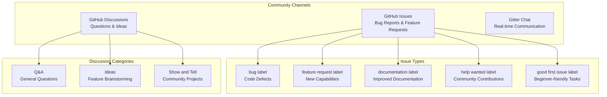
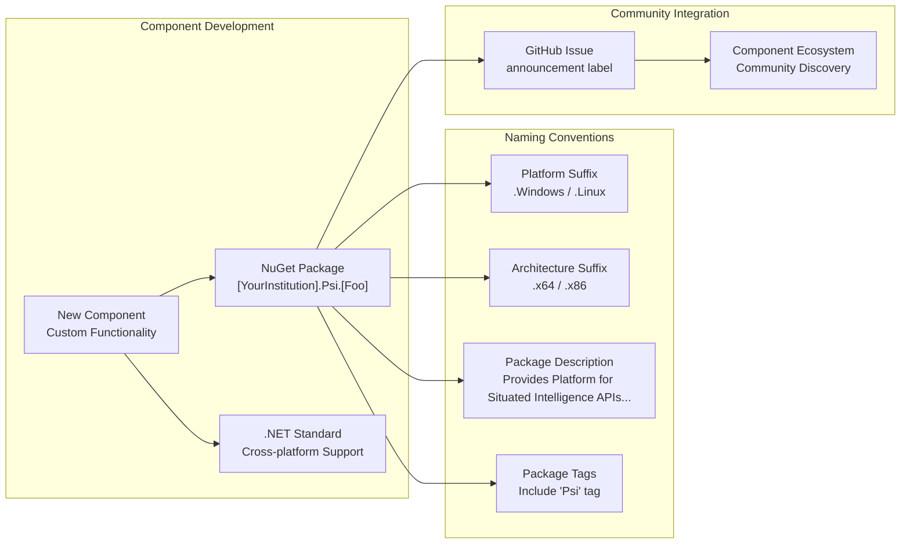
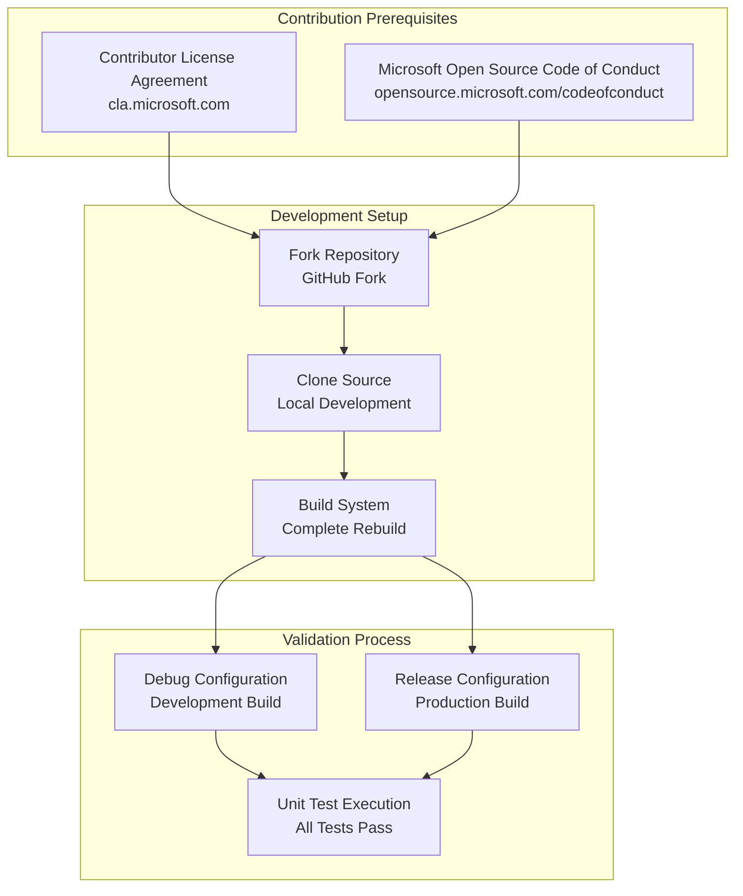
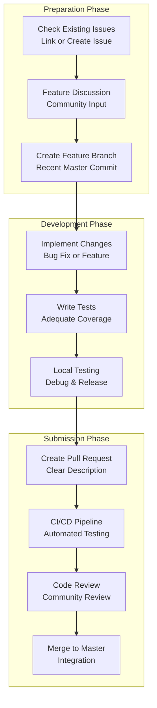

<!-- source: DeepWiki mcp.deepwiki.com · repo microsoft/psi · page 7.3 Contributing to Psi · fetched 2026-10-26 -->

# Contributing to Psi

Relevant source files

The following files were used as context for generating this wiki page:

- [.gitignore](.gitignore)
- [CONTRIBUTING.md](CONTRIBUTING.md)
- [README.md](README.md)

This document provides comprehensive guidance for contributing to the Platform for Situated Intelligence codebase. It covers community engagement, development workflows, coding standards, and submission processes for both new components and core framework improvements.

For information about testing frameworks and best practices, see [Testing Framework and Practices](#7.1). For build system configuration and CI/CD processes, see [Build System and Configuration](#7.2).

## Types of Contributions

The Psi project welcomes contributions in multiple forms, each serving different community needs and technical requirements.

### Community Engagement and Issue Reporting

Sources: [README.md:56-58](), [README.md:30-31](), [CONTRIBUTING.md:9-24]()

### External Component Development

Contributors can extend the Psi ecosystem by developing independent components that integrate with the framework.

Sources: [CONTRIBUTING.md:25-40]()

## Core Framework Development Process

### Legal Requirements and Setup

All contributions to the core codebase require completion of a Contributor License Agreement (CLA) through the Microsoft CLA system at https://cla.microsoft.com.

Sources: [CONTRIBUTING.md:5-7](), [CONTRIBUTING.md:45-49](), [CONTRIBUTING.md:82-84]()

### Code Organization Structure

The Psi codebase follows a structured organization with specific folders for different component types and functionality areas.

```mermaid
graph TB
    subgraph "Psi Source Tree"
        Build["Build/<br/>Build Tools"]
        Sources["Sources/<br/>Core Source Code"]
    end
    
    subgraph "Sources Structure"
        Audio["Audio/<br/>Audio Components"]
        Calibration["Calibration/<br/>Camera Calibration"]
        Common["Common/<br/>Test Support"]
        Data["Data/<br/>Dataset Manipulation"]
        Devices["Devices/<br/>Device Enumeration"]
        Imaging["Imaging/<br/>Image & Video Processing"]
        Integrations["Integrations/<br/>3rd Party Shims"]
        Kinect["Kinect/<br/>Azure Kinect & Kinect V2"]
        Language["Language/<br/>NLP Components"]
        Media["Media/<br/>Media Components"]
        RealSense["RealSense/<br/>RealSense Sensors"]
        Runtime["Runtime/<br/>Core Runtime"]
        Speech["Speech/<br/>Speech Components"]
        Toolkits["Toolkits/<br/>FSM & Other Toolkits"]
        Tools["Tools/<br/>PsiStudio & Tools"]
        Visualization["Visualization/<br/>Visualization Libraries"]
    end
    
    Sources --> Audio
    Sources --> Calibration
    Sources --> Common
    Sources --> Data
    Sources --> Devices
    Sources --> Imaging
    Sources --> Integrations
    Sources --> Kinect
    Sources --> Language
    Sources --> Media
    Sources --> RealSense
    Sources --> Runtime
    Sources --> Speech
    Sources --> Toolkits
    Sources --> Tools
    Sources --> Visualization
```

Sources: [CONTRIBUTING.md:51-75]()

## Development Standards and Practices

### Coding Conventions

The codebase follows Microsoft's standard .NET coding conventions and design guidelines, ensuring consistency across all components.

| Standard Type | Reference | Application |
|---------------|-----------|-------------|
| Coding Conventions | [Microsoft .NET Coding Conventions](https://docs.microsoft.com/en-us/dotnet/csharp/programming-guide/inside-a-program/coding-conventions) | Code formatting, naming, structure |
| Design Guidelines | [Microsoft .NET Design Guidelines](https://docs.microsoft.com/en-us/dotnet/standard/design-guidelines) | API design, architecture patterns |
| Project Setup | Psi.sln consistency | Project configuration, dependencies |

Sources: [CONTRIBUTING.md:76-81]()

### Pull Request Workflow

Sources: [CONTRIBUTING.md:86-97]()

## Pull Request Requirements

All pull requests must meet specific technical and documentation standards to ensure code quality and maintainability:

### Technical Requirements

- **Description**: Include clear explanation of intended changes and functionality
- **Branch Management**: Base on reasonably recent commit from master branch  
- **Testing**: Pass all existing unit tests and include adequate new tests
- **Commit Quality**: Clear, descriptive commit messages
- **Issue Linking**: Reference related GitHub issues for bug fixes

### Build Validation

Contributors must perform complete validation across both build configurations:

| Configuration | Purpose | Requirements |
|---------------|---------|--------------|
| Debug | Development and debugging | Full rebuild, all tests pass |
| Release | Production deployment | Full rebuild, all tests pass |

Sources: [CONTRIBUTING.md:88-97](), [CONTRIBUTING.md:82-84]()

## Community Guidelines

### Code of Conduct

All community interactions follow the Microsoft Open Source Code of Conduct. Contributors should familiarize themselves with these guidelines and contact opencode@microsoft.com for questions or concerns.

### Communication Channels

| Channel | Purpose | Usage Guidelines |
|---------|---------|------------------|
| GitHub Issues | Bug reports, feature requests | Use appropriate labels, provide reproduction steps |
| GitHub Discussions | Questions, ideas, showcases | Engage respectfully, share knowledge |
| Gitter Chat | Real-time communication | Quick questions, community support |

Sources: [CONTRIBUTING.md:5-7](), [README.md:30-31](), [README.md:4]()