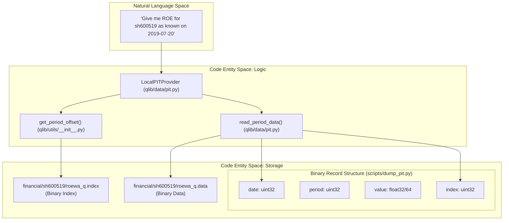
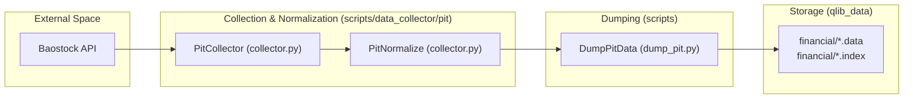

<!-- source: DeepWiki mcp.deepwiki.com · repo microsoft/qlib · page 10.1 Point-in-Time (PIT) Data · fetched 2026-10-26 -->

# Point-in-Time (PIT) Data

<details>
<summary>Relevant source files</summary>

The following files were used as context for generating this wiki page:

- [.github/workflows/test_qlib_from_pip.yml](.github/workflows/test_qlib_from_pip.yml)
- [.github/workflows/test_qlib_from_source.yml](.github/workflows/test_qlib_from_source.yml)
- [.github/workflows/test_qlib_from_source_slow.yml](.github/workflows/test_qlib_from_source_slow.yml)
- [Makefile](Makefile)
- [docs/advanced/PIT.rst](docs/advanced/PIT.rst)
- [examples/data_demo/README.md](examples/data_demo/README.md)
- [examples/data_demo/data_cache_demo.py](examples/data_demo/data_cache_demo.py)
- [examples/data_demo/data_mem_resuse_demo.py](examples/data_demo/data_mem_resuse_demo.py)
- [examples/orderbook_data/create_dataset.py](examples/orderbook_data/create_dataset.py)
- [examples/workflow_by_code.py](examples/workflow_by_code.py)
- [pyproject.toml](pyproject.toml)
- [qlib/contrib/torch.py](qlib/contrib/torch.py)
- [qlib/data/__init__.py](qlib/data/__init__.py)
- [qlib/data/client.py](qlib/data/client.py)
- [qlib/data/pit.py](qlib/data/pit.py)
- [scripts/data_collector/baostock_5min/README.md](scripts/data_collector/baostock_5min/README.md)
- [scripts/data_collector/baostock_5min/requirements.txt](scripts/data_collector/baostock_5min/requirements.txt)
- [scripts/data_collector/br_index/collector.py](scripts/data_collector/br_index/collector.py)
- [scripts/data_collector/future_calendar_collector.py](scripts/data_collector/future_calendar_collector.py)
- [scripts/data_collector/pit/README.md](scripts/data_collector/pit/README.md)
- [scripts/data_collector/pit/collector.py](scripts/data_collector/pit/collector.py)
- [scripts/dump_bin.py](scripts/dump_bin.py)
- [scripts/dump_pit.py](scripts/dump_pit.py)
- [setup.py](setup.py)
- [tests/test_pit.py](tests/test_pit.py)

</details>


## Purpose and Scope

This document explains Qlib's Point-in-Time (PIT) data system, which handles financial statement data that has multiple revision dates (e.g., quarterly earnings reports that may be amended after initial publication). PIT data ensures research backtests avoid look-ahead bias by only using information that was actually available at each historical point in time.

This page covers:
- PIT data concepts and why they matter for financial research.
- Storage format and binary file structure.
- Provider architecture (`PITProvider`, `LocalPITProvider`).
- Expression operators (`P()`, `PRef()`, `PFeature`).
- Data collection and dumping workflows using `dump_pit.py` and `collector.py`.

Sources: [qlib/data/pit.py:1-10](), [tests/test_pit.py:76-105](), [scripts/dump_pit.py:3-7]()

---

## What is Point-in-Time Data?

Point-in-Time (PIT) data solves a critical problem in financial research: **financial statements are published with delays and can be revised multiple times**. 

**Without PIT data**, backtests would incorrectly use the final amended value for all dates, creating look-ahead bias. **With PIT data**, the system correctly returns the value that was actually available on each historical date.

### Key Concepts

| Concept | Description | Example |
|---------|-------------|---------|
| **Period** | The reporting period (quarter/year) | `201902` = 2019 Q2 |
| **Observation Time** | The date when you query the data | `2019-07-16` |
| **Revision Chain** | Linked list of all published values for a period | Original → Amendment 1 → Amendment 2 |
| **Available Value** | The most recent value published before observation time | On `2019-07-16`, use original; on `2019-07-18`, use amendment |

Sources: [qlib/data/pit.py:338-381](), [tests/test_pit.py:77-105](), [scripts/dump_pit.py:157-166]()

---

## PIT Data Format and Storage

### File Structure

PIT data for each instrument and field is stored in two binary files within the `financial` directory of the provider URI [scripts/dump_pit.py:25-28](), [qlib/data/pit.py:756-765]():

```
<qlib_data_dir>/financial/{instrument}/{field}_{freq_suffix}.data
<qlib_data_dir>/financial/{instrument}/{field}_{freq_suffix}.index
```

**Example**: For stock `sh600519` and field `roewa_q` (quarterly ROE):
- Index file: `financial/sh600519/roewa_q.index`
- Data file: `financial/sh600519/roewa_q.data`

### Binary Record Format

Each data record contains four fields defined in the system configuration [qlib/config.py:226-237](). The `DATA_DTYPE` is composed of these types [scripts/dump_pit.py:35-42]():

| Field | Type | Size | Description |
|-------|------|------|-------------|
| `date` | uint32 (`I`) | 4 bytes | Publication date (YYYYMMDD) |
| `period` | uint32 (`I`) | 4 bytes | Reporting period (YYYYQQ for quarterly) |
| `value` | float32/64 (`f`/`d`) | 4/8 bytes | The reported value |
| `index` | uint32 (`I`) | 4 bytes | Pointer to next revision (linked list) |

### Index File Format

The `.index` file provides fast lookup of the first revision for each period [scripts/dump_pit.py:168-170]():
1. Header: `first_year` (stored as `PERIOD_DTYPE`) [scripts/dump_pit.py:47-47]().
2. Subsequent chunks: `period_start_index` (offsets into the `.data` file, stored as `INDEX_DTYPE`) [scripts/dump_pit.py:46-46]().

### Data File Format

The `.data` file contains records organized as a linked list per period. A value defined by `C.pit_record_nan["index"]` (typically `0xFFFFFFFF`) in the `index` field indicates the end of the revision chain for that period [scripts/dump_pit.py:44-44](), [qlib/data/pit.py:787-793]().

Sources: [qlib/data/pit.py:744-820](), [qlib/config.py:226-237](), [scripts/dump_pit.py:24-52]()

---

## Diagram: PIT Data Storage Architecture

This diagram maps the logical PIT query to the physical file structure and binary record entities defined in the dumping and provider logic.



Sources: [qlib/data/pit.py:744-820](), [scripts/dump_pit.py:24-52](), [qlib/utils/__init__.py:20-20]()

---

## Provider Architecture

### PITProvider Abstract Interface

`PITProvider` defines the contract for accessing PIT data [qlib/data/pit.py:338-345]():

```python
class PITProvider(abc.ABC):
    @abc.abstractmethod
    def period_feature(
        self,
        instrument: str,
        field: str,
        start_index: int,
        end_index: int,
        cur_time: pd.Timestamp,
        period: Optional[int] = None,
    ) -> pd.Series:
        """Get historical periods data"""
```

### LocalPITProvider Implementation

`LocalPITProvider` reads PIT data from local binary files. It validates that fields refer to PIT data (often prefixed with `$$` in expressions) [qlib/data/pit.py:744-755]().

**Query Algorithm** [qlib/data/pit.py:795-820]():
1. Locate `.index` and `.data` files for the instrument/field using `get_filenames` logic [scripts/dump_pit.py:142-149]().
2. Use `get_period_offset` to find the starting record in the data file for the requested period.
3. Traverse the linked list using `read_period_data` until a record's `date` exceeds `cur_time`.
4. Return the last valid record found before that cutoff to avoid look-ahead bias.

Sources: [qlib/data/pit.py:338-381](), [qlib/data/pit.py:744-820](), [scripts/dump_pit.py:150-200]()

---

## Expression Interface

### PFeature Class

`PFeature` represents a PIT feature in expressions. It uses the `$$` prefix to distinguish it from standard features [qlib/data/pit.py:266-274]():

```python
class PFeature(Feature):
    def __str__(self):
        return "$$" + self._name
```

### P() Operator

The `P()` operator converts PIT data from period frequency (e.g., quarterly) to daily frequency [tests/test_pit.py:77-105]().

**Example**:
```python
# Returns daily series of ROE as known on each date
fields = ["P($$roewa_q)"]
data = D.features(["sh600519"], fields, start_time="2019-01-01", end_time="2019-07-19")
```

### PRef() Operator

The `PRef()` operator retrieves a specific historical period's value as known on a given date [tests/test_pit.py:135-137]().

**Example**:
```python
# Returns the previous period's ROE value as it was known on each subsequent day
fields = ["P(Ref($$roewa_q, 1))"]
```

Sources: [qlib/data/pit.py:266-274](), [tests/test_pit.py:77-161]()

---

## Data Collection and Dumping Workflow

### Pipeline Overview

1. **Collection**: Fetch raw data using `PitCollector` (e.g., from Baostock) [scripts/data_collector/pit/collector.py:22-43]().
2. **Normalization**: Standardize CSV formats using `PitNormalize` [scripts/data_collector/pit/collector.py:180-200]().
3. **Dumping**: Convert normalized CSVs into Qlib's binary PIT format using `DumpPitData` in `dump_pit.py` [scripts/dump_pit.py:24-52](), [tests/test_pit.py:60-64]().

### Diagram: Data Flow Pipeline

This diagram shows the transition from external data sources to Qlib's internal binary storage.



Sources: [scripts/data_collector/pit/collector.py:15-64](), [tests/test_pit.py:38-64](), [scripts/dump_pit.py:150-200]()

### Execution Commands

The `DumpPitData` class in `dump_pit.py` is typically invoked via the `fire` CLI [scripts/dump_pit.py:16-18]():

```bash
# 1. Download and Normalize via collector.py (example in tests)
# See PitCollector and Run classes in scripts/data_collector/pit/collector.py

# 2. Dump to Qlib Binary format
python dump_pit.py dump --csv_path ~/.qlib/pit_normalized --qlib_dir ~/.qlib/qlib_data/cn_data --interval quarterly
```

Sources: [scripts/dump_pit.py:53-93](), [tests/test_pit.py:60-64](), [scripts/data_collector/pit/collector.py:22-43]()

---

