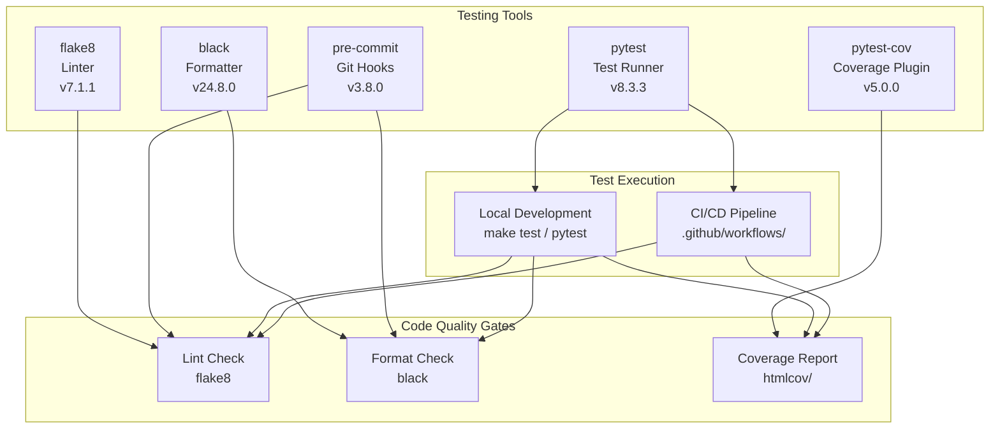
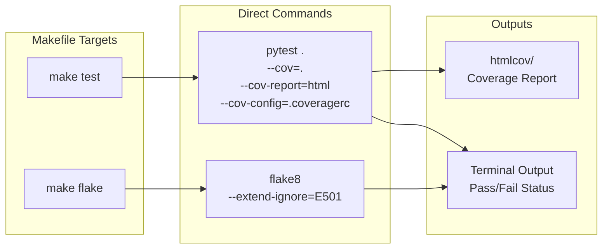
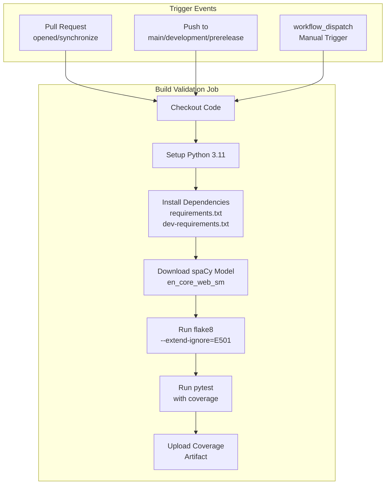
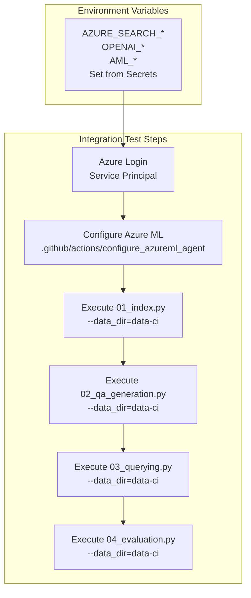
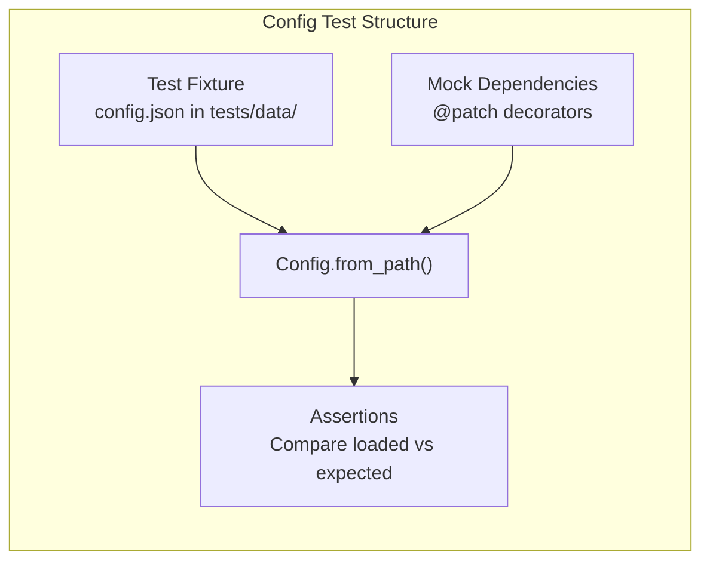
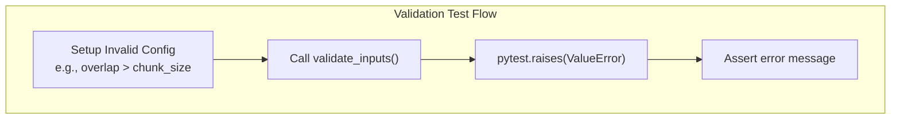
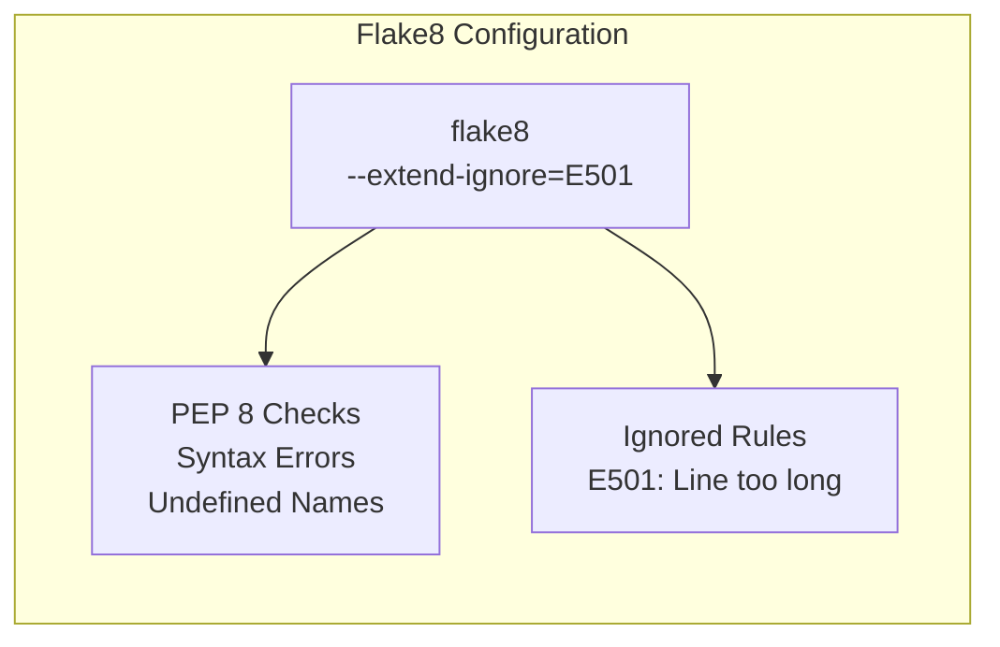
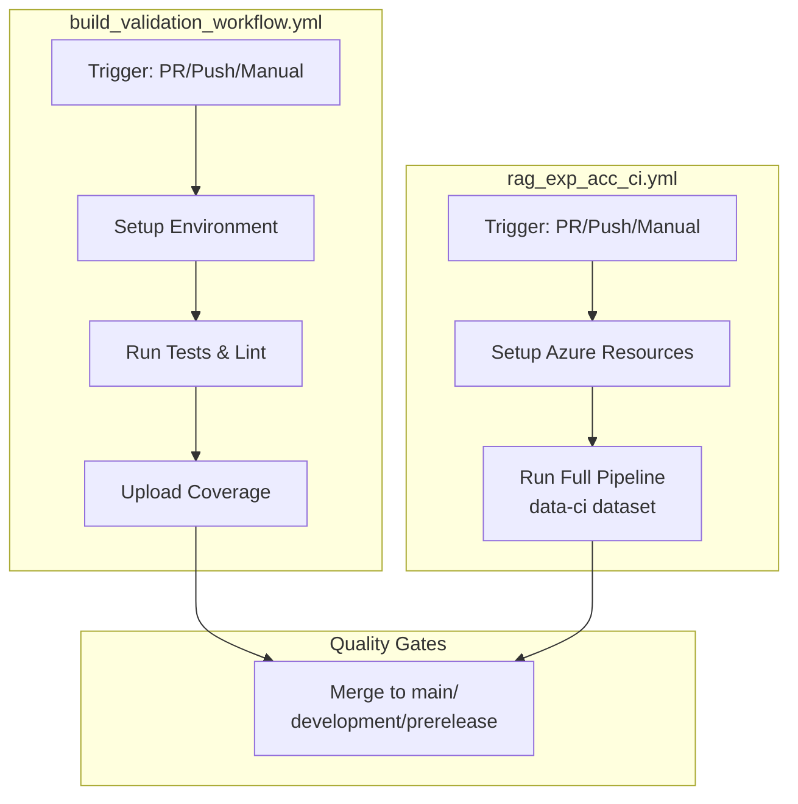

<!-- source: DeepWiki mcp.deepwiki.com · repo microsoft/rag-experiment-accelerator · page 11.2 Testing Strategy · fetched 2026-10-26 -->

# Testing Strategy

<details>
<summary>Relevant source files</summary>

The following files were used as context for generating this wiki page:

- [.env.template](.env.template)
- [.github/workflows/build_validation_workflow.yml](.github/workflows/build_validation_workflow.yml)
- [.github/workflows/rag_exp_acc_ci.yml](.github/workflows/rag_exp_acc_ci.yml)
- [Makefile](Makefile)
- [dev-requirements.txt](dev-requirements.txt)
- [docs/environment-variables.md](docs/environment-variables.md)
- [rag_experiment_accelerator/config/config.py](rag_experiment_accelerator/config/config.py)
- [rag_experiment_accelerator/config/tests/test_config.py](rag_experiment_accelerator/config/tests/test_config.py)
- [rag_experiment_accelerator/embedding/st_embedding_model.py](rag_experiment_accelerator/embedding/st_embedding_model.py)
- [rag_experiment_accelerator/embedding/tests/test_st_embedding_model.py](rag_experiment_accelerator/embedding/tests/test_st_embedding_model.py)
- [requirements.txt](requirements.txt)

</details>


## Purpose and Scope

This document describes the testing strategy, tools, and procedures for the RAG Experiment Accelerator. It covers unit testing with pytest, code quality validation with flake8, test coverage requirements, and how testing integrates with the CI/CD pipeline. For information about running the full pipeline in CI/CD environments, see [CI/CD Workflows](#11.3). For development environment setup including test dependencies, see [Development Environment Setup](#11.1).

---

## Testing Philosophy

The RAG Experiment Accelerator uses a **pragmatic testing approach** focused on:
- **Configuration validation**: Ensuring config parsing and validation logic is correct
- **Component isolation**: Testing individual classes and functions with mocked dependencies
- **Critical path coverage**: Prioritizing tests for core business logic (config, embeddings, evaluation metrics)
- **CI/CD integration**: Automated testing on every pull request and merge

The system employs **two complementary validation strategies**:

1. **Unit tests** (`pytest`) - Fast, isolated component tests with mocked external dependencies
2. **Integration tests** (GitHub Actions workflow) - End-to-end pipeline execution with real Azure services using reduced dataset (`data-ci/`)

---

## Test Framework and Tools

### Core Testing Stack



**Sources:** [dev-requirements.txt:1-8](), [Makefile:65-71]()

### Dependency Installation

Test dependencies are specified in [dev-requirements.txt:1-8]():
- `pytest==8.3.3` - Test framework
- `pytest-cov==5.0.0` - Coverage measurement
- `flake8==7.1.1` - PEP 8 style guide enforcement
- `black==24.8.0` - Code formatter
- `pre-commit==3.8.0` - Git hook management

Additional dependencies for integration testing include `promptflow` packages for Prompt Flow variant validation.

**Sources:** [dev-requirements.txt:1-8]()

---

## Running Tests

### Local Test Execution



#### Run All Tests with Coverage

```bash
make test
```

Or directly:
```bash
pytest . --cov=. --cov-report=html --cov-config=.coveragerc
```

This command:
- Discovers all test files matching `test_*.py` or `*_test.py`
- Runs tests with coverage measurement
- Generates HTML coverage report in `htmlcov/` directory
- Uses `.coveragerc` for coverage configuration

**Sources:** [Makefile:65-67](), [.github/workflows/build_validation_workflow.yml:49-52]()

#### Run Linting

```bash
make flake
```

Or directly:
```bash
flake8 --extend-ignore=E501
```

The `--extend-ignore=E501` flag disables line length checks (E501) to accommodate long configuration lines and import statements.

**Sources:** [Makefile:69-71](), [.github/workflows/build_validation_workflow.yml:44-47]()

### CI/CD Test Execution

Tests run automatically in two GitHub Actions workflows:

#### 1. Build Validation Workflow



Defined in [.github/workflows/build_validation_workflow.yml:1-59](), this workflow:
1. Installs all production and dev dependencies
2. Downloads required spaCy model (`en_core_web_sm`)
3. Runs flake8 linting
4. Executes pytest with coverage
5. Uploads coverage report as artifact (`unit-test-results`)

**Sources:** [.github/workflows/build_validation_workflow.yml:1-59]()

#### 2. RAG Experiment Accelerator CI Workflow



Defined in [.github/workflows/rag_exp_acc_ci.yml:1-67](), this workflow runs the full 4-stage pipeline against real Azure services using a minimal dataset in `data-ci/` to validate end-to-end functionality.

**Sources:** [.github/workflows/rag_exp_acc_ci.yml:1-67]()

---

## Test Organization

### Directory Structure

Tests are co-located with source code in `tests/` subdirectories within each module:

```
rag_experiment_accelerator/
├── config/
│   ├── tests/
│   │   ├── test_config.py
│   │   └── data/
│   │       └── config.json (test fixture)
├── embedding/
│   ├── tests/
│   │   └── test_st_embedding_model.py
├── (other modules with tests)
```

This structure enables:
- **Test discovery** via pytest's automatic test collection
- **Module isolation** - tests stay close to the code they validate
- **Test data management** - fixtures stored in module-specific `tests/data/` directories

**Sources:** [rag_experiment_accelerator/config/tests/test_config.py:1-239](), [rag_experiment_accelerator/embedding/tests/test_st_embedding_model.py:1-35]()

### Test File Naming

Tests follow pytest naming conventions:
- Test files: `test_*.py` (e.g., `test_config.py`)
- Test functions: `test_*` (e.g., `test_config_init`)
- Test classes: `Test*` (not commonly used in this codebase)

**Sources:** [rag_experiment_accelerator/config/tests/test_config.py:10-16]()

---

## Test Patterns and Techniques

### 1. Configuration Testing Pattern



Example from [rag_experiment_accelerator/config/tests/test_config.py:23-176]():

**Key techniques:**
- **Mock external dependencies**: `@patch("rag_experiment_accelerator.config.config.create_embedding_model")` prevents actual model loading
- **Fixture-based testing**: Load test config from `tests/data/config.json`
- **Comprehensive assertions**: Validate all nested configuration properties

```python
# Pattern example (pseudo-code from test_config.py)
@patch("create_embedding_model")
@patch("validate_json_with_schema")
def test_config_init(mock_validate, mock_create_embedding):
    config_path = "tests/data/config.json"
    mock_validate.return_value = (True, None)
    mock_create_embedding.side_effect = [mock_model1, mock_model2, ...]
    
    config = Config.from_path(environment, config_path)
    
    assert config.experiment_name == expected_value
    assert config.index.chunking.chunk_size == expected_list
    # ... more assertions
```

**Sources:** [rag_experiment_accelerator/config/tests/test_config.py:23-176]()

### 2. Validation Testing Pattern



Example from [rag_experiment_accelerator/config/tests/test_config.py:192-203]():

```python
def test_chunk_size_greater_than_overlap_size():
    config = init_config()
    config.index.chunking.chunk_size = [128]
    config.index.chunking.overlap_size = [512]  # Invalid
    
    with pytest.raises(ValueError) as info:
        config.validate_inputs()
    
    assert str(info.value) == "Config param validation error: ..."
```

**Sources:** [rag_experiment_accelerator/config/tests/test_config.py:192-239]()

### 3. Model Testing with Mocks

Example from [rag_experiment_accelerator/embedding/tests/test_st_embedding_model.py:7-16]():

**Key techniques:**
- **Mock heavy dependencies**: Mock `SentenceTransformer` to avoid downloading models
- **Return value simulation**: `mock.return_value.encode.return_value = np.array([...])`
- **Assertion on behavior**: Verify output matches expected embeddings

```python
@patch("...SentenceTransformer")
def test_generate_embedding(mock_sentence_transformer):
    expected_embeddings = [0.1, 0.2, 0.3]
    mock_sentence_transformer.return_value.encode.return_value = \
        np.array([expected_embeddings])
    
    model = STEmbeddingModel("all-mpnet-base-v2")
    embeddings = model.generate_embedding("Hello world")
    
    assert expected_embeddings == embeddings
```

**Sources:** [rag_experiment_accelerator/embedding/tests/test_st_embedding_model.py:7-16]()

### 4. Error Handling Tests

Example from [rag_experiment_accelerator/embedding/tests/test_st_embedding_model.py:19-26]():

Tests verify that appropriate exceptions are raised for invalid inputs:
- `OSError` for non-existent models
- `ValueError` for unsupported models

**Sources:** [rag_experiment_accelerator/embedding/tests/test_st_embedding_model.py:19-26]()

---

## Coverage Requirements

### Coverage Configuration

Coverage settings are defined in `.coveragerc` (referenced in [Makefile:67]() and [.github/workflows/build_validation_workflow.yml:52]()):

**Coverage measurement scope:**
- All Python files in the project
- Excludes: virtual environments, test files themselves, migrations

**Coverage reporting:**
- HTML report generated in `htmlcov/` directory
- Terminal summary output
- Artifact uploaded in CI/CD for review

**Current practice:**
- No strict minimum coverage threshold enforced
- Focus on testing critical paths (config, embeddings, evaluation)
- Integration tests provide additional validation beyond unit test coverage

**Sources:** [Makefile:65-67](), [.github/workflows/build_validation_workflow.yml:49-58]()

---

## Code Quality Tools

### Flake8 Linting



**Configuration:**
- Line length limit (E501) is ignored via `--extend-ignore=E501`
- All other PEP 8 rules enforced
- Runs in both local `make flake` and CI/CD

**Common issues caught:**
- Unused imports
- Undefined variables
- Syntax errors
- Whitespace issues

**Sources:** [Makefile:69-71](), [.github/workflows/build_validation_workflow.yml:44-47]()

### Black Code Formatter

Black is installed as a dev dependency [dev-requirements.txt:7]() for consistent code formatting:
- Automatically formats code to Black's style
- Can be integrated with pre-commit hooks
- Not currently enforced in CI/CD (informational only)

**Sources:** [dev-requirements.txt:7]()

### Pre-commit Hooks

The `pre-commit` package [dev-requirements.txt:6]() enables Git hooks for automated checks before commits:
- Run flake8 linting
- Run black formatting
- Prevent commits with obvious issues

**Note:** Pre-commit configuration (`.pre-commit-config.yaml`) is not visible in provided files but is standard practice with this dependency.

**Sources:** [dev-requirements.txt:6]()

---

## CI/CD Testing Integration

### Workflow Dependencies



Both workflows must pass before code can be merged:

1. **build_validation_workflow.yml** - Fast unit tests and linting (~2-5 minutes)
2. **rag_exp_acc_ci.yml** - Slower integration tests with Azure services (~10-30 minutes)

**Concurrency control:** [.github/workflows/build_validation_workflow.yml:18-20]() prevents multiple concurrent runs of the same workflow on feature branches, saving CI resources.

**Sources:** [.github/workflows/build_validation_workflow.yml:1-59](), [.github/workflows/rag_exp_acc_ci.yml:1-67]()

### Environment Variables for Testing

Integration tests use GitHub secrets [.github/workflows/rag_exp_acc_ci.yml:25-39]():

| Secret Variable | Purpose |
|-----------------|---------|
| `AZURE_SEARCH_ADMIN_KEY` | Azure AI Search authentication |
| `AZURE_SEARCH_SERVICE_ENDPOINT` | Search service URL |
| `OPENAI_API_KEY` | Azure OpenAI authentication |
| `OPENAI_ENDPOINT` | Azure OpenAI URL |
| `AML_SUBSCRIPTION_ID` | Azure ML workspace ID |
| `AML_WORKSPACE_NAME` | Azure ML workspace name |
| `AML_RESOURCE_GROUP_NAME` | Azure resource group |

**Note:** Document Intelligence variables are set to empty strings `""` in CI, indicating tests use fallback processing without Document Intelligence.

**Sources:** [.github/workflows/rag_exp_acc_ci.yml:25-39]()

---

## Test Data Management

### Unit Test Fixtures

Test data is stored in module-specific directories:
- **Config tests**: [rag_experiment_accelerator/config/tests/data/config.json]() contains a valid test configuration
- **Fixture patterns**: Helper functions like `init_config()` [rag_experiment_accelerator/config/tests/test_config.py:10-16]() create common test configurations

### Integration Test Data

The `data-ci/` directory (referenced in [.github/workflows/rag_exp_acc_ci.yml:54-66]()) contains:
- Minimal document corpus for fast pipeline execution
- Reduced document count to minimize CI runtime and Azure costs
- Same format as production data for realistic testing

**Sources:** [.github/workflows/rag_exp_acc_ci.yml:54-66](), [rag_experiment_accelerator/config/tests/test_config.py:10-20]()

---

## Testing Best Practices

### Guidelines for Writing Tests

1. **Mock external dependencies**: Always mock Azure services, OpenAI calls, and file I/O in unit tests
2. **Use fixtures for configuration**: Store test configs in `tests/data/` directories
3. **Test error paths**: Include tests for invalid inputs and expected exceptions
4. **Keep tests fast**: Unit tests should run in milliseconds; save integration tests for CI/CD
5. **Follow naming conventions**: `test_*.py` files, `test_*` function names
6. **Assert behavior, not implementation**: Focus on outputs and side effects, not internal state

### Adding New Tests

When adding new functionality:

1. **Create test file** in appropriate `tests/` subdirectory
2. **Add test fixtures** if needed in `tests/data/`
3. **Mock dependencies** using `unittest.mock.patch` or `pytest.fixtures`
4. **Verify locally** with `make test` before pushing
5. **Check coverage** in `htmlcov/index.html`
6. **Verify CI passes** on pull request

**Sources:** [rag_experiment_accelerator/config/tests/test_config.py:1-239](), [rag_experiment_accelerator/embedding/tests/test_st_embedding_model.py:1-35]()

---

## Troubleshooting Test Failures

### Common Issues

#### Missing Dependencies

**Symptom:** `ModuleNotFoundError` when running tests

**Solution:**
```bash
pip install -e . -r requirements.txt -r dev-requirements.txt
python -m spacy download en_core_web_sm
```

**Sources:** [.github/workflows/build_validation_workflow.yml:34-42]()

#### Mock Configuration Errors

**Symptom:** Tests fail with actual API calls instead of using mocks

**Solution:** Verify `@patch` decorators target correct import paths. Use `@patch("module.under_test.dependency")`, not `@patch("original.module.dependency")`.

**Sources:** [rag_experiment_accelerator/config/tests/test_config.py:23-24]()

#### Flake8 Failures

**Symptom:** CI fails with PEP 8 violations

**Solution:**
```bash
make flake  # Check locally
black .     # Auto-format code
```

**Sources:** [Makefile:69-71]()

### Debugging Failed Tests

1. **Run specific test**: `pytest path/to/test_file.py::test_function_name -v`
2. **Add print statements**: Use `print()` or `logger.debug()` for debugging (will show with `pytest -s`)
3. **Check coverage gaps**: Open `htmlcov/index.html` to see untested code paths
4. **Review CI logs**: Check GitHub Actions workflow logs for detailed error messages

**Sources:** [Makefile:65-67]()

---

## Summary

The RAG Experiment Accelerator uses a **two-tier testing strategy**:

1. **Fast unit tests** with mocked dependencies for rapid feedback during development
2. **Slower integration tests** with real Azure services for end-to-end validation

**Key testing commands:**
- `make test` - Run all tests with coverage
- `make flake` - Run linting checks
- `pytest path/to/test.py` - Run specific test file

**CI/CD integration** ensures all code changes are validated automatically through:
- Build validation workflow (unit tests + linting)
- RAG Experiment Accelerator CI workflow (full pipeline with `data-ci/`)

This approach balances **development velocity** (fast local tests) with **production confidence** (comprehensive integration testing).

**Sources:** [Makefile:65-71](), [.github/workflows/build_validation_workflow.yml:1-59](), [.github/workflows/rag_exp_acc_ci.yml:1-67]()

---

